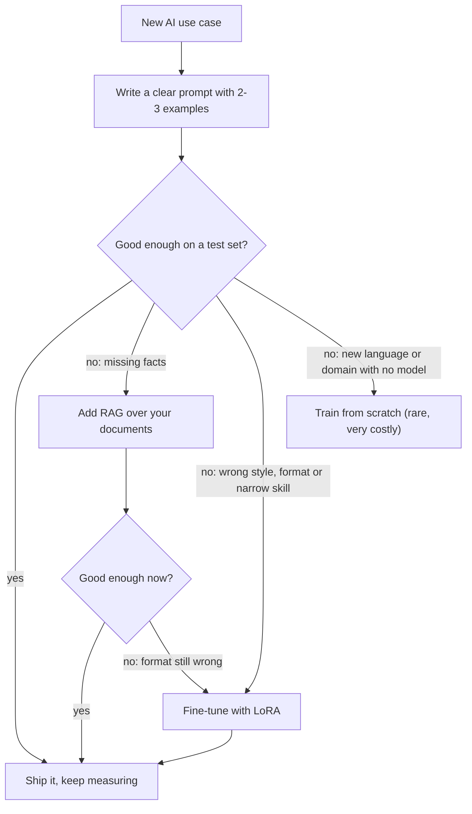
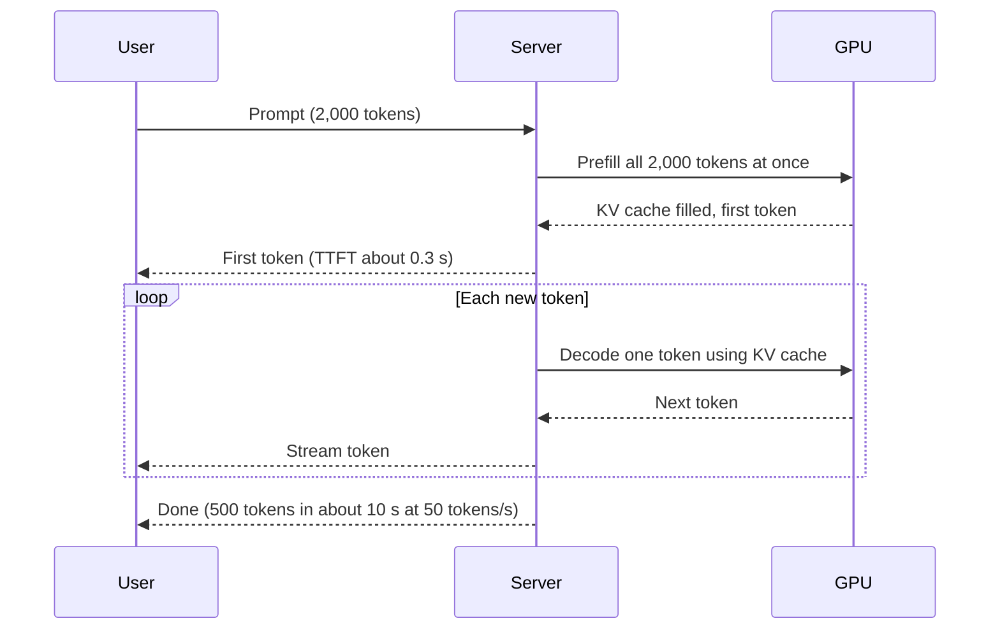
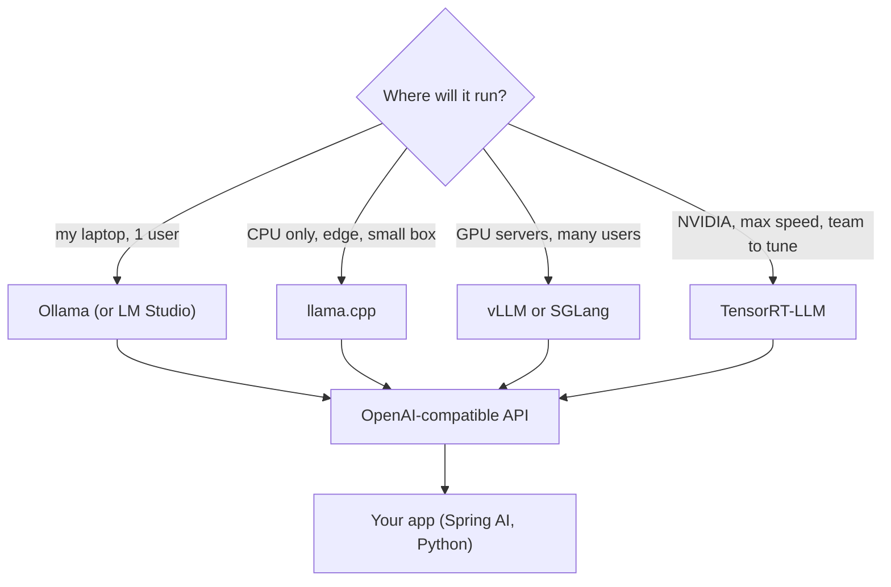
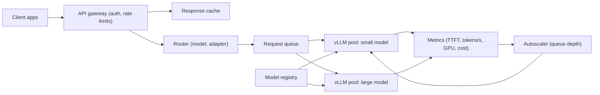
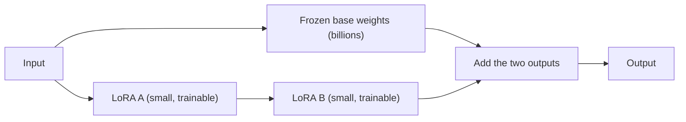
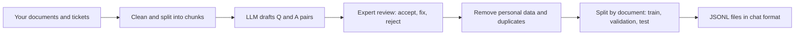
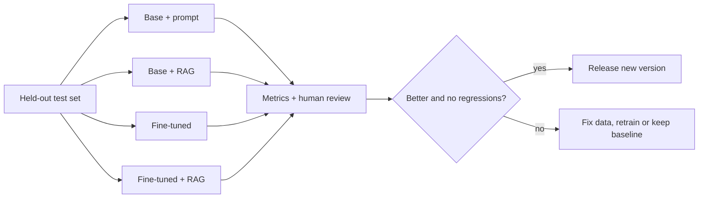
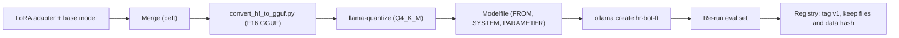

# AI inference, fine-tuning and running models locally

[← Back to README](../README.md)

This page answers one question: "How do I make a model work on our documents, for our use case, on our own machines?"
It covers the big decision (prompt, RAG, fine-tune or train), how a model answers, and memory math.
Then it shows how to run models with Ollama and vLLM, fine-tune with LoRA, and ship the result.
Basics like tokens and embeddings are in [ai-llm-basics.md](ai-llm-basics.md). Search over documents is in [ai-rag.md](ai-rag.md). Spring AI basics are in [spring-ecosystem.md](spring-ecosystem.md#spring-ai).

**Contents**

1. [Prompt, RAG, fine-tune or train from scratch?](#prompt-rag-fine-tune-or-train-from-scratch)
2. [Inference: what happens when a model answers](#inference-what-happens-when-a-model-answers)
3. [GPU and memory math](#gpu-and-memory-math)
4. [Quantization](#quantization)
5. [Serving models: Ollama, llama.cpp, vLLM and others](#serving-models-ollama-llamacpp-vllm-and-others)
6. [Running a model locally step by step](#running-a-model-locally-step-by-step)
7. [Serving at scale: system design](#serving-at-scale-system-design)
8. [Fine-tuning in simple words](#fine-tuning-in-simple-words)
9. [Preparing training data from your own documents](#preparing-training-data-from-your-own-documents)
10. [Fine-tuning code: LoRA with Hugging Face](#fine-tuning-code-lora-with-hugging-face)
11. [Evaluating a fine-tuned model](#evaluating-a-fine-tuned-model)
12. [Shipping your fine-tuned model locally](#shipping-your-fine-tuned-model-locally)
13. [Training a tiny model from scratch (to understand it)](#training-a-tiny-model-from-scratch-to-understand-it)
14. [Classic ML is still useful](#classic-ml-is-still-useful)
15. [Interview questions](#interview-questions)

**Words used on this page (short version):**

| Word | Simple meaning |
|---|---|
| **Model** | A big file of numbers plus code that predicts the next piece of text |
| **Parameter (weight)** | One learned number inside the model. "8B" means 8 billion of them |
| **Token** | A small piece of text, often part of a word. In English, 1 token is about 4 characters or 0.75 words |
| **Inference** | Using a trained model to get an answer. No learning happens |
| **Training** | Changing the model's numbers so it gets better at a task |
| **GPU** | A graphics card. It does thousands of small maths operations at the same time |
| **VRAM** | The memory on the GPU. The model must fit here to run fast |
| **Open-weight model** | A model whose files you can download and run yourself (for example the Llama, Qwen, Gemma, Mistral and gpt-oss families) |

---

## Prompt, RAG, fine-tune or train from scratch?

**In one line:** Prompt first, add RAG for your facts, fine-tune only for style, format or a narrow task, and almost never train from scratch.

**Story:** You hire a smart new employee for your help desk.
- **Prompting** is giving them clear instructions on day one: "Be polite. Answer in 3 lines."
- **RAG** is giving them the company handbook and saying: "Look it up before you answer."
- **Fine-tuning** is sending them on a 2-week course, so they speak and write like your team.
- **Training from scratch** is raising a new person from birth. Nobody does that to fill one job.

You do not send someone on a course to memorise a handbook that changes every week. You give them the handbook.

**How it works (the four options):**

1. **Prompting.** You write instructions and a few examples in the prompt. Nothing about the model changes. Takes hours.
2. **RAG (Retrieval Augmented Generation).** Your app searches your documents first, then puts the best pieces into the prompt. The model answers from them. See [ai-rag.md](ai-rag.md).
3. **Fine-tuning.** You train an existing model a little more on your own examples. The model's numbers change. Takes days to weeks, including data work.
4. **Training from scratch.** You start from random numbers and train on trillions of tokens. Costs millions of dollars for a useful chat model.

**Diagram:**



**Example: the comparison table.**

| | Prompting | RAG | Fine-tuning (LoRA) | Train from scratch |
|---|---|---|---|---|
| What changes | Only the input text | Input text plus found documents | Model numbers (a small part) | All model numbers |
| Data you need | 0–10 examples | Your documents | 500–5,000 good examples | Trillions of tokens |
| Cost | Very low | Low to medium (vector DB, embeddings) | Medium (a GPU for hours) | Millions of dollars |
| Time to first result | Hours | Days | 1–3 weeks | Months |
| New fact added | Edit the prompt | Re-index the document (minutes) | Retrain (hours to days) | Retrain |
| Can show sources | No | Yes | No | No |
| Best for | Most tasks | Facts that change, private docs | Tone, format, short outputs, a narrow task, a small fast model | Research, new languages, big labs |

**Why "fine-tune on my docs to teach it facts" usually works worse than RAG:**
- **Facts do not stick well.** A model often needs to see a fact many times, in many wordings, to recall it. One pass over a policy PDF is not enough.
- **It makes up details with confidence.** Research found RAG beats fine-tuning for adding new knowledge (Ovadia et al., 2023). Training on new facts can even increase made-up answers (Gekhman et al., 2024).
- **No sources.** A fine-tuned model cannot say "this came from HR policy v3, page 4". RAG can.
- **Stale fast.** A policy changes on Monday. With RAG you re-index one file. With fine-tuning you rebuild the dataset and retrain.
- **No permissions.** With RAG you filter documents per user. A fine-tuned model "knows" everything it saw, so any user can pull it out.
- **It can forget.** Training hard on a narrow set can make the model worse at general things. This is called *catastrophic forgetting*.

**When fine-tuning really helps:**
- The output must follow a strict format every time (for example a JSON shape, or a medical note layout).
- You want a **small, cheap model** to do one job as well as a big model. For example: classify tickets into 40 teams, or extract fields from invoices.
- You want a fixed tone or style, and long prompts are too slow or too costly.
- You often **combine both**: fine-tune for format and behaviour, RAG for facts.

**Good and bad:**
| Good | Bad |
|---|---|
| Starting with prompting is fast and cheap | Teams jump to fine-tuning because it sounds impressive |
| RAG keeps facts fresh and shows sources | RAG adds a search system you must run and tune |
| Fine-tuning can make a 1B–8B model good at one narrow job | Fine-tuning needs clean data, GPUs, evaluation and versioning |
| Measuring on a test set makes the decision clear | Without a test set, every option "looks fine" in a demo |

**Say this in the interview:**

> "I go step by step. First a clear prompt with a few examples, measured on a test set. If the model lacks our facts, I add RAG, because facts change and RAG can show sources and respect permissions. I fine-tune only for style, format or a narrow task, often to make a small model cheap and fast. Training from scratch is almost never the right business choice."

**They may ask next:**
- **Can I fine-tune on our wiki so the bot knows it?** Not a good idea alone. Use RAG for the facts. Fine-tune only if the answer format or tone is still wrong.
- **What is the cheapest option that works?** Usually prompting plus RAG. Measure it before you spend on training.
- **When do you combine RAG and fine-tuning?** When you need fresh facts and a strict output style. Fine-tune the model to answer from given context, and use RAG to give it that context.

---

## Inference: what happens when a model answers

**In one line:** The model reads the whole prompt in one go (prefill), then writes the answer one token at a time (decode).

**Story:** A chef in a restaurant.
- **Prefill** is reading the whole order slip. The chef reads all lines at once. This is fast.
- **Decode** is cooking dish after dish. Each dish waits for the one before. This is the slow part.
- The **KV cache** is the chef's notepad. The chef writes notes about the order, so they do not re-read the whole slip before each dish.

**How it works:**
1. Your text is split into **tokens** and turned into numbers.
2. **Prefill:** the model processes all input tokens together. The GPU does lots of maths in parallel. This is *compute-bound* (limited by GPU maths speed).
3. While reading, the model saves notes about each token in the **KV cache**.
   - **Attention** is how each token looks back at earlier tokens to decide what matters.
   - KV means "key" and "value": two lists of numbers per token that attention uses.
4. **Decode:** the model predicts one next token. It adds that token to the text and to the KV cache. Then it predicts the next one. Repeat until it stops.
5. For each new token, the GPU must read **all model weights** from memory. So decode is *memory-bandwidth-bound* (limited by how fast memory can be read).

**The numbers people measure:**

| Metric | Meaning | Typical target for chat |
|---|---|---|
| **TTFT** (time to first token) | Wait time + prefill time. How long until the first word appears | Under 1 second |
| **Tokens per second (per user)** | Decode speed for one answer | 20+ tokens/s feels smooth (people read about 5–10 tokens/s) |
| **ITL / TPOT** (inter-token latency, time per output token) | Time between two output tokens | Under 50 ms |
| **Throughput** | Total tokens per second for all users on one GPU | As high as possible, for cost |

**Diagram:**



**Example: a small calculation.**
- Prompt: 2,000 tokens. Answer: 500 tokens.
- Prefill on one modern GPU for an 8B model: a few hundred milliseconds.
- Decode at 50 tokens/s: 500 / 50 = **10 seconds**.
- So the answer length, not the prompt length, decides most of the wait. This is why we **stream** the answer.

**Why output tokens are slower and cost more than input tokens:**
- Input tokens are processed **together** in one big parallel step.
- Output tokens come **one by one**. Each one reads all the weights again.
- So hosted APIs usually charge several times more per output token than per input token. Check your provider's current price list.
- **Tip:** ask for short answers and set `max_tokens`. It saves both time and money.

**KV cache in simple words:**
- Without it, the model would re-read the full conversation for every new token. That is very slow.
- With it, the model keeps notes for old tokens and only does work for the newest token.
- The cost: the KV cache uses GPU memory. It grows with **every token of every active user**. Long chats and many users fill memory fast.
- **Prefix caching:** if many requests start with the same system prompt, the server can reuse that part of the KV cache. vLLM, SGLang and llama.cpp support this.

**Good and bad:**
| Good | Bad |
|---|---|
| Streaming hides most of the decode wait | Long answers are always slow; no trick removes decode time fully |
| KV cache makes decode fast | KV cache memory limits how many users fit on one GPU |
| Prefix caching makes repeated system prompts cheap | Long contexts (100k tokens) make TTFT seconds long |

**Say this in the interview:**

> "Inference has two phases. Prefill reads the whole prompt in parallel and is limited by GPU compute. Decode writes one token at a time and is limited by memory bandwidth, because each token reads all the weights. The KV cache stores notes for earlier tokens so we don't redo work, but it uses GPU memory per user. I track time to first token, tokens per second and throughput."

**They may ask next:**
- **Why is my chatbot fast to start but slow to finish?** Prefill is fast and parallel. Decode is one token at a time. Ask for shorter answers or use a smaller or quantized model.
- **What makes TTFT high?** A long prompt, a busy server queue, or a cold model that is still loading.
- **How do you make decode faster?** Smaller or quantized model, faster memory (better GPU), batching for throughput, and *speculative decoding* (a small model guesses several tokens, the big model checks them in one step).

---

## GPU and memory math

**In one line:** Memory needed ≈ number of parameters × bytes per parameter, plus the KV cache, plus about 10–20% overhead.

**Story:** Moving house with a truck.
- The furniture is the model weights. It must all fit in the truck (GPU memory).
- Small boxes you keep adding are the KV cache. One box per word of every conversation.
- If the truck is full, you either use smaller furniture (quantization), a bigger truck, or two trucks (two GPUs).

**How it works:**
1. **Bytes per parameter:**
   - FP16 / BF16 (16-bit numbers): 2 bytes.
   - 8-bit (INT8 or FP8): 1 byte.
   - 4-bit: 0.5 byte, about 0.6 in practice (some extra data is stored with the numbers).
2. **Weights memory** = parameters × bytes. 8 billion × 2 bytes = 16 GB.
3. **KV cache** = grows with context length and number of users.
4. **Overhead** = runtime, temporary buffers. Add 10–20%.

**Example: weights only, rounded.**

| Model size | FP16 / BF16 | 8-bit | 4-bit | Runs on (4-bit) |
|---|---|---|---|---|
| **1B** | 2 GB | 1 GB | ~0.7 GB | Any laptop, even a phone |
| **7–8B** | 14–16 GB | 7–8 GB | ~4.5–5 GB | 8 GB GPU or a 16 GB laptop |
| **14B** | 28 GB | 14 GB | ~8–9 GB | 12–16 GB GPU or a 32 GB Mac |
| **70B** | 140 GB | 70 GB | ~40–43 GB | 2 × 24 GB GPUs, one 48 GB+ GPU, or a 64 GB+ Mac |

Real check: llama.cpp lists an 8B model at about 15 GB in F16, 8 GB in Q8_0, and 4.6 GB in Q4_K_M.

**Example: KV cache for one user.**
- Formula per token: 2 (key and value) × layers × KV heads × head size × bytes.
- A Llama-3-style 8B model: 2 × 32 × 8 × 128 × 2 bytes = **128 KB per token**.
- 8,000-token chat: 8,000 × 128 KB ≈ **1 GB**.
- 128,000-token context: ≈ **16 GB**. That is more than the 4-bit weights.
- 20 users with 8,000 tokens each: about 20 GB of KV cache. This is why servers need big GPUs.

**Example: speed from memory bandwidth (upper limit for one user).**
- Decode reads all weights once per token. So: tokens/s ≤ memory bandwidth ÷ model size.
- RTX 4090 (about 1 TB/s) with an 8B 4-bit model (5 GB): at most ~200 tokens/s. Real numbers are lower.
- Laptop CPU with DDR5 memory (about 60–100 GB/s): at most ~12–20 tokens/s for the same model.

**GPU memory of common hardware (rounded, check the exact model you buy):**

| Hardware | Memory | Good for (inference) |
|---|---|---|
| RTX 4060 / 5060 class | 8 GB | 7–8B in 4-bit, short context |
| RTX 4070 / 5070 | 12 GB | 8B in 4-bit with longer context, 14B 4-bit tight |
| RTX 4080 / 5080 / 5070 Ti | 16 GB | 14B in 4-bit, 8B in 8-bit |
| RTX 3090 / 4090 | 24 GB | 30B-class in 4-bit, 8B in FP16 |
| RTX 5090 | 32 GB | 30B-class in 4-bit with long context |
| Apple Silicon Mac (unified memory) | 16–128 GB on "Max" chips, up to 512 GB on "Ultra" Mac Studio | The GPU shares system RAM. By default only part of it (roughly two-thirds to three-quarters) is usable by the GPU |
| NVIDIA T4 (free Colab/Kaggle) | 16 GB | Learning, small fine-tunes |
| NVIDIA L4 / A10G | 24 GB | Cheap cloud inference for 7–8B |
| NVIDIA L40S | 48 GB | 70B in 4-bit, many users on 8B |
| NVIDIA A100 | 40 or 80 GB | Training and serving |
| NVIDIA H100 | 80 GB | Production serving and training |
| NVIDIA H200 | 141 GB | Big models, long context |
| NVIDIA B200 | about 180–192 GB | Largest models, newest racks |

**CPU-only inference:**
- It works. llama.cpp and Ollama run on CPU.
- It is slow: often 5–15 tokens/s for an 8B 4-bit model, and much slower for prefill of long prompts.
- Fine for batch jobs at night, tests, or tiny models (1–3B). Not fine for many users.

**Training needs much more memory than inference:**
- **Full fine-tuning** with the usual Adam optimizer needs about 16 bytes per parameter (weights, gradients, optimizer state). 8B × 16 = ~128 GB, plus activations. That is several big GPUs.
- **LoRA** on a 16-bit base: about the weights (16 GB for 8B) plus a few GB.
- **QLoRA** (LoRA on a 4-bit base): an 8B model fits in about 10–16 GB. A 70B model fits on one 48–80 GB GPU.

**Good and bad:**
| Good | Bad |
|---|---|
| A simple formula gives a good first guess | Real memory depends on context length, batch size and runtime |
| 4-bit makes 8B models run on laptops | Long contexts can need more memory than the weights |
| Apple unified memory runs big models on one box | Apple memory bandwidth is lower than top NVIDIA GPUs, so it is slower per token |

**Say this in the interview:**

> "My rule of thumb is parameters times bytes per parameter, plus the KV cache, plus 10 to 20 percent. An 8B model is about 16 GB in 16-bit and about 5 GB in 4-bit. The KV cache grows with context and users: around 128 KB per token for an 8B model, so 1 GB for an 8,000-token chat. Decode speed is limited by memory bandwidth, so bandwidth divided by model size gives the upper limit."

**They may ask next:**
- **Can a 70B model run on one 24 GB GPU?** Not fully. In 4-bit it needs about 40 GB. You can offload some layers to CPU RAM, but it becomes very slow.
- **Why does my model crash with "out of memory" only on long chats?** The KV cache grew. Lower the max context, lower parallel users, or quantize the KV cache.
- **Is a Mac good for local LLMs?** Yes for one user and big models, because of large unified memory. For many users, NVIDIA GPUs with vLLM give much more throughput.

---

## Quantization

**In one line:** Quantization stores each model number with fewer bits (4 instead of 16), so the model needs less memory and runs faster, with a small quality loss.

**Story:** Rounding prices in a shop.
- The real price is ₹99.87. You write ₹100 on the board.
- The board is shorter and easier to read. You lose a few paise of accuracy.
- Round too much (to the nearest ₹1,000) and the prices become useless. Same with models: 4-bit is usually fine, 2-bit often hurts.

**How it works:**
1. Model numbers are normally 16-bit floats.
2. Quantization maps them to a small set of values (for example 16 values for 4-bit).
3. It works in small groups (for example 32 numbers). Each group keeps a *scale* number, so the rounding error stays small.
4. Some methods look at sample data to protect the most important weights.

**Formats you will meet:**

| Format | Where used | In simple words |
|---|---|---|
| **GGUF** | llama.cpp, Ollama, LM Studio | One file with the model and its settings. Many levels: Q4_K_M, Q5_K_M, Q8_0. Runs on CPU, Apple and NVIDIA |
| **GPTQ** | vLLM, Transformers | 4-bit for GPUs. Uses a small sample dataset to choose the rounding. Today made with GPTQModel or llm-compressor (the old AutoGPTQ is archived) |
| **AWQ** | vLLM, SGLang | 4-bit for GPUs. Finds the most important weights and protects them. The old AutoAWQ tool is deprecated; vLLM points to llm-compressor |
| **bitsandbytes (NF4, 8-bit)** | Transformers, QLoRA training | Quantizes when the model loads. Easy, no preparation. Slower for serving. Mostly used for training |
| **FP8** | vLLM, SGLang, TensorRT-LLM on newer NVIDIA GPUs (Ada, Hopper, Blackwell) | 8-bit floats. Almost no quality loss, about half the memory of FP16, very fast on supported GPUs |
| **MLX** | Apple Silicon (MLX, LM Studio) | Apple's format for Mac GPUs, with 4-bit and 8-bit versions |

**Example: quality vs size for an 8B model (GGUF, from llama.cpp's table, rounded).**

| Level | Bits per weight | Size | Quality (rough) | Use it when |
|---|---|---|---|---|
| F16 | 16 | 15 GB | Reference | You have the memory, or you will quantize later |
| Q8_0 | 8.5 | 8 GB | Almost the same as F16 | You want safety and have memory |
| Q6_K | 6.6 | 6.1 GB | Very close | Good middle choice |
| Q5_K_M | 5.7 | 5.3 GB | Close | Good default if it fits |
| **Q4_K_M** | 4.9 | 4.6 GB | Small loss, fine for most chat | **Most common default** |
| Q3_K_M | 4.0 | 3.7 GB | Noticeable loss | Only when memory is very tight |
| Q2_K / IQ2 | 2–3 | 2–3 GB | Big loss | Experiments only |

**Rules of thumb:**
- A **bigger model in 4-bit** often beats a **smaller model in 16-bit** at the same memory.
- Small models (1–3B) lose more quality from quantization than big ones.
- Exact tasks (maths, code, strict JSON) suffer first. **Test on your own task**, not only on a public score.

**Good and bad:**
| Good | Bad |
|---|---|
| 3–4x less memory | Some quality loss, more at low bits |
| Faster decode (less memory to read) | Different tools need different formats |
| Runs big models on small hardware | Very low bits (2–3) can break reasoning |

**Say this in the interview:**

> "Quantization rounds model weights to fewer bits, like 4 or 8 instead of 16. It cuts memory by 2 to 4 times and makes decode faster, with a small quality loss. For laptops I use GGUF Q4_K_M with Ollama or llama.cpp. On data-center GPUs I use FP8 or AWQ with vLLM. I always test the quantized model on my own task."

**They may ask next:**
- **Does quantization make the model slower?** Usually faster for decode, because there is less memory to read. Some formats add work to unpack numbers, but the net is usually faster.
- **Can I quantize the KV cache too?** Yes. llama.cpp and vLLM support 8-bit KV cache. It saves memory for long contexts, with a small quality risk.
- **What is QLoRA's 4-bit?** NF4 from bitsandbytes. The base model is frozen in 4-bit while you train small LoRA adapters on top.

---
## Serving models: Ollama, llama.cpp, vLLM and others

**In one line:** Use Ollama or llama.cpp to run a model on a laptop or small machine, and use vLLM or SGLang to serve many users on data-center GPUs.

**Story:** Cooking at home vs running a restaurant kitchen.
- **Ollama** is a microwave. Press a button, food is ready. Great for one family.
- **llama.cpp** is a small gas stove. It works almost anywhere, even without electricity (no GPU).
- **vLLM / SGLang** is a restaurant kitchen. It cooks for 100 tables at once and wastes nothing.
- **TensorRT-LLM** is a custom-built factory kitchen. Fastest, but you must design it for one menu (NVIDIA only).

**How it works (the main tools):**

| Tool | Best for | Notes (checked Nov 2026) |
|---|---|---|
| **Ollama** | Laptops, dev machines, quick local use | `ollama pull` / `ollama run`. Own REST API on port 11434 and an OpenAI-compatible API at `/v1`. Mac, Windows, Linux. Not built for heavy concurrent load |
| **llama.cpp** | CPU, Apple, edge devices, single small servers | C/C++ engine, GGUF files. Has a server with OpenAI-compatible `/v1/chat/completions`. Newer releases also ship a single `llama` command (`llama serve`, `llama cli`) |
| **vLLM** | Production on NVIDIA/AMD GPUs and TPUs | PagedAttention, continuous batching, OpenAI-compatible server on port 8000, many quantization formats, LoRA serving. Linux. Apple support is through a separate vLLM-Metal plugin |
| **SGLang** | Production, heavy prefix reuse, big MoE models | Very fast. Strong prefix caching (RadixAttention) and structured output |
| **TGI** (Hugging Face) | Existing deployments only | In **maintenance mode** since late 2025. Hugging Face points new deployments to vLLM or SGLang |
| **TensorRT-LLM** | Highest speed on NVIDIA | Compiles the model for your GPU. More setup work. Often used with NVIDIA's Triton or Dynamo |
| **LM Studio / MLX** | Desktop app, Apple Silicon | GUI for local models; MLX is Apple's ML library |

**Two ideas that make vLLM fast (simple words):**

- **Continuous batching:**
  - Old way (static batching): like a tour bus. It waits until all passengers finish the tour before new ones can get on. Short answers wait for long ones.
  - New way: like a city bus. At every stop (every decode step) finished passengers get off and new ones get on.
  - Result: the GPU is always busy. Throughput goes up many times.
- **PagedAttention:**
  - Old way: each user gets one big reserved block of KV cache memory for the maximum length. Most of it stays empty.
  - New way: KV cache is stored in small fixed-size **pages**, like pages in a ring binder. A user gets a new page only when needed.
  - Result: much less wasted memory, so many more users fit on one GPU.

**OpenAI-compatible APIs:**
- Ollama, llama.cpp server, vLLM, SGLang and LM Studio all accept the same request shape as OpenAI's chat completions API.
- So your app (Spring AI, Python `openai` client, LangChain) can switch between a hosted API and your own server by changing the **base URL**.

**Diagram:**



**Good and bad:**
| Good | Bad |
|---|---|
| Ollama: 2 commands to a running model | Ollama: lower throughput under many users |
| llama.cpp: runs almost anywhere, even CPU | llama.cpp: fewer production features than vLLM |
| vLLM/SGLang: high throughput, many formats | vLLM/SGLang: Linux + GPU, more knobs to tune |
| Same OpenAI-style API for all | Small differences between servers (tool calling, options) still exist |

**Say this in the interview:**

> "For local work I use Ollama, because it is two commands and gives an OpenAI-compatible API. llama.cpp is the engine for CPU and edge devices with GGUF files. For production on GPUs I use vLLM or SGLang. They use continuous batching, where requests join and leave the batch at every step, and paged KV cache memory, so one GPU serves many users. All of them speak the OpenAI API, so the app only changes a base URL."

**They may ask next:**
- **Why not just use Ollama in production?** It can work for small internal tools. For many concurrent users, vLLM gives much higher throughput and better metrics.
- **What is speculative decoding?** A small "draft" model guesses a few tokens. The big model checks them in one step. If the guesses are right, you get several tokens for the price of one step.
- **Can vLLM serve many LoRA adapters?** Yes. It can load one base model and many small adapters, and pick the adapter per request.

---

## Running a model locally step by step

**In one line:** Install Ollama, pull a model, run it, then call it over HTTP from Python or Spring AI; use vLLM when you have a Linux GPU server.

**Story:** Getting a new coffee machine.
- Install the machine (Ollama).
- Buy a coffee pod (pull a model).
- Press the button (run it).
- Later, connect it to the office ordering app (REST API, Spring AI).

**How it works:**

### Step 1: install, pull and run with Ollama

```bash
# macOS: download the app from ollama.com, or: brew install ollama
# Linux:
curl -fsSL https://ollama.com/install.sh | sh

ollama pull llama3.2          # download a small model (about 2 GB, 3B parameters, 4-bit)
ollama run llama3.2           # chat in the terminal; type /bye to exit
ollama list                   # models on disk
ollama ps                     # models loaded in memory right now
```

- Models are already quantized (usually 4-bit), so they fit on laptops.
- Pick the model size from the memory table above. 16 GB laptop: up to 8B. 32 GB: up to 14B.

### Step 2: call the REST API

```bash
curl http://localhost:11434/api/chat -d '{
  "model": "llama3.2",
  "messages": [{ "role": "user", "content": "Explain a Kafka partition in 2 lines" }],
  "stream": false
}'
```

The response has the text in `message.content`. It also has `eval_count` (output tokens) and `eval_duration` (nanoseconds). So you can compute tokens per second.

### Step 3: a Modelfile with your own system prompt

A **Modelfile** is like a Dockerfile for a model. It sets the base model, the system prompt and default settings.

```text
FROM llama3.2

SYSTEM """You are the internal HR help bot of our company.
Answer in at most 3 short sentences.
If you are not sure, say "I don't know" and point to the HR portal."""

PARAMETER temperature 0.2
PARAMETER num_ctx 8192
```

```bash
ollama create hr-bot -f ./Modelfile   # build a new local model from the Modelfile
ollama run hr-bot "How many days of leave do I get?"
```

- `temperature` (randomness): low (0–0.3) for facts and support, higher (0.7–1.0) for creative text.
- `num_ctx` (context size in tokens): the default can be small (the docs list 2048). Long documents get cut silently if you do not raise it. Bigger context uses more memory.
- The system prompt does **not** give the bot your HR facts. It will still guess. Use RAG for facts.

### Step 4: call it from Python

```python
import requests

resp = requests.post("http://localhost:11434/api/chat", json={
    "model": "hr-bot",
    "messages": [{"role": "user", "content": "Can I carry leave to next year?"}],
    "stream": False,
}, timeout=120)
resp.raise_for_status()
body = resp.json()

print(body["message"]["content"])
seconds = body["eval_duration"] / 1e9               # Ollama reports nanoseconds
print(f"{body['eval_count'] / seconds:.1f} tokens/s")  # decode speed
```

Or use the OpenAI client with `base_url="http://localhost:11434/v1"`. Then the same code later works with vLLM or a hosted API.

### Step 5: call it from Spring AI

Spring AI basics (ChatClient, tools, RAG) are in [spring-ecosystem.md](spring-ecosystem.md#spring-ai). For Ollama you only add the starter and point it to the local server.

```xml
<dependency>
    <groupId>org.springframework.ai</groupId>
    <artifactId>spring-ai-starter-model-ollama</artifactId>
</dependency>
```

```yaml
spring:
  ai:
    ollama:
      base-url: http://localhost:11434   # default
      chat:
        model: hr-bot                    # Spring AI 2.0 docs; in 1.x it was chat.options.model
        temperature: 0.2
      init:
        pull-model-strategy: never       # pre-download models; do not pull on startup in prod
```

```java
@Service
class HrAssistant {
    private final ChatClient chat;

    HrAssistant(ChatClient.Builder builder) {
        this.chat = builder.build(); // same ChatClient API as for hosted models
    }

    String ask(String question) {
        return chat.prompt().user(question).call().content();
    }
}
```

- The Java code does not change when you move from Ollama to a hosted model. Only the starter and properties change.
- Local models can be slow on CPU. Set HTTP timeouts and use streaming. See [timeouts](microservices.md#timeouts).

### Step 6: vLLM on a Linux GPU server

```bash
# Needs Linux + a supported GPU. Downloads the model from Hugging Face.
uv pip install vllm --torch-backend=auto

# --max-model-len: max context; lower it to save KV cache memory
# --gpu-memory-utilization: share of GPU memory vLLM may use
# --api-key: require a key. The default port is 8000
vllm serve Qwen/Qwen3-8B --max-model-len 8192 --gpu-memory-utilization 0.90 --api-key "$VLLM_API_KEY"
```

```python
from openai import OpenAI

client = OpenAI(base_url="http://localhost:8000/v1", api_key="change-me")
reply = client.chat.completions.create(
    model="Qwen/Qwen3-8B",
    messages=[{"role": "user", "content": "Summarise our refund rules in 3 bullets"}],
    max_tokens=300,  # always cap output: it is the slow and costly part
)
print(reply.choices[0].message.content)
```

**Hardware notes:**
- **8 GB RAM laptop:** 1–3B models in 4-bit. Fine for learning.
- **16 GB laptop or 8–12 GB GPU:** 7–8B in 4-bit. Good for most local tests.
- **32–64 GB Mac or 24 GB GPU:** 14B–32B in 4-bit.
- **70B:** about 40+ GB in 4-bit. Two 24 GB GPUs, one 48–80 GB GPU, or a Mac with 64 GB or more.
- First load is slow (seconds to a minute) because the weights load from disk. Ollama unloads idle models after a few minutes; the next call loads again.

**Good and bad:**
| Good | Bad |
|---|---|
| Data never leaves your machine | Smaller local models are weaker than top hosted models |
| No per-token bill | You pay for hardware, power and your time |
| Works offline | You handle updates, security and monitoring yourself |

**Say this in the interview:**

> "Locally I install Ollama, pull a 4-bit model that fits my memory, and wrap it with a Modelfile that sets the system prompt, temperature and context size. My app calls it through the REST API or the OpenAI-compatible endpoint, and in Java through the Spring AI Ollama starter. On a GPU server I switch to vLLM serve, which gives the same OpenAI-style API with much higher throughput."

**They may ask next:**
- **Why did my model ignore half of my document?** The context size (`num_ctx`) was too small, so the input was cut. Raise it, or use RAG to send only the relevant parts.
- **How do you keep local models secure?** Bind to localhost or a private network, put an API key or gateway in front, and never expose port 11434 to the internet.
- **How do you pick a model?** Fit in memory first, then test 2–3 candidates on 50–100 of your own questions. Check the license too.

---

## Serving at scale: system design

**In one line:** A self-hosted inference platform is a GPU server pool behind a gateway that routes, limits, queues and batches requests, and scales on queue depth.

**Story:** A taxi company with expensive cars.
- Each car (GPU) is costly, so it must not sit idle, and it must carry many riders at once (batching).
- A dispatcher (gateway) sends each rider to the right car type (model routing).
- When the waiting line grows, you call in more cars (autoscaling). A new car takes time to arrive (cold start).
- You count cost per kilometre (cost per 1,000 tokens).

**How the interviewer asks it:** "Design a platform so 20 internal teams can use open models on our own GPUs." They test GPU sizing, batching, autoscaling, cost and reliability.

**Numbers (example, measure your own):**
- 50,000 requests a day. Average = 50,000 / 86,400 ≈ 0.6 per second. Peak (5x) ≈ 3 per second.
- 500 output tokens each. Peak output ≈ 3 × 500 = **1,500 tokens/s**.
- An 8B model on one modern data-center GPU with vLLM can give roughly 1,000–3,000 output tokens/s in total with batching. Your load test decides.
- So: 2 GPUs for peak, plus 1 spare for failures and deploys.

**How it works (the parts):**
1. **API gateway:** auth (API keys per team), **rate limits** per team in tokens per minute, request size limits. See [rate limiting](system-design.md#rate-limiting-algorithms).
2. **Router:** picks the model and the pool. Small model for easy tasks, big model for hard ones. Can also route by LoRA adapter.
3. **Queue:** smooths spikes. If the queue is too long, return HTTP 429 fast instead of timing out.
4. **Inference servers (vLLM/SGLang)** on a **GPU node pool** (for example Kubernetes nodes with GPUs). Continuous batching inside each server.
5. **Model registry:** stores model files and adapters with versions (for example Hugging Face Hub private repo, S3 + MLflow). Each deploy pins an exact version.
6. **Caching:** prefix caching inside vLLM; an exact-match response cache for repeated questions; semantic cache only with care (similar question ≠ same answer). See [caching](system-design.md#caching).
7. **Autoscaling:** scale on **queue length or KV cache usage**, not CPU. (CPU is idle on a GPU server.) KEDA or a custom autoscaler can read these from Prometheus.
8. **Monitoring:** TTFT, tokens/s per user, total throughput, queue time, GPU utilisation, GPU memory, KV cache usage, errors, **cost per 1,000 tokens** per team.
9. **Fallbacks:** if the self-hosted pool is down or full, fail over to a hosted API (if data rules allow) with a [circuit breaker](microservices.md#circuit-breaker) and [retry with backoff](microservices.md#retry-with-exponential-backoff-and-jitter).

**Diagram:**



**Cold starts:**
- A new GPU node must start, pull the container (often 5–10 GB), and load the weights (16 GB for an 8B FP16 model). This can take **1–10 minutes**.
- Fixes:
  - Keep at least 1 warm replica per model.
  - Cache weights on local NVMe disk, or bake common models into the node image.
  - Scale up early, on queue growth, not on errors.

**Cost per 1,000 tokens (simple maths, example numbers):**
- Assume a GPU costs **$2 per hour** (example only; prices vary a lot).
- It produces 2,000 tokens/s on average when busy = 7.2 million tokens per hour.
- Cost = $2 / 7,200 thousand tokens ≈ **$0.0003 per 1,000 tokens**, if fully busy.
- At 10% average use, cost is 10x higher. **Utilisation decides the price.**

**When to use a hosted API instead:**
- Low or spiky traffic: you pay per token instead of for idle GPUs.
- You need the strongest models (top hosted models are usually stronger than open models you can run).
- Small team, no GPU or MLOps experience.

**When self-hosting makes sense:**
- Data must stay in your network (law, contracts, health or bank data).
- High, steady volume, where GPUs stay busy.
- A small fine-tuned model does the job well.
- You need fixed latency or offline use.

**What can go wrong:**
| Problem | Fix |
|---|---|
| GPU out of memory under load | Lower max context and max parallel requests; scale out |
| One team floods the cluster | Per-team token rate limits and quotas |
| Long prompts block short ones | Separate pools, or limit prompt size; chunked prefill in vLLM |
| New model version gives worse answers | Canary release with an eval set, quick rollback by registry version |
| Node dies mid-answer | Client retries once; idempotent request ids; stream resumes from start |

**Good and bad:**
| Good | Bad |
|---|---|
| Data stays in-house | GPUs are costly and often idle |
| Cost per token can be very low at high use | You run drivers, CUDA versions, upgrades, on-call |
| Full control of models and versions | Open models may be weaker than the best hosted ones |

**Say this in the interview:**

> "I put a gateway in front for auth and per-team token limits, then a router that picks the model, then a queue and a pool of vLLM servers on GPU nodes. Each server does continuous batching. I autoscale on queue depth or KV cache usage, not CPU, and keep one warm replica to hide cold starts. I monitor TTFT, tokens per second, GPU use and cost per 1,000 tokens. If traffic is low or spiky, a hosted API is usually cheaper."

**They may ask next:**
- **Why not autoscale on CPU?** The work is on the GPU. CPU stays low even when the GPU is full. Queue length shows the real pressure.
- **How do you roll out a new model?** Register the version, run the eval set, send 5% of traffic (canary), compare quality and latency, then increase.
- **How do you share one GPU across teams?** One base model with many LoRA adapters in vLLM, or GPU partitioning (MIG on A100/H100) for small models.

---
## Fine-tuning in simple words

**In one line:** Fine-tuning trains an existing model a bit more on your examples to learn a style, format or narrow task; LoRA trains only a small add-on.

**Story:** A big textbook and a small notebook.
- The base model is a 1,000-page textbook. Rewriting the whole book (full fine-tuning) is slow and costly.
- LoRA is a **small sticky-note notebook** you keep on top of the book. It says: "On page 200, read it this way instead."
- The book stays the same. The notebook is tiny (a few MB to a few hundred MB). You can keep many notebooks: one for HR, one for legal, one for support.
- QLoRA is the same, but the textbook is a **cheap printed copy in small font** (4-bit), so it fits on a small desk (a small GPU).

**How it works:**
1. **Full fine-tuning:** every parameter changes. Needs the most memory (about 16 bytes per parameter with the usual optimizer). Best quality ceiling, highest cost, highest risk of forgetting.
2. **PEFT (parameter-efficient fine-tuning):** freeze the base model, train only a small number of new parameters. LoRA is the most common PEFT method.
3. **LoRA (Low-Rank Adaptation):**
   - Inside the model there are big tables of numbers (matrices), for example 4,096 × 4,096.
   - LoRA does not change the big table. It adds two thin tables next to it: 4,096 × 16 and 16 × 4,096. Their product is the "correction".
   - 16 here is the **rank** (r). Bigger rank = more capacity to learn, more memory.
   - Trainable parameters drop to well under 1% of the model.
4. **QLoRA:** load the frozen base model in 4-bit (NF4), train LoRA adapters in 16-bit on top. An 8B model fine-tunes on one 12–16 GB GPU.
5. After training you either **keep the adapter separate** (load base + adapter) or **merge** it into the base weights (one normal model file).

**Diagram:**



**Example: typical starting numbers for LoRA.**

| Setting | Typical value | Meaning |
|---|---|---|
| `r` (rank) | 8–32 (16 is a good start) | Size of the adapter |
| `lora_alpha` | 16–64 (often 2 × r) | How strongly the adapter changes the output |
| `lora_dropout` | 0–0.1 | Randomly turns off parts during training, to reduce overfitting |
| Target modules | All linear layers (`"all-linear"`) | Where adapters are added |
| Learning rate | 1e-4 to 2e-4 | How big each learning step is. LoRA uses a higher rate than full fine-tuning (about 1e-5 to 2e-5) |
| Epochs | 1–3 | Passes over the data. More often means overfitting (memorising) |
| Examples | 500–5,000 good ones | Quality beats quantity |

**What fine-tuning is good at:**
- A fixed output format (JSON, a report layout, a SQL dialect).
- A tone of voice (your brand style, short answers, polite refusals).
- A narrow task: classify, extract fields, rewrite, summarise in a set way.
- Making a **small model** do one job well, so it is cheap and fast.
- Teaching the model to answer **only from given context** (useful together with RAG).

**What fine-tuning is bad at:**
- Adding lots of new facts reliably (use RAG).
- Facts that change often.
- Fixing weak reasoning of a small model in general.
- Anything you cannot write good examples for.

**Good and bad:**
| Good | Bad |
|---|---|
| LoRA adapters are small and cheap to train | Needs clean data and a proper eval set |
| QLoRA runs on one consumer or free cloud GPU | 4-bit base can lose a little quality |
| Many adapters can share one base model | Adapter only works with the exact base model it was trained on |
| Short prompts after training (lower cost per call) | Risk of forgetting general skills if you overtrain |

**Say this in the interview:**

> "Fine-tuning continues training an existing model on my own examples. Full fine-tuning changes every weight and needs a lot of GPU memory. LoRA freezes the model and trains two small matrices next to each big one, so less than one percent of the parameters learn. QLoRA does the same on a 4-bit base model, so an 8B model fits on one 16 GB GPU. I use it for format, tone and narrow tasks, not for teaching facts."

**They may ask next:**
- **What does the rank mean?** The width of the small LoRA matrices. Higher rank can learn more, but needs more memory and can overfit. 16 is a common start.
- **Merge or keep the adapter separate?** Merge for one simple model file and slightly faster inference. Keep separate to swap many adapters on one base model.
- **What other tuning methods exist?** Preference tuning like DPO (learn from "this answer is better than that one") and reinforcement learning methods. Start with SFT (supervised fine-tuning) first.

---

## Preparing training data from your own documents

**In one line:** Turn your documents into a few hundred to a few thousand checked Q&A examples in chat format, and keep a test set the model never sees.

**Story:** Making a question bank for a new employee's exam.
- You do not hand them the whole policy folder and hope.
- You write real questions customers ask, with the perfect answer in your company's style.
- A senior person checks each answer.
- You keep some questions secret for the final exam (test set). If they saw them before, the exam means nothing.

**How it works:**
1. **Pick the task.** "Answer HR questions in our style using the given context." Write it down in one line.
2. **Collect real inputs.** Old support tickets, emails, chat logs, search queries. Real questions beat invented ones.
3. **Make instruction/response pairs.** Each example = an input (instruction or question, plus context if any) and the ideal output.
4. **Draft with an LLM, check with humans.** An LLM can draft 5 Q&A pairs per document chunk. A domain expert accepts, fixes or rejects each one.
5. **Put it in chat format** (`messages` with `system`, `user`, `assistant` roles). The training library applies the model's **chat template** (the special tokens the model uses to mark who is speaking).
6. **Clean:** remove personal data, broken text, very long or empty answers, contradictions.
7. **Dedup:** remove exact and near-duplicate examples (for example by embedding similarity above 0.95).
8. **Split:** 80% train, 10% validation (watch during training), 10% test (only at the very end). Split **by document or topic**, so the same fact is not in both train and test.

**Diagram:**



**Example: one training line (JSONL = one JSON object per line).**

```json
{"messages": [
  {"role": "system", "content": "You are the HR help bot. Answer only from the context. Max 3 sentences."},
  {"role": "user", "content": "Context: Leave policy v3, section 4: up to 5 unused days move to next year.\n\nQuestion: Can I carry my leave forward?"},
  {"role": "assistant", "content": "Yes. You can carry up to 5 unused days into next year (Leave policy v3, section 4)."}
]}
```

(Shown on several lines to read. In the file, each example is one line.)

**Example: draft Q&A pairs with a local model (a human must review the output).**

```python
import json
from openai import OpenAI

client = OpenAI(base_url="http://localhost:11434/v1", api_key="ollama")  # local Ollama
PROMPT = ("Write 3 questions an employee might ask about this text, with short answers "
          "that use ONLY the text. Return JSON: {\"pairs\": [{\"q\": \"...\", \"a\": \"...\"}]}\n\nTEXT:\n")

def draft_pairs(chunk: str, source: str) -> list[dict]:
    reply = client.chat.completions.create(
        model="llama3.2",
        messages=[{"role": "user", "content": PROMPT + chunk}],
        response_format={"type": "json_object"},  # ask for valid JSON
        temperature=0.3,
    )
    pairs = json.loads(reply.choices[0].message.content).get("pairs", [])
    return [{"q": p["q"], "a": p["a"], "source": source, "status": "needs_review"} for p in pairs]

with open("drafts.jsonl", "w", encoding="utf-8") as out:
    for source, chunk in [("leave-policy-v3#4", "Up to 5 unused leave days move to next year.")]:
        for row in draft_pairs(chunk, source):
            out.write(json.dumps(row) + "\n")  # reviewers set status to ok / fixed / rejected
```

**How much data?**

| Goal | Rough size |
|---|---|
| Change format or tone | 200–1,000 examples |
| Narrow task (classify, extract) | 500–5,000 examples, covering every class |
| Broad new skill | 10,000+ (often not worth it; try a bigger model first) |

- **A few hundred great examples beat 50,000 noisy ones.** The model copies your mistakes too.
- Include hard cases: "I don't know" answers, refusals, edge cases, long inputs.
- Keep the same style in all answers. Mixed styles give a confused model.

**Do not leak test data:**
- If a test question (or a near copy) is in training data, your score is fake.
- Split by source document before you generate pairs.
- Check overlap between train and test with exact match and embedding similarity.

**Licensing and consent:**
- Check the **model license** (some are Apache 2.0; some families such as Llama and Gemma have their own terms).
- Check you have the **right to use** the documents and tickets for training. Customer data may need consent or legal review.
- Remove personal data (names, emails, phone numbers, IDs) unless it is needed and allowed. A fine-tuned model can repeat training text word for word.
- Keep a record of what data went into which model version.

**Good and bad:**
| Good | Bad |
|---|---|
| LLM drafts save weeks of writing | LLM drafts contain errors; humans must check |
| Real user questions make a realistic dataset | Real data contains personal information |
| Small, clean datasets train fast | Too small a dataset misses edge cases |

**Say this in the interview:**

> "I turn documents into chat-format examples: a system prompt, a user question with context, and the ideal assistant answer. An LLM drafts question and answer pairs per chunk, and a domain expert reviews each one. I remove personal data and duplicates, and split train, validation and test by source document so nothing leaks. A few hundred to a few thousand clean examples usually beat a large noisy set."

**They may ask next:**
- **What is a chat template?** The exact text format a chat model expects, with special tokens marking system, user and assistant turns. Use the model's own template, or the model behaves strangely.
- **Why split by document and not randomly?** Random splits put paraphrases of the same fact in train and test. The score looks great but means nothing.
- **Can I use synthetic data only?** It helps for coverage, but check it by hand and mix in real examples. Pure synthetic data repeats the drafting model's habits and errors.

---

## Fine-tuning code: LoRA with Hugging Face

**In one line:** Load a small open model, add a LoRA config, give `SFTTrainer` your chat-format JSONL, train for 1–3 epochs on one GPU, and save the small adapter.

**Story:** Practice drills for a cricket player.
- The player (base model) already knows cricket.
- You run focused drills (training examples) on one shot only.
- The coach (trainer) watches the score on practice balls (validation loss) and stops before the player gets tired and sloppy (overfitting).

**How it works (the libraries):**
- **transformers:** loads models and tokenizers (the tool that splits text into tokens).
- **peft:** adds LoRA adapters.
- **trl:** gives `SFTTrainer` (supervised fine-tuning) that understands chat datasets.
- **datasets:** loads JSONL files.
- Checked with TRL 1.x docs (Nov 2026): `SFTTrainer` accepts a model id string, a `peft_config`, and `SFTConfig` with `max_length` (older versions called it `max_seq_length`).

**Example: LoRA fine-tuning script (needs a GPU and downloads the model).**

```python
# pip install transformers peft trl datasets accelerate
from datasets import load_dataset
from peft import LoraConfig
from trl import SFTConfig, SFTTrainer

data = load_dataset("json", data_files={"train": "train.jsonl", "validation": "val.jsonl"})

lora = LoraConfig(
    r=16, lora_alpha=32, lora_dropout=0.05,
    target_modules="all-linear",          # add adapters to every linear layer
    task_type="CAUSAL_LM",
)
args = SFTConfig(
    output_dir="out/hr-lora",
    num_train_epochs=2,
    learning_rate=2e-4,                   # LoRA uses a higher rate than full fine-tuning
    per_device_train_batch_size=4,
    gradient_accumulation_steps=4,        # behaves like batch size 16
    max_length=1024,                      # longer examples are cut
    assistant_only_loss=True,             # learn only from the assistant answers
    eval_strategy="epoch",                # check validation loss after each epoch
    # fp16=True,                          # on a T4 GPU (no bf16 support) turn this on
)
trainer = SFTTrainer(
    model="Qwen/Qwen3-0.6B",              # small open model; try 1-8B later
    args=args, peft_config=lora,
    train_dataset=data["train"], eval_dataset=data["validation"],
)
trainer.train()
trainer.save_model("out/hr-lora")         # saves only the small adapter (MBs, not GBs)
```

**QLoRA version (bigger model on a small GPU):** pass a 4-bit config, the rest stays the same.

```python
import torch
from transformers import BitsAndBytesConfig

bnb = BitsAndBytesConfig(
    load_in_4bit=True,
    bnb_4bit_quant_type="nf4",              # 4-bit format from the QLoRA paper
    bnb_4bit_compute_dtype=torch.bfloat16,  # maths in 16-bit
)
# trainer = SFTTrainer(model="<an 8B instruct model>", args=args,
#                      peft_config=lora, quantization_config=bnb, ...)
```

**What to watch while it trains:**
- **Training loss** goes down. Good.
- **Validation loss** goes down, then starts going up: you are **overfitting**. Stop at the best epoch.
- Loss drops to almost 0: the model memorised the data. Use fewer epochs or more varied data.

**Faster or simpler options:**
- **Unsloth:** a library that makes LoRA/QLoRA training up to about 2x faster with up to ~70% less GPU memory (their claim, quoted in the TRL docs). Has free Colab notebooks and can export straight to GGUF (`save_pretrained_gguf`).
- **Axolotl:** fine-tuning from a YAML config file. Good for repeatable runs and multi-GPU.
- Check their current docs before you copy code; these libraries change fast.

**Free GPUs for learning:**
- **Google Colab** free tier: often a T4 with 16 GB. Sessions can stop after some hours.
- **Kaggle notebooks:** free GPUs (T4 or P100) with a weekly hour limit (about 30 hours; check the current limit).
- Enough for 0.5–3B LoRA and for 7–8B QLoRA with small batches.

**Training time (rough):**
- 1,000 examples × 500 tokens × 2 epochs = 1 million tokens.
- 0.6–1.5B model with LoRA on a T4: roughly 10–30 minutes.
- 8B with QLoRA on a T4: roughly 1–3 hours. On a 24 GB RTX 4090 or an A100: a few times faster.
- Data preparation and evaluation take much longer than training. Plan days for those.

**Good and bad:**
| Good | Bad |
|---|---|
| 30 lines of code for a real fine-tune | Library versions change; pin them in `requirements.txt` |
| Adapter is small and easy to version | Wrong chat template or EOS token gives endless or broken answers |
| Free GPUs are enough to learn | Big models still need paid GPUs |

**Say this in the interview:**

> "I use Hugging Face TRL's SFTTrainer with a PEFT LoRA config. The data is chat-format JSONL, and I compute the loss only on the assistant answers. I start with rank 16, learning rate 2e-4 and 1 to 3 epochs, and watch validation loss to stop before overfitting. For bigger models I add a 4-bit bitsandbytes config, which makes it QLoRA. Unsloth or Axolotl make this faster or config-driven."

**They may ask next:**
- **Why compute loss only on the answers?** We want the model to learn to write answers, not to repeat user questions or system prompts.
- **What is gradient accumulation?** Run several small batches, add up the learning signal, then update once. It gives the effect of a big batch on a small GPU.
- **How do you track experiments?** Log config, data version, metrics and adapter files per run (MLflow, Weights & Biases, or plain folders in object storage).

---

## Evaluating a fine-tuned model

**In one line:** Compare the fine-tuned model with the base model and a RAG baseline on a held-out test set, with task metrics and human review.

**Story:** Testing a new cook before the restaurant opens.
- Give the same 50 orders to the old cook and the new cook.
- Taste each dish (human review) and also measure things you can count (time, temperature, portion size).
- Also check the new cook can still make basic tea. Maybe the special training made them forget simple things.

**How it works:**
1. **Held-out test set:** 100–500 examples the model never saw. Same format as real traffic.
2. **Compare at least four setups:**
   - Base model + good prompt.
   - Base model + RAG.
   - Fine-tuned model.
   - Fine-tuned model + RAG.
3. **Task metrics (pick what fits):**

| Task | Metric | Simple meaning |
|---|---|---|
| Classification | Accuracy, precision, recall, F1 | How many labels are right; F1 balances "missed" and "wrong" |
| Extraction (fields) | Exact match per field, F1 | Did we get the exact value? |
| Short answers | Exact match, token F1 | Same words as the reference answer? |
| OCR / text reading | CER, WER | Character or word error rate: edits needed ÷ length. Lower is better |
| JSON output | % valid JSON, % schema valid | Can the app parse it? |
| Open answers | Human rating, LLM-as-judge | Correct, grounded, right tone? |

4. **LLM-as-judge:** a strong model scores answers with a clear rubric. Cheap and fast, but check it against human scores on a sample. Judges have biases (they like long answers).
5. **Human review:** experts score a random sample (for example 50 answers) blind, without knowing which model wrote it.
6. **Regression on general ability:** run a small general set (simple maths, general questions, safety prompts, instructions outside your domain). The fine-tuned model must not be much worse.
7. **Speed and cost:** TTFT, tokens/s and memory. A small fine-tuned model should win here.

**Diagram:**



**Example: exact match and token F1 for two models (OpenAI-compatible servers).**

```python
import json
from collections import Counter
from openai import OpenAI

client = OpenAI(base_url="http://localhost:11434/v1", api_key="ollama")

def token_f1(pred: str, gold: str) -> float:
    p, g = pred.lower().split(), gold.lower().split()
    common = sum((Counter(p) & Counter(g)).values())   # words in both answers
    if common == 0:
        return 0.0
    precision, recall = common / len(p), common / len(g)
    return 2 * precision * recall / (precision + recall)

def evaluate(model: str, rows: list[dict]) -> dict:
    em = f1 = 0.0
    for row in rows:
        out = client.chat.completions.create(model=model, messages=row["messages"][:-1],
                                             temperature=0).choices[0].message.content
        gold = row["messages"][-1]["content"]           # the reference answer
        em += out.strip() == gold.strip()
        f1 += token_f1(out, gold)
    return {"model": model, "exact_match": em / len(rows), "f1": f1 / len(rows)}

rows = [json.loads(line) for line in open("test.jsonl", encoding="utf-8")]
for name in ["llama3.2", "hr-bot-ft"]:                  # base vs fine-tuned
    print(evaluate(name, rows))
```

**Good and bad:**
| Good | Bad |
|---|---|
| A fixed test set makes every change measurable | Small test sets give noisy numbers |
| Comparing with RAG shows if fine-tuning was even needed | Exact match is too strict for free text |
| LLM-as-judge scales cheaply | Judges can be wrong or biased; spot-check with humans |

**Say this in the interview:**

> "I keep a held-out test set and compare four setups: base with a prompt, base with RAG, fine-tuned, and fine-tuned with RAG. I use task metrics like exact match, F1 or character error rate, plus blind human review on a sample. I also run a small general test to catch forgetting, and I measure latency and cost. If fine-tuning doesn't clearly beat RAG, I don't ship it."

**They may ask next:**
- **Training loss is low but answers are bad. Why?** Overfitting, a test set unlike real traffic, or a wrong chat template at inference time.
- **How big should the test set be?** 100–500 examples for a start. Bigger if differences between models are small.
- **How do you run evals in CI?** A script runs the test set on every new model or prompt version and fails the build if a key metric drops.

---

## Shipping your fine-tuned model locally

**In one line:** Merge the LoRA adapter, convert to GGUF, quantize to 4-bit, wrap it in an Ollama Modelfile, and version it like code.

**Story:** Printing a new edition of a book.
- Your sticky notes (adapter) are merged into the text (merge).
- The book is printed in a pocket format (GGUF, 4-bit).
- It gets a cover and a short note on how to read it (Modelfile with system prompt).
- Each edition has a number (v1, v2), so you can go back to the old one.

**How it works:**
1. **Merge** the adapter into the base weights → a normal Hugging Face model folder.
2. **Convert** to GGUF with llama.cpp's `convert_hf_to_gguf.py` (16-bit file).
3. **Quantize** with `llama-quantize` to Q4_K_M (Ollama does not quantize GGUF files during import).
4. **Modelfile:** `FROM` the GGUF file, add system prompt and parameters.
5. **ollama create** and **ollama run**, then run the eval set again on the GGUF version.

**Diagram:**



**Example step 1: merge the adapter (Python, loads the base model).**

```python
from peft import AutoPeftModelForCausalLM
from transformers import AutoTokenizer

model = AutoPeftModelForCausalLM.from_pretrained("out/hr-lora", dtype="auto")  # base + adapter
merged = model.merge_and_unload()            # fold LoRA numbers into the base weights
merged.save_pretrained("out/hr-merged")
AutoTokenizer.from_pretrained("out/hr-lora").save_pretrained("out/hr-merged")  # keep the chat template
```

**Example step 2: convert and quantize with llama.cpp.**

```bash
git clone https://github.com/ggml-org/llama.cpp && cd llama.cpp
pip install -r requirements.txt               # Python deps for the convert script

python convert_hf_to_gguf.py ../out/hr-merged --outfile hr-f16.gguf --outtype f16
./build/bin/llama-quantize hr-f16.gguf hr-q4_k_m.gguf Q4_K_M   # build llama.cpp first, or use a release binary
```

**Example step 3: Modelfile and run.**

```text
FROM ./hr-q4_k_m.gguf
SYSTEM """You are the HR help bot. Answer only from the context. Max 3 sentences."""
PARAMETER temperature 0.2
PARAMETER num_ctx 8192
```

```bash
ollama create hr-bot-ft -f ./Modelfile
ollama run hr-bot-ft "Context: ... Question: Can I carry my leave forward?"
```

- Ollama usually reads the chat template from the GGUF file. If answers look broken or never stop, add a `TEMPLATE` that matches the base model.

**Option B: keep the adapter separate.**
- Ollama: `FROM <the exact base model>` plus `ADAPTER <path to adapter>`. The adapter can be a Safetensors folder (for supported model families) or a GGUF adapter made with llama.cpp's `convert_lora_to_gguf.py`.
- The base model **must be the same** one used in training. Otherwise the results are unpredictable.
- llama.cpp server: `--lora <adapter.gguf>`. vLLM: `--enable-lora --lora-modules hr=out/hr-lora`, then call model name `hr`.
- Good when many teams share one base model with their own adapters.

**Version models like code:**
- Name: `hr-bot-ft:2026-11-v3`. Never overwrite `latest` without a record.
- Store together: adapter or GGUF file, base model id and revision, training data hash, training config, eval results.
- Put the Modelfile and training config in Git. Put big files in a model registry or object storage (Hugging Face private repo, S3, MLflow).
- Roll out with a canary and keep the previous version ready for rollback.

**Good and bad:**
| Good | Bad |
|---|---|
| One small GGUF file runs anywhere Ollama or llama.cpp runs | Each conversion step can break the chat template or tokenizer |
| 4-bit makes the fine-tuned model laptop-sized | Quantization can undo part of the fine-tune gain; re-run evals |
| Separate adapters let many teams share a base | Adapter and base version must always match |

**Say this in the interview:**

> "After training I merge the LoRA adapter into the base model with PEFT, convert it to GGUF with llama.cpp's convert script, and quantize it to Q4_K_M. Then an Ollama Modelfile points to the GGUF file and sets the system prompt and parameters. I re-run the eval set on the quantized model, because quantization can change quality. Every model gets a version with its base model, data hash, config and eval results."

**They may ask next:**
- **Why re-run evals after quantizing?** 4-bit rounding changes the weights a little. A narrow fine-tune can lose some of its gain.
- **Where do you store models?** A model registry or object storage, not Git. Git holds configs, Modelfiles and eval reports.
- **How do you serve it to a team?** Same model on vLLM (merged 16-bit or FP8) for many users, or Ollama for a small internal tool.

---

## Training a tiny model from scratch (to understand it)

**In one line:** Training a tiny GPT on one book teaches you how language models learn next-token prediction, but it will never be a useful chatbot.

**Story:** Building a toy car engine at home.
- You learn how pistons, fuel and sparks work.
- You will not drive it on the highway.
- Real engines (real LLMs) need factories (thousands of GPUs, trillions of tokens).

**How it works:**
1. Read a text file (for example one public-domain book, about 1 million characters).
2. **Tokenize** by character: each letter becomes a number (about 65–100 different characters).
3. Build a small **transformer** (the model design used by all modern LLMs): embeddings + a few attention blocks + an output layer.
4. Training loop: take random 128-character windows, ask the model to predict each next character, measure the error (loss), adjust the weights a little. Repeat thousands of times.
5. **Generate:** start with a few characters, sample the next one, add it, repeat.

**Example: tiny character GPT (PyTorch, runs on CPU or a small GPU, about 3 million parameters).**

```python
import torch, torch.nn as nn, torch.nn.functional as F

text = open("book.txt", encoding="utf-8").read()
chars = sorted(set(text)); stoi = {c: i for i, c in enumerate(chars)}
data = torch.tensor([stoi[c] for c in text])
V, T, D = len(chars), 128, 256                      # vocab size, context length, width

class TinyGPT(nn.Module):
    def __init__(self):
        super().__init__()
        self.tok, self.pos = nn.Embedding(V, D), nn.Embedding(T, D)
        layer = nn.TransformerEncoderLayer(D, nhead=4, dim_feedforward=4 * D, batch_first=True)
        self.blocks, self.head = nn.TransformerEncoder(layer, num_layers=4), nn.Linear(D, V)

    def forward(self, x):
        mask = nn.Transformer.generate_square_subsequent_mask(x.size(1))  # no peeking at the future
        h = self.tok(x) + self.pos(torch.arange(x.size(1)))
        return self.head(self.blocks(h, mask=mask, is_causal=True))

model = TinyGPT(); opt = torch.optim.AdamW(model.parameters(), lr=3e-4)
for step in range(5000):
    ix = torch.randint(len(data) - T - 1, (32,))
    x = torch.stack([data[i:i + T] for i in ix]); y = torch.stack([data[i + 1:i + T + 1] for i in ix])
    loss = F.cross_entropy(model(x).view(-1, V), y.view(-1))   # predict the next character
    opt.zero_grad(); loss.backward(); opt.step()
    if step % 500 == 0:
        print(step, round(loss.item(), 3))
```

For a cleaner, fuller version, read Andrej Karpathy's **nanoGPT** repo and his "Let's build GPT" video. His newer **nanochat** repo goes further: tokenizer, pretraining, chat fine-tuning and a web UI. Its small "speedrun" was described as about 4 hours on one 8×H100 node, roughly $100 of rented GPU time.

**What you learn:**
- Loss going down = the model predicts the next character better.
- Early output is random letters. Later it makes real words, then fake but book-like sentences.
- Why context length, model width and data size matter.
- Why big models cost so much: compute grows with parameters × tokens.

**What it costs:**
- A ~3M parameter character model: minutes on a GPU, roughly under an hour on a laptop CPU.
- A real useful chat model: billions of parameters, trillions of tokens, thousands of GPUs, millions of dollars, plus instruction tuning and safety work.

**Why it will not be a useful chatbot:**
- It only saw one book. It knows no facts outside it.
- It is not instruction-tuned, so it continues text; it does not answer questions.
- It is far too small to reason.

**Good and bad:**
| Good | Bad |
|---|---|
| Best way to really understand training | Output is fun but useless for business |
| Runs on a laptop | Easy to think "I trained an LLM" means more than it does |
| Shows loss, overfitting, sampling in practice | Real training adds tokenizers, scale and distributed systems |

**Say this in the interview:**

> "To understand training I built a tiny character-level GPT on one book, like nanoGPT: embeddings, a few transformer blocks, and a loop that predicts the next character. It shows how loss falls and how text slowly becomes word-like. It also shows why real LLMs need trillions of tokens and thousands of GPUs. For business I would never train from scratch; I'd use an open model with RAG or LoRA."

**They may ask next:**
- **What is a transformer in one line?** A model made of attention blocks, where every token looks at earlier tokens to decide what matters, then a small network processes it.
- **What is pretraining vs instruction tuning?** Pretraining learns language by predicting the next token on huge text. Instruction tuning then teaches it to follow requests and chat.
- **Why character tokens here?** Simplest to code. Real models use subword tokens (BPE), so a word is 1–3 tokens and sequences are shorter.

---

## Classic ML is still useful

**In one line:** For narrow tasks with labelled data, a small classifier is often cheaper, faster and as accurate as an LLM.

**Story:** Sorting letters at a post office.
- You do not ask a professor to read every envelope. A trained sorting machine reads the PIN code in milliseconds.
- You call the professor only for the strange letters the machine cannot read.

**How it works:**
1. **Embeddings + logistic regression:** turn each text into an embedding (a list of numbers that stands for its meaning) with a small model. Then train a simple classifier on top. Great for routing tickets, intent detection, spam.
2. **Gradient boosting** (XGBoost, LightGBM, CatBoost): many small decision trees, each fixing the errors of the last. The best choice for **table data** (rows and columns): fraud, churn, pricing, credit scores.
3. **Hybrid:** the cheap classifier handles confident cases. Low-confidence cases go to an LLM or a human.

**Example: ticket routing with embeddings + logistic regression (runs on CPU, downloads a small model).**

```python
from sentence_transformers import SentenceTransformer
from sklearn.linear_model import LogisticRegression
from sklearn.metrics import classification_report
from sklearn.model_selection import train_test_split

def load_tickets() -> tuple[list[str], list[str]]:
    return ["Refund not received", "App crashes on login"] * 50, ["billing", "tech"] * 50  # demo data

texts, labels = load_tickets()   # in real life: 5,000 old tickets with their team
encoder = SentenceTransformer("sentence-transformers/all-MiniLM-L6-v2")  # small, fast on CPU
X = encoder.encode(texts, batch_size=64)                                  # text -> 384 numbers

X_tr, X_te, y_tr, y_te = train_test_split(X, labels, test_size=0.2, stratify=labels, random_state=42)
clf = LogisticRegression(max_iter=1000).fit(X_tr, y_tr)
print(classification_report(y_te, clf.predict(X_te)))

proba = clf.predict_proba(X_te).max(axis=1)   # confidence per ticket
send_to_llm = proba < 0.7                     # only unsure tickets go to the expensive model
```

**Example: cost comparison (rough).**

| | Classifier | LLM per request |
|---|---|---|
| Speed | 1–10 ms on CPU | 0.5–5 seconds |
| Cost for 1 million tickets | A few CPU-minutes | Thousands of input tokens per ticket × 1 million |
| Accuracy on a narrow task with 5,000 labels | Often equal or better | Good, but can drift with prompt changes |
| Explains itself | Feature weights, simple | Free-text reason, not always true |
| Needs labelled data | Yes | No (zero-shot) |

**When to use classic ML:**
- Narrow, stable task with labelled history (routing, spam, sentiment, fraud).
- Table data (numbers and categories). LLMs are weak here; gradient boosting is strong.
- High volume or strict latency (under 50 ms).

**When an LLM is better:**
- No labelled data yet. Start with an LLM, collect its answers, have humans fix them, then train a small classifier (this is called *distillation*).
- Open-ended text: writing, summarising, answering.
- The categories change often.

**Good and bad:**
| Good | Bad |
|---|---|
| Very cheap and fast | Needs labelled data |
| Easy to test and explain | Fixed classes; new class = retrain |
| Runs on CPU, no GPU | Cannot write or reason in free text |

**Say this in the interview:**

> "LLMs are not always the answer. For a narrow task like routing tickets, I embed the text with a small sentence-transformer and train logistic regression. It runs in milliseconds on CPU, costs almost nothing and is often as accurate. For table data I use gradient boosting. I send only low-confidence cases to an LLM or a human."

**They may ask next:**
- **How do you get labels without people?** Let an LLM label a sample, have humans check part of it, then train the small model on the checked labels.
- **What is the difference between embeddings + classifier and fine-tuning an LLM?** The first freezes a small encoder and trains a tiny model on top. It is cheaper, faster and good enough for most classification.
- **When would you still fine-tune a small LLM?** When the output is text, not a label, for example extracting many fields or rewriting in a fixed style.

---

## Interview questions

**1. You want a bot that answers from your company docs. Fine-tune or RAG?** ([decision](#prompt-rag-fine-tune-or-train-from-scratch))
RAG first. Docs change, RAG shows sources and respects permissions. Fine-tune only if the tone or format is still wrong.

**2. Why does fine-tuning on documents often fail to teach facts?** ([decision](#prompt-rag-fine-tune-or-train-from-scratch))
Facts need many repetitions to stick, the model may invent details with confidence, it cannot cite sources, and you must retrain on every change.

**3. When is training from scratch the right choice?** ([decision](#prompt-rag-fine-tune-or-train-from-scratch))
Almost never for a business. Only for research, a big lab, or a language or domain with no usable open model, and with a very large budget.

**4. What are prefill and decode?** ([inference](#inference-what-happens-when-a-model-answers))
Prefill reads all input tokens in parallel and fills the KV cache. Decode writes one token at a time. Prefill is limited by compute, decode by memory bandwidth.

**5. What is TTFT and what makes it high?** ([inference](#inference-what-happens-when-a-model-answers))
Time to first token: queue time plus prefill. Long prompts, a busy queue or a cold model raise it.

**6. What is the KV cache?** ([inference](#inference-what-happens-when-a-model-answers))
Saved key and value numbers for earlier tokens, so the model doesn't recompute them for every new token. It uses GPU memory per token per user.

**7. Why do output tokens cost more than input tokens?** ([inference](#inference-what-happens-when-a-model-answers))
Input tokens are processed together in one parallel step. Each output token needs its own full pass that reads all weights.

**8. How much memory does an 8B model need?** ([memory](#gpu-and-memory-math))
About 16 GB in 16-bit, 8 GB in 8-bit, 5 GB in 4-bit, plus KV cache (about 1 GB for an 8,000-token chat) and 10–20% overhead.

**9. Can you run a 70B model on a laptop?** ([memory](#gpu-and-memory-math))
In 4-bit it needs about 40+ GB. A Mac with 64 GB or more unified memory can run it slowly for one user. A normal 16 GB laptop cannot.

**10. How fast can a model decode at most?** ([memory](#gpu-and-memory-math))
Roughly memory bandwidth divided by model size. 1 TB/s and a 5 GB model gives at most about 200 tokens/s for one user.

**11. What is quantization and what does it cost you?** ([quantization](#quantization))
Storing weights in fewer bits, like 4 instead of 16. 3–4x less memory and faster decode, with a small quality loss that grows at very low bits.

**12. GGUF, AWQ, GPTQ, FP8: when do you use which?** ([quantization](#quantization))
GGUF for Ollama and llama.cpp on laptops and CPUs. AWQ, GPTQ or FP8 for vLLM on data-center GPUs. FP8 needs newer NVIDIA GPUs.

**13. Ollama or vLLM?** ([serving](#serving-models-ollama-llamacpp-vllm-and-others))
Ollama for local and small internal use: easy setup. vLLM for production with many users: continuous batching and paged KV memory give high throughput.

**14. What is continuous batching?** ([serving](#serving-models-ollama-llamacpp-vllm-and-others))
Requests join and leave the batch at every decode step, like a city bus. The GPU never waits for the longest answer to finish.

**15. What is PagedAttention?** ([serving](#serving-models-ollama-llamacpp-vllm-and-others))
The KV cache is stored in small fixed pages given out on demand, not one big reserved block per user. Less waste, more users per GPU.

**16. How do you call a local model from Spring Boot?** ([running locally](#running-a-model-locally-step-by-step))
Add `spring-ai-starter-model-ollama`, set the base URL and model name, and use the normal `ChatClient`. Code stays the same if you move to a hosted model.

**17. What does a Modelfile do?** ([running locally](#running-a-model-locally-step-by-step))
It builds a local Ollama model from a base model or GGUF file, with a system prompt and default parameters like temperature and context size.

**18. How do you autoscale GPU inference?** ([scale](#serving-at-scale-system-design))
On queue depth or KV cache usage, not CPU. Keep at least one warm replica, because loading weights on a new node takes minutes.

**19. Self-host or hosted API?** ([scale](#serving-at-scale-system-design))
Hosted for low or spiky traffic and top quality. Self-host when data must stay inside, traffic is high and steady, or a small fine-tuned model is enough.

**20. How do you compute cost per 1,000 tokens for self-hosting?** ([scale](#serving-at-scale-system-design))
GPU cost per hour ÷ (tokens per hour ÷ 1,000). Utilisation matters most: an idle GPU makes every token expensive.

**21. What is LoRA?** ([fine-tuning](#fine-tuning-in-simple-words))
Freeze the model and train two small matrices next to each big one. Under 1% of parameters learn, and the adapter file is small.

**22. What is QLoRA?** ([fine-tuning](#fine-tuning-in-simple-words))
LoRA on top of a base model loaded in 4-bit (NF4). It lets you fine-tune an 8B model on a single 12–16 GB GPU.

**23. How many training examples do you need?** ([data](#preparing-training-data-from-your-own-documents))
For format or tone, a few hundred to a thousand clean examples. For a narrow task, up to a few thousand. Quality beats quantity.

**24. How do you avoid test data leaking into training?** ([data](#preparing-training-data-from-your-own-documents))
Split by source document before generating pairs, dedup across splits, and check near-duplicates with embeddings.

**25. Which settings do you start LoRA training with?** ([code](#fine-tuning-code-lora-with-hugging-face))
Rank 16, alpha 32, learning rate 2e-4, 1–3 epochs, loss only on assistant answers. Watch validation loss and stop when it rises.

**26. How do you know the fine-tune worked?** ([evaluation](#evaluating-a-fine-tuned-model))
Compare base, base + RAG, fine-tuned and fine-tuned + RAG on a held-out test set with task metrics and blind human review. Also check general ability did not drop.

**27. How do you ship a fine-tuned model to Ollama?** ([shipping](#shipping-your-fine-tuned-model-locally))
Merge the adapter, convert to GGUF, quantize to Q4_K_M, write a Modelfile with `FROM` the GGUF, run `ollama create`, then re-run the evals.

**28. What do you learn by training a tiny GPT from scratch?** ([tiny model](#training-a-tiny-model-from-scratch-to-understand-it))
How next-token prediction, loss and sampling work. And why useful LLMs need trillions of tokens and huge budgets.

**29. When would you skip the LLM entirely?** ([classic ML](#classic-ml-is-still-useful))
For narrow tasks with labelled data or table data. Embeddings + logistic regression or gradient boosting are faster, cheaper and often as accurate.

---

[← Back to README](../README.md)
