# gRPC, GraphQL and WebSockets: APIs beyond REST

[← Back to README](../README.md)

REST is the default, and [web-services.md](web-services.md) covers it in depth. Senior rounds then ask: "Why not gRPC between services?", "How do you stop N+1 in GraphQL?", "How do you scale WebSockets to a million users?"
This page answers those questions in simple words, with many diagrams. You can skip the diagrams; the text stands alone.
Facts were checked against grpc.io, protobuf.dev, docs.spring.io, graphql.org, MDN and RFC 6455 in November 2026.

**Contents**

- [gRPC: what it is and why](#grpc-what-it-is-and-why)
  - [HTTP/2: the road gRPC runs on](#http2-the-road-grpc-runs-on) · [Protocol Buffers](#protocol-buffers-the-message-format) · [Schema evolution](#schema-evolution-changing-proto-files-safely) · [Code generation](#code-generation-from-proto-to-java-and-typescript)
  - [The four kinds of RPC](#the-four-kinds-of-rpc) · [Deadlines](#deadlines-timeouts-and-cancellation) · [Status codes and errors](#status-codes-and-the-rich-error-model) · [Metadata and interceptors](#metadata-and-interceptors)
  - [Retries and hedging](#retries-and-hedging-with-service-config) · [Load balancing](#load-balancing-grpc) · [Keepalive](#keepalive-and-connection-management) · [Security](#security-tls-mtls-and-call-credentials)
  - [Java and Spring Boot](#grpc-in-java-and-spring-boot) · [Node.js](#grpc-in-nodejs) · [Browsers: gRPC-Web, Connect, transcoding](#grpc-in-the-browser-grpc-web-connect-and-json-transcoding)
  - [Health checks](#health-checks-and-kubernetes-probes) · [Debugging](#reflection-grpcurl-and-debugging) · [Observability](#observability-for-grpc) · [Performance](#performance-message-size-streaming-and-compression)
  - [When not to use gRPC](#when-not-to-use-grpc) · [REST vs gRPC](#rest-vs-grpc) · [Migration story](#migration-story-grpc-inside-rest-at-the-edge)
- [GraphQL: what it is and why](#graphql-what-it-is-and-why)
  - [Schema and types](#schema-and-types) · [Queries, mutations, subscriptions](#queries-mutations-and-subscriptions) · [Resolvers and N+1](#resolvers-n1-and-dataloader) · [Pagination](#pagination-with-cursor-connections)
  - [Errors and partial data](#errors-and-partial-data) · [Security](#securing-a-graphql-api) · [Caching](#caching-graphql) · [Federation](#federation-one-graph-from-many-services) · [Versioning](#versioning-by-evolution)
  - [Spring for GraphQL example](#spring-for-graphql-example) · [When GraphQL fits](#when-graphql-fits-and-when-it-does-not)
- [WebSockets and real-time](#websockets-and-real-time)
  - [Handshake](#the-handshake-rfc-6455) · [Frames, ping/pong, close codes](#frames-pingpong-and-close-codes) · [Auth on connect](#authentication-on-connect) · [Scaling](#scaling-websockets)
  - [Presence and reconnect](#presence-and-reconnect-with-backoff) · [Ordering and delivery](#message-ordering-and-delivery-guarantees) · [STOMP in Spring](#stomp-over-websocket-in-spring) · [SSE vs WebSockets vs long polling](#sse-vs-websockets-vs-long-polling-recap) · [WebTransport](#webtransport-briefly)
- [Choosing an API style](#choosing-an-api-style)
- [Interview questions](#interview-questions)

Related pages: [REST vs GraphQL vs gRPC vs WebSocket vs SSE](web-services.md#rest-vs-graphql-vs-grpc-vs-websocket-vs-sse) (short table), [Long polling vs WebSockets vs SSE](system-design.md#long-polling-vs-websockets-vs-server-sent-events), [Spring GraphQL](spring-ecosystem.md#spring-graphql), [Real-time in Node](nodejs.md#real-time-websockets-and-server-sent-events), [Microservices with Node](nodejs.md#microservices-with-node).

---

## gRPC: what it is and why

**In one line:** gRPC lets one service call a method on another service like a local method, with a strict `.proto` contract and binary messages over HTTP/2.

**Story:** Think of a big hotel kitchen.
- Waiters talk to guests in plain language. That is REST with JSON: easy, friendly, a bit slow.
- Inside the kitchen, cooks use short fixed calls on an intercom: "Table 7, two dosa, now." Everyone knows the format. No time is wasted.
- gRPC is that intercom. It is fast and strict, and it is meant for the people inside the kitchen (your services), not for guests (browsers).

**How it works:**
1. You write a contract in a `.proto` file: services, methods and messages.
2. A compiler (`protoc`) generates client and server code in Java, Go, TypeScript and more.
3. The server implements the generated base class.
4. The client calls a generated *stub* (a local object that hides the network call).
5. Messages travel as compact binary (Protocol Buffers) over one long-lived HTTP/2 connection.

**Diagram:**

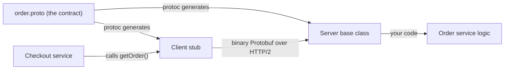

**Why teams pick it (the numbers):**
- A small order message is about 10 bytes in Protobuf and about 56 bytes as JSON (we measured it below).
- No JSON parsing and no reflection on hot paths, so less CPU per call.
- One connection carries hundreds of calls at once (HTTP/2 multiplexing).
- Streaming in both directions is built in.
- The contract is checked at compile time. A renamed field breaks the build, not production.

**Good and bad:**

| Good | Bad |
|---|---|
| Small, fast messages; low CPU | Not human-readable; curl alone does not work |
| Strict contract and generated code in many languages | Browsers cannot call it directly |
| Streaming both ways, deadlines, cancellation built in | L4 load balancers spread load badly (see [load balancing](#load-balancing-grpc)) |
| Good fit for many small internal calls | Teams must learn Protobuf rules and tooling |

**Say this in the interview:**

> "gRPC is a contract-first RPC framework. I define services in a .proto file, generate stubs, and calls go as binary Protobuf over HTTP/2.
> I use it between internal services where latency, CPU and strict contracts matter, and where I want streaming or deadlines.
> At the edge, for browsers and partners, I usually keep REST or put a gateway in front."

**They may ask next:**
- **Who made gRPC?** Google open-sourced it in 2015. It is a CNCF project now.
- **Is gRPC only for HTTP/2?** The standard transport is HTTP/2. Browsers use gRPC-Web or Connect, which also work over HTTP/1.1.
- **Does gRPC need Protobuf?** Protobuf is the default and what everyone uses. Other formats are possible but rare.

### HTTP/2: the road gRPC runs on

**In one line:** HTTP/2 sends many requests at the same time over one TCP connection, as small binary frames with compressed headers.

**Story:** HTTP/1.1 is a single-lane road with one toll booth. Each car (request) waits for the one in front. Browsers open about 6 lanes per site to cope.
HTTP/2 is a road where many cars from different families share all the lanes. Each car has a family tag (a *stream id*), so the families get sorted out at the other end.

**How it works:**
1. **One connection, many streams.** Each request-response is a *stream* with its own number. One TCP connection can carry many streams at once (*multiplexing*). Each side caps it with `SETTINGS_MAX_CONCURRENT_STREAMS`. The RFC suggests at least 100, and many servers and proxies use about 100–128; some gRPC servers set no limit by default, so check yours.
2. **Binary framing.** Data is cut into *frames*: `HEADERS`, `DATA`, `SETTINGS`, `PING`, `GOAWAY`, `RST_STREAM`, `WINDOW_UPDATE`. Frames from different streams can be mixed on the wire.
3. **Header compression (HPACK).** Both sides keep a table of headers already sent. Repeated headers like `:authority` or `content-type` become a small number.
4. **Flow control.** Each stream and the whole connection have a window. A slow reader stops a fast writer without blocking other streams.
5. **How gRPC uses it:**
   - The path is the method: `POST /shop.order.v1.OrderService/GetOrder`.
   - `content-type: application/grpc`.
   - Each message has a 5-byte prefix: 1 byte "compressed?" flag and 4 bytes length.
   - The result comes in *trailers* (headers sent after the body): `grpc-status` and `grpc-message`. The HTTP status is normally 200 even when the call failed.

**Diagram:**

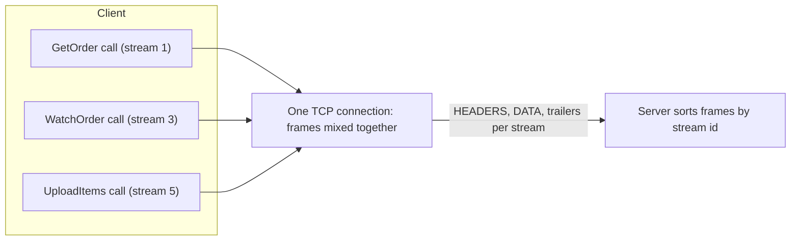

**One limit to know:** HTTP/2 removes head-of-line blocking at the HTTP level, but not at the TCP level. If one TCP packet is lost, all streams on that connection wait. HTTP/3 (QUIC over UDP) fixes this. gRPC over HTTP/3 is not the standard transport yet in most libraries.

**Good and bad:**

| Good | Bad |
|---|---|
| Fewer connections, less TLS handshake cost | One lost packet slows every stream (TCP head-of-line) |
| Small headers after the first request | Long-lived connections confuse L4 load balancers |
| Server can send many responses on one stream | Some old proxies and firewalls only speak HTTP/1.1 |

**Say this in the interview:**

> "HTTP/2 multiplexes many streams over one TCP connection, using binary frames and HPACK header compression.
> gRPC maps each call to one stream. The method is the path, messages are length-prefixed in DATA frames, and the status comes in trailers.
> The side effect is long-lived connections, which matters for load balancing."

**They may ask next:**
- **Why does gRPC need trailers?** In streaming, the status is known only at the end, after all messages. Trailers carry it.
- **What is GOAWAY?** A frame where the server says "finish your current calls, then open a new connection". Used for graceful shutdown and max connection age.

### Protocol Buffers: the message format

**In one line:** Protobuf is a binary format where each field is sent as a small number tag plus its value, not as a name.

**Story:** A railway reservation form. Box 1 is the name, box 2 is the age, box 3 is the berth. The clerk does not write "Name:" each time. Both sides know box 1 is the name. If a box is empty, it is skipped.

**How it works:**
1. You define messages in a `.proto` file. Each field has a type, a name and a **field number**.
2. On the wire, only the field number and a *wire type* (how to read the value) are sent, packed into one *tag*: `tag = (field_number << 3) | wire_type`.
3. Numbers use *varint* encoding: small numbers take fewer bytes. Field numbers 1 to 15 fit the tag in one byte, so use them for the most frequent fields.
4. Strings and nested messages are sent as length + bytes.
5. In proto3, a field equal to its default (0, "", false) is not sent at all. Use `optional` when you must know "not set" vs "set to 0".
6. Unknown field numbers are skipped and kept by the parser. That is what makes adding fields safe.

**Example (`order.proto`, we ran it with Node and `@grpc/grpc-js`):**

```protobuf
syntax = "proto3";
package shop.order.v1;                       // version in the package name
option java_multiple_files = true;
option java_package = "com.shop.order.v1";

message Order {
  string id = 1;                             // field number, not the name, goes on the wire
  int64 total_paise = 2;                     // money as integer paise, never float
  Status status = 3;
  repeated Item items = 4;                   // a list
  optional string coupon = 5;                // can tell "not set" from ""
  reserved 6;                                // number of a deleted field, never reuse
  reserved "gift_note";
}

enum Status {
  STATUS_UNSPECIFIED = 0;                    // first value must be 0 = "unknown"
  STATUS_PLACED = 1;
  STATUS_SHIPPED = 2;
}

message Item { string sku = 1; int32 qty = 2; }
```

**The wire format in simple words.** We encoded `Order{id:"42", total_paise:49900, status:PLACED}` with protobufjs:

```text
0a 02 34 32     field 1, length-delimited, 2 bytes: "42"
10 ec 85 03     field 2, varint: 49900
18 01           field 3, varint: 1 (STATUS_PLACED)
= 10 bytes.  The same data as JSON with field names: 56 bytes.
```

**Why it is small and fast:**
- No field names on the wire, only small numbers.
- Varints: small values take 1 byte.
- Default values are not sent.
- Parsing is reading numbers and lengths, not scanning text for quotes and commas.

**Editions (the newer syntax):**
- Protobuf now has *editions*. The file starts with `edition = "2023";` instead of `syntax = "proto3";`.
- Editions replace the fixed proto2/proto3 rules with *features* (switches) that each have a default, for example `field_presence`.
- protobuf.dev says the latest released edition is **2024**. Edition 2023 needs protoc 27 or newer; edition 2024 needs protoc 32 or newer. Edition 2026 was announced in July 2026 and is still being built, so check protobuf.dev before using it.
- The wire format does not change. A proto3 file and an editions file can import each other.
- proto3 files still work and most gRPC examples still use proto3. In an interview, know proto3 well and say "editions replace the syntax keyword with feature flags".

**Good and bad:**

| Good | Bad |
|---|---|
| Often several times smaller than JSON | You need the schema to read the bytes |
| Generated, typed classes in many languages | Generated code is big; builds need a plugin |
| Safe evolution with field numbers | Rules are strict (never reuse numbers) |
| JSON mapping exists for debugging and gateways | Hard limit of about 2 GB per message; real limits are much lower |

**Say this in the interview:**

> "Protobuf sends field numbers, not names. Each field is a small tag plus a value, numbers are varints, and default values are skipped, so messages are much smaller than JSON.
> The field number is the real identity of a field. Unknown fields are skipped, which is why adding fields is safe and reusing numbers is never safe.
> Newer files can use editions, which turn proto2 and proto3 rules into feature flags with the same wire format."

**They may ask next:**
- **Why money as `int64 total_paise` and not `double`?** Floating point cannot store 0.1 exactly. Use integer minor units or `google.type.Money`.
- **What are well-known types?** Ready messages like `google.protobuf.Timestamp`, `Duration`, `Empty`, `Any` and wrapper types (`Int32Value`) for nullable numbers.

### Schema evolution: changing .proto files safely

**In one line:** Never change or reuse a field number; add new fields with new numbers, and `reserve` the numbers and names of deleted fields.

**Story:** A cricket team gives each player a jersey number. If player 7 retires, you retire jersey 7 too. If a new player takes 7, old scorecards now point to the wrong man. Field numbers are jersey numbers.

**How it works:**
- **Backward compatible:** new code can read old data (old messages, old clients).
- **Forward compatible:** old code can read new data. It skips fields it does not know.
- With Protobuf you get both, if you follow the rules below.
- Services deploy at different times. For some minutes, old and new versions talk to each other. Both directions must work.

**The rules (from protobuf.dev "Updating a message type"):**

| Change | Safe? | Why |
|---|---|---|
| Add a field with a new number | Yes | Old readers skip it; new readers see the default |
| Delete a field and `reserved` its number and name | Yes | Nobody can reuse the number by mistake |
| Delete a field without `reserved` | Risky | Someone may reuse the number later |
| Reuse an old field number | **Never** | Old data is read as the wrong field |
| Change a field's number | No | Same as delete + add; data is lost |
| Rename a field | Binary: yes. JSON: no | Binary uses numbers; JSON mapping uses names |
| `int32` to `int64` (and `uint32`, `uint64`, `bool`) | Yes, with care | Same varint type; big values get cut on old readers |
| `int32` to `string` | No | Different wire type |
| Add an enum value | Yes | proto3 enums are open; old code sees an unknown number |
| Remove an enum value | Reserve it | Same rule as fields |
| Move an existing field into a `oneof` | No | Can lose data |
| Add a new `oneof` with new fields | Yes | New fields, new numbers |
| Rename a service, method or package | No | The URL path `/package.Service/Method` changes |

**`oneof` in one line:** a set of fields where at most one is set. Setting one clears the others. Good for "pay by card OR UPI OR wallet".

**Diagram:**

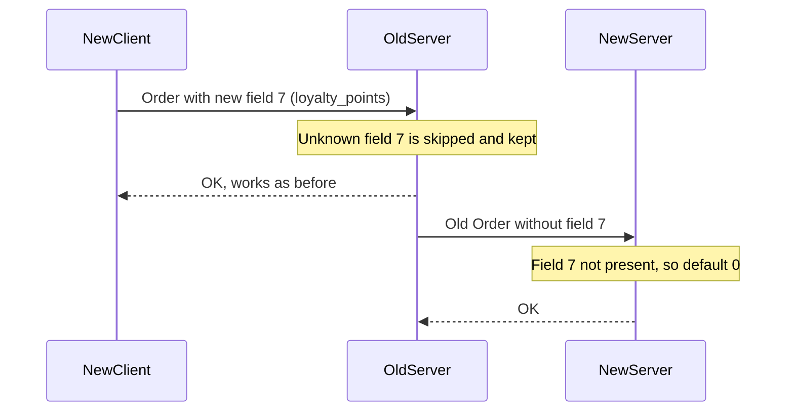

**Example (deleting a field the right way):**

```protobuf
message Customer {
  reserved 4, 9 to 11;            // numbers of deleted fields
  reserved "fax", "pager";        // names too, so JSON stays safe
  string id = 1;
  string name = 2;
  string email = 3;
  string phone = 12;              // new fields always get new numbers
}
```

**Check it in CI:** run a breaking-change checker such as `buf breaking --against '.git#branch=main'` on every pull request. It fails the build if someone reuses a number or changes a type.

**Big changes:** if the meaning of a message really changes, create a new package version: `shop.order.v2`. Run v1 and v2 side by side until clients move.

**Say this in the interview:**

> "The field number is the contract, not the name. I only add new fields with new numbers, I reserve numbers and names when I delete, and I never reuse them.
> Enums start with an UNSPECIFIED zero value. Old code skips unknown fields, so rolling deploys work in both directions.
> I run buf breaking in CI, and for a real breaking change I create a v2 package and run both."

**They may ask next:**
- **Is `required` allowed?** Not in proto3. Required fields made evolution painful in proto2. Validate in code or with `protovalidate`.
- **Why `STATUS_UNSPECIFIED = 0`?** A field not sent reads as 0. You want 0 to mean "unknown", not a real business state like PLACED.

### Code generation: from .proto to Java and TypeScript

**In one line:** `protoc` (or `buf`) reads the `.proto` file and plugins write message classes and client/server stubs for each language, usually during the build.

**Story:** An architect draws one house plan. The carpenter, the plumber and the electrician each get their own copy, in their own language. Nobody draws it again by hand.

**How it works:**
1. Put `.proto` files in one place: `src/main/proto` in a Java project, or a shared contracts repo.
2. The build runs `protoc` with plugins:
   - Java messages: built into `protoc`.
   - Java gRPC stubs: `protoc-gen-grpc-java` creates `OrderServiceGrpc` with `OrderServiceImplBase` and stubs.
   - TypeScript: `ts-proto` or `protoc-gen-es` (Connect), or load at runtime with `@grpc/proto-loader`.
3. In Spring Boot 4.1, Spring Initializr adds the `io.github.ascopes:protobuf-maven-plugin` when you pick gRPC.
4. Generated code goes to `target/generated-sources`. Never edit it.
5. Share contracts by a shared repo, a published jar/npm package, or a schema registry such as the Buf Schema Registry.

**Diagram:**

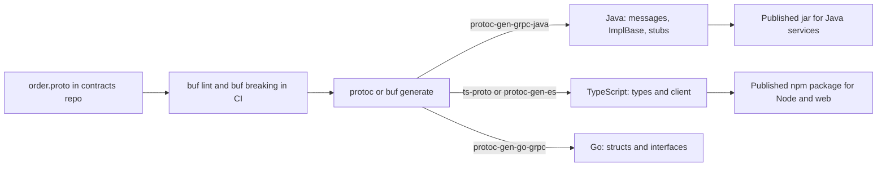

**What Java generates for `OrderService`:**
- `OrderServiceGrpc.OrderServiceImplBase`: the server extends it.
- `OrderServiceGrpc.newBlockingStub(channel)`: simple, waits for the answer. Fine with virtual threads.
- `OrderServiceGrpc.newStub(channel)`: async with `StreamObserver` callbacks. Needed for client and bidirectional streaming.
- `OrderServiceGrpc.newFutureStub(channel)`: returns a `ListenableFuture` (unary only).

**Good and bad:**

| Good | Bad |
|---|---|
| One source of truth for many languages | Build setup per language |
| Type errors at compile time | Version drift if teams copy `.proto` files around |
| Breaking-change checks are possible | Large generated files in IDE search |

**Say this in the interview:**

> "Contracts live in one repo. CI runs buf lint and buf breaking, then generates code with protoc plugins for each language.
> In Java the Maven protobuf plugin generates messages and the OrderServiceImplBase and stubs at build time. Generated code is never edited or committed.
> Teams consume the contract as a versioned jar or npm package."

**They may ask next:**
- **Commit generated code or not?** Usually not for Java (the build makes it). Some Go teams commit it. Pick one and be consistent.
- **Who owns the `.proto`?** The server team owns it. Clients send changes as pull requests.

### The four kinds of RPC

**In one line:** gRPC has four call shapes: unary (one in, one out), server streaming, client streaming and bidirectional streaming.

**Story:** Four ways to talk at a bank.
- **Unary:** you ask the balance, the clerk tells you. Done.
- **Server streaming:** you ask for a statement, the printer sends page after page.
- **Client streaming:** you hand over a pile of cheques one by one, and at the end get one receipt.
- **Bidirectional:** a phone call with your relationship manager. Both talk when they want.

**The contract (one service, all four shapes):**

```protobuf
service OrderService {
  rpc GetOrder(GetOrderRequest) returns (Order);                  // unary
  rpc WatchOrder(WatchOrderRequest) returns (stream OrderEvent);  // server streaming
  rpc UploadItems(stream Item) returns (UploadSummary);           // client streaming
  rpc Chat(stream ChatMessage) returns (stream ChatMessage);      // bidirectional
}
```

#### Unary

One request, one response. 90% of real gRPC calls look like this.

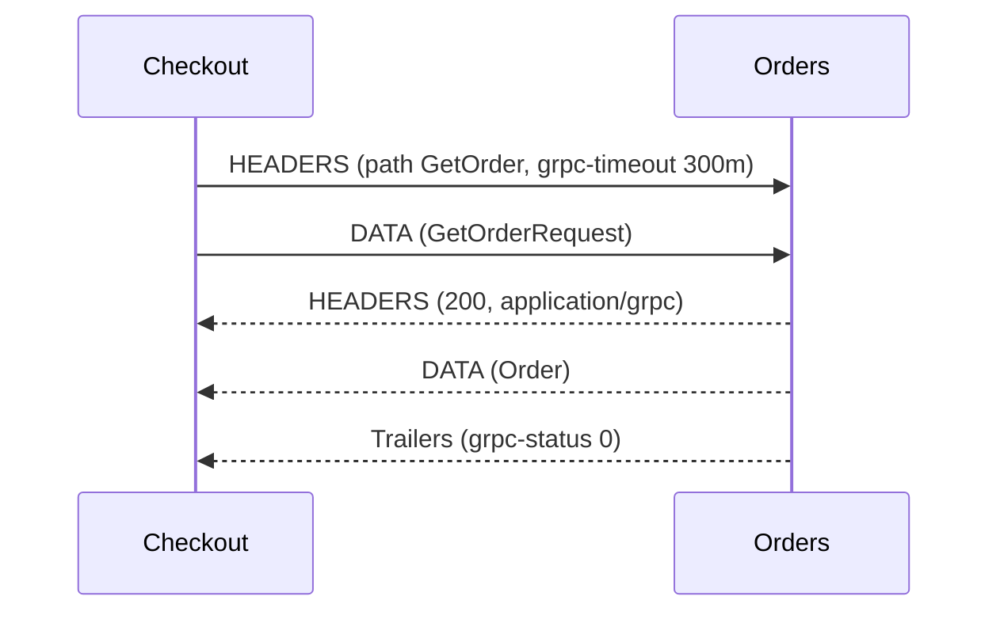

#### Server streaming

One request, many responses, then a status. Good for live order tracking, a price feed or a large result sent in chunks.

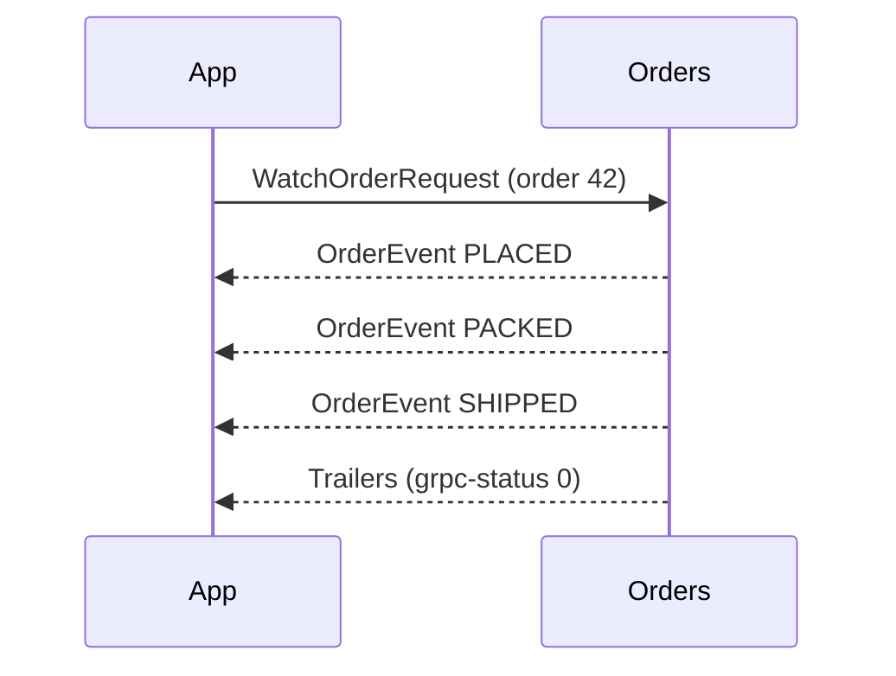

#### Client streaming

Many requests, one response. Good for uploads, bulk import, or sending metrics in batches.

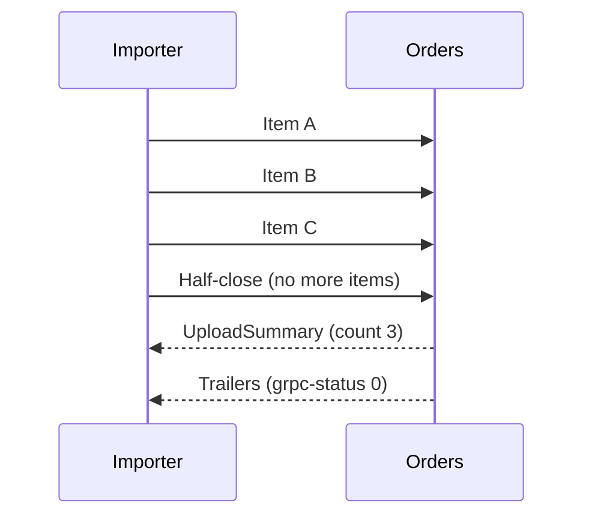

#### Bidirectional streaming

Both sides send any time on one stream. The two directions are independent. Good for chat, live collaboration, or a long-running worker that gets tasks and sends results.

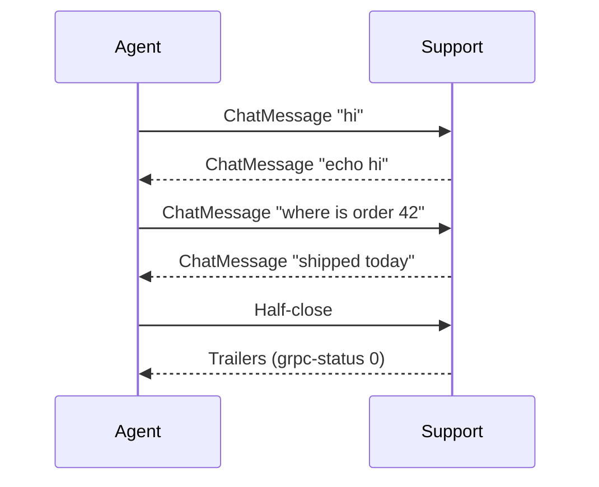

**Things that go wrong with streams:**
- **Long streams and deploys.** A stream lives on one connection. When the pod stops, the stream breaks. Clients must reconnect and resume from the last event id.
- **Backpressure.** If the client reads slowly, HTTP/2 flow control stops the server. In grpc-java, check `isReady()` and use `setOnReadyHandler` before writing more.
- **Deadlines on streams.** A deadline covers the whole stream. For a watch that lasts hours, use a long deadline plus keepalive, or reopen it from time to time.
- **Load balancing.** A long stream pins one backend. Many long streams on one pod make it hot.

**Good and bad:**

| Shape | Good for | Watch out |
|---|---|---|
| Unary | Normal request-response | Nothing special; set a deadline |
| Server streaming | Feeds, watches, big results in chunks | Reconnect and resume after deploys |
| Client streaming | Uploads, bulk import | Server sees the result only at the end |
| Bidirectional | Chat, live sync, worker protocols | Hardest to test; browsers cannot do it with gRPC-Web |

**Say this in the interview:**

> "gRPC has unary, server streaming, client streaming and bidirectional streaming. Each call is one HTTP/2 stream, and the status comes at the end in trailers.
> I use unary for most calls, server streaming for watches and feeds, client streaming for uploads, and bidi for chat-like or worker protocols.
> With streams I plan for backpressure, reconnect with resume, and the fact that a long stream pins one backend."

**They may ask next:**
- **Streaming vs paging?** Paging is simpler and works with any client. Streaming wins when data arrives over time or is very large.
- **Is message order kept inside a stream?** Yes, inside one stream messages arrive in order. Across different streams, no order is promised.

### Deadlines, timeouts and cancellation

**In one line:** A deadline is the time by which the whole call must finish; gRPC passes it down the call chain and cancels work when it runs out.

**Story:** You order lunch and must leave for a meeting at 1:00. You tell the waiter "I must leave at 1". The waiter tells the kitchen "this table leaves at 1". If it is 12:59 and the dish is not ready, the kitchen stops cooking it. No food is wasted on a guest who left.

**How it works:**
1. **By default gRPC sets no deadline.** A call can wait forever. Always set one on the client.
2. *Timeout* is a duration ("300 ms"). *Deadline* is a point in time ("12:00:00.300"). gRPC sends it as the `grpc-timeout` header, so clock differences do not matter.
3. The server sees the remaining time. In Java and Go, a new call made inside the handler uses the same deadline automatically (*propagation*), because it is in the gRPC `Context`.
4. When time runs out, the client gets `DEADLINE_EXCEEDED`. The server call is cancelled. Your server code must check `isCancelled()` and stop long work.
5. Cancellation also flows: if the user closes the app, the client cancels, and the cancel goes down the chain.

**Diagram (deadline propagation):**

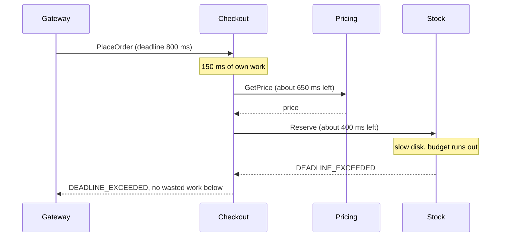

**Example (Java client and a server that respects cancellation):**

```java
// Client: always set a deadline per call
Order order = orderStub
    .withDeadlineAfter(300, TimeUnit.MILLISECONDS)   // the important line
    .getOrder(GetOrderRequest.newBuilder().setOrderId("42").build());

// Server: stop work when the client gave up
@Override
public void exportOrders(ExportRequest req, StreamObserver<Order> out) {
    var call = (ServerCallStreamObserver<Order>) out;
    for (Order o : repo.streamAll()) {
        if (call.isCancelled()) return;              // deadline passed or client left
        out.onNext(o);
    }
    out.onCompleted();
}
```

**Picking numbers:** start from what the user can wait (for example 1 s for a page), then give each hop a part. Measure p99 latency of each service and set the deadline a bit above it. See [Timeouts](microservices.md#timeouts) for budgets in general.

**Good and bad:**

| Good | Bad |
|---|---|
| Deadline per call, passed down the chain | No deadline: threads and connections pile up during an outage |
| Server checks cancellation in loops | Server ignores cancel and keeps hitting the database |
| Budget shrinks at each hop | Each hop sets its own fresh 30 s timeout |

**Say this in the interview:**

> "gRPC has no deadline by default, so I set one on every client call. The deadline travels in the grpc-timeout header, and in Java it propagates through the Context to downstream calls, so each hop sees only the remaining budget.
> When it expires the client gets DEADLINE_EXCEEDED and the server call is cancelled, so long server work must check isCancelled.
> This stops a slow service from holding resources across the whole chain."

**They may ask next:**
- **How do I stop propagation for background work?** In grpc-java, use `Context.current().fork().run(...)`. A forked context keeps the values but is not cancelled with the request.
- **Deadline vs circuit breaker?** A deadline bounds one call. A [circuit breaker](microservices.md#circuit-breaker) stops calling a service that keeps failing. Use both.

### Status codes and the rich error model

**In one line:** Every gRPC call ends with one of 17 status codes; for structured details you send a `google.rpc.Status` with typed details.

**Story:** A courier gives fixed reasons when a parcel is not delivered: "address not found", "nobody home, try again", "refused". A fixed short list means every courier office understands it. For extra detail they attach a slip with the exact problem.

**How it works:**
1. The status code goes in the `grpc-status` trailer. The text goes in `grpc-message`.
2. Some codes come only from your code (INVALID_ARGUMENT, NOT_FOUND, ALREADY_EXISTS, FAILED_PRECONDITION, ABORTED, OUT_OF_RANGE, DATA_LOSS). Others also come from the library (UNAVAILABLE, DEADLINE_EXCEEDED, CANCELLED...).
3. For details, the *rich error model* puts a `google.rpc.Status` (code, message, list of `Any` details) into the `grpc-status-details-bin` trailer. Standard detail types are in `google/rpc/error_details.proto`: `ErrorInfo`, `BadRequest`, `RetryInfo`, `QuotaFailure`, `PreconditionFailure`, `ResourceInfo`, `DebugInfo`.

**The codes you must know, with the HTTP code a gateway would use (from `google/rpc/code.proto`):**

| gRPC code | Number | Meaning | Retry? | HTTP |
|---|---|---|---|---|
| OK | 0 | Success | - | 200 |
| CANCELLED | 1 | Caller cancelled | No | 499 |
| UNKNOWN | 2 | Unknown error (often an uncaught exception) | No | 500 |
| INVALID_ARGUMENT | 3 | Bad input, no matter the state | No | 400 |
| DEADLINE_EXCEEDED | 4 | Time ran out | Maybe, if idempotent | 504 |
| NOT_FOUND | 5 | Resource does not exist | No | 404 |
| ALREADY_EXISTS | 6 | Create failed, it exists | No | 409 |
| PERMISSION_DENIED | 7 | Known caller, not allowed | No | 403 |
| RESOURCE_EXHAUSTED | 8 | Quota, rate limit, or message too large | Later, with backoff | 429 |
| FAILED_PRECONDITION | 9 | System not in the right state | Not until fixed | 400 |
| ABORTED | 10 | Concurrency conflict | Yes, at a higher level | 409 |
| UNIMPLEMENTED | 12 | Method not there | No | 501 |
| INTERNAL | 13 | Server bug, broken invariant | No | 500 |
| UNAVAILABLE | 14 | Server down or overloaded; transient | **Yes, with backoff** | 503 |
| UNAUTHENTICATED | 16 | No or bad credentials | No | 401 |

(OUT_OF_RANGE 11 and DATA_LOSS 15 are the other two.)

**Example (Java: a validation error with field details):**

```java
// needs io.grpc:grpc-protobuf and com.google.api.grpc:proto-google-common-protos
var badRequest = BadRequest.newBuilder()
    .addFieldViolations(BadRequest.FieldViolation.newBuilder()
        .setField("items[0].qty").setDescription("must be between 1 and 10"))
    .build();
var status = com.google.rpc.Status.newBuilder()
    .setCode(Code.INVALID_ARGUMENT.getNumber())
    .setMessage("Order has invalid items")
    .addDetails(Any.pack(badRequest))            // typed detail, readable by any language
    .build();
responseObserver.onError(StatusProto.toStatusRuntimeException(status));

// Client side
catch (StatusRuntimeException e) {
    com.google.rpc.Status s = StatusProto.fromThrowable(e);   // null if no details
}
```

**A Java trap:** in plain grpc-java, if your handler *throws* an exception, the client gets `UNKNOWN`, even if you threw `Status.NOT_FOUND.asRuntimeException()`. Call `responseObserver.onError(...)` instead, or in Spring Boot add `GrpcExceptionHandler` beans (see [gRPC in Java and Spring Boot](#grpc-in-java-and-spring-boot)).

**Good and bad:**

| Good | Bad |
|---|---|
| Specific codes: NOT_FOUND, INVALID_ARGUMENT, UNAVAILABLE | Everything is UNKNOWN or INTERNAL |
| `BadRequest` details for each bad field | Stack traces in `grpc-message` |
| UNAVAILABLE only for transient problems | UNAVAILABLE for a validation error, so clients retry forever |

**Say this in the interview:**

> "gRPC has 17 status codes. The ones I use most are INVALID_ARGUMENT, NOT_FOUND, PERMISSION_DENIED, UNAUTHENTICATED, FAILED_PRECONDITION, DEADLINE_EXCEEDED and UNAVAILABLE. Only UNAVAILABLE is safe to retry blindly.
> For structured errors I use the rich error model: a google.rpc.Status with typed details like BadRequest field violations, sent in the grpc-status-details-bin trailer.
> At a REST gateway these map to HTTP codes, like NOT_FOUND to 404 and UNAVAILABLE to 503."

**They may ask next:**
- **INVALID_ARGUMENT vs FAILED_PRECONDITION?** INVALID_ARGUMENT: wrong no matter what (negative quantity). FAILED_PRECONDITION: fine input, wrong state (cancel an order that already shipped).
- **Why is the HTTP status 200 when the call failed?** The HTTP response itself worked. The gRPC result is in the trailers.

### Metadata and interceptors

**In one line:** Metadata is gRPC's headers, and interceptors are middleware that run on every call for auth, logging, tracing and metrics.

**Story:** A parcel has the item inside and a label outside: sender, tracking number, "fragile". The label is metadata. At each sorting centre, a worker scans every label before the parcel moves on. That worker is an interceptor.

**How it works:**
1. **Metadata** keys are lowercase ASCII. Keys that end in `-bin` carry binary values. Keys that start with `grpc-` are reserved.
2. Clients send metadata with the request (`authorization`, `x-request-id`, `traceparent`). Servers can send *header* metadata at the start and *trailer* metadata at the end.
3. **Server interceptors** wrap every incoming call. Typical chain: tracing, then auth, then logging, then metrics.
4. **Client interceptors** wrap every outgoing call: add a token, add a request id, record latency.
5. In grpc-java, an interceptor puts values (like the user id) into the gRPC `Context`, so the handler can read them.

**Diagram:**

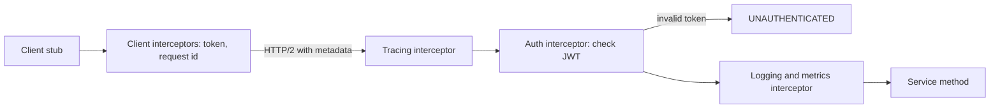

**Example (grpc-java server interceptor for a bearer token):**

```java
public class AuthInterceptor implements ServerInterceptor {
    static final Metadata.Key<String> AUTH =
        Metadata.Key.of("authorization", Metadata.ASCII_STRING_MARSHALLER);
    static final Context.Key<String> USER_ID = Context.key("userId");
    private final TokenVerifier verifier;
    public AuthInterceptor(TokenVerifier verifier) { this.verifier = verifier; }

    @Override
    public <Q, R> ServerCall.Listener<Q> interceptCall(
            ServerCall<Q, R> call, Metadata headers, ServerCallHandler<Q, R> next) {
        String header = headers.get(AUTH);
        String userId = header == null ? null : verifier.verify(header.replace("Bearer ", ""));
        if (userId == null) {
            call.close(Status.UNAUTHENTICATED.withDescription("bad token"), new Metadata());
            return new ServerCall.Listener<>() {};        // stop here, handler never runs
        }
        Context ctx = Context.current().withValue(USER_ID, userId);
        return Contexts.interceptCall(ctx, call, headers, next);   // handler sees USER_ID
    }
}
```

In Spring Boot, register it as a bean with `@GlobalServerInterceptor` (all services) or list it in `@GrpcService(interceptors = ...)` (one service). With Spring Security on the classpath, Boot 4.1 also auto-configures gRPC security, and you can use `@PreAuthorize` on service methods.

**Good and bad:**

| Good | Bad |
|---|---|
| Cross-cutting code in one place | Business logic hidden inside interceptors |
| Trace id and user id passed in metadata | Big payloads in metadata (default limit is 8 KiB in grpc-java) |
| Order of interceptors written down | Auth after logging, so bad requests log full tokens |

**Say this in the interview:**

> "Metadata is gRPC's headers: authorization, request id, traceparent. Binary values use keys ending in -bin.
> Interceptors are the middleware. On the server I chain tracing, auth, logging and metrics; the auth interceptor closes the call with UNAUTHENTICATED or puts the user id in the gRPC Context.
> In Spring gRPC I register them with @GlobalServerInterceptor or per service on @GrpcService."

**They may ask next:**
- **Where do request-scoped values live in grpc-java?** In `io.grpc.Context`, not a `ThreadLocal` you manage. It follows the call across threads.
- **How do I send something back besides the message?** Response headers or trailers metadata, for example a server-timing value.

### Retries and hedging with service config

**In one line:** gRPC can retry failed calls or send backup copies (hedging) by itself, set per method in a JSON service config.

**Story:** You call a pizza shop. The line is busy, so you try again after a short wait. That is a retry. Hedging is calling two branches of the same shop when the first is slow, and taking whichever answers first. You must be sure you only pay once.

**How it works:**
1. **Retry policy** (per method): `maxAttempts`, `initialBackoff`, `maxBackoff`, `backoffMultiplier`, `retryableStatusCodes`. gRPC adds about ±20% jitter to the waits.
2. A call is retried only before it is *committed*: once response headers arrive, gRPC will not retry it.
3. **Hedging policy:** `maxAttempts`, `hedgingDelay`, `nonFatalStatusCodes`. gRPC sends a copy after `hedgingDelay` if no answer yet, and takes the first success. `maxAttempts` above 5 is treated as 5.
4. **Retry throttling:** each client keeps a token count per server. Failures take a token, successes add a little back. Below half, retries stop. This prevents a retry storm.
5. Hedging support differs by language: grpc-java has it; check your language before relying on it.
6. Only retry or hedge **idempotent** calls (safe to run twice), or calls that carry an [idempotency key](microservices.md#idempotency).

**Example (service config, Java channel):**

```java
Map<String, ?> serviceConfig = Map.of("methodConfig", List.of(Map.of(
    "name", List.of(Map.of("service", "shop.order.v1.OrderService", "method", "GetOrder")),
    "timeout", "1s",
    "retryPolicy", Map.of(
        "maxAttempts", 3.0,                       // numbers are doubles, like parsed JSON
        "initialBackoff", "0.1s",
        "maxBackoff", "1s",
        "backoffMultiplier", 2.0,
        "retryableStatusCodes", List.of("UNAVAILABLE")))));   // only transient errors

ManagedChannel channel = ManagedChannelBuilder.forTarget("dns:///orders:9090")
    .defaultServiceConfig(serviceConfig)
    .enableRetry()
    .usePlaintext()                                   // inside a mesh that adds mTLS
    .build();
```

**Diagram (hedging):**

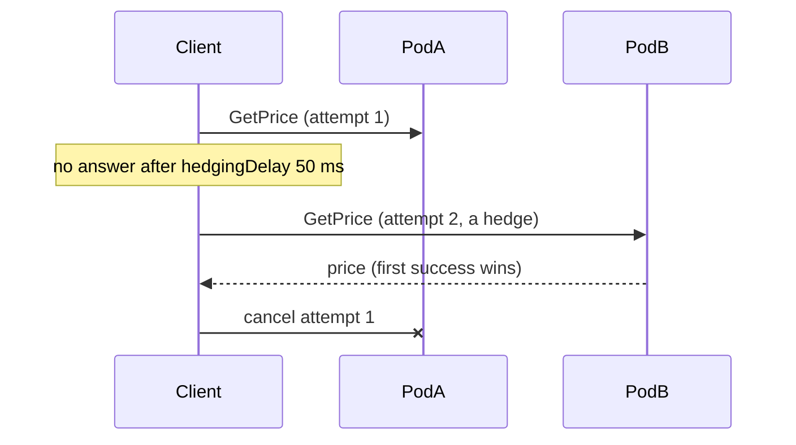

**Good and bad:**

| Good | Bad |
|---|---|
| Retry only UNAVAILABLE, with backoff | Retry DEADLINE_EXCEEDED on a payment without an idempotency key |
| Retry throttling on | Retries at every layer: 3 × 3 × 3 = 27 calls to the bottom service |
| Hedging for read-only calls with long-tail latency | Hedging writes |

**Say this in the interview:**

> "gRPC has built-in retries and hedging, set per method in the service config. I retry only UNAVAILABLE with exponential backoff and a small max attempts, and keep retry throttling on to avoid retry storms.
> Hedging sends a second copy after a short delay and takes the first answer; I only use it for idempotent reads with a long p99 tail.
> And I retry at one layer only, usually the caller closest to the failure."

**They may ask next:**
- **Can the server tell the client to stop retrying?** Yes, with the `grpc-retry-pushback-ms` trailer.
- **How does this compare to Resilience4j?** Same idea. Built-in gRPC retries know when a call is committed. See [Retry with backoff and jitter](microservices.md#retry-with-exponential-backoff-and-jitter).

### Load balancing gRPC

**In one line:** gRPC uses one long-lived connection, so an L4 load balancer sends all calls to one pod; balance per call in the client or an L7 proxy.

**Story:** A company sends all its staff to a canteen with 5 counters. The guard assigns a counter when the bus arrives, not per person. One full bus (one connection) goes to one counter, and four counters stay idle. You need someone who sends each person (each call) to the shortest queue.

**Why L4 breaks:**
1. An L4 load balancer (like a Kubernetes `ClusterIP` Service with kube-proxy) picks a pod when the **TCP connection** opens.
2. HTTP/1.1 clients open many short connections, so load spreads out.
3. A gRPC client opens **one** connection and sends thousands of calls on it. All go to the same pod.
4. New pods after a scale-up get no traffic, because old connections never move.

**The fixes:**
- **Client-side LB (thick client):** the client gets all pod IPs and picks one per call (`round_robin`).
  - In Kubernetes, use a **headless Service** (`clusterIP: None`). DNS then returns all pod IPs, not one virtual IP.
  - Target `dns:///orders-headless.shop.svc.cluster.local:9090` with the `round_robin` policy. grpc-java's default is `pick_first`; Spring Boot 4.1 channels default to `round_robin`.
  - Set server `MAX_CONNECTION_AGE` (for example 5 minutes), so clients reconnect and see new pods. DNS is not polled all the time.
- **Proxy (L7) LB:** Envoy, NGINX, an L7 cloud load balancer, or a gRPC-aware ingress. The proxy understands HTTP/2 and balances each stream. One extra hop.
- **Service mesh:** Istio or Linkerd put an L7 sidecar (or node proxy) next to each pod. It balances per call and adds mTLS. See [Service mesh](microservices.md#service-mesh-and-sidecar).
- **Look-aside LB with xDS:** a control plane (for example Istio's istiod or Traffic Director) sends the endpoint list and policies to the gRPC client using the xDS protocol. The client balances by itself. This is *proxyless* gRPC: no sidecar hop.

**Diagram:**

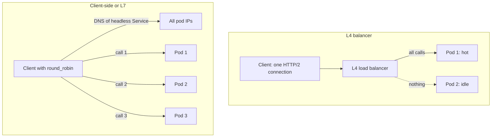

**Example (Kubernetes headless Service + Spring Boot channel):**

```yaml
apiVersion: v1
kind: Service
metadata: { name: orders-headless, namespace: shop }
spec:
  clusterIP: None              # headless: DNS returns every pod IP
  selector: { app: orders }
  ports: [{ name: grpc, port: 9090 }]
```

```properties
spring.grpc.client.channel.orders.target=dns:///orders-headless.shop.svc.cluster.local:9090
spring.grpc.client.channel.orders.default.load-balancing-policy=round_robin
# on the orders server: force reconnects so new pods get traffic
spring.grpc.server.keepalive.connection.max-age=5m
```

**Good and bad:**

| Option | Good | Bad |
|---|---|---|
| Client-side + headless DNS | No extra hop, simple | Every language does it; slow to notice new pods |
| L7 proxy (Envoy, ingress) | Clients stay simple | Extra hop and one more thing to run |
| Service mesh | Per-call LB, mTLS, retries for all services | CPU and memory per pod, more moving parts |
| Proxyless xDS | Mesh features without sidecar | Newer; needs a control plane |

**Say this in the interview:**

> "gRPC multiplexes all calls over one long-lived connection, so an L4 balancer like a ClusterIP Service pins a client to one pod and new pods stay idle.
> I balance per call instead: client-side round_robin over a headless Service, or an L7 proxy like Envoy, or a service mesh. For proxyless setups the client gets endpoints from an xDS control plane.
> I also set max connection age on the server so clients reconnect and spread over new pods."

**They may ask next:**
- **How does the client learn about a new pod?** DNS is resolved again when a connection drops or GOAWAY arrives. That is why max connection age helps. xDS pushes changes directly.
- **Does a mesh fix it without code changes?** Yes. The sidecar terminates HTTP/2 and balances each request. See [Service mesh: Istio and Linkerd](docker-kubernetes.md#service-mesh-istio-and-linkerd).

### Keepalive and connection management

**In one line:** Keepalive pings find dead connections and keep idle ones alive; max connection age makes clients reconnect and rebalance.

**Story:** On a long phone call with silence, you say "hello, are you there?" every few minutes. If nobody answers, you hang up and call again, instead of waiting forever on a dead line.

**How it works:**
1. The client sends a `PING` after `KEEPALIVE_TIME` with no activity. If no answer in `KEEPALIVE_TIMEOUT` (default 20 s), the connection is closed and calls fail fast with UNAVAILABLE.
2. Client keepalive is **off by default** in gRPC core. Spring Boot 4.1 client channels set 5 minutes by default.
3. The server has an enforcement policy: by default it allows pings at most every 5 minutes. A client that pings more often gets `GOAWAY` with `too_many_pings`.
4. Server connection limits:
   - `MAX_CONNECTION_IDLE`: close connections with no calls for a while.
   - `MAX_CONNECTION_AGE` + grace: close old connections gently with GOAWAY. Helps load balancing and certificate rotation.
5. Clients have *channel idle mode*: after some idle time (Spring Boot default 20 s) the channel releases its connections and reconnects on the next call.

**Diagram:**

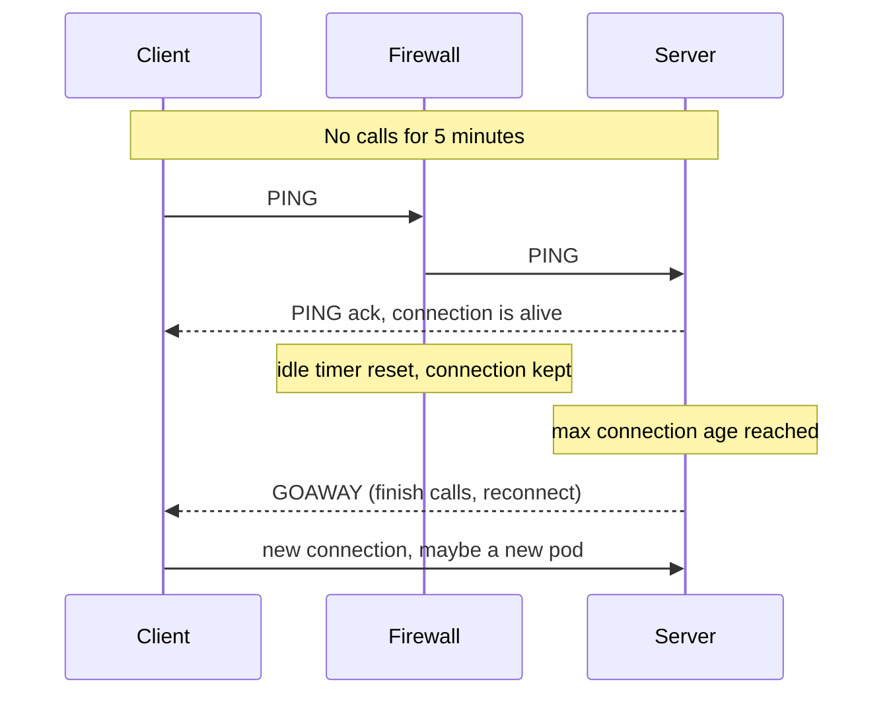

**Example (Spring Boot 4.1 properties):**

```properties
# client: ping after 2 minutes of silence, fail if no ack in 20 s
spring.grpc.client.channel.orders.keepalive.time=2m
spring.grpc.client.channel.orders.keepalive.timeout=20s
# server: allow client pings every 1 minute (default is 5 minutes)
spring.grpc.server.keepalive.permit.time=1m
spring.grpc.server.keepalive.connection.max-age=5m
spring.grpc.server.keepalive.connection.grace-period=30s
```

**Good and bad:**

| Good | Bad |
|---|---|
| Client ping interval agreed with the server owner | Client pings every 10 s, server sends GOAWAY too_many_pings |
| Max connection age for rebalancing | Max age so short that clients reconnect all the time |
| Keepalive under the cloud LB idle timeout (often 60 to 350 s) | Idle connections silently dropped, first call after idle hangs |

**Say this in the interview:**

> "Keepalive sends HTTP/2 pings to detect dead connections and to stop NATs and load balancers from dropping idle ones. Client keepalive is off by default in gRPC, and servers reject pings more often than every 5 minutes unless you allow it.
> On the server I set max connection age with a grace period, so clients reconnect regularly. That helps rebalancing after scale-up and certificate rotation."

**They may ask next:**
- **What does `too_many_pings` mean?** The client pings more often than the server's permit time. Raise the client interval or lower the server's permit time.
- **Why does the first call after a long idle time hang?** A proxy dropped the connection silently. Keepalive or a short deadline fixes it.

### Security: TLS, mTLS and call credentials

**In one line:** TLS encrypts, mTLS proves which service is calling, and a token in metadata (call credentials) proves which user is calling.

**Story:** A bank vault. The armoured van (TLS) protects the cash on the road. The guard checks the van driver's ID and the driver checks the guard's ID (mTLS). Inside, each bag has a signed slip saying whose money it is (the token).

**How it works:**
1. **TLS (server auth):** the client checks the server certificate. All traffic is encrypted. Use it for anything that crosses a network you do not fully trust.
2. **mTLS:** the server also checks a client certificate. Now the server knows *which service* is calling. Meshes like Istio and Linkerd do this automatically with short-lived certificates.
3. **Call credentials:** per-call tokens in metadata (`authorization: Bearer ...`). They answer *which user* or *which client app*. In Java this is `CallCredentials`; in Node, `credentials.createFromMetadataGenerator`.
4. Many gRPC libraries refuse to send call credentials over a plain-text channel, to stop token leaks. In grpc-java it depends on the `CallCredentials` class: Google's ones refuse, and your own should check the channel's security level.
5. Authorization: check scopes or roles in a server interceptor or with `@PreAuthorize`. Do not trust a user id that the caller just puts in a header without a signature.

**Diagram:**

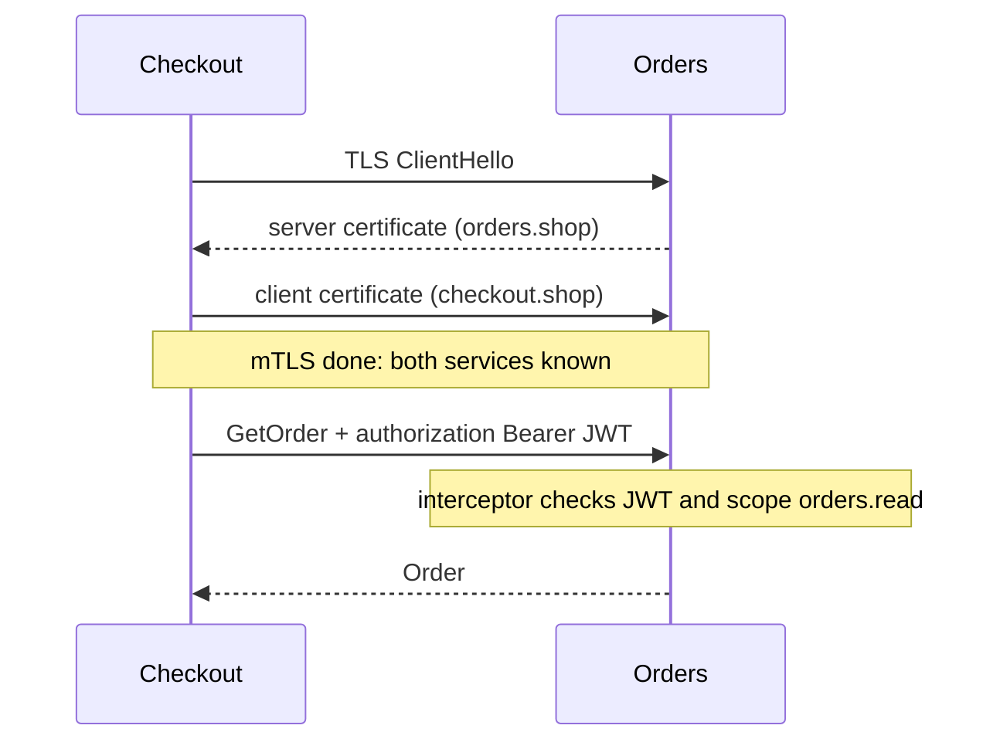

**Example (Spring Boot 4.1, mTLS with an SSL bundle):**

```properties
spring.ssl.bundle.pem.orders.keystore.certificate=classpath:certs/orders.crt
spring.ssl.bundle.pem.orders.keystore.private-key=classpath:certs/orders.key
spring.ssl.bundle.pem.orders.truststore.certificate=classpath:certs/ca.crt
spring.grpc.server.ssl.bundle=orders
# mTLS: client must show a certificate
spring.grpc.server.ssl.client-auth=require

# on the calling service
# its own cert + the CA
spring.grpc.client.channel.orders.ssl.bundle=checkout
```

**Good and bad:**

| Good | Bad |
|---|---|
| mTLS for service identity, JWT for user identity | Plain text between data centres |
| Short-lived certs rotated by a mesh or cert-manager | Certs that expire on a Sunday with no alert |
| Scopes checked per method | `bypass-certificate-validation=true` left on in production |

**Say this in the interview:**

> "For gRPC I separate two questions: which service is calling, and which user. mTLS answers the first; in Kubernetes a service mesh usually does it with rotating certificates. A JWT in the authorization metadata answers the second, attached with call credentials.
> The server checks both in an interceptor or with method security, and tokens are only ever sent over TLS."

**They may ask next:**
- **Is the mesh's mTLS enough?** It proves the service. You still need user-level authorization for user data.
- **How do I rotate certificates without downtime?** Short-lived certs plus max connection age, so new connections pick up the new cert.

### gRPC in Java and Spring Boot

**In one line:** grpc-java is the core library; since Spring Boot 4.1 (June 2026), Boot has its own gRPC starters for server, clients, health and security.

**Story:** grpc-java is a car engine. You can build a car around it yourself. Spring Boot's gRPC support is the full car: engine, seats, dashboard and lights wired already.

**How it got here (verified on spring.io, November 2026):**
- **Spring gRPC 1.0** went GA in December 2025, for Spring Boot 4.0. It had its own Boot starters.
- **Spring Boot 4.1** (June 2026) moved the auto-configuration and starters into Boot. Boot 4.1 manages Spring gRPC 1.1 and grpc-java 1.80.
- The Boot starters are `spring-boot-starter-grpc-server`, `spring-boot-starter-grpc-client`, and test starters `spring-boot-starter-grpc-server-test` / `-client-test`. Spring Initializr adds them as "Spring gRPC Server" and "Spring gRPC Client".
- Older community starters (like `net.devh` grpc-spring-boot-starter) still exist in many codebases. New projects should use Boot's own support.

**How it works:**
1. Put `order.proto` in `src/main/proto`. The protobuf Maven plugin generates classes.
2. Any bean that implements `BindableService` (every generated `ImplBase` does) is exposed. `@GrpcService` marks it and can add interceptors.
3. The server starts on port **9090** by default on Netty (`spring.grpc.server.port`). You can also run gRPC inside Tomcat over HTTP/2 with `grpc-servlet-jakarta`.
4. Clients: `@ImportGrpcClients` creates stub beans for a named channel. Channels are configured with `spring.grpc.client.channel.<name>.*`.
5. Add `io.grpc:grpc-services` to get reflection and the standard health service. Micrometer adds observation interceptors automatically.
6. Exceptions: add `GrpcExceptionHandler` beans to map your exceptions to status codes.

**Example (server, Spring Boot 4.1):**

```java
@GrpcService                                 // any BindableService bean is served on 9090
class OrderGrpcService extends OrderServiceGrpc.OrderServiceImplBase {
    private final OrderRepository repo;
    OrderGrpcService(OrderRepository repo) { this.repo = repo; }

    @Override
    public void getOrder(GetOrderRequest req, StreamObserver<Order> out) {
        var entity = repo.findById(req.getOrderId())
            .orElseThrow(() -> new OrderNotFoundException(req.getOrderId()));
        out.onNext(OrderMapper.toProto(entity));          // entity -> generated message
        out.onCompleted();                                 // status OK in trailers
    }
}

@Configuration
class GrpcErrors {
    @Bean
    GrpcExceptionHandler notFound() {                      // like @ControllerAdvice for gRPC
        return ex -> ex instanceof OrderNotFoundException
            ? Status.NOT_FOUND.withDescription(ex.getMessage()).asException()
            : null;                                        // null = not mine, try the next one
    }
}
```

**Example (client, Spring Boot 4.1):**

```java
@SpringBootApplication
@ImportGrpcClients(target = "orders", types = OrderServiceGrpc.OrderServiceBlockingStub.class)
public class CheckoutApplication {
    public static void main(String[] args) { SpringApplication.run(CheckoutApplication.class, args); }
}

@Service
class CheckoutService {
    private final OrderServiceGrpc.OrderServiceBlockingStub orders;
    CheckoutService(OrderServiceGrpc.OrderServiceBlockingStub orders) { this.orders = orders; }

    Order loadOrder(String id) {
        try {
            return orders.withDeadlineAfter(300, TimeUnit.MILLISECONDS)   // a deadline per call
                .getOrder(GetOrderRequest.newBuilder().setOrderId(id).build());
        } catch (StatusRuntimeException e) {
            if (e.getStatus().getCode() == Status.Code.NOT_FOUND) throw new OrderNotFoundException(id);
            throw e;                                       // UNAVAILABLE etc. go up to the caller
        }
    }
}
```

```properties
spring.grpc.client.channel.orders.target=dns:///orders-headless.shop.svc.cluster.local:9090
# fallback if code forgets one
spring.grpc.client.channel.orders.default.deadline=2s
```

**Plain grpc-java without Spring (for the "what does Boot do for me" question):**

```java
Server server = ServerBuilder.forPort(9090)
    .addService(new OrderGrpcService(repo))
    .intercept(new AuthInterceptor(verifier))
    .build().start();
Runtime.getRuntime().addShutdownHook(new Thread(() -> server.shutdown()));
server.awaitTermination();

ManagedChannel channel = ManagedChannelBuilder.forTarget("dns:///orders:9090")
    .usePlaintext().build();                              // create once, reuse for all calls
var stub = OrderServiceGrpc.newBlockingStub(channel);
```

**Threads and virtual threads:** grpc-java runs handlers on an executor. Blocking stubs are easy to read and work well on Java 21+ virtual threads. Never block inside a Netty event loop thread.

**Testing:** `@AutoConfigureTestGrpcTransport` runs calls in-process with no network port. Or set `spring.grpc.server.port=0` and inject `@LocalGrpcServerPort`.

**Good and bad:**

| Good | Bad |
|---|---|
| One `ManagedChannel` per target, reused | New channel per call: new TCP + TLS every time |
| `GrpcExceptionHandler` for clean status codes | Exceptions thrown and turned into UNKNOWN |
| Deadline on every stub call | Blocking calls on Netty event loop threads |
| Boot's starters on Boot 4.1+ | Mixing Spring gRPC and an old community starter |

**Say this in the interview:**

> "Since Spring Boot 4.1, gRPC is first-class in Boot: spring-boot-starter-grpc-server starts a Netty gRPC server on 9090 and exposes every BindableService bean. Clients are stub beans from @ImportGrpcClients with channels in spring.grpc.client.channel properties.
> Boot also wires health, reflection, Micrometer observations and Spring Security. I map exceptions with GrpcExceptionHandler beans and set a deadline on every call.
> Under it is plain grpc-java: a Server, a ManagedChannel that I create once and reuse, and generated stubs."

**They may ask next:**
- **Blocking stub or async stub?** Blocking for simple unary calls, especially on virtual threads. Async (`newStub`) for client and bidirectional streaming.
- **Can gRPC and REST run in one Spring Boot app?** Yes. REST on 8080 (Tomcat), gRPC on 9090 (Netty), or both on one port with the servlet mode and HTTP/2.

### gRPC in Node.js

**In one line:** Use `@grpc/grpc-js` (pure JavaScript) with `@grpc/proto-loader` to load the `.proto` at runtime, or generate TypeScript types with `ts-proto` or `protoc-gen-es`.

**Story:** The same intercom from the Java kitchen, now installed in the Node.js kitchen next door. Same buttons, same codes. Only the wiring is JavaScript.

**How it works:**
1. `@grpc/grpc-js` (version 1.14 when we tested) implements client and server. The old native `grpc` package is deprecated.
2. `@grpc/proto-loader` reads the `.proto` at runtime. Options matter: `longs: String` (JavaScript numbers lose precision above 2^53), `enums: String`, `defaults: true`.
3. For full TypeScript types, generate code with `ts-proto`, or use Connect (`@connectrpc/connect` with `protoc-gen-es`).
4. Deadlines, metadata, interceptors, credentials and status codes work like in Java.
5. Node is often the BFF (backend for frontend) that calls many gRPC services in parallel. See [Microservices with Node](nodejs.md#microservices-with-node).

**Example (we ran this with Node 24 and @grpc/grpc-js 1.14):**

```js
import grpc from '@grpc/grpc-js';
import protoLoader from '@grpc/proto-loader';

const def = protoLoader.loadSync('order.proto', { longs: String, enums: String, defaults: true });
const { OrderService } = grpc.loadPackageDefinition(def).shop.order.v1;

const server = new grpc.Server();
server.addService(OrderService.service, {
  getOrder(call, cb) {
    if (!call.metadata.get('authorization')[0]) return cb({ code: grpc.status.UNAUTHENTICATED, details: 'no token' });
    if (call.request.orderId !== '42') return cb({ code: grpc.status.NOT_FOUND, details: 'no such order' });
    cb(null, { id: '42', totalPaise: '49900', status: 'STATUS_PLACED' });
  },
  watchOrder(call) {                                  // server streaming
    for (const s of ['STATUS_PLACED', 'STATUS_SHIPPED']) call.write({ orderId: call.request.orderId, status: s });
    call.end();
  },
  uploadItems: (call, cb) => { let n = 0; call.on('data', () => n++); call.on('end', () => cb(null, { count: n })); },
  chat: (call) => { call.on('data', (m) => call.write({ from: 'server', text: `echo ${m.text}` })); call.on('end', () => call.end()); },
});
server.bindAsync('0.0.0.0:9090', grpc.ServerCredentials.createInsecure(), () => {});

const client = new OrderService('localhost:9090', grpc.credentials.createInsecure());
const md = new grpc.Metadata(); md.set('authorization', 'Bearer abc');
client.getOrder({ orderId: '42' }, md, { deadline: Date.now() + 300 }, (err, order) => {  // 300 ms deadline
  console.log(err ? grpc.status[err.code] : order.status);                                  // STATUS_PLACED
});
```

Output when we ran the full test:
- Order `42` gave `STATUS_PLACED`. Order `7` gave `NOT_FOUND`. No token gave `UNAUTHENTICATED`.
- The server stream gave `PLACED`, then `SHIPPED`.
- A 200 ms deadline against a slow handler gave `DEADLINE_EXCEEDED`, and the server saw the cancel.

**A client interceptor (logging) in grpc-js:**

```js
const logger = (options, next) => new grpc.InterceptingCall(next(options), {
  start(metadata, listener, nextStart) {
    const t0 = Date.now();
    nextStart(metadata, {
      onReceiveStatus(status, nextStatus) {           // runs once per call, at the end
        console.log(`${options.method_definition.path} -> ${grpc.status[status.code]} in ${Date.now() - t0} ms`);
        nextStatus(status);
      },
    });
  },
});
const client2 = new OrderService('localhost:9090', grpc.credentials.createInsecure(), { interceptors: [logger] });
// prints: /shop.order.v1.OrderService/GetOrder -> DEADLINE_EXCEEDED in 201 ms
```

**Good and bad:**

| Good | Bad |
|---|---|
| `longs: String` for int64 | int64 as JS number: wrong values above 2^53 |
| One client object per target, reused | New client per request |
| Deadline in every call options | No deadline; requests hang during an outage |

**Say this in the interview:**

> "In Node I use @grpc/grpc-js. For quick work I load the proto at runtime with proto-loader, setting longs to String so int64 is safe. For typed code I generate TypeScript with ts-proto or use Connect.
> Deadlines, metadata, interceptors and status codes are the same as in Java. Node often sits as the BFF that fans out gRPC calls to Java services."

**They may ask next:**
- **NestJS?** `@nestjs/microservices` has a gRPC transport with `@GrpcMethod`. It wraps grpc-js.
- **Why not the old `grpc` package?** It was a native C++ addon and is deprecated. grpc-js is pure JavaScript.

### gRPC in the browser: gRPC-Web, Connect and JSON transcoding

**In one line:** Browsers cannot speak raw gRPC, so you use gRPC-Web through a proxy, Connect, or JSON transcoding to REST.

**Story:** A foreign tourist cannot use the kitchen intercom. Options: a translator who sits at the door (gRPC-Web proxy), a kitchen that also speaks the tourist's language (Connect), or a printed menu in English that maps to the intercom codes (JSON transcoding).

**Why browsers cannot do raw gRPC:** JavaScript `fetch` cannot control HTTP/2 frames, and cannot read HTTP trailers, where gRPC puts the status.

**The options:**
1. **gRPC-Web:** a variant of the protocol that puts the status in the body instead of trailers. A proxy (Envoy's gRPC-Web filter) translates to real gRPC. Browser clients support **unary and server streaming only**; no client or bidirectional streaming.
2. **Connect (connectrpc.com):** libraries for Go, TypeScript, Swift, Kotlin and more. A Connect server speaks three protocols on one port: Connect, gRPC and gRPC-Web. The Connect protocol works over HTTP/1.1 and HTTP/2, and unary calls are plain POSTs with JSON or binary, so `curl` works. A CNCF sandbox project.
3. **JSON transcoding:** annotate methods with `google.api.http`, and a gateway exposes REST:
   - **gRPC-Gateway** (Go): generates a reverse proxy from the annotations.
   - **Envoy gRPC-JSON transcoder** filter.
   - Cloud API gateways often support the same annotations.

**Diagram:**

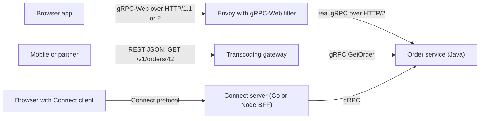

**Example (JSON transcoding annotation):**

```protobuf
import "google/api/annotations.proto";

service OrderService {
  rpc GetOrder(GetOrderRequest) returns (Order) {
    option (google.api.http) = { get: "/v1/orders/{order_id}" };   // REST path -> gRPC method
  }
  rpc CreateOrder(CreateOrderRequest) returns (Order) {
    option (google.api.http) = { post: "/v1/orders", body: "*" };
  }
}
```

**Good and bad:**

| Option | Good | Bad |
|---|---|---|
| gRPC-Web + Envoy | Same `.proto` in the browser | Extra proxy; no client or bidi streaming |
| Connect | No proxy, curl-friendly, also speaks gRPC | Server must be a Connect implementation |
| JSON transcoding | Public REST API from the same contract | REST design is limited by the proto shape |
| Plain REST BFF in front | Simplest for web teams | Two contracts to keep in sync |

**Say this in the interview:**

> "Browsers cannot read HTTP/2 trailers, so raw gRPC does not work there. I either use gRPC-Web through Envoy, which supports unary and server streaming, or Connect, whose servers speak Connect, gRPC and gRPC-Web without a proxy.
> For public REST from the same contract I add google.api.http annotations and use JSON transcoding with gRPC-Gateway or Envoy.
> Often the simplest is a REST or GraphQL BFF for the web, and gRPC behind it."

**They may ask next:**
- **Bidirectional streaming in the browser?** Not with gRPC-Web. Use WebSockets, or watch WebTransport.
- **Does transcoding keep error codes?** Yes, the gateway maps gRPC codes to HTTP codes (NOT_FOUND to 404 and so on).

### Health checks and Kubernetes probes

**In one line:** gRPC has a standard health service (`grpc.health.v1.Health`), and Kubernetes `grpc:` probes call it directly (stable since 1.27).

**Story:** A hospital nurse checks each patient's pulse every few minutes. She does not ask the patient a long story, just "pulse OK?" The health service is that pulse check.

**How it works:**
1. The server implements `grpc.health.v1.Health`. `Check` returns `SERVING` or `NOT_SERVING`. `Watch` streams changes.
2. An empty service name `""` means the whole server. You can also report per service, for example `shop.order.v1.OrderService`.
3. In Spring Boot 4.1, add `io.grpc:grpc-services` and `spring-boot-health`. Boot maps Spring health indicators (database, Kafka...) into the gRPC health service, refreshed every 5 s by default.
4. Kubernetes `grpc:` probes call `Check`. Limits: numeric port only (no named port), plain text by default, no auth. A TLS `mode` is new (alpha in Kubernetes 1.37, `GRPCContainerProbeTLS` feature gate, off by default) and does not verify the certificate. With TLS-only servers, teams still use an `exec` probe with `grpc-health-probe`, or a separate HTTP actuator port.
5. Clients can also do client-side health checking: the channel calls `Watch` and avoids backends that report NOT_SERVING.

**Diagram:**

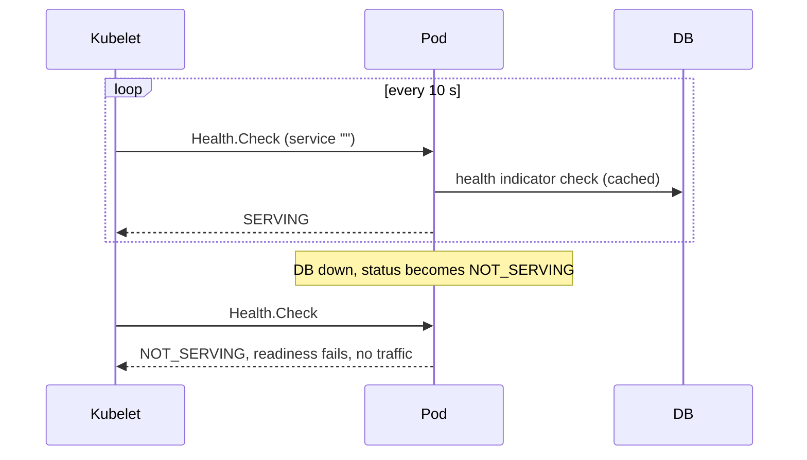

**Example (Kubernetes probes for a gRPC pod):**

```yaml
readinessProbe:
  grpc:
    port: 9090                 # must be a number, named ports are not supported
    service: ""                # "" = overall server health
  periodSeconds: 10
livenessProbe:
  grpc:
    port: 9090
    service: liveness          # a name you map to a cheap "process alive" check
  periodSeconds: 20
```

In Spring Boot 4.1 you map that name to indicators, for example `spring.grpc.server.health.service.liveness.include[0]=ping`.

**Good and bad:**

| Good | Bad |
|---|---|
| Readiness checks dependencies; liveness checks only the process | Liveness fails when the DB is down, so all pods restart in a loop |
| Set NOT_SERVING at shutdown start, then drain | Kill the pod while streams are open |

**Say this in the interview:**

> "gRPC has a standard health protocol, grpc.health.v1.Health, with Check and Watch, and an empty service name for the whole server. Kubernetes has native grpc probes since 1.27 that call it.
> In Spring Boot 4.1 the health service is fed by the normal Spring health indicators. I keep liveness cheap and put dependency checks in readiness only.
> At shutdown I flip to NOT_SERVING first, then drain calls."

**They may ask next:**
- **Probe and TLS?** The built-in probe is plain text by default. Use the new TLS mode where available, `grpc-health-probe` in an `exec` probe, or an HTTP actuator port. See [probes](docker-kubernetes.md#liveness-readiness-and-startup-probes).

### Reflection, grpcurl and debugging

**In one line:** Server reflection lets tools like `grpcurl` list and call a server's methods without the `.proto` file.

**Story:** A restaurant that hands you its menu when you sit down. Without reflection, you must bring your own copy of the menu (the `.proto` file) to order.

**How it works:**
1. Enable reflection: in Spring Boot 4.1 it is on when `io.grpc:grpc-services` is present (`spring.grpc.server.reflection.enabled`).
2. Use `grpcurl` (like curl, for gRPC), or GUI tools like Postman, Insomnia or Kreya.
3. Without reflection, pass the proto: `grpcurl -proto order.proto ...`.
4. Turn on transport logs when you must see frames: in grpc-java, `io.grpc.netty` logger at debug; in grpc-js, `GRPC_TRACE=all GRPC_VERBOSITY=DEBUG`.

**Example:**

```bash
grpcurl -plaintext localhost:9090 list                                 # services
grpcurl -plaintext localhost:9090 describe shop.order.v1.Order         # message shape
grpcurl -plaintext -H 'authorization: Bearer abc' \
  -d '{"order_id":"42"}' localhost:9090 shop.order.v1.OrderService/GetOrder
grpcurl -plaintext -d '{"service":""}' localhost:9090 grpc.health.v1.Health/Check
GRPC_TRACE=all GRPC_VERBOSITY=DEBUG node client.mjs                    # grpc-js wire logs
```

**Common errors and what they mean:**

| Error | Likely cause |
|---|---|
| `UNAVAILABLE: io exception` / `connection refused` | Wrong port, server down, or TLS vs plaintext mismatch |
| `UNIMPLEMENTED` | Wrong package or method name; old server version |
| `RESOURCE_EXHAUSTED: message larger than max` | Message over 4 MB default limit |
| `INTERNAL: HTTP/2 error` or `PROTOCOL_ERROR` | A proxy in between does not speak HTTP/2 |
| `DEADLINE_EXCEEDED` everywhere after deploy | L4 LB pinning to one slow pod; check per-pod load |

**Say this in the interview:**

> "I enable server reflection in non-production, or behind auth, so grpcurl and Postman can list services and call methods with JSON input. For deeper problems I turn on transport tracing, like GRPC_TRACE in Node or Netty debug logs in Java.
> The usual suspects are TLS versus plaintext mismatches, a proxy that downgrades to HTTP/1.1, and the 4 MB message limit."

**They may ask next:**
- **Reflection in production?** It exposes your API shape. Many teams keep it on internal networks only, or behind auth.

### Observability for gRPC

**In one line:** Trace every gRPC call with OpenTelemetry (the trace context travels in metadata), and track rate, errors and duration per method and status code.

**Story:** A courier tracking number. Every hub scans the parcel. You can see where it waited longest. The `traceparent` metadata is the tracking number for a call.

**How it works:**
1. **Tracing:** interceptors create a span per call and copy `traceparent` into metadata. Downstream services continue the same trace.
   - Spring Boot 4.1: Micrometer observation interceptors are auto-configured for server and client; with Micrometer Tracing they export to OpenTelemetry.
   - The OpenTelemetry Java agent also instruments grpc-java with no code change.
   - grpc-java also has its own OpenTelemetry metrics plugin (`grpc-opentelemetry`).
2. **Metrics (RED: rate, errors, duration):** per method and per status code. gRPC's own OpenTelemetry metrics include `grpc.client.attempt.duration`, `grpc.client.call.duration` and `grpc.server.call.duration`.
3. **Logs:** log method, status code, duration, peer, and trace id. Never log full messages with personal data.
4. **Alerts:** on rates of UNAVAILABLE, DEADLINE_EXCEEDED and INTERNAL, and on p99 latency, not on single errors.

**Diagram:**

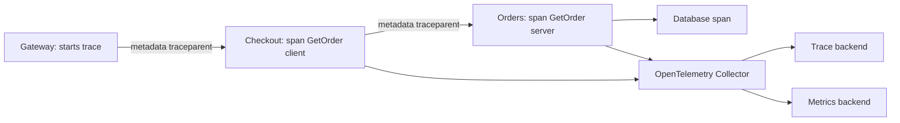

**Watch out with streams:** a span for a 2-hour stream is not useful as a latency number. Count messages per stream and record stream lifetime separately.

**Say this in the interview:**

> "Each gRPC call gets a client span and a server span, and the trace context goes in the traceparent metadata. In Spring Boot 4.1 that is auto-configured through Micrometer observation interceptors exported to OpenTelemetry.
> I chart rate, errors by status code and duration per method, and I alert on UNAVAILABLE and DEADLINE_EXCEEDED rates and p99, not on single errors.
> Long streams get message counts, not latency."

**They may ask next:**
- More on tracing setup: [Observability with Actuator, Micrometer and OpenTelemetry](spring-ecosystem.md#observability-with-actuator-micrometer-and-opentelemetry) and [Distributed tracing with OpenTelemetry](production-ready.md#distributed-tracing-with-opentelemetry).

### Performance: message size, streaming and compression

**In one line:** Keep messages small (default limit 4 MB), reuse channels, stream or page big data, and compress only where the network is slow.

**Story:** Moving house. You do not push the whole house through the door at once (one huge message). You use many boxes (streaming or paging). You do not vacuum-pack a box of feathers going next door (compression on fast local networks wastes CPU).

**How it works:**
1. **Message size:** by default a receiver rejects messages over **4 MiB** with `RESOURCE_EXHAUSTED`. Metadata is limited to 8 KiB by default in grpc-java. Raise limits only with a reason (`spring.grpc.client.channel.<name>.inbound.message.max-size`, `spring.grpc.server.inbound.message.max-size`).
2. **Big data:** stream it in chunks (for example 64 KB to 1 MB), or put files in blob storage and send a URL.
3. **Streaming vs batching:**
   - Many small unary calls cost headers and scheduling per call.
   - A batch call (`GetOrders(ids)`) cuts round trips.
   - A stream is best when data comes over time, or when you want the first item fast.
4. **Compression:** gzip per call or per channel (`withCompression("gzip")`). It helps over slow or paid links (cross-region). It costs CPU and often does not help small Protobuf messages.
5. **Channels:** one `ManagedChannel` per target, shared. A channel can hold several connections to several pods. If one connection hits the server's max concurrent streams, calls queue.
6. **Allocation:** in Java, avoid converting large messages to JSON for logs. In Node, avoid huge `repeated` fields: they become large JS arrays.

**Example (rough numbers to say out loud):**
- 20,000 calls per second × 10 KB JSON = 200 MB/s. The same as Protobuf at about 3 KB = 60 MB/s. That is 140 MB/s less on the network, and less CPU on parsing.
- A 300 MB report should never be one message. 300 chunks of 1 MB on a server stream, or a signed blob URL.

**Good and bad:**

| Good | Bad |
|---|---|
| Messages under a few hundred KB | Raising max size to 100 MB to "fix" an error |
| Paging or streaming for lists | `ListAllOrders` returning one giant message |
| Compression across regions | gzip on every tiny call inside one zone |
| Shared channel per target | Channel per request |

**Say this in the interview:**

> "gRPC's default receive limit is 4 MB, and going over gives RESOURCE_EXHAUSTED. I don't just raise it: big data is streamed in chunks or put in blob storage with a link.
> I reuse one channel per target, batch small calls when it cuts round trips, and use streams when data arrives over time.
> Compression is per call; I turn it on for cross-region links, not for small messages inside a zone."

**They may ask next:**
- **Is gRPC always faster than REST?** For small, frequent internal calls usually yes, mostly from less CPU on serialization and connection reuse. For one big download, the network dominates and the difference is small. Measure.

### When not to use gRPC

**In one line:** Skip gRPC for public APIs, browser-first apps, simple CRUD with few callers, and teams or proxies that cannot handle HTTP/2 well.

**Story:** You do not install an industrial intercom in a two-room house. Shouting across the hall (REST) works fine.

**Do not use gRPC when:**
- **Public or partner APIs.** Outsiders expect REST + JSON + OpenAPI, and can test with curl.
- **The browser is the main client.** You would need gRPC-Web or Connect. A REST or GraphQL BFF may be simpler.
- **HTTP caching matters.** gRPC calls are POSTs; CDNs cannot cache them by URL.
- **Your infrastructure is HTTP/1.1 only.** Some old proxies, WAFs or API gateways break HTTP/2 or trailers.
- **Few calls, simple data.** The tooling cost (codegen, schema repo, debugging) is bigger than the speed gain.
- **Events, not requests.** If the caller does not need an answer now, use a queue or Kafka. See [kafka.md](kafka.md).

**Say this in the interview:**

> "I don't use gRPC for public APIs, browser-first products, or anything that needs CDN caching; REST is easier for those clients. I also avoid it when old proxies in the path don't support HTTP/2 well, or when the call is really an event that fits a queue.
> gRPC pays off for many internal calls with strict contracts, streaming and deadlines."

**They may ask next:**
- **Can REST be just as fast?** With HTTP/2 and a binary format, REST gets closer. gRPC still gives you streaming, deadlines and codegen in one package.

### REST vs gRPC

**In one line:** REST is resource-oriented, text-based and universal; gRPC is method-oriented, binary, contract-first and best inside your own system.

**Story:** A public library catalogue (REST): anyone can walk in and read it. The librarians' internal barcode system (gRPC): fast and precise, but you need the scanner.

| | REST + JSON | gRPC + Protobuf |
|---|---|---|
| Model | Resources and HTTP verbs (`GET /orders/42`) | Methods (`OrderService.GetOrder`) |
| Contract | Optional (OpenAPI) | Required (`.proto`) |
| Format | JSON text, readable | Binary, needs the schema |
| Transport | HTTP/1.1, 2 or 3 | HTTP/2 |
| Streaming | SSE, chunked responses, WebSocket | Built in, 4 kinds |
| Deadlines and cancellation | Do it yourself | Built in and propagated |
| Browser | Native | gRPC-Web or Connect |
| Caching | HTTP caches and CDNs | None by URL |
| Errors | HTTP status + Problem Details | 17 status codes + rich details |
| Tooling | curl, browser, Postman | grpcurl, Postman, reflection |
| Load balancing | Any L4 or L7 | Needs L7 or client-side |
| Best for | Public, partner, browser, CRUD | Internal, high-volume, polyglot, streaming |

**Say this in the interview:**

> "REST is resource-based JSON over HTTP, readable and cacheable, and every client can call it. gRPC is method-based binary Protobuf over HTTP/2 with a mandatory contract, built-in streaming and deadlines.
> I choose REST at the edge and gRPC for high-volume internal calls, and I mention the load-balancing and browser caveats."

**They may ask next:**
- **The full table with GraphQL, WebSocket and SSE:** see [web-services.md](web-services.md#rest-vs-graphql-vs-grpc-vs-websocket-vs-sse) and [Choosing an API style](#choosing-an-api-style) below.

### Migration story: gRPC inside, REST at the edge

**In one line:** Keep REST at the edge and move the hottest internal calls to gRPC one at a time, with both paths running until gRPC is proven.

**Story (a real-style project):**
- An e-commerce company has 30 Spring Boot services. They all call each other with REST + JSON.
- Checkout calls Pricing 12 times per order. At sale time that is 3,000 orders/s × 12 = 36,000 calls/s. Pricing pods spend about 30% of CPU on JSON.
- p99 checkout latency is 900 ms. The target is 400 ms.

**How we did it:**
1. **Pick one hot path:** Checkout to Pricing. Do not convert all 30 services.
2. **Write the contract:** `pricing/v1/pricing.proto` in a contracts repo, with `buf breaking` in CI.
3. **Add a gRPC server next to REST** in Pricing: REST on 8080, gRPC on 9090, same service layer below.
4. **Hide it behind an interface** in Checkout: `PriceClient` with `RestPriceClient` and `GrpcPriceClient`. A feature flag picks one.
5. **Fix load balancing first:** headless Service plus `round_robin`, or rely on the mesh. Set deadlines (200 ms) and retries on UNAVAILABLE only.
6. **Shadow and compare:** send 5% of traffic over gRPC, compare answers and latency, then 50%, then 100%.
7. **Batch where it helps:** a new `GetPrices(skus)` method replaced 12 calls with 1.
8. **Remove the old REST path** for internal callers after a few weeks. Keep REST for the admin UI.

**Result to say:** Pricing CPU dropped, p99 checkout went below 400 ms, and most of the gain came from batching plus no JSON, not from HTTP/2 alone.

**Diagram:**

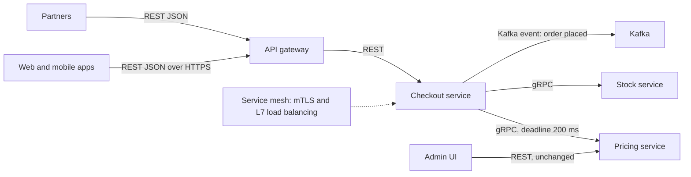

**Good and bad:**

| Good | Bad |
|---|---|
| One service pair at a time, behind a flag | Big-bang rewrite of all internal APIs |
| Same domain logic behind REST and gRPC | Business logic copied into gRPC handlers |
| Measure before and after | "gRPC is faster" without numbers |
| Fix L7 load balancing before the switch | Discovering the L4 problem in production |

**Say this in the interview:**

> "I'd keep REST at the edge for browsers and partners and move only the hottest internal calls to gRPC. The service runs REST and gRPC side by side over the same service layer, and callers switch through an interface and a feature flag, with shadow traffic first.
> Before switching I fix load balancing, add deadlines and retry only UNAVAILABLE. In my experience the biggest win is often a batch method, plus less JSON CPU."

**They may ask next:**
- **Gateway in front of gRPC services?** Yes: the gateway speaks REST outside and gRPC inside, or uses JSON transcoding. See [API gateway and BFF](microservices.md#api-gateway-and-bff).

---
## GraphQL: what it is and why

**In one line:** GraphQL is a query language for APIs: the server publishes a typed schema, and each client asks for exactly the fields it needs.

**Short recap:** [Spring GraphQL](spring-ecosystem.md#spring-graphql) already shows the basics (`@QueryMapping`, `@SchemaMapping`, `@BatchMapping`). This part goes deeper: N+1, pagination, errors, security, caching and federation.

**Story:** A thali restaurant (REST) gives a fixed plate per order. Sometimes you get food you do not want (*over-fetching*). Sometimes you must order a second plate (*under-fetching*). A buffet (GraphQL) lets you fill one plate with exactly what you want. But the kitchen must now handle any combination, and someone has to stop the guest who piles up 40 plates.

**How it works:**
1. The server writes a **schema** in SDL (Schema Definition Language): types, fields and the entry points `Query`, `Mutation` and `Subscription`.
2. The client sends a query document, usually `POST /graphql` with JSON `{"query": "...", "variables": {...}}`.
3. The server parses and validates the query against the schema. Unknown fields fail before any code runs.
4. The server runs a **resolver** (a data fetcher) for each field and builds a JSON response in the same shape as the query.
5. The response is `{"data": ..., "errors": [...]}`. Data and errors can come together.

**Versions (checked November 2026):**
- The GraphQL spec's **September 2025** edition was the first since October 2021. It added OneOf input objects (`@oneOf`, "input unions") and schema coordinates. A smaller **September 2026** edition (published November 2026) followed, with directives on directives and stricter `@oneOf` checks; the spec now aims for one release a year. `@defer` and `@stream` are still not in the released spec.
- GraphQL.js 17 is out (we tested with 17.1). Spring for GraphQL 2.0 ships with Spring Boot 4 and is built on GraphQL Java.

**Diagram:**

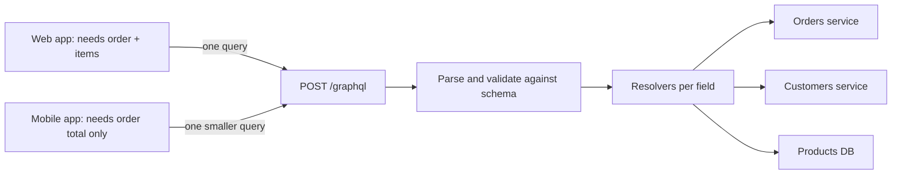

**Good and bad:**

| Good | Bad |
|---|---|
| Client picks fields: no over- or under-fetching | Any query shape can hit the server; needs limits |
| One typed schema, great tooling (GraphiQL, codegen) | HTTP caching by URL does not work by default |
| Evolve without versions (add and deprecate fields) | N+1 queries unless you batch |
| One request for a whole screen | Errors come with HTTP 200; monitoring needs care |

**Say this in the interview:**

> "GraphQL publishes one typed schema, and each client asks for exactly the fields it needs in one request. The server validates the query, runs a resolver per field, and returns data and errors together.
> It shines when many clients need different shapes of the same data. The costs are N+1 queries, harder caching, and the need for depth and complexity limits."

**They may ask next:**
- **Is GraphQL a database language?** No. It is an API layer. Resolvers can call databases, REST, gRPC or anything.
- **Does GraphQL replace REST?** No. Many companies use REST or gRPC between services and GraphQL as the BFF for apps.

### Schema and types

**In one line:** The schema is the contract: object types, scalars, enums, interfaces, unions and input types, with `!` for non-null and `[ ]` for lists.

**Story:** A form at the passport office. Each box has a type (date, text, number). Some boxes are compulsory (non-null). Some boxes allow a list (previous addresses). The form is the schema.

**How it works:**
- **Scalars:** `Int`, `Float`, `String`, `Boolean`, `ID`. Add custom ones like `DateTime` or `BigDecimal` (in Java, `graphql-java-extended-scalars`).
- **Object types:** `type Order { ... }`. Fields can have arguments.
- **Non-null and lists:** `String!` never null. `[Item!]!` is a non-null list of non-null items.
- **Enums:** a fixed set of values.
- **Interfaces and unions:** many types behind one field. The client uses `... on Type` to pick fields.
- **Input types:** for arguments, especially mutation inputs. `@oneOf` input means exactly one field must be set.
- **Descriptions** (`"""text"""`) become documentation in GraphiQL.

**Example (`src/main/resources/graphql/schema.graphqls`):**

```graphql
scalar DateTime

type Query {
  order(id: ID!): Order
  orders(first: Int, after: String): OrderConnection!
}

type Mutation { placeOrder(input: PlaceOrderInput!): PlaceOrderResult! }
type Subscription { orderStatus(orderId: ID!): OrderStatusEvent! }

"""An order placed by a customer."""
type Order {
  id: ID!
  status: OrderStatus!
  totalPaise: Int!                            # money as integer paise
  createdAt: DateTime!
  customer: Customer!
  items: [OrderItem!]!
  giftNote: String @deprecated(reason: "Use notes")
}

enum OrderStatus { PLACED PACKED SHIPPED DELIVERED CANCELLED }
type Customer { id: ID!, name: String! }
type OrderItem { sku: String!, qty: Int! }
type OrderStatusEvent { orderId: ID!, status: OrderStatus! }

input PlaceOrderInput { items: [ItemInput!]!, couponCode: String }
input ItemInput { sku: String!, qty: Int! }
union PlaceOrderResult = Order | OutOfStock   # errors as data
type OutOfStock { sku: String!, available: Int! }
```

**Good and bad:**

| Good | Bad |
|---|---|
| Non-null where you are sure | Everything non-null: one failing field nulls a big part of the response |
| Input types for mutations | Ten loose scalar arguments |
| Unions for expected business errors | Expected errors only as strings in `errors` |

**Say this in the interview:**

> "The schema is the contract. Scalars, object types, enums, interfaces, unions and input types, with exclamation marks for non-null and brackets for lists.
> I use input types for mutations and unions for expected business results like OutOfStock, and I'm careful with non-null, because an error in a non-null field nulls its parent."

**They may ask next:**
- **Schema-first or code-first?** Spring for GraphQL is schema-first (`.graphqls` files). Code-first tools generate the schema from classes. Schema-first is easier to review with frontend teams.

### Queries, mutations and subscriptions

**In one line:** Queries read data, mutations change data (top-level fields run in order), and subscriptions push events over a long-lived connection.

**Story:** At a bank: asking your balance is a query. Depositing money is a mutation, and two deposits in one slip are done in order. An SMS alert for every transaction is a subscription.

**How it works:**
1. **Query** with variables and fragments (reusable field sets):

```graphql
query OrderPage($id: ID!) {
  order(id: $id) {
    id
    status
    ...CustomerBits
    items { sku qty }
  }
}
fragment CustomerBits on Order { customer { name } }
```

2. **Mutation:** top-level fields run **in order**, so `debit` then `credit` is predictable. Return the changed object so the client cache can update.

```graphql
mutation { placeOrder(input: { items: [{ sku: "TEA-1", qty: 2 }] }) {
  ... on Order { id status }
  ... on OutOfStock { sku available }
} }
```

3. **Subscription:** usually over WebSocket with the `graphql-transport-ws` protocol (from the `graphql-ws` library). Spring for GraphQL also supports subscriptions over SSE. The server resolver returns a stream (`Flux` in Spring).

**Diagram (a subscription):**

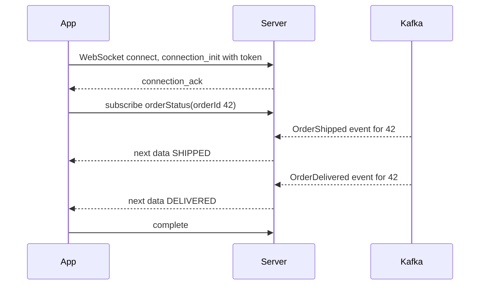

**Good and bad:**

| Good | Bad |
|---|---|
| Named operations (`query OrderPage`) for logs and metrics | Anonymous queries: no idea which screen is slow |
| Variables, not string-built queries | Values pasted into the query string (no caching, injection risk) |
| Subscriptions for small, targeted events | Subscriptions streaming whole objects every second |

**Say this in the interview:**

> "Queries read and their fields may resolve in parallel, mutations change data and their top-level fields run in order, and subscriptions push events, usually over WebSocket with the graphql-transport-ws protocol or over SSE.
> I always use named operations and variables, so I can monitor per operation and cache parsed documents."

**They may ask next:**
- **Can a GET request carry a query?** Yes, for queries (never mutations). It helps CDN caching with persisted queries.

### Resolvers, N+1 and DataLoader

**In one line:** A child field's resolver runs once per parent (N+1 calls); DataLoader collects the keys and loads them in one batch per request.

**Story:** A teacher collects homework. The slow way: walk to the staff room for each student's register, 50 trips. The smart way: wait until every student has raised a hand, write all 50 names, and make one trip.

**How it works:**
1. GraphQL runs resolvers level by level: first `orders`, then for each order its `customer`.
2. A naive `customer` resolver makes one call per order: 1 + N calls (the N+1 problem). This is the API version of the JPA N+1 in [The N+1 problem](spring-ecosystem.md#the-n1-problem-and-how-to-fix-it).
3. **DataLoader** gives each resolver a `load(key)` that returns a future. It collects keys during one level, then calls your batch function once with all keys.
4. It also caches by key **within one request**, so customer `c1` is loaded once even if 10 orders point to it.
5. Create DataLoaders **per request**. A shared one would leak data between users.
6. In Spring for GraphQL, `@BatchMapping` does all of this: the method gets `List<Order>` and returns `Map<Order, Customer>`.

**Diagram:**

```mermaid
sequenceDiagram
    participant GQL
    participant Loader
    participant Customers
    GQL->>Loader: load c1 (order 1)
    GQL->>Loader: load c2 (order 2)
    GQL->>Loader: load c1 (order 3)
    Note over Loader: end of level, dispatch batch
    Loader->>Customers: findByIds [c1, c2]
    Customers-->>Loader: 2 customers
    Loader-->>GQL: c1, c2, c1 (from per-request cache)
```

**Example (Node; we ran the same mechanism with graphql 17 and dataloader 2):**

```js
import DataLoader from 'dataloader';

let dbCalls = 0;
const loadCustomers = async (ids) => {           // one DB call for many ids
  dbCalls++;
  const rows = await db.customers.findByIds(ids);
  return ids.map((id) => rows.find((r) => r.id === id));   // same order as ids
};

// in the per-request context factory:
const context = () => ({ customerLoader: new DataLoader(loadCustomers) });

const resolvers = {
  Order: { customer: (order, _args, ctx) => ctx.customerLoader.load(order.customerId) },
};
// 3 orders with customers c1, c2, c1:  naive -> 3 DB calls, with DataLoader -> 1 DB call
```

**Example (Spring for GraphQL):**

```java
@Controller
class OrderGraphQlController {
    private final CustomerClient customers;
    OrderGraphQlController(CustomerClient customers) { this.customers = customers; }

    @BatchMapping                                   // one call for all orders in this request
    Map<Order, Customer> customer(List<Order> orders) {
        Set<String> ids = orders.stream().map(Order::customerId).collect(toSet());
        Map<String, Customer> byId = customers.findByIds(ids);   // 1 query, not N
        return orders.stream().collect(toMap(o -> o, o -> byId.get(o.customerId())));
    }
}
```

**Good and bad:**

| Good | Bad |
|---|---|
| `@BatchMapping` or DataLoader for every list child | `@SchemaMapping` calling a repository per parent |
| New loaders per request | One global loader: data leaks between users |
| Batch function returns values in key order | Batch function that drops missing keys (results shift) |

**Say this in the interview:**

> "Resolvers run per field, so a list of N parents with a child field means N extra calls. DataLoader fixes it: resolvers call load(key), keys are collected for one level of execution, and one batch call loads them all, with a per-request cache.
> In Spring for GraphQL I use @BatchMapping, which takes the list of parents and returns a map to the children. Loaders must be per request so users never share cached data."

**They may ask next:**
- **Does DataLoader fix JPA N+1 inside the batch?** No. Your batch query itself must use `IN (...)` or a fetch join.
- **How do you find N+1 in GraphQL?** Count database or HTTP calls per operation in tracing. A query that makes 51 spans is the sign.

### Pagination with cursor connections

**In one line:** GraphQL lists are usually paged with Relay-style *connections*: `first`/`after` arguments, `edges` with an opaque `cursor`, and `pageInfo { hasNextPage endCursor }`.

**Story:** A bookmark in a novel. You do not say "page 212" (offset), because the publisher may add pages. You put the bookmark where you stopped and continue from there (cursor).

**How it works:**
1. The client asks `orders(first: 20, after: "cursor-from-last-page")`.
2. The server returns `edges { cursor node { ... } }` and `pageInfo { hasNextPage endCursor }`.
3. The cursor is opaque (base64 of a key like `createdAt + id`). Clients must not parse it.
4. The server uses *keyset pagination* behind it: `WHERE (created_at, id) < (?, ?) ORDER BY created_at DESC, id DESC LIMIT 21`. Fetching 21 tells you if there is a next page.
5. In Spring for GraphQL, the Boot starter adds the `Connection` types for you (`ConnectionTypeDefinitionConfigurer`). Return a Spring Data `Window<T>` and take a `ScrollSubrange` argument.

Why cursors are better than offset in general: [Pagination: offset vs cursor](web-services.md#pagination-offset-vs-cursor).

**Example (query and Spring controller):**

```graphql
query { orders(first: 20, after: "T18xNw==") {
  edges { cursor node { id status } }
  pageInfo { hasNextPage endCursor }
} }
```

```java
@QueryMapping
Window<Order> orders(ScrollSubrange subrange, Principal user) {
    ScrollPosition position = subrange.position().orElse(ScrollPosition.keyset());
    int count = subrange.count().orElse(20);
    return repo.findByCustomerIdOrderByCreatedAtDescIdDesc(        // keyset query underneath
        user.getName(), position, Limit.of(Math.min(count, 100)));  // cap the page size
}
```

**Good and bad:**

| Good | Bad |
|---|---|
| Opaque cursors over keyset queries | Offset on big tables: `OFFSET 100000` is slow |
| Max page size on the server | `first: 100000` allowed |
| Stable sort with a unique tie-breaker (`id`) | Sort by `createdAt` only: duplicates and gaps |

**Say this in the interview:**

> "I page GraphQL lists with Relay-style connections: first and after, edges with an opaque cursor, and pageInfo with hasNextPage and endCursor. The cursor encodes a keyset position, so the database query stays fast on deep pages.
> In Spring for GraphQL the Connection types are generated and I return a Spring Data Window from a ScrollSubrange. I always cap the page size."

**They may ask next:**
- **Total count?** Add `totalCount` only if cheap. On huge tables, counts are slow; show "100+" instead.

### Errors and partial data

**In one line:** A GraphQL response can have both `data` and `errors`: a failing field becomes `null`, and the rest of the data still comes back.

**Story:** You order five dishes. One is out of stock. The waiter brings four and says "the paneer is not available". You do not send back the whole meal.

**How it works:**
1. **Request errors** (bad syntax, unknown field, validation): no `data` at all. Nothing ran.
2. **Field errors** (a resolver throws): that field becomes `null`, and `errors` gets `message`, `locations`, `path` and `extensions`.
3. **Null bubbling:** if the failing field is non-null (`String!`), the null moves up to the nearest nullable parent. Too many `!` can wipe out a big part of the response.
4. HTTP status: with classic `application/json`, field errors still return 200. The GraphQL-over-HTTP spec (media type `application/graphql-response+json`) uses 4xx for request errors.
5. Two kinds of errors:
   - **Unexpected** (timeout, bug): `errors` array, with `extensions.classification` (Spring uses `ErrorType` like `NOT_FOUND`, `FORBIDDEN`, `INTERNAL_ERROR`).
   - **Expected business results** (out of stock, card declined): model them in the schema as union types, so clients must handle them.

**Example (we ran this with graphql-js 17; the delivery resolver threw):**

```json
{
  "errors": [{
    "message": "Delivery service timed out",
    "locations": [{ "line": 1, "column": 14 }],
    "path": ["order", "delivery"]
  }],
  "data": { "order": { "id": "o1", "delivery": null } }
}
```

**Spring for GraphQL error mapping:**

```java
@ControllerAdvice
class GraphQlErrors {
    @GraphQlExceptionHandler
    GraphQLError notFound(GraphqlErrorBuilder<?> builder, OrderNotFoundException ex) {
        return builder.errorType(ErrorType.NOT_FOUND)     // extensions.classification
                      .message("Order %s not found".formatted(ex.id()))
                      .build();                            // no stack trace to the client
    }
}
```

**Good and bad:**

| Good | Bad |
|---|---|
| Unions for expected business errors | Parsing error message strings in the app |
| Error classification in `extensions` | Stack traces in `message` |
| Alerts on error rate per operation | Alerts on HTTP 5xx only: GraphQL errors are 200 |

**Say this in the interview:**

> "GraphQL can return partial data: a failing field becomes null with an entry in errors that has the path. A non-null field pushes the null up to its parent, so I don't mark everything non-null.
> Unexpected errors go in the errors array with a classification in extensions; expected business outcomes like OutOfStock are union types in the schema.
> Because field errors usually come with HTTP 200, I monitor error counts per operation, not HTTP status."

**They may ask next:**
- **How do you hide internal details?** Map exceptions with `@GraphQlExceptionHandler` or a `DataFetcherExceptionResolver`. Unknown exceptions become a generic `INTERNAL_ERROR`.

### Securing a GraphQL API

**In one line:** Secure GraphQL with auth per field, limits on depth, cost and page size, persisted queries, and introspection off in production.

**Story:** A buffet with no rules: one guest takes all the paneer, another goes back 500 times. You need a plate size (complexity limit), a rule on trips (depth limit), and staff who check that VIP dishes go only to VIP guests (field authorization).

**The attacks:**
- **Deep queries:** `order { customer { orders { customer { orders ... } } } }`, 20 levels deep.
- **Wide or expensive queries:** `orders(first: 10000) { items { product { reviews(first: 1000) } } }`.
- **Aliases and batching:** 1,000 aliased `login(...)` calls in one request, to bypass rate limits.
- **Introspection:** the attacker downloads your whole schema, including fields meant only for admins.
- **Missing field auth:** the `order` query checks the user, but `customer.email` inside it does not.

**The defences:**
1. **Authentication:** normal Spring Security on `/graphql` (and on the WebSocket handshake for subscriptions).
2. **Authorization per field:** `@PreAuthorize` on controller methods, or checks in the service layer. Check object ownership, not only roles.
3. **Depth limit:** for example 10. In graphql-java: `MaxQueryDepthInstrumentation`.
4. **Complexity (cost) limit:** each field has a cost, lists multiply by `first`. Reject above a budget. In graphql-java: `MaxQueryComplexityInstrumentation`.
5. **Page size caps** in resolvers.
6. **Persisted queries / trusted documents:** the client build registers its queries; at runtime it sends only a hash. For first-party apps, allow only known hashes. Automatic persisted queries (APQ) save bytes but do not block unknown queries.
7. **Introspection off in production:** `spring.graphql.schema.introspection.enabled=false`. Not a real security control alone, but less information leaks.
8. **Rate limit by cost,** not by request count. Timeouts per request.

**Diagram:**

```mermaid
flowchart LR
    Req["Incoming query"] --> Auth["Spring Security: who is it?"]
    Auth --> PQ{"Known persisted query hash?"}
    PQ -->|"no, first-party only"| Rej["Reject"]
    PQ -->|"yes"| Lim{"Depth and cost under limits?"}
    Lim -->|"no"| Rej
    Lim -->|"yes"| Exec["Execute resolvers"]
    Exec --> FA["Field auth with @PreAuthorize"]
    FA --> Res["Response with allowed fields"]
```

**Example (Spring Boot):**

```java
@Configuration
class GraphQlLimits {
    @Bean Instrumentation maxDepth() { return new MaxQueryDepthInstrumentation(10); }
    @Bean Instrumentation maxCost() { return new MaxQueryComplexityInstrumentation(500); }
}

@Controller
class CustomerGraphQlController {
    @SchemaMapping(typeName = "Customer", field = "email")
    @PreAuthorize("hasRole('SUPPORT') or #customer.id == authentication.name")  // per-field rule
    String email(Customer customer) { return customer.email(); }
}
```

```properties
spring.graphql.schema.introspection.enabled=false
spring.graphql.graphiql.enabled=false
```

**Say this in the interview:**

> "GraphQL lets the client shape the query, so I limit what a query can cost: max depth, max complexity, and capped page sizes, plus rate limiting by cost.
> Authorization is per field and per object, not only on the endpoint, with @PreAuthorize or checks in the service layer. For our own apps I use persisted queries as an allow-list, and I turn introspection and GraphiQL off in production."

**They may ask next:**
- **Is turning off introspection enough?** No. Field suggestions in error messages can still leak names, and attackers can guess. It only reduces noise; limits and auth do the real work.
- **CSRF?** If you use cookies, require `Content-Type: application/json` or a CSRF token. See [CORS and CSRF](spring-ecosystem.md#cors-and-csrf).

### Caching GraphQL

**In one line:** GraphQL sends every query as a POST to one URL, so URL caching fails; you cache in the client, at a CDN with persisted GETs, and in resolvers.

**Story:** A newspaper stand keeps copies of today's paper (a fixed URL) for everyone. But if each customer asks for a custom paper with their own pages, the stand cannot keep ready copies. It caches the individual pages instead.

**The layers:**
1. **Client normalized cache:** Apollo Client, Relay or urql store objects by `__typename:id`. If two queries return `Order:42`, the client keeps one copy and updates both screens.
2. **CDN with GET + persisted queries:** `GET /graphql?extensions={persistedQuery hash}&variables=...`. Now the URL is stable, and a CDN can cache public data with `Cache-Control`.
3. **Per-request cache:** DataLoader de-duplicates inside one request.
4. **Server-side caches:** cache slow resolvers or downstream calls (Spring Cache, Redis). Key by arguments **and** user when data is personal.
5. **Parsed-document cache:** cache parsed and validated queries (Spring: `PreparsedDocumentProvider`). This saves CPU, not data calls.

**Diagram:**

```mermaid
flowchart LR
    UI["React screen"] --> NC["Client normalized cache by type and id"]
    NC -->|"miss"| CDN["CDN: GET with persisted query hash"]
    CDN -->|"miss or private data"| GQ["GraphQL server"]
    GQ --> DL["DataLoader per request"]
    DL --> RC["Resolver cache in Redis"]
    RC --> SVC["Services and databases"]
```

**Good and bad:**

| Good | Bad |
|---|---|
| Stable `id` on every type, so clients normalize | Types without ids: client cache cannot merge |
| CDN only for public, non-personal queries | Personal data cached at a CDN |
| Cache keys include user or tenant | One cache entry served to every user |

**Say this in the interview:**

> "GraphQL breaks URL-based HTTP caching, since everything is a POST to /graphql. So I cache at other layers: a normalized client cache keyed by type and id, persisted queries sent as GET so a CDN can cache public data, DataLoader inside one request, and Redis or Spring Cache for slow resolvers, keyed by user when the data is personal."

**They may ask next:**
- More on HTTP caching headers: [Caching with ETag and Cache-Control](web-services.md#caching-with-etag-and-cache-control).

### Federation: one graph from many services

**In one line:** Federation lets each team own a subgraph, and a router joins them into one supergraph and splits each query across them.

**Story:** A shopping mall with one help desk. You ask "where can I buy shoes and eat dosa?". The help desk knows which shop owns what and sends you to both. Each shop runs itself; the help desk only routes.

**How it works (Apollo Federation 2, the most used approach):**
1. Each service exposes a subgraph schema. Shared types are *entities* with a `@key`, for example `type Order @key(fields: "id")`.
2. Another subgraph can add fields to that entity. Shipping adds `Order.delivery` without touching the Orders service.
3. A composition step builds the supergraph schema. A schema registry checks that changes do not break clients.
4. The **router** (Apollo Router, or another federation-compatible gateway) plans each query: fetch the order from Orders, then send `_entities(representations: [{id}])` to Shipping for the delivery part.
5. In Spring for GraphQL: add a `FederationSchemaFactory` (from `federation-jvm`) and use `@EntityMapping` methods to load entities by key.
6. The GraphQL Foundation also has a working group on an open "composite schemas" spec, so watch that space.

**Diagram:**

```mermaid
flowchart LR
    App["Web and mobile"] -->|"one query"| Router["Router with supergraph schema"]
    Router -->|"order 42 fields"| Orders["Orders subgraph (Spring)"]
    Router -->|"_entities for Order 42"| Ship["Shipping subgraph (Node)"]
    Router -->|"_entities for Customer"| Cust["Customers subgraph (Spring)"]
    Reg["Schema registry: composition checks in CI"] -.-> Router
```

**Example (Shipping subgraph extends Order, Spring for GraphQL):**

```graphql
type Order @key(fields: "id") {
  id: ID!
  delivery: Delivery          # owned by Shipping, joined by the router
}
type Delivery { eta: String, carrier: String }
```

```java
@Controller
class ShippingController {
    @EntityMapping                                    // router asks: give me Order by id
    Order order(@Argument String id) { return new Order(id); }

    @SchemaMapping
    Delivery delivery(Order order) { return deliveries.forOrder(order.id()); }
}
```

**Good and bad:**

| Good | Bad |
|---|---|
| Teams own their part; one graph for clients | Router is a critical component; needs HA and monitoring |
| Composition checks catch breaking changes in CI | Query plans can fan out to many services (latency) |
| Better than one giant hand-written BFF for large orgs | Overkill for 3 services and one team |

**Say this in the interview:**

> "With federation each team owns a subgraph, and shared types are entities with a @key. A router composes the supergraph, plans each query, and fetches entity fields from other subgraphs through _entities.
> In Spring for GraphQL I use the federation-jvm integration with @EntityMapping. I'd use it only when several teams contribute to one graph; for a small system, one BFF is simpler."

**They may ask next:**
- **Federation vs schema stitching?** Stitching merges schemas in the gateway by hand-written glue. Federation puts the join keys in the subgraphs and is easier to evolve.

### Versioning by evolution

**In one line:** GraphQL APIs usually have no `/v2`; you add new fields, mark old ones `@deprecated`, watch usage, and remove them when no client uses them.

**Story:** A road under repair. You do not close the city. You open a new lane, put a "use new lane" sign on the old one, count cars each week, and close the old lane when it is empty.

**How it works:**
1. **Adding** a type, field, enum value or optional argument is safe.
2. **Removing or renaming** a field breaks clients. First add the new field, then `@deprecated(reason: "Use notes")` on the old one.
3. **Track field usage** per client (named operations plus client name headers). Remove a field only at zero usage.
4. **Careful changes:**
   - Making an argument required breaks old queries.
   - Output field from nullable to non-null is safe. Non-null to nullable can break typed clients.
   - A new enum value can break clients that use an exhaustive `switch`.
5. **Schema checks in CI:** compare the new schema with the live one and with real client operations.

**Say this in the interview:**

> "I evolve a GraphQL schema instead of versioning it. New fields are added, old ones get @deprecated with a reason, and I remove them only when usage tracking shows no client calls them. CI runs a schema diff against real client operations to catch breaking changes."

**They may ask next:**
- **Mobile apps that never update?** That is why removal waits for usage to hit zero, sometimes for a year. Persisted queries tell you exactly which fields old app versions use.

### Spring for GraphQL example

**In one line:** Put the schema in `src/main/resources/graphql`, write a `@Controller` with `@QueryMapping`, `@MutationMapping`, `@SubscriptionMapping` and `@BatchMapping`, and Spring Boot serves it at `/graphql`.

**Story:** The same restaurant staff (your services) now take buffet orders. You only tell Spring which method serves which dish (field).

**Example (Spring Boot 4, Spring for GraphQL 2.0):**

```java
@Controller
class OrderGraphQlController {
    private final OrderService orders;
    private final OrderEvents events;
    OrderGraphQlController(OrderService orders, OrderEvents events) { this.orders = orders; this.events = events; }

    @QueryMapping
    Order order(@Argument String id) { return orders.find(id).orElse(null); }   // null + no error = not found

    @MutationMapping
    @PreAuthorize("isAuthenticated()")
    Object placeOrder(@Argument @Valid PlaceOrderInput input, Principal user) {
        return orders.place(user.getName(), input);    // returns Order or OutOfStock (union)
    }

    @SubscriptionMapping
    Flux<OrderStatusEvent> orderStatus(@Argument String orderId) {
        return events.forOrder(orderId);               // backed by Kafka or Redis pub/sub
    }

    @BatchMapping
    Map<Order, List<OrderItem>> items(List<Order> list) { return orders.itemsFor(list); }  // no N+1
}
```

```properties
spring.graphql.http.path=/graphql
# turns on subscriptions over WebSocket
spring.graphql.websocket.path=/graphql
# dev only
spring.graphql.graphiql.enabled=true
# prod
spring.graphql.schema.introspection.enabled=false
```

**Testing:** `@GraphQlTest(OrderGraphQlController.class)` with `GraphQlTester`:
`graphQlTester.document("{ order(id: \"42\") { status } }").execute().path("order.status").entity(String.class).isEqualTo("PLACED");`

For the union to resolve, Spring needs to know the Java class of each GraphQL type. Class names that match type names (`Order`, `OutOfStock`) work by default.

**Say this in the interview:**

> "In Spring for GraphQL the schema files live in resources/graphql, and annotated controllers map fields: @QueryMapping, @MutationMapping, @SubscriptionMapping returning a Flux, @SchemaMapping for nested fields and @BatchMapping to avoid N+1.
> Security is normal Spring Security plus @PreAuthorize, errors go through @GraphQlExceptionHandler, and I test with @GraphQlTest and GraphQlTester."

**They may ask next:**
- **Does it work with virtual threads or WebFlux?** Both. Controllers can return plain values, `CompletableFuture`, `Mono` or `Flux`.
- **Schema inspection?** On by default in Boot: at startup it reports schema fields with no matching controller method or Java property.

### When GraphQL fits and when it does not

**In one line:** Use GraphQL as a BFF when many clients need different views of connected data; avoid it for simple CRUD, files and service-to-service calls.

**Story:** A buffet is great for a wedding with 500 guests who all want different food. For a tea stall that sells only tea and samosa, a buffet is a waste.

**GraphQL fits:**
- Web, Android and iOS screens need different fields of the same data.
- A screen shows data from several services (order + customer + delivery) and you want one round trip on mobile.
- Front-end teams change screens weekly and should not wait for new REST endpoints.
- A large org wants one graph across many teams (federation).

**GraphQL does not fit:**
- Simple CRUD with one client.
- Public APIs that need CDN caching and simple rate limits.
- File upload and download (use pre-signed blob URLs).
- Service-to-service calls (use gRPC, REST or events).
- Teams without capacity to run depth limits, cost analysis and per-field auth.

**Say this in the interview:**

> "I use GraphQL as a BFF when several clients need different shapes of connected data and the front end changes fast. I avoid it for simple CRUD, public cacheable APIs, file transfer and service-to-service calls. If we pick it, we also commit to DataLoader, cost limits and field-level authorization from day one."

**They may ask next:**
- **BFF in GraphQL or REST?** If there are many screens and clients, GraphQL. If one web app with a few screens, a small REST BFF is simpler. See [API gateway and BFF](microservices.md#api-gateway-and-bff).

---
## WebSockets and real-time

**In one line:** A WebSocket is one long-lived TCP connection, opened with an HTTP Upgrade, on which client and server can both send messages at any time.

**Short recap:** the comparison of polling, long polling, SSE and WebSockets is in [Long polling vs WebSockets vs SSE](system-design.md#long-polling-vs-websockets-vs-server-sent-events), and Node code (`ws`, Socket.IO, Redis adapter) is in [Real-time in Node](nodejs.md#real-time-websockets-and-server-sent-events). This part covers the protocol details and the senior topics: auth, scaling, delivery guarantees and reconnects.

**Story:** HTTP is sending letters: every message needs a new envelope and a reply. A WebSocket is a phone call. You dial once (the handshake), and then both people talk whenever they want until someone hangs up.

**How it works:**
1. The browser sends a normal HTTP/1.1 GET with `Upgrade: websocket`.
2. The server answers `101 Switching Protocols`. From now on the TCP connection carries WebSocket *frames*, not HTTP.
3. Both sides send text or binary messages, plus ping/pong to check the line.
4. Either side ends it with a close frame that has a code and a reason.
5. Over HTTP/2 and HTTP/3, WebSockets use extended CONNECT (RFC 8441 and RFC 9220), but most deployments still use the HTTP/1.1 Upgrade.

**Good and bad:**

| Good | Bad |
|---|---|
| Two-way, low delay (no new request per message) | Stateful: each server holds open connections |
| Text or binary, small frame overhead (2 to 14 bytes) | Load balancers, proxies and deploys need care |
| Works in every browser | No built-in reconnect, ordering across reconnects, or auth refresh |

**Say this in the interview:**

> "A WebSocket starts as an HTTP request with an Upgrade header, the server answers 101, and then one TCP connection carries frames both ways. It's the right tool when both sides talk often, like chat, multiplayer or live editing.
> The hard parts are not the protocol: they are auth on connect, scaling stateful connections with pub/sub, and reconnects without losing messages."

**They may ask next:**
- **WebSocket or SSE for notifications?** SSE, if only the server talks. See [SSE vs WebSockets vs long polling](#sse-vs-websockets-vs-long-polling-recap).

### The handshake (RFC 6455)

**In one line:** The client sends a GET with `Upgrade: websocket` and a random key; the server answers `101` with a hash of that key.

**Story:** Calling a helpline that says "press 1 to talk to a person". Your normal call (HTTP) switches to a live conversation (WebSocket) only when both sides agree.

**How it works:**
1. Client request headers: `Upgrade: websocket`, `Connection: Upgrade`, `Sec-WebSocket-Key` (16 random bytes, base64), `Sec-WebSocket-Version: 13`, `Origin`, and optional `Sec-WebSocket-Protocol` (sub-protocol, like `graphql-transport-ws` or `v12.stomp`).
2. The server checks `Origin` (to stop other websites from using the user's cookies) and auth.
3. The server computes `base64(SHA-1(key + "258EAFA5-E914-47DA-95CA-C5AB0DC85B11"))` and returns it as `Sec-WebSocket-Accept`.
4. `101 Switching Protocols`. The connection is now WebSocket. Any other status means the upgrade failed.
5. `wss://` is WebSocket over TLS. Always use it in production: proxies also pass it more reliably.

**Diagram:**

```mermaid
sequenceDiagram
    participant Browser
    participant LB
    participant Server
    Browser->>LB: GET /live (Upgrade websocket, Sec-WebSocket-Key)
    LB->>Server: same request, upgrade allowed
    Note over Server: check Origin, cookie or ticket
    Server-->>LB: 101 Switching Protocols + Sec-WebSocket-Accept
    LB-->>Browser: 101
    Browser->>Server: text frame "hello"
    Server-->>Browser: text frame "ack hello"
    Server-->>Browser: ping
    Browser->>Server: pong
```

**Example (the accept key; we ran it with Node 24 and got the value from the RFC):**

```js
import { createHash } from 'node:crypto';
const GUID = '258EAFA5-E914-47DA-95CA-C5AB0DC85B11';           // fixed by RFC 6455
const accept = (key) => createHash('sha1').update(key + GUID).digest('base64');
console.log(accept('dGhlIHNhbXBsZSBub25jZQ=='));              // s3pPLMBiTxaQ9kYGzzhZRbK+xOo=
```

**Say this in the interview:**

> "The client sends a GET with Upgrade websocket and a random Sec-WebSocket-Key. The server checks Origin and auth, then returns 101 with Sec-WebSocket-Accept, which is the SHA-1 of the key plus a fixed GUID, base64-encoded. That only proves the server speaks WebSocket; it is not security. Security is wss, Origin checks and auth."

**They may ask next:**
- **What must the load balancer allow?** The `Upgrade` and `Connection` headers, and an idle timeout longer than your ping interval. NGINX needs `proxy_set_header Upgrade $http_upgrade` and `Connection "upgrade"`.

### Frames, ping/pong and close codes

**In one line:** Messages travel as small frames (text, binary, close, ping, pong), and a close frame carries a code like 1000 or 1008.

**Story:** A goods train. Each wagon (frame) has a small label: "more wagons follow" or "last wagon", what kind of goods, and the weight. Some wagons are only signals: "are you there?" (ping), "yes" (pong), "end of line" (close).

**How it works:**
1. **Header:** FIN (last fragment?), opcode, MASK bit, payload length (7 bits, or 16 or 64 bits for bigger frames), then a 4-byte mask key if masked.
2. **Opcodes:** `0x1` text (UTF-8), `0x2` binary, `0x0` continuation, `0x8` close, `0x9` ping, `0xA` pong.
3. **Masking:** every client-to-server frame must be masked. This protects old proxy caches from poisoning tricks. Server frames are not masked.
4. **Control frames** have at most 125 bytes of payload and cannot be fragmented.
5. **Ping/pong:** either side sends ping, the other must answer pong. Use it to detect dead peers and keep NAT and load balancer idle timers alive. Browsers answer pings automatically, but JavaScript cannot send pings, so apps often add their own heartbeat message.
6. **Compression:** the `permessage-deflate` extension (RFC 7692). It saves bandwidth but costs memory per connection.

**Close codes to know:**

| Code | Meaning | Typical use |
|---|---|---|
| 1000 | Normal closure | User logged out, chat closed |
| 1001 | Going away | Server shutting down, page navigated away |
| 1002 | Protocol error | Bad frame |
| 1003 | Unsupported data | Binary sent where only text is allowed |
| 1006 | Abnormal closure (never sent on the wire) | Connection dropped with no close frame |
| 1008 | Policy violation | Bad or expired token |
| 1009 | Message too big | Over your size limit |
| 1011 | Internal error | Server bug |
| 4000 to 4999 | Private use | Your own app codes, like 4001 "token expired" |

**Example (Node `ws` server with heartbeat and policy close; we ran it with Node 24 and ws 8):**

```js
import { WebSocketServer } from 'ws';
const wss = new WebSocketServer({ port: 8080 });

wss.on('connection', (ws, req) => {
  const ticket = new URL(req.url, 'http://x').searchParams.get('ticket');
  if (!isValidTicket(ticket)) return ws.close(1008, 'bad ticket');   // policy violation
  ws.isAlive = true;
  ws.on('pong', () => (ws.isAlive = true));
  ws.on('message', (data) => ws.send(`ack ${data}`));
});

setInterval(() => {                                   // heartbeat every 30 s
  for (const ws of wss.clients) {
    if (!ws.isAlive) { ws.terminate(); continue; }   // no pong since last round: dead
    ws.isAlive = false;
    ws.ping();
  }
}, 30_000);
```

Our run printed: bad client closed with `1008 bad ticket`; good client got `ack hello` and closed with `1000`.

**Say this in the interview:**

> "WebSocket frames have a FIN bit, an opcode for text, binary, close, ping or pong, a mask bit and a length. Client frames are always masked.
> I use server pings every 20 to 30 seconds to find dead connections and keep idle timers alive, and I close with meaningful codes: 1000 normal, 1001 going away on deploys, 1008 for bad tokens, and 4000-range codes for app reasons.
> 1006 is never sent; it means the connection just died."

**They may ask next:**
- **Why do connections die every 60 seconds?** A load balancer idle timeout (60 s is a common default). Ping more often than the timeout, or raise it.

### Authentication on connect

**In one line:** Browsers cannot set an `Authorization` header on a WebSocket, so authenticate the handshake with a cookie plus Origin check, or a short-lived ticket.

**Story:** A concert. You show your ticket at the gate (the handshake). Inside, nobody checks again. So the gate check must be good, and if your pass is only valid until 9 pm, security must come and walk you out at 9.

**How it works:**
1. **Browsers cannot add custom headers** to `new WebSocket(url)`. Options:
   - **Cookie session:** the cookie goes with the handshake. You **must** check `Origin`, or another site can open a socket with the user's cookie (Cross-Site WebSocket Hijacking, like CSRF).
   - **Short-lived ticket:** the app calls `POST /ws-ticket` with its normal JWT, gets a one-time ticket valid for 30 s, and connects with `wss://.../live?ticket=...`. Do not put long-lived JWTs in URLs; URLs end up in logs.
   - **Auth as the first message:** connect, then send `{type: "auth", token}`. Close if it does not come within a few seconds. (`graphql-transport-ws` does this with `connection_init`.)
2. **Mobile and server clients** can send an `Authorization` header in the handshake.
3. **Token expiry:** a socket can live for hours. Either let the client send a fresh token as a message, or the server closes with a code like 4001 and the client reconnects with a new ticket.
4. **Authorize every message**, not only the connection: "can this user post in room 42?"

**Diagram:**

```mermaid
sequenceDiagram
    participant App
    participant API
    participant WS
    App->>API: POST /ws-ticket (Authorization Bearer JWT)
    API-->>App: ticket abc, valid 30 s, single use
    App->>WS: GET /live?ticket=abc (Upgrade websocket)
    Note over WS: check Origin, redeem ticket in Redis
    WS-->>App: 101 Switching Protocols
    Note over WS: JWT expires after 15 minutes
    WS-->>App: close 4001 token expired
    App->>API: new ticket, then reconnect
```

**Say this in the interview:**

> "Browsers can't set an Authorization header on a WebSocket, so I authenticate the handshake with a cookie plus a strict Origin check, or with a short-lived single-use ticket fetched over normal authenticated HTTP. I never put long-lived tokens in the URL.
> Because sockets live long, I handle expiry: the client refreshes the token over the socket or the server closes with an app code and the client reconnects. And I authorize each message, not just the connection."

**They may ask next:**
- **Spring?** Spring Security secures the handshake URL. With STOMP, add message-level rules for destinations. See [Spring Security](spring-ecosystem.md#spring-security).

### Scaling WebSockets

**In one line:** Add nodes, keep a user-to-node registry, and fan out messages through pub/sub, while watching memory, file and load balancer limits.

**Story:** A call centre. Each agent can hold only so many calls. When a message comes for a customer, the supervisor must know which agent has that customer on the line. A shared board (Redis) says who is with whom, and a loudspeaker (pub/sub) reaches every agent.

**How it works:**
1. **Capacity numbers:** a tuned JVM or Node server can hold tens of thousands of mostly idle connections; 50,000 per node is a common planning number. 1 million online users ÷ 50,000 = 20 nodes, plus spare for deploys.
2. **Limits to raise:** open file descriptors (`ulimit -n`), memory per connection (buffers), load balancer connection limits and idle timeouts.
3. **Routing a message to a user on another node:**
   - **Fan-out to all nodes:** every node subscribes to a Redis channel or Kafka topic; each node delivers to its local sockets. Simple, fine for rooms and broadcasts.
   - **Targeted:** a registry `user → node` in Redis. Publish to that node's channel only. Better for 1-to-1 chat at large scale.
4. **Sticky sessions:** a pure WebSocket connection already stays on one node. Stickiness matters only for fallbacks that use several HTTP requests (Socket.IO long-polling, SockJS).
5. **A separate connection tier:** a "gateway" layer only holds sockets and talks to stateless business services over Kafka or gRPC. Deploying business code then does not drop connections. Managed options exist on cloud API gateways.
6. **Deploys:** before stopping a node, close sockets with 1001 in small batches; clients reconnect with jitter to other nodes.

**Diagram:**

```mermaid
flowchart LR
    U1["User A"] -->|"wss"| LB["L4 or L7 load balancer"]
    U2["User B"] -->|"wss"| LB
    LB --> N1["WS node 1: A connected"]
    LB --> N2["WS node 2: B connected"]
    N1 -->|"A sends to B"| CS["Chat service"]
    CS --> DB["Message store"]
    CS -->|"publish to node 2"| PS["Redis pub/sub or Kafka"]
    PS --> N2
    N1 -.->|"register user to node"| REG["Redis registry"]
    N2 -.-> REG
```

**Good and bad:**

| Good | Bad |
|---|---|
| Connection tier separate from business logic | Business deploys drop every socket |
| Redis registry with TTL, refreshed by heartbeat | Registry entries that never expire after a crash |
| Kafka when you also need replay and ordering per room | Redis pub/sub when you need durability (it is fire-and-forget) |
| Reconnect with jitter on deploys | All users reconnect in the same second |

**Say this in the interview:**

> "WebSocket servers are stateful, so I scale out with many nodes and route between them through pub/sub. For broadcasts every node subscribes and delivers locally; for 1-to-1 I keep a user-to-node registry in Redis and publish only to that node.
> I plan around 50k connections per node, raise file descriptor limits, set load balancer idle timeouts above the ping interval, and drain nodes on deploy with close 1001 and jittered reconnects.
> Ideally a thin connection tier holds the sockets and business services stay stateless."

**They may ask next:**
- **Redis pub/sub or Kafka?** Redis pub/sub is fast but drops messages if a node is down. Kafka keeps them and orders per partition. See [Pub/Sub vs Streams vs Kafka](redis.md#pubsub-vs-streams-vs-kafka).

### Presence and reconnect with backoff

**In one line:** Presence is a key with a TTL that heartbeats refresh; reconnect uses backoff with jitter and resumes from the last message id.

**Story:** A hostel register. Each student signs every hour. If no signature for two hours, the warden marks them "out". When the power fails and everyone returns at once, the warden lets them in a few at a time, not all at the gate together.

**How it works:**
1. **Presence:** on connect and on each heartbeat, `SET presence:{user} node-3 EX 60`. No heartbeat for 60 s means offline. On clean close, delete the key.
2. **Debounce:** wait a few seconds before telling friends "offline", so a quick reconnect does not flash offline/online.
3. **Fan-out cost:** telling 5,000 friends each status change is expensive. Send presence only to people who have the chat open, or let clients fetch it.
4. **Reconnect:** after a drop, wait `random(0, min(cap, base × 2^attempt))`. This *full jitter* spreads a crowd of clients over time.
5. **Resume:** the client sends `lastSeenId` on reconnect; the server replays missed messages from the store.

**State diagram (client side):**

```mermaid
stateDiagram-v2
    [*] --> Connecting
    Connecting --> Open: 101 and auth ok
    Connecting --> Waiting: failed
    Open --> Waiting: dropped or close 1001
    Open --> Closed: close 1000 or 4001 logout
    Waiting --> Connecting: after backoff with jitter
    Open --> Open: resume from lastSeenId
    Closed --> [*]
```

**Example (we ran it with Node 24):**

```js
// Reconnect delay: exponential backoff with "full jitter"
function reconnectDelay(attempt, baseMs = 500, capMs = 30_000) {
  const exp = Math.min(capMs, baseMs * 2 ** attempt);   // 0.5 s, 1 s, 2 s, 4 s ... max 30 s
  return Math.floor(Math.random() * exp);               // random spread stops a stampede
}
// attempt 0..7 gave: 303, 839, 1959, 2567, 5788, 6335, 2911, 24462 ms
```

**Say this in the interview:**

> "Presence is a key with a TTL that the heartbeat refreshes, so a crashed client goes offline by itself, and I debounce offline events. Reconnects use exponential backoff with full jitter so a deploy doesn't create a thundering herd, and on reconnect the client sends its last seen message id so the server can replay what it missed."

**They may ask next:**
- More on backoff: [Retry with exponential backoff and jitter](microservices.md#retry-with-exponential-backoff-and-jitter).

### Message ordering and delivery guarantees

**In one line:** Order holds only inside one connection, so use sequence numbers, client acks and idempotent handling: at-least-once with de-duplication.

**Story:** Courier parcels with numbered labels: 1 of 5, 2 of 5... If parcel 3 is missing, you call and ask for 3. If parcel 4 comes twice, you keep one. Numbers make loss and duplicates visible.

**How it works:**
1. **Inside one connection:** TCP keeps order. No loss while the connection is up.
2. **Across reconnects or nodes:** messages in flight can be lost, and resends can duplicate.
3. **Store first:** save the message (database or Kafka) and assign a sequence number per conversation. Then push it.
4. **Order:** use a per-conversation sequence. In Kafka, partition by `conversationId`, so one conversation stays in order.
5. **Client ack:** the client acks the highest sequence it has. Unacked messages are resent on reconnect.
6. **Idempotency:** the client sends a `clientMessageId`; the server ignores repeats. The receiver drops sequences it has already shown.
7. "Exactly once" delivery over a network is not possible. You get at-least-once delivery plus de-duplication, which looks like exactly-once to the user.

**Diagram:**

```mermaid
sequenceDiagram
    participant Sender
    participant Chat
    participant Store
    participant Receiver
    Sender->>Chat: send (clientMessageId m-77)
    Chat->>Store: save, seq 105 in room 42
    Chat-->>Sender: ack m-77 is seq 105
    Chat->>Receiver: message seq 105
    Note over Receiver: connection drops, no ack
    Receiver->>Chat: reconnect, lastSeen 104
    Chat->>Store: read seq after 104
    Chat->>Receiver: message seq 105 again
    Receiver-->>Chat: ack 105
```

**Say this in the interview:**

> "Order is guaranteed only within one connection. For a chat I store each message first and give it a sequence number per conversation, partitioning by conversation in Kafka to keep order.
> Clients ack the last sequence they have and send it on reconnect, so the server replays the gap. Senders attach a client message id so retries are idempotent. That is at-least-once with de-duplication."

**They may ask next:**
- Ideas behind this: [Idempotency](microservices.md#idempotency) and [Message queues and pub/sub](system-design.md#message-queues-and-pubsub).

### STOMP over WebSocket in Spring

**In one line:** Spring usually runs STOMP over WebSocket: clients subscribe to destinations like `/topic/room.42`, and a broker delivers messages.

**Story:** A post office inside the phone call. Instead of shouting, each message has an address on it (`/topic/room.42`), and the post office delivers it to everyone who subscribed to that address.

**How it works:**
1. `@EnableWebSocketMessageBroker` and a STOMP endpoint like `/ws`.
2. Messages to `/app/**` go to `@MessageMapping` methods (like controllers).
3. Messages to `/topic/**` (broadcast) and `/queue/**` (per user) go to a broker:
   - **Simple broker:** in memory, one node only. Fine for demos.
   - **Broker relay:** a real broker (RabbitMQ with the STOMP plugin, ActiveMQ) shares messages between all app nodes.
4. `SimpMessagingTemplate.convertAndSendToUser(user, "/queue/notifications", payload)` sends to one user on whichever node holds them.
5. Raw `WebSocketHandler` is also available if you do not want STOMP.

**Example:**

```java
@Configuration
@EnableWebSocketMessageBroker
class WebSocketConfig implements WebSocketMessageBrokerConfigurer {
    @Override
    public void registerStompEndpoints(StompEndpointRegistry registry) {
        registry.addEndpoint("/ws").setAllowedOriginPatterns("https://*.shop.example");  // Origin check
    }
    @Override
    public void configureMessageBroker(MessageBrokerRegistry registry) {
        registry.setApplicationDestinationPrefixes("/app");
        registry.enableStompBrokerRelay("/topic", "/queue")    // RabbitMQ shares messages across nodes
                .setRelayHost("rabbitmq").setRelayPort(61613);
    }
}

@Controller
class ChatController {
    @MessageMapping("/rooms/{roomId}/send")                    // client sends to /app/rooms/42/send
    @SendTo("/topic/rooms.{roomId}")                           // everyone in the room receives it
    ChatMessage send(@DestinationVariable String roomId, ChatMessage msg, Principal user) {
        return msg.withSender(user.getName());
    }
}
```

**Diagram:**

```mermaid
flowchart LR
    C1["Browser A (STOMP client)"] -->|"SEND /app/rooms/42/send"| N1["Spring node 1"]
    N1 -->|"@MessageMapping"| H["ChatController"]
    H -->|"/topic/rooms.42"| R["RabbitMQ STOMP relay"]
    R --> N1
    R --> N2["Spring node 2"]
    N2 -->|"MESSAGE"| C2["Browser B subscribed to room 42"]
```

**Say this in the interview:**

> "In Spring I use STOMP over WebSocket: @MessageMapping methods handle messages sent to /app, and @SendTo or SimpMessagingTemplate publish to /topic or to a user queue.
> The simple broker is in-memory and single-node, so in production I use the broker relay with RabbitMQ so every node sees every message. Security covers both the handshake and the destinations."

**They may ask next:**
- **SockJS?** A fallback for very old browsers and blocking proxies. Rarely needed in 2026.

### SSE vs WebSockets vs long polling (recap)

**In one line:** SSE for server-to-client streams over plain HTTP, WebSockets for two-way traffic, long polling only as a fallback.

**Recap:** the full comparison with stories and code is in [Long polling vs WebSockets vs SSE](system-design.md#long-polling-vs-websockets-vs-server-sent-events). Spring SSE code is in [Streaming and SSE with WebFlux](spring.md#streaming-and-server-sent-events-with-webflux).

| | Long polling | SSE | WebSocket |
|---|---|---|---|
| Direction | Server to client (by re-asking) | Server to client | Both ways |
| Transport | Repeated HTTP requests | One HTTP response kept open | Upgraded TCP connection |
| Reconnect | Built into the loop | Built into `EventSource`, with `Last-Event-ID` | You build it |
| Binary data | Yes | Text only | Yes |
| Proxies and HTTP/2 | Works everywhere | Works well; HTTP/2 removes the 6-connection limit | Needs upgrade support |
| Typical use | Old clients, simple fallback | Notifications, live scores, LLM token streams | Chat, games, collaborative editing |

**Say this in the interview:**

> "If only the server talks, I use SSE: plain HTTP, auto-reconnect with Last-Event-ID, and it streams LLM tokens nicely. If both sides talk often, WebSockets. Long polling only as a fallback."

**They may ask next:**
- **GraphQL subscriptions: SSE or WebSocket?** Both work in Spring for GraphQL. SSE is simpler through proxies; WebSocket if the client also sends a lot.

### WebTransport (briefly)

**In one line:** WebTransport is a browser API over HTTP/3 (QUIC) that gives many independent streams plus unreliable datagrams, so one lost packet does not block everything.

**Story:** A WebSocket is one pipe: if one bucket spills, everyone behind waits. WebTransport is many small pipes plus a way to throw a ball across (a datagram) when losing one ball is fine.

**How it works:**
- Runs on HTTP/3 over QUIC (UDP). No TCP head-of-line blocking between streams.
- Reliable streams (one-way or two-way) and unreliable datagrams in one session.
- HTTPS only.
- Status (November 2026): MDN marks it "Baseline 2026, newly available" since March 2026, so the latest Chrome, Edge, Firefox and Safari have it. Server libraries and load balancer support are still less mature than WebSockets, and the specs are still being finished at W3C and IETF.
- Good fits: game state, live video side channels, many parallel streams. For a normal chat app, WebSockets are still the safe choice.

**Say this in the interview:**

> "WebTransport runs over HTTP/3 and QUIC and gives many independent streams plus unreliable datagrams, so one lost packet doesn't block everything. It is now available in all major browsers, but server and infrastructure support is younger, so I'd still pick WebSockets for chat and consider WebTransport for games or media where datagrams help."

**They may ask next:**
- **Will it replace WebSockets?** Maybe for some uses over time. Today WebSockets work through more proxies and have far more server tooling.

---

## Choosing an API style

**In one line:** Choose by who calls, which way data flows, and whether the caller needs an answer now.

**Story:** Ways to talk in a company. A notice board for everyone (REST). The kitchen intercom (gRPC). The buffet counter (GraphQL). The radio (SSE). The phone call (WebSocket). A courier sent to a partner's office when something happens (webhook). The internal mailroom where letters wait until someone picks them up (message queue).

**Diagram:**

```mermaid
flowchart TD
    Q{"Does the caller need an answer now?"} -->|"no, an event"| E{"Inside your company?"}
    E -->|"yes"| MQ["Message queue or Kafka"]
    E -->|"no, a partner"| WH["Webhook"]
    Q -->|"yes"| W{"Who calls?"}
    W -->|"internal service"| GR["gRPC"]
    W -->|"browser, mobile, partner"| L{"Live updates?"}
    L -->|"server to client only"| SSE["SSE"]
    L -->|"both ways, often"| WS["WebSocket"]
    L -->|"no"| S{"Many clients need different shapes?"}
    S -->|"yes"| GQ["GraphQL BFF"]
    S -->|"no"| RE["REST"]
```

| Style | Direction | Format | Best for | Watch out |
|---|---|---|---|---|
| REST | Request-response | JSON | Public APIs, CRUD, partners, cacheable reads | Over- and under-fetching, chatty screens |
| gRPC | Request-response + 4 kinds of streaming | Protobuf | Internal service calls, polyglot, low latency | L7 load balancing, browsers need gRPC-Web or Connect |
| GraphQL | Request-response + subscriptions | JSON | BFF for many clients and screens | N+1, cost limits, caching, field auth |
| WebSocket | Two-way, long-lived | Any | Chat, games, live collaboration | Stateful scaling, reconnect, auth expiry |
| SSE | Server to client | Text events | Notifications, live scores, LLM tokens | One way, text only |
| Webhooks | Server to another company's server | JSON | Telling partners that something happened | Signing, retries, idempotency ([Webhooks design](web-services.md#webhooks-design)) |
| Message queue / Kafka | Async, one-way | Any | Events between your services, load leveling | Eventual consistency, duplicates, ordering ([kafka.md](kafka.md)) |

**A typical senior answer for one system (food delivery):**
- Mobile and web call a **GraphQL or REST BFF**.
- The BFF calls Orders, Menu and Pricing over **gRPC**.
- Order placed goes to **Kafka**; Kitchen, Notification and Analytics consume it.
- Live order tracking goes to the app over **SSE** (or WebSocket if the rider chat is two-way).
- Payment provider results come back by **webhook**.

**Say this in the interview:**

> "I choose by three questions: who is calling, which way the data flows, and whether the caller needs the answer now. Public and CRUD is REST, internal high-volume calls are gRPC, many clients with different data needs get a GraphQL BFF, server push is SSE, two-way live is WebSocket, partners get webhooks, and anything that doesn't need an answer now goes on a queue or Kafka.
> Most real systems use four or five of these together."

**They may ask next:**
- **Can one system use all of them?** Yes, and most large systems do: each at the boundary where it fits.

---

## Interview questions

**1. What is gRPC and why is it fast?**
Contract-first RPC with Protobuf over HTTP/2. Small binary messages, no JSON parsing, and many calls multiplexed on one connection.
[More](#grpc-what-it-is-and-why)

**2. What does HTTP/2 give gRPC?**
Multiplexed streams on one TCP connection, binary frames, HPACK header compression and flow control. The gRPC status comes in trailers.
[More](#http2-the-road-grpc-runs-on)

**3. Why is Protobuf smaller than JSON?**
It sends field numbers, not names, uses varints, and skips default values. Our 3-field order was 10 bytes vs 56 bytes of JSON.
[More](#protocol-buffers-the-message-format)

**4. What are the rules for changing a .proto file?**
Add fields with new numbers. Reserve numbers and names of deleted fields. Never reuse or change a number. Enums start with UNSPECIFIED = 0.
[More](#schema-evolution-changing-proto-files-safely)

**5. What are Protobuf editions?**
The newer syntax (`edition = "2023"` or `"2024"`) that replaces proto2/proto3 with feature flags. The wire format does not change.
[More](#protocol-buffers-the-message-format)

**6. Name the four RPC types.**
Unary, server streaming, client streaming, bidirectional streaming. Each call is one HTTP/2 stream.
[More](#the-four-kinds-of-rpc)

**7. Deadline vs timeout? Does gRPC set one by default?**
Timeout is a duration, deadline is a point in time. gRPC sets none by default. It travels as `grpc-timeout` and propagates to downstream calls in Java and Go.
[More](#deadlines-timeouts-and-cancellation)

**8. Which gRPC status codes are safe to retry?**
UNAVAILABLE, with backoff. DEADLINE_EXCEEDED and ABORTED only if the call is idempotent. Never INVALID_ARGUMENT or PERMISSION_DENIED.
[More](#status-codes-and-the-rich-error-model)

**9. How do you send structured errors in gRPC?**
The rich error model: a `google.rpc.Status` with typed details like `BadRequest` in the `grpc-status-details-bin` trailer.
[More](#status-codes-and-the-rich-error-model)

**10. What are interceptors used for?**
Cross-cutting work per call: auth from metadata, logging, tracing, metrics. In Spring, `@GlobalServerInterceptor`.
[More](#metadata-and-interceptors)

**11. How do gRPC retries and hedging work?**
Per-method service config. Retries with backoff on listed codes before the call is committed; hedging sends copies after a delay. Throttling stops retry storms.
[More](#retries-and-hedging-with-service-config)

**12. Why does a Kubernetes ClusterIP Service balance gRPC badly?**
It is L4: it picks a pod per TCP connection, and gRPC uses one long-lived connection. Use client-side round_robin with a headless Service, an L7 proxy, or a mesh.
[More](#load-balancing-grpc)

**13. Why set MAX_CONNECTION_AGE on a gRPC server?**
Clients reconnect regularly, resolve DNS again and spread to new pods. It also helps certificate rotation.
[More](#keepalive-and-connection-management)

**14. How do you secure gRPC between services?**
mTLS for service identity (often from a mesh), a JWT in metadata for user identity, and checks in an interceptor or `@PreAuthorize`.
[More](#security-tls-mtls-and-call-credentials)

**15. How do you build a gRPC server in Spring Boot today?**
Boot 4.1+: `spring-boot-starter-grpc-server`, a `@GrpcService` class extending the generated ImplBase, port 9090. Clients via `@ImportGrpcClients`.
[More](#grpc-in-java-and-spring-boot)

**16. What happens if a grpc-java handler throws an exception?**
The client gets UNKNOWN. Use `responseObserver.onError(Status...)` or Spring's `GrpcExceptionHandler` beans.
[More](#grpc-in-java-and-spring-boot)

**17. How can a browser call a gRPC service?**
gRPC-Web through Envoy (unary and server streaming only), Connect, or JSON transcoding with `google.api.http` annotations.
[More](#grpc-in-the-browser-grpc-web-connect-and-json-transcoding)

**18. How does Kubernetes health-check a gRPC pod?**
Native `grpc:` probes (stable since 1.27) call `grpc.health.v1.Health/Check`. Numeric port only; plain text by default.
[More](#health-checks-and-kubernetes-probes)

**19. You get RESOURCE_EXHAUSTED: message larger than max. What do you do?**
The default receive limit is 4 MB. Stream in chunks or send a blob URL; raise the limit only with a reason.
[More](#performance-message-size-streaming-and-compression)

**20. When would you not use gRPC?**
Public APIs, browser-first apps, CDN-cached reads, HTTP/1.1-only infrastructure, or events that fit a queue.
[More](#when-not-to-use-grpc)

**21. How would you introduce gRPC into a REST microservice system?**
One hot path at a time, REST and gRPC side by side over the same service layer, a feature flag, shadow traffic, L7 load balancing and deadlines first.
[More](#migration-story-grpc-inside-rest-at-the-edge)

**22. What is the N+1 problem in GraphQL and how do you fix it?**
A child resolver runs once per parent. DataLoader or `@BatchMapping` collects the keys and loads them in one batch per request.
[More](#resolvers-n1-and-dataloader)

**23. How do you paginate in GraphQL?**
Relay connections: `first`/`after`, edges with opaque cursors, `pageInfo`. Keyset queries underneath; Spring returns `Window<T>`.
[More](#pagination-with-cursor-connections)

**24. What does a GraphQL error response look like?**
`data` and `errors` together. The failing field is null; the error has `message`, `path` and `extensions`. Usually HTTP 200.
[More](#errors-and-partial-data)

**25. How do you protect a GraphQL API from expensive queries?**
Depth and complexity limits, capped page sizes, persisted queries as an allow-list, introspection off in production, per-field authorization.
[More](#securing-a-graphql-api)

**26. Why is GraphQL hard to cache and what do you do?**
Everything is POST to one URL. Use a client normalized cache, persisted GET queries at a CDN, DataLoader per request, and resolver caches.
[More](#caching-graphql)

**27. What is GraphQL federation?**
Teams own subgraphs; entities have `@key`; a router composes a supergraph and fetches entity fields with `_entities`. Spring uses `@EntityMapping`.
[More](#federation-one-graph-from-many-services)

**28. Explain the WebSocket handshake.**
GET with `Upgrade: websocket` and `Sec-WebSocket-Key`; server returns 101 with `Sec-WebSocket-Accept` (SHA-1 of key + GUID, base64).
[More](#the-handshake-rfc-6455)

**29. How do you scale WebSockets to a million users?**
About 20 nodes at 50k connections each, a user-to-node registry in Redis, pub/sub fan-out (Redis or Kafka), raised file limits, and drain with 1001 plus jittered reconnects.
[More](#scaling-websockets)

**30. How do you make sure chat messages are not lost or duplicated?**
Store first with a per-conversation sequence, client acks, replay from `lastSeenId` on reconnect, and a client message id for idempotency.
[More](#message-ordering-and-delivery-guarantees)
