# Cloud services for backend engineers (AWS, GCP, Azure)

[← Back to README](../README.md)

This page helps you name the right cloud service on AWS, Google Cloud (GCP) and Azure, and explain how a Spring Boot or Node.js app runs in the cloud.
It starts with one big service-name table, then goes topic by topic: compute, networking, IAM, storage, databases, queues, scaling, disaster recovery, cost and Terraform.
Service names were checked against official docs in November 2026. Clouds rename things often, so renamed and retired services are marked.

Related pages (this page does not repeat them):
- Logs, metrics, traces, Grafana, ELK, APM tools: [production-ready.md](production-ready.md).
- CDN, load balancer, blob storage, queues as generic building blocks: [system-design.md](system-design.md#building-blocks).
- Containers and Kubernetes in depth: [docker-kubernetes.md](docker-kubernetes.md).
- Kafka itself: [kafka.md](kafka.md). Spring Cloud (Gateway, Config): [spring-ecosystem.md](spring-ecosystem.md#spring-cloud).

**Contents:**

- [The big picture: a Spring Boot app in the cloud](#the-big-picture-a-spring-boot-app-in-the-cloud)
- [Service name cheat sheet (AWS, GCP, Azure)](#service-name-cheat-sheet-aws-gcp-azure)
- [Renamed and retired services you should know](#renamed-and-retired-services-you-should-know)
- [Cloud basics: regions, availability zones and edge](#cloud-basics-regions-availability-zones-and-edge)
- [IaaS, PaaS, SaaS and serverless](#iaas-paas-saas-and-serverless)
- [Shared responsibility model](#shared-responsibility-model)
- [Compute choices: VM vs Kubernetes vs serverless containers vs functions](#compute-choices-vm-vs-kubernetes-vs-serverless-containers-vs-functions)
- [Reference architecture: Spring Boot microservices on AWS](#reference-architecture-spring-boot-microservices-on-aws)
- [Networking: VPC, subnets, NAT and firewalls](#networking-vpc-subnets-nat-and-firewalls)
- [IAM: roles, not keys](#iam-roles-not-keys)
- [Secrets and encryption keys](#secrets-and-encryption-keys)
- [Storage: object, block, file, classes and lifecycle](#storage-object-block-file-classes-and-lifecycle)
- [Managed databases: RDS vs Aurora, multi-AZ vs read replicas](#managed-databases-rds-vs-aurora-multi-az-vs-read-replicas)
- [Messaging: SQS vs SNS vs EventBridge vs Kinesis vs MSK](#messaging-sqs-vs-sns-vs-eventbridge-vs-kinesis-vs-msk)
- [Serverless trade-offs: cold starts, SnapStart and native images](#serverless-trade-offs-cold-starts-snapstart-and-native-images)
- [Autoscaling](#autoscaling)
- [High availability and disaster recovery](#high-availability-and-disaster-recovery)
- [Cost basics](#cost-basics)
- [Observability services](#observability-services)
- [Infrastructure as code with Terraform](#infrastructure-as-code-with-terraform)
- [Well-Architected pillars](#well-architected-pillars)
- [Multi-cloud: the honest talk](#multi-cloud-the-honest-talk)
- [How to answer: "You used AWS, they use GCP"](#how-to-answer-you-used-aws-they-use-gcp)
- [Interview questions](#interview-questions)

---

## The big picture: a Spring Boot app in the cloud

**In one line:** A request goes through DNS, a CDN, a firewall and a load balancer to your containers; they use managed databases, caches and queues inside a private network.

**Story:** A big shopping mall.
- The **signboards on the highway** tell you which exit to take. That is **DNS**.
- **Small kiosks near your home** sell the most popular items, so you do not drive to the mall. That is the **CDN** (content delivery network: copies of files close to users).
- The **security guard at the gate** checks bags. That is the **WAF** (web application firewall).
- The **reception desk** sends you to a free shop counter. That is the **load balancer**.
- The **shops** are your services. The **warehouse at the back** is the database. The **notice board** where shops leave messages for each other is the queue.

**Diagram:**

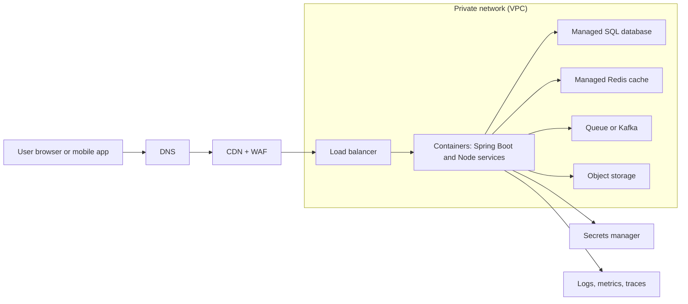

**How it works (one request):**
1. DNS (Route 53 / Cloud DNS / Azure DNS) turns `shop.example.com` into the CDN address.
2. The CDN serves images, JS and CSS from a nearby city. API calls pass through to the origin.
3. The WAF blocks bad requests (SQL injection, bots, too many calls from one IP).
4. The load balancer ends TLS (HTTPS) and picks a healthy container.
5. The Spring Boot service reads secrets at startup, then talks to the database, cache and queue over private IPs.
6. Logs, metrics and traces go to the cloud's monitoring service or to Grafana/Datadog.

| Box in the diagram | AWS | GCP | Azure |
|---|---|---|---|
| DNS | Route 53 | Cloud DNS | Azure DNS |
| CDN + WAF | CloudFront + AWS WAF | Cloud CDN + Cloud Armor | Azure Front Door (with WAF) |
| Load balancer | Application Load Balancer | Application Load Balancer | Application Gateway |
| Containers | EKS or ECS on Fargate | GKE or Cloud Run | AKS or Container Apps |
| SQL database | RDS / Aurora | Cloud SQL / AlloyDB | Azure Database for PostgreSQL |
| Cache | ElastiCache | Memorystore | Azure Managed Redis |
| Queue | SQS / MSK | Pub/Sub | Service Bus / Event Hubs |
| Object storage | S3 | Cloud Storage | Blob Storage |

**Say this in the interview:**

> "A request hits DNS, then a CDN with a WAF, then a layer-7 load balancer. The load balancer sends it to stateless Spring Boot containers in private subnets. They use a managed Postgres, a managed Redis and a queue, all over private networking. Secrets come from the secrets manager, and every service sends logs, metrics and traces to one place."

**They may ask next:**
- **Why is the app in a private subnet?** So nothing on the internet can reach it directly. Only the load balancer is public.
- **Where does the frontend live?** A Next.js app runs as a container too, or static files go to object storage behind the CDN.

---

## Service name cheat sheet (AWS, GCP, Azure)

**In one line:** Every cloud has the same building blocks with different names; learn the category first, then the three names.

**Story:** A train ticket is called a "ticket" in English, a "tikat" in Hindi and a "billete" in Spanish. It is the same piece of paper. Cloud services are the same: a "bucket for files" is S3 on AWS, Cloud Storage on GCP and Blob Storage on Azure.

**How to read the table:** "(was X)" means renamed. "Retiring" or "closed to new customers" means do not pick it for new work. Details are in [the next section](#renamed-and-retired-services-you-should-know).

**Diagram (the categories, from the user down to the data):**

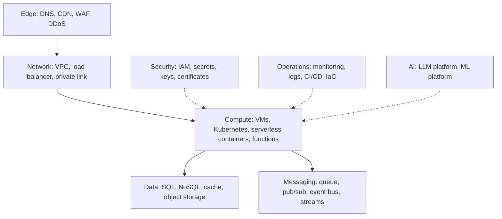

### Compute

| Category | What it does (simple words) | AWS | GCP | Azure |
|---|---|---|---|---|
| Virtual machines | Rent a computer by the second or hour | Amazon EC2 | Compute Engine | Azure Virtual Machines |
| Autoscaling group | A group of identical VMs that grows and shrinks | EC2 Auto Scaling groups | Managed instance groups (MIGs) | Virtual Machine Scale Sets |
| Container registry | Stores your Docker images | Amazon ECR | Artifact Registry (Container Registry is shut down) | Azure Container Registry |
| Managed Kubernetes | Kubernetes where the cloud runs the control plane | Amazon EKS (EKS Auto Mode manages nodes too) | GKE (Autopilot manages nodes too) | AKS (AKS Automatic manages nodes too) |
| Serverless containers | Give an image, get a URL; no servers or cluster to manage | Amazon ECS on AWS Fargate, ECS Express Mode (App Runner: closed to new customers) | Cloud Run | Azure Container Apps |
| Functions | Run a small piece of code per event | AWS Lambda | Cloud Run functions (was Cloud Functions) | Azure Functions |
| PaaS app hosting | Upload code or a JAR; the platform runs it | AWS Elastic Beanstalk | App Engine | Azure App Service (Azure Spring Apps: retiring March 2028) |
| Batch jobs | Run big jobs on many machines, then stop | AWS Batch | Batch | Azure Batch, Container Apps jobs |
| Scheduler / cron | Run something every night at 2 AM | EventBridge Scheduler | Cloud Scheduler | Functions timer trigger, Container Apps scheduled jobs, Logic Apps |

### Storage and databases

| Category | What it does (simple words) | AWS | GCP | Azure |
|---|---|---|---|---|
| Object storage | Store files (images, PDFs, backups) by key, nearly unlimited | Amazon S3 | Cloud Storage | Azure Blob Storage |
| Block storage | A virtual hard disk for one VM | Amazon EBS | Persistent Disk, Hyperdisk | Azure Managed Disks |
| File storage | A shared network folder many machines can mount | Amazon EFS, Amazon FSx | Filestore | Azure Files, Azure NetApp Files |
| Archive storage | Very cheap storage you rarely read; slow to get back | S3 Glacier storage classes (Flexible Retrieval, Deep Archive) | Cloud Storage Archive class | Blob Storage Archive tier |
| Relational DB | Managed PostgreSQL, MySQL, SQL Server | Amazon RDS, Amazon Aurora | Cloud SQL, AlloyDB for PostgreSQL | Azure SQL Database, Azure Database for PostgreSQL / MySQL (flexible server) |
| Distributed SQL / global DB | SQL that spreads over many machines or regions | Aurora DSQL, Aurora Global Database | Spanner | Azure Cosmos DB (global NoSQL), Azure Database for PostgreSQL elastic clusters |
| NoSQL key-value | Very fast get/put by key at huge scale | Amazon DynamoDB | Bigtable, Firestore | Azure Cosmos DB for NoSQL, Table Storage |
| Document DB | Store JSON documents, MongoDB style | Amazon DocumentDB (with MongoDB compatibility) | Firestore (with MongoDB compatibility) | Azure DocumentDB (was Cosmos DB for MongoDB vCore) |
| In-memory cache | Redis or Valkey run for you | Amazon ElastiCache (Valkey, Redis OSS, Memcached), MemoryDB | Memorystore (Valkey, Redis, Memcached) | Azure Managed Redis (Azure Cache for Redis: retiring) |
| Data warehouse | Run SQL over terabytes for reports | Amazon Redshift | BigQuery | Microsoft Fabric (Warehouse), Azure Synapse Analytics (older) |
| Search | Full-text search, like Elasticsearch | Amazon OpenSearch Service | Agent Search (was Vertex AI Search), or Elastic Cloud from Marketplace | Azure AI Search (was Azure Cognitive Search) |

### Messaging and integration

| Category | What it does (simple words) | AWS | GCP | Azure |
|---|---|---|---|---|
| Queue | One message goes to one worker; work waits in line | Amazon SQS | Pub/Sub (pull subscription), Cloud Tasks | Service Bus queues, Queue Storage |
| Pub/sub (fan-out) | One message goes to many subscribers | Amazon SNS | Pub/Sub | Service Bus topics, Event Grid |
| Event bus | Route events by rules ("if type = OrderPlaced, send to X") | Amazon EventBridge | Eventarc | Event Grid |
| Streaming | Ordered log of events you can replay | Kinesis Data Streams | Pub/Sub | Event Hubs |
| Managed Kafka | Real Apache Kafka run for you | Amazon MSK | Managed Service for Apache Kafka | Event Hubs (Kafka-compatible endpoint), or Confluent Cloud from Marketplace |
| Workflow / orchestration | Run steps in order with retries and waits | AWS Step Functions, Amazon MWAA (Airflow) | Workflows, Cloud Composer (Airflow) | Logic Apps, Durable Functions, Data Factory |
| API gateway | One front door for APIs: auth, rate limits, keys | Amazon API Gateway | API Gateway, Apigee | Azure API Management |
| Email / SMS / push | Send emails, SMS and mobile push | Amazon SES (email), AWS End User Messaging (SMS, push), SNS | No first-party email or SMS; use partners; Firebase Cloud Messaging (push) | Azure Communication Services (email, SMS), Notification Hubs (push) |

### Networking and edge

| Category | What it does (simple words) | AWS | GCP | Azure |
|---|---|---|---|---|
| Load balancer | Spread traffic over servers. L7 reads HTTP; L4 only sees TCP/UDP | Elastic Load Balancing: ALB (L7), NLB (L4) | Cloud Load Balancing: Application LB (L7), Network LB (L4) | Application Gateway (L7), Azure Load Balancer (L4), Front Door (global L7) |
| CDN | Cache files in cities near users | Amazon CloudFront | Cloud CDN, Media CDN (video) | Azure Front Door (Azure CDN classic: retiring Sept 2027) |
| DNS | Turn names into IP addresses | Amazon Route 53 | Cloud DNS | Azure DNS |
| VPC / network | Your private network inside the cloud | Amazon VPC | VPC network | Azure Virtual Network (VNet) |
| Private link | Reach a cloud service or partner over private IPs, not the internet | AWS PrivateLink (VPC endpoints) | Private Service Connect | Azure Private Link (private endpoints) |
| VPN / direct connect | Connect your office or data center to the cloud | Site-to-Site VPN, AWS Direct Connect | Cloud VPN, Cloud Interconnect | VPN Gateway, ExpressRoute |

### Security and identity

| Category | What it does (simple words) | AWS | GCP | Azure |
|---|---|---|---|---|
| IAM | Who (person or app) can do what on which resource | AWS IAM, IAM Identity Center (for people) | Cloud IAM | Microsoft Entra ID (was Azure AD) + Azure RBAC |
| Secrets manager | Store passwords and API keys safely, with rotation | AWS Secrets Manager, SSM Parameter Store | Secret Manager | Azure Key Vault (secrets) |
| Key management | Create and guard encryption keys | AWS KMS, CloudHSM | Cloud KMS, Cloud HSM | Azure Key Vault (keys), Managed HSM |
| Certificate manager | Free TLS certificates that renew themselves | AWS Certificate Manager (ACM) | Certificate Manager | Key Vault certificates, App Service managed certificates |
| WAF | Block bad HTTP requests (SQL injection, bots) | AWS WAF | Cloud Armor | Azure Web Application Firewall (on Front Door or Application Gateway) |
| DDoS protection | Survive floods of fake traffic | AWS Shield (Standard is free, Advanced is paid) | Cloud Armor (Managed Protection) | Azure DDoS Protection |
| End-user identity | Sign-up and login for your app's customers | Amazon Cognito | Identity Platform (Firebase Authentication) | Microsoft Entra External ID (Azure AD B2C: closed to new customers) |

### Operations and delivery

| Category | What it does (simple words) | AWS | GCP | Azure |
|---|---|---|---|---|
| Monitoring / metrics | Numbers over time and dashboards | Amazon CloudWatch, Amazon Managed Service for Prometheus, Amazon Managed Grafana | Cloud Monitoring, Managed Service for Prometheus | Azure Monitor, Azure Monitor managed service for Prometheus, Azure Managed Grafana |
| Logging | Collect and search logs | CloudWatch Logs | Cloud Logging | Azure Monitor Logs (Log Analytics) |
| Tracing | Follow one request across services | AWS X-Ray, CloudWatch Application Signals (X-Ray SDKs end support Feb 2027; use OpenTelemetry) | Cloud Trace | Application Insights |
| Alerting | Wake someone up when a number is bad | CloudWatch alarms + SNS | Cloud Monitoring alerting policies | Azure Monitor alerts + action groups |
| CI/CD | Build, test and deploy on every commit | CodePipeline, CodeBuild, CodeDeploy | Cloud Build, Cloud Deploy | Azure Pipelines (Azure DevOps), GitHub Actions |
| IaC (native) | Describe infrastructure as code files | CloudFormation, AWS CDK | Infrastructure Manager (runs Terraform; Deployment Manager has ended) | ARM templates, Bicep |
| IaC (all clouds) | One tool for every cloud | Terraform or OpenTofu | Terraform or OpenTofu | Terraform or OpenTofu |

### AI and ML

| Category | What it does (simple words) | AWS | GCP | Azure |
|---|---|---|---|---|
| AI / LLM platform | Call hosted LLMs (Claude, Gemini, GPT, Llama) by API, build agents | Amazon Bedrock (AgentCore for agents) | Gemini Enterprise Agent Platform (was Vertex AI, renamed April 2026) | Microsoft Foundry (was Azure AI Foundry), Azure OpenAI in Foundry Models |
| ML platform | Train, tune and host your own models | Amazon SageMaker AI (was SageMaker) | Agent Platform Managed Training and Pipelines (was Vertex AI Training and Pipelines) | Azure Machine Learning |

For using these LLM APIs from code, see [ai-llm-basics.md](ai-llm-basics.md).

**Say this in the interview:**

> "I think in categories first: compute, storage, database, messaging, network, security, operations. Then I map names. Kubernetes is EKS, GKE or AKS. Serverless containers are Fargate, Cloud Run or Container Apps. Object storage is S3, Cloud Storage or Blob. Queues are SQS, Pub/Sub or Service Bus. The ideas are the same everywhere; only the limits and names change."

**They may ask next:**
- **Which three names should every backend engineer know without thinking?** Object storage (S3), managed Postgres (RDS), and a queue (SQS). On GCP: Cloud Storage, Cloud SQL, Pub/Sub. On Azure: Blob Storage, Azure Database for PostgreSQL, Service Bus.
- **Is Pub/Sub a queue or pub/sub?** Both. Each subscription works like its own queue, and many subscriptions on one topic give you fan-out.

---

## Renamed and retired services you should know

**In one line:** Using an old name (Azure AD, Cognitive Search, Container Registry) in an interview shows old knowledge; using the new name shows you keep up.

**Story:** Your city renames "Victoria Station" to "Shivaji Terminus". Old maps still work for a while, but a taxi driver who uses the new name sounds local.

**How it works:** Clouds rename products for marketing, and they retire products they no longer want to run. "Closed to new customers" usually means "slowly going away". Do not start new projects on it.

**Diagram (the renames you are most likely to say out loud):**

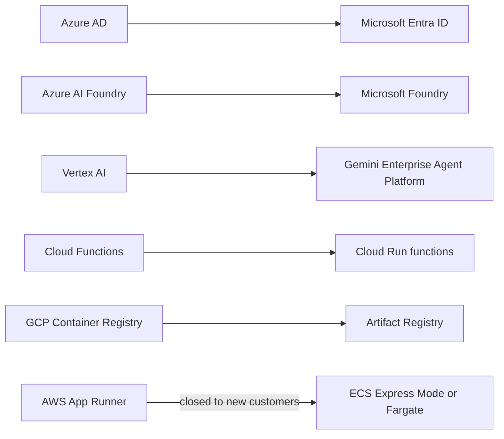

| Old name or service | Status (checked Nov 2026) | Use instead |
|---|---|---|
| Azure Active Directory (Azure AD) | Renamed in 2023 | Microsoft Entra ID |
| Azure AD B2C | Closed to new customers since May 2025; existing tenants supported | Microsoft Entra External ID |
| Azure Cognitive Search | Renamed in 2023 | Azure AI Search |
| Azure AI Foundry (and Azure AI Studio before it) | Renamed at Ignite, Nov 2025 | Microsoft Foundry |
| Azure Cosmos DB for MongoDB (vCore) | Renamed Nov 2025 | Azure DocumentDB |
| Azure Cosmos DB for PostgreSQL | Not supported for new projects | Azure Database for PostgreSQL elastic clusters |
| Azure Cache for Redis | New caches blocked during 2026 (from April 1 for Enterprise tiers and new customers, from Oct 1 for existing Basic/Standard/Premium customers); Enterprise tiers retire March 31, 2027, Basic/Standard/Premium retire Sept 30, 2028 | Azure Managed Redis |
| Azure Spring Apps | Closed to new customers March 2025; retires March 31, 2028 | Azure Container Apps or AKS |
| Azure CDN Standard from Microsoft (classic) | Retires Sept 30, 2027 | Azure Front Door Standard/Premium |
| GCP Container Registry | Shut down March 18, 2025; `gcr.io` URLs are now served by Artifact Registry | Artifact Registry |
| GCP Cloud Functions | Renamed in 2024 | Cloud Run functions |
| Vertex AI | Renamed April 2026 (Google Cloud Next '26) | Gemini Enterprise Agent Platform (Vertex AI Search is now Agent Search) |
| GCP Deployment Manager | Support ended March 31, 2026 | Infrastructure Manager (managed Terraform) |
| AWS App Runner | Closed to new customers April 30, 2026; existing users can stay | Amazon ECS Express Mode or ECS on Fargate |
| Amazon Pinpoint | Closed to new customers May 20, 2025; support ended Oct 30, 2026 | AWS End User Messaging (SMS, push), Amazon SES (email) |
| Amazon Glacier (old vault API) | Closed to new customers Dec 15, 2025 | S3 Glacier storage classes |
| AWS X-Ray SDKs and daemon | Maintenance mode; end of support Feb 25, 2027 (X-Ray service stays) | OpenTelemetry (AWS Distro for OpenTelemetry) |
| Amazon SageMaker | Renamed Dec 2024 (the name "SageMaker" is now a wider data and AI platform) | Amazon SageMaker AI |
| AWS CodeCommit | Was closed to new customers in 2024; back to general availability in Nov 2025 | Still fine, but most teams use GitHub or GitLab |

**Good and bad:**
| Good | Bad |
|---|---|
| "Entra ID, which used to be Azure AD" | Only saying "Azure AD" in 2026 |
| Checking the product page before a design review | Picking a "closed to new customers" service for a new system |

**Say this in the interview:**

> "Cloud names change a lot, so I check the product page before I design. For example, Azure AD is now Entra ID, and Vertex AI is now Gemini Enterprise Agent Platform. AWS App Runner is closed to new customers, so I would use ECS with Fargate for simple container apps."

**They may ask next:**
- **Why does "closed to new customers" matter if it still works?** No new features, fewer people who know it, and a future forced migration. That is real cost for a new project.

---

## Cloud basics: regions, availability zones and edge

**In one line:** A **region** is a city-level area with several separate data centers called **availability zones**; **edge locations** are small sites near users for CDN and DNS.

**Story:** A bank in Mumbai.
- The bank has three branches in different parts of the city (Andheri, Dadar, Colaba). Each has its own power and staff. If one floods, the other two still work. Those are **availability zones (AZs)**.
- Mumbai itself is the **region**. The bank also has a Delhi region, far away, for a disaster that hits the whole city.
- Small ATMs in every neighbourhood give cash fast without going to a branch. Those are **edge locations**.

**Diagram:**

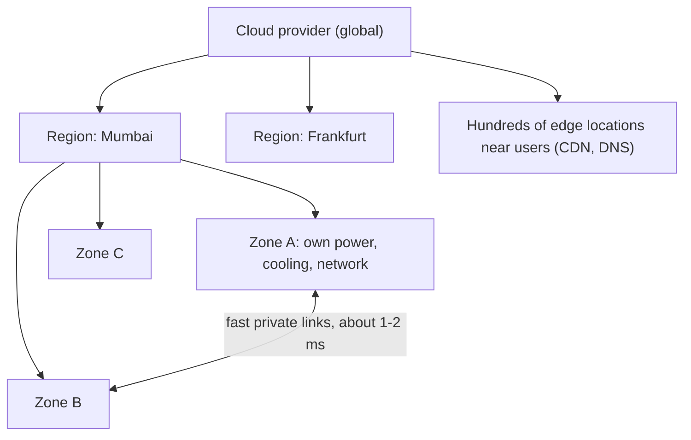

**How it works:**
- **Region:** a geographic area, like `ap-south-1` (AWS Mumbai), `asia-south1` (GCP Mumbai) or `Central India` (Azure). Data stays in the region unless you copy it out. This matters for laws like GDPR.
- **Availability zone:** one or more data centers with separate power, cooling and network, a few kilometers apart. Most regions have three. Latency between zones is low (about 1–2 ms).
- **Edge location / point of presence (PoP):** a small site in many cities. CDN caches and DNS servers run here, not your app.
- **Global services:** some services are not tied to one region. Examples: IAM, Route 53, CloudFront on AWS. On GCP, a VPC network is global and subnets are regional.
- **Azure note:** Azure has "availability zones" in many regions, plus "region pairs" for disaster recovery.

**How to choose a region:** close to users (latency), legal rules (data must stay in the country), service availability (new services launch in big regions first), and cost (prices differ by region).

**Good and bad:**
| Good | Bad |
|---|---|
| App in 2–3 AZs behind one load balancer | Everything in one AZ "because it is cheaper" |
| Region picked for users and data laws | Region picked because it was the console default |

**Say this in the interview:**

> "A region is a geographic area. Inside it are usually three availability zones, which are separate data centers with their own power. I run every service in at least two zones, so one data center failure does not take us down. For a region-wide failure I need a disaster recovery plan in a second region. Edge locations are only for CDN and DNS."

**They may ask next:**
- **Does multi-AZ cost more?** A bit: you run more copies, and traffic between zones is often charged. It is still the normal default for production.
- **Multi-AZ vs multi-region?** Multi-AZ protects from a data center failure and is cheap and simple. Multi-region protects from a region failure but is hard (data copy, latency, cost).

---

## IaaS, PaaS, SaaS and serverless

**In one line:** These are levels of "how much the cloud does for you": IaaS gives machines, PaaS runs your code, serverless runs it per request, and SaaS is the finished app.

**Story:** Pizza four ways.
- **Make at home (on-premises):** you buy the oven, flour, cheese, and clean up. You do everything.
- **Take and bake (IaaS):** the shop gives you a ready base and toppings. You still own the oven and the cooking. Like renting a VM: the cloud gives the hardware, you install Java, patch Linux, and run the app.
- **Pizza delivery (PaaS):** you choose the pizza, they cook it. You just eat. Like App Service or Elastic Beanstalk: you upload a JAR; they run it.
- **Dining out (SaaS):** table, plates, pizza, cleaning, all done. Like Gmail or Salesforce: you only use it.
- **Pizza by the slice (serverless):** you pay only for each slice you eat, and the shop is closed when nobody comes. Like Lambda or Cloud Run: pay per request, scale to zero.

**Diagram:**

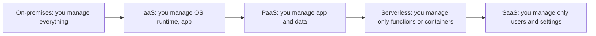

**How it works:**

| Model | You manage | Cloud manages | Examples |
|---|---|---|---|
| IaaS | OS patches, JVM, app, scaling rules | Hardware, network, data center | EC2, Compute Engine, Azure VMs |
| CaaS (containers) | Images, deployments, some cluster settings | Control plane, sometimes nodes | EKS, GKE, AKS |
| PaaS | App code and config | OS, runtime, scaling, patches | Elastic Beanstalk, App Engine, App Service |
| Serverless | Code or container image | Everything else; scale to zero | Lambda, Cloud Run, Container Apps, Azure Functions |
| SaaS | Users and settings | The whole app | Gmail, Salesforce, Datadog |

**Good and bad:**
| Good | Bad |
|---|---|
| Higher level = less work, faster start | Higher level = less control, more lock-in, limits (timeouts, memory) |
| Lower level = full control | Lower level = you patch Linux at 2 AM |

**Say this in the interview:**

> "It is about who does the work. With IaaS I get a VM and do everything from the OS up. With PaaS I give a JAR and they run it. With serverless I pay per request and it scales to zero. With SaaS I just use the product. I go as high as I can, and drop lower only when I need control the higher level does not give me."

**They may ask next:**
- **Is Kubernetes IaaS or PaaS?** In between. People call managed Kubernetes "CaaS" (containers as a service). EKS Auto Mode, GKE Autopilot and AKS Automatic move it closer to PaaS.

---

## Shared responsibility model

**In one line:** The cloud secures the cloud itself (buildings, hardware, its software); you secure what you put in the cloud (data, access, config, code).

**Story:** Renting a flat. The building owner fixes the lift, the main gate and the water tank. You lock your own door, choose who gets a key, and do not leave the gas on. If a thief walks in because you left your door open, it is not the owner's fault.

**Diagram:**

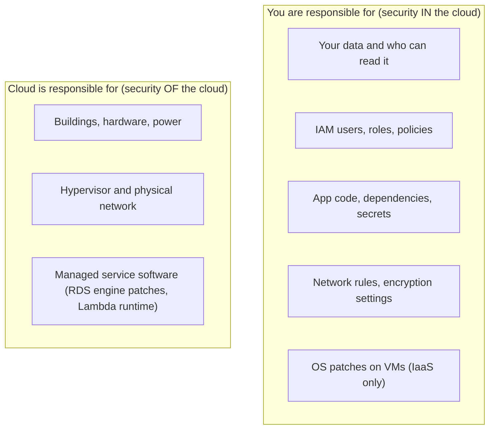

**How it works:**
- The line moves with the service type. With EC2 you patch the OS. With RDS the cloud patches the DB engine, but you still choose who can connect. With Lambda the cloud patches the runtime, but your code and its libraries are yours.
- Almost every real cloud breach is on the customer side: a public S3 bucket, a leaked access key, a security group open to `0.0.0.0/0`, an over-powerful IAM role.

**Good and bad:**
| Good | Bad |
|---|---|
| "Block public access" on all buckets by default | Thinking "it's on AWS, so it is secure" |
| Encryption on, least-privilege roles, audit logs (CloudTrail / Cloud Audit Logs / Azure Activity Log) | Long-lived access keys in a Git repo |

**Say this in the interview:**

> "The cloud secures the hardware, the data centers and the managed service software. I secure everything I configure: IAM, network rules, encryption, my code and my data. The more managed the service, the less I own, but data and access are always mine. Most cloud breaches are misconfigurations on the customer side."

**They may ask next:**
- **Who patches the database on RDS?** AWS patches the engine during your maintenance window. You choose the window and the version upgrades.

---

## Compute choices: VM vs Kubernetes vs serverless containers vs functions

**In one line:** Pick the most managed option that fits: serverless containers for most APIs, Kubernetes for many services, functions for small event jobs, VMs for full control.

**Story:** Getting to work.
- **VM** = buying a car. Full control, but you fuel it, service it and park it.
- **Kubernetes** = running a taxi company. Great for many trips, but you need a manager and drivers.
- **Serverless containers** = Uber. You say where to go. You pay per ride. No car to look after.
- **Functions** = a bicycle rental for a short trip. Very cheap and quick, but not for a 500 km journey.

**Diagram:**

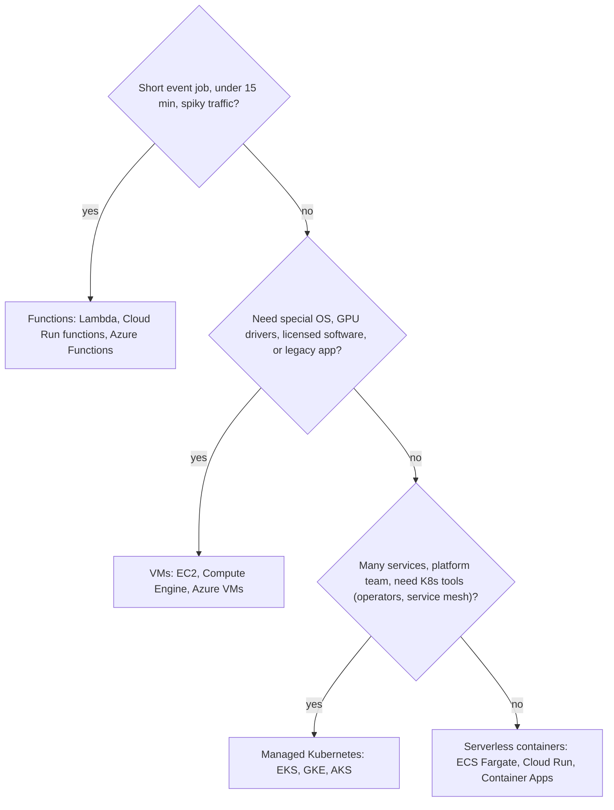

**How it works:**

| | VMs | Managed Kubernetes | Serverless containers | Functions |
|---|---|---|---|---|
| You ship | A machine image or JAR | Container image + YAML | Container image | Code (or an image) |
| Scales to zero | No | Not by default | Yes (Cloud Run, Container Apps); ECS needs at least one task | Yes |
| Max request time | No limit | No limit | Long (Cloud Run up to 60 min per request) | Lambda 15 min |
| Ops work | High | Medium to high | Low | Lowest |
| Good for Spring Boot? | Yes | Yes, the most common in companies | Yes, very good fit | Possible, with SnapStart or native image |
| Cost when idle | You pay | You pay for nodes | Near zero | Near zero |

Container and Kubernetes details (pods, deployments, probes, HPA) are in [docker-kubernetes.md](docker-kubernetes.md).

**Good and bad:**
| Good | Bad |
|---|---|
| Cloud Run / Fargate for a team of 5 with 6 services | A self-managed Kubernetes cluster for one small API |
| EKS/GKE/AKS for 80 services with a platform team | Lambda for a long batch that runs 40 minutes |
| Functions for "resize image after upload" | Functions with a big Spring context and no SnapStart: slow cold starts |

**Say this in the interview:**

> "I pick the most managed option that fits. For a normal Spring Boot or Node API I like serverless containers: Cloud Run, ECS on Fargate or Container Apps. If the company has many services and a platform team, managed Kubernetes. Functions are for short event-driven jobs. VMs only when I need OS-level control or the software is not containerized."

**They may ask next:**
- **ECS or EKS on AWS?** ECS is simpler and AWS-only. EKS is standard Kubernetes, portable, with a bigger tool set, but more to learn and run.
- **What is Fargate?** A way to run ECS or EKS containers without managing EC2 nodes. You set CPU and memory per task.
- **Why not App Runner?** It closed to new customers in April 2026. AWS points to ECS Express Mode instead.

---

## Reference architecture: Spring Boot microservices on AWS

**In one line:** Route 53 → CloudFront (+ WAF) → Application Load Balancer → EKS or ECS in private subnets → Aurora, ElastiCache, SQS and S3.

**Story:** A restaurant chain kitchen. The phone number (DNS) goes to the call center (CDN). The call center answers menu questions itself and forwards orders to the kitchen door (load balancer). Cooks (services) work in the back, where customers cannot walk in (private subnet). They use the fridge (database), the spice rack near the stove (cache), the order tickets on a rail (queue), and the big store room (S3).

**Diagram:**

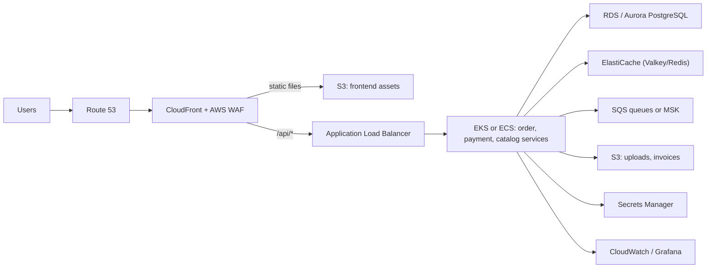

**One request, step by step:**

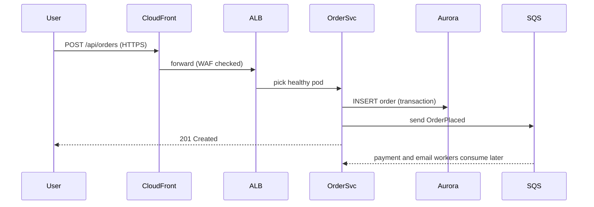

**How it works:**
1. **Edge:** Route 53 points `shop.example.com` to CloudFront. CloudFront serves the React/Next.js static files from S3 and forwards `/api/*` to the ALB. AWS WAF is attached to CloudFront. ACM gives the TLS certificate.
2. **Entry:** the ALB sits in public subnets in 3 AZs. It routes by path or host (`/api/orders` → order service). On EKS, the AWS Load Balancer Controller creates the ALB from a Kubernetes Ingress.
3. **Services:** Spring Boot containers in private subnets, images from ECR, at least 2 replicas spread over AZs. An API gateway layer (Spring Cloud Gateway or Amazon API Gateway) is optional; see [API gateway and BFF](microservices.md#api-gateway-and-bff).
4. **Data:** each service owns its database (Aurora PostgreSQL, multi-AZ). ElastiCache for caching and sessions. S3 for files, uploaded with pre-signed URLs so big files never pass through the service.
5. **Async:** SQS for work queues, SNS or EventBridge for fan-out, MSK if the company is already on Kafka. Use the [transactional outbox](microservices.md#transactional-outbox-pattern) so the DB write and the event never get out of sync.
6. **Security:** pods get IAM roles (IRSA or EKS Pod Identity), no access keys. Secrets come from Secrets Manager.
7. **Operations:** logs, metrics and traces via OpenTelemetry to CloudWatch or Grafana/Datadog. Terraform for everything. CI/CD builds the image, pushes to ECR, and deploys.

**The same design on GCP and Azure:**

| Layer | AWS | GCP | Azure |
|---|---|---|---|
| DNS | Route 53 | Cloud DNS | Azure DNS |
| CDN + WAF | CloudFront + AWS WAF | Cloud CDN + Cloud Armor | Azure Front Door + WAF |
| TLS certificate | ACM | Certificate Manager | Front Door managed certificate / Key Vault |
| Load balancer | ALB | External Application Load Balancer | Application Gateway (or Front Door alone) |
| Containers | EKS or ECS on Fargate | GKE or Cloud Run | AKS or Container Apps |
| Image registry | ECR | Artifact Registry | Azure Container Registry |
| SQL database | Aurora / RDS PostgreSQL | Cloud SQL / AlloyDB | Azure Database for PostgreSQL flexible server |
| Cache | ElastiCache | Memorystore | Azure Managed Redis |
| Queue / events | SQS, SNS, EventBridge, MSK | Pub/Sub, Eventarc, Managed Kafka | Service Bus, Event Grid, Event Hubs |
| Files | S3 | Cloud Storage | Blob Storage |
| Secrets | Secrets Manager | Secret Manager | Key Vault |
| Pod identity | IRSA / EKS Pod Identity | Workload Identity Federation for GKE | Microsoft Entra Workload ID |
| Monitoring | CloudWatch, X-Ray | Cloud Monitoring, Cloud Logging, Cloud Trace | Azure Monitor, Application Insights |

**Good and bad:**
| Good | Bad |
|---|---|
| Only the load balancer and CDN are public | Database with a public IP "just for debugging" |
| Files go straight to S3 with pre-signed URLs | 200 MB uploads streamed through the Spring Boot service |
| Each service has its own DB and IAM role | All services share one DB user with full rights |

**Say this in the interview:**

> "On AWS: Route 53 to CloudFront with WAF, then an ALB in public subnets. Spring Boot services run on EKS or ECS in private subnets across three AZs. Each service has its own Aurora Postgres, plus ElastiCache for caching, SQS or MSK for events, and S3 for files with pre-signed URLs. Pods use IAM roles, secrets come from Secrets Manager, and everything is Terraform. On GCP it is Cloud DNS, Cloud CDN, a load balancer, GKE or Cloud Run, Cloud SQL, Memorystore and Pub/Sub."

**They may ask next:**
- **Where do you end TLS?** At CloudFront and again at the ALB (both with ACM certificates). Inside the VPC, plain HTTP is common; use mTLS (a service mesh) if rules require encryption everywhere.
- **How do services find each other?** On Kubernetes, through Kubernetes Services (DNS names). On ECS, through ECS Service Connect or Cloud Map. See [service discovery](spring-ecosystem.md#service-discovery-and-load-balancing).
- **Why put CloudFront in front of the API too?** One domain for site and API (no CORS), WAF at the edge, TLS close to the user, and DDoS protection from Shield Standard.

---

## Networking: VPC, subnets, NAT and firewalls

**In one line:** A VPC is your private network in the cloud. Public subnets hold what the internet may reach, private subnets hold apps and databases, and security groups decide who talks to whom.

**Story:** A gated housing society.
- The whole society with its wall is the **VPC**.
- The **main gate area** with the guard room and visitor parking is the **public subnet**. Visitors can come here.
- The **residential towers** are **private subnets**. Visitors cannot walk in directly.
- The **exit gate** lets residents go out to buy milk, but no stranger can come in through it. That is the **NAT gateway**.
- Each flat's **door lock** that only opens for people on a list is the **security group**. The **guard at each tower entrance** checking a printed list for the whole tower is the **network ACL**.

**Diagram:**

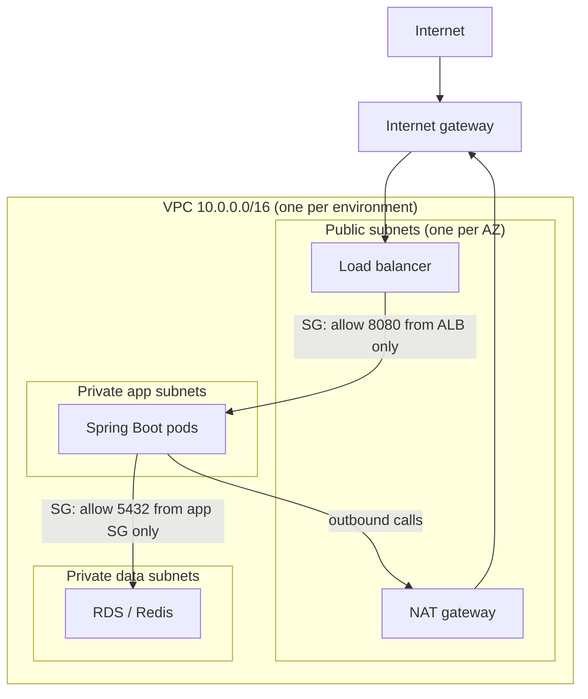

**How it works:**
- **CIDR block:** the IP range of the VPC, like `10.0.0.0/16` (65,536 addresses). Each subnet takes a slice, like `10.0.1.0/24` (256 addresses). Plan ranges so they do not overlap with other VPCs or the office network; you cannot peer overlapping ranges.
- **Public subnet:** its route table sends `0.0.0.0/0` to an **internet gateway**. Resources here can have public IPs.
- **Private subnet:** no route to the internet gateway. Outbound traffic (calling Stripe, downloading packages) goes through a **NAT gateway** in a public subnet. Inbound from the internet is impossible.
- **VPC endpoints / Private Link:** let private subnets reach S3, ECR, Secrets Manager without going through NAT. Safer and often much cheaper.
- **Security group (SG):** a firewall on each resource (ENI). **Stateful**: if a request is allowed in, the reply is allowed out automatically. **Allow rules only.** Rules can point to another SG ("allow from the ALB's SG"), which is clean and safe.
- **Network ACL (NACL):** a firewall on the subnet. **Stateless**: you must allow both directions, including return ports. Has **allow and deny** rules, checked in number order. Most teams leave NACLs open and use SGs; NACLs are for blocking an IP range quickly.
- **Connecting VPCs:** VPC peering (one to one), Transit Gateway (hub for many VPCs and VPNs), PrivateLink (expose one service, not the whole network).

| | Security group | Network ACL |
|---|---|---|
| Attached to | Resource (network interface) | Subnet |
| State | Stateful (replies allowed) | Stateless (allow both ways) |
| Rules | Allow only | Allow and deny |
| Order | All rules checked | Lowest number first |
| Typical use | Main firewall | Coarse block of bad IP ranges |

**GCP and Azure differences:**
- **GCP:** a VPC network is **global**; subnets are regional. Firewall rules belong to the VPC and target instances by **network tags** or service accounts. Outbound uses **Cloud NAT**. Private access to Google APIs uses Private Google Access or Private Service Connect.
- **Azure:** a **VNet** is regional. **Network Security Groups (NSGs)** attach to a subnet or a network interface and are stateful with allow and deny rules. Outbound uses **NAT Gateway**. Private access to PaaS services uses **Private Endpoints**.

**Example (Terraform, AWS security groups):**

```hcl
resource "aws_security_group" "app" {
  name   = "order-service"
  vpc_id = aws_vpc.main.id
}

resource "aws_security_group_rule" "app_from_alb" {
  type                     = "ingress"
  from_port                = 8080
  to_port                  = 8080
  protocol                 = "tcp"
  security_group_id        = aws_security_group.app.id
  source_security_group_id = aws_security_group.alb.id   # only the ALB may call the app
}

resource "aws_security_group_rule" "db_from_app" {
  type                     = "ingress"
  from_port                = 5432
  to_port                  = 5432
  protocol                 = "tcp"
  security_group_id        = aws_security_group.db.id
  source_security_group_id = aws_security_group.app.id   # DB accepts only the app, never 0.0.0.0/0
}
```

**Good and bad:**
| Good | Bad |
|---|---|
| Three subnet tiers (public, app, data) in each of 3 AZs | One public subnet for everything |
| SG rules that reference other SGs | `0.0.0.0/0` on port 5432 or 22 |
| VPC endpoints for S3 and ECR | All S3 and image pulls going through NAT (slow, costly) |
| One NAT gateway per AZ in production | One NAT for all AZs: if that AZ fails, all outbound fails |

**Say this in the interview:**

> "I use a VPC with three tiers of subnets in three AZs. Only load balancers and NAT gateways are in public subnets. Apps and databases are private. Security groups are stateful and I chain them: the ALB can reach the app on 8080, and only the app's security group can reach the database on 5432. NACLs are stateless and I use them only to block ranges. VPC endpoints keep S3 and ECR traffic off the NAT."

**They may ask next:**
- **How does a private pod call an external API?** Through the NAT gateway. The partner sees the NAT's public IP, so you can give them that IP for their allow-list.
- **How do you SSH to a private server?** You do not open port 22. Use AWS Systems Manager Session Manager, GCP IAP TCP forwarding, or Azure Bastion.
- **What is the default route?** `0.0.0.0/0`, meaning "anything not in a more specific route".

---

## IAM: roles, not keys

**In one line:** Give every person and every app its own identity with only the permissions it needs, and use short-lived role credentials instead of long-lived access keys.

**Story:** A hotel key card.
- At check-in you get a card that opens only your room and the gym, and only until checkout. That is a **role with temporary credentials**.
- A **long-lived access key** is like a metal master key. If someone copies it, it works forever on every door, until you change all locks.
- **Least privilege** means the cleaner's card opens rooms on floor 3 only, not the safe.

**Diagram (how a pod gets AWS credentials with IRSA):**

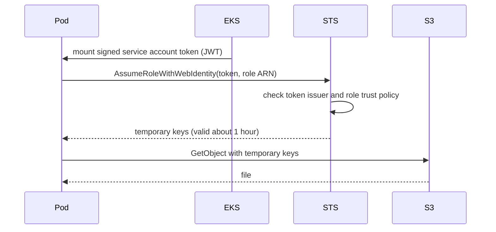

**How it works:**
- **Principal:** who is asking: a user, a group, a role, or a service account.
- **Policy:** a JSON (AWS) or binding (GCP, Azure) that says *allow action X on resource Y*. Default is deny.
- **Role:** an identity with permissions but no password. Someone or something *assumes* it and gets temporary credentials from STS (Security Token Service).
- **People:** log in with SSO (IAM Identity Center, Google accounts, Entra ID). No IAM users with passwords for humans.
- **Apps:** never put access keys in code, env vars or images. The platform gives the app an identity:

| Where the app runs | AWS | GCP | Azure |
|---|---|---|---|
| VM | Instance profile (role on EC2) | Attached service account | Managed identity |
| Kubernetes pod | IRSA or EKS Pod Identity | Workload Identity Federation for GKE | Microsoft Entra Workload ID |
| Serverless | Lambda execution role, ECS task role | Cloud Run service account | Managed identity on Container Apps / Functions |
| CI/CD (GitHub Actions) | OIDC federation to a role | Workload Identity Federation | Workload identity federation (federated credentials) |

- **The SDK finds credentials automatically.** The AWS SDK for Java, Spring Cloud AWS, the Google client libraries and Azure `DefaultAzureCredential` all pick up the role. Your code has no secret.

**Example (least-privilege IAM policy for the order service):**

```json
{
  "Version": "2012-10-17",
  "Statement": [
    {
      "Effect": "Allow",
      "Action": ["s3:GetObject", "s3:PutObject"],
      "Resource": "arn:aws:s3:::shop-invoices/orders/*"
    },
    {
      "Effect": "Allow",
      "Action": ["sqs:SendMessage"],
      "Resource": "arn:aws:sqs:ap-south-1:123456789012:order-placed"
    }
  ]
}
```

Only two actions, only on one bucket path and one queue. No `s3:*`, no `"Resource": "*"`.

**Example (Kubernetes service account linked to that role with IRSA):**

```yaml
apiVersion: v1
kind: ServiceAccount
metadata:
  name: order-service
  namespace: shop
  annotations:
    # IRSA: pods using this service account get this IAM role
    eks.amazonaws.com/role-arn: arn:aws:iam::123456789012:role/order-service
```

With **EKS Pod Identity** (newer and simpler) you skip the annotation and create a "pod identity association" between the service account and the role with the AWS API or Terraform.

**Good and bad:**
| Good | Bad |
|---|---|
| One role per service, scoped to its own resources | One "app-role" with `AdministratorAccess` for all services |
| SSO for humans, MFA on, no root use | Access keys in `application.yml` or a Docker image |
| GitHub Actions uses OIDC to assume a role | A long-lived CI key that never rotates |
| CloudTrail / Cloud Audit Logs / Activity Log turned on | No record of who deleted the bucket |

**Say this in the interview:**

> "Every service gets its own role with least privilege, and it gets temporary credentials from the platform: IRSA or Pod Identity on EKS, Workload Identity on GKE, managed identity on Azure. No access keys anywhere, not even in CI; GitHub Actions uses OIDC federation. Humans log in with SSO and MFA. And audit logs record every API call."

**They may ask next:**
- **What is a trust policy?** The part of an AWS role that says *who* may assume it, for example "only the service account `shop/order-service` from this EKS cluster".
- **Role vs policy?** A policy is a list of permissions. A role is an identity you attach policies to.
- **How do you find too-broad permissions?** IAM Access Analyzer on AWS, IAM Recommender on GCP, and Entra ID access reviews / Defender for Cloud on Azure. They show unused permissions.

---

## Secrets and encryption keys

**In one line:** Keep passwords and API keys in a secrets manager that the app reads at startup using its role, and let a key management service hold the encryption keys that protect your data.

**Story:** A bank locker. Your jewellery (the secret) sits in a locker. The bank keeps the master key (KMS), and you prove who you are (IAM role) to open your locker. No jewellery is kept in the drawer at home (environment files in Git).

**Diagram:**

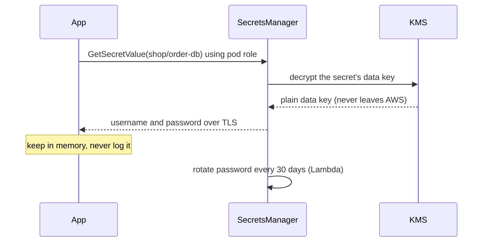

**How it works:**
- **Secrets manager:** AWS Secrets Manager (or SSM Parameter Store for simple config), GCP Secret Manager, Azure Key Vault. Secrets are encrypted, versioned, audited, and can **rotate** automatically (RDS passwords on AWS have built-in rotation).
- **KMS (key management service):** holds keys in hardware (HSMs). It uses **envelope encryption**: a master key encrypts small *data keys*; data keys encrypt your data. The master key never leaves KMS.
- **Encryption at rest:** turn it on for S3, EBS, RDS, backups. Usually one checkbox with a KMS key. Customer-managed keys (CMK) give you control over rotation and who can use the key.
- **In Kubernetes:** the **Secrets Store CSI Driver** mounts secrets as files, or **External Secrets Operator** syncs them into Kubernetes Secrets.
- **Better than secrets:** use IAM auth where possible. RDS IAM authentication, Cloud SQL IAM database authentication and Entra ID auth for Azure databases mean no DB password at all.

**Example (Spring Boot with Spring Cloud AWS):**

```yaml
# application.yml
spring:
  config:
    import: "aws-secretsmanager:shop/order-db"   # loads keys from the secret at startup
  datasource:
    url: jdbc:postgresql://orders.cluster-abc.ap-south-1.rds.amazonaws.com:5432/orders
    username: ${username}     # value comes from the secret JSON
    password: ${password}
```

GCP has `spring-cloud-gcp-starter-secretmanager` (`sm@` references) and Azure has `spring-cloud-azure-starter-keyvault-secrets`. More on Spring config and secrets: [spring-ecosystem.md](spring-ecosystem.md#spring-cloud-config-and-secrets).

**Good and bad:**
| Good | Bad |
|---|---|
| Secret in Secrets Manager, read with the pod's role | Password in `application.yml` committed to Git |
| Automatic rotation, app re-reads on failure | Same DB password for 4 years |
| IAM database auth, no password at all | Secrets printed in startup logs |

**Say this in the interview:**

> "Secrets live in the secrets manager: Secrets Manager, Secret Manager or Key Vault. The app reads them at startup with its own role, so there is no key to bootstrap. Rotation is automatic. Data at rest is encrypted with KMS keys using envelope encryption. Where I can, I skip passwords entirely with IAM database authentication."

**They may ask next:**
- **Secrets Manager vs Parameter Store?** Secrets Manager has built-in rotation and cross-account sharing, and costs more. Parameter Store is fine for plain config and simple secrets.
- **What happens when a secret rotates while the app runs?** Connections already open keep working. New connections need the new password, so the app must reload the secret (refresh on auth failure, or a short cache time).

---

## Storage: object, block, file, classes and lifecycle

**In one line:** Use object storage (S3) for files, block storage (EBS) as a disk for one machine, file storage (EFS) as a shared folder, and move old objects to cheaper classes with lifecycle rules.

**Story:** Where you keep things at home.
- **Object storage** = a huge storage warehouse. You hand over a box with a label and get it back by the label. You cannot edit one page inside a box; you replace the whole box.
- **Block storage** = your laptop's own hard disk. Fast, but only one laptop uses it.
- **File storage** = a shared family cupboard everyone can open.
- **Storage classes** = the kitchen shelf (daily use), the loft (yearly use), and the village house (almost never; takes a day to fetch).

**How it works:**

| Type | AWS | GCP | Azure | Use for |
|---|---|---|---|---|
| Object | S3 | Cloud Storage | Blob Storage | Uploads, images, backups, logs, data lake |
| Block | EBS | Persistent Disk / Hyperdisk | Managed Disks | VM disks, a database on a VM |
| File (NFS/SMB) | EFS, FSx | Filestore | Azure Files | Shared folder for many VMs or pods |

**Storage classes (object storage):**

| Access pattern | AWS S3 | GCP Cloud Storage | Azure Blob |
|---|---|---|---|
| Hot, daily | S3 Standard | Standard | Hot tier |
| Monthly | S3 Standard-IA (Infrequent Access) | Nearline | Cool tier |
| Quarterly | S3 Glacier Instant Retrieval | Coldline | Cold tier |
| Yearly / compliance | S3 Glacier Flexible Retrieval, S3 Glacier Deep Archive (hours to restore) | Archive | Archive tier (hours to rehydrate) |
| Unknown pattern | S3 Intelligent-Tiering | Autoclass | Lifecycle management rules |

- Colder classes cost less to store but more to read, and many have a **minimum storage time** (you pay for it even if you delete early).
- **Lifecycle rules** move or delete objects by age or prefix automatically.

**Diagram (life of an invoice PDF):**

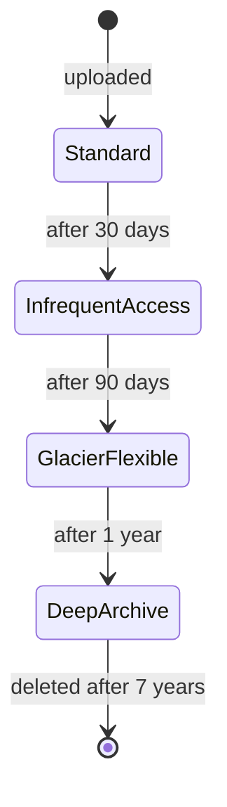

**Example (S3 lifecycle rule, JSON):**

```json
{
  "Rules": [
    {
      "ID": "invoices-to-cold",
      "Filter": { "Prefix": "invoices/" },
      "Status": "Enabled",
      "Transitions": [
        { "Days": 30, "StorageClass": "STANDARD_IA" },
        { "Days": 90, "StorageClass": "GLACIER" },
        { "Days": 365, "StorageClass": "DEEP_ARCHIVE" }
      ],
      "Expiration": { "Days": 2555 }
    }
  ]
}
```

`GLACIER` is the API name for S3 Glacier Flexible Retrieval. 2555 days is about 7 years, a common tax-record rule.

**Other things interviewers ask about S3:**
- **Pre-signed URL:** a link that allows one upload or download for a few minutes. The browser talks to S3 directly; your service only signs. See [blob storage](system-design.md#blob-storage-files-images-videos).
- **Consistency:** S3 is strongly consistent for reads after writes (since Dec 2020).
- **Versioning + Object Lock:** keep old versions and make backups undeletable (protects from ransomware and mistakes).
- **Block Public Access:** on by default for new buckets. Keep it on; serve public files through CloudFront with origin access control.
- **Durability:** S3 is designed for 11 nines (99.999999999%) of durability by storing copies across AZs.

**Good and bad:**
| Good | Bad |
|---|---|
| Lifecycle rules from day one | Five years of logs in S3 Standard |
| Pre-signed URLs for uploads | Files stored as BLOBs in PostgreSQL |
| EFS only when you truly need a shared POSIX folder | EFS as a "database" for many writers |

**Say this in the interview:**

> "Files go to object storage: S3, Cloud Storage or Blob. Users upload directly with pre-signed URLs. Block storage is a disk for one machine; file storage like EFS is a shared folder. I add lifecycle rules so old data moves from Standard to Infrequent Access to Glacier, and expires when the retention period ends. Versioning and Object Lock protect backups."

**They may ask next:**
- **Why not store images in the database?** DB storage is expensive, backups get huge, and it loads the DB for no reason. Store the file in S3 and the key in the DB.
- **Can you mount S3 as a disk?** Tools like Mountpoint for Amazon S3 exist for read-heavy jobs, but S3 is not a POSIX file system. Use EFS if you need real file locking.

---

## Managed databases: RDS vs Aurora, multi-AZ vs read replicas

**In one line:** **Multi-AZ** is a standby copy for failover, **read replicas** are extra copies for reading, and Aurora is AWS's cloud-built engine with shared storage and faster failover.

**Story:** A school office.
- The **head clerk** writes all records (the primary).
- A **standby clerk** sits in another building and copies every entry the moment it is written. If the head clerk falls sick, the standby takes over in a minute. Nobody asks the standby questions in normal times. That is **multi-AZ**.
- **Help-desk clerks** have photocopies of the register and answer parents' questions. Their copies may be a few seconds old. That is a **read replica**.

**Diagram:**

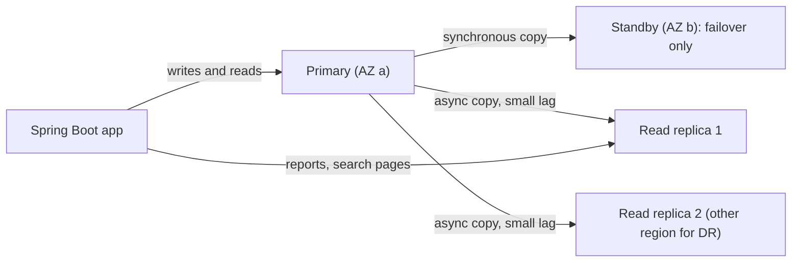

**How it works:**

| | Multi-AZ standby | Read replica |
|---|---|---|
| Goal | High availability | Read scaling (and DR if in another region) |
| Copy type | Synchronous (no data loss on failover) | Asynchronous (has lag, seconds or less) |
| Can you read from it? | Not in classic RDS Multi-AZ (RDS Multi-AZ DB clusters do have 2 readable standbys) | Yes, that is the point |
| Failover | Automatic, DNS name moves, about 1–2 minutes on RDS | Manual promote (or automatic in Aurora) |
| Protects from bad `DELETE`? | No, the standby copies it too | No. Use point-in-time recovery |

**RDS vs Aurora:**

| | Amazon RDS (PostgreSQL / MySQL) | Amazon Aurora (PostgreSQL / MySQL compatible) |
|---|---|---|
| Storage | EBS disk per instance | Shared distributed storage: 6 copies across 3 AZs |
| Replicas | Up to 15 read replicas (engine-dependent), each with its own disk | Up to 15 replicas share the same storage; low lag |
| Failover | About 1–2 minutes | Typically under 60 seconds, often under 30 (a replica becomes primary) |
| Scaling | Change instance size | Aurora Serverless v2 scales capacity in small steps, can scale to zero |
| Global | Cross-region read replica | Aurora Global Database (fast cross-region copy) |
| Cost | Lower for small, steady loads | Higher base cost; worth it for HA and heavy reads |

**Other clouds:**
- **GCP:** Cloud SQL (PostgreSQL, MySQL, SQL Server) with HA (regional instance with a standby in another zone) and read replicas. **AlloyDB** is Google's PostgreSQL-compatible engine for heavy loads, like Aurora. **Spanner** is global distributed SQL.
- **Azure:** Azure Database for PostgreSQL / MySQL flexible server with zone-redundant HA and read replicas. **Azure SQL Database** for SQL Server, with Hyperscale for very large DBs.

**From Spring Boot:**
- Use the cluster's **writer endpoint** for writes and the **reader endpoint** for reads. Send read-only traffic with a routing `DataSource` or `@Transactional(readOnly = true)` plus a router. Remember replica lag: do not read your own write from a replica.
- Size HikariCP for the DB limit: pods × pool size must stay under `max_connections`. With many pods or Lambda, use **RDS Proxy** (or PgBouncer) to pool connections. See [HikariCP](spring-ecosystem.md#connection-pooling-with-hikaricp).
- Set short DNS caching in the JVM (`networkaddress.cache.ttl`), so the app follows the DNS change after failover.

**Good and bad:**
| Good | Bad |
|---|---|
| Multi-AZ + PITR (point-in-time recovery) on every production DB | Calling a read replica your "backup" |
| Reader endpoint for reports | Heavy report queries on the primary at noon |
| Failover tested in staging | First failover happens in production, app caches old IP forever |

**Say this in the interview:**

> "Multi-AZ is for availability: a synchronous standby in another zone with automatic failover. Read replicas are for scaling reads: asynchronous, so they have lag. Neither is a backup; for human mistakes I need point-in-time recovery. Aurora shares storage across three AZs, so failover is faster and replicas have less lag. On GCP the same ideas are Cloud SQL HA and AlloyDB; on Azure, flexible server with zone-redundant HA."

**They may ask next:**
- **When would you pick DynamoDB instead?** Simple key-based access at huge scale, single-digit millisecond reads, no joins. You design tables around access patterns first.
- **Aurora DSQL or Spanner?** For active-active writes in several regions with strong consistency. Most apps do not need it; a single-region primary is simpler.

---

## Messaging: SQS vs SNS vs EventBridge vs Kinesis vs MSK

**In one line:** SQS is a work queue, SNS is fan-out, EventBridge routes events by rules, and Kinesis and MSK are ordered streams you can replay.

**Story:** Communication in an office.
- **SQS** = the in-tray on a desk. Each paper is handled by one clerk, then removed.
- **SNS** = the office loudspeaker. One announcement, everyone subscribed hears it.
- **EventBridge** = the mail room. It reads the envelope ("type: invoice") and sends it to the right department by rules.
- **Kinesis / Kafka (MSK)** = the CCTV recording. Everything is kept in order for days, and any team can rewind and watch again.

**Diagram (common AWS fan-out pattern):**

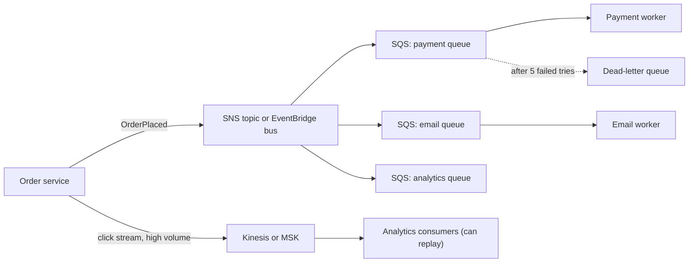

**How it works:**

| | SQS | SNS | EventBridge | Kinesis Data Streams | MSK (Kafka) |
|---|---|---|---|---|---|
| Model | Queue (pull) | Pub/sub (push) | Event bus with rules (push) | Stream (shards) | Stream (partitions) |
| Consumers per message | One | All subscribers | All matching rules | Many, each keeps its own position | Many consumer groups |
| Keeps messages after read? | No (deleted) | No | No (archive and replay is an option) | Yes, 24 h default, up to 365 days | Yes, by retention config |
| Ordering | FIFO queues: per message group | FIFO topics | No guarantee | Per shard | Per partition |
| Best for | Background jobs, smoothing spikes | Fan-out to queues, SMS, email | Routing events between services and SaaS, cron | Click streams, IoT, logs | Event-driven microservices on Kafka |
| You manage | Nothing | Nothing | Nothing | Shard count (or on-demand mode) | Brokers, or MSK Serverless |

**Key SQS ideas:**
- **Visibility timeout:** when a worker takes a message, it is hidden for N seconds. If the worker does not delete it in time, it comes back. So processing must be **idempotent** (safe to run twice). See [idempotency](microservices.md#idempotency).
- **Standard vs FIFO:** Standard is at-least-once with best-effort order and nearly unlimited throughput. FIFO keeps order per message group and removes duplicates within a 5-minute window.
- **Dead-letter queue (DLQ):** after N failed receives, the message moves to a DLQ for a human to check. Always set one.
- **Long polling:** wait up to 20 seconds for messages; fewer empty calls, lower cost.
- **Retention:** up to 14 days.

**GCP and Azure equivalents:**

| Need | AWS | GCP | Azure |
|---|---|---|---|
| Work queue | SQS | Pub/Sub pull subscription, Cloud Tasks (HTTP tasks with rate limits) | Service Bus queue (or Queue Storage for simple cases) |
| Fan-out | SNS | Pub/Sub topic with many subscriptions | Service Bus topics + subscriptions |
| Event routing | EventBridge | Eventarc | Event Grid |
| Stream | Kinesis Data Streams | Pub/Sub (with ordering keys, seek/replay) | Event Hubs |
| Managed Kafka | MSK | Managed Service for Apache Kafka | Event Hubs Kafka endpoint, or Confluent Cloud |

**Example (Spring Cloud AWS SQS listener):**

```java
@Component
class PaymentListener {
    private final PaymentService payments;

    PaymentListener(PaymentService payments) { this.payments = payments; }

    @SqsListener("payment-queue")             // long polling, ack on success
    void onOrderPlaced(OrderPlaced event) {
        payments.chargeOnce(event.orderId());  // idempotent: checks orderId first
        // if this throws, the message comes back after the visibility timeout
    }
}
```

On GCP use Spring Cloud GCP Pub/Sub; on Azure use Spring Cloud Azure Service Bus. Or [Spring Cloud Stream](spring-ecosystem.md#spring-cloud-stream) to hide the broker.

**Good and bad:**
| Good | Bad |
|---|---|
| SNS → many SQS queues: each consumer has its own queue and DLQ | Many services polling one shared queue and stealing each other's messages |
| Idempotent consumers | Assuming "exactly once" from SQS Standard |
| Kafka/MSK when you need replay and ordering per key | Running MSK for 50 messages a day |

**Say this in the interview:**

> "SQS is a work queue: one consumer per message, at-least-once, with a visibility timeout and a DLQ, so consumers must be idempotent. SNS fans out one message to many subscribers, usually to one SQS queue per consumer. EventBridge routes events by content rules. Kinesis and MSK are streams: ordered per partition and replayable. On GCP, Pub/Sub covers most of these; on Azure, Service Bus for queues and topics, Event Grid for routing, Event Hubs for streams."

**They may ask next:**
- **SQS or Kafka for microservice events?** SQS/SNS if you want zero operations and do not need replay. Kafka if you need ordering per key, replay, many consumer groups, or already use it. See [kafka.md](kafka.md).
- **How do you keep the DB write and the message in sync?** The [transactional outbox](microservices.md#transactional-outbox-pattern): write the event to an outbox table in the same transaction, then publish it.

---

## Serverless trade-offs: cold starts, SnapStart and native images

**In one line:** Serverless means no servers, pay per use and scale to zero; the price is cold starts and limits, which Java fixes with SnapStart, native images or warm instances.

**Story:** A tea stall that closes when there are no customers. When the first customer comes in the morning, the owner must light the stove and boil water: 5 minutes of waiting (a **cold start**). The next customers get tea fast (**warm**). SnapStart is like keeping a flask of ready, hot tea: open it and pour.

**Diagram:**

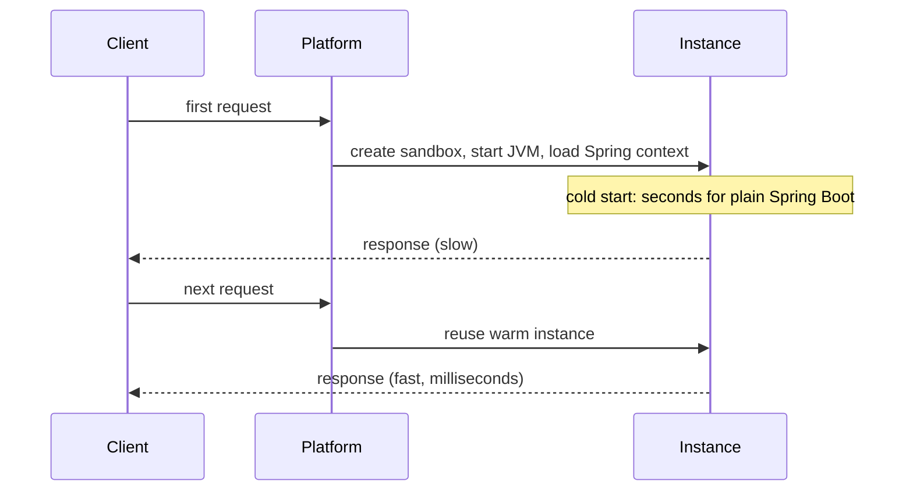

**How it works:**
- **Cold start:** the platform creates a new instance, starts the runtime, and runs your init code. For a Spring Boot app on the JVM this can be several seconds. Node.js and Go start much faster.
- **When it happens:** first request after idle, and every scale-out (a spike creates many new instances at once).
- **Limits:** Lambda runs at most 15 minutes per call and has memory and payload limits. Cloud Run and Container Apps allow long requests and normal containers.
- **Connections:** 1,000 Lambdas can open 1,000 DB connections. Use RDS Proxy, or a serverless-friendly DB (DynamoDB, Aurora Data API).

**Fixes for Java cold starts:**

| Fix | What it does | Where |
|---|---|---|
| **Lambda SnapStart** | Takes a snapshot of the initialized function at publish time and restores it on cold start | Lambda Java 11+ (including Java 25), also Python and .NET |
| **GraalVM native image** | Compiles the Spring Boot app to a native binary: starts in well under a second, less memory | Any platform; slow build, reflection needs hints |
| **Minimum instances / provisioned concurrency** | Keep N instances warm all the time | Cloud Run min instances, Container Apps min replicas, Lambda provisioned concurrency |
| **Startup CPU boost** | Extra CPU only while the container starts | Cloud Run |
| **Smaller app** | Fewer beans, lazy init, Spring Cloud Function instead of full web stack | Everywhere |
| **JVM AOT cache / CRaC** | Faster JVM start from a training run or a checkpoint | Containers you control |

Details of native images, AOT cache and CRaC: [spring-ecosystem.md](spring-ecosystem.md#faster-startup-native-images-aot-cds-and-crac).

**SnapStart warnings:** anything created during init is in the snapshot. Unique values (random seeds, UUIDs made at startup), open network connections and secrets may be stale or duplicated after restore. Use runtime hooks (CRaC `beforeCheckpoint` / `afterRestore`) to refresh them.

**Good and bad:**
| Good | Bad |
|---|---|
| Functions for spiky event jobs (S3 upload → thumbnail) | A 40-endpoint Spring Boot monolith squeezed into one Lambda |
| Cloud Run with min instances = 1 for a user-facing API | Scale-to-zero for a login API: first user each morning waits 6 seconds |
| SnapStart or native image for Java functions | Ignoring DB connection count with 500 concurrent functions |

**Say this in the interview:**

> "Serverless gives me no servers, pay per use and scale to zero. The costs are cold starts, time limits and connection storms. For Java I fix cold starts with Lambda SnapStart, a GraalVM native image, or a few always-warm instances. For a normal Spring Boot API I prefer serverless containers like Cloud Run or Fargate over functions, and I put RDS Proxy in front of the database when concurrency is high."

**They may ask next:**
- **Is serverless always cheaper?** No. For steady high traffic, containers or VMs with reserved pricing are often cheaper. Serverless wins for spiky or low traffic.
- **How do you test Lambdas locally?** AWS SAM CLI or plain unit tests of the handler; Testcontainers with LocalStack for AWS services.

---

## Autoscaling

**In one line:** Autoscaling adds copies of your app when load goes up and removes them when it goes down, based on a metric like CPU, requests per second or queue length.

**Story:** A supermarket on Sunday evening. When queues get longer than 5 people, the manager opens more counters. When the shop is empty at 10 PM, cashiers go home. If the shop has no free counters left, the manager calls in more staff from home (more nodes).

**Diagram (Kubernetes on any cloud):**

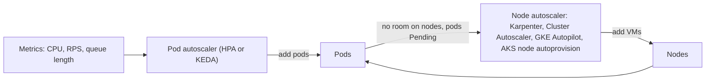

**How it works:**
- **Two levels in Kubernetes:** pods and nodes.
  - **Pods:** HPA (Horizontal Pod Autoscaler) on CPU or requests. KEDA for event metrics like SQS depth or Kafka lag.
  - **Nodes:** Karpenter on EKS (built into EKS Auto Mode) or Cluster Autoscaler. GKE Autopilot does it for you. AKS has node auto-provisioning (based on Karpenter), which AKS Automatic turns on.
- **VMs:** Auto Scaling groups, managed instance groups, scale sets. Use **target tracking** ("keep average CPU at 50%").
- **Serverless:** Cloud Run and Container Apps scale on concurrent requests per instance (Cloud Run default is 80). Lambda scales per request, up to an account concurrency limit.
- **Policies:** target tracking (simplest), step scaling, scheduled scaling (scale up before 9 AM sales), predictive scaling (learns daily patterns).
- **Cooldown / stabilization:** wait before scaling down, so you do not flap up and down.

**What to scale on:**

| Service type | Good metric |
|---|---|
| Web API | Requests per second per pod, or CPU |
| Queue worker | Queue depth / age of oldest message (KEDA) |
| Kafka consumer | Consumer lag (but never more pods than partitions) |
| Memory-bound | Rarely memory: JVM heap does not shrink, so it scales up and never down |

**Good and bad:**
| Good | Bad |
|---|---|
| Min 2–3 replicas, one per AZ | Min 1: one crash = outage while a new one starts |
| Scale workers on queue length | Scale workers on CPU while 1 million messages wait |
| Pre-scale before a known sale | Rely on autoscaling for a TV ad spike that comes in 30 seconds |
| Max limit + DB connection math | Autoscale to 200 pods × 20 connections = DB falls over |

**Say this in the interview:**

> "I scale pods with HPA on CPU or requests per second, and queue workers with KEDA on queue depth or Kafka lag. Nodes follow with Karpenter, Cluster Autoscaler, or Autopilot on GKE. I keep a minimum of two or three replicas across zones and a maximum that the database can survive. For known peaks I scale on a schedule, because a JVM needs time to start and warm up."

**They may ask next:**
- **Why is scaling slow for Java?** Node start + image pull + JVM start + JIT warm-up. Fix with smaller images, warm pools, readiness probes, and pre-scaling.
- **Vertical scaling?** VPA (Vertical Pod Autoscaler) changes CPU/memory requests. Good for right-sizing in recommendation mode; do not mix it with HPA on the same metric.

---

## High availability and disaster recovery

**In one line:** High availability (HA) survives a server or zone failure; disaster recovery (DR) brings you back after losing a region or data, within an agreed RPO and RTO.

**Story:** A wedding with a generator.
- **HA:** the hall has two power lines and a generator. If one line fails, lights flicker and stay on.
- **DR:** if the whole hall burns down, you have booked a backup hall. How fast you can move guests there (RTO), and how many gifts you lose on the way (RPO), depends on how ready that hall is.

**How it works:**
- **RPO** (Recovery Point Objective): how much data you can lose, in time. "5 minutes of orders."
- **RTO** (Recovery Time Objective): how long you can be down. "1 hour."
- **HA inside a region:** multi-AZ everything: 2+ replicas per service, multi-AZ DB, load balancer across zones. This handles most real failures.
- **DR strategies** (AWS names them; same ideas on every cloud):

| Strategy | Second region has | RPO | RTO | Cost |
|---|---|---|---|---|
| **Backup and restore** | Only backups (cross-region copies) | Hours | Hours to a day | Lowest |
| **Pilot light** | Data copied live (DB replica); app servers off | Minutes | Tens of minutes | Low |
| **Warm standby** | Small, running copy of everything; scale up on failover | Seconds to minutes | Minutes | Medium |
| **Active-active (multi-site)** | Full copy serving real traffic | Near zero | Near zero | Highest, and hardest (data conflicts) |

**Diagram:**

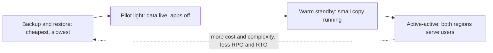

**Failover in a warm-standby setup:**

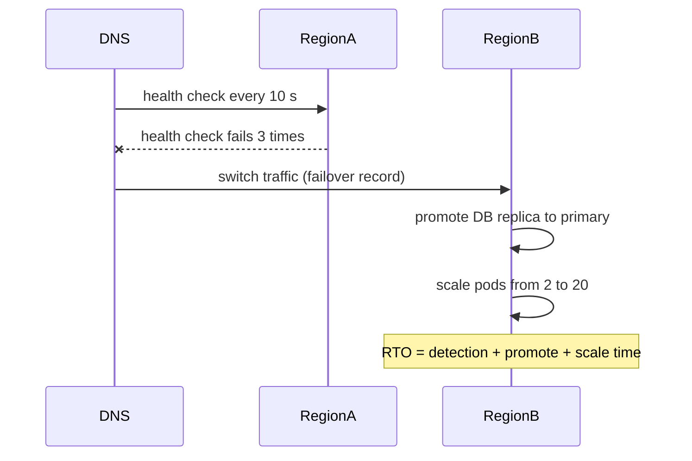

**Cloud tools:** AWS Backup, Aurora Global Database, S3 Cross-Region Replication, Route 53 health checks and failover routing, AWS Elastic Disaster Recovery. GCP: Backup and DR Service, Cloud SQL cross-region replicas, dual-region and multi-region buckets, Spanner multi-region. Azure: Azure Backup, Azure Site Recovery, geo-redundant storage (GRS), Front Door for failover.

More on backups and restore drills: [production-ready.md](production-ready.md#data-backups-and-disaster-recovery).

**Good and bad:**
| Good | Bad |
|---|---|
| RPO/RTO agreed with the business per system | "Everything must be active-active" for an internal admin tool |
| DR drill twice a year, time measured | A DR plan in a wiki that nobody has tried |
| Backups in another account and region, immutable | Backups in the same account an attacker just took over |
| Infra in Terraform, so a new region is one apply | Hand-made console setup that nobody can rebuild |

**Say this in the interview:**

> "First I get RPO and RTO from the business. HA comes from multi-AZ: replicas in each zone and a multi-AZ database. For DR there are four levels: backup and restore, pilot light, warm standby, and active-active. Each step costs more and recovers faster. For most systems pilot light or warm standby is enough. Active-active needs conflict handling for writes, so I keep it for the few systems that really need it. And we test failover, or it does not exist."

**They may ask next:**
- **What is the hardest part of active-active?** Data. Two regions writing the same row causes conflicts. Options: route each user to a home region, or use a global DB like Spanner, Aurora DSQL or Cosmos DB.
- **What about a bad deploy or deleted data?** Multi-region copies the mistake too. You need point-in-time recovery and versioned, immutable backups.

---

## Cost basics

**In one line:** You pay for what you run and what you move; save money by right-sizing, committing to steady usage, using spot for interruptible work, and watching data transfer.

**Story:** Mobile data plans. Pay-as-you-go is flexible but expensive per GB (**on-demand**). A yearly plan is cheaper if you surely use it (**reserved / savings plans**). Free hotel Wi-Fi is cheap but can drop anytime (**spot**). And roaming abroad is where the surprise bill comes from (**egress**: data going out).

**Diagram (where data transfer costs hide):**

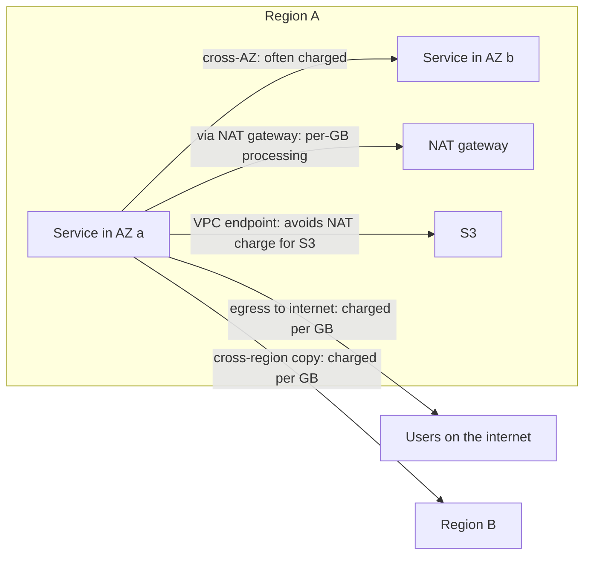

**How it works:**

| Pricing model | AWS | GCP | Azure | Use for |
|---|---|---|---|---|
| On-demand | On-Demand | On-demand | Pay-as-you-go | Spiky, new, unknown |
| Commit 1–3 years | Savings Plans, Reserved Instances | Committed use discounts (CUDs); automatic sustained use discounts on some VMs | Azure savings plan for compute, Reservations | Steady base load, databases |
| Spare capacity, can be taken away | Spot Instances (2-minute warning) | Spot VMs (short notice) | Azure Spot VMs (short notice) | Stateless workers, CI runners, batch |

**The usual cost traps:**
- **Egress:** data out to the internet, between regions, and often between AZs costs money. A chatty service pair in different AZs can cost more than the servers.
- **NAT gateway:** charges per GB processed. Pulling images and S3 traffic through NAT is a classic surprise. Fix: VPC endpoints.
- **Idle things:** dev clusters running at night, unattached disks, old snapshots, forgotten load balancers, unused public IPs.
- **Over-sized:** pods asking for 2 CPUs and using 0.2. Databases sized for Black Friday all year.
- **Logs and metrics:** often the second-biggest bill. See [cost awareness](production-ready.md#cost-awareness).
- **Managed service premium:** a managed Kafka or NAT is not free, but it is usually cheaper than an engineer's time.

**Good habits (FinOps):**
- Tag every resource with team and service.
- Set budgets with alerts, and review the bill every month.
- Turn off non-prod at night.
- Use ARM machines if your images support ARM: Graviton on AWS, Axion or Tau on GCP, Cobalt on Azure.
- Add lifecycle rules on storage.

**Good and bad:**
| Good | Bad |
|---|---|
| Savings Plan covers the steady base, on-demand and spot for the peak | 3-year commitment for a service you may delete next quarter |
| Spot for stateless workers, with graceful shutdown | Spot for the only database node |
| Cost per order tracked as a metric | "The cloud bill is the finance team's problem" |

**Say this in the interview:**

> "On-demand for unknown or spiky load, savings plans or committed use discounts for the steady base, and spot for stateless or batch work that can be interrupted. The traps are data transfer, especially NAT gateway and cross-AZ traffic, and things left running. I tag everything by team, set budgets with alerts, right-size from real usage, and use VPC endpoints so S3 traffic skips the NAT."

**They may ask next:**
- **How do you handle a spot interruption?** Catch the notice (2 minutes on AWS), drain the node, let Kubernetes reschedule pods, and keep enough on-demand capacity for the minimum.
- **Reserved Instances vs Savings Plans?** RIs are tied to an instance family and region. Compute Savings Plans commit to a dollar amount per hour and apply across instance types, Fargate and Lambda. More flexible.

---

## Observability services

**In one line:** Every cloud has built-in logs, metrics, traces and alerts (CloudWatch, Cloud Monitoring/Logging/Trace, Azure Monitor); send data with OpenTelemetry so you can switch to Grafana or Datadog without code changes.

**Story:** A car's dashboard. The car maker gives you a built-in dashboard (cloud-native tools). Some people add a better aftermarket screen (Grafana, Datadog). If all sensors use a standard plug (OpenTelemetry), you can change the screen without rewiring the car.

**Diagram:**

```mermaid
flowchart LR
    A["Spring Boot / Node apps"] -->|"OTLP"| C["OpenTelemetry Collector (ADOT on AWS)"]
    P["Cloud services: LB, DB, queues"] -->|"built-in metrics"| CW["Cloud native: CloudWatch, Cloud Monitoring, Azure Monitor"]
    C --> CW
    C --> G["Grafana stack or Datadog / New Relic"]
    CW --> AL["Alerts: SNS, PagerDuty, Slack"]
    G --> AL
```

**How it works:**

| Signal | AWS | GCP | Azure |
|---|---|---|---|
| Metrics | CloudWatch Metrics, Amazon Managed Service for Prometheus | Cloud Monitoring, Managed Service for Prometheus | Azure Monitor Metrics, Azure Monitor managed service for Prometheus |
| Logs | CloudWatch Logs (Logs Insights for queries) | Cloud Logging (Log Analytics) | Azure Monitor Logs (KQL queries) |
| Traces | AWS X-Ray, CloudWatch Application Signals, Transaction Search | Cloud Trace | Application Insights |
| Dashboards | CloudWatch dashboards, Amazon Managed Grafana | Cloud Monitoring dashboards | Azure dashboards / workbooks, Azure Managed Grafana |
| Alerts | CloudWatch alarms → SNS | Alerting policies → notification channels | Alerts → action groups |
| Audit (who did what) | CloudTrail | Cloud Audit Logs | Activity Log |

- Managed services (ALB, RDS, SQS) send metrics to the native tool automatically. Use them: RDS CPU, SQS `ApproximateAgeOfOldestMessage`, ALB 5xx count.
- For app telemetry use **OpenTelemetry**. On AWS, the X-Ray SDKs reach end of support in Feb 2027; AWS recommends OpenTelemetry (ADOT, the AWS Distro for OpenTelemetry).
- Many companies keep cloud tools for infrastructure and use Grafana or Datadog for apps, so all clouds and on-prem look the same.

Deep dive on logs, metrics, traces, ELK, Grafana and APM: [production-ready.md](production-ready.md#the-three-pillars-logs-metrics-traces-plus-profiles), and alerts and SLOs: [production-ready.md](production-ready.md#alerts-slos-and-on-call).

**Say this in the interview:**

> "Each cloud has native tools: CloudWatch and X-Ray on AWS, Cloud Monitoring, Logging and Trace on GCP, Azure Monitor and Application Insights on Azure. I use them for infrastructure metrics and audit logs. For my services I send OpenTelemetry to a Collector, so I can send to the native tool or to Grafana or Datadog without changing code. Alerts go to PagerDuty or Slack."

**They may ask next:**
- **CloudTrail vs CloudWatch?** CloudTrail records API calls (who deleted the bucket). CloudWatch records metrics and logs (how the app behaves).

---

## Infrastructure as code with Terraform

**In one line:** Write your cloud setup as code files, review it like code, and let a tool (Terraform, OpenTofu, CloudFormation, Bicep) create and update the real resources to match.

**Story:** A house plan from an architect. Instead of telling workers "add a wall here" every day, you give them a drawing. If the house burns down, you build it again from the same drawing. If you change the drawing, workers change only what is different.

**Diagram:**

```mermaid
flowchart LR
    D["Developer edits .tf files"] --> PR["Pull request"]
    PR --> PL["CI: terraform plan (shows the diff)"]
    PL --> RV["Team reviews the plan"]
    RV --> AP["terraform apply"]
    AP --> CL["Cloud APIs create or change resources"]
    AP <--> ST["Remote state (S3 / GCS / Azure Blob) with locking"]
```

**How it works:**
- **Declarative:** you say *what* you want ("one Postgres, 2 vCPU, multi-AZ"). The tool works out *how*.
- **State:** Terraform keeps a state file mapping your code to real resource IDs. Store it remotely (S3, GCS, Azure Blob) with locking, so two people cannot apply at once. Never commit it to Git; it can contain secrets.
- **Plan then apply:** `terraform plan` shows exactly what will be created, changed or destroyed. Review it in the PR.
- **Modules:** reusable pieces ("our standard service: ECR repo, IAM role, SG, alarms").
- **Environments:** same modules, different variables for dev, staging, prod; separate state per environment.
- **Drift:** someone changes things in the console. The next plan shows the drift. Fix: no console changes in prod.
- **Tools:**
  - **Terraform:** by HashiCorp (now part of IBM). BSL licence since 2023.
  - **OpenTofu:** the open-source fork under the Linux Foundation, mostly compatible.
  - **CloudFormation and AWS CDK:** AWS only. CDK lets you write TypeScript or Java.
  - **Bicep:** Azure. **Infrastructure Manager:** GCP, runs Terraform for you.
  - **Pulumi:** infra in real programming languages.

**Example (Terraform: an S3 bucket with versioning and remote state):**

```hcl
terraform {
  backend "s3" {
    bucket       = "shop-terraform-state"
    key          = "prod/storage.tfstate"
    region       = "ap-south-1"
    use_lockfile = true   # S3-native locking (Terraform 1.11+), no DynamoDB table needed
  }
}

resource "aws_s3_bucket" "invoices" {
  bucket = "shop-invoices-prod"
  tags   = { team = "orders", env = "prod" }   # tags for cost reports
}

resource "aws_s3_bucket_versioning" "invoices" {
  bucket = aws_s3_bucket.invoices.id
  versioning_configuration { status = "Enabled" }
}
```

**Good and bad:**
| Good | Bad |
|---|---|
| Every prod change goes through a PR with a plan | "Quick fix" in the console, forgotten next week |
| Remote state with locking, one state per environment | One huge state file for the whole company |
| CI applies with an OIDC role | Developers apply from laptops with admin keys |

**Say this in the interview:**

> "All infrastructure is Terraform in Git. A pull request runs terraform plan, the team reviews the diff, and CI applies it with an OIDC role. State is remote with locking, one state per environment, and shared modules give every service the same baseline: IAM role, security group, alarms, tags. No manual changes in production, so we can rebuild a region from code."

**They may ask next:**
- **Terraform vs CloudFormation?** Terraform works on every cloud and SaaS (Datadog, GitHub), with one language. CloudFormation is AWS-only but has no state file to manage and supports new AWS features early.
- **How do you import existing resources?** `terraform import` or `import` blocks in code, then fix the code until the plan shows no changes.
- **Where does Kubernetes YAML fit?** Terraform creates the cluster; Helm or a GitOps tool like Argo CD deploys the apps. See [docker-kubernetes.md](docker-kubernetes.md).

---

## Well-Architected pillars

**In one line:** The Well-Architected frameworks are each cloud's checklist for good systems: operational excellence, security, reliability, performance efficiency, cost optimization, and (on AWS and Google Cloud) sustainability.

**Story:** A car inspection checklist. The inspector does not design your car. They check brakes, lights, tyres, emissions and fuel use. Well-Architected is that checklist for a cloud system.

**Diagram:**

```mermaid
flowchart TD
    W["Well-Architected review of one workload"] --> O["Operational excellence: deploy, observe, improve"]
    W --> S["Security: identity, data protection, detection"]
    W --> R["Reliability: multi-AZ, backups, recovery"]
    W --> P["Performance efficiency: right resource types, scaling"]
    W --> C["Cost optimization: pay only for value"]
    W --> SU["Sustainability: less waste, efficient hardware"]
```

**How it works:**

| Pillar | One question to ask | Example answer |
|---|---|---|
| Operational excellence | Can we deploy and roll back safely and see problems? | CI/CD, IaC, dashboards, runbooks |
| Security | Who can access what, and would we notice an attack? | Least-privilege roles, encryption, audit logs, WAF |
| Reliability | What happens when a zone or a dependency fails? | Multi-AZ, timeouts, retries, tested backups |
| Performance efficiency | Are we using the right resource for the job? | Cache, right instance type, autoscaling |
| Cost optimization | Are we paying for things we do not use? | Right-sizing, savings plans, lifecycle rules |
| Sustainability (AWS, Google Cloud) | Can we do the same work with less energy? | ARM instances, scale to zero, delete old data |

- **AWS Well-Architected Framework** has these 6 pillars, plus the Well-Architected Tool for reviews and "lenses" (serverless, SaaS, generative AI).
- **Azure Well-Architected Framework** has 5 pillars: reliability, security, cost optimization, operational excellence, performance efficiency.
- **Google Cloud Well-Architected Framework** (renamed from "Architecture Framework" in 2024) has 6 pillars: operational excellence; security, privacy and compliance; reliability; cost optimization; performance optimization; sustainability.

**Say this in the interview:**

> "I use the Well-Architected pillars as a review checklist: operational excellence, security, reliability, performance efficiency, cost optimization, and sustainability on AWS and Google Cloud. Azure has the first five. In a design discussion I go pillar by pillar, so I do not forget, for example, cost or how we would roll back."

---

## Multi-cloud: the honest talk

**In one line:** Most companies run on one main cloud; true multi-cloud for one app is expensive and rare, so be honest about why you would do it and what it costs.

**Story:** Having bank accounts in two banks is normal: salary in one, loan in the other. But splitting every single payment across two banks, so either bank could stop working tomorrow, would make your life hard for very little gain.

**Diagram:**

```mermaid
flowchart TD
    Q{"Why do you want multi-cloud?"} -->|"avoid lock-in in theory"| N["Usually not worth it: pick one cloud, use portable tools"]
    Q -->|"a team or acquisition already uses another cloud"| Y1["Multi-cloud by accident: share IAM, network, observability"]
    Q -->|"best service on each cloud (BigQuery, Bedrock)"| Y2["Use it for that workload only"]
    Q -->|"law or a big customer requires it"| Y3["Do it, budget for double skills and tools"]
```

**How it works:**
- **Real reasons:** a company bought another company on another cloud; one cloud's service is much better for a job (BigQuery for analytics, a specific LLM); a regulator or customer requires it; price negotiation.
- **Costs:** two sets of IAM, networking, security reviews and on-call skills. Egress between clouds. You can only use the lowest common features, so you lose the best managed services.
- **What gives portability cheaply:** containers and Kubernetes, Terraform, OpenTelemetry, PostgreSQL (every cloud runs it), Kafka protocol, S3-compatible APIs, standard OIDC for identity.
- **Multi-region on one cloud** gives most of the availability benefit for far less work.

**Good and bad:**
| Good | Bad |
|---|---|
| "One primary cloud, portable building blocks, exit plan on paper" | Active-active across AWS and GCP for a CRUD app |
| Using BigQuery from an AWS-based company for analytics only | Writing your own wrapper around every cloud API "just in case" |

**Say this in the interview:**

> "I prefer one primary cloud and using its managed services well. I keep portability where it is cheap: containers, Terraform, OpenTelemetry, PostgreSQL, Kafka. Real multi-cloud for one system doubles skills, tools and egress cost, and you lose the best services. I would do it for a clear reason, like an acquisition, a regulator, or one service that is much better elsewhere. For availability, multi-region on one cloud is usually enough."

---

## How to answer: "You used AWS, they use GCP"

**In one line:** Show that you understand the concepts, map your experience to their names honestly, and say what you would check first.

**Story:** A driver who drove a Maruti for ten years gets a Hyundai. The steering, brakes and road rules are the same. The wiper switch is on the other side. A good driver says, "I know driving; give me ten minutes to find the switches," not "I can only drive a Maruti."

**Diagram:**

```mermaid
flowchart LR
    C["Say the concept: 'a serverless container platform'"] --> M["Map the names: 'ECS Fargate for us, Cloud Run for you'"]
    M --> E["Give your real story: numbers, problems, fixes"]
    E --> D["Name one difference you know or would check"]
    D --> L["Say how you would ramp up fast"]
```

**How it works:**
1. **Lead with the concept**, not the product: "We ran stateless Spring Boot services on managed Kubernetes with a managed Postgres and a queue."
2. **Map the names** with the cheat sheet: EKS → GKE, RDS → Cloud SQL, SQS/SNS → Pub/Sub, S3 → Cloud Storage, IAM roles → service accounts, CloudWatch → Cloud Monitoring.
3. **Tell a real story** with numbers: "We cut p99 from 900 ms to 200 ms by adding ElastiCache," "We moved 30 services from EC2 to EKS."
4. **Name one real difference** to show depth. Examples:
   - GCP VPCs are global; AWS VPCs are regional.
   - GCP IAM roles are granted to service accounts on resources in a project hierarchy; AWS uses accounts, roles and policies.
   - Pub/Sub is both queue and fan-out; on AWS that is SQS plus SNS.
   - Azure resources live in resource groups and identity is Entra ID.
5. **Say how you ramp up:** "I would read their Terraform modules, the landing-zone docs and the architecture center, and pair with the platform team in week one."

**Good and bad:**
| Good | Bad |
|---|---|
| "I have not used Cloud Run in production, but it maps to our Fargate setup, and here is what I would check" | Pretending you used GCP |
| Concepts + one true difference | "AWS is better" |
| Real numbers from your project | Listing 40 service names with no story |

**Say this in the interview:**

> "My production experience is on AWS: EKS, Aurora Postgres, SQS and S3, all in Terraform. The concepts carry over directly. On GCP that would be GKE or Cloud Run, Cloud SQL or AlloyDB, Pub/Sub and Cloud Storage. Some details differ, for example GCP VPCs are global and IAM works through service accounts and the project hierarchy. I would start by reading your Terraform and landing-zone setup, and I expect to be productive quickly."

**They may ask next:**
- **Do you have a cloud certification?** If yes, mention it briefly. If no: "Not yet; my learning came from running production systems," and give an example.

---

## Interview questions

1. **What is the difference between a region and an availability zone?**
   A region is a geographic area. An AZ is one or more separate data centers inside it with their own power and network. Run in 2–3 AZs for HA. [More](#cloud-basics-regions-availability-zones-and-edge)

2. **Name the managed Kubernetes, serverless container and function services on AWS, GCP and Azure.**
   Kubernetes: EKS, GKE, AKS. Serverless containers: ECS on Fargate, Cloud Run, Container Apps. Functions: Lambda, Cloud Run functions, Azure Functions. [More](#service-name-cheat-sheet-aws-gcp-azure)

3. **IaaS vs PaaS vs serverless?**
   IaaS: you get a VM and manage the OS up. PaaS: you give code, they run it. Serverless: pay per request, scale to zero, no servers. [More](#iaas-paas-saas-and-serverless)

4. **Explain the shared responsibility model.**
   The cloud secures hardware, data centers and managed service software. You secure data, IAM, network rules, code and config. Most breaches are customer misconfigurations. [More](#shared-responsibility-model)

5. **How do you choose between VMs, Kubernetes, serverless containers and functions?**
   Most managed option that fits. Serverless containers for normal APIs, Kubernetes for many services with a platform team, functions for short event jobs, VMs for OS-level needs. [More](#compute-choices-vm-vs-kubernetes-vs-serverless-containers-vs-functions)

6. **Draw a Spring Boot microservices architecture on AWS.**
   Route 53 → CloudFront + WAF → ALB → EKS/ECS in private subnets → Aurora, ElastiCache, SQS/MSK, S3. Secrets Manager, IAM roles per pod, OpenTelemetry. [More](#reference-architecture-spring-boot-microservices-on-aws)

7. **Public vs private subnet?**
   A public subnet has a route to the internet gateway. A private subnet does not; it reaches out through a NAT gateway and cannot be reached from the internet. [More](#networking-vpc-subnets-nat-and-firewalls)

8. **Security group vs NACL?**
   Security groups attach to resources, are stateful, and only allow. NACLs attach to subnets, are stateless, and allow or deny in order. [More](#networking-vpc-subnets-nat-and-firewalls)

9. **How does a pod on EKS get AWS permissions without access keys?**
   IRSA or EKS Pod Identity: the pod's service account is linked to an IAM role, and STS gives temporary credentials. GKE: Workload Identity; Azure: Workload ID. [More](#iam-roles-not-keys)

10. **What is least privilege?**
    Give only the actions and resources a service needs: `s3:GetObject` on one prefix, not `s3:*` on `*`. Review unused permissions with access analyzers. [More](#iam-roles-not-keys)

11. **Where do you keep database passwords?**
    In Secrets Manager, Secret Manager or Key Vault, read at startup with the app's role, rotated automatically. Even better: IAM database auth. [More](#secrets-and-encryption-keys)

12. **What is envelope encryption?**
    A master key in KMS encrypts small data keys; the data keys encrypt the data. The master key never leaves KMS. [More](#secrets-and-encryption-keys)

13. **Object vs block vs file storage?**
    Object (S3): files by key, huge scale. Block (EBS): a disk for one machine. File (EFS): a shared folder for many machines. [More](#storage-object-block-file-classes-and-lifecycle)

14. **How do you cut S3 storage cost?**
    Lifecycle rules: Standard → Infrequent Access → Glacier → expire. Or Intelligent-Tiering when the pattern is unknown. [More](#storage-object-block-file-classes-and-lifecycle)

15. **Multi-AZ vs read replica?**
    Multi-AZ: synchronous standby for automatic failover. Read replica: asynchronous copy for read scaling, with lag. Neither is a backup. [More](#managed-databases-rds-vs-aurora-multi-az-vs-read-replicas)

16. **RDS vs Aurora?**
    Aurora has shared storage across 3 AZs, faster failover, low-lag replicas and Serverless v2. RDS is simpler and cheaper for small steady loads. [More](#managed-databases-rds-vs-aurora-multi-az-vs-read-replicas)

17. **SQS vs SNS vs EventBridge?**
    SQS: work queue, one consumer per message. SNS: push fan-out to many. EventBridge: event router with content rules and SaaS integrations. [More](#messaging-sqs-vs-sns-vs-eventbridge-vs-kinesis-vs-msk)

18. **When Kinesis or MSK instead of SQS?**
    When you need ordered, replayable streams with many independent consumers, or high-volume events. MSK if you want Kafka itself. [More](#messaging-sqs-vs-sns-vs-eventbridge-vs-kinesis-vs-msk)

19. **What is the SQS visibility timeout and why must consumers be idempotent?**
    A taken message is hidden for N seconds; if not deleted, it returns. So a message can be processed twice. [More](#messaging-sqs-vs-sns-vs-eventbridge-vs-kinesis-vs-msk)

20. **What causes cold starts and how do you fix them for Java?**
    A new instance must start the JVM and Spring. Fix with Lambda SnapStart, GraalVM native image, min instances or provisioned concurrency. [More](#serverless-trade-offs-cold-starts-snapstart-and-native-images)

21. **What do you scale queue workers on?**
    Queue depth or age of the oldest message (KEDA), not CPU. For Kafka, consumer lag, up to the partition count. [More](#autoscaling)

22. **What are RPO and RTO?**
    RPO: how much data you can lose (in time). RTO: how long you can be down. Agree them with the business first. [More](#high-availability-and-disaster-recovery)

23. **Name the four DR strategies.**
    Backup and restore, pilot light, warm standby, active-active. More cost and complexity buys lower RPO and RTO. [More](#high-availability-and-disaster-recovery)

24. **What is the egress cost trap?**
    Data out to the internet, across regions, across AZs and through NAT gateways costs per GB. Use VPC endpoints, keep chatty services close, cache at the CDN. [More](#cost-basics)

25. **On-demand vs savings plans vs spot?**
    On-demand for unknown load, savings plans or committed use for the steady base, spot for interruptible stateless or batch work. [More](#cost-basics)

26. **Which cloud tools would you use for logs, metrics and traces?**
    CloudWatch and X-Ray, Cloud Monitoring/Logging/Trace, Azure Monitor and Application Insights. Send app data with OpenTelemetry to stay portable. [More](#observability-services)

27. **Why Terraform, and what is the state file?**
    Infra as reviewable code for any cloud. State maps code to real resources; keep it remote with locking, never in Git. [More](#infrastructure-as-code-with-terraform)

28. **What are the Well-Architected pillars?**
    Operational excellence, security, reliability, performance efficiency, cost optimization, sustainability (AWS and Google Cloud). Azure has the first five. [More](#well-architected-pillars)

29. **Should we go multi-cloud?**
    Usually one primary cloud with portable tools. Multi-cloud for one app doubles skills and costs; do it only for a clear reason. [More](#multi-cloud-the-honest-talk)

30. **You know AWS; we use GCP. Can you do the job?**
    Lead with concepts, map names (EKS → GKE, SQS/SNS → Pub/Sub), give a real story with numbers, name one real difference, and say how you would ramp up. [More](#how-to-answer-you-used-aws-they-use-gcp)
