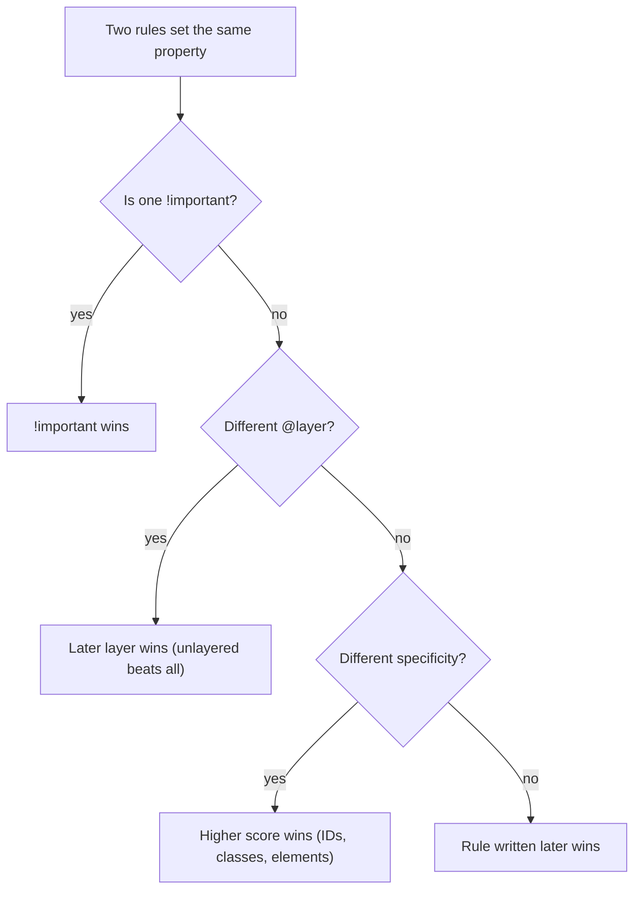
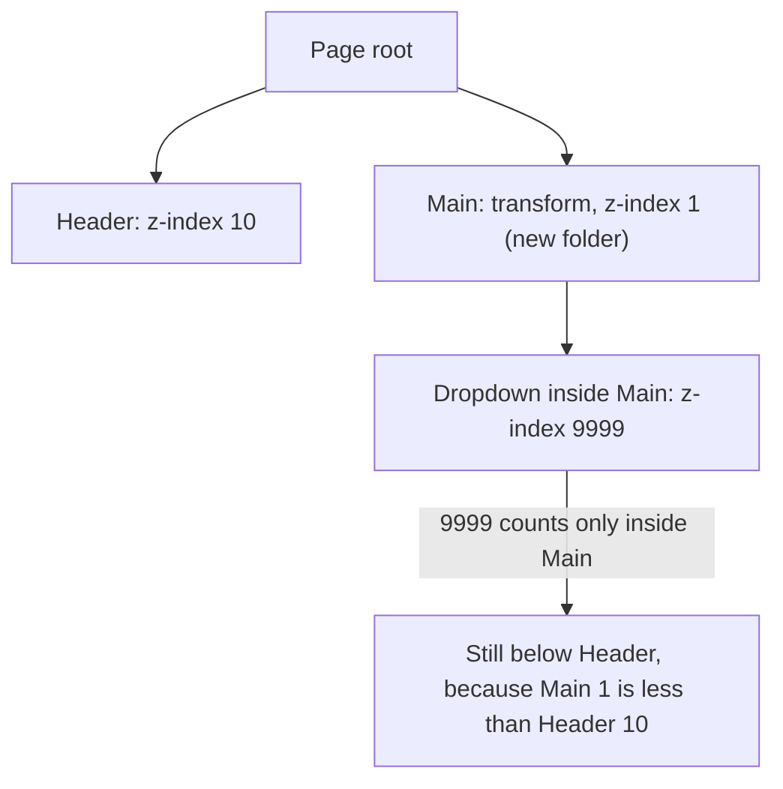
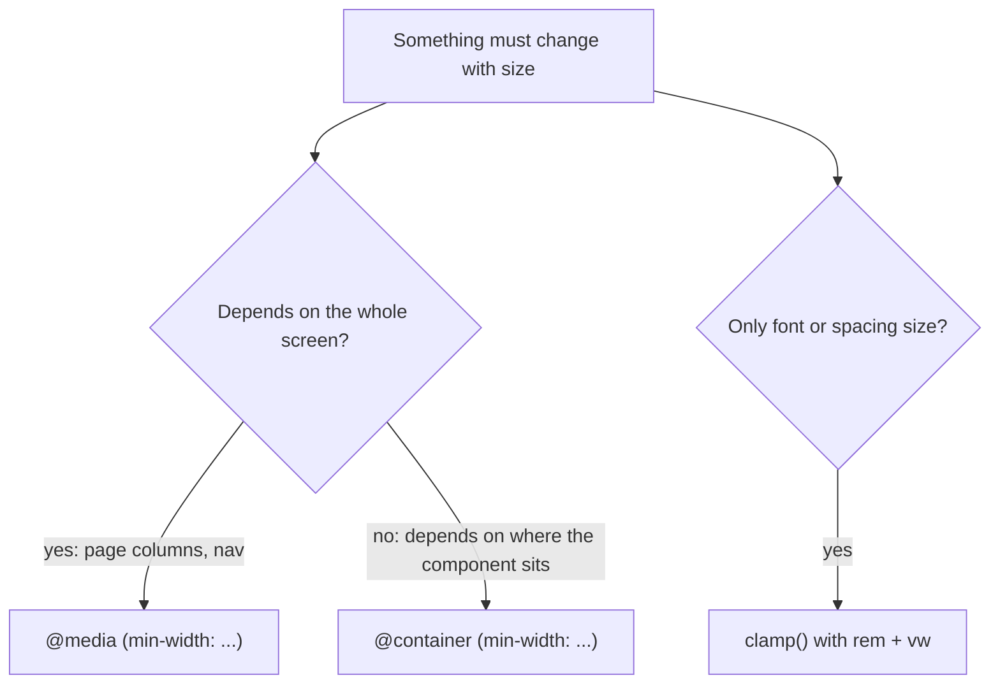
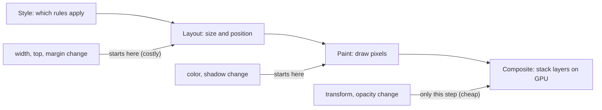
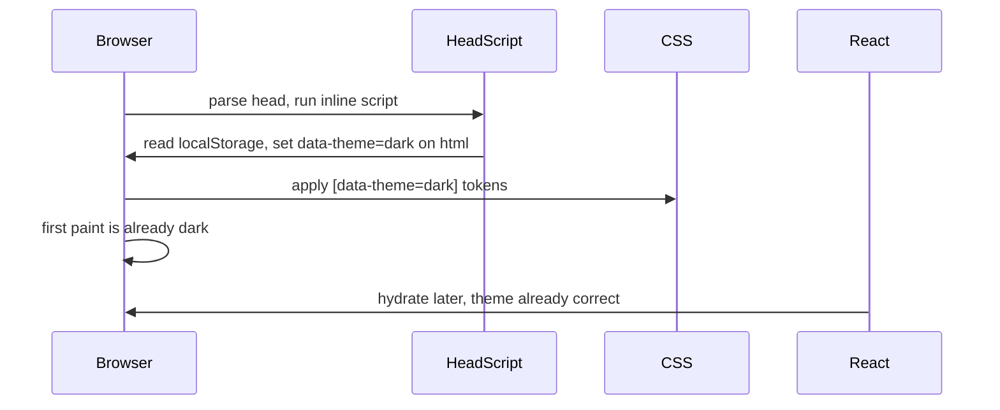
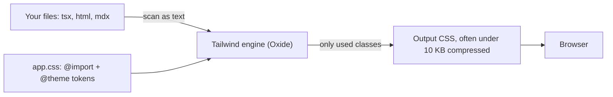

# CSS and Tailwind

[← Back to README](../README.md)

This page explains CSS the way you would explain it to a friend: boxes, rules and layouts.
Then it covers Tailwind CSS v4 and how to use it in a React design system.
It ends with coding tasks and short questions you can practise before the interview.

**Contents**

- [The box model](#the-box-model)
- [Specificity and the cascade](#specificity-and-the-cascade)
- [Display, position and stacking](#display-position-and-stacking)
- [Flexbox](#flexbox)
- [CSS Grid](#css-grid)
- [Responsive design](#responsive-design)
- [Modern CSS you should know](#modern-css-you-should-know)
- [Animations and performance](#animations-and-performance)
- [Theming and dark mode](#theming-and-dark-mode)
- [CSS architecture at scale](#css-architecture-at-scale)
- [Tailwind CSS](#tailwind-css)
- [CSS coding tasks (with answers)](#css-coding-tasks-with-answers)
- [Questions from the README list](#questions-from-the-readme-list)
- [CSS and Tailwind questions](#css-and-tailwind-questions)

Browser support facts on this page come from MDN and the Baseline data (web-features 3.46.0), checked in November 2026.
**Baseline** means "works in Chrome, Edge, Firefox and Safari". *Newly available* means it just reached all of them. *Widely available* means 30 months have passed since then.

---

## The box model

**In one line:** Every element is a box made of four layers: content, padding, border and margin.

**Story:** Think of a framed photo on a wall.
The photo is the **content**. The white card around the photo is the **padding**.
The wooden frame is the **border**. The empty wall space between two frames is the **margin**.
When you say "the frame is 30 cm wide", do you mean the photo only, or the photo plus card plus wood? That is exactly the `box-sizing` question.

**How it works:**
1. **Content:** the text or image. Its size is `width` and `height`.
2. **Padding:** space inside the border. It takes the element's background colour.
3. **Border:** the line around the padding.
4. **Margin:** space outside the border. It is always transparent.
5. `box-sizing: content-box` (the old default): `width` means content only. Padding and border are added on top.
6. `box-sizing: border-box`: `width` means content + padding + border. The box stays the size you wrote.

**Diagram:**

```text
+--------------------------- margin (outside, transparent) ----------------+
|  +------------------------ border -----------------------------------+   |
|  |  +--------------------- padding (inside, has background) -----+   |   |
|  |  |                                                            |   |   |
|  |  |              content  (width x height)                     |   |   |
|  |  |                                                            |   |   |
|  |  +------------------------------------------------------------+   |   |
|  +-------------------------------------------------------------------+   |
+--------------------------------------------------------------------------+
```

**Example:** `width: 300px; padding: 20px; border: 2px solid;`

| box-sizing | Width you see on screen | Content width |
|---|---|---|
| `content-box` | 300 + 20×2 + 2×2 = **344px** | 300px |
| `border-box` | **300px** | 300 − 40 − 4 = 256px |

```css
/* Almost every project starts with this reset */
*, *::before, *::after {
  box-sizing: border-box; /* width = content + padding + border */
}
```

**Margin collapse:** two vertical margins that touch become one. The bigger one wins.
- Paragraph A has `margin-bottom: 20px`. Paragraph B has `margin-top: 30px`. The gap is **30px**, not 50px.
- A child's top margin can "leak" out of its parent and push the parent down.
- It happens only for vertical (block) margins in normal flow.
- It does **not** happen inside flex or grid containers.
- Stop it with padding or a border on the parent, or with `display: flow-root` on the parent.

**Good and bad:**

| Good | Bad |
|---|---|
| `border-box` makes sizes easy to predict | Forgetting it gives "my 50% + 50% columns wrap" bugs |
| Margin collapse gives nice text spacing by default | Collapse surprises people when a child margin pushes the parent |

**Say this in the interview:**

> Every element is a box: content, padding, border, margin.
> I always set `box-sizing: border-box`, so `width` includes padding and border.
> Vertical margins between blocks collapse to the larger one, but not inside flex or grid.

**They may ask next:**
- **Does padding take the background colour?** Yes. Margin does not.
- **Do horizontal margins collapse?** No. Only vertical margins in normal block flow.
- **How do I stop a child margin leaking out of the parent?** Add `display: flow-root`, padding or a border to the parent.

---

## Specificity and the cascade

**In one line:** When two rules clash, the cascade picks the winner: importance, then layer, then specificity, then source order.

**Story:** Think of instructions to a waiter.
The manager's order (`!important`) beats everyone.
A note for one table number (an ID) beats a note for "all window tables" (a class).
A note for "all tables" (an element) is the weakest.
If two notes have the same power, the latest note wins.

**How it works:**
1. **Specificity is a score of three numbers: (IDs, classes, elements).**
   - IDs: `#cart`.
   - Classes, attributes and pseudo-classes: `.btn`, `[type="text"]`, `:hover`.
   - Elements and pseudo-elements: `p`, `::before`.
2. Compare left to right, like version numbers. `1-0-0` beats `0-15-0`.
3. Inline `style="..."` beats any selector.
4. `!important` beats normal rules. Use it only for utilities or to override third-party CSS.
5. Same score? The rule written **later** wins.
6. **Inheritance:** some properties pass from parent to child (`color`, `font-*`, `line-height`). Box properties do not (`margin`, `border`, `width`). Inherited values always lose to any rule that targets the element directly.
7. **Cascade layers (`@layer`):** you group CSS into named layers. A later layer wins, whatever the specificity. CSS that is not in any layer beats all layers.
8. **`:where()` has zero specificity.** `:is()` takes the score of its strongest selector.

**Diagram:**



**Example:**

| Selector | Score (ID-class-element) |
|---|---|
| `p` | 0-0-1 |
| `.btn` | 0-1-0 |
| `nav .btn:hover` | 0-2-1 |
| `#cart .item > a` | 1-1-1 |
| `:is(#cart, .box) p` | 1-0-1 (takes `#cart`) |
| `:where(#cart, .box) p` | 0-0-1 (`:where` counts 0) |

```css
@layer reset, base, components, utilities; /* order: later layer wins */

@layer components {
  #app .card .title { color: black; } /* very specific, but in an early layer */
}
@layer utilities {
  .text-red { color: red; } /* wins: later layer beats higher specificity */
}
```

**Good and bad:**

| Good | Bad |
|---|---|
| `@layer` lets you control order without specificity wars | `!important` everywhere makes CSS impossible to override |
| `:where()` makes library CSS easy to override | Deep selectors like `.page .sidebar ul li a` break when HTML changes |

**Say this in the interview:**

> The cascade picks a winner in this order: importance, layer, specificity, then source order.
> Specificity is three numbers: IDs, classes, elements, compared left to right.
> I keep selectors flat, usually one class, and use `@layer` and `:where()` so overrides stay easy.

**They may ask next:**
- **Does `!important` reverse the layer order?** Yes. For `!important` rules, earlier layers win. This lets a reset protect itself.
- **What is the specificity of `*`?** 0-0-0.
- **Why does my class not override a library style?** The library selector is more specific or loaded later. Wrap the library in an early `@layer`.

---

## Display, position and stacking

**In one line:** `display` sets how a box flows, `position` sets how you move it, and stacking contexts set what sits on top.

### Display: block, inline, inline-block

| Value | New line? | Width and height work? | Vertical margin/padding pushes others? | Example elements |
|---|---|---|---|---|
| `block` | Yes, takes full width | Yes | Yes | `div`, `p`, `h1`, `section` |
| `inline` | No, sits in the text line | No | No (padding draws but does not push lines) | `span`, `a`, `strong` |
| `inline-block` | No | Yes | Yes | buttons, badges |
| `none` | Removed from layout | — | — | hidden things |
| `flex` / `grid` | Yes (block outside) | Yes | Yes | layouts |

### Position

**Story:** Think of a cinema hall.
- **static:** you sit in your booked seat. Normal flow.
- **relative:** you stay in your seat but lean 10 cm to the left. Your seat stays reserved.
- **absolute:** you leave your seat and stand at a spot measured from the nearest "positioned" wall. That is an ancestor whose position is not `static`. Your seat is given away.
- **fixed:** the EXIT sign. It stays on the screen even when you scroll.
- **sticky:** the row number on the seat back. It scrolls with you, then sticks at the top when it reaches `top: 0`.

**How it works:**
1. `static` is the default. `top/left` do nothing.
2. `relative` moves the element visually. The original space stays. It also becomes the anchor for absolute children.
3. `absolute` leaves the flow. It is placed against the nearest positioned ancestor, or the page.
4. `fixed` leaves the flow. It is placed against the viewport (the visible window). Careful: a `transform` on an ancestor breaks this.
5. `sticky` acts like `relative` until a scroll point, then like `fixed` inside its parent. It fails if a parent has `overflow: hidden` or `auto`.

### z-index and stacking contexts

**Story:** Think of sheets of paper inside folders.
z-index decides the order of sheets **inside one folder**.
Folder B sits on top of folder A.
So a sheet with z-index 9999 inside folder A still stays below folder B.
A **stacking context** is that folder.

**How it works:**
1. `z-index` works on positioned elements, and on flex or grid children.
2. These create a new stacking context (a new folder):
   - `position: relative/absolute` with a `z-index` other than `auto`.
   - `position: fixed` or `sticky`.
   - `opacity` less than 1.
   - `transform`, `filter`, `perspective`, `will-change: transform`.
   - `isolation: isolate` (made for exactly this).
3. Children are stacked only against each other inside their context.

**Diagram:**



**Example:**

```css
.card { position: relative; }
.card .badge { position: absolute; top: 8px; right: 8px; } /* placed against .card */

.site-header { position: sticky; top: 0; z-index: 10; }

.widget { isolation: isolate; } /* new stacking context, no z-index needed */
```

**Good and bad:**

| Good | Bad |
|---|---|
| `isolation: isolate` keeps a component's z-index inside itself | z-index 9999, 99999 "wars" across teams |
| Portals (render modals at `<body>` level) avoid stacking traps | `transform` on a parent silently breaks `fixed` children |

**Say this in the interview:**

> `relative` keeps the element's space, `absolute` and `fixed` remove it, and `sticky` switches at a scroll point.
> z-index only competes inside one stacking context.
> So z-index 9999 "doesn't work" when a parent has a transform, opacity or its own z-index. I move the modal to a portal or fix the parent.

**They may ask next:**
- **Why is my sticky header not sticking?** A parent has `overflow: hidden/auto`, or `top` is missing.
- **How do I find what created the context?** DevTools: check parents for `transform`, `opacity`, `filter`, or `z-index`. Chrome's Layers panel helps.
- **What about the new `<dialog>` and popover?** They render in the **top layer**, above every z-index. No z-index needed.

---

## Flexbox

**In one line:** Flexbox lays out items in one direction (a row or a column) and shares the free space between them.

**Story:** Think of people sitting on a bench.
You decide the direction (a row of people).
`justify-content` decides how they spread along the bench.
`align-items` decides where they sit from front to back.
`flex: 1` says "this person takes all the extra space".

**How it works:**
1. `display: flex` on the parent. Children become flex items.
2. **Main axis:** the direction of `flex-direction` (row by default = left to right).
3. **Cross axis:** the other direction (top to bottom for a row).
4. `justify-content` aligns on the **main** axis. `align-items` aligns on the **cross** axis.
5. `gap` adds space between items. No margin hacks needed.
6. `flex-wrap: wrap` lets items move to the next line.
7. `flex: 1` is short for `flex-grow: 1; flex-shrink: 1; flex-basis: 0%`:
   - **grow 1:** take a share of extra space.
   - **shrink 1:** can get smaller if space is short.
   - **basis 0%:** start from zero, so all `flex: 1` items get equal width.

**Diagram:**

```text
flex-direction: row
main axis  ------------------------------------------->   justify-content
+-----------------------------------------------------+
| [ item 1 ]   [ item 2 ]   [ item 3 ]                |   |  cross axis
|                                                     |   |  align-items
+-----------------------------------------------------+   v

flex-direction: column  -> the axes swap: main is top to bottom
```

**Example:** three common layouts.

```css
/* 1. Center anything */
.center { display: flex; justify-content: center; align-items: center; }

/* 2. Navbar: logo left, links right */
.nav { display: flex; align-items: center; gap: 1rem; }
.nav .logo { margin-right: auto; } /* auto margin eats the free space */

/* 3. Sticky footer: footer at bottom even on short pages */
body { min-height: 100dvh; display: flex; flex-direction: column; }
main { flex: 1; } /* main grows, footer is pushed down */
```

| Shorthand | Means | Use for |
|---|---|---|
| `flex: 1` | `1 1 0%` | equal columns |
| `flex: auto` | `1 1 auto` | grow, but start from content size |
| `flex: none` | `0 0 auto` | fixed size, never grow or shrink (icons) |

**Good and bad:**

| Good | Bad |
|---|---|
| Perfect for one row of items: navbars, toolbars, button groups | Two-dimensional layouts (rows and columns) get messy; use grid |
| `gap` and auto margins replace old float hacks | Long text in a flex child overflows because `min-width: auto` |

**Say this in the interview:**

> Flexbox is for one direction. `justify-content` works on the main axis, `align-items` on the cross axis.
> `flex: 1` means grow 1, shrink 1, basis 0, so items share space equally.
> I use it for navbars, toolbars and centering. For page grids I use CSS Grid.

**They may ask next:**
- **Why does text overflow my flex item?** Flex items have `min-width: auto`, so they will not shrink below their content. Set `min-width: 0`.
- **`align-items` vs `align-content`?** `align-items` aligns items in each line. `align-content` aligns the lines themselves when there is wrapping.
- **How do I push one item to the end?** `margin-left: auto` on it.

---

## CSS Grid

**In one line:** CSS Grid lays out items in rows **and** columns at the same time.

**Story:** Think of a chessboard or an Excel sheet.
You draw the rows and columns first.
Then you put each piece into a cell, or let it span several cells.
Flexbox is a bench; grid is a cinema hall with rows and seat numbers.

**How it works:**
1. `display: grid` on the parent.
2. **Tracks** are rows and columns. `grid-template-columns: 200px 1fr 1fr` makes three columns.
3. **`fr`** means "a fraction of the free space". `1fr 2fr` splits free space 1:2.
4. **`repeat(auto-fit, minmax(240px, 1fr))`** makes as many columns as fit. Each is at least 240px and they stretch to fill. This is a responsive card grid with **no media queries**.
5. `auto-fill` keeps empty columns. `auto-fit` collapses them, so the items stretch.
6. **Areas** let you name parts of the layout and draw it as text.
7. **Subgrid** (`grid-template-columns: subgrid`) lets a child use its parent's tracks. Good for aligning card titles and buttons across cards.

**Example:**

```css
.cards {
  display: grid;
  grid-template-columns: repeat(auto-fit, minmax(240px, 1fr)); /* responsive, no media query */
  gap: 1rem;
}

.page {
  display: grid;
  grid-template-columns: 220px 1fr;
  grid-template-rows: auto 1fr auto;
  grid-template-areas:
    "header header"
    "sidebar main"
    "footer footer"; /* draw the layout as text */
  min-height: 100dvh;
}
.page > header { grid-area: header; }
```

**Grid vs flexbox:**

| Question | Flexbox | Grid |
|---|---|---|
| Dimensions | One (row or column) | Two (rows and columns) |
| Who decides size? | Content first ("content out") | Layout first ("layout in") |
| Best for | Navbar, button group, chips, centering | Page layout, card grids, dashboards, forms |
| Overlap items? | Hard | Easy (same grid area) |
| Align across rows? | No | Yes (and subgrid for nested) |

**Good and bad:**

| Good | Bad |
|---|---|
| One rule makes a responsive card grid | Overkill for a simple row of buttons |
| Areas make the layout readable | Visual order can differ from HTML order, which confuses keyboard and screen reader users |

**Say this in the interview:**

> Grid is two-dimensional; flexbox is one-dimensional.
> I use grid for the page and card layouts, and flexbox inside components.
> `repeat(auto-fit, minmax(240px, 1fr))` gives me a responsive grid without media queries.

**They may ask next:**
- **auto-fit vs auto-fill?** With few items, `auto-fill` keeps empty tracks; `auto-fit` collapses them so items stretch.
- **What is `minmax()`?** A track size with a minimum and a maximum.
- **Is subgrid safe to use?** Yes. Baseline widely available since March 2026.

---

## Responsive design

**In one line:** Responsive design means one page that adapts to any screen size, from a phone to a big monitor.

**Story:** Think of water.
Pour it into a glass, it takes the glass shape. Pour it into a bowl, it takes the bowl shape.
Your layout should behave like water, not like a block of ice cut for one screen.

### Mobile-first vs desktop-first

| | Mobile-first | Desktop-first |
|---|---|---|
| Base CSS is for | Small screens | Large screens |
| Media queries use | `min-width` (add features as screen grows) | `max-width` (remove things as screen shrinks) |
| Result | Phones download and run less CSS | Phones get desktop CSS then many overrides |
| Tailwind | Yes: `md:flex` means "from 768px and up" | — |

### Tools

1. **Media queries:** react to the **viewport** (the browser window). `@media (min-width: 48rem) { ... }`.
2. **Container queries (`@container`):** react to the **parent's** size. A card can be a row in a wide sidebar and a column in a narrow one. Baseline widely available since August 2025.
3. **Fluid type with `clamp(min, preferred, max)`:** the font grows with the screen but stays inside limits.
4. **Responsive images:** `srcset` + `sizes` let the browser pick the right file. `aspect-ratio` reserves space, so the page does not jump (layout shift).
5. **Viewport units:** on phones, the address bar appears and hides, so `100vh` is wrong.
   - `svh` = small viewport (bars visible).
   - `lvh` = large viewport (bars hidden).
   - `dvh` = dynamic, changes as bars move.
6. Other media features: `prefers-color-scheme`, `prefers-reduced-motion`, `hover: hover`, `pointer: coarse` (touch), `orientation: portrait`, `print`.

**Diagram:**



**Example:**

```css
h1 { font-size: clamp(1.5rem, 1rem + 2vw, 3rem); } /* rem part keeps browser zoom working */

.card-wrap { container-type: inline-size; }        /* this element becomes a container */
@container (min-width: 30rem) {
  .card { display: grid; grid-template-columns: 8rem 1fr; } /* row layout only when the parent is wide */
}

.hero { min-height: 100vh; min-height: 100dvh; }   /* fallback first, then dvh */
.video { aspect-ratio: 16 / 9; width: 100%; }
```

```html

```

**Good and bad:**

| Good | Bad |
|---|---|
| Container queries make components reusable anywhere | Too many breakpoints; use fluid values instead |
| `width`/`height` or `aspect-ratio` on images prevent layout shift | `font-size: 5vw` alone breaks zoom (an accessibility failure) |

**Say this in the interview:**

> I build mobile-first: base styles for phones, then `min-width` media queries.
> For components I use container queries, because a card cares about its parent, not the screen.
> I use `clamp()` for fluid type, `srcset` for images and `dvh` instead of `100vh` on mobile.

**They may ask next:**
- **Why rem and not px for breakpoints?** rem respects the user's font size setting.
- **What is a layout shift?** Content jumping as images load. Measured as CLS (Cumulative Layout Shift), a [Core Web Vital](frontend-ui.md#web-performance-and-core-web-vitals).
- **Container queries need what?** A parent with `container-type: inline-size`.

---

## Modern CSS you should know

**In one line:** Since 2023 CSS gained nesting, `:has()`, container queries and layers, so many Sass and JavaScript tricks are gone.

**Story:** Think of a smartphone camera.
Ten years ago you carried a separate camera, torch and GPS.
Now the phone does it all.
CSS is the same: features that needed Sass or JavaScript are now built in.

**How it works:** status checked in the Baseline data (November 2026).

| Feature | What it does | Status (Nov 2026) |
|---|---|---|
| Custom properties `--x` | Variables that live at runtime and cascade | Widely available (since 2017) |
| Native nesting | Write `.card { & h2 { } }` like Sass | Widely available (June 2026) |
| `:has()` | "Parent selector": style an element by what it contains | Widely available (June 2026) |
| `:is()` / `:where()` | Group selectors; `:where` has 0 specificity | Widely available |
| `@layer` | Cascade layers to control override order | Widely available |
| Logical properties | `margin-inline`, `padding-block`, `inset-inline-start` (work for right-to-left languages) | Widely available |
| `color-mix()` | Mix two colours: hover shades, transparency | Widely available (Nov 2025) |
| Subgrid | Child grid uses parent tracks | Widely available (March 2026) |
| Container size queries | Style by parent size | Widely available (Aug 2025) |
| Container style queries | `@container style(--variant: dark)` | Newly available (May 2026) |
| View transitions (same page) | Animate between two DOM states with `document.startViewTransition()` | Newly available (Oct 2025, Firefox 144) |
| View transitions (across pages) | `@view-transition { navigation: auto; }` | **Limited**: Chrome 126+, Safari 18.2+, not Firefox yet |
| Scroll-driven animations | `animation-timeline: scroll()` / `view()` | Newly available (Oct 2026, Firefox 159) |
| Anchor positioning | Tie a tooltip to a button in pure CSS | `anchor-name` and `position-area` in all major browsers since Jan 2026 (Firefox 147, Safari 26). `position-anchor` since Sept 2026 (Safari 27). A few newer values are still missing, so the full feature is marked **limited**. Keep a fallback. |
| `light-dark()` | One value for light, one for dark | Newly available (2024) |
| `@scope` | Limit styles to a part of the DOM | Newly available (March 2026) |
| `if()` | Inline conditions in values | **Limited**: Chrome/Edge only |

**Example:**

```css
.card {
  padding-inline: 1rem;                       /* logical: left+right in English, works in Arabic too */
  & h2 { font-size: 1.25rem; }                /* native nesting */
  &:has(img) { grid-template-rows: auto 1fr; }/* card with an image gets a different layout */
}
.btn:hover { background: color-mix(in oklch, var(--brand) 85%, black); } /* darker shade */
form:has(input:invalid) .submit { opacity: .5; } /* parent reacts to child state, no JS */

.tip-btn { anchor-name: --tip; }
.tip { position: absolute; position-anchor: --tip; position-area: top; } /* tooltip above button */

.progress { transform-origin: left; animation: grow linear; animation-timeline: scroll(); } /* reading bar; timeline after the shorthand */
@keyframes grow { from { scale: 0 1; } to { scale: 1 1; } }
```

**Good and bad:**

| Good | Bad |
|---|---|
| Less JavaScript for UI state (`:has()`, popover, anchor) | Newly available features may miss users on old phones; add fallbacks |
| Native nesting and variables remove most Sass needs | Deep nesting recreates the specificity problems of Sass |

**Say this in the interview:**

> Modern CSS removed many old tricks. `:has()` is a parent selector, nesting is native, and container queries are widely available.
> Before using a new feature, I check its Baseline status. Newly available features get a fallback or `@supports`.
> Anchor positioning and scroll-driven animations now work in all major browsers, but they are very new.

**They may ask next:**
- **How do you use a feature safely?** `@supports (anchor-name: --a) { ... }` and keep a simple default outside it.
- **Is `:has()` slow?** Browsers optimised it. Avoid very broad selectors like `*:has(*)`.
- **Do we still need Sass?** Rarely. Variables, nesting, `color-mix()` and `@layer` are native now.

---

## Animations and performance

**In one line:** Animate only `transform` and `opacity`, because they skip layout and paint and run on the GPU (graphics chip).

**Story:** Think of a newspaper printing press.
Changing the order of pages (layout) means reprinting the whole paper.
Changing the ink colour (paint) means reprinting one page.
Moving a printed sticker across a page (transform) needs no printing at all.

**How it works:**
1. The browser runs a pipeline for every frame: **style → layout → paint → composite**.
   Full story: [How the browser renders a page](frontend-ui.md#how-the-browser-renders-a-page).
2. Changing `width`, `top`, `margin` → layout again (costly, all neighbours move).
3. Changing `color`, `background`, `box-shadow` → paint again.
4. Changing `transform`, `opacity` → composite only (cheap, the GPU moves a ready layer).
5. **Layout thrash:** JavaScript writes a style, then reads `offsetHeight`, again and again in a loop. Each read forces a fresh layout. Batch all reads first, then all writes.
6. **`will-change: transform`** tells the browser to prepare a layer early. Use it only on a few elements, just before animating. Each layer uses GPU memory.
7. **`prefers-reduced-motion`:** some users get sick from motion. Respect their system setting.
8. At 60 frames per second, each frame has about **16 ms**. Long layout work drops frames (jank).

**Diagram:**



**Example:**

```css
/* Bad: moves layout every frame */
.drawer.open { left: 0; transition: left .3s; }

/* Good: compositor only */
.drawer { transform: translateX(-100%); transition: transform .3s ease-out; }
.drawer.open { transform: translateX(0); }

@media (prefers-reduced-motion: reduce) {
  *, *::before, *::after { animation-duration: .01ms !important; transition-duration: .01ms !important; }
}
```

**Good and bad:**

| Good | Bad |
|---|---|
| CSS transitions run off the main thread for transform/opacity | Animating `height: auto` with JS each frame |
| `@starting-style` animates elements as they appear (Newly available 2024) | `will-change` on hundreds of elements eats GPU memory |

**Say this in the interview:**

> The pipeline is style, layout, paint, composite.
> I animate only `transform` and `opacity`, which skip layout and paint.
> I avoid reading layout values in a loop after writing styles, and I always respect `prefers-reduced-motion`.

**They may ask next:**
- **CSS animation or JavaScript animation?** CSS for simple state changes. Web Animations API or a library for complex, interruptible sequences.
- **How do you find jank?** Chrome DevTools Performance panel: look for long purple "Layout" blocks and red frames.
- **transition vs animation?** `transition` goes from state A to B on a change. `animation` uses `@keyframes`, can loop and run by itself.

---

## Theming and dark mode

**In one line:** Put every colour in CSS variables (design tokens), then switch the variable values for dark mode.

**Story:** Think of a hotel room with a light switch.
You do not repaint the walls at night. You change the lights.
CSS variables are the light switch: the components stay the same, only the token values change.

**How it works:**
1. **Design tokens:** named values like `--color-bg`, `--color-text`, `--radius`. Components use only tokens, never raw hex codes.
2. **System preference:** `@media (prefers-color-scheme: dark)` follows the operating system.
3. **User toggle:** set `data-theme="dark"` on `<html>`. Save the choice in `localStorage` (or a cookie, so the server can render it).
4. **`color-scheme: light dark`** tells the browser to theme scrollbars and form controls too.
5. **Avoid the flash of the wrong theme:** the page first paints light, then React loads and switches to dark. Fix it with a tiny **inline script in `<head>`** that sets `data-theme` before the first paint.
6. In Next.js, the server does not know `localStorage`. Use a cookie or the `next-themes` package, and put `suppressHydrationWarning` on `<html>`. See [Next.js](nextjs.md).

**Diagram:**



**Example:**

```css
:root {
  color-scheme: light dark;
  --color-bg: #ffffff;  --color-text: #111827;  --color-brand: oklch(55% 0.2 260);
}
[data-theme="dark"] {
  --color-bg: #0b1020;  --color-text: #e5e7eb;  --color-brand: oklch(70% 0.15 260);
}
body { background: var(--color-bg); color: var(--color-text); }
```

```html
<head>
  <script>
    // runs before first paint, so no flash
    const t = localStorage.theme ?? (matchMedia('(prefers-color-scheme: dark)').matches ? 'dark' : 'light');
    document.documentElement.dataset.theme = t;
  </script>
</head>
```

**Good and bad:**

| Good | Bad |
|---|---|
| One set of components, many themes (brands, dark, high contrast) | Hard-coded colours in components make dark mode a rewrite |
| Variables change at runtime, no rebuild | Theme set in `useEffect` causes a visible flash |

**Say this in the interview:**

> I define colours as CSS variable tokens and components use only tokens.
> Dark mode swaps the token values under `[data-theme="dark"]`, with `prefers-color-scheme` as the default.
> To avoid a flash, a tiny inline script in `<head>` sets the theme before the first paint.

**They may ask next:**
- **Why not just invert colours?** Images and brand colours break. Dark mode needs its own tested palette.
- **What is `light-dark()`?** `color: light-dark(#111, #eee)` picks a value based on `color-scheme`. Newly available since 2024.
- **How to check contrast?** WCAG AA needs 4.5:1 for normal text. Test both themes.

---

## CSS architecture at scale

**In one line:** At scale the hard problem is not writing CSS but stopping 50 developers from breaking each other's styles.

**Story:** Think of a big shared kitchen.
If everyone uses one fridge with no labels, someone eats your lunch.
BEM writes names on every box. CSS Modules gives each team its own fridge.
Utility-first gives everyone the same small set of standard containers.

**How it works:**
1. **BEM** (Block, Element, Modifier): a naming rule. `.card`, `.card__title`, `.card--featured`. Flat, one-class selectors. Relies on discipline.
2. **CSS Modules:** you write normal CSS. The build tool renames classes to unique names (`.title` → `.Card_title_x7a2`). No clashes, zero runtime.
3. **CSS-in-JS (runtime):** styled-components, Emotion. Styles are written in JS and injected while the app runs.
   - Cost: extra JavaScript, style work on each render, and harder with React Server Components and streaming.
   - styled-components' maintainer announced maintenance mode in March 2025 and does not recommend it for new projects.
4. **Zero-runtime CSS-in-JS:** vanilla-extract, Panda CSS, StyleX, Linaria. You write in TypeScript, the build outputs plain CSS files.
5. **Utility-first:** Tailwind. Small single-purpose classes in the markup. No new CSS per feature.

**Comparison:**

| Approach | Scoping | Runtime cost | Dynamic styles | Works with Server Components | Typical use |
|---|---|---|---|---|---|
| BEM | By naming discipline | None | Class toggles | Yes | Simple sites, legacy |
| CSS Modules | Automatic (build) | None | Class toggles + variables | Yes | Many React apps |
| Runtime CSS-in-JS | Automatic | Yes (JS at render) | Props in styles | Needs client components | Older React apps |
| Zero-runtime CSS-in-JS | Automatic | None | Variants, variables | Yes | Typed design systems |
| Utility-first (Tailwind) | Classes are global but tiny | None | Variants + variables | Yes | Most new React/Next.js apps |

**What to pick for a design system:**
- Tokens as CSS variables (colours, spacing, radius). Every approach can read them.
- New React/Next.js product: **Tailwind + cva + tokens in `@theme`** (see below).
- Library shipped to other teams who use different stacks: **CSS Modules or vanilla-extract**, with plain CSS output.
- Avoid runtime CSS-in-JS for new projects.

**Good and bad:**

| Good | Bad |
|---|---|
| Zero-runtime options keep pages fast | Mixing three approaches in one app |
| Tokens let you rebrand by changing one file | Global CSS with long selectors that nobody dares to delete |

**Say this in the interview:**

> BEM is a naming rule, CSS Modules scope classes at build time, and Tailwind gives shared utility classes.
> I avoid runtime CSS-in-JS for new apps because it adds JavaScript work and clashes with Server Components.
> For a design system I keep tokens in CSS variables and build components with Tailwind and cva.

**They may ask next:**
- **How do you remove dead CSS?** With Tailwind it is automatic. With Modules, deleting the component deletes its CSS.
- **Why did teams leave styled-components?** Runtime cost, Server Components support, and the maintenance status.
- **What is `@scope`?** A native way to limit styles to part of the page. Newly available March 2026.

---

## Tailwind CSS

### How Tailwind works

**In one line:** Tailwind gives you small classes like `p-4` and builds CSS only for the classes you used.

**Story:** Think of LEGO bricks.
You do not carve a new toy for each idea. You join small standard bricks.
Tailwind classes are the bricks. The factory makes only the bricks you actually picked.

**How it works:**
1. **Utility-first:** one class = one small job. `flex`, `gap-4`, `rounded-lg`, `bg-blue-600`.
2. **Scanning (just-in-time):** the engine reads your source files as plain text. It finds strings that look like class names. It writes CSS only for those.
3. **Why bundles stay small:** Tailwind says most projects ship under 10 KB of CSS (compressed). The file stops growing, because new pages reuse the same classes.
4. **Variants** are prefixes: `hover:`, `focus-visible:`, `md:` (from 768px), `dark:`, `disabled:`, `group-hover:`, `aria-expanded:`.
5. **Arbitrary values** in square brackets: `w-[37px]`, `grid-cols-[200px_1fr]`. Use a CSS variable with `bg-(--brand)`.
6. **Class names must be complete strings.** `bg-${color}-500` is not found by the scanner. Map to full names instead.

**Diagram:**



**Example:**

```tsx
// Card: mobile column, row from md (768px), dark mode, hover
export function Card({ title }: { title: string }) {
  return (
    <div className="flex flex-col gap-4 rounded-xl bg-white p-6 shadow-sm md:flex-row dark:bg-slate-900">
      <h2 className="text-lg font-semibold hover:underline">{title}</h2>
    </div>
  );
}

// Wrong: the scanner never sees "bg-red-500"
// <span className={`bg-${color}-500`} />
const colors = { red: "bg-red-500", green: "bg-green-500" } as const; // right: full strings
```

**Say this in the interview:**

> Tailwind is utility-first: small classes composed in the markup.
> The engine scans my files and generates CSS only for the classes it finds, so the CSS stays small.
> Variants like `hover:`, `md:` and `dark:` handle states and breakpoints, and class names must be full strings.

**They may ask next:**
- **Is Tailwind just inline styles?** No. It has hover, focus, media queries, dark mode and a fixed design scale. Inline styles have none of these.
- **Mobile-first?** Yes. Unprefixed = all sizes, `md:` = 768px and up.

### Tailwind v4: what changed

**In one line:** Tailwind v4 moved configuration into CSS, got a much faster engine, and finds your files by itself.

**Story:** Think of moving from a paper form plus a separate instruction booklet to one smart form.
In v3 you had `tailwind.config.js` (the booklet) and the CSS file (the form).
In v4 everything lives in the CSS file.

**How it works (versions checked on tailwindcss.com and GitHub, Nov 2026):**
- v4.0: January 2025. v4.1: April 2025. v4.2: February 2026. v4.3: May 2026.
- Latest release: **v4.3.5** (6 November 2026).

| Topic | v3 | v4 |
|---|---|---|
| Setup | `@tailwind base; @tailwind components; @tailwind utilities;` | `@import "tailwindcss";` |
| Config | `tailwind.config.js` | **CSS-first:** `@theme { --color-brand: ...; }` (JS config still possible with `@config`) |
| Finding files | `content: ["./src/**/*.tsx"]` | **Automatic content detection**; ignores `.gitignore` files. Add more with `@source` |
| Engine | JavaScript | **Oxide** (Rust parts). Full builds up to 5x faster, incremental builds over 100x faster (v4.0 release post) |
| Custom utilities | `addUtilities` in a plugin | `@utility name { ... }` in CSS |
| Custom variants | plugin | `@custom-variant`; apply variants in CSS with `@variant dark { ... }` |
| Container queries | plugin | **Built in:** `@container` on parent, `@md:flex` on child |
| Theme values | only in JS | Exposed as CSS variables: `var(--color-blue-500)`, `var(--spacing)` |
| Colours | RGB | `oklch` (wider P3 colours) |
| Tooling | PostCSS + autoprefixer | Vite plugin `@tailwindcss/vite`, `@tailwindcss/postcss`, webpack plugin (4.2); prefixes built in |
| Browsers | older browsers | Chrome 111+, Safari 16.4+, Firefox 128+ |

Later minor releases added `text-shadow-*` and `mask-*` (4.1), logical utilities like `pbs-*` and a webpack plugin (4.2), and scrollbar utilities (4.3).

**Example:**

```css
/* app.css - the whole setup in v4 */
@import "tailwindcss";
@source "../packages/ui";               /* scan a folder outside auto detection */

@theme {
  --color-brand-500: oklch(0.6 0.2 260); /* creates bg-brand-500, text-brand-500 ... */
  --font-display: "Inter", sans-serif;   /* creates font-display */
  --breakpoint-3xl: 120rem;              /* creates 3xl: variant */
}

@utility content-auto { content-visibility: auto; } /* custom utility, works with variants */

@custom-variant dark (&:where([data-theme=dark], [data-theme=dark] *)); /* dark: follows data-theme */
```

**Upgrade notes:**
- Run `npx @tailwindcss/upgrade` (needs Node.js 20+).
- Some renames: `shadow-sm` → `shadow-xs`, `rounded-sm` → `rounded-xs`, `outline-none` → `outline-hidden`.
- Default border colour is now `currentColor`. Default `ring` is 1px.

**Say this in the interview:**

> Tailwind v4 is CSS-first: I write `@import "tailwindcss"` and put tokens in `@theme`.
> The Oxide engine is much faster and detects my source files automatically.
> Container queries, custom utilities with `@utility` and theme values as CSS variables are built in.

**They may ask next:**
- **Where did `darkMode: 'class'` go?** Use `@custom-variant dark (&:where(.dark, .dark *));`.
- **Can I still use `tailwind.config.js`?** Yes, load it with `@config`, but CSS-first is the default.
- **Does v4 work with Sass?** Not designed for it. Tailwind says to treat Tailwind itself as your preprocessor.

### Tailwind in a React design system

**In one line:** Tokens live in `@theme`, variants in `cva`, conflicts are fixed by `tailwind-merge`, and you own the component files.

**Story:** Think of a tailor's shop.
`@theme` is the fixed set of cloth colours.
`cva` is the order form: size S/M/L, style formal/casual.
`cn()` is the tailor who removes a duplicate instruction ("blue" and "red" → keep the last one).

**How it works:**
1. **`clsx`** joins class names with conditions: `clsx("btn", isActive && "btn-active")`.
2. **`tailwind-merge`** removes conflicts: `twMerge("px-2 px-4")` → `"px-4"`. Without it, the winner depends on CSS order, not your intent.
3. **`cn()`** is the common helper: `twMerge(clsx(...))`. It lets users pass `className` to override.
4. **`cva`** (class-variance-authority) maps props to classes: `variant`, `size`, defaults. It gives TypeScript types for free.
5. **shadcn/ui approach:** a CLI (`npx shadcn@latest add button`) **copies** the component source into your repo. You own and edit it. It is not an npm dependency you cannot change. It uses Radix-style primitives for accessibility.
6. **Tokens in `@theme`** and dark values under `[data-theme=dark]` or `.dark`.
7. React 19: `ref` is a normal prop for function components, so `forwardRef` is not needed.

**Example:**

```tsx
// lib/utils.ts
import { clsx, type ClassValue } from "clsx";
import { twMerge } from "tailwind-merge";
export const cn = (...inputs: ClassValue[]) => twMerge(clsx(inputs)); // later class wins on conflict

// components/button.tsx
import { cva, type VariantProps } from "class-variance-authority";
const button = cva(
  "inline-flex items-center justify-center rounded-md font-medium focus-visible:outline-2 disabled:opacity-50",
  {
    variants: {
      variant: { primary: "bg-brand-500 text-white hover:bg-brand-600", ghost: "hover:bg-slate-100 dark:hover:bg-slate-800" },
      size: { sm: "h-8 px-3 text-sm", md: "h-10 px-4" },
    },
    defaultVariants: { variant: "primary", size: "md" },
  },
);
type Props = React.ComponentProps<"button"> & VariantProps<typeof button>; // ref included in React 19

export function Button({ className, variant, size, ...props }: Props) {
  return <button className={cn(button({ variant, size }), className)} {...props} />;
}
// <Button variant="ghost" size="sm" className="px-6">Cancel</Button>  -> px-6 replaces px-3
```

**Say this in the interview:**

> In a Tailwind design system I keep tokens in `@theme` and variants in `cva`, which also gives types.
> A `cn()` helper with clsx and tailwind-merge lets callers override classes safely.
> I like the shadcn/ui model: components are copied into our repo, so we own and change them.

**They may ask next:**
- **Why is tailwind-merge needed?** With `class="px-2 px-4"` both classes apply. The one defined later in the stylesheet wins, not the one you wrote last.
- **Downside of shadcn/ui?** You own the code, so you also own the upgrades and bug fixes.
- **How do you document the design system?** Storybook with one story per variant, plus visual regression tests.

### Tailwind: good and bad

**In one line:** Tailwind is fast to build with and keeps CSS small, but long class lists need discipline.

| Good | Bad |
|---|---|
| No naming fights; no new CSS file per feature | Long class strings are hard to read in reviews |
| CSS size stays flat as the app grows | Markup and styling are mixed in one place |
| Design scale (spacing, colours) keeps the UI consistent | Teams must learn the class names |
| Deleting a component deletes its styles | Dynamic class strings (`bg-${x}`) silently fail |
| Works well with Server Components (no runtime) | Overusing arbitrary values `[13px]` breaks the design scale |

**Rules that keep it clean:**
- **Extract React components, not `@apply` classes.** `<Button>` is the reuse unit. `@apply` everywhere rebuilds the old CSS you wanted to escape.
- Use `@apply` only for things you cannot put a class on (third-party HTML, Markdown output).
- Use the official Prettier plugin (`prettier-plugin-tailwindcss`) to sort classes the same way everywhere.
- Use `cva` when a component has more than two variants.

**When not to use it:**
- Content-heavy pages from a CMS (use `@tailwindcss/typography` or plain CSS).
- A team that strongly prefers separate CSS and has a working system.
- Very artistic one-off pages with lots of custom animation.

**Say this in the interview:**

> Tailwind's main win is speed and a small, flat CSS bundle. The main cost is long class lists.
> I fix that with React components and cva, not with `@apply` everywhere.
> For CMS content or very custom art pages I use plain CSS next to it.

**They may ask next:**
- **Is Tailwind bad for accessibility?** No. Accessibility is about HTML and ARIA. Tailwind even has `sr-only` and `aria-*:` variants.

---

## CSS coding tasks (with answers)

Short tasks interviewers give in live coding. CSS first, Tailwind version where it helps.

### 1. Center a div (3 ways)

```css
.parent { display: grid; place-items: center; }                     /* 1. grid: shortest */
.parent { display: flex; justify-content: center; align-items: center; } /* 2. flex */
.parent { position: relative; }                                      /* 3. absolute */
.child  { position: absolute; inset: 0; margin: auto; width: 200px; height: 100px; }
```

Tailwind: `<div class="grid place-items-center min-h-dvh">`.

### 2. Sticky header

```css
.header {
  position: sticky; top: 0; z-index: 10;
  background: var(--color-bg); /* without a background, content shows through */
}
```

Tailwind: `sticky top-0 z-10 bg-white/90 backdrop-blur`. Check that no parent has `overflow: hidden`.

### 3. Holy-grail layout with grid

Header, footer, left nav, main, right sidebar. Columns collapse on phones.

```css
.layout {
  display: grid; min-height: 100dvh; gap: 1rem;
  grid-template: "header" auto "main" 1fr "nav" auto "aside" auto "footer" auto / 1fr; /* phone: one column */
}
@media (min-width: 64rem) {
  .layout {
    grid-template:
      "header header header" auto
      "nav    main   aside"  1fr
      "footer footer footer" auto / 200px 1fr 240px;
  }
}
.layout > header { grid-area: header; } /* same for nav, main, aside, footer */
```

### 4. Responsive card grid (no media queries)

```css
.cards { display: grid; gap: 1rem; grid-template-columns: repeat(auto-fit, minmax(min(240px, 100%), 1fr)); }
```

`min(240px, 100%)` stops overflow on screens narrower than 240px.
Tailwind: `grid gap-4 grid-cols-[repeat(auto-fit,minmax(min(240px,100%),1fr))]`, or simply `grid gap-4 sm:grid-cols-2 lg:grid-cols-3`.

### 5. Truncate text: one line and three lines

```css
.one-line { white-space: nowrap; overflow: hidden; text-overflow: ellipsis; }
.three-lines {
  display: -webkit-box; -webkit-box-orient: vertical;
  -webkit-line-clamp: 3; overflow: hidden; /* prefixed form works everywhere; plain line-clamp is not Baseline yet */
}
```

Tailwind: `truncate` and `line-clamp-3`. Inside a flex row, add `min-w-0` to the parent item.

### 6. Aspect-ratio video box

```css
.video { aspect-ratio: 16 / 9; width: 100%; }
.video iframe { width: 100%; height: 100%; border: 0; }
```

Tailwind: `aspect-video w-full`. The old trick was `padding-top: 56.25%` (9 ÷ 16).

### 7. Modal overlay

Best answer: use the native `<dialog>`. It gives focus trap, Escape to close, and the top layer (no z-index).
Full checklist: [Accessible modal](frontend-ui.md#accessible-modal-dialog-checklist).

```html
<dialog id="delete-dialog"><p>Delete order?</p><button onclick="this.closest('dialog').close()">Close</button></dialog>
<button onclick="document.getElementById('delete-dialog').showModal()">Open</button>
```

```css
dialog::backdrop { background: rgb(0 0 0 / .5); } /* dim the page */
dialog { border: 0; border-radius: 12px; padding: 1.5rem; max-width: min(90vw, 32rem); }
```

Hand-made version: `.overlay { position: fixed; inset: 0; display: grid; place-items: center; background: rgb(0 0 0 / .5); }`.

### 8. Triangle / tooltip arrow

```css
.tooltip { position: relative; background: #111; color: #fff; padding: .5rem; border-radius: 6px; }
.tooltip::after {
  content: ""; position: absolute; top: 100%; left: 50%; translate: -50% 0;
  border: 6px solid transparent;
  border-top-color: #111; /* only one coloured side = a triangle pointing down */
}
```

Modern option: `clip-path: polygon(50% 100%, 0 0, 100% 0)` on a small square. For placement, use anchor positioning (see [Modern CSS](#modern-css-you-should-know)).

### 9. Smooth dark mode toggle

```css
body { transition: background-color .3s, color .3s; }
@media (prefers-reduced-motion: reduce) { body { transition: none; } }
```

```js
// Optional: cross-fade the whole page with a view transition (same-document: Newly available)
const toggle = () => {
  const next = document.documentElement.dataset.theme === 'dark' ? 'light' : 'dark';
  const apply = () => { document.documentElement.dataset.theme = next; localStorage.theme = next; };
  document.startViewTransition ? document.startViewTransition(apply) : apply(); // fallback
};
```

### 10. Skeleton loader

```css
.skeleton {
  border-radius: 6px;
  background: linear-gradient(90deg, #e5e7eb 25%, #f3f4f6 50%, #e5e7eb 75%) 0 0 / 200% 100%;
  animation: shimmer 1.2s infinite linear;
}
@keyframes shimmer { to { background-position: -200% 0; } }
@media (prefers-reduced-motion: reduce) { .skeleton { animation: none; } }
```

Tailwind: `h-4 w-3/4 animate-pulse rounded bg-slate-200 dark:bg-slate-700`. Add `aria-busy="true"` on the loading region.

### 11. Equal-height cards with the button at the bottom

```css
.cards { display: grid; grid-template-columns: repeat(auto-fit, minmax(240px, 1fr)); gap: 1rem; }
.card  { display: flex; flex-direction: column; } /* grid stretches cards to equal height */
.card .btn { margin-top: auto; }                   /* push the button to the bottom */
```

To also line up titles and text across cards, use `grid-row: span 3; grid-template-rows: subgrid;` on each card.

### 12. Responsive navbar to hamburger (idea)

```css
.menu { display: none; }                      /* phone: hidden */
.menu[data-open="true"] { display: block; }
@media (min-width: 48rem) {
  .menu { display: flex; gap: 1rem; }         /* desktop: always visible */
  .hamburger { display: none; }
}
```

- The hamburger is a real `<button aria-expanded="false" aria-controls="menu">`, not a `div`.
- A tiny script flips `aria-expanded` and `data-open`.
- Tailwind: `hidden md:flex` on the menu, `md:hidden` on the button.
- Pure-CSS option: the `popover` attribute (`<button popovertarget="menu">`), Newly available since January 2025.

### 13. Visually hidden text (for screen readers)

```css
.sr-only {
  position: absolute; width: 1px; height: 1px; padding: 0; margin: -1px;
  overflow: hidden; clip-path: inset(50%); white-space: nowrap; border: 0;
}
```

Tailwind: `sr-only`. Use it for icon-only buttons: `<button><svg/><span class="sr-only">Close</span></button>`.

### 14. Style a form field when invalid, only after the user typed

```css
input:user-invalid { border-color: crimson; } /* not red on page load, only after interaction */
form:has(:user-invalid) .submit { opacity: .5; }
```

Tailwind: `user-invalid:border-red-600`.

---

## Questions from the README list

Short answers to the older question list in the README. Each links to the deeper section above when there is one.
The first 14 are topic words, so each is answered as "What should you know about this topic?".

### CSS Selectors

A selector picks which elements a rule styles. Know the main kinds and their cost in specificity.
- **Basic:** type `p`, class `.card`, ID `#main`, universal `*`, attribute `[href^="https"]`.
- **Combinators:** descendant `nav a`, child `ul > li`, next sibling `h2 + p`, any later sibling `h2 ~ p`.
- **Pseudo-classes:** `:hover`, `:focus-visible`, `:nth-child(2n)`, `:not()`, `:is()`, `:where()` (zero specificity).
- **`:has()`:** the "parent selector", in all major browsers since 2023. `.card:has(img)` styles cards that contain an image.
- Prefer one class per rule. Avoid IDs and long chains; they are hard to override.

```css
form:has(input:user-invalid) .submit { opacity: .5; } /* style a parent by its child */
```

More: [Specificity and the cascade](#specificity-and-the-cascade), [Modern CSS you should know](#modern-css-you-should-know)

### CSS Box Model

Every element is a box made of four layers: content, padding, border, margin (inside to outside).
- `box-sizing: content-box` (default): `width` is only the content. Padding and border are added on top.
- `box-sizing: border-box`: `width` includes padding and border. Almost every project sets this on all elements.
- Vertical margins between blocks can **collapse** (the bigger one wins). Not inside flex or grid.
- See it in DevTools: the "Computed" tab draws the four layers with numbers.

More: [The box model](#the-box-model)

### CSS Layout

Pick the right layout tool for the job.
- **Normal flow:** blocks stack down, inline items flow in lines. This is the default and is often enough.
- **Flexbox:** one direction (a row or a column). Navbars, button groups, centering.
- **Grid:** two directions (rows and columns). Page layouts, card grids, forms.
- **Position:** `relative`, `absolute`, `fixed`, `sticky` for overlays, badges, sticky headers.
- **Floats:** only for text wrapping around an image now.
- Responsive tools on top: media queries, container queries, `clamp()`.

More: [Flexbox](#flexbox), [CSS Grid](#css-grid), [Position](#position)

### Styling Text with CSS

Readable text needs good size, line height, line length and font loading.
- `font-size` in `rem`, so it follows the user's browser setting. Fluid size: `clamp(1rem, 0.9rem + 0.5vw, 1.25rem)`.
- `line-height: 1.5` (no unit), so it scales with the font.
- Line length about 60–75 characters: `max-width: 65ch`.
- `text-wrap: balance` for headings, `text-wrap: pretty` for paragraphs (fewer single words on the last line).
- Web fonts: WOFF2, `@font-face` with `font-display: swap`. Long words: `overflow-wrap: anywhere`.
- Cut long text: `text-overflow: ellipsis` (one line) or `line-clamp` (many lines).

More: [Truncate text](#5-truncate-text-one-line-and-three-lines), [Fonts](frontend-ui.md#fonts)

### Styling Boxes with CSS

Boxes are styled with backgrounds, borders, corners, shadows and outlines.
- `background`: colors, images, gradients. `background-size: cover` for photos.
- `border` and `border-radius` for rounded corners.
- `box-shadow` for depth. Many shadows can be stacked with commas.
- `outline` does not take space. Never remove it without a replacement; use `:focus-visible` to style focus.
- `aspect-ratio: 16 / 9` keeps a box shape. `overflow` decides what happens to extra content.

```css
.card { border: 1px solid #ddd; border-radius: 12px; box-shadow: 0 2px 8px rgb(0 0 0 / .1); }
.card:focus-visible { outline: 3px solid royalblue; outline-offset: 2px; }
```

### CSS Units

Use relative units for things the user may scale, and `px` for small fixed details.
- `px`: borders, shadows, small fixed details.
- `rem`: relative to the root font size. Best for font sizes and spacing.
- `em`: relative to the element's own font size. Good for padding inside a button.
- `%`: relative to the parent. `vw` / `vh`: viewport width and height.
- `dvh`, `svh`, `lvh`: viewport height that handles the mobile address bar. Use `100dvh`, not `100vh`.
- `ch`: width of the "0" character (line length). `fr`: a share of free space in grid. `cqi`: container width for container queries.

More: [Responsive design](#responsive-design)

### CSS Colors and Gradients

Know the color formats and the three gradient types.
- Formats: `#0a7`, `rgb(0 170 119 / 50%)`, `hsl()`, and `oklch()`. OKLCH changes lightness in even steps for the eye, and supports wide-gamut screens.
- `color-mix(in oklch, var(--brand), white 20%)` makes lighter or darker shades without a preprocessor.
- `currentColor` reuses the text color, useful for icons.
- Gradients: `linear-gradient()`, `radial-gradient()`, `conic-gradient()` (pie charts, color wheels).
- Check contrast: 4.5:1 for normal text (WCAG AA).

```css
.btn { background: linear-gradient(135deg, oklch(65% .2 250), oklch(55% .2 300)); }
```

More: [Theming and dark mode](#theming-and-dark-mode), [Color contrast](frontend-ui.md#color-contrast)

### CSS Transitions and Animations

A **transition** animates between two states when something changes (like hover). An **animation** uses `@keyframes` and can run by itself and loop.
- Animate only `transform` and `opacity`. They run on the GPU and skip layout.
- Animating `width`, `top` or `height` forces layout on every frame and causes jank.
- Respect `prefers-reduced-motion: reduce`.
- Newer tools: View Transitions for page and state changes, `@starting-style` to animate elements as they appear.

```css
.toast { transition: opacity .2s, transform .2s; }
.toast[hidden] { opacity: 0; transform: translateY(8px); }
@media (prefers-reduced-motion: reduce) { * { transition: none !important; } }
```

More: [Animations and performance](#animations-and-performance)

### CSS Transforms

Transforms move, scale, rotate or skew a box **visually**. Other elements do not move, because layout does not change.
- `transform: translate(10px, 0) scale(1.1) rotate(5deg)`. Order matters: it is applied right to left.
- Separate properties also exist: `translate: 10px 0; scale: 1.1; rotate: 5deg;`. Easier to animate one at a time.
- `transform-origin` sets the pivot point. 3D: `perspective`, `rotateY()`.
- A transform creates a new stacking context and a new containing block for `position: fixed` children. This is a common surprise.
- Cheap to animate. Good for hover effects, slide-ins and drawers.

More: [z-index and stacking contexts](#z-index-and-stacking-contexts)

### CSS Pseudo-classes and Pseudo-elements

A **pseudo-class** (one colon) selects an element in a state. A **pseudo-element** (two colons) styles a part that is not a real element.
- Pseudo-classes: `:hover`, `:focus-visible`, `:checked`, `:disabled`, `:nth-child()`, `:has()`, `:user-invalid`.
- Pseudo-elements: `::before`, `::after` (need `content`), `::placeholder`, `::marker`, `::selection`, `::backdrop` (behind a `<dialog>`).
- `::before` content is not reliably read by screen readers. Don't put important text there.

```css
a[target="_blank"]::after { content: " ↗"; }      /* pseudo-element */
li:nth-child(odd) { background: #f6f6f6; }       /* pseudo-class */
```

More: [Style a form field when invalid](#14-style-a-form-field-when-invalid-only-after-the-user-typed)

### CSS At-Rules (e.g. Media Queries)

At-rules start with `@` and give CSS instructions beyond normal rules.
- `@media`: styles by viewport or device (width, `prefers-color-scheme`, `print`).
- `@container`: styles by the parent container's size. Best for reusable components.
- `@supports`: use a feature only if the browser has it.
- `@layer`: sets the order of groups of styles, so overrides are predictable.
- `@font-face`, `@keyframes`, `@import`, `@property` (typed custom properties), `@scope` (limit styles to a part of the page).

```css
@container card (min-width: 400px) { .card { display: grid; grid-template-columns: 1fr 2fr; } }
```

More: [Responsive design](#responsive-design), [Modern CSS you should know](#modern-css-you-should-know)

### CSS Specificity

Specificity is a score that decides which rule wins when two rules target the same element.
- Score = (IDs, classes / attributes / pseudo-classes, elements), compared left to right. `#a` (1,0,0) beats `.a.b.c` (0,3,0).
- Same score: the rule written later wins. Inline styles beat all selectors. `!important` beats normal rules.
- `:where()` adds zero. `:is()` and `:not()` take their strongest argument.
- `@layer` order is checked **before** specificity, so a later layer wins even with a weaker selector.

More: [Specificity and the cascade](#specificity-and-the-cascade)

### CSS Preprocessors

Sass, Less and Stylus add variables, nesting, mixins and loops, then compile to normal CSS.
- Sass (SCSS syntax) is the one still common. Less and Stylus are mostly gone.
- Native CSS now has custom properties, nesting, `color-mix()`, `@layer` and `@scope`.
- So in 2026 most new projects use plain CSS, CSS Modules or Tailwind, and skip the preprocessor.
- Sass still fits old projects and teams that need loops or big mixin libraries.

More: [What are the advantages/disadvantages of using CSS preprocessors?](#what-are-the-advantagesdisadvantages-of-using-css-preprocessors)

### CSS Naming Systems and Architecture

These are ways to keep CSS easy to change when a codebase and team grow.
- **BEM:** `.card`, `.card__title`, `.card--featured` (block, element, modifier). Flat, clear names.
- **OOCSS / SMACSS / ITCSS:** split structure from skin, and order files from generic to specific.
- **CSS Modules:** class names are made unique per file automatically.
- **Utility-first (Tailwind):** small single-purpose classes in the markup, plus React components for reuse.
- Plus design tokens (CSS variables) for colors and spacing, and `@layer` for order.

More: [CSS architecture at scale](#css-architecture-at-scale), [Tailwind CSS](#tailwind-css)

### Describe Floats and how they work.

`float: left` takes a box out of normal flow and pushes it to the side. Text and inline content wrap around it, like a photo in a newspaper.
- The parent does not count floated children in its height, so it "collapses" to zero.
- Fix: `display: flow-root` on the parent (creates a BFC). The old fix was a "clearfix" `::after` hack.
- `clear: both` makes an element start below earlier floats.
- Before flexbox (around 2015), whole page layouts were built with floats. Today use floats only for text wrap; use flex or grid for layout.

```css
.photo { float: left; margin: 0 1rem 1rem 0; }
.article { display: flow-root; } /* parent now contains the float */
```

### Describe z-index and how stacking context is formed.

`z-index` sets which positioned element sits on top. It only competes **inside the same stacking context**.
- A stacking context is a group that is layered as one unit. A child can never escape above things outside its group.
- Created by: the root element, `position` with a `z-index` other than `auto`, `opacity` below 1, `transform`, `filter`, `isolation: isolate`, flex or grid items with `z-index`, `position: fixed` or `sticky`.
- Classic bug: a modal with `z-index: 9999` sits under a header, because the modal's parent has `transform`.
- Fixes: render modals in a portal at the end of `<body>`, or use `<dialog>` / `popover`, which use the top layer.

More: [z-index and stacking contexts](#z-index-and-stacking-contexts)

### Describe BFC (Block Formatting Context) and how it works.

A BFC is a separate layout area. What happens inside does not leak out, and the outside does not leak in.
- Inside a BFC, floats are contained, so the parent wraps its floated children.
- Margins of children do not collapse with the BFC's own margins.
- A BFC box does not overlap nearby floats.
- Created by: `display: flow-root` (made only for this), `overflow` not `visible`, `float`, `position: absolute/fixed`, `display: inline-block`. Flex and grid containers make a similar context for their items.
- Use `display: flow-root` instead of `overflow: hidden`; it does not cut off shadows or dropdowns.

### How would you approach fixing browser-specific styling issues?

Reproduce, find the cause, fix it with feature checks, and add a test so it stays fixed.
1. Reproduce on the real browser and version (Safari on iOS is the usual one). Use BrowserStack or a real device.
2. Check MDN, caniuse and the **Baseline** status of the feature.
3. Use `@supports` feature checks, not user-agent sniffing.
4. Use a small modern reset. Let the build add vendor prefixes (Lightning CSS or Autoprefixer, driven by `browserslist`).
5. Keep the fix small, comment it with the browser and version, and remove it when support improves.
6. Add a Playwright test on WebKit and Firefox in CI, so it does not come back.

```css
.panel { position: fixed; }
@supports (position-anchor: --btn) { .panel { position-anchor: --btn; } } /* only if supported */
```

### Have you ever used a grid system, and if so, what do you prefer?

Yes. Earlier the Bootstrap 12-column grid. Today I prefer native CSS Grid, often through Tailwind classes. No framework is needed.
- `repeat(auto-fit, minmax(16rem, 1fr))` gives a responsive card grid with no media queries.
- `grid-template-areas` makes page layouts easy to read.
- `subgrid` lines up titles and buttons across cards.
- A 12-column design grid from Figma maps to `grid-template-columns: repeat(12, 1fr)`.

```css
.cards { display: grid; gap: 1rem; grid-template-columns: repeat(auto-fit, minmax(16rem, 1fr)); }
```

More: [CSS Grid](#css-grid), [Responsive card grid](#4-responsive-card-grid-no-media-queries)

### Have you used or implemented media queries or mobile specific layouts/CSS?

Yes, on every project. I build mobile-first, then add `min-width` breakpoints for larger screens.
- Media queries for the page layout. Container queries for components, so a card adapts to its slot, not the screen.
- `clamp()` for fluid font sizes and spacing. `100dvh` for full-height mobile screens.
- Touch targets at least 24×24 px (WCAG 2.2), better 44×44 px. `@media (hover: hover)` for hover-only effects.
- Test on real phones and with DevTools device mode.

```css
.layout { display: grid; gap: 1rem; }
@media (min-width: 48rem) { .layout { grid-template-columns: 16rem 1fr; } } /* tablet and up */
```

More: [Responsive design](#responsive-design)

### Can you give an example of an @media property other than screen?

`print` is the classic other media type. Media **features** are used even more in 2026.
- `@media print`: hide nav and buttons, show link URLs, black text on white.
- `prefers-color-scheme: dark`: dark theme. `prefers-reduced-motion: reduce`: turn off big animations.
- `hover: hover` and `pointer: coarse`: mouse vs touch. `orientation: portrait`.
- `prefers-contrast: more` for high-contrast users.

```css
@media print { nav, .btn { display: none; } a::after { content: " (" attr(href) ")"; } }
```

More: [Theming and dark mode](#theming-and-dark-mode)

### What are the advantages/disadvantages of using CSS preprocessors?

**Advantages:**
- Variables, nesting, mixins, functions and loops. Split code into partial files.
- Mature tools and a lot of existing code (Bootstrap 5 is still written in Sass).

**Disadvantages:**
- An extra build step and slower builds. Debugging needs source maps.
- Sass variables are fixed at build time. CSS variables change at runtime (themes, dark mode).
- Deep nesting creates long, high-specificity selectors.

**Today:** native CSS covers most of it (custom properties, nesting, `color-mix()`, `@layer`). Tailwind v4 says not to use it with Sass, Less or Stylus.

More: [Tailwind v4: what changed](#tailwind-v4-what-changed)

### Explain your understanding of the box model and how you would tell the browser in CSS to render your layout in different box models.

Every box is content + padding + border + margin. `box-sizing` decides what `width` and `height` measure.
- `box-sizing: content-box` (default): `width` = content only. A 200px box with 20px padding and 1px border is 242px wide.
- `box-sizing: border-box`: `width` = content + padding + border. The same box stays 200px wide.
- Margin is never inside `width` in either model.
- Most projects set `border-box` on everything once, at the top of the CSS.

```css
*, *::before, *::after { box-sizing: border-box; }
.legacy-widget { box-sizing: content-box; } /* switch back for one part */
```

More: [The box model](#the-box-model)

### What does * { box-sizing: border-box; } do? What are its advantages?

It makes every element's `width` and `height` include its padding and border.
- Sizes are what you write. A `width: 50%` column stays 50% even after you add padding.
- Mixed units work: `width: 100%` plus `padding: 1rem` does not overflow the parent.
- Less math, fewer surprise scrollbars, and it matches how designers measure boxes.
- Add `*::before` and `*::after` too, because `*` does not match pseudo-elements.
- Tailwind's Preflight and most modern resets already include it.

More: [The box model](#the-box-model)

### What is the CSS display property and can you give a few examples of its use?

`display` sets how a box takes part in layout: its outer type (block or inline) and how it lays out its children.
- `block`: new line, full width (`<div>`, `<p>`). `inline`: flows in text, ignores width and height (`<span>`, `<a>`).
- `inline-block`: sits in a line but respects width, height and padding (badges, buttons).
- `flex` and `grid`: lay out the children. `inline-flex` for an icon + text button.
- `none`: removes the box. It is hidden from screen readers too.
- `contents`: the box disappears, children stay. `flow-root`: makes a BFC to contain floats.

More: [Display: block, inline, inline-block](#display-block-inline-inline-block)

### What’s the difference between inline and inline-block?

Both sit inside a line of text. Only `inline-block` respects box sizes.
- `inline`: ignores `width` and `height`. Vertical margins do not push other lines away.
- `inline-block`: respects `width`, `height`, padding and margins, like a small block inside the line.
- Use `inline-block` (or `inline-flex`) for badges, tags and icon buttons.
- Small gotcha: spaces in the HTML between inline-block items show as small gaps. Flexbox with `gap` avoids it.

```css
.badge { display: inline-block; padding: 2px 8px; border-radius: 999px; }
```

More: [Display: block, inline, inline-block](#display-block-inline-inline-block)

### What’s the difference between the “nth-of-type()” and “nth-child()” selectors?

`nth-child()` counts **all** siblings. `nth-of-type()` counts only siblings of the **same tag**.
- `p:nth-child(2)`: the second child of the parent, but **only if** it is a `<p>`.
- `p:nth-of-type(2)`: the second `<p>` among its siblings, other tags ignored.
- Example children: `<h2>`, `<p>`, `<p>`. `p:nth-child(2)` picks the first `<p>`. `p:nth-of-type(2)` picks the second `<p>`.
- Newer: `:nth-child(2 of .active)` counts only elements that match `.active`.
- Patterns: `odd`, `even`, `3n+1`, `-n+3` (first three).

### What’s the difference between a relative, fixed, absolute and statically positioned element?

- `static` (default): normal flow. `top` and `left` do nothing.
- `relative`: stays in flow and keeps its space, but can shift with `top` / `left`. Often used as the anchor for absolute children.
- `absolute`: leaves the flow (no space kept). Placed against the nearest positioned ancestor (not static).
- `fixed`: leaves the flow. Placed against the viewport, so it stays while scrolling. A `transform` on an ancestor breaks this.
- `sticky` (the fifth one): normal until a scroll point, then sticks. Needs `top`, and fails if a parent has `overflow: hidden`.

```css
.card { position: relative; }
.card .badge { position: absolute; top: 8px; right: 8px; } /* placed inside the card */
```

More: [Position](#position)

### What existing CSS frameworks have you used locally, or in production? How would you change/improve them?

Name what you used, why, and one real improvement you made.
- Typical path: Bootstrap on older apps, Material UI on admin tools, now Tailwind with shadcn/ui and Radix for behavior.
- Improvements I made:
  - Moved colors and spacing into design tokens (CSS variables), so theming and dark mode need no rebuild.
  - Put vendor CSS in an early `@layer`, so our styles win without `!important`.
  - Removed unused components to cut CSS size.
  - Wrapped Tailwind class lists in typed React components with `cva`, so teams use variants, not random classes.
- With Bootstrap I would replace Sass variables with CSS variables and drop jQuery-based parts.

More: [Tailwind in a React design system](#tailwind-in-a-react-design-system), [Tailwind: good and bad](#tailwind-good-and-bad)

### Have you played around with the new CSS Flexbox or Grid specs?

Yes. They are not new anymore. They are the default way to lay out pages.
- Flexbox for one direction: navbars, toolbars, centering. Know `flex: 1` and `min-width: 0` for long text.
- Grid for two directions: page shells, dashboards, card grids. `auto-fit` + `minmax()`, `grid-template-areas`.
- `gap` works in both. `subgrid` (all major browsers since 2023) aligns nested items with the parent grid.
- Pair them with container queries, so components adapt to the space they get.

More: [Flexbox](#flexbox), [CSS Grid](#css-grid), [Holy-grail layout with grid](#3-holy-grail-layout-with-grid)

### Can you explain the difference between coding a web site to be responsive versus using a mobile-first strategy?

Responsive is the **goal**: one site that adapts to every screen size. Mobile-first is one **way** to reach it.
- Mobile-first: write the base styles for small screens, then add `min-width` media queries for bigger ones.
- Desktop-first: write for desktop, then undo things with `max-width` queries. This usually means more overrides.
- Mobile-first gives simpler CSS, and phones load less. It also forces you to decide what really matters.
- Most traffic is mobile, and Google indexes the mobile version, so mobile-first is the normal default. Tailwind is mobile-first too (`md:` means "from md and up").

More: [Mobile-first vs desktop-first](#mobile-first-vs-desktop-first)

### What is CSS selector specificity and how does it work?

When two rules set the same property on the same element, the more specific selector wins.
- Count three numbers: (IDs, classes + attributes + pseudo-classes, elements + pseudo-elements).
- Compare left to right. `#nav a` = (1,0,1) beats `.menu .item a.link` = (0,3,1).
- Same score: the rule written later wins. Inline `style` beats selectors. `!important` beats normal declarations.
- `:where()` counts as zero, good for resets and libraries. `:is()` counts as its strongest argument.
- Cascade layers (`@layer`) are checked before specificity. Keep selectors flat (one class) to avoid wars.

More: [Specificity and the cascade](#specificity-and-the-cascade)

---

## CSS and Tailwind questions

Short answers for quick revision. Links go to the full section.

1. **What are the four parts of the box model?** Content, padding, border, margin. [More](#the-box-model)
2. **What does `box-sizing: border-box` change?** `width` includes padding and border. [More](#the-box-model)
3. **When do margins collapse?** Vertical margins of blocks in normal flow. Not in flex or grid. [More](#the-box-model)
4. **Which wins: `#a` or `.a.b.c.d`?** `#a`. 1-0-0 beats 0-4-0. [More](#specificity-and-the-cascade)
5. **What does `@layer` solve?** Override order without specificity wars. A later layer wins. [More](#specificity-and-the-cascade)
6. **Specificity of `:where()`?** Zero. `:is()` takes its strongest argument. [More](#specificity-and-the-cascade)
7. **Why does z-index 9999 not work?** The element is inside a stacking context that sits below another. [More](#z-index-and-stacking-contexts)
8. **Name three things that create a stacking context.** `opacity < 1`, `transform`, `position` + `z-index`. Also `isolation: isolate`. [More](#z-index-and-stacking-contexts)
9. **Why does sticky not work?** A parent has `overflow: hidden/auto`, or `top` is missing. [More](#position)
10. **What does `flex: 1` mean?** `flex-grow: 1; flex-shrink: 1; flex-basis: 0%`. [More](#flexbox)
11. **Why does long text break my flex layout?** Flex items have `min-width: auto`. Set `min-width: 0`. [More](#flexbox)
12. **Flexbox or grid for a page layout?** Grid (two dimensions). Flexbox inside components. [More](#css-grid)
13. **auto-fit vs auto-fill?** auto-fit collapses empty tracks so items stretch. [More](#css-grid)
14. **Media query vs container query?** Media = viewport size. Container = parent size. [More](#responsive-design)
15. **Why `dvh` instead of `vh` on mobile?** `100vh` ignores the moving address bar. `dvh` follows it. [More](#responsive-design)
16. **How do you make fluid font sizes?** `clamp(1rem, 0.9rem + 1vw, 1.5rem)`. [More](#responsive-design)
17. **What is `:has()`?** A parent selector: style an element by its children. Widely available. [More](#modern-css-you-should-know)
18. **Is anchor positioning safe to use?** The core properties reached all major browsers during 2026. It is very new, so keep a fallback. [More](#modern-css-you-should-know)
19. **Which properties are cheap to animate?** `transform` and `opacity`. [More](#animations-and-performance)
20. **What is layout thrash?** Writing styles and reading layout in a loop, forcing many layouts. [More](#animations-and-performance)
21. **How do you avoid a dark mode flash?** Inline script in `<head>` sets the theme before first paint. [More](#theming-and-dark-mode)
22. **Why avoid runtime CSS-in-JS today?** Extra JS at render and poor fit with Server Components. [More](#css-architecture-at-scale)
23. **How does Tailwind keep CSS small?** It scans files and generates only used classes. [More](#how-tailwind-works)
24. **Why does `bg-${color}-500` fail?** The scanner needs complete class names in the source. [More](#how-tailwind-works)
25. **Where is the Tailwind v4 config?** In CSS: `@import "tailwindcss"` and `@theme`. [More](#tailwind-v4-what-changed)
26. **How do you add a custom utility in v4?** `@utility name { ... }`. [More](#tailwind-v4-what-changed)
27. **What does tailwind-merge do?** Removes conflicting classes so the last one you wrote wins. [More](#tailwind-in-a-react-design-system)
28. **What is cva?** A helper that maps variant props to class lists, with types. [More](#tailwind-in-a-react-design-system)
29. **What is special about shadcn/ui?** Components are copied into your repo; you own them. [More](#tailwind-in-a-react-design-system)
30. **Should you use `@apply` a lot?** No. Extract React components instead. [More](#tailwind-good-and-bad)
