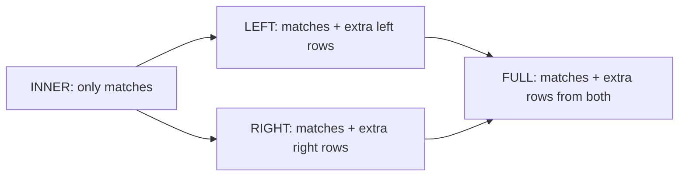
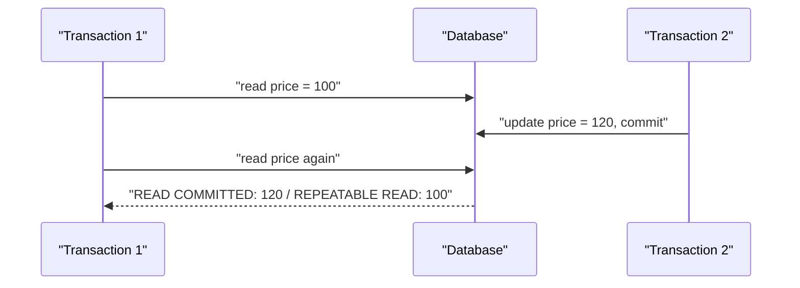
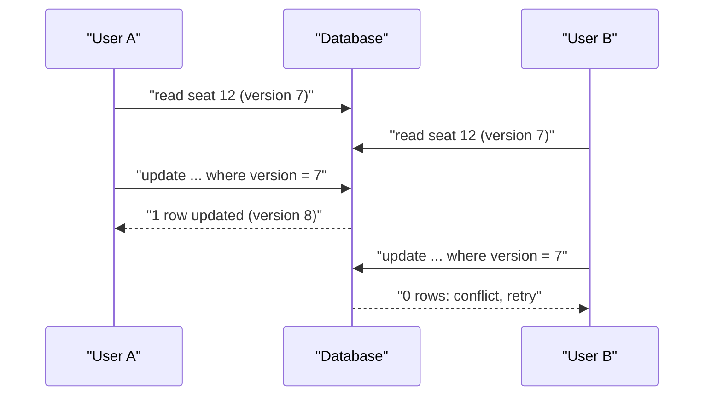

# Databases

[← Back to README](../README.md)

## SQL, transactions and locking

Almost every backend interview has a few SQL questions. Joins, transactions and locking come up again and again, because bugs in these areas lose money or data.

### SQL joins and self join

**In one line:** A join puts rows from two tables side by side, matched on a common column.

**Story:** A school teacher has two lists. List 1 has students. List 2 has the class each student joined. To print "student name + class name", she matches the two lists by student ID. Some students did not join any class. Some classes have no students. The type of join decides who appears on her final sheet.

**Sample data:**

`customers`
| id | name |
|---|---|
| 1 | Ravi |
| 2 | Sara |
| 3 | John |

`orders`
| id | customer_id | amount |
|---|---|---|
| 101 | 1 | 500 |
| 102 | 1 | 300 |
| 103 | 2 | 200 |
| 104 | 9 | 700 |

(John has no orders. Order 104 has a customer 9 who does not exist.)

**How it works (the 4 joins):**

```sql
SELECT c.name, o.id AS order_id
FROM customers c
JOIN orders o ON o.customer_id = c.id;   -- change JOIN to LEFT / RIGHT / FULL
```

| Join | Rule in simple words | Result rows (name, order_id) |
|---|---|---|
| **INNER JOIN** | Only rows that match on both sides | (Ravi, 101), (Ravi, 102), (Sara, 103) |
| **LEFT JOIN** | All left rows. No match = NULL on the right | INNER rows + (John, NULL) |
| **RIGHT JOIN** | All right rows. No match = NULL on the left | INNER rows + (NULL, 104) |
| **FULL OUTER JOIN** | All rows from both sides | INNER rows + (John, NULL) + (NULL, 104) |

- MySQL has no `FULL OUTER JOIN`. Use `LEFT JOIN ... UNION ... RIGHT JOIN`.
- "Customers with no orders" is a classic question: `LEFT JOIN` and then `WHERE o.id IS NULL`. Result: John.

**Diagram:**



**Self join:** A table joined with itself. Used when rows point to other rows in the same table, like employee and manager.

`employees`
| id | name | manager_id |
|---|---|---|
| 1 | Asha | NULL |
| 2 | Bala | 1 |
| 3 | Chen | 1 |
| 4 | Dev | 2 |

```sql
SELECT e.name AS employee, m.name AS manager
FROM employees e
LEFT JOIN employees m ON e.manager_id = m.id;  -- same table, two aliases
```

| employee | manager |
|---|---|
| Asha | NULL |
| Bala | Asha |
| Chen | Asha |
| Dev | Bala |

We use `LEFT JOIN` so the CEO (Asha, no manager) still shows.

**Example: classic interview queries.**

Second highest salary (handles ties, returns NULL if there is none):
```sql
SELECT MAX(salary) FROM employees
WHERE salary < (SELECT MAX(salary) FROM employees);
```

Find duplicate emails:
```sql
SELECT email, COUNT(*) AS cnt
FROM users
GROUP BY email
HAVING COUNT(*) > 1;
```
**GROUP BY / HAVING in one line:** `WHERE` filters rows before grouping. `HAVING` filters groups after grouping.

Top earner in each department, with a window function (a function that looks at a group of rows but does not merge them):
```sql
SELECT name, department, salary
FROM (
  SELECT name, department, salary,
         ROW_NUMBER() OVER (PARTITION BY department ORDER BY salary DESC) AS rn
  FROM employees
) t
WHERE rn = 1;   -- rn = 2 gives the second highest in each department
```
- `ROW_NUMBER` gives 1, 2, 3 with no ties.
- `RANK` gives 1, 1, 3 for ties. `DENSE_RANK` gives 1, 1, 2.
- For "Nth highest salary", use `DENSE_RANK` so ties count as one.

**Good and bad:**
| Good | Bad |
|---|---|
| Join on indexed columns (foreign keys) | Join on columns with no index: slow full table scans |
| `LEFT JOIN ... IS NULL` to find missing rows | Putting a right-table filter in `WHERE` after a `LEFT JOIN` (it turns it into an `INNER JOIN`) |
| Window functions for "top N per group" | Many nested subqueries for the same thing |

**Say this in the interview:**
> INNER JOIN returns only matching rows. LEFT JOIN returns all rows from the left table, with NULL where there is no match, and RIGHT JOIN is the mirror. FULL JOIN returns everything from both sides. A self join is a table joined with itself using two aliases, like employee to manager. For "top N per group" I use ROW_NUMBER or DENSE_RANK with PARTITION BY.

**They may ask next:**
- **Difference between `WHERE` and `ON` in a LEFT JOIN?** A filter in `ON` keeps all left rows. The same filter in `WHERE` removes rows where the right side is NULL.
- **What is a CROSS JOIN?** Every row of A with every row of B. 1,000 x 1,000 = 1 million rows. Rarely needed.
- **How to make a join fast?** Index the join columns. Check the plan with `EXPLAIN`.

### Transactions and isolation levels

**In one line:** A transaction is a group of DB steps that all succeed or all fail. The isolation level decides how much one transaction sees of another's work.

**Story:** You transfer 1,000 rupees to a friend. The bank must do two things: take 1,000 from you, add 1,000 to your friend. If the power goes off after step 1, the money cannot just vanish. Either both steps happen, or neither. Also, while the transfer is half done, nobody else should see a wrong balance.

**ACID in simple words:**
| Letter | Meaning | Bank story |
|---|---|---|
| **A**tomicity | All steps or none | Debit and credit both happen, or both are undone |
| **C**onsistency | Rules stay true (constraints, balance >= 0) | Total money in the bank stays the same |
| **I**solation | Running transactions do not disturb each other | Another clerk does not see your half-done transfer |
| **D**urability | Once committed, it stays, even after a crash | After "success", a power cut does not undo it |

**The 3 read problems (with tiny examples):**
1. **Dirty read:** You read data that another transaction has **not committed** yet. T1 sets balance to 0 but has not committed. T2 reads 0. T1 rolls back. T2 used a value that never existed.
2. **Non-repeatable read:** You read **the same row twice** and get different values. T1 reads price = 100. T2 updates price to 120 and commits. T1 reads again: 120.
3. **Phantom read:** You run **the same query twice** and get new rows. T1 counts orders for today: 10. T2 inserts a new order and commits. T1 counts again: 11. A "ghost" row appeared.

**The 4 isolation levels:**
| Level | Dirty read | Non-repeatable read | Phantom read | Speed |
|---|---|---|---|---|
| READ UNCOMMITTED | Possible | Possible | Possible | Fastest |
| READ COMMITTED | No | Possible | Possible | Fast |
| REPEATABLE READ | No | No | Possible (by SQL standard) | Medium |
| SERIALIZABLE | No | No | No | Slowest |

**Defaults you must know:**
- **MySQL InnoDB: REPEATABLE READ.** InnoDB also blocks most phantoms with "gap locks" (locks on the gaps between index rows).
- **PostgreSQL: READ COMMITTED.** PostgreSQL's REPEATABLE READ also blocks phantoms, because it reads from one fixed snapshot.
- **Oracle and SQL Server: READ COMMITTED.**

**MVCC in one paragraph:** MVCC (multi-version concurrency control) means the database keeps **old versions of rows** for a while. When you read, you see a **snapshot** (a photo of the data at one moment). Writers make a new version and do not block readers. Readers do not block writers. It is like a library. While someone corrects a book, you still read the old printed copy. The new edition appears when it is ready. MySQL InnoDB and PostgreSQL both use MVCC.

**Diagram:**



**Example:** Spring `@Transactional`.

```java
@Service
public class TransferService {
    private final AccountRepository accounts;

    TransferService(AccountRepository accounts) { this.accounts = accounts; }

    @Transactional(isolation = Isolation.READ_COMMITTED) // usually leave the DB default
    public void transfer(long fromId, long toId, BigDecimal amount) {
        Account from = accounts.findById(fromId).orElseThrow();
        Account to = accounts.findById(toId).orElseThrow();
        from.debit(amount);   // throws if balance too low -> whole transaction rolls back
        to.credit(amount);
    }   // commit here: both changes saved together
}
```
- By default Spring rolls back on unchecked exceptions (RuntimeException), not on checked ones. Use `rollbackFor` if needed.
- `@Transactional` does not work when you call the method from the same class (self-call skips the proxy).

**Good and bad:**
| Good | Bad |
|---|---|
| Keep transactions short (milliseconds) | Calling an HTTP API inside a transaction (holds locks for seconds) |
| Use the DB default level unless you have a reason | Using SERIALIZABLE everywhere: many retries and slow system |
| Fix race conditions with locks or constraints | Hoping a higher isolation level fixes every race |

**Say this in the interview:**
> A transaction makes a group of changes all-or-nothing, and ACID describes its promises. Isolation levels trade safety for speed: READ COMMITTED stops dirty reads, REPEATABLE READ also stops non-repeatable reads, and SERIALIZABLE stops phantoms too. MySQL InnoDB defaults to REPEATABLE READ and PostgreSQL to READ COMMITTED. Both use MVCC, so readers see a snapshot and do not block writers.

**They may ask next:**
- **What is a lost update?** Two users read stock = 10, both write 9. One sale is lost. Isolation level alone often does not stop it. Use locking (next topic) or `UPDATE ... SET stock = stock - 1`.
- **What is transaction propagation in Spring?** It decides what happens when one transactional method calls another. `REQUIRED` (default) joins the existing transaction. `REQUIRES_NEW` starts a separate one.
- **What does `readOnly = true` do?** It tells Hibernate to skip dirty checking, and some databases can use small speedups. It does not stop all writes by itself.

### Optimistic vs pessimistic locking

**In one line:** Optimistic locking checks for a conflict at save time, while pessimistic locking blocks others from the start.

**Story:** Two people try to book the **last seat** at a cinema, at the same second.
- **Optimistic:** Both pick the seat on screen. The first to press "Pay" wins. The second gets "Sorry, the seat was just taken. Please choose again."
- **Pessimistic:** The first person to tap the seat holds it. The seat turns grey for 5 minutes. The second person cannot even select it.

Without any locking, both pay, and two people get the same seat.

**How optimistic locking works:**
1. The row has a `version` column, say `version = 7`.
2. Both users read the row with version 7.
3. User A saves: `UPDATE seat SET status='BOOKED', version=8 WHERE id=12 AND version=7`. 1 row updated.
4. User B saves the same query. Version is now 8, so **0 rows updated**. The app sees a conflict.
5. App tells user B to retry or reload.

**How pessimistic locking works:**
1. User A runs `SELECT ... FROM seat WHERE id=12 FOR UPDATE`. The row is now locked.
2. User B runs the same query. B **waits**.
3. A updates and commits. Lock is released.
4. B now reads the row, sees status = BOOKED, and stops.

**Diagram:**



**Example: optimistic with JPA `@Version`.**

```java
@Entity
public class Seat {
    @Id Long id;
    String status;
    @Version Long version;   // Hibernate adds "AND version = ?" to every UPDATE
}
```
```java
@Transactional
public void book(long seatId) {
    Seat seat = seatRepository.findById(seatId).orElseThrow();
    if (!"FREE".equals(seat.status)) throw new SeatTakenException();
    seat.status = "BOOKED";   // on commit: 0 rows updated -> exception
}
```
- When 0 rows are updated, Hibernate throws `OptimisticLockException`. Spring wraps it as `ObjectOptimisticLockingFailureException`.
- Catch it at the service or controller layer. Return HTTP 409 Conflict, or retry 2-3 times.

**Example: pessimistic with `@Lock`.**

```java
public interface SeatRepository extends JpaRepository<Seat, Long> {
    @Lock(LockModeType.PESSIMISTIC_WRITE)   // SQL: SELECT ... FOR UPDATE
    @QueryHints(@QueryHint(name = "jakarta.persistence.lock.timeout", value = "3000"))
    @Query("select s from Seat s where s.id = :id")
    Optional<Seat> findByIdForUpdate(Long id);
}
```
- Must run inside a `@Transactional` method. The lock is released at commit or rollback.
- Set a lock timeout (here 3 seconds) so a request does not wait forever.

**When to use which:**
| | Optimistic | Pessimistic |
|---|---|---|
| Best when | Conflicts are rare (editing a profile, updating a product) | Conflicts are common (last seats, flash sale stock, wallet balance) |
| Cost | No DB lock. Very cheap | Holds a row lock. Others wait |
| On conflict | Error, user or code retries | Second user waits, then sees the new data |
| Risk | Many retries if conflicts are frequent | Deadlocks and slow requests if held too long |

**Deadlocks in simple words:** Two cars meet on a narrow bridge from both sides. Neither can move forward, and neither will reverse. In a DB:
1. T1 locks row A, then wants row B.
2. T2 locks row B, then wants row A.
3. Both wait for each other forever.

The database detects this. It kills one transaction (MySQL error 1213, PostgreSQL "deadlock detected") so the other can finish.

**How to avoid deadlocks:**
- **Lock rows in the same order** everywhere. Example: in a transfer, always lock the smaller account ID first.
- Keep transactions short. No HTTP calls while holding locks.
- Add indexes on columns in your `WHERE`. Without an index, the DB may lock many more rows than needed.
- Retry the killed transaction once or twice. Deadlocks can still happen, so the code must handle them.

**Good and bad:**
| Good | Bad |
|---|---|
| `@Version` on entities that users edit | No locking at all: lost updates and double booking |
| `FOR UPDATE` with a timeout for hot rows | `FOR UPDATE` while calling a payment API: lock held for seconds |
| Lock rows in a fixed order | Locking rows in random order across services |
| Simple atomic SQL: `UPDATE stock SET qty = qty - 1 WHERE id = ? AND qty > 0` | Read, change in Java, write back, with no check |

**Say this in the interview:**
> Optimistic locking uses a version column. Hibernate adds the version to the WHERE clause, and if 0 rows change it throws OptimisticLockException, so we retry or return 409. Pessimistic locking uses SELECT FOR UPDATE, so others wait until we commit. I use optimistic when conflicts are rare and pessimistic for hot rows like the last seat or wallet balance. To avoid deadlocks I lock rows in the same order, keep transactions short, and retry once if the DB kills one.

**They may ask next:**
- **Can you lock across many app servers?** A DB row lock already works across servers, because all servers use the same DB. For non-DB resources, use a distributed lock (Redis or ZooKeeper), with care.
- **What is `SKIP LOCKED`?** `SELECT ... FOR UPDATE SKIP LOCKED` skips rows that others have locked. Good for job queues: many workers each take different rows.
- **What about `PESSIMISTIC_READ`?** It is a shared lock (`FOR SHARE`). Many can read, nobody can write until they finish.
