# Distributed systems fundamentals

[← Back to README](../README.md)

A distributed system is many computers that work together and look like one system to the user.
Senior interviews test what happens when those computers disagree, get slow, or die halfway.
This page explains clocks, consensus, replication, transactions, search engines and message brokers in simple words, with many diagrams.
Basics like CAP, sharding and sagas already live in [system design](system-design.md) and [microservices](microservices.md). Here we give a short recap and a link, then go deeper.

**Contents:**

- [The big picture](#the-big-picture)
- [The 8 fallacies of distributed computing](#the-8-fallacies-of-distributed-computing)
- [Partial failure](#partial-failure)
- [Why "exactly once" is really "effectively once"](#why-exactly-once-is-really-effectively-once)
- [Physical clocks and NTP drift](#physical-clocks-and-ntp-drift)
- [Lamport clocks](#lamport-clocks)
- [Vector clocks](#vector-clocks)
- [Hybrid logical clocks](#hybrid-logical-clocks)
- [Why "last write wins" loses data](#why-last-write-wins-loses-data)
- [Fencing tokens](#fencing-tokens)
- [Consensus: why we need it](#consensus-why-we-need-it)
- [Raft in simple words](#raft-in-simple-words)
- [Paxos in one paragraph](#paxos-in-one-paragraph)
- [Where consensus is used: etcd, ZooKeeper, KRaft, Consul](#where-consensus-is-used-etcd-zookeeper-kraft-consul)
- [Split brain and quorum math](#split-brain-and-quorum-math)
- [Leader election and leases](#leader-election-and-leases)
- [Distributed locks and why a lock service needs fencing](#distributed-locks-and-why-a-lock-service-needs-fencing)
- [Replication models: single-leader, multi-leader, leaderless](#replication-models-single-leader-multi-leader-leaderless)
- [Leaderless replication deep dive](#leaderless-replication-deep-dive)
- [Replication lag anomalies](#replication-lag-anomalies)
- [Consistency models ladder](#consistency-models-ladder)
- [PACELC beyond CAP](#pacelc-beyond-cap)
- [Two-phase commit and three-phase commit](#two-phase-commit-and-three-phase-commit)
- [TCC: try-confirm-cancel](#tcc-try-confirm-cancel)
- [Distributed transactions compared](#distributed-transactions-compared)
- [CRDTs and operational transform](#crdts-and-operational-transform)
- [Failure detection: heartbeats, timeouts, phi accrual](#failure-detection-heartbeats-timeouts-phi-accrual)
- [Gossip protocols and SWIM](#gossip-protocols-and-swim)
- [Backpressure, load shedding and admission control](#backpressure-load-shedding-and-admission-control)
- [Retry storms and retry budgets](#retry-storms-and-retry-budgets)
- [Partitioning recap: rebalancing and hot spots](#partitioning-recap-rebalancing-and-hot-spots)
- [Search engines: inverted index and analyzers](#search-engines-inverted-index-and-analyzers)
- [Elasticsearch shards, segments and near-real-time refresh](#elasticsearch-shards-segments-and-near-real-time-refresh)
- [Relevance with BM25](#relevance-with-bm25)
- [Keeping search in sync with the database](#keeping-search-in-sync-with-the-database)
- [Mapping explosions and other Elasticsearch traps](#mapping-explosions-and-other-elasticsearch-traps)
- [Postgres full-text search vs Elasticsearch](#postgres-full-text-search-vs-elasticsearch)
- [RabbitMQ model: exchanges, queues, bindings](#rabbitmq-model-exchanges-queues-bindings)
- [RabbitMQ reliability: acks, prefetch, DLX, quorum queues, streams](#rabbitmq-reliability-acks-prefetch-dlx-quorum-queues-streams)
- [RabbitMQ vs Kafka vs SQS](#rabbitmq-vs-kafka-vs-sqs)
- [Observability of distributed systems](#observability-of-distributed-systems)
- [Reading list](#reading-list)
- [Interview questions](#interview-questions)

---

## The big picture

**In one line:** Every topic on this page answers one question: how do many machines agree on data when the network, clocks and machines can all fail?

**Story:** Think of a family WhatsApp group planning a wedding.
- Messages arrive late or out of order (network delay).
- Uncle's phone shows the wrong time (clock drift).
- Two cousins book two different halls at the same time (conflict).
- Someone must have the final say (a leader, chosen by consensus).
- Everyone needs the same final guest list (replication and consistency).

**How it works:** the problems and the tools that solve them.

**Diagram:**

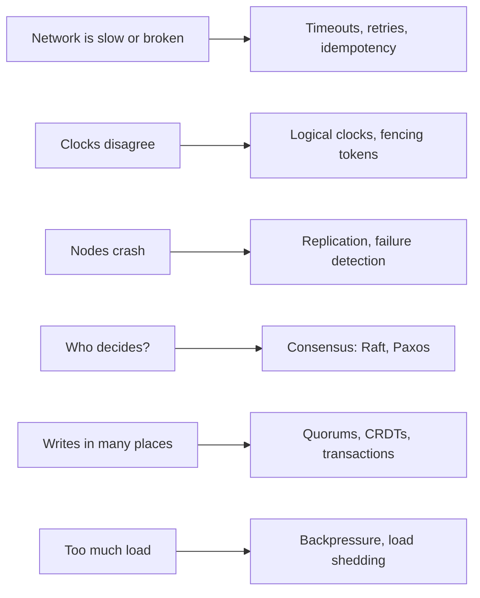

**Say this in the interview:**

> In a distributed system the network, the clocks and the machines can all fail, and often only partly.
> So I design for timeouts, retries with idempotency, replication, and a clear rule for who decides.
> For "who decides" I use a consensus system like etcd or ZooKeeper, and I never trust wall clocks for ordering.

---

## The 8 fallacies of distributed computing

**In one line:** Eight wrong beliefs that new engineers hold about networks; each one causes real outages.

**Story:** You post a parcel to your mother. You assume it reaches her, fast, unopened, for free, by a road that never changes.
In real life the parcel can be lost, late, opened, or sent by a new route.
Network calls are parcels, not function calls.

**How it works:** the list was written by L Peter Deutsch and colleagues at Sun Microsystems in the 1990s.

| Fallacy | Reality | What we do |
|---|---|---|
| The network is reliable | Packets get lost, connections reset | Timeouts, retries, idempotency keys |
| Latency is zero | A call across regions takes 50–150 ms | Batch calls, cache, avoid chatty APIs |
| Bandwidth is infinite | Big payloads choke links | Pagination, compression, small messages |
| The network is secure | Anyone on the path may read or change data | TLS everywhere, mTLS between services |
| Topology doesn't change | Pods move, IPs change every deploy | Service discovery, DNS, no hard-coded IPs |
| There is one administrator | Many teams, clouds and vendors | Clear ownership, contracts, SLOs |
| Transport cost is zero | Serializing costs CPU; cross-zone traffic costs money | Efficient formats, keep chatty services close |
| The network is homogeneous | Mixed hardware, protocols, versions | Standard protocols, backward-compatible APIs |

**Diagram:** a local call vs a remote call.

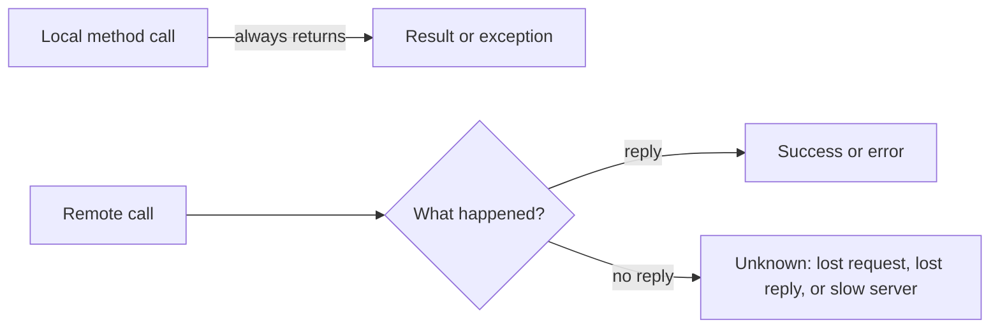

**Good and bad:**

| Good | Bad |
|---|---|
| Every remote call has a timeout | Default infinite timeouts in HTTP clients |
| One coarse API call | 50 small calls in a loop (N+1 over HTTP) |
| Config from service discovery | IP addresses in `application.yml` |

**Say this in the interview:**

> The fallacies remind me that a remote call is not a local call.
> It can fail, be slow, or succeed without me knowing.
> So every call gets a timeout, a retry policy with idempotency, and TLS, and I keep APIs coarse to save round trips.

**They may ask next:**
- **Which fallacy hurts most in microservices?** "The network is reliable" and "latency is zero". They cause cascading failures. See [timeouts](microservices.md#timeouts) and [circuit breaker](microservices.md#circuit-breaker).

---

## Partial failure

**In one line:** In a distributed system some parts fail while others keep working, and often you cannot tell which.

**Story:** You call a restaurant to order food. The line goes silent.
Did they hear your order? Is the cook making it? Did the phone just drop?
You do not know. If you call again, you might get two pizzas.

**How it works:**
1. On one machine, a failure is usually total: the process crashes and everything stops.
2. Across machines, one node can be dead, slow, or cut off while others run.
3. A timeout tells you "no answer yet". It does not tell you "the work did not happen".
4. Three cases look the same to the caller: the request was lost, the server crashed after doing the work, or the reply was lost.
5. So the caller must either check the state, or retry safely with an idempotency key.

**Diagram:** the lost reply.

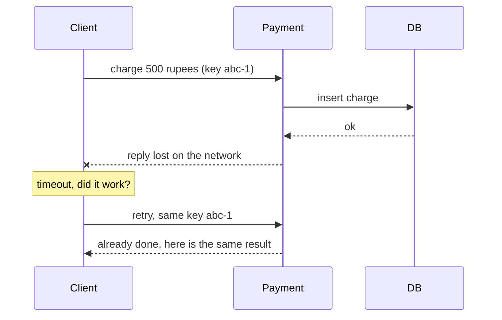

**Good and bad:**

| Good | Bad |
|---|---|
| Treat a timeout as "unknown" | Treat a timeout as "failed" and charge again |
| Idempotency keys on every write API | Retrying `POST /payments` blindly |
| Status endpoint to ask "did it happen?" | No way to check the state after a crash |

**Say this in the interview:**

> Partial failure means some nodes work and some do not, and a timeout cannot tell me whether the work happened.
> So I make writes idempotent with a key, and I retry with the same key.
> The server stores the result per key and returns it again on a retry.

**They may ask next:**
- **How do you store idempotency keys?** A unique column or a Redis key with a TTL, written in the same transaction as the work. See [idempotency](microservices.md#idempotency).

---

## Why "exactly once" is really "effectively once"

**In one line:** No network can deliver a message exactly once; we get "at least once" delivery plus deduplication, which gives an exactly-once effect.

**Story:** A courier delivers a parcel. If he gets no signature, he comes back tomorrow with another copy.
You may get the parcel twice. But you check the order number and keep only one.
The delivery happened twice; the effect happened once.

**How it works:**
1. **At most once:** send and forget. Messages can be lost.
2. **At least once:** retry until an ack arrives. Messages can be duplicated.
3. **Exactly once delivery** is impossible over an unreliable network. The sender can never be sure the ack was not lost.
4. **Effectively once** = at-least-once delivery + an idempotent consumer.
5. Ways to make the consumer idempotent:
   - Store processed message ids in a table with a unique key, in the same DB transaction as the business change.
   - Use natural idempotency: `SET status = 'PAID'` is safe to repeat; `balance = balance + 100` is not.
   - Use versions: apply only if `version = expected`.
6. Kafka "exactly-once" works inside Kafka (read, process, write to Kafka in one transaction). Side effects outside Kafka (emails, HTTP calls) still need idempotency. See [Kafka exactly-once](kafka.md#exactly-once-and-kafka-transactions).

**Diagram:**

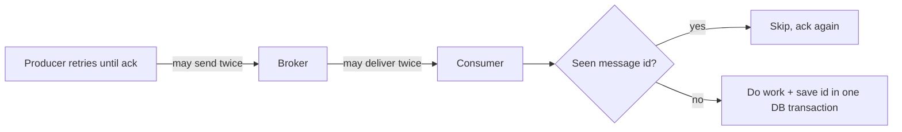

**Example (dedup table in the same transaction):**

```java
@Transactional
public void onPaymentEvent(PaymentEvent e) {
    int inserted = jdbc.update(
        "INSERT INTO processed_events(event_id) VALUES (?) ON CONFLICT DO NOTHING",
        e.id());                       // unique key on event_id
    if (inserted == 0) return;         // duplicate: already processed, skip
    orders.markPaid(e.orderId());      // business change, same transaction
}
```

**Good and bad:**

| Good | Bad |
|---|---|
| Dedup id saved in the same transaction as the work | Dedup id saved in Redis, work saved in Postgres (two systems can disagree) |
| Saying "effectively once" in the interview | Promising "exactly once delivery" across services |

**Say this in the interview:**

> Exactly-once delivery is not possible over a network, because the sender can never trust that the ack was not lost.
> What we build is at-least-once delivery plus an idempotent consumer, which gives exactly-once effect.
> I store the message id with a unique key in the same transaction as the business change.

**They may ask next:**
- **Then what does Kafka's exactly-once mean?** Read-process-write inside Kafka is atomic with transactions. Anything outside Kafka still needs idempotency. See [handling duplicate events](kafka.md#handling-duplicate-events).

---

## Physical clocks and NTP drift

**In one line:** Every server has its own quartz clock that runs a little fast or slow, so two servers never agree on the exact time.

**Story:** Ten friends set their watches together on Monday. By Friday, one is 2 minutes fast and one is 1 minute slow.
If they decide "who arrived first" by their own watches, they will argue.
Servers have the same problem, only in milliseconds.

**How it works:**
1. **Time-of-day clock** (wall clock): `System.currentTimeMillis()`, `Instant.now()`. It can **jump** forward or **backward** when NTP corrects it.
2. **Monotonic clock:** `System.nanoTime()`. It only moves forward. Use it to measure durations, never to compare across machines.
3. **NTP** (Network Time Protocol) syncs the clock with time servers. Accuracy is often a few milliseconds inside a data centre, and worse over the internet.
4. **Drift:** quartz crystals run at slightly wrong speeds. Google has assumed up to 200 ppm (parts per million). That is about 17 seconds a day if never synced.
5. **Leap seconds** and VM pauses also make clocks jump. Cloud providers often "smear" the leap second over a day.
6. **Google Spanner** uses GPS and atomic clocks (TrueTime). It returns a time range, not a point, and waits out the uncertainty before commit.

**Diagram:** why wall-clock ordering lies.

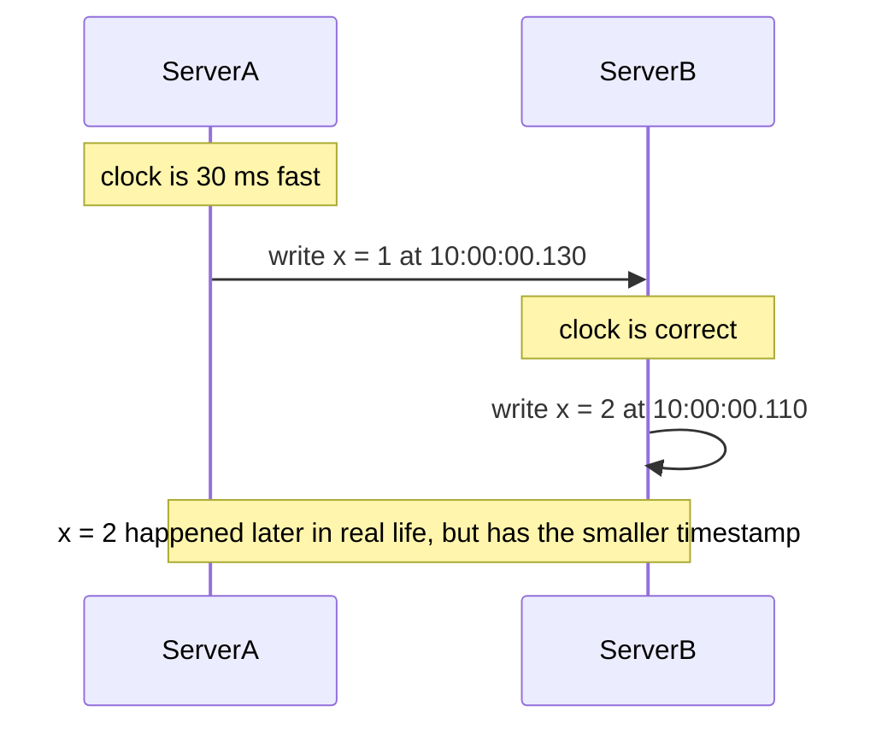

**Example:**

```java
long start = System.nanoTime();               // monotonic: safe for durations
callService();
long tookMs = (System.nanoTime() - start) / 1_000_000;

Instant createdAt = Instant.now();            // wall clock: fine for display,
                                              // NOT for ordering events across servers
```

**Good and bad:**

| Good | Bad |
|---|---|
| `nanoTime()` for timeouts and latency | `currentTimeMillis()` differences for timeouts (can go negative) |
| Monitor clock offset as a metric | Assume all servers agree on the time |
| Order events with sequence numbers or logical clocks | Order events across servers by timestamp |

**Say this in the interview:**

> Every server's clock drifts, and NTP fixes it by jumping it, sometimes backward.
> So I use the monotonic clock for durations and never order events across machines by wall-clock time.
> For ordering I use sequence numbers from one place, or logical clocks.

**They may ask next:**
- **How does Spanner get global ordering?** TrueTime gives a time interval with a known error. Spanner waits until the interval passes before it commits, so commit times are in real order.

---

## Lamport clocks

**In one line:** A Lamport clock is a counter on each node that gives events an order that respects cause and effect, without real time.

**Story:** In a cricket match scorebook, nobody writes the clock time. They write "over 12, ball 3".
Every event has a number, and if one ball caused a run, the run has a bigger number.
Leslie Lamport described this idea in 1978.

**How it works:**
1. Each node keeps a counter `C`, starting at 0.
2. Before each local event, `C = C + 1`.
3. When sending a message, attach `C`.
4. When receiving a message with counter `m`, set `C = max(C, m) + 1`.
5. Rule: if A happened before B (A caused B), then `L(A) < L(B)`.
6. The reverse is not true. `L(A) < L(B)` does not prove A caused B. They may be unrelated (concurrent).
7. For a total order, break ties with the node id: `(counter, nodeId)`.

**Diagram:**

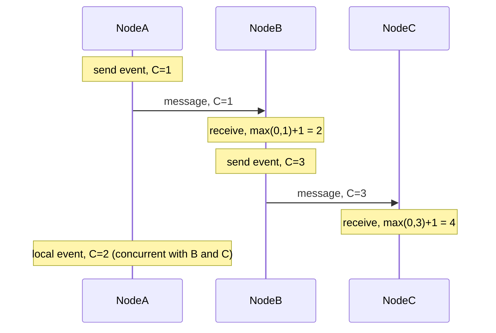

**Example:**

```java
final class LamportClock {
    private long time = 0;
    synchronized long tick() { return ++time; }                  // local event or send
    synchronized long onReceive(long remote) {
        time = Math.max(time, remote) + 1;                       // the key rule
        return time;
    }
}
```

**Good and bad:**

| Good | Bad |
|---|---|
| Tiny: one number per message | Cannot detect concurrent (conflicting) writes |
| Total order with a node-id tie break | Order has nothing to do with real time |

**Say this in the interview:**

> A Lamport clock is a counter: increment on each event, and on receive take the max plus one.
> It guarantees that if A caused B, A has a smaller number.
> It cannot tell me if two events were concurrent; for that I need vector clocks.

---

## Vector clocks

**In one line:** A vector clock keeps one counter per node, so you can tell if one event happened before another or if they were concurrent (a conflict).

**Story:** Two sisters edit the same shopping list on two phones while offline.
Each phone keeps a note: "I have seen 3 of my edits and 2 of yours".
When the phones sync, these notes show if one list is newer, or if both changed it separately. Then you merge.

**How it works:**
1. Each node keeps a vector: `{A: 0, B: 0, C: 0}`.
2. On a local write, a node bumps its own entry.
3. Messages carry the whole vector. On receive, take the max of each entry, then bump your own.
4. Compare two vectors V1 and V2:
   - Every entry of V1 ≤ V2 → V1 happened before V2. Keep V2.
   - Some entries bigger on each side → **concurrent**. This is a conflict to merge.
5. Amazon's Dynamo paper used vector clocks to keep "sibling" versions and let the app merge them.
6. Cost: the vector grows with the number of writers. Systems trim old entries.

**Diagram:**

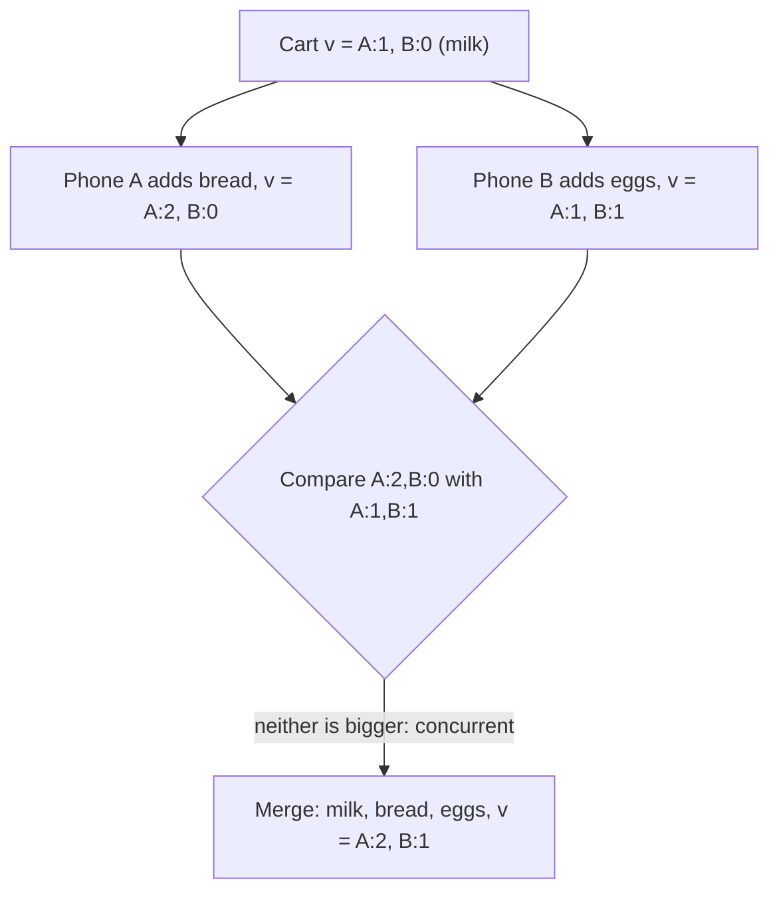

**Good and bad:**

| Good | Bad |
|---|---|
| Detects real conflicts instead of losing a write | Size grows with the number of nodes or clients |
| Lets the app merge (union of carts) | App must write merge logic |

**Say this in the interview:**

> A vector clock has one counter per node.
> If every counter in one version is less or equal to the other, it is older; otherwise the writes were concurrent.
> Concurrent means conflict, so the system keeps both versions and the app merges them, like Dynamo's shopping cart.

**They may ask next:**
- **Vector clock vs version vector?** Very close. A version vector tracks versions of one data item per replica. People often use the names loosely.

---

## Hybrid logical clocks

**In one line:** A hybrid logical clock (HLC) is wall-clock time plus a small counter. It stays close to real time and still respects cause and effect.

**Story:** A train ticket has a time and a seat number.
If two tickets show the same minute, the seat number breaks the tie.
HLC is like that: the physical time is the minute, and the counter is the tie breaker.

**How it works:**
1. An HLC timestamp is `(physical time, logical counter)`.
2. On a local event: if the wall clock moved ahead, use it and reset the counter. If not, keep the old time and bump the counter.
3. On receive: take the max of local wall clock, own HLC and the message HLC. Bump the counter if times are equal.
4. Result: if A caused B, `HLC(A) < HLC(B)`, like Lamport.
5. And HLC stays close to the real wall clock, so "read as of 10:00" still makes sense.
6. It still depends on clocks being roughly in sync. Systems set a **maximum clock offset**.
7. Used by **CockroachDB** and **YugabyteDB** (both docs say so). CockroachDB shuts down a node whose clock drifts too far from the others.

**Diagram:**

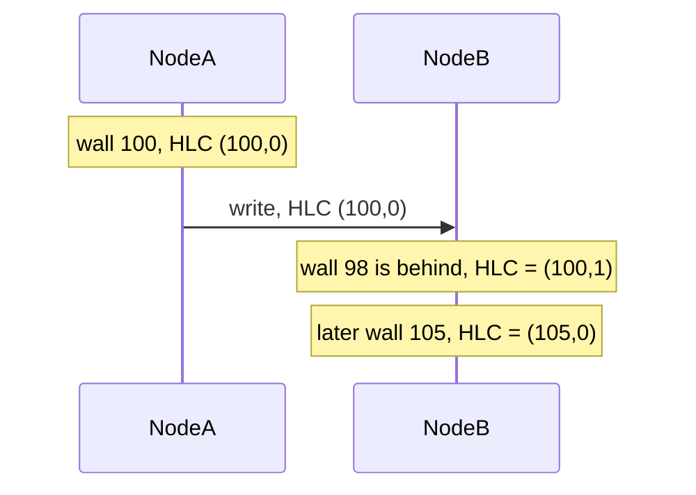

**Good and bad:**

| Good | Bad |
|---|---|
| Fits in 64 bits, close to real time | Still needs NTP and a max offset |
| Respects causality like Lamport | Does not detect concurrency like vector clocks |

**Say this in the interview:**

> A hybrid logical clock is a wall-clock time plus a counter.
> It keeps cause-and-effect order like a Lamport clock but stays near real time, so snapshots by time work.
> CockroachDB and YugabyteDB use it, and they limit how far node clocks may drift.

---

## Why "last write wins" loses data

**In one line:** Last write wins (LWW) keeps the write with the biggest timestamp and silently drops the others, even if they were newer in real life.

**Story:** Two clerks update the same customer address on paper.
The manager keeps the paper with the later time stamp. But one clerk's stamp machine was 1 minute fast.
The newer, correct address goes in the bin, and nobody is told.

**How it works:**
1. Two replicas accept writes to the same key at about the same time.
2. Each write gets a wall-clock timestamp from its node.
3. On merge, the bigger timestamp wins. The other write is dropped.
4. Problems:
   - Clock skew: a node with a fast clock wins even when its write was older.
   - Concurrent writes: both were valid (two items added to a cart); one is lost.
   - Silent: no error, no log, no conflict for the app to see.
5. Cassandra uses LWW per column by default. It is fine when each key is written once, or when losing a concurrent write is OK.

**Diagram:**

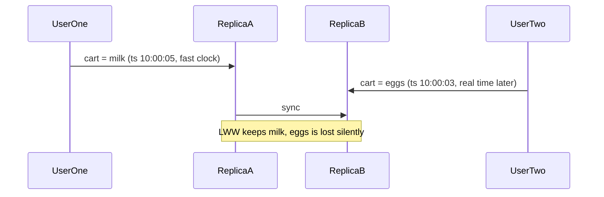

**Good and bad:**

| Good | Bad |
|---|---|
| Immutable keys (write once, new id per event) | LWW on a shared counter or cart |
| CRDTs or version checks when merging matters | Trusting timestamps from many machines |
| Optimistic locking with a version column | "Update if timestamp is newer" across regions |

**Say this in the interview:**

> Last write wins picks the write with the highest timestamp and drops the rest without telling anyone.
> With clock skew, the dropped write may be the newer one.
> I use it only for write-once data; otherwise I use version checks, vector clocks or CRDTs.

---

## Fencing tokens

**In one line:** A fencing token is a number that grows every time a lock or leadership is given out; the storage rejects any write with an older number.

**Story:** A hotel gives you a key card for room 101. When you check out, the next guest gets a new card.
The door lock remembers the newest card number. Your old card no longer opens the door, even if you kept it.
The door, not the guest, enforces the rule.

**How it works:**
1. The lock service gives out the lock with a number: 33, then 34, then 35.
2. The client sends the number with every write to the storage.
3. The storage remembers the highest number seen.
4. A write with a lower number is rejected.
5. This protects against a client that paused (GC, VM freeze) and still thinks it holds the lock.
6. Where the number comes from:
   - ZooKeeper: the `zxid` or the znode version.
   - etcd: the revision of the lock key.
   - Kafka: the controller epoch and the leader epoch.
   - Raft: the term number.

**Diagram:**

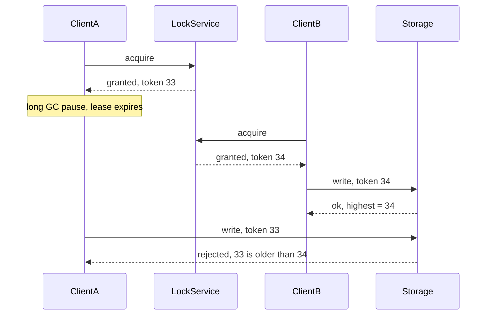

**Example (fencing in SQL):**

```sql
-- storage keeps the highest token per resource
UPDATE report_job
SET    result = :result, fence = :token
WHERE  id = :id
AND    fence < :token;      -- older token = 0 rows updated = rejected
```

**Good and bad:**

| Good | Bad |
|---|---|
| Storage checks the token on every write | Client checks "do I still hold the lock?" then writes (race) |
| Token from a consensus system | Token from a clock |

**Say this in the interview:**

> Any lock with a timeout can expire while the holder is paused, so two clients may both think they own it.
> A fencing token is a number that grows with each grant, and the storage rejects writes with an older number.
> The key point: the resource enforces safety, not the client.

**They may ask next:**
- **Does Redis Redlock give a fencing token?** No. You can add one with `INCR`, but the storage must check it. See [Redis distributed locks](redis.md#distributed-locks).

---

## Consensus: why we need it

**In one line:** Consensus is a way for a group of machines to agree on one value (or one ordered list of commands), even if some of them crash.

**Story:** Five friends must pick one restaurant by SMS. Messages are slow, and one friend's phone dies.
If each friend decides alone, they end up in three restaurants.
They need a rule: "the choice with 3 out of 5 votes is final, and nobody changes it later."

**How it works:**
1. Many problems are really "agree on one thing":
   - Who is the leader now?
   - Who holds the lock?
   - What is the next entry in the log?
   - Is this transaction committed?
2. A consensus algorithm promises:
   - **Agreement:** all nodes decide the same value.
   - **Validity:** the value was proposed by someone.
   - **Termination:** non-crashed nodes decide in the end.
3. It works as long as a **majority** of nodes are alive and can talk.
4. The **FLP result** (1985) says: in a fully asynchronous network, no algorithm can always reach agreement if even one node may crash. Real systems get around it with timeouts. They are always safe, and make progress when the network is calm.
5. Most systems use consensus to build a **replicated log**: every node applies the same commands in the same order. This is called a **replicated state machine**.

**Diagram:**

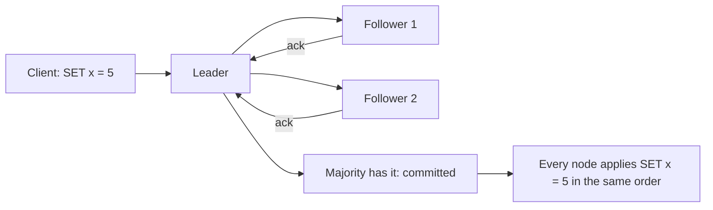

**Good and bad:**

| Good | Bad |
|---|---|
| Use a proven system: etcd, ZooKeeper, Consul | Write your own consensus algorithm |
| Keep only small, important data in it (leaders, config, locks) | Store business data or large blobs in etcd |

**Say this in the interview:**

> Consensus lets a group of nodes agree on one value, or on one ordered log, even when some nodes crash.
> It needs a majority alive, so 3 nodes survive 1 failure and 5 survive 2.
> I do not build it myself; I use etcd, ZooKeeper or Consul for leader election, locks and config.

---

## Raft in simple words

**In one line:** Raft elects one leader per term; the leader copies log entries to followers, and an entry is committed once a majority has stored it.

**Story:** A class elects a monitor. The monitor writes every rule on the board, and students copy it into notebooks.
A rule is final when more than half the class has copied it.
If the monitor is absent, after a short random wait someone stands up and asks for votes. The new monitor gets a new "term" number.

**How it works:** Raft was published by Diego Ongaro and John Ousterhout in 2014, to be easier to understand than Paxos.

**1. Roles and terms**
- Every node is a **follower**, **candidate** or **leader**.
- Time is split into **terms** (1, 2, 3...). Each term has at most one leader.
- A term is a logical clock. A node that sees a higher term steps down to follower at once.

**2. Leader election**
- The leader sends **heartbeats** (empty `AppendEntries` messages) often.
- If a follower hears nothing for its **election timeout**, it becomes a candidate. The paper suggests a random timeout, for example 150–300 ms, so nodes rarely start at the same time.
- The candidate bumps the term, votes for itself and sends `RequestVote` to all.
- Each node gives **one vote per term**, first come first served.
- A node refuses its vote if the candidate's log is less up to date than its own.
- Majority of votes → leader. Split vote → new random timeout and a new term.

**3. Log replication**
- Clients send commands to the leader only.
- The leader appends the entry to its log with the current term and index.
- It sends `AppendEntries` with the new entry plus the index and term of the entry before it.
- A follower accepts only if its log matches at that previous index. If not, the leader steps back and resends older entries until the logs match.
- When a majority stores the entry, the leader moves the **commit index** forward and applies it.
- Followers learn the commit index from the next `AppendEntries` and apply it too.

**4. Safety rules (why data is never lost)**
- **Election restriction:** only a node with an up-to-date log can win. So a new leader has every committed entry.
- **Log matching:** if two logs have the same index and term at a position, all earlier entries are the same too.
- **Leader completeness:** a committed entry is in every future leader's log.
- **Current-term rule:** a leader only commits entries from its own term by counting copies. Older entries become committed along with them.
- **State machine safety:** no two nodes ever apply different commands at the same index.

**Diagram (node states):**

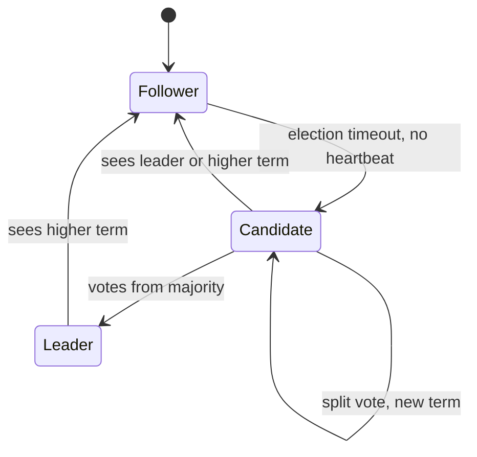

**Diagram (election):**

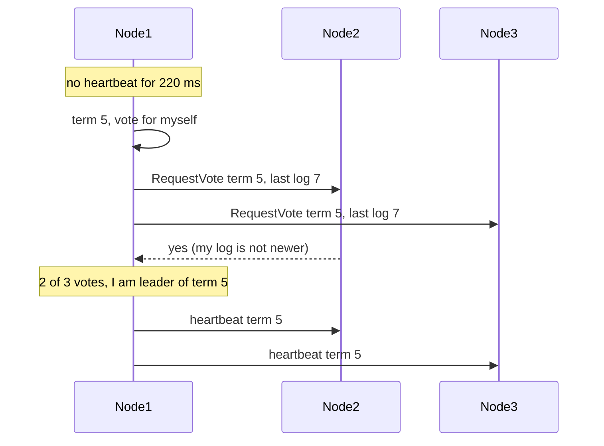

**Diagram (write and commit):**

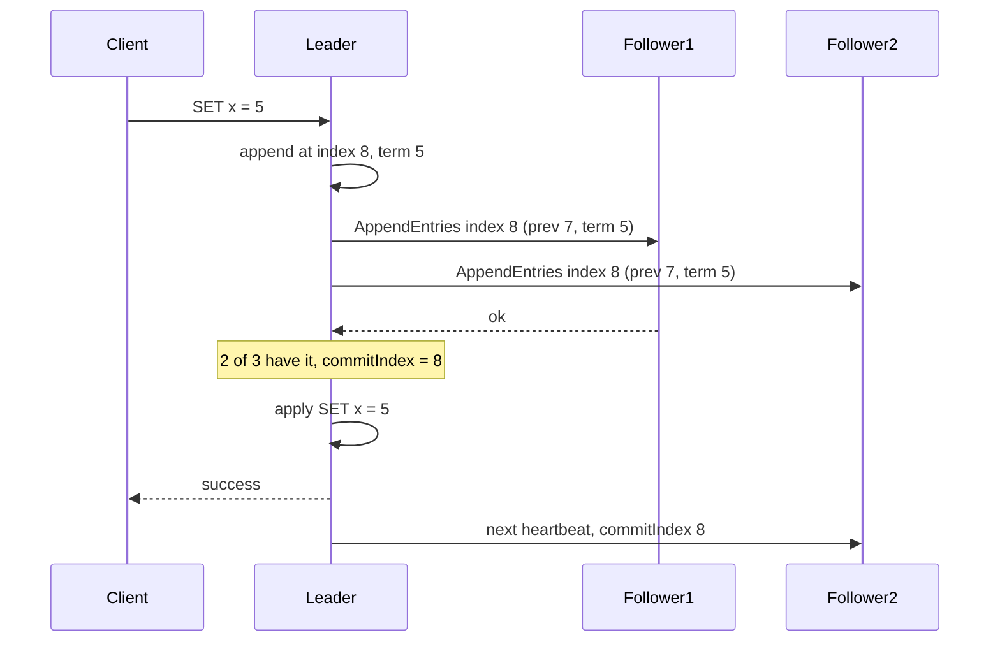

**Example (numbers):** 5 nodes. The leader needs 3 copies (itself + 2) to commit. 2 nodes can be down and the cluster still writes. If 3 are down, it stops writing but never returns wrong data.

**Extras worth knowing:**
- **Snapshots:** the log is compacted into a snapshot so it does not grow forever.
- **Membership changes:** add or remove one node at a time (or "joint consensus") so two majorities never exist.
- **PreVote:** a node first asks "would you vote for me?" before bumping the term. It stops a cut-off node from disturbing the cluster when it returns. etcd supports it.
- **Linearizable reads:** the leader must confirm it is still leader (a heartbeat round or a lease) before answering a read. Otherwise an old leader might serve stale data.

**Good and bad:**

| Good | Bad |
|---|---|
| Easy to reason about: one leader, one log | All writes go through one leader (limit on write speed) |
| Safe under crashes and message loss | Needs a majority; a 2-node cluster cannot survive any failure |
| Odd cluster sizes: 3 or 5 | 7+ nodes: slower commits, little gain |

**Say this in the interview:**

> Raft has one leader per term. Followers that miss heartbeats start an election after a random timeout. A node votes once per term, and only for a candidate whose log is at least as up to date.
> The leader appends commands and replicates them; an entry is committed when a majority stores it.
> Because a new leader needs a majority vote and an up-to-date log, it always has every committed entry, so committed data is never lost.

**They may ask next:**
- **What if the old leader comes back?** It sees a higher term in any reply and steps down. Its uncommitted entries are overwritten by the new leader's log.
- **Can a follower serve reads?** Only stale reads, unless it asks the leader for the commit index first (etcd does this, "ReadIndex").

---

## Paxos in one paragraph

**In one line:** Paxos is the older consensus algorithm by Leslie Lamport; it is proven correct but famous for being hard to understand and implement.

**Story:** A village council where anyone can propose. A proposer first asks for a promise, then asks for acceptance. A majority promise means no older proposal can win later.

**How it works:**
Paxos has **proposers**, **acceptors** and **learners**.
In phase 1 (**prepare/promise**), a proposer picks a number `n` and asks a majority of acceptors to promise to ignore proposals below `n`. They reply with any value they already accepted.
In phase 2 (**accept/accepted**), the proposer asks them to accept a value. It must reuse the highest value already accepted, if any. Once a majority accepts, the value is chosen and learners are told.
Basic Paxos picks one value. **Multi-Paxos** picks a stable leader and skips phase 1 for each new log slot, so it looks a lot like Raft.
Google's Chubby lock service and Spanner use Paxos variants. ZooKeeper uses a related protocol called **Zab**.

**Diagram:**

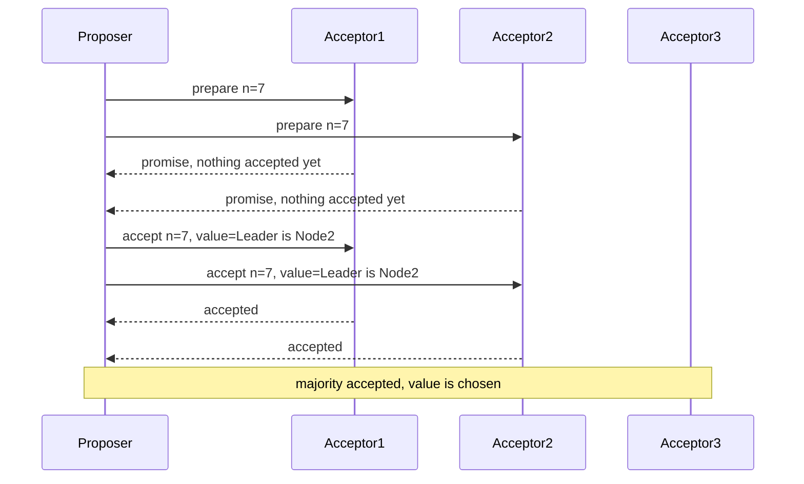

**Say this in the interview:**

> Paxos uses two phases: prepare and promise with a ballot number, then accept with a majority.
> Multi-Paxos keeps a stable leader to skip the first phase, which makes it similar to Raft.
> Raft was designed to be easier to explain, which is why etcd, Consul and Kafka's KRaft use it.

---

## Where consensus is used: etcd, ZooKeeper, KRaft, Consul

**In one line:** We almost never call Raft directly; we use a small coordination service built on it for leader election, locks, config and cluster metadata.

**Story:** A company does not let every team keep its own copy of the org chart. HR keeps one official register. Anyone can read it, and changes go through HR's approval process.

**How it works:**

| System | Algorithm | Used for |
|---|---|---|
| **etcd** | Raft | All Kubernetes cluster state (pods, services, configs). Leases and watches. |
| **ZooKeeper** | Zab (similar idea to Paxos and Raft) | Old Kafka metadata, HBase, Hadoop, Solr. Ephemeral and sequential nodes for locks and elections. |
| **Kafka KRaft** | Raft-based protocol | Kafka's own metadata quorum. ZooKeeper was removed in Kafka 4.0. See [Kafka architecture](kafka.md#kafka-architecture-brokers-kraft-controllers-and-the-log). |
| **Consul** | Raft (servers) + gossip (membership) | Service discovery, health checks, key-value config. |
| **RabbitMQ** | Raft (its Ra library) | Quorum queues and the Khepri metadata store. Streams use their own log replication, with a Raft-based stream coordinator. |
| **CockroachDB, YugabyteDB, TiDB** | Raft per data range | Each small range of rows is its own Raft group. |
| **MongoDB** | Raft-like election protocol | Replica set elections. See [MongoDB replica sets](mongodb.md#replica-sets-primary-secondaries-elections-and-oplog). |

**Diagram:** Kubernetes and etcd.

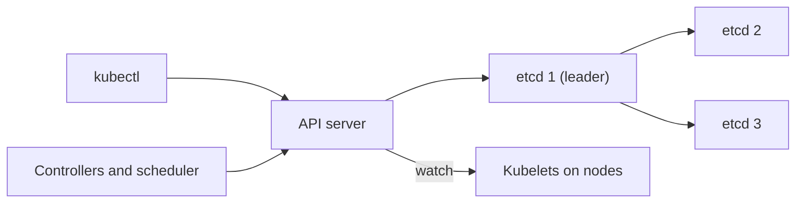

- Only the API server talks to etcd. Everything else talks to the API server.
- etcd runs as 3 or 5 members. If etcd loses its majority, the API server cannot make changes. Running pods keep running.

**Good and bad:**

| Good | Bad |
|---|---|
| etcd, ZooKeeper or Consul for coordination data (KB to MB) | Using them as a general database |
| 3 nodes in 3 zones | 3 nodes in one zone (one zone outage kills the quorum) |
| Watch for changes | Polling the key every 100 ms |

**Say this in the interview:**

> Kubernetes stores all cluster state in etcd, which uses Raft. Kafka moved its metadata to KRaft, a Raft-based quorum, and removed ZooKeeper in 4.0.
> ZooKeeper uses Zab, and Consul uses Raft for its servers plus gossip for membership.
> I use these for small coordination data: leaders, locks, config and service lists.

---

## Split brain and quorum math

**In one line:** Split brain is when two nodes both think they are the leader; a majority quorum prevents it because two majorities cannot exist at the same time.

**Story:** A cricket team on tour gets split across two airports. Both halves pick a captain.
Now there are two captains giving opposite orders.
Rule: "only the group with more than half the team may pick a captain." Only one group can be more than half.

**How it works:**
1. To survive `f` failed nodes, you need `2f + 1` nodes.
2. **Quorum** = majority = `floor(n/2) + 1`.

| Nodes (n) | Quorum | Failures tolerated |
|---|---|---|
| 1 | 1 | 0 |
| 2 | 2 | 0 |
| 3 | 2 | 1 |
| 4 | 3 | 1 |
| 5 | 3 | 2 |
| 7 | 4 | 3 |

3. Even numbers add cost but not safety: 4 nodes tolerate the same 1 failure as 3.
4. Any two majorities overlap in at least one node. That node remembers the latest term and vote, so two leaders in the same term are impossible.
5. In a network split of 5 nodes into 3 + 2, only the side with 3 can elect a leader or commit. The side with 2 stops writing.
6. Across data centres, place nodes as 2 + 2 + 1 (a third site as tie breaker). With only 2 sites, losing the bigger site stops writes.
7. Old-style failover without quorum (for example a heartbeat cable between two DB servers) is the classic cause of split brain. The fix is a quorum or **STONITH** ("shoot the other node in the head": power it off).

**Diagram:**

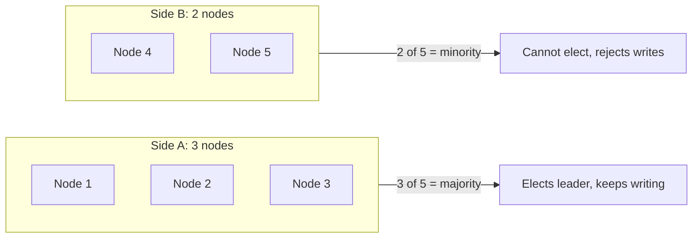

**Good and bad:**

| Good | Bad |
|---|---|
| 3 or 5 voting nodes across 3 zones | 2 nodes with "auto failover" |
| Old leader stops writing when it loses quorum | Old leader keeps writing after a network split |

**Say this in the interview:**

> To tolerate f failures you need 2f + 1 nodes, because any two majorities overlap.
> That overlap is what stops split brain: only one side of a network split can have a majority.
> So I use 3 or 5 voting nodes across three zones, never 2 or 4.

---

## Leader election and leases

**In one line:** Leader election picks one node to do a job; a lease is leadership with an expiry time, which the leader must renew to keep it.

**Story:** A library lends the only key to the archive room for 30 minutes.
To keep it longer, you must come back and renew. If you vanish, the key is free after 30 minutes.
But if your watch is slow, you might think you still have time when you do not. So you stop early, with a safety margin.

**How it works:**
1. Candidates try to create or update a key in etcd, ZooKeeper, a DB row or a Kubernetes `Lease` object.
2. The one who succeeds is the leader. The record has a holder id and an expiry (TTL).
3. The leader renews before the expiry, for example every 2 s for a 10 s lease.
4. If the leader dies, renewals stop. After the TTL, another node takes over.
5. Danger: the leader may be paused (GC, VM) past the expiry and not know. So:
   - The leader stops work a bit before its lease ends (clock margin).
   - Writes carry a fencing token (the lease version or term).
6. Kubernetes controllers and operators use `Lease` objects in the `coordination.k8s.io` API for this.
7. In Spring, a scheduled job that must run on one pod can use ShedLock or Spring Integration's `LockRegistryLeaderInitiator`.

**Diagram:**

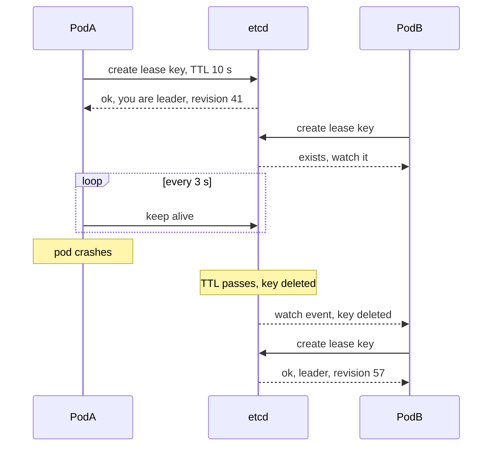

**Example (Kubernetes `Lease`):**

```yaml
apiVersion: coordination.k8s.io/v1
kind: Lease
metadata:
  name: billing-scheduler
spec:
  holderIdentity: billing-7d9f-abc12   # current leader pod
  leaseDurationSeconds: 15             # others wait this long before taking over
  renewTime: "2026-11-17T10:00:03.000000Z"
```

**Good and bad:**

| Good | Bad |
|---|---|
| Lease + fencing token | Lease alone for money-moving work |
| Renew at about one third of the TTL | Renew only just before expiry |
| Short TTL (10–30 s) for fast failover | 5-minute TTL: long outage when the leader dies |

**Say this in the interview:**

> I elect a leader by creating a key with a lease in etcd, ZooKeeper or a Kubernetes Lease, and the leader keeps renewing it.
> If the leader dies, the lease expires and another node takes over.
> A paused leader may not know its lease ended, so it stops early and every write carries a fencing token.

---

## Distributed locks and why a lock service needs fencing

**In one line:** A distributed lock lets only one process across many machines do something at a time; for correctness it must come with a fencing token.

**Recap:** The Redis `SET key token NX PX ttl` lock, Redisson's watchdog and the Redlock debate are in [Redis distributed locks](redis.md#distributed-locks). Here we compare lock services.

**Story:** Two waiters share one order book. Rule: only the waiter holding the pen may write.
If a waiter falls asleep holding the pen and the manager gives a second pen to another waiter, both can write. Fencing is the cashier who rejects orders written with the old pen.

**How it works:**
1. **Efficiency lock:** avoids doing work twice. A rare double run is fine (sending a daily report). Redis `SET NX` is enough.
2. **Correctness lock:** a double run corrupts data. You need:
   - A lock service with consensus (etcd, ZooKeeper) so the lock survives node failures.
   - A fencing token that the storage checks.
3. **ZooKeeper lock recipe:** each client creates an ephemeral sequential node (`/lock/n-0001`). The lowest number holds the lock. Others watch the node just before them. If the holder's session dies, its node disappears.
4. **etcd lock:** create a key tied to a lease. The key's revision is a natural fencing token.
5. **Database lock:** `SELECT ... FOR UPDATE`, or Postgres advisory locks. Simple when all writers share one DB. See [locking](databases.md#optimistic-vs-pessimistic-locking).

**Diagram:**

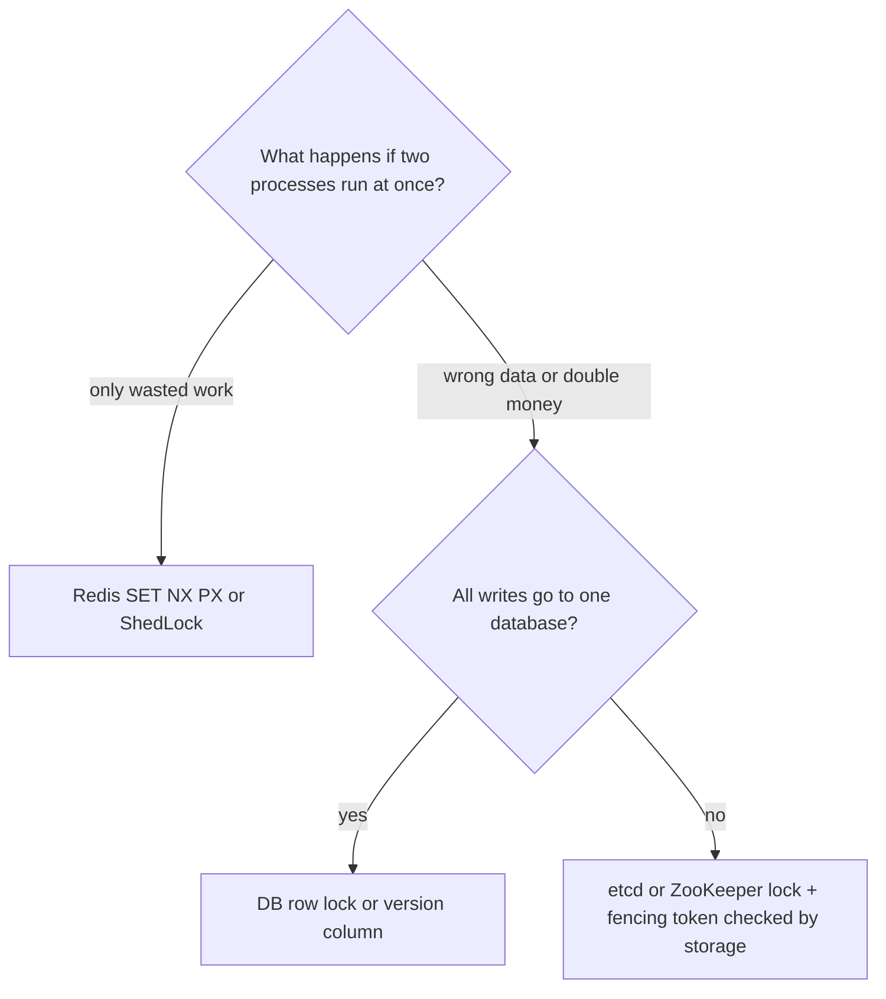

**Good and bad:**

| Good | Bad |
|---|---|
| Ask "efficiency or correctness?" first | One lock design for everything |
| Fencing checked by the resource | Trusting the TTL alone |
| DB constraint as the last line of defence | No unique key, only the lock |

**Say this in the interview:**

> First I ask if a double run only wastes work or breaks data.
> For efficiency, a Redis lock is enough. For correctness, I use the database's own locking or an etcd or ZooKeeper lock, plus a fencing token that the storage checks.
> Locks with timeouts can always be lost during pauses, so the resource must reject old tokens.

---

## Replication models: single-leader, multi-leader, leaderless

**In one line:** Replication keeps copies of data on many nodes; the three models differ in who may accept writes: one leader, several leaders, or any node.

**Recap:** Read replicas and sync vs async are in [database replication](system-design.md#database-replication-read-replicas), [SQL replication](sql.md#replication-and-read-replicas) and [MongoDB replica sets](mongodb.md#replica-sets-primary-secondaries-elections-and-oplog).

**Story:**
- **Single-leader:** one head chef writes the menu; other branches copy it.
- **Multi-leader:** a chef in each city can change the menu, and they sync every night. Sometimes two chefs change the same dish.
- **Leaderless:** any waiter can write the order on any of three boards. To read, you check two boards and trust the newest.

**How it works:**

| | Single-leader | Multi-leader | Leaderless |
|---|---|---|---|
| Who accepts writes | One leader | One leader per region or device | Any replica |
| Conflicts | None (one order) | Yes, must be resolved | Yes, resolved by version or LWW |
| Failover | Elect a new leader | Other leaders keep working | No failover needed |
| Examples | Postgres, MySQL, MongoDB, Kafka partitions | Multi-region MySQL or Postgres setups, CouchDB, offline apps | Cassandra, ScyllaDB, Riak, the Dynamo paper |
| Best for | Most apps | Multi-region writes, offline-first apps | High write availability |

**Conflict handling in multi-leader:**
- Avoid conflicts: route all writes for one user to their "home" region.
- LWW: simple but loses data (see [last write wins](#why-last-write-wins-loses-data)).
- Merge: CRDTs or app logic (see [CRDTs](#crdts-and-operational-transform)).

**Diagram:**

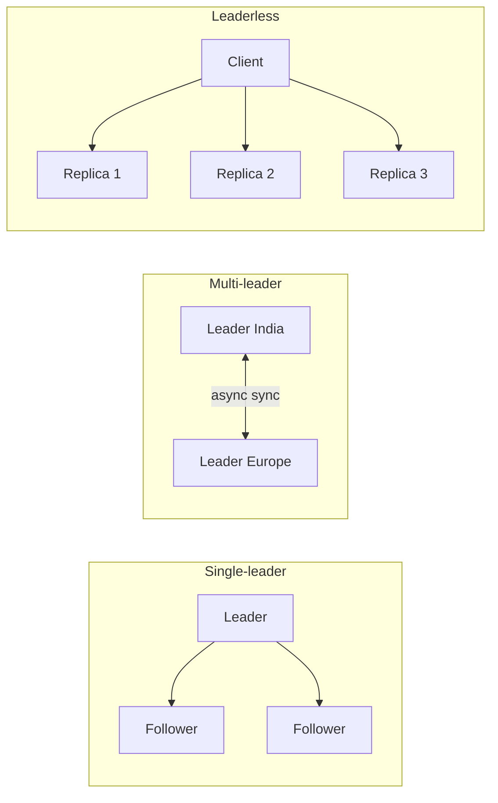

**Good and bad:**

| Good | Bad |
|---|---|
| Single-leader by default, it is simplest | Multi-leader "for scale" without a conflict plan |
| Multi-leader with home-region routing | Two regions editing the same row freely |
| Leaderless with tuned W and R | Leaderless with W=1, R=1 and expecting fresh reads |

**Say this in the interview:**

> Single-leader is my default: one place orders all writes, so there are no conflicts.
> Multi-leader helps for multi-region or offline writes but needs a conflict plan, like home-region routing or CRDTs.
> Leaderless, like Cassandra, writes to any replicas and uses quorums, giving high availability with eventual consistency.

---

## Leaderless replication deep dive

**In one line:** In Dynamo-style systems a write waits for W of N replicas and a read asks R of them. If W + R > N, the two sets overlap, so the read sees the latest write.

**Story:** A teacher gives homework marks to 3 class monitors (N = 3).
She tells at least 2 of them (W = 2). When you ask your mark, you ask 2 monitors (R = 2).
At least one of the 2 you ask was told, so you get the right mark. If they disagree, you take the newer one and correct the other monitor.

**How it works:**
1. **N** = number of copies of each key. **W** = acks needed for a write. **R** = replies needed for a read.
2. **W + R > N** → overlap. Common: N=3, W=2, R=2 (Cassandra `QUORUM`).
3. Faster but weaker: W=1, R=1. Fast reads: W=3, R=1 (but writes fail if one node is down).
4. **Read repair:** the coordinator sees an old version on one replica and writes the new one back.
5. **Anti-entropy with Merkle trees:** a background job compares replicas. Each replica builds a tree of hashes over key ranges. Compare the roots; if they differ, walk down only the branches that differ. This finds a few bad keys without sending all data. Cassandra's `nodetool repair` works this way.
6. **Hinted handoff:** if a replica is down, another node keeps a "hint" (the missed write) and delivers it when the replica returns.
7. **Sloppy quorum** (from the Dynamo paper): if home replicas are down, accept the write on other healthy nodes and count them toward W. Writes stay available, but W + R > N no longer guarantees a fresh read. Cassandra keeps hints but, apart from `ANY`, does not count them toward the consistency level.
8. Even with W + R > N, it is **not linearizable**. Edge cases break it: concurrent writes, or a write that failed on some nodes but was not rolled back.

**Diagram (quorum write and read):**

```mermaid
sequenceDiagram
    participant C as Client
    participant R1 as Replica1
    participant R2 as Replica2
    participant R3 as Replica3
    C->>R1: write x=5 v7
    C->>R2: write x=5 v7
    C->>R3: write x=5 v7 (lost, node slow)
    R1-->>C: ack
    R2-->>C: ack, W=2 reached
    C->>R2: read x
    C->>R3: read x
    R2-->>C: x=5 v7
    R3-->>C: x=4 v6
    C->>R3: read repair, x=5 v7
```

**Diagram (Merkle tree compare):**

```mermaid
flowchart TD
    RA["Replica A root hash 9f3"] --- RB["Replica B root hash 7c1: different"]
    RB --> L1["Left half: same hash, skip"]
    RB --> R1["Right half: different"]
    R1 --> K1["Range 750-875: same, skip"]
    R1 --> K2["Range 875-1000: different, sync these keys only"]
```

**Example (Cassandra consistency per query):**

```sql
-- replication factor 3 per data centre
CONSISTENCY LOCAL_QUORUM;   -- 2 of 3 replicas in this DC must reply
INSERT INTO orders (id, status) VALUES (42, 'PAID');
SELECT status FROM orders WHERE id = 42;   -- also 2 of 3: overlaps the write
```

**Good and bad:**

| Good | Bad |
|---|---|
| `LOCAL_QUORUM` reads and writes for important data | `ONE` everywhere, then surprise at stale reads |
| Regular repair runs (inside `gc_grace_seconds`) | Never running repair: deleted data can come back |
| Idempotent writes | Counters and read-modify-write in leaderless stores |

**Say this in the interview:**

> Leaderless stores write to W replicas and read from R out of N; if W + R > N, a read overlaps the latest write.
> Read repair fixes stale replicas on reads, and Merkle-tree anti-entropy fixes the rest in the background.
> Hinted handoff and sloppy quorums keep writes available when nodes are down, at the cost of fresh reads.

**They may ask next:**
- **Why must Cassandra repair run within `gc_grace_seconds`?** A delete is a tombstone. If a replica missed it and repair does not run before the tombstone is purged, the old value comes back ("zombie data").

---

## Replication lag anomalies

**In one line:** With async replicas, a reader can see data that is older than what they just wrote, go back in time, or see answers before questions.

**Story:** You post a photo on a social app, refresh, and it is gone. Refresh again, and it is back.
That is not a bug in the app code. Your reads hit different replicas with different lag.

**How it works:** three common anomalies and their fixes.

| Anomaly | What the user sees | Fix |
|---|---|---|
| **Read-your-writes** fails | "I saved my profile but it shows the old one" | Read your own recent data from the leader (for example for 10 s after a write), or wait until the replica reaches your write's position (LSN, oplog time) |
| **Monotonic reads** fail | Comment appears, then disappears on refresh | Stick each user to one replica (hash user id), or track the last position seen |
| **Consistent prefix** fails | Answer appears before the question | Write related data to the same partition, or use causal tokens |

**Diagram (read-your-writes broken):**

```mermaid
sequenceDiagram
    participant U as User
    participant L as Leader
    participant R as Replica
    U->>L: update name = Ankit
    L-->>U: ok
    L--)R: replicate (2 s lag)
    U->>R: read profile
    R-->>U: old name, looks like a bug
```

**Example (read-your-writes in Spring, routing by a flag):**

```java
public Profile getProfile(long userId) {
    boolean recentWrite = writeTracker.wroteWithin(userId, Duration.ofSeconds(10));
    return recentWrite
        ? leaderRepo.findById(userId)      // read own write from the leader
        : replicaRepo.findById(userId);    // normal reads go to replicas
}
```

- MongoDB gives this out of the box with **causally consistent sessions**. See [MongoDB read and write concern](mongodb.md#write-concern-read-concern-and-read-preference).

**Good and bad:**

| Good | Bad |
|---|---|
| Measure replica lag as a metric | Assume replicas are "nearly instant" |
| Leader reads after a write by the same user | All reads from random replicas |

**Say this in the interview:**

> Async replicas cause three anomalies: you do not see your own write, you go back in time between reads, or you see effects before causes.
> For read-your-writes, I read from the leader just after a user writes.
> For monotonic reads, I stick each user to one replica. For consistent prefix, I keep related writes in one partition.

---

## Consistency models ladder

**In one line:** Consistency models are promises about what a read can return; stronger promises are easier to code against but slower and less available.

**Recap:** strong vs eventual in simple words is in [database consistency](system-design.md#database-consistency-strong-vs-eventual).

**Story:** A cricket score.
- **Linearizable:** a giant scoreboard. Everyone sees the same score at the same moment.
- **Sequential:** everyone sees balls in the same order, but some screens are a few seconds behind.
- **Causal:** you never see "Kohli out" before "Kohli bats".
- **Eventual:** WhatsApp forwards. In the end everyone knows the result, in any order.

**How it works (strong to weak):**

| Model | Promise | Example |
|---|---|---|
| **Linearizable** | Every operation looks instant, at one point between call and return. Once a write is seen, nobody sees older. | etcd reads and writes, Spanner, a single Postgres primary, ZooKeeper writes |
| **Sequential** | All nodes see all writes in the same order; each client's own order is kept; may lag real time. | ZooKeeper reads from a follower |
| **Causal** | Writes that are cause and effect are seen in that order. Unrelated writes may differ. | MongoDB causal sessions, many CRDT systems |
| **Read-your-writes** (a session promise) | You always see your own writes. | Sticky sessions, leader-after-write |
| **Eventual** | If writes stop, all replicas end up the same. No promise about when. | DNS, Cassandra with `ONE`, async read replicas |

- **Serializable** is different: it is about transactions (many operations) looking like they ran one by one. **Strict serializable** = serializable + linearizable.

**Diagram:**

```mermaid
flowchart TD
    A["Strict serializable"] --> B["Linearizable"]
    B --> C["Sequential"]
    C --> D["Causal"]
    D --> E["Read-your-writes, monotonic reads"]
    E --> F["Eventual"]
    B -.->|"stronger = more waiting, less available in a partition"| F
```

**Example:** when do you need linearizable?
- Username uniqueness: two users must not both get "ankit".
- Lock and leader election.
- Stock of the last item.
- A "likes" counter does not need it.

**Good and bad:**

| Good | Bad |
|---|---|
| Linearizable only where a wrong answer costs money or trust | Linearizable everywhere, then high latency across regions |
| Eventual plus read-your-writes for feeds | Eventual for bank balances |

**Say this in the interview:**

> Linearizable means the system acts like one copy with instant operations; it is what locks and unique usernames need.
> Below that are sequential, causal, session promises like read-your-writes, and eventual.
> I pick the weakest model the feature can accept, because stronger models cost latency and availability.

---

## PACELC beyond CAP

**In one line:** CAP talks only about network partitions; PACELC adds that on a normal day you still trade latency against consistency.

**Recap:** CAP and the first PACELC lines are in [CAP theorem](system-design.md#cap-theorem). Here: how real systems are tuned.

**Story:** A bank with two branches.
During a phone line cut (partition), each branch can stop serving (consistency) or serve and fix later (availability).
On a normal day, calling the other branch before every withdrawal is safe but slow. That is the "else" part.

**How it works:** PACELC (Daniel Abadi): if **P**artition, choose **A** or **C**; **E**lse, choose **L**atency or **C**onsistency.

| System (typical setting) | During partition | Normal day |
|---|---|---|
| Cassandra with `ONE` | PA | EL |
| Cassandra with `QUORUM` | Leans PC | EC (more latency) |
| DynamoDB eventual reads | PA | EL |
| MongoDB `w: majority`, read from primary | PC | EC |
| Postgres primary + async replicas, reads on replicas | PA for reads | EL |
| Postgres with sync replica | PC | EC |
| etcd, ZooKeeper, Spanner | PC | EC |

- Many databases let you choose **per query** (Cassandra levels, MongoDB read and write concern, DynamoDB `ConsistentRead`).

**Diagram:**

```mermaid
flowchart TD
    S{"Is the network split?"}
    S -->|"yes"| P{"Availability or consistency?"}
    P -->|"A"| PA["Serve, maybe stale or conflicting"]
    P -->|"C"| PC["Reject or wait"]
    S -->|"no, else"| E{"Latency or consistency?"}
    E -->|"L"| EL["Answer from nearest copy"]
    E -->|"C"| EC["Wait for quorum or leader"]
```

**Say this in the interview:**

> CAP only covers the rare partition. PACELC says that on normal days I still trade latency for consistency, because waiting for a quorum or a leader is slower.
> Many databases let me pick per query, so I use quorum or leader reads for money and local, fast reads for feeds.

---

## Two-phase commit and three-phase commit

**In one line:** Two-phase commit (2PC) makes several databases commit or abort together: a coordinator first asks "can you commit?", then tells everyone the decision.

**Story:** A wedding priest asks the bride "do you agree?" and the groom "do you agree?".
Only when both say yes does he announce "married". If either says no, nobody is married.
But if the priest faints after both said yes and before he announces, both wait at the altar, unsure. That is the 2PC blocking problem.

**How it works:**
1. **Phase 1, prepare:** the coordinator asks each participant to prepare. Each one writes the changes to disk, keeps the locks, and votes yes or no.
2. A "yes" is a promise: "I can commit, even after a crash, if you tell me to."
3. **Phase 2, commit:** if all voted yes, the coordinator writes "commit" to its log and tells everyone. If any voted no, it tells everyone to abort.
4. **The coordinator failure problem:** if it crashes after the prepares and before sending the decision, participants are **in doubt**. They hold locks and cannot decide alone. They wait until the coordinator comes back.
5. Standard: **XA** (Java: JTA with a transaction manager like Narayana or Atomikos). Postgres supports it with `PREPARE TRANSACTION`, which is off by default (`max_prepared_transactions = 0`).
6. **3PC** adds a "pre-commit" step so participants can decide on a timeout. It only works if the network has bounded delays and no partitions. Real networks do not, so 3PC is rarely used.
7. Modern fix: make the coordinator itself fault-tolerant with consensus. Spanner and CockroachDB run 2PC where each participant and the coordinator record are Raft or Paxos groups.

**Diagram (happy path):**

```mermaid
sequenceDiagram
    participant C as Coordinator
    participant O as OrderDB
    participant P as PaymentDB
    C->>O: prepare
    C->>P: prepare
    O-->>C: yes (locks held)
    P-->>C: yes (locks held)
    C->>C: write COMMIT to log
    C->>O: commit
    C->>P: commit
```

**Diagram (coordinator crash):**

```mermaid
stateDiagram-v2
    [*] --> Working
    Working --> Prepared: voted yes
    Working --> Aborted: voted no
    Prepared --> Committed: coordinator says commit
    Prepared --> Aborted: coordinator says abort
    Prepared --> Prepared: coordinator down, wait with locks held
```

**Example (Postgres prepared transaction):**

```sql
BEGIN;
UPDATE accounts SET balance = balance - 500 WHERE id = 1;
PREPARE TRANSACTION 'tx-778';     -- phase 1: saved to disk, locks kept
-- ... coordinator collects all votes ...
COMMIT PREPARED 'tx-778';         -- phase 2 (or ROLLBACK PREPARED 'tx-778')
```

**Good and bad:**

| Good | Bad |
|---|---|
| Atomic across resources, strong consistency | Blocks with locks held if the coordinator dies |
| Fine inside one platform (DB + message broker in one app server) | Slow: extra round trips, locks held across the network |
| | Kafka, most NoSQL stores and HTTP APIs do not support XA |

**Say this in the interview:**

> 2PC has a prepare phase where every participant votes and keeps locks, then a commit phase where the coordinator sends the decision.
> Its weak point is the coordinator: if it dies after prepare, participants stay in doubt with locks held.
> 3PC tries to fix that with timeouts but breaks under network partitions, so in microservices I use sagas with the outbox instead.

**They may ask next:**
- **Why not 2PC in microservices?** It couples services in time, holds locks across the network, and most brokers and APIs cannot join it. See [Saga pattern](microservices.md#saga-pattern).

---

## TCC: try-confirm-cancel

**In one line:** TCC is a business-level two-phase protocol: first reserve resources (Try), then make the reservation final (Confirm) or release it (Cancel).

**Story:** Booking a holiday. The travel agent puts a hold on the flight seat and the hotel room for 15 minutes (Try).
When you pay, she confirms both (Confirm). If the hotel is full, she releases the seat hold (Cancel).
Nothing is booked for real until every hold succeeds.

**How it works:**
1. Each service exposes three operations: `try`, `confirm`, `cancel`.
2. **Try:** check rules and reserve. Example: move 500 rupees from `available` to `frozen`. Other users cannot use it.
3. If all tries succeed, the coordinator calls **confirm** on all: frozen money is spent.
4. If any try fails or times out, it calls **cancel** on all: frozen money goes back.
5. Reservations have an expiry, so a lost coordinator does not freeze money forever.
6. Rules every TCC service must follow:
   - **Idempotent** confirm and cancel (they will be retried).
   - **Empty cancel:** cancel may arrive for a try that never arrived. Record it and do nothing.
   - **No hanging try:** a late try after a cancel must be rejected.
7. Frameworks: Apache Seata supports TCC in Java.

**Diagram:**

```mermaid
sequenceDiagram
    participant O as Orchestrator
    participant W as Wallet
    participant I as Inventory
    O->>W: try: freeze 500
    W-->>O: ok
    O->>I: try: reserve 1 phone
    I-->>O: out of stock
    O->>W: cancel: unfreeze 500
    W-->>O: ok
```

**Good and bad:**

| Good | Bad |
|---|---|
| No long DB locks; reservations are business data | 3 APIs per service, more code |
| Users never see half-done state (money is frozen, not spent) | Hard edge cases: empty cancel, hanging try |

**Say this in the interview:**

> TCC reserves first, then confirms or cancels. For example, freeze money in the wallet, reserve stock, then confirm both, or cancel both if one fails.
> It is like 2PC but at the business level, without database locks.
> Confirm and cancel must be idempotent, and the service must handle a cancel that arrives before the try.

---

## Distributed transactions compared

**In one line:** Pick 2PC for strong atomic commits inside one platform, sagas or TCC across services, and the outbox for reliably publishing events.

**Recap:** [Saga pattern](microservices.md#saga-pattern) (local transactions + compensations) and [transactional outbox](microservices.md#transactional-outbox-pattern) (write the event in the same DB transaction, relay it later) are explained in microservices.

**How it works:**

| | 2PC / XA | Saga | TCC | Outbox |
|---|---|---|---|---|
| What it solves | Atomic commit across databases | Long business flow across services | Short flow needing reservations | Save data + publish event reliably |
| Consistency | Strong (atomic) | Eventual | Eventual, with isolation by reservation | Eventual |
| Locks | DB locks across the network | None | Business-level holds | None |
| Failure handling | Blocks if coordinator dies | Compensating actions (refund) | Cancel releases holds | Relay retries until sent |
| Users can see in-between state? | No | Yes (order "pending") | Partly (money "frozen") | Short delay |
| Effort | Low code, heavy infra | Medium | High (3 APIs per service) | Low |
| Typical use | Legacy app server, one DB + one JMS broker | Order, payment, shipping | Wallets, ticket booking, flash sales | Every event-driven service |

**Diagram:**

```mermaid
flowchart TD
    Q{"Do all writes live in one database?"}
    Q -->|"yes"| L["Use one local transaction"]
    Q -->|"no"| X{"Must users never see a half-done state?"}
    X -->|"yes, and resources can be held"| T["TCC"]
    X -->|"no, compensation is OK"| S["Saga"]
    S --> O["Publish each step with the outbox"]
    T --> O
```

**Say this in the interview:**

> First I try to keep the change in one database, because a local transaction is simplest.
> Across services I use a saga with compensations, or TCC if I need reservations so users never see a half-done state.
> Each step publishes events with the outbox. I avoid 2PC across services because it blocks and most brokers do not support it.

---

## CRDTs and operational transform

**In one line:** A CRDT (conflict-free replicated data type) is a data structure whose copies can be changed independently and always merge to the same result, with no conflicts.

**Story:** Two friends count people entering a stadium through two gates.
Each friend counts only their own gate. To get the total, add both counts.
No matter when they compare notes, or how often, the total is always right. That is a CRDT counter.

**How it works:**
1. Merge must be **commutative** (order does not matter), **associative** (grouping does not matter) and **idempotent** (merging twice is fine).
2. Common CRDTs:
   - **G-Counter** (grow-only): one count per node; value = sum; merge = max per node.
   - **PN-Counter:** two G-Counters, one for plus and one for minus. Likes and unlikes.
   - **G-Set:** add-only set; merge = union.
   - **OR-Set** (observed-remove set): each add gets a unique tag; remove deletes only the tags it saw. A concurrent add wins over a remove. Good for shopping carts.
   - **LWW-Register:** a single value with a timestamp. Simple but loses concurrent writes.
   - **Sequence CRDTs** (for text): each character gets a unique, ordered id, so two people can type in the same document.
3. Used in: Riak data types, Redis Enterprise Active-Active databases, collaborative editing libraries Yjs and Automerge, and many offline-first apps.
4. **Operational transform (OT)** is the older approach for collaborative editing. A central server receives edits like "insert 'a' at position 5", and transforms (shifts) other users' positions to match. Google Docs is widely known to use OT.
5. OT needs a central server to order edits. CRDTs work peer-to-peer and offline, but use more memory (ids for every character, tombstones for deletes).

**Diagram (G-Counter merge):**

```mermaid
flowchart LR
    A["Gate A: A=5, B=0"] --> M["Merge: max per node"]
    B["Gate B: A=0, B=3"] --> M
    M --> R["A=5, B=3, total 8 on both sides"]
```

**Diagram (OT position shift):**

```mermaid
sequenceDiagram
    participant U1 as Asha
    participant S as Server
    participant U2 as Ravi
    Note over U1,U2: text is "cat"
    U1->>S: insert "s" at 3 (cats)
    U2->>S: insert "the " at 0
    S->>U1: insert "the " at 0
    S->>U2: transformed: insert "s" at 7
    Note over U1,U2: both see "the cats"
```

**Example (G-Counter):**

```java
record GCounter(Map<String, Long> counts) {
    GCounter increment(String node) {
        var copy = new HashMap<>(counts);
        copy.merge(node, 1L, Long::sum);              // only my own slot grows
        return new GCounter(copy);
    }
    GCounter merge(GCounter other) {
        var copy = new HashMap<>(counts);
        other.counts().forEach((n, c) -> copy.merge(n, c, Math::max)); // max per node
        return new GCounter(copy);
    }
    long value() { return counts.values().stream().mapToLong(Long::longValue).sum(); }
}
```

**Good and bad:**

| Good | Bad |
|---|---|
| Counters, sets, carts, presence, collaborative text | Bank balances that must never go below zero (needs coordination) |
| Offline-first mobile apps | Large text documents without tombstone cleanup |

**Say this in the interview:**

> A CRDT is a data type whose replicas can change independently and always merge to the same value.
> This works because the merge is commutative, associative and idempotent.
> Examples are a grow-only counter that takes the max per node, and an observed-remove set for carts.
> For collaborative editing, OT transforms positions through a central server, while CRDTs like Yjs give each character an id and work offline.

**They may ask next:**
- **Can a CRDT enforce "stock never below zero"?** No. That rule needs coordination (one leader or consensus), because two replicas can each sell the last item.

---

## Failure detection: heartbeats, timeouts, phi accrual

**In one line:** A failure detector guesses that a node is dead when its heartbeats stop. The guess is never certain, so the timeout trades speed against false alarms.

**Story:** A mother calls her son every evening. One day he does not answer.
Is he dead, or is his phone battery empty? After 1 missed call she waits. After 5 missed calls she calls the police.
A good mother also knows her son: he usually answers in 2 minutes, so 2 hours is very unusual.

**How it works:**
1. **Heartbeat:** each node sends "I am alive" every second, or the monitor pings it.
2. **Fixed timeout:** no heartbeat for 10 s → mark as dead.
   - Short timeout: fast failover, but a GC pause or a slow network causes false alarms and needless failovers.
   - Long timeout: fewer false alarms, but users wait longer during a real failure.
3. **Phi accrual failure detector:** instead of yes/no, it outputs a **suspicion level** (phi).
   - It learns the normal gap between heartbeats (mean and spread).
   - The longer the current silence compared to normal, the higher phi grows.
   - The app picks a threshold. Cassandra and Akka use this approach (Cassandra's setting is `phi_convict_threshold`).
4. Rule: a node can be **slow and alive**. So every "dead" decision must be safe if wrong (fencing, idempotency).

**Diagram:**

```mermaid
flowchart LR
    H["Heartbeats arrive every about 1 s"] --> S["Learn normal gap: mean 1 s, small spread"]
    S --> G{"Current silence?"}
    G -->|"1.2 s"| P1["phi low: alive"]
    G -->|"3 s"| P2["phi medium: suspect"]
    G -->|"8 s"| P3["phi above threshold: mark down"]
```

**Example (Kubernetes probes are also failure detectors):**

```yaml
livenessProbe:
  httpGet: { path: /actuator/health/liveness, port: 8080 }
  periodSeconds: 10
  failureThreshold: 3     # 3 misses x 10 s = 30 s before restart
  timeoutSeconds: 2
```

**Good and bad:**

| Good | Bad |
|---|---|
| Timeout based on measured p99 latency | Timeout picked by guess |
| Treat "suspected" differently from "dead" | Instant failover on one missed heartbeat |
| Liveness probe that checks only the process | Liveness probe that checks the database (all pods restart when DB is slow) |

**Say this in the interview:**

> In an async network you cannot tell a dead node from a slow one, so failure detection is always a guess.
> Fixed timeouts trade fast failover against false alarms. Phi accrual learns the normal heartbeat gap and gives a suspicion level instead of yes or no.
> Because the guess can be wrong, actions after a "dead" verdict must be safe, using fencing and idempotency.

---

## Gossip protocols and SWIM

**In one line:** In gossip, each node often shares what it knows with a random peer. News spreads to the whole cluster in a few rounds, like a rumour.

**Story:** In a village, one person hears news and tells 3 random neighbours. Each of them tells 3 more.
In a few rounds the whole village knows, even if some people were not home. Nobody needs a loudspeaker.

**How it works:**
1. Each node keeps a membership list: node, address, status, heartbeat counter.
2. Every second, it picks a random peer and exchanges lists. The newer heartbeat counter wins.
3. News reaches all N nodes in about `log(N)` rounds. For 1,000 nodes, about 10 rounds.
4. No single point of failure, and the load per node stays small.
5. **Cassandra:** every second, each node gossips with up to three other nodes: a random live node, and sometimes a seed node or a node that looks unreachable. It shares state like which token ranges each node owns.
6. **SWIM** (Scalable Weakly-consistent Infection-style Membership):
   - Node A pings a random node B.
   - No reply? A asks k other nodes to ping B for it (indirect ping). This avoids false alarms from one bad link.
   - Still no reply → B is "suspect". If B does not deny it in time, it is marked dead.
   - Membership changes ride along on the ping messages (piggybacking).
7. HashiCorp's memberlist library (used by Consul and Serf) is based on SWIM with extra changes.

**Diagram (SWIM indirect ping):**

```mermaid
sequenceDiagram
    participant A as NodeA
    participant B as NodeB
    participant C as NodeC
    A->>B: ping
    Note over A: no ack in 500 ms
    A->>C: ping-req: please ping B
    C->>B: ping
    B-->>C: ack
    C-->>A: B is alive
```

**Diagram (rumour spread):**

```mermaid
flowchart LR
    N1["Start: 1 node knows"] --> N2["After round 1: about 4 know"]
    N2 --> N3["After round 2: about 16 know"]
    N3 --> N4["About log N rounds: all know"]
```

**Good and bad:**

| Good | Bad |
|---|---|
| Scales to thousands of nodes | Eventually consistent view: nodes disagree for a few seconds |
| No central server | Not for decisions that need agreement (use consensus) |

**Say this in the interview:**

> Gossip spreads cluster state like a rumour: each node regularly talks to a random peer, so news reaches everyone in about log N rounds.
> Cassandra uses gossip for membership and token ownership. SWIM adds indirect pings and a suspect state to cut false alarms; Consul uses a SWIM-based library.
> Gossip is for membership and health; for decisions like who is leader I still use consensus.

---

## Backpressure, load shedding and admission control

**In one line:** Backpressure tells the sender to slow down; load shedding drops extra work early; admission control decides at the door how much work to accept.

**Story:** A popular dosa stall.
- **Backpressure:** the cook tells the cashier "stop taking orders for 2 minutes".
- **Admission control:** the guard lets only 20 people in the queue.
- **Load shedding:** when it is too crowded, the cashier says "sorry, closed for now" to new people, instead of making everyone wait an hour.
Without these, everyone waits, gets angry and leaves; the dosas made for them are wasted.

**How it works:**
1. **Why:** a server at 100% capacity builds a queue. Latency grows without limit. Clients time out and retry, adding more load. The system collapses.
2. **Little's law:** items in system = arrival rate × time in system. 200 req/s × 0.5 s = 100 requests in flight. If they take 5 s, that is 1,000 in flight.
3. **Backpressure tools:**
   - Bounded queues (`ArrayBlockingQueue`, thread pool with a fixed queue).
   - Pull-based consumers: Kafka consumers poll at their own speed; RabbitMQ prefetch limits unacked messages.
   - Reactive Streams `request(n)` (Project Reactor, WebFlux).
   - TCP flow control does this at the network level.
4. **Load shedding:**
   - Reject fast with `429 Too Many Requests` or `503 Service Unavailable` plus `Retry-After`.
   - Drop requests that waited too long in the queue (their caller already gave up).
   - Shed low-priority traffic first (analytics, prefetch) and keep checkout working.
5. **Admission control:**
   - Concurrency limits per endpoint (bulkhead). See [bulkhead](microservices.md#bulkhead).
   - Rate limits per client. See [rate limiting](system-design.md#rate-limiting-algorithms).
   - Adaptive limits that shrink when latency rises (Netflix's concurrency-limits library).

**Diagram:**

```mermaid
flowchart LR
    C["Clients"] --> AC{"Admission control: under limit?"}
    AC -->|"no"| R["429 or 503 with Retry-After"]
    AC -->|"yes"| Q["Bounded queue (size 100)"]
    Q --> D{"Waited longer than caller timeout?"}
    D -->|"yes"| X["Drop: caller gave up"]
    D -->|"no"| W["Worker pool (fixed size)"]
```

**Example (bounded executor that sheds load):**

```java
var pool = new ThreadPoolExecutor(
    16, 16, 0, TimeUnit.SECONDS,
    new ArrayBlockingQueue<>(100),          // bounded queue: backpressure
    new ThreadPoolExecutor.AbortPolicy());  // full? throw RejectedExecutionException

try {
    pool.submit(() -> handle(request));
} catch (RejectedExecutionException e) {
    return ResponseEntity.status(503)
        .header("Retry-After", "2")         // shed load, tell client when to retry
        .build();
}
```

**Good and bad:**

| Good | Bad |
|---|---|
| Bounded queues everywhere | `new LinkedBlockingQueue<>()` (unbounded: hides overload until OOM) |
| Fail fast with 503 | Accept everything and time out after 30 s |
| Priorities: protect checkout, shed analytics | All traffic treated the same |

**Say this in the interview:**

> When load exceeds capacity, queues grow and latency explodes, so I bound every queue.
> Backpressure slows producers, admission control limits what enters, and load shedding rejects extra work fast with 429 or 503.
> I shed low-priority traffic first and drop requests whose callers have already timed out.

---

## Retry storms and retry budgets

**In one line:** A retry storm is when every layer retries a failing service and multiplies the load. A retry budget caps retries to a small share of traffic.

**Recap:** backoff and jitter are in [retry with exponential backoff and jitter](microservices.md#retry-with-exponential-backoff-and-jitter); timeouts in [timeouts](microservices.md#timeouts).

**Story:** A shop's card machine is slow. Every customer taps their card 3 times. Each tap also makes the bank retry 3 times.
One slow machine becomes 9 times the load on the bank, and the bank falls over.

**How it works:**
1. **Retry amplification:** 3 layers, each with 3 attempts = 3 × 3 × 3 = **27** calls to the bottom service for one user click.
2. Rules to stop storms:
   - Retry in **one layer only**, usually the one closest to the user or the caller of the failing service.
   - **Exponential backoff with jitter** so retries do not arrive in waves.
   - **Retry budget:** retries may be at most about 10–20% of requests. If the service is failing a lot, stop retrying.
   - **Circuit breaker:** stop calling a failing service for a while. See [circuit breaker](microservices.md#circuit-breaker).
   - Retry only **idempotent** and **retryable** errors (timeouts, 503), never 400s.
   - Respect `Retry-After`.
3. Google's SRE book suggests a per-client budget: retry only while retries are under about 10% of requests. Service meshes like Envoy and Linkerd support retry budgets too.
4. **Deadline propagation:** pass the remaining time down the call chain (gRPC does this). A service does not start work the caller can no longer use.

**Diagram:**

```mermaid
flowchart LR
    U["1 user click"] --> A["API gateway: 3 tries"]
    A -->|"3 calls"| B["Order service: 3 tries each"]
    B -->|"9 calls"| C["Payment service: 3 tries each"]
    C -->|"27 calls"| D["Bank API (already slow)"]
```

**Example (simple retry budget):**

```java
final class RetryBudget {
    private final AtomicLong requests = new AtomicLong(), retries = new AtomicLong();
    private static final double MAX_RATIO = 0.1;            // retries <= 10% of requests

    void onRequest() { requests.incrementAndGet(); }        // reset both every 10 s window
    boolean canRetry() {
        if (retries.get() + 1 > requests.get() * MAX_RATIO) return false; // budget spent
        retries.incrementAndGet();
        return true;
    }
}
```

**Good and bad:**

| Good | Bad |
|---|---|
| Retry at one layer, with jitter and a budget | Retries at every layer |
| Circuit breaker opens when errors rise | Fixed 1 s retry interval for all clients |
| Deadlines passed down the chain | Each service with its own 30 s timeout |

**Say this in the interview:**

> Retries at every layer multiply load: three layers with three attempts each is 27 calls for one click.
> So I retry at one layer, use exponential backoff with jitter, and cap retries with a budget of about 10% of traffic.
> A circuit breaker stops calls to a failing service, and deadline propagation stops work nobody is waiting for.

---

## Partitioning recap: rebalancing and hot spots

**In one line:** Partitioning splits data across nodes by key; rebalancing moves partitions when nodes join or leave; hot spots happen when one key gets too much traffic.

**Recap:** range vs hash sharding and consistent hashing are in [partitioning and sharding](system-design.md#partitioning-and-sharding) and [consistent hashing](system-design.md#consistent-hashing).

**Story:** A post office with sorting bins by PIN code.
When a new clerk joins, you move some bins to her desk, not re-sort every letter.
But if a festival sends 10,000 letters to one PIN code, one clerk drowns while others relax. That is a hot spot.

**How it works (rebalancing strategies):**

| Strategy | How | Used by |
|---|---|---|
| `hash % N` | Node = hash(key) mod N | Avoid: changing N moves almost every key |
| Fixed number of partitions | Create many more partitions than nodes (for example 16,384 slots); move whole partitions | Redis Cluster (16,384 hash slots), Elasticsearch shards, Kafka partitions |
| Dynamic splitting | Split a partition when it grows too big; merge when small | MongoDB chunks, HBase regions, CockroachDB ranges |
| Consistent hashing with virtual nodes | Each node owns many small points on a ring | Cassandra, ScyllaDB, DynamoDB-style stores |

**Hot spots and fixes:**
- **Hot key** (a celebrity's post): add a random suffix (`post:42#0..9`) to spread writes, then read all 10 and combine. Or cache it.
- **Time-based keys** (all writes go to "today"): prefix with a hash or tenant id.
- **Hot partition in Kafka:** a bad key choice puts most events on one partition. Pick a key with many values.
- Monitor per-partition load, not only cluster totals.

**Diagram:**

```mermaid
flowchart TD
    K["Key: user 42"] --> H["Hash of the key gives slot 9,183"]
    H --> S["Slot owner table"]
    S --> N2["Node B owns slots 5,461-10,922"]
    J["New node D joins"] -->|"move some slots, not keys one by one"| S
```

**Good and bad:**

| Good | Bad |
|---|---|
| Many small partitions, move whole partitions | `hash % N` with changing N |
| Rebalance slowly, with throttling | Automatic rebalancing during peak hours |
| Partition key with many values and even load | Partition by country (one huge country) |

**Say this in the interview:**

> I partition by a key with many even values and create more partitions than nodes, so adding a node only moves whole partitions.
> Consistent hashing with virtual nodes or fixed hash slots avoids moving most keys.
> For hot keys I add a suffix to spread the writes, or cache the reads, and I watch load per partition.

---

## Search engines: inverted index and analyzers

**In one line:** A search engine keeps an inverted index (word → list of documents), and analyzers turn text into the words that go into it.

**Recap:** the basic idea of the inverted index is in [inverted index](system-design.md#inverted-index-how-search-works). Here we go into how Elasticsearch and OpenSearch build it.

**Story:** A spice shop owner keeps a notebook: "turmeric: shelf 2, shelf 7; chilli: shelf 3".
Customers say "Haldi", "TURMERIC" or "turmeric powder". So the owner writes all names in one standard way first.
The notebook is the inverted index. The "standard way" is the analyzer.

**How it works:**
1. **Elasticsearch** and **OpenSearch** are search engines built on **Apache Lucene** (a Java search library). OpenSearch is a fork of Elasticsearch 7.10, started by AWS in 2021.
2. An **analyzer** runs on text at index time and again on the query:
   - **Character filters:** clean raw text (strip HTML, map "&" to "and").
   - **Tokenizer:** split into tokens (words). The standard tokenizer splits on spaces and punctuation.
   - **Token filters:** lowercase, remove stop words, stemming ("running" → "run"), synonyms ("haldi" → "turmeric"), ASCII folding ("café" → "cafe").
3. Each field has a type in the **mapping**:
   - `text`: analyzed, for full-text search ("red running shoes").
   - `keyword`: stored as-is, for exact match, filters, sorting and aggregations (status, email, SKU).
   - A field can be both, using **multi-fields** (`name` as text, `name.raw` as keyword).
4. The index stores, per term: document ids, term frequency and positions (for phrase search).
5. Numbers, dates and geo points use other structures (BKD trees) for range queries.
6. **Doc values** are a column store per field, used for sorting and aggregations.

**Diagram:**

```mermaid
flowchart LR
    T["Text: The Runners' Shoes!"] --> CF["Char filter: strip HTML"]
    CF --> TK["Tokenizer: The, Runners, Shoes"]
    TK --> TF["Filters: lowercase, stop words, stem"]
    TF --> TOK["Terms: runner, shoe"]
    TOK --> II["Inverted index: shoe → doc 1, doc 7"]
```

**Example (mapping with a custom analyzer):**

```json
PUT /products
{
  "settings": { "analysis": { "analyzer": {
    "product_text": { "tokenizer": "standard",
      "filter": ["lowercase", "asciifolding", "porter_stem"] } } } },
  "mappings": {
    "dynamic": "strict",
    "properties": {
      "name":   { "type": "text", "analyzer": "product_text",
                  "fields": { "raw": { "type": "keyword" } } },
      "status": { "type": "keyword" },
      "price":  { "type": "scaled_float", "scaling_factor": 100 }
    }
  }
}
```

**Good and bad:**

| Good | Bad |
|---|---|
| `keyword` for ids, status, emails | `text` for an email field, then exact match fails |
| Same analyzer at index and query time | Different analyzers: words never match |
| Test with the `_analyze` API | Guess what tokens are produced |

**Say this in the interview:**

> Elasticsearch stores an inverted index from term to documents, built by Lucene.
> An analyzer cleans the text, splits it into tokens and normalizes them with lowercase, stemming and synonyms, and the same analyzer runs on the query.
> I map free text as `text` and exact values as `keyword`, often both with multi-fields.

---

## Elasticsearch shards, segments and near-real-time refresh

**In one line:** An index is split into primary shards with replica copies. Each shard is a Lucene index of immutable segments, and new documents become searchable after a refresh (every 1 second by default).

**Story:** A library with 3 rooms (shards). Each room has a photocopy room in another building (replicas).
New books first go on a trolley. Every second, the trolley's books are put on a new small shelf (a segment) that readers can see.
At night, small shelves are combined into big ones (merging).

**How it works:**
1. **Shards:** an index has N primary shards (default 1). A document goes to shard `hash(_routing) % number_of_primary_shards`. `_routing` is the document id by default.
2. The number of primary shards **cannot change** after creation. To change it: `_split`, `_shrink`, or reindex into a new index (often behind an alias).
3. **Replicas:** copies of each primary on other nodes (default 1). They serve reads and take over if a primary dies. Replica count can change any time.
4. **Write path:**
   - The coordinating node routes the document to the primary shard.
   - The primary writes it to an in-memory buffer and the **translog** (a write-ahead log for crash safety).
   - The primary forwards it to the replicas, then acks the client.
5. **Refresh** (default every 1 s): the buffer becomes a new **segment** that search can see. This is why search is "near real time".
   - If a shard gets no search for 30 s, it skips refreshes until the next search arrives (only if you did not set the interval yourself).
6. **Flush:** a Lucene commit writes segments to disk for good, then the translog can be trimmed.
7. **Segments are immutable.** A delete only marks the doc as deleted. An update = mark old as deleted + add a new doc.
8. **Merging:** background work combines small segments into bigger ones and removes deleted docs for real.
9. **Search path (query then fetch):** the coordinating node asks one copy of every shard for its top hits (ids and scores). It merges them, then fetches the full documents for the final top N.
10. Sizing guide from Elastic: aim for shards of about 10–50 GB and under 200 million documents. Too many tiny shards waste memory and slow search.

**Diagram (cluster):**

```mermaid
flowchart LR
    C["Client"] --> CN["Coordinating node"]
    CN --> P0["Node 1: primary shard 0"]
    CN --> P1["Node 2: primary shard 1"]
    P0 --> R0["Node 2: replica of shard 0"]
    P1 --> R1["Node 1: replica of shard 1"]
```

**Diagram (inside one shard):**

```mermaid
sequenceDiagram
    participant C as Client
    participant B as Buffer
    participant T as Translog
    participant S as Segments
    C->>B: index doc 42
    C->>T: append doc 42 (crash safety)
    Note over B,S: refresh, every 1 s
    B->>S: new small segment, now searchable
    Note over T,S: flush: Lucene commit, trim translog
    Note over S: merge: small segments into big ones, drop deleted docs
```

**Example (bulk load faster):**

```json
PUT /products/_settings
{ "index": { "refresh_interval": "-1", "number_of_replicas": 0 } }

POST /_bulk
{ "index": { "_index": "products", "_id": "42" } }
{ "name": "Red running shoes", "status": "ACTIVE", "price": 2499 }

PUT /products/_settings
{ "index": { "refresh_interval": "1s", "number_of_replicas": 1 } }
```

**Good and bad:**

| Good | Bad |
|---|---|
| Shards of 10–50 GB, planned up front | 1,000 shards of 50 MB each |
| Alias in front of the index, so you can reindex | Clients bound to the real index name |
| `_bulk` for many docs | One HTTP call per document |
| Turn off refresh during big loads | `refresh=true` on every write in production |

**Say this in the interview:**

> An index has primary shards, fixed at creation, plus replicas that can change any time.
> Each shard is a Lucene index of immutable segments. New docs go to a buffer and the translog, and a refresh every second makes them searchable, so search is near real time.
> Deletes and updates only mark old docs, and background merges clean them up.

**They may ask next:**
- **I wrote a doc and searched at once, but did not find it. Why?** No refresh happened yet. `GET` by id works at once; search waits for the refresh. For tests use `refresh=wait_for`.
- **Why is deep paging slow?** `from: 10000` means every shard must return 10,010 hits to sort. The default `max_result_window` is 10,000. Use `search_after` with a point in time.

---

## Relevance with BM25

**In one line:** BM25 scores a document higher when the search word appears often in it, is rare across all documents, and sits in a short field.

**Story:** You search "biryani Hyderabad" in a food blog.
- A post that says "biryani" 10 times is more about biryani (term frequency).
- "Hyderabad" is rare across all posts, so matching it means more than matching "the" (inverse document frequency).
- A short title with "biryani" is more focused than a 5,000-word travel diary with one "biryani" (length normalization).

**How it works:**
1. **TF (term frequency):** more matches → higher score, but with **saturation**. The 10th match adds little. The `k1` setting (default 1.2) controls this.
2. **IDF (inverse document frequency):** rare words weigh more.
3. **Length normalization:** matches in short fields count more. The `b` setting (default 0.75) controls this.
4. BM25 is the default similarity in Elasticsearch.
5. Scores are per shard: IDF is computed from each shard's own docs. With few docs and many shards, scores can look odd.
6. Tuning tools:
   - **Boost fields:** a match in `name` counts 3× more than in `description` (`name^3`).
   - **Filter context:** `filter` clauses do not score and can be cached. Use them for yes/no conditions.
   - **function_score:** add popularity, recency or rating to the score.
   - **Hybrid search:** combine BM25 with vector similarity (see [RAG](ai-rag.md)).

**Diagram:**

```mermaid
flowchart LR
    Q["Query: biryani hyderabad"] --> M["Match docs from inverted index"]
    M --> TF["TF with saturation, k1"]
    M --> IDF["IDF: rare words count more"]
    M --> LN["Short fields count more, b"]
    TF --> S["BM25 score"]
    IDF --> S
    LN --> S
    S --> R["Sort, then apply boosts"]
```

**Example (scored query plus filters):**

```json
GET /products/_search
{
  "query": { "bool": {
    "must":   [ { "multi_match": { "query": "running shoes",
                  "fields": ["name^3", "description"] } } ],
    "filter": [ { "term":  { "status": "ACTIVE" } },
                { "range": { "price": { "lte": 5000 } } } ]
  } }
}
```

- `must` affects the score. `filter` only includes or excludes, and is cacheable.

**Say this in the interview:**

> BM25 ranks by term frequency with saturation, inverse document frequency, and field length.
> So rare words and short focused fields count more, and repeating a word has diminishing returns.
> I put yes/no conditions in filter context, boost important fields, and add business signals with function_score.

---

## Keeping search in sync with the database

**In one line:** The database is the source of truth. Elasticsearch is a copy built for search, kept in sync by events (outbox or CDC), not by writing to both in the request.

**Story:** A shop keeps the main stock register in the office (the database). The display board outside (search) is updated by a helper who reads the register's change log.
If the shopkeeper tries to update both himself, one day he forgets the board, and customers see wrong prices.

**How it works:**
1. **Dual write (avoid):** the service writes to Postgres and then to Elasticsearch. If the second call fails, they disagree for ever. Races can also write an old version last.
2. **Transactional outbox:** write the row and an event in one DB transaction. A relay publishes the event; an indexer updates Elasticsearch. See [outbox](microservices.md#transactional-outbox-pattern).
3. **CDC (change data capture):** Debezium reads the Postgres WAL (or MySQL binlog) and sends every change to Kafka. An indexer consumes and writes to Elasticsearch. No app code change.
4. **Ordering and duplicates:**
   - Use the DB row id as the Elasticsearch `_id`, so repeated events overwrite instead of duplicating.
   - Use **external versioning** (`version_type=external` with the row version or LSN). Elasticsearch rejects an older version, so out-of-order events do not win.
5. **Full rebuild:** keep a job that reindexes everything into a new index and swaps the alias. You will need it after mapping changes or bugs.
6. Accept a small delay (often under a few seconds). Read-after-write pages can read from the DB.

**Diagram:**

```mermaid
flowchart LR
    API["Product service"] -->|"one transaction"| DB["Postgres: products + outbox"]
    DB -->|"WAL"| DZ["Debezium CDC"]
    DZ --> K["Kafka topic"]
    K --> IX["Indexer service"]
    IX -->|"_id = row id, external version"| ES["Elasticsearch"]
    U["Search API"] --> ES
```

**Example (index with external version):**

```java
IndexRequest<ProductDoc> req = IndexRequest.of(b -> b
    .index("products")
    .id(String.valueOf(event.productId()))     // same id = overwrite, not duplicate
    .version(event.rowVersion())               // older version is rejected
    .versionType(VersionType.External)
    .document(ProductDoc.from(event)));
esClient.index(req);
```

**Good and bad:**

| Good | Bad |
|---|---|
| Outbox or CDC, idempotent indexer | Write to DB and Elasticsearch in the same request |
| Row id as `_id`, external version | Auto-generated ids for synced data |
| Alias + full reindex job | No way to rebuild the index |

**Say this in the interview:**

> The database is the source of truth and Elasticsearch is a derived copy.
> I sync it with the outbox or with CDC through Kafka. I use the row id as the document id, and external versioning so older events cannot overwrite newer ones.
> I keep a full reindex job behind an alias for mapping changes and repairs.

---

## Mapping explosions and other Elasticsearch traps

**In one line:** A mapping explosion is when dynamic mapping adds a new field for every new JSON key, until the cluster runs out of memory or hits the field limit.

**Story:** A school register with one column per student name. Every new student adds a column.
After 10,000 students the register is too wide to open. The fix: one "name" column, not one column per name.

**How it works:**
1. By default, Elasticsearch adds a field to the mapping for every new JSON key (**dynamic mapping**).
2. Logging `{"headers": {"x-request-id-abc123": "..."}}` or user-defined attributes creates thousands of fields.
3. Every field costs memory in the cluster state, which every node holds.
4. Guard rails:
   - `index.mapping.total_fields.limit` (default 1,000). Indexing fails above it, unless `ignore_dynamic_beyond_limit` is true.
   - `dynamic: strict` (reject unknown fields) or `dynamic: false` (store but do not index them).
   - The `flattened` field type: indexes a whole object as keywords in one field.
   - Key-value arrays: `[{"key": "color", "value": "red"}]` with a `nested` type.
5. Other common traps:
   - **Wrong type guessed:** the first doc has `"zip": "01234"` as a string, the next has a number. Define mappings yourself.
   - **Mapping changes:** you cannot change a field's type in place. Reindex into a new index.
   - **Too many shards** (oversharding), see the previous section.
   - **Deep pagination** with `from`/`size`.
   - Using Elasticsearch as the **primary database**: no multi-document transactions, eventual visibility.

**Diagram:**

```mermaid
flowchart TD
    D["JSON with user-defined keys"] --> Q{"Mapping is dynamic?"}
    Q -->|"true"| E["New field per key: 1,000 limit, memory grows"]
    Q -->|"strict"| R["Unknown field rejected"]
    Q -->|"false"| S["Stored, not searchable"]
    F["Use flattened or key-value nested"] --> OK["One field, stable mapping"]
```

**Say this in the interview:**

> A mapping explosion is when dynamic mapping turns every new JSON key into a field, which bloats the cluster state.
> I define mappings myself with `dynamic: strict`, use the `flattened` type or key-value pairs for free-form data, and keep the default 1,000-field limit as a guard.
> Since field types cannot change in place, I always index through an alias so I can reindex.

---

## Postgres full-text search vs Elasticsearch

**In one line:** If the data is in Postgres and search is simple, Postgres full-text search with a GIN index is often enough. Move to Elasticsearch for faceted, finely ranked search at scale.

**Story:** A small kirana shop does not need a warehouse with robots. A good shelf system works.
When the shop becomes a supermarket chain, then you build the warehouse.

**How it works:**
1. Postgres has `tsvector` (the processed words of a document) and `tsquery` (a search query).
2. `to_tsvector('english', text)` stems words and drops stop words.
3. A **GIN index** (Generalized Inverted Index) on the `tsvector` makes search fast. See [GIN and other indexes](sql.md#other-index-types-hash-gin-gist-brin).
4. `websearch_to_tsquery` accepts Google-like input: quotes, `or`, `-word`.
5. `ts_rank` ranks results. It is simpler than BM25.
6. `pg_trgm` (trigram extension) handles typos and `LIKE '%abc%'` searches.

**Example:**

```sql
ALTER TABLE products ADD COLUMN search tsvector
  GENERATED ALWAYS AS (
    to_tsvector('english', coalesce(name, '') || ' ' || coalesce(description, ''))
  ) STORED;                                         -- kept in sync automatically

CREATE INDEX products_search_idx ON products USING GIN (search);

SELECT id, name, ts_rank(search, q) AS rank
FROM products, websearch_to_tsquery('english', 'running shoes -kids') AS q
WHERE search @@ q                                   -- uses the GIN index
ORDER BY rank DESC
LIMIT 20;
```

**Diagram:**

```mermaid
flowchart TD
    Q{"Search needs?"}
    Q -->|"under a few million rows, simple ranking"| PG["Postgres FTS + GIN, same transaction, no sync"]
    Q -->|"facets, typo tolerance, synonyms, custom ranking"| ES["Elasticsearch or OpenSearch"]
    Q -->|"logs and observability at scale"| ES
    ES --> SYNC["Needs CDC or outbox to stay in sync"]
```

**Good and bad:**

| | Postgres FTS | Elasticsearch / OpenSearch |
|---|---|---|
| Consistency | Same transaction as the data | Near real time, separate copy |
| Operations | Nothing new to run | A cluster to run, size and upgrade |
| Relevance | `ts_rank`, basic | BM25, boosts, synonyms, function score |
| Facets and aggregations | SQL `GROUP BY`, slower at scale | Built in and fast |
| Scale | One primary (plus replicas) | Shards across many nodes |

**Say this in the interview:**

> If the data is already in Postgres and search is simple, I start with a generated `tsvector` column and a GIN index. It is transactional and needs no sync.
> When I need facets, typo tolerance, synonyms, tuned relevance or big scale, I move to Elasticsearch or OpenSearch and sync it with CDC.

---

## RabbitMQ model: exchanges, queues, bindings

**In one line:** In RabbitMQ, producers send messages to an exchange; the exchange uses bindings and routing keys to copy them into queues; consumers read from queues.

**Story:** A post office.
- You drop a letter at the counter (the **exchange**).
- The sorting rules (the **bindings**) say which PO boxes (the **queues**) get it, based on the address (the **routing key**).
- Each box owner (the **consumer**) collects letters from their own box.

**How it works:**
1. **Producer** publishes to an **exchange** with a **routing key**. Producers do not write to queues directly.
2. A **binding** links an exchange to a queue, with a pattern.
3. **Exchange types:**

| Type | Rule | Example |
|---|---|---|
| **Direct** | Routing key equals binding key | `payment.failed` → queue `payment-alerts` |
| **Topic** | Pattern with `*` (one word) and `#` (zero or more words) | `order.*.india` matches `order.created.india` |
| **Fanout** | Copy to every bound queue, ignore the key | Cache-clear broadcast to all services |
| **Headers** | Match on message headers instead of the key | `format=pdf AND type=report` |

4. The **default exchange** (empty name) is a direct exchange where every queue is bound by its own name. That is why "send to queue X" seems to work.
5. Plugins add more types (consistent hashing, delayed message).
6. A message is removed from a queue once a consumer acks it. Many consumers on one queue = **competing consumers** (work is shared).
7. To give the same message to several services, give each service its own queue bound to the exchange.

**Diagram:**

```mermaid
flowchart LR
    P["Order service"] -->|"key order.created.india"| X["Topic exchange: orders"]
    X -->|"order.#"| Q1["Queue: billing"]
    X -->|"order.*.india"| Q2["Queue: india-shipping"]
    X -->|"order.cancelled.*"| Q3["Queue: refunds"]
    Q1 --> C1["Billing consumers"]
    Q2 --> C2["Shipping consumers"]
```

**Example (Spring AMQP topology):**

```java
@Bean TopicExchange orders() { return new TopicExchange("orders"); }

@Bean Queue billing() {
    return QueueBuilder.durable("billing").quorum()      // replicated with Raft
        .deadLetterExchange("orders.dlx")                // failed messages go here
        .deliveryLimit(5)                                // poison message protection
        .build();
}

@Bean Binding billingBinding() {
    return BindingBuilder.bind(billing()).to(orders()).with("order.#");
}

@RabbitListener(queues = "billing")
void onOrder(OrderCreated e) { billingService.charge(e); }  // ack after success
```

**Say this in the interview:**

> RabbitMQ producers publish to an exchange with a routing key. Bindings route the message to queues: direct for exact keys, topic for patterns, fanout for broadcast, and headers for header matching.
> Consumers on the same queue share the work; for many services to get the same event, each gets its own queue.
> A message leaves the queue once it is acked.

---

## RabbitMQ reliability: acks, prefetch, DLX, quorum queues, streams

**In one line:** Reliable RabbitMQ needs publisher confirms, manual consumer acks, a sensible prefetch, a dead letter exchange, and quorum queues for replication.

**Story:** A courier company.
- The shop gets a receipt when the courier takes the parcel (**publisher confirm**).
- The customer signs on delivery (**consumer ack**). No signature, and the parcel goes out again.
- Each rider carries at most 10 parcels at once (**prefetch**).
- Parcels nobody can deliver go to a "returns" room (**dead letter exchange**).

**How it works:**
1. **Publisher confirms:** the broker acks the publish once the message is safely stored (on a quorum of nodes for quorum queues). Without confirms, a broker crash can lose messages silently.
2. **Consumer acks:**
   - `ack`: done, delete it.
   - `nack` or `reject` with `requeue=true`: put it back (careful: endless loop).
   - `nack` with `requeue=false`: send to the DLX if one is set, else drop.
   - If a consumer's connection dies, its unacked messages go back to the queue. So delivery is **at least once**: make consumers idempotent.
3. **Prefetch** (`basic.qos`): max unacked messages per consumer. Too high: one consumer hoards messages and others sit idle. Too low: slow, one round trip per message. Start around 10–50 and measure. Spring AMQP sets 250 by default.
4. **Dead letter exchange (DLX):** a message goes to the DLX when:
   - it is rejected without requeue,
   - its TTL expires,
   - the queue is over its length limit,
   - or (quorum queues) it passes the delivery limit.
5. **Retry with delay:** dead-letter to a "wait" queue with a TTL, which dead-letters back to the main queue. Or use Spring Retry before rejecting.
6. **Quorum queues:** replicated queues based on **Raft**. Use them for anything important.
   - Typical size 3 replicas (tolerates 1 node down).
   - Since RabbitMQ 4.0 they have a default delivery limit of 20, so a poison message cannot loop forever.
   - Classic mirrored queues were removed in RabbitMQ 4.0. Quorum queues replace them.
7. **Streams** (added in RabbitMQ 3.9): an append-only, replicated log. Reading does not delete. Consumers pick an offset and can replay, like Kafka. **Super streams** add partitions.
8. Cluster metadata (users, queues, bindings) is stored in **Khepri**, also Raft-based. It is the only metadata store since RabbitMQ 4.3.

**Diagram (ack, nack and DLX):**

```mermaid
sequenceDiagram
    participant P as Producer
    participant Q as Queue
    participant C as Consumer
    participant D as DeadLetterQueue
    P->>Q: publish order 42
    Q-->>P: confirm (stored on quorum)
    Q->>C: deliver (prefetch slot 1 of 20)
    C->>C: processing fails, bad data
    C->>Q: nack, requeue=false
    Q->>D: dead-letter via DLX
    Note over D: alert, inspect, replay later
```

**Diagram (quorum queue):**

```mermaid
flowchart LR
    P["Publisher"] --> L["Queue leader on node 1"]
    L -->|"Raft replicate"| F1["Follower on node 2"]
    L -->|"Raft replicate"| F2["Follower on node 3"]
    L -->|"confirm after 2 of 3 have it"| P
    L --> C["Consumer"]
```

**Example (Spring Boot settings):**

```yaml
spring:
  rabbitmq:
    publisher-confirm-type: correlated   # broker confirms each publish
    publisher-returns: true              # unroutable messages come back
    listener:
      simple:
        acknowledge-mode: auto           # Spring acks after the listener returns
        prefetch: 20                     # max unacked per consumer
        default-requeue-rejected: false  # failed messages go to the DLX, no endless loop
```

**Good and bad:**

| Good | Bad |
|---|---|
| Quorum queues for business messages | Classic non-replicated queues for payments |
| Publisher confirms + idempotent consumers | Fire-and-forget publishing |
| DLX with alerts | `requeue=true` on every error (hot loop) |
| Short queues, consumers keep up | Millions of messages waiting (RabbitMQ is not a database) |

**Say this in the interview:**

> For reliability I use publisher confirms, manual or container-managed acks, and a prefetch around 10 to 50.
> Failed messages are rejected without requeue and go to a dead letter exchange.
> Quorum queues replicate the data with Raft, and since 4.0 they have a default delivery limit.
> Delivery is at least once, so consumers are idempotent. For replay I would use RabbitMQ streams or Kafka.

---

## RabbitMQ vs Kafka vs SQS

**In one line:** RabbitMQ is a smart router for task messages. Kafka is a replayable event log for many readers. SQS is a managed queue with nothing to run.

**Recap:** the full table and decision chart are in [Kafka vs RabbitMQ vs SQS](kafka.md#kafka-vs-rabbitmq-vs-sqs). Below is the distributed-systems view: how each one replicates and orders data.

**How it works:**

| | RabbitMQ | Kafka | Amazon SQS |
|---|---|---|---|
| Storage model | Queues; message deleted after ack (streams keep it) | Partitioned log; kept for the retention time | Managed queue; deleted by the consumer |
| Replication | Quorum queues use Raft; streams use their own quorum-based log replication | Leader + ISR followers per partition; KRaft for metadata | Managed by AWS across zones |
| Ordering | Per queue (with one consumer) | Per partition | Standard: best effort. FIFO: per message group |
| Delivery | At least once | At least once; exactly-once inside Kafka with transactions | Standard: at least once. FIFO: no duplicates within a 5-minute window |
| Flow control | Prefetch (push) | Consumer pulls at its own speed | Consumer polls; long polling up to 20 s |
| In-flight failure | Unacked message returns on disconnect | Offset not committed, re-read | Visibility timeout (default 30 s) expires, message reappears |
| Max message size | Keep small | About 1 MB by default | 1 MiB |
| Best for | Task queues, routing rules, RPC-style work | Event streaming, many consumers, replay | Simple jobs on AWS with zero operations |

**Diagram:**

```mermaid
flowchart LR
    subgraph rabbit["RabbitMQ"]
        RX["Exchange"] --> RQ["Queue"] --> RC["Consumers share work"]
    end
    subgraph kafka["Kafka"]
        KP["Partition log"] --> KG1["Group A, own offset"]
        KP --> KG2["Group B, own offset"]
    end
    subgraph sqs["SQS"]
        SQ["Queue"] -->|"hidden while processing"| SC["Consumer deletes when done"]
    end
```

**Say this in the interview:**

> RabbitMQ pushes messages from exchanges into queues and deletes them on ack; quorum queues replicate with Raft.
> Kafka keeps a partitioned log that many consumer groups read at their own offsets and can replay.
> SQS hides a message during processing and the consumer deletes it; it is the easiest to run on AWS. All three are at-least-once, so consumers must be idempotent.

---

## Observability of distributed systems

**In one line:** One user request touches many services, so we pass a trace context with every call and message to see the whole path.

**Recap:** OpenTelemetry setup, sampling and backends are in [distributed tracing with OpenTelemetry](production-ready.md#distributed-tracing-with-opentelemetry); correlation ids in [distributed tracing and correlation IDs](microservices.md#distributed-tracing-and-correlation-ids).

**Story:** A parcel with a tracking number. Every hub scans it.
When the parcel is late, you look up the number and see exactly which hub kept it for two days.

**How it works:**
1. The first service creates a **trace id**. Each unit of work is a **span** with its own id and a parent id.
2. **Context propagation:**
   - HTTP and gRPC: the W3C `traceparent` header.
   - Kafka and RabbitMQ: the same values in message headers, so a consumer span links to the producer span.
   - Async code: the context must be passed to new threads (Micrometer context propagation does this in Spring).
3. **Baggage:** small key-values (tenant id) that travel with the trace. Keep it tiny.
4. Distributed-systems specific signals to watch:
   - Consumer lag (Kafka) and queue depth (RabbitMQ, SQS).
   - Replica lag and leader changes (Postgres, etcd, Kafka).
   - Retry counts, circuit breaker state, rejected requests (load shedding).
   - Clock offset per node (NTP).
5. Span timestamps come from different machines, so small clock skew can make a child span look like it started before its parent. Tools adjust for this.

**Diagram:**

```mermaid
sequenceDiagram
    participant G as Gateway
    participant O as OrderService
    participant K as Kafka
    participant P as PaymentService
    G->>O: HTTP, traceparent 4bf9...-a1
    O->>K: publish, header traceparent 4bf9...-b2
    K->>P: consume, same trace id 4bf9
    Note over G,P: one trace: gateway, order, kafka, payment
```

**Say this in the interview:**

> I pass the W3C trace context on every HTTP call and in Kafka or RabbitMQ message headers.
> So one trace shows the whole flow, including async hops.
> Beyond latency and errors, I watch consumer lag, queue depth, replica lag, leader elections, retries and clock offset.
> These show distributed problems early.

---

## Reading list

**In one line:** A few classic books and papers cover most of this page in more depth.

- *Designing Data-Intensive Applications* by Martin Kleppmann (DDIA). The best single book for this page.
- *In Search of an Understandable Consensus Algorithm* (the Raft paper) by Diego Ongaro and John Ousterhout.
- *Time, Clocks, and the Ordering of Events in a Distributed System* by Leslie Lamport.
- *Paxos Made Simple* by Leslie Lamport.
- *Dynamo: Amazon's Highly Available Key-value Store* (the Dynamo paper).
- *Spanner: Google's Globally-Distributed Database*.
- *SWIM: Scalable Weakly-consistent Infection-style Process Group Membership Protocol*.
- *A comprehensive study of Convergent and Commutative Replicated Data Types* (CRDTs) by Shapiro and others.
- *Site Reliability Engineering* (the Google SRE book): chapters on handling overload and cascading failures.
- *How to do distributed locking* by Martin Kleppmann (blog post).
- *The Raft visualization* at raft.github.io.

**Say this in the interview:**

> DDIA is my main reference for distributed systems, and I have read the Raft paper.
> For clocks I go back to Lamport's paper, and for leaderless stores, the Dynamo paper.

---

## Interview questions

**1. What are the fallacies of distributed computing? Give two that hurt you.**
Eight wrong beliefs, like "the network is reliable" and "latency is zero". They cause missing timeouts, chatty APIs and retry bugs. See [the 8 fallacies](#the-8-fallacies-of-distributed-computing).

**2. A call to the payment service timed out. Did the payment happen?**
You cannot know: the request, the work or the reply may have been lost. Retry with the same idempotency key, or check the status. See [partial failure](#partial-failure).

**3. Is exactly-once delivery possible?**
Not over a network. We build at-least-once delivery plus idempotent consumers, which gives exactly-once effect. See [effectively once](#why-exactly-once-is-really-effectively-once).

**4. Why not order events by timestamp?**
Clocks drift and NTP can jump them backward, so a later event can get a smaller time. Use one sequencer or logical clocks. See [physical clocks](#physical-clocks-and-ntp-drift).

**5. Lamport clock vs vector clock?**
Lamport is one counter: it respects cause and effect but cannot detect concurrency. Vector clocks keep one counter per node and can tell "before", "after" or "concurrent". See [Lamport clocks](#lamport-clocks) and [vector clocks](#vector-clocks).

**6. What is a hybrid logical clock?**
Wall-clock time plus a counter. It keeps causal order and stays near real time. CockroachDB and YugabyteDB use it. See [HLC](#hybrid-logical-clocks).

**7. What is wrong with last write wins?**
It drops concurrent writes silently, and with clock skew the dropped one may be newer. Use it only for write-once data. See [last write wins](#why-last-write-wins-loses-data).

**8. What is a fencing token?**
A number that grows with each lock grant. The storage rejects writes with an older number, so a paused old holder cannot corrupt data. See [fencing tokens](#fencing-tokens).

**9. Why do we need consensus?**
To agree on one leader, one lock owner or one log order, even when nodes crash. It needs a majority alive. See [consensus](#consensus-why-we-need-it).

**10. Explain Raft leader election.**
Followers that miss heartbeats wait a random timeout, become candidates, bump the term and ask for votes. A node votes once per term, only for an up-to-date log. Majority wins. See [Raft](#raft-in-simple-words).

**11. When is a Raft entry committed?**
When the leader has stored it on a majority of nodes, for an entry from its current term. Then it moves the commit index and applies it. See [Raft](#raft-in-simple-words).

**12. Raft vs Paxos?**
Same safety idea (majority quorums). Paxos is older and harder to implement; Raft has a strong leader and clear steps. Multi-Paxos looks like Raft. See [Paxos](#paxos-in-one-paragraph).

**13. Where is consensus used in tools you know?**
etcd (Kubernetes), Kafka KRaft, Consul, RabbitMQ quorum queues, CockroachDB ranges. ZooKeeper uses Zab. See [where consensus is used](#where-consensus-is-used-etcd-zookeeper-kraft-consul).

**14. Why 3 or 5 nodes, not 4?**
`2f + 1` nodes tolerate f failures. 4 nodes tolerate only 1, like 3, but cost more. See [quorum math](#split-brain-and-quorum-math).

**15. What is split brain and how do you prevent it?**
Two nodes both act as leader. Require a majority to lead and to commit, and fence old leaders. See [split brain](#split-brain-and-quorum-math).

**16. How does leader election with leases work?**
Create a key with a TTL in etcd or a Kubernetes Lease; the leader renews it. If it stops, another node takes over. Add fencing for safety. See [leases](#leader-election-and-leases).

**17. Redis lock or etcd lock?**
Redis for efficiency locks. For correctness use the DB's own locks or etcd/ZooKeeper plus a fencing token. See [distributed locks](#distributed-locks-and-why-a-lock-service-needs-fencing).

**18. Single-leader vs multi-leader vs leaderless?**
One writer, no conflicts; several writers, need conflict resolution; any node writes with quorums. See [replication models](#replication-models-single-leader-multi-leader-leaderless).

**19. Explain N, W, R.**
N copies; a write waits for W acks; a read asks R nodes. If W + R > N, a read overlaps the latest write. See [leaderless deep dive](#leaderless-replication-deep-dive).

**20. Hinted handoff, read repair, anti-entropy?**
Hints hold writes for a down node; read repair fixes stale copies on reads; Merkle-tree repair fixes the rest in the background. See [leaderless deep dive](#leaderless-replication-deep-dive).

**21. A user updates the profile and sees the old one. Why and how to fix?**
The read hit a lagging replica. Read from the leader for a short time after the user's write, or wait for the replica to catch up. See [replication lag](#replication-lag-anomalies).

**22. Linearizable vs eventual consistency?**
Linearizable acts like one copy with instant operations. Eventual only promises copies converge some day. See [consistency ladder](#consistency-models-ladder).

**23. What does PACELC add to CAP?**
Without a partition, you still trade latency for consistency. See [PACELC](#pacelc-beyond-cap).

**24. What is the problem with 2PC?**
If the coordinator dies after prepare, participants wait with locks held. 3PC fixes it only without partitions. See [2PC](#two-phase-commit-and-three-phase-commit).

**25. Saga vs TCC?**
Saga does real steps and undoes with compensations. TCC reserves first, then confirms or cancels, so users never see half-done state. See [compared](#distributed-transactions-compared).

**26. What is a CRDT? Give an example.**
A data type whose copies merge to the same result in any order. A G-Counter takes the max per node and sums. See [CRDTs](#crdts-and-operational-transform).

**27. How do nodes detect failures and share membership?**
Heartbeats with timeouts or phi accrual, and gossip or SWIM to spread membership. See [failure detection](#failure-detection-heartbeats-timeouts-phi-accrual) and [gossip](#gossip-protocols-and-swim).

**28. Your service is overloaded. What do you do?**
Bound the queues, reject early with 429/503, shed low-priority work, and cap retries with a budget. See [backpressure](#backpressure-load-shedding-and-admission-control) and [retry storms](#retry-storms-and-retry-budgets).

**29. Why is a new Elasticsearch document not found right away, and how do you keep Elasticsearch in sync?**
Search sees it only after a refresh (1 s by default). Sync with outbox or CDC, row id as `_id`, external version. See [refresh](#elasticsearch-shards-segments-and-near-real-time-refresh) and [sync](#keeping-search-in-sync-with-the-database).

**30. RabbitMQ exchanges and when to pick RabbitMQ over Kafka?**
Direct, topic, fanout and headers route messages into queues. Pick RabbitMQ for task queues and routing rules; Kafka for replay and many readers. See [RabbitMQ model](#rabbitmq-model-exchanges-queues-bindings) and [comparison](#rabbitmq-vs-kafka-vs-sqs).
