# Docker and Kubernetes for backend engineers

[← Back to README](../README.md)

This page explains Docker and Kubernetes for people who build Java/Spring Boot and Node.js backends.
Part 1 is Docker: how containers work and how to build small, safe images. Part 2 is Kubernetes: how to run those images for real users.
Versions checked in November 2026: Kubernetes 1.37 (released August 2026), Docker Engine 29, Java 25, Spring Boot 4, Node 24.

**Contents:**

**Part 1: Docker**
- [The big picture](#the-big-picture)
- [Containers vs virtual machines](#containers-vs-virtual-machines)
- [Images, layers, containers and registries](#images-layers-containers-and-registries)
- [Docker architecture: CLI, daemon, containerd, runc](#docker-architecture-cli-daemon-containerd-runc)
- [Namespaces and cgroups](#namespaces-and-cgroups)
- [A Dockerfile for Spring Boot](#a-dockerfile-for-spring-boot)
- [The JVM inside a container](#the-jvm-inside-a-container)
- [A Dockerfile for Node.js](#a-dockerfile-for-nodejs)
- [CMD vs ENTRYPOINT, PID 1 and signals](#cmd-vs-entrypoint-pid-1-and-signals)
- [Volumes and bind mounts](#volumes-and-bind-mounts)
- [Docker networking](#docker-networking)
- [Docker Compose for local development](#docker-compose-for-local-development)
- [Image security](#image-security)
- [Debugging containers](#debugging-containers)

**Part 2: Kubernetes**
- [Why Kubernetes](#why-kubernetes)
- [Kubernetes cluster architecture](#kubernetes-cluster-architecture)
- [Pods, ReplicaSets and Deployments](#pods-replicasets-and-deployments)
- [Services: ClusterIP, NodePort, LoadBalancer](#services-clusterip-nodeport-loadbalancer)
- [Ingress and Gateway API](#ingress-and-gateway-api)
- [A request from the user to the pod](#a-request-from-the-user-to-the-pod)
- [ConfigMaps, Secrets and Namespaces](#configmaps-secrets-and-namespaces)
- [StatefulSets, DaemonSets, Jobs and CronJobs](#statefulsets-daemonsets-jobs-and-cronjobs)
- [Deploying a Spring Boot app: the YAML](#deploying-a-spring-boot-app-the-yaml)
- [Liveness, readiness and startup probes](#liveness-readiness-and-startup-probes)
- [Requests, limits, QoS and OOMKilled](#requests-limits-qos-and-oomkilled)
- [Autoscaling: HPA, VPA and KEDA](#autoscaling-hpa-vpa-and-keda)
- [Rolling updates, rollback, blue-green and canary](#rolling-updates-rollback-blue-green-and-canary)
- [Graceful shutdown in Kubernetes](#graceful-shutdown-in-kubernetes)
- [Service discovery and DNS](#service-discovery-and-dns)
- [Storage: PV, PVC and StorageClass](#storage-pv-pvc-and-storageclass)
- [RBAC, ServiceAccounts and workload identity](#rbac-serviceaccounts-and-workload-identity)
- [Network policies](#network-policies)
- [Helm and Kustomize](#helm-and-kustomize)
- [GitOps with Argo CD and Flux](#gitops-with-argo-cd-and-flux)
- [Service mesh: Istio and Linkerd](#service-mesh-istio-and-linkerd)
- [Observability in Kubernetes](#observability-in-kubernetes)
- [Troubleshooting runbook](#troubleshooting-runbook)
- [When not to use Kubernetes](#when-not-to-use-kubernetes)
- [Questions from the README list](#questions-from-the-readme-list)
- [Interview questions](#interview-questions)

**Related pages (this page does not repeat them):**
- Logs, metrics, traces, safe deploys, incident debugging: [production-ready.md](production-ready.md).
- Service discovery, gateway and circuit breaker patterns: [microservices.md](microservices.md), [Spring Cloud](spring-ecosystem.md#spring-cloud).
- Actuator health and probes config: [spring-ecosystem.md](spring-ecosystem.md#observability-with-actuator-micrometer-and-opentelemetry).
- Load balancers: [system-design.md](system-design.md#load-balancing).
- Managed Kubernetes (EKS, GKE, AKS): [cloud.md](cloud.md).

The running example is the same shop as in production-ready.md: `order-service` and `payment-service` (Spring Boot), a Node.js `notification-service`, PostgreSQL, Redis and Kafka, all in the Kubernetes namespace `shop`.

---

## The big picture

**In one line:** Docker packs your app into an image; a registry stores the image; Kubernetes runs many copies of it, keeps them healthy and sends traffic to them.

**Story:** Think of a mango exporter.
- Docker is the factory that packs mangoes into **standard boxes** (images).
- The registry is the **warehouse** where boxes wait.
- Kubernetes is the **harbour master**: it decides which ship (server) carries which box, replaces broken boxes, and adds more boxes when demand goes up.

**Diagram:** the whole path from code to a user request.

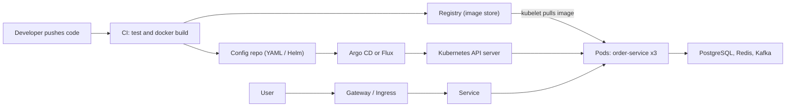

**How it works:**
1. CI builds an **image** from the Dockerfile and pushes it to a registry with a version tag.
2. CI (or a person) updates the version in a **config repo**.
3. A GitOps tool sees the change and applies it to the cluster.
4. Kubernetes starts new **pods** (running containers), checks they are healthy, then removes old ones.
5. Users reach the pods through a **Gateway** (or Ingress) and a **Service**.

**Say this in the interview:**

> "Docker solves 'it works on my machine': one image runs the same on a laptop, in CI and in production. Kubernetes solves 'run it for real': it places containers on servers, restarts them when they die, scales them and routes traffic. CI builds and pushes the image, and a GitOps tool like Argo CD applies the new version to the cluster."

**They may ask next:**
- **Is Kubernetes using Docker?** Not the Docker Engine. Since Kubernetes 1.24 the kubelet talks to containerd or CRI-O directly. Images built by Docker are standard OCI images, so they run fine.

---

## Containers vs virtual machines

**In one line:** A virtual machine copies a whole computer with its own operating system; a container is just an isolated process that shares the host's Linux kernel.

**Story:** A VM is a separate house: own walls, own kitchen, own water tank. A container is a room in a hostel: own lock and own bed, but everyone shares the building, kitchen and water pipes. Rooms are cheaper and faster to give out. Houses are more separate.

**Diagram:**

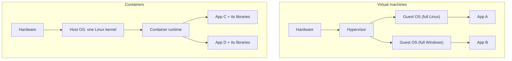

**How it works:**
1. A **hypervisor** (software that runs VMs, like KVM, VMware, Hyper-V) gives each VM fake hardware. Each VM boots a full OS.
2. A container has **no OS kernel of its own**. It is a normal Linux process with walls around it:
   - **namespaces** decide what it can see,
   - **cgroups** decide how much CPU and memory it can use.
3. The image carries only the app and its libraries (for example a JRE and your jar).

| | Virtual machine | Container |
|---|---|---|
| Starts in | 30 s to minutes | Under 1 s (plus your app's startup) |
| Size | GBs | Tens to hundreds of MBs |
| Isolation | Strong (separate kernel) | Weaker (shared kernel) |
| Runs a different OS kernel | Yes (Windows on Linux host) | No, Linux containers need a Linux kernel |
| Typical use | Run many teams' servers, strong security walls | Package and ship apps |

**Good and bad:**
| Good | Bad |
|---|---|
| Containers: fast start, small, same everywhere | A kernel bug can let a container escape to the host |
| VMs: strong isolation | VMs are heavy; slow to boot and scale |

In the cloud you usually get **both**: your containers run on VMs (the Kubernetes nodes).

**Say this in the interview:**

> "A VM virtualizes hardware and runs a full OS. A container virtualizes the OS: it is a process that shares the host kernel, isolated with namespaces and limited with cgroups. So containers start in under a second and are small, but isolation is weaker. In practice we run containers on top of VMs."

**They may ask next:**
- **How does Docker run on a Mac?** Docker Desktop starts a small Linux VM in the background. Your containers run inside that VM.
- **What gives stronger isolation for containers?** Sandboxed runtimes like gVisor or Kata Containers (a tiny VM per pod), or user namespaces (GA in Kubernetes 1.36).

---

## Images, layers, containers and registries

**In one line:** An image is a read-only template made of layers; a container is a running image plus a thin writable layer; a registry is the server that stores images.

**Story:** An image is a **recipe card** printed and laminated. A container is the **dish you cook** from it. Many cooks can use the same card at once. The registry is the **recipe library**.

**Diagram:** layers of a Spring Boot image. Each Dockerfile step adds one layer.

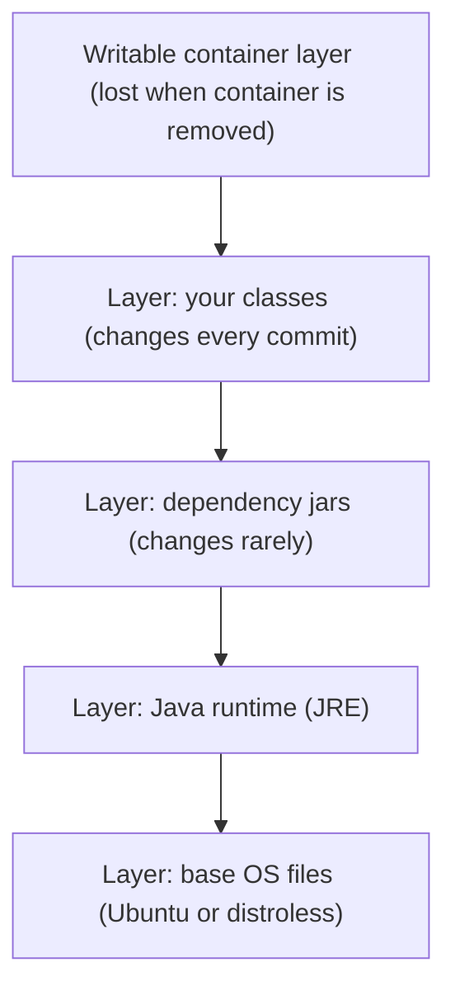

**How it works:**
1. **Layer:** a set of file changes (added, changed, deleted files). Layers are stored once and shared. Ten images on the same JRE base share those bytes.
2. **Image:** an ordered list of layers plus config (entrypoint, env, user). It follows the **OCI** standard (Open Container Initiative), so any runtime can run it.
3. **Container:** the runtime stacks the layers with a union file system (overlayfs) and adds one writable layer on top.
4. **Tag vs digest:**
   - Tag `order-service:1.4.2` is a name. Someone can move it to another image.
   - Digest `order-service@sha256:9f1c...` is the hash of the content. It never changes.
5. **Registry:** Docker Hub, GitHub Container Registry, AWS ECR, Google Artifact Registry, Azure ACR, Harbor. A **repository** is one image name inside a registry, with many tags.

**Example:**
```bash
docker build -t ghcr.io/acme/order-service:1.4.2 .   # build an image
docker history ghcr.io/acme/order-service:1.4.2       # see layers and their sizes
docker push ghcr.io/acme/order-service:1.4.2          # upload only layers the registry does not have
docker run -d -p 8080:8080 ghcr.io/acme/order-service:1.4.2  # start a container
```

**Good and bad:**
| Good | Bad |
|---|---|
| Version tags plus digests in production | `:latest` in production: you cannot tell what is running |
| Rarely changing layers first | Copying all source before installing dependencies: cache breaks every commit |

**Say this in the interview:**

> "An image is a read-only stack of layers plus config. A container is that stack with a writable layer on top, running as a process. Layers are shared and cached, so I order the Dockerfile from rarely changing to often changing. In production I deploy by version tag and pin the digest, never latest."

**They may ask next:**
- **Do you lose data when a container stops?** No, a stopped container keeps its writable layer. You lose it when you **remove** the container. Real data belongs in a volume.

---

## Docker architecture: CLI, daemon, containerd, runc

**In one line:** The `docker` CLI sends commands to the Docker daemon (`dockerd`), which asks `containerd` to manage containers, and `runc` actually creates each container process.

**Story:** A restaurant. You (CLI) tell the **waiter** (dockerd) your order. The waiter passes it to the **head chef** (containerd), who manages all the dishes. A **line cook** (runc) cooks one dish and steps away. A **helper** (the shim) watches the dish so the head chef can take a break.

**Diagram:**

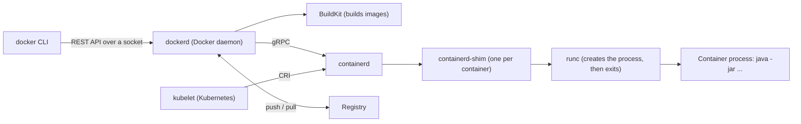

**How it works:**
1. `docker run` calls the daemon's REST API on `/var/run/docker.sock`.
2. `dockerd` handles images, networks, volumes and builds (with **BuildKit**).
3. `containerd` pulls and stores images and manages container lifecycles. In Docker Engine 29 the containerd image store is the default for new installs.
4. For each container, containerd starts a small **shim**, which calls **runc**.
5. `runc` sets up namespaces and cgroups, starts your process, and exits. The shim stays, so you can restart dockerd without killing containers.
6. Kubernetes skips dockerd. The kubelet talks to containerd (or CRI-O) through the **CRI** (Container Runtime Interface).

**Good and bad:**
| Good | Bad |
|---|---|
| Each part does one job; standard OCI images everywhere | Access to `docker.sock` is root on the host. Never mount it into an app container |

**Say this in the interview:**

> "The CLI talks to dockerd over a REST API. dockerd uses BuildKit for builds and containerd to run containers. containerd starts a shim per container, and runc creates the actual process with namespaces and cgroups, then exits. Kubernetes uses containerd directly through the CRI, without dockerd."

**They may ask next:**
- **What are Podman and CRI-O?** Podman is a Docker-like CLI with no daemon, and it can run rootless. CRI-O is a small runtime made only for Kubernetes.

---

## Namespaces and cgroups

**In one line:** Namespaces control what a container can **see**; cgroups control how much it can **use**.

**Story:** An office with glass walls. **Namespaces** are frosted glass: each team sees only its own desks, its own phone list, its own door number. **cgroups** are the electricity meter with a fuse: each team gets a fixed share of power. If a team uses too much, its fuse blows.

**Diagram:**

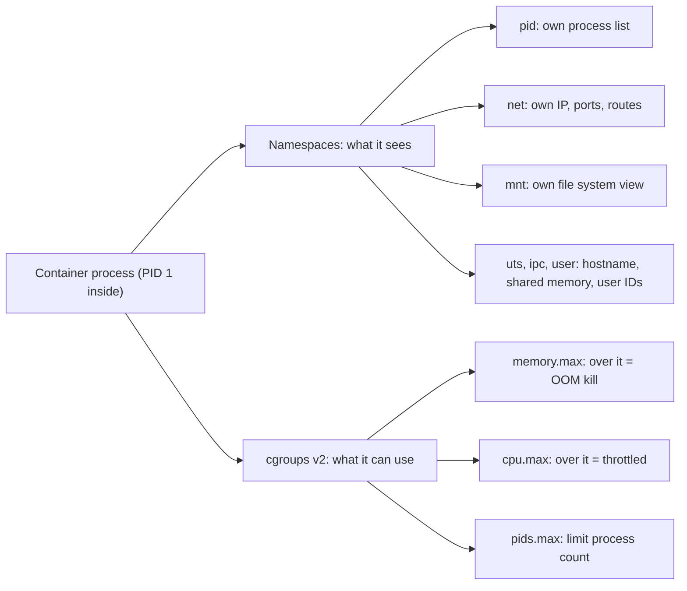

**How it works:**
1. **Namespaces** (Linux kernel feature):
   - `pid`: the app sees itself as PID 1 and cannot see host processes.
   - `net`: its own network card, IP and port 8080, so ten containers can all use port 8080.
   - `mnt`: its own root file system (the image).
   - `user`: root inside can map to a normal user outside.
2. **cgroups** (control groups), version 2 today:
   - Memory: a hard cap. Go over it and the kernel kills the process (**OOM kill**, exit code 137).
   - CPU: a quota per 100 ms period. A limit of 0.5 CPU = 50 ms of CPU time every 100 ms. Use it up early and the process waits: **throttling**.
3. Kubernetes 1.35+ fails to start the kubelet on cgroup v1 nodes by default. Use cgroup v2.

**Example:**
```bash
docker run -d --name api --memory=1g --cpus=1.5 order-service:1.4.2
docker exec api cat /sys/fs/cgroup/memory.max   # 1073741824 bytes = 1 GiB
docker exec api cat /sys/fs/cgroup/cpu.max      # "150000 100000" = 150 ms per 100 ms
```

**Say this in the interview:**

> "A container is a normal process. Namespaces give it its own view of processes, network, files and users. cgroups limit its memory and CPU. Over the memory limit, the kernel kills it with exit code 137; over the CPU limit, it is throttled, which shows up as latency, not errors."

**They may ask next:**
- **Why does throttling hurt Java apps?** GC and JIT threads burn the CPU quota fast, so all threads pause until the next 100 ms period. p99 latency jumps.

---

## A Dockerfile for Spring Boot

**In one line:** Build the jar in one stage and copy only the runtime parts into a small JRE image. Split dependencies into their own layers and run as a non-root user.

**Story:** Building furniture. The **workshop** (build stage) has saws, glue and sawdust. The **showroom** (runtime stage) gets only the finished chair. You do not ship the saw to the customer.

**Diagram:**

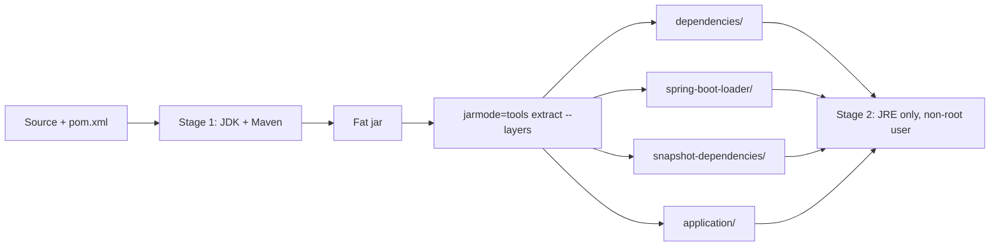

**Example:** a multi-stage Dockerfile with layered jars.
```dockerfile
# ---- Stage 1: build ----
FROM eclipse-temurin:25-jdk AS build
WORKDIR /src
COPY mvnw pom.xml ./
COPY .mvn .mvn
RUN ./mvnw -q dependency:go-offline                # cached until pom.xml changes
COPY src src
RUN ./mvnw -q package -DskipTests
RUN cp target/*.jar application.jar \
 && java -Djarmode=tools -jar application.jar extract --layers --destination /out

# ---- Stage 2: run ----
FROM eclipse-temurin:25-jre
RUN useradd --system --uid 1001 app
WORKDIR /app
# dependencies change rarely, so this layer stays cached
COPY --from=build /out/dependencies/ ./
COPY --from=build /out/spring-boot-loader/ ./
COPY --from=build /out/snapshot-dependencies/ ./
# your code changes every commit: a small layer
COPY --from=build /out/application/ ./
# never run as root
USER 1001
EXPOSE 8080
ENTRYPOINT ["java", "-XX:MaxRAMPercentage=75", "-jar", "application.jar"]
```

**How it works:**
1. **Multi-stage:** the final image has no JDK, no Maven, no source code. Smaller and fewer CVEs (known security bugs).
2. **Layered jar:** `java -Djarmode=tools ... extract --layers` splits the fat jar into 4 folders. Your code is maybe 200 KB; dependencies are 80 MB. A new commit pushes only the small layer.
3. **Cache order:** copy `pom.xml` and download dependencies **before** copying `src`. Code changes do not re-download the internet.
4. **Exec form** `ENTRYPOINT ["java", ...]` makes Java PID 1, so it gets SIGTERM. See [PID 1 and signals](#cmd-vs-entrypoint-pid-1-and-signals).
5. **`.dockerignore`:** keep `target/`, `.git/`, `node_modules/`, `.env` and IDE files out of the build context. Faster builds, and no secrets leak into the image.

**Faster startup (Java 25+):** the extracted layout works with the JVM **AOT cache**. Do a training run at build time:
```dockerfile
RUN java -XX:AOTCacheOutput=app.aot -Dspring.context.exit=onRefresh -jar application.jar
ENTRYPOINT ["java", "-XX:AOTCache=app.aot", "-jar", "application.jar"]
```
Before Java 24, use CDS (`-XX:SharedArchiveFile`) the same way. Java 24 has the AOT cache too, but needs two steps (`-XX:AOTMode=record`, then `create`); the one-step `AOTCacheOutput` came in Java 25. More: [Faster startup](spring-ecosystem.md#faster-startup-native-images-aot-cds-and-crac).

### Buildpacks: no Dockerfile at all

`./mvnw spring-boot:build-image` (or `./gradlew bootBuildImage`) builds an OCI image with **Cloud Native Buildpacks** (Paketo). It picks a JRE, uses layered jars, runs as non-root and sets JVM memory flags for you. Good for teams that do not want to own a Dockerfile. **Jib** (from Google) is another option: it builds and pushes images from Maven/Gradle without a Docker daemon.

### Best practices checklist

| Do | Why |
|---|---|
| JRE base, not JDK (or distroless, or a hardened image) | 200+ MB smaller, fewer CVEs |
| Multi-stage build | Build tools stay out of the final image |
| Rarely changing steps first | Layer cache hits; builds in seconds |
| `.dockerignore` | Small build context; no `.env` or `.git` inside |
| `USER 1001` (non-root) | A bug in the app does not give root in the container |
| Pin base image version (and digest) | Reproducible builds |
| One process per container | Kubernetes can watch, restart and scale it |
| Combine `apt-get update && apt-get install` in one `RUN` and clean up | Fewer, smaller layers |
| `COPY`, not `ADD` | `ADD` can also download URLs and unpack archives: surprises |

**Distroless** images (`gcr.io/distroless/java...`) have no shell and no package manager. Very small attack surface, but you cannot `exec` into them with a shell. Debug with `kubectl debug` (see [Debugging containers](#debugging-containers)).

**Good and bad:**
| Good | Bad |
|---|---|
| 200 MB image, code layer 200 KB | 700 MB image with JDK, Maven cache and source |
| Non-root, read-only root file system | Running as root "because it works" |

**Say this in the interview:**

> "I use a multi-stage build: JDK and Maven in the build stage, only a JRE in the runtime stage. I extract the Spring Boot jar into layers with jarmode tools, so dependencies are cached and each commit pushes a tiny layer. The container runs as a non-root user, with exec-form ENTRYPOINT so Java gets signals. If the team does not want a Dockerfile, spring-boot:build-image with buildpacks does the same."

**They may ask next:**
- **Alpine for Java?** Possible, but Alpine uses musl instead of glibc. Some native libraries and tools behave differently. Many teams prefer a slim Ubuntu/Debian JRE or distroless.
- **Why not a native image (GraalVM)?** Great startup and memory, but slower builds and reflection setup. Worth it for scale-to-zero or CLI tools. See [native images](spring-ecosystem.md#faster-startup-native-images-aot-cds-and-crac).

---

## The JVM inside a container

**In one line:** Modern Java reads the container's memory and CPU limits, but you still must size the heap with `MaxRAMPercentage` and leave room for non-heap memory.

**Story:** A suitcase with a 23 kg airline limit. Your clothes (heap) cannot take all 23 kg. Shoes, toiletries and the bag itself (non-heap) also count. Pack clothes to 75% and you pass. Pack clothes to 100% and the airline throws the bag off (OOMKilled).

**Diagram:** a container with a 1 GiB memory limit.

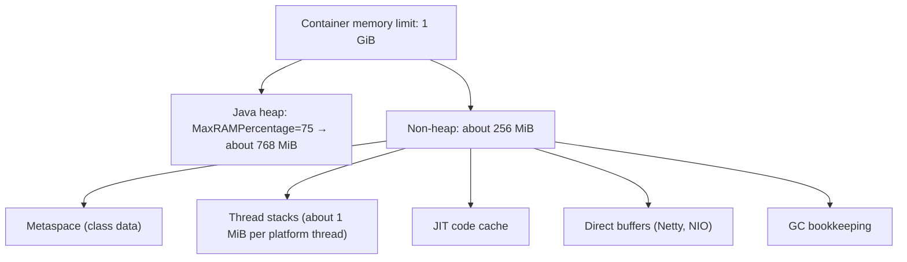

**How it works:**
1. **Container support** is on by default (`-XX:+UseContainerSupport`, since JDK 10 and 8u191). The JVM reads cgroup limits, not host memory.
2. **Default heap is only 25%** of the limit. On a 1 GiB pod you get about 256 MiB of heap and waste the rest.
3. Set `-XX:MaxRAMPercentage=75` (70–80 is common). Do **not** set `-Xmx` equal to the limit: non-heap pushes you over and the kernel kills the pod.
4. **CPU:** the JVM sizes GC threads and the ForkJoin pool from `availableProcessors()`.
   - With a CPU **limit** of 2, it sees 2.
   - With **no** CPU limit, it sees all node cores (JDK 19+ and 17.0.5+ ignore CPU shares). On a 64-core node that means huge thread pools. Set `-XX:ActiveProcessorCount=2`.
5. **GC choice:** up to Java 26, with fewer than 2 CPUs or under about 1.75 GB (1792 MB) of memory, the JVM silently picks **Serial GC**. For services, set `-XX:+UseG1GC` explicitly, or give the pod 2+ CPUs. (Java 27 changed this: G1 is now the default everywhere, JEP 523. Setting it explicitly is still harmless.)
6. **Startup:** use a startup probe, plus CDS or the Java 25 AOT cache to cut startup time.

**Example:**
```yaml
env:
  - name: JAVA_TOOL_OPTIONS        # the JVM reads this automatically
    value: >-
      -XX:MaxRAMPercentage=75
      -XX:+UseG1GC
      -XX:ActiveProcessorCount=2
      -XX:+ExitOnOutOfMemoryError
```
`ExitOnOutOfMemoryError` makes the JVM exit on a heap OOM, so Kubernetes restarts it instead of leaving a half-dead app.

**Good and bad:**
| Good | Bad |
|---|---|
| `MaxRAMPercentage=75`, memory request = limit | `-Xmx1g` in a 1 GiB container |
| Explicit GC and processor count | 0.5 CPU pod that runs Serial GC and is always throttled |

**Say this in the interview:**

> "The JVM is container-aware, but the default heap is only 25% of the limit, so I set MaxRAMPercentage to about 75 and leave the rest for metaspace, threads and direct buffers. If there is no CPU limit, I set ActiveProcessorCount, because the JVM would otherwise size its pools for the whole node. And I set G1 explicitly because small containers silently get Serial GC."

**They may ask next:**
- **Heap OOM vs OOMKilled?** Heap OOM is a Java `OutOfMemoryError` with a stack trace. OOMKilled is the kernel killing the process at the cgroup limit: no Java error, just exit code 137. More: [Memory leak / OOMKilled pods](production-ready.md#memory-leak--oomkilled-pods).
- **Do virtual threads change this?** They use far less stack memory than platform threads, so thread count stops being a memory problem. See [virtual threads](java.md#virtual-threads).

---

## A Dockerfile for Node.js

**In one line:** Install dependencies from the lock file in their own layer and build in a separate stage. Ship only production dependencies and built code, and start `node` directly as a non-root user.

**Story:** Same workshop and showroom idea as Java. `node_modules` with dev tools (TypeScript, test libraries) stays in the workshop.

**Diagram:**

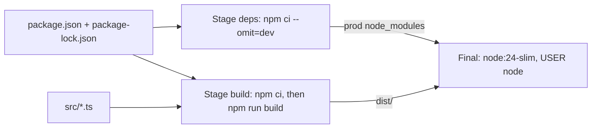

**Example:**
```dockerfile
FROM node:24-slim AS deps
WORKDIR /app
COPY package.json package-lock.json ./
RUN npm ci --omit=dev                    # only prod deps, exact versions from the lock file

FROM node:24-slim AS build
WORKDIR /app
COPY package.json package-lock.json ./
RUN npm ci
COPY . .
RUN npm run build                        # for example tsc → dist/

FROM node:24-slim
ENV NODE_ENV=production
WORKDIR /app
COPY --from=deps /app/node_modules ./node_modules
COPY --from=build /app/dist ./dist
# the official image has a non-root "node" user
USER node
EXPOSE 3000
# exec form, not "npm start"
CMD ["node", "--max-old-space-size=384", "dist/server.js"]
```

**How it works:**
1. `npm ci` installs exactly what the lock file says. Lock file first means the layer stays cached until dependencies change.
2. **Do not start with `npm start`.** npm becomes PID 1 and may not pass SIGTERM to Node.
3. Node as PID 1 does not stop on SIGTERM unless you handle it. Add a SIGTERM handler (see [graceful shutdown in Node](nodejs.md#graceful-shutdown)) or run with `docker run --init` (adds `tini`, a tiny init process).
4. Set `--max-old-space-size` to about 75% of the memory limit (512 MiB limit → 384).
5. Run one Node process per container. Let Kubernetes scale, not the `cluster` module. See [Scaling Node.js](nodejs.md#scaling-nodejs).

The repo's own [app/Dockerfile](../app/Dockerfile) is a real example of this pattern: a `node:22-alpine` stage builds a static site, and the final `nginx` stage contains only the built files.

**Say this in the interview:**

> "For Node I copy package.json and the lock file first and run npm ci, so the dependency layer is cached. I build in a separate stage and ship only production node_modules and dist. I start node directly in exec form as the node user, handle SIGTERM for graceful shutdown, and set max-old-space-size to fit the memory limit."

**They may ask next:**
- **Alpine or slim for Node?** Alpine is smaller but uses musl; native modules (bcrypt, sharp) may need rebuilds. Slim (Debian) is the safe default.

---

## CMD vs ENTRYPOINT, PID 1 and signals

**In one line:** `ENTRYPOINT` is the fixed program; `CMD` gives default arguments that users can override; use the exec form (JSON array) so your app is PID 1 and receives SIGTERM.

**Story:** A coffee machine. `ENTRYPOINT` is the machine: it always makes coffee. `CMD` is the default button, "medium latte". A customer can press another button (override CMD) but cannot turn the coffee machine into a toaster without `--entrypoint`.

**Diagram:** why the shell form breaks graceful shutdown.

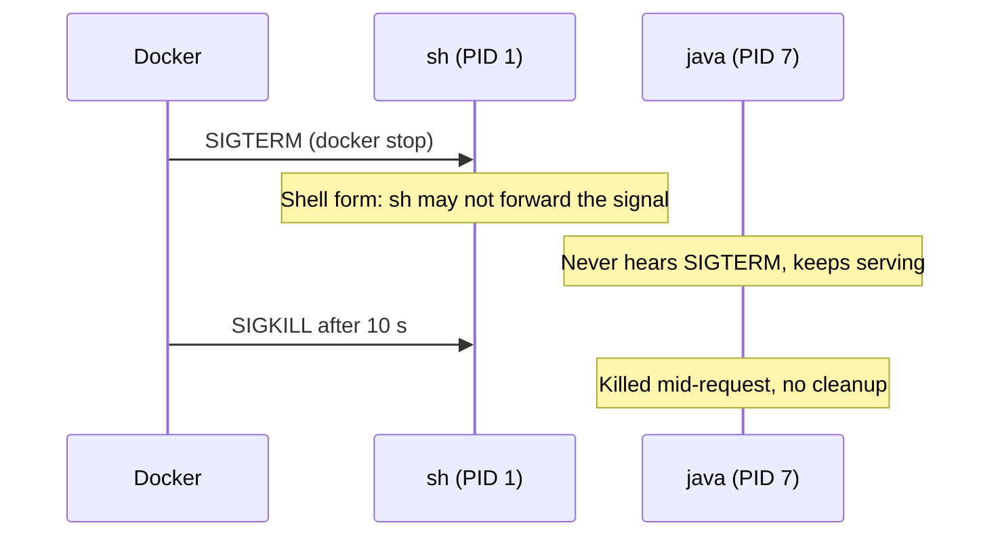

**How it works:**
1. **Exec form:** `ENTRYPOINT ["java", "-jar", "app.jar"]`. Java runs as PID 1 and gets SIGTERM directly.
2. **Shell form:** `ENTRYPOINT java -jar app.jar` runs `/bin/sh -c "..."`. The shell may become PID 1 and may not pass signals on.
3. `docker stop` sends SIGTERM, waits 10 s, then SIGKILL. Kubernetes waits `terminationGracePeriodSeconds` (default 30 s).
4. **PID 1 is special:** the kernel ignores signals with no handler for PID 1. The JVM installs handlers, so Java is fine. Node and shell scripts may not.
5. **Wrapper scripts:** if you need `entrypoint.sh`, end it with `exec java ...` so Java replaces the shell.

| You write | `docker run img` runs | `docker run img --debug` runs |
|---|---|---|
| `ENTRYPOINT ["java","-jar","app.jar"]` | `java -jar app.jar` | `java -jar app.jar --debug` |
| `CMD ["java","-jar","app.jar"]` | `java -jar app.jar` | `--debug` (replaces everything) |
| Both, `CMD ["--spring.profiles.active=dev"]` | `java -jar app.jar --spring.profiles.active=dev` | `java -jar app.jar --debug` |

**Exit codes to know:** 0 = clean exit, 1 = app error, 137 = SIGKILL (often OOM), 143 = SIGTERM, 139 = segfault.

**Say this in the interview:**

> "ENTRYPOINT is the executable, CMD is default arguments that are easy to override. I always use the exec form, so the app is PID 1 and gets SIGTERM. With the shell form, the signal can stop at the shell, and the app is SIGKILLed after the grace period. If I need a script, it ends with exec, or I add tini with --init."

**They may ask next:**
- **What if you write two CMD lines?** Only the last one counts.

---

## Volumes and bind mounts

**In one line:** The container's own file system is temporary; use a named volume for data Docker manages, a bind mount to share a host folder, and tmpfs for in-memory scratch files.

**Story:** A hotel room. Things you leave in the room are thrown away at checkout (container removed). A **locker at reception** (volume) keeps your bag between stays. Bringing your **own suitcase** (bind mount) means the hotel uses your stuff directly.

**Diagram:**

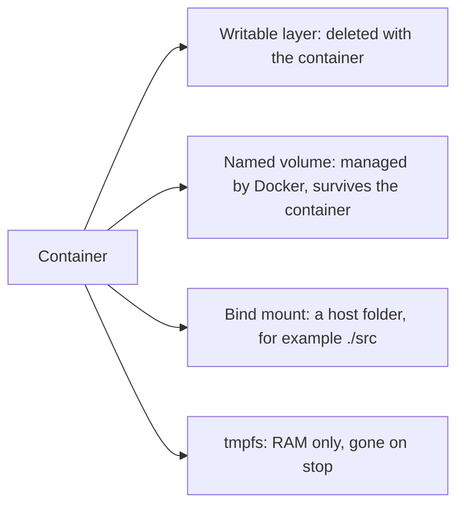

**How it works:**
1. **Named volume:** `-v pgdata:/var/lib/postgresql`. Docker stores it under its own folder. Best for databases in local dev.
2. **Bind mount:** `-v $(pwd)/config:/app/config:ro`. Good for live code reload and config files. Depends on host paths, so not portable.
3. **tmpfs:** `--tmpfs /tmp`. Fast and never written to disk. Useful with a read-only root file system.
4. Clean up unused volumes: `docker volume ls -f dangling=true`, then `docker volume prune`.
5. In Kubernetes the same ideas become `emptyDir`, `configMap`, and `PersistentVolumeClaim`. See [Storage](#storage-pv-pvc-and-storageclass).

**Good and bad:**
| Good | Bad |
|---|---|
| Named volume for local Postgres | Database data in the writable layer: gone on `docker rm` |
| Bind mount with `:ro` for config | Bind-mounting `/var/run/docker.sock` into an app: root on host |

**Say this in the interview:**

> "Anything written inside the container is lost when the container is removed. For data I use named volumes, which Docker manages and which survive the container. Bind mounts share a host folder, good for local development. In Kubernetes the equivalent of a volume is a PersistentVolumeClaim."

**They may ask next:**
- **Postgres 18 image changed something?** Yes: from Postgres 18 the official image's volume is `/var/lib/postgresql` (data lives in a version folder below it), not `/var/lib/postgresql/data`.

---

## Docker networking

**In one line:** Each container gets its own IP on a private bridge network. `-p host:container` publishes a port to the outside, and containers on the same user-defined network find each other by name.

**Story:** An apartment building. Each flat (container) has its own door number on a private corridor (bridge network). Neighbours can knock by name. Visitors from the street only reach a flat if the security guard (port mapping) opens a gate for it.

**Diagram:**

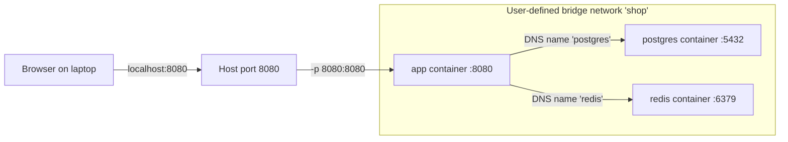

**How it works:**
1. **bridge** (default): private network on the host, NAT to the outside.
   - The **default** bridge has no DNS by name.
   - A **user-defined** bridge (and every Compose project) has a built-in DNS. `postgres` resolves to the Postgres container.
2. **host**: the container uses the host's network directly. No port mapping, no isolation. Linux only.
3. **none**: no network at all.
4. **Port publishing:** `-p 8080:8080` = host port 8080 to container port 8080. `EXPOSE` in a Dockerfile is only documentation.
5. **Common bugs:**
   - The app listens on `127.0.0.1` inside the container. Nothing outside can reach it. Listen on `0.0.0.0`.
   - `localhost` inside a container means the container itself, not your laptop. Use `host.docker.internal` (Docker Desktop) to reach the host.
   - `-p 5432:5432` opens the port on **all** host interfaces, and Docker's firewall rules can bypass tools like `ufw`. For local DBs use `-p 127.0.0.1:5432:5432`.

**Example:**
```bash
docker network create shop
docker run -d --name postgres --network shop -e POSTGRES_PASSWORD=secret postgres:18
docker run -d --name app --network shop -p 8080:8080 \
  -e SPRING_DATASOURCE_URL=jdbc:postgresql://postgres:5432/postgres order-service:1.4.2
```

**Say this in the interview:**

> "Containers get their own network namespace and IP on a bridge network. On a user-defined network, Docker's DNS lets containers call each other by name. To reach a container from outside I publish a port with -p; EXPOSE alone does nothing. The classic bugs are binding to 127.0.0.1 inside the container and thinking localhost means the host."

**They may ask next:**
- **How do containers on different hosts talk?** Overlay networks (Docker Swarm) or, today, Kubernetes with a CNI plugin (Calico, Cilium) that gives every pod a routable IP.

---

## Docker Compose for local development

**In one line:** Docker Compose starts your app and all its dependencies (Postgres, Redis, Kafka) from one `compose.yaml` file with one command.

**Story:** A movie night checklist: projector, snacks, chairs, friends. Instead of setting each one up by hand every time, you write the list once. Then `docker compose up` sets up the whole room.

**Diagram:**

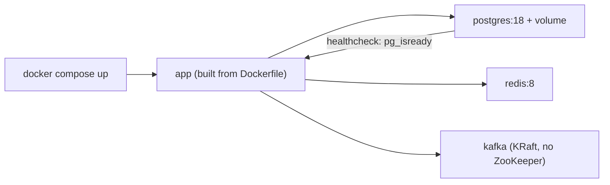

**Example:** `compose.yaml` (the top-level `version:` key is obsolete; leave it out).
```yaml
services:
  app:
    build: .
    ports: ["8080:8080"]
    environment:
      SPRING_DATASOURCE_URL: jdbc:postgresql://postgres:5432/shop   # service name = host name
      SPRING_DATASOURCE_USERNAME: shop
      SPRING_DATASOURCE_PASSWORD: secret
      SPRING_DATA_REDIS_HOST: redis
      SPRING_KAFKA_BOOTSTRAP_SERVERS: kafka:9092
    depends_on:
      postgres: { condition: service_healthy }   # wait until the DB really accepts connections
      redis: { condition: service_started }
      kafka: { condition: service_started }
  postgres:
    image: postgres:18
    environment: { POSTGRES_DB: shop, POSTGRES_USER: shop, POSTGRES_PASSWORD: secret }
    ports: ["127.0.0.1:5432:5432"]               # only reachable from this laptop
    volumes: ["pgdata:/var/lib/postgresql"]
    healthcheck:
      test: ["CMD-SHELL", "pg_isready -U shop -d shop"]
      interval: 5s
      retries: 10
  redis:
    image: redis:8
volumes:
  pgdata:
```

Kafka service (single node, KRaft mode). Add it under `services:`:
```yaml
  kafka:
    image: apache/kafka:4.4.0
    environment:
      KAFKA_NODE_ID: 1
      KAFKA_PROCESS_ROLES: broker,controller
      KAFKA_LISTENERS: PLAINTEXT://:9092,CONTROLLER://:9093
      KAFKA_ADVERTISED_LISTENERS: PLAINTEXT://kafka:9092     # the name other containers use
      KAFKA_CONTROLLER_LISTENER_NAMES: CONTROLLER
      KAFKA_LISTENER_SECURITY_PROTOCOL_MAP: CONTROLLER:PLAINTEXT,PLAINTEXT:PLAINTEXT
      KAFKA_CONTROLLER_QUORUM_VOTERS: 1@localhost:9093
      KAFKA_OFFSETS_TOPIC_REPLICATION_FACTOR: 1               # one broker, so replication 1
      KAFKA_TRANSACTION_STATE_LOG_REPLICATION_FACTOR: 1
      KAFKA_TRANSACTION_STATE_LOG_MIN_ISR: 1
```

**How it works:**
1. Compose creates one network for the project. Each service name is a DNS name.
2. `depends_on` alone only waits for the container to **start**, not to be **ready**. Add a `healthcheck` and `condition: service_healthy`.
3. Your app should still retry connections. Ready at startup does not mean ready forever.
4. Useful commands: `docker compose up -d`, `logs -f app`, `ps`, `down` (keeps volumes), `down -v` (deletes volumes), `watch` (rebuild or sync files on change).
5. **Spring Boot extras:**
   - `spring-boot-docker-compose` starts `compose.yaml` when the app starts and wires connection details for you.
   - For tests, prefer Testcontainers. See [Testcontainers and @ServiceConnection](spring-ecosystem.md#testcontainers-and-serviceconnection).

**Good and bad:**
| Good | Bad |
|---|---|
| One command to get a full local stack | Using Compose as the production platform for a multi-server system |
| Healthchecks + `service_healthy` | `sleep 30` in a start script and hoping |

**Say this in the interview:**

> "I use Docker Compose for local development: the app plus Postgres, Redis and Kafka in one file, with named volumes and healthchecks. depends_on only orders the start, so I add a healthcheck with condition service_healthy, and the app still retries. For tests I use Testcontainers, and in production Kubernetes, not Compose."

**They may ask next:**
- **Compose in production?** Fine for one small server (a side project, an internal tool). For many servers, rolling updates and self-healing, use Kubernetes or a managed container service.

---

## Image security

**In one line:** Start from a small trusted base, scan every image, pin versions by digest, never bake secrets into layers, and ship an SBOM and a signature with each image.

**Story:** Food safety for a packed lunch box. Buy ingredients from a trusted shop (base image). Check them for spoiled items (scan). Write the ingredient list on the box (SBOM). Seal the box with your stamp (signature), so nobody swaps it on the way.

**Diagram:**

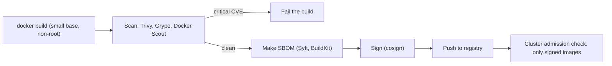

**How it works:**
1. **Small base:** JRE, slim, distroless, or hardened images (Docker Hardened Images became free and open source in December 2025; Chainguard is another source). Fewer packages = fewer CVEs.
2. **Scan** in CI and again on a schedule (new CVEs appear for old images): Trivy, Grype, Docker Scout, Snyk.
3. **Pin:** `FROM eclipse-temurin:25-jre@sha256:...`. Let Renovate or Dependabot open PRs when the base updates.
4. **No secrets in images:**
   - `ENV`, `ARG` and copied files stay visible in layers and `docker history`, even if a later step deletes them.
   - For build-time secrets (a private npm token) use BuildKit: `RUN --mount=type=secret,id=npmrc npm ci`.
   - Runtime secrets come from the platform (Kubernetes Secrets, a vault), not the image.
5. **SBOM** (Software Bill of Materials: the list of every package inside): `docker buildx build --sbom=true --provenance=true`, or Syft.
6. **Sign** with cosign (Sigstore) and verify at deploy time with an admission policy (Kyverno, OPA Gatekeeper).
7. **Run safely:** non-root, read-only root file system, drop Linux capabilities, no `--privileged`.

**Example:**
```bash
trivy image --severity HIGH,CRITICAL --exit-code 1 ghcr.io/acme/order-service:1.4.2
docker buildx build --sbom=true --provenance=true -t ghcr.io/acme/order-service:1.4.2 --push .
cosign sign ghcr.io/acme/order-service@sha256:9f1c...      # sign the digest, not the tag
```

**Say this in the interview:**

> "I start from a small or hardened base and run as non-root. CI scans the image and fails on critical CVEs, generates an SBOM and signs the image digest with cosign; the cluster only admits signed images. Secrets never go into the image: build secrets use BuildKit secret mounts, and runtime secrets come from the platform."

**They may ask next:**
- **Why rescan old images?** A clean image today can have a new CVE tomorrow. Scan running images on a schedule, not only at build time.

---

## Debugging containers

**In one line:** Check status and exit code, read logs, look inside with `exec`, read the full config with `inspect`, and watch live resource use with `stats`.

**Story:** A doctor's visit. First ask "how are you?" (`ps`, status). Then read the patient's diary (`logs`). Then examine (`exec`, `inspect`). Then check pulse and blood pressure live (`stats`).

**Diagram:** the container lifecycle.

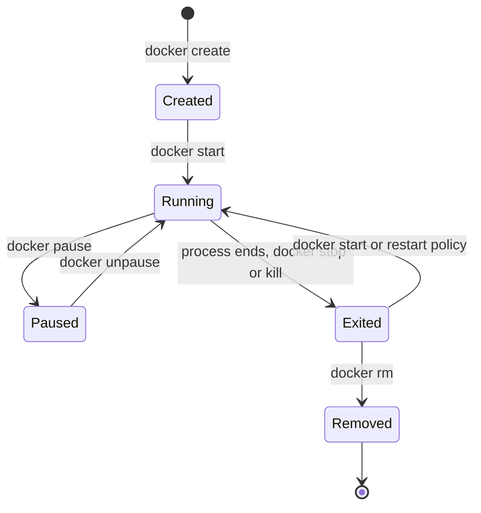

**Example:**
```bash
docker ps -a                                   # all containers, with status and exit code
docker logs -f --tail 200 app                  # follow the last 200 log lines
docker exec -it app sh                         # shell inside (not in distroless)
docker inspect -f '{{.State.ExitCode}} {{.State.OOMKilled}}' app   # 137 true = killed for memory
docker stats                                   # live CPU, memory, network per container
docker top app                                 # processes inside
docker events --since 10m                      # start, die, oom events
docker cp app:/app/logs/gc.log .               # copy a file out
docker system df                               # disk used by images, containers, volumes
docker run --rm -it --network container:app nicolaka/netshoot   # network tools in the same namespace
```

**How it works:**
1. Container exits right away? `docker logs` shows the error. `docker ps -a` shows the exit code.
2. No shell in the image? Attach a debug container to the same namespaces (last line above), or in Kubernetes use `kubectl debug`.
3. Java: `jcmd` and `jstack` are in the JDK, not the JRE. Keep a debug image with a JDK, or run `jcmd` from an ephemeral debug container that shares the process namespace.

**Say this in the interview:**

> "I start with docker ps -a for the status and exit code, then docker logs. For a running container I use exec to look inside and inspect for env, mounts and OOMKilled. docker stats shows live CPU and memory. For distroless images without a shell, I attach a debug container to the same namespaces."

**They may ask next:**
- **Restart policies?** `--restart=no | on-failure | always | unless-stopped`. In Kubernetes the kubelet restarts containers instead.

---

## Why Kubernetes

**In one line:** Kubernetes is a system where you write down the state you want ("3 copies of order-service, version 1.4.2"), and it keeps working until reality matches, on many servers, all the time.

**Story:** A busy harbour. Ships (servers) arrive and leave. Containers must be placed on ships with free space. If a ship sinks, its containers must go on other ships. The **harbour master** does not move boxes by hand. He keeps a board: "we need 3 boxes of mangoes on ships at all times". His team checks the board every few seconds and fixes any gap. That harbour master is Kubernetes. ("Kubernetes" is Greek for helmsman, the person who steers a ship.)

**Diagram:** the control loop that every part of Kubernetes follows.

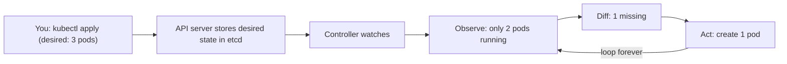

**How it works:**
1. **Declarative:** you describe the result in YAML, not the steps.
2. **Controllers** run loops: observe, compare, act. They never stop.
3. This gives you, for free:
   - **Self-healing:** a crashed container restarts; a dead node's pods move to other nodes.
   - **Scheduling:** pods go to nodes with enough CPU and memory.
   - **Rolling updates** and rollback.
   - **Service discovery** and load balancing through stable names.
   - **Autoscaling** of pods and nodes.
   - **Config and secrets** separated from the image.
4. Kubernetes releases a new minor version about every 4 months. The project supports the 3 newest (1.35, 1.36 and 1.37 in November 2026). Cloud providers run managed versions: see [cloud.md](cloud.md).

**Good and bad:**
| Good | Bad |
|---|---|
| One standard way to deploy, scale and heal any container | Big learning curve and many moving parts |
| Works on every cloud and on-premises | Overkill for one small app (see [When not to use Kubernetes](#when-not-to-use-kubernetes)) |

**Say this in the interview:**

> "Kubernetes is a declarative container platform. I say what I want, like three replicas of version 1.4.2, and controllers run loops that compare desired and actual state and fix the gap. That gives self-healing, scheduling, rolling updates, service discovery and autoscaling across many servers."

**They may ask next:**
- **What is a reconcile loop?** Observe, diff, act, repeat. Operators (custom controllers) use the same loop to manage databases or Kafka clusters.

---

## Kubernetes cluster architecture

**In one line:** The control plane (API server, etcd, scheduler, controller manager) decides what should run; worker nodes (kubelet, kube-proxy, container runtime) actually run the pods.

**Story:** The harbour office and the ships.
- **API server** = the front desk. Every request goes through it.
- **etcd** = the record book. The single source of truth.
- **Scheduler** = the planner who picks a ship for each new box.
- **Controller manager** = the supervisors who check the board and fix gaps.
- **kubelet** = the captain on each ship who makes sure the boxes assigned to his ship are really there.
- **kube-proxy** = the ship's signboard that tells traffic where each box is.

**Diagram:**

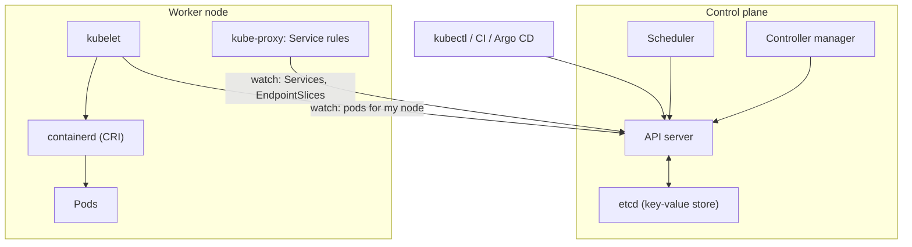

**How it works:** what happens on `kubectl apply -f deployment.yaml`.
1. **API server** checks who you are (authentication), what you may do (RBAC), runs admission checks, then saves the object in **etcd**.
2. The **Deployment controller** sees a new Deployment and creates a ReplicaSet. The ReplicaSet controller creates 3 Pod objects with no node yet.
3. The **scheduler** sees pods without a node. It filters nodes (enough CPU/memory, taints, affinity) and scores them, then writes the chosen node into each pod.
4. The **kubelet** on that node sees "a pod for me", asks containerd to pull the image and start containers, runs probes, and reports status back.
5. **kube-proxy** (or a CNI like Cilium that replaces it) programs rules so the Service IP reaches healthy pods. nftables mode is the modern choice; IPVS mode is deprecated since 1.35 (the plan: off by default around 1.40, removed around 1.43).
6. Only the API server talks to etcd. Everything else **watches** the API server.

**Extra parts you will hear about:**
- **CNI plugin** (Calico, Cilium, cloud CNI): gives each pod an IP and enforces network policies.
- **CoreDNS:** DNS names for Services.
- **cloud-controller-manager:** creates cloud load balancers and disks.

**Good and bad:**
| Good | Bad |
|---|---|
| Managed control plane (EKS, GKE, AKS): the cloud runs etcd and the API server | Self-managed etcd without backups: lose etcd, lose the cluster state |
| 3 or 5 etcd members (odd number, for majority voting) | 2 etcd members: one failure stops writes |

**Say this in the interview:**

> "The control plane has four parts. The API server is the only door, and the only part that talks to etcd. etcd stores the whole cluster state. The scheduler picks nodes for new pods, and the controller manager runs the reconcile loops. Each worker node runs the kubelet, which starts containers through containerd and reports health, and kube-proxy, which routes Service traffic to pods. Everything works by watching the API server."

**They may ask next:**
- **What happens if the control plane goes down?** Running pods keep running and serving. But nothing new is scheduled, nothing heals, and you cannot deploy.
- **What happens if a node dies?** After a timeout (about 5 minutes by default), its pods are marked for eviction and controllers create replacements on other nodes.

---

## Pods, ReplicaSets and Deployments

**In one line:** A Pod is one or more containers that share an IP and storage. A ReplicaSet keeps N identical pods running. A Deployment manages ReplicaSets so you can roll out and roll back.

**Story:** A Pod is a **tiffin box** with compartments: rice and curry (main container plus a helper) always travel together. A ReplicaSet is the **kitchen rule** "always have 3 tiffins ready". A Deployment is the **menu manager** who switches from today's menu to tomorrow's menu one tiffin at a time.

**Diagram:**

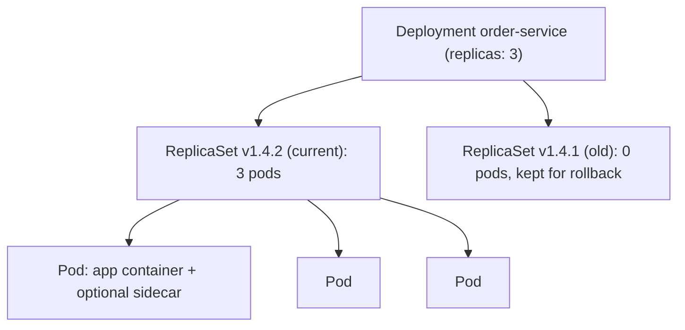

**How it works:**
1. **Pod:**
   - The smallest unit Kubernetes schedules. Pods are **cattle, not pets**: they die and get replaced with a new name and IP.
   - Containers in one pod share the network (talk over `localhost`) and can share volumes.
   - **Init containers** run first, in order, and must finish (for example, wait for a DB or run a migration).
   - **Sidecar containers** (stable since 1.33) start before the app and stop after it. Examples: a log shipper, a mesh proxy.
2. **ReplicaSet:** keeps the count right using a **label selector** (`app: order-service`). You rarely create one yourself.
3. **Deployment:**
   - Each change to the pod template creates a new ReplicaSet.
   - It scales the new one up and the old one down: a rolling update.
   - Old ReplicaSets stay (default 10, `revisionHistoryLimit`) for rollback.
4. **Labels and selectors** glue everything: Deployments, Services and NetworkPolicies find pods by labels.

**Good and bad:**
| Good | Bad |
|---|---|
| One main container per pod, sidecars only for helpers | App + database in one pod: they cannot scale separately |
| Always a Deployment (or StatefulSet) | A bare Pod: if the node dies, nobody recreates it |

**Say this in the interview:**

> "A pod is the smallest unit: one or more containers sharing a network namespace and volumes, usually one app container plus maybe a sidecar. A ReplicaSet keeps N pods alive by label selector. A Deployment owns ReplicaSets: each template change makes a new ReplicaSet, and the Deployment shifts pods from old to new, keeping the old one for rollback."

**They may ask next:**
- **Pod vs container?** A container is one process image. A pod is the wrapper Kubernetes schedules: one IP, shared volumes, one or more containers.
- **ReplicationController?** The old version of ReplicaSet. Do not use it today.

---

## Services: ClusterIP, NodePort, LoadBalancer

**In one line:** A Service gives a changing set of pods one stable name and virtual IP, and spreads traffic across the ready ones.

**Story:** A company's **main phone number**. Employees (pods) join and leave, and their desk numbers change. Customers always call the main number. The switchboard forwards each call to someone who is available (ready).

**Diagram:** each type builds on the one below.

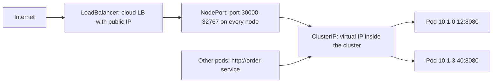

**How it works:**
1. **ClusterIP** (default): an internal virtual IP and DNS name. For service-to-service calls.
2. **NodePort:** opens the same port on every node. Mostly a building block; rarely used directly.
3. **LoadBalancer:** asks the cloud for an external load balancer pointing at the Service.
4. **ExternalName:** a DNS alias to an outside name (for example a managed database).
5. **Headless** (`clusterIP: None`): no virtual IP. DNS returns the pod IPs. Used by StatefulSets and client-side load balancing.
6. The Service's **selector** picks pods by label. Only **ready** pods go into its **EndpointSlices** (the list of pod IPs). The old Endpoints API is deprecated since 1.33.
7. kube-proxy balances per **connection**, not per request. Long-lived HTTP/2 or gRPC connections stick to one pod.

**Example:**
```yaml
apiVersion: v1
kind: Service
metadata: { name: order-service, namespace: shop }
spec:
  type: ClusterIP
  selector: { app: order-service }   # must match the pod labels exactly
  ports:
    - name: http
      port: 80                       # callers use http://order-service
      targetPort: 8080               # where the app listens in the pod
```

**Good and bad:**
| Good | Bad |
|---|---|
| ClusterIP inside, one Gateway for the outside | One LoadBalancer Service per microservice: many public IPs and cloud LBs to pay for |
| Check `kubectl get endpointslices` when traffic fails | Selector typo: Service with zero endpoints, callers get connection refused |

**Say this in the interview:**

> "A Service is a stable virtual IP and DNS name in front of pods chosen by a label selector, and only ready pods receive traffic. ClusterIP is for internal calls, NodePort opens a port on every node, and LoadBalancer creates a cloud load balancer. For HTTP from the internet I normally use one Gateway or Ingress instead of a LoadBalancer per service."

**They may ask next:**
- **gRPC traffic all goes to one pod. Why?** The Service balances connections, and gRPC keeps one connection open. Use client-side balancing with a headless Service, or a service mesh that balances per request.

---

## Ingress and Gateway API

**In one line:** Ingress and the newer Gateway API route outside HTTP traffic to Services by host and path. Use Gateway API for new work; the popular ingress-nginx controller was retired in March 2026.

**Story:** A shopping mall entrance. One main gate (load balancer). A **reception desk** reads where you want to go: "/orders? 2nd floor, shop 12". Ingress is the old reception desk with one big rule book. Gateway API splits the job: the **mall owner** runs the gate (Gateway), and **each shop** writes its own direction signs (HTTPRoutes).

**Diagram:**

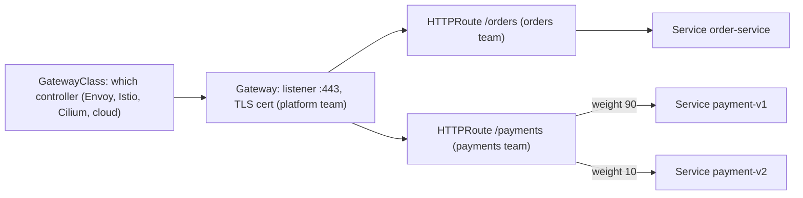

**How it works:**
1. **Ingress** (API `networking.k8s.io/v1`): host and path rules to Services. Anything more (rewrites, timeouts, canary) needs controller-specific **annotations**, which do not move between controllers.
   - The Ingress API is stable and still works. It is frozen: no new features.
   - The **ingress-nginx** controller (the community one) was retired in March 2026: no more releases or security fixes. Clusters still running it should migrate.
2. **Gateway API** (`gateway.networking.k8s.io/v1`; v1.5 and v1.6 came out in 2026):
   - **GatewayClass:** which implementation.
   - **Gateway:** the listener, ports and TLS. Owned by the platform team.
   - **HTTPRoute / GRPCRoute / TLSRoute:** routing rules. Owned by app teams.
   - Header matching, traffic splitting by weight, redirects and timeouts are built in. No annotations.
3. Implementations: Envoy Gateway, Istio, Cilium, NGINX Gateway Fabric, Traefik, Kong, and the clouds' own (GKE Gateway, AWS Load Balancer Controller). `ingress2gateway` converts old Ingress YAML.

**Example:**
```yaml
apiVersion: gateway.networking.k8s.io/v1
kind: HTTPRoute
metadata: { name: shop-api, namespace: shop }
spec:
  parentRefs: [{ name: public-gateway, namespace: infra }]   # Gateway owned by the platform team
  hostnames: ["api.shop.example.com"]
  rules:
    - matches: [{ path: { type: PathPrefix, value: /orders } }]
      backendRefs: [{ name: order-service, port: 80 }]
    - matches: [{ path: { type: PathPrefix, value: /payments } }]
      backendRefs:                                           # 10% canary, no annotations
        - { name: payment-v1, port: 80, weight: 90 }
        - { name: payment-v2, port: 80, weight: 10 }
```

**Good and bad:**
| Good | Bad |
|---|---|
| Gateway API for new clusters: portable, role-based | Staying on retired ingress-nginx: no security fixes |
| One shared Gateway, many team-owned routes | Copying 15 nginx annotations into a new controller and hoping they mean the same thing |

**Say this in the interview:**

> "Ingress gives host and path routing, but anything advanced needs controller-specific annotations. Gateway API is its successor: GatewayClass picks the implementation, the platform team owns the Gateway with TLS, and app teams own HTTPRoutes with built-in features like weighted canary splits. The community ingress-nginx controller was retired in March 2026, so new work should use Gateway API."

**They may ask next:**
- **Is the Ingress API removed?** No. The API stays and other controllers still support it. Only the ingress-nginx project stopped.
- **Gateway API vs API gateway?** Gateway API is Kubernetes routing config. An API gateway (Kong, Spring Cloud Gateway) adds auth, rate limits, request changes. See [API gateway and BFF](microservices.md#api-gateway-and-bff).

---

## A request from the user to the pod

**In one line:** DNS sends the user to a cloud load balancer, which forwards to the Gateway's proxy pods, which pick a ready pod from the Service's EndpointSlices and send the request there.

**Story:** A courier delivering a parcel to a big office. The address (DNS) leads to the building gate (cloud load balancer). Reception (Gateway) reads the department name. The department's front desk list (EndpointSlice) says which employees are in today (ready pods). The parcel goes straight to one of them.

**Diagram:**

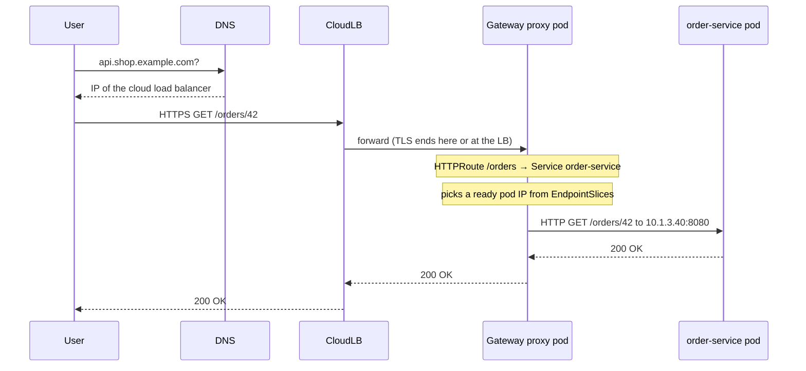

**How it works:**
1. Most gateway controllers send traffic **straight to pod IPs** from EndpointSlices. They do not go through the ClusterIP.
2. For pod-to-pod calls inside the cluster, the caller resolves `order-service` with CoreDNS, gets the ClusterIP, and kube-proxy rules on the caller's node pick a pod.
3. A pod that fails readiness is removed from the EndpointSlice. New requests stop going to it within seconds.
4. If something returns **502/503**, check each hop: DNS, LB health checks, Gateway route status, EndpointSlices, then the pod. See [Troubleshooting runbook](#troubleshooting-runbook).

**Say this in the interview:**

> "DNS points to a cloud load balancer, which forwards to the Gateway or Ingress proxy. The proxy matches the host and path to a route, looks up the Service's EndpointSlices and sends the request to a ready pod IP. Inside the cluster, a pod calls a Service name, CoreDNS returns the ClusterIP and kube-proxy rules pick a ready pod."

**They may ask next:**
- **Where does TLS end?** At the cloud LB or at the Gateway. Pod-to-pod traffic is plain HTTP unless you add a service mesh for mTLS.

---

## ConfigMaps, Secrets and Namespaces

**In one line:** ConfigMaps hold normal config, Secrets hold sensitive values, and Namespaces split one cluster into separate areas for teams or environments.

**Story:** An office building. **Namespaces** are floors: each team has its own floor with its own rules. **ConfigMaps** are notice boards on the floor (anyone on the floor can read them). **Secrets** are the locked drawer: only people with the key may open it.

**Diagram:**

```mermaid
flowchart LR
    V["Vault / AWS Secrets Manager"] -->|"External Secrets Operator syncs"| S["Secret order-secrets"]
    CM["ConfigMap order-config"] -->|"envFrom"| P["Pod order-service"]
    S -->|"env var or mounted file"| P
    CM -->|"mounted file (updates live)"| P
    subgraph NS["Namespace shop"]
        CM
        S
        P
    end
```

**How it works:**
1. **ConfigMap:** key-value pairs or whole files (`application.yaml`).
   - As **env vars:** read once at start. Changing the ConfigMap needs a pod restart.
   - As a **mounted file:** updates in the pod after a short delay (not with `subPath`). The app must reload it.
   - Spring Boot reads env vars like `SPRING_DATASOURCE_URL` with relaxed binding.
2. **Secret:**
   - Only **base64 encoded**, not encrypted, by default. Anyone who can read Secrets can read the values.
   - Turn on encryption at rest in etcd (managed clouds often do this with a KMS key).
   - Limit `get secrets` with RBAC.
   - Many teams keep the real secret in a vault and sync it with **External Secrets Operator** or mount it with the **Secrets Store CSI driver**.
   - Mounted files are safer than env vars: env vars leak into crash dumps and `/proc`.
3. **Namespace:**
   - A name scope: `order-service` in `shop` and in `shop-staging` are different objects.
   - Quotas (`ResourceQuota`, `LimitRange`), RBAC and NetworkPolicies are usually per namespace.
   - **Not** a security wall by itself: pods can still talk across namespaces unless NetworkPolicies say no.

**Example:**
```yaml
apiVersion: v1
kind: ConfigMap
metadata: { name: order-config, namespace: shop }
data:
  SPRING_PROFILES_ACTIVE: prod
  SPRING_DATASOURCE_URL: jdbc:postgresql://orders-db.shop:5432/orders
---
apiVersion: v1
kind: Secret
metadata: { name: order-secrets, namespace: shop }
type: Opaque
stringData:                        # plain text here; stored base64. Never commit real values to Git
  SPRING_DATASOURCE_PASSWORD: change-me
```

**Good and bad:**
| Good | Bad |
|---|---|
| Real secrets in a vault, synced in; RBAC on Secrets | Secret YAML with real passwords in Git |
| Namespaces per team or environment, with quotas | Everything in `default` |

**Say this in the interview:**

> "ConfigMaps hold non-sensitive config as env vars or files; env vars need a restart to change, mounted files update live. Secrets are only base64, so I enable encryption at rest, lock them down with RBAC, and usually sync them from a vault with External Secrets Operator. Namespaces group resources for a team or environment and carry quotas and RBAC, but they are not a network wall without NetworkPolicies."

**They may ask next:**
- **How do you restart pods when a ConfigMap changes?** Put a hash of the config in a pod annotation (Helm and Kustomize can do this), so a change rolls out a new ReplicaSet. Or use a reloader controller.

---

## StatefulSets, DaemonSets, Jobs and CronJobs

**In one line:** Deployments run stateless apps. StatefulSets give pods stable names and own disks. DaemonSets run one pod per node. Jobs run to completion, and CronJobs run Jobs on a schedule.

**Story:** Hotel staff.
- **Deployment:** room cleaners. Any cleaner can clean any room.
- **StatefulSet:** the managers. Each has a name badge (manager-0, manager-1) and their own locked cabinet.
- **DaemonSet:** one security guard on **every** floor.
- **Job:** a painter hired to paint the lobby once.
- **CronJob:** the pest control visit every Sunday at 2 am.

**Diagram:** which one should I use?

```mermaid
flowchart TD
    Q["What does the workload do?"] --> A{"Runs forever?"}
    A -->|"no, finishes"| J{"On a schedule?"}
    J -->|"yes"| CJ["CronJob"]
    J -->|"no"| JB["Job"]
    A -->|"yes"| N{"One per node?"}
    N -->|"yes"| DS["DaemonSet (log agent, node exporter)"]
    N -->|"no"| S{"Needs stable name or own disk?"}
    S -->|"yes"| SS["StatefulSet (Kafka, Postgres, Redis)"]
    S -->|"no"| DP["Deployment (REST APIs, consumers)"]
```

**How it works:**
1. **StatefulSet:**
   - Pods are `kafka-0`, `kafka-1`, `kafka-2`. They start and stop in order.
   - Each gets its own PersistentVolumeClaim from `volumeClaimTemplates`. If `kafka-1` moves to another node, its disk follows.
   - Needs a **headless Service** for stable DNS: `kafka-1.kafka-headless.shop.svc.cluster.local`.
   - Running databases yourself is still hard (backups, failover, upgrades). Use an **operator** (CloudNativePG, Strimzi for Kafka) or a managed service.
2. **DaemonSet:** log collectors (Fluent Bit), metrics agents, CNI and storage drivers. New node, new pod, automatically.
3. **Job:** `backoffLimit` (retries), `activeDeadlineSeconds` (timeout), `parallelism` and `completions` for batch work.
4. **CronJob:**
   - Normal cron syntax plus `timeZone`.
   - `concurrencyPolicy: Forbid` stops a new run while the old one is still running.
   - Make the job **idempotent** (safe to run twice). Kubernetes may start a run twice or skip one.

**Example:**
```yaml
apiVersion: batch/v1
kind: CronJob
metadata: { name: nightly-report, namespace: shop }
spec:
  schedule: "0 2 * * *"              # 02:00 every day
  timeZone: "Asia/Kolkata"
  concurrencyPolicy: Forbid          # never two runs at once
  jobTemplate:
    spec:
      backoffLimit: 2
      activeDeadlineSeconds: 3600    # kill it after 1 hour
      template:
        spec:
          restartPolicy: OnFailure
          containers:
            - name: report
              image: ghcr.io/acme/report-job:2.0.1
```

**Say this in the interview:**

> "Deployments are for stateless pods that are all the same. StatefulSets give each pod a stable name, ordered start and its own volume, which is what Kafka or databases need, though I prefer an operator or a managed service for those. DaemonSets run one pod per node for agents. Jobs run to completion with retries, and CronJobs schedule them; I make them idempotent and set concurrencyPolicy Forbid."

**They may ask next:**
- **Spring @Scheduled or a CronJob?** @Scheduled runs in every replica unless you add a lock (ShedLock). A CronJob runs once per schedule, in its own pod. See [Scheduling and background jobs](spring-ecosystem.md#scheduling-and-background-jobs).

---

## Deploying a Spring Boot app: the YAML

**In one line:** A good Deployment pins the image version, reads config from a ConfigMap and Secret, sets CPU and memory requests and a memory limit, has three probes, and shuts down gracefully.

**Story:** A job offer letter. It says who you are (image), what you need (resources), where your instructions are (ConfigMap, Secret), how your manager checks on you (probes), and your notice period (grace period).

**Diagram:** what the Deployment connects to.

```mermaid
flowchart LR
    D["Deployment order-service"] --> P["Pod template"]
    P -->|"image"| IMG["ghcr.io/acme/order-service:1.4.2"]
    P -->|"envFrom"| CM["ConfigMap order-config"]
    P -->|"envFrom"| SE["Secret order-secrets"]
    P -->|"probes"| ACT["/actuator/health/liveness and /readiness"]
    SVC["Service order-service"] -->|"selector app=order-service"| P
    HPA["HPA"] -->|"scales replicas"| D
```

**Example:** Deployment (Service YAML is in [Services](#services-clusterip-nodeport-loadbalancer)).
```yaml
apiVersion: apps/v1
kind: Deployment
metadata: { name: order-service, namespace: shop }
spec:
  replicas: 3
  selector: { matchLabels: { app: order-service } }
  template:
    metadata: { labels: { app: order-service } }
    spec:
      terminationGracePeriodSeconds: 45       # > preStop 10s + Spring shutdown 30s
      containers:
        - name: app
          image: ghcr.io/acme/order-service:1.4.2   # pinned version, never :latest
          ports: [{ containerPort: 8080 }]
          envFrom:
            - configMapRef: { name: order-config }
            - secretRef: { name: order-secrets }
          resources:
            requests: { cpu: 500m, memory: 1Gi }    # what the scheduler reserves
            limits: { memory: 1Gi }                 # memory cap; no CPU limit = no throttling
          startupProbe:
            httpGet: { path: /actuator/health/liveness, port: 8080 }
            failureThreshold: 30                    # 30 x 10s = up to 5 min to start
          livenessProbe:
            httpGet: { path: /actuator/health/liveness, port: 8080 }
          readinessProbe:
            httpGet: { path: /actuator/health/readiness, port: 8080 }
          lifecycle:
            preStop: { sleep: { seconds: 10 } }     # let routing catch up before SIGTERM
```

**How it works:**
1. `selector.matchLabels` must match `template.metadata.labels`. The Service uses the same label.
2. `500m` = half a CPU. `1Gi` = 1024 MiB.
3. Probes default to every 10 seconds. Liveness and readiness start only after the startup probe passes.
4. The `sleep` preStop action is built into Kubernetes (no `sleep` binary needed, so it works with distroless).
5. Add a `securityContext` in real clusters: `runAsNonRoot: true`, `readOnlyRootFilesystem: true`, `allowPrivilegeEscalation: false`, drop all capabilities. The **restricted** Pod Security Standard checks this per namespace.
6. Add a **PodDisruptionBudget** so node upgrades never take down all pods. Example in [production-ready.md](production-ready.md#health-checks-graceful-shutdown-and-kubernetes-basics).
7. Add **topology spread constraints** or pod anti-affinity so the 3 replicas land on different nodes and zones.

**Say this in the interview:**

> "My Deployment pins the image tag and takes config from a ConfigMap and a Secret. It requests CPU and memory, with the memory limit equal to the request. It has startup, liveness and readiness probes on the Actuator health groups. It has a preStop sleep and a grace period bigger than the app's shutdown time. Around it I add a Service, an HPA, a PodDisruptionBudget and spread pods across zones."

**They may ask next:**
- **Why no CPU limit?** A CPU limit throttles the app even when the node has free CPU. Many teams set only a CPU request. Some platforms require limits; then set them generously.

---

## Liveness, readiness and startup probes

**In one line:** Startup asks "have you finished starting?", liveness asks "are you stuck?" (fail = restart), and readiness asks "can you take traffic now?" (fail = removed from the Service, no restart).

**Story:** A new shop assistant. **Startup:** "Is she still changing into uniform?" Do not judge her yet. **Liveness:** "Is she awake?" If she fainted, call a replacement. **Readiness:** "Can she serve a customer right now?" If she is restocking shelves, send customers to someone else, but do not fire her.

**Diagram:**

```mermaid
flowchart TD
    S["Container starts"] --> SP{"Startup probe passes?"}
    SP -->|"keeps failing past failureThreshold"| R["kubelet restarts the container"]
    SP -->|"yes"| LR["Liveness and readiness probes begin"]
    LR --> LV{"Liveness fails?"}
    LV -->|"yes"| R
    LR --> RD{"Readiness fails?"}
    RD -->|"yes"| OUT["Removed from EndpointSlices: no traffic, no restart"]
    RD -->|"passes again"| IN["Back in the Service"]
```

**How it works:**
1. Spring Boot Actuator has two **health groups**:
   - `/actuator/health/liveness`: the app's `LivenessState` (CORRECT or BROKEN).
   - `/actuator/health/readiness`: the app's `ReadinessState` (ACCEPTING_TRAFFIC or REFUSING_TRAFFIC).
2. Spring Boot 4 turns these probe groups on by default. Spring Boot 3 turns them on when it detects Kubernetes. Turn them off with `management.endpoint.health.probes.enabled=false`.
3. By default **no other health indicators** (like `db`) are in these groups. That is on purpose.
4. During graceful shutdown, Spring sets readiness to REFUSING_TRAFFIC.
5. `management.endpoint.health.probes.add-additional-paths=true` also serves `/livez` and `/readyz` on the main port. Useful when Actuator runs on a separate management port.

**Example:**
```yaml
management:
  endpoint:
    health:
      probes:
        add-additional-paths: true       # /livez and /readyz on the main server port
      group:
        readiness:
          include: readinessState,db     # optional: think twice (see below)
```

**The rules:**

| Probe | Should check | Never check |
|---|---|---|
| Liveness | Only "is this process alive and not deadlocked?" | Database, Kafka, other services. If the DB is down, every pod restarts in a loop and the outage gets worse |
| Readiness | Can **this** pod serve now (warm-up done, not shutting down) | A shared dependency that all pods use. If it fails, **all** pods leave the Service and users get 503 instead of a nice error |
| Startup | Same endpoint as liveness, with a big `failureThreshold` | Long `initialDelaySeconds` on liveness instead |

**Good and bad:**
| Good | Bad |
|---|---|
| Startup probe for slow Spring apps (30–90 s to start) | Liveness with `initialDelaySeconds: 120`: slow to detect real hangs |
| Probes on cheap endpoints, timeout 1–2 s | A probe that runs a heavy query every 5 seconds on every pod |

**Say this in the interview:**

> "Startup protects slow starts; until it passes, the other probes wait. Liveness only answers 'is the process stuck', and failure restarts the container, so I never put the database in it. Readiness answers 'can this pod take traffic now', and failure only removes it from the Service. In Spring Boot I point them at /actuator/health/liveness and /readiness, and I add dependencies to readiness only with care, because a shared dependency failing would take every pod out at once."

**They may ask next:**
- **Separate management port?** Fine, but then a probe can pass while the main port is broken. `add-additional-paths` serves the probes on the main port too. More: [Actuator probes](spring-ecosystem.md#observability-with-actuator-micrometer-and-opentelemetry).

---

## Requests, limits, QoS and OOMKilled

**In one line:** Requests are what the scheduler reserves for a pod, and limits are hard caps. Memory over the limit means OOMKilled; CPU over the limit means throttling. Together they set the pod's QoS class.

**Story:** A shared flat. The **request** is the room you rent: it is always yours. The **limit** is the most space you may ever take. If you leave your things in the hallway beyond your limit (memory), the landlord throws them out (OOMKilled). If you hog the bathroom past your time (CPU), you just have to wait your turn (throttled).

**Diagram:** how Kubernetes picks the QoS class.

```mermaid
flowchart TD
    A["Look at every container in the pod"] --> B{"CPU and memory: requests = limits, set for all?"}
    B -->|"yes"| G["Guaranteed: evicted last"]
    B -->|"no"| C{"Any request or limit set?"}
    C -->|"yes"| BU["Burstable: evicted if over its requests"]
    C -->|"no"| BE["BestEffort: evicted first"]
```

**How it works:**
1. **Requests** are used for **scheduling**: a node with 4 CPUs fits eight `500m` pods. They do not cap usage.
2. **Memory limit:** hard. Over it, the kernel kills the container. `kubectl describe pod` shows `Last State: Terminated, Reason: OOMKilled, Exit Code: 137`.
3. **CPU limit:** soft. Over it, the container is **throttled** for the rest of each 100 ms period. Shows as latency spikes. Check the metric `container_cpu_cfs_throttled_periods_total`.
4. **Node pressure eviction:** when a node runs low on memory, the kubelet first evicts pods using more than their request (BestEffort pods always are, because their request is zero), ordered by priority and by how far over they are. Guaranteed pods, and Burstable pods under their request, go last.
5. **Common practice:**
   - Memory: request = limit (no surprise kills when the node fills up).
   - CPU: set a request from real usage; many teams skip the CPU limit.
   - Size from data: p95 usage over a few weeks, plus headroom.
6. **In-place resize** (stable since 1.35): change a running pod's CPU and memory without restarting it. Java usually still needs a restart to use more heap.

**Example:** find who was killed and why.
```bash
kubectl get pods -n shop                       # RESTARTS column climbing
kubectl describe pod order-service-7d9f-abc -n shop | grep -A5 "Last State"
kubectl top pods -n shop --containers          # live usage (needs metrics-server)
```

**Good and bad:**
| Good | Bad |
|---|---|
| Memory request = limit; JVM heap at 75% of it | No requests: scheduler packs pods blindly, noisy neighbours |
| CPU request from real data, no CPU limit (or a generous one) | CPU limit 500m on a Java app: GC gets throttled, p99 jumps |

**Say this in the interview:**

> "Requests are reservations the scheduler uses; limits are caps the kernel enforces. Memory over the limit is an OOMKill with exit code 137; CPU over the limit is throttling, which looks like latency. QoS comes from them: Guaranteed when requests equal limits, Burstable when some are set, BestEffort when none, and that decides eviction order. I set memory request equal to limit, CPU request from real p95 usage, and usually no CPU limit."

**They may ask next:**
- **OOMKilled but the heap looks fine?** Non-heap memory: metaspace, threads, direct buffers, or native memory. Use Native Memory Tracking (`-XX:NativeMemoryTracking=summary`, then `jcmd <pid> VM.native_memory`). See [The JVM inside a container](#the-jvm-inside-a-container).

---

## Autoscaling: HPA, VPA and KEDA

**In one line:** HPA changes the number of pods from a metric. VPA changes each pod's CPU and memory. KEDA scales on events like Kafka lag, down to zero. A cluster autoscaler adds nodes when pods do not fit.

**Story:** A restaurant at lunch time. **HPA** calls in more waiters when tables fill up. **VPA** gives a waiter a bigger tray. **KEDA** watches the queue outside the door (Kafka lag) and calls staff before the tables even fill, and sends everyone home when nobody is waiting. The **cluster autoscaler** rents a bigger hall when there are not enough chairs for the waiters.

**Diagram:**

```mermaid
flowchart LR
    MS["metrics-server (CPU, memory)"] --> HPA["HPA"]
    PR["Prometheus adapter (requests per second)"] --> HPA
    KF["Kafka consumer lag"] --> KEDA["KEDA"]
    KEDA -->|"creates and feeds"| HPA
    HPA -->|"sets replicas"| D["Deployment"]
    D --> PODS["Pods"]
    PODS -->|"Pending: no room"| CA["Cluster autoscaler / Karpenter"]
    CA -->|"adds nodes"| NODES["Nodes"]
    VPA["VPA"] -->|"recommends or sets requests"| PODS
```

**How it works:**
1. **HPA** (`autoscaling/v2`):
   - Formula: `desired = ceil(current × currentValue / target)`. 4 pods at 90% CPU with a 60% target → `ceil(4 × 90/60)` = 6 pods.
   - CPU "utilization" is a percentage of the **request**. Without requests, HPA cannot work.
   - It scales up fast and down slowly (default 5-minute stabilization window), to avoid flapping.
   - Since Kubernetes 1.37, HPA can scale to zero (beta, on by default) with object or external metrics.
2. **VPA:**
   - Watches real usage and recommends or sets requests.
   - Modes: `Off` (just recommend), `Initial`, `Recreate`, and newer in-place updates.
   - Do not let VPA and HPA both act on CPU for the same Deployment: they fight.
3. **KEDA** (Kubernetes Event-Driven Autoscaling):
   - 60+ scalers: Kafka lag, RabbitMQ queue length, SQS, Prometheus queries, cron.
   - It creates and drives an HPA for you, and handles scale to zero and back.
4. **Node autoscaling:** Cluster Autoscaler or Karpenter adds nodes when pods are Pending and removes empty nodes.
5. **Java tip:** CPU is high during JVM startup. Use a startup probe and HPA `behavior` settings so new pods do not trigger even more scaling.

**Example:** HPA on CPU, and KEDA on Kafka lag.
```yaml
apiVersion: autoscaling/v2
kind: HorizontalPodAutoscaler
metadata: { name: order-service, namespace: shop }
spec:
  scaleTargetRef: { apiVersion: apps/v1, kind: Deployment, name: order-service }
  minReplicas: 3
  maxReplicas: 20
  metrics:
    - type: Resource
      resource: { name: cpu, target: { type: Utilization, averageUtilization: 60 } }
---
apiVersion: keda.sh/v1alpha1
kind: ScaledObject
metadata: { name: invoice-consumer, namespace: shop }
spec:
  scaleTargetRef: { name: invoice-consumer }
  minReplicaCount: 0                 # nothing to read → no pods
  maxReplicaCount: 12                # more pods than partitions sit idle
  triggers:
    - type: kafka
      metadata: { bootstrapServers: "kafka:9092", consumerGroup: invoice, topic: orders, lagThreshold: "100" }
```

**Good and bad:**
| Good | Bad |
|---|---|
| Kafka consumers scaled on lag, capped at the partition count | Consumers scaled on CPU: lag grows while CPU looks fine |
| `minReplicas: 3` across zones for user-facing APIs | `minReplicas: 1`: every restart is an outage |

**Say this in the interview:**

> "HPA changes the number of pods from metrics like CPU, as a percentage of the request, or custom metrics like requests per second. VPA right-sizes requests and I use it mostly in recommend mode. For Kafka consumers I use KEDA on consumer lag, capped at the partition count, and it can scale to zero. When pods do not fit, the cluster autoscaler or Karpenter adds nodes."

**They may ask next:**
- **Why cap Kafka consumers at the partition count?** One partition goes to only one consumer in a group. Extra pods get nothing. See [Kafka partitions and consumer groups](kafka.md#kafka-partitions-and-consumer-groups).

---

## Rolling updates, rollback, blue-green and canary

**In one line:** A rolling update replaces pods a few at a time (`maxSurge`, `maxUnavailable`), and rollback returns to the old ReplicaSet. Blue-green switches all traffic at once. Canary moves a small share first and checks metrics.

**Story:** Changing the tyres on a bus fleet. **Rolling:** take 1 bus off the road, fix it, put it back, then the next. **Blue-green:** prepare a whole new fleet, then switch all passengers at once (and keep the old fleet parked, just in case). **Canary:** put 1 new bus on one route and see if passengers complain before changing all of them.

**Diagram:** a rolling update with `replicas: 3`, `maxSurge: 1`, `maxUnavailable: 0`.

```mermaid
sequenceDiagram
    participant D as Deployment
    participant New as ReplicaSet v2
    participant Old as ReplicaSet v1
    D->>New: scale to 1 (now 4 pods: surge 1)
    Note over New: wait for readiness probe
    D->>Old: scale to 2
    D->>New: scale to 2
    Note over New: wait for readiness
    D->>Old: scale to 1
    D->>New: scale to 3
    Note over New: wait for readiness
    D->>Old: scale to 0 (kept for rollback)
```

**How it works:**
1. **Defaults:** `maxSurge: 25%`, `maxUnavailable: 25%`. For user-facing APIs, `maxSurge: 1, maxUnavailable: 0` means capacity never drops.
2. A new pod counts only when **ready**. A bad readiness probe = a rollout that never finishes (or one that sends traffic too early).
3. `minReadySeconds` waits a bit after ready, to catch apps that crash a few seconds later.
4. `progressDeadlineSeconds` (default 600) marks a stuck rollout as failed. Kubernetes does **not** roll back by itself.
5. **Recreate** strategy kills all old pods first. Use it only when two versions cannot run together.
6. **Blue-green and canary** need more than a Deployment:
   - **Argo Rollouts** or **Flagger**: steps like 5% → 25% → 100%, with automatic checks on Prometheus metrics.
   - Gateway API weights or a service mesh do the traffic split.
   - Details and the CI/CD pipeline: [Deploying safely](production-ready.md#deploying-safely).
7. Both versions run at the same time, so APIs, events and DB schema must work with both (expand-and-contract).

**Example:**
```yaml
spec:
  strategy:
    type: RollingUpdate
    rollingUpdate: { maxSurge: 1, maxUnavailable: 0 }   # never below full capacity
  minReadySeconds: 10
```
```bash
kubectl rollout status deployment/order-service -n shop          # wait and watch
kubectl rollout history deployment/order-service -n shop         # list revisions
kubectl rollout undo deployment/order-service -n shop            # back to previous
kubectl rollout undo deployment/order-service --to-revision=7 -n shop
kubectl rollout restart deployment/order-service -n shop         # new pods, same spec
```
With GitOps, roll back by reverting the Git commit, or the tool will put the bad version back.

**Good and bad:**
| Good | Bad |
|---|---|
| `maxUnavailable: 0`, good readiness probe, canary for risky changes | Rolling update of a version that drops a DB column the old pods still use |
| Rollback = Git revert, watched by metrics | `kubectl set image` by hand in production |

**Say this in the interview:**

> "A Deployment rolls out by creating a new ReplicaSet and shifting pods based on maxSurge and maxUnavailable; for APIs I use surge 1 and unavailable 0 so capacity never drops. Pods only count when ready, so the readiness probe guards the rollout. Rollback is rollout undo, or a Git revert with GitOps. For risky changes I use canary with Argo Rollouts or Flagger, which shift traffic in steps and roll back automatically on bad metrics."

**They may ask next:**
- **Blue-green or canary?** Blue-green: instant switch and instant switch-back, but double resources. Canary: small blast radius, needs good metrics.

---

## Graceful shutdown in Kubernetes

**In one line:** On pod delete, Kubernetes removes the pod from load balancing and sends SIGTERM at the same time. So add a short preStop sleep, let Spring finish in-flight requests, and fit it all in `terminationGracePeriodSeconds`.

**Story:** A shop closing at night. The manager turns the sign to "Closed" (removed from the Service), but some customers already walking in still arrive for a minute (preStop sleep). Staff finish serving the people inside (graceful shutdown). Then the lights go off. If staff are still there at midnight, security locks the door anyway (SIGKILL).

**Diagram:**

```mermaid
sequenceDiagram
    participant API as API server
    participant EP as EndpointSlice
    participant Kubelet
    participant App as Spring Boot pod
    API->>EP: pod is Terminating, remove its IP
    API->>Kubelet: delete pod (grace period 45s starts)
    Kubelet->>App: preStop: sleep 10s
    Note over App: still serving requests that arrive late
    Kubelet->>App: SIGTERM
    App->>App: readiness = REFUSING_TRAFFIC, stop accepting
    App->>App: finish in-flight requests (up to 30s)
    App->>App: close pools, commit Kafka offsets, exit 0
    Kubelet->>App: SIGKILL only if still alive at 45s
```

**How it works:**
1. Endpoint removal and the kubelet's shutdown start **in parallel**. Gateways and kube-proxy on every node need a few seconds to notice. Without preStop, some requests hit a pod that already stopped listening: 502s on every deploy.
2. `preStop: sleep` (built-in action) covers that gap. 5–10 s is typical.
3. **Spring Boot:**
   - `server.shutdown=graceful` is the default since 3.4: stop accepting new requests, finish current ones.
   - `spring.lifecycle.timeout-per-shutdown-phase` (default 30s) is the maximum wait.
   - Then Spring closes beans: HikariCP pool, Kafka consumers (commit offsets), schedulers.
4. **The math:** `terminationGracePeriodSeconds` ≥ preStop + shutdown timeout + a little buffer. 10 + 30 + 5 = 45.
5. **Node.js:** handle SIGTERM yourself: `server.close()`, close the DB pool, then exit. See [nodejs.md](nodejs.md#graceful-shutdown).
6. **Long work** (a 10-minute batch, a WebSocket): make it resumable or drain it; do not just raise the grace period to an hour.

**Example:**
```yaml
# application.yaml
server:
  shutdown: graceful                  # default since Spring Boot 3.4; explicit is fine
spring:
  lifecycle:
    timeout-per-shutdown-phase: 30s
```

**Say this in the interview:**

> "On pod deletion, removal from endpoints and SIGTERM happen in parallel, so I add a preStop sleep of about 10 seconds to let routing catch up. Then Spring's graceful shutdown stops new requests, finishes in-flight ones within the phase timeout, and closes pools and Kafka consumers. The grace period must be larger than preStop plus that timeout, or the kubelet sends SIGKILL mid-request."

**They may ask next:**
- **Why do we still see 502s on deploy?** Usually no preStop, a shell-form ENTRYPOINT so Java never gets SIGTERM, or the gateway's keep-alive timeout being longer than the app's. More: [production-ready.md](production-ready.md#health-checks-graceful-shutdown-and-kubernetes-basics).

---

## Service discovery and DNS

**In one line:** Every Service gets a DNS name from CoreDNS (`order-service.shop.svc.cluster.local`), so pods call each other by name and Kubernetes keeps the pod list behind that name up to date.

**Story:** A company phone directory. You dial "Accounts" (the name), not Ravi's desk number. The directory (CoreDNS) gives the department's number. The department's switchboard (Service) connects you to whoever is free.

**Diagram:**

```mermaid
flowchart LR
    P["payment-service pod"] -->|"order-service?"| DNS["CoreDNS"]
    DNS -->|"10.96.12.7 (ClusterIP)"| P
    P -->|"connect 10.96.12.7:80"| KP["kube-proxy rules on this node"]
    KP --> E["EndpointSlice: ready pod IPs"]
    E --> O1["order-service pod A"]
    E --> O2["order-service pod B"]
```

**How it works:**
1. DNS name forms:
   - Same namespace: `order-service`.
   - Other namespace: `order-service.shop`.
   - Full name: `order-service.shop.svc.cluster.local`.
2. Headless Services return pod IPs; StatefulSet pods get names like `kafka-0.kafka-headless.shop.svc.cluster.local`.
3. Kubernetes also injects env vars like `ORDER_SERVICE_SERVICE_HOST`, but only for Services that existed before the pod. Use DNS.
4. **You do not need Eureka or Consul** inside Kubernetes. Spring apps just call `http://order-service`. Spring Cloud LoadBalancer or Spring Cloud Kubernetes are optional. See [Service discovery and load balancing](spring-ecosystem.md#service-discovery-and-load-balancing).
5. **DNS gotchas:**
   - `ndots:5` in pod DNS config: a name like `api.stripe.com` is first tried with cluster suffixes, making 4–5 extra lookups. Use a trailing dot (`api.stripe.com.`) or lower `ndots` for chatty apps.
   - The JVM caches DNS answers (30 s by default without a security manager). Fine for Service IPs, which do not change.
   - CoreDNS can become a bottleneck at scale. NodeLocal DNSCache helps.

**Say this in the interview:**

> "Kubernetes service discovery is DNS: CoreDNS resolves a Service name to its ClusterIP, and kube-proxy or the CNI sends the connection to a ready pod from the EndpointSlice. So inside the cluster I call http://order-service and do not need Eureka. For StatefulSets, a headless Service gives each pod its own DNS name."

**They may ask next:**
- **How does a pod reach something outside?** Normal DNS and the node's network (NAT). Lock it down with egress NetworkPolicies.

---

## Storage: PV, PVC and StorageClass

**In one line:** A PersistentVolumeClaim (PVC) is a request for storage, a PersistentVolume (PV) is the actual disk, and a StorageClass tells Kubernetes how to create disks on demand.

**Story:** Renting a locker at a railway station. You fill in a **request slip** (PVC): "one medium locker". The station has **locker types** (StorageClass): normal, cold, big. The attendant gives you a **real locker** (PV) that matches. You keep the key until you give it back.

**Diagram:**

```mermaid
flowchart LR
    POD["Pod"] -->|"volume: claimName uploads"| PVC["PVC: 20Gi, ReadWriteOnce"]
    PVC -->|"bound to"| PV["PV: the actual volume"]
    SC["StorageClass fast-ssd"] -->|"dynamic provisioning"| PV
    CSI["CSI driver (EBS, Persistent Disk, Azure Disk)"] --> SC
    PV --> DISK["Cloud disk"]
```

**How it works:**
1. **Dynamic provisioning:** create a PVC with a `storageClassName`; the CSI driver creates the disk and the PV for you.
2. **Access modes:**
   - `ReadWriteOnce` (RWO): one node mounts it read-write. Normal cloud block disks.
   - `ReadWriteOncePod`: only one pod.
   - `ReadWriteMany` (RWX): many nodes. Needs file storage (NFS, EFS, Filestore, Azure Files).
3. **Reclaim policy:** `Delete` (disk deleted with the PVC) or `Retain` (kept for safety). Use `Retain` for anything precious.
4. `volumeBindingMode: WaitForFirstConsumer` creates the disk in the same zone as the pod. Block disks are zonal: a pod in zone B cannot mount a disk from zone A.
5. **Other volume types:** `emptyDir` (scratch space that lives as long as the pod), `configMap`, `secret`, `projected`.
6. **VolumeSnapshots:** point-in-time copies through the CSI driver. Good for backups before a risky change.
7. For apps: prefer object storage (S3, GCS) for files and a managed database for data. Keep pods stateless.

**Example:**
```yaml
apiVersion: v1
kind: PersistentVolumeClaim
metadata: { name: uploads, namespace: shop }
spec:
  accessModes: [ReadWriteOnce]
  storageClassName: fast-ssd           # cluster-specific name
  resources: { requests: { storage: 20Gi } }
```

**Say this in the interview:**

> "A PVC is the app's request for storage, a PV is the real volume, and a StorageClass with a CSI driver creates volumes on demand. Block disks are ReadWriteOnce and zonal, so I use WaitForFirstConsumer, and for shared files I need a ReadWriteMany file store. For most services I keep pods stateless and put data in managed databases and object storage."

**They may ask next:**
- **What happens to the data when a StatefulSet is scaled down?** The PVCs stay by default, so data is not lost. You delete them on purpose (or set a PVC retention policy).

---

## RBAC, ServiceAccounts and workload identity

**In one line:** RBAC (Roles and RoleBindings) says who can do what on which objects. A ServiceAccount is a pod's identity. Workload identity maps it to a cloud IAM role, so pods need no stored cloud keys.

**Story:** An office ID card system. The **ServiceAccount** is the employee's ID card. A **Role** is a list of doors ("can open the stationery room"). A **RoleBinding** attaches the list to the card. **Workload identity** is when the bank next door accepts your company card too, so you do not carry a separate bank key.

**Diagram:**

```mermaid
flowchart LR
    POD["Pod order-service"] --> SA["ServiceAccount order-service"]
    SA --> RB["RoleBinding"]
    RB --> R["Role: get, list, watch configmaps in shop"]
    SA -->|"workload identity"| IAM["Cloud IAM role: read S3 bucket, use KMS"]
    U["Developer (OIDC group)"] --> CRB["ClusterRoleBinding: view"]
    CRB --> CR["ClusterRole view"]
```

**How it works:**
1. **Role** (one namespace) and **ClusterRole** (whole cluster or reusable): lists of `apiGroups`, `resources`, `verbs`.
2. **RoleBinding / ClusterRoleBinding:** connect a role to users, groups or ServiceAccounts.
3. **ServiceAccount:**
   - Every pod runs as one (`default` if you do not set it).
   - The pod gets a short-lived, auto-rotated token.
   - Most apps never call the Kubernetes API: set `automountServiceAccountToken: false`.
4. **Least privilege:** no `cluster-admin` for apps or CI; give developers `view` in production.
5. **Workload identity:**
   - The pod's ServiceAccount token is trusted by the cloud IAM.
   - AWS: EKS Pod Identity or IRSA. Google: GKE Workload Identity Federation. Azure: Microsoft Entra Workload ID.
   - No long-lived cloud keys in Secrets. Details: [cloud.md](cloud.md).

**Example:**
```yaml
apiVersion: rbac.authorization.k8s.io/v1
kind: Role
metadata: { name: config-reader, namespace: shop }
rules:
  - apiGroups: [""]                       # "" = core API group
    resources: ["configmaps"]
    verbs: ["get", "list", "watch"]
---
apiVersion: rbac.authorization.k8s.io/v1
kind: RoleBinding
metadata: { name: order-reads-config, namespace: shop }
subjects: [{ kind: ServiceAccount, name: order-service, namespace: shop }]
roleRef: { apiGroup: rbac.authorization.k8s.io, kind: Role, name: config-reader }
```
```bash
kubectl auth can-i list secrets -n shop --as=system:serviceaccount:shop:order-service   # → no
```

**Say this in the interview:**

> "RBAC has Roles or ClusterRoles listing verbs on resources, and bindings that attach them to users, groups or ServiceAccounts. Each app gets its own ServiceAccount with least privilege, and no token mounted if it never calls the API. For cloud access I use workload identity, so the pod's ServiceAccount maps to an IAM role and there are no static cloud keys in Secrets."

**They may ask next:**
- **How do you check permissions?** `kubectl auth can-i ... --as=...`. Audit logs on the API server show who did what.

---

## Network policies

**In one line:** By default every pod can talk to every other pod; NetworkPolicies are firewall rules, chosen by labels, that allow only the traffic you list.

**Story:** An office where every door is open. Anyone can walk into the server room. NetworkPolicies add locks and a guest list: "only the finance team may enter the safe room, and only through door 5432".

**Diagram:**

```mermaid
flowchart LR
    GW["Gateway pods (infra)"] -->|"allowed :8080"| O["order-service"]
    O -->|"allowed :5432"| DB["orders-db"]
    N["notification-service"] -.->|"denied"| DB
    X["Any other pod"] -.->|"denied"| O
```

**How it works:**
1. Policies are **additive allow-lists**. Once a pod is selected by any policy for a direction (Ingress or Egress), everything not allowed is denied.
2. Start with **default deny** in each namespace, then allow what each service needs.
3. Selectors: `podSelector`, `namespaceSelector`, `ipBlock`, plus ports.
4. Remember **egress to DNS** (port 53 to CoreDNS) when you add egress rules, or nothing resolves.
5. The **CNI plugin** enforces them (Calico, Cilium, most cloud CNIs). Some simple CNIs ignore them silently.
6. NetworkPolicies are layer 3/4 (IPs and ports). For "only GET /orders" or identity-based mTLS, use a service mesh or Cilium's extra policies.

**Example:** default deny, then allow order-service into the DB.
```yaml
apiVersion: networking.k8s.io/v1
kind: NetworkPolicy
metadata: { name: default-deny-ingress, namespace: shop }
spec:
  podSelector: {}                    # every pod in the namespace
  policyTypes: [Ingress]             # no ingress rules listed = deny all incoming
---
apiVersion: networking.k8s.io/v1
kind: NetworkPolicy
metadata: { name: orders-db-from-order-service, namespace: shop }
spec:
  podSelector: { matchLabels: { app: orders-db } }
  policyTypes: [Ingress]
  ingress:
    - from: [{ podSelector: { matchLabels: { app: order-service } } }]
      ports: [{ port: 5432 }]
```

**Say this in the interview:**

> "Kubernetes networking is flat: any pod can reach any pod. NetworkPolicies are label-based allow-lists enforced by the CNI. I start with default deny per namespace, then allow only the paths each service needs, remembering DNS egress. They work at IP and port level; for request-level rules or mTLS identity I would use a mesh."

**They may ask next:**
- **Policy applied but traffic still flows?** The CNI may not support NetworkPolicies, or the labels do not match. Test with a debug pod and `curl`.

---

## Helm and Kustomize

**In one line:** Helm packages Kubernetes YAML as templates with values (a "chart"), and Kustomize patches plain YAML with overlays per environment; both stop you from copy-pasting YAML for dev, staging and prod.

**Story:** Wedding invitations. **Helm** is a card template with blanks: `Dear {{ name }}`. You fill the blanks per guest (values files). **Kustomize** is one finished card plus sticky notes: "for the Delhi guests, change the venue line". No template language, just patches.

**Diagram:**

```mermaid
flowchart LR
    subgraph HELM["Helm"]
        CH["Chart: templates/*.yaml"] --> T["helm template / upgrade"]
        VP["values-prod.yaml"] --> T
    end
    subgraph KUST["Kustomize"]
        BASE["base/: plain YAML"] --> K["kubectl apply -k"]
        OV["overlays/prod: patches, image tag, replicas"] --> K
    end
    T --> M["Final YAML"]
    K --> M
    M --> C["Cluster"]
```

**How it works:**
1. **Helm** (version 4 since November 2025; charts from Helm 3 still work):
   - A **chart** = templates (Go templates) + `values.yaml` + metadata.
   - A **release** = one installed copy, with history: `helm rollback` goes back a revision.
   - Great for **installing other people's software**: Prometheus, Argo CD, cert-manager, Strimzi.
   - Bad side: templates with lots of `if` and `range` get hard to read.
2. **Kustomize** (built into `kubectl apply -k`):
   - A `base/` folder of normal YAML and `overlays/dev`, `overlays/prod` that patch it.
   - No templates, so the YAML stays valid and readable.
   - Bad side: complex logic (loops, conditions) is not possible.
3. Many teams use **both**: Helm charts for third-party tools, Kustomize (or a small in-house chart) for their own services. Argo CD and Flux support both.

**Example:** a Kustomize prod overlay, and the Helm command.
```yaml
# overlays/prod/kustomization.yaml
apiVersion: kustomize.config.k8s.io/v1beta1
kind: Kustomization
resources: [../../base]
namespace: shop
images:
  - name: ghcr.io/acme/order-service
    newTag: "1.4.2"                   # CI updates only this line
replicas:
  - name: order-service
    count: 6
```
```bash
helm upgrade --install order-service ./charts/order-service -n shop -f values-prod.yaml
helm history order-service -n shop
helm rollback order-service 7 -n shop
```

**Say this in the interview:**

> "Helm templates YAML and packages it as a versioned chart with values per environment, and it tracks releases so I can roll back; it is the standard way to install third-party tools. Kustomize keeps plain YAML and applies overlays per environment, with no template language. For our own services I like Kustomize or a small shared chart, and in both cases Argo CD applies the result from Git."

**They may ask next:**
- **What is a Kubernetes Operator?** A custom controller plus a Custom Resource Definition (CRD) that runs a complex app for you, like `kind: Kafka` with Strimzi. It encodes a human operator's know-how in code.

---

## GitOps with Argo CD and Flux

**In one line:** GitOps means Git holds the desired state of the cluster, and an agent inside the cluster (Argo CD or Flux) pulls from Git and keeps the cluster equal to it.

**Story:** A restaurant's **master recipe book**. Chefs do not change dishes on their own. To change a dish, you edit the book (pull request, review). A head chef walks around every few minutes and fixes any dish that does not match the book. If someone adds extra salt by hand, it is corrected back.

**Diagram:**

```mermaid
flowchart LR
    DEV["Developer PR in app repo"] --> CI["CI: test, build, push image 1.4.2"]
    CI -->|"commit: tag 1.4.2"| CFG["Config repo (Helm / Kustomize)"]
    OPS["Reviewer approves PR"] --> CFG
    AG["Argo CD / Flux in the cluster"] -->|"pull every few minutes or on webhook"| CFG
    AG -->|"apply and sync"| K8S["Cluster"]
    K8S -->|"drift detected"| AG
    AG -->|"status: Synced, Healthy"| UI["Dashboard / alerts"]
```

**How it works:**
1. **Pull, not push:** CI never gets cluster admin credentials. The agent inside the cluster pulls.
2. **Every change is a commit:** review, audit trail, and rollback = `git revert`.
3. **Drift detection:** if someone runs `kubectl edit` in production, the tool shows "OutOfSync" and can revert it (self-heal).
4. **Argo CD:** web UI, `Application` and `ApplicationSet` objects (one template for many clusters or services). **Flux:** a set of controllers, CLI-first, very Git-native. Both are CNCF graduated projects.
5. **Promotion:** dev → staging → prod is a PR that changes the image tag in the next environment's folder.
6. **Secrets in GitOps:** never plain in Git. Use External Secrets Operator (vault reference in Git) or Sealed Secrets / SOPS (encrypted in Git).
7. Progressive delivery adds Argo Rollouts or Flagger on top.

**Good and bad:**
| Good | Bad |
|---|---|
| Cluster state is reviewable, repeatable, and easy to rebuild | Hotfix with `kubectl` and forgetting to commit: GitOps reverts it |
| No cluster credentials in CI | One giant repo where every team edits the same files |

**Say this in the interview:**

> "With GitOps, Git is the source of truth for what runs. CI builds and pushes the image and commits the new tag to a config repo; Argo CD or Flux inside the cluster pulls and applies it, and keeps correcting drift. Every change is reviewed and auditable, rollback is a git revert, and CI never holds cluster credentials."

**They may ask next:**
- **Argo CD vs Flux?** Same idea. Argo CD has a strong UI and ApplicationSets; Flux is lighter and composable. Teams pick by taste and existing tooling.

---

## Service mesh: Istio and Linkerd

**In one line:** A service mesh moves network features (mTLS, retries, timeouts, traffic splits, metrics) out of your code into proxies beside your pods. Worth it for many services and strict security, not for five services.

**Story:** Every employee gets a **personal assistant** who handles their phone calls: checks the caller's ID card, retries busy lines, notes how long each call took. The employee just talks. The **head office** (control plane) tells every assistant the rules. Helpful in a 500-person company; too much for a team of five.

**Diagram:** the sidecar model.

```mermaid
flowchart LR
    CP["Control plane (istiod / Linkerd)"] -->|"config, certificates"| SA["Proxy A"]
    CP -->|"config, certificates"| SB["Proxy B"]
    subgraph PA["Pod payment-service"]
        A["App"] --> SA
    end
    subgraph PB["Pod order-service"]
        SB --> B["App"]
    end
    SA -->|"mTLS, retries, metrics"| SB
```

**How it works:**
1. **Sidecar mode:** a proxy (Envoy for Istio, linkerd2-proxy for Linkerd) in each pod catches all traffic.
2. **Istio ambient mode** (GA since late 2024): no sidecar. A per-node proxy (ztunnel) does mTLS; optional "waypoint" proxies do layer 7 features. Fewer resources.
3. **What you get:**
   - **mTLS** between all services, with identity per ServiceAccount, no code change.
   - Retries, timeouts, circuit breaking, traffic splits for canary.
   - Per-request metrics and trace headers for every hop.
   - Per-request load balancing (fixes the gRPC sticky-connection problem).
4. **Costs:** more memory and CPU, a bit more latency per hop, and one more complex system to run and debug.
5. **Do not double up:** if the mesh retries 3 times and Resilience4j retries 3 times, one failure becomes 9 calls. Pick one layer for retries. See [Retry with backoff](microservices.md#retry-with-exponential-backoff-and-jitter) and [Circuit breaker](microservices.md#circuit-breaker).

**When to use / when not to use:**
- Use: dozens of services, many languages, compliance needs mTLS everywhere, you need traffic splitting.
- Skip: a few services in one language. Spring libraries plus Gateway API plus NetworkPolicies are enough.

**Say this in the interview:**

> "A mesh puts a proxy beside each service, or per node in Istio ambient mode, and a control plane configures them. It gives mTLS, retries, timeouts, traffic splitting and uniform metrics without code changes. It costs resources, latency and operational effort, so I would add it for many services or strict zero-trust needs, not for a handful of Spring services."

**They may ask next:**
- **Mesh vs library (Resilience4j)?** Mesh: same rules for every language, no code. Library: knows your business logic (fallbacks, which calls are safe to retry). Many teams use the mesh for mTLS and metrics, and the library for fallbacks.

---

## Observability in Kubernetes

**In one line:** Apps write logs to stdout and expose metrics and traces, and cluster agents collect them with Kubernetes labels. You also watch the cluster itself: nodes, restarts, Pending pods, throttling.

**Story:** A hospital ward. Each patient (pod) has a monitor (metrics), a chart where nurses write notes (logs), and a record of every test they went through (traces). A central nurse station (Grafana, your APM tool) shows all of it, sorted by ward and bed (namespace and pod labels).

**Diagram:**

```mermaid
flowchart LR
    APP["Pods: logs to stdout, /actuator/prometheus, OTLP traces"] --> AG["Node agent (DaemonSet): OTel Collector, Fluent Bit"]
    KS["kube-state-metrics: restarts, replicas, Pending"] --> PR["Prometheus"]
    KL["kubelet / cAdvisor: CPU, memory, throttling"] --> PR
    AG --> LOGS["Logs: Loki, Elasticsearch, OpenSearch"]
    AG --> TR["Traces: Tempo, Jaeger, APM"]
    APP -->|"scrape"| PR
    PR --> G["Grafana dashboards and alerts"]
    LOGS --> G
    TR --> G
```

**How it works:**
1. **Logs:** write JSON to stdout. A DaemonSet agent reads container logs from each node and adds `namespace`, `pod`, `app` labels. Do not write log files inside the container.
2. **Metrics:**
   - App metrics: Micrometer at `/actuator/prometheus`, or OTLP.
   - Cluster metrics: **kube-state-metrics** (object state: restarts, desired vs ready replicas) and **cAdvisor** via the kubelet (container CPU, memory, throttling).
   - `metrics-server` is only for `kubectl top` and HPA, not long-term storage.
3. **Traces:** OpenTelemetry SDK or Java agent → OTel Collector → backend.
4. **Kubernetes events** (`kubectl get events`) expire after about an hour. Export them if you want history.
5. **Alerts worth having:** pod restarts climbing, OOMKilled, CrashLoopBackOff, Pending pods for 5+ minutes, CPU throttling above 25%, Deployment replicas below desired, node NotReady, PVC almost full, certificate expiring.

All the details on logs, metrics, traces, SLOs and incident debugging are in [production-ready.md](production-ready.md): see [Metrics with Prometheus and Grafana](production-ready.md#metrics-with-prometheus-and-grafana) and [Distributed tracing](production-ready.md#distributed-tracing-with-opentelemetry).

**Say this in the interview:**

> "Apps log JSON to stdout, expose Prometheus metrics and send OpenTelemetry traces. A DaemonSet collector on every node ships logs and traces with namespace and pod labels, and Prometheus scrapes apps plus kube-state-metrics and cAdvisor for cluster health. I alert on restarts, OOMKills, Pending pods, throttling and replicas below desired, on top of the app's SLO alerts."

**They may ask next:**
- **Where do logs go when a pod dies?** Node log files are deleted with the pod, so they must already be shipped. `kubectl logs --previous` only shows the last crashed container of a still-existing pod.

---

## Troubleshooting runbook

**In one line:** Read the pod status, then `describe` for events, then `logs --previous` for the crash, then check the Service's endpoints; most problems are one of six well-known states.

**Story:** A car that will not start. Look at the dashboard warning light first (pod status). Then read the error code (events in `describe`). Then check the engine log (`logs`). Only then open the bonnet (`exec`, `debug`).

**Diagram:**

```mermaid
flowchart TD
    S["kubectl get pods: what is the STATUS?"] --> P{"Pending?"}
    P -->|"yes"| PE["describe pod: Insufficient cpu/memory, taints, PVC unbound"]
    P -->|"no"| I{"ImagePullBackOff?"}
    I -->|"yes"| IM["Wrong tag, private registry auth, wrong CPU arch"]
    I -->|"no"| C{"CrashLoopBackOff?"}
    C -->|"yes"| CR["logs --previous; exit code 137 = OOMKilled"]
    C -->|"no"| R{"Running but 0/1 READY?"}
    R -->|"yes"| RE["Readiness failing: check probe path, port, dependencies"]
    R -->|"no"| E["Running and ready but 502/503: check EndpointSlices, ports, gateway"]
```

**The runbook:**

| Symptom | Likely causes | Commands |
|---|---|---|
| **CrashLoopBackOff** (container keeps dying, restarts with growing delay) | App exception at startup, missing config or secret, DB unreachable, wrong command, liveness probe killing a slow app | `kubectl logs <pod> --previous`<br>`kubectl describe pod <pod>` (Last State, Exit Code)<br>`kubectl get events -n shop --sort-by=.lastTimestamp` |
| **ImagePullBackOff / ErrImagePull** | Tag does not exist, no `imagePullSecrets` for a private registry, registry rate limit, arm64 vs amd64 image mismatch | `kubectl describe pod <pod>` (Events)<br>`docker manifest inspect <image>` |
| **Pending** | Not enough CPU/memory on any node (requests too big), node selector or taint does not match, PVC not bound, quota exceeded | `kubectl describe pod <pod>` ("0/5 nodes are available: Insufficient memory")<br>`kubectl get pvc -n shop`<br>`kubectl describe resourcequota -n shop` |
| **OOMKilled** (exit 137) | Memory limit too small, heap set too high (no room for non-heap), memory leak | `kubectl describe pod <pod>` (Reason: OOMKilled)<br>`kubectl top pod <pod> --containers`<br>Check `MaxRAMPercentage`; see [Memory leak / OOMKilled pods](production-ready.md#memory-leak--oomkilled-pods) |
| **Running but not ready** (0/1) | Readiness path or port wrong, a dependency in the readiness group is down, app still warming up | `kubectl describe pod <pod>` (Readiness probe failed: ...)<br>`kubectl port-forward <pod> 8080` then `curl localhost:8080/actuator/health/readiness` |
| **502/503 from the Gateway or Ingress** | No ready endpoints, Service selector or `targetPort` wrong, app listens on 127.0.0.1, pods dying without preStop during deploy, keep-alive timeout mismatch | `kubectl get endpointslices -n shop -l kubernetes.io/service-name=order-service`<br>`kubectl get httproute shop-api -n shop -o yaml` (status conditions)<br>Gateway controller logs |
| **CreateContainerConfigError** | ConfigMap or Secret named in `envFrom` does not exist | `kubectl describe pod <pod>`<br>`kubectl get cm,secret -n shop` |
| **Slow but healthy** | CPU throttling, too few replicas, slow dependency | `kubectl top pods`; throttling metric; traces |

**Example:** debugging a distroless pod with no shell.
```bash
kubectl debug -it order-service-7d9f-abc -n shop \
  --image=nicolaka/netshoot --target=app        # shares the app container's process namespace
kubectl run tmp -it --rm -n shop --image=curlimages/curl -- \
  curl -sv http://order-service/actuator/health  # test the Service from inside the cluster
```

**Say this in the interview:**

> "I start with kubectl get pods to see the status, then describe for events, then logs --previous for the last crash. Pending is a scheduling problem, ImagePullBackOff is a tag or auth problem, CrashLoopBackOff is the app dying at start, and exit code 137 is OOMKilled. If pods are running but users get 502s, I check EndpointSlices, the Service selector and targetPort, and whether the app listens on 0.0.0.0."

**They may ask next:**
- **Pod stuck in Terminating?** A finalizer is waiting, or the node is gone. Check `kubectl get pod -o yaml` for finalizers. Force delete only as a last step.

---

## When not to use Kubernetes

**In one line:** Do not use Kubernetes when a simpler platform does the job: one or two services, a small team, no platform engineers, or workloads that fit serverless or a managed container service.

**Story:** You do not hire a harbour master and build a port to send three parcels a week. You use a courier service.

**Diagram:**

```mermaid
flowchart TD
    Q["How many services and teams?"] -->|"1 to 3 services, 1 team"| S["PaaS or managed containers: Cloud Run, App Runner, ECS Fargate, Azure Container Apps, Fly.io, Render"]
    Q -->|"event-driven, spiky, short tasks"| F["Serverless functions: Lambda, Cloud Functions"]
    Q -->|"one server, internal tool"| D["VM + Docker Compose"]
    Q -->|"many services, many teams, portability needs"| K["Kubernetes, managed: EKS, GKE, AKS"]
```

**How it works:**
1. Kubernetes costs: people who understand it, upgrades every few months, add-ons (ingress, certs, DNS, autoscaling, secrets, monitoring), and the control plane.
2. Signs you are **not** ready: no one owns the platform, no CI/CD, no observability, and a team of three.
3. Signs you **are** ready: 10+ services, several teams, need for the same deployment model everywhere, mixed workloads (APIs, consumers, batch), or multi-cloud and on-premises.
4. Middle path: a **managed** Kubernetes (EKS, GKE Autopilot, AKS) plus a small internal platform that hides most YAML. See [cloud.md](cloud.md).

**Say this in the interview:**

> "Kubernetes pays off with many services and teams that need one standard way to deploy, scale and heal. For a few services or a small team, a managed container platform like Cloud Run or ECS Fargate gives most of the benefit with a fraction of the work. If I do choose Kubernetes, I use a managed control plane and keep the add-ons few."

**They may ask next:**
- **Docker Swarm or Nomad?** Simpler than Kubernetes, but much smaller communities. Most companies standardise on Kubernetes or a managed container service today.

---

## Questions from the README list

Short answers to the older question list in the README. Each links to the deeper section above when there is one.

### What is Hypervisor?

A hypervisor is software that runs virtual machines. It shares one physical computer's CPU, memory and disks between many VMs.
- **Type 1** (bare metal) runs directly on the hardware: KVM, VMware ESXi, Hyper-V, Xen. Clouds use these.
- **Type 2** runs on top of a normal OS: VirtualBox, VMware Workstation.

More: [Containers vs virtual machines](#containers-vs-virtual-machines)

### What is virtualization?

Virtualization means making one physical machine look like many separate machines. Each VM gets virtual CPUs, memory, disks and network cards, and runs its own OS. It lets clouds rent out slices of big servers.

### What is containerization?

Containerization means packing an app with everything it needs (runtime, libraries, config) into an image, and running it as an isolated process on a shared Linux kernel. The same image runs the same way on a laptop, in CI and in production.

More: [Containers vs virtual machines](#containers-vs-virtual-machines)

### Difference between virtualization and containerization

Virtualization splits the **hardware**: each VM has its own full OS kernel. Containerization splits the **OS**: containers share the host kernel and are isolated with namespaces and cgroups. Containers start in under a second and are small; VMs give stronger isolation.

More: [Containers vs virtual machines](#containers-vs-virtual-machines)

### What is Docker?

Docker is a set of tools to build, share and run containers: the `docker` CLI, the Docker Engine (`dockerd`), BuildKit for builds, Docker Compose for multi-container setups, and Docker Hub as a public registry. It made containers easy to use in 2013.

More: [Docker architecture](#docker-architecture-cli-daemon-containerd-runc)

### What is a Docker Container?

A container is a running instance of an image: an isolated process with its own file system view, network and limits, plus a thin writable layer on top of the image. You can start, stop and remove it; many containers can run from one image.

More: [Images, layers, containers and registries](#images-layers-containers-and-registries)

### What are Docker Images?

An image is a read-only template: an ordered stack of file-system layers plus config (entrypoint, env vars, user, ports). You build it from a Dockerfile, tag it with a version and push it to a registry. Images follow the OCI standard, so Kubernetes and Podman can run them too.

More: [Images, layers, containers and registries](#images-layers-containers-and-registries)

### What is Docker Hub?

Docker Hub is Docker's public registry: a website and API that stores images. It has official images (`postgres`, `node`, `eclipse-temurin`), images from companies, and your own public or private repositories. Anonymous pulls are rate-limited, so companies use a mirror or their own registry (ECR, Artifact Registry, ACR, GHCR, Harbor).

### Explain Docker Architecture?

Client-server. The `docker` CLI calls the Docker daemon (`dockerd`) over a REST API. The daemon builds images with BuildKit and asks `containerd` to run containers. containerd starts a shim per container, which calls `runc` to create the process with namespaces and cgroups. Images come from a registry.

More: [Docker architecture](#docker-architecture-cli-daemon-containerd-runc)

### What is a Dockerfile?

A Dockerfile is a text file with step-by-step instructions to build an image: `FROM` (base image), `WORKDIR`, `COPY`, `RUN`, `ENV`, `USER`, `EXPOSE`, `ENTRYPOINT`, `CMD`. Each step that changes files creates a layer. `docker build -t name:tag .` runs it.

More: [A Dockerfile for Spring Boot](#a-dockerfile-for-spring-boot)

### Tell us something about Docker Compose.

Docker Compose runs a multi-container app from one `compose.yaml` file: services, networks, volumes, env vars and healthchecks. `docker compose up -d` starts everything; each service name becomes a DNS name. It is the standard tool for local development stacks.

More: [Docker Compose for local development](#docker-compose-for-local-development)

### What is Docker Swarm?

Docker Swarm is Docker's built-in orchestrator: it joins several Docker hosts into a cluster and runs "services" with replicas, rolling updates and overlay networks. It is simpler than Kubernetes.

Today: most teams use Kubernetes (or a managed container service) instead. Swarm still works but has a small community.

### What is a Docker Namespace?

A namespace is a Linux kernel feature (not a Docker invention) that gives a process its own view of something: `pid` (process list), `net` (network), `mnt` (file system), `uts` (hostname), `ipc`, `user`. Docker creates a set of namespaces for each container, so it feels like its own machine.

More: [Namespaces and cgroups](#namespaces-and-cgroups)

### What is the lifecycle of a Docker Container?

Created → Running → (Paused → Running) → Exited (stopped) → Removed. `docker create` makes it, `start` runs it, `stop` sends SIGTERM then SIGKILL, `rm` deletes it with its writable layer. A restart policy can bring an exited container back to Running.

More: [Debugging containers](#debugging-containers) (state diagram)

### What is Docker Machine?

Docker Machine was an old tool to create VMs with Docker installed (on VirtualBox or clouds) and point your CLI at them. It is deprecated and archived.

Today: Docker Desktop (or Colima, Podman, Rancher Desktop) on laptops, and Terraform or cloud tools to create servers.

### Tell some important Docker commands?

The daily ones:
```bash
docker build -t app:1.0 .        # build an image
docker run -d -p 8080:8080 app:1.0
docker ps -a                      # list containers
docker logs -f <c>                # read logs
docker exec -it <c> sh            # shell inside
docker stop <c> && docker rm <c>
docker images / docker rmi 
docker system prune               # clean up unused data
```
More: [Debugging containers](#debugging-containers)

### Suppose you have 3 containers running and out of these, you wish to access one of them. How do you access a running container?

Use `docker exec -it <container-name-or-id> sh` (or `bash` if the image has it). This starts a new shell process inside that container. Find the name with `docker ps`. For a container with no shell (distroless), attach a debug container that shares its namespaces.

More: [Debugging containers](#debugging-containers)

### Will you lose your data, when a docker container exits?

No. When a container **exits** (stops), its writable layer stays on disk, and `docker start` brings it back with the files. You lose the data only when you **remove** the container (`docker rm`). Store real data in volumes anyway.

More: [Volumes and bind mounts](#volumes-and-bind-mounts)

### Where all do you think Docker is being used?

Almost everywhere software is shipped:
- Local dev: databases and queues in Compose.
- CI: build and test in clean containers.
- Integration tests with Testcontainers.
- Production on Kubernetes or managed container services.
- Packaging tools so they run the same on every machine.

### How is Docker different from other containerization methods?

Docker made containers easy: a simple CLI, the Dockerfile format and Docker Hub. Under the hood it uses the same Linux features and the same OCI standards as others. Alternatives: **Podman** (no daemon, rootless), **containerd** and **CRI-O** (runtimes used by Kubernetes), **Buildah**, **Kaniko** and **Jib** (build images without a Docker daemon). Older ones: LXC, rkt (dead).

### Can I use JSON instead of YAML for my compose file in Docker?

Yes. JSON is valid YAML, so `docker compose -f compose.json up` works. Most people use YAML because it is easier to read and allows comments.

### How have you used Docker in your previous position?

Give a real, short story. Example: "I wrote multi-stage Dockerfiles for our Spring Boot services with layered jars and a non-root user, which cut images from 600 MB to 200 MB. Developers ran Postgres, Redis and Kafka with Docker Compose, integration tests used Testcontainers, and CI scanned images with Trivy before pushing to ECR for our EKS cluster."

### How far do Docker containers scale? Are there any requirements for the same?

On one host, containers scale until CPU, memory, disk I/O or kernel limits (PIDs, file handles, ports) run out. Across many hosts you need an orchestrator: Kubernetes supports clusters of up to 5,000 nodes and 150,000 pods. Requirements: stateless apps, external state (DB, cache), health checks, and a load balancer.

More: [Autoscaling: HPA, VPA and KEDA](#autoscaling-hpa-vpa-and-keda)

### What platforms does docker run on?

Docker Engine runs natively on Linux (Ubuntu, Debian, RHEL, Fedora and others) on x86-64 and ARM64. On macOS and Windows, Docker Desktop runs a small Linux VM (on Windows usually through WSL 2). Windows Server can also run Windows containers natively. All major clouds support it.

### Is there a way to identify the status of a Docker container?

Yes. `docker ps -a` shows the status (Up, Exited (137), Paused, Created). For details: `docker inspect -f '{{.State.Status}} {{.State.ExitCode}}' <c>`. If the image has a `HEALTHCHECK`, `docker ps` also shows `healthy` or `unhealthy`.

### Can you remove a paused container from Docker?

Not with a plain `docker rm`: it refuses because the container is not stopped. Unpause and stop it first, or force it with `docker rm -f <c>`, which kills and removes it.

### Can a container restart by itself?

Yes, if you set a restart policy: `docker run --restart=on-failure:5` (or `always`, `unless-stopped`). The default is `no`. In Kubernetes, the kubelet restarts failed containers based on the pod's `restartPolicy` (default `Always`).

### Is it better to directly remove the container using the rm command or stop the container followed by remove container?

Stop first, then remove. `docker stop` sends SIGTERM and gives the app time to finish requests and close connections; then `docker rm` deletes it. `docker rm -f` sends SIGKILL right away: the app cannot clean up.

More: [CMD vs ENTRYPOINT, PID 1 and signals](#cmd-vs-entrypoint-pid-1-and-signals)

### Will cloud overtake the use of Containerization?

The question mixes two things. Cloud and containers work together: most cloud workloads now run in containers (EKS, GKE, AKS, Cloud Run, ECS Fargate). Even many "serverless" platforms run container images. Containers are the packaging; the cloud is where they run.

### How many containers can run per host?

There is no fixed number; it depends on the host's CPU, memory and the apps. Small containers can number in the hundreds. Kubernetes sets a default of 110 pods per node (configurable), and cloud providers often set their own limits based on the node size and network IPs.

### Is it a good practice to run stateful applications on Docker? or What type of applications - Stateless or Stateful are more suitable for Docker Container?

Stateless apps are the best fit: any copy can serve any request, so you can kill, move and scale them freely. Stateful apps (databases, Kafka) can run in containers with volumes, and on Kubernetes with StatefulSets and operators, but backups, failover and upgrades are harder. Many teams keep production databases on managed services.

More: [StatefulSets, DaemonSets, Jobs and CronJobs](#statefulsets-daemonsets-jobs-and-cronjobs)

### Suppose you have an application that has many dependant services. Will docker compose wait for the current container to be ready to move to the running of the next service?

Not by default. `depends_on` only waits for the dependency container to **start**. To wait until it is **ready**, give the dependency a `healthcheck` and use `depends_on: { db: { condition: service_healthy } }`. The app should still retry connections.

More: [Docker Compose for local development](#docker-compose-for-local-development)

### How will you monitor Docker in production?

Collect three things:
- Container metrics (CPU, memory, restarts) with cAdvisor into Prometheus.
- Logs from stdout with an agent (Fluent Bit, OTel Collector) into Loki or Elasticsearch.
- App metrics and traces with Micrometer and OpenTelemetry.

Alert on restarts, OOM kills and health check failures. On Kubernetes, the same ideas apply per pod.

More: [Observability in Kubernetes](#observability-in-kubernetes)

### Is it a good practice to run Docker compose in production?

For one small server (an internal tool, a side project), yes, it is simple and fine. For anything that needs several servers, zero-downtime rolling updates, self-healing across hosts or autoscaling, no: use Kubernetes or a managed container service.

### What changes are expected in your docker compose file while moving it to production?

Remove bind mounts of source code; use a built image with a fixed tag instead of `build:`. Add `restart: unless-stopped`, healthchecks, CPU and memory limits, and log rotation. Take secrets from a secrets file or manager, not plain env vars. Do not publish DB ports to the internet. Often you keep a `compose.prod.yaml` override file.

### Have you used Kubernetes? If you have, which one would you prefer amongst Docker and Kubernetes?

They are not competitors. Docker builds and runs single containers; Kubernetes orchestrates many containers across many servers. You build images with Docker (or Buildpacks, Jib) and run them on Kubernetes. The real comparison is Docker Compose/Swarm vs Kubernetes: Compose for one host, Kubernetes for clusters.

More: [Why Kubernetes](#why-kubernetes)

### Are you aware of load balancing across containers and hosts? How does it work?

On one host, a reverse proxy (Nginx, Traefik) or Docker's DNS spreads requests across container replicas. Across hosts, Kubernetes Services give one virtual IP for many pods, kube-proxy spreads connections to ready pods, and a Gateway or Ingress plus a cloud load balancer handles outside traffic.

More: [Services](#services-clusterip-nodeport-loadbalancer), [load balancing](system-design.md#load-balancing)

### What is a Docker Registry?

A registry is a server that stores and serves images through the OCI distribution API: Docker Hub, GHCR, AWS ECR, Google Artifact Registry, Azure ACR, Harbor, or the open-source `registry` image. `docker push` uploads, `docker pull` downloads.

### How to build envrionment-agnostic systems with Docker?

Build **one image** and promote the same image through dev, staging and prod. Everything that differs per environment comes from outside: env vars, mounted config files, ConfigMaps and Secrets. Follow the twelve-factor rules: config in the environment, logs to stdout, stateless processes.

More: [ConfigMaps, Secrets and Namespaces](#configmaps-secrets-and-namespaces)

### When would you use ‘docker kill’ or ‘docker rm -f’?

Only when a container does not stop normally: it ignores SIGTERM or hangs. `docker kill` sends SIGKILL (or another signal with `-s`) and leaves the stopped container; `docker rm -f` kills and deletes it in one step. Normally use `docker stop` so the app can shut down cleanly.

### How to link containers?

`--link` is a legacy feature. Today: create a user-defined network (`docker network create shop`) and run containers on it; they reach each other by container name through Docker's DNS. Compose does this automatically for each project.

More: [Docker networking](#docker-networking)

### What is the difference between the `COPY` and `ADD` commands in a Dockerfile?

`COPY` copies files from the build context into the image. `ADD` does the same, but also downloads URLs and auto-extracts local tar archives. Use `COPY` by default: it is clear and has no surprises. Use `ADD` only when you really want the extraction.

### What is the difference between CMD and ENTRYPOINT in a Dockerfile?

`ENTRYPOINT` sets the program that always runs. `CMD` sets default arguments (or a default command) that `docker run img <args>` replaces. Use them together: `ENTRYPOINT ["java","-jar","app.jar"]` plus `CMD ["--server.port=8080"]`. Always use the exec (JSON) form.

More: [CMD vs ENTRYPOINT, PID 1 and signals](#cmd-vs-entrypoint-pid-1-and-signals)

### How do I transfer a Docker image from one machine to another one without using a repository, no matter private or public?

Save it to a tar file, copy it, and load it:
```bash
docker save -o app.tar app:1.0
scp app.tar user@other-host:/tmp/
ssh user@other-host docker load -i /tmp/app.tar
```
Or stream it: `docker save app:1.0 | ssh user@other-host docker load`.

### Do I lose my data when the Docker container exits?

No, not when it exits. The writable layer stays until you run `docker rm`. Data in named volumes stays even after `docker rm`. Same answer as the question above.

More: [Volumes and bind mounts](#volumes-and-bind-mounts)

### What is Build Cache in Docker?

When you rebuild, Docker reuses a layer if the instruction and its inputs (for `COPY`, the file contents) did not change. Once one step changes, every step after it runs again. So put rarely changing steps (install dependencies) before often changing ones (copy source). BuildKit also supports cache mounts (`RUN --mount=type=cache,target=/root/.m2`) and remote caches for CI.

More: [A Dockerfile for Spring Boot](#a-dockerfile-for-spring-boot)

### What is the difference between ‘docker run’ and ‘docker create’?

`docker create` makes a container from an image but does not start it. `docker run` = pull if needed + create + start (and attach, unless `-d`). `create` is useful to prepare a container and start it later with `docker start`.

### What’s the difference between a repository and a registry?

A **registry** is the server (Docker Hub, ECR). A **repository** is one image name inside it (`acme/order-service`), holding many tags (`1.4.1`, `1.4.2`). Like a library (registry) and one book series on its shelf (repository) with many editions (tags).

### What is the default CPU limit set for a container?

There is none. By default a container can use all CPUs of the host. You set limits with `--cpus=1.5` (a quota) or `--cpu-shares` (a relative weight when CPUs are busy). Memory also has no default limit.

More: [Namespaces and cgroups](#namespaces-and-cgroups)

### Can you create containers without their own PID namespace

Yes. `docker run --pid=host` shares the host's PID namespace (the container sees all host processes), and `--pid=container:<name>` shares another container's. Used for debugging and monitoring tools. In Kubernetes, `shareProcessNamespace: true` shares it between containers in one pod.

### Explain basic Docker usage workflow?

Write a Dockerfile → `docker build -t app:1.0 .` → test with `docker run` → `docker push` to a registry → pull and run on servers (or let Kubernetes do it). Change code → rebuild with a new tag → redeploy.

More: [The big picture](#the-big-picture)

### What is the difference between Docker Image and Layer?

A **layer** is one set of file changes, made by one Dockerfile step. An **image** is an ordered stack of layers plus config (entrypoint, env, user). Layers are shared between images, so ten images on the same base store the base only once.

More: [Images, layers, containers and registries](#images-layers-containers-and-registries)

### Could you explain what is Emulation?

Emulation means software pretending to be different hardware, translating every instruction. It is slow but lets you run code for another CPU type. Example: QEMU running ARM code on an x86 laptop. Docker uses QEMU emulation in `docker buildx build --platform linux/arm64,linux/amd64` to build multi-architecture images.

### Should I use Vagrant or Docker for creating an isolated environment?

Docker for app and service environments: light, fast, and the same image goes to production. Vagrant (full VMs) when you need a whole OS, a different kernel, or to test machine setup scripts. Vagrant is rarely used for app development today; Docker Compose and dev containers replaced most of it.

### What is the difference between “expose” and “publish” in Docker?

`EXPOSE 8080` in a Dockerfile is only documentation: it says which port the app uses and does not open anything. **Publish** (`docker run -p 8080:8080`) maps a host port to the container port so outside traffic can reach it.

More: [Docker networking](#docker-networking)

### Docker Compose vs. Dockerfile - which is better?

Neither: they do different jobs. A Dockerfile describes how to **build one image**. A Compose file describes how to **run several containers together** (which images, ports, env, volumes, networks). A Compose file often points at a Dockerfile with `build: .`.

### What exactly do you mean by “Dockerized node”? Can this node be on-premises or in the cloud?

A "Dockerized node" is any machine (physical or virtual) with a container engine installed, so it can run containers. Yes, it can be on-premises or in the cloud. In Kubernetes, every worker node is such a machine, running containerd and the kubelet.

### How can we control the startup order of services in Docker compose?

Use `depends_on`. To wait for real readiness, add a `healthcheck` to the dependency and use `condition: service_healthy` (or `service_completed_successfully` for a one-time migration job). Also make the app retry its connections.

More: [Docker Compose for local development](#docker-compose-for-local-development)

### What happens if you add more than one CMD instruction to a Dockerfile?

Only the **last** `CMD` takes effect; earlier ones are ignored. The same is true for `ENTRYPOINT`.

### When you limit the memory for a container, does it reserve (guarantee) the memory?

No. `--memory=1g` is only a maximum; the memory is not reserved. If the host runs out, the container can still suffer. `--memory-reservation` is a soft hint. In Kubernetes, the **request** is what the scheduler reserves when placing the pod, and the **limit** is the cap.

More: [Requests, limits, QoS and OOMKilled](#requests-limits-qos-and-oomkilled)

### What is an orphant volume and how to remove it?

An orphan (dangling) volume is a volume no container uses anymore, often left after `docker rm` without `-v`. It still takes disk space. List them with `docker volume ls -f dangling=true` and remove them with `docker volume prune` (check first: the data is gone for good).

### How virtualization works at low level?

The hypervisor runs in a more privileged CPU mode than the guest OS. CPU features (Intel VT-x, AMD-V) let guest code run directly on the CPU, but sensitive instructions "trap" to the hypervisor, which handles them. Extra hardware support (EPT/NPT) maps guest memory to real memory, and devices are emulated or passed through (virtio).

### What is Paravirtualization?

Paravirtualization means the guest OS knows it runs in a VM and calls the hypervisor directly ("hypercalls") instead of being tricked through emulation. It was faster before hardware support existed (early Xen). Today the main use is paravirtual **drivers** (virtio for disk and network) inside normal VMs.

### How is Docker different from a virtual machine?

A VM has its own full OS kernel on virtual hardware; a Docker container is a process on the host kernel with isolation from namespaces and cgroups. Containers are smaller (MBs vs GBs) and start in under a second; VMs isolate more strongly and can run a different OS.

More: [Containers vs virtual machines](#containers-vs-virtual-machines)

### Is it possible to generate a Dockerfile from an image?

Not exactly. `docker history --no-trunc <image>` shows the commands that created each layer, and tools like `dive` show the files. But `COPY` sources and deleted files are lost, so you cannot fully rebuild the original Dockerfile. Keep Dockerfiles in Git.

### Can you explain dockerfile ONBUILD instruction?

`ONBUILD` adds a trigger that runs later, when **another** image uses this image as its `FROM`. Example: a base image with `ONBUILD COPY . /app`. It hides behaviour and is rarely used today; multi-stage builds are clearer.

### Why did Docker jump from version 1.13 to 17.03?

In 2017 Docker moved to date-based versions: `YY.MM`, so 17.03 means March 2017. It also split into Docker CE (community) and EE (enterprise). Today Engine versions are plain numbers again (Docker Engine 29 in 2026).

### How does Docker run containers in non-Linux systems?

Linux containers need a Linux kernel. On macOS and Windows, Docker Desktop runs a small Linux VM (on Windows through WSL 2 or Hyper-V) and the containers run inside it. Windows also has native Windows containers for Windows apps.

### How containers works at low level?

A container is a normal Linux process started by `runc` with:
- **namespaces**: own PID, network, mount, hostname and user views,
- **cgroups**: CPU, memory and PID limits,
- a **root file system** made from image layers with overlayfs,
- security filters: dropped capabilities, seccomp, AppArmor or SELinux.

More: [Namespaces and cgroups](#namespaces-and-cgroups)

### Name some limitations of containers vs VM

Weaker isolation (shared kernel: a kernel bug affects all containers). Cannot run a different OS kernel (no Windows containers on a Linux host). Kernel features and settings are shared. Persistent storage and networking need extra setup. For strong multi-tenant isolation, use VMs or sandboxed runtimes (gVisor, Kata Containers).

### How to use Docker with multiple environments?

Same image everywhere; only config changes. Pass env vars or config files per environment (`--env-file prod.env`, Spring profiles, ConfigMaps). In Compose, use override files (`compose.yaml` + `compose.prod.yaml`) and profiles. Never build a separate image per environment.

More: [ConfigMaps, Secrets and Namespaces](#configmaps-secrets-and-namespaces)

### Why Docker compose does not wait for a container to be ready before moving on to start next service in dependency order?

Because Compose cannot know what "ready" means for your app: a started Postgres process may still be initializing. So by default it only waits for "started". You tell it what ready means with a `healthcheck` and `condition: service_healthy`. And in distributed systems, apps must handle dependencies going away later anyway, so retries are still needed.

### Architecture

What should you know about Kubernetes architecture? A control plane (API server, etcd, scheduler, controller manager) stores desired state and decides; worker nodes (kubelet, kube-proxy, container runtime) run the pods. Everything works by watching the API server and running reconcile loops.

More: [Kubernetes cluster architecture](#kubernetes-cluster-architecture)

### Containers - Images

What should you know about containers and images in Kubernetes? A pod's `image` field names an OCI image; the kubelet pulls it with containerd. Use version tags or digests, never `:latest`. `imagePullPolicy` is `IfNotPresent` for a version tag. Private registries need `imagePullSecrets` or node-level credentials.

More: [Images, layers, containers and registries](#images-layers-containers-and-registries)

### Jobs

What should you know about Jobs? A Job runs pods until a set number finish successfully, with retries (`backoffLimit`) and a timeout (`activeDeadlineSeconds`). A CronJob creates Jobs on a schedule. Make the work idempotent.

More: [StatefulSets, DaemonSets, Jobs and CronJobs](#statefulsets-daemonsets-jobs-and-cronjobs)

### Labels & Selectors

What should you know about labels and selectors? Labels are key-value tags on objects (`app: order-service`, `env: prod`). Selectors find objects by label: Services find their pods, Deployments find their ReplicaSets and pods, NetworkPolicies pick pods. A typo in a label means a Service with zero endpoints.
```bash
kubectl get pods -l app=order-service,env=prod
```

### Namespace

What should you know about Namespaces? A Namespace is a named area in the cluster for a team, app or environment. Names must be unique only inside it. RBAC, quotas and NetworkPolicies are usually per namespace. It is not a network wall by itself.

More: [ConfigMaps, Secrets and Namespaces](#configmaps-secrets-and-namespaces)

### Nodes

What should you know about Nodes? A node is a worker machine (usually a VM) running the kubelet, kube-proxy and a container runtime. Its status (`Ready`, `NotReady`), capacity and allocatable CPU/memory decide where pods go. `kubectl cordon` stops new pods; `kubectl drain` moves pods off for maintenance (respecting PodDisruptionBudgets).

More: [Kubernetes cluster architecture](#kubernetes-cluster-architecture)

### Service

What should you know about Services? A Service is a stable name and virtual IP in front of a changing set of pods selected by label. Types: ClusterIP (internal), NodePort, LoadBalancer, ExternalName, and headless. Only ready pods get traffic.

More: [Services: ClusterIP, NodePort, LoadBalancer](#services-clusterip-nodeport-loadbalancer)

### Workloads - Pods

What should you know about Pods? A Pod is the smallest unit Kubernetes runs: one or more containers sharing an IP and volumes. Pods are temporary; controllers (Deployment, StatefulSet, Job) create and replace them. Use init containers for setup and sidecars for helpers.

More: [Pods, ReplicaSets and Deployments](#pods-replicasets-and-deployments)

### Replication Controller

What should you know about ReplicationController? It is the original way to keep N pod copies running. It is replaced by ReplicaSet (better label selectors), which is managed by a Deployment.

Today: use a Deployment; never create a ReplicationController.

### Ingress

What should you know about Ingress? Ingress routes outside HTTP(S) traffic to Services by host and path, with TLS. It needs an Ingress controller. The API is stable but frozen, and the community ingress-nginx controller was retired in March 2026.

Today: Gateway API for new work.

More: [Ingress and Gateway API](#ingress-and-gateway-api)

### Replica Sets

What should you know about ReplicaSets? A ReplicaSet keeps a set number of identical pods running, using a label selector. Deployments create one ReplicaSet per version and scale them during rollouts. You rarely create one directly.

More: [Pods, ReplicaSets and Deployments](#pods-replicasets-and-deployments)

### Deployments

What should you know about Deployments? A Deployment manages stateless apps: it holds the pod template and replica count, does rolling updates through new ReplicaSets, and keeps history for `kubectl rollout undo`.

More: [Rolling updates, rollback, blue-green and canary](#rolling-updates-rollback-blue-green-and-canary)

### Volumes Snapshots

What should you know about VolumeSnapshots? A VolumeSnapshot is a point-in-time copy of a PersistentVolume, made through the CSI driver (cloud disk snapshots). You can create a new PVC from a snapshot. Use them for backups and before risky changes; tools like Velero automate cluster backups.

More: [Storage: PV, PVC and StorageClass](#storage-pv-pvc-and-storageclass)

### Configurations

What should you know about configuration in Kubernetes? Keep config out of the image: ConfigMaps for normal settings, Secrets for sensitive ones, passed as env vars or mounted files. Manage per-environment differences with Helm values or Kustomize overlays, stored in Git.

More: [ConfigMaps, Secrets and Namespaces](#configmaps-secrets-and-namespaces)

### Secrets

What should you know about Secrets? Secrets hold passwords, tokens and keys. They are only base64 encoded by default, so enable encryption at rest, restrict access with RBAC, prefer mounted files over env vars, and sync from a real vault with External Secrets Operator. Never commit real Secret YAML to Git.

More: [ConfigMaps, Secrets and Namespaces](#configmaps-secrets-and-namespaces)

### Network Policy

What should you know about NetworkPolicy? By default every pod can reach every pod. NetworkPolicies are label-based allow-lists for ingress and egress traffic, enforced by the CNI plugin. Start with default deny, then allow what each service needs.

More: [Network policies](#network-policies)

### Secret

Same topic as "Secrets" above. One extra tip: a pod that references a missing Secret fails with `CreateContainerConfigError`, and Secret values in env vars do not update until the pod restarts.

More: [Troubleshooting runbook](#troubleshooting-runbook)

### Scheduling

What should you know about scheduling? The scheduler places each new pod on a node in two steps: **filter** (enough requested CPU/memory, node selectors, taints and tolerations, affinity) and **score** (spread, balance). Tools: `nodeSelector`, node and pod affinity/anti-affinity, taints and tolerations, topology spread constraints, priority classes. A pod no node can take stays `Pending`.

More: [Requests, limits, QoS and OOMKilled](#requests-limits-qos-and-oomkilled)

### Cluster Administration

What should you know about cluster administration? The main jobs:
- Upgrades: one minor version at a time, a new one about every 4 months; the 3 newest are supported.
- etcd backups, node pools and autoscaling, certificates.
- RBAC and audit logs, monitoring.
- Add-ons: CNI, CoreDNS, ingress or gateway.

Managed services (EKS, GKE, AKS) run the control plane for you. See [cloud.md](cloud.md).

### Extension

What should you know about extending Kubernetes? You can add your own object types with **CustomResourceDefinitions** (CRDs) and controllers that act on them (**Operators**, for example Strimzi for Kafka, CloudNativePG for Postgres). Other extension points: admission webhooks and policies (Kyverno, OPA Gatekeeper), CNI for networking, CSI for storage, and the device plugin API.

More: [Helm and Kustomize](#helm-and-kustomize)

---

## Interview questions

**1. Container vs virtual machine?**
A VM runs a full OS on virtual hardware. A container is a process on the shared host kernel, isolated with namespaces and limited with cgroups. Containers are smaller and start faster; VMs isolate more strongly. See [Containers vs virtual machines](#containers-vs-virtual-machines).

**2. Image vs container vs layer?**
A layer is one set of file changes. An image is a read-only stack of layers plus config. A container is a running image with a writable layer on top. See [Images, layers, containers and registries](#images-layers-containers-and-registries).

**3. What happens when you run `docker run`?**
The CLI calls dockerd, which pulls the image if needed and asks containerd to create the container. A shim calls runc, which sets up namespaces and cgroups and starts the process. See [Docker architecture](#docker-architecture-cli-daemon-containerd-runc).

**4. How do you make a small, fast-building Spring Boot image?**
Multi-stage build, JRE base, layered jar extraction with jarmode tools, dependencies copied before code, `.dockerignore`, non-root user. Or `spring-boot:build-image`. See [A Dockerfile for Spring Boot](#a-dockerfile-for-spring-boot).

**5. How should the JVM be configured in a container?**
`MaxRAMPercentage` around 75 (the default heap is only 25%), `ActiveProcessorCount` if there is no CPU limit, explicit G1, and `ExitOnOutOfMemoryError`. See [The JVM inside a container](#the-jvm-inside-a-container).

**6. CMD vs ENTRYPOINT?**
ENTRYPOINT is the fixed program; CMD is default arguments that are easy to override. Use the exec form so the app is PID 1 and gets SIGTERM. See [CMD vs ENTRYPOINT, PID 1 and signals](#cmd-vs-entrypoint-pid-1-and-signals).

**7. Why does `npm start` or a shell-form CMD break graceful shutdown?**
npm or the shell becomes PID 1 and may not forward SIGTERM to Node. The app is SIGKILLed after the grace period. Start `node` directly in exec form and handle SIGTERM. See [A Dockerfile for Node.js](#a-dockerfile-for-nodejs).

**8. Volume vs bind mount?**
A named volume is managed by Docker and survives the container. A bind mount maps a host folder, good for local dev. See [Volumes and bind mounts](#volumes-and-bind-mounts).

**9. How do containers talk to each other in Compose?**
Compose creates a network per project; each service name is a DNS name, so the app connects to `postgres:5432`. See [Docker networking](#docker-networking).

**10. How do you keep images secure?**
Small or hardened base, non-root, scan in CI and on a schedule, pin digests, no secrets in layers (BuildKit secret mounts), SBOM and cosign signatures. See [Image security](#image-security).

**11. Explain Kubernetes architecture.**
Control plane: API server (the only door, talks to etcd), etcd (state), scheduler (places pods), controller manager (reconcile loops). Nodes: kubelet, kube-proxy, containerd. See [Kubernetes cluster architecture](#kubernetes-cluster-architecture).

**12. What happens on `kubectl apply` of a Deployment?**
API server authenticates, authorizes and stores it; the Deployment controller creates a ReplicaSet; that creates pods; the scheduler assigns nodes; kubelets start containers and report status. See [Kubernetes cluster architecture](#kubernetes-cluster-architecture).

**13. Pod vs Deployment vs ReplicaSet?**
Pod: one or more containers sharing an IP. ReplicaSet: keeps N pods. Deployment: manages ReplicaSets for rolling updates and rollback. See [Pods, ReplicaSets and Deployments](#pods-replicasets-and-deployments).

**14. Service types?**
ClusterIP (internal), NodePort (port on every node), LoadBalancer (cloud LB), ExternalName (DNS alias), headless (pod IPs). See [Services](#services-clusterip-nodeport-loadbalancer).

**15. Ingress vs Gateway API?**
Ingress: host/path routing plus controller-specific annotations; ingress-nginx retired in March 2026. Gateway API: role-based (GatewayClass, Gateway, HTTPRoute), with weights and header matching built in. See [Ingress and Gateway API](#ingress-and-gateway-api).

**16. Liveness vs readiness vs startup?**
Startup: wait for slow start. Liveness: stuck? restart. Readiness: can take traffic? if not, remove from Service. Never put the DB in liveness. See [Liveness, readiness and startup probes](#liveness-readiness-and-startup-probes).

**17. Requests vs limits?**
Requests are reserved for scheduling; limits are caps. Memory over limit = OOMKilled (137); CPU over limit = throttled. See [Requests, limits, QoS and OOMKilled](#requests-limits-qos-and-oomkilled).

**18. What are QoS classes?**
Guaranteed (requests = limits for all), Burstable (some set), BestEffort (none). They decide who is evicted first under node memory pressure. See [Requests, limits, QoS and OOMKilled](#requests-limits-qos-and-oomkilled).

**19. Pod is OOMKilled but heap usage looks fine. Why?**
Non-heap memory (metaspace, threads, direct buffers, native) pushed the process over the cgroup limit. Lower `MaxRAMPercentage` or raise the limit; check with Native Memory Tracking. See [The JVM inside a container](#the-jvm-inside-a-container).

**20. How does HPA decide the replica count?**
`desired = ceil(current × currentMetric / target)`. CPU utilization is a percentage of the request. Scale-down waits 5 minutes by default. See [Autoscaling](#autoscaling-hpa-vpa-and-keda).

**21. How do you autoscale Kafka consumers?**
KEDA with the Kafka scaler on consumer lag, max replicas = partition count, min 0 if a cold start is fine. See [Autoscaling](#autoscaling-hpa-vpa-and-keda).

**22. maxSurge and maxUnavailable?**
How many extra pods may exist and how many may be missing during a rollout. Defaults 25%/25%; for APIs use 1/0 so capacity never drops. See [Rolling updates](#rolling-updates-rollback-blue-green-and-canary).

**23. How do you roll back?**
`kubectl rollout undo`, or `helm rollback`, or with GitOps a `git revert`. Canary tools roll back automatically on bad metrics. See [Rolling updates](#rolling-updates-rollback-blue-green-and-canary).

**24. Why do we get 502s during deploys, and how do you fix it?**
Endpoint removal and SIGTERM happen in parallel. Add a preStop sleep, enable graceful shutdown, and set the grace period above preStop + shutdown timeout. See [Graceful shutdown in Kubernetes](#graceful-shutdown-in-kubernetes).

**25. How does service discovery work in Kubernetes?**
CoreDNS resolves `service.namespace.svc.cluster.local` to the ClusterIP; kube-proxy routes to ready pods from EndpointSlices. No Eureka needed. See [Service discovery and DNS](#service-discovery-and-dns).

**26. ConfigMap vs Secret, and are Secrets safe?**
ConfigMap for normal config, Secret for sensitive values. Secrets are only base64: enable encryption at rest, RBAC, and sync from a vault. See [ConfigMaps, Secrets and Namespaces](#configmaps-secrets-and-namespaces).

**27. Deployment vs StatefulSet?**
Deployment pods are identical and replaceable. StatefulSet pods have stable names, ordered start and their own PVCs, for Kafka or databases. See [StatefulSets, DaemonSets, Jobs and CronJobs](#statefulsets-daemonsets-jobs-and-cronjobs).

**28. How does a pod get cloud permissions without keys?**
Workload identity: the pod's ServiceAccount is mapped to a cloud IAM role (EKS Pod Identity or IRSA, GKE Workload Identity Federation, Azure Workload ID). See [RBAC, ServiceAccounts and workload identity](#rbac-serviceaccounts-and-workload-identity).

**29. What is GitOps?**
Git holds the desired cluster state; Argo CD or Flux pulls and applies it and fixes drift. Changes are PRs; rollback is a revert. See [GitOps with Argo CD and Flux](#gitops-with-argo-cd-and-flux).

**30. A pod is in CrashLoopBackOff. What do you do?**
`kubectl describe pod` for events and the exit code, `kubectl logs --previous` for the crash. 137 means OOMKilled; otherwise look for missing config, a bad command, or a liveness probe that is too strict. See [Troubleshooting runbook](#troubleshooting-runbook).
