# Data structures and algorithms: the coding round

[← Back to README](../README.md) · [Java streams problems](java-streams.md#stream-coding-problems-with-answers) · [Java core and collections](java-core.md) · [JavaScript problems](javascript.md#javascript-coding-problems-with-answers)

Many senior interviews still have one DSA (data structures and algorithms) round. You get 45 to 60 minutes and one or two problems.
This page gives you the method, the 16 patterns behind most problems, and 47 classic problems with Java 21 answers.
Every solution on this page was compiled and run with Java 21. The "Output" blocks are real output.

How to use this page:

- Read [How the coding round works](#how-the-coding-round-works) and [Big-O in simple words](#big-o-in-simple-words) once.
- Learn each [pattern](#the-16-patterns): the signals, the template, the picture.
- Then solve the [problems](#problems-with-answers) yourself first. Look at the answer only after 20 to 30 minutes.
- Follow the [4-week plan](#a-4-week-dsa-plan) if you have a month.

Code style on this page: Java 21, `import java.util.*;`, `static` methods so you can paste them into one file and run them. Solutions use `ArrayDeque`, `HashMap`, `PriorityQueue` and records, the same classes you use at work.

Contents:

- [How the coding round works](#how-the-coding-round-works)
- [Big-O in simple words](#big-o-in-simple-words)
- [Data structures you must know](#data-structures-you-must-know)
- [The 16 patterns](#the-16-patterns)
- [Problems (with answers)](#problems-with-answers)
- [A 4-week DSA plan](#a-4-week-dsa-plan)
- [Questions from the README list](#questions-from-the-readme-list)
- [Interview questions](#interview-questions)

---

## How the coding round works

**In one line:** The interviewer does not only check if your code runs. They check how you think, how you talk, and how you test, like a teammate would.

**Story:** Think of a driving test. The examiner does not only check that you reach the end of the road. They watch if you check the mirrors, use the indicator, and stop at the signal. A driver who reaches the end but skips the mirrors fails. A driver who makes one small mistake but does everything else right often passes. The coding round is the same.

### What interviewers score

Most companies use a score sheet with 4 to 6 boxes. The names change, but the ideas are the same.

| What they score | What it means | What a "strong yes" looks like |
|---|---|---|
| **Communication** | You think out loud | They always know what you are doing and why |
| **Clarifying the problem** | You ask before you code | You ask about input size, empty input, duplicates, negative numbers |
| **Problem solving** | You find a working idea, then a better one | Brute force first, then you improve it with a reason |
| **Complexity** | You know the cost of your code | You say time and space in Big-O without being asked |
| **Coding** | Clean, correct, readable code | Good names, small helper methods, no copy-paste blocks |
| **Testing** | You find your own bugs | You dry-run an example and check edge cases before saying "done" |

Two facts people forget:

- A clean brute force that works is better than a clever idea that does not run.
- Silence is the biggest risk. If you go quiet for 5 minutes, the interviewer cannot give you points.

### A 45-minute plan

| Minutes | What you do | What you say |
|---|---|---|
| 0–5 | Read, repeat the problem, ask questions | "So I get an array of numbers and return the indexes. Can it be empty? Can there be duplicates?" |
| 5–10 | Do one example by hand, say the brute force | "The simple way is to try every pair. That is O(n²)." |
| 10–15 | Find the better idea, say its cost, get a nod | "I can use a HashMap to find the partner in O(1). That makes it O(n) time, O(n) space. Shall I code this?" |
| 15–35 | Write the code, talking as you go | "This map stores value to index. I check before I insert, so I do not pair a number with itself." |
| 35–42 | Dry-run, test edge cases, fix bugs | "Let me run [2, 7, 11, 15] with target 9... i = 1, partner 2 is in the map, return [0, 1]." |
| 42–45 | Follow-ups, your questions | "If the array were sorted, I could use two pointers and O(1) space." |

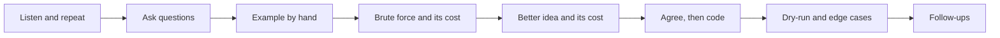

### Questions to ask before you code

- **Input size?** "How big can n be?" 1,000 means O(n²) is fine. 1 million means you need O(n log n) or O(n).
- **Empty or null?** "Can the array be empty? Can the string be null?"
- **Values?** "Negative numbers? Duplicates? Only lowercase letters?"
- **Output?** "Return indexes or values? Any order? What if there is no answer?"
- **Sorted?** "Is the input sorted?" Sorted input almost always means two pointers or binary search.
- **Memory?** "Can I change the input array? Is extra memory okay?"

### How to talk while coding

Phrases you can use as they are:

- "Let me first make sure I understand. The input is..., the output is..."
- "The brute force is... It costs O(n²). Let me see if I can do better."
- "I notice the array is sorted, so I am thinking about two pointers."
- "I will write a helper method for this part, so the main logic stays clear."
- "I am using a `Deque` here as a stack, because `Stack` is an old synchronized class."
- "Now let me dry-run this with the example."
- "One edge case is an empty array. My loop does not run, and I return 0. Good."
- "The time is O(n) because each element enters and leaves the window once."

### What to do when you are stuck

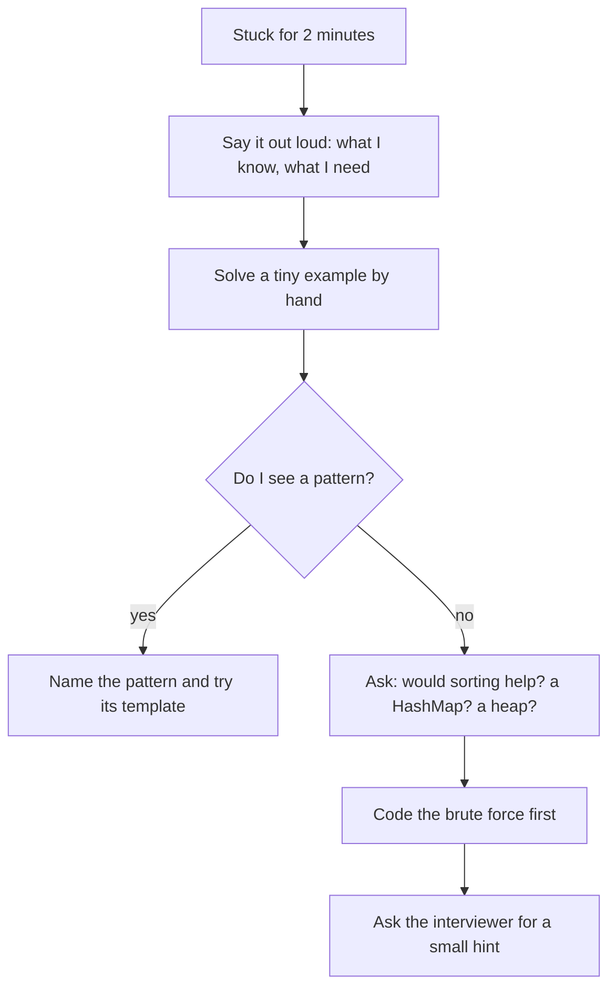

- **Say what you are thinking.** "I am trying to avoid the inner loop. I need a fast way to find the partner." Often the interviewer gives a hint at this moment.
- **Make the example smaller.** Solve it for 3 items on paper. Watch what you do with your hands.
- **Go through the toolbox.** Sort it? HashMap? Two pointers? Heap? BFS? DP? One of them usually fits.
- **Write the brute force.** Working code gives you points. Then improve one part.
- **Take the hint well.** "Ah, that helps. So if I keep the minimum so far..." Taking a hint is fine. Ignoring it is not.

### What a senior must show

A junior can pass by solving the problem. A senior is expected to show more:

- **You pick the pattern fast** and say why: "This is a top-K problem, so a heap of size k."
- **You ask about scale and constraints** without being told to.
- **You find edge cases yourself**: empty input, one item, all the same, int overflow, very deep recursion.
- **Your code reads like production code**: clear names, small methods, no magic numbers.
- **You talk about trade-offs**: "The HashMap version is O(n) but uses memory. If memory is tight, sort and use two pointers: O(n log n), O(1) extra."
- **You connect it to real work**: "This is the same idea as an LRU cache in front of a database."

**Say this in the interview:**

> "Before I code, let me ask a few questions about the input: size, empty input, duplicates and negative numbers. I will start with the brute force so we have a correct answer, then improve it. I will tell you the time and space for each version. When I finish, I will dry-run an example and check the edge cases myself."

**They may ask next:**

- **What if you cannot find the best solution?** Code the brute force cleanly, say its cost, and explain where the waste is. That still scores well on communication and coding.
- **Should you write tests?** Yes, if time allows. At least dry-run 1 normal case and 2 edge cases out loud.
- **Can you use library methods like `Collections.sort`?** Usually yes. Ask: "Is it okay if I use the built-in sort?" Be ready to explain its cost.

### Java tips for the coding round

Small Java traps that cost points. This code was run on Java 21:

```java
Integer a = 127, b = 127, c = 1000, d = 1000;
System.out.println(a == b);        // true  (small Integers are cached)
System.out.println(c == d);        // false (two different objects!)
System.out.println(c.equals(d));   // true  (always compare values with equals)

int lo = 2_000_000_000, hi = 2_100_000_000;
System.out.println((lo + hi) / 2);       // negative: int overflow
System.out.println(lo + (hi - lo) / 2);  // 2050000000: safe

Integer[] nums = {Integer.MIN_VALUE, 5, -3};
Arrays.sort(nums, (x, y) -> x - y);                 // BUG: x - y can overflow
System.out.println(Arrays.toString(nums));
Arrays.sort(nums, Integer::compare);                // correct
System.out.println(Arrays.toString(nums));

char ch = 'c';
System.out.println(ch - 'a');            // 2: letter index, good for int[26]
System.out.println((char) ('a' + 2));    // c
```

Output:

```text
true
false
true
-97483648
2050000000
[-3, 5, -2147483648]
[-2147483648, -3, 5]
2
c
```

More tips:

- Use `ArrayDeque` for both stack and queue. Do not use `Stack` (old, synchronized) or `LinkedList` (slower, more memory).
- Use `Integer.compare(a, b)` or `Comparator.comparingInt(...)`. Never `a - b` in a comparator.
- `list.getLast()` and `list.removeLast()` are new in Java 21 (sequenced collections).
- Use `long` when you multiply or add big numbers. `Math.addExact` throws on overflow instead of giving a wrong answer.
- `-7 % 3` is `-1` in Java. Use `Math.floorMod(-7, 3)` when you need `2`.
- Recursion more than about 10,000 levels deep can throw `StackOverflowError`. The exact limit depends on the stack size (`-Xss`). Use a loop with your own stack for very deep input.

---

## Big-O in simple words

**In one line:** Big-O tells you how the work grows when the input grows. It ignores small details and keeps the biggest part.

**Story:** You need to find a friend's phone number.

- **O(1):** It is saved on speed dial. One press, whatever the size of your phone book.
- **O(log n):** You open a paper phone book in the middle, then the half where the name is, then the half of that half. 1 million names take only about 20 looks.
- **O(n):** The names are in a random pile. You check them one by one. Double the pile, double the time.
- **O(n log n):** You first sort the whole pile, then search. Sorting is the slow part.
- **O(n²):** For every person, you call every other person to ask if they know the number.
- **O(2ⁿ):** You try every possible group of friends. Add one friend and the work doubles.

### Common complexities

| Big-O | Name | Real example | Steps for n = 1,000,000 |
|---|---|---|---|
| O(1) | constant | `HashMap.get`, array `arr[i]` | 1 |
| O(log n) | logarithmic | binary search, `TreeMap.get`, heap `offer` | about 20 |
| O(n) | linear | one loop over an array, `list.contains` | 1,000,000 |
| O(n log n) | n log n | `Arrays.sort`, merge sort | about 20,000,000 |
| O(n²) | quadratic | two nested loops over the same array | 10¹² (too slow) |
| O(2ⁿ) | exponential | all subsets | impossible beyond n ≈ 25 |
| O(n!) | factorial | all permutations | impossible beyond n ≈ 11 |

### What does the input size tell you?

A simple rule: Java does roughly 10⁷ to 10⁸ simple steps in one second. So the input size tells you which complexity you need.

| If n is up to | You can use | Typical idea |
|---|---|---|
| 10 | O(n!) | try all permutations |
| 20 | O(2ⁿ) | try all subsets, backtracking |
| 500 | O(n³) | three loops, small DP |
| 5,000 | O(n²) | two loops, 2D DP |
| 1,000,000 | O(n log n) or O(n) | sort, heap, HashMap, two pointers |
| bigger than that | O(log n) or O(1) | binary search, math formula |

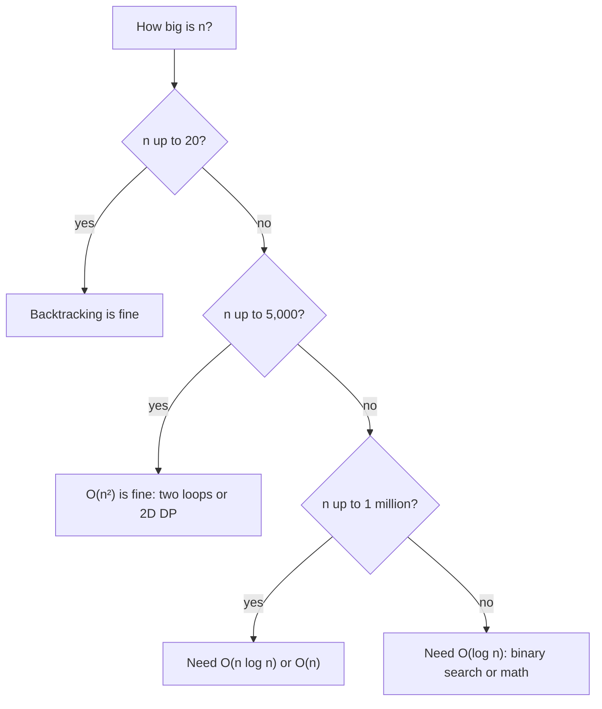

### How to compute Big-O from code

1. **One loop over n items** is O(n).
2. **A loop inside a loop** (both over n) is O(n × n) = O(n²).
3. **Loops one after another** add up: O(n) + O(n) = O(2n) = O(n). Drop the constant.
4. **A loop that halves** the range each time (`i = i / 2`, binary search) is O(log n).
5. **Different inputs keep different letters.** A loop over `a` and a loop over `b` inside it is O(a × b), not O(n²).
6. **Recursion:** count the calls × the work in each call. Fibonacci without memo makes about 2ⁿ calls. Merge sort makes log n levels with O(n) work each, so O(n log n).
7. **Keep only the biggest part.** O(n² + n + 100) is O(n²).

```java
for (int i = 0; i < n; i++)          // n times
    for (int j = i + 1; j < n; j++)  // n-1, n-2, ... 1 times
        check(i, j);                 // total n(n-1)/2 -> O(n²)

for (int i = 1; i < n; i *= 2)       // 1, 2, 4, 8 ... -> log n times
    work();                          // O(log n)
```

A common trap: a loop with an inner `while` is not always O(n²). In the sliding window, the left pointer only moves forward. Over the whole run it moves at most n times. So the total is O(n + n) = O(n).

### Space complexity

Space is the **extra** memory your code uses, not the input itself.

- A few variables: O(1).
- A HashMap or an array of size n: O(n).
- A 2D DP table of m × n: O(m × n).
- **Recursion uses the call stack.** Depth d means O(d) space. A balanced tree has depth log n. A tree shaped like a line has depth n.

### Amortized cost

**Amortized** means "the average cost per operation over many operations".

Story: you pay rent once a month, but it is like paying a small amount every day.

`ArrayList.add` is usually O(1). When the inside array is full, Java makes a new array about 1.5 times bigger and copies everything. That one `add` is O(n). But it happens rarely, so the cost per `add`, averaged over all adds, is still O(1). That is "amortized O(1)".

The sliding window and the monotonic stack are also amortized: each item is pushed once and popped once, so the total is O(n).

### Cheat sheet: data structure operations in Java

| Structure | Java class | Get / peek | Search | Insert | Delete | Remember |
|---|---|---|---|---|---|---|
| Array | `int[]` | O(1) by index | O(n), O(log n) if sorted | — (fixed size) | — | Fastest, fixed size |
| Dynamic array | `ArrayList` | O(1) by index | O(n) | O(1) amortized at end, O(n) in middle | O(n) in middle | Default list |
| Linked list | `LinkedList` | O(n) by index | O(n) | O(1) at ends | O(1) at ends | Rarely the best choice |
| Hash table | `HashMap`, `HashSet` | O(1) average | O(1) average | O(1) average | O(1) average | No order. Worst case O(log n) since Java 8 |
| Sorted map | `TreeMap`, `TreeSet` | O(log n) | O(log n) | O(log n) | O(log n) | Sorted, has `floorKey`, `ceilingKey` |
| Heap | `PriorityQueue` | O(1) peek | O(n) | O(log n) | O(log n) poll, O(n) remove(x) | Smallest on top by default |
| Deque | `ArrayDeque` | O(1) both ends | O(n) | O(1) both ends | O(1) both ends | Stack and queue |
| Trie | your own class | — | O(L), L = word length | O(L) | O(L) | Prefix search |
| Union-find | your own class | — | find ≈ O(1) | union ≈ O(1) | — | "Almost constant" with path compression |

Sorting in Java: `Arrays.sort(int[])` uses dual-pivot quicksort, O(n log n) on average. `Arrays.sort(Object[])` and `Collections.sort` use TimSort: O(n log n) worst case and **stable** (equal items keep their order).

**Say this in the interview:**

> "Big-O shows how the work grows with the input. I count the loops: one loop is O(n), a nested loop is O(n²), halving is O(log n). I drop constants and keep the biggest part. For space I count the extra memory, including the recursion stack. Some operations, like ArrayList add, are amortized O(1): rarely slow, but cheap on average."

**They may ask next:**

- **Is O(1) always faster than O(n)?** No. Big-O ignores constants. For 10 items, a simple loop can beat a HashMap.
- **Why is HashMap O(1) only on average?** Many keys can land in the same bucket. Since Java 8, a big bucket becomes a small tree, so the worst case is O(log n), not O(n). More in [Java core](java-core.md).
- **What is the best possible time for sorting with comparisons?** O(n log n). Counting sort can be O(n) when values are small integers.

### Sorting in short

You rarely write a sort in an interview, but you must know the costs and be able to write merge sort.

| Sort | Time (average / worst) | Extra space | Stable? | Notes |
|---|---|---|---|---|
| Bubble, insertion, selection | O(n²) / O(n²) | O(1) | insertion: yes | Insertion sort is fast on small or almost sorted input |
| Merge sort | O(n log n) / O(n log n) | O(n) | yes | Divide and conquer. Good for linked lists and external sorting |
| Quick sort | O(n log n) / O(n²) | O(log n) | no | Fast in practice. A bad pivot gives O(n²) |
| Heap sort | O(n log n) / O(n log n) | O(1) | no | Rarely used directly |
| Counting / radix sort | O(n + k) | O(n + k) | yes | Only for small integer keys (k = range of values) |
| TimSort (Java objects) | O(n log n) / O(n log n) | O(n) | yes | Merge sort + insertion sort, very fast on partly sorted data |

**Merge sort** (split in half, sort each half, merge the two sorted halves):

```java
static void mergeSort(int[] a, int lo, int hi) {         // sorts a[lo..hi)
    if (hi - lo < 2) return;                             // 0 or 1 item: already sorted
    int mid = (lo + hi) >>> 1;
    mergeSort(a, lo, mid);                               // divide
    mergeSort(a, mid, hi);
    int[] tmp = new int[hi - lo];                        // combine
    int i = lo, j = mid, k = 0;
    while (i < mid && j < hi) tmp[k++] = a[i] <= a[j] ? a[i++] : a[j++]; // <= keeps it stable
    while (i < mid) tmp[k++] = a[i++];
    while (j < hi) tmp[k++] = a[j++];
    System.arraycopy(tmp, 0, a, lo, tmp.length);
}
```

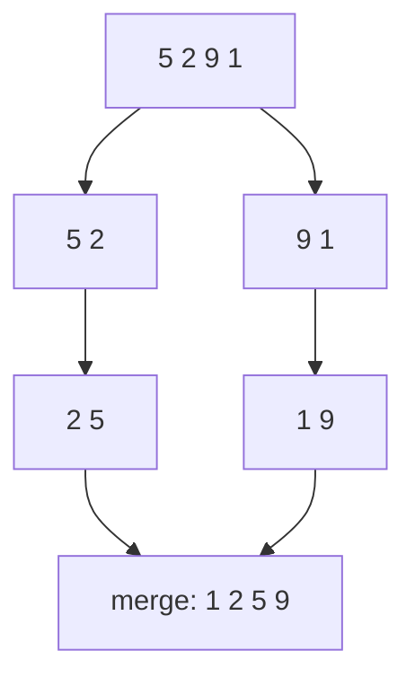

There are log n levels of splitting, and each level does O(n) work to merge. So O(n log n). The `tmp` array makes the space O(n).

Real output of the helpers in this section and the [README answers](#questions-from-the-readme-list) (`R.java`):

```text
gcd(48,18)=6 gcd(0,5)=5 gcd(-12,8)=4 lcm(4,6)=12
-7=false 0=false 1=false 2=true 3=true 4=false 17=true 25=false 97=true 1000000007=true
2^10 mod 1000=24 3^0 mod 7=1 2^62 mod 1e9+7=145586002
naive: 6 2 0 -1
mergeSort: [-3, 1, 2, 5, 5, 6, 9] []
binarySearch: 5 -1 -1
sumOfDigits(98765)=35 sumOfDigits(7)=7
addExact: integer overflow
Integer.MAX_VALUE + 1 = -2147483648  (silent overflow)
7 / 2 = 3, -7 / 2 = -3, -7 % 3 = -1, Math.floorMod(-7, 3) = 2
```

---

## Data structures you must know

**In one line:** Pick the data structure by the operation you do most often: find by key, keep sorted, get the smallest, or take the newest or the oldest.

**Story:** A kitchen. Spices you grab by name sit in a labelled rack (HashMap). Plates sit in a pile and you take the top one (stack). Orders wait in a line (queue). The most urgent order goes first (heap). The right container makes every step fast.

This section is short on purpose. For how `HashMap`, `ArrayList` and `TreeMap` work inside, read [Java core and collections](java-core.md). Here we care about **when to pick which one** in a coding round.

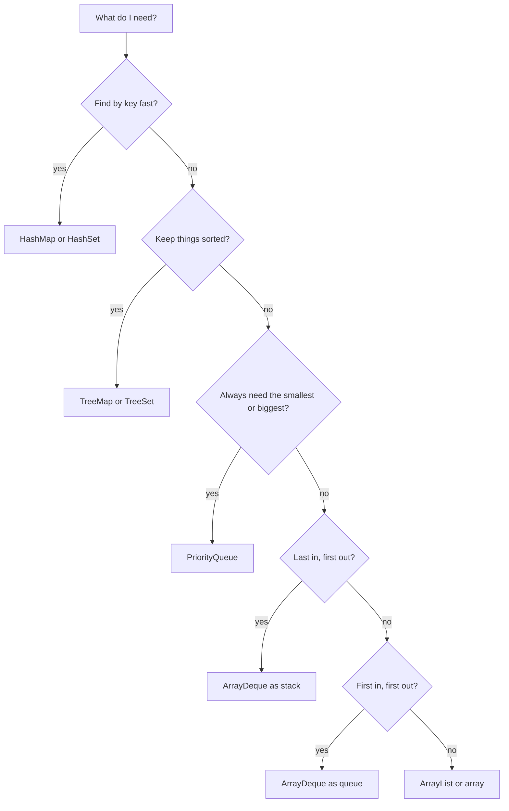

**Say this in the interview:**

> "I choose the data structure from the operation I need most. HashMap for lookup by key, TreeMap when I need order or floor and ceiling, PriorityQueue for the smallest or biggest, ArrayDeque for stack and queue. Then I say the cost of each operation, because that decides the total complexity."

### Arrays and strings

**In one line:** An array is a row of boxes next to each other in memory, so you can jump to any box by its number in O(1).

**Story:** Seats in a cinema row. Seat 7 is always 7 seats from the start. You walk straight to it. But to add a new seat in the middle, everyone must shift.

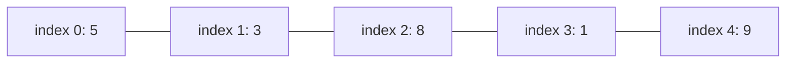

**When to use:** almost every problem starts here. Use `int[]` when the size is fixed, `ArrayList` when it grows.

**Strings in Java** are immutable (cannot change). `s + "x"` in a loop builds a new string every time: O(n²) total. Use `StringBuilder`. To change letters, use `char[]`.

```java
int[] arr = {5, 3, 8, 1};
Arrays.sort(arr);                                  // [1, 3, 5, 8]
int idx = Arrays.binarySearch(arr, 5);             // 2 (array must be sorted)
int[][] grid = new int[3][4];                      // 3 rows, 4 columns, all 0
Integer[] boxed = {5, 3, 8};
Arrays.sort(boxed, Comparator.reverseOrder());     // custom order needs Integer[], not int[]
List<Integer> list = new ArrayList<>(List.of(4, 2));
Collections.sort(list);                            // [2, 4]
```

```java
String s = "racecar";
char[] chars = s.toCharArray();            // change letters in an array, not a String
StringBuilder sb = new StringBuilder();    // build strings in a loop with this
for (char c : chars) sb.append(Character.toUpperCase(c));
boolean isPal = sb.reverse().toString().equalsIgnoreCase(s);
int[] freq = new int[26];
for (char c : chars) freq[c - 'a']++;      // count letters with an int[26]
```

**Key operations:** read/write by index O(1), insert/delete in the middle O(n), sort O(n log n), binary search on sorted O(log n).

**Say this in the interview:**

> "Arrays give O(1) access by index because the items sit next to each other in memory. Inserting in the middle is O(n) because items shift. For strings I use StringBuilder in loops, because Java strings are immutable and concatenation in a loop is O(n²)."

### Hashing (HashMap and HashSet)

**In one line:** A HashMap turns a key into a bucket number, so you can store and find a value in O(1) on average.

**Story:** A hotel key rack. Room 304's key always hangs on hook 304. You do not search all hooks. The "hash function" is the rule "room number → hook number".

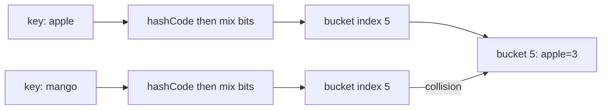

**When to use:** "Have I seen this before?", counting, grouping, finding a partner (Two Sum), caching results (memo).

```java
Map<String, Integer> count = new HashMap<>();
for (String w : "to be or not to be".split(" "))
    count.merge(w, 1, Integer::sum);                 // add 1, or start at 1
int notSeen = count.getOrDefault("hello", 0);       // 0, no null check needed
Map<String, List<String>> groups = new HashMap<>();
groups.computeIfAbsent("fruit", k -> new ArrayList<>()).add("apple"); // create list once
```

**Key operations:** `put`, `get`, `containsKey`, `remove` are O(1) average. `merge`, `getOrDefault` and `computeIfAbsent` make counting and grouping one line. `HashSet.add` returns `false` if the item is already there.

Traps: keys must have correct `equals` and `hashCode` (records do this for you). Never change a key after you put it in. The inside of HashMap is in [Java core](java-core.md).

**Say this in the interview:**

> "I use a HashMap when I need to find something by key fast: counting, grouping, or 'have I seen this'. It is O(1) on average. Keys need good equals and hashCode, so I use strings, numbers or records as keys. It trades memory for speed."

### Stack

**In one line:** A stack is last in, first out (LIFO): you only add and remove at the top.

**Story:** A pile of plates at a wedding buffet. You take the top plate. The waiter puts clean plates on top.

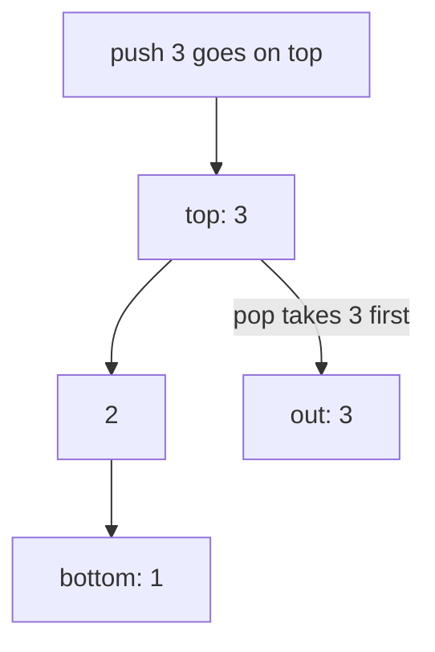

**When to use:** matching brackets, "undo", the most recent unmatched item, next greater element (monotonic stack), turning recursion into a loop (DFS).

**Java class:** `Deque<Integer> stack = new ArrayDeque<>();` Not `Stack`.

```java
Deque<Integer> stack = new ArrayDeque<>();   // use this, not the old Stack class
stack.push(1); stack.push(2); stack.push(3); // top is 3
int top = stack.peek();                      // 3, does not remove
int popped = stack.pop();                    // 3, removes
```

**Key operations:** `push`, `pop`, `peek` are all O(1). Check `isEmpty()` before `pop()`: `ArrayDeque.pop()` on an empty deque throws `NoSuchElementException`.

**Say this in the interview:**

> "A stack is last in, first out. I use it for matching brackets, undo, and 'next greater element' problems. In Java I use ArrayDeque with push, pop and peek, which are all O(1). I avoid the old Stack class because it is synchronized and extends Vector."

### Queue and deque

**In one line:** A queue is first in, first out (FIFO). A deque (double-ended queue) lets you add and remove at both ends.

**Story:** The ticket line at a railway counter. The first person in line gets served first. A deque is a line where VIP staff can also join or leave from the front.

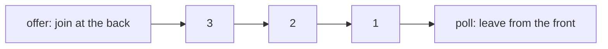

**When to use:** BFS (breadth-first search), processing tasks in order, sliding window maximum (deque).

```java
Deque<Integer> queue = new ArrayDeque<>();
queue.offer(1); queue.offer(2); queue.offer(3); // add at the back
int first = queue.poll();                       // 1, take from the front
queue.offerFirst(0);                            // deque: add at the front too
int last = queue.pollLast();                    // 3, take from the back
```

**Key operations:** `offer`, `poll`, `peek` are O(1). Deque adds `offerFirst`, `offerLast`, `pollFirst`, `pollLast`. `poll()` on an empty queue returns `null`, it does not throw.

**Say this in the interview:**

> "A queue is first in, first out. I use it for BFS, where I visit things level by level. In Java I use ArrayDeque for both queue and stack. It is faster than LinkedList and all operations at the ends are O(1)."

### Linked list

**In one line:** A linked list is a chain of nodes. Each node holds a value and a pointer (link) to the next node.

**Story:** A treasure hunt. Each clue tells you where the next clue is. To reach clue 10, you must follow clues 1 to 9. But adding a new clue in the middle is easy: change one note.

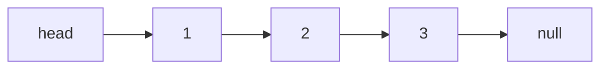

```java
static class ListNode {
    int val; ListNode next;
    ListNode(int val, ListNode next) { this.val = val; this.next = next; }
}
```

**When to use:** interview problems about reversing, merging and cycles. In real Java code, `ArrayList` or `ArrayDeque` is almost always faster because their items sit together in memory (better CPU cache use).

**Key operations:** insert/delete when you already have the node: O(1). Find by index or value: O(n).

**Tricks you need:** a **dummy head** node (removes "is the list empty?" special cases), **two pointers** (fast and slow), and **save `next` before you change a link**.

**Say this in the interview:**

> "A linked list is nodes connected by pointers. Insert and delete are O(1) when I already have the node, but finding a node is O(n). In linked list problems I use a dummy head to avoid special cases, and I always save next before I change a pointer."

### Trees and BST

**In one line:** A tree is nodes with children and no loops. A binary search tree (BST) keeps smaller values on the left and bigger values on the right.

**Story:** A family tree, or the folder structure on your laptop. A BST is like a "guess the number" game: is it smaller or bigger than 50? Each answer throws away half.

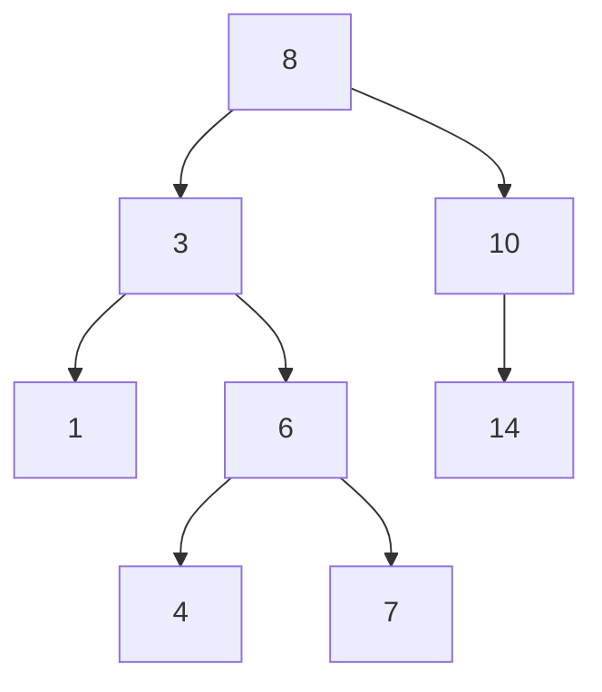

```java
static class TreeNode {
    int val; TreeNode left, right;
    TreeNode(int val) { this.val = val; }
}
```

**Words:** *root* (top node), *leaf* (no children), *height* (longest path from root to a leaf), *balanced* (left and right heights are close, so height is about log n).

**Four ways to walk a tree:**

| Walk | Order | Use it for |
|---|---|---|
| Preorder | me, left, right | copy or serialize a tree |
| Inorder | left, me, right | a BST in sorted order |
| Postorder | left, right, me | heights, delete a tree, "answer from children" |
| Level order (BFS) | level by level | right side view, shortest depth |

**Key operations (BST):** search, insert, delete are O(height): O(log n) when balanced, O(n) when it becomes a line. Java's `TreeMap` is a red-black tree, which stays balanced, so it is always O(log n).

**Say this in the interview:**

> "A tree is a set of nodes with children and no cycles. In a BST, left is smaller and right is bigger, so search is O(height). If the tree is balanced, that is O(log n). Java's TreeMap is a self-balancing red-black tree. Most tree problems are recursion: get the answer from the left and right child, then combine."

### Heap and priority queue

**In one line:** A heap always gives you the smallest (or biggest) item in O(1) and adds or removes items in O(log n).

**Story:** A hospital emergency room. Patients do not get treated in arrival order. The most serious patient goes first. When a new patient comes, the nurse puts them in the right place in the line quickly.

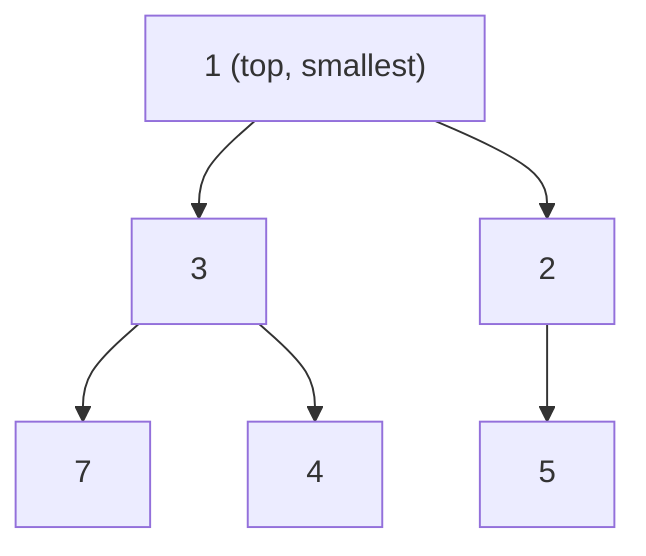

A min-heap is a complete binary tree where each parent is smaller than its children. It is stored in an array: the children of index `i` are at `2i + 1` and `2i + 2`.

```java
PriorityQueue<Integer> minHeap = new PriorityQueue<>();                          // smallest on top
PriorityQueue<Integer> maxHeap = new PriorityQueue<>(Comparator.reverseOrder()); // biggest on top
for (int n : new int[]{5, 1, 8, 3}) { minHeap.offer(n); maxHeap.offer(n); }
// minHeap.peek() = 1, maxHeap.peek() = 8
record Task(String name, int priority) {}
PriorityQueue<Task> tasks = new PriorityQueue<>(Comparator.comparingInt(Task::priority));
```

**When to use:** top K, Kth largest, merge K sorted lists, scheduling, Dijkstra (shortest path with weights), running median (two heaps).

**Key operations:** `peek` O(1), `offer` O(log n), `poll` O(log n), `remove(Object)` O(n), building from a collection O(n). Iterating a `PriorityQueue` does **not** give sorted order. Only `poll` does.

**Say this in the interview:**

> "A heap gives me the smallest item in O(1) and add or remove in O(log n). In Java it is PriorityQueue, a min-heap by default. For top K largest I keep a min-heap of size k, so the cost is O(n log k), not O(n log n)."

### Graphs (representations)

**In one line:** A graph is a set of nodes (vertices) joined by edges. Trees, maps, social networks and course prerequisites are all graphs.

**Story:** A metro map. Stations are nodes. Tracks between stations are edges. A one-way street is a *directed* edge. A toll on the road is a *weight*.

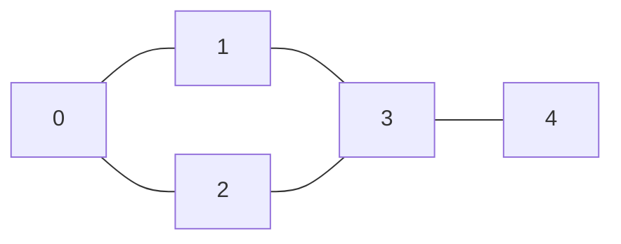

Three ways to store a graph:

| Way | Java | Space | Good for |
|---|---|---|---|
| Adjacency list | `List<List<Integer>>` | O(V + E) | almost always: sparse graphs |
| Adjacency matrix | `boolean[][]` | O(V²) | small, dense graphs, "is there an edge?" in O(1) |
| Edge list | `int[][] edges` | O(E) | union-find, sorting edges (Kruskal) |

A **grid** is also a graph. Each cell is a node. Its 4 neighbours (up, down, left, right) are its edges. You do not need to build anything.

```java
int n = 4;
int[][] edges = {{0, 1}, {0, 2}, {1, 3}};
List<List<Integer>> graph = new ArrayList<>();
for (int i = 0; i < n; i++) graph.add(new ArrayList<>());
for (int[] e : edges) {
    graph.get(e[0]).add(e[1]);
    graph.get(e[1]).add(e[0]);   // remove this line for a directed graph
}
```

**Key operations:** BFS and DFS visit every node and edge once: O(V + E). Always keep a `visited` set, or you loop forever on cycles.

**Say this in the interview:**

> "I store a graph as an adjacency list, a list of neighbours for each node. It uses O(V + E) space. A grid is a graph too, with 4 neighbours per cell. For BFS or DFS I keep a visited set so I do not loop on cycles, and both run in O(V + E)."

### Trie

**In one line:** A trie (say "try") is a tree of letters. Words that share a beginning share the same path.

**Story:** The search box on a shopping site. You type "ip" and it shows "iphone", "ipad", "ipod". All three start on the same path i → p.

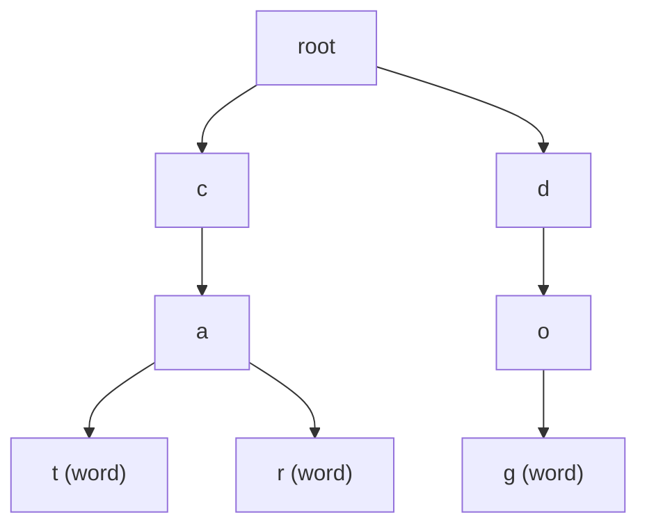

**When to use:** autocomplete, "starts with" questions, word search in a grid with many words, spell check.

**Java class:** none built in. Write a `Node` with `Node[26]` (or a `HashMap<Character, Node>` for any characters) and a `boolean isWord`. See [problem 47](#47-implement-trie).

**Key operations:** insert, search, startsWith are all O(L), where L is the word length. It does not depend on how many words are stored.

**Say this in the interview:**

> "A trie stores words letter by letter, so words with the same prefix share nodes. Insert and search cost O(length of the word), whatever the number of words. I use it for autocomplete and prefix search. The cost is memory: each node can have 26 child pointers."

### Union-find (disjoint set)

**In one line:** Union-find keeps track of groups. It answers "are these two in the same group?" and "join these two groups" in almost O(1).

**Story:** Friend circles at a new college. Each circle has one leader. To check if two people are in the same circle, ask each person "who is your leader?" If the leaders match, they are in the same circle. When two circles become friends, one leader agrees to follow the other.

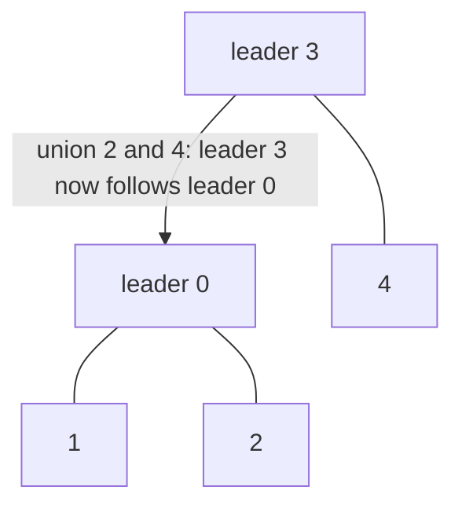

**When to use:** number of connected groups, "does this edge make a cycle?", Kruskal's minimum spanning tree, accounts merge.

**Java class:** none built in. Write it yourself, it is about 20 lines. See [Pattern 14](#pattern-14-union-find).

**Key operations:** `find` and `union` are almost O(1) when you use **path compression** and **union by size**. The exact cost is O(α(n)). α grows so slowly that it stays below 5 for any real input.

**Say this in the interview:**

> "Union-find keeps groups. Each item points to a parent, and the root is the group leader. find follows parents to the root, union joins two roots. With path compression and union by size, both are almost O(1). I use it for connected components and cycle checks in undirected graphs."

---

## The 16 patterns

Most coding round problems are one of about 16 patterns in a new costume. If you can name the pattern, you already have half the answer.

**In one line:** A pattern is a known shape of solution. You spot it from signals in the problem, then fill in its template.

**Story:** A doctor does not invent medicine for every patient. They see the signs (fever, cough, rash), name the illness, and use the known treatment. Signals in the problem are the signs. The pattern is the illness. The template is the treatment.

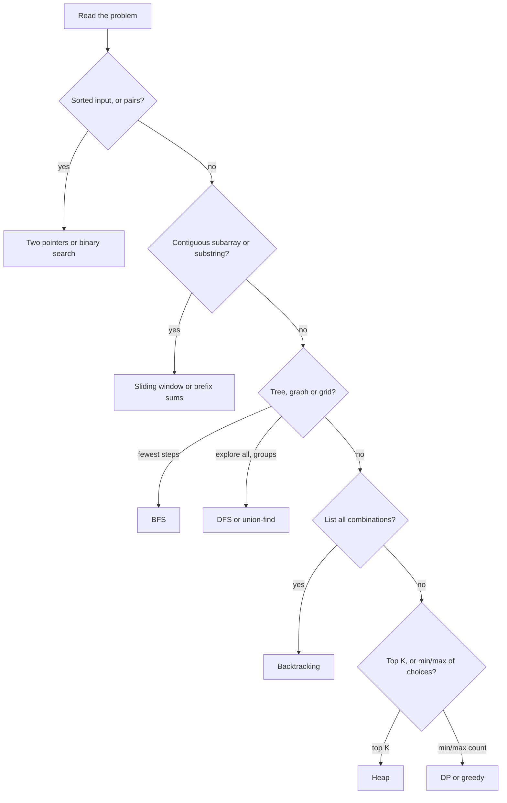

Quick signal table:

| If the problem says... | Think of |
|---|---|
| sorted array, pair, triple, palindrome | two pointers |
| longest / shortest substring or subarray with a rule | sliding window |
| sum of a range, subarray sum equals k | prefix sums |
| "seen before", count, anagram, duplicate | hashing |
| sorted, "find the minimum X that works" | binary search |
| linked list cycle, middle of list | fast and slow pointers |
| next greater, previous smaller, temperatures | monotonic stack |
| top K, Kth largest, merge K things | heap |
| intervals, meetings, overlapping ranges | sort + merge intervals |
| shortest path in steps, levels, spreading | BFS |
| all subsets, permutations, combinations | backtracking |
| prerequisites, build order, dependencies | topological sort |
| groups, connected, "same set" | union-find |
| count ways, min cost, max profit with choices | dynamic programming |
| "pick the best local choice" works | greedy |

**Say this in the interview:**

> "First I look for signals. Sorted input suggests two pointers or binary search. A substring with a rule suggests a sliding window. Fewest steps suggests BFS, all combinations suggests backtracking, and count or min with choices suggests DP. I name the pattern, say the brute force, then use the pattern to improve it."

### Pattern 1: Two pointers

**In one line:** Two indexes walk the array, from both ends toward each other or in the same direction, so you avoid a nested loop.

**Story:** Two people search a long bookshelf for two books whose prices add to ₹500. The books are sorted by price. One starts at the cheap end, one at the costly end. If the total is too high, the costly one steps left. Too low, the cheap one steps right.

**How to spot it:**

- The array is **sorted**, or you are allowed to sort it.
- You need a **pair or triple** with a sum, or to compare both ends (palindrome).
- You must change the array **in place** with O(1) extra memory (remove duplicates, move zeros).

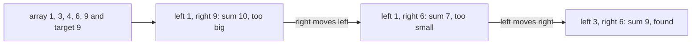

**Template:**

```java
// A) Opposite ends: sorted array, find a pair with this sum
static boolean hasPairWithSum(int[] sorted, int target) {
    int left = 0, right = sorted.length - 1;
    while (left < right) {
        int sum = sorted[left] + sorted[right];
        if (sum == target) return true;
        if (sum < target) left++;          // need bigger: move left up
        else right--;                      // need smaller: move right down
    }
    return false;
}

// B) Same direction: remove duplicates in place, return new length
static int removeDuplicates(int[] sorted) {
    if (sorted.length == 0) return 0;
    int write = 1;                         // next free slot
    for (int read = 1; read < sorted.length; read++)
        if (sorted[read] != sorted[write - 1]) sorted[write++] = sorted[read];
    return write;
}
```

Output for `hasPairWithSum([1,3,4,6,9], 10)`, `([1,2], 10)`, `([], 0)` and `removeDuplicates([1,1,2,3,3,3,4])`:

```text
true false false
4 [1, 2, 3, 4]
```

**Why it works:** when the sum is too small, the left number cannot be part of any answer with any smaller right number. So we drop it safely. Each step drops one item: O(n) total.

**Classic problems:** [9. Container With Most Water](#9-container-with-most-water), [10. 3Sum](#10-3sum), valid palindrome, move zeros, sort colors.

**Say this in the interview:**

> "The array is sorted, so I use two pointers from both ends. If the sum is too small I move the left pointer right; if it is too big I move the right pointer left. Each step throws away one element for good, so it is O(n) time and O(1) space, instead of O(n²) for all pairs."

### Pattern 2: Sliding window

**In one line:** Keep a window (a range `left..right`) over the array. Grow it on the right, shrink it on the left, and update the answer, so each item is touched at most twice.

**Story:** You look at a long train through a window. You see 3 coaches at a time. When the train moves, one new coach comes in on the right and one leaves on the left. You never count all 3 again. You add one and remove one.

**How to spot it:**

- The words **contiguous subarray** or **substring**.
- "Longest / shortest / maximum sum ... **with some rule**" (at most k distinct, no repeats, sum ≥ target).
- Fixed size k: "maximum sum of k consecutive items".

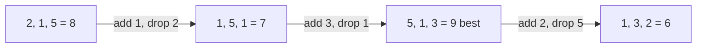

**Template A, fixed size k:**

```java
static int maxSumOfK(int[] nums, int k) {
    int window = 0;
    for (int i = 0; i < k; i++) window += nums[i];   // first window
    int best = window;
    for (int right = k; right < nums.length; right++) {
        window += nums[right] - nums[right - k];     // add new, remove old
        best = Math.max(best, window);
    }
    return best;
}
```

**Template B, variable size** (grow, shrink while broken, record):

```java
static int longestWithAtMostKDistinct(String s, int k) {
    Map<Character, Integer> count = new HashMap<>();
    int left = 0, best = 0;
    for (int right = 0; right < s.length(); right++) {
        count.merge(s.charAt(right), 1, Integer::sum);   // 1. grow: take right
        while (count.size() > k) {                       // 2. broken? shrink from left
            char out = s.charAt(left++);
            if (count.merge(out, -1, Integer::sum) == 0) count.remove(out);
        }
        best = Math.max(best, right - left + 1);         // 3. window is valid: record
    }
    return best;
}
```

Output (`maxSumOfK([2,1,5,1,3,2], 3)`, `([-1,-2,-3], 2)`, then `"eceba"` k=2, `"aa"` k=1, `""` k=2, `"abc"` k=0):

```text
9 -3
3 2 0 0
```

**Why it is O(n):** `right` moves n times. `left` also moves at most n times in total, never back. So 2n steps, not n².

Watch out: the variable window works when shrinking always makes the window "more valid". With **negative numbers** and a sum rule, that is false. Use prefix sums instead.

**Classic problems:** [6. Longest Substring Without Repeating Characters](#6-longest-substring-without-repeating-characters), [7. Minimum Window Substring](#7-minimum-window-substring), max sum of k items, longest repeating character replacement, permutation in string.

**Say this in the interview:**

> "This asks for the longest substring with a rule, so I use a sliding window. I grow the right side, and while the window breaks the rule I shrink from the left. Then I record the size. Each index enters and leaves once, so it is O(n), with a map or an int array for the counts."

### Pattern 3: Prefix sums

**In one line:** Store running totals once, then get the sum of any range with one subtraction.

**Story:** Your bank passbook shows the balance after each day. To know how much you spent from day 3 to day 7, you do not add five days. You subtract: balance on day 2 minus balance on day 7.

**How to spot it:**

- Many "sum from i to j" questions.
- "Number of subarrays with sum equal to k" (works with negative numbers too).
- 2D version: sum of a rectangle in a matrix.

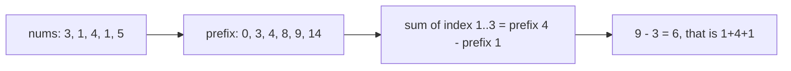

**Template:**

```java
static int[] buildPrefix(int[] nums) {
    int[] prefix = new int[nums.length + 1];         // prefix[i] = sum of first i items
    for (int i = 0; i < nums.length; i++) prefix[i + 1] = prefix[i] + nums[i];
    return prefix;
}
static int rangeSum(int[] prefix, int from, int to) { // sum of nums[from..to], inclusive
    return prefix[to + 1] - prefix[from];
}
```

**Subarray sum equals k** (prefix sum + HashMap). If the sum so far is `S` and an earlier prefix was `S - k`, the part between them sums to `k`:

```java
static int subarraySum(int[] nums, int k) {
    Map<Integer, Integer> seen = new HashMap<>();    // prefix sum -> how many times
    seen.put(0, 1);                                  // empty prefix
    int sum = 0, count = 0;
    for (int n : nums) {
        sum += n;
        count += seen.getOrDefault(sum - k, 0);      // earlier prefix that leaves exactly k
        seen.merge(sum, 1, Integer::sum);
    }
    return count;
}
```

Output (prefix of `[3,1,4,1,5]` and two range sums; then `subarraySum` for `[1,1,1]` k=2, `[1,2,3]` k=3, `[1,-1,0]` k=0, `[]` k=0):

```text
[0, 3, 4, 8, 9, 14] sum[1..3]=6 sum[0..4]=14
2 2 3 0
```

**Classic problems:** [5. Product of Array Except Self](#5-product-of-array-except-self) (prefix products), subarray sum equals k, range sum query, contiguous array (equal 0s and 1s).

**Say this in the interview:**

> "I build a prefix array once in O(n). Then any range sum is prefix[j+1] minus prefix[i], which is O(1). For 'count subarrays with sum k', I keep a HashMap of prefix sums I have seen. If sum minus k was seen, those subarrays end here. It works with negative numbers, unlike a sliding window."

### Pattern 4: Hashing and counting

**In one line:** Use a HashMap or HashSet (or an `int[26]` for letters) to remember what you have seen or how many times, so lookups are O(1).

**Story:** A wedding guest list at the gate. The guard does not walk through the hall to check if you came in already. He ticks your name in a register and checks it in one look.

**How to spot it:**

- "Duplicate", "seen before", "first unique", "anagram", "frequency".
- You need to find a partner value fast (Two Sum).
- You need to group items by some key (group anagrams).

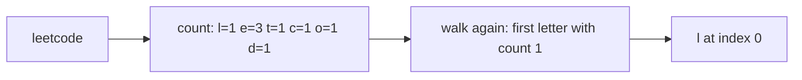

**Template:**

```java
static int firstUniqueChar(String s) {
    Map<Character, Integer> count = new LinkedHashMap<>();   // keeps insert order
    for (char c : s.toCharArray()) count.merge(c, 1, Integer::sum);
    for (int i = 0; i < s.length(); i++)
        if (count.get(s.charAt(i)) == 1) return i;           // first with count 1
    return -1;
}

static boolean containsDuplicate(int[] nums) {
    Set<Integer> seen = new HashSet<>();
    for (int n : nums) if (!seen.add(n)) return true;        // add() is false if present
    return false;
}
```

Output (`"leetcode"`, `"loveleetcode"`, `"aabb"`, `""`; then three duplicate checks):

```text
0 2 -1 -1
true false false
```

**Tip:** for only lowercase letters, `int[26]` is faster and smaller than a `HashMap<Character, Integer>`. Index with `c - 'a'`.

**Classic problems:** [1. Two Sum](#1-two-sum), [2. Valid Anagram](#2-valid-anagram), [3. Group Anagrams](#3-group-anagrams), [4. Top K Frequent Elements](#4-top-k-frequent-elements), longest consecutive sequence.

**Say this in the interview:**

> "I trade memory for speed. A HashSet answers 'have I seen this?' in O(1), and a HashMap counts or groups. So one pass is enough, O(n) time and O(n) space. For lowercase letters only, I use an int array of 26, which is even faster."

### Pattern 5: Binary search (on index and on answer)

**In one line:** Cut the search space in half each step. It works on any range where the answer is "no, no, no, yes, yes, yes".

**Story:** Guess a number from 1 to 100. You say 50. "Too high." You say 25. "Too low." You say 37. In 7 guesses you always win, because each guess throws away half.

**How to spot it:**

- The array is **sorted** (or rotated sorted).
- "Find the **minimum** speed / capacity / days so that X is possible". This is **binary search on the answer**: if speed 5 works, speed 6 also works.
- n is huge (10⁹), so even O(n) is too slow.

```mermaid
flowchart TD
    A["lo = 0, hi = 8, target 23"] --> B["mid = 4: value 16, too small"]
    B --> C["lo = 5"]
    C --> D["mid = 6: value 38, too big"]
    D --> E["hi = 5"]
    E --> F["mid = 5: value 23, found"]
```

**Template A, on an index** (first position where `nums[i] >= target`):

```java
// First index with nums[i] >= target (nums.length if none). Also called "lower bound".
static int lowerBound(int[] nums, int target) {
    int lo = 0, hi = nums.length;          // answer is in [lo, hi]
    while (lo < hi) {
        int mid = lo + (hi - lo) / 2;      // safe from overflow
        if (nums[mid] < target) lo = mid + 1;  // mid is too small: answer is right of it
        else hi = mid;                     // mid could be the answer: keep it
    }
    return lo;
}
```

**Template B, on the answer** (smallest x that works):

```java
// Smallest x in [lo, hi] where ok(x) is true. ok must be false...false, true...true.
static long firstTrue(long lo, long hi, LongPredicate ok) {
    while (lo < hi) {
        long mid = lo + (hi - lo) / 2;
        if (ok.test(mid)) hi = mid;        // works: maybe a smaller one works too
        else lo = mid + 1;                 // fails: need bigger
    }
    return lo;
}

static long floorSqrt(long n) {            // biggest x with x*x <= n
    return firstTrue(0, n + 1, x -> x * x > n) - 1;
}
```

Output (`lowerBound` of 3, 4, 9, 0 in `[1,3,3,5,8]` and in `[]`; then `floorSqrt` of 0, 1, 8, 16, 2147395599):

```text
1 3 5 0 0
0 1 2 4 46339
```

Three rules that stop bugs:

- `mid = lo + (hi - lo) / 2`, so `lo + hi` cannot overflow.
- Decide if `hi` is **inside** the range (`lo <= hi`, `hi = mid - 1`) or **outside** (`lo < hi`, `hi = mid`). Do not mix them.
- Check the loop always shrinks. `lo = mid` with `mid = (lo + hi) / 2` can loop forever.

**Classic problems:** [22. Search in Rotated Sorted Array](#22-search-in-rotated-sorted-array), [23. Search a 2D Matrix](#23-search-a-2d-matrix), [24. Koko Eating Bananas](#24-koko-eating-bananas), first and last position, ship packages within D days.

**Say this in the interview:**

> "The input is sorted, so I binary search: each step halves the range, O(log n). If the question is 'the smallest speed that works', I binary search on the answer: the check function is monotonic, false then true. Total cost is O(n log maxValue). I compute mid as lo plus half the gap to avoid overflow."

### Pattern 6: Fast and slow pointers

**In one line:** Two pointers move through a list at different speeds. If there is a loop, they meet. When the fast one reaches the end, the slow one is in the middle.

**Story:** Two runners on a track, one twice as fast. On a straight road, the fast one just finishes first. On a circular track, the fast one laps the slow one and they meet.

**How to spot it:**

- Linked list **cycle**, or where the cycle starts.
- **Middle** of a linked list, in one pass.
- A sequence of numbers that may repeat (happy number, find the duplicate number).

```mermaid
flowchart LR
    A["1"] --> B["2"] --> C["3"] --> D["4"] --> E["5"]
    E -->|"loop back"| C
    S["slow: 1 step"] -.-> B
    F["fast: 2 steps"] -.-> C
```

**Template:**

```java
static ListNode middle(ListNode head) {
    ListNode slow = head, fast = head;
    while (fast != null && fast.next != null) {
        slow = slow.next;          // 1 step
        fast = fast.next.next;     // 2 steps
    }
    return slow;                   // fast at the end -> slow in the middle
}
```

Output (`[1..5]`, `[1..6]`, `[9]`, `null`):

```text
3 4 9 null
```

For an even length, this returns the **second** middle (4 for 1..6). Start `fast = head.next` if you need the first middle.

**Classic problems:** [17. Linked List Cycle](#17-linked-list-cycle), middle of the list, palindrome linked list (middle + reverse), happy number, find the duplicate number.

**Say this in the interview:**

> "I use a slow pointer that moves one step and a fast pointer that moves two. If there is a cycle, fast catches slow inside it. If not, fast reaches null. When fast ends, slow is at the middle. It is O(n) time and O(1) space, no HashSet needed."

### Pattern 7: Linked list reversal

**In one line:** Walk the list and turn each arrow backwards, using three pointers: previous, current, next.

**Story:** A line of people each pointing at the person in front. To reverse the line, each person turns around and points at the person who was behind. You must remember who was in front before you turn, or you lose the rest of the line.

**How to spot it:**

- "Reverse" a list, or a part of it, or every k nodes.
- Palindrome list (reverse the second half and compare).
- Add two numbers stored in lists (sometimes).

```mermaid
flowchart LR
    S0["start: prev null, cur 1"] --> S1["1 now points to null"]
    S1 --> S2["2 now points to 1"]
    S2 --> S3["3 now points to 2"]
    S3 --> S4["cur is null: return prev, list is 3, 2, 1"]
```

The full reversal is [problem 16](#16-reverse-linked-list). This template reverses only a part (`left..right`), a common follow-up:

```java
// Reverse only positions left..right (1-based). Example: 1-2-3-4-5, 2, 4 -> 1-4-3-2-5
static ListNode reverseBetween(ListNode head, int left, int right) {
    ListNode dummy = new ListNode(0, head), before = dummy;
    for (int i = 1; i < left; i++) before = before.next;   // node just before the part
    ListNode cur = before.next;
    for (int i = 0; i < right - left; i++) {               // move next node to the front
        ListNode move = cur.next;
        cur.next = move.next;
        move.next = before.next;
        before.next = move;
    }
    return dummy.next;
}
```

Output (`1..5` with 2,4; `[5]` with 1,1; `1..3` with 1,3):

```text
[1, 4, 3, 2, 5] [5] [3, 2, 1]
```

**Classic problems:** [16. Reverse Linked List](#16-reverse-linked-list), reverse between, reverse nodes in k-group, palindrome linked list, reorder list.

**Say this in the interview:**

> "I reverse with three pointers. I save next, point current back to previous, then move previous and current one step. It is O(n) time and O(1) space. For partial reversal I use a dummy head, so reversing from the first node is not a special case."

### Pattern 8: Monotonic stack

**In one line:** A stack that is always sorted (only going down, or only going up). When a new item breaks the order, it is the answer for every item it pops.

**Story:** People stand in a line facing right, looking for the first taller person. A short person waits. When a tall person arrives, every shorter person still waiting says "found mine!" and leaves. The waiting people are always in decreasing height: a monotonic stack.

**How to spot it:**

- "Next greater", "next smaller", "previous greater" element.
- "How many days until a warmer day", stock span.
- Largest rectangle in a histogram, trapping rain water.

```mermaid
flowchart LR
    A["see 2: push"] --> B["see 1: push, stack 2,1"]
    B --> C["see 2: pops 1, answer for 1 is 2"]
    C --> D["see 4: pops 2 and 2, answer is 4"]
    D --> E["see 3: push, stack 4,3"]
    E --> F["leftovers 4 and 3: answer -1"]
```

**Template (next greater element):**

```java
static int[] nextGreater(int[] nums) {
    int[] answer = new int[nums.length];
    Arrays.fill(answer, -1);                       // -1 = no greater number to the right
    Deque<Integer> stack = new ArrayDeque<>();     // indexes still waiting, values go down
    for (int i = 0; i < nums.length; i++) {
        while (!stack.isEmpty() && nums[stack.peek()] < nums[i])
            answer[stack.pop()] = nums[i];         // i is the answer for everyone smaller
        stack.push(i);
    }
    return answer;
}
```

Output (`[2,1,2,4,3]`, `[5,4,3]`, `[]`):

```text
[4, 2, 4, -1, -1] [-1, -1, -1] []
```

Store **indexes**, not values, on the stack. Then you can compute distances (like "days to wait") and write into the answer array.

**Classic problems:** [15. Daily Temperatures](#15-daily-temperatures), next greater element, largest rectangle in histogram, stock span, trapping rain water.

**Say this in the interview:**

> "I keep a stack of indexes whose values go down. When a bigger value comes, it is the 'next greater' for everything smaller on the stack, so I pop and fill their answers. Each index is pushed once and popped once, so it is O(n) even though there is a while loop inside the for loop."

### Pattern 9: Heap and top-K

**In one line:** To keep the K biggest items, keep a min-heap of size K. The smallest of your K sits on top, ready to be thrown out.

**Story:** A cricket selector keeps a "top 11" list. When a new player scores well, the selector compares him only with the weakest of the 11. If the new player is better, the weakest one is dropped.

**How to spot it:**

- "Top K", "K most frequent", "K closest", "Kth largest".
- "Merge K sorted" lists or arrays.
- You always need the current smallest or biggest while items keep coming (scheduling, meeting rooms, running median).

```mermaid
flowchart LR
    I["new item"] --> H["min-heap of size k"]
    H --> C{"size bigger than k?"}
    C -->|"yes"| P["poll: drop the smallest"]
    C -->|"no"| K["keep"]
    P --> R["heap holds the k biggest"]
    K --> R
```

**Template (K closest points to the origin):** here we want the K **smallest** distances, so we keep a **max**-heap and throw out the farthest.

```java
static int[][] kClosest(int[][] points, int k) {
    // max-heap by distance: the farthest of our k sits on top, easy to throw out
    PriorityQueue<int[]> heap = new PriorityQueue<>(
        Comparator.comparingInt((int[] p) -> p[0] * p[0] + p[1] * p[1]).reversed());
    for (int[] p : points) {
        heap.offer(p);
        if (heap.size() > k) heap.poll();       // keep only k: O(n log k)
    }
    return heap.toArray(new int[0][]);
}
```

Output (`[[1,3],[-2,2]]` k=1, and `[[3,3],[5,-1],[-2,4]]` k=2, sorted for printing):

```text
[[-2, 2]]
[[-2, 4], [3, 3]]
```

**Rule to remember:** top K **largest** → **min**-heap. Top K **smallest** → **max**-heap. The heap top is the item you throw out.

**Cost:** O(n log k) time and O(k) space. Sorting everything is O(n log n). For k much smaller than n (top 10 of 10 million), the heap wins clearly.

**Classic problems:** [20. Kth Largest Element](#20-kth-largest-element-in-an-array), [21. Merge K Sorted Lists](#21-merge-k-sorted-lists), [4. Top K Frequent Elements](#4-top-k-frequent-elements), [46. Meeting Rooms II](#46-meeting-rooms-ii), find median from data stream.

**Say this in the interview:**

> "For top K largest I keep a min-heap of size k. Each new item goes in, and if the heap grows past k I remove the smallest. At the end the heap has the k largest. That is O(n log k) time and O(k) memory, better than sorting when k is small, and it works on a stream."

### Pattern 10: Merge intervals

**In one line:** Sort intervals by start time. Then walk once: if the next one starts before the current one ends, they overlap.

**Story:** A meeting room calendar. If one meeting is 10:00 to 11:00 and the next is 10:30 to 12:00, they clash. You can merge them into one busy block from 10:00 to 12:00. Sorting by start time makes clashes sit next to each other.

**How to spot it:**

- Input is a list of `[start, end]` pairs.
- "Merge overlapping", "insert an interval", "can a person attend all meetings", "minimum rooms".

```mermaid
flowchart LR
    A["1 to 3"] --> M["merge: 1 to 6"]
    B["2 to 6"] --> M
    C["8 to 10"] --> K["keep: 8 to 10"]
    D["15 to 18"] --> L["keep: 15 to 18"]
```

**Template:**

```java
static boolean canAttendAll(int[][] meetings) {
    Arrays.sort(meetings, Comparator.comparingInt(m -> m[0]));  // 1. sort by start
    for (int i = 1; i < meetings.length; i++)
        if (meetings[i][0] < meetings[i - 1][1]) return false;  // 2. starts before last ends
    return true;
}
// Two intervals [a1,a2] and [b1,b2] overlap when: a1 <= b2 && b1 <= a2
```

Output (`[[0,30],[5,10],[15,20]]`, `[[7,10],[2,4]]`, `[[1,5],[5,8]]`, `[]`):

```text
false true true true
```

Ask: does `[1,5]` and `[5,8]` overlap? For meetings, usually no (one ends as the other starts). For [merge intervals](#11-merge-intervals) on LeetCode, yes. Ask the interviewer.

**Classic problems:** [11. Merge Intervals](#11-merge-intervals), [12. Insert Interval](#12-insert-interval), [46. Meeting Rooms II](#46-meeting-rooms-ii), non-overlapping intervals (see [greedy](#pattern-16-greedy)).

**Say this in the interview:**

> "I sort the intervals by start time, which is O(n log n). Then overlapping ones sit next to each other. I walk once: if the next start is before the current end, I extend the end; otherwise I start a new block. Total O(n log n) time, O(n) for the output."

### Pattern 11: BFS (grid and level order)

**In one line:** Breadth-first search visits things in waves: first all neighbours at distance 1, then distance 2, and so on. The first time you reach a cell is by the shortest path.

**Story:** Drop a stone in a pond. The ripple reaches nearby water first, then farther water, ring by ring. Or news in a village: you tell your neighbours, they tell theirs, and on day 3 everyone 3 houses away knows.

**How to spot it:**

- "**Shortest** path", "**minimum** number of steps / moves / minutes" in an unweighted graph or grid.
- "Level by level" in a tree.
- Spreading from many places at once (rotting oranges, fire, distance to the nearest gate): put all starts in the queue first. This is **multi-source BFS**.

```mermaid
flowchart TD
    S["start: distance 0"] --> A["ring 1: neighbours"]
    S --> B["ring 1: neighbours"]
    A --> C["ring 2"]
    B --> D["ring 2"]
    C --> T["target found at ring 3: shortest"]
```

**Template (grid, fewest steps):**

```java
// Fewest steps from top-left to bottom-right. 0 = open, 1 = wall. -1 if no path.
static int shortestPath(int[][] grid) {
    int rows = grid.length, cols = grid[0].length;
    if (grid[0][0] == 1 || grid[rows - 1][cols - 1] == 1) return -1;
    boolean[][] seen = new boolean[rows][cols];
    Deque<int[]> queue = new ArrayDeque<>();
    queue.offer(new int[]{0, 0});
    seen[0][0] = true;                                  // mark when you ADD, not when you poll
    int[][] dirs = {{1, 0}, {-1, 0}, {0, 1}, {0, -1}};
    for (int steps = 0; !queue.isEmpty(); steps++) {
        for (int size = queue.size(); size > 0; size--) { // one ring of the wave
            int[] cell = queue.poll();
            if (cell[0] == rows - 1 && cell[1] == cols - 1) return steps;
            for (int[] d : dirs) {
                int r = cell[0] + d[0], c = cell[1] + d[1];
                if (r < 0 || c < 0 || r >= rows || c >= cols || grid[r][c] == 1 || seen[r][c]) continue;
                seen[r][c] = true;
                queue.offer(new int[]{r, c});
            }
        }
    }
    return -1;
}
```

Output (path around a wall: 4; blocked: -1; one cell: 0; around a middle wall: 4):

```text
4
-1
0
4
```

Three rules:

- Use a **queue** (`ArrayDeque`), not a stack.
- Mark a cell **visited when you add it** to the queue. If you mark it when you poll it, the same cell enters the queue many times.
- `for (int size = queue.size(); ...)` processes one level at a time. That is how you count steps or build levels.

BFS gives the shortest path only when **every edge costs the same**. With weights, use Dijkstra (a BFS with a `PriorityQueue`).

**Classic problems:** [26. Rotting Oranges](#26-rotting-oranges), [29. Word Ladder](#29-word-ladder), [30. Binary Tree Level Order Traversal](#30-binary-tree-level-order-traversal), shortest path in binary matrix, walls and gates.

**Say this in the interview:**

> "Shortest path with equal step cost means BFS. I put the start in a queue, mark it visited, and process the queue level by level, so the level number is the distance. I mark cells visited when I add them, so each cell enters once. It is O(rows × cols) time and space."

### Pattern 12: DFS and backtracking

**In one line:** Depth-first search goes as deep as possible down one path, then comes back. Backtracking is DFS that builds a choice step by step and **undoes** it to try the next choice.

**Story:** Solving a maze. You walk down one path until a dead end. Then you go back to the last turn and try another way. You leave chalk marks so you do not walk the same path twice.

**How to spot it:**

- "**All** subsets / permutations / combinations / paths".
- "Is there **any** way to...?" with small n (often n ≤ 20).
- Connected regions in a grid or graph (count islands): plain DFS.

```mermaid
flowchart TD
    R["start: empty"] --> A["choose 1"]
    R --> B["choose 2"]
    R --> C["choose 3"]
    A --> AB["1, 2"]
    A --> AC["1, 3"]
    AB --> ABC["1, 2, 3"]
    B --> BC["2, 3"]
```

Every backtracking solution has the same four steps: **goal check, choose, explore, un-choose.**

**Template (generate all valid parentheses):**

```java
static List<String> generateParentheses(int n) {
    List<String> result = new ArrayList<>();
    build(n, 0, 0, new StringBuilder(), result);
    return result;
}

static void build(int n, int open, int close, StringBuilder path, List<String> result) {
    if (path.length() == 2 * n) { result.add(path.toString()); return; } // 1. goal reached
    if (open < n) {                                   // 2. choice: add "("
        path.append('(');
        build(n, open + 1, close, path, result);      // 3. explore
        path.deleteCharAt(path.length() - 1);         // 4. undo
    }
    if (close < open) {                               // rule: never close more than opened
        path.append(')');
        build(n, open, close + 1, path, result);
        path.deleteCharAt(path.length() - 1);
    }
}
```

Output (n = 3, n = 1, n = 0):

```text
[((())), (()()), (())(), ()(()), ()()()]
[()]
n=0 -> size 1 (one empty string)
```

Rules:

- When you save a result, save a **copy** (`new ArrayList<>(path)`). The path keeps changing.
- **Prune early.** Stop a branch as soon as it cannot work (sum too big, rule broken). That is what makes backtracking fast enough.
- Cost is usually exponential: O(2ⁿ) for subsets, O(n!) for permutations. Say this clearly.

**Plain DFS on a graph** is the same idea without the undo: visit a node, mark it, visit its unvisited neighbours. See [25. Number of Islands](#25-number-of-islands) and [27. Clone Graph](#27-clone-graph).

**Classic problems:** [35. Subsets](#35-subsets), [36. Permutations](#36-permutations), [37. Combination Sum](#37-combination-sum), [38. Word Search](#38-word-search), N-Queens.

**Say this in the interview:**

> "This asks for all combinations, so I use backtracking. At each step I choose an option, recurse, then undo the choice. I prune branches that cannot lead to an answer. The time is exponential, O(2ⁿ) for subsets, which is fine because n is small. The extra space is the recursion depth, O(n)."

### Pattern 13: Topological sort

**In one line:** Order the tasks so every task comes after the tasks it depends on. If no order exists, there is a cycle.

**Story:** Getting dressed. Socks before shoes. Shirt before tie. Tie before jacket. You can wear the watch any time. A topological order is any order that breaks no rule. If the rules say "shoes before socks" and "socks before shoes", you are stuck: that is a cycle.

**How to spot it:**

- "Prerequisites", "dependencies", "build order", "which order to run the jobs".
- Directed graph, and you must detect a cycle.

```mermaid
flowchart LR
    U["undershirt"] --> S["shirt"]
    S --> T["tie"]
    T --> J["jacket"]
    SO["socks"] --> SH["shoes"]
    P["pants"] --> SH
    P --> B["belt"]
    B --> J
```

**Template (Kahn's algorithm, BFS style):**

1. Count the **in-degree** of each node: how many arrows point at it.
2. Put all nodes with in-degree 0 (nothing blocks them) in a queue.
3. Take one, add it to the order, and lower the in-degree of its neighbours. Any neighbour that drops to 0 joins the queue.
4. If the order has fewer than n nodes, there is a cycle.

```java
// Kahn's algorithm. edges[i] = {from, to}. Returns an order, or empty if there is a cycle.
static List<Integer> topoSort(int n, int[][] edges) {
    List<List<Integer>> graph = new ArrayList<>();
    for (int i = 0; i < n; i++) graph.add(new ArrayList<>());
    int[] inDegree = new int[n];
    for (int[] e : edges) { graph.get(e[0]).add(e[1]); inDegree[e[1]]++; }

    Deque<Integer> ready = new ArrayDeque<>();
    for (int i = 0; i < n; i++) if (inDegree[i] == 0) ready.offer(i); // nothing blocks them
    List<Integer> order = new ArrayList<>();
    while (!ready.isEmpty()) {
        int node = ready.poll();
        order.add(node);
        for (int next : graph.get(node))
            if (--inDegree[next] == 0) ready.offer(next);
    }
    return order.size() == n ? order : List.of();   // leftovers = cycle
}
```

Output (a diamond graph, a 2-node cycle, 3 nodes with no edges):

```text
[0, 1, 2, 3]
[]
[0, 1, 2]
```

You can also do it with DFS: add a node to a list **after** all its children are done, then reverse the list. Kahn's version is easier to explain and finds cycles naturally.

**Classic problems:** [28. Course Schedule](#28-course-schedule), course schedule II (return the order), alien dictionary, parallel courses. Real life: Maven and Gradle build order, Spring bean creation order, database migration order.

**Say this in the interview:**

> "Prerequisites form a directed graph, so I use topological sort. I count in-degrees, start with the nodes that have none, and each time I finish a node I lower its neighbours' in-degree. If I cannot process all nodes, there is a cycle. It is O(V + E) time and space."

### Pattern 14: Union-find

**In one line:** Keep groups as trees of parent pointers. `find` returns a group's leader. `union` joins two groups. Both are almost O(1).

**Story:** See the [friend circles story above](#union-find-disjoint-set). Merging two circles is just one leader agreeing to follow another.

**How to spot it:**

- "Number of connected components / provinces / groups".
- "Does adding this edge create a cycle?" in an **undirected** graph.
- Edges arrive one by one and you must answer "connected?" after each one.

```mermaid
flowchart TD
    A["start: 0 1 2 3 4 each alone"] --> B["union 0,1"]
    B --> C["union 1,2: group 0-1-2"]
    C --> D["union 3,4: group 3-4"]
    D --> E["2 groups left"]
    E --> F["union 2,0: same leader, cycle"]
```

**Template:**

```java
static class UnionFind {
    private final int[] parent, size;
    int groups;                                    // number of separate groups

    UnionFind(int n) {
        parent = new int[n]; size = new int[n]; groups = n;
        for (int i = 0; i < n; i++) { parent[i] = i; size[i] = 1; } // everyone is own leader
    }
    int find(int x) {
        while (parent[x] != x) {
            parent[x] = parent[parent[x]];         // path compression (halving)
            x = parent[x];
        }
        return x;
    }
    boolean union(int a, int b) {                  // false = already in same group
        int ra = find(a), rb = find(b);
        if (ra == rb) return false;
        if (size[ra] < size[rb]) { int t = ra; ra = rb; rb = t; }
        parent[rb] = ra;                           // small tree goes under big tree
        size[ra] += size[rb];
        groups--;
        return true;
    }
}
```

Output:

```text
groups=2 same(0,2)=true same(0,3)=false
union(2,0) again -> false (this edge would make a cycle)
```

The two tricks:

- **Path compression:** while finding the leader, make nodes point closer to the root. Next time the walk is shorter.
- **Union by size:** hang the smaller tree under the bigger one, so trees stay flat.

With both, `find` is O(α(n)): practically constant.

**Union-find or DFS?** For a fixed graph, DFS also counts components in O(V + E). Union-find shines when edges **keep arriving** and you ask "connected?" between them.

**Classic problems:** number of provinces, redundant connection, [25. Number of Islands](#25-number-of-islands) (also solvable with union-find), accounts merge, Kruskal's minimum spanning tree.

**Say this in the interview:**

> "Union-find stores a parent for each node; the root is the group's leader. find walks to the root, union links two roots. With path compression and union by size, both are almost constant time. I use it when edges arrive over time and I need to answer 'are these connected' or 'is this edge a cycle'."

### Pattern 15: Dynamic programming

**In one line:** Dynamic programming (DP) solves a big problem from answers to smaller versions of the same problem, and saves each answer so it is computed only once.

**Story:** Someone asks you "what is 1+1+1+1+1?" You count: 5. They add "+1" at the end. You do not count again. You say 6, because you remember 5. DP is "remember the answer you already worked out".

**How to spot it:**

- "**Count the number of ways**" to do something.
- "**Minimum cost** / **maximum profit** / **longest** / **shortest**" with **choices** at each step.
- "Can you make / reach / partition...?" with yes/no.
- The brute force is recursion that solves the **same sub-problem many times**.

**How to find the state and transition (5 steps):**

1. **Write the brute-force recursion.** What choice do you make at each step?
2. **Name the state:** the few values that describe a sub-problem. "Best answer for the first i houses." "Fewest coins for amount a." "LCS of the first i letters of A and the first j letters of B."
3. **Write the transition:** how the state's answer comes from smaller states. `dp[i] = max(dp[i-1], dp[i-2] + money[i])`.
4. **Base cases:** the smallest states you know directly. `dp[0] = 0`.
5. **Order:** fill the table so smaller states are ready first. Then reduce space if you only use the last row.

```mermaid
flowchart LR
    R["brute-force recursion"] --> M["add memo: top-down"]
    M --> T["table loop: bottom-up"]
    T --> S["keep only last row: less space"]
```

Top-down (recursion + `HashMap` or array memo) is easier to write from the recursion. Bottom-up (loops) has no stack overflow risk and is usually faster. Both have the same Big-O.

**The main DP shapes:**

| Shape | State | Transition idea | Problems |
|---|---|---|---|
| 1D | `dp[i]` = answer for the first i items | from `dp[i-1]`, `dp[i-2]` | [39](#39-climbing-stairs), [40](#40-house-robber), [41](#41-coin-change) |
| 2D grid | `dp[r][c]` = answer to reach cell (r, c) | from top and left | unique paths, min path sum |
| Two strings | `dp[i][j]` = answer for prefixes of length i and j | match: diagonal, else top/left | [43](#43-longest-common-subsequence), [44](#44-edit-distance) |
| 0/1 knapsack | `dp[w]` = best value with capacity w | skip item or take it | partition equal subset sum |
| LIS | `dp[i]` = longest run that ends at i | from every smaller `j` before i | [42](#42-longest-increasing-subsequence) |

**2D template (unique paths in a grid):**

```java
static int uniquePaths(int rows, int cols) {          // move only right or down
    int[][] dp = new int[rows][cols];                 // dp[r][c] = ways to reach (r, c)
    for (int r = 0; r < rows; r++)
        for (int c = 0; c < cols; c++)
            dp[r][c] = (r == 0 || c == 0) ? 1         // first row/col: only one way
                     : dp[r - 1][c] + dp[r][c - 1];   // from top + from left
    return dp[rows - 1][cols - 1];
}
```

**0/1 knapsack template.** Each item can be used once. Loop the capacity **downwards** so `dp[w - weight]` is still the value **without** this item:

```java
static int knapsack(int[] weight, int[] value, int capacity) {
    int[] dp = new int[capacity + 1];                 // dp[w] = best value with bag size w
    for (int i = 0; i < weight.length; i++)
        for (int w = capacity; w >= weight[i]; w--)   // go DOWN so each item is used once
            dp[w] = Math.max(dp[w], dp[w - weight[i]] + value[i]); // skip it or take it
    return dp[capacity];
}
```

Output (unique paths 3×7, 3×2, 1×1; knapsack with capacity 7, an item too heavy, no items):

```text
28 3 1
9 0 0
```

How the grid table fills for 3 × 4 (each cell = top + left):

| | c0 | c1 | c2 | c3 |
|---|---|---|---|---|
| **r0** | 1 | 1 | 1 | 1 |
| **r1** | 1 | 2 | 3 | 4 |
| **r2** | 1 | 3 | 6 | **10** |

If you loop the knapsack capacity **upwards**, each item can be used many times. That is the "unbounded knapsack", which is exactly [41. Coin Change](#41-coin-change).

**Classic problems:** [39. Climbing Stairs](#39-climbing-stairs), [40. House Robber](#40-house-robber), [41. Coin Change](#41-coin-change), [42. Longest Increasing Subsequence](#42-longest-increasing-subsequence), [43. Longest Common Subsequence](#43-longest-common-subsequence), [44. Edit Distance](#44-edit-distance).

**Say this in the interview:**

> "The brute force recomputes the same sub-problems, so I use DP. My state is dp[i], the best answer for the first i items. The transition is: skip item i, or take it and add the best answer that is still allowed. Base case is dp[0]. I fill it bottom-up in O(n), and since I only need the last two values, space is O(1)."

### Pattern 16: Greedy

**In one line:** Greedy makes the best-looking choice at each step and never goes back. It is correct only when you can show that a local best choice never hurts later.

**Story:** A shopkeeper gives ₹80 change with the fewest notes: first a ₹50, then a ₹20, then a ₹10. Taking the biggest note each time works for Indian notes. But with coins 1, 3 and 4, making 6 greedily gives 4+1+1 (3 coins), while 3+3 is only 2 coins. Greedy is fast, but you must check that it is right.

**How to spot it:**

- Intervals: "maximum number of non-overlapping", "minimum arrows", "fewest rooms".
- "Can you reach the end?", "minimum jumps", gas station.
- Sorting first and then one pass feels natural.
- If you can find a counter-example quickly, it is not greedy. Use DP.

```mermaid
flowchart LR
    S["sort meetings by END time"] --> P["pick the one that ends first"]
    P --> N["skip all that start before it ends"]
    N --> P2["pick the next that ends first"]
    P2 --> R["most meetings in one room"]
```

**Template (most meetings in one room, also called activity selection):**

```java
// Most meetings you can attend in one room. Greedy: always pick the one that ENDS first.
static int maxNonOverlapping(int[][] meetings) {
    Arrays.sort(meetings, Comparator.comparingInt(m -> m[1]));  // sort by END time
    int count = 0, lastEnd = Integer.MIN_VALUE;
    for (int[] m : meetings) {
        if (m[0] >= lastEnd) {          // starts after the last chosen one ends
            count++;
            lastEnd = m[1];
        }
    }
    return count;
}
```

Output:

```text
3
1 0
```

**Why sort by end time?** The meeting that ends first leaves the most room for the rest. Swapping any other first choice for it never makes things worse. That short argument ("exchange argument") is what an interviewer wants to hear.

**Classic problems:** [45. Jump Game](#45-jump-game), non-overlapping intervals, gas station, assign cookies, [8. Maximum Subarray](#8-maximum-subarray-kadane) (Kadane's is greedy and DP at the same time).

**Say this in the interview:**

> "I think a greedy choice works here: always pick the meeting that ends first, because it leaves the most time for the others. Swapping it for any other choice never gives a better result. It is O(n log n) for the sort plus one pass. If I find a counter-example, I switch to DP."

---

## Problems (with answers)

47 classic problems, in pattern order. Each answer has the same parts: problem, example, approach (brute force first, then better), Java 21 code, the real output of the test run, time and space, edge cases, and a follow-up the interviewer may ask.

The test inputs include edge cases (empty input, one item, duplicates, negative numbers). Try each problem for 20 to 30 minutes before you read the answer.

| Pattern | Problems |
|---|---|
| Hashing and arrays | [1](#1-two-sum), [2](#2-valid-anagram), [3](#3-group-anagrams), [4](#4-top-k-frequent-elements), [5](#5-product-of-array-except-self) |
| Sliding window, Kadane | [6](#6-longest-substring-without-repeating-characters), [7](#7-minimum-window-substring), [8](#8-maximum-subarray-kadane) |
| Two pointers | [9](#9-container-with-most-water), [10](#10-3sum) |
| Intervals | [11](#11-merge-intervals), [12](#12-insert-interval), [46](#46-meeting-rooms-ii) |
| Stack | [13](#13-valid-parentheses), [14](#14-min-stack), [15](#15-daily-temperatures) |
| Linked list | [16](#16-reverse-linked-list), [17](#17-linked-list-cycle), [18](#18-merge-two-sorted-lists), [19](#19-lru-cache) |
| Heap | [20](#20-kth-largest-element-in-an-array), [21](#21-merge-k-sorted-lists) |
| Binary search | [22](#22-search-in-rotated-sorted-array), [23](#23-search-a-2d-matrix), [24](#24-koko-eating-bananas) |
| Graphs (BFS, DFS, topo sort) | [25](#25-number-of-islands), [26](#26-rotting-oranges), [27](#27-clone-graph), [28](#28-course-schedule), [29](#29-word-ladder) |
| Trees | [30](#30-binary-tree-level-order-traversal), [31](#31-maximum-depth-of-binary-tree), [32](#32-validate-binary-search-tree), [33](#33-lowest-common-ancestor-of-a-binary-tree), [34](#34-serialize-and-deserialize-binary-tree) |
| Backtracking | [35](#35-subsets), [36](#36-permutations), [37](#37-combination-sum), [38](#38-word-search) |
| Dynamic programming | [39](#39-climbing-stairs), [40](#40-house-robber), [41](#41-coin-change), [42](#42-longest-increasing-subsequence), [43](#43-longest-common-subsequence), [44](#44-edit-distance) |
| Greedy | [45](#45-jump-game) |
| Trie | [47](#47-implement-trie) |

### 1. Two Sum

**Problem:** Given an array and a target, return the indexes of two numbers that add up to the target.

**Example:** `nums = [2, 7, 11, 15], target = 9` → `[0, 1]` (2 + 7 = 9).

**Approach:**

- **Brute force:** try every pair with two loops. O(n²) time.
- **Better:** for each number `x`, the partner is `target - x`. Keep a HashMap of "value → index" for numbers already seen. If the partner is in the map, we are done. One pass.

How the map fills for `[2, 7, 11, 15]`, target 9:

| i | nums[i] | partner needed | map before | result |
|---|---|---|---|---|
| 0 | 2 | 7 | {} | not found, put 2→0 |
| 1 | 7 | 2 | {2→0} | found: return [0, 1] |

```java
static int[] twoSum(int[] nums, int target) {
    Map<Integer, Integer> seen = new HashMap<>();   // value -> index
    for (int i = 0; i < nums.length; i++) {
        Integer j = seen.get(target - nums[i]);     // is the partner already seen?
        if (j != null) return new int[]{j, i};
        seen.put(nums[i], i);                       // store AFTER the check
    }
    return new int[0];                              // no pair found
}
```

**Output** (tests: the example, `[3,2,4]` t=6, `[3,3]` t=6, no answer, empty):

```text
[0, 1]
[1, 2]
[0, 1]
[]
[]
```

**Time and space:** O(n) time, O(n) space.

**Edge cases:** the same number used twice (`[3, 2, 4]`, target 6 must not return `[0, 0]`: that is why we check **before** we insert), duplicates (`[3, 3]`), no answer, empty array.

**Follow-up:** "The array is sorted." Use [two pointers](#pattern-1-two-pointers): O(n) time, O(1) space. "Return all pairs" or "count pairs": store counts instead of one index.

### 2. Valid Anagram

**Problem:** Are two strings anagrams (same letters, same counts, any order)?

**Example:** `"anagram", "nagaram"` → `true`. `"rat", "car"` → `false`.

**Approach:**

- **Simple:** sort both strings and compare. O(n log n).
- **Better:** count letters. +1 for each letter of `s`, −1 for each letter of `t`. All counts must end at 0. O(n).

```java
static boolean isAnagram(String s, String t) {
    if (s.length() != t.length()) return false;   // quick exit
    int[] count = new int[26];                     // only 'a'..'z'
    for (int i = 0; i < s.length(); i++) {
        count[s.charAt(i) - 'a']++;                // +1 for s
        count[t.charAt(i) - 'a']--;                // -1 for t
    }
    for (int c : count) if (c != 0) return false;
    return true;
}
```

**Output** (the two examples, two empty strings, different lengths):

```text
true
false
true
false
```

**Time and space:** O(n) time, O(1) space (the array always has 26 slots).

**Edge cases:** different lengths (quick `false`), empty strings (`true`), uppercase or Unicode letters.

**Follow-up:** "What if the input has Unicode characters?" Use a `HashMap<Integer, Integer>` over `s.codePoints()`, because some characters (emoji) take two `char`s.

### 3. Group Anagrams

**Problem:** Group words that are anagrams of each other.

**Example:** `["eat","tea","tan","ate","nat","bat"]` → `[[eat, tea, ate], [bat], [tan, nat]]`.

**Approach:**

- **Brute force:** compare each word with each group using the anagram check. O(n² × k).
- **Better:** give each word a **key** that is the same for all its anagrams. The sorted letters work: "eat", "tea", "ate" all become "aet". Group by key in a HashMap.

```mermaid
flowchart LR
    A["eat"] --> K1["key aet"]
    B["tea"] --> K1
    C["ate"] --> K1
    D["tan"] --> K2["key ant"]
    E["nat"] --> K2
    F["bat"] --> K3["key abt"]
```

```java
static List<List<String>> groupAnagrams(String[] words) {
    Map<String, List<String>> groups = new HashMap<>();
    for (String w : words) {
        char[] chars = w.toCharArray();
        Arrays.sort(chars);                        // "eat" -> "aet"
        String key = new String(chars);            // same key = same group
        groups.computeIfAbsent(key, k -> new ArrayList<>()).add(w);
    }
    return new ArrayList<>(groups.values());
}
```

**Output** (example, one empty string, no words):

```text
[[eat, tea, ate], [bat], [tan, nat]]
[[]]
[]
```

**Time and space:** O(n × k log k) time, where n is the number of words and k the longest word. O(n × k) space.

**Edge cases:** empty string (it is its own group), no words, one word.

**Follow-up:** "Make the key faster." Count letters into `int[26]` and use `Arrays.toString(count)` as the key. That is O(k) per word instead of O(k log k).

### 4. Top K Frequent Elements

**Problem:** Return the k numbers that appear most often.

**Example:** `nums = [1,1,1,2,2,3], k = 2` → `[1, 2]`.

**Approach:**

- **Simple:** count with a HashMap, sort the entries by count. O(n log n).
- **Heap:** keep a min-heap of size k by count. O(n log k).
- **Best:** **bucket sort**. A number can appear at most n times. Make buckets where index = count. Walk from the highest bucket down. O(n).

```mermaid
flowchart LR
    C["counts: 1 to 3, 2 to 2, 3 to 1"] --> B3["bucket 3: 1"]
    C --> B2["bucket 2: 2"]
    C --> B1["bucket 1: 3"]
    B3 --> R["read from high to low: 1, 2"]
    B2 --> R
```

```java
static int[] topKFrequent(int[] nums, int k) {
    Map<Integer, Integer> freq = new HashMap<>();
    for (int n : nums) freq.merge(n, 1, Integer::sum);       // count
    List<Integer>[] buckets = new List[nums.length + 1];     // index = frequency
    for (var e : freq.entrySet()) {
        int f = e.getValue();
        if (buckets[f] == null) buckets[f] = new ArrayList<>();
        buckets[f].add(e.getKey());
    }
    int[] result = new int[k];
    int idx = 0;
    for (int f = buckets.length - 1; f > 0 && idx < k; f--) {  // highest first
        if (buckets[f] == null) continue;
        for (int n : buckets[f]) if (idx < k) result[idx++] = n;
    }
    return result;
}
```

**Output** (example, one item, a tie):

```text
[1, 2]
[1]
[4, 5]
```

**Time and space:** O(n) time, O(n) space.

**Edge cases:** k equals the number of distinct values, ties (any order is usually fine: ask), one item.

**Follow-up:** "The data is a stream that never ends." You cannot bucket by n. Keep counts in a map and a min-heap of size k, or use an approximate structure such as Count-Min Sketch for huge streams (see [system design](system-design.md)).

### 5. Product of Array Except Self

**Problem:** Return an array where `out[i]` is the product of all numbers except `nums[i]`. No division.

**Example:** `[1, 2, 3, 4]` → `[24, 12, 8, 6]`.

**Approach:**

- **Brute force:** for each i, multiply all others. O(n²).
- **With division:** total product / nums[i]. Breaks on zeros, and it is not allowed.
- **Better:** `out[i]` = (product of everything **left** of i) × (product of everything **right** of i). First pass fills left products. Second pass, from the right, multiplies by a running right product.

| i | nums | left product | right product | out |
|---|---|---|---|---|
| 0 | 1 | 1 | 2×3×4 = 24 | 24 |
| 1 | 2 | 1 | 3×4 = 12 | 12 |
| 2 | 3 | 1×2 = 2 | 4 | 8 |
| 3 | 4 | 1×2×3 = 6 | 1 | 6 |

```java
static int[] productExceptSelf(int[] nums) {
    int n = nums.length;
    int[] out = new int[n];
    out[0] = 1;
    for (int i = 1; i < n; i++) out[i] = out[i - 1] * nums[i - 1]; // product of left side
    int right = 1;                                                  // product of right side
    for (int i = n - 1; i >= 0; i--) {
        out[i] *= right;
        right *= nums[i];
    }
    return out;
}
```

**Output** (example, one zero, two zeros, two items):

```text
[24, 12, 8, 6]
[0, 0, 9, 0, 0]
[0, 0]
[2, 5]
```

**Time and space:** O(n) time, O(1) extra space (the output array does not count).

**Edge cases:** one zero (only that index is non-zero), two zeros (all zeros), negative numbers, overflow for big inputs (use `long` if the interviewer says values can be large).

**Follow-up:** "Why not use division?" A zero makes it divide by zero, and it is often not allowed. The prefix idea is the same as [prefix sums](#pattern-3-prefix-sums).

### 6. Longest Substring Without Repeating Characters

**Problem:** Find the length of the longest substring with no repeated characters.

**Example:** `"abcabcbb"` → `3` (`"abc"`).

**Approach:**

- **Brute force:** check every substring for repeats. O(n³), or O(n²) with a set.
- **Better:** [sliding window](#pattern-2-sliding-window). Remember the last index of each character. When a character repeats inside the window, jump `left` to just after its last position.

Trace for `"abcabcbb"`:

| right | char | last seen | left after | window | best |
|---|---|---|---|---|---|
| 0 | a | — | 0 | a | 1 |
| 1 | b | — | 0 | ab | 2 |
| 2 | c | — | 0 | abc | 3 |
| 3 | a | 0 | 1 | bca | 3 |
| 4 | b | 1 | 2 | cab | 3 |
| 5 | c | 2 | 3 | abc | 3 |
| 6 | b | 4 | 5 | cb | 3 |
| 7 | b | 6 | 7 | b | 3 |

```java
static int lengthOfLongestSubstring(String s) {
    Map<Character, Integer> lastSeen = new HashMap<>();
    int best = 0, left = 0;
    for (int right = 0; right < s.length(); right++) {
        char c = s.charAt(right);
        Integer prev = lastSeen.get(c);
        if (prev != null && prev >= left) left = prev + 1; // jump past the repeat
        lastSeen.put(c, right);
        best = Math.max(best, right - left + 1);
    }
    return best;
}
```

**Output:**

```text
"abcabcbb" -> 3
"bbbbb" -> 1
"pwwkew" -> 3
"" -> 0
"abba" -> 2
" " -> 1
```

**Time and space:** O(n) time. O(k) space, where k is the number of distinct characters.

**Edge cases:** empty string, all the same letter, a space character, and `"abba"`: when we see the last `a`, its old index 0 is **left of the window**. The check `prev >= left` stops `left` from moving backwards.

**Follow-up:** "Only ASCII?" Replace the map with `int[128]` filled with -1. Faster, same idea.

### 7. Minimum Window Substring

**Problem:** Find the smallest substring of `s` that contains every character of `t` (with counts).

**Example:** `s = "ADOBECODEBANC", t = "ABC"` → `"BANC"`.

**Approach:**

- **Brute force:** check every substring. O(n²) substrings × check cost.
- **Better:** variable [sliding window](#pattern-2-sliding-window). `need[c]` counts how many of each char we still need. `missing` is the total still needed. Grow `right` until `missing == 0` (valid window). Then shrink `left` as much as possible while it stays valid, and record the best.

```mermaid
flowchart LR
    G["grow right until all of A, B, C are inside"] --> V["valid: ADOBEC"]
    V --> S["shrink left while still valid"]
    S --> B["broken: grow right again"]
    B --> V2["valid again: ... BANC"]
    V2 --> R["smallest seen: BANC"]
```

```java
static String minWindow(String s, String t) {
    if (t.isEmpty() || s.length() < t.length()) return "";
    int[] need = new int[128];                       // ASCII counts we still need
    for (char c : t.toCharArray()) need[c]++;
    int missing = t.length(), left = 0, bestStart = 0, bestLen = Integer.MAX_VALUE;
    for (int right = 0; right < s.length(); right++) {
        if (need[s.charAt(right)]-- > 0) missing--;  // this char was needed
        while (missing == 0) {                        // valid window: try to shrink
            if (right - left + 1 < bestLen) { bestLen = right - left + 1; bestStart = left; }
            if (++need[s.charAt(left++)] > 0) missing++; // lost a needed char
        }
    }
    return bestLen == Integer.MAX_VALUE ? "" : s.substring(bestStart, bestStart + bestLen);
}
```

**Output:**

```text
ADOBECODEBANC, ABC -> "BANC"
a, a -> "a"
a, aa -> ""
aa, aa -> "aa"
abc,  -> ""
```

**Time and space:** O(|s| + |t|) time, O(1) space (fixed array of 128).

**Edge cases:** `t` longer than `s`, `t` empty, repeated letters in `t` (`"aa"` needs two a's), no valid window (return `""`).

**Follow-up:** "Characters can be any Unicode." Use a `HashMap<Character, Integer>` and count distinct "satisfied" characters instead of `missing`.

### 8. Maximum Subarray (Kadane)

**Problem:** Find the largest sum of a contiguous subarray.

**Example:** `[-2, 1, -3, 4, -1, 2, 1, -5, 4]` → `6` (`[4, -1, 2, 1]`).

**Approach:**

- **Brute force:** all subarrays with running sums. O(n²).
- **Better (Kadane):** walk once. At each number, ask: "Is it better to **extend** the previous run, or **start fresh** here?" If the previous run sum is negative, it only hurts, so start fresh.

| num | current = max(num, current + num) | best |
|---|---|---|
| -2 | -2 | -2 |
| 1 | 1 (start fresh) | 1 |
| -3 | -2 | 1 |
| 4 | 4 (start fresh) | 4 |
| -1 | 3 | 4 |
| 2 | 5 | 5 |
| 1 | 6 | 6 |
| -5 | 1 | 6 |
| 4 | 5 | 6 |

```java
static int maxSubArray(int[] nums) {
    int best = nums[0], current = nums[0];
    for (int i = 1; i < nums.length; i++) {
        current = Math.max(nums[i], current + nums[i]); // start fresh or extend
        best = Math.max(best, current);
    }
    return best;
}
```

**Output** (example, all negative, one item, `[5,4,-1,7,8]`):

```text
6
-1
5
23
```

**Time and space:** O(n) time, O(1) space.

**Edge cases:** all negative numbers (answer is the biggest single number, so we start from `nums[0]`, not 0), one item.

**Follow-up:** "Also return the start and end index." Keep `start` when you start fresh, and save `bestStart, bestEnd` when `best` improves. "Circular array?" Answer = max(normal Kadane, total − minimum subarray), unless all numbers are negative.

### 9. Container With Most Water

**Problem:** Lines of height `h[i]` stand at positions i. Pick two lines that hold the most water. Water = min(height) × distance.

**Example:** `[1, 8, 6, 2, 5, 4, 8, 3, 7]` → `49` (lines at 1 and 8: min(8, 7) × 7).

**Approach:**

- **Brute force:** all pairs. O(n²).
- **Better:** [two pointers](#pattern-1-two-pointers) at both ends (widest container). Always move the **shorter** line inward. Why? The water is limited by the shorter line. Moving the taller line can only make the width smaller while the height stays limited, so it can never help.

```mermaid
flowchart LR
    A["left 1, right 7: area 8"] -->|"left is shorter: move left"| B["left 8, right 7: area 49"]
    B -->|"right is shorter: move right"| C["left 8, right 3: area 18"]
    C -->|"continue until they meet"| D["best is 49"]
```

```java
static int maxArea(int[] height) {
    int left = 0, right = height.length - 1, best = 0;
    while (left < right) {
        int h = Math.min(height[left], height[right]);
        best = Math.max(best, h * (right - left));
        if (height[left] < height[right]) left++;   // move the shorter wall
        else right--;
    }
    return best;
}
```

**Output** (example, two lines, `[4,3,2,1,4]`, one line):

```text
49
1
16
0
```

**Time and space:** O(n) time, O(1) space.

**Edge cases:** fewer than 2 lines (0), equal heights (moving either side is fine).

**Follow-up:** "Trapping rain water" is a different problem: water above **every** bar. Also two pointers, keeping `leftMax` and `rightMax`.

### 10. 3Sum

**Problem:** Find all unique triples that add up to 0.

**Example:** `[-1, 0, 1, 2, -1, -4]` → `[[-1, -1, 2], [-1, 0, 1]]`.

**Approach:**

- **Brute force:** three loops, then remove duplicate triples. O(n³).
- **Better:** **sort**, then fix the first number `nums[i]` and run [two pointers](#pattern-1-two-pointers) on the rest to find a pair with sum `-nums[i]`. Skip equal neighbours to avoid duplicate triples.

```mermaid
flowchart LR
    S["sorted: -4, -1, -1, 0, 1, 2"] --> I["fix -1 at index 1"]
    I --> P1["lo -1, hi 2: sum 0, save -1, -1, 2"]
    P1 -->|"move both"| P2["lo 0, hi 1: sum 0, save -1, 0, 1"]
    P2 -->|"pointers cross"| N["next i is -1 again: skip duplicate"]
```

```java
static List<List<Integer>> threeSum(int[] nums) {
    Arrays.sort(nums);
    List<List<Integer>> result = new ArrayList<>();
    for (int i = 0; i < nums.length - 2; i++) {
        if (i > 0 && nums[i] == nums[i - 1]) continue;   // skip same first number
        if (nums[i] > 0) break;                          // all positive: no zero sum
        int lo = i + 1, hi = nums.length - 1;
        while (lo < hi) {
            int sum = nums[i] + nums[lo] + nums[hi];
            if (sum < 0) lo++;
            else if (sum > 0) hi--;
            else {
                result.add(List.of(nums[i], nums[lo], nums[hi]));
                while (lo < hi && nums[lo] == nums[lo + 1]) lo++; // skip duplicates
                while (lo < hi && nums[hi] == nums[hi - 1]) hi--;
                lo++; hi--;
            }
        }
    }
    return result;
}
```

**Output** (example, no answer, all zeros, duplicates):

```text
[[-1, -1, 2], [-1, 0, 1]]
[]
[[0, 0, 0]]
[[-2, 0, 2]]
```

**Time and space:** O(n²) time (sorting is O(n log n), smaller). O(1) extra space apart from the output and the sort.

**Edge cases:** fewer than 3 items, many zeros (`[0,0,0,0]` must give one triple), many duplicates.

**Follow-up:** "3Sum closest" uses the same loop and tracks the closest sum. "4Sum" adds one more outer loop: O(n³).

### 11. Merge Intervals

**Problem:** Merge all overlapping intervals.

**Example:** `[[1,3],[2,6],[8,10],[15,18]]` → `[[1,6],[8,10],[15,18]]`.

**Approach:**

- **Brute force:** compare each pair and merge until nothing changes. O(n²) or worse.
- **Better:** [sort by start](#pattern-10-merge-intervals). Then each interval either overlaps the last merged block (stretch its end) or starts a new block.

```mermaid
flowchart LR
    A["1 to 3"] --> M["1 to 6"]
    B["2 to 6: starts before 3"] --> M
    C["8 to 10: starts after 6"] --> N["new block 8 to 10"]
    D["15 to 18"] --> O["new block 15 to 18"]
```

```java
static int[][] merge(int[][] intervals) {
    Arrays.sort(intervals, Comparator.comparingInt(x -> x[0])); // sort by start
    List<int[]> out = new ArrayList<>();
    for (int[] cur : intervals) {
        if (out.isEmpty() || out.getLast()[1] < cur[0]) out.add(cur); // gap: new block
        else out.getLast()[1] = Math.max(out.getLast()[1], cur[1]);    // overlap: stretch
    }
    return out.toArray(new int[0][]);
}
```

**Output** (example, touching `[1,4],[4,5]`, inside `[1,4],[2,3]`, empty):

```text
[[1, 6], [8, 10], [15, 18]]
[[1, 5]]
[[1, 4]]
[]
```

**Time and space:** O(n log n) time for the sort. O(n) for the output (plus O(log n) for the sort itself).

**Edge cases:** touching intervals (`[1,4]` and `[4,5]` merge here because `4 <= 4`), one interval inside another (use `Math.max` for the end), empty input. `getLast()` is Java 21.

**Follow-up:** "Intervals arrive one by one, and you must keep them merged." Use a `TreeMap<start, end>` and look at `floorEntry` and `ceilingEntry`: O(log n) per insert.

### 12. Insert Interval

**Problem:** Intervals are sorted and do not overlap. Insert a new one and merge if needed.

**Example:** `[[1,3],[6,9]]`, insert `[2,5]` → `[[1,5],[6,9]]`.

**Approach:**

- **Simple:** add it to the list and run [Merge Intervals](#11-merge-intervals). O(n log n).
- **Better:** the list is already sorted, so one pass with three steps is enough. Copy everything that ends **before** the new one starts. Merge everything that overlaps it. Copy the rest.

```mermaid
flowchart LR
    A["copy: ends before 4"] --> B["merge: overlaps 4 to 8"]
    B --> C["copy: starts after the merged end"]
```

```java
static int[][] insert(int[][] intervals, int[] newIv) {
    List<int[]> out = new ArrayList<>();
    int i = 0, n = intervals.length;
    while (i < n && intervals[i][1] < newIv[0]) out.add(intervals[i++]); // fully left
    int start = newIv[0], end = newIv[1];
    while (i < n && intervals[i][0] <= end) {                            // overlaps
        start = Math.min(start, intervals[i][0]);
        end = Math.max(end, intervals[i][1]);
        i++;
    }
    out.add(new int[]{start, end});
    while (i < n) out.add(intervals[i++]);                                // fully right
    return out.toArray(new int[0][]);
}
```

**Output** (two examples, empty list, new interval at the end):

```text
[[1, 5], [6, 9]]
[[1, 2], [3, 10], [12, 16]]
[[5, 7]]
[[1, 5], [6, 8]]
```

**Time and space:** O(n) time, O(n) for the output.

**Edge cases:** empty list, new interval before all or after all, new interval covers everything.

**Follow-up:** "Do it in place with binary search." Binary search finds the first and last overlapping positions in O(log n), but shifting the array is still O(n).

### 13. Valid Parentheses

**Problem:** Is a string of `()[]{}` correctly opened and closed?

**Example:** `"()[]{}"` → `true`. `"([)]"` → `false`.

**Approach:** use a [stack](#stack). When you see an opener, push the closer you **expect**. When you see a closer, it must match the top of the stack. At the end the stack must be empty.

```mermaid
flowchart LR
    A["read {"] --> B["push }"]
    B --> C["read ["] 
    C --> D["push ], stack: } ]"]
    D --> E["read ]: matches top, pop"]
    E --> F["read }: matches top, pop"]
    F --> G["stack empty: valid"]
```

```java
static boolean isValid(String s) {
    Deque<Character> stack = new ArrayDeque<>();
    for (char c : s.toCharArray()) {
        switch (c) {
            case '(' -> stack.push(')');      // push the closer we expect
            case '[' -> stack.push(']');
            case '{' -> stack.push('}');
            default -> {
                if (stack.isEmpty() || stack.pop() != c) return false;
            }
        }
    }
    return stack.isEmpty();                   // nothing left open
}
```

**Output:**

```text
"()[]{}" -> true
"([)]" -> false
"{[]}" -> true
"(" -> false
")" -> false
"" -> true
```

**Time and space:** O(n) time, O(n) space.

**Edge cases:** empty string (valid), only openers (stack not empty at the end), a closer first (stack empty when we pop: the `isEmpty()` check), odd length (can return `false` early).

**Follow-up:** "Only one type of bracket?" A counter is enough: +1 for `(`, −1 for `)`, never below 0. "Minimum removals to make it valid?" Stack of indexes of unmatched brackets.

### 14. Min Stack

**Problem:** Build a stack with `push`, `pop`, `top` and `getMin`, all in O(1).

**Example:** push −2, 0, −3 → `getMin()` = −3. pop → `top()` = 0, `getMin()` = −2.

**Approach:**

- **Naive:** search the stack for the min: O(n).
- **Better:** each stack entry also stores **the minimum at the time it was pushed**. The min of the whole stack is always in the top entry. When you pop, the old min comes back by itself.

| push | stack (value, min so far) | getMin |
|---|---|---|
| −2 | (−2, −2) | −2 |
| 0 | (0, −2), (−2, −2) | −2 |
| −3 | (−3, −3), (0, −2), (−2, −2) | −3 |
| pop | (0, −2), (−2, −2) | −2 |

```java
static class MinStack {
    private final Deque<int[]> stack = new ArrayDeque<>(); // {value, minSoFar}

    void push(int x) {
        int min = stack.isEmpty() ? x : Math.min(x, stack.peek()[1]);
        stack.push(new int[]{x, min});          // each item remembers the min below it
    }
    void pop()   { stack.pop(); }
    int top()    { return stack.peek()[0]; }
    int getMin() { return stack.peek()[1]; }
}
```

**Output:**

```text
getMin=-3
top=0 getMin=-2
after push(-2) getMin=-2
```

**Time and space:** O(1) for every operation. O(n) space.

**Edge cases:** duplicate minimums (each entry has its own copy, so popping one does not lose the other), `pop` on an empty stack (ask: throw or ignore?).

**Follow-up:** "Use less memory." Keep a second stack that only gets a push when the new value is `<=` the current min. "Max stack with popMax?" Needs a `TreeMap` plus a doubly linked list: O(log n).

### 15. Daily Temperatures

**Problem:** For each day, how many days until a warmer day? 0 if never.

**Example:** `[73, 74, 75, 71, 69, 72, 76, 73]` → `[1, 1, 4, 2, 1, 1, 0, 0]`.

**Approach:**

- **Brute force:** for each day, scan forward. O(n²).
- **Better:** [monotonic stack](#pattern-8-monotonic-stack) of days still waiting for a warmer day. Their temperatures go down from bottom to top. A warmer day pops everyone colder and gives them their answer.

```mermaid
flowchart LR
    A["day 2: 75 waits"] --> B["day 3: 71 waits"]
    B --> C["day 4: 69 waits"]
    C --> D["day 5: 72 pops 69 and 71"]
    D --> E["day 6: 76 pops 72 and 75"]
    E --> F["75 waited 6 - 2 = 4 days"]
```

```java
static int[] dailyTemperatures(int[] temps) {
    int[] wait = new int[temps.length];
    Deque<Integer> stack = new ArrayDeque<>();      // indexes, temps going down
    for (int i = 0; i < temps.length; i++) {
        while (!stack.isEmpty() && temps[i] > temps[stack.peek()]) {
            int j = stack.pop();                    // day j found its warmer day
            wait[j] = i - j;
        }
        stack.push(i);
    }
    return wait;                                    // days left in stack stay 0
}
```

**Output** (example, always warmer, always colder, empty):

```text
[1, 1, 4, 2, 1, 1, 0, 0]
[1, 1, 1, 0]
[0, 0, 0]
[]
```

**Time and space:** O(n) time (each day is pushed and popped once). O(n) space.

**Edge cases:** temperatures always falling (all 0), equal temperatures (not warmer: we use `>`), empty input.

**Follow-up:** "Next greater element in a circular array." Loop `2n` times and use `i % n`.

### 16. Reverse Linked List

**Problem:** Reverse a singly linked list.

**Example:** `1 → 2 → 3 → 4 → 5` → `5 → 4 → 3 → 2 → 1`.

**Approach:** walk the list once with `prev`, `cur`, and `next`. For each node: save `next`, point `cur` back to `prev`, move forward. See the [reversal pattern](#pattern-7-linked-list-reversal).

```mermaid
flowchart LR
    A["null"] 
    B["1"] -->|"after step 1"| A
    C["2"] -->|"after step 2"| B
    D["3"] -->|"after step 3"| C
    H["new head"] --> D
```

```java
static ListNode reverse(ListNode head) {
    ListNode prev = null, cur = head;
    while (cur != null) {
        ListNode next = cur.next;  // save the rest
        cur.next = prev;           // turn the arrow back
        prev = cur;                // move both one step
        cur = next;
    }
    return prev;                   // prev is the new head
}
```

The recursive version (shorter, but uses O(n) stack):

```java
static ListNode reverseRecursive(ListNode head) {
    if (head == null || head.next == null) return head;
    ListNode newHead = reverseRecursive(head.next);
    head.next.next = head;         // the next node now points back to me
    head.next = null;
    return newHead;
}
```

**Output** (five nodes, one node, empty, recursive on three nodes):

```text
[5, 4, 3, 2, 1]
[1]
[]
[3, 2, 1]
```

**Time and space:** O(n) time. O(1) space for the loop, O(n) for recursion.

**Edge cases:** empty list, one node, two nodes. For a very long list (say 1 million nodes), the recursive version can throw `StackOverflowError`, so prefer the loop.

**Follow-up:** "Reverse in groups of k" (reverse k nodes, connect, repeat). "Reverse only positions left to right": see the [template](#pattern-7-linked-list-reversal).

### 17. Linked List Cycle

**Problem:** Does a linked list have a cycle? Follow-up: where does the cycle start?

**Example:** `3 → 2 → 0 → -4 → (back to 2)` → `true`, the cycle starts at node `2`.

**Approach:**

- **Simple:** keep a `HashSet` of visited nodes. O(n) space.
- **Better:** [fast and slow pointers](#pattern-6-fast-and-slow-pointers). If they meet, there is a cycle. O(1) space.
- **Cycle start:** after they meet, move one pointer back to the head. Move both one step at a time. They meet again exactly at the cycle start. (The distance from head to the start equals the distance from the meeting point to the start, going around the loop.)

```mermaid
flowchart LR
    A["3"] --> B["2: cycle start"]
    B --> C["0"]
    C --> D["-4"]
    D -->|"back"| B
```

```java
static boolean hasCycle(ListNode head) {
    ListNode slow = head, fast = head;
    while (fast != null && fast.next != null) {
        slow = slow.next;            // 1 step
        fast = fast.next.next;       // 2 steps
        if (slow == fast) return true; // they meet only inside a loop
    }
    return false;                    // fast fell off the end
}

static ListNode cycleStart(ListNode head) {   // follow-up: where does the loop start?
    ListNode slow = head, fast = head;
    while (fast != null && fast.next != null) {
        slow = slow.next; fast = fast.next.next;
        if (slow == fast) {
            for (ListNode p = head; ; p = p.next, slow = slow.next)
                if (p == slow) return p;      // meet again at the start
        }
    }
    return null;
}
```

**Output:**

```text
[3,2,0,-4] tail->index 1: hasCycle=true, start=2
[1] no loop: hasCycle=false
[1] tail->itself: hasCycle=true
[] : hasCycle=false
```

**Time and space:** O(n) time, O(1) space.

**Edge cases:** empty list, one node with no loop, one node pointing to itself.

**Follow-up:** "Find the duplicate number in an array of n+1 numbers from 1 to n, without changing the array." Treat `i → nums[i]` as a linked list and use the same cycle-start trick.

### 18. Merge Two Sorted Lists

**Problem:** Merge two sorted linked lists into one sorted list.

**Example:** `1→2→4` and `1→3→4` → `1→1→2→3→4→4`.

**Approach:** use a **dummy head** and a `tail` pointer. Compare the fronts, attach the smaller one, move on. When one list ends, attach the rest of the other one.

```mermaid
flowchart LR
    D["dummy"] --> A["1 from list a"]
    A --> B["1 from list b"]
    B --> C["2 from a"]
    C --> E["3 from b"]
    E --> F["4 from a"]
    F --> G["rest of b: 4"]
```

```java
static ListNode mergeTwoLists(ListNode a, ListNode b) {
    ListNode dummy = new ListNode(0, null), tail = dummy;   // dummy head: no special case
    while (a != null && b != null) {
        if (a.val <= b.val) { tail.next = a; a = a.next; }
        else                { tail.next = b; b = b.next; }
        tail = tail.next;
    }
    tail.next = (a != null) ? a : b;   // attach what is left
    return dummy.next;
}
```

**Output** (example, both empty, one empty, one list fully smaller):

```text
[1, 1, 2, 3, 4, 4]
[]
[0]
[1, 2, 3, 5]
```

**Time and space:** O(n + m) time, O(1) extra space (we re-use the nodes).

**Edge cases:** one or both empty, equal values (`<=` keeps it stable: items from `a` come first).

**Follow-up:** "Merge K sorted lists": see [problem 21](#21-merge-k-sorted-lists). This merge step is also the "combine" step of merge sort.

### 19. LRU Cache

**Problem:** Build a Least Recently Used cache with `get` and `put` in O(1). When full, remove the item that was used longest ago.

**Example:** capacity 2: put(1), put(2), get(1) → 1, put(3) removes key 2, get(2) → −1.

**Approach:** you need two things at once:

- **Find by key in O(1)** → `HashMap<key, node>`.
- **Know the order of use, and move an item to the front in O(1)** → a **doubly linked list**. Most recent at the head, least recent at the tail.

```mermaid
flowchart LR
    M["HashMap: key to node"] -.-> N1
    M -.-> N2
    M -.-> N3
    H["head dummy"] <--> N1["key 3: newest"]
    N1 <--> N2["key 1"]
    N2 <--> N3["key 2: oldest"]
    N3 <--> T["tail dummy"]
```

`get`: find the node in the map, move it to the front. `put`: update or add at the front; if over capacity, remove the node before the tail and its key from the map.

**Quick answer in Java:** `LinkedHashMap` already has an "access order" mode. Mention it first, then code the manual version if asked:

```java
static class LRUCache extends LinkedHashMap<Integer, Integer> {
    private final int capacity;
    LRUCache(int capacity) {
        super(16, 0.75f, true);                 // true = access order (LRU order)
        this.capacity = capacity;
    }
    int get(int key) { return getOrDefault(key, -1); }
    void put(int key, int value) { super.put(key, value); }
    @Override
    protected boolean removeEldestEntry(Map.Entry<Integer, Integer> eldest) {
        return size() > capacity;               // drop the least recently used
    }
}
```

**Manual version** (what most interviewers want to see):

```java
static class LRU {
    static class Node { int key, val; Node prev, next; Node(int k, int v) { key = k; val = v; } }
    private final Map<Integer, Node> map = new HashMap<>();
    private final Node head = new Node(0, 0), tail = new Node(0, 0); // dummies
    private final int capacity;
    LRU(int capacity) { this.capacity = capacity; head.next = tail; tail.prev = head; }

    int get(int key) {
        Node n = map.get(key);
        if (n == null) return -1;
        unlink(n); addFront(n);                  // used now: move to front
        return n.val;
    }
    void put(int key, int val) {
        Node n = map.get(key);
        if (n != null) { n.val = val; unlink(n); addFront(n); return; }
        if (map.size() == capacity) { Node lru = tail.prev; unlink(lru); map.remove(lru.key); }
        n = new Node(key, val);
        map.put(key, n); addFront(n);
    }
    private void unlink(Node n) { n.prev.next = n.next; n.next.prev = n.prev; }
    private void addFront(Node n) { n.next = head.next; n.prev = head; head.next.prev = n; head.next = n; }
}
```

**Output** (the classic sequence, the `LinkedHashMap` version, capacity 1 with an update):

```text
get(1)=1 get(2)=-1 get(1)=-1 get(3)=3 get(4)=4
LinkedHashMap version: get(2)=-1 get(1)=1 keys=[3, 1]
capacity 1: get(1)=-1 get(2)=2
```

**Time and space:** O(1) for `get` and `put`. O(capacity) space.

**Edge cases:** capacity 1, `put` on an existing key (update the value and move it to the front, do not evict), `get` on a missing key.

**Follow-up:**

- "Make it thread-safe." Simple: `synchronized` methods or a `ReentrantLock`. Better at scale: split the cache into segments, or use a library like Caffeine.
- "LFU cache" (least **frequently** used): a map of key → node, and a map of frequency → linked list, plus `minFreq`.
- In real systems this is the eviction policy of Redis and of local caches. See [Redis](redis.md).

### 20. Kth Largest Element in an Array

**Problem:** Find the kth largest number.

**Example:** `[3, 2, 1, 5, 6, 4], k = 2` → `5`.

**Approach:**

- **Simple:** sort and take `nums[n - k]`. O(n log n).
- **Better:** [min-heap of size k](#pattern-9-heap-and-top-k). After all numbers, the heap holds the k largest, and the smallest of them (the top) is the answer. O(n log k).
- **Fastest on average:** Quickselect (partition like quicksort, recurse into one side only). O(n) average, O(n²) worst.

```mermaid
flowchart LR
    A["3: heap 3"] --> B["2: heap 2,3"]
    B --> C["1: heap 1,2,3 too big, drop 1"]
    C --> D["5: drop 2, heap 3,5"]
    D --> E["6: drop 3, heap 5,6"]
    E --> F["4: drop 4, heap 5,6"]
    F --> G["top = 5"]
```

```java
static int findKthLargest(int[] nums, int k) {
    PriorityQueue<Integer> heap = new PriorityQueue<>();   // min-heap
    for (int n : nums) {
        heap.offer(n);
        if (heap.size() > k) heap.poll();                  // drop the smallest
    }
    return heap.peek();                                    // smallest of the top k
}
```

**Output** (two examples, one item, duplicates):

```text
5
4
1
-1
```

**Time and space:** O(n log k) time, O(k) space.

**Edge cases:** duplicates count separately (`[-1, -1]`, k = 2 → −1), k = 1, k = n.

**Follow-up:** "Numbers arrive as a stream." The heap works as is: keep it at size k and answer `peek()` at any time. Quickselect does not work on a stream.

### 21. Merge K Sorted Lists

**Problem:** Merge k sorted linked lists into one sorted list.

**Example:** `[1→4→5, 1→3→4, 2→6]` → `1→1→2→3→4→4→5→6`.

**Approach:**

- **Simple:** put all values in an array, sort, rebuild. O(N log N), N = total nodes.
- **Merge one by one:** O(N × k).
- **Better:** a [min-heap](#pattern-9-heap-and-top-k) holding the **current head of each list**. Take the smallest, attach it, push its `next`. The heap never has more than k nodes.

```mermaid
flowchart LR
    H["heap: 1, 1, 2"] --> P["poll 1, push 4"]
    P --> H2["heap: 1, 2, 4"]
    H2 --> P2["poll 1, push 3"]
    P2 --> H3["heap: 2, 3, 4"]
    H3 --> R["... until empty"]
```

```java
static ListNode mergeKLists(ListNode[] lists) {
    PriorityQueue<ListNode> heap = new PriorityQueue<>(Comparator.comparingInt(n -> n.val));
    for (ListNode head : lists) if (head != null) heap.offer(head); // one head per list
    ListNode dummy = new ListNode(0, null), tail = dummy;
    while (!heap.isEmpty()) {
        ListNode smallest = heap.poll();
        tail.next = smallest;
        tail = smallest;
        if (smallest.next != null) heap.offer(smallest.next);       // its next takes its place
    }
    return dummy.next;
}
```

**Output** (example, no lists, one empty list, a mix with negatives):

```text
[1, 1, 2, 3, 4, 4, 5, 6]
[]
[]
[-1, 0, 5]
```

**Time and space:** O(N log k) time, O(k) space for the heap.

**Edge cases:** empty array of lists, some lists empty (skip `null` heads), all lists empty.

**Follow-up:** "Divide and conquer": merge lists in pairs (1+2, 3+4, ...), then pairs of results. Also O(N log k), with no heap. In real systems this is the "k-way merge" used for sorting files bigger than memory.

### 22. Search in Rotated Sorted Array

**Problem:** A sorted array was rotated (for example `[0,1,2,4,5,6,7]` → `[4,5,6,7,0,1,2]`). Find the index of a target in O(log n). No duplicates.

**Example:** `[4,5,6,7,0,1,2], target = 0` → `4`.

**Approach:**

- **Simple:** linear scan. O(n).
- **Better:** [binary search](#pattern-5-binary-search-on-index-and-on-answer). At any `mid`, **one half is always sorted**. Check if the target is inside that sorted half's range. If yes, search there. If no, search the other half.

```mermaid
flowchart TD
    A["lo 0, hi 6, mid 3: value 7"] --> B{"left half 4..7 sorted. Is 0 inside 4..7?"}
    B -->|"no"| C["lo = 4"]
    C --> D["mid 5: value 1. Left half 0..1 sorted"]
    D --> E{"is 0 inside 0..1?"}
    E -->|"yes"| F["hi = 4, mid 4: value 0, found"]
```

```java
static int search(int[] nums, int target) {
    int lo = 0, hi = nums.length - 1;
    while (lo <= hi) {
        int mid = lo + (hi - lo) / 2;                     // no int overflow
        if (nums[mid] == target) return mid;
        if (nums[lo] <= nums[mid]) {                      // left half is sorted
            if (nums[lo] <= target && target < nums[mid]) hi = mid - 1;
            else lo = mid + 1;
        } else {                                          // right half is sorted
            if (nums[mid] < target && target <= nums[hi]) lo = mid + 1;
            else hi = mid - 1;
        }
    }
    return -1;
}
```

**Output** (target found, missing, one item, two items, empty):

```text
4
-1
-1
1
-1
```

**Time and space:** O(log n) time, O(1) space.

**Edge cases:** not rotated at all, one or two items, the target is the smallest or largest, empty array. `nums[lo] <= nums[mid]` uses `<=` for the case `lo == mid`.

**Follow-up:** "With duplicates" (`[1,0,1,1,1]`): when `nums[lo] == nums[mid] == nums[hi]` you cannot tell which half is sorted, so do `lo++, hi--`. Worst case becomes O(n). "Find the minimum" in a rotated array: compare `nums[mid]` with `nums[hi]`.

### 23. Search a 2D Matrix

**Problem:** Each row is sorted, and the first number of a row is bigger than the last number of the row before. Is the target in the matrix?

**Example:** `[[1,3,5,7],[10,11,16,20],[23,30,34,60]]`, target 3 → `true`.

**Approach:**

- **Simple:** scan all. O(m × n).
- **Better:** the matrix is really one sorted array of `m × n` items, written in rows. Binary search on index `0 .. m×n − 1`. Turn the index into a cell with `row = mid / cols`, `col = mid % cols`.

| index | 0 | 1 | 2 | 3 | 4 | 5 | 6 | 7 | 8 | 9 | 10 | 11 |
|---|---|---|---|---|---|---|---|---|---|---|---|---|
| value | 1 | 3 | 5 | 7 | 10 | 11 | 16 | 20 | 23 | 30 | 34 | 60 |
| cell | 0,0 | 0,1 | 0,2 | 0,3 | 1,0 | 1,1 | 1,2 | 1,3 | 2,0 | 2,1 | 2,2 | 2,3 |

```java
static boolean searchMatrix(int[][] m, int target) {
    if (m.length == 0 || m[0].length == 0) return false;
    int rows = m.length, cols = m[0].length;
    int lo = 0, hi = rows * cols - 1;                 // treat it as one sorted array
    while (lo <= hi) {
        int mid = lo + (hi - lo) / 2;
        int v = m[mid / cols][mid % cols];            // index -> (row, col)
        if (v == target) return true;
        if (v < target) lo = mid + 1; else hi = mid - 1;
    }
    return false;
}
```

**Output** (found 3, missing 13, last item 60, 1×1 matrix, empty):

```text
true
false
true
false
false
```

**Time and space:** O(log(m × n)) time, O(1) space.

**Edge cases:** empty matrix, one row, one column, target smaller than all or bigger than all.

**Follow-up:** "Rows and columns are sorted, but rows do not continue each other" (Search a 2D Matrix II). Start at the **top-right** corner: if the value is too big go left, if too small go down. O(m + n).

### 24. Koko Eating Bananas

**Problem:** There are piles of bananas. Koko eats at speed `k` bananas per hour, one pile at a time (if a pile has fewer than k, she still uses the whole hour). Find the **minimum** k so she finishes in `h` hours.

**Example:** `piles = [3, 6, 7, 11], h = 8` → `4`.

**Approach:**

- **Brute force:** try k = 1, 2, 3, ... until it works. O(max × n).
- **Better:** [binary search on the answer](#pattern-5-binary-search-on-index-and-on-answer). If speed k is enough, any faster speed is also enough. So the answers look like `no, no, no, YES, yes, yes`. Find the first yes between 1 and the biggest pile.

| speed k | hours: ceil(3/k) + ceil(6/k) + ceil(7/k) + ceil(11/k) | ≤ 8? |
|---|---|---|
| 1 | 3 + 6 + 7 + 11 = 27 | no |
| 3 | 1 + 2 + 3 + 4 = 10 | no |
| 4 | 1 + 2 + 2 + 3 = 8 | **yes, first one** |
| 6 | 1 + 1 + 2 + 2 = 6 | yes |

```java
static int minEatingSpeed(int[] piles, int h) {
    int lo = 1, hi = 0;
    for (int p : piles) hi = Math.max(hi, p);        // speed = biggest pile is always enough
    while (lo < hi) {
        int speed = lo + (hi - lo) / 2;
        if (hoursNeeded(piles, speed) <= h) hi = speed; // fast enough: try slower
        else lo = speed + 1;                          // too slow: go faster
    }
    return lo;
}

static long hoursNeeded(int[] piles, int speed) {
    long hours = 0;
    for (int p : piles) hours += (p + speed - 1) / speed;  // ceil(p / speed)
    return hours;
}
```

**Output** (three examples, one huge pile of 1,000,000,000 with h = 2):

```text
4
30
23
500000000
```

**Time and space:** O(n × log(max pile)) time, O(1) space.

**Edge cases:** h equals the number of piles (answer = biggest pile), h very large (answer 1), one huge pile. The hours sum is a `long`. `(p + speed - 1) / speed` is a ceiling division without floating point.

**Follow-up:** the same pattern solves "capacity to ship packages within D days", "split array largest sum" and "minimum days to make bouquets". Say: "the check is monotonic, so I binary search the answer."

### 25. Number of Islands

**Problem:** A grid has `'1'` (land) and `'0'` (water). Count the islands. Land cells touching up, down, left or right are one island.

**Example:**

```text
1 1 0 0 0
1 1 0 0 0
0 0 1 0 0
0 0 0 1 1      -> 3 islands
```

**Approach:** scan every cell. Land that is not visited yet is a **new island**: add 1. Then [DFS](#pattern-12-dfs-and-backtracking) from it and "sink" (mark) every connected land cell, so you never count it again.

```mermaid
flowchart LR
    S["scan cell by cell"] --> L{"land not visited?"}
    L -->|"yes"| C["count + 1"]
    C --> D["DFS: sink all connected land"]
    D --> S
    L -->|"no"| S
```

```java
static int numIslands(char[][] grid) {
    int count = 0;
    for (int r = 0; r < grid.length; r++)
        for (int c = 0; c < grid[0].length; c++)
            if (grid[r][c] == '1') {
                count++;                 // new island found
                sink(grid, r, c);        // mark the whole island as visited
            }
    return count;
}

static void sink(char[][] g, int r, int c) {
    if (r < 0 || c < 0 || r >= g.length || c >= g[0].length || g[r][c] != '1') return;
    g[r][c] = '0';                       // visited
    sink(g, r + 1, c); sink(g, r - 1, c); sink(g, r, c + 1); sink(g, r, c - 1);
}
```

**Output** (one big island, the example above, only water, a checkerboard of 5 single cells):

```text
1
3
0
5
```

**Time and space:** O(rows × cols) time. O(rows × cols) space in the worst case for the recursion (a grid full of land).

**Edge cases:** empty grid, all water, all land, diagonal cells (not connected here). The code changes the input grid. Ask if that is okay. If not, use a `boolean[][] visited`.

**Follow-up:** "The grid is 10,000 × 10,000 and all land." The recursion is 100 million levels deep, so it throws `StackOverflowError`. Use [BFS](#pattern-11-bfs-grid-and-level-order) with a queue, or [union-find](#pattern-14-union-find). "Land is added one cell at a time, count after each" (Number of Islands II): union-find.

### 26. Rotting Oranges

**Problem:** In a grid, `2` is a rotten orange, `1` is fresh, `0` is empty. Every minute, rotten oranges rot their 4 neighbours. How many minutes until no fresh orange is left? −1 if impossible.

**Example:** `[[2,1,1],[1,1,0],[0,1,1]]` → `4`.

**Approach:** this is **multi-source [BFS](#pattern-11-bfs-grid-and-level-order)**. All rotten oranges start spreading at the same time, so put **all of them** in the queue first. Each BFS level is one minute. Count fresh oranges; at the end, if any are left, return −1.

| Minute | Grid |
|---|---|
| 0 | `2 1 1 / 1 1 0 / 0 1 1` |
| 1 | `2 2 1 / 2 1 0 / 0 1 1` |
| 2 | `2 2 2 / 2 2 0 / 0 1 1` |
| 3 | `2 2 2 / 2 2 0 / 0 2 1` |
| 4 | `2 2 2 / 2 2 0 / 0 2 2` |

```java
static int orangesRotting(int[][] grid) {
    int rows = grid.length, cols = grid[0].length, fresh = 0;
    Deque<int[]> queue = new ArrayDeque<>();
    for (int r = 0; r < rows; r++)
        for (int c = 0; c < cols; c++) {
            if (grid[r][c] == 2) queue.offer(new int[]{r, c}); // all rotten start together
            if (grid[r][c] == 1) fresh++;
        }
    int minutes = 0;
    int[][] dirs = {{1, 0}, {-1, 0}, {0, 1}, {0, -1}};
    while (!queue.isEmpty() && fresh > 0) {
        for (int size = queue.size(); size > 0; size--) {      // one level = one minute
            int[] cell = queue.poll();
            for (int[] d : dirs) {
                int r = cell[0] + d[0], c = cell[1] + d[1];
                if (r < 0 || c < 0 || r >= rows || c >= cols || grid[r][c] != 1) continue;
                grid[r][c] = 2;
                fresh--;
                queue.offer(new int[]{r, c});
            }
        }
        minutes++;
    }
    return fresh == 0 ? minutes : -1;                           // -1: some never rot
}
```

**Output** (example, one orange cut off, no fresh oranges, empty cell only):

```text
4
-1
0
0
```

**Time and space:** O(rows × cols) time and space.

**Edge cases:** a fresh orange with no path (−1), no rotten oranges but some fresh (−1), no fresh oranges at the start (0). In the last case, the `fresh > 0` check stops the loop before it counts a minute.

**Follow-up:** "Walls and gates" or "distance to the nearest hospital": same multi-source BFS. This is also how you think about a failure spreading through a service graph.

### 27. Clone Graph

**Problem:** Make a deep copy of a connected undirected graph. Each node has a value and a list of neighbours.

**Example:** 1–2, 2–3, 3–4, 4–1 (a square) → a new square with new node objects.

**Approach:** walk the graph with DFS (or BFS). Keep a `HashMap<original, copy>`. The map does two jobs: it is the **visited** set, and it lets you connect copies to copies. Put the copy into the map **before** visiting the neighbours, or a cycle (1 → 2 → 1) recurses forever.

```mermaid
flowchart LR
    A["visit 1: make 1'"] --> B["visit 2: make 2'"]
    B --> C["neighbour 1 is in the map: link 2' to 1'"]
    B --> D["visit 3: make 3'"]
    D --> E["visit 4: make 4'"]
    E --> F["neighbour 1 in the map: link 4' to 1'"]
```

```java
static class Node {
    int val; List<Node> neighbors = new ArrayList<>();
    Node(int val) { this.val = val; }
}

static Node cloneGraph(Node node) {
    return clone(node, new HashMap<>());
}

static Node clone(Node node, Map<Node, Node> copies) {
    if (node == null) return null;
    Node done = copies.get(node);
    if (done != null) return done;           // already copied: stops the cycle
    Node copy = new Node(node.val);
    copies.put(node, copy);                  // put BEFORE visiting neighbours
    for (Node nb : node.neighbors) copy.neighbors.add(clone(nb, copies));
    return copy;
}
```

**Output** (square graph, `null`, one node):

```text
original {1=[2, 4], 2=[1, 3], 3=[2, 4], 4=[1, 3]}
clone    {1=[2, 4], 2=[1, 3], 3=[2, 4], 4=[1, 3]}, same object? false
null -> null
single node -> {7=[]}
```

**Time and space:** O(V + E) time, O(V) space for the map and the recursion.

**Edge cases:** `null` input, one node with no neighbours, a node that lists itself as a neighbour (the map handles it).

**Follow-up:** "Deep copy a linked list with a random pointer": the same "map from old node to new node" idea. In Java work, this is the same problem as deep-copying an object graph with cycles (what serializers handle with reference ids).

### 28. Course Schedule

**Problem:** There are n courses. `[a, b]` means "to take a, first take b". Can you finish all courses?

**Example:** `n = 2, [[1, 0]]` → `true`. `n = 2, [[1, 0], [0, 1]]` → `false` (a cycle).

**Approach:** courses are nodes, prerequisites are arrows `b → a`. You can finish all courses exactly when the graph has **no cycle**. Use [topological sort](#pattern-13-topological-sort) (Kahn's algorithm). If you can take all n courses, return true.

```mermaid
flowchart LR
    C0["course 0: no needs"] --> C1["course 1"]
    C1 --> C2["course 2"]
    C2 --> C3["course 3"]
    C3 -->|"cycle: 1 needs 3"| C1
```

```java
static boolean canFinish(int n, int[][] prereq) {
    List<List<Integer>> graph = new ArrayList<>();
    for (int i = 0; i < n; i++) graph.add(new ArrayList<>());
    int[] inDegree = new int[n];                     // how many courses must come first
    for (int[] p : prereq) {                         // p = {course, needs}
        graph.get(p[1]).add(p[0]);
        inDegree[p[0]]++;
    }
    Deque<Integer> queue = new ArrayDeque<>();
    for (int i = 0; i < n; i++) if (inDegree[i] == 0) queue.offer(i);
    int taken = 0;
    while (!queue.isEmpty()) {
        int course = queue.poll();
        taken++;
        for (int next : graph.get(course))
            if (--inDegree[next] == 0) queue.offer(next); // all its needs are done
    }
    return taken == n;                               // false = there is a cycle
}
```

**Output** (simple chain, 2-course cycle, no prerequisites, a cycle 1 → 2 → 3 → 1 after course 0):

```text
true
false
true
false
```

**Time and space:** O(V + E) time and space.

**Edge cases:** no prerequisites (all true), a course that needs itself (`[0, 0]`, a cycle), disconnected groups of courses.

**Follow-up:** "Return one valid order" (Course Schedule II): return the `order` list from the [template](#pattern-13-topological-sort). "Minimum number of semesters": count BFS levels. DFS with 3 colours (white, grey, black) also finds cycles: a grey node seen again means a cycle.

### 29. Word Ladder

**Problem:** Change `begin` into `end` one letter at a time. Every middle word must be in the word list. Return the number of words in the shortest chain, or 0.

**Example:** `hit → hot → dot → dog → cog` = 5 words.

**Approach:** each word is a node. Two words are connected if they differ by one letter. "Shortest chain" in an unweighted graph means [BFS](#pattern-11-bfs-grid-and-level-order). To find neighbours fast, do not compare with every word. Change each position to `a..z` and check a `HashSet`.

```mermaid
flowchart LR
    A["hit"] --> B["hot"]
    B --> C["dot"]
    B --> D["lot"]
    C --> E["dog"]
    D --> F["log"]
    E --> G["cog"]
    F --> G
```

```java
static int ladderLength(String begin, String end, List<String> wordList) {
    Set<String> words = new HashSet<>(wordList);
    if (!words.contains(end)) return 0;
    Deque<String> queue = new ArrayDeque<>(List.of(begin));
    words.remove(begin);
    for (int steps = 1; !queue.isEmpty(); steps++) {
        for (int size = queue.size(); size > 0; size--) {   // one BFS level
            char[] w = queue.poll().toCharArray();
            if (new String(w).equals(end)) return steps;
            for (int i = 0; i < w.length; i++) {
                char old = w[i];
                for (char c = 'a'; c <= 'z'; c++) {          // try every 1-letter change
                    w[i] = c;
                    String next = new String(w);
                    if (words.remove(next)) queue.offer(next); // remove = mark visited
                }
                w[i] = old;
            }
        }
    }
    return 0;
}
```

**Output** (example, `end` not in the list, one-letter words, `begin` equals `end`):

```text
5
0
2
1
```

**Time and space:** O(N × L × 26) time, where N is the number of words and L the word length. Building each new string costs O(L) too, so strictly O(N × L² × 26). O(N × L) space.

**Edge cases:** `end` not in the list (0 right away), `begin` not in the list (allowed), `begin == end`. Removing a word from the set when you add it to the queue marks it visited.

**Follow-up:** "Make it faster": **bidirectional BFS**, from both ends at once, always growing the smaller side. "Return all shortest chains" (Word Ladder II): BFS to build parent links, then DFS to list paths.

### 30. Binary Tree Level Order Traversal

**Problem:** Return the values of a binary tree level by level.

**Example:** tree `3, 9, 20, null, null, 15, 7` → `[[3], [9, 20], [15, 7]]`.

**Approach:** [BFS](#pattern-11-bfs-grid-and-level-order) with a queue. At the start of each level, `queue.size()` tells you how many nodes are on this level. Take exactly that many, and add their children for the next level.

```mermaid
flowchart TD
    A["3: level 0"] --> B["9: level 1"]
    A --> C["20: level 1"]
    C --> D["15: level 2"]
    C --> E["7: level 2"]
```

```java
static List<List<Integer>> levelOrder(TreeNode root) {
    List<List<Integer>> levels = new ArrayList<>();
    if (root == null) return levels;
    Deque<TreeNode> queue = new ArrayDeque<>(List.of(root));
    while (!queue.isEmpty()) {
        List<Integer> level = new ArrayList<>();
        for (int size = queue.size(); size > 0; size--) {  // size = nodes on this level
            TreeNode n = queue.poll();
            level.add(n.val);
            if (n.left != null) queue.offer(n.left);
            if (n.right != null) queue.offer(n.right);
        }
        levels.add(level);
    }
    return levels;
}
```

**Output** (example, one node, empty tree, a tree shaped like a line):

```text
[[3], [9, 20], [15, 7]]
[[1]]
[]
[[1], [2], [3], [4]]
```

**Time and space:** O(n) time. O(w) space, where w is the widest level (up to n/2 for a full tree).

**Edge cases:** empty tree (return an empty list, not `null`), one node, a tree that is a line.

**Follow-up:** "Zigzag order": reverse every second level (or `addFirst` into a `LinkedList`). "Right side view": keep the last value of each level. "Average of each level": sum per level.

### 31. Maximum Depth of Binary Tree

**Problem:** Return the number of nodes on the longest path from the root to a leaf.

**Example:** `3, 9, 20, null, null, 15, 7` → `3`.

**Approach:** the classic "ask the children" recursion. My depth = 1 + the deeper of my two children. An empty tree has depth 0.

```mermaid
flowchart TD
    A["3: 1 + max of 1, 2 = 3"] --> B["9: 1 + max of 0, 0 = 1"]
    A --> C["20: 1 + max of 1, 1 = 2"]
    C --> D["15: 1"]
    C --> E["7: 1"]
```

```java
static int maxDepth(TreeNode root) {
    if (root == null) return 0;                                   // empty tree
    return 1 + Math.max(maxDepth(root.left), maxDepth(root.right)); // me + deeper child
}
```

**Output** (example, right-leaning tree, empty tree):

```text
3
2
0
```

**Time and space:** O(n) time. O(h) space for the recursion, where h is the height (log n if balanced, n if it is a line).

**Edge cases:** empty tree, a very deep "line" tree (recursion depth = n; use BFS and count levels if n can be huge).

**Follow-up:** "Minimum depth": careful, a node with only one child is not a leaf. BFS and stop at the first leaf. "Is the tree balanced?": return the height, or −1 if a subtree is unbalanced, in one pass.

### 32. Validate Binary Search Tree

**Problem:** Is a binary tree a valid BST? Every node in the left subtree must be **smaller**, every node in the right subtree **bigger**.

**Example:** `2, 1, 3` → `true`. `5, 1, 4, null, null, 3, 6` → `false`.

**Approach:**

- **Common mistake:** only check `left.val < node.val < right.val`. That misses a deep node that breaks the rule with its grandparent.
- **Correct:** pass down a **range** `(low, high)`. Going left, the high limit becomes my value. Going right, the low limit becomes my value.
- **Another way:** inorder traversal of a BST must be strictly increasing.

```mermaid
flowchart TD
    A["5: range -inf to +inf"] --> B["4: range -inf to 5, ok"]
    A --> C["6: range 5 to +inf, ok"]
    C --> D["3: range 5 to 6, FAIL"]
    C --> E["7: range 6 to +inf"]
```

That tree passes the "only check children" test, but 3 sits in the right subtree of 5. The range check catches it.

```java
static boolean isValidBST(TreeNode root) {
    return check(root, Long.MIN_VALUE, Long.MAX_VALUE);
}

static boolean check(TreeNode n, long low, long high) {
    if (n == null) return true;
    if (n.val <= low || n.val >= high) return false;   // must be strictly inside the range
    return check(n.left, low, n.val)                   // left side: smaller than me
        && check(n.right, n.val, high);                // right side: bigger than me
}
```

**Output** (valid, invalid, the grandparent trap, `Integer.MAX_VALUE` as a node, a duplicate, empty):

```text
true
false
false
true
false
true
```

**Time and space:** O(n) time, O(h) space.

**Edge cases:** node value equal to `Integer.MIN_VALUE` or `MAX_VALUE` (that is why the limits are `long`), duplicates (not allowed here; ask), empty tree (valid).

**Follow-up:** "Kth smallest in a BST": inorder traversal and stop at the kth node. "Fix a BST where two nodes were swapped": inorder, find the two places where the order breaks.

### 33. Lowest Common Ancestor of a Binary Tree

**Problem:** Find the lowest (deepest) node that has both `p` and `q` in its subtree. A node counts as its own descendant.

**Example:** tree `3, 5, 1, 6, 2, 0, 8, null, null, 7, 4`; LCA(5, 1) = 3, LCA(5, 4) = 5.

**Approach:** recursion that reports up "what I found below me":

- If I am `null`, `p`, or `q`, return myself.
- Ask both children.
- If **both** sides found something, `p` and `q` are split around me, so **I** am the LCA.
- Otherwise pass up whichever side found something.

```mermaid
flowchart TD
    A["3: left found 5, right found 1, so 3 is LCA"] --> B["5"]
    A --> C["1"]
    B --> D["6"]
    B --> E["2"]
    E --> F["7"]
    E --> G["4"]
    C --> H["0"]
    C --> I["8"]
```

```java
static TreeNode lowestCommonAncestor(TreeNode root, TreeNode p, TreeNode q) {
    if (root == null || root == p || root == q) return root;  // found one (or nothing)
    TreeNode left = lowestCommonAncestor(root.left, p, q);
    TreeNode right = lowestCommonAncestor(root.right, p, q);
    if (left != null && right != null) return root;           // one on each side: me
    return left != null ? left : right;                       // pass the found one up
}
```

**Output:**

```text
LCA(5,1) = 3
LCA(5,4) = 5
LCA(6,4) = 5
LCA(1,2) = 1
```

**Time and space:** O(n) time, O(h) space.

**Edge cases:** one node is the ancestor of the other (returns that node right away), the root is one of them. This code assumes both nodes exist in the tree. Ask. If not, count how many you found.

**Follow-up:** "It is a BST." Much simpler: if both values are smaller, go left; if both are bigger, go right; else this node is the LCA. O(h). "Nodes have parent pointers": it becomes "intersection of two linked lists".

### 34. Serialize and Deserialize Binary Tree

**Problem:** Turn a tree into a string and back into the same tree.

**Example:** `1, 2, 3, null, null, 4, 5` ↔ `"1,2,#,#,3,4,#,#,5,#,#,"`.

**Approach:** **preorder** (me, left, right) and write `#` for every missing child. The `#` markers make the shape clear, so one traversal is enough. To read it back, take tokens in the same order: a number makes a node, then build its left, then its right. `#` means `null`.

```mermaid
flowchart TD
    A["1"] --> B["2"]
    A --> C["3"]
    B --> N1["null"]
    B --> N2["null"]
    C --> D["4"]
    C --> E["5"]
```

Preorder with markers: `1, 2, null, null, 3, 4, null, null, 5, null, null`.

```java
static String serialize(TreeNode root) {
    StringBuilder sb = new StringBuilder();
    write(root, sb);
    return sb.toString();
}
static void write(TreeNode n, StringBuilder sb) {
    if (n == null) { sb.append("#,"); return; }       // mark empty child
    sb.append(n.val).append(',');                      // preorder: me, left, right
    write(n.left, sb);
    write(n.right, sb);
}

static TreeNode deserialize(String data) {
    Deque<String> tokens = new ArrayDeque<>(Arrays.asList(data.split(",")));
    return read(tokens);
}
static TreeNode read(Deque<String> tokens) {
    String t = tokens.poll();
    if (t.equals("#")) return null;
    TreeNode n = new TreeNode(Integer.parseInt(t));
    n.left = read(tokens);                             // same order as write
    n.right = read(tokens);
    return n;
}
```

**Output** (round trip for 3 trees, then a level-order print of a deserialized tree):

```text
1,2,#,#,3,4,#,#,5,#,#,  round trip same? true
#,  round trip same? true
-7,#,#,  round trip same? true
[[1], [2, 3], [4, 5]]
```

**Time and space:** O(n) time and space for both directions.

**Edge cases:** empty tree (`"#,"`), negative numbers (`"-7"` parses fine because the separator is a comma), one node.

**Follow-up:** "Use less space": for a **BST** you do not need `#` markers, because preorder plus the BST rule rebuilds it. "BFS format" (like LeetCode's `[1,2,3,null,null,4,5]`) also works. In real systems this is the same question as "how do you store a tree in JSON or a database table?" (adjacency list with `parent_id`, or a path column).

### 35. Subsets

**Problem:** Return all subsets of a set of distinct numbers.

**Example:** `[1, 2, 3]` → `[[], [1], [1,2], [1,2,3], [1,3], [2], [2,3], [3]]`.

**Approach:** [backtracking](#pattern-12-dfs-and-backtracking). Every node of the recursion tree is a subset, so save it on entry. Then try adding each later number (`i` starts at `start`, so we never make `[2, 1]` after `[1, 2]`).

```mermaid
flowchart TD
    R["empty"] --> A["1"]
    R --> B["2"]
    R --> C["3"]
    A --> AB["1, 2"]
    A --> AC["1, 3"]
    AB --> ABC["1, 2, 3"]
    B --> BC["2, 3"]
```

```java
static List<List<Integer>> subsets(int[] nums) {
    List<List<Integer>> result = new ArrayList<>();
    backtrack(nums, 0, new ArrayList<>(), result);
    return result;
}

static void backtrack(int[] nums, int start, List<Integer> path, List<List<Integer>> result) {
    result.add(new ArrayList<>(path));            // every path is a subset: save a COPY
    for (int i = start; i < nums.length; i++) {
        path.add(nums[i]);                        // choose
        backtrack(nums, i + 1, path, result);     // explore
        path.removeLast();                        // un-choose
    }
}
```

**Output** (3 items, 1 item, no items):

```text
[[], [1], [1, 2], [1, 2, 3], [1, 3], [2], [2, 3], [3]]
[[], [0]]
[[]]
```

**Time and space:** O(n × 2ⁿ) time (2ⁿ subsets, each copied in O(n)). O(n) extra space for the recursion and path, not counting the output.

**Edge cases:** empty input (one subset: the empty one), one item.

**Follow-up:** "With duplicates" (Subsets II): sort first, and skip `nums[i] == nums[i-1]` when `i > start`. "Without recursion": bit masks from 0 to 2ⁿ − 1, each bit says "take this item or not".

### 36. Permutations

**Problem:** Return all orderings of distinct numbers.

**Example:** `[1, 2, 3]` → 6 permutations.

**Approach:** [backtracking](#pattern-12-dfs-and-backtracking) with a `used[]` array. At each level, try every number not used yet. When the path has n numbers, save a copy.

```mermaid
flowchart TD
    R["empty"] --> A["1"]
    R --> B["2"]
    R --> C["3"]
    A --> A2["1, 2"]
    A --> A3["1, 3"]
    A2 --> A23["1, 2, 3"]
    A3 --> A32["1, 3, 2"]
```

```java
static List<List<Integer>> permute(int[] nums) {
    List<List<Integer>> result = new ArrayList<>();
    backtrack(nums, new boolean[nums.length], new ArrayList<>(), result);
    return result;
}

static void backtrack(int[] nums, boolean[] used, List<Integer> path, List<List<Integer>> result) {
    if (path.size() == nums.length) { result.add(new ArrayList<>(path)); return; }
    for (int i = 0; i < nums.length; i++) {
        if (used[i]) continue;                    // already in this permutation
        used[i] = true;  path.add(nums[i]);       // choose
        backtrack(nums, used, path, result);      // explore
        used[i] = false; path.removeLast();       // un-choose
    }
}
```

**Output:**

```text
[[1, 2, 3], [1, 3, 2], [2, 1, 3], [2, 3, 1], [3, 1, 2], [3, 2, 1]]
[[0, 1], [1, 0]]
[[1]]
```

**Time and space:** O(n × n!) time. O(n) extra space for recursion, `used` and the path.

**Edge cases:** one item, empty input (one empty permutation), n > 10 (n! is huge: say this).

**Follow-up:** "With duplicates" (Permutations II): sort, and skip `nums[i] == nums[i-1]` when `!used[i-1]`. "Next permutation" in place: find the first drop from the right, swap with the next bigger one, reverse the tail. O(n).

### 37. Combination Sum

**Problem:** Find all unique combinations of candidates that sum to target. Each number can be used **many times**.

**Example:** `candidates = [2, 3, 6, 7], target = 7` → `[[2, 2, 3], [7]]`.

**Approach:** [backtracking](#pattern-12-dfs-and-backtracking). Keep `remain`. Recurse with the **same** `i` (not `i + 1`), because reuse is allowed. Pass `start` so `[2, 3, 2]` is not made again after `[2, 2, 3]`. Sort first, so we can stop the loop as soon as a candidate is bigger than `remain`.

```mermaid
flowchart TD
    R["remain 7"] --> A["take 2: remain 5"]
    R --> G["take 7: remain 0, save"]
    A --> B["take 2: remain 3"]
    B --> C["take 2: remain 1, dead end"]
    B --> D["take 3: remain 0, save"]
    A --> E["take 3: remain 2, then 3 is too big"]
```

```java
static List<List<Integer>> combinationSum(int[] candidates, int target) {
    Arrays.sort(candidates);                       // lets us stop early
    List<List<Integer>> result = new ArrayList<>();
    backtrack(candidates, target, 0, new ArrayList<>(), result);
    return result;
}

static void backtrack(int[] c, int remain, int start, List<Integer> path, List<List<Integer>> result) {
    if (remain == 0) { result.add(new ArrayList<>(path)); return; }
    for (int i = start; i < c.length && c[i] <= remain; i++) { // sorted: bigger ones also fail
        path.add(c[i]);
        backtrack(c, remain - c[i], i, path, result);           // i, not i+1: reuse allowed
        path.removeLast();
    }
}
```

**Output** (two examples, impossible):

```text
[[2, 2, 3], [7]]
[[2, 2, 2, 2], [2, 3, 3], [3, 5]]
[]
```

**Time and space:** exponential. A loose bound is O(n^(target / min)). O(target / min) recursion depth.

**Edge cases:** no answer (empty list), target smaller than every candidate.

**Follow-up:** "Each number once, input has duplicates" (Combination Sum II): use `i + 1` and skip equal neighbours. "Only count the ways": that is DP, like [coin change](#41-coin-change) with "count" instead of "min".

### 38. Word Search

**Problem:** Is a word in the grid? Letters must be next to each other (up, down, left, right). A cell can be used only once.

**Example:** grid `ABCE / SFCS / ADEE`, `"ABCCED"` → `true`, `"ABCB"` → `false`.

**Approach:** try every cell as the start. From there, [DFS with backtracking](#pattern-12-dfs-and-backtracking): match the current letter, **mark** the cell as used, try 4 directions for the next letter, then **unmark** it.

| | c0 | c1 | c2 | c3 |
|---|---|---|---|---|
| **r0** | **A** (1) | **B** (2) | **C** (3) | E |
| **r1** | S | F | **C** (4) | S |
| **r2** | A | **D** (6) | **E** (5) | E |

The numbers show the path for `"ABCCED"`.

```java
static boolean exist(char[][] board, String word) {
    for (int r = 0; r < board.length; r++)
        for (int c = 0; c < board[0].length; c++)
            if (dfs(board, word, 0, r, c)) return true;
    return false;
}

static boolean dfs(char[][] b, String word, int i, int r, int c) {
    if (i == word.length()) return true;                       // matched every letter
    if (r < 0 || c < 0 || r >= b.length || c >= b[0].length || b[r][c] != word.charAt(i))
        return false;
    char saved = b[r][c];
    b[r][c] = '#';                                             // mark: do not reuse this cell
    boolean found = dfs(b, word, i + 1, r + 1, c) || dfs(b, word, i + 1, r - 1, c)
                 || dfs(b, word, i + 1, r, c + 1) || dfs(b, word, i + 1, r, c - 1);
    b[r][c] = saved;                                           // undo (backtrack)
    return found;
}
```

**Output:**

```text
ABCCED -> true
SEE -> true
ABCB -> false
A -> true
ABCESEEEFS -> false
```

**Time and space:** O(rows × cols × 3^L), where L is the word length (after the first step there are at most 3 new directions). O(L) recursion depth.

**Edge cases:** the word is longer than the number of cells (return false early), a one-letter word, reusing a cell (`"ABCB"` must be false: the `#` mark stops it).

**Follow-up:** "Find all words from a list" (Word Search II): put the words in a [trie](#47-implement-trie) and walk the grid once. Pruning: count letters first; if the grid does not have enough of some letter, return false.

### 39. Climbing Stairs

**Problem:** You climb 1 or 2 steps at a time. How many different ways to reach step n?

**Example:** `n = 3` → `3` (1+1+1, 1+2, 2+1).

**Approach:** [DP](#pattern-15-dynamic-programming). To stand on step i, your last move came from step i−1 or step i−2. So `ways(i) = ways(i-1) + ways(i-2)`. That is Fibonacci. Plain recursion is O(2ⁿ) because it recomputes the same steps. Keep only the last two values.

```mermaid
flowchart LR
    S0["step 0: 1 way"] --> S2["step 2: 1 + 1 = 2"]
    S1["step 1: 1 way"] --> S2
    S1 --> S3["step 3: 1 + 2 = 3"]
    S2 --> S3
    S2 --> S4["step 4: 2 + 3 = 5"]
    S3 --> S4
```

```java
static int climbStairs(int n) {
    int twoBack = 1, oneBack = 1;              // ways to reach step 0 and step 1
    for (int i = 2; i <= n; i++) {
        int now = oneBack + twoBack;           // came by 1 step or by 2 steps
        twoBack = oneBack;
        oneBack = now;
    }
    return oneBack;
}
```

**Output:**

```text
n=1 -> 1
n=2 -> 2
n=3 -> 3
n=5 -> 8
n=10 -> 89
n=45 -> 1836311903
```

**Time and space:** O(n) time, O(1) space.

**Edge cases:** n = 1, n = 0 (1 way: do nothing; ask), big n: n = 45 still fits in `int`, n = 46 overflows. Use `long` or `BigInteger` for bigger n.

**Follow-up:** "Steps can be 1, 2 or 3": add `ways(i-3)`. "Steps from a list": `ways(i) = sum of ways(i - s)`. "Each step has a cost" (Min Cost Climbing Stairs): `min` instead of `+`.

### 40. House Robber

**Problem:** Houses in a row have money. You cannot rob two neighbours. What is the most you can rob?

**Example:** `[2, 7, 9, 3, 1]` → `12` (2 + 9 + 1).

**Approach:** [DP](#pattern-15-dynamic-programming). State: best total for the first i houses. At house i you have two choices:

- **Skip it:** best stays `best(i-1)`.
- **Rob it:** you cannot use house i−1, so `best(i-2) + money[i]`.

`best(i) = max(best(i-1), best(i-2) + money[i])`.

| house | 2 | 7 | 9 | 3 | 1 |
|---|---|---|---|---|---|
| best so far | 2 | max(2, 0+7) = 7 | max(7, 2+9) = 11 | max(11, 7+3) = 11 | max(11, 11+1) = **12** |

```java
static int rob(int[] houses) {
    int twoBack = 0, oneBack = 0;          // best total up to house i-2 and i-1
    for (int money : houses) {
        int best = Math.max(oneBack, twoBack + money); // skip this house, or rob it
        twoBack = oneBack;
        oneBack = best;
    }
    return oneBack;
}
```

**Output** (two examples, `[2,1,1,2]` where you skip two in a row, empty, one house):

```text
4
12
4
0
5
```

**Time and space:** O(n) time, O(1) space.

**Edge cases:** empty array (0), one house, `[2, 1, 1, 2]` (best is 2 + 2 = 4: the DP handles skipping two houses in a row).

**Follow-up:** "Houses in a circle" (House Robber II): the first and last are neighbours. Run the same code twice: once without the first house, once without the last, take the max. "Houses in a tree" (House Robber III): each node returns two values: best with me robbed, best without me.

### 41. Coin Change

**Problem:** Given coin values and an amount, return the fewest coins that make the amount, or −1.

**Example:** `coins = [1, 2, 5], amount = 11` → `3` (5 + 5 + 1).

**Approach:**

- **Greedy fails:** with coins `[1, 3, 4]` and amount 6, greedy takes 4 + 1 + 1 = 3 coins, but 3 + 3 = 2 coins. (See [greedy](#pattern-16-greedy).)
- **DP:** `dp[a]` = fewest coins to make amount `a`. To make `a`, the **last coin** is some `coin`, so `dp[a] = min(dp[a - coin] + 1)` over all coins. Base: `dp[0] = 0`.

Table for coins `[1, 3, 4]`, amount 6:

| a | 0 | 1 | 2 | 3 | 4 | 5 | 6 |
|---|---|---|---|---|---|---|---|
| dp[a] | 0 | 1 | 2 | 1 | 1 | 2 | **2** |
| how | — | 1 | 1+1 | 3 | 4 | 4+1 | 3+3 |

```java
static int coinChange(int[] coins, int amount) {
    int[] dp = new int[amount + 1];            // dp[a] = fewest coins to make a
    Arrays.fill(dp, amount + 1);               // "infinity" (more than any real answer)
    dp[0] = 0;
    for (int a = 1; a <= amount; a++)
        for (int coin : coins)
            if (coin <= a) dp[a] = Math.min(dp[a], dp[a - coin] + 1); // use this coin last
    return dp[amount] > amount ? -1 : dp[amount];
}
```

**Output** (example, impossible, amount 0, the greedy trap):

```text
3
-1
0
2
```

**Time and space:** O(amount × number of coins) time, O(amount) space.

**Edge cases:** amount 0 (0 coins), impossible amounts (−1), a coin bigger than the amount. We fill with `amount + 1` instead of `Integer.MAX_VALUE`, so `+ 1` cannot overflow.

**Follow-up:** "Count the number of ways" (Coin Change II): `dp[a] += dp[a - coin]`, and put the **coins loop outside**, so `1+2` and `2+1` are counted once. In real payment code, money is stored in paise as `long`, never `double`.

### 42. Longest Increasing Subsequence

**Problem:** Find the length of the longest strictly increasing subsequence (items in order, not necessarily next to each other).

**Example:** `[10, 9, 2, 5, 3, 7, 101, 18]` → `4` (for example 2, 3, 7, 18).

**Approach:**

- **DP O(n²):** `dp[i]` = longest run that **ends** at i. Look at every earlier `j` with a smaller value: `dp[i] = max(dp[j] + 1)`.

```java
static int lisSlow(int[] nums) {
    if (nums.length == 0) return 0;
    int[] dp = new int[nums.length];           // dp[i] = LIS that ENDS at i
    Arrays.fill(dp, 1);
    int best = 1;
    for (int i = 1; i < nums.length; i++) {
        for (int j = 0; j < i; j++)
            if (nums[j] < nums[i]) dp[i] = Math.max(dp[i], dp[j] + 1);
        best = Math.max(best, dp[i]);
    }
    return best;
}
```

- **Better O(n log n), "patience sorting":** keep `tails[k]` = the smallest possible last number of an increasing run of length k+1. For each number, binary search the first tail `>= x` and replace it (or append). A smaller tail is always better, because it leaves more room to grow. The size of `tails` is the answer. (`tails` is not the subsequence itself.)

| x | tails after | why |
|---|---|---|
| 10 | [10] | append |
| 9 | [9] | 9 replaces 10 |
| 2 | [2] | replaces 9 |
| 5 | [2, 5] | append |
| 3 | [2, 3] | 3 replaces 5 |
| 7 | [2, 3, 7] | append |
| 101 | [2, 3, 7, 101] | append |
| 18 | [2, 3, 7, 18] | replaces 101: length 4 |

```java
static int lengthOfLIS(int[] nums) {
    int[] tails = new int[nums.length];        // tails[k] = smallest end of a run of length k+1
    int size = 0;
    for (int x : nums) {
        int lo = 0, hi = size;
        while (lo < hi) {                      // first tail >= x
            int mid = (lo + hi) / 2;
            if (tails[mid] < x) lo = mid + 1; else hi = mid;
        }
        tails[lo] = x;                         // replace, or append when lo == size
        if (lo == size) size++;
    }
    return size;
}
```

**Output** (both versions on 5 inputs):

```text
[10, 9, 2, 5, 3, 7, 101, 18] -> 4 (O(n^2) gives 4)
[0, 1, 0, 3, 2, 3] -> 4 (O(n^2) gives 4)
[7, 7, 7, 7] -> 1 (O(n^2) gives 1)
[] -> 0 (O(n^2) gives 0)
[5] -> 1 (O(n^2) gives 1)
```

**Time and space:** O(n log n) time, O(n) space. (The simple DP is O(n²) time.)

**Edge cases:** empty array, all equal (`[7,7,7,7]` → 1, because "strictly" increasing: the search finds the first tail `>= x`), already sorted.

**Follow-up:** "Return the subsequence itself": with the O(n²) DP, keep a `parent[i]` index and walk back. "Russian doll envelopes": sort by width up and height down, then LIS on heights.

### 43. Longest Common Subsequence

**Problem:** Find the length of the longest subsequence that appears in both strings.

**Example:** `"abcde", "ace"` → `3` (`"ace"`).

**Approach:** two-string [DP](#pattern-15-dynamic-programming). State `dp[i][j]` = LCS of the first i letters of `a` and the first j letters of `b`.

- If the last letters match: `dp[i][j] = dp[i-1][j-1] + 1` (diagonal + 1).
- Else: drop one letter from one string: `max(dp[i-1][j], dp[i][j-1])` (top or left).

Table for `a = "abcde"` (rows) and `b = "ace"` (columns):

| | "" | a | c | e |
|---|---|---|---|---|
| **""** | 0 | 0 | 0 | 0 |
| **a** | 0 | **1** | 1 | 1 |
| **b** | 0 | 1 | 1 | 1 |
| **c** | 0 | 1 | **2** | 2 |
| **d** | 0 | 1 | 2 | 2 |
| **e** | 0 | 1 | 2 | **3** |

```mermaid
flowchart LR
    D["diagonal: dp i-1, j-1"] -->|"letters match: +1"| C["dp i, j"]
    T["top: dp i-1, j"] -->|"no match: take max"| C
    L["left: dp i, j-1"] -->|"no match: take max"| C
```

```java
static int longestCommonSubsequence(String a, String b) {
    int[][] dp = new int[a.length() + 1][b.length() + 1]; // dp[i][j]: first i of a, first j of b
    for (int i = 1; i <= a.length(); i++)
        for (int j = 1; j <= b.length(); j++)
            dp[i][j] = a.charAt(i - 1) == b.charAt(j - 1)
                    ? dp[i - 1][j - 1] + 1                   // same letter: take it
                    : Math.max(dp[i - 1][j], dp[i][j - 1]);  // drop one letter
    return dp[a.length()][b.length()];
}
```

**Output:**

```text
abcde, ace -> 3
abc, abc -> 3
abc, def -> 0
, abc -> 0
ABCBDAB, BDCABA -> 4
```

**Time and space:** O(m × n) time and space. Space can be O(min(m, n)) with two rows.

**Edge cases:** one string empty (0), identical strings, no common letters.

**Follow-up:** "Print the LCS": walk back from `dp[m][n]` (diagonal on match, else towards the bigger neighbour). This is the core idea of `diff` and of Git's line-based diffs. "Shortest common supersequence" = `m + n − LCS`.

### 44. Edit Distance

**Problem:** The minimum number of insert, delete or replace operations to turn word `a` into word `b`.

**Example:** `"horse" → "ros"` = 3 (replace h→r, delete r, delete e).

**Approach:** two-string [DP](#pattern-15-dynamic-programming). `dp[i][j]` = edits to turn the first i letters of `a` into the first j letters of `b`.

- Base: `dp[i][0] = i` (delete all), `dp[0][j] = j` (insert all).
- Letters match: `dp[i][j] = dp[i-1][j-1]` (free).
- Else: `1 + min(replace: dp[i-1][j-1], delete: dp[i-1][j], insert: dp[i][j-1])`.

Table for `"horse"` (rows) to `"ros"` (columns):

| | "" | r | o | s |
|---|---|---|---|---|
| **""** | 0 | 1 | 2 | 3 |
| **h** | 1 | 1 | 2 | 3 |
| **o** | 2 | 2 | 1 | 2 |
| **r** | 3 | 2 | 2 | 2 |
| **s** | 4 | 3 | 3 | 2 |
| **e** | 5 | 4 | 4 | **3** |

```mermaid
flowchart LR
    R["diagonal: replace or free match"] --> C["dp i, j"]
    D["top: delete a letter of a"] --> C
    I["left: insert a letter of b"] --> C
```

```java
static int minDistance(String a, String b) {
    int m = a.length(), n = b.length();
    int[][] dp = new int[m + 1][n + 1];          // dp[i][j]: edits to turn a[0..i) into b[0..j)
    for (int i = 0; i <= m; i++) dp[i][0] = i;    // delete everything
    for (int j = 0; j <= n; j++) dp[0][j] = j;    // insert everything
    for (int i = 1; i <= m; i++)
        for (int j = 1; j <= n; j++) {
            if (a.charAt(i - 1) == b.charAt(j - 1)) dp[i][j] = dp[i - 1][j - 1]; // free
            else dp[i][j] = 1 + Math.min(dp[i - 1][j - 1],                     // replace
                                Math.min(dp[i - 1][j],                         // delete
                                         dp[i][j - 1]));                       // insert
        }
    return dp[m][n];
}
```

**Output:**

```text
horse -> ros : 3
intention -> execution : 5
 -> abc : 3
same -> same : 0
kitten -> sitting : 3
```

**Time and space:** O(m × n) time and space (O(n) with two rows).

**Edge cases:** one word empty (answer = the other's length), same words (0).

**Follow-up:** "Where is this used?" Spell check ("did you mean"), fuzzy search, DNA matching. Elasticsearch fuzzy queries use this kind of distance (Levenshtein, with letter swaps allowed) and allow at most 2 edits. "Only check if the distance is 1" (One Edit Distance): one pass with two pointers, O(n).

### 45. Jump Game

**Problem:** `nums[i]` is the maximum jump from index i. Can you reach the last index from index 0?

**Example:** `[2, 3, 1, 1, 4]` → `true`. `[3, 2, 1, 0, 4]` → `false`.

**Approach:**

- **DP:** `canReach[i]` from every earlier j. O(n²).
- **Greedy:** walk left to right and keep `farthest`, the farthest index reachable so far. If you ever stand at an index beyond `farthest`, you are stuck. One pass.

```mermaid
flowchart LR
    A["i 0, jump 3: farthest 3"] --> B["i 1, jump 2: farthest 3"]
    B --> C["i 2, jump 1: farthest 3"]
    C --> D["i 3, jump 0: farthest 3"]
    D --> E["i 4 is beyond 3: stuck, false"]
```

```java
static boolean canJump(int[] nums) {
    int farthest = 0;                              // farthest index we can reach so far
    for (int i = 0; i < nums.length; i++) {
        if (i > farthest) return false;            // we are stuck before i
        farthest = Math.max(farthest, i + nums[i]);
    }
    return true;
}
```

**Output** (two examples, one item, a zero at the start):

```text
true
false
true
false
```

**Time and space:** O(n) time, O(1) space.

**Edge cases:** one item (already at the end: true), a 0 at the start with more items (false), zeros you can jump over.

**Follow-up:** "Minimum number of jumps" (Jump Game II): greedy BFS by levels: track `currentEnd` and `farthest`; when `i` reaches `currentEnd`, add a jump and set `currentEnd = farthest`. O(n).

### 46. Meeting Rooms II

**Problem:** Given meeting times `[start, end]`, find the minimum number of rooms needed.

**Example:** `[[0, 30], [5, 10], [15, 20]]` → `2`.

**Approach:**

- **Brute force:** for each moment, count meetings that are running. Slow and depends on the time range.
- **Heap:** sort meetings by start. Keep a [min-heap](#pattern-9-heap-and-top-k) of **end times** of rooms in use. For each meeting: if the earliest-ending room is already free (`end <= start`), reuse it (poll). Then push this meeting's end. The heap size at the end is the number of rooms.
- **Another way:** sort starts and ends separately and sweep with two pointers: +1 room on a start, −1 on an end.

```mermaid
flowchart LR
    A["0 to 30: heap 30, rooms 1"] --> B["5 to 10: 30 not free, heap 10, 30, rooms 2"]
    B --> C["15 to 20: 10 is free, reuse, heap 20, 30"]
    C --> D["answer: 2 rooms"]
```

```java
static int minMeetingRooms(int[][] meetings) {
    Arrays.sort(meetings, Comparator.comparingInt(m -> m[0]));  // by start time
    PriorityQueue<Integer> endTimes = new PriorityQueue<>();    // rooms in use, by end time
    for (int[] m : meetings) {
        if (!endTimes.isEmpty() && endTimes.peek() <= m[0])
            endTimes.poll();                                    // a room is free: reuse it
        endTimes.offer(m[1]);
    }
    return endTimes.size();                                     // rooms we ever needed
}
```

**Output** (example, no overlap, back to back, all overlapping, empty):

```text
2
1
1
3
0
```

**Time and space:** O(n log n) time, O(n) space.

**Edge cases:** back-to-back meetings (`[1,5]` and `[5,10]` share a room because we use `<=`; ask), no meetings, all at the same time.

**Follow-up:** "Can one person attend all meetings?" (Meeting Rooms I): sort and check neighbours, see the [intervals template](#pattern-10-merge-intervals). "Which room does each meeting get?": keep `(endTime, roomId)` in the heap. This is the same problem as "how many servers or threads do I need for these jobs?"

### 47. Implement Trie

**Problem:** Build a [trie](#trie) with `insert(word)`, `search(word)` and `startsWith(prefix)`.

**Example:** insert "apple" → `search("apple")` true, `search("app")` false, `startsWith("app")` true.

**Approach:** each node has 26 child slots (`a`..`z`) and an `isWord` flag. Insert walks down and creates missing nodes, then sets `isWord`. `search` and `startsWith` share one helper that walks the path. The only difference: `search` also needs `isWord`.

```mermaid
flowchart TD
    R["root"] --> A["a"]
    A --> P["p"]
    P --> P2["p: isWord after insert app"]
    P2 --> L["l"]
    L --> E["e: isWord"]
```

```java
static class Trie {
    private static class Node {
        Node[] next = new Node[26];          // one slot per letter a..z
        boolean isWord;                      // a word ends here
    }
    private final Node root = new Node();

    void insert(String word) {
        Node n = root;
        for (char c : word.toCharArray()) {
            int i = c - 'a';
            if (n.next[i] == null) n.next[i] = new Node();
            n = n.next[i];
        }
        n.isWord = true;
    }
    boolean search(String word)     { Node n = walk(word); return n != null && n.isWord; }
    boolean startsWith(String pre)  { return walk(pre) != null; }

    private Node walk(String s) {
        Node n = root;
        for (char c : s.toCharArray()) {
            n = n.next[c - 'a'];
            if (n == null) return null;      // path breaks: not present
        }
        return n;
    }
}
```

**Output:**

```text
search(apple)=true search(app)=false startsWith(app)=true
after insert(app): search(app)=true startsWith(b)=false startsWith("")=true
```

**Time and space:** O(L) per operation, where L is the word length. Space is O(total letters × 26) in the worst case.

**Edge cases:** empty prefix (`startsWith("")` is true: the root exists), a word that is a prefix of another ("app" and "apple"), uppercase letters (this version assumes lowercase; ask).

**Follow-up:** "Save memory": use a `HashMap<Character, Node>` per node (good for big alphabets, slower). "Autocomplete top 3 suggestions": at each node keep the top 3 words by popularity. "Delete a word": unset `isWord`, then remove nodes that have no children and are not words, from the bottom up. In real systems, search engines and databases use similar prefix trees (and Elasticsearch has a "completion suggester" for this).

---

## A 4-week DSA plan

**In one line:** One pattern a day, 2 to 3 problems per pattern, and a mock interview every weekend: about 1.5 hours a day for 4 weeks.

**Story:** Learning to swim. Reading about swimming for a month does not help. Twenty short sessions in the pool, a little more each time, do. Short, daily, timed practice beats one long weekend.

How to use each day:

1. Read the pattern section (15 minutes).
2. Solve the problems **without** looking (25 minutes each). Talk out loud, as if in the interview.
3. Read the answer. Write down one thing you missed (edge case, better idea, Java trick).
4. Next day, before the new pattern, redo yesterday's hardest problem from memory (10 minutes).

| Day | Pattern | Problems |
|---|---|---|
| **Week 1** | **Basics and arrays** | |
| 1 | [How the round works](#how-the-coding-round-works), [Big-O](#big-o-in-simple-words) | Read only. Do 3 complexity exercises from your own code |
| 2 | [Hashing and counting](#pattern-4-hashing-and-counting) | [1](#1-two-sum), [2](#2-valid-anagram), [3](#3-group-anagrams) |
| 3 | Hashing + bucket sort, prefix products | [4](#4-top-k-frequent-elements), [5](#5-product-of-array-except-self) |
| 4 | [Two pointers](#pattern-1-two-pointers) | [9](#9-container-with-most-water), [10](#10-3sum) |
| 5 | [Sliding window](#pattern-2-sliding-window) | [6](#6-longest-substring-without-repeating-characters), [7](#7-minimum-window-substring) |
| 6 | [Prefix sums](#pattern-3-prefix-sums), Kadane | [8](#8-maximum-subarray-kadane), subarray sum equals k (template) |
| 7 | **Mock 1** (45 min, timed, out loud) | Pick 2 from 1–10 that you found hard |
| **Week 2** | **Stacks, lists, heaps, search** | |
| 8 | [Stack](#stack), [monotonic stack](#pattern-8-monotonic-stack) | [13](#13-valid-parentheses), [14](#14-min-stack), [15](#15-daily-temperatures) |
| 9 | [Linked list reversal](#pattern-7-linked-list-reversal), [fast and slow](#pattern-6-fast-and-slow-pointers) | [16](#16-reverse-linked-list), [17](#17-linked-list-cycle), [18](#18-merge-two-sorted-lists) |
| 10 | Design with HashMap + linked list | [19](#19-lru-cache) (both versions) |
| 11 | [Heap and top-K](#pattern-9-heap-and-top-k) | [20](#20-kth-largest-element-in-an-array), [21](#21-merge-k-sorted-lists), [4](#4-top-k-frequent-elements) with a heap |
| 12 | [Binary search](#pattern-5-binary-search-on-index-and-on-answer) | [22](#22-search-in-rotated-sorted-array), [23](#23-search-a-2d-matrix), [24](#24-koko-eating-bananas) |
| 13 | [Merge intervals](#pattern-10-merge-intervals) | [11](#11-merge-intervals), [12](#12-insert-interval), [46](#46-meeting-rooms-ii) |
| 14 | **Mock 2** | One problem from week 2, one from week 1 |
| **Week 3** | **Trees and graphs** | |
| 15 | [Trees](#trees-and-bst), recursion on trees | [31](#31-maximum-depth-of-binary-tree), [32](#32-validate-binary-search-tree), [33](#33-lowest-common-ancestor-of-a-binary-tree) |
| 16 | [BFS](#pattern-11-bfs-grid-and-level-order) on trees, serialize | [30](#30-binary-tree-level-order-traversal), [34](#34-serialize-and-deserialize-binary-tree) |
| 17 | DFS on grids | [25](#25-number-of-islands), [27](#27-clone-graph) |
| 18 | BFS on grids and graphs | [26](#26-rotting-oranges), [29](#29-word-ladder) |
| 19 | [Topological sort](#pattern-13-topological-sort), [union-find](#pattern-14-union-find) | [28](#28-course-schedule), number of provinces with union-find |
| 20 | [Trie](#trie) | [47](#47-implement-trie), then think about [38](#38-word-search) with many words |
| 21 | **Mock 3** | One tree problem, one graph problem |
| **Week 4** | **Backtracking, DP, greedy** | |
| 22 | [Backtracking](#pattern-12-dfs-and-backtracking) | [35](#35-subsets), [36](#36-permutations), [37](#37-combination-sum) |
| 23 | Backtracking on a grid | [38](#38-word-search), generate parentheses (template) |
| 24 | [1D DP](#pattern-15-dynamic-programming) | [39](#39-climbing-stairs), [40](#40-house-robber), [41](#41-coin-change) |
| 25 | LIS and knapsack | [42](#42-longest-increasing-subsequence), knapsack template |
| 26 | 2D DP on strings | [43](#43-longest-common-subsequence), [44](#44-edit-distance) |
| 27 | [Greedy](#pattern-16-greedy) | [45](#45-jump-game), max non-overlapping meetings (template) |
| 28 | **Final mock** | 2 random problems from the whole list, 45 minutes each |

If you have only one week: days 2, 5, 8, 11, 12, 17, 18 and 24. Those patterns cover most first-round problems.

**Say this in the interview:**

> "I practise by pattern, not by random problems. For each pattern I know the signals, the template and two or three classic problems. I time myself to 45 minutes and talk out loud, and once a week I do a mock interview. That way, in a new problem I look for the signals and pick the pattern quickly."

---

## Questions from the README list

Short answers to the older question list in the README. Each links to the deeper section above when there is one.

### Asymptotic analysis (Big-O notation)

Asymptotic analysis describes how the running time or memory of an algorithm grows as the input becomes very large. Big-O gives the upper bound and ignores constants: `3n + 5` is O(n). Big-Omega (Ω) is the lower bound, and Big-Theta (Θ) is used when both match. In interviews, "Big-O" usually means "the tight worst case".

More: [Big-O in simple words](#big-o-in-simple-words)

### Arrays

An array is a fixed-size row of items next to each other in memory, so reading `arr[i]` is O(1). Inserting or deleting in the middle is O(n) because items must shift. In Java, use `int[]` for a fixed size and `ArrayList` when it must grow. Most patterns (two pointers, sliding window, prefix sums, binary search) work on arrays.

More: [Arrays and strings](#arrays-and-strings)

### Strings

A Java `String` is an immutable array of characters. Joining strings in a loop with `+` creates a new string each time (O(n²) total), so use `StringBuilder`. Use `toCharArray()` to change letters, and `int[26]` to count lowercase letters. Compare with `equals`, never `==`.

More: [Arrays and strings](#arrays-and-strings), [6. Longest Substring Without Repeating Characters](#6-longest-substring-without-repeating-characters)

### Stacks

A stack is last in, first out: `push`, `pop` and `peek` at the top, all O(1). Use it for matching brackets, undo, expression evaluation and "next greater element". In Java use `ArrayDeque`, not the old `Stack` class.

More: [Stack](#stack), [Pattern 8: Monotonic stack](#pattern-8-monotonic-stack)

### Queues

A queue is first in, first out: add at the back (`offer`), remove from the front (`poll`), both O(1). Use it for BFS and for processing tasks in order. A deque allows both ends; a priority queue (heap) gives the smallest item first instead.

More: [Queue and deque](#queue-and-deque), [Heap and priority queue](#heap-and-priority-queue)

### Trees

A tree is a set of nodes with parent-child links and no cycles. A binary search tree keeps smaller values on the left and bigger on the right, so search is O(height), O(log n) when balanced. Most tree problems are recursion ("answer from the left child + answer from the right child") or BFS level by level.

More: [Trees and BST](#trees-and-bst), problems [30](#30-binary-tree-level-order-traversal) to [34](#34-serialize-and-deserialize-binary-tree)

### Graphs

A graph is nodes connected by edges, directed or not, weighted or not. Store it as an adjacency list (`List<List<Integer>>`). BFS finds the fewest steps, DFS explores everything, topological sort orders dependencies, union-find tracks groups. A grid is also a graph.

More: [Graphs (representations)](#graphs-representations), problems [25](#25-number-of-islands) to [29](#29-word-ladder)

### Basic math operations (addition, subtraction, multiplication, division, exponentiation)

Know the Java traps: `int` silently overflows (`Integer.MAX_VALUE + 1` is negative), integer division drops the decimals, and `%` can be negative. Use `long`, `Math.addExact` / `multiplyExact` to catch overflow, and `Math.floorMod` for a positive remainder. For exponentiation use **fast power**: square the base and halve the exponent, O(log n) instead of O(n).

```java
static long power(long base, long exp, long mod) {    // (base^exp) % mod in O(log exp)
    long result = 1;
    base %= mod;
    while (exp > 0) {
        if ((exp & 1) == 1) result = result * base % mod; // this bit is on: use it
        base = base * base % mod;                       // square for the next bit
        exp >>= 1;
    }
    return result;
}
```

The real output (`2^10 mod 1000 = 24`, overflow, division and `%` results) is in the [sorting section](#sorting-in-short) output block.

### Sqrt(n) primality testing

To check if n is prime, try dividers only up to √n. If `n = a × b`, one of `a` or `b` must be ≤ √n, so if none up to √n divides n, n is prime. Skip even numbers after 2. This is O(√n). To find **all** primes up to n, use the Sieve of Eratosthenes: O(n log log n).

```java
static boolean isPrime(long n) {
    if (n < 2) return false;
    if (n % 2 == 0) return n == 2;
    for (long d = 3; d * d <= n; d += 2)              // only up to sqrt(n), odd numbers
        if (n % d == 0) return false;
    return true;
}
```

Write `d * d <= n` instead of `d <= Math.sqrt(n)` to avoid floating point. Use `long` so `d * d` does not overflow.

### Euclid’s GCD Algorithm

The greatest common divisor (GCD) of a and b equals the GCD of b and `a % b`. Repeat until the second number is 0; the first number is the answer. It is O(log(min(a, b))). LCM is `a / gcd(a, b) * b` (divide first to avoid overflow).

```java
static long gcd(long a, long b) {
    while (b != 0) { long t = a % b; a = b; b = t; }  // gcd(a, b) = gcd(b, a % b)
    return Math.abs(a);
}
static long lcm(long a, long b) { return a / gcd(a, b) * b; } // divide first: less overflow
```

Example: gcd(48, 18) → gcd(18, 12) → gcd(12, 6) → gcd(6, 0) = 6.

### Basic Recursion

Recursion is a method that calls itself on a smaller input. It needs a **base case** (when to stop) and a step that makes the problem smaller. Each call uses stack memory, so the space is O(depth), and very deep recursion throws `StackOverflowError`. Trees, backtracking, DFS and divide and conquer are all recursion.

```java
static long sumOfDigits(long n) {
    if (n < 10) return n;                 // base case: stops the recursion
    return n % 10 + sumOfDigits(n / 10);  // smaller problem
}
```

More: [Pattern 12: DFS and backtracking](#pattern-12-dfs-and-backtracking)

### Greedy Algorithms

A greedy algorithm picks the best-looking choice at each step and never goes back. It is fast (often sort + one pass) but correct only for some problems, like interval scheduling, jump game or Huffman coding. Prove it with an "exchange argument", or find a counter-example and use DP instead (coin change with coins 1, 3, 4).

More: [Pattern 16: Greedy](#pattern-16-greedy)

### Basic Dynamic Programming

Dynamic programming solves a problem from answers to smaller sub-problems and stores each answer so it is computed once. Use it when plain recursion repeats the same sub-problems. Steps: define the state, write the transition, set base cases, fill the table in order. Top-down is recursion with a memo; bottom-up is a loop over a table.

More: [Pattern 15: Dynamic programming](#pattern-15-dynamic-programming), problems [39](#39-climbing-stairs) to [44](#44-edit-distance)

### Naive string searching

Naive search tries every start position in the text and compares the pattern letter by letter. It is O(n × m) in the worst case (text `"aaaa...ab"`, pattern `"aab"`). Java's `String.indexOf` uses a simple search like this. For faster search there is KMP (O(n + m), uses a prefix table) and Rabin-Karp (rolling hash).

```java
static int naiveSearch(String text, String pattern) {   // first index, or -1
    int n = text.length(), m = pattern.length();
    for (int i = 0; i + m <= n; i++) {                   // every start position
        int j = 0;
        while (j < m && text.charAt(i + j) == pattern.charAt(j)) j++;
        if (j == m) return i;                            // all m letters matched
    }
    return -1;
}
```

### O(n logn) Sorting

Comparison sorts cannot beat O(n log n) in the worst case. Merge sort is always O(n log n) and stable but needs O(n) extra space. Quick sort is O(n log n) on average, in place, but O(n²) in the worst case. Java uses dual-pivot quicksort for primitives and TimSort (stable) for objects.

More: [Sorting in short](#sorting-in-short)

### Binary Searching

Binary search finds an item in a **sorted** array by checking the middle and throwing away half each step: O(log n). Compute `mid = lo + (hi - lo) / 2` to avoid overflow. It also works "on the answer": find the smallest value for which a yes/no check becomes true.

```java
static int binarySearch(int[] sorted, int target) {
    int lo = 0, hi = sorted.length - 1;
    while (lo <= hi) {
        int mid = lo + (hi - lo) / 2;                  // not (lo + hi) / 2: can overflow
        if (sorted[mid] == target) return mid;
        if (sorted[mid] < target) lo = mid + 1; else hi = mid - 1;
    }
    return -1;
}
```

More: [Pattern 5: Binary search](#pattern-5-binary-search-on-index-and-on-answer)

### Divide and Conquer

Divide and conquer splits a problem into smaller parts, solves each part (usually with recursion), and combines the results. Merge sort, quick sort, binary search and "merge k lists in pairs" are examples. The cost often follows "T(n) = 2T(n/2) + O(n)", which is O(n log n).

More: [Sorting in short](#sorting-in-short) (merge sort code), [21. Merge K Sorted Lists](#21-merge-k-sorted-lists)

---

## Interview questions

**1. ArrayList or LinkedList: which one do you use and why?**
`ArrayList` almost always. Reading by index is O(1), and items sit together in memory, so the CPU cache works well. `LinkedList` only wins for adding or removing at both ends, and `ArrayDeque` is better for that too. See [Linked list](#linked-list).

**2. When do you pick a HashMap and when a TreeMap?**
HashMap for fast lookup by key with no order: O(1) average. TreeMap when you need sorted keys or range questions like "the biggest key ≤ x" (`floorKey`): O(log n). See [Data structures you must know](#data-structures-you-must-know).

**3. Why is HashMap O(1) only "on average"?**
Keys that land in the same bucket must be searched. A bad `hashCode` puts many keys in one bucket. Since Java 8, a big bucket turns into a red-black tree, so the worst case is O(log n). More in [Java core](java-core.md).

**4. Why use ArrayDeque instead of Stack?**
`Stack` extends `Vector`, so every method is synchronized (slow) and it allows index access that breaks the stack idea. `ArrayDeque` is faster and works as both stack and queue. See [Stack](#stack).

**5. How do you find the top 10 items out of 100 million?**
A min-heap of size 10: O(n log 10), which is close to O(n), and O(10) memory. Sorting all is O(n log n) and needs all items in memory. See [Pattern 9](#pattern-9-heap-and-top-k).

**6. What is the time complexity of BFS and DFS?**
O(V + E): each node and each edge is handled once. For a grid, that is O(rows × cols). Space is O(V) for the visited set and the queue or the recursion stack. See [Pattern 11](#pattern-11-bfs-grid-and-level-order).

**7. When BFS, when DFS?**
BFS for the shortest path in steps and level-by-level work. DFS for "explore everything", connected regions, backtracking and cycle checks. DFS uses less memory on wide graphs; BFS is safer on very deep ones. See [Pattern 12](#pattern-12-dfs-and-backtracking).

**8. How do you know a problem needs dynamic programming?**
It asks for a count, a min or a max, there are choices at each step, and the brute-force recursion solves the same sub-problem again and again. Then you store each answer. See [Pattern 15](#pattern-15-dynamic-programming).

**9. What is the difference between DP and greedy?**
Greedy makes one local choice and never looks back. DP looks at all choices for each sub-problem and keeps the best. Greedy is faster but only correct when you can prove the local choice is safe. See [Pattern 16](#pattern-16-greedy).

**10. What does amortized O(1) mean for ArrayList.add?**
Most adds are O(1). Sometimes the inside array is full and Java copies it into a bigger one (about 1.5×), which is O(n). Averaged over all adds, the cost is still O(1) each. See [Amortized cost](#amortized-cost).

**11. Why can a while loop inside a for loop still be O(n)?**
If the inner loop's pointer only moves forward and never resets, it moves at most n times in total. Sliding window and monotonic stack are like this: O(n + n) = O(n). See [Pattern 2](#pattern-2-sliding-window).

**12. What is the space complexity of a recursive solution?**
The depth of the recursion times the memory per call, plus any data you store. A balanced tree gives O(log n); a list-shaped tree gives O(n). Very deep recursion can throw `StackOverflowError`. See [Space complexity](#space-complexity).

**13. How do you choose a data structure for a problem?**
Ask what you do most often: find by key (HashMap), keep sorted (TreeMap), get the min or max (heap), last-in-first-out (stack), first-in-first-out (queue), prefix search (trie), groups (union-find). See [the decision chart](#data-structures-you-must-know).

**14. Why is binary search O(log n), and what are the common bugs?**
Each step halves the range, so n items take about log₂ n steps (20 for a million). Bugs: `(lo + hi) / 2` overflow, mixing `lo <= hi` with `hi = mid`, and loops that never shrink. See [Pattern 5](#pattern-5-binary-search-on-index-and-on-answer).

**15. How do you design an LRU cache with O(1) operations?**
A HashMap from key to node plus a doubly linked list in use order. Get moves the node to the front; put adds at the front and removes from the tail when full. In Java, `LinkedHashMap` with access order does this. See [19. LRU Cache](#19-lru-cache).

**16. What is a stable sort and when does it matter?**
A stable sort keeps equal items in their original order. It matters when you sort by one field after another, like by name and then by department. Java's object sort (TimSort) is stable; the primitive quicksort does not need to be. See [Sorting in short](#sorting-in-short).

**17. How would you detect a cycle in a graph?**
Directed graph: topological sort (if not all nodes are processed, there is a cycle) or DFS with three colours. Undirected graph: union-find (an edge inside one group is a cycle) or DFS that ignores the parent. See [Pattern 13](#pattern-13-topological-sort), [Pattern 14](#pattern-14-union-find).

**18. A HashSet or a boolean array for "visited"?**
A `boolean[]` or `boolean[][]` when nodes are numbered 0..n−1 or are grid cells: less memory and faster. A `HashSet` when nodes are strings or objects. See [Pattern 11](#pattern-11-bfs-grid-and-level-order).

**19. Your solution is O(n²) and n is 10⁵. Is that okay?**
No. 10¹⁰ steps take far more than a second. With n = 10⁵ you need O(n log n) or O(n). Use the input size to choose the approach. See [What does the input size tell you?](#what-does-the-input-size-tell-you)

**20. How do these patterns show up in real backend work?**
Heaps in schedulers and top-K dashboards, topological sort in build tools and migrations, BFS in dependency graphs, LRU in caches, binary search in finding the bad commit (`git bisect`), intervals in booking systems, tries in autocomplete. See [Data structures you must know](#data-structures-you-must-know).
