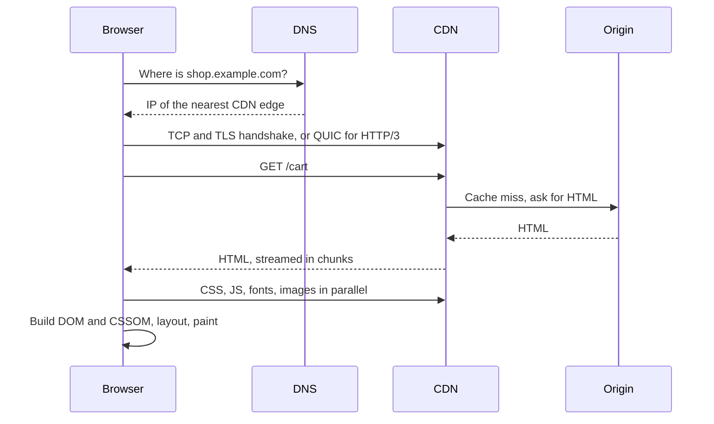
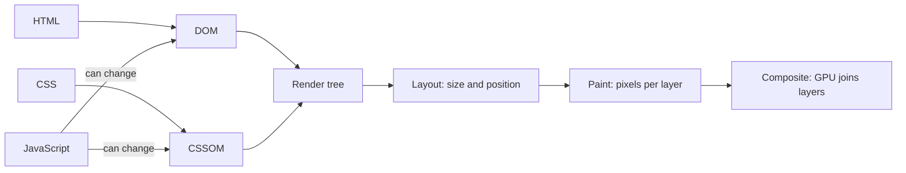
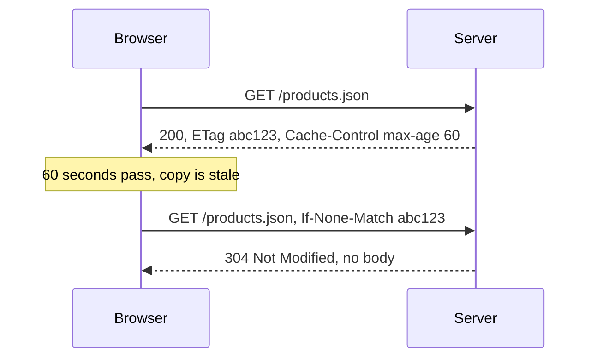
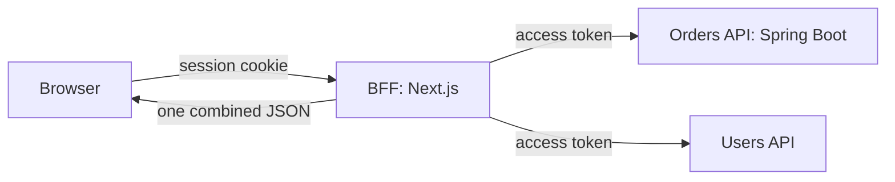
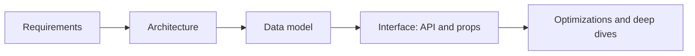
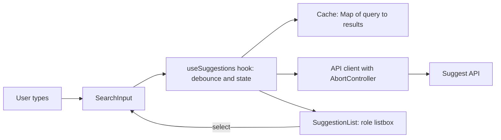
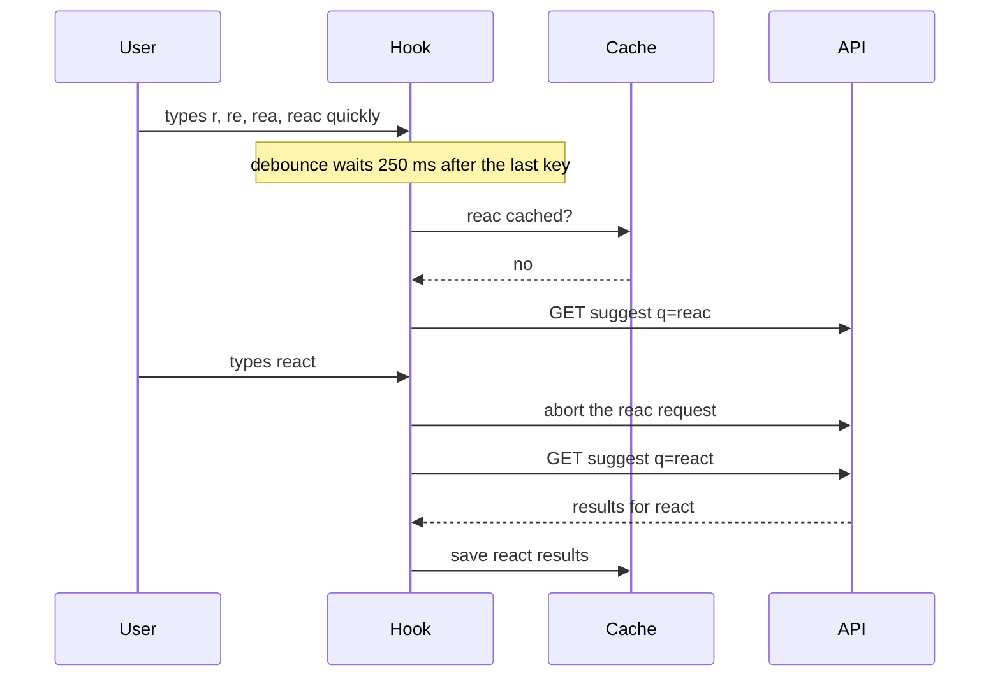
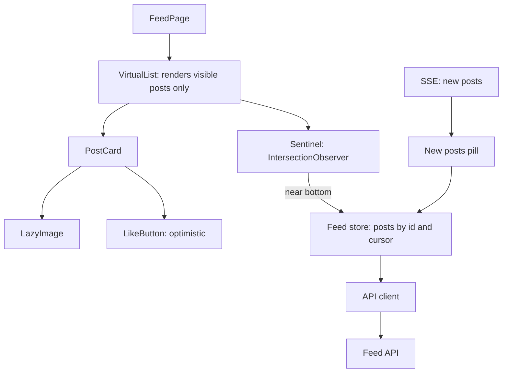
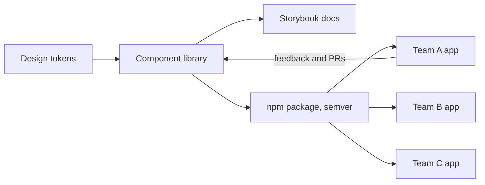

# Frontend UI: HTML, browser, performance, accessibility and frontend system design

[← Back to README](../README.md)

This page covers the parts of frontend work that are not React or CSS: the browser, HTML, speed, accessibility and security.
It ends with frontend system design: how to answer, plus three worked examples.
JavaScript questions live in [javascript.md](javascript.md). CSS questions live in [css-tailwind.md](css-tailwind.md). Next.js lives in [nextjs.md](nextjs.md).

**Contents**
- [What happens when you type a URL](#what-happens-when-you-type-a-url)
- [How the browser renders a page](#how-the-browser-renders-a-page)
- [Semantic HTML](#semantic-html)
- [Accessibility (a11y)](#accessibility-a11y)
- [Web performance and Core Web Vitals](#web-performance-and-core-web-vitals)
- [Rendering strategies: CSR, SSR, SSG, ISR, streaming](#rendering-strategies-csr-ssr-ssg-isr-streaming)
- [Browser storage and caching](#browser-storage-and-caching)
- [Frontend security](#frontend-security)
- [Talking to the backend](#talking-to-the-backend)
- [Frontend system design: how to answer](#frontend-system-design-how-to-answer)
- [Frontend system design: autocomplete / typeahead](#frontend-system-design-autocomplete--typeahead)
- [Frontend system design: infinite news feed](#frontend-system-design-infinite-news-feed)
- [Frontend system design: a design system for many teams](#frontend-system-design-a-design-system-for-many-teams)
- [Older questions (2019 list)](#older-questions-2019-list)
- [Frontend UI questions](#frontend-ui-questions)

---

## What happens when you type a URL

**In one line:** Find the server (DNS), connect securely (TLS or QUIC), get the HTML, fetch CSS, JS and images, then draw the page.

**Story:** You want to send a letter to "Sharma Sweets".
First you look up the address in a phone book (DNS).
Then you call to check it is really them (TLS handshake).
You ask for the menu (HTTP request). The nearest branch answers, not the head office (CDN).
While reading the menu, you see "see page 2 for drinks" and ask for that too (CSS, JS, images).

**How it works:**
1. **URL parsing:** the browser splits `https://shop.example.com/cart` into scheme, host and path. If you typed words, it goes to search.
2. **Caches first:** the browser checks its own cache, and maybe a service worker. A fresh cached copy means no network at all.
3. **DNS lookup:** host name → IP address. It checks browser cache, OS cache, router, then the DNS resolver. Usually 20–120 ms when not cached.
4. **Connection:**
   - HTTP/1.1 and HTTP/2 use **TCP** (a reliable byte stream), then **TLS 1.3** (encryption). TLS 1.3 needs one round trip.
   - HTTP/3 uses **QUIC** over UDP. QUIC does the connection and TLS in one round trip. Repeat visits can send data at once (0-RTT).
5. **HTTP request:** `GET /cart` with headers and cookies.
6. **CDN:** a *CDN* (content delivery network, servers close to users) often answers. On a cache miss it asks the origin server. See [CDN in system design](system-design.md#cdn).
7. **Response:** status code, headers (`Cache-Control`, `Content-Type`, `Set-Cookie`) and the HTML body. The HTML is streamed, so the browser starts work before the last byte arrives.
8. **Parsing and critical resources:** the browser reads HTML and finds CSS, JS, fonts and images. A *preload scanner* looks ahead and starts these downloads early.
9. **Render:** DOM + CSSOM → layout → paint → composite. See the next section.

**HTTP versions in one table:**

| Version | Transport | Key idea | Problem it fixes |
|---|---|---|---|
| HTTP/1.1 | TCP | One request at a time per connection | Browsers opened 6 connections per host as a hack |
| HTTP/2 | TCP | Many requests at once on one connection (*multiplexing*), header compression | No more 6-connection limit, no need to merge files |
| HTTP/3 | QUIC (UDP) | Each stream is independent. Faster handshake. Survives Wi-Fi → mobile switch | One lost TCP packet no longer blocks all streams (*head-of-line blocking*) |

**Diagram:**



**Example:** a small speed-up at the top of `<head>`:

```html
<!-- Start DNS + TLS to the image CDN early, before the browser finds the first image -->
<link rel="preconnect" href="https://img.example-cdn.com" crossorigin>
<!-- Download the hero image early, it is the LCP element -->
<link rel="preload" as="image" href="/hero.avif" fetchpriority="high">
```

**Good and bad:**

| Good | Bad |
|---|---|
| Serve static files from a CDN | Every request goes to one server in one country |
| HTTP/2 or HTTP/3 turned on | Still on HTTP/1.1 and bundling everything into one huge file |
| `preconnect` to 1–3 key origins | `preconnect` to 15 origins (wastes connections) |
| Long cache for hashed files | No cache headers, so every visit downloads everything |

**Say this in the interview:**

> "The browser resolves the host with DNS, then opens a TCP and TLS connection, or a QUIC connection for HTTP/3.
> It sends the request, usually to a CDN edge near the user.
> The HTML streams back, the preload scanner finds CSS, JS and images, and they download in parallel.
> Then the browser builds the DOM and CSSOM, does layout and paint, and the page appears."

**They may ask next:**
- **Why is HTTP/3 faster on mobile?** QUIC needs fewer round trips. A lost packet only blocks its own stream. The connection survives a network change.
- **What is 0-RTT?** On a repeat visit the browser sends the request with the first packet. It is only safe for requests that can be repeated, like GET.
- **What is a 103 Early Hints response?** The server sends "you will need this CSS" before the full HTML is ready. The browser starts downloading early.
- **What is HSTS?** A header that tells the browser: always use HTTPS for this site. It stops downgrade attacks.

---

## How the browser renders a page

**In one line:** HTML becomes the DOM, CSS becomes the CSSOM, and together they go through layout, paint and composite.

**Story:** Building a house.
The HTML is the list of rooms (DOM). The CSS is the interior design plan (CSSOM).
You need both before you can decide where furniture goes (layout).
Then you paint the walls (paint).
Finally you stack glass panels with pictures on them (composite). Moving a glass panel is cheap. Moving a wall is expensive.

**How it works:**
1. **DOM:** HTML is parsed into a tree of nodes. It can be built bit by bit as bytes arrive.
2. **CSSOM:** all CSS is parsed into a tree of styles. The browser needs all of it before it can paint. So **CSS is render-blocking**.
3. **Render tree:** only visible nodes with their final styles. `display: none` nodes are not in it.
4. **Layout (also called reflow):** the browser calculates the size and position of every box.
5. **Paint:** fill in pixels: text, colors, borders, shadows. Done per layer.
6. **Composite:** the GPU (graphics chip) puts the layers together in the right order. `transform` and `opacity` changes only need this step, so they are cheap.

**Diagram:**



**What blocks rendering:**
- **CSS in `<head>`** blocks paint. The browser waits so you do not see unstyled content (a "flash").
- **A normal `<script>`** blocks the HTML parser. The browser stops, downloads it, runs it, then continues.
- **A script also waits for CSS** before running, because the script may read styles.
- **Web fonts** can hide text for up to about 3 seconds unless you set `font-display`.

### async vs defer scripts

| Script tag | Downloads | Runs | Order kept? | Use for |
|---|---|---|---|---|
| `<script>` | Stops the parser | Right away | Yes | Almost never, in `<head>` |
| `<script async>` | In parallel | As soon as it arrives, pausing the parser | No | Independent scripts: analytics, ads |
| `<script defer>` | In parallel | After HTML is parsed, before `DOMContentLoaded` | Yes | Your app code |
| `<script type="module">` | In parallel | Like `defer` by default | Yes | Modern app code |

**Example:** what a layout-friendly animation looks like.

```css
/* Bad: changing "left" runs layout + paint on every frame */
.panel-slow { transition: left 300ms; }

/* Good: transform only needs composite, runs on the GPU */
.panel-fast { transition: transform 300ms; }
.panel-fast.open { transform: translateX(0); }
```

```js
// Layout thrashing: read, write, read, write forces layout each time
for (const el of items) el.style.height = box.offsetHeight + "px"; // bad: reads layout in the loop

const h = box.offsetHeight;                                       // good: read once
for (const el of items) el.style.height = h + "px";               // then only write
```

**Good and bad:**

| Good | Bad |
|---|---|
| Small critical CSS, rest loaded later | 400 KB of CSS in `<head>` |
| `defer` or `type="module"` for app scripts | Plain `<script>` in `<head>` |
| Animate `transform` and `opacity` | Animate `top`, `left`, `width`, `height` |
| Batch DOM reads, then writes | Read `offsetHeight` inside a write loop |

**Say this in the interview:**

> "The browser builds the DOM from HTML and the CSSOM from CSS. It joins them into a render tree, then does layout, paint and composite.
> CSS blocks rendering and normal scripts block parsing, so I use `defer` or modules for scripts and keep critical CSS small.
> For animations I use `transform` and `opacity`, because they skip layout and paint."

**They may ask next:**
- **Reflow vs repaint?** Reflow (layout) recalculates positions. Repaint only redraws pixels, like a color change. Reflow is more expensive and often causes a repaint too.
- **What is `DOMContentLoaded` vs `load`?** `DOMContentLoaded`: HTML parsed and deferred scripts ran. `load`: also images, iframes and styles finished.
- **What is the preload scanner?** A second, light parser that looks ahead in the HTML and starts downloads early, even while the main parser is blocked.
- **What is `will-change`?** A hint that an element will animate, so the browser can give it its own layer. Use it rarely. Each layer costs GPU memory.
- **What is `content-visibility: auto`?** It lets the browser skip layout and paint for off-screen sections until they come near the viewport.

---

## Semantic HTML

**In one line:** Use the HTML element that describes the meaning (`<button>`, `<nav>`, `<main>`, `<label>`), not a `<div>` that only looks right.

**Story:** A library with labelled shelves: "History", "Science", "Kids".
A blind visitor with a helper can jump straight to "Science".
If every shelf is just "Shelf", nobody can find anything without reading every book.
Semantic HTML is the shelf labels. Screen readers and Google read them.

**Why it matters:**
- **Accessibility:** screen readers announce "button", "navigation", "heading level 2". Users jump between them.
- **Keyboard for free:** a `<button>` is focusable and works with Enter and Space. A `<div>` does nothing.
- **SEO** (search engine optimization): search engines understand headings, articles and links better.
- **Less code:** native elements already have behavior, so you write less JavaScript and less ARIA.

**How it works:**
1. **Landmarks:** regions a screen reader user can jump to.
   - `<header>` (banner), `<nav>` (navigation), `<main>` (main, one per page), `<aside>` (complementary), `<footer>` (contentinfo).
   - `<header>` and `<footer>` are only landmarks when not inside `<article>` or `<section>`.
2. **Headings:** one `<h1>` for the page topic, then `<h2>`, `<h3>` in order. Do not pick a heading for its font size. Use CSS for size.
3. **Forms:** every input has a `<label>`. Group radio buttons with `<fieldset>` and `<legend>`.
4. **Buttons vs links:**
   - `<a href>` **goes somewhere** (new URL). Works with middle-click and "open in new tab".
   - `<button>` **does something** (submit, open menu, like a post).
5. **HTML5 content elements:**
   - `<article>`: stands alone, like a blog post or a feed item.
   - `<section>`: a themed part with its own heading.
   - `<figure>` + `<figcaption>`, `<time datetime>`.
   - `<details>` + `<summary>`: open and close without JS. `<dialog>`: a modal.

**Example:**

```html
<header>
  <nav aria-label="Main">
    <a href="/orders">Orders</a>
  </nav>
</header>
<main>
  <h1>My orders</h1>
  <article>
    <h2>Order #1042</h2>
    <p>Placed on <time datetime="2026-11-02">2 Nov 2026</time></p>
    <button type="button">Cancel order</button> <!-- does something -->
  </article>
  <form>
    <label for="email">Email</label>               <!-- click label = focus input -->
    <input id="email" type="email" autocomplete="email" required>
  </form>
</main>
```

**Good and bad:**

| Good | Bad |
|---|---|
| `<button onClick>` | `<div onClick>` (no focus, no keyboard, not announced) |
| `<label for>` on every input | Placeholder as the only label (it disappears when typing) |
| Heading levels in order | `<h4>` because it looked the right size |
| `<a href="/x">` for navigation | `<a href="#" onClick>` for actions |
| `<table>` for real tabular data | `<table>` for page layout |

**Say this in the interview:**

> "Semantic HTML means picking elements for meaning, not looks.
> A real button gives you focus, keyboard support and the right role for free.
> Landmarks and headings let screen reader users jump around, and they help SEO.
> My rule: links go somewhere, buttons do something."

**They may ask next:**
- **`<section>` vs `<div>`?** `<section>` is a themed group with a heading. `<div>` has no meaning and is for styling only.
- **`<section>` vs `<article>`?** `<article>` makes sense on its own (you could share it). `<section>` is a part of something bigger.
- **Why `type="button"`?** A `<button>` inside a form is `type="submit"` by default. Without `type="button"` it submits the form by accident.
- **What does `autocomplete="email"` do?** It lets the browser and password managers fill the field. It also helps WCAG 1.3.5 (identify input purpose).

---

## Accessibility (a11y)

**In one line:** Accessibility (a11y: "a", 11 letters, "y") means people with disabilities can use your site, with a keyboard, a screen reader or other aids.

**Story:** A railway station with stairs only.
Wheelchair users, parents with prams and people with heavy bags all struggle.
Add a ramp and a lift, and everyone benefits.
Captions help deaf users and also people in a noisy metro. Accessibility is the ramp for websites.

### WCAG 2.2 in simple words (POUR)

*WCAG* (Web Content Accessibility Guidelines) is the W3C standard. Version 2.2 came out in October 2023. Most laws ask for level **AA**.

| Principle | Simple meaning | Examples |
|---|---|---|
| **Perceivable** | Users can see or hear the content | Alt text on images, captions on videos, enough color contrast |
| **Operable** | Users can use it with any input | Everything works with a keyboard, no time traps, visible focus |
| **Understandable** | Users understand it | Clear labels, clear errors, the same menu on every page |
| **Robust** | Works with assistive tech | Valid HTML, correct roles and names |

**New in WCAG 2.2 (good to name 2–3):**
- **2.4.11 Focus Not Obscured (AA):** a sticky header or cookie banner must not hide the focused element.
- **2.5.8 Target Size (AA):** click targets at least 24×24 CSS pixels, or enough space around them.
- **2.5.7 Dragging Movements (AA):** anything you can drag must also work with a single click or tap.
- **3.3.8 Accessible Authentication (AA):** no memory puzzles to log in. Allow paste and password managers.
- **3.3.7 Redundant Entry (A):** do not ask for the same data twice in one flow.
- 4.1.1 Parsing was removed.

### Keyboard navigation and focus

- **Tab / Shift+Tab** move between interactive elements. **Enter** and **Space** activate. **Esc** closes. **Arrow keys** move inside a widget (menu, tabs, list).
- **Visible focus:** never `outline: none` without a replacement. Use `:focus-visible` to show it for keyboard users only.
- **Tab order follows DOM order.** Avoid positive `tabindex` (like `tabindex="3"`).
  - `tabindex="0"`: add a custom element to the tab order.
  - `tabindex="-1"`: focusable by code (`el.focus()`), not by Tab.
- **Skip link:** a first link "Skip to main content" so keyboard users skip the menu.
- **Single-page apps:** after a route change, move focus to the new `<h1>` or `<main>`. Otherwise screen reader users do not know the page changed.

### ARIA rules

*ARIA* (Accessible Rich Internet Applications) adds roles and states to HTML for assistive tech. It changes only what is **announced**, not behavior.

1. **No ARIA is better than bad ARIA.** If a native element exists, use it. `<button>` beats `<div role="button">`.
2. **Do not change native meaning.** No `<h2 role="button">`.
3. **Interactive ARIA elements must work with a keyboard.** `role="button"` means you must handle Enter and Space yourself.
4. **Do not hide focusable things.** No `aria-hidden="true"` on something you can Tab to.
5. **Every interactive element needs a name.** An icon button needs `aria-label="Close"`.

Useful attributes: `aria-label`, `aria-labelledby`, `aria-describedby` (extra hint, like an error message), `aria-expanded`, `aria-current="page"`, `aria-live="polite"` (announce changes, like "3 results").

### Color contrast

- Normal text: at least **4.5:1** against the background (AA).
- Large text (24px, or about 19px bold): at least **3:1**.
- Icons, input borders and focus rings: at least **3:1**.
- Never use color alone. A red border plus an error message and an icon.

### Screen readers

- Common ones: **NVDA** and **JAWS** (Windows), **VoiceOver** (macOS, iOS), **TalkBack** (Android).
- They read the *accessibility tree*: a simpler copy of the DOM with role, name and state for each element.
- Users jump by headings, landmarks, links and form fields. That is why semantic HTML matters so much.

### Accessible modal (dialog) checklist

- [ ] Use native `<dialog>` with `showModal()`. It gives focus trap, Esc to close and an inert background for free.
- [ ] Give it a name: `aria-labelledby` pointing to its title.
- [ ] Move focus inside when it opens (first field, or the dialog title).
- [ ] Tab stays inside the dialog while it is open.
- [ ] Esc closes it. A visible Close button exists.
- [ ] Focus goes **back to the button that opened it** when it closes.
- [ ] The page behind cannot be scrolled or clicked.
- [ ] Do not open it on page load without a reason.

**Example:**

```tsx
import { useRef } from "react";

export function DeleteDialog({ onConfirm }: { onConfirm: () => void }) {
  const ref = useRef<HTMLDialogElement>(null);
  return (
    <>
      <button onClick={() => ref.current?.showModal()}>Delete order</button>
      {/* showModal(): focus trap, Esc to close, page behind becomes inert */}
      <dialog ref={ref} aria-labelledby="del-title">
        <h2 id="del-title">Delete this order?</h2>
        <p>This cannot be undone.</p>
        <form method="dialog">                {/* any button here closes the dialog */}
          <button value="cancel">Cancel</button> {/* gets focus first: the safe choice */}
          <button value="ok" onClick={onConfirm}>Delete</button>
        </form>
      </dialog>
    </>
  );
}
```

The browser returns focus to the opening button when a modal `<dialog>` closes.

### Testing tools

| Tool | What it finds | Limit |
|---|---|---|
| **axe DevTools / axe-core** | Missing labels, bad contrast, wrong ARIA | Automated tools catch only some issues, maybe a third to a half |
| **Lighthouse** (Chrome) | An accessibility score using axe rules | A score of 100 does not mean accessible |
| **eslint-plugin-jsx-a11y** | Mistakes in JSX while you type | Only static code |
| **@axe-core/playwright** | axe checks in end-to-end tests in CI | Same as axe |
| **Keyboard-only test** | Unplug the mouse. Can you do the whole flow? | Manual, but finds the worst bugs fast |
| **Screen reader test** | VoiceOver or NVDA on key flows | Manual, takes practice |

### European Accessibility Act (EAA)

- The EU **European Accessibility Act** applies from **28 June 2025**.
- It covers products and services sold to EU consumers: e-commerce, banking, e-books, transport tickets, phones and more.
- It also applies to non-EU companies that sell to EU consumers.
- Very small service companies (under 10 staff and under €2 million turnover) are exempt.
- The technical standard is **EN 301 549**. Version 3.2.1 points to WCAG 2.1 AA.
- A new version (4.1.1, published around September 2026) aligns with **WCAG 2.2 AA**. Check if the EU has made it official yet. The safe target today is WCAG 2.2 AA.
- Each EU country sets its own fines.

**Good and bad:**

| Good | Bad |
|---|---|
| Native elements first | `<div role="button" tabindex="0">` with half the keyboard support |
| Visible focus ring with `:focus-visible` | `*:focus { outline: none }` |
| Alt text that says what matters: `alt="Red running shoe, side view"` | `alt="image"`, or alt text on decorative images (use `alt=""`) |
| Error text linked with `aria-describedby` | Only a red border |
| Test with keyboard and a screen reader | Trust the Lighthouse score only |

**Say this in the interview:**

> "I target WCAG 2.2 AA: perceivable, operable, understandable, robust.
> I start with semantic HTML and add ARIA only when no native element exists, because bad ARIA is worse than none.
> Every flow must work with a keyboard and have visible focus.
> I run axe in CI and do a manual keyboard and screen reader check. In the EU it is also a legal need since the European Accessibility Act in June 2025."

**They may ask next:**
- **What is the accessible name?** What a screen reader says for an element. It comes from the content, a `<label>`, `aria-labelledby` or `aria-label`.
- **`aria-label` vs `aria-labelledby`?** `aria-label` is a text string. `aria-labelledby` points to visible text by id. Prefer visible text.
- **How do you announce "Saved!" to a screen reader?** Put it in a live region: `<div aria-live="polite">Saved</div>`. The region must exist before the text changes.
- **What is `inert`?** An HTML attribute that makes a part of the page unfocusable and unclickable. Useful for custom drawers.
- **What about `prefers-reduced-motion`?** A CSS media query. Turn off big animations for users who asked for less motion.

---

## Web performance and Core Web Vitals

**In one line:** Core Web Vitals are Google's three user-focused speed scores: **LCP** (loading), **INP** (responding to clicks) and **CLS** (visual stability).

**Story:** A restaurant visit.
- **LCP:** how long until your main dish arrives.
- **INP:** when you wave at the waiter, how long until they respond.
- **CLS:** does the waiter move your plate while you are eating? You reach for the plate and grab the table.

**How it works:**
- Google measures real Chrome users and takes the **75th percentile** (75% of visits must be this fast or faster). Mobile and desktop are separate.
- **INP replaced FID** (First Input Delay) as a Core Web Vital on **12 March 2024**. FID only measured the delay of the first click. INP looks at all clicks, taps and key presses during the visit, and the time until the next frame is painted.

| Metric | What it measures | Good | Needs improvement | Poor |
|---|---|---|---|---|
| **LCP** (Largest Contentful Paint) | Time until the biggest image or text block in view is shown | ≤ 2.5 s | 2.5–4 s | > 4 s |
| **INP** (Interaction to Next Paint) | Time from a user action to the next visible update | ≤ 200 ms | 200–500 ms | > 500 ms |
| **CLS** (Cumulative Layout Shift) | How much content jumps around (a score, no unit) | ≤ 0.1 | 0.1–0.25 | > 0.25 |

### How to fix LCP

1. **Fast server response (TTFB, time to first byte):** CDN, cache HTML at the edge, faster backend.
2. **Find the LCP element early:** use a real `` in the HTML, not a CSS background or an image added by JavaScript.
3. **Give it priority:** `fetchpriority="high"` and never `loading="lazy"` on the LCP image.
4. **Small image:** AVIF or WebP, right size with `srcset`.
5. **Do not block render:** less CSS in `<head>`, `defer` scripts.
6. **Server render** the main content instead of waiting for client JavaScript.

### How to fix INP

1. **Break up long tasks.** Any task over 50 ms blocks the main thread. Split work and yield to the browser (`await scheduler.yield()` where supported, or `setTimeout`).
2. **Show feedback first, work later.** Update the button state, then do the heavy part.
3. **Less JavaScript:** code splitting, remove unused libraries, fewer third-party scripts.
4. **Smaller DOM and fewer re-renders.** Virtualize long lists. In React, use `useTransition` for slow updates.
5. **Move heavy work off the main thread** to a Web Worker (a background thread).

### How to fix CLS

1. **Always set `width` and `height`** (or CSS `aspect-ratio`) on images, videos and iframes.
2. **Reserve space** for ads, banners and embeds.
3. **Do not insert content above** what the user is reading. Use a "New posts" button instead.
4. **Fonts:** `font-display: optional` or a size-matched fallback font, so text does not jump when the font loads.
5. **Animate with `transform`**, not `top` or `height`.

### Images

- **Modern formats:** AVIF (smallest), then WebP, with JPEG as fallback. AVIF is often 30–50% smaller than JPEG.
- **Responsive sizes:** `srcset` + `sizes`, so a phone does not download a 2000px desktop image.
- **Lazy loading:** `loading="lazy"` for images below the fold (not visible at first).
- **Priority hints:** `fetchpriority="high"` on the LCP image, `"low"` on unimportant ones. Supported in Chrome, Edge, Safari 17.2+ and Firefox 132+.

```html

<!-- width + height = space reserved = no layout shift -->

```

### Fonts

- Use **WOFF2** and only the weights you need. Self-host or use `preconnect` to the font host.
- **`font-display: swap`** shows fallback text at once, then swaps. **`optional`** uses the font only if it loads very fast (best for CLS).
- **Preload** the one or two most important fonts:

```html
<link rel="preload" href="/fonts/inter-var.woff2" as="font" type="font/woff2" crossorigin>
```

### Code splitting

- Split the bundle by route and by heavy feature (charts, editors, maps).
- Load them only when needed with dynamic `import()`. In React: `lazy()` + `<Suspense>`. Next.js splits by route for you.

```tsx
import { lazy, Suspense } from "react";
const ChartPanel = lazy(() => import("./ChartPanel")); // separate file, loaded on first render

export function Report() {
  return <Suspense fallback={<p>Loading chart…</p>}><ChartPanel /></Suspense>;
}
```

### Caching headers

| File | Header | Why |
|---|---|---|
| `app.3f9a1c.js` (hash in name) | `Cache-Control: public, max-age=31536000, immutable` | Content never changes. A new build gets a new name |
| `index.html` | `Cache-Control: no-cache` | Always ask the server "has it changed?" so users get the new build |
| API JSON for a user | `Cache-Control: private, no-store` | Personal data must not be stored in shared caches |

### Measuring: lab vs field

| | Lab data | Field data |
|---|---|---|
| Tools | Lighthouse, PageSpeed Insights lab part, WebPageTest, Chrome DevTools Performance panel | CrUX (Chrome User Experience Report), your own RUM (real user monitoring) |
| Who | One test run on one simulated device | Real users, real phones, real networks |
| INP | Cannot measure it (no real clicks). Uses TBT (Total Blocking Time) as a hint | Measures it |
| Use for | Debugging, CI checks before release | The truth. What Google uses for search ranking |

- **CrUX** is public data from opted-in Chrome users, over the last 28 days.
- For RUM, use the `web-vitals` npm library and send the numbers to your analytics.

**Good and bad:**

| Good | Bad |
|---|---|
| Budget: "JS under 200 KB gzip on mobile" checked in CI | Nobody looks at bundle size |
| Measure with field data, debug with lab data | Celebrate a Lighthouse 100 while real users see 4 s LCP |
| `fetchpriority="high"` on the hero image | `loading="lazy"` on the hero image |
| Reserved space for every image and ad | Content jumping as images load |
| Third-party scripts reviewed and loaded `async` | 12 tracking scripts in `<head>` |

**Say this in the interview:**

> "Core Web Vitals are LCP for loading, INP for responsiveness and CLS for visual stability.
> Good is LCP under 2.5 seconds, INP under 200 milliseconds and CLS under 0.1, at the 75th percentile.
> INP replaced FID in March 2024 and looks at all interactions, not only the first.
> I debug with Lighthouse but trust field data from CrUX or our own RUM."

**They may ask next:**
- **What is TTFB?** Time to first byte: how long until the first byte of HTML arrives. It is part of LCP. Fix it with CDN and server caching.
- **What is a long task?** Any main-thread task over 50 ms. During it, the page cannot respond to clicks.
- **Tree shaking?** The bundler removes exported code that nobody imports. It works best with ES modules.
- **How do you stop a slow third-party script hurting you?** Load it `async` or after the first user action. Use a facade, like a fake play button for a YouTube embed.
- **What is bfcache?** Back/forward cache. The browser keeps the whole page in memory, so Back is instant. `unload` handlers and `Cache-Control: no-store` can stop it.

---

## Rendering strategies: CSR, SSR, SSG, ISR, streaming

**In one line:** It is about **where and when the HTML is made**: browser, server per request, build time, or build time with refresh.

**Story:** A wedding caterer.
- **CSR:** you get raw ingredients and cook at the table.
- **SSR:** each dish is cooked fresh when you order.
- **SSG:** all dishes are cooked in the morning.
- **ISR:** cooked in the morning, and remade every hour.
- **Streaming:** starters come at once, the main course follows when ready.

| Strategy | HTML made | Good for | Weak point |
|---|---|---|---|
| **CSR** (client-side rendering) | In the browser after JS loads | Apps behind login, dashboards, tools | Slow first load, empty page without JS, weaker SEO |
| **SSR** (server-side rendering) | On the server, every request | Personal, fresh pages: cart, account | Server cost per request. TTFB depends on the slowest data |
| **SSG** (static site generation) | At build time | Docs, blogs, marketing pages | Data is old until the next build |
| **ISR** (incremental static regeneration) | Built once, refreshed in the background every N seconds or on demand | Product pages, news with many pages | Some users see slightly old data |
| **Streaming SSR** | On the server, sent in chunks with `<Suspense>` | Pages with one slow part | Needs a framework that supports it |

**Hydration:** server-made HTML is "dead" until the JavaScript loads and attaches event handlers. This step is *hydration*. Big pages hydrate slowly, which hurts INP. React Server Components send less JS because server-only parts never hydrate.

**When to choose:**
- Public, same for everyone, rarely changes → **SSG**.
- Public, many pages, changes sometimes → **ISR**.
- Personal or must be fresh → **SSR**, with **streaming** for slow parts.
- Heavy interaction after login, SEO not needed → **CSR** is fine.
- Real apps mix them per page. Next.js lets you choose per route.

Details for Next.js (Server Components, Cache Components, `"use cache"`): see [Next.js architecture and Server Components](nextjs.md#nextjs-architecture-and-server-components).

**Say this in the interview:**

> "I pick the rendering strategy per page.
> Static pages use SSG and big catalogs use ISR.
> Personal pages use SSR with streaming for slow parts, and logged-in tools can be CSR.
> The trade-off is freshness against speed and server cost.
> With Server Components, less JavaScript is sent, so hydration is cheaper."

**They may ask next:**
- **What is a hydration mismatch?** The server HTML and the first client render differ, for example because of `Date.now()` or `window` checks. React warns and may re-render.
- **What is partial prerendering?** A static shell is served at once, and dynamic holes stream in. In Next.js 16 this is part of Cache Components.
- **What are islands?** Mostly static HTML with small interactive "islands" that hydrate on their own (Astro uses this).

---

## Browser storage and caching

**In one line:** Cookies go to the server with every request. localStorage and sessionStorage are small key-value stores for the page. IndexedDB is a real database in the browser. The HTTP cache and service workers store files and responses.

**Story:** Your office.
- **Cookie:** your ID badge. You show it at every door (every request).
- **localStorage:** your desk drawer. Stays until you clear it.
- **sessionStorage:** a sticky note. Thrown away when you leave (close the tab).
- **IndexedDB:** a filing cabinet. Big, organized, searchable.

| | Cookies | localStorage | sessionStorage | IndexedDB |
|---|---|---|---|---|
| Size | About 4 KB per cookie | About 5 MB per origin | About 5 MB per origin | Large, a share of free disk |
| Sent to server | Yes, every request to that domain | No | No | No |
| Lives until | Expiry date, or end of session | Cleared by user or code | Tab closed | Cleared by user or code |
| Shared across tabs | Yes | Yes | No, one tab only | Yes |
| API | `document.cookie` or `Set-Cookie` header | Sync, strings only | Sync, strings only | Async, stores objects and files |
| JS can read | Not if `HttpOnly` | Yes, any script on the page | Yes | Yes |
| Use for | Session id, auth (with `HttpOnly`) | Theme, UI preferences | Form draft in one tab | Offline data, big lists, files |

**Cookie flags you must know:**
- `HttpOnly`: JavaScript cannot read it. Protects against token theft by XSS.
- `Secure`: only sent over HTTPS.
- `SameSite=Lax` or `Strict`: not sent on most cross-site requests. Protects against CSRF.
- `Max-Age` or `Expires`: how long it lives.

### HTTP cache

1. The server sends `Cache-Control`. Examples:
   - `max-age=600`: fresh for 10 minutes. No network call during that time.
   - `no-cache`: you may store it, but **ask the server first** each time.
   - `no-store`: never store it (bank pages, personal data).
   - `private`: only the browser may store it, not a CDN.
   - `s-maxage=300`: how long a CDN may keep it.
   - `stale-while-revalidate=60`: serve the old copy for up to 60 s while fetching a new one in the background.
2. The server also sends an **`ETag`** (a version id, like a hash of the content).
3. When the cache is old, the browser asks with `If-None-Match: "abc123"`.
4. If nothing changed, the server replies **`304 Not Modified`** with no body. That saves bandwidth.



### Service workers and PWA basics

- A **service worker** is a script that runs in the background, between your page and the network. It works like a small proxy.
- It can answer requests from its own cache, so the app works offline.
- It needs HTTPS. It has no DOM access.
- Common cache strategies:
  - **Cache first:** static files (logo, fonts).
  - **Network first:** API data that should be fresh, with cache as a fallback when offline.
  - **Stale-while-revalidate:** show cached, update in the background (news list).
- A **PWA** (progressive web app) = HTTPS + a web app manifest (name, icons, colors) + a service worker. Users can install it like an app.
- Libraries like **Workbox** write the caching code for you.

**Good and bad:**

| Good | Bad |
|---|---|
| Auth in an `HttpOnly; Secure; SameSite` cookie | JWT in localStorage |
| Hashed file names + 1 year cache | Short cache on files that never change |
| `no-cache` on `index.html` | Long cache on `index.html`, so users are stuck on an old build |
| IndexedDB for large offline data | 4 MB JSON string in localStorage (sync, blocks the main thread) |
| Version your service worker cache and clean old ones | A buggy service worker serving an old app forever |

**Say this in the interview:**

> "Cookies are small and go to the server with every request.
> I use them for the session, with HttpOnly, Secure and SameSite.
> localStorage is for small, non-secret preferences. sessionStorage is per tab. IndexedDB is for large or offline data.
> For files, I use hashed names with a one-year cache and keep HTML on `no-cache`, with ETags for cheap 304 checks.
> A service worker adds offline support and turns the site into a PWA."

**They may ask next:**
- **`no-cache` vs `no-store`?** `no-cache` stores but always checks with the server. `no-store` never stores.
- **How do you clear a bad service worker?** Ship a new one that deletes its caches and calls `self.registration.unregister()`. Or send the `Clear-Site-Data` header.
- **What is the Cache Storage API?** The storage that service workers use for request/response pairs. Different from the HTTP cache.
- **Is localStorage shared between `http` and `https`?** No. Storage is per *origin*: scheme + host + port.

---

## Frontend security

**In one line:** The main risks are XSS, CSRF, clickjacking and bad npm packages, and CSP plus safe cookie settings stop most attacks.

- **XSS:** an attacker runs script in your page.
- **CSRF:** an attacker makes your browser send a request.
- **Clickjacking:** your page sits in a hidden frame.

**Story:** Your house.
- **XSS:** a stranger hides inside your house and acts as you.
- **CSRF:** a stranger tricks you into signing a cheque while you think you are signing a birthday card.
- **Clickjacking:** a fake glass wall over your door, so you press the wrong bell.
- **Supply chain:** the lock you bought was made by a thief.

### XSS (cross-site scripting)

- The attacker gets their script to run on your site. It can read the page, call your APIs as the user and steal tokens.
- **Stored XSS:** saved in the database (a comment with `<script>`). **Reflected:** comes back from the URL. **DOM-based:** your own JS puts URL data into `innerHTML`.
- **Why React is safe by default:** JSX text like `{comment}` is escaped. `<script>` is shown as text, not run.
- **Where React is not safe:**
  - `dangerouslySetInnerHTML` puts raw HTML in the page.
  - `href={userUrl}` where the URL is `javascript:...`. Only allow `http:` and `https:` URLs.
  - Direct DOM code (`ref.current.innerHTML = ...`).
- **Fix:** sanitize HTML with **DOMPurify** before rendering it.

```tsx
import DOMPurify from "dompurify";

export function Comment({ html }: { html: string }) {
  const clean = DOMPurify.sanitize(html); // removes <script>, onerror=, javascript: links
  return <div dangerouslySetInnerHTML={{ __html: clean }} />;
}
```

### CSRF (cross-site request forgery)

- You are logged in to `bank.com`. You open `evil.com`. It has a hidden form that posts to `bank.com/transfer`.
- The browser sends your bank cookie with it. The bank thinks it is you.
- **Fixes:**
  - `SameSite=Lax` or `Strict` cookies. The cookie is not sent on cross-site POSTs. Chrome treats cookies without `SameSite` as `Lax`, but other browsers differ, so set it yourself.
  - A **CSRF token**: a random value in a header or form field that `evil.com` cannot read.
  - Check the `Origin` header on the server.
- If you use `Authorization: Bearer` headers (not cookies), CSRF is mostly not a problem. But then the token lives in JS, which XSS can steal.

### CORS (what it is and is not)

- **Same-origin policy:** by default, JS on `app.com` cannot **read** responses from `api.com`.
- **CORS** (Cross-Origin Resource Sharing) lets the server say "I allow `app.com` to read me" with `Access-Control-Allow-Origin: https://app.com`.
- For non-simple requests (JSON body, custom headers, PUT, DELETE) the browser first sends an `OPTIONS` **preflight** request to ask.
- **CORS is not a security wall for your server.** It is a browser rule. `curl` and Postman ignore it.
- **CORS does not stop CSRF.** A simple form POST is still sent. CORS only blocks reading the response.
- Never use `Access-Control-Allow-Origin: *` together with cookies. Browsers block that, and it would be unsafe anyway.
- Spring Boot side: [CORS and CSRF in Spring Security](spring-ecosystem.md#cors-and-csrf).

### CSP (Content Security Policy)

- A response header that tells the browser which scripts, styles and images are allowed.
- Even if an attacker injects `<script>`, the browser refuses to run it.
- A strict, nonce-based policy (a *nonce* is a random value, new on every response):

```http
Content-Security-Policy: script-src 'nonce-r4nd0m' 'strict-dynamic'; object-src 'none'; base-uri 'none'; frame-ancestors 'none'
```

- Roll out with `Content-Security-Policy-Report-Only` first, watch the reports, then enforce.
- *Trusted Types* (a CSP feature) can block raw strings going into `innerHTML`. Check browser support before relying on it.

### Clickjacking

- An attacker loads your site in an invisible `<iframe>` over a fake button. The user clicks "Win a prize" but really clicks "Delete account".
- **Fix:** `Content-Security-Policy: frame-ancestors 'none'` (or `'self'`). Older header: `X-Frame-Options: DENY`.

### Storing tokens: httpOnly cookie vs localStorage

| | `HttpOnly` cookie | localStorage |
|---|---|---|
| Can XSS read the token? | No | Yes, any script can steal it |
| Sent automatically | Yes, so you need CSRF protection | No, you add the header by hand |
| Works across subdomains / APIs | Needs the same site or a BFF | Easy |
| Best choice | **Yes, for most web apps** | Avoid for long-lived tokens |

- The safest common setup is a **BFF** (Backend for Frontend). The browser holds only an `HttpOnly` session cookie. The BFF keeps the access token on the server and calls the APIs. See the [BFF pattern in nextjs.md](nextjs.md#nextjs-architecture-and-server-components).
- With an `HttpOnly` cookie, XSS can still make requests while the user is on the page. It just cannot steal the token for later. So XSS protection still matters.

### Dependency and supply-chain risk

- A typical React app has hundreds or thousands of npm packages. One bad package runs code on dev laptops, in CI and in users' browsers.
- Real example: the 2025 "Shai-Hulud" npm worm stole tokens from developers and published itself into hundreds of packages.
- **Fixes:**
  - Commit the lockfile. Use `npm ci` in CI.
  - Dependabot or Renovate for updates, `npm audit` or Snyk for known bugs.
  - Wait a few days before taking brand-new versions. Some package managers have a setting for a minimum package age.
  - Turn off install scripts where you can (`ignore-scripts`).
  - Use *Subresource Integrity* (`integrity="sha384-..."`) for scripts from a public CDN.
  - Fewer dependencies. Do you really need a package for left-padding?

**Good and bad:**

| Good | Bad |
|---|---|
| React text rendering + DOMPurify for rich HTML | `dangerouslySetInnerHTML` with user input |
| `HttpOnly; Secure; SameSite=Lax` session cookie | Long-lived JWT in localStorage |
| Strict CSP with nonces | No CSP, or `unsafe-inline` everywhere |
| `frame-ancestors 'none'` | Your login page can be framed by anyone |
| Lockfile, update bot, audit in CI | `npm install` of random packages without review |

**Say this in the interview:**

> "React escapes text by default, so XSS mostly comes from `dangerouslySetInnerHTML`, `javascript:` URLs or direct DOM code. I sanitize with DOMPurify and add a strict CSP.
> For CSRF, I use SameSite cookies plus a CSRF token for cookie-based auth.
> CORS is not a server protection. It only controls which origins may read responses in a browser.
> I keep tokens in HttpOnly cookies, ideally behind a BFF, and I treat npm dependencies as a supply-chain risk."

**They may ask next:**
- **Does HTTPS stop XSS?** No. HTTPS protects data on the network. XSS runs inside the page.
- **Why not just validate input on the frontend?** Anyone can skip the frontend and call the API. Validate on the server. Escape on output.
- **What is an open redirect?** `?next=https://evil.com` after login sends users to an attacker. Only allow relative paths or a list of known hosts.
- **What other headers do you set?** `Strict-Transport-Security`, `X-Content-Type-Options: nosniff`, `Referrer-Policy: strict-origin-when-cross-origin`, `Permissions-Policy`.

---

## Talking to the backend

**In one line:** Pick REST, GraphQL or tRPC to fit the team, add a BFF when needed, and plan for live data, timeouts, retries and errors.

**Story:** Ordering food.
- **REST:** a fixed menu. Each dish is its own order.
- **GraphQL:** a buffet plate. You say exactly what goes on it in one trip.
- **tRPC:** the cook is your family. You speak the same language (TypeScript), no menu needed.
- **WebSocket:** a phone call. Both sides talk any time.
- **SSE:** a radio. The server talks, you listen.

| | REST | GraphQL | tRPC |
|---|---|---|---|
| Shape | Many URLs, HTTP verbs | One endpoint, client writes a query | TypeScript functions called over HTTP |
| Over-fetching | Common (fixed responses) | Ask only for fields you need | Fixed per procedure |
| Types | Via OpenAPI codegen | Via schema codegen | Shared TS types, no codegen |
| HTTP caching | Easy (GET + CDN) | Harder (mostly POST) | Possible for queries |
| Backend language | Any | Any | TypeScript only |
| Fits when | Public APIs, Spring Boot backends, most teams | Many clients needing different data, many backend services | Full-stack TypeScript monorepo |

**BFF pattern:** a *Backend for Frontend* is a thin server made for one UI. It combines several backend calls into one response, hides internal URLs and keeps tokens off the browser. Next.js often plays this role. See [nextjs.md](nextjs.md#nextjs-architecture-and-server-components).



**Live data:**

| Option | Direction | Good for | Notes |
|---|---|---|---|
| Polling | Client asks every N s | Simple status checks | Wasteful, delay up to N s |
| **SSE** (Server-Sent Events) | Server → client | Notifications, live scores, AI text streaming | Plain HTTP, auto-reconnect built in |
| **WebSocket** | Both ways | Chat, multiplayer, live editing | Needs sticky connections and its own scaling |

**Retries and timeouts on the client:**
- **Always set a timeout.** `fetch` waits forever by default. Use `AbortSignal.timeout(5000)`.
- **Retry only safe requests** (GET, or POST with an idempotency key). Retrying a payment can charge twice.
- **Retry only errors that may pass:** network errors, 5xx, 429. Not 400 or 404.
- **Exponential backoff + jitter:** wait 300 ms, 600 ms, 1200 ms, plus a small random amount. Then clients do not all retry at once.

```js
// Retry only GET (safe to repeat). Wait longer each time.
async function fetchWithRetry(url, { retries = 3, timeoutMs = 5000 } = {}) {
  for (let attempt = 0; ; attempt++) {
    try {
      const res = await fetch(url, { signal: AbortSignal.timeout(timeoutMs) }); // never wait forever
      const retryable = res.status >= 500 || res.status === 429;
      if (!retryable || attempt === retries) return res; // 4xx: retry will not help
    } catch (e) {
      if (attempt === retries) throw e;                  // network error or timeout
    }
    const delay = 2 ** attempt * 300 + Math.random() * 100; // 300, 600, 1200 ms + jitter
    await new Promise((r) => setTimeout(r, delay));
  }
}
// With a server answering 503, 503, 200: three attempts, final status 200
```

In React apps, **TanStack Query** (or SWR) gives you caching, retries, deduping and background refresh, so you rarely write this by hand.

**Error states every screen needs:**
- **Loading:** skeleton (grey shapes) instead of a spinner, so the layout does not jump.
- **Empty:** "No orders yet" with a next step.
- **Error:** a human message and a Retry button. Keep the user's input.
- **Partial:** one widget failed, the rest of the page still works (React error boundaries).
- **Offline:** show a banner. Queue actions if it makes sense.
- **Slow:** after about 1 s, show progress. After about 10 s, offer cancel.

**Say this in the interview:**

> "For most Spring Boot backends I use REST with OpenAPI-generated types. GraphQL fits when many clients need different shapes, and tRPC fits a full TypeScript stack.
> A BFF combines calls and keeps tokens on the server.
> For live data I use SSE when only the server talks, and WebSockets for two-way chat.
> Every call has a timeout, only safe calls are retried with backoff, and every screen has loading, empty and error states."

**They may ask next:**
- **What is an idempotency key?** A unique id sent with a POST. The server stores it and ignores repeats, so a retry does not create a second order.
- **What is the N+1 problem in GraphQL?** One query for 20 posts triggers 20 author lookups. Fix with DataLoader (batching).
- **How do you handle a 401 in the middle of a session?** Try a silent token refresh once. If it fails, send the user to login and keep where they were.
- **How do you avoid race conditions in a search box?** Cancel the old request with `AbortController`, or ignore responses that are not the latest.

---

## Frontend system design: how to answer

**In one line:** Follow a fixed order, **RADIO**: Requirements, Architecture, Data model, Interface, Optimizations.

**Story:** A tailor making a suit.
First measurements and the occasion (requirements).
Then the cut and parts (architecture).
Then the fabric list (data model).
Then how the parts join (interface).
Finally the finishing touches (optimizations). You do not sew buttons before measuring.

**How it works (RADIO):**
1. **Requirements:** what must it do (functional)? How well (fast, offline, accessible, mobile, which browsers)? Who uses it? Ask, then write the list.
2. **Architecture:** the main components and how they talk. Draw boxes: view, controller/state, cache, API client, server.
3. **Data model:** what state lives where. Server data vs client UI state. Shape of the store (normalized by id?).
4. **Interface (API):** the API between client and server (endpoints, request/response, pagination) and the component props.
5. **Optimizations:** performance, accessibility, network, offline, security, i18n (internationalization), error handling, testing.



**A 45-minute time plan:**

| Minutes | Step | What you produce |
|---|---|---|
| 0–5 | Requirements | A short list on the board, scope agreed |
| 5–13 | Architecture | Component diagram with data flow |
| 13–20 | Data model | State shape, what is cached, what is server state |
| 20–28 | Interface | 2–3 endpoints with sample JSON, key component props |
| 28–42 | Optimizations | 2–3 deep dives the interviewer picks: performance, a11y, offline, real time |
| 42–45 | Wrap up | Trade-offs, what you would do with more time |

**What interviewers look for:**
- You **ask questions** before drawing. You do not assume.
- You think about **real users**: slow 3G, old phones, keyboard and screen reader users.
- You know **browser details**: rendering, caching, network, storage.
- You make **trade-offs** out loud: "I pick cursor pagination because offset breaks when new posts arrive."
- You **drive** the session. You do not wait to be asked each step.
- Senior signal: you cover **accessibility, error states, observability and testing** without being asked.

**Good and bad:**

| Good | Bad |
|---|---|
| "Before I draw, may I ask a few questions?" | Starts coding a React component at minute 1 |
| Talks about client state, cache and API shape | Talks only about databases and Kafka (that is backend design) |
| Names numbers: "debounce 250 ms, 10 results, 50 KB" | "It should be fast" |
| Mentions a11y and failure cases | Only the happy path |

**Say this in the interview:**

> "I'll follow a simple order: requirements, architecture, data model, API interface, then optimizations.
> I'll spend about five minutes on requirements, then sketch the components, the state and the API.
> I'll use the rest for deep dives you care about, like performance or accessibility."

**They may ask next:**
- **How is frontend system design different from backend?** The focus is the client: components, state, rendering, network use, a11y and perceived speed. The backend is a black box with an API.
- **Do I need to write code?** Usually only small parts: a component outline, a hook, or an API shape.

---

## Frontend system design: autocomplete / typeahead

**In one line:** As the user types, show matching suggestions fast, without flooding the server, with full keyboard and screen reader support.

**Story:** A helpful shopkeeper.
You start saying "Pa…" and he points to "Paneer, Papad, Paratha".
He waits a moment for you to finish a few letters, not after every sound (debounce).
If you change your mind mid-word, he forgets the old answer (cancel stale requests).
He remembers what you asked yesterday (cache).

### Requirements

**Functional:**
- Show up to 10 suggestions as the user types, after 2+ characters.
- Highlight the matched part.
- Select with mouse, touch or keyboard (Up, Down, Enter, Esc).
- Show recent searches when the box is empty and focused.

**Non-functional:**
- Feels instant: suggestions in under about 100–200 ms after the user pauses.
- Few requests to the server.
- Works on slow mobile networks.
- Fully accessible (ARIA combobox pattern).
- Reusable component for several pages.

**Numbers:** a user types "running shoes" (13 characters) in about 2 seconds. Without debounce: 13 requests. With a 250 ms debounce: maybe 2–3 requests.

### Architecture



- **SearchInput:** the `<input>`, owns keyboard handling.
- **useSuggestions hook (controller):** debounce, cancel, cache, loading and error state.
- **Cache:** in-memory `Map`, with a size limit (LRU: remove the least recently used) and a time limit.
- **API client:** builds the URL, adds timeout and abort.
- **SuggestionList:** renders options, highlight, active item.

### Data model

```ts
type Suggestion = { id: string; text: string; type: "product" | "category" | "recent" };
type State = {
  query: string;
  results: Suggestion[];
  activeIndex: number;              // -1 means no option is highlighted
  status: "idle" | "loading" | "success" | "error";
};
```

### Interface (API)

```http
GET /api/suggest?q=runn&limit=10
200 OK
Cache-Control: public, max-age=300
{ "query": "runn", "items": [ { "id": "c12", "text": "running shoes", "type": "category" } ] }
```

- Short public cache, so the CDN can serve popular prefixes.
- The backend side (prefix index, top-K suggestions): see [YouTube search and typeahead](system-design/youtube-search-typeahead.md).

### Debounce, cancel stale requests, cache

- **Debounce:** wait until the user stops typing for about 250 ms, then send one request.
- **Cancel stale requests:** "runn" may answer after "running" because of network luck. Then old results overwrite new ones. Abort the old request, or ignore any response that is not for the latest query.
- **Cache:** typing "runn", then backspace to "run", shows cached results instantly.

```js
function debounce(fn, ms) {
  let timer;
  return (...args) => {
    clearTimeout(timer);                    // a new key press cancels the old timer
    timer = setTimeout(() => fn(...args), ms);
  };
}

const cache = new Map();                    // query -> suggestions
let controller;

async function fetchSuggestions(q) {
  if (cache.has(q)) return cache.get(q);    // instant, no network call
  controller?.abort();                      // cancel the older, slower request
  controller = new AbortController();
  const res = await fetch(`/api/suggest?q=${encodeURIComponent(q)}`, {
    signal: AbortSignal.any([controller.signal, AbortSignal.timeout(3000)]),
  });
  const data = await res.json();
  cache.set(q, data);
  return data;
}

const onType = debounce(async (q) => {
  try { render(await fetchSuggestions(q)); }
  catch (e) { if (e.name !== "AbortError") showError(); } // aborts are normal
}, 250);
// Typing "r", "re", "rea", "reac" 50 ms apart sends 1 request, for "reac"
```



### Keyboard navigation and ARIA combobox

- The input has `role="combobox"`, `aria-expanded`, `aria-controls` (the list id) and `aria-autocomplete="list"`.
- The list has `role="listbox"`. Each item has `role="option"` and a unique `id`.
- **Focus stays in the input.** The highlighted option is shown with `aria-activedescendant="option-id"` and `aria-selected="true"`.
- Keys: **Down/Up** move the highlight, **Enter** selects, **Esc** closes the list (second Esc clears the text), **Tab** leaves.
- A polite live region says "5 suggestions available".

```tsx
<input
  role="combobox"
  aria-expanded={open}
  aria-controls="suggest-list"
  aria-autocomplete="list"
  aria-activedescendant={active >= 0 ? `opt-${active}` : undefined} // screen reader reads this option
  value={query}
  onChange={(e) => setQuery(e.target.value)}
  onKeyDown={onKeyDown}            // ArrowUp, ArrowDown, Enter, Escape
/>
<ul id="suggest-list" role="listbox" hidden={!open}>
  {items.map((s, i) => (
    <li key={s.id} id={`opt-${i}`} role="option" aria-selected={i === active}
        onMouseDown={(e) => e.preventDefault()}  // keep focus in the input
        onClick={() => choose(s)}>
      {s.text}
    </li>
  ))}
</ul>
<div aria-live="polite" className="sr-only">{items.length} suggestions available</div>
```

### Performance

- Debounce (250 ms) and a minimum length (2 characters).
- Cache in memory. Optionally prefetch top suggestions on focus.
- Limit results to 10. No virtualization needed for 10 items.
- Highlight matches by splitting the string and wrapping the match in `<mark>`. Never build HTML strings (XSS risk).
- Use `useDeferredValue` or `useTransition` in React if rendering the list is slow.
- CDN cache on the suggest API for popular prefixes.

### Edge cases

- **IME input** (Chinese, Japanese, Hindi keyboards): do not search during composition. Wait for `compositionend`.
- **Click vs blur race:** the input blurs before the click lands, and the list closes. Fix: `onMouseDown` + `preventDefault` on options.
- **Empty results:** show "No results for 'xyz'", not an empty box.
- **Errors and 429 (rate limited):** keep the old results, do not show scary popups.
- **Special characters:** always `encodeURIComponent` the query.
- **Mobile:** `type="search"`, `enterkeyhint="search"`, big touch targets (24 px minimum, 44 px is better).
- **Offline:** show recent searches from localStorage only.
- **Privacy:** recent searches stay on the device. Offer "clear history".

**Good and bad:**

| Good | Bad |
|---|---|
| Debounce + abort + cache | A request on every key, results arriving out of order |
| `aria-activedescendant`, focus stays in input | Moving real focus into the list on Arrow Down |
| `<mark>` around matched text built in JSX | `innerHTML` with the user's query inside |
| Cache with size and time limits | Cache grows forever |

**Say this in the interview:**

> "I split it into an input, a list and a hook that owns debounce, cancel and cache.
> I debounce about 250 ms, abort the previous request with AbortController, and cache results per query so backspace is instant.
> For accessibility I follow the ARIA combobox pattern: focus stays in the input and `aria-activedescendant` points to the active option.
> The suggest API is a cacheable GET, and the backend keeps a prefix index with top results."

**They may ask next:**
- **Debounce vs throttle?** Debounce waits for a pause, then runs once. Throttle runs at most once every N ms during activity. Search uses debounce. Scroll tracking uses throttle.
- **How do you rank suggestions?** On the server: popularity, the user's history, freshness. The client can mix in the user's recent searches first.
- **How do you test it?** Unit test the hook with fake timers. Component test keyboard flows with Testing Library. Run axe on the open list.

---

## Frontend system design: infinite news feed

**In one line:** Load pages with a cursor, render only visible posts, lazy load images, like optimistically and never jump the page.

**Story:** A conveyor belt sushi bar.
Plates come in batches as you eat (pagination).
The kitchen does not put 1,000 plates on the belt at once, only what you can see (virtualization).
When you pick a plate, it is yours at once, even before the bill updates (optimistic like).
New plates wait at the start of the belt until you look (a "New posts" pill).

### Requirements

- **Functional:** scroll a feed of posts (text, images, video), load more at the bottom, like and comment, see new posts.
- **Non-functional:** smooth scrolling (60 fps) after 1,000+ posts. Fast first load (LCP under 2.5 s). Works on slow networks and offline (read only). Accessible.

### Architecture



### Data model and API

```ts
type Post = { id: string; author: User; text: string; media: Media[]; likeCount: number; likedByMe: boolean; createdAt: string };
type FeedState = { postIds: string[]; postsById: Record<string, Post>; nextCursor: string | null; status: "idle" | "loading" | "error" };
```

```http
GET /api/feed?cursor=eyJpZCI6IjEwNDIifQ&limit=20
{ "items": [ ... 20 posts ... ], "nextCursor": "eyJpZCI6IjEwMjIifQ" }
```

- **Normalized store** (posts by id): a like updates one post in one place, even if it shows twice.

### Pagination with cursors

- **Offset** (`?page=3`) breaks when new posts arrive at the top. Everything shifts, so you see duplicates or miss posts.
- A **cursor** is a bookmark: "give me 20 posts older than post 1022". New posts do not change older pages.
- `nextCursor: null` means you reached the end.
- Backend side: [News feed case study](system-design/news-feed.md).

### Load more and virtualization

- An invisible **sentinel** `<div>` near the bottom. An `IntersectionObserver` fires when it is about one screen away. Then we fetch the next page.
- **Virtualization (windowing):** after 500 posts the DOM is huge and scrolling lags. Render only the posts in view plus a small buffer, with spacer height for the rest. Libraries: TanStack Virtual, react-window.
- Posts have different heights, so measure each after render and cache the height.
- Keep scroll position when the user goes to a post and comes back (store the cursor and scroll offset).
- Simpler option first: CSS `content-visibility: auto` on each post skips rendering off-screen posts without a library.

### Images

- Same rules as [Images](#images): lazy load below the first screen, `width`/`height` from the API (CLS near 0), `srcset`, AVIF or WebP.
- A tiny blurred placeholder while loading. Videos play muted only while in view.

### Optimistic like

- Show the like **at once**. Send the request in the background. If it fails, roll back and show a small error.

```tsx
import { useOptimistic, startTransition } from "react";

type Props = { post: Post; setLike: (id: string, liked: boolean) => Promise<void>; showToast: (msg: string) => void };

export function LikeButton({ post, setLike, showToast }: Props) {
  const [optimistic, setOptimistic] = useOptimistic(post, (p, liked: boolean) => ({
    ...p, likedByMe: liked, likeCount: p.likeCount + (liked ? 1 : -1),
  }));
  const onClick = () => startTransition(async () => {
    const liked = !optimistic.likedByMe;
    setOptimistic(liked);                          // UI changes now
    try { await setLike(post.id, liked); }         // PUT or DELETE, safe to repeat
    catch { showToast("Could not save your like"); } // optimistic value is dropped = rollback
  });
  return (
    <button aria-pressed={optimistic.likedByMe} onClick={onClick}>
      Like ({optimistic.likeCount})
    </button>
  );
}
```

- The like API must be **idempotent**: `PUT /posts/42/like` and `DELETE /posts/42/like`, not a toggle. Double clicks then do no harm.

### Real-time updates

- Use **SSE** (server → client) to hear "3 new posts".
- **Do not insert them above the reader.** Show a "3 new posts" pill. On click, scroll to top and add them.
- Like counts can update quietly in place, since the size does not change.
- When the tab is hidden (`visibilitychange`), pause the stream to save battery.

### Offline

- A service worker caches the app shell and the last feed page (stale-while-revalidate).
- Store recent posts in IndexedDB. Show "You are offline, showing saved posts".
- Queue likes while offline and send them when back online. Or simply disable the button with a message.

### Accessibility

- The list uses `role="feed"`. Each post is an `<article>` with `aria-posinset` and `aria-setsize` (`-1` if unknown).
- Set `aria-busy="true"` on the feed while loading more.
- Each post has a heading, so screen reader users can jump post to post.
- Infinite scroll hides the footer forever. Offer a **"Load more" button** as well, or keep footer links elsewhere.
- Keyboard focus must not jump when new items load.
- Respect `prefers-reduced-motion` for auto-playing media.

**Good and bad:**

| Good | Bad |
|---|---|
| Cursor pagination | Offset pagination on a live feed |
| Virtual list or `content-visibility` | 2,000 posts in the DOM |
| Image sizes known before load | Images pushing text down as they load |
| "New posts" pill | Inserting posts above the reader |
| Optimistic like with rollback | Spinner on every like |

**Say this in the interview:**

> "The feed loads 20 posts at a time with a cursor, triggered by an IntersectionObserver near the bottom.
> I virtualize the list so the DOM stays small, and I reserve image space so CLS stays near zero.
> Likes are optimistic with rollback, and the API is idempotent.
> New posts arrive over SSE but wait behind a 'new posts' pill, so the page never jumps. I add role feed, a Load more button and offline reading from IndexedDB."

**They may ask next:**
- **Why not just use `scroll` events?** They fire very often and run on the main thread. IntersectionObserver is cheaper and simpler.
- **How do you restore scroll after Back?** Keep the feed state in memory or in a cache like TanStack Query, and save the scroll offset. bfcache helps for full page loads.
- **How do you track which posts were seen?** IntersectionObserver with a threshold (50% visible for 1 second). Send impressions in batches with `navigator.sendBeacon`.

---

## Frontend system design: a design system for many teams

**In one line:** Shared tokens, accessible components and docs, shipped as a versioned package, so 20 teams build UIs that match.

**Story:** A chain of restaurants.
Every branch uses the same recipe book, plates and uniforms.
A new branch opens fast and still feels like the same brand.
The head chef updates a recipe once, and all branches get it in the next delivery.

**How it works:**
1. **Design tokens:** named values for color, spacing, font and radius (`color.primary`, `space.4`). Stored once (JSON), exported as CSS variables and Tailwind config. Dark mode = a different set of token values.
2. **Components:** Button, Input, Select, Dialog, Table. **Accessibility built in** (focus, ARIA, keyboard), so every team gets it for free.
3. **Docs and playground:** Storybook with live examples and do/don't rules.
4. **Distribution:** an npm package with semantic versions (major = breaking change). Changelog for every release.
5. **Quality:** visual regression tests (screenshot diffs), axe tests, unit tests in CI.
6. **Adoption:** codemods (scripts that update code) for breaking changes, office hours, a contribution process, usage tracking.



**Good and bad:**

| Good | Bad |
|---|---|
| Tokens as the single source of truth | Hex colors copied into 40 files |
| Composable components (`<Dialog.Title>`) | One `<Modal>` with 35 boolean props |
| Clear versioning and codemods | Breaking changes in a minor release |
| A11y tested in the library | Each team fixes focus bugs on its own |

**Say this in the interview:**

> "I start with design tokens, then accessible base components, documented in Storybook and shipped as a versioned npm package.
> Visual regression and axe tests run in CI.
> Teams upgrade with semver and codemods, and they can contribute back.
> The goal is consistency and speed, without blocking teams that need something special."

More on React-side choices (headless components, shadcn/ui, monorepos): [Shared UI and design systems](react.md#shared-ui-and-design-systems).

**They may ask next:**
- **Build or buy?** Start from a headless library (Radix, React Aria) for behavior and add your own styles. Building accessible components from scratch is slow.
- **How do you stop teams forking components?** Make the right thing easy: good docs, fast reviews, escape hatches like `className` and slots.

---

## Older questions (2019 list)

Short answers to the original README questions, in their original wording.

### HTML

**What were some of the key goals and motivations for the HTML5 specification?**
- Replace plugins (Flash) with native video, audio and canvas.
- Add meaning to markup with semantic elements.
- Better forms (new input types, validation) and app APIs (storage, workers, offline).
- Define exact parsing rules so all browsers handle broken HTML the same way.

**What are some of the key new features in HTML5?**
- Semantic elements: `<header>`, `<nav>`, `<main>`, `<article>`, `<section>`, `<aside>`, `<footer>`.
- `<video>`, `<audio>`, `<canvas>`, inline `<svg>`.
- Form types: `email`, `date`, `number`, `range`, plus `required` and `pattern`.
- APIs: Web Storage, Web Workers, Geolocation, drag and drop, History API.
- Simple doctype: `<!DOCTYPE html>`.

**What are "web workers"?**
- Scripts that run in a background thread, so heavy work does not freeze the page.
- No DOM access. They talk to the page with `postMessage`.
- Use for parsing big files, image processing, heavy calculations. More in [javascript.md](javascript.md).

**How do you indicate the character set being used by an HTML5 document? How does this differ from older HTML standards?**
- HTML5: `<meta charset="utf-8">`, early in `<head>` (within the first 1024 bytes).
- Older HTML: `<meta http-equiv="Content-Type" content="text/html; charset=utf-8">`.
- The HTTP `Content-Type` header can also set it, and it wins.

**Discuss the differences between an HTML specification and a browser's implementation thereof.**
- The spec (today the WHATWG HTML Living Standard) says how things should work.
- Each browser engine (Blink, Gecko, WebKit) builds it. Some features arrive late, partly or with bugs.
- So we check support on MDN or caniuse, look for "Baseline" (works in all major browsers), and use fallbacks.

**Briefly describe the correct usage of the following HTML5 semantic elements: `<header>, <article>, <section>, <footer>`.**
- `<header>`: intro content for the page or a section: logo, title, nav.
- `<article>`: content that stands alone: a blog post, a product card, a comment.
- `<section>`: a themed group of content, usually with a heading.
- `<footer>`: closing info for the page or a section: author, copyright, links.

**Can a `<section>` contain `<article>` elements? Can an `<article>` contain `<section>` elements? Provide usage examples.**
- Yes to both.

```html
<section><h2>Latest posts</h2>
  <article><h3>Java 25 is out</h3>...</article>
  <article><h3>Spring Boot 4 tips</h3>...</article>
</section>

<article><h1>How we cut LCP by 40%</h1>
  <section><h2>The problem</h2>...</section>
  <section><h2>The fix</h2>...</section>
</article>
```

**Can a web page contain multiple `<header>` elements? What about `<footer>` elements?**
- Yes. Each `<article>` or `<section>` can have its own `<header>` and `<footer>`.
- Only the top-level ones (not inside article or section) act as page landmarks.

**Describe the relationship between the `<header>` and `<h1>` tags in HTML5.**
- `<header>` is a container. `<h1>` is a heading.
- A `<header>` often holds the `<h1>`, but it does not have to. An `<h1>` can live without a `<header>`.
- Use one `<h1>` per page for the main topic. That is best for screen readers and SEO.

**Give a simple implementation of the `<video>` tag to embed a video stored at http://www.example.com/amazing_video.mp4. Give the video a width of 640 pixels by 360 pixels. Provide the user with controls.**

```html
<video src="http://www.example.com/amazing_video.mp4" width="640" height="360" controls>
  Your browser does not support video. <a href="http://www.example.com/amazing_video.mp4">Download it</a>.
</video>
<!-- For accessibility, add captions: <track kind="captions" src="captions.vtt" srclang="en"> -->
```

**Write the code necessary to create a 300 pixel by 300 pixel `<canvas>`. Within it, paint a blue 100 pixel by 100 pixel square with the top-left corner of the square located 50 pixels from both the top and left edges of the canvas.**

```html
<canvas id="box" width="300" height="300"></canvas>
<script>
  const ctx = document.getElementById("box").getContext("2d");
  ctx.fillStyle = "blue";
  ctx.fillRect(50, 50, 100, 100); // x, y, width, height
</script>
```

**What is HTML5 Web Storage? Explain localStorage, sessionStorage, cookies.**
- Web Storage is a key-value store in the browser: `localStorage` (stays until cleared) and `sessionStorage` (one tab, cleared on close).
- Cookies are small, sent to the server with every request, and can be `HttpOnly`.
- Full table: [Browser storage and caching](#browser-storage-and-caching).

**What is the difference between span and div?**
- `<div>` is a block element (starts on a new line, full width). `<span>` is inline (inside a line of text).
- Neither has meaning. Use them only when no semantic element fits.

**What is the Geolocation API in HTML5?**
- `navigator.geolocation.getCurrentPosition(success, error)` gives latitude and longitude.
- The user must allow it, and the page must be on HTTPS.
- Ask only when the user clicks something like "Find stores near me", not on page load.

**What's one main result if you do not specify a doctype in an HTML page?**
- The browser uses **quirks mode**: it copies old, buggy layout behavior (for example a different box model). Layouts break in odd ways.
- Always start with `<!DOCTYPE html>`.

**What's the difference between the `<svg> and <canvas>` elements?**

| `<svg>` | `<canvas>` |
|---|---|
| Vector shapes in the DOM | A bitmap you draw on with JavaScript |
| Sharp at any zoom | Gets blurry when scaled |
| Each shape can have events, CSS and ARIA | No DOM per shape. You track clicks yourself |
| Best for icons, logos, simple charts | Best for games, many thousands of points, image editing |

**Describe the difference between `<script>, <script async> and <script defer>`.**
- `<script>`: stops HTML parsing, downloads and runs at once.
- `async`: downloads in parallel, runs as soon as ready, order not kept.
- `defer`: downloads in parallel, runs after parsing, in order.
- Table: [async vs defer scripts](#async-vs-defer-scripts).

**Why is it generally a good idea to position CSS `<link>s between <head></head> and JS <script>`s just before `</body>`? Do you know any exceptions?**
- CSS in `<head>`: the browser needs styles before the first paint. Otherwise users see unstyled content that then jumps.
- Scripts at the end: a normal script blocks parsing, so putting it last lets the content show first.
- Today: put scripts in `<head>` with `defer` (or `type="module"`). They download early and do not block.
- Exceptions: small scripts that must run before paint, like setting the dark-mode class to avoid a flash. Or analytics with `async` in `<head>`.

**Why Meta tags are used in HTML?**
- They give information about the page to browsers, search engines and social apps.
- `<meta charset="utf-8">`: text encoding.
- `<meta name="viewport" content="width=device-width, initial-scale=1">`: makes mobile layouts work.
- `<meta name="description">`: the snippet in search results.
- Open Graph (`og:title`, `og:image`): the preview card on WhatsApp, LinkedIn, Slack.
- `<meta name="robots" content="noindex">`: hide a page from search.

### General

**What did you learn yesterday/this week?**
- Have one real, recent example ready. Say what, why and how you used it.
- Example: "I learned how INP is measured and found a 300 ms click handler. I split it with `scheduler.yield()` and INP dropped below 200 ms."

**What excites or interests you about coding?**
- Be honest and specific. For example: "Making something fast and usable for real people, and seeing the numbers move after a release."

**What is a recent technical challenge you experienced and how did you solve it?**
- Use STAR: Situation, Task, Action, Result. Give numbers.
- Pick a real frontend problem: a slow page, a memory leak, a flaky test, a hard migration.

**When building a new web site or maintaining one, can you explain some techniques you have used to increase performance?**
- Measure first (CrUX, RUM, Lighthouse). Fix the biggest problem.
- CDN, HTTP/2 or HTTP/3, long cache on hashed files.
- Code splitting, less JavaScript, fewer third-party scripts.
- Modern images with sizes and lazy loading. `fetchpriority` on the LCP image.
- Details: [Web performance and Core Web Vitals](#web-performance-and-core-web-vitals).

**Can you describe some SEO best practices or techniques you have used lately?**
- Server-render or pre-render pages so crawlers get real HTML ([Rendering strategies](#rendering-strategies-csr-ssr-ssg-isr-streaming)).
- Unique `<title>` and meta description per page. One `<h1>`. Semantic HTML.
- Good Core Web Vitals and a mobile-friendly layout.
- Clean URLs, `rel="canonical"` for duplicates, a sitemap, `robots.txt`.
- Structured data (JSON-LD) for products, articles, FAQs.
- Real `<a href>` links, so crawlers can follow them.

**Can you explain any common techniques or recent issues solved in regards to front-end security?**
- XSS: React escaping, DOMPurify, CSP. CSRF: SameSite cookies and tokens. Tokens in HttpOnly cookies. Dependency audits.
- Details: [Frontend security](#frontend-security).

**What actions have you personally taken on recent projects to increase maintainability of your code?**
- TypeScript in strict mode. ESLint and Prettier (or Biome) in CI.
- Small components, feature-based folders, a shared design system.
- Tests at the right level: unit for logic, component tests with Testing Library, a few end-to-end tests with Playwright.
- Clear PRs, code review, and ADRs (short notes on why we decided something).

**Which version control systems are you familiar with?**
- Git (GitHub, GitLab, Bitbucket). Mention your workflow: trunk-based or short-lived feature branches, PR reviews, rebase vs merge, conventional commits.

**Can you describe your workflow when you create a web page?**
1. Understand the need and the design (Figma). Ask about states: empty, error, loading, mobile.
2. Plan the HTML structure and components, reusing the design system.
3. Build mobile-first, semantic HTML first, then style, then behavior.
4. Connect to the API with typed models.
5. Test: keyboard, screen reader smoke test, axe, unit and component tests.
6. Check performance, then ship behind a feature flag and watch the metrics.

**If you have 5 different stylesheets, how would you best integrate them into the site?**
- Let the build tool bundle and minify them, split per route if large. Details in [css-tailwind.md](css-tailwind.md).

**Can you describe the difference between progressive enhancement and graceful degradation?**
- **Progressive enhancement:** start with a basic version that works everywhere, like a plain HTML form. Then add extras for capable browsers (JS validation, animations).
- **Graceful degradation:** build the full version first, then make sure it still works in a reduced way on older browsers.
- Progressive enhancement is the safer default. Server Actions in a plain `<form>` follow this idea: the form works before JS loads.

**How would you optimize a website's assets/resources?**
- Minify and compress (Brotli or gzip) JS and CSS. Remove unused code (tree shaking).
- Images: AVIF or WebP, correct size, `srcset`, lazy loading.
- Fonts: WOFF2, subset, `font-display`, preload the main one.
- Cache: hashed names, one year `immutable`, CDN.
- Load less: code split, `defer`, remove unused libraries.

**What does CORS stand for and what issue does it address?**
- Cross-Origin Resource Sharing. Browsers block JS from reading responses from another origin. CORS lets a server allow specific origins to read its responses.
- It is a browser rule, not a server protection. See [CORS](#cors-what-it-is-and-is-not) and [Spring side](spring-ecosystem.md#cors-and-csrf).

**Do you have any pet projects? What kind?**
- Mention one small thing you built and what you learned from it. A live link or a GitHub repo helps.

**Explain your current project with data flow architecture, file structure,...?**
- Draw it like a mini system design: Browser → CDN → Next.js (BFF) → Spring Boot APIs → database and Kafka.
- Explain where state lives (server state in TanStack Query or Server Components, UI state in components).
- Show the folder structure (by feature: `features/orders`, `features/cart`, shared `ui/`).
- End with one thing you improved and one thing you would change.

---

## Frontend UI questions

1. **What happens when you type a URL and press Enter?** DNS, TCP + TLS (or QUIC), HTTP request often to a CDN, HTML streams back, sub-resources load, then render. [More](#what-happens-when-you-type-a-url)
2. **HTTP/2 vs HTTP/3?** HTTP/2 multiplexes requests over one TCP connection. HTTP/3 uses QUIC over UDP, so one lost packet does not block all streams. [More](#what-happens-when-you-type-a-url)
3. **What are the steps of the rendering pipeline?** DOM + CSSOM → render tree → layout → paint → composite. [More](#how-the-browser-renders-a-page)
4. **Why is CSS render-blocking?** The browser does not paint until it knows the styles, to avoid a flash of unstyled content. [More](#how-the-browser-renders-a-page)
5. **async vs defer?** Both download in parallel. `async` runs when ready, any order. `defer` runs after parsing, in order. [More](#async-vs-defer-scripts)
6. **Reflow vs repaint?** Reflow recalculates layout. Repaint only redraws pixels. Animate `transform` and `opacity` to skip both. [More](#how-the-browser-renders-a-page)
7. **Why use semantic HTML?** Free accessibility (roles, keyboard), better SEO, less code. [More](#semantic-html)
8. **Button or link?** Link goes somewhere (URL). Button does something (action). [More](#semantic-html)
9. **What does POUR mean?** Perceivable, Operable, Understandable, Robust: the four WCAG principles. [More](#wcag-22-in-simple-words-pour)
10. **What is new in WCAG 2.2?** Focus not obscured, 24×24 px target size, dragging alternatives, accessible login, no redundant entry. [More](#wcag-22-in-simple-words-pour)
11. **What is the first rule of ARIA?** Do not use ARIA if a native HTML element can do the job. [More](#aria-rules)
12. **What contrast ratio does AA need?** 4.5:1 for normal text, 3:1 for large text and UI parts. [More](#color-contrast)
13. **How do you build an accessible modal?** Native `<dialog>` with `showModal()`, a name, focus inside, Esc closes, focus returns to the trigger. [More](#accessible-modal-dialog-checklist)
14. **What is the European Accessibility Act?** EU law that applies from 28 June 2025 to many consumer products and services, including e-commerce and banking. [More](#european-accessibility-act-eaa)
15. **What are the Core Web Vitals and good values?** LCP ≤ 2.5 s, INP ≤ 200 ms, CLS ≤ 0.1, at the 75th percentile. [More](#web-performance-and-core-web-vitals)
16. **What replaced FID?** INP, in March 2024. It measures all interactions, not just the first. [More](#web-performance-and-core-web-vitals)
17. **How do you fix a slow LCP?** Faster TTFB, image in HTML, `fetchpriority="high"`, no lazy loading on it, smaller image, less blocking CSS and JS. [More](#how-to-fix-lcp)
18. **How do you fix a bad INP?** Break long tasks, yield to the browser, less JS, fewer re-renders, Web Workers. [More](#how-to-fix-inp)
19. **How do you fix CLS?** Width and height on media, reserve space for ads, no content inserted above the reader, stable fonts. [More](#how-to-fix-cls)
20. **Lab vs field data?** Lab (Lighthouse) is one simulated run for debugging. Field (CrUX, RUM) is real users and what Google ranks on. [More](#measuring-lab-vs-field)
21. **SSR vs SSG vs ISR vs CSR?** Per request on the server, at build time, at build time with background refresh, in the browser. [More](#rendering-strategies-csr-ssr-ssg-isr-streaming)
22. **localStorage vs sessionStorage vs cookies vs IndexedDB?** Persistent small store, per-tab store, small data sent to the server, big async database. [More](#browser-storage-and-caching)
23. **What do ETag and 304 do?** The browser asks "changed since version X?" and the server answers "not modified" with no body. [More](#http-cache)
24. **What is a service worker?** A background script that sits between the page and the network, for offline support and caching. [More](#service-workers-and-pwa-basics)
25. **Is React safe from XSS?** Text is escaped by default. Risks remain with `dangerouslySetInnerHTML`, `javascript:` URLs and direct DOM code. [More](#xss-cross-site-scripting)
26. **Does CORS protect my API?** No. It is a browser rule about reading responses. It does not stop curl or CSRF. [More](#cors-what-it-is-and-is-not)
27. **Where should I store auth tokens?** In an HttpOnly, Secure, SameSite cookie, ideally behind a BFF. Not in localStorage. [More](#storing-tokens-httponly-cookie-vs-localstorage)
28. **What does CSP do?** Tells the browser which scripts and sources are allowed, so injected scripts do not run. [More](#csp-content-security-policy)
29. **SSE vs WebSocket?** SSE is server-to-client over plain HTTP. WebSocket is two-way. [More](#talking-to-the-backend)
30. **How do you structure a frontend system design answer?** RADIO: Requirements, Architecture, Data model, Interface, Optimizations. [More](#frontend-system-design-how-to-answer)
31. **How do you stop old search results replacing new ones?** Abort the previous request with AbortController, or ignore responses that are not for the latest query. [More](#debounce-cancel-stale-requests-cache)
32. **Why cursor pagination for a feed?** Offsets shift when new posts arrive, causing duplicates. A cursor is a stable bookmark. [More](#pagination-with-cursors)
