# Hibernate and JPA deep dive

[← Back to README](../README.md)

Most Java backend bugs around the database come from not knowing what Hibernate does behind your back.
This file explains how Hibernate really works: when SQL runs, why queries multiply, and how to stay safe under load.
It targets Hibernate 7 and Jakarta Persistence 3.2 (Spring Boot 4). Boot 3 differences (Hibernate 6) are noted where they matter.

**Contents**

- [The big picture](#the-big-picture)
- [JPA vs Hibernate vs Spring Data vs JDBC and jOOQ](#jpa-vs-hibernate-vs-spring-data-vs-jdbc-and-jooq)
- [Entity lifecycle: transient, managed, detached, removed](#entity-lifecycle-transient-managed-detached-removed)
- [The persistence context (first-level cache)](#the-persistence-context-first-level-cache)
- [Dirty checking and flush: when SQL really runs](#dirty-checking-and-flush-when-sql-really-runs)
- [save vs persist vs merge, getReferenceById vs findById](#save-vs-persist-vs-merge-getreferencebyid-vs-findbyid)
- [ID generation: IDENTITY, SEQUENCE and UUID v7](#id-generation-identity-sequence-and-uuid-v7)
- [Relationships and the owning side](#relationships-and-the-owning-side)
- [Fetch types: LAZY vs EAGER](#fetch-types-lazy-vs-eager)
- [N+1: recap and all the fixes](#n1-recap-and-all-the-fixes)
- [Pagination with fetch join: the in-memory trap](#pagination-with-fetch-join-the-in-memory-trap)
- [Cascade types and orphanRemoval](#cascade-types-and-orphanremoval)
- [equals and hashCode for entities](#equals-and-hashcode-for-entities)
- [Second-level cache and query cache](#second-level-cache-and-query-cache)
- [Batch inserts and updates](#batch-inserts-and-updates)
- [Bulk updates and the stale persistence context](#bulk-updates-and-the-stale-persistence-context)
- [Optimistic locking with @Version and retry](#optimistic-locking-with-version-and-retry)
- [Pessimistic locks](#pessimistic-locks)
- [Projections: interface, DTO record and Tuple](#projections-interface-dto-record-and-tuple)
- [Native queries](#native-queries)
- [Open Session In View](#open-session-in-view)
- [LazyInitializationException recap](#lazyinitializationexception-recap)
- [Transactions and read-only optimisations](#transactions-and-read-only-optimisations)
- [Schema migrations and ddl-auto](#schema-migrations-and-ddl-auto)
- [Common production mistakes](#common-production-mistakes)
- [Hibernate 6 and 7 changes worth knowing](#hibernate-6-and-7-changes-worth-knowing)
- [Questions from the README list](#questions-from-the-readme-list)
- [Interview questions](#interview-questions)

Related: [Spring Data JPA basics](spring-ecosystem.md#spring-data-jpa-basics) · [@Transactional deep dive](spring-ecosystem.md#transactional-deep-dive) · [Debugging @Transactional and JPA](spring-debugging.md#debugging-transactional-and-jpa) · [Databases](databases.md) · [SQL](sql.md) · [Redis](redis.md) · [Production-ready apps](production-ready.md)

---

## The big picture

**In one line:** Your code calls a repository, which calls an `EntityManager`, which remembers entities and turns changes into SQL.

**Story:** Think of a bank branch.
- You (the service) fill a form at the front desk (Spring Data repository).
- The clerk (Hibernate `Session`, also called `EntityManager`) keeps a tray of open files on the desk (the persistence context).
- When the day closes (commit), the clerk writes every change from the tray into the main ledger (the database).
- A shared cupboard in the branch (second-level cache) keeps copies of files that almost never change.

**Diagram:**

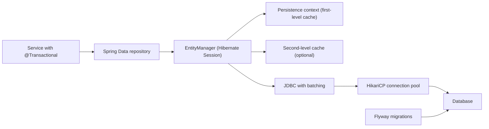

**Words to know:**
- **Entity:** a Java class mapped to a table with `@Entity`.
- **`EntityManager`:** the JPA object that loads and saves entities. In Hibernate it is the `Session`.
- **Persistence context:** the map of entities the `EntityManager` is tracking right now.
- **Flush:** sending the pending changes from memory to the database as SQL.
- **Commit:** making the flushed changes permanent.

**Say this in the interview:**

> Spring Data gives me repositories, but the real work is done by the Hibernate Session, the EntityManager.
> It keeps a persistence context, a first-level cache of managed entities.
> At flush time it turns changes into SQL and sends them through a pooled JDBC connection.
> Most performance problems come from not knowing when that SQL runs.

**They may ask next:**
- **Is the `EntityManager` thread-safe?** No. Spring injects a shared proxy that finds the real one for the current transaction, so injecting it is safe.
- **What is the `EntityManagerFactory`?** A heavy, thread-safe object built once at startup. Hibernate calls it the `SessionFactory`.

---

## JPA vs Hibernate vs Spring Data vs JDBC and jOOQ

**In one line:** JPA is the rule book, Hibernate follows it, Spring Data is the front desk, and JDBC or jOOQ let you write SQL yourself.

**Story:** You want to travel from Delhi to Jaipur.
- **JDBC** is driving your own car. Full control, but you do every turn yourself.
- **jOOQ** is a car with GPS. You still drive, but the GPS checks the road names for you (type-safe SQL).
- **Hibernate (JPA)** is a taxi. You say where to go. The driver picks the route. Fast to use, but sometimes the driver takes a strange road.
- **Spring Data JPA** is a taxi app. You tap one button and a taxi comes.

**How they stack:**

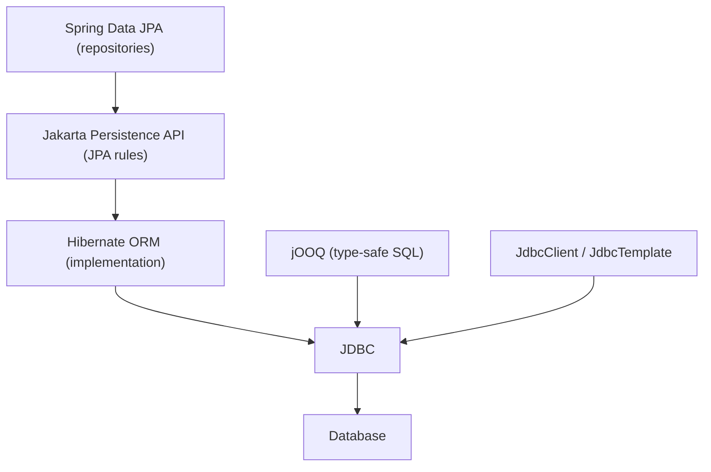

**Words to know:**
- **ORM (Object-Relational Mapping):** a tool that maps Java objects to table rows, so you work with objects, not rows.
- **JPA (Jakarta Persistence):** the standard API. Spring Boot 4 uses Jakarta Persistence 3.2. Spring Boot 3 uses 3.1.
- **Hibernate ORM:** the most used JPA implementation. Spring Boot 4 uses Hibernate 7. Spring Boot 3 uses Hibernate 6.
- **JDBC:** the low-level Java API to send SQL and read rows.
- **jOOQ:** a library that builds SQL from Java code, checked by the compiler.

**When to pick which:**

| Tool | Pick it for | Avoid it for |
|---|---|---|
| Spring Data JPA + Hibernate | CRUD apps, rich domain objects, many related tables, write-heavy business logic | Big reports, complex analytics SQL, bulk loads of millions of rows |
| `JdbcClient` / `JdbcTemplate` | Simple SQL, reports, bulk jobs, full control | Large object graphs with many relations |
| jOOQ | Complex SQL (window functions, CTEs) with compile-time checks | Teams that do not want a code-generation step |
| Spring Data JDBC | Simple aggregates, no lazy loading, no magic | Apps that need lazy loading or a cache |

- Many senior teams mix them. JPA for the write side, and `JdbcClient` or jOOQ for read-heavy reports.
- Both can share the same transaction, because Spring binds one connection to the thread.

**Good and bad:**

| Good | Bad |
|---|---|
| JPA for business writes, plain SQL for reports | Forcing a 10-table report through JPQL and entity graphs |
| Knowing the SQL that Hibernate generates | Treating Hibernate as "no need to know SQL" |

**Say this in the interview:**

> JPA is the standard API and Hibernate is the implementation I use under Spring Data JPA.
> I use JPA for normal business writes because dirty checking and relations save a lot of code.
> For reports, bulk jobs or complex SQL I use JdbcClient or jOOQ, often in the same service.
> The rule is simple: if I am fighting the ORM, I write the SQL.

**They may ask next:**
- **Can Hibernate be used without JPA?** Yes, through its native `Session` API. But most Spring code uses the JPA API.
- **Spring Data JPA vs Spring Data JDBC?** Spring Data JDBC has no persistence context, no lazy loading and no dirty checking. It loads and saves whole aggregates. Simpler, but less automatic.
- **Does jOOQ replace Hibernate?** It can. Some teams use only jOOQ. Others use it next to JPA for the hard queries.

---

## Entity lifecycle: transient, managed, detached, removed

**In one line:** An entity is in one of four states, and the state decides whether Hibernate tracks its changes.

**Story:** A library book.
- **Transient:** a new book on your table. The library does not know about it yet.
- **Managed:** the book is on the library desk, with a card. Any note you write in it, the librarian copies to the register.
- **Detached:** you took the book home. The librarian no longer sees your notes.
- **Removed:** the book has a "to be thrown away" sticker. It goes at closing time.

**Diagram:**

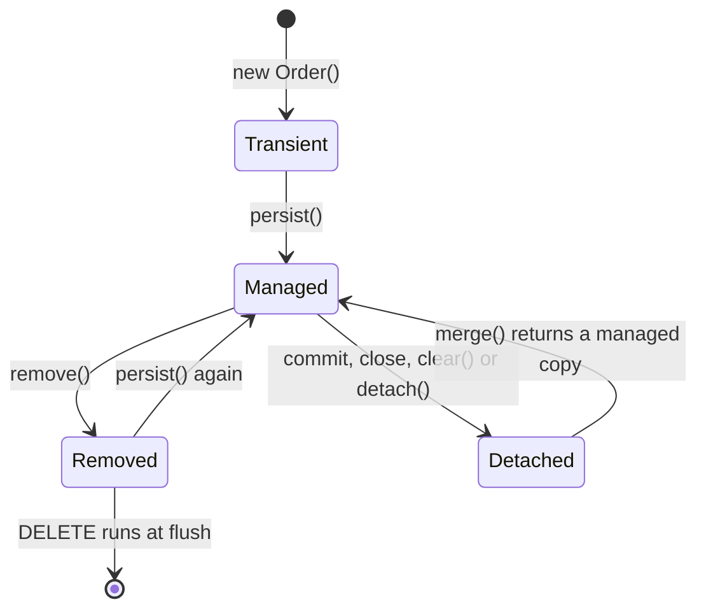

**How it works:**

| State | Has a DB row? | Tracked? | How you get there |
|---|---|---|---|
| Transient | No | No | `new Order()` |
| Managed | Yes, or soon | Yes. Changes become `UPDATE` at flush | `persist()`, `find()`, a query, `merge()` result |
| Detached | Yes | No | Transaction ended, `detach()`, `clear()`, or an entity sent over HTTP and back |
| Removed | Yes, until flush | Yes | `remove()` on a managed entity |

- A query result is always **managed** inside a transaction.
- `merge()` does not make the given object managed. It **returns** a managed copy. Keep using the returned object.
- Hibernate 7 refuses to `refresh()` or `lock()` a detached entity. It throws `IllegalArgumentException`, as the JPA spec says.

**Example:**

```java
@Transactional
public void rename(long id, String name) {
    Customer c = em.find(Customer.class, id);   // managed
    c.setName(name);                            // no save() needed: dirty checking writes UPDATE
}

public Customer load(long id) {
    return customerRepo.findById(id).orElseThrow(); // detached once the method returns
}
```

**Say this in the interview:**

> An entity is transient when it is just a new Java object. It is managed when the persistence context tracks it.
> It is detached after the context closes, and removed after remove().
> Only managed entities get automatic UPDATEs through dirty checking.
> merge() copies a detached object onto a managed one and returns that managed copy, so I use the return value.

**They may ask next:**
- **Does `persist()` on a detached entity work?** No. It throws ("detached entity passed to persist"), because the entity already has an ID and a row. Use `merge()`.
- **What does `em.clear()` do?** It detaches every entity. Pending changes that were not flushed are lost.

---

## The persistence context (first-level cache)

**In one line:** Inside one transaction, Hibernate keeps loaded entities in a map by ID, so each row is read only once.

**Story:** A waiter writes your order on a notepad.
If you ask "what did I order?" twice, he looks at the notepad. He does not walk to the kitchen again.
When you leave, the notepad page is torn off. The next customer gets a fresh page.

**How it works:**
1. `find(Order.class, 5)` first looks in the persistence context map (key = entity type + ID).
2. Not there: run SQL, build the object, put it in the map, and keep a **snapshot** (a copy of the loaded values).
3. A second `find(5)` returns the **same object** from the map. No SQL.
4. The map lives as long as the `EntityManager`. In Spring that is one transaction (or one web request with Open Session In View).

**Diagram:**

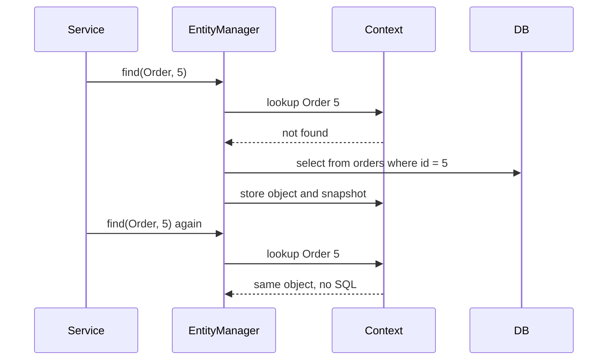

**Important details:**
- **Identity guarantee:** `find(5) == find(5)` is `true` inside one context. This is why `==` works there.
- **Queries still hit the DB.** A JPQL query always runs SQL. But if a returned row is already in the context, Hibernate keeps the object it already has. New column values from the DB are ignored.
- **Memory grows.** Load 100,000 entities in one transaction and all of them, plus their snapshots, stay in memory. Use `clear()` in batch jobs.
- **Not shared.** Two requests never share a persistence context. The shared cache is the [second-level cache](#second-level-cache-and-query-cache).

**Good and bad:**

| Good | Bad |
|---|---|
| Short transactions, small contexts | One transaction that loads half the table |
| `flush()` then `clear()` every N rows in batch jobs | Expecting a query to "refresh" an entity that is already loaded |

**Say this in the interview:**

> The persistence context is the first-level cache. It is always on and lives for one EntityManager, usually one transaction.
> It guarantees one Java object per row and keeps a snapshot for dirty checking.
> It is not shared between requests. It grows with every entity I load, so in batch jobs I flush and clear it.

**They may ask next:**
- **Can you turn the first-level cache off?** No. But a `StatelessSession` has no persistence context at all. It is good for big batch jobs.
- **How do you reload fresh data for an entity already in the context?** `em.refresh(entity)`.

---

## Dirty checking and flush: when SQL really runs

**In one line:** A setter runs no SQL; at flush, Hibernate compares entities with their snapshots and writes the UPDATEs.

**Story:** A shop owner does not run to the bank after every sale.
He writes sales in a notebook during the day. Before closing (commit), or before someone asks "what is the balance?" (a query), he goes to the bank once with all changes.

**How it works:**
1. You change a managed entity: `order.setStatus(PAID)`. No SQL yet.
2. At **flush**, Hibernate compares each managed entity with its snapshot. This is **dirty checking**.
3. For each changed entity, it adds an `UPDATE`. New entities get `INSERT`, removed ones get `DELETE`.
4. Then the transaction commits.

**When does flush happen? (flush mode `AUTO`, the default):**
- Before **commit**.
- Before a **query** whose result may depend on pending changes. Hibernate checks the tables the query touches. For native SQL it cannot know, so it usually flushes to be safe.
- When you call `em.flush()` (or `repo.saveAndFlush()`).

**Flush modes:**

| Mode | Meaning | Use for |
|---|---|---|
| `AUTO` (JPA, default) | Flush before commit and before queries that need it | Almost everything |
| `COMMIT` (JPA) | Flush only at commit | Long read-mostly units where you do not want early SQL |
| `MANUAL` (Hibernate) | Only when you call `flush()` | Read-only work. Spring uses it for `readOnly = true` |
| `ALWAYS` (Hibernate) | Before every query | Rare |

**Diagram:**

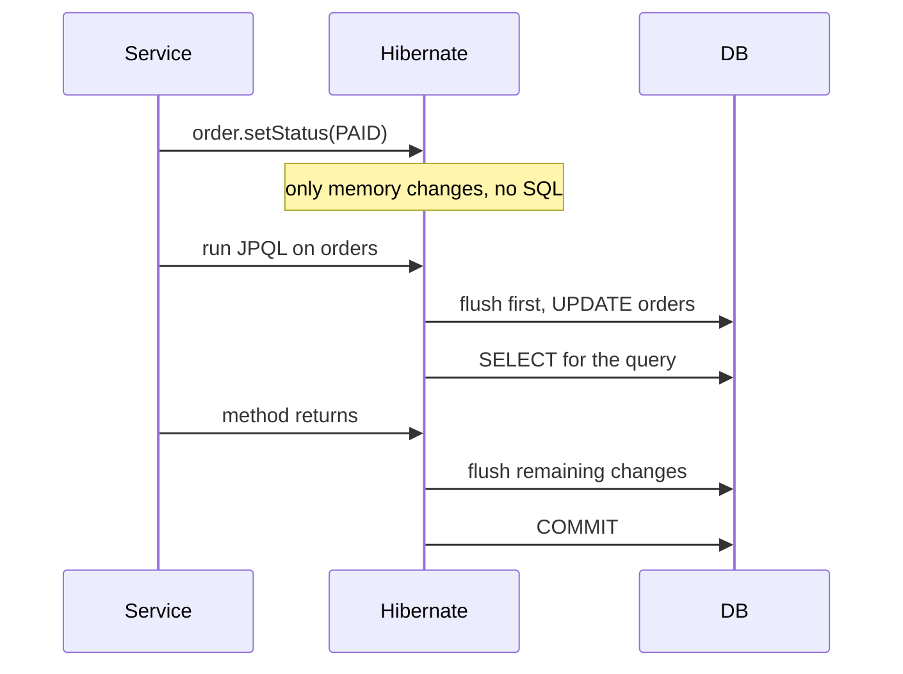

**The flush order gotcha:** Hibernate does not run SQL in the order you called methods. At flush it runs **inserts first, then updates, then deletes**.
So "delete the row with email X, then insert a new row with email X" fails with a unique key error. The insert runs before the delete.
Fix: call `em.flush()` right after the `remove()`.

**Example:**

```java
@Transactional
public void replaceEmail(long oldId, String email) {
    userRepo.deleteById(oldId);
    userRepo.flush();                      // force the DELETE now, before the INSERT
    userRepo.save(new User(email));
}
```

**Performance notes:**
- Dirty checking compares **every** managed entity at every flush. 50,000 entities in the context means 50,000 comparisons, maybe several times per transaction.
- By default Hibernate's `UPDATE` sets **all columns**, not only the changed ones. This lets it reuse one SQL string. `@DynamicUpdate` changes only the dirty columns. It helps for wide tables.
- *Bytecode enhancement* (a build plugin that changes your entity classes) can track changes as they happen, so Hibernate does not compare snapshots.

**Say this in the interview:**

> Setters only change memory. At flush, Hibernate compares managed entities with their snapshots and writes UPDATEs for the dirty ones.
> In AUTO mode it flushes before commit and before queries that need the pending changes.
> At flush it runs inserts, then updates, then deletes.
> So I flush early when the order matters, like delete then insert with the same unique key.

**They may ask next:**
- **Does `flush()` commit?** No. It only sends SQL. A rollback still undoes it.
- **Why do I see an UPDATE I never asked for?** You changed a managed entity, maybe by accident (a setter, a mapper or a `@PreUpdate`). Or a converter returns a new object every time, so the value always looks changed.

---

## save vs persist vs merge, getReferenceById vs findById

**In one line:** `persist` saves a new object, `merge` copies a detached one into a managed one, and Spring Data `save` picks one.

**Story:** At a hotel desk.
- **persist:** a new guest. Make a new room card.
- **merge:** a returning guest with an old card. The desk finds the real record and copies the new details onto it. You get a fresh card back.
- **save:** the desk looks at you and guesses which one you are. If it guesses wrong, it does extra work.

**How Spring Data `save()` decides:**

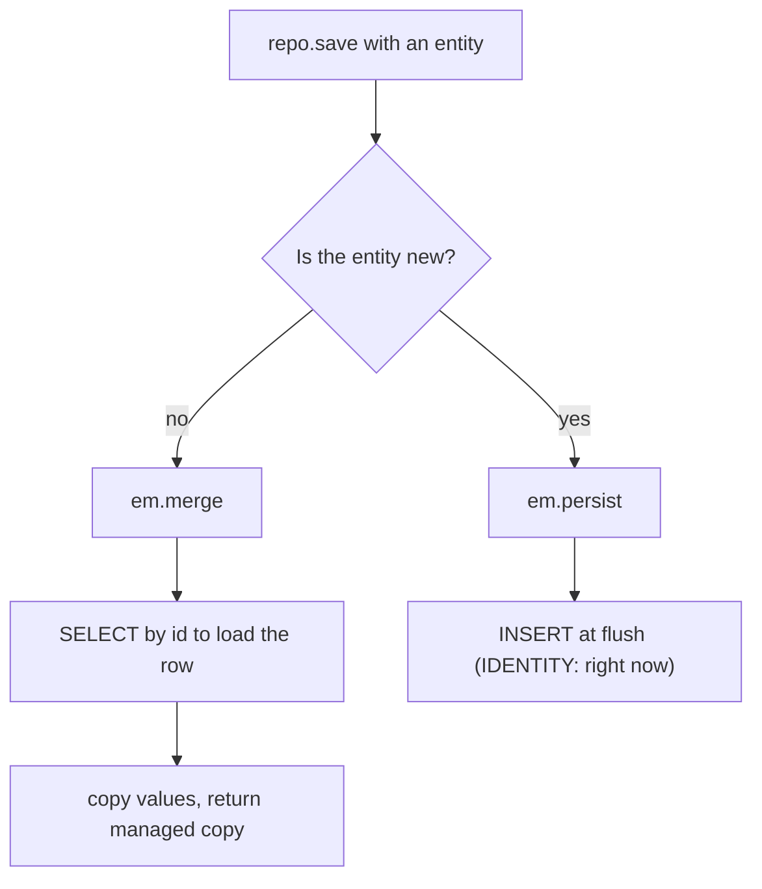

**`isNew()` rules (Spring Data JPA):**
1. If it implements `Persistable<ID>`: your own `isNew()` method decides. This wins over the rules below.
2. If the entity has a `@Version` field of a wrapper type (`Long`, `Integer`): new when the version is `null`.
3. Else, new when the ID is `null` (or `0` for a primitive ID).

**The assigned-ID trap:** you set the ID yourself (a UUID created in the constructor) and call `save()`.
The ID is not `null`, so Spring Data thinks the entity is old and calls `merge()`. Merge first runs a `SELECT` to find the row. One extra query per insert.
Fixes: add a `@Version Long version` field, implement `Persistable`, or let Hibernate generate the ID.

**Hibernate 6.6+ change:** merging a detached entity whose row is gone used to `INSERT` it again silently.
Now, if the entity has a generated ID or a `@Version`, Hibernate throws `OptimisticLockException` instead.

**`getReferenceById` vs `findById`:**

| | `findById(id)` | `getReferenceById(id)` |
|---|---|---|
| JPA method | `em.find()` | `em.getReference()` |
| SQL | Runs `SELECT` now (unless already in the context) | No SQL. Returns a lazy *proxy* (a stand-in object) |
| Row missing | `Optional.empty()` | `EntityNotFoundException` later, on first use of a field |
| Use for | You need the data | You only need it as a foreign key |

**Example:**

```java
@Transactional
public void addItem(long orderId, long productId, int qty) {
    Order order = orderRepo.getReferenceById(orderId);       // proxy, no SELECT
    Product product = productRepo.getReferenceById(productId);
    itemRepo.save(new OrderItem(order, product, qty));       // only the INSERT runs
}
```

- `getOne()` and `getById()` are old names. They are deprecated (still there, but deprecated, in Spring Data JPA 4). Use `getReferenceById()`.
- Hibernate 7 removed the old native `Session` methods `save()`, `update()`, `saveOrUpdate()`, `delete()` and `load()`. Use `persist()`, `merge()`, `remove()` and `getReference()`. `get()` is deprecated; use `find()`.

**Say this in the interview:**

> persist makes a new entity managed and merge returns a managed copy of a detached one.
> Spring Data save calls persist when the entity looks new, and merge otherwise.
> With assigned IDs I add a version field or implement Persistable, to avoid an extra SELECT.
> I use getReferenceById when I only need a foreign key, because it returns a proxy without a query.

**They may ask next:**
- **Do I need to call `save()` after changing a managed entity?** No. Dirty checking writes it. Calling `save()` does no harm, but it hides that you do not understand the lifecycle.
- **What does `saveAndFlush()` add?** It calls `flush()` right away, so constraint errors show up at that line, not at commit.

---

## ID generation: IDENTITY, SEQUENCE and UUID v7

**In one line:** Use a database `SEQUENCE` (or a time-ordered UUID) for IDs; `IDENTITY` is simple but it turns off JDBC insert batching.

**Story:** A token counter at a hospital.
- **IDENTITY:** the patient must walk to the counter for every token. One trip per patient.
- **SEQUENCE with pooling:** the nurse takes a roll of 50 tokens at once and hands them out. One trip per 50 patients.
- **UUID:** every patient prints their own token at home. No trip at all. But random tokens make the filing cabinet messy, unless the token starts with the time (UUID v7).

**How each strategy works:**

| Strategy | How the ID is made | Batch inserts? | Notes |
|---|---|---|---|
| `IDENTITY` | DB auto-increment column. Known only **after** the INSERT | **No** | MySQL's usual choice |
| `SEQUENCE` | Hibernate asks a DB sequence **before** the INSERT | Yes | Best for PostgreSQL and Oracle |
| `TABLE` | A special table imitates a sequence, with row locks | Yes, but slow | Avoid |
| `UUID` | Generated in Java, no DB call | Yes | 16 bytes. Use v7 for index-friendly order |

**Why IDENTITY breaks batching:**
1. `persist()` must put the entity in the persistence context **with its ID**.
2. With IDENTITY, the ID exists only after the row is inserted.
3. So Hibernate runs the INSERT **immediately** at `persist()`, one statement at a time.
4. It cannot collect 50 inserts into one JDBC batch.

**Diagram:**

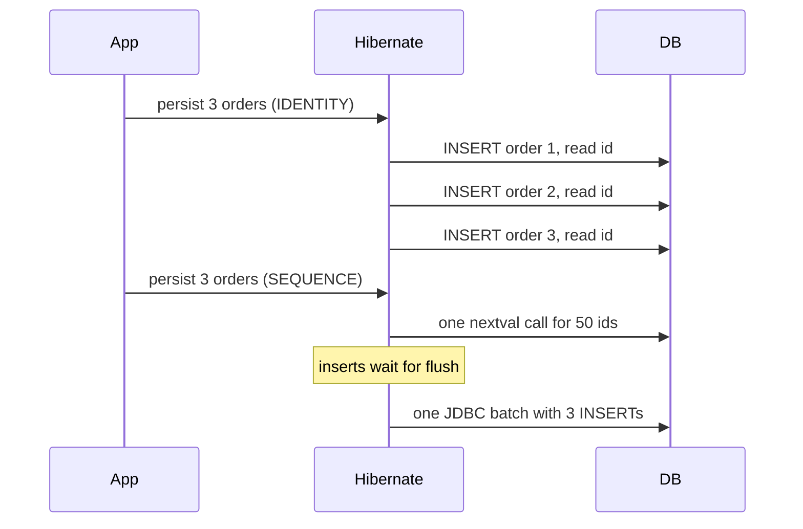

**SEQUENCE and the pooled optimizer:**
- `allocationSize` (default **50**) means one sequence call gives Hibernate 50 IDs. The *pooled optimizer* hands them out from memory.
- The DB sequence must use `INCREMENT BY 50` to match. If your Flyway script says `INCREMENT BY 1`, startup fails or IDs can clash. Keep them the same.
- Gaps in IDs are normal (a restart drops unused IDs). Never use IDs to count rows.
- Since Hibernate 6, `@GeneratedValue` with no strategy uses one sequence per entity named `<entity>_seq`. Hibernate 5 used one shared `hibernate_sequence`. This matters on upgrades.

**Example:**

```java
@Entity
public class Order {
    @Id
    @GeneratedValue(strategy = GenerationType.SEQUENCE, generator = "order_seq")
    @SequenceGenerator(name = "order_seq", sequenceName = "order_seq",
                       allocationSize = 50)          // must match INCREMENT BY 50 in the DB
    private Long id;
}

@Entity
public class Payment {
    @Id
    @UuidGenerator(style = UuidGenerator.Style.VERSION_7)  // time-ordered UUID (Hibernate 7)
    private UUID id;
}
```

**UUID v7 vs v4:**
- **UUID v4** is fully random. New rows land in random places in the B-tree index. Pages split, the cache fills, inserts get slower as the table grows.
- **UUID v7** starts with a millisecond timestamp. New rows go at the end of the index, like a sequence.
- UUIDs are good when IDs are made in many services, or are shown in URLs (no guessing "order 1001 after 1000").
- Store them as the native `uuid` type in PostgreSQL, or `BINARY(16)` in MySQL. Not as a 36-character string.
- PostgreSQL 18 also has a built-in `uuidv7()` function.

**Good and bad:**

| Good | Bad |
|---|---|
| `SEQUENCE` with `allocationSize` matching the DB | `IDENTITY` on a table that gets bulk inserts |
| UUID v7 for IDs made across services | Random UUID v4 as the clustered primary key in MySQL |
| Accepting gaps in IDs | Using ID order as "business order" |

**Say this in the interview:**

> IDENTITY gets the ID from the insert itself, so Hibernate must insert at persist time and cannot batch inserts.
> SEQUENCE gets IDs before the insert, and with allocationSize 50 one sequence call covers 50 rows, so batching works.
> If IDs must be made outside the DB, I use UUID v7, because it is time-ordered and keeps the index compact.

**They may ask next:**
- **MySQL has no sequences. What then?** Use IDENTITY and accept no insert batching, or use UUID v7 created in the app. Avoid the TABLE generator.
- **Is `GenerationType.AUTO` OK?** It lets Hibernate pick. Be explicit, so an upgrade does not change it.
- **Why not use a natural key (like email) as the ID?** Natural keys can change. Use a surrogate ID, and put a unique constraint (and `@NaturalId`) on the natural key.

---

## Relationships and the owning side

**In one line:** Only the owning side (the one with the foreign key) writes SQL; the `mappedBy` side is just a mirror.

**Story:** A school register and a student's diary.
The register (the `order_item` table with its `order_id` column) is the official record.
The diary (the `Order.items` list) is a copy for your convenience.
If you write in the diary only, the school register does not change.

**Diagram (tables):**

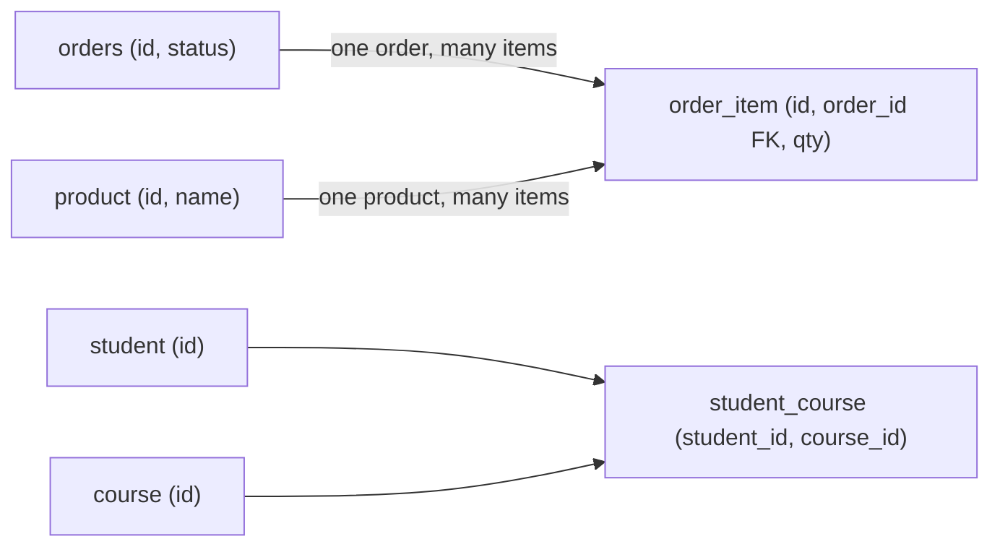

### @ManyToOne and @OneToMany

- `@ManyToOne` sits on the child (`OrderItem.order`). It maps the foreign key column. **It is the owning side.**
- `@OneToMany(mappedBy = "order")` on the parent (`Order.items`) is the **inverse side**. Hibernate ignores it when writing.
- Keep both sides in sync with **helper methods** on the parent.

```java
@Entity
public class Order {
    @Id @GeneratedValue Long id;

    @OneToMany(mappedBy = "order", cascade = CascadeType.ALL, orphanRemoval = true)
    private List<OrderItem> items = new ArrayList<>();

    public void addItem(OrderItem item) {
        items.add(item);
        item.setOrder(this);            // the owning side: this is what writes order_id
    }
    public void removeItem(OrderItem item) {
        items.remove(item);
        item.setOrder(null);
    }
}

@Entity
public class OrderItem {
    @Id @GeneratedValue Long id;
    @ManyToOne(fetch = FetchType.LAZY, optional = false)   // default is EAGER: always change it
    @JoinColumn(name = "order_id")
    private Order order;
}
```

- **Unidirectional `@OneToMany` without `mappedBy`** is a trap. Hibernate creates a **join table**, or runs an extra `UPDATE` per child to set the foreign key. Prefer `@ManyToOne` on the child, plus `mappedBy` if you need the list.
- Often you do not need the parent's list at all. A query `findByOrderId` is enough and avoids big collections.

### @OneToOne

- The side with the foreign key owns it. The other side uses `mappedBy`.
- The inverse side of a `@OneToOne` **cannot be lazy** in plain Hibernate (it must query to know if the value is `null`).
- Best mapping: `@MapsId` on the child, so the child shares the parent's primary key.

```java
@Entity
public class UserProfile {
    @Id Long id;                                  // same value as the user's id
    @OneToOne(fetch = FetchType.LAZY) @MapsId     // shares the primary key
    private User user;
}
```

### @ManyToMany

- One side owns the join table. The other side has `mappedBy`.
- Use a `Set`, not a `List`. With a `List`, removing one link makes Hibernate delete **all** rows for that parent in the join table and insert the rest again.
- Do not use `CascadeType.REMOVE` on many-to-many. Deleting a student would delete the courses too.

```java
@Entity
public class Student {
    @Id @GeneratedValue Long id;
    @ManyToMany
    @JoinTable(name = "student_course",
        joinColumns = @JoinColumn(name = "student_id"),
        inverseJoinColumns = @JoinColumn(name = "course_id"))
    private Set<Course> courses = new HashSet<>();    // Set, not List
}
```

### Many-to-many with extra columns becomes an entity

- The business asks: "when did the student join the course, and what grade did they get?"
- A plain join table has only two foreign keys. There is no place for `joinedAt` or `grade`.
- So turn the join table into its own entity, `Enrollment`, with two `@ManyToOne` links.
- Now you have two one-to-many relations instead of one many-to-many. This is easier to query, page and lock.

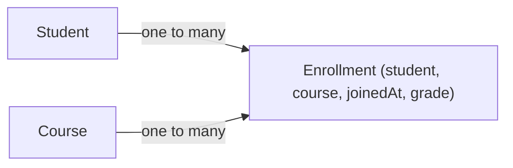

```java
@Entity
public class Enrollment {
    @Id @GeneratedValue Long id;
    @ManyToOne(fetch = FetchType.LAZY) Student student;
    @ManyToOne(fetch = FetchType.LAZY) Course course;
    Instant joinedAt;                       // the extra columns are why this is an entity
    String grade;
}
```

**Good and bad:**

| Good | Bad |
|---|---|
| `@ManyToOne(fetch = LAZY)` on the child, `mappedBy` on the parent | Unidirectional `@OneToMany` with a hidden join table |
| Helper methods that set both sides | Setting only `order.getItems().add(item)` and wondering why `order_id` is null |
| `Set` for many-to-many, or a link entity | `List` many-to-many and cascade REMOVE |

**Say this in the interview:**

> The owning side is the one with the foreign key, usually the @ManyToOne side. Only that side is used to write SQL.
> The other side uses mappedBy and is just a mirror, so I keep both in sync with helper methods.
> For many-to-many I use a Set. When the link needs extra columns, I make the join table its own entity.

**They may ask next:**
- **What if I only set the inverse side?** Nothing is saved for the relation. The foreign key stays `null`.
- **Should I map every relation both ways?** No. Map only what the code needs. Many relations can be one-way `@ManyToOne` plus a query.

---

## Fetch types: LAZY vs EAGER

**In one line:** LAZY loads related data when you touch it, EAGER always loads it; use LAZY and fetch per query.

**Story:** Ordering at a restaurant.
LAZY is ordering dessert only if you still want it. EAGER is the waiter bringing dessert with every meal, even when you are full.
Worse, EAGER brings dessert for every person at every table, every time anyone orders anything.

**JPA defaults:**

| Annotation | Default | What to set |
|---|---|---|
| `@ManyToOne` | **EAGER** | `fetch = FetchType.LAZY` |
| `@OneToOne` | **EAGER** | `fetch = FetchType.LAZY` |
| `@OneToMany` | LAZY | Keep it |
| `@ManyToMany` | LAZY | Keep it |
| `@ElementCollection` | LAZY | Keep it |

**How LAZY works:**
- For a single object (`@ManyToOne`), Hibernate puts a **proxy** there: a generated subclass of your entity. It runs SQL on the first call of a getter (not `getId()`).
- For a collection, Hibernate puts its own `PersistentBag` or `PersistentSet`. It loads on the first `size()`, loop or `get()`.
- You need an open persistence context when it loads. Otherwise: `LazyInitializationException`.

**Diagram:**

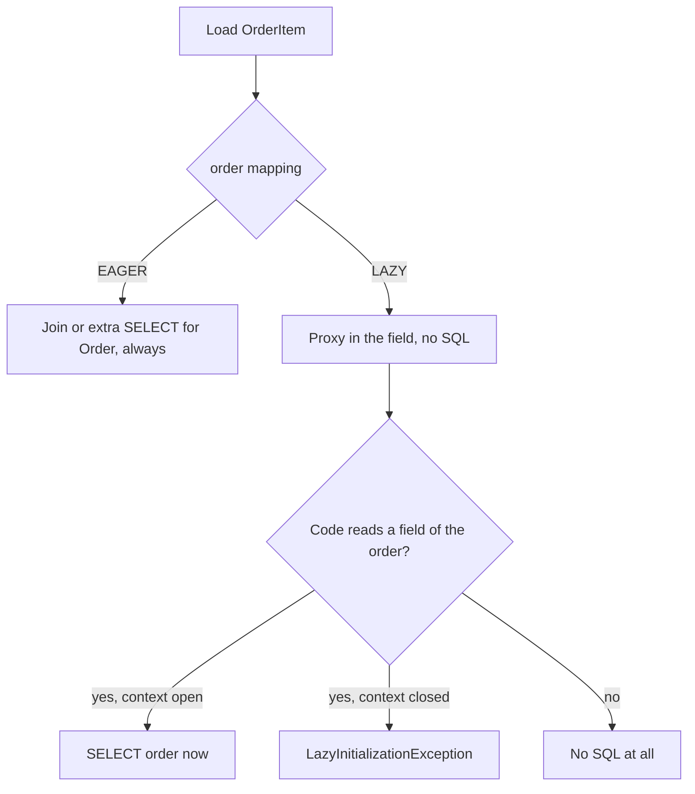

**Why EAGER is bad:**
- You cannot turn EAGER off for one query. It is fixed in the mapping.
- With JPQL queries, EAGER relations are loaded with **extra selects**, one per row. EAGER causes N+1, it does not fix it.
- It loads data most screens do not need.

**Say this in the interview:**

> The JPA defaults are EAGER for ManyToOne and OneToOne and LAZY for collections. I set everything to LAZY.
> LAZY works with proxies and persistent collections that load on first access.
> Then I fetch per use case with join fetch, entity graphs or DTO queries.
> EAGER cannot be turned off per query, and it causes N+1.

**They may ask next:**
- **Does `getId()` on a proxy run SQL?** No. The proxy already knows its ID.
- **How do I check if something is loaded?** `Hibernate.isInitialized(order.getItems())`, or JPA's `PersistenceUnitUtil.isLoaded()`.

---

## N+1: recap and all the fixes

**In one line:** One query loads a list, then one more query runs per row; fetch the relation up front or in batches.

**Recap:** The full story and basic fixes are in [The N+1 problem and how to fix it](spring-ecosystem.md#the-n1-problem-and-how-to-fix-it). How to detect it in logs and tests is in [Detecting N+1](spring-debugging.md#detecting-n1).
Here is the senior-level comparison.

**Diagram:**

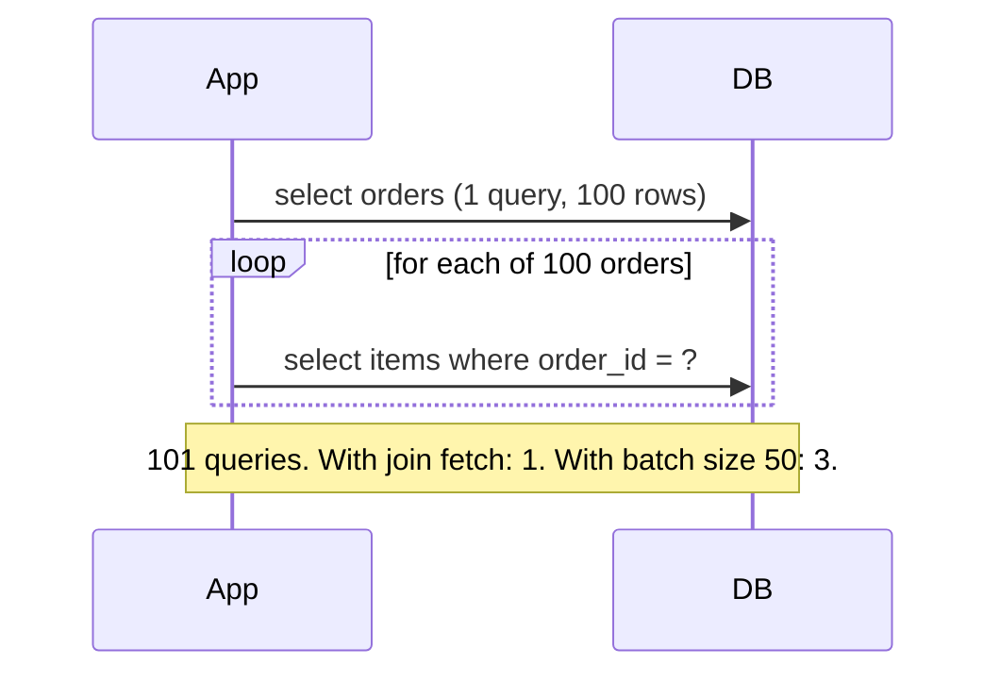

**All the fixes:**

| Fix | Queries for 100 orders | Good for | Watch out |
|---|---|---|---|
| `join fetch` in JPQL | 1 | One known use case | Duplicate parent rows (Hibernate 6+ removes them for you). Breaks paging |
| `@EntityGraph(attributePaths = ...)` | 1 | Same, on a repository method | Same paging issue |
| `@BatchSize(size = 50)` or `hibernate.default_batch_fetch_size=50` | 1 + 2 | A global safety net | Still more than one query |
| `@Fetch(FetchMode.SUBSELECT)` | 2 | Load all children of the first query's parents | Re-runs the parent query as a subquery |
| DTO projection | 1 | List screens and APIs | Read-only data |

**Example:**

```java
public interface OrderRepository extends JpaRepository<Order, Long> {

    @Query("select o from Order o join fetch o.items where o.customer.id = :cid")
    List<Order> findWithItems(long cid);                  // 1 query with a join

    @EntityGraph(attributePaths = {"items", "customer"})  // same, no JPQL
    List<Order> findByStatus(Status status);
}
```

**Two collections at once:** `join fetch o.items join fetch o.payments` with two `List`s throws `MultipleBagFetchException`.
Even with `Set`s it builds a *Cartesian product*: 50 items x 20 payments = 1,000 rows for one order.
Fix: fetch one collection in the query and let batch fetching load the other. Or run two queries.

**Say this in the interview:**

> N+1 is one query for the parents plus one per parent for a lazy relation.
> For one known use case I use join fetch or an entity graph. As a global safety net I set default_batch_fetch_size, which turns N queries into N divided by the batch size.
> For list screens I use DTO projections. I never join fetch two collections at once, because it creates a Cartesian product.

**They may ask next:**
- **Does Hibernate 6 still need `distinct` with join fetch?** No. Hibernate 6 and 7 remove duplicate parents in memory automatically.
- **What does batch fetching send?** `select ... where order_id in (?, ?, ..., ?)` with up to 50 IDs.

---

## Pagination with fetch join: the in-memory trap

**In one line:** Paging plus `join fetch` on a collection makes Hibernate load all rows and page in memory, with only a warning.

**Story:** You ask a librarian for "the first 10 books, with all their chapters".
In SQL, `LIMIT 10` would cut rows, not books. Book 10 could lose half its chapters.
So the librarian brings **every** book with every chapter to your table, and then picks the first 10. Fine for 100 books. Terrible for 1 million.

**How it shows up:**
- Hibernate 5 log: `HHH000104: firstResult/maxResults specified with collection fetch; applying in memory!`
- Hibernate 6 and 7 use the code `HHH90003004` for the same warning.
- The SQL has **no** `LIMIT`/`OFFSET`. The heap fills up. Memory use jumps under load.
- Make it fail loudly instead: `spring.jpa.properties.hibernate.query.fail_on_pagination_over_collection_fetch=true`.

**Diagram:**

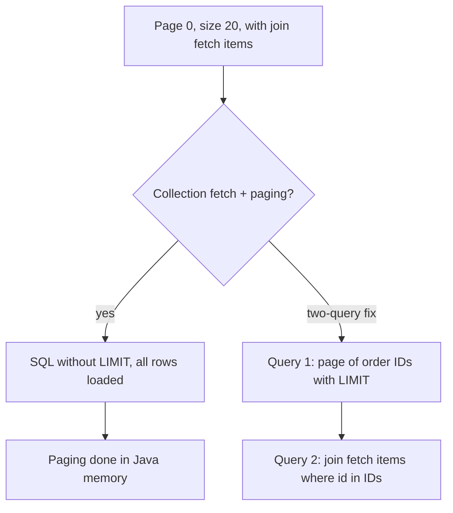

**The fix: two queries.**

```java
public interface OrderRepository extends JpaRepository<Order, Long> {

    @Query("select o.id from Order o where o.status = :s")
    Page<Long> findIds(Status s, Pageable pageable);          // real LIMIT/OFFSET in SQL

    @Query("select o from Order o join fetch o.items where o.id in :ids")
    List<Order> findWithItems(List<Long> ids);                // fetch only those 20
}

Page<Long> ids = repo.findIds(Status.NEW, PageRequest.of(0, 20, Sort.by("id")));
List<Order> orders = repo.findWithItems(ids.getContent());    // re-sort in Java if needed
```

- Other fixes: page the parents without join fetch and use `default_batch_fetch_size`. Or return a flat DTO for the list screen.
- `@ManyToOne` joins are fine with paging. Only **collection** fetches cause this.

**Say this in the interview:**

> Join fetching a collection with paging makes Hibernate drop the LIMIT, load everything, and page in memory. It only logs HHH000104, or HHH90003004 in Hibernate 6 and 7.
> I turn on fail_on_pagination_over_collection_fetch so it throws in tests.
> The fix is two queries: first a page of IDs, then a join fetch for those IDs.

**They may ask next:**
- **Why can't SQL just page it?** `LIMIT` counts rows. One order with 5 items is 5 rows, so a row limit cuts orders in half.
- **Does `@EntityGraph` with paging have the same problem?** Yes, if the graph includes a collection.

---

## Cascade types and orphanRemoval

**In one line:** Cascade passes an operation from parent to children; `orphanRemoval` deletes a child taken out of the collection.

**Story:** A train and its coaches.
If the train is cancelled (remove), its coaches are taken off too: that is cascade REMOVE.
If one coach is unhooked and left on the side track (removed from the list), orphanRemoval sends it to the scrap yard.

**Cascade types:**

| Type | Passes this from parent to child |
|---|---|
| `PERSIST` | `persist()`: save new children with the parent |
| `MERGE` | `merge()`: copy detached children too |
| `REMOVE` | `remove()`: delete children with the parent |
| `REFRESH` | `refresh()`: reload children from the DB |
| `DETACH` | `detach()`: detach children too |
| `ALL` | All of the above |

**Diagram:**

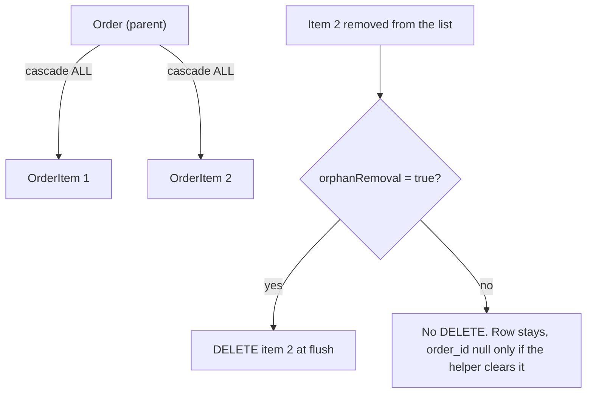

**Rules:**
- Cascade only from **parent to child** in a real ownership: `Order` owns `OrderItem`.
- **Never cascade from child to parent.** `@ManyToOne(cascade = REMOVE)` on `OrderItem.order` deletes the whole order when one item is deleted.
- Never cascade `REMOVE` on `@ManyToMany`. The other side is shared.
- `orphanRemoval = true` is for children that cannot live without the parent.
- Cascade `REMOVE` loads each child and deletes it one by one. For 10,000 children, a bulk delete or an `ON DELETE CASCADE` foreign key in the DB is faster.
- With `orphanRemoval`, never replace the collection object (`order.setItems(newList)`). Hibernate throws. Clear and add to the same list instead.

**Say this in the interview:**

> Cascade passes operations from parent to child. I use cascade ALL plus orphanRemoval only where the parent really owns the children, like order and order items.
> I never cascade from a child to a parent, or REMOVE on many-to-many.
> For very large child sets I delete with a bulk query or an ON DELETE CASCADE foreign key instead.

**They may ask next:**
- **Cascade REMOVE vs orphanRemoval?** REMOVE deletes children when the parent is deleted. orphanRemoval also deletes a child that is just taken out of the collection.
- **Is `ON DELETE CASCADE` in the DB the same?** It does the delete in the DB. Hibernate does not know, so entities already in memory are stale.

---

## equals and hashCode for entities

**In one line:** Entity `hashCode` must not change when the entity is saved; use a business key, or the ID with a constant `hashCode`.

**Story:** A hotel locker.
You put your bag in locker number 7, chosen by your token's colour.
If the token's colour changes after you lock the bag, you look in the wrong locker and the bag is "lost".
A `HashSet` does the same. If `hashCode` changes after you add an entity, the set cannot find it any more.

**The problem:**
1. `new Order()` has `id = null`. You add it to a `HashSet`. Its hash is based on `null`.
2. `persist()` gives it `id = 101`. Now `hashCode()` returns a different value.
3. `set.contains(order)` is `false`. `set.remove(order)` does nothing.

**Diagram:**

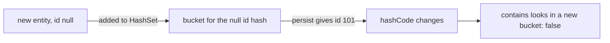

**Options:**

| Approach | Works? | Notes |
|---|---|---|
| Do not override (`Object` identity) | Only inside one persistence context | Breaks with detached objects and two sessions |
| All fields (Lombok `@Data`, `@EqualsAndHashCode`) | **No** | Hash changes on every edit. Touches lazy fields and loads them |
| Business key (`@NaturalId`, like ISBN or email) | Yes | Best when a stable, unique business key exists |
| ID in `equals`, constant `hashCode` | Yes | Safe default when there is no business key |

**Example:**

```java
@Entity
public class Book {
    @Id @GeneratedValue private Long id;
    @NaturalId private String isbn;

    @Override public boolean equals(Object o) {
        if (this == o) return true;
        if (!(o instanceof Book other)) return false;     // instanceof also accepts Hibernate proxies
        return id != null && id.equals(other.getId());    // getter, because a proxy's fields are empty
    }
    @Override public int hashCode() {
        return Book.class.hashCode();                     // constant: same before and after persist
    }
    public Long getId() { return id; }
}
```

- A constant `hashCode` puts all books in one bucket. That is fine for the small sets an entity usually has.
- Do not use Lombok `@Data` or `@ToString` on entities. `toString()` on two linked entities can loop forever, and it loads lazy fields.
- Java `record`s cannot be entities: they are final and immutable. They are great as DTOs and, since JPA 3.2, as `@Embeddable` value objects.

**Say this in the interview:**

> Entity equals and hashCode must not change when the ID is assigned, or HashSets break.
> I prefer a natural business key. If there is none, I compare non-null IDs in equals and return a constant hashCode.
> I use instanceof and getters so Hibernate proxies work, and I never use Lombok @Data on entities.

**They may ask next:**
- **Why not `getClass() != o.getClass()`?** A lazy proxy is a subclass, so the classes differ and `equals` wrongly returns `false`.
- **What if IDs are UUIDs assigned in the constructor?** Then the ID never changes, so ID-based `equals` and `hashCode` are both safe.

---

## Second-level cache and query cache

**In one line:** The second-level (L2) cache shares entity data across sessions; use it only for data read often and changed rarely.

**Story:** An office has a shared shelf near the door with the most used files: the holiday list, the price list.
Nobody walks to the record room for them. But if someone in the record room changes the price list and forgets to update the shelf, people read old prices.

**Lookup order:**

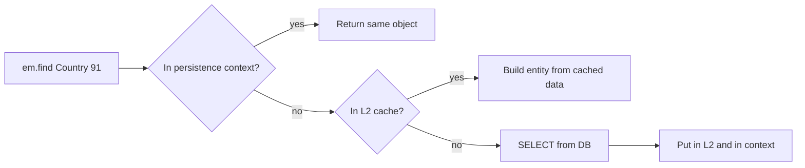

**How it works:**
- The L2 cache stores entity **data** (not objects), keyed by type and ID. It is used by `find()`, lazy loading and relation loading by ID.
- A normal JPQL query does **not** read entities from the L2 cache, unless the query cache is also on.
- Providers: Ehcache 3, Caffeine or Infinispan through JCache (JSR-107), or Hazelcast and Infinispan for clusters.
- Concurrency strategies: `READ_ONLY` (never changes, fastest), `NONSTRICT_READ_WRITE`, `READ_WRITE` (uses soft locks, the usual choice), `TRANSACTIONAL`.

**Example:**

```properties
spring.jpa.properties.hibernate.cache.use_second_level_cache=true
spring.jpa.properties.hibernate.cache.region.factory_class=jcache
# only entities marked @Cacheable are cached (this is the default mode)
spring.jpa.properties.jakarta.persistence.sharedCache.mode=ENABLE_SELECTIVE
```

```java
@Entity
@Cacheable
@org.hibernate.annotations.Cache(usage = CacheConcurrencyStrategy.READ_ONLY)   // never changes
public class Country { @Id Long id; String name; }
```

**The query cache:**
- Turn on with `hibernate.cache.use_query_cache=true`, then mark each query as cacheable (hint `org.hibernate.cacheable`).
- It stores a query's result, keyed by the SQL and the parameters.
- It is **cleared for a table whenever any row of that table changes**. On a busy table, it is cleared all the time and only adds cost.
- Good only for queries on near-static data, like "all active countries".

**When it is worth it / when it is not:**

| Worth it | Not worth it |
|---|---|
| Reference data: countries, currencies, categories | Orders, payments, stock: they change all the time |
| Many reads by ID | Mostly list queries with filters |
| Only this app writes the table | Other apps, scripts or bulk SQL update the table too |
| One instance, or a shared clustered cache | Many pods with separate local caches that drift apart |

- Many teams skip the L2 cache and use [Spring Cache](spring-ecosystem.md#caching-with-spring-cache) with [Redis](redis.md) at the service level. It caches DTOs, not entities, with a clear TTL.

**Say this in the interview:**

> The first-level cache is per session and always on. The second-level cache is optional and shared across sessions in the app.
> I use it only for reference data that is read often and changes rarely, through JCache.
> Only this app may write that data. I use READ_ONLY or READ_WRITE.
> The query cache is invalidated on every write to its tables, so I enable it only for near-static queries. For most caching I prefer Spring Cache with Redis on DTOs.

**They may ask next:**
- **What happens on a bulk JPQL update?** Hibernate clears the cache region for that entity, because it cannot know which rows changed.
- **How does the cache stay correct with 5 pods?** With local caches, it does not. Use a clustered provider, short expiry, or `READ_ONLY` data.

---

## Batch inserts and updates

**In one line:** JDBC batching sends many statements in one round trip; set `hibernate.jdbc.batch_size` and avoid IDENTITY IDs.

**Story:** Posting 1,000 letters.
Going to the post office once per letter takes all day.
Putting 50 letters in one bag per trip takes 20 trips.

**Numbers:** 10,000 inserts with a 1 ms round trip each is about 10 seconds of waiting.
With a batch size of 50, it is 200 round trips: about 0.2 seconds.

**How it works:**
1. Set `hibernate.jdbc.batch_size`. Hibernate groups statements with the **same SQL** into one JDBC batch.
2. `order_inserts` and `order_updates` sort statements by entity type, so mixed parents and children still form long batches.
3. Every N rows, call `flush()` then `clear()`. Otherwise all entities stay in the persistence context and memory grows.
4. Make sure IDs come from a `SEQUENCE` or UUID. IDENTITY silently turns insert batching off.

**Example:**

```properties
spring.jpa.properties.hibernate.jdbc.batch_size=50
spring.jpa.properties.hibernate.order_inserts=true
spring.jpa.properties.hibernate.order_updates=true
# PostgreSQL driver rewrites a batch into one multi-row INSERT (MySQL: rewriteBatchedStatements=true)
spring.datasource.url=jdbc:postgresql://db:5432/shop?reWriteBatchedInserts=true
```

```java
@Transactional
public void importProducts(List<ProductRow> rows) {
    for (int i = 0; i < rows.size(); i++) {
        em.persist(Product.from(rows.get(i)));
        if ((i + 1) % 50 == 0) {      // same number as batch_size
            em.flush();                // send the batch
            em.clear();                // free memory: detach the 50 entities
        }
    }
}
```

**Diagram:**

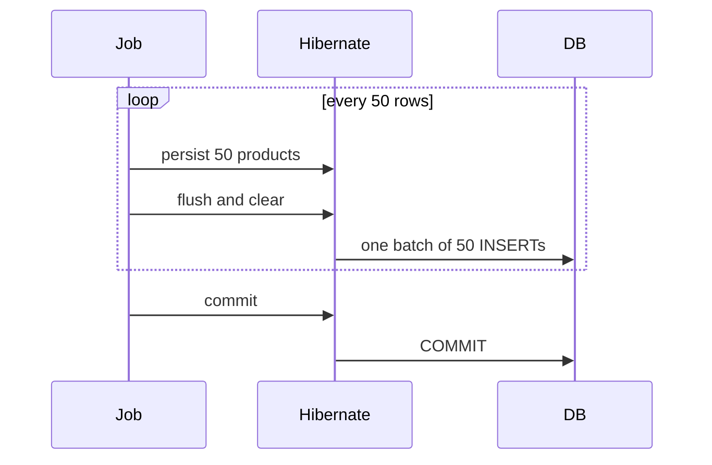

**Other tools for big jobs:**
- **`StatelessSession`:** no persistence context, no dirty checking, no cascades. In Hibernate 7, use its `insertMultiple()` and `updateMultiple()` for batches.
- **`JdbcClient` / `JdbcTemplate.batchUpdate`**, or the database's COPY or LOAD DATA command, for millions of rows.
- **Spring Batch** for restartable jobs with chunks. See [Spring Batch](spring-ecosystem.md#spring-batch).

**Say this in the interview:**

> I set hibernate.jdbc.batch_size to around 50 and turn on order_inserts and order_updates, so statements are grouped by table.
> I use SEQUENCE or UUID IDs, because IDENTITY disables insert batching.
> In a loop I flush and clear every batch so memory stays flat. For millions of rows I skip Hibernate and use JDBC batch or the database's COPY command.

**They may ask next:**
- **How do you confirm batching works?** Hibernate statistics show the number of JDBC batches. Or use datasource-proxy logs, which show "batch size: 50".
- **Does `saveAll()` batch?** Yes, with `batch_size` set. But it does not clear the context, so for big lists use a loop with flush and clear.

---

## Bulk updates and the stale persistence context

**In one line:** A JPQL `update` or `delete` skips the persistence context, so entities already in memory keep old values.

**Story:** A teacher changes all marks in the school's computer.
But your printed report card, which you are holding, still shows the old marks.
If you now "save" the report card back, you overwrite the new marks with the old ones.

**How it works:**
- `@Modifying @Query("update ...")` runs one SQL statement for many rows. Fast.
- It skips: the persistence context, dirty checking, `@Version` checks, lifecycle callbacks (`@PreUpdate`) and cascades.
- Hibernate clears the L2 cache region for that entity.
- Entities loaded **before** the bulk update are now **stale** (old data).

**Diagram:**

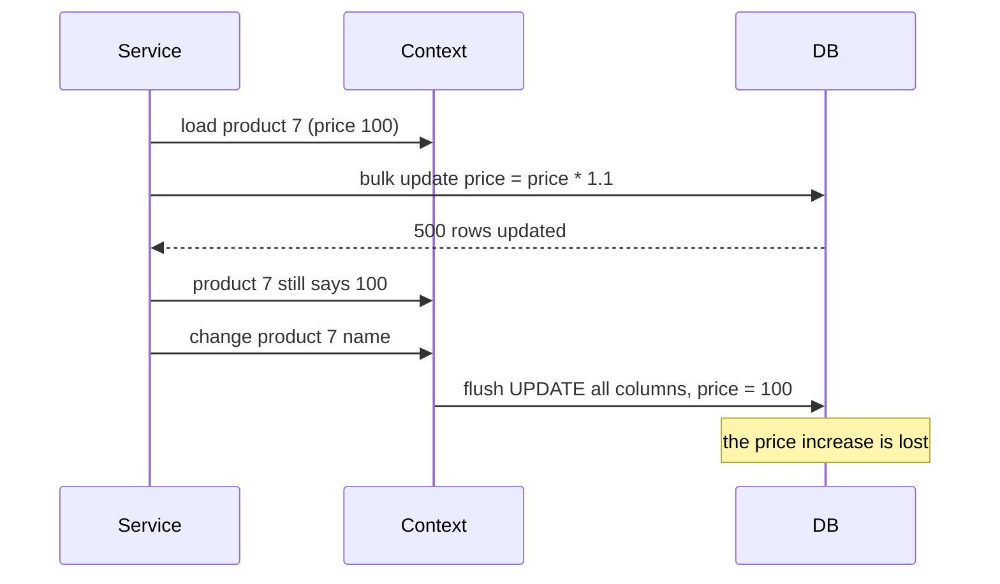

**Example:**

```java
public interface ProductRepository extends JpaRepository<Product, Long> {

    @Modifying(flushAutomatically = true,   // flush pending changes before the bulk SQL
               clearAutomatically = true)   // clear the context after, so nothing is stale
    @Query("update Product p set p.price = p.price * 1.1 where p.category = :c")
    int raisePrices(String c);
}
```

- `flushAutomatically` makes sure pending changes reach the DB first, so the bulk SQL sees them.
- `clearAutomatically` detaches everything after, so later reads load fresh rows.
- Bulk updates do not bump `@Version`. Set it yourself: `set p.version = p.version + 1`. Hibernate's HQL also has `update versioned`.

**Say this in the interview:**

> A bulk JPQL update runs directly in the database and skips the persistence context, versions and callbacks.
> Entities already in memory become stale, and a later flush can overwrite the bulk change.
> So I use Modifying with flushAutomatically and clearAutomatically, and I run bulk updates in their own short transaction.

**They may ask next:**
- **Bulk delete with cascades?** Cascades and `orphanRemoval` do not run. Delete children first, or use `ON DELETE CASCADE` in the DB.
- **Why does Spring need `@Modifying`?** It tells Spring Data to call `executeUpdate()` instead of `getResultList()`.

---

## Optimistic locking with @Version and retry

**In one line:** `@Version` turns a lost update into an `OptimisticLockException`, which you retry or return as HTTP 409.

**Recap:** The basic idea, the SQL and the "when to use which" table are in [Optimistic vs pessimistic locking](databases.md#optimistic-vs-pessimistic-locking). Here we add the Hibernate details and a safe retry.

**Story:** Two cashiers update the same stock card. Each card has a page number.
Cashier A writes on page 7 and turns to page 8. Cashier B, still holding page 7, tries to write.
The manager says: "This is page 7, the card is already on page 8. Read it again and redo your change."

**How it works in Hibernate:**
1. Add `@Version Long version`. Hibernate sets it to 0 on insert.
2. Every UPDATE becomes `update product set stock=?, version=8 where id=? and version=7`.
3. If 0 rows change, Hibernate throws `OptimisticLockException`. Spring turns it into `ObjectOptimisticLockingFailureException` (an `OptimisticLockingFailureException`).
4. The transaction is now rollback-only. You cannot "fix and continue". You must start a **new** transaction to retry.

**Diagram:**

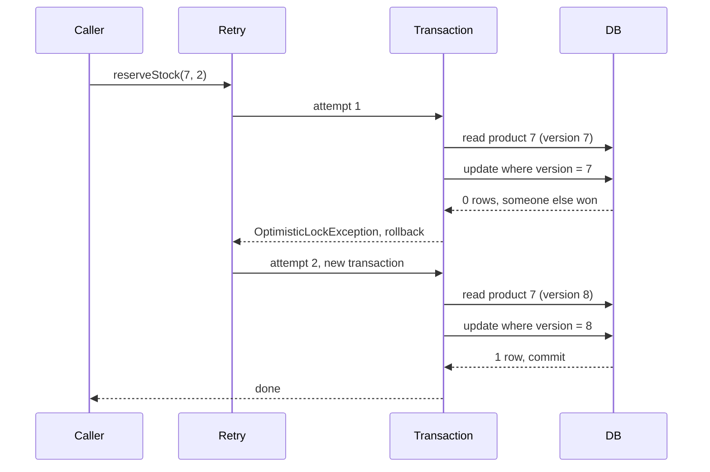

**Example (Spring Framework 7 / Boot 4 built-in retry):**

```java
@Service
class StockFacade {                                   // outer bean: retry wraps the transaction
    private final StockService stock;
    StockFacade(StockService stock) { this.stock = stock; }

    @Retryable(includes = OptimisticLockingFailureException.class,
               maxRetries = 3, delay = 50, jitter = 25)   // short random wait between attempts
    public void reserve(long productId, int qty) {
        stock.reserve(productId, qty);                // each call = a new transaction
    }
}

@Service
class StockService {
    @Transactional
    public void reserve(long productId, int qty) {
        Product p = repo.findById(productId).orElseThrow();
        p.reserve(qty);                               // version is checked at flush
    }
}
```

- Turn the feature on with `@EnableResilientMethods` on a configuration class.
- Boot 3: use the Spring Retry library (`@EnableRetry`, `@Retryable(retryFor = ...)`). Same idea: the retry must be **outside** the transaction.
- **Retry only automatic work** (stock counters, background jobs). For a user editing a form, do not retry. Return **409 Conflict** and show the new data. Send the version to the client (or an `ETag` header) and check it on save.

**More Hibernate details:**
- Version types: `int`, `long`, `short` and wrappers, plus timestamps. JPA 3.2 adds `LocalDateTime` and `Instant`. Numbers are safer than timestamps.
- `LockModeType.OPTIMISTIC_FORCE_INCREMENT` bumps the version of a parent even if only its children changed. Useful for an `Order` whose items changed.
- `@OptimisticLock(excluded = true)` on a field means "changes here do not bump the version" (for example a view counter).

**Say this in the interview:**

> With @Version, Hibernate adds the version to the WHERE clause. If no row matches, someone else changed it, and I get an OptimisticLockException.
> The transaction is then rollback-only, so the retry must start a fresh transaction, from a bean outside the transactional one.
> I retry automatic updates two or three times with jitter. For user edits I return 409 and let the user reload.

**They may ask next:**
- **Can I set the version myself?** Do not change it on a managed entity. For REST updates, compare the client's version with the loaded one and throw if they differ.
- **Optimistic locking without a version column?** Hibernate's `@OptimisticLocking(type = DIRTY)` compares the changed columns. It works only with `@DynamicUpdate` and managed entities.

---

## Pessimistic locks

**In one line:** A pessimistic lock runs `SELECT ... FOR UPDATE` so other transactions wait (or skip the row) until you commit.

**Recap:** When to choose pessimistic over optimistic, and deadlocks, are in [Optimistic vs pessimistic locking](databases.md#optimistic-vs-pessimistic-locking).

**Story:** A single changing room in a shop. You go in and lock the door.
The next person waits outside. If they cannot wait, they try another room (`SKIP LOCKED`) or leave (`NOWAIT`).

**Lock modes:**

| `LockModeType` | SQL (PostgreSQL) | Meaning |
|---|---|---|
| `PESSIMISTIC_READ` | `FOR SHARE` | Others can read and share-lock. Nobody can write |
| `PESSIMISTIC_WRITE` | `FOR UPDATE` | Nobody else can lock or change the row |
| `PESSIMISTIC_FORCE_INCREMENT` | `FOR UPDATE` + version bump | Lock and bump `@Version` |

**Lock timeout hint `jakarta.persistence.lock.timeout` (milliseconds):**
- `3000`: wait up to 3 seconds, then throw `LockTimeoutException` or `PessimisticLockException`.
- `0`: `NOWAIT`. Fail at once if the row is locked.
- `-2` (Hibernate): `SKIP LOCKED`. Skip locked rows. Great for job queues. (Hibernate 7 names these values `Timeouts.NO_WAIT` and `Timeouts.SKIP_LOCKED`.)

**Diagram:**

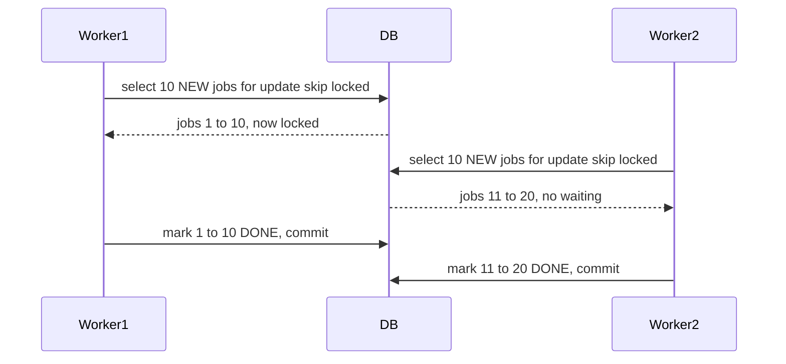

**Example:**

```java
public interface JobRepository extends JpaRepository<Job, Long> {

    @Lock(LockModeType.PESSIMISTIC_WRITE)                       // FOR UPDATE
    @QueryHints(@QueryHint(name = "jakarta.persistence.lock.timeout", value = "-2"))  // SKIP LOCKED
    List<Job> findByStatusOrderById(JobStatus status, Limit limit);  // (NEW, Limit.of(10))
}
```

- Must run inside `@Transactional`. The lock is released at commit or rollback.
- Keep the transaction short. No HTTP calls while holding the lock.
- Lock rows in a fixed order (for example by ID) to avoid deadlocks.
- Support differs by database. Check the generated SQL in tests against the real database ([Testcontainers](spring-ecosystem.md#testcontainers-and-serviceconnection)).

**Say this in the interview:**

> PESSIMISTIC_WRITE becomes SELECT FOR UPDATE, so other transactions wait until I commit.
> I always set a lock timeout, and for job queues I use SKIP LOCKED so workers take different rows without waiting.
> I keep these transactions short and lock rows in a fixed order to avoid deadlocks.

**They may ask next:**
- **Can I lock an entity I already loaded?** Yes: `em.lock(entity, PESSIMISTIC_WRITE)` or `em.refresh(entity, PESSIMISTIC_WRITE)`. The second also reloads fresh data.
- **Why not a simple atomic UPDATE?** Often better: `update stock set qty = qty - 1 where id = ? and qty > 0`. No read, no lock held in Java.

---

## Projections: interface, DTO record and Tuple

**In one line:** A projection reads only the columns a screen needs into a small object, instead of loading full managed entities.

**Story:** You need a list of 20 phone numbers. You do not photocopy 20 full files from the record room. You copy only the phone number line.

**Why it matters:**
- Entities load **all** columns, become managed, get snapshots, and are dirty-checked at flush.
- A DTO projection loads 3 columns and is not tracked. Less memory, less CPU, no lazy-loading surprises.

**Types:**

| Type | How | Notes |
|---|---|---|
| Interface (closed) | `interface OrderView { Long getId(); BigDecimal getTotal(); }` | Spring Data selects only those columns |
| Interface (open) | A getter with `@Value("#{...}")` | Loads the whole entity. Avoid |
| DTO class or record | `select new com.shop.OrderRow(o.id, o.total) from Order o` | Type-safe, fast. Best default |
| `Tuple` | `List<Tuple>`, then `t.get("total", BigDecimal.class)` | Dynamic columns, no extra class |
| Dynamic | `<T> List<T> findByStatus(Status s, Class<T> type)` | Caller chooses the shape |

**Diagram:**

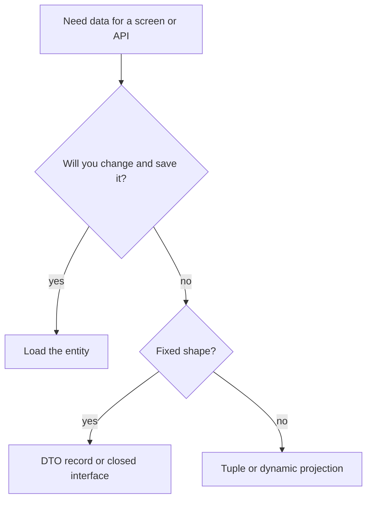

**Example:**

```java
public record OrderRow(Long id, String customerName, BigDecimal total) {}

public interface OrderRepository extends JpaRepository<Order, Long> {

    @Query("""
        select new com.shop.OrderRow(o.id, c.name, o.total)
        from Order o join o.customer c
        where o.status = :status""")                         // 3 columns, one join, no N+1
    List<OrderRow> findRows(Status status, Pageable pageable);

    List<OrderView> findByCustomerId(long customerId);      // closed interface projection
}
```

**Say this in the interview:**

> For read-only screens I use projections, usually a record with a JPQL constructor expression, or a closed interface.
> They select only the needed columns, are not managed, and avoid lazy loading and N+1.
> I load full entities only when I am going to change them.

**They may ask next:**
- **Can a projection include a collection?** Not with a constructor expression. Load the parent rows, then the children by IDs, and group in Java. Or use a JSON aggregate in native SQL.
- **Do projections work with paging?** Yes. Paging is on the selected rows, and there are no collection fetches, so no in-memory trap.

---

## Native queries

**In one line:** Native queries send your own SQL through JPA; use them for database-specific features JPQL cannot express.

**Story:** A translator handles most conversations. But for one local joke, you speak the local language yourself.
You lose the translator's help (portability, type checks), so use it only when needed.

**When to use:**
- Database features: window functions in complex reports, recursive CTEs, `ON CONFLICT` upserts, JSONB operators, `FOR UPDATE SKIP LOCKED` with extra options.
- Query hints and tuned SQL from a DBA.

**Diagram:**

```mermaid
flowchart TD
    A["Need a query"] --> B{"JPQL can express it?"}
    B -->|"yes"| C["JPQL or derived query"]
    B -->|"no"| D{"Result maps to an entity or small DTO?"}
    D -->|"yes"| E["@Query nativeQuery = true"]
    D -->|"no, big report"| F["JdbcClient or jOOQ"]
```

**Example:**

```java
@Modifying
@Query(value = """
    insert into stock (product_id, qty) values (:id, :qty)
    on conflict (product_id) do update set qty = stock.qty + excluded.qty
    """, nativeQuery = true)                         // PostgreSQL upsert: one round trip
int addStock(long id, int qty);

@Query(value = "select id as id, total as total from orders where customer_id = :cid",
       nativeQuery = true)
List<OrderView> findViews(long cid);                 // aliases match the interface getters
```

**Watch out:**
- **Always bind parameters** (`:id`). Never build SQL by joining strings: that is SQL injection.
- Native queries are not checked at startup. A typo fails at runtime. Test them against the real database.
- Hibernate cannot see which tables a native query reads, so it usually flushes everything before it.
- Returning an entity from native SQL needs **all** its columns.
- Paging with `Pageable` may need an explicit `countQuery`.
- Hibernate 7 returns `java.time` types (like `LocalDateTime`) for date columns by default.

**Say this in the interview:**

> I use JPQL by default and native SQL only for database-specific features like upserts, CTEs or window functions.
> I always bind parameters, map results to interface projections or DTOs, and test native queries with Testcontainers against the real database.
> For big reports I prefer JdbcClient or jOOQ over native queries in JPA.

**They may ask next:**
- **Does a native modifying query update the persistence context?** No. Same stale data problem as [bulk updates](#bulk-updates-and-the-stale-persistence-context).
- **Can JPQL do window functions?** Hibernate 6 and 7 HQL support many SQL features, including window functions and (since 6.2) CTEs. Plain JPA does not.

---

## Open Session In View

**In one line:** Open Session In View (OSIV) keeps the session open for the whole request; it hides N+1 and holds connections too long.

**Recap:** The basics are in [The N+1 problem and how to fix it](spring-ecosystem.md#the-n1-problem-and-how-to-fix-it).

**Story:** A library lets you keep your reading-room seat for the whole day, even while you go for lunch and a movie.
Easy for you. But other readers cannot find a seat.

**How it works:**
- Spring Boot sets `spring.jpa.open-in-view=true` by default and logs a startup warning about it.
- `OpenEntityManagerInViewInterceptor` opens an `EntityManager` when the request starts and closes it when the response is written.
- Once the first query gets a JDBC connection, Hibernate keeps it until the request ends.

**Diagram:**

```mermaid
sequenceDiagram
    participant Client
    participant Interceptor
    participant Controller
    participant Service
    participant DB
    Client->>Interceptor: GET /orders/7
    Interceptor->>Interceptor: open EntityManager
    Controller->>Service: getOrder(7)
    Service->>DB: select order (connection taken)
    Service-->>Controller: Order entity
    Controller->>DB: lazy load items while writing JSON
    Controller->>Controller: slow HTTP call, connection still held
    Interceptor->>Interceptor: close EntityManager, return connection
    Interceptor-->>Client: 200 OK
```

**Why disable it:**
- N+1 queries run **during JSON writing**, outside your service, where nobody looks.
- The connection is held during slow work after the service returns. With a pool of 10 and 50 requests, the pool runs dry.
- Entities leak into the web layer. The API shape is tied to your table design.

**Fix:**

```properties
# set this in every new project
spring.jpa.open-in-view=false
```

Then load what each endpoint needs in the service (join fetch, entity graph, DTO) and return DTOs.

**Say this in the interview:**

> Open Session In View keeps the persistence context open until the response is written. It is on by default in Spring Boot.
> It makes lazy loading work in controllers, but hides N+1 queries and holds a database connection for the whole request.
> I turn it off and return DTOs that the service loads completely.

**They may ask next:**
- **What breaks after turning it off?** Any code that touches a lazy field outside a transaction throws `LazyInitializationException`. That is good: it shows you where the hidden queries were.
- **Is `hibernate.enable_lazy_load_no_trans` a fix?** No. It opens a new session and connection for every lazy load. It makes N+1 worse.

---

## LazyInitializationException recap

**In one line:** You touched a lazy relation after the session closed, so Hibernate could not load it.

**Recap:** Error text and quick fixes are in [LazyInitializationException](spring-debugging.md#lazyinitializationexception).

**Story:** You leave the library and then ask for chapter 5 of a book you did not borrow. The library is closed.

**Diagram:**

```mermaid
sequenceDiagram
    participant Controller
    participant Service
    participant DB
    Controller->>Service: findOrder(7)
    Service->>DB: select order 7 (items lazy)
    Service-->>Controller: Order, transaction closed
    Controller->>Controller: order.getItems().size()
    Note over Controller: no session: LazyInitializationException
```

**Fixes, best first:**
1. Return a **DTO** built inside the service transaction.
2. Fetch what you need in the query: `join fetch` or `@EntityGraph`.
3. Call `Hibernate.initialize(order.getItems())` inside the transaction (fine for one relation, adds a query).

**Bad fixes:** EAGER fetch, OSIV, `enable_lazy_load_no_trans`. They hide the problem and cost performance.

**Say this in the interview:**

> LazyInitializationException means a lazy relation was touched after the session closed, often in a controller or JSON serializer.
> I fix it by loading what I need inside the service: join fetch, an entity graph or a DTO.
> I do not fix it with EAGER or Open Session In View.

**They may ask next:**
- **Why don't my tests catch it?** `@Transactional` tests keep the session open for the whole test. Test the service without a test transaction, or with a real HTTP call.

---

## Transactions and read-only optimisations

**In one line:** `readOnly = true` skips snapshots and dirty checking, and can send reads to a replica.

**Recap:** Propagation, rollback rules and proxies are in [@Transactional deep dive](spring-ecosystem.md#transactional-deep-dive). Isolation levels are in [Transactions and isolation levels](databases.md#transactions-and-isolation-levels).

**Story:** A museum visitor with a "look, don't touch" badge.
Guards do not need to check what the visitor changed on the way out. And the visitor can be sent to the copy gallery (replica) instead of the main hall.

**What `readOnly = true` does with Hibernate:**
1. Spring sets the session flush mode to `MANUAL`. No automatic flush, so no dirty checking.
2. Spring marks the session read-only. Loaded entities get **no snapshot**. Less memory.
3. Spring calls `Connection.setReadOnly(true)`. Some drivers and databases then reject writes or allow read-only tricks.
4. A routing data source can send read-only transactions to a **read replica** (a copy of the database for reads).

**Diagram:**

```mermaid
flowchart LR
    A["@Transactional with readOnly = true"] --> B["Routing DataSource"]
    C["@Transactional"] --> B
    B -->|"read-only"| D["Replica pool"]
    B -->|"read-write"| E["Primary pool"]
    D --> F["Read replica DB"]
    E --> G["Primary DB"]
```

**Example:**

```java
@Service
@Transactional(readOnly = true)            // default for the class: reads
class OrderQueryService {
    List<OrderRow> recent(long customerId) { return repo.findRecentRows(customerId); }

    @Transactional                         // writes override it
    void cancel(long id) { repo.findById(id).orElseThrow().cancel(); }
}
```

**More connection and transaction tips:**
- **Delay connection use:** set `spring.datasource.hikari.auto-commit=false` and `spring.jpa.properties.hibernate.connection.provider_disables_autocommit=true`. Hibernate then takes the connection at the first SQL, not at the start of the transaction.
- **Routing needs `LazyConnectionDataSourceProxy`**, so the connection is chosen after Spring knows the transaction is read-only.
- **Replica lag:** a replica can be a few hundred milliseconds behind. "Save, then read my own write" must go to the primary.
- **Timeouts:** `@Transactional(timeout = 5)` stops a transaction that runs too long.
- **Changes in a read-only transaction are silently ignored.** No error, no UPDATE. A real bug source.

**Say this in the interview:**

> readOnly = true sets the flush mode to manual and makes the session read-only.
> So there are no snapshots and no dirty checking.
> It also marks the JDBC connection read-only, and with a routing data source I can send these transactions to a replica.
> I keep transactions short, avoid remote calls inside them, and delay getting the connection until the first SQL.

**They may ask next:**
- **Is `readOnly` a security feature?** No. It is a hint. Use database permissions to block writes.
- **Does `readOnly` help for a single `findById`?** A little. The big win is for transactions that load many entities.

---

## Schema migrations and ddl-auto

**In one line:** In production, Flyway or Liquibase owns the schema; Hibernate should only validate it (`ddl-auto=validate`) or do nothing (`none`).

**Recap:** How Flyway works and zero-downtime "expand and contract" are in [Database migrations with Flyway or Liquibase](spring-ecosystem.md#database-migrations-with-flyway-or-liquibase).

**Story:** A building's structure is changed only by an architect with approved drawings (migration scripts).
The tenant (Hibernate) may check that the rooms match the plan, but must not knock down walls.

**`spring.jpa.hibernate.ddl-auto` values:**

| Value | What Hibernate does | Use in |
|---|---|---|
| `none` | Nothing | Production (default for non-embedded databases) |
| `validate` | Checks tables and columns match the entities. Fails startup if not | Production and tests |
| `update` | Adds missing tables and columns. Never drops or renames | Local experiments only |
| `create` | Drops and creates the schema at startup | Throw-away tests |
| `create-drop` | Like `create`, and drops at shutdown | Default for embedded DBs (H2) with no migration tool |

**Why not `update` in production:**
- It cannot rename, drop, or change types safely. Old columns stay forever.
- Nobody reviews the SQL before it runs.
- 10 pods starting together all try to change the schema.
- No history and no rollback plan.

**Diagram:**

```mermaid
flowchart LR
    A["Developer writes V5__add_status.sql"] --> B["Code review"]
    B --> C["CI runs Flyway on Testcontainers"]
    C --> D["Deploy: Flyway migrates the DB"]
    D --> E["App starts with ddl-auto=validate"]
    E --> F["Entities match the schema"]
```

**Tips:**
- **Boot 4:** add `spring-boot-starter-flyway` (or `spring-boot-starter-liquibase`). In Boot 3, `flyway-core` alone was enough.
- Need a first draft of the SQL? Let Hibernate write a script, then review and edit it: `spring.jpa.properties.jakarta.persistence.schema-generation.scripts.action=create` with `...scripts.create-target=schema.sql`.
- Sequences: keep `INCREMENT BY` equal to `allocationSize` (see [ID generation](#id-generation-identity-sequence-and-uuid-v7)).
- JPA 3.2 adds a `SchemaManager` API (`emf.getSchemaManager().validate()`), handy in tests.

**Say this in the interview:**

> In production Flyway or Liquibase owns the schema, with versioned scripts in git that are reviewed and tested.
> Hibernate runs with ddl-auto set to validate or none. Never update, because it cannot rename or drop safely and nobody reviews its SQL.
> For zero downtime I follow expand and contract.

**They may ask next:**
- **`validate` vs `none`?** `validate` fails fast if an entity and the table disagree. Some teams use `none` in production and run `validate` in CI tests.

---

## Common production mistakes

**In one line:** Most Hibernate incidents come from a short list of mistakes, led by N+1, EAGER, OSIV and long transactions.

**Story:** Most road accidents happen at the same few dangerous turns. Learn the turns, and you avoid most accidents.

**Triage diagram (a slow endpoint):**

```mermaid
flowchart TD
    A["Endpoint is slow"] --> B{"Many similar SQL statements?"}
    B -->|"yes"| C["N+1: join fetch, entity graph, batch size"]
    B -->|"no"| D{"One slow SQL?"}
    D -->|"yes"| E["EXPLAIN, add index, project fewer columns"]
    D -->|"no"| F{"Waiting for a connection?"}
    F -->|"yes"| G["Long transactions, OSIV, remote calls in tx"]
    F -->|"no"| H{"High heap or GC?"}
    H -->|"yes"| I["Big context or in-memory pagination"]
```

**The list:**

| Mistake | What happens | Fix |
|---|---|---|
| `@ManyToOne` left EAGER | Extra selects on every query | `fetch = LAZY` everywhere |
| OSIV left on | Hidden N+1 and pool exhaustion | `spring.jpa.open-in-view=false` |
| `join fetch` + paging on a collection | All rows loaded into memory | Two queries: IDs, then fetch |
| `ddl-auto=update` in production | Unreviewed schema changes | Flyway + `validate` |
| IDENTITY with bulk inserts | One round trip per row | SEQUENCE or UUID v7 + `batch_size` |
| Loading 100,000 entities in one transaction | OutOfMemoryError, slow flushes | Paging, `flush()` + `clear()`, `StatelessSession`, JDBC |
| HTTP or Kafka calls inside `@Transactional` | Connection held for seconds, ghost events | Call outside, use the [outbox pattern](microservices.md#transactional-outbox-pattern) |
| Entities returned from controllers | Lazy loading in JSON, leaked fields, cycles | Return DTOs |
| Lombok `@Data` on entities | Broken `hashCode`, lazy loads in `toString` | Write `equals`/`hashCode` by hand |
| `List` for `@ManyToMany` | Delete-all-and-reinsert on every change | Use a `Set` or a link entity |
| Bulk update without clear | Stale entities overwrite new data | `@Modifying(clearAutomatically = true)` |
| No `@Version` on edited entities | Lost updates | Add `@Version` |
| `allocationSize` not matching the sequence | Startup failure or duplicate keys | Same value in the DB and the entity |
| `show-sql=true` in production | Noisy stdout, slow logs | Logger levels, tracing, slow query log |
| No query count checks in tests | N+1 found in production | Assert statement counts in tests |

**Say this in the interview:**

> The usual problems are N+1, EAGER mappings, Open Session In View and huge persistence contexts.
> Also in-memory pagination, and long transactions with remote calls.
> I set everything LAZY, turn OSIV off, return DTOs, use SEQUENCE IDs with batching, and check SQL counts in tests.
> When an endpoint is slow, I check the number of queries, the slowest query, and pool wait time, in that order.

**They may ask next:**
- **How do you see what Hibernate does in production?** Traces with a span per query, the slow query log (`hibernate.log_slow_query`), and Hikari metrics. See [Debugging @Transactional and JPA](spring-debugging.md#debugging-transactional-and-jpa).

---

## Hibernate 6 and 7 changes worth knowing

**In one line:** Hibernate 6 (Boot 3) moved to `jakarta.*` with a new query engine; Hibernate 7 (Boot 4) brings JPA 3.2 and drops old methods.

**Diagram:**

```mermaid
flowchart LR
    A["Hibernate 5 (Boot 2): javax.persistence"] --> B["Hibernate 6 (Boot 3): jakarta, new query engine"]
    B --> C["Hibernate 7 (Boot 4): JPA 3.2, Apache 2.0"]
```

**Hibernate 6 (Spring Boot 3.x):**
- Package `javax.persistence` became `jakarta.persistence`.
- New query engine (SQM). HQL got many SQL features: window functions, set operations, and CTEs (6.2).
- `join fetch` results have duplicate parents removed automatically. No more `distinct` for that.
- Default ID generation: one sequence per entity (`<entity>_seq`) with `allocationSize` 50.
- JSON columns: `@JdbcTypeCode(SqlTypes.JSON)` on a field, no extra mapping library (it uses Jackson or JSON-B from the classpath).
- Bind parameter logging moved to `org.hibernate.orm.jdbc.bind`.
- Multi-tenancy with `@TenantId` (6.0). Soft delete with `@SoftDelete` (6.4).
- 6.6: merging a detached entity whose row is gone throws `OptimisticLockException` (for generated IDs or versioned entities), instead of inserting it again.

**Hibernate 7 (Spring Boot 4.x):**
- **Jakarta Persistence 3.2.** Needs Java 17 or newer.
- **License:** Apache License 2.0 (was LGPL).
- **Removed** `Session.save()`, `update()`, `saveOrUpdate()`, `delete()` and `load()`. Use `persist()`, `merge()`, `remove()` and `getReference()`. `get()` is deprecated; use `find()`.
- `@Where` and `@WhereJoinTable` removed. Use `@SQLRestriction`.
- `refresh()` or `lock()` on a detached entity throws `IllegalArgumentException`.
- Query flush mode: `setFlushMode()` on queries is deprecated. Use `setQueryFlushMode(QueryFlushMode...)`.
- `StatelessSession` uses the L2 cache by default and has `insertMultiple()` / `updateMultiple()`. `jdbc.batch_size` no longer applies to it.
- New (incubating) `QuerySpecification` and `Restriction` API to add filters and ordering to queries in code.
- `@UuidGenerator(style = VERSION_7)` for time-ordered UUIDs.
- Native queries return `java.time` types for dates by default.
- Build tooling: `hibernate-jpamodelgen` is now `hibernate-processor`. It also generates Jakarta Data repositories.

**Jakarta Persistence 3.2 highlights:**
- Java `record`s as `@Embeddable`.
- JPQL: `union`, `intersect`, `except`, `||` for concat, `left()`, `right()`, `replace()`, `cast()`, `id()`, `version()`.
- `getSingleResultOrNull()`. No more catching `NoResultException`.
- `emf.runInTransaction(em -> ...)` and `callInTransaction(...)` for code without Spring.
- `find()` with options (`FindOption`), `Instant` and `Year` support, `Instant`/`LocalDateTime` as `@Version`.
- `@EnumeratedValue` to store an enum by a custom field (like a code), not by name or position.

**Say this in the interview:**

> Boot 3 uses Hibernate 6, which moved to jakarta and rewrote the query engine. Boot 4 uses Hibernate 7 with Jakarta Persistence 3.2.
> In Hibernate 7 the old save, update, saveOrUpdate and load methods are gone, so code must use persist, merge and getReference.
> JPA 3.2 adds records as embeddables, getSingleResultOrNull and set operations in JPQL. Hibernate 7 is now Apache licensed.

**They may ask next:**
- **What breaks most often when upgrading from Boot 2 to 3?** `javax` imports, the new sequence naming (`hibernate_sequence` vs `<entity>_seq`), and custom types (`@Type`) that must be rewritten.
- **Does Spring Data JPA hide the Hibernate 7 removals?** Mostly yes. Repositories already use `persist` and `merge`. Code that unwraps the `Session` must change.

---

## Questions from the README list

Short answers to the older question list in the README. Each links to the deeper section above when there is one.

### What is Spring JDBC? How is different from JDBC?

Spring JDBC is a thin layer over plain JDBC that does the boring parts for you.
With plain JDBC you open connections, create statements, loop over `ResultSet`, close everything in `finally`, and catch `SQLException`.
Spring JDBC does the opening, closing and error handling. It turns `SQLException` into Spring's `DataAccessException` family and joins Spring transactions.
Today you use `JdbcClient` (Spring 6.1+) or `JdbcTemplate`.
More: [JPA vs Hibernate vs Spring Data vs JDBC and jOOQ](#jpa-vs-hibernate-vs-spring-data-vs-jdbc-and-jooq)

### What is a JdbcTemplate?

`JdbcTemplate` is the classic Spring class that runs SQL and maps results, with connection handling and exception translation built in.
It is thread-safe, so one instance is shared. Spring Boot creates it for you.
`JdbcClient` is the newer, fluent API on top of it.

```java
List<String> names = jdbcClient.sql("select name from customer where city = ?")
        .param("Pune")
        .query(String.class)
        .list();
```

### What is a RowMapper?

A `RowMapper<T>` turns one row of a `ResultSet` into one Java object.
Spring calls it once per row. With records it is one line.

```java
RowMapper<Customer> mapper = (rs, rowNum) ->
        new Customer(rs.getLong("id"), rs.getString("name"));
```

`JdbcClient` can also map columns to a record by name: `.query(Customer.class)`.

### What is JPA?

JPA (now Jakarta Persistence) is the standard Java API to map classes to tables and to load and save them.
It is only a specification (rules and interfaces). Hibernate, EclipseLink and others implement it.
Spring Boot 4 uses Jakarta Persistence 3.2; Boot 3 uses 3.1.
More: [JPA vs Hibernate vs Spring Data vs JDBC and jOOQ](#jpa-vs-hibernate-vs-spring-data-vs-jdbc-and-jooq)

### What is Hibernate?

Hibernate ORM is the most used implementation of JPA. It maps objects to tables, writes the SQL, tracks changes, and caches entities.
It also has extra features beyond JPA (HQL extras, `@BatchSize`, `StatelessSession`, `@SoftDelete`).
Spring Boot 4 uses Hibernate 7; Boot 3 uses Hibernate 6.
More: [The big picture](#the-big-picture)

### How do you define an entity in JPA?

Put `@Entity` on a class, give it an `@Id`, and a no-args constructor (can be `protected`). Do not make it `final`.

```java
@Entity
@Table(name = "customer")
public class Customer {
    @Id @GeneratedValue(strategy = GenerationType.SEQUENCE) private Long id;
    @Column(nullable = false, length = 100) private String name;
    protected Customer() {}                   // for Hibernate
}
```

More: [ID generation](#id-generation-identity-sequence-and-uuid-v7)

### What is an Entity Manager?

The `EntityManager` is the JPA object you use to find, persist, merge and remove entities, and to create queries.
It owns one persistence context. It is not thread-safe, but Spring injects a safe shared proxy.
In Hibernate the same thing is called a `Session`.
More: [The big picture](#the-big-picture)

### What is a Persistence Context?

It is the set of managed entities an `EntityManager` is tracking, stored in a map by type and ID.
It acts as the first-level cache and is the base for dirty checking. In Spring it usually lives for one transaction.
More: [The persistence context (first-level cache)](#the-persistence-context-first-level-cache)

### How do you map relationships in JPA?

With `@ManyToOne`, `@OneToMany`, `@OneToOne` and `@ManyToMany` on fields that point to other entities.
The side with the foreign key is the owning side; the other side uses `mappedBy`. Make all of them `LAZY`.
More: [Relationships and the owning side](#relationships-and-the-owning-side)

### What are the different types of relationships in JPA?

One-to-one, one-to-many, many-to-one and many-to-many. Each can be one-way (unidirectional) or two-way (bidirectional).
There are also `@ElementCollection` (a list of simple values or embeddables in a side table) and `@Embedded` (value objects stored in the same table).
More: [Relationships and the owning side](#relationships-and-the-owning-side)

### How do you define One to One Mapping in JPA?

Use `@OneToOne` on the side with the foreign key, and `mappedBy` on the other side if you need it.
The best form shares the primary key with `@MapsId`, so the child's ID is the parent's ID.
Remember: the inverse side of a one-to-one cannot be lazy in plain Hibernate.
More: [@OneToOne](#onetoone)

### How do you define One to Many Mapping in JPA?

Put `@ManyToOne(fetch = LAZY)` with `@JoinColumn` on the child (it owns the foreign key).
Add `@OneToMany(mappedBy = "order")` on the parent only if you need the list, plus helper methods that set both sides.
More: [@ManyToOne and @OneToMany](#manytoone-and-onetomany)

### How do you define Many to Many Mapping in JPA?

Use `@ManyToMany` with `@JoinTable` on the owning side, and `mappedBy` on the other side. Use a `Set`.
If the link needs extra columns (date, role, grade), make the join table its own entity with two `@ManyToOne`s.
More: [@ManyToMany](#manytomany)

### How do you define a datasource in a Spring Context?

In Spring Boot, set `spring.datasource.*` properties. Boot creates a HikariCP pool for you.

```properties
spring.datasource.url=jdbc:postgresql://db:5432/shop
spring.datasource.username=shop
spring.datasource.password=${DB_PASSWORD}
spring.datasource.hikari.maximum-pool-size=10
```

Without Boot (or for a second database), declare a `@Bean DataSource`, for example a `HikariDataSource`.
More: [Connection pooling with HikariCP](spring-ecosystem.md#connection-pooling-with-hikaricp)

### What is the use of persistence.xml

`META-INF/persistence.xml` is the standard JPA file that defines a *persistence unit*: entity classes, provider and properties.
Spring Boot does not need it. It scans `@Entity` classes and reads `spring.jpa.*` properties.
You still see it in Jakarta EE servers and old apps. JPA 3.2 also adds `PersistenceConfiguration` to do the same in Java code.

### How do you configure Entity Manager Factory and Transaction Manager?

Spring Boot creates both for you: a `LocalContainerEntityManagerFactoryBean` and a `JpaTransactionManager`.
You configure them by hand only for special cases, like two databases.

```java
@Bean LocalContainerEntityManagerFactoryBean reportEmf(EntityManagerFactoryBuilder b,
                                                       @Qualifier("reportDs") DataSource ds) {
    return b.dataSource(ds).packages("com.shop.report").persistenceUnit("report").build();
}
@Bean PlatformTransactionManager reportTx(@Qualifier("reportEmf") EntityManagerFactory emf) {
    return new JpaTransactionManager(emf);
}
```

### How do you define transaction management for Spring – Hibernate integration?

Use `JpaTransactionManager` (Boot sets it up) and put `@Transactional` on service methods.
Spring opens the transaction, binds the `EntityManager` and connection to the thread, and commits or rolls back.
Code that uses Hibernate's native `SessionFactory` can use `HibernateTransactionManager` instead.
More: [@Transactional deep dive](spring-ecosystem.md#transactional-deep-dive)

### What is Hibernate Framework?

It is the same as Hibernate ORM: an open-source ORM for Java that implements JPA.
The project also has Hibernate Validator (Bean Validation) and Hibernate Search (full-text search).
More: [What is Hibernate?](#what-is-hibernate)

### What is Java Persistence API (JPA)?

The same as JPA: the standard API for ORM in Java. Since Jakarta EE it is called Jakarta Persistence, with `jakarta.persistence` packages.
More: [What is JPA?](#what-is-jpa)

### What are the important benefits of using Hibernate Framework?

- Less code: no manual SQL for simple CRUD.
- Dirty checking: change a field, and the UPDATE is written for you.
- Relations, lazy loading, cascades, and optimistic locking with `@Version`.
- First-level cache, optional second-level cache, and JDBC batching.
- Database portability through dialects.
The cost: you must understand when SQL runs, or you get N+1 and slow queries.

### What are the advantages of Hibernate over JDBC?

JDBC makes you write all SQL, map every column, and manage connections and exceptions.
Hibernate maps objects for you, tracks changes, handles relations and versions, and caches.
JDBC (or `JdbcClient`) is still better for reports, bulk jobs and very tuned SQL. Many teams use both.
More: [JPA vs Hibernate vs Spring Data vs JDBC and jOOQ](#jpa-vs-hibernate-vs-spring-data-vs-jdbc-and-jooq)

### Name some important interfaces of Hibernate framework?

- `SessionFactory`: built once, thread-safe, creates sessions (JPA: `EntityManagerFactory`).
- `Session`: one unit of work, holds the persistence context (JPA: `EntityManager`).
- `Transaction`: begin, commit, rollback (JPA: `EntityTransaction`).
- `SelectionQuery` / `MutationQuery` (Hibernate 6+), JPA `TypedQuery`, `CriteriaBuilder`.
- `StatelessSession` for batch work, and `Interceptor` / event listeners for hooks.

### What is hibernate configuration file?

`hibernate.cfg.xml` was the old XML file with connection settings, dialect and mapped classes.
Today: Spring Boot reads `spring.datasource.*` and `spring.jpa.properties.hibernate.*` from `application.properties`. Without Spring, JPA uses `persistence.xml` or `PersistenceConfiguration`.

### What is hibernate mapping file?

An `.hbm.xml` file mapped a class to a table in XML, before annotations existed.
Hibernate's own `hbm.xml` format is deprecated. Today: use annotations (`@Entity`, `@Column`), or the standard JPA `orm.xml` if you really need XML.

### Name some important annotations used for Hibernate mapping?

- JPA: `@Entity`, `@Table`, `@Id`, `@GeneratedValue`, `@Column`, `@Version`, `@Enumerated`, `@Embedded`, `@Embeddable`.
- Relations: `@ManyToOne`, `@OneToMany`, `@OneToOne`, `@ManyToMany`, `@JoinColumn`, `@JoinTable`.
- Hibernate extras: `@NaturalId`, `@BatchSize`, `@DynamicUpdate`, `@JdbcTypeCode`, `@UuidGenerator`, `@SQLRestriction`, `@SoftDelete`, `@Cache`.

### What is Hibernate SessionFactory and how to configure it?

The `SessionFactory` is the heavy, thread-safe object that holds all mappings and settings. You build it once per database.
In Spring Boot, the auto-configured `EntityManagerFactory` is a Hibernate `SessionFactory`. Get it with `emf.unwrap(SessionFactory.class)`.
You configure it with `spring.jpa.*` properties, not by hand.

### Hibernate SessionFactory is thread safe?

Yes. It is immutable after startup and shared by all threads. Create it once, never per request.

### What is Hibernate Session and how to get it?

A `Session` is one unit of work: it holds the persistence context and runs queries. It is Hibernate's version of the `EntityManager`.
In Spring, inject the `EntityManager` and call `em.unwrap(Session.class)` inside a transaction to use Hibernate-only features.

### Hibernate Session is thread safe?

No. A session must be used by one thread at a time.
Spring handles this: the injected `EntityManager` is a proxy that gives each transaction (thread) its own session.

### What is difference between openSession and getCurrentSession?

`openSession()` always creates a new session. You must close it yourself.
`getCurrentSession()` returns the session bound to the current context (a Spring or JTA transaction). It closes at the end of that transaction.
In Spring apps you rarely call either. You inject the `EntityManager`, and Spring binds it to the transaction.

### What is difference between Hibernate Session get() and load() method?

`get()` hit the database at once and returned `null` if the row was missing.
`load()` returned a lazy proxy without SQL and threw an exception later if the row was missing.
Hibernate 7 removed `load()` (use `getReference()`) and deprecated `get()` (use `find()`). In Spring Data: `findById()` vs `getReferenceById()`.
More: [save vs persist vs merge, getReferenceById vs findById](#save-vs-persist-vs-merge-getreferencebyid-vs-findbyid)

### What is hibernate caching? Explain Hibernate first level cache?

Hibernate has two cache levels plus a query cache.
The first-level cache is the persistence context. It is per session, always on, and makes the second `find()` of the same ID free.
The second-level cache is optional and shared across sessions. The query cache stores query results.
More: [The persistence context (first-level cache)](#the-persistence-context-first-level-cache) and [Second-level cache and query cache](#second-level-cache-and-query-cache)

### How to configure Hibernate Second Level Cache using EHCache?

Add `hibernate-jcache` and Ehcache 3 (`org.ehcache:ehcache`, Jakarta classifier). Turn on the cache with the JCache region factory. Then mark entities with `@Cacheable` and `@Cache`.

```properties
spring.jpa.properties.hibernate.cache.use_second_level_cache=true
spring.jpa.properties.hibernate.cache.region.factory_class=jcache
spring.jpa.properties.hibernate.javax.cache.uri=classpath:ehcache.xml
```

The old `hibernate-ehcache` module for Ehcache 2 is gone. Today: Ehcache 3, Caffeine or Infinispan through JCache.
More: [Second-level cache and query cache](#second-level-cache-and-query-cache)

### What are different states of an entity bean?

Transient (new), managed (tracked), detached (was tracked, context closed) and removed (marked for delete).
("Entity bean" is the old EJB 2 name. Today we just say "entity".)
More: [Entity lifecycle](#entity-lifecycle-transient-managed-detached-removed)

### What is use of Hibernate Session merge() call?

`merge()` copies the state of a detached object onto a managed one (loading it if needed) and returns the managed copy.
The object you passed stays detached. Use the returned object.
More: [save vs persist vs merge, getReferenceById vs findById](#save-vs-persist-vs-merge-getreferencebyid-vs-findbyid)

### What is difference between Hibernate save(), saveOrUpdate() and persist() methods?

`save()` inserted and returned the generated ID at once. `saveOrUpdate()` inserted or updated depending on the ID. `persist()` is the JPA method: it makes a new entity managed, and returns nothing.
Hibernate 7 removed `save()` and `saveOrUpdate()`. Use `persist()` for new entities and `merge()` for detached ones. Spring Data `save()` picks between them for you.
More: [save vs persist vs merge, getReferenceById vs findById](#save-vs-persist-vs-merge-getreferencebyid-vs-findbyid)

### What will happen if we don’t have no-args constructor in Entity bean?

Hibernate cannot create the object when it loads a row, so it throws an `InstantiationException` at runtime.
The constructor can be `protected`, so your public API can still force required fields.
This is also why a Java `record` cannot be an entity (it can be an `@Embeddable` since JPA 3.2).

### What is difference between sorted collection and ordered collection, which one is better?

A **sorted** collection is sorted in Java memory with a `Comparator` (`SortedSet`, `@SortNatural`, `@SortComparator`).
An **ordered** collection is sorted by the database with `ORDER BY` (`@OrderBy("createdAt desc")`).
Ordered is usually better: the database sorts fast with indexes, and Java does not hold extra work. Use sorted only for small sets with Java-only rules.

### What are the collection types in Hibernate?

- **Bag:** a `List` without an index column. Allows duplicates, no order guarantee.
- **List with `@OrderColumn`:** keeps the position in a column.
- **Set:** no duplicates. Best for many-to-many.
- **Map:** keyed collections (`@MapKey`).
- Sorted versions (`SortedSet`, `SortedMap`) and `@ElementCollection` for simple values.
Hibernate swaps your collection for its own (`PersistentBag`, `PersistentSet`) to track changes and load lazily.

### How to implement Joins in Hibernate?

Write joins in JPQL/HQL on entity fields, not on columns.

```text
select o from Order o join o.customer c where c.city = :city       -- inner join
select o from Order o left join o.payments p                       -- left join
select o from Order o join fetch o.items                           -- join and load items
select o from Order o join Customer c on c.email = o.email          -- unrelated entities (HQL)
```

More: [N+1: recap and all the fixes](#n1-recap-and-all-the-fixes)

### Why we should not make Entity Class final?

Hibernate makes lazy proxies by creating a subclass of your entity at runtime. A `final` class cannot have a subclass.
Then lazy `@ManyToOne` and `getReferenceById()` cannot use a proxy, so related data is loaded early and performance drops.
Do not make getters `final` either. Bytecode enhancement avoids this, but most apps do not use it.
More: [Fetch types: LAZY vs EAGER](#fetch-types-lazy-vs-eager)

### What is HQL and what are it’s benefits?

HQL (Hibernate Query Language) is an SQL-like language that queries entities and their fields, not tables. JPQL is the standard subset of it.
Benefits: database independent, uses your entity names, checked when parsed, and supports `join fetch`.
Hibernate 6 and 7 HQL also has many SQL features: window functions, set operations, and CTEs (since 6.2).
Use named parameters (`:id`), never string concatenation.

### What is Query Cache in Hibernate?

The query cache stores the results of a query for a given set of parameters. It is off by default.
It is cleared whenever any table used by the query changes, so it helps only for near-static data.
More: [Second-level cache and query cache](#second-level-cache-and-query-cache)

### Can we execute native sql query in hibernate?

Yes. `em.createNativeQuery(sql, Result.class)`, or in Spring Data `@Query(value = "...", nativeQuery = true)`.
More: [Native queries](#native-queries)

### What is the benefit of native sql query support in hibernate?

You can use database-specific features that JPQL lacks: upserts, CTEs, JSON operators, hints, tuned SQL from a DBA.
You still get parameter binding, result mapping and the same transaction. The cost is no portability and no startup checks.
More: [Native queries](#native-queries)

### What is Named SQL Query?

A named query is a query defined once with a name, usually on the entity: `@NamedQuery` for JPQL or `@NamedNativeQuery` for SQL.
You run it by name: `em.createNamedQuery("Order.findRecent", Order.class)`.
Spring Data also uses a named query automatically if its name matches `Entity.methodName`.

### What are the benefits of Named SQL Query?

- Named JPQL queries are parsed at startup, so typos fail fast.
- One place to find and reuse the query.
- JPA 3.2 adds `TypedQueryReference` for type-safe access to named queries.
Today most Spring teams just use `@Query` on the repository method, which gives similar checks.

### What is the benefit of Hibernate Criteria API?

It let you build queries in Java code, which is useful for search screens with many optional filters.
The old Hibernate `Criteria` API was deprecated for years and removed in Hibernate 6.
Today: the JPA Criteria API, Spring Data `Specification`, Querydsl, jOOQ, or Hibernate 7's (incubating) `Restriction` API.

### How to log hibernate generated sql queries in log files?

Use loggers, not `show-sql`:

```properties
logging.level.org.hibernate.SQL=DEBUG
# values, dev only (Hibernate 6 and 7)
logging.level.org.hibernate.orm.jdbc.bind=TRACE
spring.jpa.properties.hibernate.log_slow_query=200
```

More: [Show the SQL](spring-debugging.md#show-the-sql)

### What is Hibernate Proxy and how it helps in lazy loading?

A proxy is a runtime subclass of your entity that holds only the ID. On the first getter call (not `getId()`), it runs SQL and fills itself.
This lets `@ManyToOne(fetch = LAZY)` and `getReferenceById()` avoid loading data you may never use.
If the session is closed when it loads, you get `LazyInitializationException`.
More: [Fetch types: LAZY vs EAGER](#fetch-types-lazy-vs-eager)

### How to implement relationships in hibernate?

The same as in JPA: `@ManyToOne`, `@OneToMany(mappedBy)`, `@OneToOne` and `@ManyToMany`, with the foreign key side as owner.
More: [Relationships and the owning side](#relationships-and-the-owning-side)

### How transaction management works in Hibernate?

Hibernate works inside a database transaction. Changes are flushed as SQL before commit, and rollback undoes them.
In Spring, `JpaTransactionManager` starts the transaction, binds the session and connection to the thread, and commits or rolls back around your `@Transactional` method.
More: [Dirty checking and flush](#dirty-checking-and-flush-when-sql-really-runs) and [@Transactional deep dive](spring-ecosystem.md#transactional-deep-dive)

### What is cascading and what are different types of cascading?

Cascading passes an operation from a parent entity to its children.
Types: `PERSIST`, `MERGE`, `REMOVE`, `REFRESH`, `DETACH` and `ALL`. `orphanRemoval` is a related option.
More: [Cascade types and orphanRemoval](#cascade-types-and-orphanremoval)

### How to integrate log4j logging in hibernate application?

Hibernate logs through JBoss Logging, which finds the logging library on the classpath (Log4j 2, Logback through SLF4J, or JUL).
In Spring Boot, the default is Logback. For Log4j 2, exclude `spring-boot-starter-logging` and add `spring-boot-starter-log4j2`. Then set `org.hibernate.SQL` levels as usual.
Old Log4j 1.x is end-of-life and must not be used.

### How to use application server JNDI DataSource with Hibernate framework?

Set the JNDI name instead of a URL: `spring.datasource.jndi-name=java:comp/env/jdbc/ShopDS` in Spring Boot, or `hibernate.connection.datasource` in plain Hibernate.
The application server then owns the pool.
Today most apps run as a jar or container and use their own HikariCP pool, not JNDI.

### How to integrate Hibernate and Spring frameworks?

With Spring Boot, add `spring-boot-starter-data-jpa` and a JDBC driver. Boot configures the `DataSource`, `EntityManagerFactory` (Hibernate), `JpaTransactionManager` and Spring Data repositories.
Then use repositories and `@Transactional`.
More: [Spring Data JPA basics](spring-ecosystem.md#spring-data-jpa-basics)

### What is HibernateTemplate class?

`HibernateTemplate` was an old Spring helper class, like `JdbcTemplate`, for Hibernate 3 era code.
Spring has recommended for many years to use the `Session` or `EntityManager` directly instead.
Today: Spring Data JPA repositories, or an injected `EntityManager`. Do not use it in new code.

### How to integrate Hibernate with Servlet or Struts2 web applications?

In old apps, you built one `SessionFactory` at startup (for example in a `ServletContextListener`) and used a session per request with a filter.
Struts 2 is legacy. Today: Spring Boot with Spring MVC (or WebFlux) and Spring Data JPA, with the session tied to the `@Transactional` service method.

### Which design patterns are used in Hibernate framework?

- **Proxy:** lazy loading.
- **Unit of Work:** the persistence context collects changes and writes them at flush.
- **Identity Map:** one object per row in a session (first-level cache).
- **Data Mapper:** entities do not know SQL; the mapper moves data.
- **Factory:** `SessionFactory` creates sessions.
- Spring Data adds the **Repository** pattern on top.

### What are best practices to follow with Hibernate framework?

- All relations `LAZY`; fetch per use case. Turn off Open Session In View.
- DTO projections for reads; entities for writes.
- SEQUENCE or UUID v7 IDs, JDBC batching, `@Version` on edited entities.
- Flyway with `ddl-auto=validate`. Short transactions, no remote calls inside.
- Watch SQL counts in tests.
More: [Common production mistakes](#common-production-mistakes)

### What is Hibernate Validator Framework?

Hibernate Validator is the reference implementation of Jakarta Bean Validation (`@NotNull`, `@Size`, `@Email`). Boot 4 uses version 9.
It validates request DTOs with `@Valid`, and JPA also validates entities before insert and update.
More: [Bean Validation (@Valid)](spring-ecosystem.md#bean-validation-valid)

---

## Interview questions

**1. What is the difference between JPA, Hibernate and Spring Data JPA?**
JPA is the standard API. Hibernate implements it.
Spring Data JPA builds repositories on top, so simple queries need no code.
[More](#jpa-vs-hibernate-vs-spring-data-vs-jdbc-and-jooq)

**2. What are the entity states?**
Transient, managed, detached and removed.
Only managed entities are dirty-checked and saved automatically.
[More](#entity-lifecycle-transient-managed-detached-removed)

**3. What is the persistence context?**
The first-level cache: a map of managed entities per `EntityManager`, usually one transaction.
It gives one object per row and holds snapshots for dirty checking.
[More](#the-persistence-context-first-level-cache)

**4. When does Hibernate actually run SQL?**
At flush: before commit, before queries that need pending changes, or on `flush()`.
IDENTITY inserts are the exception: they run at `persist()`.
[More](#dirty-checking-and-flush-when-sql-really-runs)

**5. Why did my delete-then-insert fail with a unique key error?**
At flush Hibernate runs inserts before deletes.
Call `flush()` right after the delete.
[More](#dirty-checking-and-flush-when-sql-really-runs)

**6. persist vs merge vs Spring Data save?**
`persist` makes a new entity managed. `merge` returns a managed copy of a detached one.
`save` calls one of them based on `isNew()`.
[More](#save-vs-persist-vs-merge-getreferencebyid-vs-findbyid)

**7. Why does save() run a SELECT before my INSERT?**
The ID was assigned by you, so Spring Data thinks the entity is not new and calls `merge`.
Add `@Version` or implement `Persistable`.
[More](#save-vs-persist-vs-merge-getreferencebyid-vs-findbyid)

**8. getReferenceById vs findById?**
`findById` runs a SELECT and returns `Optional`. `getReferenceById` returns a proxy with no SQL.
Use the proxy to set a foreign key.
[More](#save-vs-persist-vs-merge-getreferencebyid-vs-findbyid)

**9. Why does IDENTITY break batch inserts?**
The ID is known only after the INSERT, so Hibernate must insert at once, row by row.
SEQUENCE gets IDs first, so inserts can wait and be batched.
[More](#id-generation-identity-sequence-and-uuid-v7)

**10. What does allocationSize = 50 mean?**
One sequence call gives 50 IDs, handed out from memory.
The DB sequence must use `INCREMENT BY 50`.
[More](#id-generation-identity-sequence-and-uuid-v7)

**11. Why UUID v7 instead of v4?**
v7 starts with a timestamp, so new rows go at the end of the index.
v4 is random and scatters inserts across the index.
[More](#id-generation-identity-sequence-and-uuid-v7)

**12. What is the owning side of a relationship?**
The side with the foreign key, usually `@ManyToOne`. Only it is used to write SQL.
The other side has `mappedBy` and is a mirror.
[More](#relationships-and-the-owning-side)

**13. When does a many-to-many become an entity?**
When the link needs its own columns, like a date or a role.
Then it becomes a link entity with two `@ManyToOne`s.
[More](#many-to-many-with-extra-columns-becomes-an-entity)

**14. What are the default fetch types?**
`@ManyToOne` and `@OneToOne` are EAGER. Collections are LAZY.
Set everything to LAZY and fetch per query.
[More](#fetch-types-lazy-vs-eager)

**15. How do you fix N+1?**
`join fetch` or `@EntityGraph` for one use case, batch fetch size as a global net, DTO projections for lists.
[More](#n1-recap-and-all-the-fixes)

**16. What is MultipleBagFetchException?**
You join fetched two `List` collections in one query.
Fetch one, and batch-load the other, or use two queries.
[More](#n1-recap-and-all-the-fixes)

**17. What does HHH000104 (HHH90003004) mean?**
Paging with a collection fetch. Hibernate loads all rows and pages in memory.
Fix with two queries: page of IDs, then fetch.
[More](#pagination-with-fetch-join-the-in-memory-trap)

**18. Cascade REMOVE vs orphanRemoval?**
REMOVE deletes children with the parent.
orphanRemoval also deletes a child removed from the collection.
[More](#cascade-types-and-orphanremoval)

**19. How do you write equals and hashCode for an entity?**
Use a natural key, or compare non-null IDs and return a constant hashCode.
Use `instanceof` and getters for proxies. No Lombok `@Data`.
[More](#equals-and-hashcode-for-entities)

**20. When is the second-level cache worth it?**
Read-heavy reference data that rarely changes and is written only by this app.
Not for orders or stock.
[More](#second-level-cache-and-query-cache)

**21. How do you make batch inserts fast?**
`jdbc.batch_size`, `order_inserts`, SEQUENCE IDs, `flush()` and `clear()` every batch.
Driver rewrite options help too.
[More](#batch-inserts-and-updates)

**22. What is the danger of a JPQL bulk update?**
It skips the persistence context, so loaded entities are stale and can overwrite the change.
Use `clearAutomatically` and `flushAutomatically`.
[More](#bulk-updates-and-the-stale-persistence-context)

**23. How do you retry an OptimisticLockException?**
In a new transaction, from a bean outside the transactional one, 2 or 3 times with jitter.
For user edits, return 409 instead.
[More](#optimistic-locking-with-version-and-retry)

**24. How do you build a job queue with JPA?**
`PESSIMISTIC_WRITE` with lock timeout `-2` (SKIP LOCKED), so workers take different rows.
[More](#pessimistic-locks)

**25. Which projection do you use for a list API?**
A record DTO with a JPQL constructor expression, or a closed interface.
Only the needed columns, nothing managed.
[More](#projections-interface-dto-record-and-tuple)

**26. Why turn off Open Session In View?**
It hides N+1 in the web layer and holds a DB connection for the whole request.
[More](#open-session-in-view)

**27. What does readOnly = true do with Hibernate?**
Manual flush, no snapshots, a read-only JDBC connection, and optional routing to a replica.
[More](#transactions-and-read-only-optimisations)

**28. Which ddl-auto do you use in production?**
`validate` or `none`. Flyway or Liquibase owns the schema.
[More](#schema-migrations-and-ddl-auto)

**29. What changed in Hibernate 7?**
Jakarta Persistence 3.2, Apache 2.0 license, Java 17 minimum.
`save`, `update`, `saveOrUpdate` and `load` were removed.
[More](#hibernate-6-and-7-changes-worth-knowing)

**30. An endpoint became slow after adding a field to the response. Why?**
Probably a lazy relation now loads per row while building the response: N+1.
Check the SQL count, then fetch it in the query or use a DTO.
[More](#common-production-mistakes)
