# Java concurrency: from threads to virtual threads

[← Back to README](../README.md) · [Java answers](java.md)

This file tells one story: how Java concurrency grew from plain threads (Java 1.0) to virtual threads (Java 21) and beyond.
*Concurrency* means many tasks are in progress at the same time.
Each new Java era fixed a problem of the old era. If you remember the problems, you remember the tools.

**How to read this file:**
- First read [The whole story on one page](#the-whole-story-on-one-page). It is the map.
- Then read the eras in order. Each era has the same shape: **The problem** (kitchen story), **The Java answer**, diagram and code, limits, and one **Remember** line.
- Before the interview, read [Which one should I use today?](#which-one-should-i-use-today) and [Say this in the interview](#say-this-in-the-interview-2-minute-story).
- All the old 2019 questions (185 to 207) are answered at the end, in [Interview questions](#interview-questions).

Short answers on shared data and virtual threads also live in [java.md](java.md#java-concurrency-and-shared-data).

---

## The whole story on one page

### The kitchen story

Think of one restaurant kitchen that grows over 30 years.
The cooks are *threads* (workers that run code). The orders are *tasks* (work to do).

1. **Java 1.0: one cook per order.** For every new order, the owner hires a new cook. When the dish is done, the cook goes home. Hiring is slow and costly. With 2,000 orders, the kitchen is full of cooks who bump into each other. There is one key to the spice room, so cooks wait in line for it.
2. **Java 5: a fixed team and an order board.** The owner keeps 8 cooks. New orders go on a board (a *queue*). A free cook takes the next order. When the board is full, the manager says "sorry, come back later". Each customer gets a receipt to collect the dish later (a *Future*).
3. **Java 7: cooks steal work.** A wedding order of 500 plates comes in. The head cook splits it into small jobs. Each cook has a personal tray of jobs. When a cook's tray is empty, the cook takes a job from a busy cook's tray (*work stealing*).
4. **Java 8: "call me when ready" chits.** The waiter used to stand at the counter and wait for the dish. Now the waiter gets a chit that says "when the soup is ready, add cream, then send it to table 5". Nobody stands and waits. Starter and main course can be combined into one meal.
5. **Java 9: a conveyor belt with a speed button.** The kitchen sends plates on a belt. The waiter at the end says "send me only 5 plates now". The kitchen never floods the waiter (*backpressure*).
6. **Java 21: thousands of cheap helpers.** Now we have thousands of cheap helpers but only 8 stoves. When a dish goes into the oven for 20 minutes, the helper writes a note and steps away from the stove. Another helper uses the stove. When the oven beeps, any free stove takes the helper back. These helpers are *virtual threads*. The stoves are *carrier threads*.
7. **Java 25 and later: order cards and team leads.** Each order carries a card with the table number. Every helper can read it, but no one can change it (*scoped value*). A team lead sends 3 helpers for one table's order and waits for all of them. If one helper drops a plate, the lead stops the other two (*structured concurrency*).

### Timeline

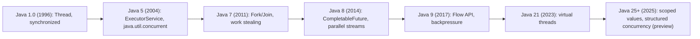

### Eras at a glance

| Era | Problem it solved | Main tools | Its limit (which led to the next era) |
|---|---|---|---|
| Java 1.0 | Do many things at once | `Thread`, `Runnable`, `synchronized`, `wait`/`notify` | Threads are costly to create. No pool. Easy to make mistakes. |
| Java 5 | Reuse threads, safer building blocks | `ExecutorService`, `Future`, locks, atomics, `ConcurrentHashMap`, latches | `Future.get()` blocks. Big tasks are not split well. |
| Java 7 | Split one big CPU task across all cores | `ForkJoinPool`, `RecursiveTask` | Only good for CPU work that splits nicely. |
| Java 8 | Chain async steps without waiting | `CompletableFuture`, parallel streams, `LongAdder` | Callback code is hard to read and debug. Threads still block on I/O. |
| Java 9 | A fast producer floods a slow consumer | `Flow` (Publisher, Subscriber, Subscription) | Reactive code is hard to write and debug. |
| Java 21 | Many blocking calls need many threads | Virtual threads | `ThreadLocal` is costly with millions of threads. Tasks can leak. |
| Java 25+ | Pass request data safely, keep task groups tidy | `ScopedValue` (final), `StructuredTaskScope` (preview) | Structured concurrency is still preview in Java 27. |

**Remember:** Each era fixed the pain of the one before: cost of threads → blocking waits → too many waiting threads.

---

## Era 1: Threads and synchronized (Java 1.0)

**The problem:** One cook can make one dish at a time. Customers wait in a long line. We want many cooks working at the same time.

**The Java answer:** The `Thread` class. Each thread runs its own piece of code at the same time as others. To stop two cooks from using the same pan at once, Java gave `synchronized`.

A *platform thread* (the classic Java thread) is a thin wrapper around one *OS thread* (a thread made by the operating system).
Each one reserves about 1 MB of stack memory by default. Creating one takes time, because the OS must do work.

### Thread vs Runnable

There are two classic ways to create a thread.

```java
// Way 1: extend Thread (not preferred)
class CookThread extends Thread {
    @Override public void run() { System.out.println("Cooking in " + getName()); }
}
new CookThread().start();

// Way 2: implement Runnable (preferred). A lambda is a Runnable.
Runnable task = () -> System.out.println("Cooking in " + Thread.currentThread().getName());
Thread cook = new Thread(task, "cook-1");
cook.start();                     // a NEW thread runs task.run()
cook.join();                      // the current thread waits until cook-1 finishes

// Java 21 builders
Thread p = Thread.ofPlatform().name("cook-2").start(task);
Thread v = Thread.ofVirtual().start(task);
```

**Why Runnable is better:**
- Java has single inheritance. If you extend `Thread`, you cannot extend any other class.
- A `Runnable` is only the *work*. A `Thread` is the *worker*. Keep them apart.
- The same `Runnable` can run on a thread, a thread pool or a virtual thread. No code change.

### Start vs run

- `start()` creates a new thread. The new thread then calls `run()`.
- If you call `run()` yourself, it runs on the **current** thread, like a normal method. No new thread.
- You can call `start()` only once. A second call throws `IllegalThreadStateException`.

### Thread states

A thread is always in one of six states. They are in the enum `Thread.State`.

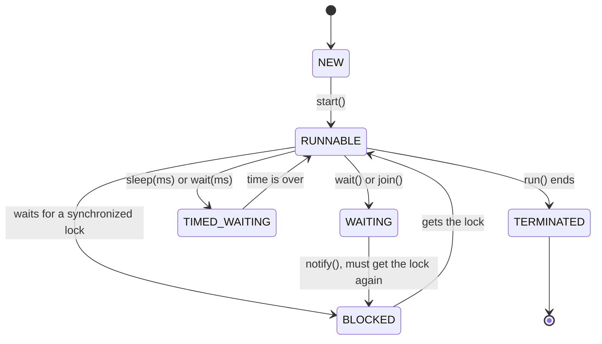

| State | Kitchen meaning |
|---|---|
| `NEW` | Cook is hired but has not started. |
| `RUNNABLE` | Cook is cooking, or ready to cook when the CPU is free. |
| `BLOCKED` | Cook waits for the key to the spice room (a `synchronized` lock). |
| `WAITING` | Cook waits with no time limit, until someone calls them (`wait()`, `join()`). |
| `TIMED_WAITING` | Cook waits for a fixed time (`sleep(500)`, `wait(500)`). |
| `TERMINATED` | Cook finished and went home. Cannot start again. |

Note: old blogs list a "suspended" state. There is no such state in `Thread.State`. The old `suspend()` and `resume()` methods caused deadlocks and no longer work in modern Java.

### Useful thread methods

| Method | What it does |
|---|---|
| `start()` | Starts a new thread that runs `run()`. |
| `join()` / `join(ms)` | Wait until that thread finishes (or until the time is over). |
| `Thread.sleep(ms)` | Pause the current thread. It **keeps** any locks it holds. |
| `Thread.yield()` | A hint: "I can give the CPU to someone else now." The scheduler may ignore it. Rarely used. |
| `interrupt()` | Politely ask a thread to stop. Sets a flag. |
| `isInterrupted()` | Check the flag. |
| `setPriority(1..10)` | A hint for the OS scheduler. Default is 5 (`NORM_PRIORITY`). |
| `setDaemon(true)` | Make it a background thread. Call it before `start()`. |
| `isAlive()`, `getName()`, `setName()` | Check if running, and read or set the name. |

**Priority:** The range is 1 (`MIN_PRIORITY`) to 10 (`MAX_PRIORITY`). A new thread gets the priority of the thread that created it. It is only a hint. Many OSes, like Linux by default, ignore it. Never build correct code on priority. Virtual threads ignore it.

**Daemon threads:** The JVM exits when only daemon threads are left. The garbage collector runs on daemon threads. Use daemon threads for background helpers like a cache cleaner. Virtual threads are always daemon threads.

**Interrupt (how to stop a thread the right way):**

```java
Thread worker = Thread.ofPlatform().start(() -> {
    while (!Thread.currentThread().isInterrupted()) {   // check the flag in the loop
        try {
            processNextOrder();
            Thread.sleep(1000);                         // sleep() throws if interrupted
        } catch (InterruptedException e) {
            Thread.currentThread().interrupt();         // set the flag again, then leave
            return;
        }
    }
});
worker.interrupt();                                     // ask it to stop
```

Never use `Thread.stop()`. It killed threads in the middle of work and left data broken. Since Java 20 it only throws `UnsupportedOperationException`.

### synchronized: one key to the room

**Story:** The spice room has one key. A cook takes the key, goes in, and locks the door. Others wait outside. When the cook leaves, the next cook takes the key.

In Java, every object has one hidden lock called a *monitor* (the key). `synchronized` takes that key.

```java
class Counter {
    private int count = 0;

    public synchronized void add() { count++; }            // key = this object

    public static synchronized void log(String s) { }       // key = Counter.class object

    public void addTwice() {
        synchronized (this) {                               // block: lock only these lines
            count += 2;
        }
    }
}
```

- **Synchronized method:** locks `this` (the current object).
- **Static synchronized method:** yes, a static method can be synchronized. It locks the `Class` object (`Counter.class`). So a static and a non-static synchronized method do **not** block each other. They use different keys.
- **Synchronized block:** locks any object you choose. Keep the block small.
- It is *reentrant*: a thread that holds the key can enter again without blocking itself.
- It gives two things: only one thread at a time (*mutual exclusion*), and *visibility* (the next thread sees all changes).

**Diagram: the race without `synchronized`.** `count++` is three steps: read, add 1, write. Look how both cooks read 100 and both write 101, so one order is lost.

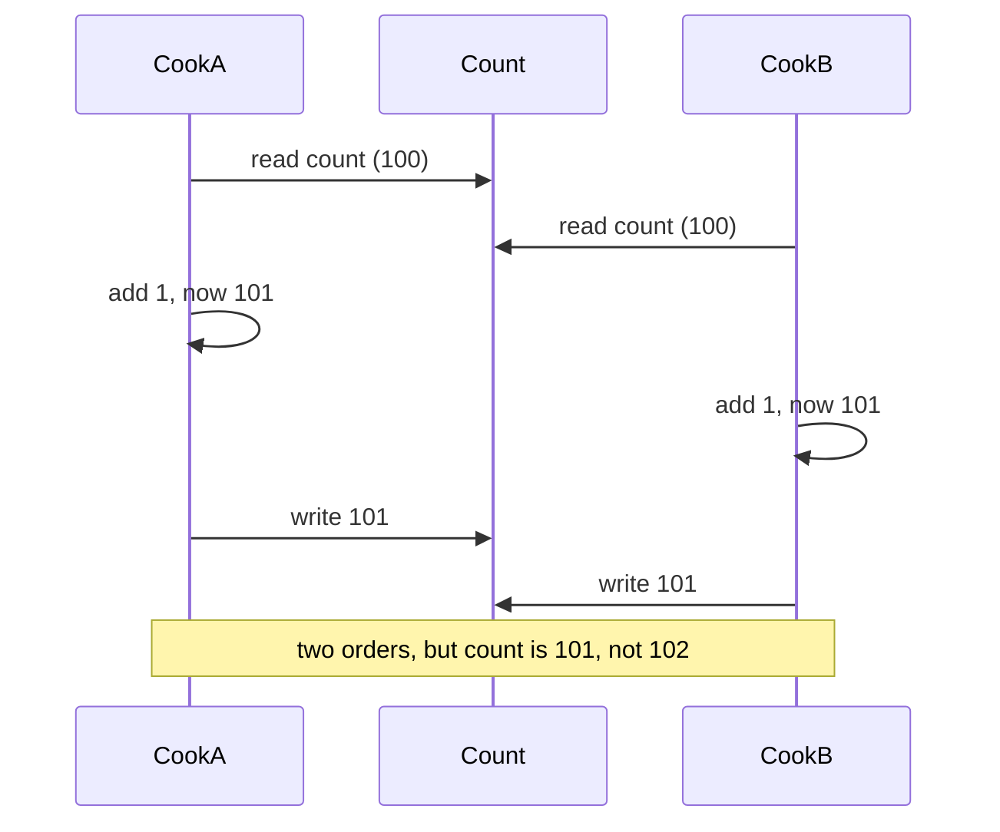

**Diagram: one key to the room.** Look how only one cook holds the key. The others wait outside in the `BLOCKED` state until the key comes back.

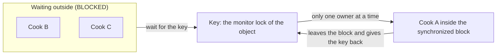

### wait and notify: producer and consumer

**Story:** Waiters put orders on a small board with 5 slots. Cooks take orders from the board.
If the board is full, the waiter waits. If the board is empty, the cook waits. When something changes, they call each other.

- `wait()`: release the key and sleep until someone calls `notify`. Must be inside `synchronized` on the same object.
- `notify()`: wake up **one** waiting thread (you can't choose which).
- `notifyAll()`: wake up **all** waiting threads. They then compete for the key.
- If you call them without holding the lock, you get `IllegalMonitorStateException`.

**Diagram:** Look how the cook gives back the key while it sleeps, and checks the board again after it wakes up.

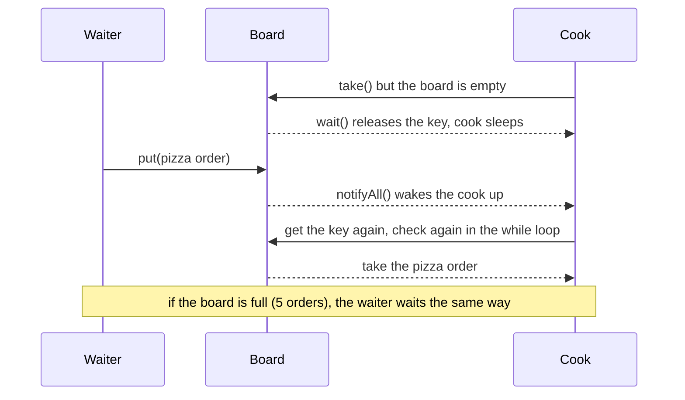

```java
class OrderBoard {
    private final Queue<String> orders = new LinkedList<>();
    private static final int CAPACITY = 5;

    public synchronized void put(String order) throws InterruptedException {
        while (orders.size() == CAPACITY) {   // WHILE, not if: check again after waking up
            wait();                           // releases the lock and sleeps
        }
        orders.add(order);
        notifyAll();                          // wake up cooks waiting for orders
    }

    public synchronized String take() throws InterruptedException {
        while (orders.isEmpty()) {
            wait();
        }
        String order = orders.poll();
        notifyAll();                          // wake up waiters waiting for space
        return order;
    }
}
```

**Why `while` and not `if`?**
- A thread can wake up with no `notify` at all. This is called a *spurious wakeup*.
- Another thread may take the item first, between the `notify` and your wake-up.
- So always check the condition again after waking.

**Why `notifyAll` here?** Waiters and cooks wait on the same object. `notify()` could wake the wrong type (a waiter instead of a cook). Then everyone can end up sleeping.

In real code, don't write this by hand. `ArrayBlockingQueue` does the same with `put()` and `take()`. See [Concurrent collections](#concurrent-collections).

### Deadlock

**Story:** Cook A holds the knife and waits for the cutting board. Cook B holds the cutting board and waits for the knife. Both wait forever.

```java
Object knife = new Object();
Object board = new Object();

Thread.ofPlatform().start(() -> {
    synchronized (knife) {
        sleepQuietly(100);
        synchronized (board) { chop(); }   // waits for board forever
    }
});
Thread.ofPlatform().start(() -> {
    synchronized (board) {
        sleepQuietly(100);
        synchronized (knife) { chop(); }   // waits for knife forever
    }
});
```

**Diagram: the deadlock.** Follow the arrows: they make a circle, so nobody can move.

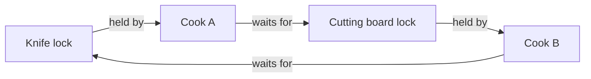

**Fix:** Always take locks in the same order (knife first, then board). Or use `tryLock` with a timeout (see [Locks](#locks)). More detail in [java.md](java.md#java-concurrency-and-shared-data).

**Diagram: the fix with lock ordering.** Both cooks take the knife first. The cook who waits holds nothing, so there is no circle.

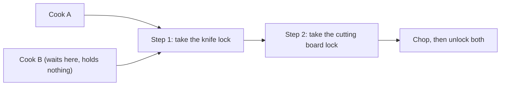

### Limits of Era 1

- Each platform thread costs about 1 MB of stack and an OS thread. A server can run a few thousand, not millions.
- Creating and destroying a thread for each task is slow.
- No pool, no queue, no limit. 10,000 requests could mean 10,000 threads and an `OutOfMemoryError`.
- `wait`/`notify` is easy to get wrong.
- `run()` cannot return a value or throw a checked exception.

**Remember:** A thread is a costly worker. `synchronized` is one key per object. `wait` always goes in a `while` loop.

---

## Era 2: ExecutorService and java.util.concurrent (Java 5)

**The problem:** Hiring a new cook for every order is too slow and too costly. 2,000 orders should not mean 2,000 cooks.

**The Java answer:** Keep a fixed team of cooks and an order board. You give tasks to an *executor* (the manager). It puts them in a queue and its worker threads run them. Java 5 also added the package `java.util.concurrent` with locks, atomics, safe collections and helpers. It also fixed the *Java Memory Model* (JSR-133), the rules for what one thread can see of another thread's writes.

### Thread pool architecture

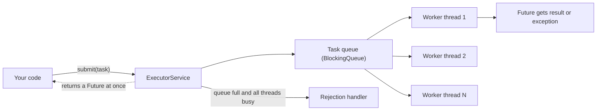

**How it works:**
1. Your code calls `submit(task)`. It gets a `Future` back at once. It does not wait.
2. The task goes to a worker thread, or into the queue if all workers are busy.
3. A free worker takes the next task from the queue and runs it.
4. The result (or the exception) is stored in the `Future`.
5. Workers do not die after a task. They take the next one. This reuse is the whole point.

### How ThreadPoolExecutor decides

`ThreadPoolExecutor` is the real class behind most pools. It has a *core size* (threads kept alive), a *max size* (the upper limit) and a queue.

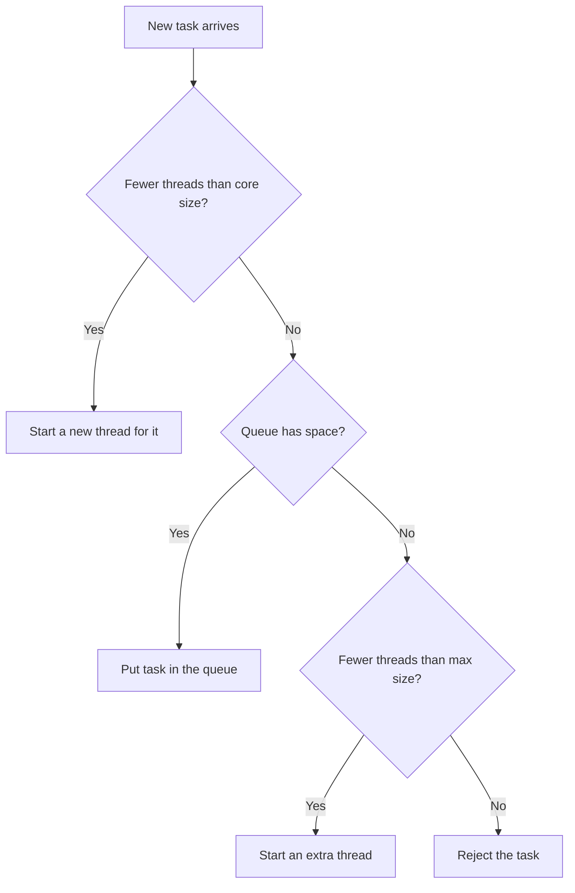

A surprise many people miss: extra threads above the core size start **only when the queue is full**. With an unbounded queue, the queue is never full, so the pool never grows above core size.

**The 4 rejection policies (what happens when the queue is full and max threads are busy):**

| Policy | What it does | Kitchen meaning |
|---|---|---|
| `AbortPolicy` (default) | Throws `RejectedExecutionException` | "Sorry, we are full." |
| `CallerRunsPolicy` | The thread that called `submit` runs the task itself | The manager cooks it. While busy, the manager takes no new orders, so input slows down. |
| `DiscardPolicy` | Drops the new task silently | The order slip goes in the bin. Dangerous. |
| `DiscardOldestPolicy` | Drops the oldest queued task, then retries | The oldest waiting order is thrown away. |

`CallerRunsPolicy` is a simple form of *backpressure* (slowing down the sender when the receiver is full).

### Executors factory methods

`Executors` has ready-made pools. They are fine for demos. Be careful in production.

| Factory method | What you get | Risk |
|---|---|---|
| `newFixedThreadPool(n)` | n threads, unbounded `LinkedBlockingQueue` | Queue can grow forever → `OutOfMemoryError` |
| `newCachedThreadPool()` | 0 core, no real max, idle threads die after 60 s | A spike can create thousands of threads |
| `newSingleThreadExecutor()` | 1 thread, tasks run in order | Unbounded queue |
| `newScheduledThreadPool(n)` | Run tasks after a delay or again and again | Unbounded queue; a slow task delays the next runs |
| `newWorkStealingPool()` (Java 8) | A `ForkJoinPool` with one thread per core | Not for blocking work |
| `newVirtualThreadPerTaskExecutor()` (Java 21) | A new virtual thread per task, no pool | Downstream systems can be flooded |

Scheduled pool example:

```java
ScheduledExecutorService scheduler = Executors.newScheduledThreadPool(2);
scheduler.schedule(() -> sendReminder(), 10, TimeUnit.SECONDS);              // once, after 10 s
scheduler.scheduleAtFixedRate(() -> pollPrices(), 0, 5, TimeUnit.SECONDS);    // every 5 s from start time
scheduler.scheduleWithFixedDelay(() -> cleanCache(), 0, 5, TimeUnit.SECONDS); // 5 s after previous run ends
```

**Production pools:** Build `ThreadPoolExecutor` yourself, with a bounded queue and a clear policy.

```java
ThreadPoolExecutor pool = new ThreadPoolExecutor(
        8,                                            // core size: threads kept alive
        16,                                           // max size: used only when the queue is full
        60, TimeUnit.SECONDS,                         // extra threads die after 60 s idle
        new ArrayBlockingQueue<>(500),                // BOUNDED queue: at most 500 waiting tasks
        Thread.ofPlatform().name("order-", 0).factory(),  // clear names in thread dumps
        new ThreadPoolExecutor.CallerRunsPolicy());   // when full: caller runs it, input slows down
```

In Spring Boot, `ThreadPoolTaskExecutor` wraps the same class. Set `queueCapacity`, because its default is unbounded.

### Callable, Future and checking results

- `Runnable.run()` returns nothing and cannot throw a checked exception.
- `Callable<T>.call()` returns a value and can throw an exception. Added in Java 5 for executors.
- `submit()` returns a `Future<T>`. A `Future` is a receipt for a result that will come later.

| `Future` method | What it does |
|---|---|
| `get()` | Wait for the result. Blocks the caller. |
| `get(2, SECONDS)` | Wait at most 2 seconds, then throw `TimeoutException`. |
| `isDone()` | `true` if finished (success, failure or cancelled). |
| `cancel(true)` | Cancel. `true` means interrupt the thread if it is running. |
| `isCancelled()` | `true` if cancelled. |
| `state()`, `resultNow()` (Java 19) | Read the state, or the result if already done, without checked exceptions. |

**How do you check that a task succeeded?** Call `get()`. If the task threw an exception, `get()` throws `ExecutionException`. The real error is in `getCause()`.

```java
try (ExecutorService pool = Executors.newFixedThreadPool(4)) {     // AutoCloseable since Java 19
    Callable<Integer> countOrders = () -> orderRepo.countToday();   // returns a value, can throw
    Future<Integer> future = pool.submit(countOrders);
    try {
        Integer count = future.get(2, TimeUnit.SECONDS);            // wait at most 2 s
        log.info("Orders today: {}", count);
    } catch (ExecutionException e) {
        log.error("Task failed", e.getCause());                    // the real exception is inside
    } catch (TimeoutException e) {
        future.cancel(true);                                        // stop waiting, interrupt the task
    }
}                                                                   // close() = shutdown + wait for tasks
```

**`execute()` vs `submit()`:**
- `execute(runnable)` returns nothing. If the task throws, the error goes to the thread's uncaught exception handler and is printed.
- `submit(task)` returns a `Future`. If the task throws, the error is kept inside the `Future`. If nobody calls `get()`, **the error is lost silently**. This is a common production bug.

**Run many tasks at once:**

```java
List<Callable<Price>> calls = List.of(() -> shopA.price(id), () -> shopB.price(id));
List<Future<Price>> all = pool.invokeAll(calls);   // waits until ALL are done
Price fastest = pool.invokeAny(calls);             // returns the FIRST success, cancels the rest
```

### Shutting down a pool

- `shutdown()`: take no new tasks. Finish running and queued tasks. Does not wait.
- `shutdownNow()`: take no new tasks. Interrupt running tasks. Return the list of queued tasks that never ran.
- `awaitTermination(time)`: wait until all tasks finish or the time is over.
- `close()` (Java 19+): `ExecutorService` is `AutoCloseable`. `close()` calls `shutdown()` and waits for all tasks. So you can use try-with-resources.

```java
pool.shutdown();                                     // no new tasks, finish queued ones
if (!pool.awaitTermination(30, TimeUnit.SECONDS)) {
    List<Runnable> neverRan = pool.shutdownNow();    // interrupt running tasks
    log.warn("{} tasks never ran", neverRan.size());
}
```

If you forget to shut down a pool of non-daemon threads, the JVM may never exit.

### Locks

`synchronized` is simple, but it has no timeout and no "try". The `java.util.concurrent.locks` package adds these.

**ReentrantLock:** like `synchronized`, plus `tryLock` with a timeout, a fairness option, and many conditions.

```java
private final ReentrantLock lock = new ReentrantLock();

boolean reserveTable(int tableId) throws InterruptedException {
    if (!lock.tryLock(200, TimeUnit.MILLISECONDS)) {   // wait at most 200 ms, then give up
        return false;
    }
    try {
        return tables.reserve(tableId);
    } finally {
        lock.unlock();                                 // ALWAYS unlock in finally
    }
}
```

**ReadWriteLock:** many readers at the same time, or one writer alone. Good when reads are much more common than writes.

```java
private final ReadWriteLock rw = new ReentrantReadWriteLock();
private Map<String, Price> menu = Map.of();

Price price(String dish) {
    rw.readLock().lock();                  // many readers together
    try { return menu.get(dish); } finally { rw.readLock().unlock(); }
}

void reloadMenu(Map<String, Price> fresh) {
    rw.writeLock().lock();                 // one writer, no readers during the write
    try { menu = Map.copyOf(fresh); } finally { rw.writeLock().unlock(); }
}
```

**Diagram: ReadWriteLock.** Look how many waiters read the menu together, but the manager must wait until no reader is inside before it writes.

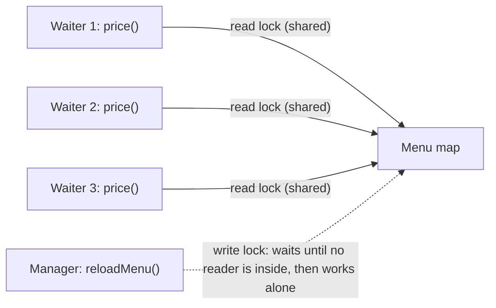

**Condition:** the lock version of `wait`/`notify`. One lock can have many conditions, like `notFull` and `notEmpty`. Call `await()` and `signal()`. `ArrayBlockingQueue` is built this way.

### Atomics and CAS

**Story:** You want to change the board from "10 plates left" to "9 plates left". You say: "Change it to 9 **only if** it still says 10." If someone changed it first, read again and retry.

This is *CAS* (compare-and-swap). The CPU does it in one step. No lock is needed.

```java
AtomicInteger stock = new AtomicInteger(10);
stock.decrementAndGet();                         // safe, one atomic step

// What it does inside, in simple form:
int old, next;
do {
    old  = stock.get();                          // read 10
    next = old - 1;                              // compute 9
} while (!stock.compareAndSet(old, next));       // write 9 only if it is still 10, else retry
```

**Diagram: the CAS retry loop.** Look at the "No" arrow: the thread does not wait for a lock, it just reads again and retries.

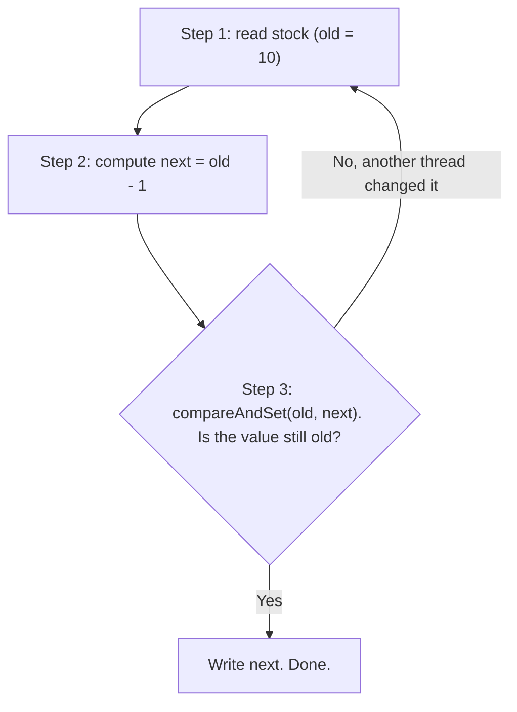

- Classes: `AtomicInteger`, `AtomicLong`, `AtomicBoolean`, `AtomicReference`.
- Good for single values: counters, flags, IDs.
- Under very heavy writes, many threads retry again and again. Then `LongAdder` (Java 8) is faster.

### volatile and happens-before

Each CPU core has its own cache. One thread may keep reading an old value from its cache and never see another thread's write.

- `volatile` means: every read and write goes to main memory. All threads see the latest value.
- `volatile` gives **visibility, not atomicity**. `count++` on a volatile field still loses updates.

**Diagram:** Look how, without `volatile`, Thread 2 keeps the old value in its own cache. With `volatile`, the write and the read both use main memory.

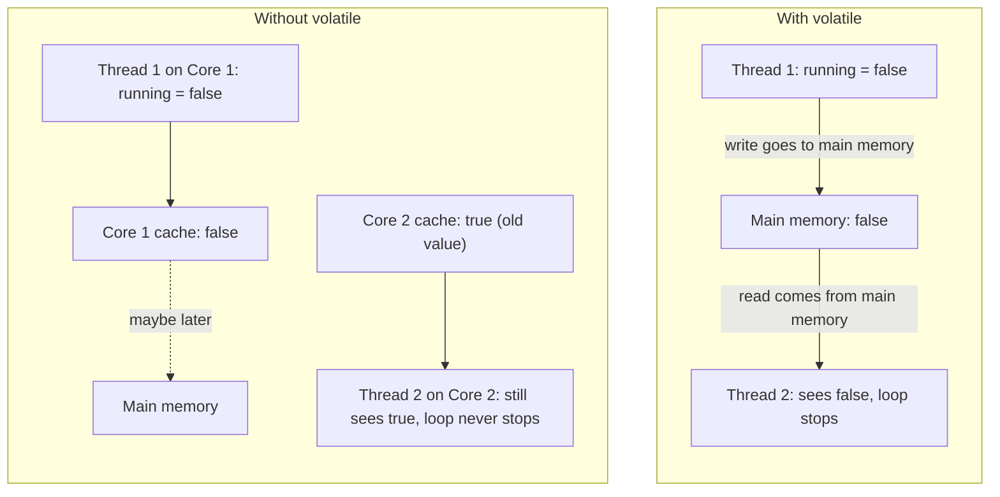

```java
class Poller implements Runnable {
    private volatile boolean running = true;      // without volatile, the loop may never stop
    public void stop() { running = false; }
    @Override public void run() {
        while (running) { pollQueue(); }
    }
}
```

*Happens-before* is the rule of the Java Memory Model: if A happens-before B, then B is sure to see what A wrote.
Main cases:
- An unlock happens-before the next lock of the same lock.
- A volatile write happens-before a later read of it.
- `start()` happens-before the new thread's code.
- A thread's code happens-before `join()` returns.
The full list is in [java.md](java.md#java-concurrency-and-shared-data).

### Concurrent collections

| Collection | What it is | Use it for |
|---|---|---|
| `ConcurrentHashMap` | Thread-safe map. Reads mostly need no lock. Writes lock only one bucket. | Shared caches and counters |
| `CopyOnWriteArrayList` | Every write copies the whole array. Reads need no lock. | Many reads, very few writes, like a list of listeners |
| `ArrayBlockingQueue` | Fixed-size queue. `put()` waits when full. `take()` waits when empty. | Producer-consumer with a hard limit |
| `LinkedBlockingQueue` | Linked queue. Unbounded by default (`Integer.MAX_VALUE`). | Give it a size: `new LinkedBlockingQueue<>(1000)` |
| `ConcurrentLinkedQueue` | Non-blocking queue that uses CAS | Fast queue when you don't need to wait |

With `ConcurrentHashMap`, use the atomic methods: `merge`, `compute`, `computeIfAbsent`, `putIfAbsent`. "Check, then put" is two calls and is not atomic.

### Synchronizers: latch, barrier, semaphore

- **CountDownLatch:** the waiter waits until all 3 dishes for a table are ready, then serves. It counts down to zero once. It cannot be reset.
- **CyclicBarrier:** 4 cooks finish step 1, wait for each other, then all start step 2 together. It resets after each round, so it is reusable.
- **Semaphore:** the kitchen has only 3 burners. A cook takes a *permit* (a burner). A 4th cook waits until one is free.

**Diagram:** Compare the three columns: the latch opens once, the barrier repeats every round, and the semaphore counts free burners.

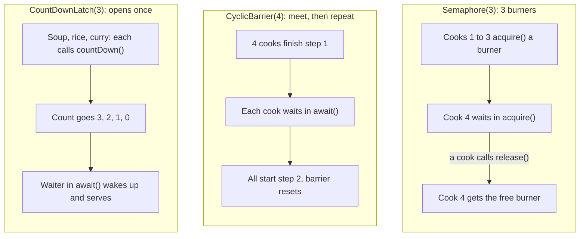

```java
// CountDownLatch: wait for 3 dishes, then serve
CountDownLatch dishesReady = new CountDownLatch(3);
for (String dish : List.of("soup", "rice", "curry")) {
    pool.submit(() -> {
        try { cook(dish); } finally { dishesReady.countDown(); }   // 3 -> 2 -> 1 -> 0
    });
}
dishesReady.await();                     // waits here until the count is 0
serveTable();

// CyclicBarrier: 4 cooks meet after each step (reusable)
CyclicBarrier allCooks = new CyclicBarrier(4, () -> log.info("Step done"));
// each cook calls allCooks.await() at the end of each step

// Semaphore: only 3 burners
Semaphore burners = new Semaphore(3);
burners.acquire();                       // take a burner, wait if none is free
try { fry(); } finally { burners.release(); }   // always give it back
```

### How to size a thread pool

- **CPU-bound work** (the thread is always computing: image resize, hashing): threads ≈ number of cores. Get it with `Runtime.getRuntime().availableProcessors()`. More threads only add switching cost.
- **I/O-bound work** (the thread mostly waits for a database or HTTP call). Use this formula: threads ≈ cores × (1 + wait time / compute time).

**Worked example:**
- The server has 8 cores.
- Each request uses 50 ms of CPU and waits 450 ms for the database.
- Wait / compute = 450 / 50 = 9.
- Threads ≈ 8 × (1 + 9) = **80 threads**.

Then check the other side. If the database pool has only 20 connections, 80 threads will just wait for connections. The real limit is the smallest resource in the chain. Measure under load and adjust.

### Limits of Era 2

- `Future.get()` blocks the caller. You can't say "when done, do the next step".
- One big task cannot be split across workers easily.
- I/O-bound apps still need many platform threads. Each one costs about 1 MB.

**Remember:** Don't create threads, submit tasks. Use a bounded queue, a named thread factory and a clear rejection policy.

---

## Era 3: Fork/Join and work stealing (Java 7)

**The problem:** A wedding order of 500 plates comes in. One cook would take all night. With a normal pool, one worker takes the whole job and the other 7 cooks sit idle.

**The Java answer:** The *Fork/Join framework*. Split a big task into small parts (*fork*), run them on all cores, and add the results back (*join*). The pool is `ForkJoinPool`. It uses *work stealing* so no cook sits idle.

### Work stealing architecture

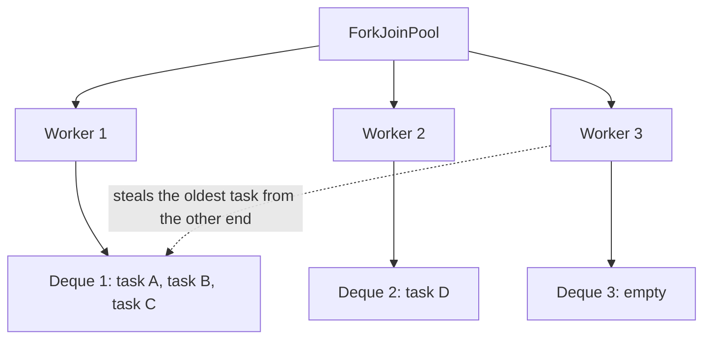

**How it works:**
1. Each worker has its own *deque* (a double-ended queue: you can add or remove at both ends).
2. A worker pushes new subtasks to its own end and takes the newest one first.
3. When a worker's deque is empty, it *steals* from the **other** end of a busy worker's deque.
4. The stolen task is the oldest one. It is usually a big piece, so one steal gives a lot of work.
5. Owner and thief work at different ends, so they rarely fight over the same task.

### RecursiveTask example

`RecursiveTask<T>` returns a value. `RecursiveAction` returns nothing.

```java
class SumTask extends RecursiveTask<Long> {
    private static final int LIMIT = 10_000;            // small enough: just do it
    private final long[] numbers; private final int from, to;

    SumTask(long[] numbers, int from, int to) { this.numbers = numbers; this.from = from; this.to = to; }

    @Override protected Long compute() {
        if (to - from <= LIMIT) {
            long sum = 0;
            for (int i = from; i < to; i++) sum += numbers[i];
            return sum;
        }
        int mid = (from + to) / 2;
        SumTask left = new SumTask(numbers, from, mid);
        left.fork();                                    // put left half in my deque, others may steal it
        long right = new SumTask(numbers, mid, to).compute();   // do right half myself
        return right + left.join();                     // wait for the left half
    }
}

long total = ForkJoinPool.commonPool().invoke(new SumTask(data, 0, data.length));
```

### The common pool

- `ForkJoinPool.commonPool()` is one shared pool for the whole JVM.
- Its size is number of cores minus 1 by default.
- **Who uses it:** parallel streams, `CompletableFuture.supplyAsync()` without an executor, and `Arrays.parallelSort()`.
- So one slow blocking task in the common pool can slow down all of these, everywhere in your app.
- Virtual threads do **not** use the common pool. They have their own scheduler pool.

**Fork/Join vs ExecutorService:**
- `ExecutorService`: independent tasks, like one task per request.
- Fork/Join: one big CPU task that you split again and again into smaller pieces.

### Limits of Era 3

- Only for CPU work that splits nicely. Blocking I/O inside it wastes the few workers.
- The code is low-level. Most people use it through parallel streams.

**Remember:** Fork/Join = split, run on all cores, join. Idle workers steal the oldest task from busy workers.

---

## Era 4: CompletableFuture and parallel streams (Java 8)

**The problem:** The waiter gets a receipt (`Future`) but must stand at the counter and wait (`get()`). While waiting, the waiter serves nobody. We want "call me when ready, then do the next step".

**The Java answer:** `CompletableFuture`. You describe the steps: "when the user is loaded, load the orders, then build the page". No thread stands and waits between steps. Java 8 also added parallel streams.

### Why Future is not enough

- `Future.get()` blocks the thread that calls it.
- You cannot chain steps: "when done, do this".
- You cannot combine two futures easily.
- You cannot add a timeout or a fallback in a clean way.

### CompletableFuture chaining

| Method | What it does | Stream-like name |
|---|---|---|
| `supplyAsync(supplier, executor)` | Start a task that returns a value | - |
| `thenApply(fn)` | Change the result | like `map` |
| `thenCompose(fn)` | Next step is also async and needs the previous result | like `flatMap` |
| `thenCombine(other, fn)` | Join two independent results | zip |
| `thenAccept(consumer)` | Use the result, return nothing | - |
| `allOf(f1, f2, f3)` | Done when all are done | - |
| `anyOf(f1, f2)` | Done when the first one is done | - |
| `exceptionally(fn)` | Give a fallback value on error | like `catch` |
| `handle((result, error) -> ...)` | Handle success and error in one place | - |
| `orTimeout(2, SECONDS)` (Java 9) | Fail with `TimeoutException` if too slow | - |
| `completeOnTimeout(value, 2, SECONDS)` (Java 9) | Use a default value if too slow | - |
| `join()` | Wait and get the result (unchecked exception) | - |

```java
CompletableFuture<Receipt> receipt =
    CompletableFuture.supplyAsync(() -> userClient.get(userId), io)   // step 1 on my pool
        .thenCompose(user -> cartClient.cartAsync(user.cartId()))     // step 2 needs step 1 result
        .thenApply(cart -> billing.makeReceipt(cart))                 // step 3: plain change
        .exceptionally(ex -> Receipt.failed(ex.getMessage()));        // fallback on any error
```

**Diagram: a full pipeline and its threads.** Look at the text after each colon: it says which thread runs that step. A step without `Async` runs on the thread that finished the step before it. A step ending in `Async` with no executor runs on the common pool.

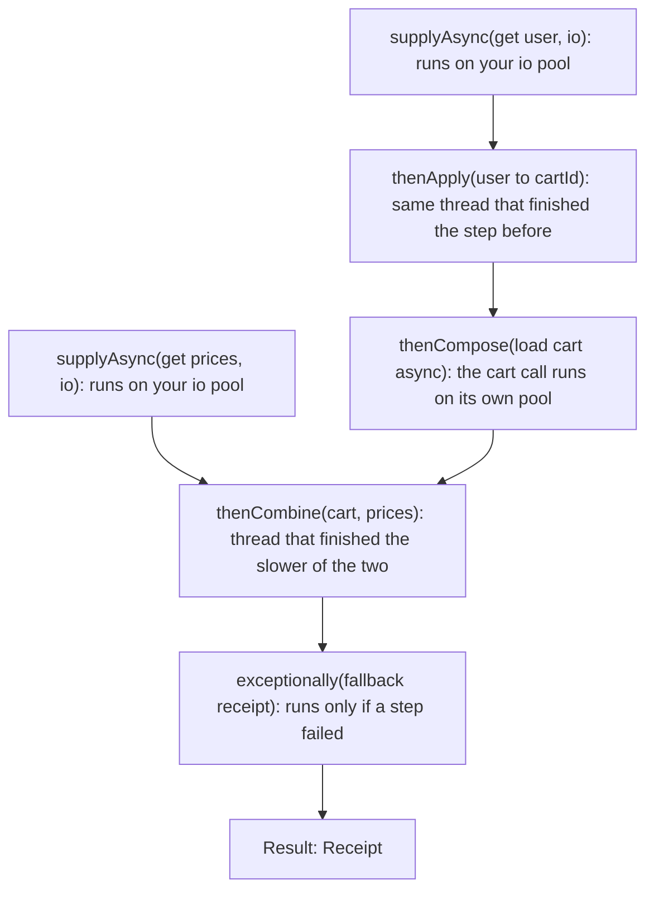

### Calling three services in parallel

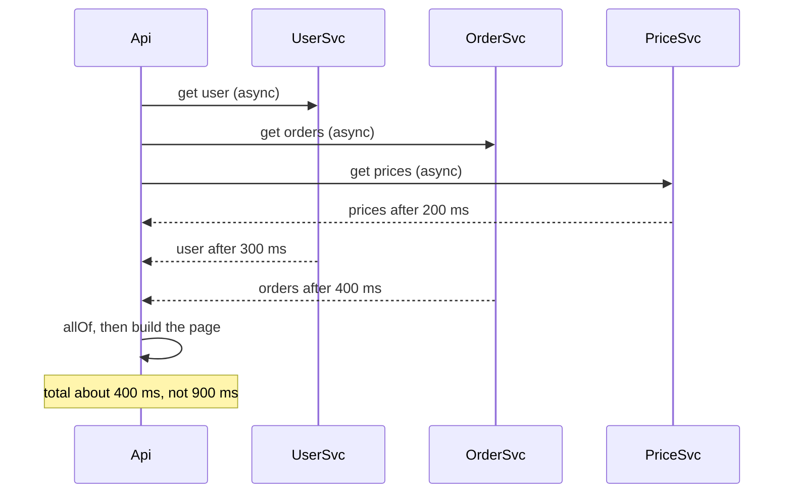

```java
ExecutorService io = Executors.newFixedThreadPool(20);   // MY pool, not the common pool

var user   = CompletableFuture.supplyAsync(() -> userClient.get(id), io);
var orders = CompletableFuture.supplyAsync(() -> orderClient.list(id), io);
var prices = CompletableFuture.supplyAsync(() -> priceClient.today(), io);

Page page = CompletableFuture.allOf(user, orders, prices)
        .thenApply(v -> new Page(user.join(), orders.join(), prices.join()))  // all done, join() is instant
        .orTimeout(2, TimeUnit.SECONDS)                   // Java 9: fail if slower than 2 s
        .exceptionally(ex -> Page.empty())                // fallback on error or timeout
        .join();
```

**Always pass your own executor.** Without it, `supplyAsync` uses the common pool. That pool has only "cores minus 1" threads. A few slow HTTP calls can block it, and then parallel streams in the whole app slow down too.

### Parallel streams

`list.parallelStream()` splits the data and runs it on the common Fork/Join pool.

**Diagram:** Look how one list becomes chunks, each chunk runs on a worker, and the partial results are joined at the end.

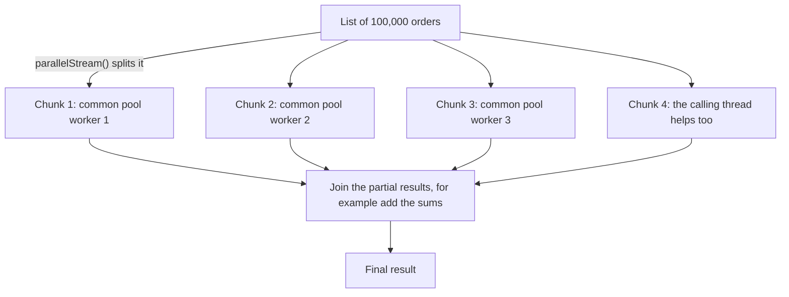

| When it helps | When it hurts |
|---|---|
| Large data (say 100,000+ items) | Small lists: splitting costs more than the work |
| CPU-heavy work per item | I/O per item (HTTP, DB): blocks the shared common pool |
| No shared mutable state | Code that writes to a shared `ArrayList` (lost data) |
| Easy-to-split sources like `ArrayList` and arrays | `LinkedList` or `Stream.iterate` (hard to split) |
| Order does not matter | Code that depends on order (`forEach` order is random) |

Rule: measure first. Most web requests should **not** use parallel streams.

### Two more Java 8 tools

- **`LongAdder`:** a counter with many small cells. Threads add to different cells, and `sum()` adds them up. Faster than `AtomicLong` when many threads write a lot.
- **`StampedLock`:** a read-write lock with *optimistic reads* (read with no lock, then check that no write happened). Fast, but not reentrant and harder to use.

### Limits of Era 4

- Callback chains are hard to read when they get long.
- Stack traces are broken into pieces. Debugging is harder.
- Under the hood, a blocking call still holds a platform thread.

**Remember:** `CompletableFuture` = "call me when ready" chits. Always pass your own executor. Add a timeout.

---

## Era 5: Reactive Streams – Flow API (Java 9)

**The problem:** The kitchen sends plates on a conveyor belt faster than the waiter can carry them. Plates fall on the floor.

**The Java answer:** The `java.util.concurrent.Flow` API. It has four interfaces:
- `Publisher`: sends items (the kitchen).
- `Subscriber`: receives items (the waiter). It gets `onSubscribe`, `onNext`, `onError` and `onComplete` calls.
- `Subscription`: the link between them. The subscriber calls `request(n)` to ask for n more items, or `cancel()`.
- `Processor`: both a subscriber and a publisher (a middle step).

**Backpressure in one paragraph:** The subscriber says how many items it can take now, with `request(5)`. The publisher sends at most 5 items, then waits for the next request. So a fast producer can never flood a slow consumer. The speed is set by the slower side.

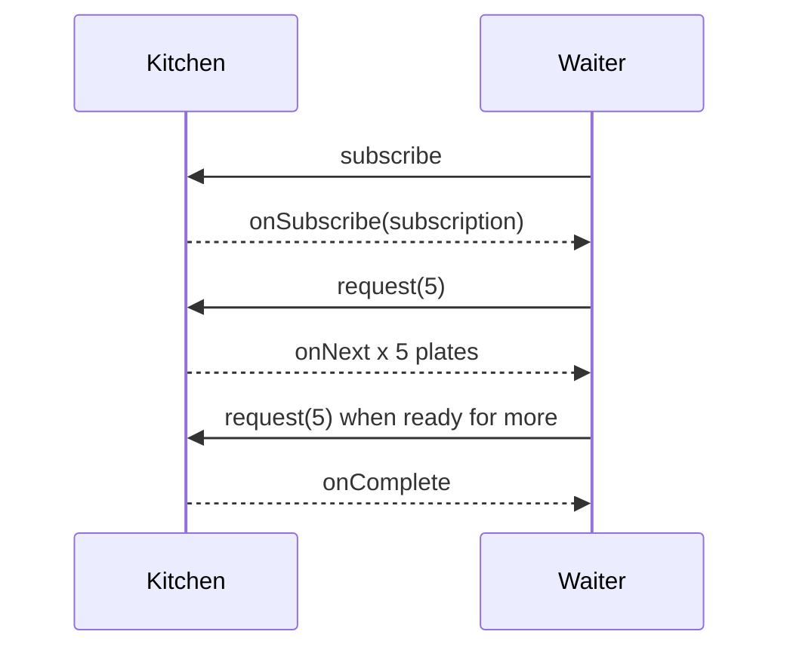

- Java gives only the interfaces and one simple class, `SubmissionPublisher`.
- `Flow` follows the same contract as the *Reactive Streams* spec. Libraries like Project Reactor (used by Spring WebFlux) and RxJava follow that spec.
- You rarely use `Flow` directly. You use Reactor's `Mono` (0 or 1 item) and `Flux` (many items).
- See [Spring Reactive](spring.md#spring-reactive-webflux-in-depth) and [Spring MVC vs WebFlux](spring.md#spring-mvc-vs-webflux).

**Limit:** Reactive code is hard to write, read and debug. One blocking call on an event loop thread can freeze the app.

**Remember:** Flow = publisher, subscriber, subscription. Backpressure means the consumer says "send me only n".

---

## Era 6: Virtual threads (Java 21)

**The problem:** Most web apps spend most of their time **waiting**: for the database, for another service, for a file. Each waiting request holds one platform thread (about 1 MB, an OS thread). With 10,000 waiting requests, we run out of threads. Reactive code fixes this, but it is hard to write.

**The Java answer:** *Virtual threads* (JEP 444, final in Java 21). They are very cheap threads managed by the JVM, not the OS. When a virtual thread waits for I/O, it steps off the real thread. The real thread runs another virtual thread. You keep simple blocking code, one thread per request.

### Virtual thread architecture

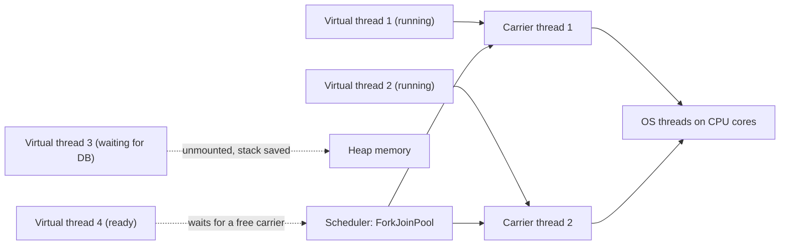

**How it works:**
1. A *carrier thread* is a normal platform thread. The JVM keeps a small pool of them in its own `ForkJoinPool`. By default there is one per CPU core. This pool is not the common pool.
2. To run, a virtual thread is *mounted* on a carrier.
3. When it blocks on I/O, sleep or a lock, the JVM *unmounts* it. Its stack (its local variables and call chain) is saved on the heap.
4. The carrier is now free. It picks the next ready virtual thread.
5. When the I/O is done, the virtual thread is ready again. It is mounted on **any** free carrier. It may be a different one.

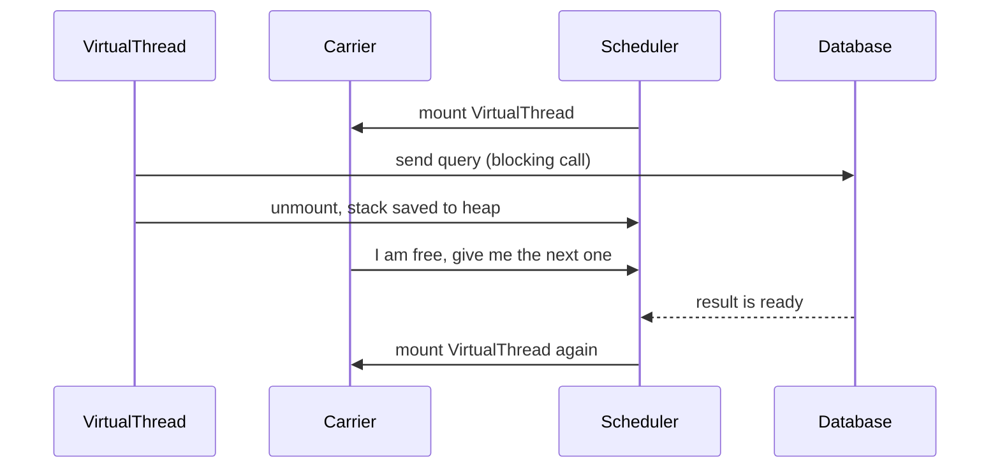

### Platform vs virtual threads

| | Platform thread | Virtual thread |
|---|---|---|
| What it is | Wrapper around one OS thread | A Java object managed by the JVM |
| Stack memory | About 1 MB reserved | A few KB, grows on the heap as needed |
| How many | A few thousand | Millions |
| Cost to create | High (OS call) | Very low (like creating an object) |
| Who schedules it | The OS | The JVM (ForkJoinPool scheduler) |
| Should you pool it? | Yes, it is costly | **No**, create one per task |
| Good for | CPU-heavy work, long-running tasks | Many tasks that mostly wait for I/O |
| Daemon? | Your choice | Always daemon |

### Virtual thread code

```java
// One new virtual thread per task (the normal way)
try (var executor = Executors.newVirtualThreadPerTaskExecutor()) {
    List<Future<String>> results = new ArrayList<>();
    for (long id : orderIds) {                                         // 10,000 ids is fine
        results.add(executor.submit(() -> paymentClient.status(id)));  // blocking HTTP call is OK
    }
    for (Future<String> f : results) log.info(f.get());
}                                                                      // close() waits for all tasks

// Start one virtual thread directly
Thread vt = Thread.ofVirtual().name("report-", 0).start(() -> buildReport());
vt.join();

Thread.startVirtualThread(() -> sendEmail());                          // shortest form
```

Spring Boot 3.2 and newer, with Java 21 or newer:

```properties
spring.threads.virtual.enabled=true
```

Now Tomcat runs each request on a virtual thread. `@Async` tasks and scheduled tasks also use virtual threads.

### Rules for virtual threads

1. **Don't pool them.** They are cheap. A pool exists to reuse costly things. Create a new one per task.
2. **Limit scarce resources with a `Semaphore`, not with a small pool.** The database may handle only 50 queries at once. 10,000 virtual threads will flood it.

    ```java
    private final Semaphore dbPermits = new Semaphore(50);   // at most 50 queries at once
    Order load(long id) throws InterruptedException {
        dbPermits.acquire();
        try { return repository.find(id); } finally { dbPermits.release(); }
    }
    ```

3. **Use them for I/O, not CPU.** For heavy computing they give no speed gain. The number of cores is still the limit. Use a fixed pool sized to the cores.
4. **They are not faster.** Each request takes the same time. You can just handle many more requests at once (*throughput*).
5. **Be careful with `ThreadLocal`.** Each virtual thread has its own copy. With a million threads, a big object in a `ThreadLocal` means a million copies. Use `ScopedValue` instead (see [Era 7](#scopedvalue-vs-threadlocal)).

### Pinning

*Pinning* means a virtual thread cannot unmount while it blocks. It stays stuck to its carrier, so the carrier is blocked too. If all carriers are pinned, the app stops making progress.

- **Java 21 to 23:** blocking inside a `synchronized` block or method pinned the thread. The common fix was to use `ReentrantLock` instead.
- **Java 24 (JEP 491):** `synchronized` no longer pins. A virtual thread can unmount while it waits for, or holds, a monitor lock.
- **Still pins today:** native code (JNI) that calls back into Java and then blocks. Also code that blocks inside a class initializer (a `static { }` block).
- **How to find it:** the JFR event `jdk.VirtualThreadPinned` (*JFR* = Java Flight Recorder, a built-in low-cost recorder).

### Thread dumps for virtual threads

- `jstack` and `jcmd <pid> Thread.print` show platform threads. They do not list all virtual threads.
- Use the new dump format, which includes virtual threads:

```bash
jcmd <pid> Thread.dump_to_file -format=json /tmp/threads.json
```

See also the short answer in [java.md](java.md#virtual-threads).

### Limits of Era 6

- `ThreadLocal` is costly with millions of threads.
- With `ExecutorService` and `CompletableFuture`, a task can keep running after its parent gave up. If one call fails, the others are not cancelled by themselves. Tasks can leak.

**Remember:** Virtual threads = cheap helpers that step away while the dish is in the oven. Never pool them. Use a semaphore to protect the database.

---

## Era 7: Scoped values and structured concurrency (Java 25+)

**The problem:** Every helper needs the table number (user id, request id). Copying it into a `ThreadLocal` for a million helpers is costly and risky. Also, a team lead sends 3 helpers for one table. If one fails, the other two keep cooking a meal nobody will eat.

**The Java answer:** Two tools from Project Loom (the same project that built virtual threads):
- `ScopedValue`: a read-only value shared with all code inside one call. **Final in Java 25** (JEP 506).
- `StructuredTaskScope`: start a group of subtasks, wait for them as one unit, and cancel the rest when one fails. **Still preview.**

### ScopedValue vs ThreadLocal

```java
static final ScopedValue<String> USER_ID = ScopedValue.newInstance();

void handle(Request request) {
    ScopedValue.where(USER_ID, request.userId())       // bind the value for this call only
               .run(() -> orderService.placeOrder());  // all code inside can read USER_ID
}                                                      // after run() ends, the value is gone

// Deep inside orderService. No extra method parameter needed.
String userId = USER_ID.get();
```

| | `ThreadLocal` | `ScopedValue` |
|---|---|---|
| Can change? | Yes, `set()` any time | No, read-only inside the scope |
| Lifetime | Until you call `remove()` (easy to forget) | Ends by itself when the scope ends |
| Leak risk in pools | High: the next task can see old data | None |
| Cost with many virtual threads | One copy per thread | Cheap to share |
| Child threads | Copy needed (`InheritableThreadLocal`) | Shared with subtasks of a `StructuredTaskScope` |

**Diagram:** On the left, the value lives only inside `run()` and every call inside can read it. On the right, a forgotten `remove()` lets the next request see old data.

```mermaid
flowchart LR
    subgraph sv["ScopedValue: bound for one scope"]
        A["where(USER_ID, 42).run(...)"] --> B["placeOrder() reads USER_ID: 42"]
        B --> C["charge() reads USER_ID: 42"]
        C --> D["run() ends: the value is gone"]
    end
    subgraph tl["ThreadLocal in a pooled thread"]
        E["Request A: set(user A), forgets remove()"] --> F["Pool thread goes back to the pool"]
        F --> G["Request B on the same thread: get() returns user A"]
    end
    sv ~~~ tl
```

### Structured concurrency (preview)

**Status today (November 2026):**
- Still a **preview** API in Java 27 (seventh preview, JEP 533). You must compile and run with `--enable-preview`.
- The API changed many times. Java 21 to 24 used `ShutdownOnFailure`. Java 25 replaced it with `StructuredTaskScope.open()` and *joiners*. Java 27 changed the error type again.
- JEP 543 plans to make it final in Java 28 (due March 2027), with no API change from Java 27. Until that ships, treat the code below as preview.

**The idea:** A task and its subtasks form a tree, like a method and the methods it calls. Subtasks cannot outlive the block that started them. If one fails, the others are cancelled. When the block ends, no thread is left running.

```java
// Java 27 PREVIEW API. Needs --enable-preview. Can still change.
Page loadPage(long id) throws InterruptedException, ExecutionException {
    try (var scope = StructuredTaskScope.open()) {                    // default: fail if any subtask fails
        Subtask<User> user = scope.fork(() -> userClient.get(id));          // each fork = a new virtual thread
        Subtask<List<Order>> orders = scope.fork(() -> orderClient.list(id));
        scope.join();                         // wait for both. If one fails, the other is cancelled
        return new Page(user.get(), orders.get());
    }                                         // scope closes: no subtask is left running
}
```

**Diagram (PREVIEW API):** Look how the failure of one helper makes the team lead cancel the other two. No helper is left running.

```mermaid
flowchart TD
    subgraph preview["PREVIEW in Java 27: StructuredTaskScope, needs --enable-preview"]
        P["Team lead: loadPage() opens the scope"] -->|"fork"| U["Helper 1: get user"]
        P -->|"fork"| O["Helper 2: get orders"]
        P -->|"fork"| R["Helper 3: get prices"]
        O -->|"fails"| X["Scope sees the failure"]
        X -->|"cancels"| U
        X -->|"cancels"| R
        X --> J["join() throws, the team lead handles the error"]
    end
```

- In Java 27, `join()` reports a failed subtask as `ExecutionException`. In Java 25 and 26 it was `StructuredTaskScope.FailedException`.
- Compare with `CompletableFuture.allOf`: there, if the user call fails, the orders call keeps running. Nobody cancels it.

**Remember:** `ScopedValue` = a read-only order card for one request (final in 25). Structured concurrency = a team lead for subtasks (preview in 27, planned final in 28).

---

## Which one should I use today?

**Diagram:** Start at the top, pick your case, and follow the arrow to the tool. The table below has more cases.

```mermaid
flowchart TD
    Q1{"What does your code do?"} -->|"Mostly waits: HTTP, DB, files"| VT["Virtual threads"]
    Q1 -->|"Mostly computes"| Q2{"One big task on a large data set?"}
    Q2 -->|"Yes"| FJ["Parallel streams or ForkJoinPool"]
    Q2 -->|"No"| TP["Fixed pool sized to the number of cores"]
    Q1 -->|"Combines results of several calls"| CF["CompletableFuture with your own executor"]
    Q1 -->|"Limits calls to a slow system"| SE["Semaphore"]
    Q1 -->|"Shares data between threads"| Q3{"What do you share?"}
    Q3 -->|"A counter"| AT["AtomicLong, or LongAdder for many writers"]
    Q3 -->|"A map or cache"| CHM["ConcurrentHashMap with merge or computeIfAbsent"]
    Q3 -->|"A stop flag"| VO["volatile boolean"]
    Q3 -->|"Request data like user id"| SV["ScopedValue (Java 25+)"]
```

| Situation | Tool |
|---|---|
| Many blocking HTTP or database calls (typical microservice) | Virtual threads (`spring.threads.virtual.enabled=true` or `newVirtualThreadPerTaskExecutor()`) |
| CPU-heavy work (image resize, encryption, big calculations) | Fixed `ThreadPoolExecutor` sized to the number of cores |
| One big CPU task on a large data set | Parallel streams or `ForkJoinPool` |
| Call 3 services in parallel and combine the results | `CompletableFuture` with your own executor (or structured concurrency once final) |
| Limit calls to a slow database or partner API | `Semaphore` or the connection pool size |
| Count shared hits | `AtomicLong`; `LongAdder` if many threads write a lot |
| Shared map or cache | `ConcurrentHashMap` with `merge` / `computeIfAbsent` |
| Producer-consumer hand-off | `ArrayBlockingQueue` (bounded) |
| Wait for N tasks before going on | `CountDownLatch`, or `invokeAll` |
| Scheduled or repeated jobs | `ScheduledExecutorService` or Spring `@Scheduled` |
| A simple stop flag | `volatile boolean` |
| Need a lock with a timeout | `ReentrantLock.tryLock(time)` |
| Pass request data (user id, trace id) | `ScopedValue` (Java 25+); `ThreadLocal` with `remove()` on older Java |
| Already a reactive stack, or streaming data to clients | Spring WebFlux / Project Reactor |
| Lock across many servers | Not a Java lock. Use a database version column or a distributed lock. |

**Remember:** Waiting work → virtual threads. Computing work → pool sized to cores.

---

## Production problems and how to find them

### Thread pool exhaustion

**Story:** A payment partner slows down from 200 ms to 10 seconds. All 200 Tomcat threads now wait for it. New requests, even for the home page, wait in line. The app looks "down", but CPU is at 5%.
- **Signs:** high latency, low CPU, the pool's active count at max, the queue growing.
- **Fix:** add timeouts on every outbound call and a circuit breaker. Give each partner its own pool or `Semaphore` (a *bulkhead*). Or use virtual threads with a semaphore.

### Deadlock in production

**Story:** Two money transfers run at the same time: A→B and B→A. Each holds one account lock and waits for the other. Those two requests hang forever, and their threads are lost.
- **Find it:** `jcmd <pid> Thread.print`. It prints "Found one Java-level deadlock" with the threads and locks.
- **Fix:** lock in a fixed order (for example, smaller account id first), or `tryLock` with a timeout.

### Lost updates

**Story:** A view counter shows 9,812 views, but the logs show 10,000. Two threads did `count++` at the same time and one write was lost (a *race condition*).
- **Fix:** `AtomicLong`, `LongAdder`, `ConcurrentHashMap.merge`, or `synchronized`. In a database, use an atomic `UPDATE ... SET count = count + 1` or a version column.

### ThreadLocal leaks in pools

**Story:** User A's request sets a `ThreadLocal` with their user id. The code forgets `remove()`. The pool thread goes back to the pool. User B's request runs on the same thread and sees User A's id. This is a data leak and a memory leak.
- **Fix:** always `remove()` in a `finally` block (servlet filters do this), or use `ScopedValue`.

### Blocked event loop

**Story:** A WebFlux app has only 4 event loop threads. A developer adds one blocking JDBC call. Now one quarter of the app freezes on every call. Under load, the whole app freezes.
- **Find it:** BlockHound in tests (a tool that finds blocking calls on non-blocking threads). Also thread dumps that show event loop threads stuck in a blocking call.
- **Fix:** use non-blocking drivers, or move the blocking call to `Schedulers.boundedElastic()`.

### Too many threads

**Story:** Someone uses `newCachedThreadPool()`. A traffic spike creates 8,000 platform threads. The JVM fails with `OutOfMemoryError: unable to create native thread`.
- **Fix:** bounded pools with bounded queues, or virtual threads for I/O work.

### Diagnosis tools

| Tool | What it shows | Command |
|---|---|---|
| Thread dump | What every thread is doing now, and deadlocks | `jstack <pid>` or `jcmd <pid> Thread.print` |
| Thread dump with virtual threads | Same, including virtual threads | `jcmd <pid> Thread.dump_to_file -format=json out.json` |
| JFR (Java Flight Recorder) | Lock waits, pinning, slow I/O over time, at low cost | `jcmd <pid> JFR.start duration=60s filename=app.jfr`, then open in JDK Mission Control |
| Pool metrics | Active threads, queue size, rejected tasks | Micrometer / Spring Boot Actuator `executor.*` metrics |

Tip: take 3 thread dumps, 5 seconds apart. A thread stuck in the same place in all 3 is your problem.

**Remember:** High latency with low CPU usually means threads are waiting. Take a thread dump first.

---

## Say this in the interview (2-minute story)

> "I explain Java concurrency as a kitchen that grew over time.
>
> In Java 1.0 we had `Thread` and `synchronized`. Each thread is an OS thread with about 1 MB of stack, so creating one per task is costly. `synchronized` gives one lock per object, and `wait`/`notify` let threads signal each other.
>
> Java 5 gave us `ExecutorService`: a fixed team of threads and a task queue, so threads are reused. `submit` returns a `Future`. If the queue is full, a rejection policy decides what to do. In production I build `ThreadPoolExecutor` with a bounded queue, because `newFixedThreadPool` has an unbounded queue. Java 5 also brought locks, atomics with CAS, `ConcurrentHashMap`, `CountDownLatch` and `Semaphore`, and a clear memory model with happens-before.
>
> Java 7 added Fork/Join for splitting big CPU tasks, with work stealing so no core sits idle. Java 8 added `CompletableFuture`, so I can chain async steps and combine results without blocking. I always pass my own executor and add a timeout. Java 9 added the Flow API for backpressure, which Reactor and WebFlux follow.
>
> The big change is virtual threads in Java 21. They are cheap JVM threads. When one waits for I/O, it unmounts and the carrier thread runs another one. So I keep simple blocking code and still handle many thousands of requests. I don't pool them, I protect the database with a semaphore, and I use normal pools for CPU work. Java 24 fixed pinning with `synchronized`.
>
> Finally, Java 25 made `ScopedValue` final as a safer `ThreadLocal`. Structured concurrency is still preview in Java 27. It treats a group of subtasks as one unit and cancels the rest when one fails."

---

## Interview questions

### Old classic questions (2019 list)

**185. What is the need for threads in Java?**
To do many things at the same time. A web server serves many users at once. A program can use all CPU cores. A slow task (like a file download) does not freeze the rest of the app. Response time goes down. See [Era 1](#era-1-threads-and-synchronized-java-10).

**186. How do you create a thread?**
Two classic ways: extend `Thread`, or implement `Runnable` and pass it to `new Thread(runnable)`. Then call `start()`. Since Java 21 you can also use `Thread.ofPlatform().start(task)` or `Thread.ofVirtual().start(task)`. In real apps, give tasks to an `ExecutorService` instead. See [Thread vs Runnable](#thread-vs-runnable).

**187. How do you create a thread by extending thread class?**
Create a class that `extends Thread` and override `run()`. Create an object and call `start()`.
`class CookThread extends Thread { public void run() { cook(); } }` then `new CookThread().start();`.
Downside: your class can't extend anything else.

**188. How do you create a thread by implementing runnable interface?**
Implement `Runnable` (or use a lambda), pass it to a `Thread`, and call `start()`:
`new Thread(() -> cook(), "cook-1").start();`.
This is preferred. The task is separate from the worker, and the same task can run on a pool or a virtual thread.

**189. How do you run a thread in Java?**
Call `start()`. It creates a new thread, and that thread calls `run()`. If you call `run()` directly, it runs on the current thread like a normal method. You can start a thread only once. See [Start vs run](#start-vs-run).

**190. What are the different states of a thread?**
Six states in `Thread.State`: `NEW`, `RUNNABLE`, `BLOCKED`, `WAITING`, `TIMED_WAITING` and `TERMINATED`. `BLOCKED` means waiting for a `synchronized` lock. `WAITING` has no time limit (`wait()`, `join()`). `TIMED_WAITING` has one (`sleep(ms)`). See the [state diagram](#thread-states).

**191. What is priority of a thread? How do you change the priority of a thread?**
A number from 1 to 10. Default is 5, or the priority of the parent thread. Change it with `t.setPriority(Thread.MAX_PRIORITY)`. Values outside 1 to 10 throw `IllegalArgumentException`. It is only a hint to the OS, and many OSes ignore it. Never depend on it for correct code.

**192. What is executorservice?**
A thread pool with a task queue. You submit tasks; its worker threads run them and are reused. It returns a `Future` for each task. It saves the cost of creating threads and puts a limit on how many run at once. See [Thread pool architecture](#thread-pool-architecture).

**193. Can you give an example for executorservice?**

```java
try (ExecutorService pool = Executors.newFixedThreadPool(10)) {   // closes and waits (Java 19+)
    pool.execute(() -> System.out.println("Async task"));        // fire and forget
    Future<String> f = pool.submit(() -> "Result");              // Callable with a result
    System.out.println(f.get());
}
```

**194. Explain different ways of creating executor services .**
Factory methods in `Executors`: `newSingleThreadExecutor()`, `newFixedThreadPool(n)`, `newCachedThreadPool()`, `newScheduledThreadPool(n)`, `newWorkStealingPool()` and, since Java 21, `newVirtualThreadPerTaskExecutor()`. For production, create `ThreadPoolExecutor` directly with a bounded queue. See [Executors factory methods](#executors-factory-methods).

**195. How do you check whether an execution service task executed successfully?**
`submit()` returns a `Future`. Call `future.get()` (better: `get(timeout)`). If the task threw an exception, `get()` throws `ExecutionException`, and `getCause()` has the real error. `isDone()` and `isCancelled()` show the state. Since Java 19, `future.state()` returns `SUCCESS`, `FAILED`, `CANCELLED` or `RUNNING`. See [Callable, Future and checking results](#callable-future-and-checking-results).

**196. What is callable? How do you execute a callable from execution service?**
`Callable<T>` is like `Runnable`, but `call()` returns a value and can throw a checked exception. Run it with `executor.submit(callable)`, which returns a `Future<T>`. Use `invokeAll` for many callables, or `invokeAny` to get the first success.

**197. What is synchronization of threads?**
It makes sure only one thread at a time runs a piece of code that uses shared data. It also makes the changes visible to the next thread. In Java, the `synchronized` keyword takes the object's monitor lock. Other tools: `ReentrantLock`, atomics, concurrent collections. See [synchronized: one key to the room](#synchronized-one-key-to-the-room).

**198. Can you give an example of a synchronized block?**

```java
private final Object lock = new Object();
private int stock = 10;

void sell() {
    synchronized (lock) {      // only one thread at a time inside
        if (stock > 0) stock--;
    }
}
```

Keep the block small. Never make a slow HTTP call inside it.

**199. Can a static method be synchronized?**
Yes. A `static synchronized` method locks the `Class` object (for example `Counter.class`), not an instance. So it does not block instance `synchronized` methods, because they lock `this`, a different lock.

**200. What is the use of join method in threads?**
`t.join()` makes the current thread wait until thread `t` finishes. `t.join(500)` waits at most 500 ms. Use it when you need the other thread's work to be done before you go on. With executors, `Future.get()` or `invokeAll` does the same job.

**201. Describe a few other important methods in threads?**
`sleep(ms)` pauses and keeps locks. `yield()` hints that the CPU can go to another thread. `interrupt()` asks a thread to stop. `isAlive()` checks if it is running. `setDaemon(true)` makes a background thread. `setName()` / `getName()` help in thread dumps. `currentThread()` returns the running thread. See [Useful thread methods](#useful-thread-methods).

**202. What is a deadlock?**
Two or more threads wait for each other's locks forever. Thread 1 holds lock A and wants B; thread 2 holds B and wants A. Prevent it with a fixed lock order or `tryLock` with a timeout. Find it with `jcmd <pid> Thread.print`. See [Deadlock](#deadlock).

**203. What are the important methods in Java for inter-thread communication?**
`wait()`, `notify()` and `notifyAll()` from `Object`. They must be called inside `synchronized` on the same object. Modern options: `Condition.await()/signal()` with `ReentrantLock`, `BlockingQueue.put()/take()`, `CountDownLatch` and `CompletableFuture`.

**204. What is the use of wait method?**
`wait()` releases the object's lock and puts the thread to sleep. It wakes up when another thread calls `notify()` or `notifyAll()` on the same object, or when a timeout passes. Always call it in a `while` loop that checks the condition, because of spurious wakeups.

**205. What is the use of notify method?**
`notify()` wakes up **one** thread waiting on the same object. You can't choose which one. The woken thread must still get the lock before it continues. Use it only when all waiting threads wait for the same thing.

**206. What is the use of notifyall method?**
`notifyAll()` wakes up **all** threads waiting on the object. They compete for the lock, and each one checks its condition again. It is safer than `notify()` when different threads wait for different conditions, like "not full" and "not empty".

**207. Can you write a synchronized program with wait and notify methods?**
Yes. See the `OrderBoard` producer-consumer example in [wait and notify: producer and consumer](#wait-and-notify-producer-and-consumer). Key points: `synchronized` methods, `wait()` inside a `while` loop, `notifyAll()` after each change. In real code, use `ArrayBlockingQueue` instead.

### Modern questions

**Why not pool virtual threads?**
A pool exists to reuse costly things. Virtual threads are cheap, about as cheap as an object. Pooling them adds limits and reuse problems (like old `ThreadLocal` data) with no gain. To limit concurrency, use a `Semaphore`.

**What is pinning? Is it still a problem?**
A pinned virtual thread cannot unmount while it blocks, so it holds its carrier. In Java 21 to 23 this happened inside `synchronized`. Java 24 (JEP 491) fixed that. It still happens with native frames and class initializers. Find it with the JFR event `jdk.VirtualThreadPinned`.

**Are virtual threads faster than platform threads?**
No. One request takes the same time. Virtual threads let you run many more waiting requests at the same time, so throughput goes up. For CPU-heavy work there is no gain.

**CompletableFuture vs virtual threads?**
`CompletableFuture` is a way to compose async steps: chain, combine, add a timeout. Virtual threads make blocking cheap, so plain step-by-step code scales. They work together: run `supplyAsync` on a virtual thread executor. For new code with simple fan-out, many teams prefer virtual threads with plain blocking calls.

**Virtual threads vs WebFlux?**
Both handle many waiting requests with few OS threads. Virtual threads keep normal blocking code that is easy to read and debug. WebFlux needs reactive code end to end but gives backpressure and streaming. Don't rewrite a working WebFlux app just for virtual threads.

**How do you size a thread pool?**
CPU-bound: about the number of cores. I/O-bound: cores × (1 + wait time / compute time). Example: 8 cores, 50 ms compute, 450 ms wait → 80 threads. Then check downstream limits like the database pool, and test under load. See [How to size a thread pool](#how-to-size-a-thread-pool).

**What happens when the executor queue is full?**
`ThreadPoolExecutor` first adds extra threads up to max size. If max is reached too, the rejection policy runs. The default `AbortPolicy` throws `RejectedExecutionException`. `CallerRunsPolicy` makes the caller run the task, which slows down input. See [How ThreadPoolExecutor decides](#how-threadpoolexecutor-decides).

**Why is `Executors.newFixedThreadPool` risky in production?**
It uses an unbounded `LinkedBlockingQueue`. If tasks come faster than they finish, the queue grows until `OutOfMemoryError`. `newCachedThreadPool` has the opposite risk: unlimited threads.

**`execute()` vs `submit()`?**
`execute()` returns nothing. Errors go to the uncaught exception handler and get printed. `submit()` returns a `Future`, and errors stay inside it. If you never call `get()`, the error is lost silently.

**synchronized vs ReentrantLock?**
`synchronized` is simpler and unlocks by itself, even on exceptions. `ReentrantLock` adds `tryLock` with a timeout, interruptible waiting, fairness and many `Condition`s. But you must `unlock()` in `finally`. Since Java 24, both work well with virtual threads.

**volatile vs AtomicInteger? volatile vs synchronized?**
`volatile` gives visibility only. `count++` on a volatile field still loses updates. `AtomicInteger` gives visibility and atomic updates through CAS. `synchronized` gives visibility and mutual exclusion for a whole block. Use `volatile` for a simple flag.

**How do you stop a thread?**
Call `interrupt()`. The thread checks `isInterrupted()` in its loop. Blocking calls like `sleep()` throw `InterruptedException`. In the catch block, call `Thread.currentThread().interrupt()` again, then exit. For pools, use `future.cancel(true)` or `shutdownNow()`. Never use `Thread.stop()`.

**Why is ThreadLocal risky with pools?**
Pool threads live a long time and serve many requests. If you don't call `remove()`, the next request on that thread sees old data. That is a security bug. The old objects also stay in memory (a memory leak). Clear it in `finally`, or use `ScopedValue`.

**What is happens-before?**
A Java Memory Model rule: if A happens-before B, B is sure to see A's writes. Examples: an unlock comes before the next lock. A volatile write comes before a later volatile read. `start()` comes before the new thread's code. Without such a rule, another thread may not see your change.

**parallelStream pitfalls?**
It uses the shared common pool, so blocking I/O inside it slows the whole app. It is slower for small data. Writing to shared non-thread-safe collections loses data. `forEach` order is random. Measure before you use it.

**ConcurrentHashMap vs synchronizedMap?**
`Collections.synchronizedMap` has one lock for the whole map, so threads wait in a line. `ConcurrentHashMap` reads mostly without locks and locks only one bucket on write, so many threads work at once. It does not allow `null` keys or values. Use `merge` and `compute` for atomic updates.

**What is false sharing?**
CPU caches move memory in blocks of about 64 bytes (*cache lines*). If two threads write two different variables that sit in the same block, each write pushes the other core's copy out. It is slow, even though the threads share no data. `LongAdder` avoids it by padding its cells. You rarely need to fix it yourself.

**Fork/Join vs ExecutorService?**
`ExecutorService` runs independent tasks, like one per request. Fork/Join splits one big CPU task into smaller pieces and uses work stealing so all cores stay busy. Parallel streams use Fork/Join.

**CountDownLatch vs CyclicBarrier?**
`CountDownLatch`: one or more threads wait until a count reaches zero. It is used once. `CyclicBarrier`: a fixed group of threads wait for each other at a point, then all continue. It resets and can be reused.

**sleep vs wait? yield vs join?**
`sleep()` pauses and keeps the lock. `wait()` releases the lock and needs `synchronized`. `yield()` is only a hint to give up the CPU now. `join()` waits until another thread finishes.

**What is the main thread?**
The JVM creates it to run `main()`. Other threads you start inherit its priority and daemon status. The JVM exits when all non-daemon threads, including the main thread, have finished.

**What is ScopedValue and is structured concurrency ready?**
`ScopedValue` (final in Java 25) is a read-only value for one call and all code inside it. It is a safer, cheaper `ThreadLocal`. Structured concurrency is still preview in Java 27. JEP 543 plans to make it final in Java 28 (March 2027).
