# Core Java deep dive

[← Back to README](../README.md) · [Java answers](java.md) · [Java concurrency](java-concurrency.md) · [Java streams](java-streams.md) · [OOP and clean code](oop-clean-code.md)

This page is the "how does Java really work" round of a senior interview. It covers collections inside out, strings, generics, exceptions, the JVM, the Java Memory Model and the modern language features.
Every topic has a story, a diagram where it helps, and a short answer you can say out loud. All code was compiled and run on JDK 21, with real output in the comments.
Features from Java 22 to 25 are marked, and were checked against Oracle's Java 25 docs and the JEPs (the rest of the code was compiled and run on JDK 21).

What is already explained elsewhere (we only link to it here):

- Java 8 → 25 version table, JVM memory basics, G1 vs ZGC, virtual threads: [java.md](java.md)
- Threads, executors, locks, `CompletableFuture`, virtual threads: [java-concurrency.md](java-concurrency.md)
- Streams, lambdas, collectors: [java-streams.md](java-streams.md)
- OOP, `equals`/`hashCode` contract, immutability, design patterns: [oop-clean-code.md](oop-clean-code.md)

Contents:

- [Collections](#collections): the family tree, Big-O table, ArrayList, HashMap internals, LRU, TreeMap, ConcurrentHashMap, iterators, immutable lists, sequenced collections, heaps, enums, weak maps
- [Strings](#strings): immutability, the pool, `==` vs `equals`, compact strings, concatenation, text blocks
- [Generics](#generics): erasure, bridge methods, PECS, bounded types, heap pollution
- [Exceptions](#exceptions): hierarchy, checked vs unchecked, try-with-resources, finally traps, chaining, cost
- [Equality, ordering and records](#equality-ordering-and-records)
- [JVM internals](#jvm-internals): class loading, init order, bytecode, JIT, GC table, references, OOM, flags
- [Java Memory Model](#java-memory-model): happens-before, volatile, safe publication, double-checked locking
- [Modern language features in practice](#modern-language-features-in-practice): records, sealed, pattern matching, switch, `var`, Java 22–25
- [Serialization, reflection, Optional, BigDecimal and time](#serialization-reflection-optional-bigdecimal-and-time)
- [Java coding questions (with answers)](#java-coding-questions-with-answers): 15 runnable problems
- [Questions from the README list](#questions-from-the-readme-list)
- [Interview questions](#interview-questions): 35 short Q&As

---

## Collections

**In one line:** The collections framework gives you ready data structures (lists, sets, queues, maps); a senior engineer knows the cost of each operation and what happens inside.

**Story:** Think of a kitchen. A *list* is a row of jars on a shelf: you know the position of each jar. A *set* is a spice box where each spice appears only once. A *queue* is the line of orders at the counter. A *map* is the label on each jar: you find the jar by its name, not by its position.

**Say this in the interview:**
> "I pick a collection by the operation I do most. For lookups by key I use HashMap, for order I use LinkedHashMap or TreeMap, for a queue I use ArrayDeque, and for most lists ArrayList. Under threads I use ConcurrentHashMap or a BlockingQueue, not synchronized wrappers."

### The collections family tree

**In one line:** Everything starts from `Iterable` → `Collection` → `List`, `Set`, `Queue`; `Map` is a separate tree because it holds pairs, not single items.

**Story:** A family tree: `Collection` is the grandparent. `List`, `Set` and `Queue` are its children. `Map` is a cousin family. It lives next door, but it is not a child of `Collection`.

**Diagram (the Collection side):**

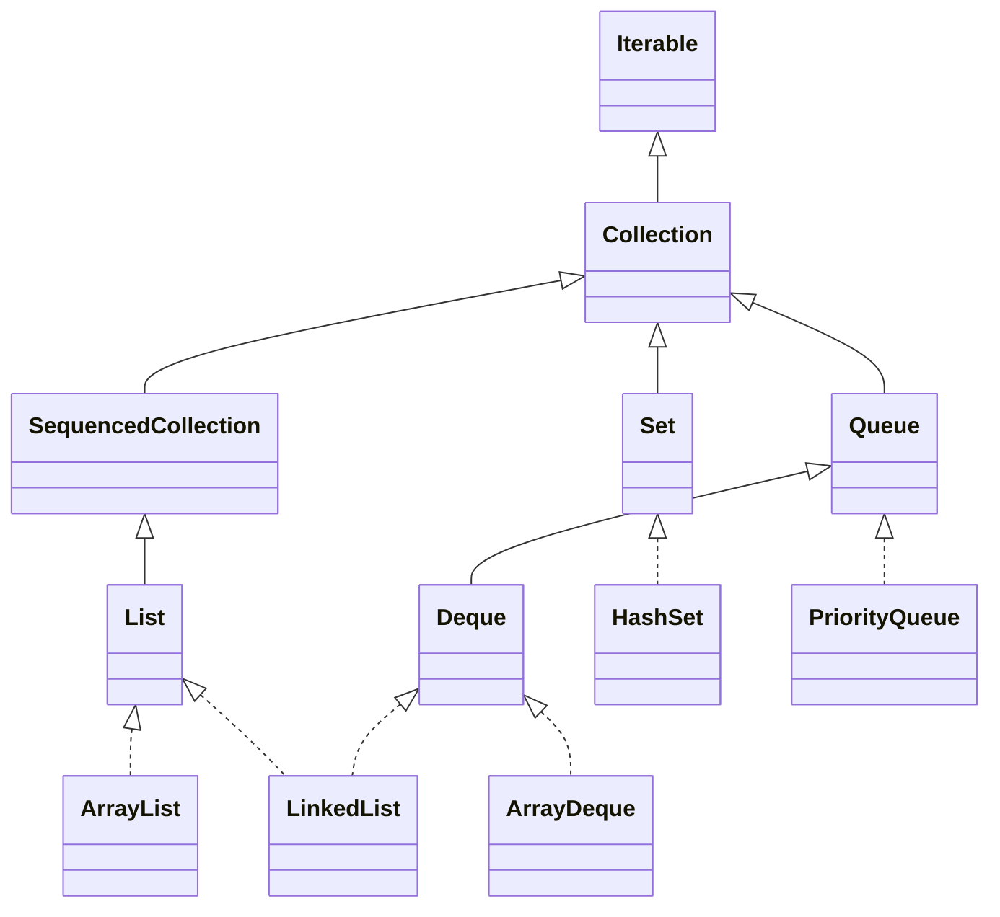

**Diagram (the Map side):**

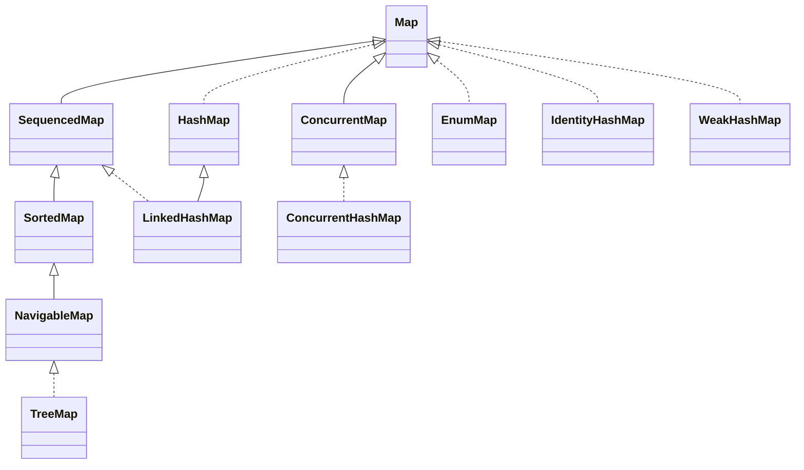

**How it works:**
- `List`: ordered, allows duplicates, access by index.
- `Set`: no duplicates. `SortedSet`/`NavigableSet` (`TreeSet`) keep items sorted.
- `Queue`/`Deque`: take from the head; a *deque* (double-ended queue) works at both ends.
- `Map`: key → value. Keys are unique.
- `SequencedCollection` and `SequencedMap` (Java 21) sit in the middle of the tree. They give "first" and "last" to every ordered collection. See [Sequenced collections](#sequenced-collections-java-21).
- Legacy classes (`Vector`, `Stack`, `Hashtable`) still exist. They lock every method. Don't use them in new code.

**Say this in the interview:**
> "Collection has three main children: List, Set and Queue. Map is a separate hierarchy because it stores key-value pairs. Since Java 21, SequencedCollection and SequencedMap add getFirst, getLast and reversed to every collection with a defined order."

**They may ask next:**
- **Why is Map not a Collection?** A collection holds single items; `add(E)` makes no sense for pairs. You get collection views instead: `keySet()`, `values()`, `entrySet()`.
- **Is `Set` sequenced?** Plain `Set` (like `HashSet`) is not. `LinkedHashSet` and `TreeSet` are, through `SequencedSet`.

### Choosing a collection

**In one line:** Choose by the operation you do most, and know its Big-O (how the time grows when the data grows).

**Story:** You don't keep your passport in the kitchen drawer. You keep things where you can find them fast for the way you use them. Phone numbers go in a contact list sorted by name. Today's orders go in a queue.

*Big-O* is a rough measure of time. O(1) means "same time for 10 or 10 million items". O(n) means "10 times more items, 10 times more time". O(log n) means "1 million items needs about 20 steps".

**Big-O table:**

| Collection | get / contains | add | remove | Order | Nulls | Notes |
|---|---|---|---|---|---|---|
| `ArrayList` | `get(i)` O(1), `contains` O(n) | end: O(1) amortized, middle: O(n) | O(n) (shift) | insertion | yes | Default list |
| `LinkedList` | `get(i)` O(n) | ends: O(1) | at iterator: O(1), by index: O(n) | insertion | yes | Almost never the best |
| `ArrayDeque` | — | ends: O(1) amortized | ends: O(1) | insertion | **no** | Stack and queue |
| `PriorityQueue` | `peek` O(1) | O(log n) | `poll` O(log n), `remove(x)` O(n) | by priority (head only) | no | Binary heap |
| `HashMap` / `HashSet` | O(1) average | O(1) average | O(1) average | none | one null key | Worst bin: O(log n) as a tree |
| `LinkedHashMap` | O(1) | O(1) | O(1) | insertion or access | yes | LRU caches |
| `TreeMap` / `TreeSet` | O(log n) | O(log n) | O(log n) | sorted | no null key (natural order) | Range queries |
| `ConcurrentHashMap` | O(1), no lock on read | O(1), small lock | O(1) | none | **no** | Thread-safe |
| `CopyOnWriteArrayList` | O(1) | O(n) (copies) | O(n) | insertion | yes | Many reads, few writes |
| `EnumMap` / `EnumSet` | O(1) | O(1) | O(1) | enum order | no null key | Array / bit mask inside |

**Diagram:**

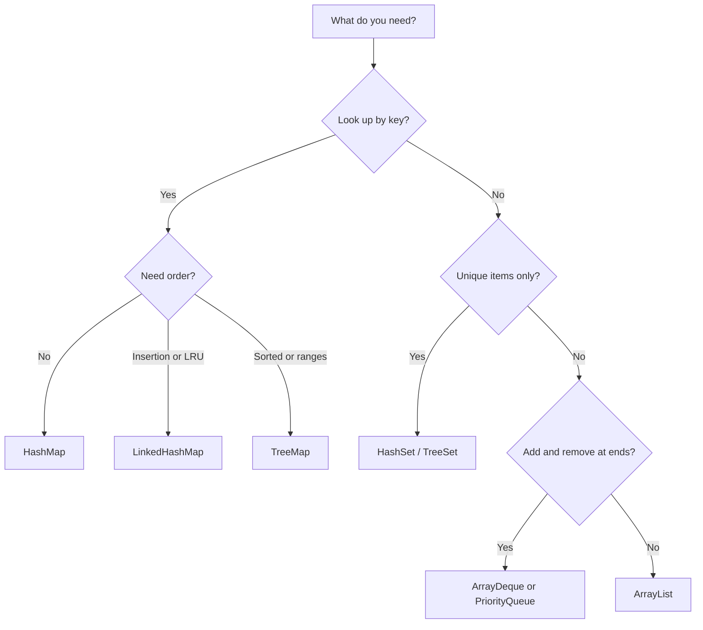

**Good and bad:**

| Good | Bad |
|---|---|
| Type the variable as the interface: `List<Order> orders = new ArrayList<>()` | `ArrayList<Order>` everywhere: hard to change later |
| Presize when you know the size: `new ArrayList<>(10_000)`, `HashMap.newHashMap(10_000)` (Java 19+) | `new HashMap<>(10_000)`: this is a *capacity*, so it still resizes before 10,000 entries |
| `ArrayDeque` for stack and queue | `Stack`, `Vector`, `Hashtable` (old, every method locked) |
| `ConcurrentHashMap` for shared maps | `Collections.synchronizedMap` (one lock for everything) |

**Say this in the interview:**
> "ArrayList get is O(1), but contains is O(n). HashMap get and put are O(1) on average; in the worst case a bucket becomes a tree, so O(log n). TreeMap is O(log n) for everything but gives sorted order and range queries. I also presize big maps with HashMap.newHashMap, because the constructor argument is a capacity, not an entry count."

**They may ask next:**
- **Why does `new HashMap<>(1000)` still resize?** The resize happens at capacity × 0.75. Capacity 1024 resizes after 768 entries. `HashMap.newHashMap(1000)` does the math for you.
- **What does "amortized O(1)" mean?** Most adds are cheap. Once in a while one add is expensive (a copy). Averaged over all adds, the cost per add is constant.

### ArrayList vs LinkedList

**In one line:** `ArrayList` is a growing array and is the right choice almost always; `LinkedList` is a chain of nodes that loses on memory and CPU cache in nearly every real test.

**Story:** `ArrayList` is a train: coaches are joined in one line, and you can walk to coach 7 directly. When the train is full, the railway brings a longer train and moves everyone (a copy). `LinkedList` is a treasure hunt: each note tells you where the next note is. To reach note 500, you read 499 notes first.

**How it works (ArrayList):**
1. Inside there is an `Object[] elementData` and an `int size`.
2. `new ArrayList<>()` starts with an empty shared array. The first `add` creates an array of 10.
3. When full, it grows by 50%: new length = old + old/2 (10 → 15 → 22 → 33 → 49 …), then `Arrays.copyOf`.
4. Adding 1 million items causes 29 resizes and about 2.4 million element copies in total. That is about 2.4 copies per item, so `add` is *amortized O(1)*.
5. `remove(i)` shifts every item after `i` one step left with `System.arraycopy`: O(n). Removing from the end is O(1).
6. It never shrinks by itself. Call `trimToSize()` if a big list stays around.

**How it works (LinkedList):**
1. Each item lives in a `Node` object with `item`, `prev` and `next`.
2. `get(i)` walks from the nearer end: O(n).
3. Each node is an extra object (header plus 3 references), so it uses several times more memory than an array slot.
4. Nodes are spread over the heap. The CPU cache cannot pre-load them, so even a full scan is slower than an array scan.
5. Its only real win, "insert in the middle in O(1)", needs you to already hold an iterator at that spot. Finding the spot is O(n).

**Diagram:**

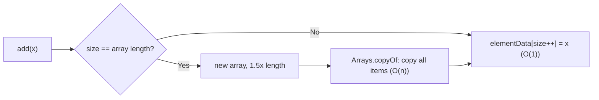

**Example:**

```java
List<Integer> list = new ArrayList<>(1_000);   // presize: no resize up to 1,000
for (int i = 0; i < 1_000; i++) list.add(i);   // O(1) each
list.remove(0);                                // shifts 999 items: O(n)
list.remove(list.size() - 1);                  // last item: O(1)
list.remove(Integer.valueOf(42));              // remove(Object): search + shift
// Trap: list.remove(42) removes INDEX 42, not the value 42
```

**Good and bad:**

| Good | Bad |
|---|---|
| `ArrayList` for lists, `ArrayDeque` for queues | `LinkedList` "because we insert a lot" |
| Remove many items with `removeIf` (one pass) | `remove(i)` in a loop (O(n²)) |
| Presize when the size is known | Growing a 10-million list from 10 |

**Say this in the interview:**
> "ArrayList is a resizable array. Add at the end is amortized O(1) because it grows by 50% and copies rarely. Remove from the middle is O(n) because it shifts items. LinkedList looks good on paper, but each node is a separate object, so it uses more memory and is unfriendly to the CPU cache. In practice I use ArrayList or ArrayDeque."

**They may ask next:**
- **ArrayList vs Vector?** `Vector` locks every method and grows 2x. It is legacy. Use `ArrayList`, or a concurrent collection for threads.
- **Is `ArrayList` thread-safe?** No. Two threads adding at once can lose items or throw `ArrayIndexOutOfBoundsException`.
- **What is `RandomAccess`?** A marker interface. It tells algorithms that `get(i)` is fast. `ArrayList` has it, `LinkedList` does not.

### HashMap internals

**In one line:** A `HashMap` is an array of buckets; the key's hash picks the bucket, and `equals` finds the exact key inside the bucket.

**Story:** A post office has 16 pigeonholes. The clerk looks at the last digits of your PIN code and puts the letter in that pigeonhole. Finding a letter later is fast: go to the right hole, then read the few names inside. If one hole gets too many letters, the clerk sorts that hole alphabetically (a tree) so searching stays fast. When the whole wall is 75% full, the clerk builds a wall twice as big and re-sorts the letters.

**How it works (`put(key, value)`):**
1. **Hash:** compute `h = key.hashCode()`, then *spread* it: `h ^ (h >>> 16)`. This mixes the high 16 bits into the low bits, because only the low bits pick the bucket.
2. **Index:** `index = hash & (n - 1)`, where `n` is the table length. `n` is always a power of 2, so this is the same as `hash % n`, but faster.
3. **Empty bucket:** put a new node there.
4. **Busy bucket (collision):** walk the nodes. If a node has the same hash and `equals` the key, replace the value. Otherwise add a new node at the tail.
5. **Treeify:** if one bucket reaches 8 nodes (`TREEIFY_THRESHOLD`) and the table has at least 64 buckets (`MIN_TREEIFY_CAPACITY`), the chain becomes a red-black tree. If the table is smaller than 64, it resizes instead.
6. **Untreeify:** when a resize splits a tree bucket and a part has 6 or fewer nodes (`UNTREEIFY_THRESHOLD`), it goes back to a plain chain. The gap between 8 and 6 stops flip-flopping.
7. **Resize:** when `size > capacity × loadFactor` (16 × 0.75 = 12 by default), the table doubles. Each node either stays at index `i` or moves to `i + oldCapacity`. One bit of the hash decides, so there is no full rehash.
8. **Null key:** allowed once. Its hash is 0, so it lives in bucket 0.
9. **Iteration order:** not defined. It follows bucket order, so it can change after a resize.

These numbers come from the JDK source (`HashMap.java`): default capacity 16, load factor 0.75, treeify 8, untreeify 6, min tree capacity 64.

**Diagram (inside the table):**

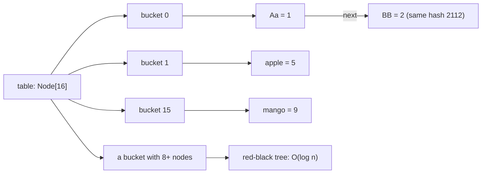

**Diagram (the put flow):**

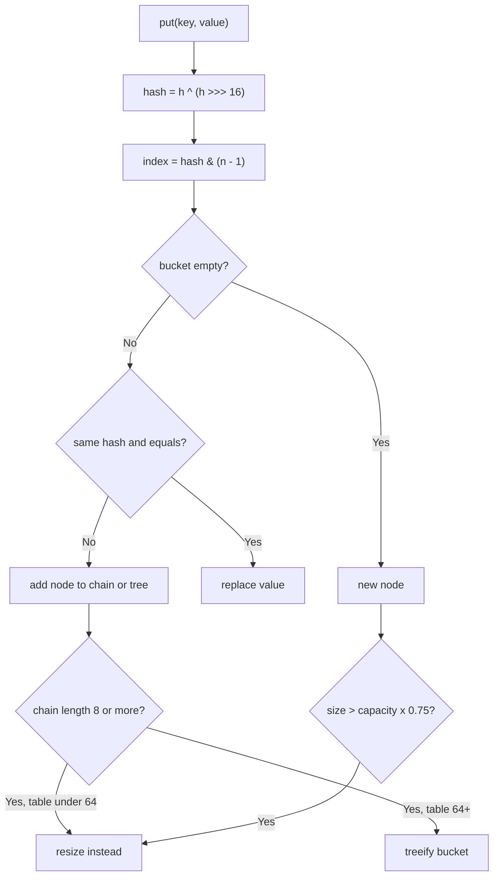

**Diagram (resize split):**

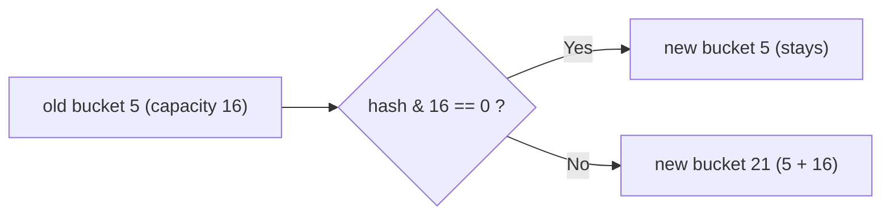

**Example (real output):**

```java
public class HashIndex {
    static int spread(Object key) {                 // same as HashMap.hash()
        int h = key.hashCode();
        return h ^ (h >>> 16);                       // mix high bits into low bits
    }
    public static void main(String[] args) {
        int n = 16;                                  // table size (always a power of 2)
        for (String k : new String[]{"apple", "Aa", "BB", "mango"}) {
            int h = spread(k);
            System.out.printf("%-6s hashCode=%-9d index=%d%n", k, k.hashCode(), h & (n - 1));
        }
    }
}
// apple  hashCode=93029210  index=1
// Aa     hashCode=2112      index=0
// BB     hashCode=2112      index=0   <- "Aa" and "BB" collide: same bucket
// mango  hashCode=103662530 index=15
```

**Why trees in Java 8?** Before Java 8, a bucket was always a linked list. An attacker could send many keys with the same hash (for example HTTP form fields). Every lookup became O(n), and the server slowed to a crawl (a *hash flooding* attack). Tree buckets cap the damage at O(log n). Trees work best when keys are `Comparable` (like `String`). Otherwise the tree breaks ties by class name and identity hash.

**Good and bad:**

| Good | Bad |
|---|---|
| Immutable keys (`String`, `Integer`, records) | Mutable keys (see the next section) |
| Good `hashCode`, using the same fields as `equals` | `hashCode` returning a constant |
| `HashMap.newHashMap(expected)` for big maps | Letting a 1-million-entry map resize 17 times |
| `ConcurrentHashMap` when threads share it | Plain `HashMap` across threads (lost updates, and in Java 7 even an endless loop during resize) |

**Say this in the interview:**
> "HashMap is an array of buckets. It spreads the hashCode with h XOR h>>>16, then picks the bucket with hash AND n-1, because the size is a power of two. Collisions go into a chain. When a chain reaches 8 and the table has at least 64 buckets, the chain becomes a red-black tree, so the worst case is O(log n). When size passes 75% of capacity, the table doubles. Each entry either stays or moves by exactly the old capacity."

**They may ask next:**
- **Why a power of 2?** So `hash & (n - 1)` can replace the slower `%`. And on resize, one hash bit decides "stay or move".
- **Why load factor 0.75?** A trade-off. Lower wastes memory; higher makes chains longer. The JDK docs call 0.75 "a good tradeoff between time and space costs".
- **What if two keys have the same hashCode?** They go to the same bucket. `equals` then tells them apart. Only performance suffers, not correctness.
- **Can HashMap have a null value?** Yes, many. That is why `get` returning `null` does not tell you if the key exists. Use `containsKey` or `getOrDefault`.

### Bad hashCode and mutable keys

**In one line:** A constant `hashCode` makes a HashMap slow; a key that changes after `put` makes the entry impossible to find.

**Story:** You give your coat at a cloak room and get token 17. Then someone changes the number on your token to 42. The coat is still on hook 17, but you now ask for hook 42. The coat is not lost, but you can never get it back. That is a mutable key.

**How it works:**
1. **Constant hashCode** (`return 1;`): all keys go to one bucket. With `Comparable` keys the bucket becomes a tree, so O(log n). Without it, the tree can only break ties weakly, and lookups get close to O(n). Still correct, just slow.
2. **hashCode without the equals fields**: two equal objects land in different buckets. `contains` says false, and you get "duplicates". See [the equals/hashCode bug demo](#q11-equals-without-hashcode-bug).
3. **Mutable key**: the bucket is chosen at `put` time. If a field used in `hashCode` changes later, `get` looks in a different bucket. The entry stays in the map forever: a quiet memory leak.

**Example (real output):**

```java
import java.util.*;

public class BadKey {
    static class Cart {                               // mutable key: a bad idea
        List<String> items = new ArrayList<>();
        @Override public boolean equals(Object o) {
            return o instanceof Cart c && items.equals(c.items);
        }
        @Override public int hashCode() { return items.hashCode(); }
    }
    public static void main(String[] args) {
        Map<Cart, String> owner = new HashMap<>();
        Cart cart = new Cart();
        owner.put(cart, "Asha");                      // stored in bucket for hash of []
        cart.items.add("tea");                        // hashCode changes now!
        System.out.println(owner.get(cart));          // null: looks in the wrong bucket
        System.out.println(owner.containsKey(cart));  // false
        System.out.println(owner.size());             // 1: the entry is still there, lost
    }
}
```

**Say this in the interview:**
> "Map keys must be immutable, or at least the fields used in hashCode must never change. If they change, the entry sits in the old bucket, get returns null, and the entry leaks. A constant hashCode is still correct but turns the map into one long bucket, so performance collapses."

**They may ask next:**
- **Same problem with `HashSet`?** Yes. A `HashSet` is a `HashMap` inside.
- **How to fix?** Use records or other immutable types as keys. Or use an ID (`String`, `Long`) as the key.

### LinkedHashMap and an LRU cache

**In one line:** `LinkedHashMap` is a `HashMap` plus a doubly linked list through all entries, so it remembers insertion order, or access order for an LRU cache.

**Story:** A small bookshelf holds only 3 books. Every time you read a book, you put it back at the right end. When a new book arrives and the shelf is full, you remove the book on the far left: the one you have not touched for the longest time. That is *LRU* (least recently used).

**How it works:**
1. Each entry has `before` and `after` links, on top of the normal bucket chain.
2. `new LinkedHashMap<>(16, 0.75f, true)`: the `true` means *access order*. Every `get` or `put` moves the entry to the tail.
3. After each `put`, the map calls `removeEldestEntry(eldest)`. If you return `true`, the head (the least recently used) is removed.
4. All operations stay O(1).

**Diagram:**

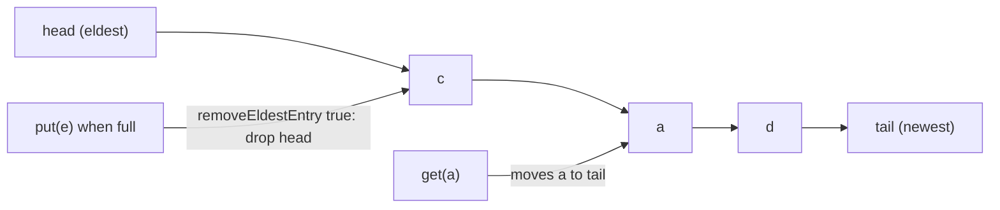

**Example (real output):**

```java
import java.util.*;

public class LruCache<K, V> extends LinkedHashMap<K, V> {
    private final int capacity;

    public LruCache(int capacity) {
        super(16, 0.75f, true);                       // true = access order (LRU)
        this.capacity = capacity;
    }

    @Override
    protected boolean removeEldestEntry(Map.Entry<K, V> eldest) {
        return size() > capacity;                     // called after every put
    }

    public static void main(String[] args) {
        LruCache<String, Integer> cache = new LruCache<>(3);
        cache.put("a", 1); cache.put("b", 2); cache.put("c", 3);
        cache.get("a");                               // "a" is now most recent
        cache.put("d", 4);                            // evicts "b", the least recent
        System.out.println(cache.keySet());           // [c, a, d]
    }
}
```

**Good and bad:**

| Good | Bad |
|---|---|
| This 10-line LRU for one thread, small sizes | Sharing it across threads: even `get` changes the list |
| Caffeine (or Spring Cache with Caffeine) for real app caches | Writing your own concurrent cache with expiry |

**Say this in the interview:**
> "LinkedHashMap keeps a doubly linked list through the entries. With accessOrder true, every get moves the entry to the end. If I override removeEldestEntry to return size greater than capacity, I get an LRU cache in ten lines. It is not thread-safe, so in production I use Caffeine."

**They may ask next:**
- **Build it without `LinkedHashMap`?** A `HashMap<K, Node>` plus your own doubly linked list. See [Q1](#q1-lru-cache-linkedhashmap-and-by-hand).
- **Make it thread-safe?** Wrap it with `Collections.synchronizedMap` (one lock, slow), or use Caffeine, which is built for concurrency.

### TreeMap and NavigableMap

**In one line:** `TreeMap` is a red-black tree that keeps keys sorted and answers range questions like "the biggest key below X" in O(log n).

**Story:** An income tax slab table. Your income is 4.5 lakh. You need "the slab that starts at or below 4.5 lakh". A sorted table answers this at once. A `HashMap` cannot, because it has no order.

**How it works:**
1. A *red-black tree* is a binary search tree that rebalances itself. Its height stays about 2 × log₂(n), so 1 million keys need about 40 steps at most.
2. Keys are ordered by `compareTo` (natural order) or by the `Comparator` you pass in.
3. `NavigableMap` methods: `floorKey` (≤), `ceilingKey` (≥), `lowerKey` (<), `higherKey` (>), `headMap`, `tailMap`, `subMap`, `descendingMap`, `pollFirstEntry`.
4. **Trap:** `TreeMap` and `TreeSet` use `compare`, not `equals`. If `compare` returns 0, the two keys are "the same", even when `equals` says no.

**Example (real output):**

```java
import java.util.*;

public class TreeDemo {
    record Emp(String name, int age) {}
    public static void main(String[] args) {
        TreeMap<Integer, String> slabs = new TreeMap<>(Map.of(0, "0%", 300_000, "5%", 700_000, "10%"));
        System.out.println(slabs.floorEntry(450_000));        // 300000=5% (largest key <= 450000)
        System.out.println(slabs.ceilingKey(450_000));        // 700000
        System.out.println(slabs.headMap(700_000));           // {0=0%, 300000=5%}
        System.out.println(slabs.descendingMap());            // {700000=10%, 300000=5%, 0=0%}

        // Pitfall: TreeSet uses compare(), not equals()
        Set<Emp> byAge = new TreeSet<>(Comparator.comparingInt(Emp::age));
        byAge.add(new Emp("Asha", 30));
        byAge.add(new Emp("Ravi", 30));                       // compare == 0, so "duplicate"
        System.out.println(byAge);                            // [Emp[name=Asha, age=30]]
    }
}
```

**Say this in the interview:**
> "TreeMap is a red-black tree, so get, put and remove are O(log n) and keys stay sorted. I use it when I need ranges: floorKey for price slabs, subMap for a time window. One trap: it uses compareTo instead of equals, so the comparator must be consistent with equals or items silently disappear."

**They may ask next:**
- **TreeMap vs sorting a HashMap once?** If you sort once and read many times, sort a list once. If keys keep changing and you need order all the time, use `TreeMap`.
- **Thread-safe sorted map?** `ConcurrentSkipListMap`, also O(log n), with no global lock.

### HashSet is a HashMap

**In one line:** A `HashSet` stores your items as the keys of a hidden `HashMap`, with one shared dummy object as the value.

**Story:** A guest list at a wedding is just the left column of a table. The right column always says "invited". The `HashSet` keeps only the names you care about. The dummy value is that same "invited" word on every row.

**How it works:**
1. `HashSet` has a field `HashMap<E, Object> map` and `static final Object PRESENT = new Object()`.
2. `add(e)` is `map.put(e, PRESENT) == null`. So `add` returns `false` when the item was already there.
3. `LinkedHashSet` uses a `LinkedHashMap`; `TreeSet` uses a `TreeMap`.
4. So every rule about keys (good `hashCode`, immutable fields) applies to set items.

**Example:**

```java
Set<String> seen = new HashSet<>();
System.out.println(seen.add("tea"));   // true: new
System.out.println(seen.add("tea"));   // false: already there -> easy duplicate check
```

**Say this in the interview:**
> "HashSet is a thin wrapper over HashMap. The items are keys and the value is one shared dummy object. That is why add returns false for a duplicate, and why the hashCode and equals rules for map keys apply to set items too."

**They may ask next:**
- **Memory cost?** Each item still needs a full map node (hash, key, value, next). A `HashSet` of 1 million `Integer` uses far more memory than an `int[]`.

### ConcurrentHashMap internals

**In one line:** Since Java 8, `ConcurrentHashMap` locks only one bucket at a time: it uses CAS for empty buckets, `synchronized` on the first node for busy ones, and reads take no lock at all.

**Story:** A big railway station has 64 ticket windows. In old Java 7, the station was split into 16 halls with one guard each (segments). In Java 8+, each window has its own small lock. If a window is empty, you just walk up without a lock (CAS). If people are in line, only that window's line waits. People who only *look* at the timetable (reads) never wait.

**How it works:**
1. **Same table idea as `HashMap`:** an array of bins, `spread(h)` hash mixing, chains that become trees at 8.
2. **Read (`get`):** no lock. Bins and node values are read with volatile semantics, so a reader always sees a fully written node.
3. **Write to an empty bin:** a CAS (*compare-and-swap*, a CPU instruction that sets a value only if it still has the expected old value). No lock.
4. **Write to a busy bin:** `synchronized` on the first node of that bin only. Other bins are free.
5. **Resize:** many threads help. A moved bin is marked with a `ForwardingNode`. A thread that meets it helps move other bins instead of waiting.
6. **Size:** a `baseCount` plus an array of `CounterCell`s (the `LongAdder` idea), so threads don't fight over one counter. `size()` adds them up. Under heavy writes it is only an estimate. Prefer `mappingCount()` (returns a `long`).
7. **Atomic compound actions:** `compute`, `computeIfAbsent`, `merge` run *atomically* for that key. The javadoc says the whole method call "is performed atomically". Keep the function short, and never touch other keys of the same map inside it.
8. **No nulls:** `put(k, null)` throws `NullPointerException`. If `get` returned null, you could not tell "absent" from "null value". In a concurrent map you also can't safely call `containsKey` and then `get`, because the map may change in between.
9. **Iterators are weakly consistent:** they never throw `ConcurrentModificationException`. They may or may not show changes made during the loop.
10. **No segments since Java 8.** A `Segment` class still exists, but only for serialization compatibility.

**Diagram (put):**

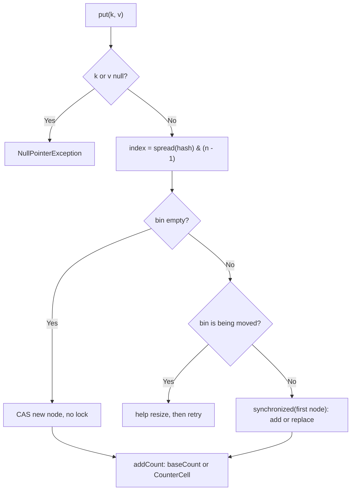

**Diagram (two threads, two bins):**

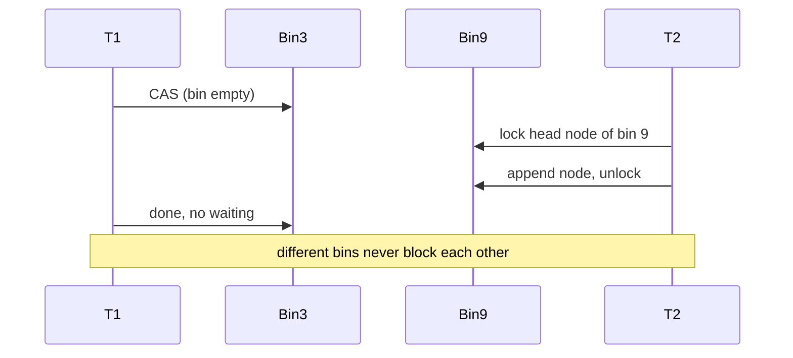

**Example (real output):**

```java
import java.util.*;
import java.util.concurrent.*;
import java.util.stream.IntStream;

public class ChmDemo {
    public static void main(String[] args) {
        ConcurrentHashMap<String, Integer> hits = new ConcurrentHashMap<>();
        IntStream.range(0, 10_000).parallel()
                 .forEach(i -> hits.merge(i % 2 == 0 ? "even" : "odd", 1, Integer::sum)); // atomic
        System.out.println(hits);                         // {even=5000, odd=5000}

        Map<String, Integer> plain = new HashMap<>();
        IntStream.range(0, 10_000).parallel()
                 .forEach(i -> plain.merge("all", 1, Integer::sum));  // NOT thread-safe
        System.out.println("HashMap count (should be 10000): " + plain.get("all")); // e.g. 1543

        try { hits.put("x", null); } catch (NullPointerException e) {
            System.out.println("CHM null value -> NPE");
        }
        System.out.println("mappingCount: " + hits.mappingCount());  // 2
    }
}
```

The `HashMap` number changes every run (1543 in our run). That is the lost-update bug.

**Good and bad:**

| Good | Bad |
|---|---|
| `map.merge(key, 1, Integer::sum)` | `map.put(key, map.get(key) + 1)`: two steps, not atomic |
| `computeIfAbsent(k, x -> new ArrayList<>())` | `if (!map.containsKey(k)) map.put(k, ...)`: check-then-act race |
| Short, pure functions inside `compute` | Calling a remote service inside `computeIfAbsent` (blocks the bin) |

**Say this in the interview:**
> "In Java 8 ConcurrentHashMap dropped segments. Reads take no lock. A write to an empty bin uses CAS; a write to a busy bin locks only the first node of that bin. Size is kept in striped counter cells like LongAdder. compute and merge are atomic per key, so I use merge for counters. It refuses null because null would make get ambiguous in a concurrent world."

**They may ask next:**
- **`Hashtable` vs `synchronizedMap` vs `ConcurrentHashMap`?** The first two use one lock for the whole map. `ConcurrentHashMap` locks per bin and reads without locks, so it scales.
- **Is `get` after `put` from another thread visible?** Yes. A `put` happens-before a later `get` of the same key. See [Java Memory Model](#java-memory-model).
- **More on concurrent collections:** [Concurrent collections](java-concurrency.md#concurrent-collections).

### CopyOnWriteArrayList

**In one line:** Every write copies the whole array, so readers and iterators never need a lock and never see a change mid-loop.

**Story:** A restaurant menu board. Changing the menu means printing a new board and swapping it in one move. Guests reading the old board are never disturbed. Printing a board is costly, so you do it only a few times a day.

**How it works:**
1. Inside is a `volatile Object[] array`.
2. `add`/`set`/`remove` take a lock, copy the array, change the copy, then swap the reference.
3. Iterators work on the array that existed when they started (a *snapshot*). `iterator.remove()` throws `UnsupportedOperationException`.
4. Write cost is O(n) and makes garbage. With 10,000 items and 100 writes per second you copy 1 million references per second.

**When to use / when not to use:**
- Use: listener lists, config lists, routing tables: many reads, rare writes.
- Don't use: lists that change often, or big lists.

**Say this in the interview:**
> "CopyOnWriteArrayList copies the array on every write and swaps a volatile reference. Reads and iteration are lock-free and never throw ConcurrentModificationException, because the iterator sees a snapshot. It is great for listener lists and terrible for write-heavy lists."

**They may ask next:**
- **`CopyOnWriteArraySet`?** The same idea for sets; `contains` is O(n).

### Fail-fast vs fail-safe iterators

**In one line:** A *fail-fast* iterator throws `ConcurrentModificationException` as soon as it notices that the collection changed under it; a *fail-safe* (weakly consistent or snapshot) iterator keeps going.

**Story:** You are counting people in a queue. Someone jumps in. A strict counter shouts "stop, the line changed!" (fail-fast). A relaxed counter keeps counting the line as it was when they started (fail-safe).

**How it works:**
1. `ArrayList`, `HashMap` and friends keep a counter `modCount`. Every structural change (add, remove) increases it.
2. The iterator saves `expectedModCount` at the start. Each `next()` compares the two. If they differ, it throws.
3. It is "best effort". It is not a thread-safety tool. Puzzle: removing the second-last element in a for-each loop throws nothing, because `hasNext()` returns false before the check runs.
4. Fail-safe: `CopyOnWriteArrayList` (snapshot) and `ConcurrentHashMap` (weakly consistent). They never throw CME.

**Diagram:**

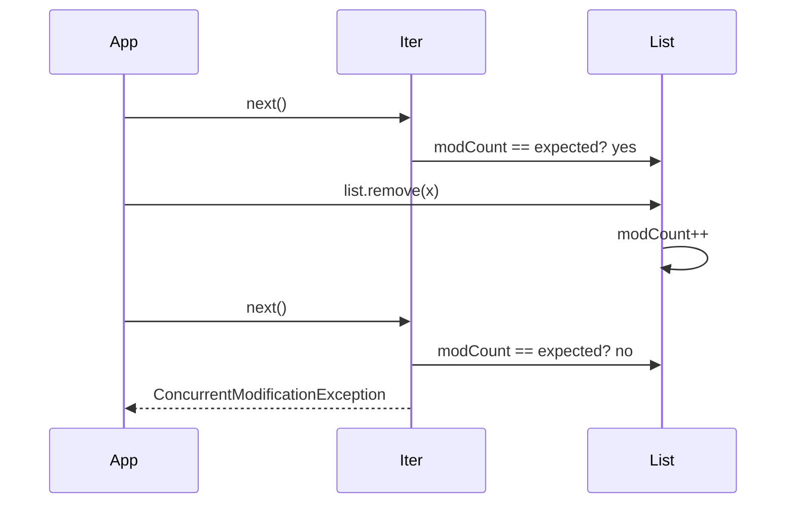

**Example (real output):**

```java
import java.util.*;
import java.util.concurrent.CopyOnWriteArrayList;

public class FailFast {
    public static void main(String[] args) {
        List<Integer> nums = new ArrayList<>(List.of(1, 2, 3, 4));
        try {
            for (Integer n : nums) {
                if (n == 2) nums.remove(n);           // changes modCount behind the iterator
            }
        } catch (ConcurrentModificationException e) {
            System.out.println("fail-fast: " + e);    // fail-fast: java.util.ConcurrentModificationException
        }

        nums.removeIf(n -> n % 2 == 0);               // safe way
        System.out.println("removeIf: " + nums);      // removeIf: [1, 3]

        List<Integer> cow = new CopyOnWriteArrayList<>(List.of(1, 2, 3));
        for (Integer n : cow) {
            cow.add(n * 10);                          // iterator walks the old snapshot
        }
        System.out.println("fail-safe: " + cow);      // fail-safe: [1, 2, 3, 10, 20, 30]
    }
}
```

**Say this in the interview:**
> "ArrayList and HashMap iterators are fail-fast: they compare modCount and throw ConcurrentModificationException if the collection changed outside the iterator. It is a bug detector, not a guarantee. To remove while looping I use iterator.remove or removeIf. Concurrent collections have weakly consistent iterators that never throw."

**They may ask next:**
- **Can CME happen with one thread?** Yes, that is the common case: changing the list inside its own for-each loop.
- **Three safe ways to remove?** `iterator.remove()`, `removeIf`, or build a new list with a stream. See [Q13](#q13-remove-items-while-iterating).

### Unmodifiable vs List.of vs copyOf

**In one line:** `Collections.unmodifiableList` is a read-only *view* that still changes when the original changes; `List.of` and `List.copyOf` are truly immutable and reject nulls.

**Story:** An unmodifiable view is a glass window into a shop. You can't touch the goods, but the owner can still rearrange them and you will see it. `List.copyOf` is a photo of the shop: it never changes.

**How it works:**

| | `Collections.unmodifiableList(x)` | `List.of(...)` / `List.copyOf(x)` | `stream.toList()` (Java 16) |
|---|---|---|---|
| Real copy? | No, a view | Yes (`copyOf` may reuse an already immutable list) | Yes |
| Sees later changes to source? | **Yes** | No | No |
| `add` / `set` | `UnsupportedOperationException` | `UnsupportedOperationException` | `UnsupportedOperationException` |
| Null items | allowed | **NPE** (even `contains(null)` throws NPE) | allowed |
| Iteration order of `Set.of` / `Map.of` | — | not defined, can change between runs | — |

**Example (real output):**

```java
List<String> base = new ArrayList<>(List.of("a", "b"));
List<String> view = Collections.unmodifiableList(base);  // a read-only VIEW
List<String> copy = List.copyOf(base);                   // a real copy
base.add("c");
System.out.println(view + " " + copy);                   // [a, b, c] [a, b]

List.of("a", null);                                      // NullPointerException
List.of("a").contains(null);                             // NullPointerException (!)
Stream.of("a", null).toList();                           // [a, null]: allowed
System.out.println(List.copyOf(copy) == copy);           // true: no new copy made
```

**Say this in the interview:**
> "unmodifiableList is only a read-only view: if someone changes the original, my view changes too. List.of and List.copyOf make real immutable lists, and they reject nulls. For defensive copies in constructors I use List.copyOf, which is free if the input is already immutable."

**They may ask next:**
- **Are these lists deeply immutable?** No. The list can't change, but the objects inside can. Use immutable items too.
- **`Map.of` limit?** `Map.of` takes up to 10 pairs. Use `Map.ofEntries(entry(k, v), ...)` for more.

### Sequenced collections (Java 21)

**In one line:** Java 21 added `SequencedCollection`, `SequencedSet` and `SequencedMap`, so every ordered collection has the same `getFirst`, `getLast`, `addFirst`, `reversed` methods.

**Story:** Before Java 21, getting the last item was different for every type: `list.get(list.size() - 1)`, `deque.getLast()`, `sortedSet.last()`, and for `LinkedHashSet` there was no easy way at all. Java 21 gave them one common set of names.

**How it works:**
- `SequencedCollection`: `addFirst`, `addLast`, `getFirst`, `getLast`, `removeFirst`, `removeLast`, `reversed()`.
- `SequencedMap`: `firstEntry`, `lastEntry`, `pollFirstEntry`, `pollLastEntry`, `putFirst`, `putLast`, `reversed()`, `sequencedKeySet()`.
- `reversed()` returns a *view*, not a copy.
- Unordered types (`HashSet`, `HashMap`) do not get these methods.

**Example (real output):**

```java
List<String> list = new ArrayList<>(List.of("b", "c"));
list.addFirst("a");                                       // new in 21
System.out.println(list.getFirst() + " " + list.getLast() + " " + list.reversed()); // a c [c, b, a]

LinkedHashSet<String> set = new LinkedHashSet<>(List.of("x", "y"));
set.addFirst("y");                                        // moves y to the front
System.out.println(set);                                  // [y, x]

LinkedHashMap<String, Integer> map = new LinkedHashMap<>();
map.put("one", 1); map.put("two", 2);
map.putFirst("zero", 0);                                  // new in 21
System.out.println(map.firstEntry() + " " + map.lastEntry() + " " + map.reversed());
// zero=0 two=2 {two=2, one=1, zero=0}
```

**Say this in the interview:**
> "Java 21 added SequencedCollection and SequencedMap. Every collection with a defined order now has getFirst, getLast, addFirst and a reversed view. It removes the old list.get(size minus 1) code and finally gives LinkedHashSet a way to get the last element."

**They may ask next:**
- **Trap when upgrading to 21?** A class that implements both `List` and `Deque` (or has its own `reversed()`/`getFirst()` method with another return type) can fail to compile. Check custom collections when you upgrade. More in [java-streams.md](java-streams.md#sequenced-collections-java-21).

### PriorityQueue and ArrayDeque

**In one line:** `PriorityQueue` is a binary heap that always gives you the smallest item first; `ArrayDeque` is a circular array that is the fastest stack and queue.

**Story:** A hospital emergency room is a priority queue: the most serious patient goes first, not the one who came first. A stack of plates is a stack: last in, first out. A bank line is a queue: first in, first out.

**How it works (PriorityQueue):**
1. A *binary heap* stored in an array. The parent of index `i` is at `(i - 1) / 2`. Every parent is ≤ its children.
2. `offer`: put at the end, then "sift up" (swap with the parent while smaller): O(log n).
3. `poll`: take the root, move the last item to the root, "sift down": O(log n). `peek` is O(1).
4. Printing or iterating shows *heap order*, not sorted order. Only `poll` gives sorted order.
5. Max-heap: pass `Comparator.reverseOrder()`.

**How it works (ArrayDeque):**
1. A circular array with `head` and `tail` indexes. Both ends are O(1).
2. No nulls (null is used to mark empty slots).
3. The javadoc says it is likely faster than `Stack` as a stack and faster than `LinkedList` as a queue.

**Diagram:**

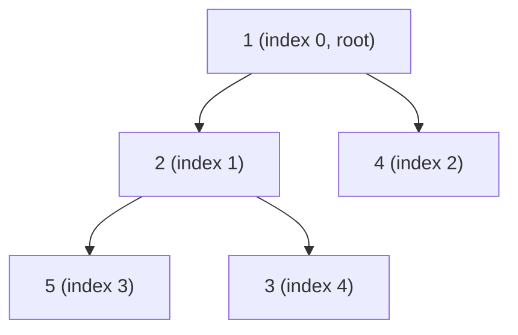

The array is `[1, 2, 4, 5, 3]`: not sorted, but each parent is smaller than its children.

**Example (real output):**

```java
import java.util.*;

public class HeapAndDeque {
    public static void main(String[] args) {
        PriorityQueue<Integer> minHeap = new PriorityQueue<>();
        for (int x : new int[]{5, 1, 4, 2, 3}) minHeap.offer(x);   // O(log n) each
        System.out.println("inside array: " + minHeap);           // [1, 2, 4, 5, 3]
        System.out.print("poll order: ");
        while (!minHeap.isEmpty()) System.out.print(minHeap.poll() + " "); // 1 2 3 4 5

        PriorityQueue<Integer> maxHeap = new PriorityQueue<>(Comparator.reverseOrder());
        maxHeap.addAll(List.of(5, 1, 4, 2));
        System.out.println("\nmax first: " + maxHeap.peek());     // 5

        Deque<String> stack = new ArrayDeque<>();                  // use instead of Stack
        stack.push("a"); stack.push("b");
        System.out.println("stack pop: " + stack.pop());           // b (LIFO)

        Deque<String> queue = new ArrayDeque<>();                  // use instead of LinkedList
        queue.offer("a"); queue.offer("b");
        System.out.println("queue poll: " + queue.poll());         // a (FIFO)
    }
}
```

**Say this in the interview:**
> "PriorityQueue is a binary heap in an array: offer and poll are O(log n), peek is O(1), and iteration is not sorted. For top-K problems I keep a min-heap of size K. ArrayDeque is a circular array and is my default stack and queue; Stack and LinkedList are slower."

**They may ask next:**
- **Is `PriorityQueue` thread-safe?** No. Use `PriorityBlockingQueue`.
- **Top-K in O(n log k)?** Min-heap of size k: add each item, and poll when size > k. See [Q7](#q7-word-frequency-top-k).

### EnumMap and EnumSet

**In one line:** When keys are enum values, `EnumMap` (an array indexed by `ordinal()`) and `EnumSet` (a bit mask) are smaller and faster than `HashMap` and `HashSet`.

**Story:** A weekly pill box has 7 fixed slots, Monday to Sunday. You never search for "Wednesday": you go straight to slot 3. Enum keys are known and fixed, so an array works perfectly.

**How it works:**
- `EnumMap`: an `Object[]` of size = number of enum constants. `put(WED, x)` is `vals[WED.ordinal()] = x`. Iteration follows enum order.
- `EnumSet`: for up to 64 constants, one `long`; each bit means "present" (`RegularEnumSet`). More than 64 uses a `long[]` (`JumboEnumSet`). `contains`, `add` and set math are bit operations.

**Example (real output):**

```java
enum Day { MON, TUE, WED, THU, FRI, SAT, SUN }

EnumSet<Day> weekend = EnumSet.of(Day.SAT, Day.SUN);           // a bit mask inside
EnumSet<Day> workdays = EnumSet.complementOf(weekend);
System.out.println(workdays);                                  // [MON, TUE, WED, THU, FRI]

EnumMap<Day, Integer> hours = new EnumMap<>(Day.class);        // array by ordinal
hours.put(Day.WED, 8); hours.put(Day.MON, 9);
System.out.println(hours);                                     // {MON=9, WED=8}: enum order
```

**Say this in the interview:**
> "For enum keys I use EnumMap and EnumSet. EnumMap is an array indexed by ordinal, and EnumSet is a bit vector, so both are O(1), compact, and iterate in enum order. EnumSet is also the clean replacement for int bit flags."

**They may ask next:**
- **Thread-safe?** No. Wrap with `Collections.synchronizedMap`, or use an immutable copy.

### IdentityHashMap and WeakHashMap

**In one line:** `IdentityHashMap` compares keys with `==` instead of `equals`; `WeakHashMap` holds its keys weakly, so an entry disappears after the key is garbage collected.

**Story:** `IdentityHashMap` is a hotel that checks the actual person, not the name on the card. Two people named "Ravi Kumar" get two rooms. `WeakHashMap` is a coat check that throws away a coat once the owner has left the building for good.

**How it works:**
- `IdentityHashMap`: uses `System.identityHashCode` and `==`. Inside it is an open-addressing (*linear probe*) table, not chains. Used for object graphs: "have I already visited *this exact object*?" (serializers, deep copy, proxies).
- `WeakHashMap`: keys are wrapped in `WeakReference`. After GC clears a key, the entry is removed on the next map operation. Used for metadata attached to objects you don't own.
- **WeakHashMap traps:**
  - If the value points back to its key, the key never dies, and you get a leak.
  - String literals and small boxed `Integer`s are cached by the JVM, so they never die either.
  - For real caches, use Caffeine with `weakKeys()` or `softValues()`, or a size limit.

**Example (real output):**

```java
Map<String, Integer> byEquals = new HashMap<>();
Map<String, Integer> byIdentity = new IdentityHashMap<>();
String k1 = new String("id"), k2 = new String("id");
byEquals.put(k1, 1);   byEquals.put(k2, 2);
byIdentity.put(k1, 1); byIdentity.put(k2, 2);                  // == decides
System.out.println(byEquals.size() + " vs " + byIdentity.size()); // 1 vs 2
```

**Say this in the interview:**
> "IdentityHashMap breaks the Map contract on purpose: it uses == so two equal but different objects are two keys. Frameworks use it to track visited objects. WeakHashMap lets entries vanish when the key is no longer used anywhere else. It is handy for metadata, but a value that refers to its key keeps it alive forever."

**They may ask next:**
- **What are weak references?** See [Strong, soft, weak and phantom references](#strong-soft-weak-and-phantom-references).

---

## Strings

**In one line:** A `String` is an immutable sequence of characters; the JVM shares string literals in a pool, stores Latin-1 text in one byte per character, and builds `+` concatenation with `invokedynamic`.

**Say this in the interview:**
> "String is immutable, which makes it safe to share, safe as a map key and safe across threads. Literals live in the string pool, so == can be true by accident, but I always compare with equals. Since Java 9 strings use one byte per character for Latin-1 text, and + is compiled to invokedynamic, so I only need StringBuilder in loops."

### Why String is immutable

**In one line:** Once created, a `String` never changes; every "change" creates a new string.

**Story:** A printed bus ticket. If you want a different route, you buy a new ticket. Because nobody can change a printed ticket, the conductor, the checker and you can all hold the same ticket safely.

**How it works:**
1. The class is `final`, and the characters live in a `private final byte[] value`. No method changes that array.
2. **Why the designers chose this:**
   - **Pool sharing:** one `"OK"` object can be shared by the whole app, because nobody can change it.
   - **Security:** class names, file paths, URLs and DB users are strings. A caller can't change them after a security check.
   - **Hash caching:** the `hashCode` is computed once and cached in a field. Great for `HashMap` keys.
   - **Thread safety:** immutable objects need no locks.
3. **Cost:** changing a string in a loop creates many short-lived objects. Use `StringBuilder` there.

**Say this in the interview:**
> "String is final and its byte array is private and never changed. That lets the JVM share literals in a pool, cache the hash code, pass strings across threads without locks, and trust them after a security check. The price is garbage when you build strings in a loop."

**They may ask next:**
- **Can reflection change a String?** Not in normal Java 17+ code. Strong encapsulation of JDK internals blocks `setAccessible` on `String.value`.
- **Why store passwords in `char[]`?** You can wipe a `char[]` with zeros after use. A `String` stays in memory until GC, and may also show up in heap dumps.

### String pool and ==

**In one line:** String literals are stored once in the *string pool*, so two literals are the same object; `new String(...)` and strings built at runtime are separate objects, so always compare with `equals`.

**Story:** A school keeps one copy of each textbook in the library (the pool). Students who ask for "Maths 10" all get pointed to the same copy. A student who photocopies the book has a separate copy with the same text. `==` asks "same physical book?"; `equals` asks "same text?".

**How it works:**
1. When a class loads, each string literal is put into the pool (if not there yet).
2. The pool has lived on the normal heap since Java 7 (before that, in PermGen), so it is garbage collected like other objects.
3. `new String("java")` always makes a new heap object.
4. `s.intern()` returns the pooled copy, adding it if needed.
5. Constant expressions (`"ja" + "va"`, or `final` constant parts) are joined by the compiler and pooled. Runtime concatenation is not.

**Diagram:**

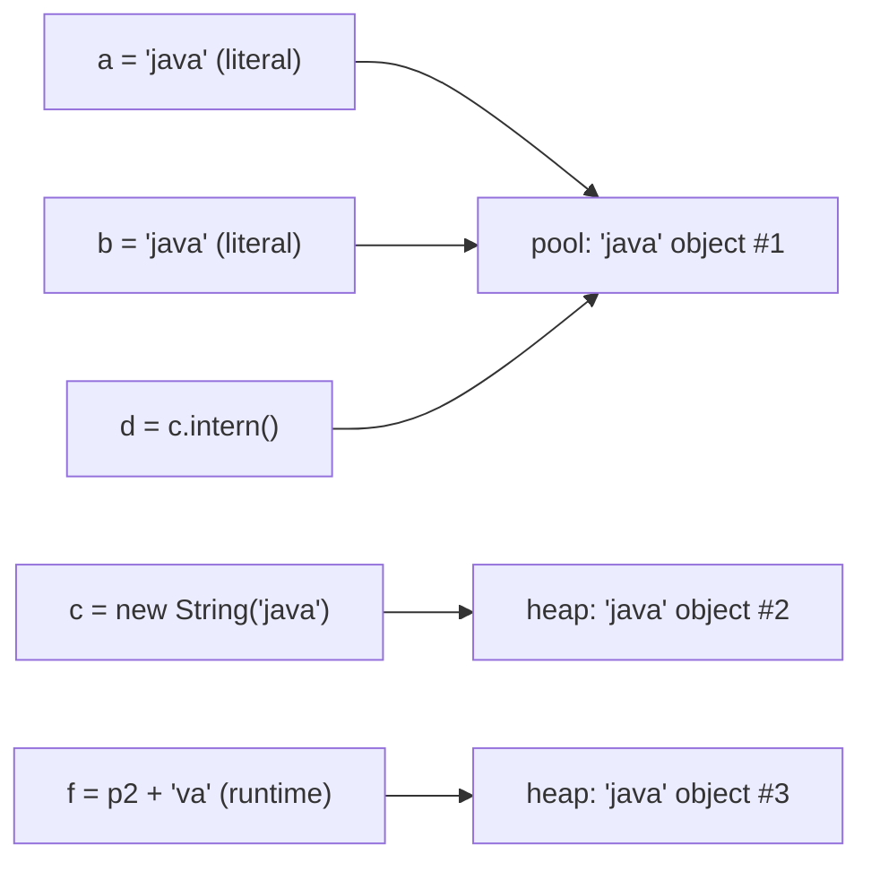

**Example (real output):**

```java
public class StringEq {
    public static void main(String[] args) {
        String a = "java";                    // from the string pool
        String b = "java";                    // same pooled object
        String c = new String("java");        // new object on the heap
        String d = c.intern();                // pooled copy
        final String part = "ja";
        String e = part + "va";               // compile-time constant: pooled
        String p2 = "ja";
        String f = p2 + "va";                 // built at runtime: new object

        System.out.println(a == b);           // true
        System.out.println(a == c);           // false
        System.out.println(a.equals(c));      // true  <- always compare text with equals
        System.out.println(a == d);           // true
        System.out.println(a == e);           // true
        System.out.println(a == f);           // false
    }
}
```

**Good and bad:**

| Good | Bad |
|---|---|
| `"ACTIVE".equals(status)` (no NPE if `status` is null) | `status == "ACTIVE"`: works in tests with literals, fails with data from the DB |
| `Objects.equals(a, b)` when both may be null | `intern()` on every request string (pool lookups cost CPU) |
| `equalsIgnoreCase` for user input | Comparing with `toLowerCase()` in a hot loop |

**Say this in the interview:**
> "== compares references and equals compares text. Literals are pooled, so == often works in a demo and then fails with strings from a request or a database. The pool has been on the heap since Java 7. I almost never call intern; if I have many duplicate strings, G1 string deduplication or a proper cache is better."

**They may ask next:**
- **How many objects does `new String("hi")` create?** Up to two: the pooled literal `"hi"` (if not already there) and the new heap object.
- **What is G1 string deduplication?** With `-XX:+UseStringDeduplication`, the GC makes duplicate strings share one byte array. It saves memory without code changes.

### Compact strings

**In one line:** Since Java 9, a `String` keeps a `byte[]` plus a `coder` flag: Latin-1 text uses 1 byte per character instead of 2.

**Story:** A form has a box for English names and a bigger box for names in any script. If the name fits the small box, you use the small one and save paper.

**How it works:**
1. Fields: `byte[] value` and `byte coder` (`LATIN1` = 0 or `UTF16` = 1).
2. If every character fits in Latin-1, each takes 1 byte. Otherwise the whole string uses UTF-16 (2 bytes per character).
3. Most strings in business apps (JSON keys, IDs, URLs) are Latin-1, so string memory drops by up to half.
4. It is on by default. The `String` API did not change.

**Say this in the interview:**
> "Since Java 9 strings store a byte array and a coder flag. Pure Latin-1 text takes one byte per character, which roughly halves string memory in typical services. It is transparent to code."

**They may ask next:**
- **What if one emoji is in the string?** The whole string becomes UTF-16, 2 bytes per character.

### StringBuilder vs concatenation

**In one line:** Since Java 9, `a + b + c` compiles to one `invokedynamic` call that builds the string efficiently; you still need `StringBuilder` when you add in a loop.

**Story:** Writing one address on an envelope is quick, whatever pen you use. But copying the whole address book again every time you add one name is slow. A loop with `s += x` does exactly that.

**How it works:**
1. Java 8 compiled `+` to `new StringBuilder().append(...).append(...).toString()`.
2. Java 9+ compiles it to `invokedynamic` → `StringConcatFactory.makeConcatWithConstants`. The JVM picks the best strategy at runtime. It can size the result exactly in one pass.
3. In a loop, each `s += w` still makes a brand-new string and copies everything so far. For n words that is O(n²) copying.
4. `StringBuilder` keeps one growing buffer: O(n) in total. `StringBuffer` is the old synchronized version; you don't need it.

**Example (real output, with `javap`):**

```java
static String greet(String name, int age) {
    return "Hi " + name + ", age " + age;     // javac emits invokedynamic (Java 9+)
}
static String joinFast(String[] words) {
    StringBuilder sb = new StringBuilder();
    for (String w : words) sb.append(w);      // one growing buffer
    return sb.toString();
}
// javap -c output for greet:
//   0: aload_0
//   1: iload_1
//   2: invokedynamic #7, 0   // InvokeDynamic #0:makeConcatWithConstants:(Ljava/lang/String;I)Ljava/lang/String;
//   7: areturn
```

**Good and bad:**

| Good | Bad |
|---|---|
| `"Hi " + name` on one line | `new StringBuilder()` for two words (harder to read, no gain) |
| `StringBuilder` or `String.join` / `Collectors.joining` in loops | `s += x` inside a loop over 10,000 rows |
| `log.info("user {}", id)`: no string built if INFO is off | `log.debug("user " + id)`: always builds the string |

**Say this in the interview:**
> "For a single expression I just use plus: since Java 9 it compiles to invokedynamic and the JVM builds it efficiently. In a loop I use StringBuilder or Collectors.joining, because each plus-equals makes a new string and copies everything, which is O(n squared)."

**They may ask next:**
- **StringBuilder vs StringBuffer?** `StringBuffer` synchronizes every method. A builder is almost always used by one thread, so `StringBuilder`.

### Text blocks

**In one line:** A text block (`"""`, final in Java 15) is a multi-line string literal that removes the common indentation for you.

**Story:** Instead of writing a letter line by line with `\n` and `+`, you paste the whole letter as it looks.

**How it works:**
1. Opens with `"""` and a line break. The position of the closing `"""` decides how much indentation is removed.
2. A `\` at the end of a line joins it with the next line (no line break).
3. `\s` keeps a trailing space. Trailing spaces are otherwise stripped.
4. It is a normal `String`. Use `.formatted(...)` for values. Never build SQL with values inside it; use parameters.

**Example (real output):**

```java
String json = """
    {
      "name": "Asha",
      "city": "Pune"
    }
    """;                                   // closing quotes set the indent
String sql = """
    SELECT id, name \
    FROM users \
    WHERE city = ?""";                     // backslash = no line break
System.out.print(json);                    // { ... } with 2-space inner indent kept
System.out.println(sql);                   // SELECT id, name FROM users WHERE city = ?
System.out.println("""
    Hello %s""".formatted("Ravi"));        // Hello Ravi
```

**Say this in the interview:**
> "Text blocks are multi-line string literals from Java 15. The compiler strips the common indentation, so JSON, SQL and HTML in tests look like the real thing. They are plain strings, so I still use bind parameters for SQL."

**They may ask next:**
- **Are string templates in Java?** No. String templates were a preview in Java 21 and 22 and were then withdrawn. They are not in Java 23, 24 or 25.

---

## Generics

**In one line:** Generics let the compiler check types for you (`List<Order>` holds only orders), and then the type arguments are erased, so at runtime it is just `List`.

**Say this in the interview:**
> "Generics are a compile-time feature. The compiler checks types and inserts casts, then erases the type arguments, so List of String and List of Integer are the same class at runtime. That is why I can't do new T(), instanceof List of String, or List of int. For flexible APIs I use PECS: extends when I read from a collection, super when I write into it."

### Type erasure and bridge methods

**In one line:** *Type erasure* means the compiler removes generic types after checking them; it adds casts where needed and *bridge methods* so overriding still works.

**Story:** At the airport, security checks your bag label at the gate (compile time). Once you are on the plane (runtime), nobody looks at the label again. If someone swapped bags after the check, you find out only when you open the bag at home: a `ClassCastException` far from the real mistake.

**How it works:**
1. The compiler checks every use of `List<String>`.
2. It *erases* `T` to its bound (`Object`, or `Number` for `T extends Number`).
3. It inserts casts where you read: `String s = (String) list.get(0)`.
4. If a class implements `Comparable<Money>`, it has `compareTo(Money)`. After erasure, the interface method is `compareTo(Object)`. So the compiler adds a synthetic *bridge method* `compareTo(Object)` that casts and calls `compareTo(Money)`.
5. Erasure was chosen in Java 5 so old non-generic code and libraries kept working (*migration compatibility*).

**Diagram:**

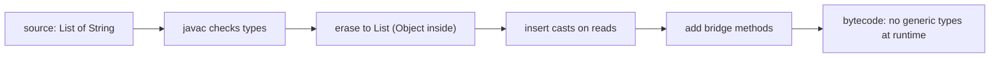

**Example (real output):**

```java
import java.lang.reflect.Method;
import java.util.*;

public class Erasure {
    record Money(long paise) implements Comparable<Money> {
        public int compareTo(Money o) { return Long.compare(paise, o.paise); }
    }
    public static void main(String[] args) {
        List<String> names = new ArrayList<>();
        List<Integer> ids = new ArrayList<>();
        System.out.println(names.getClass() == ids.getClass());   // true: one class at runtime

        for (Method m : Money.class.getDeclaredMethods()) {
            if (m.getName().equals("compareTo")) {
                System.out.println(m + " bridge=" + m.isBridge()); // the compiler added one
            }
        }
        List raw = names;                 // raw type: the compiler stops checking
        raw.add(42);                      // compiles (with a warning), no error yet
        try {
            String s = names.get(0);      // hidden cast fails here, far from the bug
        } catch (ClassCastException e) {
            System.out.println("CCE at read time: " + e.getMessage());
        }
    }
}
// true
// public int Erasure$Money.compareTo(Erasure$Money) bridge=false
// public int Erasure$Money.compareTo(java.lang.Object) bridge=true
// CCE at read time: class java.lang.Integer cannot be cast to class java.lang.String ...
```

**Say this in the interview:**
> "Generics exist only at compile time. The compiler checks types, erases them to the bound, inserts casts, and adds bridge methods so that overriding works after erasure. Erasure kept old Java code compatible, but it means I can't ask the runtime what T is."

**They may ask next:**
- **How does Jackson or Spring know `List<Order>`?** Generic info on *declarations* (fields, method signatures, superclasses) is kept in the class file. Libraries read it with reflection. That is why `new TypeReference<List<Order>>() {}` (an anonymous subclass) works.
- **What can you NOT do because of erasure?** `new T()`, `new T[]`, `obj instanceof List<String>`, overloads that differ only by type argument (`m(List<String>)` and `m(List<Integer>)`), and a generic class that extends `Throwable`.

### Wildcards and PECS

**In one line:** *PECS* means "Producer Extends, Consumer Super": use `? extends T` when you only read T out of a collection, and `? super T` when you only put T in.

**Story:** A fruit basket that *gives* you fruit can be an apple basket or a mango basket: anything that is "some fruit" (`? extends Fruit`). A box that *receives* apples can be an apple box, a fruit box or a "any food" box: anything that can hold an apple (`? super Apple`).

**How it works:**
1. Generics are *invariant*: `List<Integer>` is **not** a `List<Number>`. Otherwise you could add a `Double` into a list of integers.
2. `List<? extends Number>`: you can read `Number`s, but you can't add (except `null`). The real type might be `List<Double>`.
3. `List<? super Integer>`: you can add `Integer`s, but reading gives only `Object`.
4. `List<?>`: "some type I don't care about". Read as `Object`, add nothing.
5. The JDK's `Collections.copy` signature is the textbook case: `static <T> void copy(List<? super T> dest, List<? extends T> src)`.

**Diagram:**

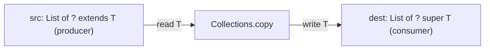

**Example (real output):**

```java
import java.util.*;

public class Pecs {
    // Producer: we only READ numbers out -> ? extends
    static double sum(Collection<? extends Number> nums) {
        double total = 0;
        for (Number n : nums) total += n.doubleValue();
        return total;
    }
    // Consumer: we only PUT integers in -> ? super
    static void fillOneToThree(List<? super Integer> sink) {
        for (int i = 1; i <= 3; i++) sink.add(i);
    }
    public static void main(String[] args) {
        System.out.println(sum(List.of(1, 2.5, 3L)));      // 6.5: Integer, Double, Long all fine

        List<Number> numbers = new ArrayList<>();
        List<Object> objects = new ArrayList<>();
        fillOneToThree(numbers);                            // List<Number> accepts Integers
        fillOneToThree(objects);                            // List<Object> too
        System.out.println(numbers + " " + objects);        // [1, 2, 3] [1, 2, 3]

        // JDK: static <T> void copy(List<? super T> dest, List<? extends T> src)
        List<Object> dest = new ArrayList<>(List.of("x", "x", "x"));
        Collections.copy(dest, List.of(7, 8));              // T = Integer
        System.out.println(dest);                           // [7, 8, x]
    }
}
```

**Say this in the interview:**
> "Generics are invariant, so a List of Integer is not a List of Number. Wildcards add flexibility. PECS: if the parameter produces values I read, use extends; if it consumes values I write, use super. Collections.copy shows both: dest is super T and src is extends T."

**They may ask next:**
- **Why are arrays different?** Arrays are *covariant*: `Integer[]` is an `Object[]`. Storing a `String` into it compiles but throws `ArrayStoreException` at runtime. Generics chose compile-time safety instead.
- **Wildcards in return types?** Avoid them. They push the problem to every caller.

### Bounded types and generic methods

**In one line:** A *bound* limits what T can be (`<T extends Number>`), and a *generic method* declares its own T before the return type (`static <T> T first(List<T> l)`).

**Story:** A job post says "any engineer can apply" (`<T>`) or "only Java engineers" (`<T extends JavaEngineer>`). The bound lets the company assume Java skills on day one: inside the method you can call `Number` methods on `T`.

**How it works:**
1. `<T extends Number>`: T is `Number` or a subclass. You can call `doubleValue()` on it.
2. Many bounds: `<T extends Number & Comparable<T>>`. Class first, then interfaces.
3. Generic method: `<T>` goes before the return type. The compiler *infers* T from the arguments.
4. The famous signature `<T extends Comparable<? super T>> T max(...)` allows types whose `compareTo` is declared in a parent. Example: `LocalDate` is `Comparable<ChronoLocalDate>`, not `Comparable<LocalDate>`. See [Q10](#q10-generic-max-method).
5. There is no `<T super X>` for type parameters. `super` exists only in wildcards.

**Example:**

```java
static <T extends Number> double average(List<T> nums) {     // bound: can call doubleValue()
    return nums.stream().mapToDouble(Number::doubleValue).average().orElse(0);
}
static <K, V extends Comparable<? super V>> K keyOfMax(Map<K, V> m) {   // two type params
    return Collections.max(m.entrySet(), Map.Entry.comparingByValue()).getKey();
}
// average(List.of(1, 2, 3)) -> 2.0     keyOfMax(Map.of("a", 3, "b", 9)) -> "b"
```

**Say this in the interview:**
> "A bound like T extends Number lets me call Number methods on T. A generic method declares its own type parameter before the return type, and the compiler infers it. The classic max signature uses Comparable of super T, so types like LocalDate that inherit compareTo from a parent still work."

**They may ask next:**
- **Generic class vs generic method?** A class type parameter is fixed per object (`Box<String>`). A method type parameter is fixed per call.

### Why no `List<int>`, raw types and reifiable types

**In one line:** Type arguments must be reference types because erasure turns T into `Object`, and `int` is not an object; raw types switch off checking; *reifiable* types are the ones fully known at runtime.

**Story:** A warehouse shelf is built for boxes (objects). A loose litre of milk (a primitive) can't sit on it. It must be put in a box first (*boxing*): `int` → `Integer`.

**How it works:**
1. After erasure every `T` is `Object`. An `int` is not an `Object`, so `List<int>` can't work. You write `List<Integer>`, and Java *autoboxes*.
2. Boxing costs memory and time: a `List<Integer>` of 1 million numbers holds 1 million small objects (the JVM caches only -128 to 127). Use `int[]`, `IntStream` or a primitive collection library for big numeric data.
3. Project Valhalla (value classes) is working on generics over primitives. It is not part of Java 25.
4. **Raw type:** `List` without `<>`. It exists only for pre-Java 5 code. The compiler stops checking and only warns.
5. **Reifiable type** (JLS 4.7): a type whose full information exists at runtime. Primitives, non-generic classes, raw types, `List<?>`, and arrays of these. `List<String>` is **not** reifiable.
6. Only reifiable types are allowed in `instanceof` (before Java 16) and as array component types (`new List<?>[10]` is fine, `new List<String>[10]` is not).

**Say this in the interview:**
> "Generics erase to Object, and primitives are not objects, so we use wrapper types and pay for boxing. Raw types are only for old code; they turn off type checks. A reifiable type is one the runtime fully knows, like String or List of question mark, and only those can be used for arrays."

**They may ask next:**
- **`Integer` cache trap?** `Integer a = 127, b = 127; a == b` is true (cached). With 128 it is false. Compare boxed numbers with `equals`.

### Heap pollution and @SafeVarargs

**In one line:** *Heap pollution* is when a variable of a generic type points to an object of the wrong type; generic varargs can cause it, and `@SafeVarargs` is your promise that a method does not.

**Story:** A box labelled "only apples" gets an orange inside because someone used an unlabelled crate on the way. Nobody notices until a customer bites into it.

**How it works:**
1. Varargs `T... items` creates an array. But `new T[]` is impossible after erasure, so the compiler creates `Object[]` (or the erased bound).
2. If the method *returns* or *stores* that array, a caller expecting `String[]` gets an `Object[]` and fails with `ClassCastException`.
3. The compiler warns: "Possible heap pollution from parameterized vararg type T".
4. `@SafeVarargs` says "I only read the array". It is allowed on static, final and private methods and constructors (private since Java 9).

**Example (real output):**

```java
import java.util.*;

public class HeapPollution {
    static <T> T[] asArray(T... items) {           // warning: possible heap pollution
        return items;                              // leaks the varargs array: unsafe
    }
    static <T> T[] pickTwo(T a, T b) {
        return asArray(a, b);                      // T is erased: creates Object[]
    }
    @SafeVarargs                                   // safe: we only read the array
    static <T> List<T> listOf(T... items) {
        return List.of(items);
    }
    public static void main(String[] args) {
        System.out.println(listOf("a", "b"));      // [a, b]
        try {
            String[] pair = pickTwo("a", "b");     // Object[] cannot be cast to String[]
        } catch (ClassCastException e) {
            System.out.println("CCE: " + e.getMessage());
        }
    }
}
// CCE: class [Ljava.lang.Object; cannot be cast to class [Ljava.lang.String; ...
```

**Say this in the interview:**
> "Generic varargs create an array of the erased type. If the method leaks that array, the caller can get a ClassCastException in a place with no cast in the source. That is heap pollution. I put SafeVarargs only on methods that just read the array, like List.of does."

**They may ask next:**
- **Why does `List.of(E... elements)` not warn?** It has `@SafeVarargs` and copies the items, never exposing the array.

---

## Exceptions

**In one line:** An exception is an object that says "something went wrong"; Java splits them into checked exceptions (the compiler forces you to handle them), unchecked exceptions (bugs or business errors), and errors (the JVM is in trouble).

**Say this in the interview:**
> "Throwable has two branches: Error for JVM problems I don't catch, and Exception. RuntimeException and its children are unchecked; the rest are checked. In modern Spring code I mostly use unchecked exceptions, translate low-level ones at boundaries with the cause attached, close resources with try-with-resources, and never swallow an exception."

### The exception hierarchy

**In one line:** Everything you can `throw` extends `Throwable`, which splits into `Error` and `Exception`; `RuntimeException` is the unchecked part of `Exception`.

**Story:** In a hospital, an `Error` is the building on fire: nobody treats patients, everybody leaves. A checked exception is a known risk the form asks about ("allergies?"): you must answer. An unchecked exception is a doctor's mistake: it should be fixed, not planned for.

**Diagram:**

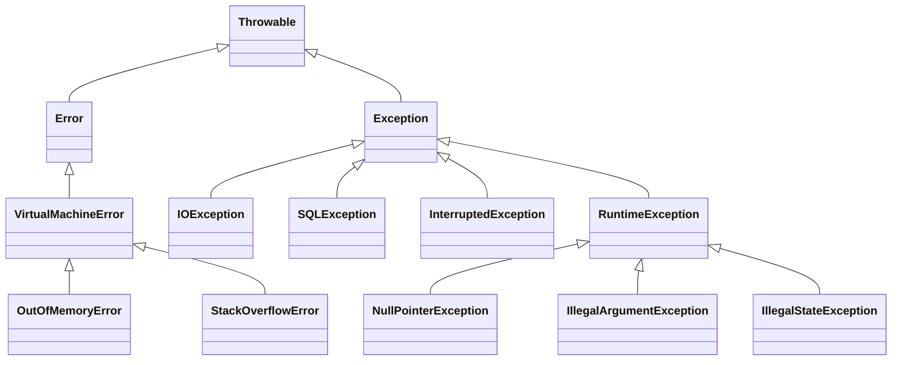

**How it works:**
- **Checked** (`Exception` but not `RuntimeException`): `IOException`, `SQLException`, `InterruptedException`. You must catch or declare them with `throws`.
- **Unchecked** (`RuntimeException` and `Error`): `NullPointerException`, `IllegalArgumentException`, `IllegalStateException`, `ArithmeticException`, `ClassCastException`, `IndexOutOfBoundsException`, `ConcurrentModificationException`.
- **Errors:** `OutOfMemoryError`, `StackOverflowError`, `NoClassDefFoundError`, `ExceptionInInitializerError`. Don't catch them in business code.
- Since Java 14 (on by default from Java 15), NPE messages tell you exactly what was null (*helpful NullPointerExceptions*), for example `Cannot invoke "String.length()" because "name" is null`.

**Say this in the interview:**
> "Throwable splits into Error and Exception. Errors like OutOfMemoryError mean the JVM is in trouble, so I don't catch them. Under Exception, RuntimeException and its subclasses are unchecked; everything else is checked and must be caught or declared."

**They may ask next:**
- **`NoClassDefFoundError` vs `ClassNotFoundException`?** `ClassNotFoundException` (checked) is thrown when *you* load a class by name (`Class.forName`) and it is missing. `NoClassDefFoundError` is thrown when a class was there at compile time but is missing at runtime, or its static init failed earlier.

### Checked vs unchecked

**In one line:** Checked exceptions force the caller to deal with a failure; unchecked ones don't, and most modern Java code (Spring, JPA, lambdas) prefers unchecked.

**Story:** A checked exception is a train ticket inspector who stops every passenger, even those who can do nothing about it. An unchecked exception is a fire alarm: it rings only when there is a fire, and the people who can act (the fire team) handle it.

**How it works:**

| | Checked | Unchecked |
|---|---|---|
| Compiler forces handling | Yes | No |
| Typical meaning | Expected outside failure the caller *can* handle (file missing, network) | Programming bug or business rule broken |
| Pros | Visible in the signature | Clean signatures, works with lambdas and streams |
| Cons | `throws` spreads through every layer; empty catch blocks; doesn't fit lambdas | Easy to forget to document |
| Used by | `java.io`, JDBC, `InterruptedException` | Spring (`DataAccessException`), JPA, most libraries |

**When to use / when not to use:**
- Checked: rare in app code. Use it only if the *direct* caller can really recover (for example, "try the backup file").
- Unchecked: business errors (`OrderNotFoundException`), invalid input, bugs. Map them to HTTP codes in one global handler (`@RestControllerAdvice`).

**Say this in the interview:**
> "Checked exceptions are good in theory: the signature tells you what can fail. In practice they leak through layers, encourage empty catch blocks and don't work in lambdas. So I use unchecked exceptions for business errors and handle them in one place, like a RestControllerAdvice. I keep checked ones only when the immediate caller can recover."

**They may ask next:**
- **How to handle a checked exception inside a lambda?** Catch it inside and wrap it in an unchecked exception (`UncheckedIOException`). See [java-streams.md](java-streams.md#how-do-you-handle-checked-exceptions-in-lambdas).

### try-with-resources and suppressed exceptions

**In one line:** `try (Resource r = ...)` closes every `AutoCloseable` for you in reverse order, even on errors, and keeps close errors as *suppressed* exceptions instead of losing the main one.

**Story:** You borrow three library books for a project. When the project is done (or cancelled), the library robot returns them in reverse order. If one return fails, it writes a note on the main report ("also: book 2 return failed") instead of throwing the report away.

**How it works:**
1. Resources open left to right and close right to left.
2. They close *before* any `catch` or `finally` block runs.
3. If the body throws and `close()` also throws, the body's exception wins. The close exception is attached with `addSuppressed` and read with `getSuppressed()`.
4. Before Java 7, people wrote `finally { r.close(); }`. If `close` threw, it **replaced** the real error, and that was the bug everyone hit.
5. Java 9+: you can use an existing effectively final variable: `try (conn) { ... }`.

**Diagram:**

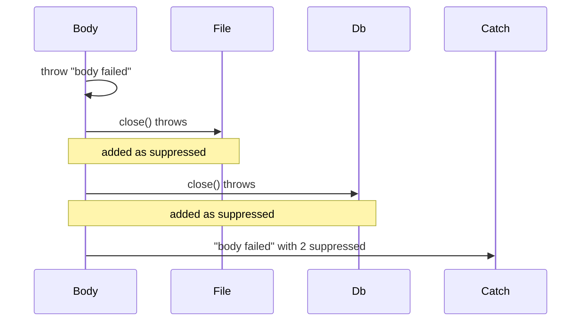

**Example (real output):**

```java
public class Twr {
    record Res(String name) implements AutoCloseable {
        Res { System.out.println("open " + name); }
        @Override public void close() {
            System.out.println("close " + name);
            throw new IllegalStateException("close failed: " + name);
        }
    }
    public static void main(String[] args) {
        try (Res db = new Res("db"); Res file = new Res("file")) {
            throw new RuntimeException("body failed");          // the main error
        } catch (RuntimeException e) {
            System.out.println("caught: " + e.getMessage());
            for (Throwable s : e.getSuppressed()) {
                System.out.println("  suppressed: " + s.getMessage()); // close errors kept here
            }
        } finally {
            System.out.println("finally runs last");
        }
    }
}
// open db / open file / close file / close db / caught: body failed
//   suppressed: close failed: file
//   suppressed: close failed: db
// finally runs last
```

**Say this in the interview:**
> "try-with-resources closes resources in reverse order before catch and finally run. If both the body and close throw, the body's exception is kept and the close exception is added as suppressed, so the real cause is never lost. I use it for JDBC, streams, Files.lines and locks wrapped as AutoCloseable."

**They may ask next:**
- **`AutoCloseable` vs `Closeable`?** `Closeable` (from `java.io`) throws `IOException` and must be idempotent (safe to call twice). `AutoCloseable` is the general parent and throws `Exception`.

### finally edge cases

**In one line:** `finally` almost always runs, but a `return` inside it silently replaces the try's return value *and* swallows any exception.

**Story:** A shop closes at 9 pm no matter what (finally). But if the closing manager shouts "everything is fine!" at 9 pm, nobody hears about the robbery at 8:55. A `return` in finally is that shout.

**How it works:**
1. `return x` in `try` saves the *value* of `x` first. Changing `x` in `finally` doesn't change what is returned (for primitives; for objects, the same object is returned, so changing its fields is visible).
2. `return` in `finally` overrides the try's return and discards a thrown exception. `javac -Xlint:finally` warns: "finally clause cannot complete normally".
3. `finally` does **not** run if the JVM dies: `System.exit()`, `kill -9`, or a power cut. It also doesn't run while a thread is stuck in an endless loop in `try`.
4. An exception thrown inside `finally` replaces the original one.

**Example (real output):**

```java
public class FinallyTraps {
    @SuppressWarnings("finally")
    static int swallow() {
        try {
            throw new IllegalStateException("real problem");
        } finally {
            return 1;                    // the exception is LOST, method returns 1
        }
    }
    static int valueCopied() {
        int x = 10;
        try {
            return x;                    // value 10 is saved now
        } finally {
            x = 20;                      // changes the variable, not the saved value
        }
    }
    @SuppressWarnings("finally")
    static int finallyWins() {
        try { return 1; } finally { return 2; }   // finally's return replaces try's
    }
    public static void main(String[] args) {
        System.out.println(swallow() + " " + valueCopied() + " " + finallyWins()); // 1 10 2
    }
}
```

**Say this in the interview:**
> "finally runs on normal exit and on exceptions, but not on System.exit or a killed JVM. Never return or throw from finally: a return there hides the original exception and replaces the return value. The value in a try's return is captured before finally runs."

**They may ask next:**
- **Does finally run after `return` in catch?** Yes. `finally` runs after the catch's return value is computed, before the method exits.

### Custom exceptions and chaining

**In one line:** Create a custom exception when callers need to react to a specific business failure, and always pass the original exception as the *cause* when you wrap one.

**Story:** A customer complaint goes from the shop to head office. The shop writes "order A-42 lost" (the business message) and staples the courier's original note behind it (the cause). Head office can read both.

**How it works:**
1. Extend `RuntimeException` (usually). Give it a clear name: `OrderNotFoundException`, `PaymentDeclinedException`.
2. Add useful fields (order ID, error code) instead of putting everything in the message.
3. Pass the cause: `super(message, cause)`. The log then shows `Caused by: ...` with the original stack trace.
4. *Exception translation*: catch low-level exceptions (`IOException`, `SQLException`) at the layer boundary and throw a domain exception. Spring does this for you with `DataAccessException`.

**Example (real output):**

```java
import java.io.*;

public class Chaining {
    static class OrderNotFoundException extends RuntimeException {   // unchecked, domain-level
        OrderNotFoundException(String id, Throwable cause) {
            super("Order not found: " + id, cause);                   // keep the cause!
        }
    }
    static String readOrder(String id) throws IOException {
        throw new FileNotFoundException("/data/orders/" + id + ".json");
    }
    static String findOrder(String id) {
        try {
            return readOrder(id);
        } catch (IOException e) {
            throw new OrderNotFoundException(id, e);                  // translate at the boundary
        }
    }
    public static void main(String[] args) {
        try {
            findOrder("A-42");
        } catch (OrderNotFoundException e) {
            System.out.println(e.getMessage());   // Order not found: A-42
            System.out.println("cause: " + e.getCause()); // cause: java.io.FileNotFoundException: /data/orders/A-42.json
        }
    }
}
```

**Say this in the interview:**
> "I create custom unchecked exceptions for business failures the caller or the API layer must react to. When I wrap a low-level exception I always pass it as the cause, so the stack trace shows the root problem. Translation happens at boundaries: the repository should not leak SQLException to the controller."

**They may ask next:**
- **How many custom exceptions?** A few per bounded area (not found, conflict, validation), mapped to HTTP status codes in one handler. Not one class per method.

### Exception best practices

**In one line:** Don't swallow, don't log-and-rethrow, catch narrowly, translate at boundaries, and keep exceptions for exceptional cases.

**Story:** A good doctor writes down the real diagnosis once, in the patient's file, and passes the patient to the right specialist. A bad doctor either says nothing ("swallow"), or writes the same note in five different files ("log and rethrow everywhere").

**Good and bad:**

| Good | Bad |
|---|---|
| `catch (IOException e) { throw new UncheckedIOException(e); }` | `catch (Exception e) { }`: swallowed, bug hidden forever |
| Log once, at the top (global handler) | `log.error(e); throw e;` in every layer: 5 copies of one stack trace |
| Catch the narrowest type | `catch (Throwable t)`: also catches `OutOfMemoryError` |
| `catch (InterruptedException e) { Thread.currentThread().interrupt(); ... }` | Ignoring `InterruptedException` (the thread can't be stopped cleanly) |
| Validate input with `if` and return a clear error | Using exceptions for normal flow (`try { parseInt } catch` in a hot loop) |
| Include IDs in the message: `"Order A-42 not found"` | `"Error occurred"` |
| Fail fast in constructors: `Objects.requireNonNull` | Returning `null` on errors |

**Say this in the interview:**
> "My rules: never swallow; log once at the boundary; catch the narrowest type; wrap with the cause when translating; restore the interrupt flag when I catch InterruptedException; and don't use exceptions for normal control flow. Messages carry IDs so we can find the request in logs."

**They may ask next:**
- **Where do you handle exceptions in a Spring REST app?** One `@RestControllerAdvice` that maps exceptions to `ProblemDetail` responses. See [oop-clean-code.md](oop-clean-code.md#error-handling-exceptions-vs-optional-vs-result-types).

### The cost of exceptions

**In one line:** Throwing is cheap; *creating* an exception is expensive because `fillInStackTrace` walks the whole call stack.

**Story:** Sending a letter is cheap. Taking a photo of every room you walked through to get to the post box (the stack trace) is what takes time.

**How it works:**
1. `new Exception()` calls `fillInStackTrace()`, which records every frame. Deep stacks (Spring, 100+ frames) make this costly.
2. If you throw thousands per second for normal flow (validation, "not found"), it shows up in CPU profiles.
3. For pre-planned control-flow exceptions, the protected constructor `Throwable(String, Throwable, boolean enableSuppression, boolean writableStackTrace)` can skip the stack trace.
4. HotSpot trap: after the same built-in exception (like an NPE) is thrown many times from one spot, the JIT may reuse a pre-built exception *with no stack trace* (`OmitStackTraceInFastThrow`, on by default). In logs you then see `java.lang.NullPointerException` with no lines. Search earlier in the log for the first one, or run with `-XX:-OmitStackTraceInFastThrow`.

**Example (real output, laptop numbers, not a proper benchmark):**

```java
public class CheapException {
    static class Rejected extends RuntimeException {
        Rejected(String msg) {
            super(msg, null, false, false);   // no suppressed list, no stack trace
        }
    }
    public static void main(String[] args) {
        int loops = 1_000_000;
        long t0 = System.nanoTime();
        for (int i = 0; i < loops; i++) {
            try { throw new RuntimeException("x"); } catch (RuntimeException e) { }
        }
        long t1 = System.nanoTime();
        for (int i = 0; i < loops; i++) {
            try { throw new Rejected("x"); } catch (RuntimeException e) { }
        }
        long t2 = System.nanoTime();
        System.out.printf("with stack trace: %d ms, without: %d ms%n",
            (t1 - t0) / 1_000_000, (t2 - t1) / 1_000_000);   // with stack trace: 338 ms, without: 9 ms
        System.out.println(new Rejected("x").getStackTrace().length);   // 0
    }
}
```

**Say this in the interview:**
> "The expensive part of an exception is capturing the stack trace, not the throw. So I don't use exceptions for normal flow in hot paths. If I see NullPointerExceptions without a stack trace in production logs, that is HotSpot's OmitStackTraceInFastThrow optimization, and I look for the first occurrence."

**They may ask next:**
- **Should you remove stack traces from business exceptions?** Usually no. Debugging is worth more than microseconds. Only do it for very hot, expected paths.

---

## Equality, ordering and records

**In one line:** `equals`/`hashCode` decide "same value", `Comparable`/`Comparator` decide "which comes first", and records generate the first two for you.

**Say this in the interview:**
> "equals and hashCode must agree, or hash collections break. For ordering I give a class one natural order with Comparable and build other orders with Comparator.comparing chains. Records generate equals, hashCode and toString from their components, which makes them good map keys and DTOs."

### equals and hashCode recap

**In one line:** If `a.equals(b)` then `a.hashCode() == b.hashCode()`; break this and `HashMap`/`HashSet` stop finding your objects.

**Story:** Twins in a school have the same name (equal), so they must sit in the same classroom (same hash bucket). If one twin is sent to another room, the teacher calling the name in the first room finds only one.

**How it works (short recap, full version in [oop-clean-code.md](oop-clean-code.md#equals-and-hashcode-contract)):**
1. `equals` must be reflexive, symmetric, transitive, consistent, and `x.equals(null)` is false.
2. Equal objects must have equal hash codes. Unequal objects *may* share a hash code (a collision).
3. Use the same fields in both, and only fields that never change.
4. For JPA entities, base equality on a stable business key or the ID with care. See [hibernate-jpa.md](hibernate-jpa.md).
5. Live demo of the bug: [Q11](#q11-equals-without-hashcode-bug).

**Say this in the interview:**
> "Equal objects must have equal hash codes. HashMap first uses the hash to find the bucket and then equals inside it. If I override equals but not hashCode, two equal objects land in different buckets and contains returns false. Records or IDE-generated methods avoid this."

**They may ask next:**
- **`instanceof` or `getClass()` in equals?** `getClass()` is strict and safe with subclasses. `instanceof` allows subclasses but can break symmetry. For records and final classes, `instanceof` is fine.

### Comparable vs Comparator

**In one line:** `Comparable` is the one natural order a class defines for itself (`compareTo`); a `Comparator` is any extra order you build outside the class.

**Story:** A dictionary has one natural order: A to Z (`Comparable`). A school can list the same students by height for a photo, by marks for results, or by roll number for attendance (`Comparator`s).

**How it works:**
1. `Comparable<T>`: `int compareTo(T o)`. Negative = this first, 0 = equal, positive = other first. `String`, `Integer`, `LocalDate` have it.
2. `Comparator<T>`: `int compare(T a, T b)`. Build with `Comparator.comparing(keyExtractor)`, then `.thenComparing(...)`, `.reversed()`, `Comparator.nullsLast(...)`.
3. **Trap 1:** `(a, b) -> a - b` overflows for big or negative numbers. Use `Integer.compare` or `comparingInt`.
4. **Trap 2:** `.reversed()` reverses the *whole chain so far*. To reverse one key, pass `Comparator.reverseOrder()` to that key.
5. **Trap 3:** keep `compareTo` consistent with `equals`, or `TreeSet`/`TreeMap` will drop items. See [TreeMap](#treemap-and-navigablemap).

**Example (real output):**

```java
record Emp(String name, String dept, int salary) implements Comparable<Emp> {
    public int compareTo(Emp o) { return name.compareTo(o.name); }   // natural order
}
List<Emp> emps = new ArrayList<>(List.of(
    new Emp("Ravi", "IT", 90), new Emp("Asha", "HR", 70),
    new Emp("Neha", "IT", 120), new Emp("Amit", "HR", 70)));

Collections.sort(emps);                                       // [Amit, Asha, Neha, Ravi]
emps.sort(Comparator.comparing(Emp::dept)                     // dept A-Z
        .thenComparing(Emp::salary, Comparator.reverseOrder()) // then salary high-low
        .thenComparing(Emp::name));                           // then name A-Z
// HR 70 Amit / HR 70 Asha / IT 120 Neha / IT 90 Ravi

Comparator<Integer> bad = (a, b) -> a - b;                    // overflow trap
System.out.println(bad.compare(Integer.MIN_VALUE, 1));        // 2147483647: wrong sign!
System.out.println(Integer.compare(Integer.MIN_VALUE, 1));    // -1: correct
```

**Say this in the interview:**
> "Comparable is the class's own natural order; Comparator is an external order, and I can have many. I build them with Comparator.comparing and thenComparing, and I never subtract numbers in a comparator because it overflows. Also, reversed applies to the whole chain, so I pass reverseOrder to a single key instead."

**They may ask next:**
- **Is `List.sort` stable?** Yes. Object sorting in Java uses a stable merge sort (TimSort), so equal items keep their original order. That is what makes multi-pass sorting work.

### What a record generates

**In one line:** `record Point(int x, int y)` gives you private final fields, a canonical constructor, accessors `x()` and `y()`, and `equals`, `hashCode` and `toString` based on all components.

**Story:** A record is a printed receipt: the fields are fixed when it is printed, two receipts with the same lines are "equal", and it prints itself nicely.

**How it works:**
1. The class is `final` and extends `java.lang.Record`. It can't extend another class, but it can implement interfaces.
2. Fields are `private final`. No instance fields can be added outside the header (static ones are fine).
3. A *compact constructor* (`Order { ... }`) runs before the fields are assigned. Use it to validate and to copy lists.
4. `equals` compares all components; `hashCode` combines them; `toString` prints `Order[id=A1, items=[tea]]`.
5. Records are only *shallowly* immutable: a `List` component can still be changed unless you copy it.
6. Serialization of records goes through the canonical constructor, so validation runs on deserialize too.

**Example (real output):**

```java
record Order(String id, List<String> items) {
    Order {                                           // compact constructor
        Objects.requireNonNull(id, "id");
        items = List.copyOf(items);                   // defensive copy: truly immutable
    }
}
List<String> items = new ArrayList<>(List.of("tea"));
Order a = new Order("A1", items);
Order b = new Order("A1", List.of("tea"));
items.add("cake");                                    // does not change a
System.out.println(a);                                // Order[id=A1, items=[tea]]
System.out.println(a.equals(b) + " " + (a.hashCode() == b.hashCode())); // true true
System.out.println(a.id() + " " + a.items());         // A1 [tea]  (accessors: id(), not getId())
```

**Say this in the interview:**
> "A record generates final fields, the canonical constructor, accessors, equals, hashCode and toString from its components. I validate and make defensive copies in the compact constructor, because records are only shallowly immutable. They are ideal for DTOs, value objects and map keys, but not for JPA entities."

**They may ask next:**
- **Why not JPA entities?** Entities need a no-arg constructor, mutable state and proxies (subclasses). Records are final and immutable. Use records for DTOs and projections.

---

## JVM internals

**In one line:** The JVM loads your classes, checks and links them, runs bytecode in an interpreter, compiles hot code to machine code with the JIT, and frees memory with a garbage collector.

**Say this in the interview:**
> "javac turns source into bytecode. The JVM loads classes lazily through a chain of class loaders, verifies and links them, and runs static initializers on first use. Code starts in the interpreter; hot methods are compiled by C1 and then C2 with inlining and escape analysis. Memory is managed by a GC like G1 or ZGC, and I diagnose problems with jcmd, JFR and heap dumps."

**Diagram (the big picture):**

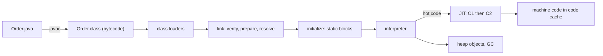

### Class loading

**In one line:** A class goes through three phases before you can use it: *loading* (find the bytes), *linking* (verify, prepare, resolve) and *initialization* (run static code).

**Story:** A new employee joins. HR finds their file (loading). Security checks the documents, IT creates an empty desk and accounts (linking). On the first working day, the manager gives the welcome talk (initialization). This happens only once per employee, and only when they actually start working.

**How it works:**
1. **Loading:** a class loader finds `Order.class` (in a JAR, module or generated in memory) and creates a `Class` object. Class info goes to *metaspace*.
2. **Linking:**
   - *Verification:* the bytecode verifier checks the code is safe (types match, no jumps outside the method, no stack overflow tricks).
   - *Preparation:* static fields get memory and **default values** (0, null, false). No user code runs yet.
   - *Resolution:* symbolic names (`"java/util/List"`) become direct references. HotSpot does this lazily, at first use.
3. **Initialization:** the JVM runs `<clinit>`: static field initializers and `static {}` blocks, top to bottom in source order. Parent class first.
4. **When does initialization happen?** On first *active use*: `new`, calling a static method, reading or writing a static field (that is not a compile-time constant), `Class.forName`, initializing a subclass, or the main class at start.
5. The JVM holds a lock during initialization, so it runs exactly once, even with many threads. The holder singleton idiom relies on this.
6. If static init throws, you get `ExceptionInInitializerError` the first time and `NoClassDefFoundError` on every later try.

**Diagram:**

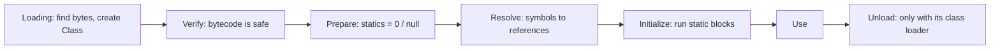

**Example (real output):**

```java
public class ConstInline {
    static class Config {
        static final int MAX = 10;                     // compile-time constant: inlined
        static final String NAME = name();             // not a constant: needs class init
        static { System.out.println("Config initialized"); }
        static String name() { return "app"; }
    }
    public static void main(String[] args) {
        System.out.println(Config.MAX);                // does NOT initialize Config
        System.out.println(Config.NAME);               // triggers static init now
    }
}
// 10
// Config initialized
// app
```

**Say this in the interview:**
> "Class loading has three phases: loading finds the bytes, linking verifies, prepares static fields with defaults and resolves references, and initialization runs static initializers in source order. Initialization is lazy, on first active use, and the JVM guarantees it runs once even with many threads. Reading a compile-time constant doesn't even initialize the class, because javac copied the value."

**They may ask next:**
- **When is a class unloaded?** Only when its class loader becomes unreachable. Classes from the bootstrap loader are never unloaded. A leaked web-app class loader is a classic metaspace leak.

### Class loaders and parent delegation

**In one line:** Since Java 9 there are three built-in loaders, *bootstrap*, *platform* and *application*, and each one asks its parent first before loading a class itself.

**Story:** A junior clerk gets a request. Before doing it, he asks his senior: "Do you already have this file?" The senior asks the head office. Only if nobody above has it does the junior create it. This way, nobody can sneak in a fake "official" file from a local desk.

**How it works:**
1. **Bootstrap loader:** part of the JVM, written in native code. Loads core modules like `java.base` (`String`, `HashMap`). In Java it shows as `null`.
2. **Platform loader** (was the "extension loader" before Java 9): loads other Java SE and JDK modules like `java.sql`.
3. **Application (system) loader:** loads your classpath and module path.
4. **Parent delegation:** `loadClass` first checks "already loaded?", then asks the parent, and only then searches itself.
5. **Why:** security (nobody can replace `java.lang.String` with their own) and one copy of each core class.
6. **A class's identity is (class name + its loader).** The same `Order.class` loaded by two loaders gives two different classes. That causes the famous `ClassCastException: Order cannot be cast to Order`.
7. **Custom loaders:** app servers (Tomcat gives each web app its own loader, and looks in the web app *first*), plugin systems, Spring Boot's fat-JAR `LaunchedClassLoader`, hot reload in DevTools.

**Diagram:**

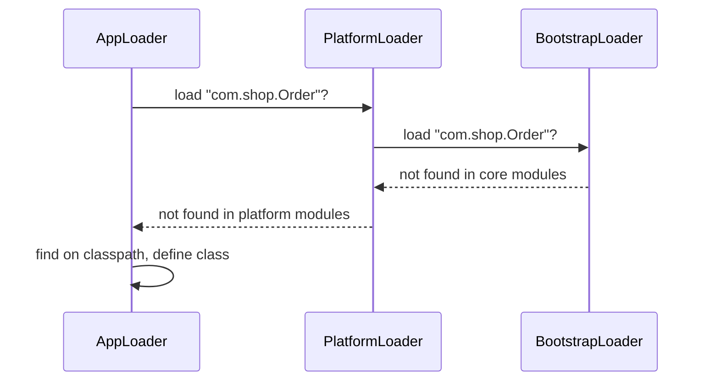

**Example (real output, run from the classpath):**

```java
public class Loaders {
    public static void main(String[] args) {
        System.out.println(String.class.getClassLoader());              // null = bootstrap
        System.out.println(java.sql.Connection.class.getClassLoader()); // platform
        System.out.println(Loaders.class.getClassLoader());             // app (system)
        System.out.println(Loaders.class.getClassLoader().getParent());
    }
}
// null
// jdk.internal.loader.ClassLoaders$PlatformClassLoader@5c647e05
// jdk.internal.loader.ClassLoaders$AppClassLoader@2c854dc5
// jdk.internal.loader.ClassLoaders$PlatformClassLoader@5c647e05
```

**Say this in the interview:**
> "There are three built-in loaders: bootstrap for java.base, platform for other JDK modules, and the application loader for my classpath. Each asks its parent first, so core classes can't be replaced. A class is identified by its name plus its loader, which explains errors like Order cannot be cast to Order when two loaders load the same class."

**They may ask next:**
- **`ClassNotFoundException` in a Spring Boot fat JAR but fine in the IDE?** Often a dependency with `provided` scope, or code that uses the thread context class loader incorrectly. Check `Thread.currentThread().getContextClassLoader()`.

### Static and instance init order

**In one line:** Static parts run once, parent before child, in source order; instance parts run on every `new`: parent constructor chain first, then field initializers and instance blocks, then the constructor body.

**Story:** Building a house: the city approves the house design once (static init, parent design before the extension). Then for every house built: the foundation first (parent constructor), then the walls in the order they are drawn (instance fields and blocks), then the paint (constructor body).

**How it works:**
1. First use of `Child`: initialize `Parent` statics, then `Child` statics. Each one top to bottom.
2. `new Child()`: `Child()` first calls `super()`. The parent's instance initializers run, then the parent constructor body.
3. Then the child's field initializers and `{ }` blocks, top to bottom, then the child constructor body.
4. **Trap:** a parent constructor that calls an overridable method runs the child's version *before* the child's fields are set. The child sees `null` or `0`.

**Diagram:**

```mermaid
flowchart TD
    N["new Child()"] --> S1{"classes initialized?"}
    S1 -->|"No"| PS["Parent static fields and blocks"]
    PS --> CS["Child static fields and blocks"]
    CS --> PI["Parent instance fields and blocks"]
    S1 -->|"Yes"| PI
    PI --> PC["Parent constructor body"]
    PC --> CI["Child instance fields and blocks"]
    CI --> CC["Child constructor body"]
```

**Example (real output):**

```java
public class InitOrder {
    static class Parent {
        static { System.out.println("1 Parent static block"); }
        { System.out.println("3 Parent instance block"); }
        Parent() { System.out.println("4 Parent constructor"); }
    }
    static class Child extends Parent {
        static { System.out.println("2 Child static block"); }
        { System.out.println("5 Child instance block"); }
        Child() { System.out.println("6 Child constructor"); }
    }
    public static void main(String[] args) {
        new Child();                       // prints 1, 2, 3, 4, 5, 6
        System.out.println("-- second object --");
        new Child();                       // prints only 3, 4, 5, 6
    }
}
```

**The puzzle interviewers love (real output):**

```java
public class Puzzle {
    static final Puzzle INSTANCE = new Puzzle();   // runs FIRST: constructor sets count = 1
    static int count = 0;                          // runs SECOND: resets count to 0
    static int other;                              // no initializer: keeps its value

    Puzzle() {
        count++;
        other++;
    }

    public static void main(String[] args) {
        System.out.println("count = " + count + ", other = " + other); // count = 0, other = 1
    }
}
```

Why: in the *prepare* step, `count` and `other` are 0. Static init then runs top to bottom. The constructor makes both 1. Then `count = 0` runs and resets it. `other` has no initializer, so it stays 1.

**Say this in the interview:**
> "Statics run once, at first use, parent before child, top to bottom. On each new, the constructor chain goes up to Object first; then each level runs its field initializers and instance blocks, then its constructor body. Static initializers run in source order, so a static instance created above other static fields can see them before they are set."

**They may ask next:**
- **Why not call overridable methods from a constructor?** The subclass method runs before the subclass fields are initialized. Java 25 *flexible constructor bodies* let you validate arguments before `super(...)`, but the rule still holds.

### Bytecode and javap

**In one line:** Bytecode is the instruction set of the JVM's *stack machine*; `javap -c` shows it, and it helps you answer "is `count++` atomic?" with proof.

**Story:** Bytecode is like a recipe written in a universal kitchen language. Any kitchen (Windows, Linux, Mac JVM) can cook it. `javap` is the tool that reads the recipe aloud.

**How it works:**
1. Each method has an *operand stack* and *local variable slots*. Slot 0 is `this` for instance methods.
2. Instructions push and pop values: `iload_1` (push int from slot 1), `iadd` (pop two, push sum), `ireturn`.
3. Method calls: `invokevirtual` (normal), `invokeinterface`, `invokestatic`, `invokespecial` (constructors, `super`, private), `invokedynamic` (lambdas, string concat).
4. `javap -c -p MyClass` shows the code; `javap -v` adds the constant pool.

**Example (real output):**

```java
public class Calc {
    private int total;
    int add(int a, int b) { return a + b; }
    void addToTotal(int x) { total += x; }          // read field, add, write field
}
// javap -c Calc
//   int add(int, int);
//      0: iload_1
//      1: iload_2
//      2: iadd
//      3: ireturn
//   void addToTotal(int);
//      0: aload_0
//      1: dup
//      2: getfield  #7   // Field total:I     <- read
//      5: iload_1
//      6: iadd                                <- add
//      7: putfield  #7   // Field total:I     <- write: 3 steps, NOT atomic
//     10: return
```

**Say this in the interview:**
> "The JVM is a stack machine. javap -c shows the bytecode, and it proves that total += x is three steps: getfield, iadd, putfield. Another thread can run between them, so it is not atomic. Lambdas and string concatenation use invokedynamic, which links the call at runtime."

**They may ask next:**
- **How are lambdas compiled?** The body becomes a private static method. The call site uses `invokedynamic`, and `LambdaMetafactory` creates the functional-interface object at first call. There is no anonymous inner class file.

### JIT compilation

**In one line:** The JVM starts by interpreting bytecode, watches which methods are hot, and compiles them to fast machine code in tiers: C1 quickly, then C2 with heavy optimizations; if a guess turns out wrong, it *deoptimizes* back.

**Story:** A new delivery driver first follows the map step by step (interpreter). After a week on the same route, he knows it by heart and drives fast (C1). After a month, he knows the shortcuts and which signals are always green (C2 with profiling). If the city closes a road, he goes back to the map for that route (deoptimization).

**How it works:**
1. **Tiered compilation** (default since Java 8): tier 0 interpreter, tiers 1–3 C1 (tier 3 adds profiling), tier 4 C2.
2. In JDK 21 the defaults are about 200 calls for tier 3 and 5,000 for tier 4 (`Tier3InvocationThreshold`, `Tier4InvocationThreshold`). Loop back-edges also count.
3. **OSR** (on-stack replacement): a long loop in `main` gets compiled while it is running. Shown as `%` in `-XX:+PrintCompilation`.
4. **Inlining:** small methods are copied into the caller (≤ 35 bytes of bytecode always, ≤ 325 bytes if hot: `MaxInlineSize`, `FreqInlineSize`). This is the mother of all optimizations: getters cost nothing.
5. **Escape analysis:** if an object never leaves a method, C2 can skip the heap allocation (*scalar replacement*) and remove locks on it.
6. **Speculation and deoptimization:** C2 assumes things from the profile ("this interface call always hits `CardPayment`"). If a new class shows up, the code is "made not entrant" and the method goes back to the interpreter, then gets recompiled.
7. Compiled code lives in the *code cache* (240 MB reserved by default with tiered compilation on JDK 21). If it fills up, the JIT stops and the app gets slower.
8. **Startup help:** Java 24–25 added an AOT cache (Project Leyden). On Java 25, run a training run once with `-XX:AOTCacheOutput=app.aot`, then start with `-XX:AOTCache=app.aot` (Java 24 needed two steps: `-XX:AOTMode=record` then `-XX:AOTMode=create`). Classes come pre-loaded and pre-linked (JEP 483, Java 24), and since Java 25 also method profiles from the training run (JEP 515).

**Diagram:**

```mermaid
stateDiagram-v2
    [*] --> Interpreter
    Interpreter --> C1_profiled: about 200 calls
    C1_profiled --> C2: about 5000 calls
    C2 --> Interpreter: deoptimize, guess was wrong
    Interpreter --> C1_profiled: hot again
```

**Example (real output, trimmed, JDK 21):**

```bash
java -XX:+PrintCompilation -cp . Hot
# time id  tier  method
#   12   11      3  Hot::square (4 bytes)
#   12   12      4  Hot::square (4 bytes)
#   13   11      3  Hot::square (4 bytes)   made not entrant   <- C1 copy replaced by C2
#   13   13 %    3  Hot::main @ 4 (36 bytes)                   <- % = OSR, loop compiled while running
#   13   15 %    4  Hot::main @ 4 (36 bytes)
```

**Say this in the interview:**
> "HotSpot uses tiered compilation: the interpreter first, then C1 with profiling, then C2 for hot code. C2 inlines small methods, uses escape analysis to avoid allocations and locks, and speculates based on the profile. If an assumption breaks, it deoptimizes and recompiles. That is why we warm up services before measuring, and why microbenchmarks need JMH."

**They may ask next:**
- **Why use JMH for benchmarks?** The JIT can remove "dead" code, inline across your timing loop, and needs warm-up. JMH handles warm-up, forks and dead-code traps.
- **GraalVM native image vs JIT?** Native image compiles ahead of time: fast startup, low memory, but lower peak performance without profile-guided optimization and harder reflection setup.

### Memory areas recap

**In one line:** Heap for objects (young and old generations), one stack per thread, metaspace for class data, plus native memory for the code cache, thread stacks and direct buffers.

**Story:** The office from [JVM memory basics](java.md#jvm-memory-basics): a shared store room (heap), a desk per worker (stack), a manual shelf (metaspace).

**How it works (only what java.md does not cover):**
- **Stack frames** hold local variables and the operand stack. Default thread stack size (`-Xss`) is 1 MB on Linux x64 (Windows uses the OS default, usually 1 MB), and about 2 MB on ARM64 (Linux and macOS; our JDK 21 on an Apple-silicon Mac shows 2048 KB).
- **Object layout:** a header (mark word + class pointer, 12 bytes with compressed class pointers), then fields, padded to 8 bytes. A `new Object()` is 16 bytes. Java 25 has opt-in *compact object headers* (`-XX:+UseCompactObjectHeaders`, 8-byte headers, a product feature but off by default in 25, JEP 519). JDK 27 (due March 2027) turns them on by default (JEP 534), so these sizes shrink there.
- **Compressed oops:** with a heap under about 32 GB, references take 4 bytes instead of 8. Going from 31 GB to 33 GB of heap can *lower* usable memory.
- **TLAB** (thread-local allocation buffer): each thread gets a small private piece of eden. `new` is then just a pointer bump: very fast.
- **Escape analysis** may keep an object off the heap entirely (see [JIT compilation](#jit-compilation)).

Full basics and the OOM table: [JVM memory basics](java.md#jvm-memory-basics).

**Say this in the interview:**
> "Objects go to the heap, usually allocated in a thread-local buffer with a pointer bump. Stacks are per thread, metaspace holds class data, and the code cache holds JIT output. With heaps below about 32 GB, compressed oops make references 4 bytes, so I don't set the heap just above 32 GB."

**They may ask next:**
- **Are all objects on the heap?** Logically yes. But after escape analysis, C2 may replace a non-escaping object with plain local values, so no heap allocation happens.

### GC algorithms overview

**In one line:** HotSpot ships several garbage collectors that trade pause time, throughput and memory: Serial, Parallel, G1 (default), ZGC and Shenandoah.

**Story:** Different cleaning crews for different buildings. One cleaner for a small flat (Serial). A big crew that closes the mall at night and cleans fast (Parallel). A crew that cleans section by section with short breaks (G1). A crew that cleans while shoppers keep walking (ZGC, Shenandoah).

**How it works:**
1. Most GCs are *generational*: most objects die young, so the young generation is collected often and cheaply.
2. *Marking* finds live objects from *GC roots* (thread stacks, static fields, JNI handles). Everything else is garbage.
3. *Compacting* moves live objects together so there is no fragmentation.
4. *Stop-the-world* (STW) pauses stop app threads. Concurrent collectors do most work while the app runs, using *barriers* (small extra code on reads or writes).

| GC | Flag | Pauses | Best for | Notes |
|---|---|---|---|---|
| Serial | `-XX:+UseSerialGC` | Long, single thread | Tiny containers, CLIs | One GC thread |
| Parallel | `-XX:+UseParallelGC` | Long, many threads | Batch jobs: max throughput | Pause scales with heap |
| G1 | default since Java 9 | Short, goal 200 ms (tunable) | Most services, 1–32 GB heaps | Regions, "garbage first"; the JVM picks Serial instead on very small machines (under 2 CPUs or under about 1792 MB) |
| ZGC | `-XX:+UseZGC` | Under 1 ms | Low latency, huge heaps (up to 16 TB) | Generational only since Java 24; more CPU |
| Shenandoah | `-XX:+UseShenandoahGC` | Very short | Low latency | Concurrent compaction; generational mode became a product option in Java 25 (opt-in with `-XX:ShenandoahGCMode=generational`, JEP 521); not in every JDK build (Oracle JDK leaves it out) |
| Epsilon | `-XX:+UseEpsilonGC` (experimental) | None, never collects | Tests, very short jobs | Crashes with OOM when the heap is full |

CMS was removed in Java 14. Details and tuning: [G1 vs ZGC](java.md#g1-vs-zgc).

**Diagram:**

```mermaid
flowchart LR
    R["GC roots: stacks, statics"] --> A["Order (live)"]
    A --> B["Customer (live)"]
    C["old Cart (no path from roots)"] --> D["old Item"]
    G["GC"] -->|"marks reachable"| A
    G -->|"frees unreachable"| C
```

**Say this in the interview:**
> "GC finds live objects by tracing from roots like thread stacks and static fields; everything else is garbage. G1 is the default and fits most services with region-based collection and a pause goal. ZGC gives sub-millisecond pauses at some CPU cost. Parallel is for batch throughput. I choose with GC logs and p99 latency, not by habit."

**They may ask next:**
- **Can GC cause a memory leak?** No, but your references can: an object reachable from a static map is never garbage.

### Strong, soft, weak and phantom references

**In one line:** Java has four reference strengths: *strong* keeps an object alive; *soft* lets GC clear it when memory is low; *weak* lets GC clear it at the next collection; *phantom* only tells you after the object is gone, so you can clean up.

**Story:** Think of how you hold a balloon. Strong: you grip it tightly, it never flies away. Soft: you hold it loosely; a strong wind (low memory) takes it. Weak: it is just resting on your hand; any breeze (any GC) takes it. Phantom: the balloon has already gone; you only get a message saying "it flew away, clean up the string".

**How it works:**

| Type | Cleared when | `get()` returns | Use for |
|---|---|---|---|
| Strong (`Order o = ...`) | never, while reachable | the object | normal code |
| `SoftReference` | before an `OutOfMemoryError`, when memory is low | object or null | memory-sensitive caches (better: Caffeine with size limits) |
| `WeakReference` | next GC, if only weakly reachable | object or null | `WeakHashMap`, metadata, listeners |
| `PhantomReference` | after the object is finalized-away | **always null** | cleanup of native resources, with a `ReferenceQueue` |

- **`Cleaner`** (Java 9) is the friendly API over phantom references. It replaces `finalize()`. `Object.finalize()` has been deprecated since Java 9 and marked for removal since Java 18.
- **Cleaner rule:** the cleanup action must not refer to the object itself. A lambda that captures `this` keeps it alive forever.
- Always offer `close()` too. GC timing is not predictable, so the `Cleaner` is only a safety net.

**Diagram:**

```mermaid
flowchart LR
    S["Strong: never cleared while used"] --> SO["Soft: cleared if memory is low"]
    SO --> W["Weak: cleared at next GC"]
    W --> PH["Phantom: notice after it is gone"]
    PH --> CL["Cleaner runs cleanup action"]
```

**Example (real output):**

```java
import java.lang.ref.*;

public class Refs {
    static final Cleaner CLEANER = Cleaner.create();

    static class NativeBuffer implements AutoCloseable {
        private final Cleaner.Cleanable cleanable;
        NativeBuffer(String name) {
            // the action must NOT capture "this", or the object never becomes unreachable
            cleanable = CLEANER.register(this, () -> System.out.println("freed " + name));
        }
        @Override public void close() { cleanable.clean(); }    // runs the action at most once
    }

    public static void main(String[] args) {
        try (NativeBuffer buf = new NativeBuffer("buf-1")) {
            System.out.println("using buffer");                  // using buffer
        }                                                        // freed buf-1
        Object key = new Object();
        WeakReference<Object> weak = new WeakReference<>(key);
        key = null;                                              // only a weak ref is left
        System.gc();                                             // a hint, not a promise
        System.out.println("weak.get() after GC: " + weak.get()); // null (usually)
    }
}
```

**Say this in the interview:**
> "Strong references keep objects alive. Soft references are cleared when memory runs low, weak references at the next GC, and phantom references only notify me after the object is gone. Cleaner, from Java 9, is built on phantom references and replaces finalize, which is deprecated for removal. I still give resources a close method and treat the Cleaner as a backup."

**They may ask next:**
- **Why are soft-reference caches a bad idea?** The GC decides what to drop, so memory use looks "full" all the time and evictions are unpredictable. A size-bounded cache is easier to reason about.

### OutOfMemoryError: types and diagnosis

**In one line:** Read the message after `OutOfMemoryError:` first, because each type points to a different memory area, then collect evidence: a heap dump, `jcmd` output and a JFR recording.

**Story:** "The building is full" is not enough. Is it the car park (heap), the archive room (metaspace), or the phone lines (native threads)? The fire report must say which room, or you fix the wrong one.

**How it works:**
1. **Types** (full table in [JVM memory basics](java.md#jvm-memory-basics)): `Java heap space`, `GC overhead limit exceeded`, `Metaspace`, `unable to create native thread`, `Direct buffer memory`, `Requested array size exceeds VM limit`. A container killed with exit code 137 (OOMKilled) is the *OS* killing the process, not a Java error.
2. **Before it happens:** run with `-XX:+HeapDumpOnOutOfMemoryError -XX:HeapDumpPath=/dumps` and `-XX:+ExitOnOutOfMemoryError` (so Kubernetes restarts a broken pod instead of leaving it half-alive).
3. **Live checks with `jcmd <pid>`:**
   - `GC.heap_info`: heap usage now.
   - `GC.class_histogram`: object counts by class. Run it twice, a few minutes apart. The class that keeps growing is your leak.
   - `GC.heap_dump /tmp/h.hprof`: full dump (pauses the app; the file is as big as the used heap).
   - `Thread.print`: thread dump (for "unable to create native thread").
   - `VM.native_memory summary`: needs `-XX:NativeMemoryTracking=summary` at start.
   - `JFR.start duration=120s filename=app.jfr`: low-overhead recording of allocations, GC and locks.
4. **Read the dump** in Eclipse MAT: "Leak Suspects", then "dominator tree" and "path to GC roots" (who keeps it alive).

**Diagram:**

```mermaid
flowchart TD
    E["OutOfMemoryError"] --> T{"which message?"}
    T -->|"Java heap space"| H["heap dump, MAT: dominator tree"]
    T -->|"Metaspace"| M["class histogram: class loader leak?"]
    T -->|"native thread"| N["thread dump: too many threads?"]
    T -->|"Direct buffer"| D["NMT: buffers not released?"]
    T -->|"exit 137 in container"| K["heap too close to container limit"]
    H --> F["fix: bounded cache, paging, close resources"]
```

**Say this in the interview:**
> "First I read the OOM message, because heap, metaspace, native threads and direct buffers are different problems. In production we always run with heap dump on OOM and exit on OOM. Then I compare two class histograms with jcmd to see what grows, open the heap dump in MAT and follow the path to GC roots. Usually it is an unbounded cache, a huge query result or a ThreadLocal in a pool."

**They may ask next:**
- **Heap is fine but the pod is OOMKilled?** Non-heap memory (metaspace, thread stacks, direct buffers, code cache) counts too. Use `MaxRAMPercentage` around 70–75 and check NMT.

### Common JVM flags

**In one line:** A small set of flags covers 95% of production needs: memory size, GC choice, GC logs, heap dumps and JFR.

**Story:** A car has hundreds of settings, but a driver needs only a few: fuel, mirrors, seat and lights. Same with the JVM.

**How it works:**

| Flag | What it does | Tip |
|---|---|---|
| `-Xms` / `-Xmx` | Initial / max heap | In containers prefer `-XX:MaxRAMPercentage=75` (default is only 25%) |
| `-Xss512k` | Thread stack size | Lower it only if you have thousands of platform threads |
| `-XX:+UseG1GC` / `-XX:+UseZGC` | Choose the GC | G1 is the default |
| `-XX:MaxGCPauseMillis=100` | G1 pause goal | A goal, not a promise |
| `-Xlog:gc*:file=gc.log:time,uptime` | Unified GC logging (Java 9+) | Always on in production |
| `-XX:+HeapDumpOnOutOfMemoryError -XX:HeapDumpPath=/dumps` | Dump on OOM | Mount a volume with space |
| `-XX:+ExitOnOutOfMemoryError` | Exit at once on OOM | Lets the orchestrator restart |
| `-XX:StartFlightRecording=duration=60s,filename=app.jfr` | Start JFR at boot | Low overhead, safe in production |
| `-XX:NativeMemoryTracking=summary` | Track native memory | A little overhead; turn on when hunting |
| `-XX:MaxMetaspaceSize=256m` | Cap metaspace | Turns a class-loader leak into a clear error |
| `-XX:ActiveProcessorCount=2` | Override CPU count | When container CPU limits confuse the JVM |
| `-XX:+PrintFlagsFinal` | Print every flag's value | `java -XX:+PrintFlagsFinal -version \| grep MaxRAM` |
| `-XX:+UseCompactObjectHeaders` | 8-byte object headers (Java 25, opt-in; on by default from JDK 27) | Test memory gains first |

**Say this in the interview:**
> "In containers I set MaxRAMPercentage instead of a fixed Xmx, because the default is only 25% of memory. I always enable GC logs, heap dump on OOM and exit on OOM. JFR is cheap enough to run in production. I don't copy tuning flags from blogs: I measure first and change one thing at a time."

**They may ask next:**
- **How to see the flags of a running JVM?** `jcmd <pid> VM.flags` and `jcmd <pid> VM.command_line`.

---

## Java Memory Model

**In one line:** The *Java Memory Model* (JMM, JLS chapter 17) is the rulebook that says when a write by one thread is guaranteed to be seen by another thread; the key idea is *happens-before*.

**Story:** Each cook in a kitchen has a private notepad (CPU cache and registers) and there is one big whiteboard (main memory). A cook may write a note on his pad and copy it to the whiteboard later. Others read the whiteboard, or their own old copy. The JMM says which actions force "copy to the whiteboard now, and read the fresh whiteboard".

This section is only about the memory model. Threads, executors and locks are in [java-concurrency.md](java-concurrency.md), including [volatile and happens-before](java-concurrency.md#volatile-and-happens-before) and [atomics and CAS](java-concurrency.md#atomics-and-cas).

**Say this in the interview:**
> "Without synchronization, the compiler and CPU can reorder writes and keep values in caches, so another thread may never see my update. The JMM defines happens-before: an unlock before a later lock, a volatile write before a later volatile read, Thread.start and join. If two actions are in a happens-before relation, the second sees the first. Everything else is a data race."

### Why we need a memory model

**In one line:** Compilers, JITs and CPUs reorder and cache memory operations for speed; without rules, multithreaded code would see impossible-looking values.

**Story:** A waiter writes two orders: "table 5: tea" then "table 5: ready". The kitchen might read "ready" first, because the notes travel on different paths. Unless they agree on a rule ("the 'ready' note always comes after the order"), the kitchen serves an empty cup.

**How it works:**
1. **Visibility:** a thread may keep a field in a register or cache. The JIT may even hoist a read out of a loop: `while (running)` becomes `if (running) while (true)`.
2. **Reordering:** independent writes may become visible to another thread in a different order than in your code.
3. **Atomicity:** `count++` is three steps. Also, `long` and `double` writes that are not `volatile` may be split into two 32-bit writes (JLS 17.7). On 64-bit JVMs this rarely happens in practice, but the spec allows it.
4. The JMM promises: a correctly synchronized program behaves as if it ran in one simple order (*sequential consistency for data-race-free programs*).

**Diagram:**

```mermaid
flowchart LR
    T1["Thread 1 (core 1)"] --> C1["cache of core 1: running = false"]
    T2["Thread 2 (core 2)"] --> C2["register: running = true (old)"]
    C1 -.->|"written later"| M["main memory"]
    M -.->|"never re-read without volatile"| C2
```

**Example (real output, JDK 21 on a laptop):**

```java
public class Visibility {
    static boolean running = true;                 // try: static volatile boolean running

    public static void main(String[] args) throws Exception {
        Thread worker = new Thread(() -> {
            long spins = 0;
            while (running) { spins++; }           // JIT may read "running" only once
            System.out.println("stopped after " + spins + " spins");
        });
        worker.start();
        Thread.sleep(500);
        running = false;                           // without volatile: may never be seen
        worker.join(2000);
        System.out.println(worker.isAlive() ? "worker still running: visibility bug" : "ok");
        System.exit(0);
    }
}
// without volatile: worker still running: visibility bug
// with volatile:    stopped after 2055677885 spins
//                   ok
```

**Say this in the interview:**
> "I've seen it myself: a plain boolean stop flag in a loop never stops on HotSpot, because the JIT hoists the read out of the loop. The memory model only guarantees visibility through happens-before edges, such as a volatile write and read. Making the flag volatile fixes it."

**They may ask next:**
- **Is this only a theory?** No. The demo above hangs on a normal laptop with JDK 21. Bugs like this appear only under the JIT, so they pass unit tests.

### Happens-before

**In one line:** If action A *happens-before* action B, then B sees everything A wrote; the JMM lists exactly which actions create this edge.

**Story:** A relay race. The second runner can only start after the baton is handed over. Everything the first runner did before the handover is "known" to the second runner. The baton is the happens-before edge.

**How it works (JLS 17.4.5 rules, in plain words):**
1. **Program order:** inside one thread, each action happens-before the next one.
2. **Monitor lock:** an `unlock` of a lock happens-before every later `lock` of the *same* lock.
3. **Volatile:** a write to a volatile field happens-before every later read of that *same* field.
4. **Thread start:** `t.start()` happens-before every action in `t`.
5. **Thread join:** every action in `t` happens-before `t.join()` returns.
6. **Interrupt:** `t.interrupt()` happens-before `t` notices the interrupt.
7. **Transitivity:** if A hb B and B hb C, then A hb C. This is what makes "piggybacking" work.
8. Library guarantees build on these: `ConcurrentHashMap.put` hb a `get` that sees the value; `BlockingQueue.put` hb `take`; `Future` completion hb `get()` returns; `CountDownLatch.countDown` hb `await` returns.

**Diagram:**

```mermaid
sequenceDiagram
    participant A as Writer
    participant V as VolatileReady
    participant B as Reader
    A->>A: data = 42 (plain write)
    A->>V: ready = true (volatile write)
    B->>V: reads ready == true (volatile read)
    B->>B: reads data, sees 42
    Note over A,B: plain write, then volatile write, then volatile read, then plain read
```

**Example:**

```java
class Handoff {
    private int data;                          // plain field
    private volatile boolean ready;            // the "baton"

    void writer() {
        data = 42;                             // 1. happens-before 2 (program order)
        ready = true;                          // 2. volatile write
    }
    void reader() {
        if (ready) {                           // 3. volatile read that sees 2
            System.out.println(data);          // 4. guaranteed 42, thanks to transitivity
        }
    }
}
```

**Say this in the interview:**
> "Happens-before is the guarantee that one action's writes are visible to another. The main edges are program order, unlock-before-lock on the same monitor, volatile write-before-read on the same field, Thread.start and Thread.join. It's transitive, so a plain write before a volatile write is visible to a thread that reads that volatile."

**They may ask next:**
- **Does happens-before mean "earlier in time"?** No. It is about visibility and ordering guarantees, not wall-clock time.

### volatile vs synchronized vs atomics

**In one line:** `volatile` gives visibility and ordering for one variable; `synchronized` gives visibility *and* mutual exclusion for a block; atomics give lock-free read-modify-write for one variable.

**Story:** `volatile` is a public notice board: everyone sees the latest notice, but two people can still overwrite each other's notice. `synchronized` is a room with one key: one person at a time, and when you leave, everything you wrote is visible. An atomic is a ticket machine: "take the next number" is one indivisible action.

**How it works:**

| | `volatile` | `synchronized` / `Lock` | `AtomicInteger`, `LongAdder` |
|---|---|---|---|
| Visibility | yes | yes (on unlock / lock) | yes |
| Stops reordering around it | yes | yes | yes |
| Makes `count++` safe | **no** | yes | yes (`incrementAndGet`) |
| Covers several variables together | no | yes | no (one variable) |
| Blocks threads | never | yes | never (CAS retry loop) |
| Use for | flags, publishing an immutable object | invariants across fields | counters, sequence numbers |

- `LongAdder` beats `AtomicLong` for counters with many writer threads. It spreads updates over cells, like `ConcurrentHashMap`'s counter.
- `VarHandle` (Java 9) gives fine-grained modes (plain, opaque, acquire/release, volatile). That is for library authors.

**Say this in the interview:**
> "volatile only solves visibility and ordering; it does not make check-then-act or plus-plus atomic. synchronized gives both mutual exclusion and visibility, and covers several fields at once. Atomics use CAS for single-variable updates without blocking. For hot counters with many writers, LongAdder is faster than AtomicLong."

**They may ask next:**
- **Is `volatile long` write atomic?** Yes. `volatile` also makes 64-bit `long`/`double` reads and writes atomic.

### Safe publication and final fields

**In one line:** *Safe publication* means another thread sees an object fully built, never half-built; final fields give this for free if `this` does not escape the constructor.

**Story:** A shop puts a new product on the shelf. Safe publication means the customer never sees the box before the label and price are on it. A final field is like a label printed on the box at the factory: if you get the box, you get the label.

**How it works:**
1. `shared = new Config()` is several steps: allocate, set fields, write the reference. Without happens-before, another thread can see the reference **before** the fields.
2. **Safe ways to publish:**
   - Initialize it in a static initializer (`static final Config C = new Config();`).
   - Store it in a `volatile` field or an `AtomicReference`.
   - Store it in a `final` field of an object that is itself safely built.
   - Store it under a lock that readers also use.
   - Put it into a thread-safe collection (`ConcurrentHashMap`, `BlockingQueue`).
3. **Final field rule** (JLS 17.5): after the constructor ends, any thread that sees the object sees the correct values of its `final` fields, even through a data race. This is why immutable objects are thread-safe.
4. **Break it:** let `this` escape in the constructor (register a listener, start a thread, store `this` in a static). Other threads can then see unset fields.

**Diagram:**

```mermaid
flowchart TD
    N["new Config()"] --> A["allocate memory"]
    A --> F["set fields"]
    F --> P["publish reference"]
    P --> Q{"safe publication?"}
    Q -->|"volatile, final, lock, static init"| OK["reader sees full object"]
    Q -->|"plain field, data race"| BAD["reader may see null or default fields"]
```

**Say this in the interview:**
> "An object can be seen half-constructed if it's published through a plain field. I publish safely with static initializers, volatile or AtomicReference, locks, or concurrent collections. Final fields have a special guarantee: once the constructor finishes, every thread sees their values, as long as this didn't escape during construction. That's why immutable objects can be shared freely."

**They may ask next:**
- **Is an effectively immutable object (no final fields) thread-safe?** Only if it is published safely. Final fields remove that condition.

### Double-checked locking

**In one line:** Double-checked locking makes a lazy singleton cheap to read, but it is only correct when the field is `volatile`; the holder idiom or an enum is simpler.

**Story:** Before entering the locked store room to fetch the register, you peek through the window: "Is the register already on the counter?" If yes, you take it without the key. But if the window shows a register that is still being written (half-built), you take a broken one. `volatile` makes the window show only a finished register.

**How it works:**
1. First check without lock (fast path). If null, lock, check again, create.
2. Without `volatile`, the write of the reference can be seen before the constructor's writes. Thread B sees a non-null but half-built object.
3. With `volatile` (correct since Java 5's memory model, JSR-133), the write of the reference happens-before B's read, so B sees a complete object.
4. Read the volatile field into a local first, so the fast path does only one volatile read.
5. Simpler options: the *holder idiom* (lazy, uses the JVM's class-init lock) or an `enum` singleton. Code for all three: [Q3](#q3-thread-safe-singleton-variants).

**Diagram:**

```mermaid
sequenceDiagram
    participant A as ThreadA
    participant F as Field
    participant B as ThreadB
    A->>A: lock, instance is null
    A->>F: write reference (without volatile it may be seen early)
    B->>F: read: not null, skip lock
    B->>B: use object, fields may still be 0 or null
    A->>A: constructor writes finish
    Note over A,B: volatile on the field forbids this order
```

**Say this in the interview:**
> "Double-checked locking needs a volatile field. Without it, another thread can see the reference before the constructor's writes and use a half-built object. With volatile it's correct since Java 5. In practice I prefer the holder idiom or an enum, or just let Spring manage a singleton bean."

**They may ask next:**
- **Is a Spring singleton bean the same?** No. A Spring singleton is "one per application context", created at startup and published safely by the container. It is not a JVM-wide singleton.

---

## Modern language features in practice

**In one line:** Records, sealed types, pattern matching and switch expressions (Java 14–21) let you model data as "closed sets of shapes" and let the compiler check that every case is handled.

**Story:** Old Java was like a form where you write everything by hand and hope you covered every case. Modern Java is a form with tick boxes: the list of options is fixed (sealed), each option has fixed fields (records), and the clerk (compiler) refuses the form if a box is missing (exhaustive switch).

Versions and the full feature table: [Java 8 to 17 to 21 to 25](java.md#java-8-to-17-to-21-to-25-what-changed). This section is about idioms and traps.

**Say this in the interview:**
> "I model closed domains with a sealed interface and records, then process them with a pattern-matching switch without a default. If someone adds a new type, every switch that misses it fails to compile. That moves a whole class of bugs from production to compile time."

### Records in practice

**In one line:** Use records for data carriers (DTOs, events, value objects, map keys, multi-value returns); they are final, shallowly immutable and value-based.

**Story:** A record is a printed bill: you don't edit it, you print a new one.

**How it works:**
1. Validate in the compact constructor; copy collections with `List.copyOf`. See [What a record generates](#what-a-record-generates).
2. "Withers" (changed copies) are written by hand today: `Order withStatus(Status s) { return new Order(id, s); }`.
3. Local records (inside a method) are great for intermediate stream results.
4. Jackson 2.12+ and Spring Boot 3 bind JSON to records directly.

**Good and bad:**

| Good | Bad |
|---|---|
| `record Money(long paise, String currency)` | A record as a JPA `@Entity` |
| Validation in the compact constructor | Exposing a mutable `List` component |
| Local record for a stream's temporary tuple | 15 components (use a builder or split it) |

**Say this in the interview:**
> "Records are my default for DTOs and value objects. I validate and copy in the compact constructor, because they are only shallowly immutable. I don't use them for JPA entities, which need mutability and proxies."

**They may ask next:**
- **Can a record have extra methods?** Yes: instance methods, static fields and methods, and nested types. Not extra instance fields.

### Sealed types

**In one line:** A `sealed` class or interface lists exactly which classes may extend it (`permits`), so the compiler knows all subtypes.

**Story:** A payment counter accepts only card, UPI and cash. That list is printed on the counter. Nobody can sneak in "pay with chickens".

**How it works:**
1. `sealed interface Payment permits Card, Upi, Cash {}`.
2. Each subtype must be `final`, `sealed` or `non-sealed` (open again on purpose). Records are implicitly final.
3. Subtypes must be in the same module (or the same package, without modules). `permits` can be skipped if they are in the same file.
4. Gives *exhaustiveness*: a `switch` over `Payment` that covers all three needs no `default`.

**Diagram:**

```mermaid
classDiagram
    Payment <|.. Card
    Payment <|.. Upi
    Payment <|.. Cash
    class Payment {
        sealed interface
    }
    class Card {
        record: last4, paise
    }
    class Upi {
        record: vpa, paise
    }
    class Cash {
        record: paise
    }
```

**Say this in the interview:**
> "Sealed types close a hierarchy. I use a sealed interface with record implementations for things like payment types or command results. The compiler then knows the full list, so switches can be exhaustive without default, and adding a type shows every place to update."

**They may ask next:**
- **Sealed vs enum?** An enum has one fixed instance per constant and no per-case fields. Sealed records can carry different data per case.

### Pattern matching for switch and record patterns

**In one line:** Since Java 21, `switch` can match on types (`case Card c`), take records apart (`case Card(var last4, var paise)`), add guards (`when`), and handle `null`.

**Story:** A sorting desk at the post office: letters to one tray, parcels to another, parcels over 5 kg to a special tray. The clerk looks at the shape and the label at the same time.

**How it works:**
1. `instanceof` pattern (Java 16): `if (o instanceof String s && !s.isBlank())`.
2. Type patterns in `switch` (Java 21): `case Integer i ->`.
3. Record patterns (Java 21): `case Upi(String vpa, long paise) ->` binds the components.
4. Guards: `case Card c when c.paise() > 1_000_000 ->`.
5. `case null ->`: without it, a `switch` on `null` throws `NullPointerException` (as before).
6. **Dominance:** a more general case can't come before a more specific one. `case Card c` before `case Card c when ...` is a compile error.
7. **Exhaustiveness:** over a sealed type, a switch *expression* must cover all subtypes or have a `default`.
8. Java 22 adds unnamed patterns `_` for parts you don't need. Java 23–25 preview *primitive patterns* (`case int i when i > 400`). They are still preview in Java 25.

**Example (real output, JDK 21):**

```java
sealed interface Payment permits Card, Upi, Cash {}         // closed list of types
record Card(String last4, long paise) implements Payment {}
record Upi(String vpa, long paise) implements Payment {}
record Cash(long paise) implements Payment {}

static String describe(Payment p) {
    return switch (p) {                                      // no default needed
        case Card(var last4, var paise) when paise > 1_000_000 -> "big card payment *" + last4;
        case Card c -> "card *" + c.last4();
        case Upi(String vpa, long paise) -> "UPI " + vpa + " " + paise;  // record pattern
        case Cash cash -> "cash " + cash.paise();
    };                                                       // compiler checks all cases
}
static String label(Object o) {
    return switch (o) {
        case null -> "null!";                                // no NPE with case null
        case Integer i when i > 100 -> "big int";
        case Integer i -> "int " + i;
        case String s -> "text " + s.length();
        default -> "other";
    };
}
// describe(new Card("4242", 2_000_000)) -> big card payment *4242
// describe(new Upi("asha@okbank", 500)) -> UPI asha@okbank 500
// label(null), label(500), label("hey") -> null!, big int, text 3
```

If we add `record Wallet(...) implements Payment` and forget a case, javac says: `error: the switch expression does not cover all possible input values`. That is the whole point.

**Good and bad:**

| Good | Bad |
|---|---|
| Sealed type + switch without `default` | `default -> throw ...` on a sealed type: hides new cases |
| Guards for business rules | Long `if instanceof` chains with casts |
| `case null` when null is valid input | Forgetting that a switch still throws NPE on null without `case null` |

**Say this in the interview:**
> "Pattern matching for switch is final in Java 21. I combine it with sealed types and record patterns to take data apart in the case label, and I add guards with when. I avoid default on sealed types so the compiler tells me when a new subtype appears. Primitive patterns are still in preview in Java 25."

**They may ask next:**
- **Is this the Visitor pattern?** It solves the same problem (an operation per type) with less code. Visitor is still useful when the type list is open.

### Switch expressions

**In one line:** Since Java 14, `switch` can return a value, the arrow form `->` has no fall-through, and `yield` returns a value from a block.

**Story:** The old switch was a staircase: if you forgot to stop (`break`), you fell to the next step. The new switch is a set of separate lifts: each one takes you to exactly one floor.

**Example (real output):**

```java
enum Day { MON, SAT, SUN }
Day d = Day.SAT;
switch (d) {                                  // old statement: falls through
    case SAT: System.out.println("weekend?");
    case MON: System.out.println("work day"); // ALSO printed: missing break
}
String kind = switch (d) {                    // switch expression (Java 14)
    case SAT, SUN -> "weekend";               // arrow: no fall-through
    case MON -> {
        String w = "work";
        yield w + " day";                     // yield returns from a block
    }
};
System.out.println(kind);
// weekend?
// work day
// weekend
```

**Say this in the interview:**
> "Switch expressions return a value, use arrows without fall-through, allow several labels per case, and use yield inside a block. A switch expression over an enum must be exhaustive, so a new constant causes a compile error instead of a silent miss."

**They may ask next:**
- **Does an enum switch expression need `default`?** No, if all constants are covered. The compiler adds a hidden default that throws `MatchException` if a new constant shows up at runtime from a newer JAR.

### var

**In one line:** `var` (Java 10) lets the compiler infer a *local variable's* type from the right side; the type is still static and fixed.

**Story:** If the box already says "Rice, 5 kg" on the front, you don't need a second label on the side. But if the box is plain, the label helps.

**How it works:**
1. Only for local variables with an initializer, `for` loops, and lambda parameters (Java 11). Not for fields, parameters or return types.
2. `var list = new ArrayList<String>();` has type `ArrayList<String>`, not `List<String>`.
3. **Traps:**
   - `var x = new ArrayList<>();` infers `ArrayList<Object>`.
   - `var n = 1;` is `int`, so `n = 1L` fails.
   - `var x = service.process();` hides the type from readers.
4. `var` is not a keyword; it is a reserved type name, so old variables named `var` still compile.

**Say this in the interview:**
> "var is type inference for local variables only; the variable is still strongly typed. I use it when the right side makes the type obvious, like a constructor call, and avoid it when the type comes from a method name that doesn't say what it returns. With diamond, var gives ArrayList of Object, which is a classic trap."

**They may ask next:**
- **`var` in lambdas?** `(var a, var b) -> ...` is allowed since Java 11, mainly to add annotations: `(@NonNull var s) -> ...`.

### Text blocks and what came after Java 21

**In one line:** Text blocks are covered in [Text blocks](#text-blocks); after Java 21, the final language changes are unnamed variables (22), flexible constructor bodies, module imports and compact source files (all 25).

**Story:** Each six-month release adds a few small, finished tools. Preview features are "try it in the showroom" tools. Don't use them in production code.

**How it works (checked against Oracle's "Java language changes" page for Java 25 and the JEPs):**

| Feature | Status | What it gives |
|---|---|---|
| Unnamed variables and patterns `_` | Final in Java 22 | `catch (Exception _)`, `case Point(int x, _)` |
| Flexible constructor bodies | Final in Java 25 | Validate arguments *before* `super(...)` |
| Module import declarations | Final in Java 25 | `import module java.base;` |
| Compact source files and instance main | Final in Java 25 | `void main() { IO.println("hi"); }` with no class |
| Primitive types in patterns | Preview in 23, 24, 25 | `case int i when i > 400` (needs `--enable-preview`) |
| String templates | Previewed in 21–22, then removed | Not in Java 23+ |

**Example (Java 25; does not compile on 21):**

```java
record Point(int x, int y) {}
static class Account {
    final long balance;
    Account(long balance) {
        if (balance < 0) throw new IllegalArgumentException("negative"); // before super(): Java 25
        super();
        this.balance = balance;
    }
}
Object o = new Point(3, 4);
if (o instanceof Point(int x, _)) System.out.println("x = " + x);   // unnamed pattern: Java 22
int total = 0;
for (var _ : List.of("a", "b", "c")) total++;                       // unnamed variable
System.out.println(total + " " + new Account(5).balance);
// x = 3
// 3 5
```

**Say this in the interview:**
> "After 21, the language changes are small: unnamed variables in 22, and in 25 flexible constructor bodies, module imports and compact source files. Primitive patterns are still preview in 25, so I don't use them in production."

**They may ask next:**
- **Should we turn on preview features in production?** No. They can change or disappear (string templates did), and class files compiled with preview only run on that exact Java version.

---

## Serialization, reflection, Optional, BigDecimal and time

**In one line:** These are the everyday APIs where small mistakes become production bugs: object serialization, reflection, `Optional`, money with `BigDecimal`, and time zones.

**Say this in the interview:**
> "I avoid Java serialization and use JSON or Protobuf with explicit schemas. I use Optional only as a return type. Money is BigDecimal built from strings, or long cents, with an explicit rounding mode. Time is stored as Instant in UTC and converted to a zone only at the edges."

### Java serialization and its traps

**In one line:** `Serializable` turns an object graph into bytes and back without calling constructors; it is fragile and a known security risk, so modern systems use JSON, Protobuf or Avro instead.

**Story:** Java serialization is like posting a fully assembled cupboard. It arrives in one piece, but only a shop with exactly the same cupboard design can open it. Also, anyone can post you a "cupboard" that is really a bomb. JSON is like posting flat-pack parts with a simple list: any shop can rebuild it, and you check each part.

**How it works:**
1. `implements Serializable` is a marker. `ObjectOutputStream.writeObject` writes all non-`transient`, non-static fields, recursively.
2. **No constructor runs on read** (for the serializable class). Validation in the constructor is skipped. Records are the exception: they deserialize through the canonical constructor.
3. **`serialVersionUID`:** if you don't declare it, Java computes one from the class shape. Add a method, and old bytes fail with `InvalidClassException`. Declare `private static final long serialVersionUID = 1L;`.
4. `transient` fields come back as `null`/0.
5. **Security:** reading bytes from untrusted sources can run code through "gadget chains" in libraries on the classpath. Many big CVEs came from this. If you must use it, set an `ObjectInputFilter` (Java 9+).
6. **Today:** JSON (Jackson) for APIs, Avro or Protobuf for Kafka, with schemas and compatibility rules. Session stores like Spring Session can be switched to JSON serializers (the Redis default is still JDK serialization).

**Example (real output):**

```java
import java.io.*;

public class Ser {
    static class User implements Serializable {
        private static final long serialVersionUID = 1L;  // fix the version yourself
        String name;
        transient String password;                       // not written to the stream
        User(String name, String password) {
            System.out.println("constructor called");
            this.name = name; this.password = password;
        }
    }
    public static void main(String[] args) throws Exception {
        var bytes = new ByteArrayOutputStream();
        try (var out = new ObjectOutputStream(bytes)) {
            out.writeObject(new User("asha", "secret"));      // constructor called (once)
        }
        try (var in = new ObjectInputStream(new ByteArrayInputStream(bytes.toByteArray()))) {
            User copy = (User) in.readObject();          // constructor NOT called again
            System.out.println(copy.name + " " + copy.password);  // asha null
        }
    }
}
```

**Say this in the interview:**
> "Java serialization bypasses constructors, breaks when the class changes unless serialVersionUID is fixed, and deserializing untrusted data is a remote-code-execution risk. I use JSON or Protobuf with explicit schemas instead. If legacy code must use it, I add an ObjectInputFilter allow-list."

**They may ask next:**
- **`Externalizable`?** You write `writeExternal`/`readExternal` by hand, and a public no-arg constructor is called. More control, more code. Rare today.

### Reflection and annotations

**In one line:** *Reflection* lets code inspect and call classes, methods and fields at runtime; *annotations* are metadata that frameworks like Spring and JPA read with reflection.

**Story:** Reflection is a building inspector with a master key: he can open any room, read the labels on the doors (annotations) and flip switches. Very useful for frameworks, but slow and risky for daily work.

**How it works:**
1. `Class<?>` is the entry point: `getDeclaredMethods()`, `getDeclaredField("x")`, `getConstructor()`, `newInstance`.
2. `setAccessible(true)` opens private members. Since Java 16–17 (*strong encapsulation*), it fails on JDK internals unless the module is opened (`--add-opens`).
3. **Annotation retention:**
   - `SOURCE`: compiler only (`@Override`).
   - `CLASS` (default): in the class file, not visible at runtime.
   - `RUNTIME`: readable by reflection (`@Transactional`, `@Entity`).
4. `@Target` limits where it can go (method, field, type, parameter).
5. **Costs:** slower than direct calls (the JIT helps after warm-up; since Java 18 core reflection is built on method handles), no compile-time checks, breaks with refactoring, and needs config for GraalVM native image.
6. Spring uses reflection at startup to find beans and read annotations, then uses proxies (JDK dynamic proxies or CGLIB subclasses) at runtime.

**Example (real output):**

```java
import java.lang.annotation.*;
import java.lang.reflect.*;

public class Annot {
    @Retention(RetentionPolicy.RUNTIME)                 // keep it for reflection
    @Target(ElementType.METHOD)
    @interface Timed { String value() default "ms"; }

    static class OrderService {
        private int calls;
        @Timed("micros") public void place() { calls++; }
        public void cancel() { }
    }
    public static void main(String[] args) throws Exception {
        for (String name : new String[]{"place", "cancel"}) {
            Method m = OrderService.class.getMethod(name);
            Timed t = m.getAnnotation(Timed.class);     // null if not present
            System.out.println(m.getName() + " -> " + (t == null ? "-" : t.value()));
        }
        OrderService svc = new OrderService();
        OrderService.class.getMethod("place").invoke(svc);       // call by name
        Field f = OrderService.class.getDeclaredField("calls");
        f.setAccessible(true);                                    // open a private field
        System.out.println("calls = " + f.get(svc));
    }
}
// place -> micros
// cancel -> -
// calls = 1
```

**Say this in the interview:**
> "Reflection reads and calls class members at runtime; annotations with RUNTIME retention are the metadata frameworks read through it. Spring scans annotations at startup and then uses proxies. In application code I avoid reflection because it skips compile-time checks, and since Java 17 the JDK internals are strongly encapsulated."

**They may ask next:**
- **How does `@Transactional` work then?** Spring creates a proxy around the bean. The proxy starts the transaction and calls your method. That is why a call from inside the same class skips the proxy. See [spring.md](spring.md).

### Optional do's and don'ts

**In one line:** `Optional` is a return type that says "there may be no result"; it is not a replacement for every null.

**Story:** A parcel locker either has your parcel or is empty. The locker app clearly says "empty". You don't put a locker inside another locker, and you don't carry an empty locker around in your bag (fields and parameters).

**How it works:**
1. Create: `Optional.of(x)` (NPE if null), `Optional.ofNullable(x)`, `Optional.empty()`.
2. Use: `map`, `flatMap`, `filter`, `orElse`, `orElseGet`, `orElseThrow()`, `ifPresentOrElse`, `or`, `stream()`.
3. **`orElse(x)` always evaluates `x`**, even when a value is present. Use `orElseGet(() -> ...)` for costly defaults.
4. Primitive versions: `OptionalInt`, `OptionalLong`, `OptionalDouble`.

**Example (real output):**

```java
static String loadDefault() { System.out.println("  loadDefault() called"); return "guest"; }

static Optional<String> findUser(int id) {                        // good: return type
    return id == 1 ? Optional.of("asha") : Optional.empty();
}
System.out.println(findUser(1).orElse(loadDefault()));           // prints "loadDefault() called", then asha
System.out.println(findUser(1).orElseGet(Opt::loadDefault));      // asha: default never called
System.out.println(findUser(2).map(String::toUpperCase).orElse("none")); // none
findUser(2).orElseThrow();                                        // NoSuchElementException: No value present
```

**Good and bad:**

| Good | Bad |
|---|---|
| `Optional<User> findById(id)` as a return type | `Optional` fields (not `Serializable`, extra object) |
| `orElseThrow(() -> new UserNotFound(id))` | `opt.get()` without checking (use `orElseThrow()`) |
| `map`/`filter` chains | `if (opt.isPresent()) { x = opt.get(); }` (null check with more steps) |
| Empty list for "no results" | `Optional<List<T>>` |
| `orElseGet` for costly defaults | `Optional` as a method parameter |

**Say this in the interview:**
> "Optional is for return values that may be absent, mainly from repository and lookup methods. I don't use it for fields, parameters or collections. I chain map and filter and finish with orElseThrow or orElseGet. One trap: orElse always evaluates its argument."

**They may ask next:**
- More: [Optional in streams](java-streams.md#optional), [Avoid null](oop-clean-code.md#avoid-null).

### BigDecimal for money

**In one line:** Never use `double` for money; use `BigDecimal` created from a `String` (or `long` paise/cents), always with an explicit scale and `RoundingMode`.

**Story:** A `double` is like measuring rice with a cup that is very slightly too small. One cup looks fine. After a million cups, the shop's account is off. `BigDecimal` counts every grain exactly.

**How it works:**
1. `double` is binary floating point. 0.1 has no exact binary form, so `0.1 + 0.2 = 0.30000000000000004`.
2. `new BigDecimal(0.1)` copies that binary error. Use `new BigDecimal("0.1")` or `BigDecimal.valueOf(0.1)` (which goes through `Double.toString`).
3. A `BigDecimal` = unscaled integer + *scale* (digits after the point). `2.0` and `2.00` have different scales.
4. **`equals` checks the scale too:** `2.0` is not equal to `2.00`. Use `compareTo(...) == 0` for numeric equality. This also matters in `HashSet`.
5. `divide` without a scale throws `ArithmeticException` for 1/3. Always pass a scale and a rounding mode.
6. `HALF_EVEN` (banker's rounding) avoids a bias over many operations. `HALF_UP` is what people learn in school. Ask which one finance wants.
7. Alternative: store `long` minor units (paise). Fast and exact, but you handle currency scale yourself.

**Example (real output):**

```java
import java.math.*;

public class Money {
    public static void main(String[] args) {
        System.out.println(0.1 + 0.2);                          // 0.30000000000000004
        System.out.println(new BigDecimal(0.1));                // 0.1000000000000000055511151231257827021181583404541015625
        System.out.println(new BigDecimal("0.1").add(new BigDecimal("0.2"))); // 0.3
        System.out.println(BigDecimal.valueOf(0.1));            // 0.1

        BigDecimal price = new BigDecimal("2.345");
        System.out.println(price.setScale(2, RoundingMode.HALF_UP));    // 2.35
        System.out.println(price.setScale(2, RoundingMode.HALF_EVEN));  // 2.34 (banker's)

        BigDecimal a = new BigDecimal("2.0"), b = new BigDecimal("2.00");
        System.out.println(a.equals(b) + " " + (a.compareTo(b) == 0));  // false true

        try {
            BigDecimal.ONE.divide(new BigDecimal("3"));                  // 0.333... never ends
        } catch (ArithmeticException e) {
            System.out.println(e.getMessage()); // Non-terminating decimal expansion; no exact representable decimal result.
        }
        System.out.println(BigDecimal.ONE.divide(new BigDecimal("3"), 4, RoundingMode.HALF_EVEN)); // 0.3333
    }
}
```

**Say this in the interview:**
> "For money I use BigDecimal built from strings, or long minor units. I always set scale and rounding mode, usually HALF_EVEN unless finance says otherwise. I compare with compareTo, because equals also compares scale, so 2.0 and 2.00 are not equal. And divide without a scale throws for values like one third."

**They may ask next:**
- **Split 100 into 3 parts?** 33.34 + 33.33 + 33.33. Give the leftover paise to the first parts. See [Q14](#q14-bigdecimal-money-split).
- **Database type?** `NUMERIC(19, 4)` or similar, never `FLOAT`/`DOUBLE`.

### Date and time API

**In one line:** Use `Instant` for "when it happened" (UTC timeline), `ZonedDateTime` for "a time in a place with DST rules", and `LocalDateTime` only for wall-clock times with no zone, like "store opens at 09:00".

**Story:** A cricket match starts at one exact moment worldwide (`Instant`). In Mumbai the TV shows 15:30, in New York 05:00 (`ZonedDateTime`). "My alarm rings at 6:00" means 6:00 wherever I am (`LocalTime`/`LocalDateTime`): it is not a moment until you add a place.

**How it works:**

| Type | Has zone? | Example | Use for |
|---|---|---|---|
| `Instant` | UTC point | `2026-11-17T10:00:00Z` | Timestamps, logs, DB `timestamptz`, events |
| `LocalDate` | no | `2026-11-17` | Birthdays, holidays |
| `LocalDateTime` | no | `2026-03-08T02:30` | Wall-clock plans; **not** a moment |
| `ZonedDateTime` | `ZoneId` with DST rules | `...T15:30+05:30[Asia/Kolkata]` | Showing time to users, scheduling across DST |
| `OffsetDateTime` | fixed offset | `...T15:30+05:30` | APIs and JDBC (`timestamp with time zone`) |
| `Duration` / `Period` | — | 24 hours / 1 day | Machine time / calendar time |

- **DST trap:** in New York on 2026-03-08, clocks jump from 02:00 to 03:00. `02:30` does not exist. Java moves it to `03:30`.
- `plusDays(1)` adds a *calendar* day; `plus(Duration.ofHours(24))` adds exactly 24 hours. Across a DST change they differ.
- All `java.time` types are immutable and thread-safe. `SimpleDateFormat` is not; use `DateTimeFormatter`.
- Inject a `Clock` so tests can control "now".

**Diagram:**

```mermaid
flowchart LR
    I["Instant (UTC moment)"] -->|"atZone(zone)"| Z["ZonedDateTime"]
    L["LocalDateTime (no zone)"] -->|"atZone(zone)"| Z
    Z -->|"toInstant()"| I
    Z -->|"toLocalDateTime()"| L
    DB["DB timestamptz"] --> I
    UI["user screen"] --> Z
```

**Example (real output):**

```java
Instant paidAt = Instant.parse("2026-11-17T10:00:00Z");          // a point on the timeline (UTC)
System.out.println(paidAt.atZone(ZoneId.of("Asia/Kolkata")));     // 2026-11-17T15:30+05:30[Asia/Kolkata]
System.out.println(paidAt.atZone(ZoneId.of("America/New_York"))); // 2026-11-17T05:00-05:00[America/New_York]

LocalDateTime meeting = LocalDateTime.of(2026, 3, 8, 2, 30);      // no zone: just a wall clock
ZoneId ny = ZoneId.of("America/New_York");
System.out.println(meeting.atZone(ny));                           // 2026-03-08T03:30-04:00: 02:30 does not exist

ZonedDateTime beforeDst = ZonedDateTime.of(2026, 3, 7, 9, 0, 0, 0, ny);
System.out.println(beforeDst.plusDays(1));                        // 2026-03-08T09:00-04:00 (calendar day)
System.out.println(beforeDst.plus(Duration.ofHours(24)));         // 2026-03-08T10:00-04:00 (that day had 23h)
```

**Say this in the interview:**
> "I store and send times as Instant in UTC, and convert to a ZonedDateTime only when showing it to a user. LocalDateTime has no zone, so it is not a moment, and it breaks around DST: in New York, 2:30 on the spring-forward day doesn't exist. I also inject a Clock so tests can fix the current time."

**They may ask next:**
- **Why not `java.util.Date`?** It is mutable, has a confusing API (months from 0 in `Calendar`), and `SimpleDateFormat` is not thread-safe. Convert at the edges with `date.toInstant()`.

---

## Java coding questions (with answers)

**In one line:** These 15 problems come up again and again in Java rounds; each answer is a complete program that was compiled and run on JDK 21, with the real output.

**Story:** A driving test always has the same few moves: reverse parking, a hill start, a U-turn. Practise them until they are boring. These are the "moves" of a Java coding round.

How to practise: read the question, write your own answer in 10 minutes, then compare. Say the complexity out loud at the end, as you would in the interview. For stream-based problems (top 5, group by, second highest) see the [65 stream problems](java-streams.md#stream-coding-problems-with-answers).

**Say this in the interview:**
> "Before coding I say the approach and the complexity. I start with the simple correct version, then improve it. I name the data structure I chose and why: HashMap for O(1) lookup, a heap for top-K, a deque for LRU order."

**Diagram (pick the structure from the question):**

```mermaid
flowchart LR
    Q["Question says..."] --> A["'have I seen it?'"]
    Q --> B["'top K' or 'smallest K'"]
    Q --> C["'recent' or 'evict'"]
    Q --> D["'count' or 'group'"]
    A --> HS["HashSet"]
    B --> PQ["PriorityQueue of size K"]
    C --> LL["HashMap + linked list"]
    D --> HM["HashMap.merge"]
```

### Q1. LRU cache (LinkedHashMap and by hand)

**In one line:** The short answer is `LinkedHashMap` with access order and `removeEldestEntry` (shown in [LinkedHashMap and an LRU cache](#linkedhashmap-and-an-lru-cache)); the follow-up is "now build it without LinkedHashMap": a `HashMap` plus a doubly linked list.

**How it works:**
1. The map finds a node in O(1).
2. The doubly linked list keeps order: most recent next to `head`, least recent next to `tail`.
3. `get`: move the node to the front. `put` when full: remove `tail.prev`.
4. Two *sentinel* (dummy) nodes remove all the null checks at the ends.

**Diagram:**

```mermaid
flowchart LR
    H["head (sentinel)"] <--> A["a (most recent)"]
    A <--> B["b"]
    B <--> T["tail (sentinel)"]
    M["HashMap: key to node"] -.-> A
    M -.-> B
```

**Code (part 1):**

```java
import java.util.*;

public class LruManual<K, V> {
    private class Node { K key; V val; Node prev, next; Node(K k, V v) { key = k; val = v; } }
    private final Map<K, Node> map = new HashMap<>();             // key -> node: O(1) find
    private final Node head = new Node(null, null);               // sentinel: most recent side
    private final Node tail = new Node(null, null);               // sentinel: least recent side
    private final int capacity;

    LruManual(int capacity) { this.capacity = capacity; head.next = tail; tail.prev = head; }

    public V get(K key) {
        Node n = map.get(key);
        if (n == null) return null;
        unlink(n); addFront(n);                                   // mark as most recent: O(1)
        return n.val;
    }
    public void put(K key, V val) {
        Node n = map.get(key);
        if (n != null) { n.val = val; unlink(n); addFront(n); return; }
        if (map.size() == capacity) {                             // full: drop least recent
            Node lru = tail.prev; unlink(lru); map.remove(lru.key);
        }
        n = new Node(key, val); map.put(key, n); addFront(n);
    }
```

**Code (part 2, same class):**

```java
    private void unlink(Node n) { n.prev.next = n.next; n.next.prev = n.prev; }
    private void addFront(Node n) {
        n.next = head.next; n.prev = head;
        head.next.prev = n; head.next = n;
    }
    public static void main(String[] args) {
        LruManual<String, Integer> c = new LruManual<>(2);
        c.put("a", 1); c.put("b", 2);
        c.get("a");                                               // a is now most recent
        c.put("c", 3);                                            // evicts b
        System.out.println(c.get("b") + " " + c.get("a") + " " + c.get("c")); // null 1 3
    }
}
```

**Say this in the interview:**
> "In real code I extend LinkedHashMap with access order and override removeEldestEntry. By hand, I combine a HashMap from key to node with a doubly linked list with two sentinels. get moves the node to the front, put evicts the node before tail when full. Both are O(1)."

### Q2. Custom HashMap (put, get, resize)

**In one line:** An array of linked lists, an index from the spread hash, `equals` inside the bucket, and doubling when size passes 75%.

**Code (part 1):**

```java
import java.util.Objects;

public class MyHashMap<K, V> {
    static class Node<K, V> {
        final K key; V val; Node<K, V> next;
        Node(K k, V v, Node<K, V> n) { key = k; val = v; next = n; }
    }
    private Node<K, V>[] table = newTable(16);
    private int size;

    public V get(K key) {
        for (Node<K, V> e = table[index(key, table.length)]; e != null; e = e.next)
            if (Objects.equals(e.key, key)) return e.val;          // same key found
        return null;
    }
    public void put(K key, V val) {
        int i = index(key, table.length);
        for (Node<K, V> e = table[i]; e != null; e = e.next)
            if (Objects.equals(e.key, key)) { e.val = val; return; } // same key: replace
        table[i] = new Node<>(key, val, table[i]);                   // new key: add to chain
        if (++size > table.length * 3 / 4) resize();                 // load factor 0.75
    }
```

**Code (part 2, same class):**

```java
    private void resize() {
        Node<K, V>[] old = table;
        table = newTable(old.length * 2);                            // double the buckets
        for (Node<K, V> head : old)
            for (Node<K, V> e = head; e != null; e = e.next) {
                int i = index(e.key, table.length);                  // recompute the index
                table[i] = new Node<>(e.key, e.val, table[i]);
            }
    }
    static int index(Object key, int n) {
        int h = (key == null) ? 0 : key.hashCode();                  // null key -> bucket 0
        return (h ^ (h >>> 16)) & (n - 1);                           // spread, then mask
    }
    @SuppressWarnings("unchecked")
    static <K, V> Node<K, V>[] newTable(int n) { return (Node<K, V>[]) new Node[n]; }
    public int size() { return size; }

    public static void main(String[] args) {
        var m = new MyHashMap<String, Integer>();
        for (int i = 0; i < 100; i++) m.put("k" + i, i);              // 4 resizes: 16 -> 256
        m.put("k7", 700); m.put(null, -1);
        System.out.println(m.size() + " " + m.get("k7") + " " + m.get("k99") + " " + m.get(null));
        // 101 700 99 -1
    }
}
```

**What the real `HashMap` does more:** tree bins at 8, the lo/hi split on resize (no rehash), a cached hash in each node, `remove`, iteration, and lazy table creation. See [HashMap internals](#hashmap-internals).

**Say this in the interview:**
> "Each bucket is a chain. I spread the hash and mask it with n minus 1, compare with equals inside the bucket, and double the table when size passes three quarters of the capacity. Average O(1); a bad hash makes it O(n), which is why the real HashMap turns long chains into trees."

### Q3. Thread-safe singleton variants

**In one line:** Enum (simplest and safe), holder class (lazy, no locks), and double-checked locking (needs `volatile`).

```java
public class Singletons {
    enum Registry { INSTANCE; int next = 1; }            // 1. enum: simplest, serialization-safe

    static final class Config {                          // 2. holder idiom: lazy, no locks
        private Config() {}
        private static class Holder { static final Config INSTANCE = new Config(); }
        static Config get() { return Holder.INSTANCE; }  // JVM class init is thread-safe
    }

    static final class Pool {                            // 3. double-checked locking
        private static volatile Pool instance;           // volatile is REQUIRED
        private Pool() {}
        static Pool get() {
            Pool p = instance;                           // one volatile read on the fast path
            if (p == null) {
                synchronized (Pool.class) {
                    p = instance;
                    if (p == null) instance = p = new Pool();
                }
            }
            return p;
        }
    }
    public static void main(String[] args) {
        System.out.println((Registry.INSTANCE == Registry.INSTANCE) + " "
            + (Config.get() == Config.get()) + " " + (Pool.get() == Pool.get()));
    }
}
// Output: true true true
```

**Say this in the interview:**
> "My first choice is an enum: thread-safe, and safe against serialization and reflection attacks. For lazy creation I use the holder idiom, which relies on the JVM's class-init lock. Double-checked locking works only with a volatile field. In Spring apps I just make it a singleton bean."

More: [Singleton pattern](oop-clean-code.md#singleton), [Double-checked locking](#double-checked-locking).

### Q4. Immutable class

**In one line:** Final class, private final fields, no setters, validate and copy in, copy out, and "changes" return a new object.

```java
import java.util.*;

public final class ImmutableDemo {                        // final: no subclass can break rules
    private final String id;                              // private final fields
    private final List<String> tags;
    private final Date createdAt;                         // old mutable type, needs copies

    public ImmutableDemo(String id, List<String> tags, Date createdAt) {
        this.id = Objects.requireNonNull(id);
        this.tags = List.copyOf(tags);                    // copy IN
        this.createdAt = new Date(createdAt.getTime());   // copy IN
    }
    public String id() { return id; }                     // no setters
    public List<String> tags() { return tags; }           // already unmodifiable
    public Date createdAt() { return new Date(createdAt.getTime()); } // copy OUT
    public ImmutableDemo withTag(String t) {              // "change" = new object
        List<String> more = new ArrayList<>(tags); more.add(t);
        return new ImmutableDemo(id, more, createdAt);
    }
    public static void main(String[] args) {
        List<String> src = new ArrayList<>(List.of("vip"));
        ImmutableDemo u = new ImmutableDemo("U1", src, new Date(0));
        src.add("hacked");
        u.createdAt().setTime(999);
        System.out.println(u.tags() + " " + u.createdAt().getTime() + " " + u.withTag("new").tags());
    }
}
// Output: [vip] 0 [vip, new]
```

**Say this in the interview:**
> "Final class, private final fields, no setters, and defensive copies of anything mutable on the way in and out. List.copyOf gives an unmodifiable copy. For new code I usually write a record with a compact constructor that copies the lists."

More: [Immutability](oop-clean-code.md#immutability).

### Q5. Deep vs shallow copy

**In one line:** A shallow copy copies the references (both objects share the inner list); a deep copy also copies the inner objects.

```java
import java.util.*;

public class Copies {
    static class Team {
        String name; List<String> members;
        Team(String name, List<String> members) { this.name = name; this.members = members; }
        Team shallowCopy() { return new Team(name, members); }                  // shares the list
        Team deepCopy()    { return new Team(name, new ArrayList<>(members)); } // own list
    }
    public static void main(String[] args) {
        Team original = new Team("core", new ArrayList<>(List.of("Asha")));
        Team shallow = original.shallowCopy();
        Team deep = original.deepCopy();
        original.members.add("Ravi");
        System.out.println("shallow sees: " + shallow.members);   // [Asha, Ravi]
        System.out.println("deep sees:    " + deep.members);      // [Asha]
    }
}
```

**Say this in the interview:**
> "A shallow copy copies field values, so mutable inner objects are shared. A deep copy copies those too. I avoid clone, write a copy constructor or a copy method, and prefer immutable inner objects, which makes a shallow copy safe."

More: [Prototype pattern](oop-clean-code.md#prototype).

### Q6. Producer-consumer with BlockingQueue

**In one line:** A bounded `BlockingQueue` does all the waiting and signalling for you: `put` blocks when full, `take` blocks when empty, and a *poison pill* stops the consumer.

```java
import java.util.concurrent.*;

public class ProducerConsumer {
    private static final String POISON = "__DONE__";               // tells consumer to stop

    public static void main(String[] args) throws Exception {
        BlockingQueue<String> queue = new ArrayBlockingQueue<>(2);  // bounded: back-pressure
        Thread producer = Thread.ofPlatform().start(() -> {
            try {
                for (int i = 1; i <= 5; i++) queue.put("order-" + i); // blocks when full
                queue.put(POISON);
            } catch (InterruptedException e) { Thread.currentThread().interrupt(); }
        });
        Thread consumer = Thread.ofPlatform().start(() -> {
            try {
                while (true) {
                    String item = queue.take();                     // blocks when empty
                    if (item.equals(POISON)) break;
                    System.out.println("processed " + item);
                }
            } catch (InterruptedException e) { Thread.currentThread().interrupt(); }
        });
        producer.join(); consumer.join();
        System.out.println("all done");
    }
}
// Output:
// processed order-1 ... processed order-5
// all done
```

**Say this in the interview:**
> "I use a bounded ArrayBlockingQueue: put blocks when the queue is full, which gives back-pressure, and take blocks when empty. A poison pill ends the consumer cleanly. The queue also gives happens-before from put to take, so no extra locking is needed."

More: [wait and notify version](java-concurrency.md#wait-and-notify-producer-and-consumer).

### Q7. Word frequency top-K

**In one line:** Count with `HashMap.merge` (O(n)), then keep a min-heap of size K (O(m log K) for m distinct words).

```java
import java.util.*;

public class TopK {
    static List<String> topK(String text, int k) {
        Map<String, Integer> freq = new HashMap<>();
        for (String w : text.toLowerCase().split("\\W+")) {
            if (!w.isBlank()) freq.merge(w, 1, Integer::sum);          // count: O(n)
        }
        // min-heap of size k: the weakest of the top k sits on top
        PriorityQueue<Map.Entry<String, Integer>> heap = new PriorityQueue<>(
            Map.Entry.<String, Integer>comparingByValue()
                .thenComparing(Map.Entry.comparingByKey(Comparator.reverseOrder())));
        for (var e : freq.entrySet()) {
            heap.offer(e);
            if (heap.size() > k) heap.poll();                           // drop the smallest
        }
        List<String> result = new ArrayList<>();
        while (!heap.isEmpty()) result.add(heap.poll().getKey());      // smallest first
        return result.reversed();                                       // biggest first (Java 21)
    }
    public static void main(String[] args) {
        String text = "the cat and the dog and the bird. A cat!";
        System.out.println(topK(text, 2));    // [the, and]: "and" beats "cat" on the tie
    }
}
```

**Say this in the interview:**
> "I count words with merge in one pass, then keep a min-heap of size K: add each entry and poll when the heap passes K. That's O(n plus m log K), better than sorting all m words when K is small. Ties are broken by the word so the result is stable."

### Q8. Detect duplicates: HashSet vs sort

**In one line:** `HashSet` is O(n) time with O(n) memory; sorting is O(n log n) time with O(1) extra memory (if you may change the array).

```java
import java.util.*;

public class Duplicates {
    static boolean hasDupWithSet(int[] a) {             // O(n) time, O(n) extra memory
        Set<Integer> seen = new HashSet<>();
        for (int x : a) {
            if (!seen.add(x)) return true;               // add() returns false if present
        }
        return false;
    }
    static boolean hasDupWithSort(int[] a) {            // O(n log n) time, O(1) extra memory
        int[] c = a.clone();                             // don't change the caller's array
        Arrays.sort(c);
        for (int i = 1; i < c.length; i++) {
            if (c[i] == c[i - 1]) return true;           // duplicates are now neighbours
        }
        return false;
    }
    public static void main(String[] args) {
        int[] data = {7, 3, 9, 3, 1};
        System.out.println(hasDupWithSet(data) + " " + hasDupWithSort(data));     // true true
        System.out.println(hasDupWithSet(new int[]{1, 2}) + " " + hasDupWithSort(new int[]{1, 2}));
    }
}
```

**Say this in the interview:**
> "With a HashSet, add returns false on a duplicate, so it's one pass, O(n) time and O(n) memory. If memory is tight, I sort and compare neighbours: O(n log n) time and no extra memory. I ask whether I'm allowed to change the input array."

### Q9. Multi-field sort with Comparator

**In one line:** Chain `Comparator.comparing(...).thenComparing(...)`, reverse a single key with `Comparator.reverseOrder()`, and never subtract numbers.

The full program with output is in [Comparable vs Comparator](#comparable-vs-comparator). The key lines:

```java
emps.sort(Comparator.comparing(Emp::dept)                        // 1st: dept A-Z
        .thenComparing(Emp::salary, Comparator.reverseOrder())   // 2nd: salary high-low
        .thenComparing(Emp::name));                              // 3rd: name A-Z
// HR 70 Amit / HR 70 Asha / IT 120 Neha / IT 90 Ravi
// With nulls: Comparator.comparing(Emp::dept, Comparator.nullsLast(Comparator.naturalOrder()))
```

**Say this in the interview:**
> "I build the comparator as a chain with comparing and thenComparing. To reverse one key I pass reverseOrder to that key only, because reversed at the end flips the whole chain. The sort is stable, so equal items keep their order."

### Q10. Generic max method

**In one line:** `<T extends Comparable<? super T>> T max(Collection<? extends T>)`: the `? super T` lets types that inherit `compareTo` from a parent work.

```java
import java.time.*;
import java.util.*;

public class GenericMax {
    // T must be comparable to itself OR to one of its parents (? super T)
    static <T extends Comparable<? super T>> T max(Collection<? extends T> items) {
        Iterator<? extends T> it = items.iterator();
        if (!it.hasNext()) throw new NoSuchElementException("empty");
        T best = it.next();
        while (it.hasNext()) {
            T next = it.next();
            if (next.compareTo(best) > 0) best = next;
        }
        return best;
    }
    public static void main(String[] args) {
        System.out.println(max(List.of(3, 9, 4)));                       // 9
        System.out.println(max(Set.of("pear", "apple", "zebra")));       // zebra
        // LocalDate is Comparable<ChronoLocalDate> (a PARENT type), not Comparable<LocalDate>.
        // With <T extends Comparable<T>> the next line does not compile.
        LocalDate latest = max(List.of(LocalDate.of(2026, 1, 5), LocalDate.of(2025, 12, 1)));
        System.out.println(latest);                                      // 2026-01-05
    }
}
```

**Say this in the interview:**
> "T extends Comparable of super T means T can be compared with itself or with one of its parents. LocalDate is Comparable of ChronoLocalDate, so with a plain Comparable of T bound this call doesn't compile. Collections.max in the JDK uses the same signature."

### Q11. equals without hashCode bug

**In one line:** Override `equals` without `hashCode` and `HashSet` stores "duplicates" and can't find your objects.

```java
import java.util.*;

public class EqualsBug {
    static class Emp {                                    // equals WITHOUT hashCode: bug
        final String id;
        Emp(String id) { this.id = id; }
        @Override public boolean equals(Object o) {
            return o instanceof Emp e && id.equals(e.id);
        }
    }
    record EmpFixed(String id) {}                         // record: both generated

    public static void main(String[] args) {
        Set<Emp> set = new HashSet<>();
        set.add(new Emp("E1"));
        System.out.println(new Emp("E1").equals(new Emp("E1")));     // true
        System.out.println(set.contains(new Emp("E1")));             // false: other bucket (identity hash)
        set.add(new Emp("E1"));
        System.out.println(set.size());                              // 2: "duplicate" stored

        Set<EmpFixed> fixed = new HashSet<>(List.of(new EmpFixed("E1")));
        System.out.println(fixed.contains(new EmpFixed("E1")));     // true
    }
}
```

**Say this in the interview:**
> "Two equal Emp objects get different identity hash codes, so they go to different buckets. contains looks in the wrong bucket and returns false, and the set stores a duplicate. Overriding both, or using a record, fixes it."

### Q12. Reverse, palindrome, anagram

**In one line:** `StringBuilder.reverse`, two pointers, and a 26-slot count array.

```java
import java.util.*;

public class StringProblems {
    static String reverse(String s) {
        return new StringBuilder(s).reverse().toString();     // also handles surrogate pairs
    }
    static boolean isPalindrome(String s) {
        String t = s.toLowerCase().replaceAll("[^a-z0-9]", ""); // keep letters and digits
        int i = 0, j = t.length() - 1;
        while (i < j) {
            if (t.charAt(i++) != t.charAt(j--)) return false;  // two pointers: O(n)
        }
        return true;
    }
    static boolean isAnagram(String a, String b) {
        if (a.length() != b.length()) return false;
        int[] count = new int[26];                              // lowercase a-z only
        for (int i = 0; i < a.length(); i++) {
            count[a.charAt(i) - 'a']++;
            count[b.charAt(i) - 'a']--;
        }
        for (int c : count) if (c != 0) return false;
        return true;
    }
    public static void main(String[] args) {
        System.out.println(reverse("java"));                                // avaj
        System.out.println(isPalindrome("A man, a plan, a canal: Panama")); // true
        System.out.println(isAnagram("listen", "silent") + " " + isAnagram("rat", "car")); // true false
    }
}
```

**Say this in the interview:**
> "Reverse with StringBuilder, which also keeps emoji pairs together. Palindrome with two pointers after cleaning the string: O(n), O(1) extra. Anagram with a count array: plus one for the first string, minus one for the second, all zero at the end. For full Unicode I'd use a HashMap of code points instead of 26 slots."

### Q13. Remove items while iterating

**In one line:** For-each plus `list.remove` throws `ConcurrentModificationException`; use `iterator.remove()`, `removeIf`, or build a new list.

```java
import java.util.*;

public class RemoveWhileIterating {
    public static void main(String[] args) {
        List<Integer> a = new ArrayList<>(List.of(1, 2, 3, 4, 5, 6));
        try {
            for (Integer n : a) if (n % 2 == 0) a.remove(n);   // WRONG
        } catch (ConcurrentModificationException e) {
            System.out.println("for-each + list.remove -> CME");
        }

        List<Integer> b = new ArrayList<>(List.of(1, 2, 3, 4, 5, 6));
        for (Iterator<Integer> it = b.iterator(); it.hasNext(); ) {
            if (it.next() % 2 == 0) it.remove();               // fix 1: iterator.remove()
        }

        List<Integer> c = new ArrayList<>(List.of(1, 2, 3, 4, 5, 6));
        c.removeIf(n -> n % 2 == 0);                           // fix 2: removeIf, O(n)

        List<Integer> d = List.of(1, 2, 3, 4, 5, 6).stream()
                              .filter(n -> n % 2 != 0).toList(); // fix 3: build a new list
        System.out.println(b + " " + c + " " + d);
    }
}
// Output:
// for-each + list.remove -> CME
// [1, 3, 5] [1, 3, 5] [1, 3, 5]
```

**Say this in the interview:**
> "The for-each loop uses an iterator that checks modCount, so removing through the list throws ConcurrentModificationException. I use removeIf, which is one O(n) pass, or iterator.remove, or a stream filter to build a new list."

More: [Fail-fast vs fail-safe iterators](#fail-fast-vs-fail-safe-iterators).

### Q14. BigDecimal money split

**In one line:** Work in the smallest unit (paise), divide with a remainder, and give one extra paisa to the first parts so the total is exact.

```java
import java.math.*;
import java.util.*;

public class SplitMoney {
    static List<BigDecimal> split(BigDecimal total, int parts) {
        BigDecimal cents = total.movePointRight(2);                      // work in paise/cents
        BigDecimal[] qr = cents.divideAndRemainder(BigDecimal.valueOf(parts));
        BigDecimal base = qr[0];                                         // equal share
        int extra = qr[1].intValueExact();                               // left-over cents
        List<BigDecimal> out = new ArrayList<>();
        for (int i = 0; i < parts; i++) {
            BigDecimal share = i < extra ? base.add(BigDecimal.ONE) : base; // first ones get +1
            out.add(share.movePointLeft(2).setScale(2));
        }
        return out;
    }
    public static void main(String[] args) {
        List<BigDecimal> shares = split(new BigDecimal("100.00"), 3);
        System.out.println(shares);                                      // [33.34, 33.33, 33.33]
        System.out.println(shares.stream().reduce(BigDecimal.ZERO, BigDecimal::add)); // 100.00
        System.out.println(100.0 / 3 * 3 == 100.0);                      // true, but don't trust doubles
        System.out.println(0.1 * 3);                                     // 0.30000000000000004
    }
}
```

**Say this in the interview:**
> "I convert to minor units, use divideAndRemainder, and give the leftover paise one by one to the first shares. The shares always add up to the total, which plain rounding can't promise. Never doubles for money."

More: [BigDecimal for money](#bigdecimal-for-money).

### Q15. Read a file with try-with-resources

**In one line:** Open readers and `Files.lines` streams in try-with-resources so the file handle is always closed, and read line by line so a 5 GB log does not fill the heap.

```java
import java.io.*;
import java.nio.file.*;
import java.util.stream.Stream;

public class ReadFile {
    static long countErrors(Path file) throws IOException {
        long errors = 0;
        try (BufferedReader reader = Files.newBufferedReader(file)) {   // closed automatically
            String line;
            while ((line = reader.readLine()) != null) {                 // one line in memory
                if (line.contains("ERROR")) errors++;
            }
        }
        return errors;
    }
    static long countWarnings(Path file) throws IOException {
        try (Stream<String> lines = Files.lines(file)) {                 // Files.lines MUST be closed
            return lines.filter(l -> l.contains("WARN")).count();
        }
    }
    public static void main(String[] args) throws IOException {
        Path log = Files.createTempFile("app", ".log");
        Files.write(log, java.util.List.of("INFO start", "ERROR db down", "WARN slow", "ERROR retry"));
        System.out.println(countErrors(log) + " errors, " + countWarnings(log) + " warnings");
        Files.delete(log);
    }
}
// Output: 2 errors, 1 warnings
```

**Say this in the interview:**
> "I use Files.newBufferedReader or Files.lines inside try-with-resources, so the file is closed even on an exception. Files.lines is lazy and holds an open file, so it must be closed. Reading line by line keeps memory flat; Files.readAllLines is fine only for small files."

---

## Questions from the README list

Short answers to the older question list in the README. Each links to the deeper section above when there is one.

### Object oriented programming basics

What you should know: a class is a blueprint and an object is one instance of it. The four pillars are encapsulation (private data behind methods), abstraction (show what, hide how), inheritance (`extends`, one parent class) and polymorphism (one call, behaviour chosen by the real object at runtime). In Java 21+ also know records, sealed interfaces and interfaces with default methods.

More: [OOP basics](oop-clean-code.md#oop-basics), [2019 answers](java.md#object-oriented-programming-basics)

### Advanced object oriented concepts

What you should know: abstract class vs interface, composition over inheritance, association vs aggregation vs composition, inner and nested classes, `equals`/`hashCode`, immutability, and the SOLID principles. Interviewers also ask about `final`, `static`, overloading vs overriding, and covariant return types. Modern answer: prefer interfaces plus composition; use sealed types for closed hierarchies.

More: [Composition over inheritance](oop-clean-code.md#composition-over-inheritance), [Sealed types](#sealed-types), [2019 answers](java.md#advanced-object-oriented-concepts)

### Java Platform

What you should know: `javac` compiles source to bytecode, and the JVM runs that bytecode on any OS ("write once, run anywhere"). The JDK is the full kit (compiler, tools like `jcmd` and `javap`, plus the runtime). Oracle stopped shipping a separate JRE with Java 11 (some vendors still build one); many teams ship a small runtime made with `jlink`, or a container base image. Know class loading, the JIT, the GC and the LTS releases (17, 21, 25).

More: [JVM internals](#jvm-internals), [version table](java.md#java-8-to-17-to-21-to-25-what-changed), [2019 answers](java.md#java-platform)

### Wrapper Classes

What you should know: each primitive has a wrapper object (`int` → `Integer`, `double` → `Double`) so it can live in collections and generics. *Autoboxing* converts automatically, but it costs memory, and unboxing a `null` throws `NullPointerException`. `Integer.valueOf` caches -128 to 127, so `==` works there by luck and fails for 128: always use `equals`. The wrapper constructors (`new Integer(5)`) have been deprecated since Java 9; use `valueOf`.

```java
Integer a = 128, b = 128;
System.out.println(a == b);        // false: two objects
System.out.println(a.equals(b));   // true
```

More: [Why no `List<int>`](#why-no-listint-raw-types-and-reifiable-types), [2019 answers](java.md#wrapper-classes)

### Strings

What you should know: strings are immutable, and literals live in the string pool (on the heap since Java 7). `==` compares references while `equals` compares text. Java 9+ stores Latin-1 text in one byte per character. A `+` in a loop should become a `StringBuilder`. Also know text blocks (Java 15) and useful methods from Java 11: `isBlank`, `strip`, `lines`, `repeat`.

More: [Strings](#strings), [2019 answers](java.md#strings)

### Modifiers

What you should know: access modifiers are `public` (everyone), `protected` (package + subclasses), default/package-private (same package) and `private` (same class, and nested classes of the same top-level class). Other modifiers: `static` (belongs to the class), `final` (can't change, override or extend), `abstract`, `synchronized`, `volatile`, `transient`, and `sealed`/`non-sealed` (Java 17). Since Java 9, modules add one more layer: a `public` class is only visible outside its module if its package is exported.

More: [Sealed types](#sealed-types), [2019 answers](java.md#modifiers)

### Exception handling

What you should know: the `Throwable` → `Error`/`Exception` hierarchy, checked vs unchecked, try-with-resources with suppressed exceptions, why `return` in `finally` is dangerous, exception chaining with a cause, and the rule "translate at boundaries, log once, never swallow". In Spring apps, map exceptions to HTTP responses in one `@RestControllerAdvice`.

More: [Exceptions](#exceptions), [2019 answers](java.md#exception-handling)

### Miscellaneous topics

What you should know: the "misc" round usually covers `Optional`, `BigDecimal` for money, `java.time` and time zones, serialization (and why JSON replaced it), reflection and annotations, `static` and init order, and `var`. Each has one classic trap: `orElse` always runs, `new BigDecimal(0.1)` is inexact, `LocalDateTime` has no zone, deserialization skips constructors.

More: [Serialization, reflection, Optional, BigDecimal and time](#serialization-reflection-optional-bigdecimal-and-time), [Static and instance init order](#static-and-instance-init-order), [2019 answers](java.md#miscellaneous-topics)

### Collections

What you should know: the hierarchy (`List`, `Set`, `Queue`, `Map`), the Big-O of each operation, and why `ArrayList`, `HashMap` and `ArrayDeque` are the defaults. The most asked deep question is "how does HashMap work?": hash spreading, `hash & (n-1)`, collisions, treeify at 8, resize at 75%.

More: [Collections](#collections), [HashMap internals](#hashmap-internals), [2019 answers](java.md#collections)

### Advanced collections

What you should know: `ConcurrentHashMap` internals (CAS on empty bins, a lock per bin, no nulls), `CopyOnWriteArrayList`, fail-fast vs weakly consistent iterators, `LinkedHashMap` as an LRU cache, `TreeMap` range queries, `PriorityQueue` as a heap, `EnumMap`/`EnumSet`, `WeakHashMap`, immutable `List.of` vs unmodifiable views, and Java 21 sequenced collections. `Vector` and `Hashtable` are legacy.

More: [ConcurrentHashMap internals](#concurrenthashmap-internals), [Fail-fast vs fail-safe iterators](#fail-fast-vs-fail-safe-iterators), [Concurrent collections](java-concurrency.md#concurrent-collections), [2019 answers](java.md#advanced-collections)

### Generics

What you should know: generics give compile-time type safety and are erased at runtime (type erasure, bridge methods). Use bounded types (`<T extends Number>`) and wildcards with PECS: `? extends` to read, `? super` to write. You can't use primitives, `new T()` or `instanceof List<String>`. Generic varargs can cause heap pollution; `@SafeVarargs` marks safe methods.

More: [Generics](#generics), [2019 answers](java.md#generics)

### Multi threading

What you should know: threads and their states, `synchronized` and locks, `volatile` and the happens-before rules, atomics, executors and thread pools, `CompletableFuture`, concurrent collections, deadlocks, and in Java 21+ virtual threads. The memory model explains *why* code without synchronization sees stale values.

More: [Java concurrency: from threads to virtual threads](java-concurrency.md), [Java Memory Model](#java-memory-model), [2019 answers](java.md#multi-threading)

### Functional Programming - Lamdba expressions and Streams

What you should know: a lambda is a short function that fills a *functional interface* (one abstract method, like `Function`, `Predicate`, `Supplier`, `Consumer`). Streams are lazy pipelines: intermediate steps (`filter`, `map`) run only when a terminal step (`toList`, `collect`) is called, and a stream can be used once. Collectors like `groupingBy` and `toMap` cover most reporting tasks.

More: [Java streams and functional programming](java-streams.md)

### New Features Java 7,8,11

What you should know: Java 7 gave try-with-resources, the diamond `<>`, multi-catch, strings in `switch`, and NIO.2 (`Files`, `Path`). Java 8 gave lambdas, streams, `Optional`, `java.time`, default methods and `CompletableFuture`. Java 11 (LTS) gave `HttpClient`, `var` in lambdas, new `String` methods (`isBlank`, `lines`, `strip`, `repeat`), running `java Hello.java` directly, and removed Java EE modules. Today: interviews focus on 17, 21 and 25 (records, sealed types, pattern matching, virtual threads).

More: [Java 8 to 17 to 21 to 25](java.md#java-8-to-17-to-21-to-25-what-changed), [Modern language features in practice](#modern-language-features-in-practice), [2019 answers](java.md#new-features)

---

## Interview questions

**1. How does HashMap work internally?**
It is an array of buckets. The hash is spread with `h ^ (h >>> 16)` and the index is `hash & (n - 1)`. Collisions form a chain that becomes a red-black tree at 8 nodes (if the table has 64+ buckets). It doubles when size passes 75% of capacity. See [HashMap internals](#hashmap-internals).

**2. Why is the HashMap capacity a power of two?**
So the index can be `hash & (n - 1)` instead of the slower `%`. On resize, one bit of the hash decides if an entry stays at `i` or moves to `i + oldCapacity`.

**3. What happens if you use a mutable object as a HashMap key and change it?**
Its hash changes, so `get` looks in the wrong bucket and returns null. The entry stays in the map and leaks. See [Bad hashCode and mutable keys](#bad-hashcode-and-mutable-keys).

**4. How is ConcurrentHashMap different from Hashtable and a synchronized map?**
Those two use one lock for the whole map. `ConcurrentHashMap` reads without locks, uses CAS for empty bins and locks only the head of one bin for writes. It also has atomic `compute` and `merge`. See [ConcurrentHashMap internals](#concurrenthashmap-internals).

**5. Why does ConcurrentHashMap not allow null?**
A null from `get` would be ambiguous: missing key or null value? In a concurrent map you can't fix that with `containsKey`, because the map can change between the two calls.

**6. ArrayList vs LinkedList?**
`ArrayList` is a growing array: O(1) get, amortized O(1) add at the end, O(n) middle remove. `LinkedList` uses a node per item, has O(n) get and poor cache use. Use `ArrayList` and `ArrayDeque`. See [ArrayList vs LinkedList](#arraylist-vs-linkedlist).

**7. Fail-fast vs fail-safe iterators?**
Fail-fast iterators (`ArrayList`, `HashMap`) check `modCount` and throw `ConcurrentModificationException`. Fail-safe ones (`CopyOnWriteArrayList`, `ConcurrentHashMap`) work on a snapshot or are weakly consistent and never throw. See [Fail-fast vs fail-safe iterators](#fail-fast-vs-fail-safe-iterators).

**8. How do you build an LRU cache in Java?**
Extend `LinkedHashMap` with `accessOrder = true` and override `removeEldestEntry` to return `size() > capacity`. By hand: `HashMap` plus a doubly linked list. In production: Caffeine. See [Q1](#q1-lru-cache-linkedhashmap-and-by-hand).

**9. Collections.unmodifiableList vs List.of vs List.copyOf?**
`unmodifiableList` is a read-only view that shows later changes to the source. `List.of` and `List.copyOf` are real immutable lists and reject nulls. See [Unmodifiable vs List.of vs copyOf](#unmodifiable-vs-listof-vs-copyof).

**10. When would you use TreeMap?**
When you need sorted keys or range queries: `floorKey`, `ceilingKey`, `subMap`. All operations are O(log n). Its comparator must be consistent with `equals`. See [TreeMap and NavigableMap](#treemap-and-navigablemap).

**11. Why is String immutable?**
Literals can be shared in the pool and the hash code can be cached. Strings stay safe after security checks, and threads can share them without locks. See [Why String is immutable](#why-string-is-immutable).

**12. What is the difference between == and equals for strings?**
`==` compares references; `equals` compares characters. Literals are pooled, so `==` can be true by luck, and then fails for strings built at runtime. See [String pool and ==](#string-pool-and-).

**13. Is `+` concatenation slow?**
Not in a single expression: since Java 9 it compiles to `invokedynamic` and is efficient. In a loop, each `+=` copies the whole string, so use `StringBuilder`. See [StringBuilder vs concatenation](#stringbuilder-vs-concatenation).

**14. What is type erasure?**
The compiler checks generic types and then removes them, inserting casts and bridge methods. At runtime `List<String>` and `List<Integer>` are the same class. See [Type erasure and bridge methods](#type-erasure-and-bridge-methods).

**15. Explain PECS.**
Producer extends, consumer super. Read from `? extends T`, write into `? super T`. `Collections.copy(List<? super T> dest, List<? extends T> src)` is the example. See [Wildcards and PECS](#wildcards-and-pecs).

**16. Why can't you write `List<int>`?**
Type arguments erase to `Object`, and primitives are not objects. Use `List<Integer>` (boxing cost) or `int[]`/`IntStream` for big data.

**17. Checked vs unchecked exceptions: which do you use?**
Unchecked for business errors and bugs, handled in one global handler. Checked only when the direct caller can really recover. Checked exceptions don't fit lambdas and leak through layers. See [Checked vs unchecked](#checked-vs-unchecked).

**18. What are suppressed exceptions?**
In try-with-resources, if the body throws and `close()` also throws, the close exception is attached to the main one with `addSuppressed`. Read them with `getSuppressed()`. See [try-with-resources and suppressed exceptions](#try-with-resources-and-suppressed-exceptions).

**19. What happens with `return` inside `finally`?**
It replaces the try's return value and silently discards any exception. Never do it. See [finally edge cases](#finally-edge-cases).

**20. Why are exceptions expensive?**
Creating one captures the stack trace (`fillInStackTrace`). Throwing is cheap. Don't use exceptions for normal flow in hot paths. See [The cost of exceptions](#the-cost-of-exceptions).

**21. Comparable vs Comparator?**
`Comparable` is the class's single natural order (`compareTo`). `Comparator` is any external order, built with `comparing().thenComparing()`. Never subtract numbers in a comparator. See [Comparable vs Comparator](#comparable-vs-comparator).

**22. What does a record generate?**
Private final fields, a canonical constructor, accessors, and `equals`, `hashCode` and `toString` over all components. It is final and only shallowly immutable. See [What a record generates](#what-a-record-generates).

**23. Explain the class loading phases.**
Loading (find bytes), linking (verify, prepare statics with defaults, resolve references), initialization (run static initializers in source order, once, on first active use). See [Class loading](#class-loading).

**24. What is parent delegation?**
A class loader asks its parent first: application → platform → bootstrap. Only if no parent finds the class does it load it itself. This protects core classes like `String`. See [Class loaders and parent delegation](#class-loaders-and-parent-delegation).

**25. What is the order of static and instance initialization?**
Parent statics, child statics (once). Then for each `new`: parent fields/blocks, parent constructor, child fields/blocks, child constructor. See [Static and instance init order](#static-and-instance-init-order).

**26. How does the JIT compiler work?**
Code starts interpreted. Hot methods are compiled by C1 (with profiling), then C2 (inlining, escape analysis, speculation). If a guess breaks, the code is deoptimized and recompiled. See [JIT compilation](#jit-compilation).

**27. What is escape analysis?**
C2 checks if an object leaves the method. If not, it can replace it with local values (no heap allocation) and remove locks on it.

**28. Strong, soft, weak and phantom references?**
Strong keeps objects alive; soft are cleared when memory is low; weak at the next GC; phantom only notify after the object is gone and back `Cleaner`. See [Strong, soft, weak and phantom references](#strong-soft-weak-and-phantom-references).

**29. How do you find a memory leak?**
Read the OOM type. Compare two `jcmd <pid> GC.class_histogram` outputs, take a heap dump, open it in Eclipse MAT, and follow the path to GC roots. Usually an unbounded cache or a static collection. See [OutOfMemoryError: types and diagnosis](#outofmemoryerror-types-and-diagnosis).

**30. What is happens-before?**
A JMM rule that guarantees visibility: if A happens-before B, B sees A's writes. Edges: program order, unlock → lock, volatile write → read, `start`, `join`, and transitivity. See [Happens-before](#happens-before).

**31. Does volatile make `count++` thread-safe?**
No. It gives visibility and ordering only. `count++` is read, add, write. Use `AtomicInteger`, `LongAdder` or a lock. See [volatile vs synchronized vs atomics](#volatile-vs-synchronized-vs-atomics).

**32. Why does double-checked locking need volatile?**
Without it, another thread can see the reference before the constructor's writes and use a half-built object. See [Double-checked locking](#double-checked-locking).

**33. How do sealed types and pattern matching work together?**
A sealed interface lists all subtypes, so a `switch` over it can be exhaustive with no `default`. Adding a subtype makes every incomplete switch fail to compile. See [Pattern matching for switch and record patterns](#pattern-matching-for-switch-and-record-patterns).

**34. Why not use double for money?**
Binary floating point can't store 0.1 exactly: `0.1 + 0.2 = 0.30000000000000004`. Use `BigDecimal` from strings (or `long` paise) with an explicit rounding mode, and compare with `compareTo`. See [BigDecimal for money](#bigdecimal-for-money).

**35. Instant vs LocalDateTime vs ZonedDateTime?**
`Instant` is a UTC moment (store this). `ZonedDateTime` is a moment in a place with DST rules (show this). `LocalDateTime` has no zone, so it is not a moment. See [Date and time API](#date-and-time-api).
