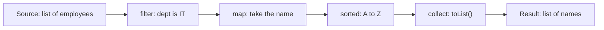
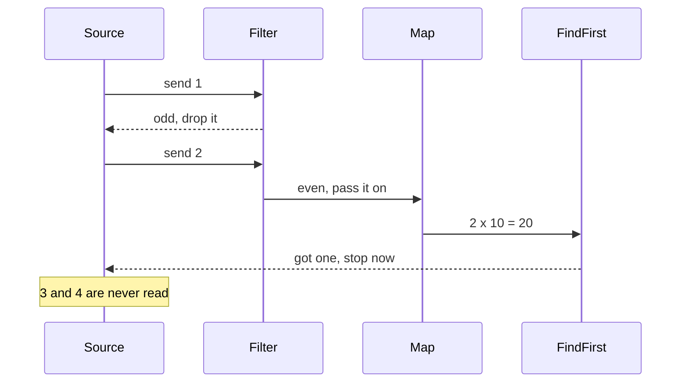
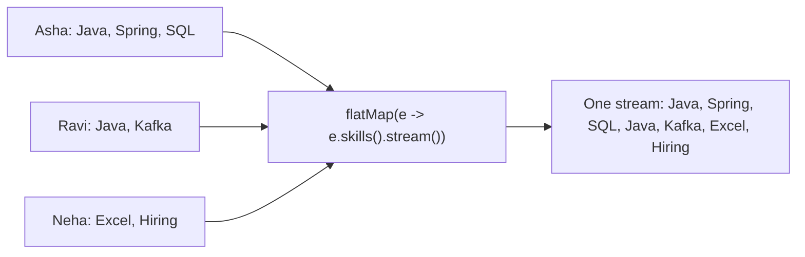
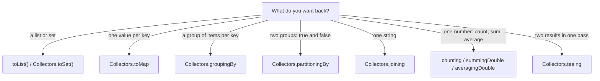
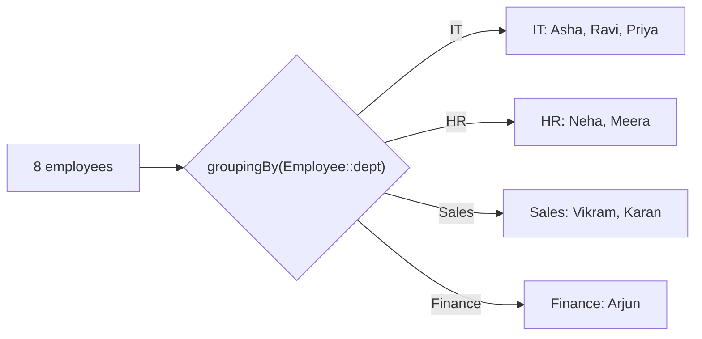
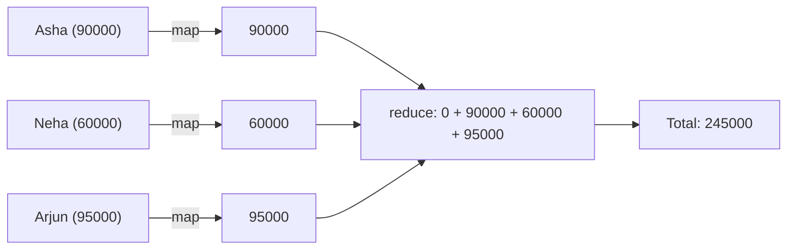

# Java streams and functional programming

[← Back to README](../README.md) · [Java answers](java.md) · [Java concurrency](java-concurrency.md)

This page explains Java streams in simple words, with diagrams. Then it gives 65 coding problems with short answers. Interviewers ask these problems a lot: "top 5", "group by department", "second highest salary", "first non-repeated character".

How to use this page:

- Read the first sections once. They give you the words to explain your code.
- Then practise the [coding problems](#stream-coding-problems-with-answers). Try each one before you look at the answer.
- All code is Java 21 or newer. It assumes `java.util.*`, `java.util.function.*` and `java.util.stream.*` are imported.

---

## The idea in one picture

**In one line:** A stream is a pipeline. Items come from a source, pass through steps, and a final step gives you one result.

**Story:** Think of a vegetable (sabzi) cleaning line in a small shop.

- A basket of vegetables is the **source**.
- Station 1 throws away the rotten ones. That is `filter`.
- Station 2 cuts each vegetable. That is `map`.
- Station 3 packs them into a bag. That is `collect`.
- The belt does not move until the shop opens. The "open" signal is the **terminal operation** (the last step).
- The basket itself does not change. The stations work on the vegetables as they pass.
- After the line runs once, it is finished. For another run, you set up a new line.

Now the same thing in Java:



```java
List<String> itNames = emps.stream()            // source
    .filter(e -> e.dept().equals("IT"))           // intermediate
    .map(Employee::name)                          // intermediate
    .sorted()                                     // intermediate
    .toList();                                    // terminal: now the work starts
// [Asha, Priya, Ravi]
```

Three words you must know:

| Word | Meaning | Examples |
|---|---|---|
| **Source** | Where the items come from | `list.stream()`, `Stream.of(...)`, `Arrays.stream(arr)`, `IntStream.range(0, 10)` |
| **Intermediate operation** | A middle step. It returns a new stream. It does no work yet. | `filter`, `map`, `sorted`, `distinct`, `limit` |
| **Terminal operation** | The last step. It starts the work and gives a result. | `toList`, `collect`, `forEach`, `count`, `reduce`, `findFirst` |

**Lazy evaluation** means "do nothing until someone asks for the result". Intermediate steps only *describe* the work. The terminal step runs it.

```java
Stream<String> s = emps.stream().map(e -> {
    System.out.println("mapping " + e.name());
    return e.name();
});
// Nothing printed yet: no terminal operation.
s.toList(); // now it prints "mapping Asha", "mapping Ravi", ...
```

**A stream is used once.** After a terminal operation, the stream is closed.

```java
Stream<String> nameStream = emps.stream().map(Employee::name);
nameStream.count();
nameStream.toList(); // IllegalStateException: stream has already been operated upon or closed
```

Fix: create a new stream each time (`emps.stream()` again), or keep a `Supplier<Stream<T>>`.

**Say this in the interview:**
> "A stream is a pipeline over a source like a list. Intermediate operations like filter and map are lazy. They only run when a terminal operation like collect or toList is called. A stream does not change its source, and it can be used only once."

---

## Lambdas, functional interfaces and method references

**In one line:** A *lambda* is a short function you can pass around like a value. A *functional interface* is an interface with exactly one abstract method, so a lambda can fill it.

**Story:** You give a tailor a note: "make it 2 inches shorter". The note is the lambda. The tailor (the stream) decides when to use it.

Before Java 8 and after:

```java
// Before Java 8: anonymous class, 6 lines
Collections.sort(names, new Comparator<String>() {
    @Override
    public int compare(String a, String b) {
        return a.length() - b.length();
    }
});

// Java 8+: lambda, 1 line
names.sort((a, b) -> a.length() - b.length());
names.sort(Comparator.comparingInt(String::length)); // even clearer
```

### The functional interfaces you must know

They live in `java.util.function`.

| Interface | Method | Takes → gives | Example |
|---|---|---|---|
| `Function<T, R>` | `apply` | T → R | `Function<String, Integer> len = s -> s.length();` |
| `Predicate<T>` | `test` | T → boolean | `Predicate<Integer> isEven = n -> n % 2 == 0;` |
| `Consumer<T>` | `accept` | T → nothing | `Consumer<String> print = s -> System.out.println(s);` |
| `Supplier<T>` | `get` | nothing → T | `Supplier<List<String>> newList = ArrayList::new;` |
| `BiFunction<T, U, R>` | `apply` | (T, U) → R | `BiFunction<Integer, Integer, Integer> add = (a, b) -> a + b;` |
| `UnaryOperator<T>` | `apply` | T → T (same type) | `UnaryOperator<String> upper = String::toUpperCase;` |
| `BinaryOperator<T>` | `apply` | (T, T) → T (same type) | `BinaryOperator<Integer> max = Math::max;` |

More you may see: `BiConsumer`, `BiPredicate`, and primitive versions like `IntPredicate` and `ToIntFunction`. They avoid *boxing* (wrapping each `int` in an `Integer` object). Old interfaces like `Runnable`, `Callable` and `Comparator` are also functional interfaces.

You can join small functions:

```java
Predicate<Employee> isIT = e -> e.dept().equals("IT");
Predicate<Employee> isRich = e -> e.salary() > 100_000;
emps.stream().filter(isIT.and(isRich.negate())).map(Employee::name).toList(); // [Asha]

Function<Integer, Integer> plus2 = x -> x + 2;
Function<Integer, Integer> times3 = x -> x * 3;
plus2.andThen(times3).apply(1); // (1 + 2) * 3 = 9
plus2.compose(times3).apply(1); // (1 * 3) + 2 = 5
```

`@FunctionalInterface` on your own interface asks the compiler to check that it has only one abstract method. Default and static methods are allowed.

### Method references: 4 kinds

A *method reference* (`::`) is a shorter lambda that only calls one existing method.

| Kind | Method reference | Same lambda |
|---|---|---|
| Static method | `Integer::parseInt` | `s -> Integer.parseInt(s)` |
| Instance method of a particular object | `System.out::println` | `x -> System.out.println(x)` |
| Instance method of any object of a type | `String::toUpperCase` | `s -> s.toUpperCase()` |
| Constructor | `ArrayList::new` | `() -> new ArrayList<>()` |

### Effectively final

A lambda can use a local variable from outside only if that variable never changes after it is set. Such a variable is *effectively final*.

```java
int bonus = 5_000;                       // never changed: effectively final
emps.stream().map(e -> e.salary() + bonus).toList(); // OK

int total = 0;
emps.forEach(e -> total += e.salary());  // compile error: total changes
double sum = emps.stream().mapToDouble(Employee::salary).sum(); // the right way
```

Why this rule: a lambda may run later, or on another thread. Java copies the value into the lambda. If the variable could change, the copy would be wrong.

---

## How a stream runs: lazy and one element at a time

**In one line:** A stream does not finish step 1 for all items before step 2. It takes one item through all steps, then the next item.

**Story:** On the sabzi line, one tomato is washed, then cut, then packed. Only then does the next tomato start. Nobody washes all 100 tomatoes first.

```java
Optional<Integer> first = Stream.of(1, 2, 3, 4)
    .peek(n -> System.out.println("read " + n))
    .filter(n -> n % 2 == 0)
    .map(n -> n * 10)
    .findFirst();
// prints: read 1, read 2      -> 3 and 4 are never read
// first = Optional[20]
```



Two kinds of operations change this flow:

- **Short-circuit operations** can stop early. They do not need every item. Examples: `findFirst`, `findAny`, `anyMatch`, `allMatch`, `noneMatch`, `limit`, `takeWhile`. This is why `Stream.iterate(1, n -> n + 1).limit(5)` works on an endless stream.
- **Stateful operations** must see items before they can pass any on. `sorted` must see **all** items. `distinct` must remember items it has seen. Stateless operations (`map`, `filter`) look at one item only.

`sorted` is a wall. Everything before it runs for all items first:

```java
Stream.of("b", "a", "c")
    .peek(s -> System.out.println("before sort " + s))
    .sorted()
    .peek(s -> System.out.println("after sort " + s))
    .findFirst();
// before sort b, before sort a, before sort c, after sort a
```

**Say this in the interview:**
> "Streams are lazy and process one element at a time through the whole pipeline. Short-circuit operations like findFirst or limit can stop early, so even an infinite stream can end. Stateful operations like sorted need all elements first, so they cost more memory."

---

## Intermediate operations

Each one returns a new stream. Nothing runs until the terminal operation.

| Operation | What it does | Example | Stateful? |
|---|---|---|---|
| `filter` | Keeps items that pass a test | `filter(e -> e.salary() > 80_000)` | No |
| `map` | Changes each item into something else | `map(Employee::name)` | No |
| `flatMap` | Turns each item into a stream, then joins all of them into one | `flatMap(e -> e.skills().stream())` | No |
| `distinct` | Removes duplicates (uses `equals` and `hashCode`) | `distinct()` | Yes |
| `sorted` | Sorts (natural order or a `Comparator`) | `sorted(Comparator.reverseOrder())` | Yes |
| `peek` | Looks at each item, mainly for debugging | `peek(System.out::println)` | No |
| `limit(n)` | Keeps the first n items, then stops | `limit(5)` | Short-circuit |
| `skip(n)` | Throws away the first n items | `skip(1)` | Yes |
| `takeWhile` (9) | Keeps items while the test is true. Stops at the first false. | `takeWhile(n -> n < 5)` | Short-circuit |
| `dropWhile` (9) | Drops items while the test is true. Keeps the rest. | `dropWhile(n -> n < 5)` | No |
| `mapMulti` (16) | Like `flatMap`, but you push items to a consumer. No inner stream is created. | see [New in modern Java](#new-in-modern-java) | No |
| `mapToInt`, `mapToObj`, `boxed` | Switch between object streams and primitive streams | `mapToInt(String::length)` | No |

### map vs flatMap

- `map`: one item in, one item out. A list of 8 employees gives 8 names.
- `flatMap`: one item in, **zero or more** items out. Then all of them go into one flat stream.



```java
List<List<String>> nested = emps.stream().map(Employee::skills).toList();               // list of lists
List<String> flat = emps.stream().flatMap(e -> e.skills().stream()).distinct().toList(); // one flat list
```

### takeWhile vs filter

```java
Stream.of(1, 2, 3, 10, 4).takeWhile(n -> n < 5).toList(); // [1, 2, 3]  stops at 10
Stream.of(1, 2, 3, 10, 4).filter(n -> n < 5).toList();    // [1, 2, 3, 4] checks all
Stream.of(1, 2, 3, 10, 4).dropWhile(n -> n < 5).toList(); // [10, 4]
```

`takeWhile` is most useful on sorted or endless streams.

---

## Terminal operations

A terminal operation starts the work and closes the stream.

| Operation | Returns | Example |
|---|---|---|
| `forEach` | nothing | `forEach(System.out::println)` |
| `collect` | anything a `Collector` builds (list, set, map, string) | `collect(Collectors.groupingBy(Employee::dept))` |
| `toList()` (16) | unmodifiable `List` | `map(Employee::name).toList()` |
| `reduce` | one value made from all items | `reduce(0, Integer::sum)` |
| `count` | `long` | `filter(...).count()` |
| `min` / `max` | `Optional<T>` | `max(Comparator.comparingDouble(Employee::salary))` |
| `findFirst` | `Optional<T>`, the first item in order | `filter(...).findFirst()` |
| `findAny` | `Optional<T>`, any item (fast in parallel) | `filter(...).findAny()` |
| `anyMatch` / `allMatch` / `noneMatch` | `boolean` | `anyMatch(e -> e.salary() > 100_000)` |
| `toArray` | array | `toArray(String[]::new)` |

Things interviewers check:

- `findFirst` respects order. `findAny` may return any item. In a sequential stream it is usually the first, but do not depend on it.
- `allMatch` on an empty stream returns `true`. `anyMatch` on an empty stream returns `false`.
- `forEach` in a parallel stream has no fixed order. Use `forEachOrdered` if order matters.

### toList() vs collect(Collectors.toList())

| | `stream.toList()` (Java 16) | `collect(Collectors.toList())` | `collect(Collectors.toUnmodifiableList())` (Java 10) |
|---|---|---|---|
| Can you add or remove? | No, `UnsupportedOperationException` | Yes (an `ArrayList` today, but the docs do not promise it) | No |
| Null items allowed? | Yes | Yes | No, throws `NullPointerException` |
| Code length | Short | Long | Long |

```java
List<String> a = emps.stream().map(Employee::name).toList();
a.add("Zoya"); // UnsupportedOperationException

List<String> b = emps.stream().map(Employee::name).collect(Collectors.toList());
b.add("Zoya"); // works
```

Rule: use `toList()` by default. Use `Collectors.toCollection(ArrayList::new)` when you must change the list later.

---

## Collectors in depth

`collect` takes a *collector*: a recipe for building the result. Most recipes are in the `Collectors` class. Examples use the [sample data](#setup-sample-data).

### Which collector do I need?



### toList, toSet, toMap

```java
Set<String> depts = emps.stream().map(Employee::dept).collect(Collectors.toSet());
// [Sales, Finance, HR, IT]  (a HashSet: order is not fixed)

Map<String, Double> salaryByName = emps.stream()
    .collect(Collectors.toMap(Employee::name, Employee::salary)); // key, value
```

`toMap` throws an error when two items have the same key:

```java
emps.stream().collect(Collectors.toMap(Employee::dept, Employee::name));
// IllegalStateException: Duplicate key IT (attempted merging values Asha and Ravi)
```

Fix it with a **merge function**. It says what to do when a key repeats:

```java
Map<String, String> namesByDept = emps.stream()
    .collect(Collectors.toMap(Employee::dept, Employee::name,
             (a, b) -> a + ", " + b));               // join the two values
// {Sales=Vikram, Karan, Finance=Arjun, HR=Neha, Meera, IT=Asha, Ravi, Priya}
```

A fourth argument picks the map type, for example `LinkedHashMap::new` to keep order, or `TreeMap::new` to sort keys.

### groupingBy

**In one line:** `groupingBy` puts items into buckets by a key. You get `Map<Key, List<Item>>`.

**Story:** A post office sorts letters into one bag per PIN code. The PIN code is the key. Each bag is a list.



The second argument is a **downstream collector**. It says what to do inside each bucket.

```java
// bucket = list of employees (default)
Map<String, List<Employee>> byDept = emps.stream()
    .collect(Collectors.groupingBy(Employee::dept));

// bucket = count
Map<String, Long> countByDept = emps.stream()
    .collect(Collectors.groupingBy(Employee::dept, Collectors.counting()));
// {Sales=2, Finance=1, HR=2, IT=3}

// bucket = sum and average of salary
Map<String, Double> sumByDept = emps.stream()
    .collect(Collectors.groupingBy(Employee::dept, Collectors.summingDouble(Employee::salary)));
Map<String, Double> avgByDept = emps.stream()
    .collect(Collectors.groupingBy(Employee::dept, Collectors.averagingDouble(Employee::salary)));
// avg: {Sales=78500.0, Finance=95000.0, HR=62500.0, IT=110000.0}

// bucket = only the names (mapping changes each item before it goes in the bucket)
Map<String, List<String>> namesByDeptList = emps.stream()
    .collect(Collectors.groupingBy(Employee::dept, Collectors.mapping(Employee::name, Collectors.toList())));

// three arguments: key, map type, downstream. TreeMap keeps keys sorted.
Map<String, Long> sortedCount = emps.stream()
    .collect(Collectors.groupingBy(Employee::dept, TreeMap::new, Collectors.counting()));
// {Finance=1, HR=2, IT=3, Sales=2}   sorted keys
```

Other downstream collectors: `maxBy`, `minBy`, `toSet`, `joining`, `filtering` (9), `flatMapping` (9), `summarizingDouble`.

Note: `groupingBy` returns a `HashMap`. Its order is not fixed. The outputs on this page show one possible order. Use `TreeMap::new` when you need sorted keys.

### partitioningBy

`partitioningBy` is a special `groupingBy` with only two buckets: `true` and `false`. Both keys are always present, even when a bucket is empty.

```java
Map<Boolean, List<String>> richOrNot = emps.stream()
    .collect(Collectors.partitioningBy(e -> e.salary() > 80_000,
             Collectors.mapping(Employee::name, Collectors.toList())));
// {false=[Neha, Vikram, Meera], true=[Asha, Ravi, Priya, Karan, Arjun]}
```

### joining

```java
String names = emps.stream().map(Employee::name).collect(Collectors.joining(", ", "[", "]"));
// [Asha, Ravi, Neha, Vikram, Priya, Karan, Meera, Arjun]   (separator, prefix, suffix)
```

### summarizingDouble

One pass gives count, sum, min, average and max:

```java
DoubleSummaryStatistics stats = emps.stream()
    .collect(Collectors.summarizingDouble(Employee::salary));
// count=8, sum=707000.0, min=60000.0, average=88375.0, max=120000.0
```

### collectingAndThen

Collect first, then change the result once:

```java
List<String> fixed = emps.stream().map(Employee::name)
    .collect(Collectors.collectingAndThen(Collectors.toList(), Collections::unmodifiableList));
```

The most common use: remove the `Optional` from `maxBy` inside `groupingBy`. See [problem 15](#grouping-and-counting).

### teeing (Java 12)

`teeing` sends every item to **two** collectors, then joins the two results. Like a T-shaped water pipe.

```java
String range = emps.stream().collect(Collectors.teeing(
    Collectors.minBy(Comparator.comparingDouble(Employee::salary)),
    Collectors.maxBy(Comparator.comparingDouble(Employee::salary)),
    (min, max) -> min.get().name() + " to " + max.get().name()));
// Neha to Ravi
```

---

## reduce and the map-reduce idea

**In one line:** `reduce` joins all items into one value, two at a time.

**Story:** A cricket team's total score. Each player's runs are the **map** step (player → runs). Adding runs one by one to the scoreboard is the **reduce** step.



`reduce` has three forms:

```java
// 1) identity + accumulator: always returns a value
int sum = nums.stream().reduce(0, Integer::sum);                  // 90

// 2) accumulator only: returns Optional (the stream may be empty)
Optional<Integer> max = nums.stream().reduce(Integer::max);       // Optional[18]

// 3) identity + accumulator + combiner: when the result type differs from the item type
int totalChars = Stream.of("java", "is", "fun")
    .reduce(0, (count, s) -> count + s.length(), Integer::sum);   // 9
```

- **Identity:** the starting value. It must change nothing: `0` for sum, `1` for product, `""` for joining.
- **Accumulator:** adds one item to the running result.
- **Combiner:** joins two partial results. Only parallel streams really use it.

### reduce vs sum()

```java
double a = emps.stream().map(Employee::salary).reduce(0.0, Double::sum); // boxes each double
double b = emps.stream().mapToDouble(Employee::salary).sum();             // better: no boxing
```

Prefer `sum()`, `count()`, `max()` and `Collectors` when they exist. Use `reduce` for your own rule, like a product.

### Why reduce must be associative

*Associative* means the grouping does not change the answer: `(a + b) + c == a + (b + c)`. A parallel stream splits the data, reduces each part, then combines the parts. So the order of grouping changes.

```java
// Correct: + is associative, 0 is a true identity
IntStream.rangeClosed(1, 100).parallel().reduce(0, Integer::sum);       // 5050 every time

// Wrong: minus is not associative
IntStream.rangeClosed(1, 100).parallel().reduce(0, (a, b) -> a - b);    // 0 on one test, but sequential gives -5050

// Wrong: 10 is not an identity. Each parallel part adds 10 again.
IntStream.rangeClosed(1, 100).parallel().reduce(10, Integer::sum);      // 6050 on one test, not 5060
```

### reduce vs collect

- `reduce` makes a **new** value at each step. Good for immutable results: numbers, strings.
- `collect` adds into a **mutable container** (a list, a map, a `StringBuilder`). Good for building collections.
- Do not build a list with `reduce`. It copies the list again and again.

---

## Primitive streams and Optional

### IntStream, LongStream, DoubleStream

`Stream<Integer>` holds `Integer` objects. Each number is *boxed* (wrapped in an object). For one million numbers, that is one million small objects for the garbage collector. `IntStream` holds plain `int` values: no boxing.

```java
IntStream.range(0, 5).toArray();          // [0, 1, 2, 3, 4]   end is excluded
IntStream.rangeClosed(1, 5).sum();        // 15                end is included
nums.stream().mapToInt(Integer::intValue).average();    // OptionalDouble[9.0]

IntSummaryStatistics s = nums.stream().mapToInt(n -> n).summaryStatistics();
// IntSummaryStatistics{count=10, sum=90, min=1, average=9.000000, max=18}

List<Integer> boxedBack = IntStream.range(0, 3).boxed().toList(); // back to Stream<Integer>
```

- `mapToInt` / `mapToDouble`: object stream → primitive stream.
- `mapToObj` / `boxed`: primitive stream → object stream.
- `sum()`, `average()` and `summaryStatistics()` exist only on primitive streams.
- `"abc".chars()` gives an `IntStream` of character codes. Cast back with `(char) c`.

### Optional

**In one line:** `Optional<T>` is a box that holds one value or nothing. It forces the caller to think about "no result".

**Story:** You ask a shop for a parcel. They give you a box. You must open it to see if your parcel is there. That is better than getting `null` and falling over later.

```java
Optional<Employee> top = emps.stream().max(Comparator.comparingDouble(Employee::salary));

String name = top.map(Employee::name).orElse("nobody");          // safe default
Employee e  = top.orElseThrow();                                  // throws NoSuchElementException if empty (Java 10)
top.ifPresent(x -> System.out.println(x.name()));
top.ifPresentOrElse(x -> System.out.println(x.name()), () -> System.out.println("none")); // Java 9
```

| Do | Don't |
|---|---|
| Return `Optional` from a method that may find nothing | Use `Optional` for fields or method parameters |
| Use `map`, `filter`, `orElse`, `orElseGet`, `orElseThrow` | Call `get()` without checking. It throws on empty. |
| Use `orElseGet(() -> load())` when the default is costly to build | Use `orElse(load())` with a costly call. It runs even when a value is present. |
| Return an empty list for "no items" | Return `Optional<List<T>>` |
| Use `Optional.ofNullable(x)` when x may be null | Use `Optional.of(x)` when x may be null. It throws `NullPointerException`. |

---

## Parallel streams (short)

`parallelStream()` splits the data into parts. The parts run on the shared Fork/Join pool (about one thread per CPU core).

- **Helps:** large data (100,000+ items), CPU-heavy work per item, no shared state, easy-to-split sources like `ArrayList` and arrays.
- **Hurts:** small lists, I/O calls (HTTP, database) inside the stream, and writing to a shared list.
- **Also hurts:** `LinkedList` or `Stream.iterate` sources, and code that needs order.
- Most web request code should **not** use parallel streams. Measure first.

Full answer with a table: [Parallel streams in Java concurrency](java-concurrency.md#parallel-streams).

---

## New in modern Java

| Version | Feature | One line |
|---|---|---|
| 9 | `takeWhile`, `dropWhile` | Keep or drop items until a test fails |
| 9 | `Stream.iterate(seed, hasNext, next)` | Like a `for` loop: it has a stop condition |
| 9 | `Stream.ofNullable(x)` | Empty stream if x is null, else a stream of one item |
| 9 | `Collectors.filtering`, `Collectors.flatMapping` | Filter or flatten inside `groupingBy` |
| 9 | `Optional.stream()`, `Optional.ifPresentOrElse` | Use an Optional like a stream of 0 or 1 items |
| 10 | `Collectors.toUnmodifiableList/Set/Map`, `Optional.orElseThrow()` | Read-only results |
| 11 | `Predicate.not` | `filter(Predicate.not(String::isBlank))` |
| 12 | `Collectors.teeing` | Two collectors, one pass |
| 16 | `Stream.toList()` | Short, unmodifiable list |
| 16 | `mapMulti` | One-to-many without creating inner streams |
| 21 | Sequenced collections | `getFirst()`, `getLast()`, `reversed()` on lists and more |
| 24 | Stream gatherers (`gather`) | Write your own intermediate operation. Final in Java 24. |

### Java 9 examples

```java
Stream.iterate(1, n -> n <= 100, n -> n * 2).toList(); // [1, 2, 4, 8, 16, 32, 64]
Stream.ofNullable(null).count();                       // 0

Map<String, List<String>> richNamesByDept = emps.stream()
    .collect(Collectors.groupingBy(Employee::dept,
             Collectors.filtering(e -> e.salary() > 80_000,     // filter inside each bucket
                 Collectors.mapping(Employee::name, Collectors.toList()))));
// {Sales=[Karan], Finance=[Arjun], HR=[], IT=[Asha, Ravi, Priya]}  HR is kept, but empty
```

### mapMulti (Java 16)

```java
List<String> allSkills = emps.stream()
    .<String>mapMulti((e, sink) -> e.skills().forEach(sink)) // push each skill to the sink
    .toList();
```

Use it when each item gives only a few results. It avoids building a small stream per item. `flatMap` is still fine for most code.

### Sequenced collections (Java 21)

```java
List<Employee> bySalary = emps.stream()
    .sorted(Comparator.comparingDouble(Employee::salary)).toList();
bySalary.getFirst().name();  // Neha   (lowest)
bySalary.getLast().name();   // Priya  (highest; Ravi has the same salary but comes first)
bySalary.reversed().stream().limit(2).map(Employee::name).toList(); // [Priya, Ravi]
```

Before Java 21 you wrote `list.get(list.size() - 1)`.

### Stream gatherers (Java 24)

**In one line:** `gather(...)` lets you add your **own** intermediate operation. `collect(...)` does the same for terminal operations.

Gatherers were a preview in Java 22 and 23. They are final in Java 24 ([JEP 485](https://openjdk.org/jeps/485)). The class `java.util.stream.Gatherers` gives five ready-made ones:

```java
// windowFixed: groups of n
Stream.of(1, 2, 3, 4, 5, 6, 7, 8).gather(Gatherers.windowFixed(3)).toList();
// [[1, 2, 3], [4, 5, 6], [7, 8]]

// windowSliding: a window that moves one step at a time
Stream.of(1, 2, 3, 4, 5).gather(Gatherers.windowSliding(2)).toList();
// [[1, 2], [2, 3], [3, 4], [4, 5]]

// scan: running result, one output per input
Stream.of(1, 2, 3, 4).gather(Gatherers.scan(() -> 0, Integer::sum)).toList();
// [1, 3, 6, 10]

// fold: like reduce, but gives a stream with one item
Stream.of(1, 2, 3, 4).gather(Gatherers.fold(() -> 0, Integer::sum)).findFirst();
// Optional[10]

// mapConcurrent: run a slow call on virtual threads, at most 10 at a time, order kept
List<String> pages = urls.stream()
    .gather(Gatherers.mapConcurrent(10, url -> httpGet(url)))
    .toList();
```

- `scan` and `fold` take a `Supplier` for the start value, not a plain value.
- `mapConcurrent` is good for I/O calls. Unlike a parallel stream, it does not block the shared Fork/Join pool.
- Many teams still run Java 21, which has no gatherers. There, use a loop. Java 25 (the newest LTS) has them.

---

## Common mistakes

**1. Changing the source while streaming**

```java
List<Integer> list = new ArrayList<>(List.of(1, 2, 3, 4));
list.stream().forEach(n -> { if (n % 2 == 0) list.remove(n); }); // breaks: ConcurrentModificationException or NullPointerException
list.removeIf(n -> n % 2 == 0);                                    // right way
```

**2. Using a stream twice.** You get `IllegalStateException`. Create a new stream.

**3. Side effects in `map` or `filter`.** These steps should only compute and return. Do not save to a database or change outside variables there. Lazy and parallel runs make side effects run fewer times, more times, or in a strange order.

**4. Duplicate keys in `toMap`.** You get `IllegalStateException: Duplicate key`. Add a merge function `(a, b) -> a`, or use `groupingBy`.

**5. Null keys or values.** `groupingBy` throws `NullPointerException` ("element cannot be mapped to a null key"). `toMap` throws on null values. Filter nulls first, or map them to a default like `"UNKNOWN"`.

**6. Wrong comparator.**

```java
// reversed() at the end reverses BOTH salary and name order
Comparator.comparingDouble(Employee::salary).thenComparing(Employee::name).reversed();

// salary high to low, then name A to Z
Comparator.comparingDouble(Employee::salary).reversed().thenComparing(Employee::name);

// does not compile: Java cannot guess the type of e before reversed()
// Comparator.comparing(e -> e.salary()).reversed();
```

Also: `(a, b) -> a - b` can overflow for large ints. Use `Integer.compare(a, b)` or `Comparator.comparingInt`.

**7. Using streams for very simple loops.** A plain `for` loop is fine in some cases. For example: you need an index, a `break`, or checked exceptions. Clear code wins.

**8. Parallel by default.** `parallelStream()` on a small list, or with HTTP calls inside, is usually slower. It can also block other code that uses the common pool.

**9. Calling `Optional.get()` without a check.** Use `orElse`, `orElseThrow` or `ifPresent`.

**10. Adding to an outside list from `forEach`.** See [problem 65](#tricky-ones-interviewers-like).

---

## Stream coding problems (with answers)

65 problems. Each has: the problem, a short answer, and the trick to say out loud. Try it yourself first.

In the interview, talk while you type: "I stream the list, filter X, group by Y, then collect." The interviewer wants to hear your plan, not only see the code.

### Setup: sample data

All problems use this data. Keep it in your head while you read the outputs.

```java
record Employee(String name, String dept, double salary, int age, String city, List<String> skills) {}

List<Employee> emps = List.of(
    new Employee("Asha",   "IT",       90_000, 31, "Pune",      List.of("Java", "Spring", "SQL")),
    new Employee("Ravi",   "IT",      120_000, 38, "Bengaluru", List.of("Java", "Kafka")),
    new Employee("Neha",   "HR",       60_000, 29, "Delhi",     List.of("Excel", "Hiring")),
    new Employee("Vikram", "Sales",    75_000, 45, "Mumbai",    List.of("Excel", "CRM")),
    new Employee("Priya",  "IT",      120_000, 27, "Pune",      List.of("React", "Java")),
    new Employee("Karan",  "Sales",    82_000, 34, "Delhi",     List.of("CRM", "SQL")),
    new Employee("Meera",  "HR",       65_000, 41, "Bengaluru", List.of("Hiring", "Payroll")),
    new Employee("Arjun",  "Finance",  95_000, 36, "Mumbai",    List.of("Excel", "SQL")));

List<Integer> nums = List.of(5, 12, 7, 3, 12, 18, 1, 7, 10, 15);
String word = "javastreams";
String sentence = "java streams make java code short and java code clean";
```

| Name | Dept | Salary | Age | City | Skills |
|---|---|---|---|---|---|
| Asha | IT | 90,000 | 31 | Pune | Java, Spring, SQL |
| Ravi | IT | 120,000 | 38 | Bengaluru | Java, Kafka |
| Neha | HR | 60,000 | 29 | Delhi | Excel, Hiring |
| Vikram | Sales | 75,000 | 45 | Mumbai | Excel, CRM |
| Priya | IT | 120,000 | 27 | Pune | React, Java |
| Karan | Sales | 82,000 | 34 | Delhi | CRM, SQL |
| Meera | HR | 65,000 | 41 | Bengaluru | Hiring, Payroll |
| Arjun | Finance | 95,000 | 36 | Mumbai | Excel, SQL |

Note: Ravi and Priya have the **same** salary. Interviewers love ties. Always ask: "What should happen with equal values?"

Maps from `groupingBy` and `toMap` are `HashMap`s. The order shown in the comments may be different on your machine.

### Top N, sorting and ranking

**1. Top 5 highest-paid employees**

```java
List<String> top5 = emps.stream()
    .sorted(Comparator.comparingDouble(Employee::salary).reversed()) // high to low
    .limit(5)
    .map(Employee::name)
    .toList();
// [Ravi, Priya, Arjun, Asha, Karan]
```

Trick: `sorted` then `limit`. Sorting is *stable* (equal items keep their list order), so Ravi comes before Priya.

**2. Top 3 earners in each department**

```java
Map<String, List<String>> top3PerDept = emps.stream()
    .collect(Collectors.groupingBy(Employee::dept,
        Collectors.collectingAndThen(Collectors.toList(), list -> list.stream()
            .sorted(Comparator.comparingDouble(Employee::salary).reversed())
            .limit(3)                                   // top 3 inside each bucket
            .map(Employee::name)
            .toList())));
// {Sales=[Karan, Vikram], Finance=[Arjun], HR=[Meera, Neha], IT=[Ravi, Priya, Asha]}
```

Trick: group first, then sort and limit inside each bucket with `collectingAndThen`.

**3. Second highest salary**

```java
Optional<Double> second = emps.stream()
    .map(Employee::salary)
    .distinct()                              // 120000 appears twice
    .sorted(Comparator.reverseOrder())
    .skip(1)
    .findFirst();
// Optional[95000.0]
```

Trick: `distinct()` is the key. Without it, you get 120000 again. Return `Optional` because there may be no second value.

**4. Nth highest salary**

```java
static Optional<Double> nthHighest(List<Employee> emps, int n) {
    return emps.stream().map(Employee::salary).distinct()
        .sorted(Comparator.reverseOrder())
        .skip(n - 1)                         // skip the top n-1
        .findFirst();
}
// nthHighest(emps, 3) -> Optional[90000.0]
```

Trick: same as problem 3 with `skip(n - 1)`.

**5. Lowest-paid employee**

```java
Optional<Employee> lowest = emps.stream()
    .min(Comparator.comparingDouble(Employee::salary));
// Neha
```

Trick: use `min`, not `sorted().findFirst()`. `min` is one pass, O(n). Sorting is O(n log n).

**6. Sort by salary high to low, then by name A to Z**

```java
List<String> sorted = emps.stream()
    .sorted(Comparator.comparingDouble(Employee::salary).reversed()
                      .thenComparing(Employee::name))   // tie-break
    .map(Employee::name)
    .toList();
// [Priya, Ravi, Arjun, Asha, Karan, Vikram, Meera, Neha]
```

Trick: `reversed()` goes right after the salary part. If it goes at the end, it also reverses the names.

**7. Sort a map by value (high to low) and keep that order**

```java
Map<String, Double> salaryByName = emps.stream()
    .collect(Collectors.toMap(Employee::name, Employee::salary));

Map<String, Double> sortedByValue = salaryByName.entrySet().stream()
    .sorted(Map.Entry.<String, Double>comparingByValue().reversed())
    .collect(Collectors.toMap(Map.Entry::getKey, Map.Entry::getValue,
             (a, b) -> a, LinkedHashMap::new));  // LinkedHashMap keeps the sorted order
// {Priya=120000.0, Ravi=120000.0, Arjun=95000.0, Asha=90000.0, Karan=82000.0, ...}
```

Trick: a normal `HashMap` loses the order. Collect into `LinkedHashMap`. The `<String, Double>` type hint is needed before `.reversed()`. (The order of Ravi and Priya depends on the first map.)

**8. Sort a map by key**

```java
Map<String, Double> byKey = new TreeMap<>(salaryByName);   // simplest
// {Arjun=95000.0, Asha=90000.0, Karan=82000.0, Meera=65000.0, Neha=60000.0, Priya=120000.0, ...}
```

Trick: a `TreeMap` keeps keys sorted. With streams: `sorted(Map.Entry.comparingByKey())` and collect into `LinkedHashMap`.

**9. Top 5 most frequent words**

```java
List<String> top5Words = Arrays.stream(sentence.split(" "))
    .collect(Collectors.groupingBy(w -> w, Collectors.counting()))     // word -> count
    .entrySet().stream()
    .sorted(Map.Entry.<String, Long>comparingByValue().reversed()
                     .thenComparing(Map.Entry.comparingByKey()))       // ties: A to Z
    .limit(5)
    .map(Map.Entry::getKey)
    .toList();
// [java, code, and, clean, make]
```

Trick: count with `groupingBy` + `counting`, then stream the map entries and sort by value.

**10. Kth largest number**

```java
int k = 3;
int kth = nums.stream()
    .sorted(Comparator.reverseOrder())
    .skip(k - 1)
    .findFirst()
    .orElseThrow();
// sorted high to low: 18, 15, 12, 12, 10 ... -> 12
```

Trick: for very large data, say "a min-heap (`PriorityQueue`) of size k is O(n log k). That beats sorting."

### Grouping and counting

**11. Count employees in each department**

```java
Map<String, Long> countByDept = emps.stream()
    .collect(Collectors.groupingBy(Employee::dept, Collectors.counting()));
// {Sales=2, Finance=1, HR=2, IT=3}
```

Trick: `counting()` returns `Long`, not `Integer`.

**12. Average salary in each department**

```java
Map<String, Double> avgByDept = emps.stream()
    .collect(Collectors.groupingBy(Employee::dept, Collectors.averagingDouble(Employee::salary)));
// {Sales=78500.0, Finance=95000.0, HR=62500.0, IT=110000.0}
```

**13. Total salary in each department**

```java
Map<String, Double> sumByDept = emps.stream()
    .collect(Collectors.groupingBy(Employee::dept, Collectors.summingDouble(Employee::salary)));
// {Sales=157000.0, Finance=95000.0, HR=125000.0, IT=330000.0}
```

**14. Highest salary (the number) in each department**

```java
Map<String, Double> maxSalaryByDept = emps.stream()
    .collect(Collectors.toMap(Employee::dept, Employee::salary, Math::max)); // merge = keep bigger
// {Sales=82000.0, Finance=95000.0, HR=65000.0, IT=120000.0}
```

Trick: `toMap` with a merge function `Math::max` is short and has no `Optional`.

**15. Highest-paid employee in each department**

```java
// Version A: maxBy gives Optional<Employee> per department
Map<String, Optional<Employee>> withOptional = emps.stream()
    .collect(Collectors.groupingBy(Employee::dept,
             Collectors.maxBy(Comparator.comparingDouble(Employee::salary))));

// Version B: remove the Optional with collectingAndThen
Map<String, String> topNameByDept = emps.stream()
    .collect(Collectors.groupingBy(Employee::dept,
             Collectors.collectingAndThen(
                 Collectors.maxBy(Comparator.comparingDouble(Employee::salary)),
                 opt -> opt.get().name())));        // safe: a group is never empty
// {Sales=Karan, Finance=Arjun, HR=Meera, IT=Ravi}
```

Trick: `opt.get()` is safe here because `groupingBy` never makes an empty group. Another way: `toMap(Employee::dept, e -> e, BinaryOperator.maxBy(comparator))`.

**16. Names grouped by city**

```java
Map<String, List<String>> namesByCity = emps.stream()
    .collect(Collectors.groupingBy(Employee::city,
             Collectors.mapping(Employee::name, Collectors.toList())));
// {Delhi=[Neha, Karan], Bengaluru=[Ravi, Meera], Pune=[Asha, Priya], Mumbai=[Vikram, Arjun]}
```

Trick: `mapping` changes each employee to a name before it goes into the bucket.

**17. Split employees into salary above 80,000 and the rest**

```java
Map<Boolean, List<String>> split = emps.stream()
    .collect(Collectors.partitioningBy(e -> e.salary() > 80_000,
             Collectors.mapping(Employee::name, Collectors.toList())));
// {false=[Neha, Vikram, Meera], true=[Asha, Ravi, Priya, Karan, Arjun]}
```

Trick: `partitioningBy` always has both keys, `true` and `false`.

**18. Group by age range (20s, 30s, 40s)**

```java
Map<String, List<String>> byAgeRange = emps.stream()
    .collect(Collectors.groupingBy(e -> (e.age() / 10) * 10 + "s",   // 31 -> "30s"
             TreeMap::new,
             Collectors.mapping(Employee::name, Collectors.toList())));
// {20s=[Neha, Priya], 30s=[Asha, Ravi, Karan, Arjun], 40s=[Vikram, Meera]}
```

Trick: the key can be any computed value. Integer division drops the last digit.

**19. Count each character in a string**

```java
Map<Character, Long> charCount = word.chars()
    .mapToObj(c -> (char) c)                                 // int -> Character
    .collect(Collectors.groupingBy(c -> c, LinkedHashMap::new, Collectors.counting()));
// {j=1, a=3, v=1, s=2, t=1, r=1, e=1, m=1}
```

Trick: `chars()` gives an `IntStream`. Cast to `char` to get letters back. `LinkedHashMap` keeps the first-seen order.

**20. Count each word in a sentence**

```java
Map<String, Long> wordCount = Arrays.stream(sentence.split("\\s+"))
    .map(String::toLowerCase)
    .collect(Collectors.groupingBy(w -> w, Collectors.counting()));
// {code=2, java=3, and=1, streams=1, short=1, clean=1, make=1}
```

Trick: split on `\\s+` (one or more spaces). Lowercase so "Java" and "java" count as one word.

**21. Department with the most employees**

```java
String biggest = emps.stream()
    .collect(Collectors.groupingBy(Employee::dept, Collectors.counting()))
    .entrySet().stream()
    .max(Map.Entry.comparingByValue())
    .map(Map.Entry::getKey)
    .orElseThrow();
// IT
```

Trick: two steps. First count into a map. Then stream the map and pick the max entry.

### Strings

**22. First non-repeated character**

```java
Character firstUnique = word.chars().mapToObj(c -> (char) c)
    .collect(Collectors.groupingBy(c -> c, LinkedHashMap::new, Collectors.counting()))
    .entrySet().stream()
    .filter(e -> e.getValue() == 1)          // appears once
    .map(Map.Entry::getKey)
    .findFirst()
    .orElse(null);
// j   ("javastreams")
```

Trick: `LinkedHashMap` keeps the order of first appearance. A `HashMap` would give a random "first".

**23. First repeated character**

```java
Character firstRepeat = word.chars().mapToObj(c -> (char) c)
    .collect(Collectors.groupingBy(c -> c, LinkedHashMap::new, Collectors.counting()))
    .entrySet().stream()
    .filter(e -> e.getValue() > 1)           // appears more than once
    .map(Map.Entry::getKey)
    .findFirst()
    .orElse(null);
// a
```

Trick: same as problem 22, only the filter changes. A shorter trick uses `Set.add` inside `filter`, but that is a side effect (see [mistake 3](#common-mistakes)).

**24. Remove duplicate characters and keep the order**

```java
String noDups = word.chars()
    .distinct()                                   // keeps the first time each char appears
    .mapToObj(c -> String.valueOf((char) c))
    .collect(Collectors.joining());
// javstrem
```

Trick: `distinct()` keeps encounter order on an ordered stream.

**25. Reverse each word, keep word order**

```java
String reversedWords = Arrays.stream("java streams are fun".split(" "))
    .map(w -> new StringBuilder(w).reverse().toString())
    .collect(Collectors.joining(" "));
// avaj smaerts era nuf
```

**26. Check if two strings are anagrams**

```java
static boolean isAnagram(String a, String b) {
    return Arrays.equals(
        a.toLowerCase().chars().sorted().toArray(),
        b.toLowerCase().chars().sorted().toArray());   // same letters, same counts
}
// isAnagram("Listen", "Silent") -> true
```

Trick: sort the letters of both and compare. Same letters in the same amount means anagram.

**27. Longest word**

```java
String longest = Arrays.stream(sentence.split(" "))
    .max(Comparator.comparingInt(String::length))
    .orElse("");
// streams
```

**28. Count vowels**

```java
long vowels = word.toLowerCase().chars()
    .filter(c -> "aeiou".indexOf(c) >= 0)
    .count();
// 4   (a, a, e, a)
```

**29. Join names with a comma and square brackets**

```java
String joined = emps.stream().map(Employee::name)
    .collect(Collectors.joining(", ", "[", "]"));   // separator, prefix, suffix
// [Asha, Ravi, Neha, Vikram, Priya, Karan, Meera, Arjun]
```

**30. Is the string a palindrome?**

```java
static boolean isPalindrome(String s) {
    return IntStream.range(0, s.length() / 2)
        .allMatch(i -> s.charAt(i) == s.charAt(s.length() - 1 - i)); // compare both ends
}
// isPalindrome("madam") -> true, isPalindrome("java") -> false
```

Trick: `allMatch` stops at the first mismatch. Easy version: `new StringBuilder(s).reverse().toString().equals(s)`.

**31. Character with the highest count**

```java
Character most = word.chars().mapToObj(c -> (char) c)
    .collect(Collectors.groupingBy(c -> c, Collectors.counting()))
    .entrySet().stream()
    .max(Map.Entry.comparingByValue())
    .map(Map.Entry::getKey)
    .orElseThrow();
// a   (3 times)
```

### Numbers

`nums` is `[5, 12, 7, 3, 12, 18, 1, 7, 10, 15]`.

**32. Sum of even numbers**

```java
int evenSum = nums.stream().filter(n -> n % 2 == 0).mapToInt(Integer::intValue).sum();
// 52   (12 + 12 + 18 + 10)
```

**33. Squares of odd numbers**

```java
List<Integer> oddSquares = nums.stream().filter(n -> n % 2 != 0).map(n -> n * n).toList();
// [25, 49, 9, 1, 49, 225]
```

**34. Find duplicate numbers**

```java
Set<Integer> seen = new HashSet<>();
Set<Integer> dups = nums.stream()
    .filter(n -> !seen.add(n))          // add() returns false if already there
    .collect(Collectors.toSet());
// [7, 12]

// No side effects: count, then keep counts > 1
Set<Integer> dups2 = nums.stream()
    .collect(Collectors.groupingBy(n -> n, Collectors.counting()))
    .entrySet().stream().filter(e -> e.getValue() > 1)
    .map(Map.Entry::getKey).collect(Collectors.toSet());
```

Trick: the `Set.add` version is short and common in interviews. Say it is not safe in parallel. The second version is safe.

**35. Numbers that appear only once**

```java
List<Integer> once = nums.stream()
    .filter(n -> Collections.frequency(nums, n) == 1)
    .toList();
// [5, 3, 18, 1, 10, 15]
```

Trick: `Collections.frequency` is simple but O(n²). For big lists, use the `groupingBy` + `counting` way from problem 34. Do not confuse with `distinct()`, which gives each value once: `[5, 12, 7, 3, 18, 1, 10, 15]`.

**36. Max and min**

```java
int max = nums.stream().mapToInt(n -> n).max().orElseThrow();      // 18
int min = nums.stream().min(Integer::compare).orElseThrow();       // 1
```

**37. Average**

```java
double avg = nums.stream().mapToInt(n -> n).average().orElse(0);   // 9.0
```

Trick: `average()` returns `OptionalDouble` because the list may be empty.

**38. Sum of digits of a number**

```java
int digitSum = String.valueOf(12345).chars()
    .map(c -> c - '0')                 // '3' -> 3
    .sum();
// 15
```

**39. Numbers that start with 1**

```java
List<Integer> startsWith1 = nums.stream()
    .map(String::valueOf)
    .filter(s -> s.startsWith("1"))
    .map(Integer::valueOf)
    .toList();
// [12, 12, 18, 1, 10, 15]
```

**40. Product of all numbers with reduce**

```java
int product = Stream.of(1, 2, 3, 4, 5).reduce(1, (a, b) -> a * b);  // identity is 1, not 0
// 120
```

Trick: the identity for multiply is `1`. For big products, use `long` or `BigInteger`. An `int` overflows quietly.

**41. Sum of a list with reduce**

```java
int total = nums.stream().reduce(0, Integer::sum);                  // 90
int total2 = nums.stream().mapToInt(Integer::intValue).sum();       // 90, no boxing
```

**42. First 10 Fibonacci numbers**

```java
List<Long> fib = Stream.iterate(new long[]{0, 1}, f -> new long[]{f[1], f[0] + f[1]})
    .limit(10)
    .map(f -> f[0])
    .toList();
// [0, 1, 1, 2, 3, 5, 8, 13, 21, 34]
```

Trick: each step holds a pair `[current, next]`. `iterate` builds the next pair from the last one.

**43. Prime numbers up to N**

```java
static boolean isPrime(int n) {
    return n > 1 && IntStream.rangeClosed(2, (int) Math.sqrt(n)).noneMatch(d -> n % d == 0);
}
List<Integer> primes = IntStream.rangeClosed(1, 30).filter(n -> isPrime(n)).boxed().toList();
// [2, 3, 5, 7, 11, 13, 17, 19, 23, 29]
```

Trick: test divisors only up to the square root. `noneMatch` stops at the first divisor.

**44. Merge two lists, remove duplicates, sort**

```java
List<Integer> a = List.of(5, 1, 3), b = List.of(3, 4, 1, 2);
List<Integer> merged = Stream.concat(a.stream(), b.stream())
    .distinct()
    .sorted()
    .toList();
// [1, 2, 3, 4, 5]
```

**45. Split numbers into even and odd**

```java
Map<Boolean, List<Integer>> evenOdd = nums.stream()
    .collect(Collectors.partitioningBy(n -> n % 2 == 0));
// {false=[5, 7, 3, 1, 7, 15], true=[12, 12, 18, 10]}
```

### flatMap and nested data

**46. All distinct skills, sorted**

```java
List<String> skills = emps.stream()
    .flatMap(e -> e.skills().stream())    // many lists -> one stream
    .distinct()
    .sorted()
    .toList();
// [CRM, Excel, Hiring, Java, Kafka, Payroll, React, SQL, Spring]
```

Trick: natural `String` order puts capital letters first, so `SQL` comes before `Spring`. Use `String.CASE_INSENSITIVE_ORDER` if you want dictionary order.

**47. Employees who know Java**

```java
List<String> javaPeople = emps.stream()
    .filter(e -> e.skills().contains("Java"))
    .map(Employee::name)
    .toList();
// [Asha, Ravi, Priya]
```

Trick: no `flatMap` needed. `contains` on the inner list is enough.

**48. Flatten a list of lists**

```java
List<List<Integer>> nested = List.of(List.of(1, 2), List.of(3), List.of(4, 5));
List<Integer> flat = nested.stream().flatMap(List::stream).toList();
// [1, 2, 3, 4, 5]
```

**49. All pairs from two lists**

```java
List<Integer> xs = List.of(1, 2);
List<String> ys = List.of("a", "b", "c");
List<String> pairs = xs.stream()
    .flatMap(x -> ys.stream().map(y -> x + y))   // inner loop inside flatMap
    .toList();
// [1a, 1b, 1c, 2a, 2b, 2c]
```

Trick: `flatMap` with a `map` inside is a nested `for` loop.

**50. Count all skills (with repeats)**

```java
int totalSkills = emps.stream().mapToInt(e -> e.skills().size()).sum();
// 17
```

**51. How many employees have each skill**

```java
Map<String, Long> skillCount = emps.stream()
    .flatMap(e -> e.skills().stream())
    .collect(Collectors.groupingBy(s -> s, TreeMap::new, Collectors.counting()));
// {CRM=2, Excel=3, Hiring=2, Java=3, Kafka=1, Payroll=1, React=1, SQL=3, Spring=1}
```

Trick: `flatMap` then `groupingBy`. This pattern answers many "count across nested lists" questions.

### Map and reduce problems

**52. Total salary bill**

```java
double bill = emps.stream().mapToDouble(Employee::salary).sum();
// 707000.0
```

Trick: in real money code, use `BigDecimal` or `long` paise, not `double`. Say this in the interview.

**53. Give IT a 10% raise and collect the new list**

```java
List<Employee> raised = emps.stream()
    .map(e -> e.dept().equals("IT")
        ? new Employee(e.name(), e.dept(), e.salary() * 110 / 100, e.age(), e.city(), e.skills())
        : e)                                       // records are immutable: make a new one
    .toList();
// Asha 99000.0, Ravi 132000.0, Priya 132000.0, others unchanged
```

Trick: do not change objects inside `map`. Make new ones. `salary * 1.1` gives `99000.00000000001`, which is why `* 110 / 100` is used here.

**54. Map from name to employee**

```java
Map<String, Employee> byName = emps.stream()
    .collect(Collectors.toMap(Employee::name, Function.identity()));  // e -> e
// byName.get("Karan").dept() -> Sales
```

Trick: `Function.identity()` means "the item itself".

**55. toMap with duplicate keys**

```java
// Throws: IllegalStateException: Duplicate key Pune
// emps.stream().collect(Collectors.toMap(Employee::city, Employee::name));

Map<String, String> firstByCity = emps.stream()
    .collect(Collectors.toMap(Employee::city, Employee::name,
             (first, second) -> first));           // keep the first one
// {Delhi=Neha, Bengaluru=Ravi, Pune=Asha, Mumbai=Vikram}
```

Trick: the third argument is the merge function. Choose: keep first, keep last, or join both.

**56. List to Map of department → list of names**

```java
Map<String, List<String>> deptNames = emps.stream()
    .collect(Collectors.groupingBy(Employee::dept,
             Collectors.mapping(Employee::name, Collectors.toList())));
// {Sales=[Vikram, Karan], Finance=[Arjun], HR=[Neha, Meera], IT=[Asha, Ravi, Priya]}
```

**57. Min and max in one pass**

```java
DoubleSummaryStatistics st = emps.stream().mapToDouble(Employee::salary).summaryStatistics();
// st.getMin() -> 60000.0, st.getMax() -> 120000.0

List<String> lowHigh = emps.stream().collect(Collectors.teeing(
    Collectors.minBy(Comparator.comparingDouble(Employee::salary)),
    Collectors.maxBy(Comparator.comparingDouble(Employee::salary)),
    (lo, hi) -> List.of(lo.orElseThrow().name(), hi.orElseThrow().name())));
// [Neha, Ravi]
```

Trick: `summaryStatistics` for numbers. `teeing` when you need the objects.

### Tricky ones interviewers like

**58. Second most frequent word**

```java
String secondMost = Arrays.stream(sentence.split(" "))
    .collect(Collectors.groupingBy(w -> w, Collectors.counting()))
    .entrySet().stream()
    .sorted(Map.Entry.<String, Long>comparingByValue().reversed())
    .skip(1)                                   // skip the most frequent
    .map(Map.Entry::getKey)
    .findFirst()
    .orElse(null);
// code   (java=3, code=2)
```

Trick: ask about ties. If two words share the top count, which one is "second"?

**59. Group anagrams together**

```java
List<String> words = List.of("listen", "silent", "enlist", "cat", "act", "tac", "dog");
Map<String, List<String>> groups = words.stream()
    .collect(Collectors.groupingBy(w -> w.chars().sorted()     // sorted letters = the key
        .mapToObj(c -> String.valueOf((char) c))
        .collect(Collectors.joining())));
// {act=[cat, act, tac], eilnst=[listen, silent, enlist], dgo=[dog]}
```

Trick: anagrams have the same sorted letters. Use that as the group key. You can also build the key in a small helper with `Arrays.sort` on a `char[]`.

**60. Find the missing number in 1..N**

```java
List<Integer> given = List.of(1, 2, 4, 5, 6);
int n = 6;
int missing = n * (n + 1) / 2 - given.stream().mapToInt(Integer::intValue).sum();
// 3
```

Trick: the sum of 1..N is `N * (N + 1) / 2`. Subtract what you have. Another way: `IntStream.rangeClosed(1, n).filter(i -> !given.contains(i))`, which also finds many missing numbers.

**61. Running total**

```java
// Java 24+: scan gatherer
List<Integer> running = Stream.of(3, 1, 4, 1, 5)
    .gather(Gatherers.scan(() -> 0, Integer::sum))
    .toList();
// [3, 4, 8, 9, 14]

// Java 21: parallelPrefix on an array (or a simple loop)
int[] arr = {3, 1, 4, 1, 5};
Arrays.parallelPrefix(arr, Integer::sum);       // arr is now [3, 4, 8, 9, 14]
```

Trick: a running total depends on the previous item. Plain `map` cannot see the previous item. That is why `scan` exists.

**62. Moving average of 3**

```java
List<Integer> prices = List.of(10, 20, 30, 40, 50);

// Java 24+: windowSliding gatherer
List<Double> avg3 = prices.stream()
    .gather(Gatherers.windowSliding(3))                     // [10,20,30], [20,30,40], [30,40,50]
    .map(w -> w.stream().mapToInt(Integer::intValue).average().orElse(0))
    .toList();
// [20.0, 30.0, 40.0]

// Java 21: use indexes
List<Double> avg3old = IntStream.rangeClosed(0, prices.size() - 3)
    .mapToObj(i -> prices.subList(i, i + 3).stream().mapToInt(Integer::intValue).average().orElse(0))
    .toList();
```

**63. Order of limit and sorted matters**

```java
List<Integer> data = List.of(9, 2, 7, 1, 8);
data.stream().sorted().limit(3).toList();   // [1, 2, 7]   the 3 smallest
data.stream().limit(3).sorted().toList();   // [2, 7, 9]   the first 3, then sorted
```

Trick: read the pipeline from top to bottom. Each step only sees what the step before gives it.

**64. Endless streams need a stop**

```java
Stream.iterate(1, n -> n * 2).limit(5).toList();                 // [1, 2, 4, 8, 16]
Stream.iterate(1, n -> n < 20, n -> n * 2).toList();             // [1, 2, 4, 8, 16]  Java 9
Stream.iterate(1, n -> n * 2).takeWhile(n -> n < 20).toList();   // [1, 2, 4, 8, 16]

// Never ends! filter does not know the numbers keep growing.
// Stream.iterate(1, n -> n * 2).filter(n -> n < 20).toList();
```

Trick: `filter` checks every item forever. `limit` and `takeWhile` stop the stream.

**65. Why is `forEach` with `list.add` bad?**

```java
List<Integer> out = new ArrayList<>();
IntStream.range(0, 10_000).parallel().forEach(out::add);   // BAD
// out.size() was 1841 in one test, not 10000. It can also throw ArrayIndexOutOfBoundsException.

List<Integer> good = IntStream.range(0, 10_000).parallel().boxed().toList(); // always 10000
```

Trick: `ArrayList` is not thread-safe. Two threads write to the same slot and one value is lost. Even in a sequential stream, it is a side effect. Let `collect` or `toList()` build the list. They are safe in parallel.

---

## Interview questions (theory)

### Old classic questions (2019 list)

These are questions 208 to 220 from the [old Java list](java.md#functional-programming---lamdba-expressions-and-streams), with new short answers.

#### 208. What is functional programming?

- A style of coding where you build programs from **functions**. You pass functions around like values.
- It prefers **pure functions**: the output depends only on the input, and the function changes nothing outside. `Math.max(a, b)` is pure. A method that writes to a database is not.
- It prefers **immutable data**: you make new values instead of changing old ones.
- You say **what** you want: "names of IT people, sorted".
- You do not say **how** to loop: "make a list, loop, check, add, sort".
- Java is not a pure functional language. Since Java 8, it supports this style with lambdas, streams and `Optional`.

> "Functional programming means building logic from small pure functions and immutable data. In Java I use it through lambdas and streams. The code says what I want, not how to loop, and it has fewer shared-state bugs."

#### 209. Can you give an example of functional programming?

Same task, two styles:

```java
// Imperative: how to do it, step by step
List<String> result = new ArrayList<>();
for (Employee e : emps) {
    if (e.salary() > 80_000) result.add(e.name().toUpperCase());
}
Collections.sort(result);

// Functional: what we want
List<String> result2 = emps.stream()
    .filter(e -> e.salary() > 80_000)
    .map(e -> e.name().toUpperCase())
    .sorted()
    .toList();
// [ARJUN, ASHA, KARAN, PRIYA, RAVI]
```

The second version has no changing variables and reads like the requirement.

#### 210. What is a stream?

- A stream is a **pipeline of operations over a sequence of items**. It comes from a source: a collection, an array, a file, or a generator.
- It is **not** a data structure. It does not store items.
- It does **not change the source**. It gives a new result.
- Middle steps are **lazy**. They run only when a terminal step is called.
- It can be **used only once**.

See [The idea in one picture](#the-idea-in-one-picture).

#### 211. Explain about streams with an example?

Ways to create a stream:

```java
Stream<String> a = List.of("a", "b", "c").stream();       // from a collection
Stream<String> b = Arrays.stream(new String[]{"a", "b"});  // from an array
Stream<String> c = Stream.of("a", "b", "c");               // from values
IntStream d = IntStream.rangeClosed(1, 5);                 // a number range
Stream<Integer> e = Stream.iterate(1, n -> n * 2);         // endless, use limit()
Stream<String> f = "a,b,c".lines();                        // lines of a String (Java 11)
```

A full example: "the names of IT employees, sorted"

```java
List<String> itNames = emps.stream()
    .filter(x -> x.dept().equals("IT"))
    .map(Employee::name)
    .sorted()
    .toList();   // [Asha, Priya, Ravi]
```

`parallelStream()` runs the same pipeline on many threads. See [Parallel streams](#parallel-streams-short).

#### What are intermediate operations in streams?

- Steps that return a new stream, like `filter`, `map`, `flatMap`, `sorted`, `distinct`, `limit`, `skip` and `peek`.
- They are lazy. Nothing runs until a terminal operation.
- You can chain many of them.

```java
List<Integer> squares = List.of(2, 3, 4, 5).stream().map(x -> x * x).toList();           // [4, 9, 16, 25]
List<String> sNames = Stream.of("Reflection", "Collection", "Stream").filter(s -> s.startsWith("S")).toList(); // [Stream]
```

Full table: [Intermediate operations](#intermediate-operations).

#### 212. What are terminal operations in streams?

- The last step. It starts the work and gives a result (or a side effect like printing).
- Examples: `collect`, `toList`, `forEach`, `reduce`, `count`, `min`, `max`, `findFirst`, `anyMatch`.
- After it runs, the stream is closed.

```java
Set<Integer> squares = Stream.of(2, 3, 4, 5, 3).map(x -> x * x).collect(Collectors.toSet()); // [16, 4, 9, 25]
int evenSum = Stream.of(2, 3, 4, 5).filter(x -> x % 2 == 0).reduce(0, Integer::sum);       // 6
```

Full table: [Terminal operations](#terminal-operations).

#### 213. What are method references?

- A short form of a lambda that only calls one existing method. Written with `::`.
- There are four kinds:
  - static method: `Integer::parseInt`
  - method of a particular object: `System.out::println`
  - method of any object of a type: `String::toUpperCase`
  - constructor: `ArrayList::new`

See [Method references: 4 kinds](#method-references-4-kinds).

#### 214. What are lambda expressions and lambda calculus?

- A **lambda expression** is a function without a name that you can pass as a value: `(a, b) -> a + b`.
- **Lambda calculus** is a math system from the 1930s, made by Alonzo Church. It describes all computation using only functions. Functional languages like Haskell and Lisp are built on its ideas.
- Java took the name and the idea "functions are values". You do not need lambda calculus math to use Java lambdas.

#### 215. Can you give an example of lambda expression?

```java
Runnable task = () -> System.out.println("hello");          // no input, no output
Function<String, Integer> length = s -> s.length();          // one input, one output
Comparator<String> byLength = (a, b) -> Integer.compare(a.length(), b.length()); // two inputs
BinaryOperator<Integer> add = (a, b) -> {                    // a block body needs return
    int sum = a + b;
    return sum;
};
```

What lambdas give you:

- You can pass behaviour as a method argument, like `list.sort(byLength)`.
- No need for a class or an anonymous class.
- The code runs only when it is called.

#### 216. Can you explain the relationship between lambda expression and functional interfaces?

- A lambda has no type of its own. Java gives it the type of the **functional interface** it is assigned to.
- A functional interface has **exactly one abstract method**. The lambda becomes the body of that method.
- The same lambda text can fit different interfaces: `s -> s.isEmpty()` can be a `Predicate<String>` or a `Function<String, Boolean>`.
- `@FunctionalInterface` asks the compiler to check the "one abstract method" rule.

```java
@FunctionalInterface
interface TaxRule { double tax(double salary); }

TaxRule flat10 = s -> s * 0.10;    // the lambda is the body of tax()
flat10.tax(90_000);                 // 9000.0
```

#### 217. What is a predicate?

- `Predicate<T>` is a functional interface for a **yes/no test**. Method: `boolean test(T t)`.
- `filter`, `anyMatch`, `allMatch`, `noneMatch`, `takeWhile` and `removeIf` all take a predicate.
- It has `and`, `or`, `negate`, and the static `Predicate.not` (Java 11).

```java
Predicate<Employee> isIT = e -> e.dept().equals("IT");
Predicate<Employee> isSenior = e -> e.age() >= 35;
emps.stream().filter(isIT.and(isSenior)).map(Employee::name).toList(); // [Ravi]
Stream.of("a", " ", "b").filter(Predicate.not(String::isBlank)).toList(); // [a, b]
```

#### 218. What is the functional interface - function?

- `Function<T, R>` takes one value of type T and returns a value of type R. Method: `R apply(T t)`.
- `map` takes a `Function`.
- Join functions with `andThen` (this first, then that) and `compose` (that first, then this).

```java
Function<Employee, String> toName = Employee::name;
Function<String, Integer> toLength = String::length;
toName.andThen(toLength).apply(emps.get(0)); // "Asha" -> 4
```

A *functional interface* is any interface with exactly one abstract method. It can also have default and static methods. `Function` is one of many in `java.util.function`.

#### 219. What is a consumer?

- `Consumer<T>` takes one value and **returns nothing**. Method: `void accept(T t)`.
- Used for actions: print, save, send. `forEach` takes a consumer.
- `andThen` runs two consumers one after another.

```java
Consumer<String> print = System.out::println;
Consumer<String> log = s -> System.out.println("LOG: " + s);
List.of("a", "b").forEach(print.andThen(log)); // a, LOG: a, b, LOG: b
```

#### 220. Can you give examples of functional interfaces with multiple arguments?

| Interface | Method | Example |
|---|---|---|
| `BiFunction<T, U, R>` | `R apply(T, U)` | `BiFunction<String, Integer, String> repeat = (s, n) -> s.repeat(n);` |
| `BiPredicate<T, U>` | `boolean test(T, U)` | `BiPredicate<String, Integer> longer = (s, n) -> s.length() > n;` |
| `BiConsumer<T, U>` | `void accept(T, U)` | `map.forEach((k, v) -> System.out.println(k + "=" + v));` |
| `BinaryOperator<T>` | `T apply(T, T)` | `BinaryOperator<Integer> add = Integer::sum;` |
| `Comparator<T>` | `int compare(T, T)` | `Comparator<String> c = String::compareTo;` |

For three or more arguments, Java has no built-in interface. Write your own:

```java
@FunctionalInterface
interface TriFunction<A, B, C, R> { R apply(A a, B b, C c); }

TriFunction<Integer, Integer, Integer, Integer> sum3 = (a, b, c) -> a + b + c;
sum3.apply(1, 2, 3); // 6
```

### Modern questions

#### What is the difference between map and flatMap?

- `map`: one in, one out. `Stream<Employee>` → `Stream<String>` of names.
- `flatMap`: one in, many out, then flattened. `Stream<Employee>` → `Stream<String>` of all skills.
- If `map` gives you `Stream<List<X>>` or `Optional<Optional<X>>`, you probably wanted `flatMap`.

See [map vs flatMap](#map-vs-flatmap).

#### What is the difference between findFirst and findAny?

- `findFirst` returns the first item in encounter order. Same answer every time.
- `findAny` can return any item. In parallel it returns whichever thread finds one first, so it can be faster.
- Use `findAny` when you only need "some match" and order does not matter.

#### What is the difference between intermediate and terminal operations?

| Intermediate | Terminal |
|---|---|
| Returns a stream | Returns a result or nothing |
| Lazy | Starts the work |
| Many per pipeline | Exactly one, at the end |
| `map`, `filter`, `sorted` | `collect`, `toList`, `forEach`, `reduce` |

#### What is lazy evaluation in streams?

- Intermediate steps only record what to do. Work starts at the terminal step.
- Items go one at a time through the whole pipeline.
- Benefit: short-circuit steps stop early, so less work is done. Endless streams become possible.

See [How a stream runs](#how-a-stream-runs-lazy-and-one-element-at-a-time).

#### Can a stream be reused?

No. A second terminal call throws `IllegalStateException: stream has already been operated upon or closed`. Create a new stream from the source, or keep a `Supplier<Stream<T>>`:

```java
Supplier<Stream<Employee>> itStaff = () -> emps.stream().filter(e -> e.dept().equals("IT"));
itStaff.get().count();          // 3
itStaff.get().map(Employee::name).toList(); // a fresh stream each time
```

#### What is the difference between a Collection and a Stream?

| Collection | Stream |
|---|---|
| Stores data | Does not store data; it processes it |
| You can add and remove items | You cannot change the source through it |
| Eager: all items exist now | Lazy: items are computed when needed |
| Can be read many times | Used once |
| You loop it yourself (external iteration) | The stream loops for you (internal iteration) |
| Always finite | Can be endless (`Stream.iterate`) |

#### Is a stream faster than a for loop?

- Usually **not faster**. For small, simple work, a `for` loop is a bit faster because streams create a few extra objects.
- For most business code, the difference is tiny next to a database or HTTP call.
- The real cost is **boxing**: `Stream<Integer>` makes objects. Use `IntStream`.
- Parallel streams can be faster on large CPU-heavy data.
- Choose by readability. Measure with JMH (the Java benchmark tool) before you claim speed.

#### What is the difference between toList() and collect(Collectors.toList())?

- `toList()` (Java 16) returns an **unmodifiable** list. It allows nulls.
- `collect(Collectors.toList())` returns a list you can change (an `ArrayList` today, but not promised).
- Switching old code to `toList()` can break code that later calls `add` on the list.

See [toList() vs collect(Collectors.toList())](#tolist-vs-collectcollectorstolist).

#### When should you use peek?

- For **debugging**: to see items as they pass a step.
- Do not use it for real work like saving or changing objects. With lazy and short-circuit runs, `peek` may run for fewer items than you expect. With `count()` on a sized source, Java 9+ may skip the pipeline, so `peek` may not run at all.

#### What are the best practices for Optional?

- Return it from methods that may find nothing. Do not use it for fields or parameters.
- Do not call `get()` without a check. Use `orElse`, `orElseGet`, `orElseThrow`, `map`, `ifPresent`.
- Use `orElseGet` when the default is costly.
- Never return `null` from a method that returns `Optional`.

See [Optional](#optional).

#### What is the difference between reduce and collect?

- `reduce` joins items into one **immutable** value: a sum, a max, a product.
- `collect` adds items into a **mutable container**: a list, a map, a `StringBuilder`.
- Building a list with `reduce` copies it again and again. Use `collect`.

#### What are ordered and unordered streams?

- A stream has an *encounter order* if its source has one. `List` and arrays are ordered. `HashSet` is not.
- `sorted` adds an order. `unordered()` removes the promise of order.
- In parallel, keeping order costs time for `limit`, `skip`, `distinct` and `findFirst`. If you do not need order, `unordered()` or `findAny` can be faster.

#### What are stateless and stateful operations?

- **Stateless:** each item is handled alone. `map`, `filter`, `flatMap`, `peek`.
- **Stateful:** the step must remember other items. `sorted` (all items), `distinct` (seen items), `limit` and `skip` (a counter).
- Stateful steps use more memory and are harder to run in parallel.
- Also: your own lambdas should be stateless. A lambda that changes an outside list is a bug in parallel.

#### What is a Spliterator?

- "Splittable iterator". It is how a stream reads its source.
- `tryAdvance`: give me the next item.
- `trySplit`: cut the rest in two, so another thread can take half. Parallel streams use this.
- It also reports *characteristics*, like `SIZED`, `ORDERED`, `DISTINCT`, `SORTED`. Streams use these to skip work.
- An `ArrayList` splits well (cut by index). A `LinkedList` splits badly (must walk the nodes).

#### What are stream gatherers?

- A way to write your own **intermediate** operation, used with `stream.gather(...)`. Final in Java 24.
- `collect` is for custom end steps. `gather` is for custom middle steps.
- Built-in ones in `Gatherers`: `windowFixed`, `windowSliding`, `fold`, `scan`, `mapConcurrent`.
- A gatherer can keep state, change one item into many, and stop early.

See [Stream gatherers](#stream-gatherers-java-24).

#### How do parallel streams work?

- The source is split into parts with a `Spliterator`.
- Each part runs on a thread of the common Fork/Join pool.
- Partial results are joined with the combiner.
- The pool has about (CPU cores − 1) worker threads, and the calling thread helps too.

Full answer: [Parallel streams](java-concurrency.md#parallel-streams).

#### How do you handle checked exceptions in lambdas?

`Function`, `Predicate` and the others do not allow checked exceptions like `IOException`. Options:

```java
// 1) Catch inside and rethrow as unchecked
List<String> contents = paths.stream()
    .map(p -> {
        try {
            return Files.readString(p);
        } catch (IOException e) {
            throw new UncheckedIOException(e);   // unchecked wrapper
        }
    })
    .toList();

// 2) Move the try/catch into a small helper method, then use a method reference
// .map(this::readQuietly)
```

- Option 3: use a plain `for` loop when error handling is the main logic.
- Do not swallow the exception and return `null`. You will get a `NullPointerException` later.

#### What is the difference between groupingBy and partitioningBy?

| `groupingBy` | `partitioningBy` |
|---|---|
| Key can be anything | Key is only `true` or `false` |
| Many buckets | Exactly two buckets |
| Missing keys are not in the map | Both keys are always present |
| `groupingBy(Employee::dept)` | `partitioningBy(e -> e.salary() > 80_000)` |

#### What is the difference between Stream.of and Arrays.stream for primitive arrays?

- `Arrays.stream(new int[]{1, 2, 3})` gives an `IntStream` of 3 numbers.
- `Stream.of(new int[]{1, 2, 3})` gives a `Stream<int[]>` with **one** item: the array. This is a common surprise.

**Say this in the interview (whole topic):**
> "I use streams to say what I want from a collection: filter, map, group, then collect. Streams are lazy, run one element at a time, and are used once. I prefer `toList()` and `Collectors` like `groupingBy` over side effects in `forEach`. For numbers I use `IntStream` to avoid boxing. I use parallel streams only for large CPU-heavy work, after measuring."
