# Java

[← Back to README](../README.md)

## Modern Java (8 to 25), concurrency and JVM

### Java concurrency and shared data

> Want the full story from old threads to virtual threads, with architecture diagrams? Read [Java concurrency: from threads to virtual threads](java-concurrency.md).

**In one line:** When many threads change the same data at once, updates get lost. So protect shared data, or stop sharing it.

**Story:** A shop has one cash register book and two cashiers.
The book says the total is 100.
Cashier A reads 100 and adds a sale of 10.
At the same moment, Cashier B also reads 100 and adds a sale of 10.
Both write 110. The real total should be 120. One sale is lost.
This is a *race condition* (the result depends on who is faster).

**How it works:**
1. `count++` looks like one step, but it is three steps: read, add 1, write.
2. Two threads can do these steps at the same time and overwrite each other.
3. Each CPU core also has its own cache. One thread may not "see" a change made by another thread.
4. So we need two things: *atomicity* (the steps happen as one) and *visibility* (other threads see the new value).

**Diagram:**

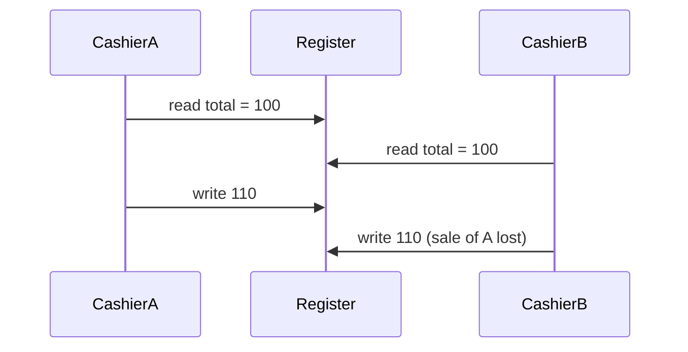

**The tools, in simple words:**

| Tool | What it gives | Use it for |
|---|---|---|
| `synchronized` | Only one thread at a time + visibility | Small blocks that change shared data |
| `volatile` | Visibility only, **not** atomic | A simple flag like `running = false` |
| `AtomicInteger` / `AtomicLong` | Atomic single-variable updates, no lock | Counters, sequence numbers |
| `LongAdder` | Faster counter when many threads add | Metrics with heavy writes |
| `ReentrantLock` | Like `synchronized`, plus `tryLock` with timeout | When you need a timeout or fairness |
| `ConcurrentHashMap` | Thread-safe map, locks only small parts | Shared caches and counts |
| Immutable objects | Nothing can change, so nothing to protect | Easiest fix of all |

**Example:**

```java
class Counter {
    private int unsafe = 0;
    private volatile int stillUnsafe = 0;            // volatile = visible, NOT atomic
    private final AtomicInteger safe = new AtomicInteger();

    void hit() {
        unsafe++;                                    // read-add-write: updates get lost
        stillUnsafe++;                               // still read-add-write: still lost
        safe.incrementAndGet();                      // one atomic step: correct
    }
}

// ConcurrentHashMap: use the atomic methods, not "check then put"
Map<String, Integer> views = new ConcurrentHashMap<>();
views.merge("home", 1, Integer::sum);                // atomic add
views.computeIfAbsent("user-1", k -> loadUser(k));   // atomic "create if missing"
```

**HashMap vs synchronizedMap vs ConcurrentHashMap:**
- `HashMap`: not thread-safe. Many writers can corrupt it or lose data.
- `Collections.synchronizedMap(map)`: one lock for the whole map. Safe but slow. Only one thread at a time.
- `ConcurrentHashMap`: reads mostly need no lock. Writes lock only one small part (one bucket). Many threads work in parallel. It does not allow `null` keys or values.

**Happens-before in simple words:** If action A *happens-before* action B, then B is sure to see what A wrote.
- Unlocking a lock happens-before the next lock of the same lock.
- Writing a `volatile` field happens-before a later read of that field.
- `thread.start()` happens-before the code inside that thread.
- All code in a thread happens-before another thread returns from `join()` on it.
- Without one of these rules, Java does not promise that another thread sees your change.

**Deadlock:** Thread 1 holds lock X and waits for lock Y. Thread 2 holds Y and waits for X. Both wait forever.
It needs all four conditions:
1. *Mutual exclusion* - only one thread can hold a lock.
2. *Hold and wait* - a thread holds one lock while it waits for another.
3. *No preemption* - nobody can take a lock away from a thread.
4. *Circular wait* - threads wait in a circle.

Break any one, and deadlock cannot happen. Two common ways:

```java
// 1. Lock ordering: always lock the smaller account id first (breaks circular wait)
void transfer(Account a, Account b, long amount) {
    Account first  = a.id() < b.id() ? a : b;
    Account second = a.id() < b.id() ? b : a;
    synchronized (first) { synchronized (second) { a.debit(amount); b.credit(amount); } }
}

// 2. tryLock with timeout: give up and retry instead of waiting forever
if (lock.tryLock(500, TimeUnit.MILLISECONDS)) {
    try { doWork(); } finally { lock.unlock(); }     // always unlock in finally
} else {
    log.warn("Could not get lock, will retry");
}
```

To find a deadlock in production, run `jcmd <pid> Thread.print`. It prints "Found one Java-level deadlock" with the threads and locks.

**ExecutorService and CompletableFuture:** Do not create threads by hand. Give tasks to an executor. Use `CompletableFuture` to run calls in parallel and join the results.

```java
try (var executor = Executors.newVirtualThreadPerTaskExecutor()) {   // closes and waits (Java 19+)
    var user   = CompletableFuture.supplyAsync(() -> userClient.get(id), executor);
    var orders = CompletableFuture.supplyAsync(() -> orderClient.list(id), executor);
    return user.thenCombine(orders, Dashboard::new)   // both calls run in parallel
               .orTimeout(2, TimeUnit.SECONDS)        // do not wait forever
               .exceptionally(ex -> Dashboard.empty())
               .join();
}
```

If user takes 300 ms and orders take 400 ms, the total is about 400 ms, not 700 ms.

**Immutability is the easiest fix:** If data never changes, threads can share it freely. No locks needed.

```java
record Price(String currency, BigDecimal amount) {}    // all fields final
List<Price> prices = List.copyOf(input);               // unmodifiable copy
```

**Good and bad:**

| Good | Bad |
|---|---|
| Use `AtomicInteger` or `LongAdder` for counters | Use `volatile int` and do `count++` |
| Use `merge` / `computeIfAbsent` on `ConcurrentHashMap` | `if (!map.containsKey(k)) map.put(k, v)` (two steps, not atomic) |
| Keep `synchronized` blocks small | Make a slow HTTP call inside a lock |
| Always lock in the same order | Lock A then B in one place, B then A in another |
| Prefer immutable objects and records | Share a mutable `ArrayList` between threads |
| Use `unlock()` inside `finally` | Forget to unlock when an exception happens |

**When to use / when not to use:**
- Use `volatile` only for one simple value that one thread writes and others read (like a stop flag).
- Use locks or atomics when you read and then write based on the old value.
- Don't add locks "just in case". First ask: can I avoid sharing this data?
- In a real app with many servers, a Java lock only works inside one JVM. Across servers, use the database (optimistic locking with a version column) or a distributed lock.

**Say this in the interview:**
> "`count++` is three steps: read, add, write. Two threads can overwrite each other, which is a race condition. I fix it with `AtomicInteger`, or `synchronized` for bigger blocks. `volatile` only gives visibility, not atomicity. For maps I use `ConcurrentHashMap` with `merge` or `computeIfAbsent`. And my first choice is immutable data, because then there is nothing to protect."

**They may ask next:**
- **Is `ConcurrentHashMap` enough to make my code thread-safe?** No. Each single call is safe, but "get, then put" is two calls. Use `compute`, `merge` or `putIfAbsent`.
- **`synchronized` vs `ReentrantLock`?** `synchronized` is simpler and unlocks by itself. `ReentrantLock` adds `tryLock` with timeout, fairness and many conditions.
- **What is a livelock?** Threads keep reacting to each other and retrying, but no one makes progress. Add random wait time before retry.
- **Why not use `Collections.synchronizedMap`?** One lock for the whole map, so threads wait in a line. `ConcurrentHashMap` lets many threads work at once.

### Java 8 to 17 to 21 to 25: what changed

**In one line:** Java ships every 6 months, and every 2 years one release is *LTS* (long-term support): know 8, 11, 17, 21 and 25.

**Story:** Think of a phone. You get small updates often. But a "big stable" version comes every 2 years, and companies stay on it for years.
Java works the same way. Most companies run 17, 21 or 25 in production.
Java 26 (March 2026) and Java 27 (September 2026) are short-life versions, with about 6 months of updates each.
The next LTS is expected to be Java 29 in September 2027.

**Version table:**

| Version | Year | LTS? | Main features | Why it matters |
|---|---|---|---|---|
| 8 | 2014 | Yes | Lambdas, streams, `Optional`, `java.time`, `CompletableFuture`, default methods | Start of functional style in Java |
| 9-10 | 2017-18 | No | Modules, `List.of()`, `var` (10) | Less boilerplate |
| 11 | 2018 | Yes | `HttpClient`, new `String` methods, run `java Hello.java` directly | Java EE modules (JAXB, JAX-WS) removed from JDK |
| 14-17 | 2020-21 | 17 is LTS | Switch expressions, text blocks, records, pattern matching for `instanceof`, sealed classes | Much shorter, safer code. Spring Boot 3 needs 17 |
| 21 | 2023 | Yes | Virtual threads, record patterns, pattern matching for `switch`, sequenced collections, generational ZGC | Cheap threads for I/O apps |
| 22-24 | 2024-25 | No | Unnamed variables `_`, FFM API (22), stream gatherers (24), `synchronized` no longer pins virtual threads (24) | Small features become final step by step |
| 25 | Sept 2025 | Yes | Scoped values, module imports, compact source files, flexible constructor bodies, compact object headers | Current LTS. Good target for new projects |
| 26 | March 2026 | No | HTTP/3 in `HttpClient`, Applet API removed, warnings before "final means final" | Short-life release |
| 27 | Sept 2026 | No | G1 is the default GC in all environments, compact object headers on by default | Short-life release |

**Java 8: lambdas, streams, Optional**

```java
List<String> richNames = employees.stream()
    .filter(e -> e.salary() > 100_000)       // lambda
    .map(Employee::name)                      // method reference
    .toList();                                // .toList() added in Java 16

String city = Optional.ofNullable(user.address())
    .map(Address::city)
    .orElse("Unknown");                       // no NullPointerException
```

**Java 10: `var`** (the compiler finds the type for local variables)

```java
var orders = new ArrayList<Order>();          // type is clear from the right side: good
var x = service.process();                    // type is not clear: avoid
```

**Java 11: `HttpClient`** (built-in HTTP client, no extra library)

```java
HttpClient client = HttpClient.newHttpClient();
HttpRequest req = HttpRequest.newBuilder(URI.create("https://api.example.com/orders/1")).build();
String body = client.send(req, HttpResponse.BodyHandlers.ofString()).body();
```

**Java 14-17: switch expressions, text blocks, records, pattern matching, sealed classes**

```java
String label = switch (status) {               // switch expression returns a value (14)
    case NEW, PAID -> "open";
    case SHIPPED  -> "on the way";
    case CANCELLED -> "closed";
};

String json = """
    {"id": 1, "name": "Ankit"}
    """;                                        // text block: multi-line string (15)

record Money(String currency, long cents) {}   // record: immutable data class (16)

if (obj instanceof Order o && o.total() > 0) { // pattern matching: no cast needed (16)
    ship(o);
}

sealed interface Payment permits Card, Upi {}  // sealed: only these types allowed (17)
record Card(String number) implements Payment {}
record Upi(String vpa) implements Payment {}
```

**Java 21: record patterns, pattern matching for switch, sequenced collections, virtual threads**

```java
String describe(Payment p) {
    return switch (p) {
        case Card(String number) -> "Card ending " + number.substring(number.length() - 4);
        case Upi(String vpa)     -> "UPI " + vpa;
    };                                            // no default: compiler knows all types (sealed)
}

List<String> names = List.of("a", "b", "c");
names.getFirst(); names.getLast(); names.reversed();  // sequenced collections

Thread.startVirtualThread(() -> callPaymentApi());    // virtual thread (see topic below)
```

Generational ZGC came in 21 too, but you had to turn it on with `-XX:+ZGenerational`. See the "G1 vs ZGC" topic.

**Java 22-25: features that became final**

```java
// Unnamed variable "_" (final in 22): "I don't need this value"
try { Integer.parseInt(text); } catch (NumberFormatException _) { return 0; }

// Stream gatherers (final in 24): custom middle steps in a stream
Stream.of(1, 2, 3, 4, 5).gather(Gatherers.windowFixed(2)).toList(); // [[1,2],[3,4],[5]]

// Scoped values (final in 25): safe, read-only value for one call chain
static final ScopedValue<String> USER = ScopedValue.newInstance();
ScopedValue.where(USER, "ankit").run(() -> handleRequest());       // inside: USER.get()

// Module import declarations (final in 25): import a whole module's packages
import module java.base;

// Flexible constructor bodies (final in 25): code before super(...)
class Employee extends Person {
    Employee(String name, int age) {
        if (age < 18) throw new IllegalArgumentException("too young"); // check first
        super(name);
    }
}
```

Compact source files and instance main methods (final in 25). Good for scripts and for students:

```java
// Hello.java  - no class, no "public static", no String[] args
void main() {
    IO.println("Hello");          // IO is in java.lang since 25
}
```

**FFM API (Foreign Function and Memory, final in 22):** Call C libraries without JNI. JNI is the old, hard way.

```java
Linker linker = Linker.nativeLinker();
MethodHandle strlen = linker.downcallHandle(
    linker.defaultLookup().find("strlen").orElseThrow(),
    FunctionDescriptor.of(ValueLayout.JAVA_LONG, ValueLayout.ADDRESS));
try (Arena arena = Arena.ofConfined()) {            // memory is freed when arena closes
    long len = (long) strlen.invokeExact(arena.allocateFrom("Hello"));   // 5
}
```

**Compact object headers (final in 25):** Every Java object has a small *header* (hidden info like class pointer and lock bits).
This feature makes it 8 bytes instead of 12 (or 16) on 64-bit JVMs.
Apps with many small objects use less heap.
In Java 25 you turn it on with `-XX:+UseCompactObjectHeaders`. In Java 27 it is on by default.

**Still preview or incubator (not final) in Java 25:**
- *Structured concurrency* (fifth preview in 25, still preview in 26 and 27). Treat a group of tasks as one unit.
- *Primitive types in patterns* (preview).
- *Stable values* (preview in 25, renamed *lazy constants* in 26, still preview).
- *Vector API* (incubator since Java 16).
- Preview features need `--enable-preview`. Do not use them in production code.

**javax to jakarta:** Oracle gave Java EE to the Eclipse Foundation. It was renamed *Jakarta EE*. Oracle kept the name "javax", so Jakarta EE 9 renamed the packages.
- `javax.persistence.Entity` became `jakarta.persistence.Entity`.
- Same for `javax.servlet`, `javax.validation`, `javax.annotation` and others.
- Packages that are part of the JDK stay as they are: `javax.sql`, `javax.crypto`, `javax.net`.
- Spring Boot 3 and newer use `jakarta.*` only.

**How would you migrate Java 8 to 21 or 25 (checklist):**
1. Run `jdeps --jdk-internals` to find code that uses JDK internal classes.
2. Upgrade build tools: Maven/Gradle, compiler plugin with `<release>21</release>`.
3. Upgrade libraries that touch bytecode: Lombok, Mockito, ByteBuddy, Hibernate, Jackson.
4. Add removed Java EE modules as normal dependencies (JAXB, JAX-WS). They left the JDK in 11.
5. Fix strong encapsulation errors (strict since 17). Use proper APIs. Use `--add-opens` only as a short-term fix.
6. Remove old JVM flags: PermGen flags (gone in 8), CMS GC flags (CMS removed in 14).
7. Remove use of the Security Manager. It is permanently disabled since 24.
8. Move `javax.*` to `jakarta.*` when you move to Spring Boot 3. OpenRewrite (a tool that changes code by recipes) does most of it.
9. Run all tests, then a load test. Compare GC logs, memory and latency with the old version.
10. Roll out to one service first, then the rest.

**Good and bad:**

| Good | Bad |
|---|---|
| Upgrade LTS to LTS (8 → 17 → 21 → 25) | Stay on Java 8 with no security updates plan |
| Use records for DTOs | Write getters, `equals`, `hashCode` by hand for every DTO |
| Use sealed types + `switch` for fixed choices | Long `if/else instanceof` chains |
| Try preview features in side projects | Ship preview features to production |

**Say this in the interview:**
> "I think of Java in LTS steps. 8 gave lambdas and streams. 17 gave records, sealed classes and switch expressions. 21 gave virtual threads and pattern matching for switch. 25 is the current LTS. It made scoped values, module imports and simple `void main()` files final. Java 26 and 27 are short-life releases. Structured concurrency is still a preview, so I don't use it in production yet."

**They may ask next:**
- **Why upgrade from 17 to 21 or 25?** Virtual threads, better GCs and smaller object headers. Also faster startup (AOT cache) and longer support.
- **Record vs Lombok `@Data`?** A record is immutable and built into Java. Lombok `@Data` is mutable and needs a library.
- **Can a JPA entity be a record?** No. JPA needs a no-arg constructor and mutable fields. Use records for DTOs.
- **What is a preview feature?** A finished design that can still change. You must turn it on with `--enable-preview`.

### JVM memory basics

**In one line:** JVM memory has a *heap* (objects), *stacks* (one per thread, for method calls) and *metaspace* (class info).

**Story:** Think of an office.
The **heap** is the big shared store room. Everyone puts boxes (objects) there.
Each worker has their own small **desk** (the stack). It holds only the papers for the task they are doing right now.
The **metaspace** is the office manual shelf. It has the rules about each kind of box (class info).
A cleaning staff (the garbage collector) removes boxes nobody uses anymore.

**How it works:**
1. **Heap:** All objects live here. It is shared by all threads. Size is set with `-Xmx`.
   - *Young generation:* new objects are born here. Most die young (like temporary strings). Cleaning here is fast.
   - *Old generation:* objects that survive many cleanings move here (like caches).
2. **Stack:** Each thread has one. It holds method calls, local variables and references. It is freed when the method returns.
3. **Metaspace:** Class metadata (class names, methods, fields). It uses native memory, outside the heap. It replaced *PermGen* in Java 8. PermGen had a small fixed size and often ran out.
4. **Other native memory:** thread stacks, direct byte buffers (used by Netty), and the code cache (where the JIT compiler keeps compiled machine code).

**Diagram:**

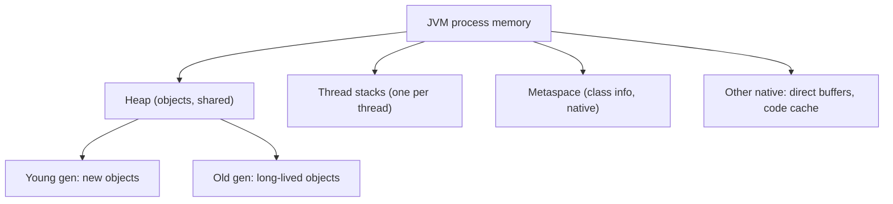

**Example:**

```java
void placeOrder() {
    int qty = 2;                       // primitive local: on the stack
    Order order = new Order(qty);      // reference on the stack, Order object on the heap
    cache.put(order.id(), order);      // static cache keeps it alive: moves to old gen
}
```

**Common errors and what they mean:**

| Error | Meaning | Usual cause |
|---|---|---|
| `OutOfMemoryError: Java heap space` | Heap is full | Memory leak (growing cache, unbounded list) or heap too small |
| `OutOfMemoryError: GC overhead limit exceeded` | GC runs all the time but frees almost nothing | Heap nearly full, often a leak |
| `OutOfMemoryError: Metaspace` | Too many classes loaded | Class loader leak, many redeploys, heavy code generation |
| `OutOfMemoryError: unable to create native thread` | OS will not give more threads | Too many platform threads |
| `OutOfMemoryError: Direct buffer memory` | Off-heap buffers full | Netty or NIO buffers not released |
| `StackOverflowError` | One thread's stack is full | Deep or endless recursion |

**How to diagnose (simple steps):**
1. Always run with `-XX:+HeapDumpOnOutOfMemoryError -XX:HeapDumpPath=/dumps`. You get a heap dump when it crashes.
2. Take a heap dump on a live app: `jcmd <pid> GC.heap_dump /tmp/heap.hprof`.
3. Open the dump in Eclipse MAT or VisualVM. Look at "biggest objects" and "who keeps them alive".
4. Record with JFR (Java Flight Recorder, a low-cost built-in recorder): `jcmd <pid> JFR.start duration=60s filename=app.jfr`. Open it in JDK Mission Control.
5. Check native memory: start with `-XX:NativeMemoryTracking=summary`, then run `jcmd <pid> VM.native_memory summary`.
6. In containers, use `-XX:MaxRAMPercentage=75` instead of a fixed `-Xmx`. Leave room for non-heap memory.

**Good and bad:**

| Good | Bad |
|---|---|
| Use a bounded cache (max size + expiry) | `static Map` that only grows |
| Set heap as a % of container memory | Set `-Xmx` equal to the full container limit (the container gets killed) |
| Turn on heap dump on OOM in production | Restart the server and hope |
| Close streams and connections with try-with-resources | Keep references to big objects in `ThreadLocal` |

**Say this in the interview:**
> "Objects live on the heap, which has a young and an old generation. Each thread has its own stack for method calls and local variables. Class info lives in metaspace, which replaced PermGen in Java 8. When I get an OutOfMemoryError, I first read which type it is. Then I take a heap dump with `jcmd` and find who holds the memory. Usually it is a cache or a list that keeps growing."

**They may ask next:**
- **Can a Java program have a memory leak if there is a GC?** Yes. If you still hold a reference (for example in a static map), GC cannot remove the object.
- **Where do strings live?** On the heap. The string pool is also on the heap (since Java 7).
- **Why did the container get OOMKilled when the heap looked fine?** Native memory (thread stacks, metaspace, direct buffers) also counts. Keep the heap at about 70-75% of the container limit.

### G1 vs ZGC

**In one line:** G1 is the balanced default garbage collector; ZGC keeps pauses tiny (under 1 millisecond) even with very big heaps.

**Story:** A restaurant needs cleaning staff.
With **G1**, staff clean a few tables at a time. Sometimes they ask guests to wait a few milliseconds while they clean. Short, planned breaks.
With **ZGC**, staff clean while guests keep eating. Guests almost never wait. But the staff need a bit more space and energy (CPU and memory).
A *garbage collector (GC)* finds objects nobody uses and frees that memory. A *pause* (stop-the-world) is when your app threads stop so the GC can work.

**How it works:**
1. **G1 (Garbage First):** default GC since Java 9.
   - It splits the heap into many equal *regions* (small blocks).
   - It cleans the regions with the most garbage first. That is the name.
   - You give a pause goal: `-XX:MaxGCPauseMillis=200` (200 ms is the default goal).
   - Typical pauses: tens of milliseconds to a few hundred.
2. **ZGC:** turn on with `-XX:+UseZGC`.
   - Does almost all work while the app runs (*concurrent*).
   - Pauses are under 1 ms, and they do not grow with heap size (works up to 16 TB heaps).
   - *Generational ZGC* came in Java 21 (opt-in). It became the default ZGC mode in Java 23. It is the only mode since Java 24.
   - Costs some extra CPU and needs more free heap space.
3. **Shenandoah:** another low-pause GC, from Red Hat. Generational Shenandoah became a product feature in Java 25.
4. **Parallel GC:** best total throughput, longer pauses. Good for batch jobs.
5. Note: before Java 27, the JVM picked Serial GC on very small machines (under 2 CPUs or under about 1.8 GB). Since Java 27, G1 is the default everywhere.

**Diagram:**

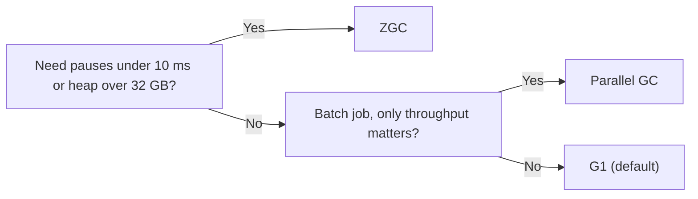

**Example:**

```bash
# G1 (default, nothing to add) with a pause goal
java -XX:MaxGCPauseMillis=100 -Xlog:gc*:file=gc.log -jar app.jar

# ZGC (generational by default since Java 23)
java -XX:+UseZGC -Xmx16g -Xlog:gc*:file=gc.log -jar app.jar
```

**When to choose which:**

| Situation | Choose |
|---|---|
| Normal REST service, heap 1-16 GB | G1 |
| Trading, gaming, ad bidding: strict latency (p99, the slowest 1% of requests, under 10 ms) | ZGC |
| Very large heap (tens or hundreds of GB) | ZGC |
| Nightly batch job, only total time matters | Parallel GC |
| Small container with little CPU | G1 (ZGC needs spare CPU) |

**How to diagnose high GC:**
1. Turn on GC logs: `-Xlog:gc*:file=gc.log`. Check pause times and how often GC runs.
2. Quick live view: `jstat -gcutil <pid> 1000` prints heap use every second.
3. Record JFR and look at "allocation rate" (MB per second) and which code allocates most.
4. If heap after each full GC keeps going up, it is a leak, not a GC problem. Take a heap dump.
5. Fix code first: fewer temporary objects, no huge lists in memory, use paging and streaming.
6. Only then tune: give more heap, or switch GC.

**Good and bad:**

| Good | Bad |
|---|---|
| Measure with GC logs before tuning | Copy 20 GC flags from a blog |
| Start with G1 defaults | Set `-Xmn` and many sizes by hand with G1 (it breaks its pause goal logic) |
| Try ZGC when p99 latency is the problem | Pick ZGC to "fix" a memory leak |
| Load test after changing GC | Change GC directly in production |

**Say this in the interview:**
> "G1 is the default since Java 9. It splits the heap into regions and tries to meet a pause goal, so it fits most services. ZGC does almost everything while the app runs. Pauses stay under a millisecond even with huge heaps, but it uses more CPU. Since Java 24, ZGC is always generational. I pick based on numbers: I read GC logs and p99 latency first. I fix allocation problems in code before I tune flags."

**They may ask next:**
- **What is stop-the-world?** All app threads pause while the GC does some work. Users see it as slow responses.
- **Minor GC vs full GC?** Minor GC cleans only the young generation and is fast. Full GC cleans everything and is slow.
- **Does `System.gc()` help?** No. It is only a hint. Don't call it in app code.

### Virtual threads

> Want the full story from old threads to virtual threads, with architecture diagrams? Read [Java concurrency: from threads to virtual threads](java-concurrency.md).

**In one line:** Virtual threads are very cheap JVM threads, so you can keep one thread per request even with 100,000 waiting requests.

**Story:** A restaurant has 10 waiters.
Old way (*platform threads*): each waiter takes one table and **stands there** while the kitchen cooks. 10 waiters = only 10 tables at a time.
New way (*virtual threads*): each table gets an order slip. A waiter takes the slip to the kitchen. While the food cooks, the waiter puts the slip down and serves another table. When the food is ready, any free waiter picks up the slip.
Same 10 waiters, now hundreds of tables.
The waiters are the *carrier threads* (real OS threads). The slips are the virtual threads.

**How it works:**
1. A *platform thread* is a wrapper around one OS thread. It uses about 1 MB of stack memory and is slow to create. A server can handle a few thousand.
2. A *virtual thread* lives in the JVM. It uses a few KB. You can create millions.
3. When a virtual thread waits on I/O (database, HTTP call, sleep), the JVM *unmounts* it. The carrier thread is free for other work.
4. When the I/O is done, the virtual thread is *mounted* again on any free carrier.
5. Final (not preview) since Java 21.

**Diagram:**

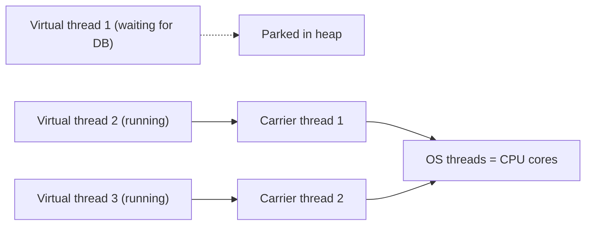

**Example:**

```java
// Plain Java: one new virtual thread per task. Never pool virtual threads.
try (var executor = Executors.newVirtualThreadPerTaskExecutor()) {
    for (int i = 0; i < 10_000; i++) {
        executor.submit(() -> paymentClient.charge(orderId));   // blocking call is fine
    }
}   // close() waits for all tasks

// Limit calls to a slow system with a Semaphore, not with a small pool
private final Semaphore dbPermits = new Semaphore(50);
void query() throws InterruptedException {
    dbPermits.acquire();
    try { repository.findAll(); } finally { dbPermits.release(); }
}
```

Spring Boot 3.2 and newer (needs Java 21+):

```properties
spring.threads.virtual.enabled=true
```

Now Tomcat runs each request on a virtual thread. Async tasks and scheduled tasks also use them.

**Numbers:** A service gets 2,000 requests per second. Each request waits 200 ms on a database.
That is 2,000 x 0.2 = 400 requests waiting at the same time.
With platform threads, you need 400+ threads (about 400 MB of stacks). With virtual threads, it is cheap.
But your database pool still has maybe 50 connections. The database becomes the limit, not the threads.

**Pinning:** Sometimes a virtual thread cannot leave its carrier. This is called *pinning*. The carrier is blocked too.
- In Java 21, blocking inside a `synchronized` block pinned the thread. The fix was to use `ReentrantLock` instead.
- Java 24 fixed this (JEP 491). `synchronized` no longer pins.
- Pinning still happens when native code calls back into Java and blocks, and inside class initializers.
- Find it with the JFR event `jdk.VirtualThreadPinned`.

**ThreadLocal caution:** Each virtual thread has its own `ThreadLocal` values. With a million threads, a big object in a `ThreadLocal` means a million copies.
Use *ScopedValue* (final in Java 25) to pass request data like user id. It is read-only and ends when the call ends.

**Good and bad:**

| Good | Bad |
|---|---|
| Use for I/O-bound work: REST calls, DB queries, file reads | Use for CPU-bound work: image resize, encryption loops (no speed gain) |
| Create a new virtual thread per task | Put virtual threads in a fixed pool |
| Limit access to a database with a `Semaphore` or connection pool | Assume the database can take 10,000 parallel queries |
| Use `ScopedValue` for request context | Store big objects in `ThreadLocal` |
| On Java 21, use `ReentrantLock` around blocking calls | On Java 21, block on I/O inside `synchronized` |

**When to use / when not to use:**
- Use when your app spends most time waiting: microservices that call other services and databases.
- Don't use for heavy CPU work. Use a normal pool sized to the number of CPU cores.
- If you already use WebFlux and it works well, there is no need to rewrite it.

**Say this in the interview:**
> "Virtual threads are cheap threads managed by the JVM, final since Java 21. When one waits for I/O, it leaves the real OS thread so others can use it. So I can keep simple blocking code, one thread per request, and still handle many thousands of requests. They help I/O-bound apps, not CPU-bound ones. I never pool them. I limit database access with a semaphore or the connection pool. In Spring Boot I just set `spring.threads.virtual.enabled=true`."

**They may ask next:**
- **Do virtual threads make code faster?** No. Each request takes the same time. They let you handle more requests at once (higher throughput).
- **Virtual threads vs WebFlux?** Both handle many waiting requests. Virtual threads keep normal blocking code that is easy to read and debug. WebFlux needs reactive code everywhere.
- **What is a carrier thread?** A real platform thread from a small ForkJoinPool. It runs virtual threads. By default there is one per CPU core.
- **How many virtual threads can I create?** Millions. Memory and downstream systems are the real limits.

## Core Java questions (2019 answers, being updated)

> These answers were written in 2019 for Java 8. They are being rewritten in simple English for Java 21/25, following the [2-month plan](../README.md#2-month-plan). If an answer here disagrees with the modern section above, trust the modern section.

created 2019 - outdated and based on java 8 need to update or add answers based on latest java versions
[https\://github.com/in28minutes/interview-guide](https://github.com/in28minutes/interview-guide)  
[https\://javarevisited.blogspot.com/2015/10/133-java-interview-questions-answers-from-last-5-years.html](https://javarevisited.blogspot.com/2015/10/133-java-interview-questions-answers-from-last-5-years.html)

### **Java Platform**

* **1 . Why is Java so popular?**  
  * [https\://www\.pearsonfrank.com/blog/why-is-java-so-popular-developers/](https://www.pearsonfrank.com/blog/why-is-java-so-popular-developers/)  
  * [https\://hackr.io/blog/features-of-java](https://hackr.io/blog/features-of-java)  
  * Great Performance  
  * Inspired by C and C++  
  * Multi-threaded  
  * Platform Independence  
  * Truly Object-Oriented  
  * Robust  
  * Secure  
  * Simple  
  * Latest profiling  
  * Memory management  
  * Native code translating  
  * Used for Scientific, web, mobile, desktop, embedded systems  
  * Mature Community and huge support,  
  * Mature IDEs  
  * Open source and many open source lib

2\. monolithic architecture vs SOA vs Microservice  

Microservice is a small group of services. Monolithic architecture is one big rock.

Reusability is difficult in monolithic. Its tightly coupled, which gave rise to SOA, which is loosely coupled independent services but it was using same DB. Which gave rise to microservices. Microservices is independent, autonomous architecture with local DB for each service.

* **2 . What is platform independence and how it works in case of Java?**  
  * Write Once Run Anywhere promise.  
  * Platform independence in software means that you can run the same code with little or no modification on multiple platforms.  
  * **Java *code* is platform independent** in the sense that the same Java application or algorithms (typically compiled to Java bytecode and packaged in a .jar file) will run identically on Windows and Linux.  
  * **Java libraries** (e.g. all the nice open source toolsets) are usually platform independent, as long as they are written in pure Java.  
  * The **Java platform / runtime environment** is platform independent in the sense that the same libraries (images, networking, File IO etc.) are available and work in the same way on all platforms. This is done deliberately in order to allow applications that use these libraries to be able to run on any platform. For example, the Java libraries that access the filesystem know the fact that Windows and Linux use different filename path separators, and take account of this for you. **Of course, this means that under the hood the runtime environment does make use of platform-specific features, so you need a different JRE for each platform.**  
  * The JVM itself (i.e. the Java Virtual Machine that is responsible for JIT compililng and running Java bytecode) is platform independent in the sense that it is available on many platforms (everything from mainframes to mobile phones). However specific versions of the JVM are needed for each underlying platform to take account of different native instruction codes and machine capabilities (so you can't run a Linux JVM on Windows and vice Versa). The JVM is packaged as part of the Java platform / runtime environment as above.  
  * [https\://softwareengineering.stackexchange.com/a/85184](https://softwareengineering.stackexchange.com/a/85184)  
* **3 . What is bytecode?**  
  * Bytecode is computer [object code](https://whatis.techtarget.com/definition/object-code) that is processed by a program, usually referred to as a [virtual machine](https://searchservervirtualization.techtarget.com/definition/virtual-machine), rather than by the "real" computer machine, the hardware [processor](https://whatis.techtarget.com/definition/processor). The virtual machine converts each generalized machine [instruction](https://whatis.techtarget.com/definition/instruction) into a specific machine instruction or instructions that this computer's processor will understand. Bytecode is the result of compiling source code written in a language that supports this approach.   
  * [https\://whatis.techtarget.com/definition/bytecode](https://whatis.techtarget.com/definition/bytecode)  
* **4 . Compare JDK vs JVM vs JRE**  
  * The **Java Virtual Machine** (JVM) is the virtual machine that runs the Java bytecodes. The JVM doesn't understand Java source code; that's why you need compile your \*.java files to obtain \*.class files that contain the bytecodes understood by the JVM. It's also the entity that allows Java to be a "portable language" (*write once, run anywhere*). Indeed, there are specific implementations of the JVM for different systems (Windows, Linux, macOS), the aim is that with the same bytecodes they all give the same results.  
  * **The Java Runtime Environment (JRE)** provides the libraries, the Java Virtual Machine, and other components to run applets and applications written in the Java programming language. In addition, two key deployment technologies are part of the JRE: Java Plug-in, which enables applets to run in popular browsers; and Java Web Start, which deploys standalone applications over a network. It is also the foundation for the technologies in the Java 2 Platform, Enterprise Edition (J2EE) for enterprise software development and deployment. The **JRE does not contain tools and utilities** such as compilers or debuggers for developing applets and applications.  
  * **The JDK is a superset of the JRE,** and contains everything that is in the JRE, plus tools such as the compilers and debuggers necessary for developing applets and applications.  
  * [**OpenJDK**](https://en.wikipedia.org/wiki/OpenJDK) is an open-source implementation of the JDK and the base for the Oracle JDK. There is almost no difference between the Oracle JDK and the OpenJDK.  
  * [https\://stackoverflow.com/a/11580321/4428927](https://stackoverflow.com/a/11580321/4428927)  
  * [https\://dzone.com/articles/difference-between-jdk-vs-jre-vs-jvm](https://dzone.com/articles/difference-between-jdk-vs-jre-vs-jvm)  
* **5 . What are the important differences between C++ and Java?**  
  * [https\://www\.guru99.com/cpp-vs-java.html](https://www.guru99.com/cpp-vs-java.html)  
  * [https\://dzone.com/articles/difference-between-c-and-java](https://dzone.com/articles/difference-between-c-and-java)  
    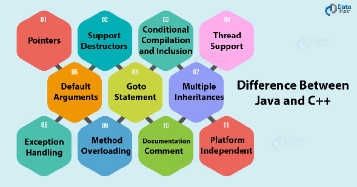  
* 6 . What is classloader in Java and its role?  
  * Applications written in statically compiled programming languages, such as C and C++, are compiled into native, machine-specific instructions and saved as an executable file. The process of combining the code into an executable native code is called linking \- the merging of separately compiled code with shared library code to create an executable application. This is different in dynamically compiled programming languages such as Java. In Java, the .class files generated by the Java compiler remain as-is until loaded into the Java Virtual Machine (JVM) \-- in other words, the linking process is performed by the JVM at runtime. Classes are loaded into the JVM on an 'as needed' basis. And when a loaded class depends on another class, then that class is loaded as well.  
  * When a Java application is launched, the first class to run (or the entry point into the application) is the one with public static void method called main(). This class usually has references to other classes, and all attempts to load the referenced classes are carried out by the class loader.  
  * To get a feeling of this recursive class loading try java \-verbose:class YourClassName  
  * 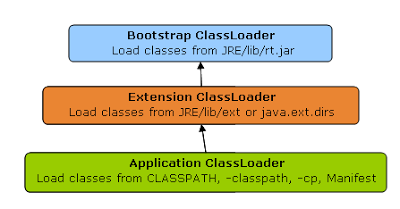  
  * There are three different class loaders here;   
    * **Bootstrap Class Loader:** Java classes are loaded by an instance of *java.lang.ClassLoader*. However, class loaders are classes themselves. Hence, the question is, who loads the *java.lang.ClassLoader* itself*?* This is where the bootstrap or primordial class loader comes into the picture. It’s mainly responsible for loading JDK internal classes, typically *rt.jar* and other core libraries located in *\$JAVA\_HOME/jre/lib directory*. Additionally, **Bootstrap class loader serves as a parent of all the other *ClassLoader* instances**.**This bootstrap class loader is part of the core JVM and is written in native code**. Different platforms might have different implementations of this particular class loader.  
    * **The extension class loader** is a child of the bootstrap class loader and takes care of loading the extensions of the standard core Java classes so that it’s available to all applications running on the platform. Extension class loader loads from the JDK extensions directory, usually *\$JAVA\_HOME/lib/ext*directory or any other directory mentioned in the *java.ext.dirs* system property.  
    * **The system or application class loader,** takes care of loading all the application level classes into the JVM. It loads files found in the classpath environment variable, *\-classpath* or *\-cp* command line option.  
  * The java.lang.ClassLoader is an abstract class that can be subclassed by applications that need to extend the manner in which the JVM dynamically loads classes.   
  * The ***java.lang.ClassLoader.loadClass()*** **method is responsible for loading the class definition into runtime**. It tries to load the class based on a fully qualified name.  
  * Class loaders follow the **delegation model** where **on request to find a class or resource, a *ClassLoader* instance will delegate the search of the class or resource to the parent class loader**.  
  * Custom class loaders are helpful for more than just loading the class during runtime, a few use cases might include:  
    * Helping in modifying the existing bytecode, e.g. weaving agents  
    * Creating classes dynamically suited to the user’s needs. e.g in JDBC, switching between different driver implementations is done through dynamic class loading.  
    * Implementing a class versioning mechanism while loading different bytecodes for classes with same names and packages. This can be done either through URL class loader (load jars via URLs) or custom class loaders.  
  * [https\://www\.baeldung.com/java-classloaders](https://www.baeldung.com/java-classloaders)  
  * https\://stackoverflow.com/a/2424659/4428927  
* 7 . Step By Step execution of Java code?  
  * Whenever, a program is written in JAVA, the javac compiles it.  
  * The result of the JAVA compiler is the **.class file or the bytecode** and not the machine native code (unlike C compiler).  
  * The bytecode generated is a non-executable code and needs an interpreter to execute on a machine. This interpreter is the JVM and thus the Bytecode is executed by the JVM.  
  * And finally program runs to give the desired output. 

### **Wrapper Classes**

* **7 . What are Wrapper classes?**  
  * As the name suggests, **wrapper classes are objects encapsulating primitive Java types.**  
  * Each Java primitive has a corresponding wrapper:  
    * *boolean, byte, short, char, int, long, float, double*   
    * *Boolean, Byte, Short, Character, Integer, Long, Float,* *Double*  
  * These are all defined in the *java.lang* package, hence we don’t need to import them manually.  
* **8 . Why do we need Wrapper classes in Java?**  
  * Basically, generic classes only work with objects and don’t support primitives. As a result, if we want to work with them, we have to convert primitive values into wrapper objects.  
  * The Java Collection Framework works with objects exclusively  
* **9 . What are the different ways of creating Wrapper class instances?**  
  * We can either use constructor or static factory methods to convert a primitive value to an object of a wrapper class.  
* **10 . What are differences in the two ways of creating Wrapper classes?**  
  * Integer object \= new Integer(1);   
  * Integer anotherObject \= Integer.valueOf(1);  
  * The valueOf() method returns an instance representing the specified int value.  
  * **It returns cached values which makes it efficient**. It always caches values between \-128 to 127 but can also cache other values outside this range.  
  * Similarly, we can also convert boolean to Boolean, byte to Byte, char to Character, long to Long, float to Float, and double to Double. Though if we have to **convert String to Integer then we need to use parseInt()** method because String isn’t a wrapper class.  
  * On the other hand, t**o convert from a wrapper object to a primitive value, we can use the corresponding method such as intValue(), doubleValue()** etc: int val \= object.intValue();  
* **11 . What is auto boxing?**  
  * After Java 5, **this conversion can be done automatically by using features called autoboxing and unboxing.**  
  * **“Boxing” refers to converting a primitive value into a corresponding wrapper object.** Because this can happen automatically, it’s known as autoboxing.  
  * List\<Integer\> list \= new ArrayList\<\>();  
  * list.add(1); // autoboxing  
  * Integer val \= 2; // autoboxing  
  * Internally, it uses the *valueOf()* method to facilitate the conversion.  
  * Though this makes conversion easy and codes more readable, there are some cases where **we shouldn’t use autoboxing e.g. inside a loop**. [https\://android.jlelse.eu/autoboxing-a-little-thing-can-cause-big-problems-for-android-app-performance-1fb6cb1e48dd](https://android.jlelse.eu/autoboxing-a-little-thing-can-cause-big-problems-for-android-app-performance-1fb6cb1e48dd)  
* **12 . What is unboxing?**  
  * **when a wrapper object is unwrapped into a primitive value then this is known as unboxing.**  
  * **unboxing is done automatically when passing an object to a method that expects a primitive or when assigning it to a primitive variable.**  
  * [**https\://www\.baeldung.com/java-wrapper-classes**](https://www.baeldung.com/java-wrapper-classes)  
* **13 . What is Primitive vs Reference?**  
  * **a primitive variable contains its value,** and conversion of a primitive variable means irreversible changes in its value:  
  * **Reference variables are different**; the reference variable only refers to an object but doesn’t contain the object itself.  
* **14 . What is casting?**  
  * **Casting a reference variable** doesn’t touch the object it refers to, but only labels this object in another way, expanding or narrowing opportunities to work with it. **Upcasting narrows the list of methods and properties available to this object, and downcasting can extend it.**  
  * A reference is like a remote control to an object. The remote control has more or fewer buttons depending on its type, and the object itself is stored in a heap. When we do casting, we change the type of the remote control but don’t change the object itself.  
* **15 . What is explicit casting/ DownCasting?**  
  * An explicit conversion is where you use some syntax to *tell* the program to do a conversion.  
  * int i \= 999999999;   
    byte b \= (byte) i; // The type cast causes an explicit conversion   
    b \= i; // Compilation error\!\! No implicit conversion here.  
  * It’s the casting from a superclass to a subclass.  
  * We often use ***instanceof*** operator before downcasting  
  * If we hadn’t checked the type with the ***instanceof*** operator, the compiler wouldn’t have complained. But at runtime, there would be a **ClassCastException**.  
  * There’s another way to cast objects using the methods of *Class*:  
    public void whenDowncastToCatWithCastMethod\_thenMeowIsCalled() {  
        Animal animal \= new Cat();  
        if (Cat.class.isInstance(animal)) {  
            Cat cat \= Cat.class.cast(animal);  
            cat.meow();  
        }  
    }  
  * *cast(*) and *isInstance()* methods are used instead of cast and *instanceof* operators correspondingly.  
  * It’s common to use *cast()* and *isInstance()* methods with generic types.  
    IsInstance() runtime and instanceOf compile time  
  * [https\://stackoverflow.com/a/8692271/4428927](https://stackoverflow.com/a/8692271/4428927)   
* **16 . What is implicit casting/Upcasting?**  
  * An implicit conversion is where the conversion happens without any syntax. For example (in Java):  
  * int i \= 999999999;   
    float f \= i; // An implicit conversion is performed here  
  * **Casting from a subclass to a superclass is called upcasting**. Typically, the upcasting is implicitly performed by the compiler.  
  * Upcasting is closely related to inheritance – another core concept in Java. It’s common to use reference variables to refer to a more specific type. And every time we do this, implicit upcasting takes place.  
  * [https\://stackoverflow.com/a/7544265/4428927](https://stackoverflow.com/a/7544265/4428927)  
    [https\://www\.baeldung.com/java-type-casting](https://www.baeldung.com/java-type-casting)

### **Strings**

* 16 . Are all String’s immutable (non changeable) ?  
  * let's just take a look into the String class and its functionality a little before coming to any conclusion.  
  * This is how String works: String str \= "knowledge";  
  * This, as usual, creates a string containing "knowledge" and assigns it a reference str. Simple enough? Lets perform some more functions:  
  * String s \= str; // assigns a new reference to the same string "knowledge"  
  * Lets see how the below statement works: str \= str.concat(" base");  
  * This appends a string " base" to str. But wait, how is this possible, since String objects are immutable? Well to your surprise, it is. When the above statement is executed, the VM takes the value of String str, i.e. "knowledge"and appends " base", giving us the value "knowledge base". Now, since Strings are immutable, the VM can't assign this value to str, so it creates a new String object, gives it a value "knowledge base", and gives it a reference str.  
  * An important point to note here is that, while the String object is immutable, **its reference variable is not.** So that's why, in the above example, the reference was made to refer to a newly formed String object.  
  * At this point in the example above, we have two String objects: the first one we created with value "knowledge", pointed to by s, and the second one "knowledge base", pointed to by str. But, technically, we have three String objects, the third one being the literal "base" in the concat statement.  
  * https\://stackoverflow.com/a/17942294/4428927  
* 17 . Where are String values stored in memory and why?  
  * Almost every method, applied to a String object in order to modify it, creates new String object. So, where do these String objects go? Well, *these exist in memory, and one of the key goals of any programming language is to make efficient use of memory.*  
  * As applications grow, *it's very common for String literals to occupy large area of memory, which can even cause redundancy.* So, in order to make Java more efficient, **the JVM sets aside a special area of memory called the "String constant pool".**  
  * When the compiler sees a String literal, it looks for the String in the pool. If a match is found, the reference to the new literal is directed to the existing String and no new String object is created. The existing String simply has one more reference. Here comes the point of making String objects immutable:  
  * In the String constant pool, a String object is likely to have one or many references. *If several references point to same String without even knowing it, it would be bad if one of the references modified that String value. That's why String objects are immutable.*  
  * Well, now you could say, *what if someone overrides the functionality of String class?* That's the reason that **the String class is marked final** so that nobody can override the behavior of its methods.  
* 18 . Why should you be careful about String concatenation(+) operator in loops?  
  * When you use \+ with two strings, it compiles code like this:  
  * String third \= first \+ second;  
  * To something like this:  
  * StringBuilder builder \= new StringBuilder( first );  
  * builder.append( second );  
  * third \= builder.toString();  
  * Therefore for just little examples, it usually doesn't make a difference. But when you're building a complex string, you've often got a lot more to deal with than this; for example, you might be using many different appending statements, or a loop like this:  
  * for( String str : strings ) {  
  *   out \+= str;  
  * }  
  * In this case, a new StringBuilder instance, and a new String (the new value of out \- Strings are immutable) is required in each iteration. This is very wasteful. Replacing this with a single StringBuilder means you can just produce a single String and not fill up the heap with Strings you don't care about.  
* 19 . How do you solve above problem?  
  * Using StringBuilder or StringBuffer concat method.  
* 20 . What are differences between String and StringBuffer?  
  * String is **immutable**, if you try to alter their values, another object gets created, whereas StringBuffer and StringBuilder are **mutable** so they can change their values.  
  * If your string is not going to change use a String class because a String object is immutable.  
  * If your string can change (example: lots of logic and operations in the construction of the string) and will only be accessed from a single thread, using a StringBuilder is good enough.  
* 21 . What are differences between StringBuilder and StringBuffer?  
  * The difference between StringBuffer and StringBuilder is that StringBuffer is thread-safe. So when the application needs to be run only in a single thread then it is better to use StringBuilder. StringBuilder is more efficient than StringBuffer.  
  * You use [StringBuilder](http://java.sun.com/javase/6/docs/api/java/lang/StringBuilder.html) when you need to create a mutable character sequence, usually to concatenate several character sequences together.  
  * You use [StringBuffer](http://java.sun.com/javase/6/docs/api/java/lang/StringBuffer.html) in the same circumstances you would use StringBuilder, but when changes to the underlying string must be synchronized (because several threads are reading/modifyind the string buffer).  
* 22 . Can you give examples of different utility methods in String class?  
  * toString()  
  * subString  
  * Trim  
  * lastIndexOf  
  * toUpperCase toLowerCase  
  * Split…..  
* Interesting Reads  
  * [**Is a Java string really immutable? :** https\://stackoverflow.com/questions/20945049/is-a-java-string-really-immutable](https://stackoverflow.com/questions/20945049/is-a-java-string-really-immutable)  
  * **Immutable objects** are simply objects whose state (the object's data) cannot change after construction. [http\://www\.javapractices.com/topic/TopicAction.do?Id=29](http://www.javapractices.com/topic/TopicAction.do?Id=29)

### **Object oriented programming basics**

* 23 . What is a class?  
  * A class is an entity that determines how an object will behave and what the object will contain. In other words, it is a blueprint or a set of instruction to build a specific type of object or prototype.  
* 24 . What is an object?  
  * An object **is an entity that has state, behavior, and identity**. The structure and behavior of similar objects are defined in their common class. The terms instance and object are interchangeable.  
  * An object is nothing but a self-contained component which consists of methods and properties to make a particular type of data useful.   
  * Object determines the behavior of the class.  
  * When you send a message to an object, you are asking the object to invoke or execute one of its methods.  
  * From a programming point of view, an object can be a data structure, a variable or a function. It has a memory location allocated. The object is designed as class hierarchies.  
  * [https\://www\.guru99.com/java-oops-class-objects.html](https://www.guru99.com/java-oops-class-objects.html)  
* 25 . What is state of an object?  
  * The state of an object encompasses all of the (usually static) properties of the object plus the current (usually dynamic) values of each of these properties  
  * [https\://cs.stackexchange.com/questions/6536/definition-of-the-state-of-an-object-in-oop](https://cs.stackexchange.com/questions/6536/definition-of-the-state-of-an-object-in-oop)  
* 26 . What is behavior of an object?  
  * ***State**: what the objects have,* Student have a first name, last name, age, etc  
  * ***Behavior**: what the objects do,* Student attend a course "Java for beginners"  
  * ***Identity**: what makes them unique,* Student have Student-ID-number, or an email which is unique. (this is important when implementing the equals method, to determine if the objects are different or not)  
  * [*https\://stackoverflow.com/questions/18219339/trouble-understanding-object-state-behavior-and-identity*](https://stackoverflow.com/questions/18219339/trouble-understanding-object-state-behavior-and-identity)  
* 27 . What is the super class of every class in Java?  
  * **Object:** The root class of the Java class hierarchy. All non-primitive types (including arrays) inherit either directly or indirectly from this class.  
* 28 . Explain about toString method Returns a **string representation** of the object.   
  * In general, the toString method returns a string that "**textually represents**" this object. The result should be a concise but informative representation that is easy for a person to read. It is recommended that all subclasses override this method.  
  * The toString method for class Object returns a string consisting of the name of the class of which the object is an instance, the at-sign character \`@', and the unsigned hexadecimal representation of the hash code of the object. In other words, this method returns a string equal to the value of: getClass().getName() \+ '@' \+ Integer.toHexString(hashCode())  
  * [https\://stackoverflow.com/questions/3615721/how-to-use-the-tostring-method-in-java](https://stackoverflow.com/questions/3615721/how-to-use-the-tostring-method-in-java)  
* 29 . What is the use of equals method in Java?  
  * The equals() method compares two objects for equality and returns true if they are equal.   
  * The equals() method provided in the Object class uses the identity operator (\==) to determine whether two objects are equal.   
  * For primitive data types, this gives the correct result.   
  * For objects, however, it does not. Object **compares memory location/object *references* and only** return true if two reference variable are pointing to same memory location i.e. essentially they are same object.  
  * Java recommends to **override equals and hashCode** method if equality is going **to be defined by logical way or via some business logic**: example: many classes in Java standard library does override it e.g. String overrides equals, whose implementation of equals() method return true if content of two String objects are exactly same  
  * Integer wrapper class overrides equals to perform numerical comparison etc.  
  * [https\://stackoverflow.com/questions/15175109/why-do-we-have-to-override-the-equals-method-in-java](https://stackoverflow.com/questions/15175109/why-do-we-have-to-override-the-equals-method-in-java)  
    **// Objects.hash(id,name) // we only need this**  
    **// Objects package 1.5**  
    **public static int** hashCode(Object a\[\]) {  
       **if** (a \== **null**)  
           **return** 0;  
       **int** result \= 1;  
       **for** (Object element : a)  
           result \= 31 \* result \+ (element \== **null** ? 0 : element.hashCode());  
       **return** result;  
    }  
    //equals  
    **public boolean** equals(Object o) {  
     **if** (**this** \== o) {  
       **return true**;  
     }  
     **if** (o \== **null** \|\| getClass() \!= o.getClass()) {  
       **return false**;  
     }  
     Employee employee \= (Employee) o;  
     **return id** \== employee.**id** &&  
         Objects.*equals*(**name**, employee.**name**);  
    }  
* 30 . What are the important things to consider when implementing equals method?  
  * equals() ([javadoc](http://docs.oracle.com/javase/7/docs/api/java/lang/Object.html#equals\(java.lang.Object\))) must define an equivalence relation (it must be *reflexive*, *symmetric*, and *transitive*). In addition, it must be *consistent* (if the objects are not modified, then it must keep returning the same value). Furthermore, o.equals(null) must always return false.  
  * hashCode() ([javadoc](http://docs.oracle.com/javase/7/docs/api/java/lang/Object.html#hashCode\(\))) must also be *consistent* (if the object is not modified in terms of equals(), it must keep returning the same value).  
  * The **relation** between the two methods is: *Whenever a.equals(b), then a.hashCode() must be same as b.hashCode().*  
  * **If you override one, then you should override the other.**  
  * Use the same set of fields that you use to compute equals() to compute hashCode().  
  * When using a hash-based [Collection](http://download.oracle.com/javase/1.4.2/docs/api/java/util/Collection.html) or [Map](http://download.oracle.com/javase/1.4.2/docs/api/java/util/Map.html) such as [HashSet](http://download.oracle.com/javase/1.4.2/docs/api/java/util/HashSet.html), [LinkedHashSet](http://download.oracle.com/javase/1.4.2/docs/api/java/util/LinkedHashSet.html), [HashMap](http://download.oracle.com/javase/1.4.2/docs/api/java/util/HashMap.html), [Hashtable](http://download.oracle.com/javase/1.4.2/docs/api/java/util/Hashtable.html), or [WeakHashMap](http://download.oracle.com/javase/1.4.2/docs/api/java/util/WeakHashMap.html), make sure that the hashCode() of the key objects that you put into the collection never changes while the object is in the collection. The bulletproof way to ensure this is to make your keys immutable,  
  * [https\://stackoverflow.com/questions/27581/what-issues-should-be-considered-when-overriding-equals-and-hashcode-in-java](https://stackoverflow.com/questions/27581/what-issues-should-be-considered-when-overriding-equals-and-hashcode-in-java)  
* 31 . What is the Hashcode method used for in Java?  
  * hashCode() is used for *bucketing* in Hash implementations like HashMap, HashTable, HashSet, etc.  
  * The value received from hashCode() is used as the *bucket number* for storing elements of the set/map. This bucket number is the *address* of the element inside the set/map.  
  * When you do contains() it will take the hash code of the element, then look for the bucket where hash code points to. If more than 1 element is found in the same bucket (multiple objects can have the same hash code), then it uses the equals() method to evaluate if the objects are equal, and then decide if contains() is true or false, or decide if element could be added in the set or not.  
    [https\://www\.geeksforgeeks.org/internal-working-of-hashmap-java/](https://www.geeksforgeeks.org/internal-working-of-hashmap-java/)  
* 32 . Explain inheritance with examples .  
  * Inheritance is a mechanism in which one class acquires the property of another class. For example, a child inherits the traits of his/her parents. With inheritance, we can reuse the fields and methods of the existing class. Hence, inheritance facilitates Reusability and is an important concept of OOPs.  
  * [https\://www\.guru99.com/java-class-inheritance.html](https://www.guru99.com/java-class-inheritance.html)  
* 33 . What is method overloading?  
  * If a class has multiple methods having same name but different in parameters, it is known as **Method Overloading**.  
  * If we have to perform only one operation, it increases the readability of the program.  
  * There are two ways to overload the method in java  
    * By changing number of arguments  
    * By changing the data type  
* 34 . What is method overriding?  
  * Overriding is a feature that allows a subclass or child class to provide a specific implementation of a method that is already provided by one of its super-classes or parent classes.  
  * When a method in a subclass has the same name, same parameters or signature and same return type(or sub-type) as a method in its super-class, then the method in the subclass is said to *override* the method in the super-class.  
  * Method overriding is one of the ways by which java achieve [Run Time Polymorphism](https://www.geeksforgeeks.org/dynamic-method-dispatch-runtime-polymorphism-java/).The version of a method that is executed will be determined by the object that is used to invoke it.   
    * If an object of a parent class is used to invoke the method, then the version in the parent class will be executed, but if an object of the subclass is used to invoke the method, then the version in the child class will be executed.In other words, *it is the type of the object being referred to* (not the type of the reference variable) that determines which version of an overridden method will be executed.  
  * **Rules**  
    * **Overriding and Access-Modifiers :** The [access modifier](https://www.geeksforgeeks.org/access-modifiers-java/) for an overriding method can allow more, but not less, access than the overridden method. For example, a protected instance method in the super-class can be made public, but not private, in the subclass.   
    * **Final methods can not be overridden :** If we don’t want a method to be overridden, we declare it as [final](https://www.geeksforgeeks.org/final-keyword-java/).  
    * **Static methods can not be overridden(Method Overriding vs Method Hiding) :** When you defines a static method with same signature as a static method in base class, it is known as [method hiding](https://www.geeksforgeeks.org/can-we-overload-or-override-static-methods-in-java/).  
    * **Private methods can not be overridden :** [Private methods](https://www.geeksforgeeks.org/can-override-private-methods-java/) cannot be overridden as they are bonded during compile time. Therefore we can’t even override private methods in a subclass.  
    * **The overriding method must have same return type (or subtype) :** From Java 5.0 onwards it is possible to have different return type for a overriding method in child class, but child’s return type should be sub-type of parent’s return type. This phenomena is known as [**covariant return type**](https://www.geeksforgeeks.org/covariant-return-types-java/).  
    *  **Invoking overridden method from sub-class :** We can call parent class method in overriding method using [super keyword](http://quiz.geeksforgeeks.org/super-keyword/).  
    * **Overriding and constructor :** We **can not override constructor** as parent and child class can never have constructor with same name(Constructor name must always be same as Class name).  
    * **Overriding and Exception-Handling :** Below are two rules to note when overriding methods related to exception-handling.  
      * **Rule\#1 :** If the super-class overridden method does not throws an exception, subclass overriding method can only throws the [unchecked exception](https://www.geeksforgeeks.org/checked-vs-unchecked-exceptions-in-java/), throwing checked exception will lead to compile-time error.  
      * **Rule\#2 :** If the super-class overridden method does throws an exception, subclass overriding method can only throw same, subclass exception. Throwing parent exception in [Exception hierarchy](https://www.geeksforgeeks.org/exceptions-in-java/) will lead to compile time error.Also there is no issue if subclass overridden method is not throwing any exception.  
    * **Overriding and abstract method :** Abstract methods in an interface or abstract class are meant to be overridden in derived concrete classes otherwise compile-time error will be thrown.  
    * **Overriding and synchronized/strictfp method :** The presence of synchronized/strictfp modifier with method have no effect on the rules of overriding, i.e. it’s possible that a synchronized/strictfp method can override a non synchronized/strictfp one and vice-versa.  
  * [https\://www\.geeksforgeeks.org/overriding-in-java/](https://www.geeksforgeeks.org/overriding-in-java/)

Q. [Synchronized methods](https://www.geeksforgeeks.org/java/method-block-synchronization-java/)  
[Synchronized methods](https://www.geeksforgeeks.org/java/method-block-synchronization-java/) are used to lock an entire method so that only one thread can execute it at a time for a particular object. This ensures safe access to shared data but may reduce performance due to full method locking.   
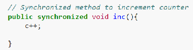

* 35 . Can super class reference variable can hold an object of sub class?  
  *  We **can** use **superclass reference** to **hold** any **subclass object** derived from it. Disadvantage : By using **superclass reference**, we **will** have access only to those parts(methods and **variables**) of the **object** defined by the **superclass**. This is because they are defined in **subclass** not in the **superclass**.  
* 36 . Is multiple inheritance allowed in Java?  
  * The problem with multiple inheritance is that two classes may define *different ways* of doing the same thing, and the subclass can't choose which one to pick. (**Diamond Problem**)  
  * **Java 8 supports default methods** where interfaces can provide default implementation of methods. And a class can implement two or more interfaces. In case both the implemented interfaces contain default methods with same method signature, the implementing class should explicitly specify which default method is to be used or **it should override the default method.**  
  * [**https\://www\.geeksforgeeks.org/java-and-multiple-inheritance/**](https://www.geeksforgeeks.org/java-and-multiple-inheritance/)  
* 37 . What is an interface?  
  * Like a class, an interface can have methods and variables, but the methods declared in interface are by default abstract (only method signature, no body).    
    * Interfaces specify what a class must do and not how. **It is the blueprint** of the class.  
    * It **specifies a set of methods that the class has to implement.**  
    * If a class implements an interface and **does not provide method bodies** for all functions specified in the interface, then class must be declared abstract.  
    * **Java8** We can now add **default implementation** for interface methods. This default implementation has special use and does not affect the intention behind interfaces.  
    * We can now define static methods in interfaces which can be called independently without an object.  
    * Interface is by default ‘public abstract’  
    * Member variables are by default public static final. No other access modifiers allowed.  
    * Interface can extend  another interface but not class.  
    * A class can implement multiple interfaces.  
  * [https\://www\.geeksforgeeks.org/interfaces-in-java/](https://www.geeksforgeeks.org/interfaces-in-java/)  
* 38 . How do you define an interface?  
  * interface \<interface\_name\> {  
  *       
  *     // declare constant fields  
  *     // declare methods that abstract   
  *     // by default.  
  * }  
* 39 . How do you implement an interface?  
  * [https\://www\.geeksforgeeks.org/interfaces-in-java/](https://www.geeksforgeeks.org/interfaces-in-java/)  
* 40 . Can you explain a few tricky things about interfaces?  
  *   
* 41 . Can you extend an interface?  
  * A Java class **can** only **extend one** parent class. Multiple inheritance is not allowed. **Interfaces** are not classes, however, and an **interface can extend** more than **one** parent **interface**. The **extends** keyword is used once, and the parent **interfaces** are declared in a comma-separated list.  
  * Interface A extends B,C,D,E  
* 42 . Can a class extend multiple interfaces?  
  * A Java class can only extend one parent class. Multiple inheritance (extends) is not allowed. Interfaces are not classes, however, and a class *can implement more than one interface.*  
  * The parent interfaces are declared in a comma-separated list, after the implements keyword.  
  * In conclusion, **yes**: public class A implements C,D,E {...}  
  * [https\://stackoverflow.com/questions/21263607/can-a-normal-class-implement-multiple-interfaces/21263662](https://stackoverflow.com/questions/21263607/can-a-normal-class-implement-multiple-interfaces/21263662)  
* 43 . What is an abstract class?  
  * Abstract classes are classes that contain one or more abstract methods. An abstract method is a method that is declared, but contains no implementation. A normal class cannot contain abstract methods.  
* 44 . When do you use an abstract class?  
  * an inst	ance of an abstract class cannot be created, we can have references of abstract class type though.  
  * an abstract class can contain constructors in Java. And a constructor of abstract class is called when an instance of a inherited class is created.  
  * we can have an abstract class without any abstract method. This allows us to create classes that cannot be instantiated, but can only be inherited.  
  *  Abstract classes can also have final methods (methods that cannot be overridden)  
  * For eg AbstractCollection, AbstractList,..... And InputStream and all are abstract  
* 45 . How do you define an abstract method?  
  * **Abstract** classes may not be instantiated(object creation), and require subclasses to provide implementations for the **abstract methods**.  
* 46 . Compare abstract class vs interface?  
  * An interface is a **contract**: The person writing the interface says, "*hey, I accept things looking that way*", and the person using the interface says "*OK, the class I write looks that way*".  
  * **An interface is an empty shell**. There are only the signatures of the methods, which implies that the methods do not have a body. The interface can't do anything. It's just a pattern.  
  * **Abstract classes, unlike interfaces, are classe**s. They are more expensive to use, because there is a look-up to do when you inherit from them.  
  * **Abstract classes look a lot like interface**s, but they have something more: You can define a behavior for them. It's more about a person saying, "these classes should look like that, and they have that in common, so fill in the blanks\!".  
  * **Access Modifiers.** Interface can have only public methods. Abstract class methods can have any visibility.  
  * Implementation. A concrete child class of an abstract class must define all the abstract methods. An interface extending another interface need not provide default implementation for the methods inherited.  
  * Inheritance. A child class can only extend a single class. An interface can extend multiple interfaces.  
  * [https\://stackoverflow.com/questions/1913098/what-is-the-difference-between-an-interface-and-abstract-class](https://stackoverflow.com/questions/1913098/what-is-the-difference-between-an-interface-and-abstract-class)  
  * [https\://www\.geeksforgeeks.org/difference-between-abstract-class-and-interface-in-java/](https://www.geeksforgeeks.org/difference-between-abstract-class-and-interface-in-java/)  
* 47 . What is a constructor?  
  * A constructor is a special method of a class or structure in object-oriented programming that initializes an object of that type. A constructor is an instance method that usually has the same name as the class, and can be used to set the values of the members of an object, either to default or to user-defined values.  
* 48 . What is a default constructor?  
  * A default constructor is a constructor that either has no parameters, or if it has parameters, all the parameters have default values  
*   
* 50 . How do you call a super class constructor from a constructor?  
  * super()  
  * Call to super() must be first statement in Derived Class constructor. If a constructor does not explicitly invoke a superclass constructor, the Java compiler automatically inserts a call to the no-argument constructor of the superclass.  
* 52 . What is the use of this()?  
  * **Keyword** 'THIS' in **Java** is a reference variable that refers to the current object. "this" is a reference to the current object, whose method is being called upon. You can**use** "this" **keyword** to avoid naming conflicts in the method/constructor of your instance/object.  
* 53 . Can a constructor be called directly from a method?  
  * **Constructors can**'t be **called directly**; they are **called** implicitly when the new keyword creates an object.  
  * We can call constructors from the other constructor using this or parent using super  
* 54 . Is a super class constructor called even when there is no explicit call from a sub class constructor?  
  * Yes  
  * If a **constructor** does not **explicitly** invoke a**superclass constructor**, the Java compiler automatically inserts a **call** to the **no**\-argument **constructor** of the **superclass**. If the **super class** does not have a **no**\-argument **constructor**, you will get a compile-time error.  
  * [https\://docs.oracle.com/javase/tutorial/java/IandI/super.html](https://docs.oracle.com/javase/tutorial/java/IandI/super.html)

### **Advanced object oriented concepts**

* 49 OOPS concept

**Object-Oriented Programming (OOP) in Java** is a programming paradigm that organizes software design around **objects and data** rather than functions and logic. Java relies heavily on these concepts to make code modular, reusable, and easy to maintain. \[[1](https://www.geeksforgeeks.org/java/object-oriented-programming-oops-concept-in-java/), [2](https://www.geeksforgeeks.org/dsa/introduction-of-object-oriented-programming/), [3](https://www.w3schools.com/java/java_oop.asp), [4](https://www.geeksforgeeks.org/java/introduction-to-java/)\]

The core of Java's system is built on **two foundational elements** and **four main pillars**. \[[1](https://www.naukri.com/code360/library/four-pillars-of-oops-in-java), [2](https://www.geeksforgeeks.org/java/object-oriented-programming-oops-concept-in-java/)\]

---

Foundational Elements

Before exploring the pillars, you must understand the basic building blocks of Java OOP: \[[1](https://www.linkedin.com/pulse/fundamentals-object-oriented-programming-usman-malik-gd0gf), [2](https://www.dnpgcollegemeerut.ac.in/contentpdf/overview%20of%20java-min.pdf)\]

* **Class**: A user-defined template or blueprint used to create objects. It defines data variables and behavior methods.  
* **Object**: A physical instance of a class that occupies memory space. Objects maintain their own state and can execute actions. \[[1](https://www.geeksforgeeks.org/java/object-oriented-programming-oops-concept-in-java/), [2](https://techaffinity.com/blog/oops-concepts-in-java/), [3](https://www.tpointtech.com/java-oops-concepts), [4](https://www.geeksforgeeks.org/java/classes-objects-java/)\]

---

The Four Pillars of OOP

*    ┌─────────────────────────────────────────┐  
  *     │              OOP PILLARS                │  
  *     ├──────────────┬─────────────┬────────────┤  
  *     │ Encapsulation│ Inheritance │Polymorphism│ Abstraction│  
  *     └──────────────┴─────────────┴────────────┘

**1\. Encapsulation (Data Hiding) \[[1](https://www.scaler.com/topics/java/oops-concepts-in-java/), [2](https://stackify.com/oops-concepts-in-java/), [3](https://medium.com/@amitvsolutions/object-oriented-programming-1df4aeab7304), [4](https://read.aupress.ca/read/introduction-to-computer-programming-with-python/section/7b299fa4-1291-4481-a374-bb58edba4372)\]**

Encapsulation wraps data (variables) and code (methods) together into a single unit. This shields class data from direct outside manipulation, protecting the internal state. \[[1](https://www.geeksforgeeks.org/java/object-oriented-programming-oops-concept-in-java/), [2](https://www.tpointtech.com/java-oops-concepts), [3](https://www.geeksforgeeks.org/dsa/introduction-of-object-oriented-programming/), [4](https://www.geeksforgeeks.org/interview-prep/oops-interview-questions/)\]

* **How it works**: Declare class variables as private and provide access through public getter and setter methods.  
* **Code Example**: \[[1](https://www.geeksforgeeks.org/java/object-oriented-programming-oops-concept-in-java/), [2](https://raygun.com/blog/oop-concepts-java/)\]

java

* public class Account {  
  *     private double balance; // Hidden variable  
  *   
  *     public double getBalance() { // Getter  
  *         return balance;  
  *     }  
  *     public void deposit(double amount) { // Setter with validation  
  *         if (amount \> 0\) { this.balance \+= amount; }  
  *     }  
  * }

**2\. Inheritance (Code Reusability)**

Inheritance allows one class to acquire the properties and methods of another parent class using the extends keyword. It models an **"is-a" relationship** (e.g., a Car *is a* Vehicle). \[[1](https://www.geeksforgeeks.org/java/object-oriented-programming-oops-concept-in-java/), [2](https://raygun.com/blog/oop-concepts-java/)\]

* **How it works**: The child class (subclass) inherits fields and logic from the parent class (superclass), preventing code duplication. Note that Java **does not support multiple inheritance** with classes to avoid ambiguity.  
* **Code Example**: \[[1](https://www.geeksforgeeks.org/java/object-oriented-programming-oops-concept-in-java/)\]

java

* class Vehicle {  
  *     void accelerate() { System.out.println("Moving forward..."); }  
  * }  
  * class Car extends Vehicle { // Inherits accelerate()  
  *     void playMusic() { System.out.println("Playing radio..."); }  
  * }

**3\. Polymorphism (Many Forms) \[[1](https://dev.to/masteringbackend/oops-in-java-principles-concepts-and-real-world-examples-3m9j), [2](https://www.c-sharpcorner.com/UploadFile/433c33/polymorphism-in-java/)\]**

Polymorphism allows one entity (like a method) to behave differently depending on the context. Java splits this into two distinct types: \[[1](https://www.geeksforgeeks.org/java/object-oriented-programming-oops-concept-in-java/), [2](https://www.geeksforgeeks.org/dsa/introduction-of-object-oriented-programming/), [3](https://www.digitalocean.com/community/tutorials/oops-concepts-java-example)\]

* **Compile-time Polymorphism (Method Overloading)**: Multiple methods inside the same class share a name but have different parameter lists.  
* **Runtime Polymorphism (Method Overriding)**: A child class provides a custom implementation for a method that already exists in its parent class.  
* **Code Example**: \[[1](https://medium.com/edureka/object-oriented-programming-b29cfd50eca0), [2](https://www.mygreatlearning.com/blog/oops-concepts-in-java/), [3](https://www.koderhq.com/tutorial/java/polymorphism/), [4](https://logicmojo.com/polymorphism-in-oops)\]

java

* // Overloading (Compile-time)  
  * class Calculator {  
  *     int add(int a, int b) { return a \+ b; }  
  *     int add(int a, int b, int c) { return a \+ b \+ c; }  
  * }  
  *   
  * // Overriding (Runtime)  
  * class Animal {  
  *     void makeSound() { System.out.println("Some sound"); }  
  * }  
  * class Dog extends Animal {  
  *     @Override  
  *     void makeSound() { System.out.println("Bark"); }   
  * }

**4\. Abstraction (Hiding Complexity)**

Abstraction hides complex internal implementation details and exposes only essential features to the user. This keeps your architecture simple and clean. \[[1](https://www.geeksforgeeks.org/java/object-oriented-programming-oops-concept-in-java/), [2](https://www.geeksforgeeks.org/dsa/introduction-of-object-oriented-programming/), [3](https://medium.com/@pgulshetty/mastering-object-oriented-programming-oop-what-it-is-why-it-matters-and-how-it-helps-b780926b05bf), [4](https://medium.com/@kavishkanimsara9919/purposes-and-advantages-of-inheritance-encapsulation-abstraction-and-polymorphism-in-oop-ec60ff5e3a0a)\]

* **How it works**: Java implements abstraction using abstract classes (which can contain concrete methods) and interfaces (which declare clean behavioral contracts).  
* **Code Example**: \[[1](https://www.mygreatlearning.com/blog/oops-concepts-in-java/)\]

java

* interface RemoteControl {  
  *     void pressPowerButton(); // Abstract method declaration  
  * }  
  *   
  * class TVRemote implements RemoteControl {  
  *     public void pressPowerButton() {  
  *         System.out.println("TV turns on via complex electrical signals.");  
  *     }  
  * }

కోడ్‌ను జాగ్రత్తగా ఉపయోగించండి.  
---

Object Relationships

Java also tracks how standalone objects connect to one another: \[[1](https://www.geeksforgeeks.org/java/object-oriented-programming-oops-concept-in-java/), [2](https://www.digitalocean.com/community/tutorials/oops-concepts-java-example)\]

* **Association** is the OOPS concept to define the relationship between objects. The association defines the multiplicity between objects. For example **Teacher and Student** objects. There is a **one-to-many relationship** between a teacher and students. Similarly, a student can have a one-to-many relationship with teacher objects. However, both student and teacher objects are independent of each other.   
* **Aggregation**: A weak **"has-a" relationship** where the child object can exist without the parent (e.g., a **Department has a Professor**; if the department closes, the professor remains). \[[1](https://www.geeksforgeeks.org/java/object-oriented-programming-oops-concept-in-java/), [2](https://beginnersbook.com/2013/04/oops-concepts/)\]  
* **Composition**: A strong **"has-a" relationship** where the child cannot exist without the parent (e.g., a **Human has a Heart**; if the human dies, the heart ceases to exist). \[[1](https://www.digitalocean.com/community/tutorials/oops-concepts-java-example), [2](https://dev.to/masteringbackend/oops-in-java-principles-concepts-and-real-world-examples-3m9j), [3](https://www.upgrad.com/blog/what-is-composition-in-java-with-examples/), [4](https://rajeshreddycse.wordpress.com/wp-content/uploads/2024/10/oop-unit-3-part-2.pdf)\]

---

*   
* 55 . What is polymorphism?  
  * The word polymorphism means having many forms  
  * **Compile time polymorphism**: It is also known as static polymorphism. This type of polymorphism is achieved by function overloading or operator overloading(+ in String).  
  * [**Runtime polymorphism**](https://www.geeksforgeeks.org/dynamic-method-dispatch-runtime-polymorphism-java/): It is also known as Dynamic Method Dispatch. It is a process in which a function call to the overridden method is resolved at Runtime. This type of polymorphism is achieved by Method Overriding.  
    * [**Method overriding**](https://www.geeksforgeeks.org/overriding-in-java/), on the other hand, occurs when a derived class has a definition for one of the member functions of the base class. That base function is said to be **overridden**.  
  *   
  * [https\://www\.geeksforgeeks.org/polymorphism-in-java/](https://www.geeksforgeeks.org/polymorphism-in-java/)  
* 56 . What is the use of instanceof operator in Java?  
  * The **java instanceof operator** is **used** to test whether the object is an instance of the specified type (class or subclass or interface). The **instanceof** in **java** is also known as type comparison **operator** because it compares the instance with type. It returns either true or false.  
* 57 . What is coupling?  
  *  **coupling**, it refers to how related or dependent two classes/modules are toward each other. For low coupled classes, changing something major in one class should not affect the other. High coupling would make it difficult to change and maintain your code; since classes are closely knit together, making a change could require an entire system revamp.  
    Interfaces are used for low coupling  
  * **Coupling** is the indication of the relationships **between** modules.  
  * Good software design has **high cohesion** and **low coupling**.  
* 58 . What is cohesion?  
  * **Cohesion** refers to what the class (or module) can do. Low cohesion would mean that the class does a great variety of actions \- it is broad, unfocused on what it should do. High cohesion means that the class is focused on what it should be doing, i.e. only methods relating to the intention of the class.  
  * **Cohesion** is the indication of the relationship **within** a module.  
  * [https\://stackoverflow.com/questions/3085285/difference-between-cohesion-and-coupling](https://stackoverflow.com/questions/3085285/difference-between-cohesion-and-coupling)  
* 59 . What is encapsulation?  
  * Encapsulation is defined as the wrapping up of data under a single unit. It is the mechanism that binds together code and the data it manipulates.Other way to think about encapsulation is, it is a protective shield that prevents the data from being accessed by the code outside this shield.  
  *  the variables or data of a class is hidden from any other class and can be accessed only through any member function of own class in which they are declared.  
  * As in encapsulation, the data in a class is hidden from other classes, so it is also known as **data-hiding**.  
  * Encapsulation can be achieved by: Declaring all the variables in the class as private and writing public methods in the class to set and get the values of variables.  
  * [https\://www\.geeksforgeeks.org/encapsulation-in-java/](https://www.geeksforgeeks.org/encapsulation-in-java/)  
* 60 . What is an inner class?  
  * Inner class means one class which is a member of another class. There are basically four types of inner classes in java.  
  * 1\) **Nested Inner class**  
    * **Nested Inner class** can access any private instance variable of outer class. Like any other instance variable, we can have access modifier private, protected, public and default modifier.  
    * Like class, interface can also be nested and can have access specifiers.  
    * we can’t have static method in a nested inner class because an inner class is implicitly associated with an object of its outer class so it cannot define any static method for itself.  
    * KeySet in Hahsmap   
  * **2\) Method Local inner classes**  
  * 3\) **Anonymous inner classes \-- implement an interface**  
  * 4\) **Static nested classes** Ellicpse2D.float()  
  * [https\://www\.geeksforgeeks.org/inner-class-java/](https://www.geeksforgeeks.org/inner-class-java/)  
* 61 . What is a static inner class?  
  * Static nested classes are not technically an inner class. They are like a static member of outer class.  
* What is the use of static classes?  
  * Encapsulation,  only used when static class is only related to parent class   
    [https\://www\.journaldev.com/12528/java-static-class](https://www.journaldev.com/12528/java-static-class)  
* 62 . Can you create an inner class inside a method?  
  * Yes  
  * Inner class can be declared within a method of an outer class.  
  * Method Local inner classes can’t use local variable of outer method until that local variable is not declared as final (Until Java 7). From java8 we can access non final var   
* 63 . What is an anonymous class?  
  * **Anonymous inner classes** are declared without any name at all. They are created in two ways.  
    * *As subclass of specified type*  
    * *As implementer of the specified interface*

### **Modifiers**

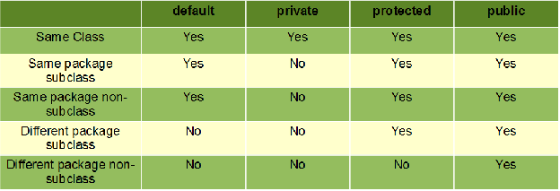

* 64 . What is default class modifier?  
  * When no access modifier is specified for a class , method or data member – It is said to be having the **default** access modifier by default.  
  * The data members, class or methods which are not declared using any access modifiers i.e. having default access modifier are accessible **only within the same package**.  
  * [https\://www\.geeksforgeeks.org/access-modifiers-java/](https://www.geeksforgeeks.org/access-modifiers-java/)  
* 65 . What is private access modifier?  
  * The private access modifier is specified using the keyword **private**.  
  * The methods or data members declared as private are accessible only **within the class** in which they are declared.  
  * Any other **class of same package will not be able to access** these members.  
  * Top level Classes or interface can not be declared as private  
  *   
* 66 . What is default or package access modifier?  
  * 64  
* 67 . What is protected access modifier?  
  * The protected access modifier is specified using the keyword **protected**.  
  * The methods or data members declared as protected are **accessible within same package or sub classes in different package.**  
  *   
* 68 . What is public access modifier?  
  * The public access modifier is specified using the keyword **public**.  
  * The public access modifier has the **widest scope** among all other access modifiers.  
  * Classes, methods or data members which are declared as public are **accessible from everywhere** in the program. There is no restriction on the scope of a public data members.  
  *   
* 69 . What access types of variables can be accessed from a class in same package?  
  * Public, default/no  
* 70 . What access types of variables can be accessed from a class in different package?  
  * public,  
* 71 . What access types of variables can be accessed from a sub class in same package?  
  * Protected, default,  public  
* 72 . What access types of variables can be accessed from a sub class in different package?  
  * Protected,  public  
* 73 . What is the use of a final modifier on a class?  
  * The **final modifier** indicates that an object is fixed and cannot be changed. When you **use** this **modifier** with a **class**\-level object, it means that the **class** can never have subclasses.   
* 74 . What is the use of a final modifier on a method?  
  * When you apply this **modifier** to a **method**, the **method** can never be overridden.  
* 75 . What is a final variable?	  
  * Constant variable that cannot be changed  
* 76 . What is a final argument?  
  * A final parameter is a final variable. Once passed it cannot be modified. A reference variable declared final can never be reassigned to refer to a different object.  
  * However, the data within the object can be changed. So, the state of the object can be changed but not the reference.  
  * This is one of the best coding practice to keep the passed parameters as final to prevent any accidental modifications.  
* 77 . What happens when a variable is marked as volatile?  
  * Using **volatile variables** reduces the risk of memory consistency errors, because any write to a **volatile variable** establishes a "**happens**\-before" relationship with subsequent reads of that same **variable**. This means that changes to a **volatile variable** are always visible to other threads.  
  * Using volatile is yet another way (like synchronized, atomic wrapper) of making class thread safe. Thread safe means that a method or class instance can be used by multiple threads at the same time without any problem.  
  * In cases where we may only desire the visibility and not atomicity.  
    example.  
    class SharedObj  
    {  
       // volatile keyword here makes sure that  
       // the changes made in one thread are   
       // immediately reflect in other thread  
       static **volatile** int sharedVar \= 6;  
    }  
      
* 78 . What is a static variable?  
  * **Static variables** are initialized only once, at the start of the execution. These variables will be initialized first, before the initialization of any instance variables. A single copy to be shared by all instances of the class. A static variable can be accessed directly by the class name and doesn't need any object.  
  * **if a field is declared static**, then exactly a single copy of that field is created and shared among all instances of that class. static variables go in a particular pool in JVM memory called **Metaspace**  
  * Similar to static fields, **static methods** also belong to a class instead of the object, and so they can be called without creating the object of the class in which they reside. They’re meant to be used without creating objects of the class. They can be accessed through object as well, but it gives warning.  
  * **A static block** is used for initializing static variables. Although static variables can be initialized directly during declaration, there are situations when we’re required to do the multiline processing.  
  * **static nested classes** behaved exactly like any other top-level class but enclosed in the only class which will access it, to provide better packaging convenience. Use for creating singleton classes  
  * **Static methods** can only access static variables  
  * [https\://www\.baeldung.com/java-static](https://www.baeldung.com/java-static)

### **conditions & loops**

* 79 . Why should you always use blocks around if statement?  
  * if you go back and add a second statement to the if or else clauses without remembering to add the curly braces, your code will break in unexpected and amusing ways.  
  * Maintainability-wise, it's *always* smarter to use curly braces  
* 84 . Should default be the last case in a switch statement?  
  * The case statements and the default statement can occur in any order in the switch statement. The default clause is an optional clause that is matched if none of the constants in the case statements can be matched.  
* 85 . Can a switch statement be used around a String  
  * Beginning with JDK 7, we **can use** a **string** literal/constant to control a **switch statement**  
* 87 . What is an enhanced for loop?  
  * **Foreach loop:** This is mainly used to traverse all elements of a collection of elements including arrays.

### **Exception handling**

* 91 . Why is exception handling important?  
  * Separating Error Handling Code from "Regular" Code  
  * To continue program execution even after an [exception is caught and handled](https://www.onlinetutorialspoint.com/java/exception-handling-in-java.html).  
  * The use of try/catch blocks segregates error-handling code and program code making it easier to identify the logical flow of a program.  
  * Java’s exception handling mechanism works in such a way that error reports are propagated up the call stack.  
  * Meaningful error reporting  
  * [https\://www\.onlinetutorialspoint.com/java/advantages-of-exception-handling.html](https://www.onlinetutorialspoint.com/java/advantages-of-exception-handling.html)   
* 92 . What design pattern is used to implement exception handling features in most languages?  
  * Chain of Responsibility  
  * If you throw exceptions that are too low-level catch them few calls above, and pack as more general and meaningful exception with user friendly message what went wrong, and throw them once again to highest possible level, where you stop your app and view them somehow  
  * [https\://stackoverflow.com/questions/11819052/java-exception-handling-strategy](https://stackoverflow.com/questions/11819052/java-exception-handling-strategy)  
  * [https\://stackoverflow.com/a/15542704/4428927](https://stackoverflow.com/a/15542704/4428927)  
  * [https\://dzone.com/articles/exception-handling-with-chain-of-responsibility](https://dzone.com/articles/exception-handling-with-chain-of-responsibility)  
* 93 . What is the need for finally block?  
  * a finally block is guaranteed to be executed even if an exception is raised **and not caught**. You then use the finally block, as a one time chance, to perform necessary clean-up like closing streams. The code after the finally block might never be reached.  
  * [https\://stackoverflow.com/questions/3861522/do-you-really-need-the-finally-block](https://stackoverflow.com/questions/3861522/do-you-really-need-the-finally-block)  
* 94 . In what scenarios is code in finally not executed?  
  * If the JVM exits while the try or catch code is being executed, then the finally block may not execute. Likewise, if the thread executing the try or catch code is interrupted or killed, the finally block may not execute even though the application as a whole continues.  
  * https\://stackoverflow.com/a/464102/4428927  
* 96 . Is try without a catch is allowed?  
  * Yes, we can have **try without catch** block by using finally block. You can use **try** with finally. As you know finally block always executes even if you have exception or return statement in **try** block   
* 97 . Is try without catch and finally allowed?  
  * Nope \- at least one is required  
  * With Java 7 try with resource this is possible.  
* 98 . Can you explain the hierarchy of exception handling classes?  
  * All exception and errors types are sub classes of class **Throwable**, which is base class of hierarchy.  
    One branch is headed by **Exception**. This class is used for exceptional conditions that user programs should catch. NullPointerException is an example of such an exception.Another branch,  
    **Error** are used by the Java run-time system([JVM](https://www.geeksforgeeks.org/jvm-works-jvm-architecture/)) to indicate errors having to do with the run-time environment itself(JRE).   
  * [https\://www\.geeksforgeeks.org/exceptions-in-java/](https://www.geeksforgeeks.org/exceptions-in-java/)  
* 99 . What is the difference between error and exception?  
  * **Error:** An Error indicates serious problem that a reasonable application should not try to catch. E.g. Out of Memory  
  * **Exception:** Exception indicates conditions that a reasonable application might try to catch. E.g. NullPointerException  
* 100 . What is the difference between checked exceptions and unchecked exceptions?  
  * **Checked:** are the exceptions that are checked at compile time. If some code within a method throws a checked exception, then the method must either handle the exception or it must specify the exception using *throws* keyword. Class should extend *‘Exception’ or ‘Checked Exception’*  
  * **Unchecked** are the exceptions that are not checked at compiled time.  
  * exceptions under *Error* and *RuntimeException* classes are unchecked exceptions, everything else under throwable is checked. Class should extend *‘Runtime Exception’ or ‘UnChecked Exception’*  
  * [https\://www\.geeksforgeeks.org/checked-vs-unchecked-exceptions-in-java/](https://www.geeksforgeeks.org/checked-vs-unchecked-exceptions-in-java/)  
* 101 . How do you throw an exception from a method?  
  * throws keyword is used to declare that a method may throw one or some exceptions. Exception sequence should be specific to generic exception in catch block.  
  * E.g. for Unchecked Exception  
     *throw new RuntimeException(“Exception occurred”);*  
* E.g. for Checked Exception

  **class** AmountAdder {

    **static** Amount addAmounts(Amount amount1, Amount amount2) throws Exception {

       **if** (\!amount1.currency.equals(amount2.currency)) {

          **throw new** Exception(“Currencies don’t match”);

       }

       **return new** Amount(amount1.currency, amount1.amount \+ amount2.amount);

    }

  }

  **public static void** main(String\[\] args) throws Exception {

  	AmountAdder.addAmounts(new Amount(“RUPEE”, 5), new Amount(“DOLLAR”, 5));

  }

  OR

  **public static void** main(String\[\] args) {

    **try** {

       AmountAdder.addAmounts(**new** Amount(**"RUPEE"**, 5), **new** Amount(**"RUPEE"**,

             5));

       String string \= **null**;

       string.toString();

    } **catch** (Exception e) {

       System.out.println(**"Handled CurrenciesDoNotMatchException"**);

    }

  }

* 102 . What happens when you throw a checked exception from a method?  
  * The caller must catch the exceptions. and handle this exception using try & catch. Else we will get compilation errors.  
* 103 . What are the options you have to eliminate compilation errors when handling checked exceptions?  
  * Use throws keyword   
  * Or handle the exception using try catch block  
* 104 . How do you create a custom exception?  
  * **w**e have to extend the **java.lang.Exception class.**  
  * [https\://www\.baeldung.com/java-new-custom-exception](https://www.baeldung.com/java-new-custom-exception)  
* 105 . How do you handle multiple exception types with same exception handling block?  
  * This has been possible [since Java 7](http://docs.oracle.com/javase/7/docs/technotes/guides/language/catch-multiple.html). The syntax for a multi-catch block is  
  * try { ... } catch (IOException \| SQLException ex) { ... }  
  * https\://stackoverflow.com/a/3495968/4428927  
* 106 . Can you explain about try with resources?  
  * in Java 7 – allows us to declare resources to be used in a try block with the assurance that the resources will be closed when after execution of that block. The resources declared must implement the AutoCloseable interface.  
    E.g. try (Scanner scanner \= new Scanner(new File("test.txt"))) {  
        while (scanner.hasNext()) {  
            System.out.println(scanner.nextLine());  
        }  
    } catch (FileNotFoundException fnfe) {  
        fnfe.printStackTrace();  
    }  
  * [https\://www\.baeldung.com/java-try-with-resources](https://www.baeldung.com/java-try-with-resources)  
* 107 . How does try with resources work?  
* 108 . Can you explain a few exception handling best practices?  
  * Clean up Resources in a Finally Block or Use a Try-With-Resource Statement  
  * Prefer Specific Exceptions  
  * Wrap the Exception Without Consuming it  
  * Don’t log and throw  
  * Don’t ignore exceptions  
  * Don’t catch Throwable  
  * Catch the most specific exception first  
  * Throw Exceptions With Descriptive Messages  
  * Document the Exceptions You Specify  
  * [https\://stackify.com/best-practices-exceptions-java](https://stackify.com/best-practices-exceptions-java/)/

### **Miscellaneous topics**

* 109 . What are the default values in an array?  
  * Everything in a Java program not explicitly set to something by the programmer, is initialized to a zero value.  
    * For references (anything that holds an object) that is null.  
    * For int/short/byte/long that is a 0.  
    * For float/double that is a 0.0  
    * For booleans that is a false.  
    * For char that is the null character '\\u0000' (whose decimal equivalent is 0).  
  * When you create an array of something, all entries are also zeroed. So **your array contains five zeros right after it is created by new**

  **int marks2\[\] \= new int\[5\];**

  * **Marks2\[0\] //will print 0**  
  * https\://stackoverflow.com/a/3426854/4428927  
* 110 . How do you loop around an array using enhanced for loop?  
  * String\[\] arrData \= {"Alpha", "Beta", "Gamma", "Delta", "Sigma"};  
  * for (String strTemp : arrData) {  
  *     System.out.println(arrData\[i\]);  
  * }  
  * [https\://www\.guru99.com/foreach-loop-java.html](https://www.guru99.com/foreach-loop-java.html)  
* 111 . How do you print the content of an array?

  * 1D Array:

    **int** marks3\[\] \= { 25, 30, 50, 10, 5 };

    System.out.println(Arrays.toString(marks3));

  * 2D Array:

    *// Printing a 2D Array*

    **int**\[\]\[\] matrix3 \= { { 1, 2, 3 }, { 4, 5, 6 } };

    System.out.println(matrix3); *// \[\[I@1d5a0305*

    System.out.println(Arrays.toString(matrix3));

    *// \[\[I@6db3f829, \[I@42698403\]*

    System.out.println(Arrays.deepToString(matrix3));

    *// \[\[1, 2, 3\], \[4, 5, 6\]\]*

* 112 . How do you compare two arrays?  
  * A simple way is to **run a loop** and compare elements one by one.   
  * Java provides a direct method ***Arrays.equals()*** to compare two arrays.  
  * Java provides another method for this **Arrays.deepEquals()** which does deep comparison.  
  * [https\://www\.geeksforgeeks.org/compare-two-arrays-java/](https://www.geeksforgeeks.org/compare-two-arrays-java/)  
* 113 . What is an enum?  
  * Enumerations serve the purpose of representing a group of *named constants*   
  * Enums are used when we know all possible values at **compile time**,   
  * we can also add variables, methods and constructors to it. The main objective of enum is to define our own data types  
  * [https\://www\.geeksforgeeks.org/enum-in-java/](https://www.geeksforgeeks.org/enum-in-java/)  
* 114 . Can you use a switch statement around an enum?  
  * yes  
* 115 . What are variable arguments or varargs?  
  *  A method that takes a variable number of arguments is a varargs method.  
  * Varargs can only be the last argument  
  * It can have any type, primitive or object or anything.  
  * It has length property and for loop can be applied  
  * public static void fun(int ...a)   
  * {  
  *    // method body  
  * }  
  * [https\://www\.geeksforgeeks.org/variable-arguments-varargs-in-java/](https://www.geeksforgeeks.org/variable-arguments-varargs-in-java/)  
* 116 . What are asserts used for?  
  * **assert** is a Java keyword **used** to define an **assert** statement. An **assert** statement is **used** to declare an expected boolean condition in a program. If the program is running with assertions enabled, then the condition is checked at runtime. ... Assertions are usually **used** as a debugging aid.  
  *   
* 117 . When should asserts be used?  
  * Use **Exceptions** for error condition which come from the ***outside*** (outside the method or outside the program) like parameter checking and missing/defective external resources like files or connections or user input.  
  * Use **Assertions** to indicate an ***internal*** defects like programming errors, conditions that shouldn't occur, e.g. class/method invariants and invalid program state.  
  * Preconditions on input parameters  
  * Results of intermediate calculations  
  * Postconditions on object state  
  *   
  * [https\://stackoverflow.com/questions/3702307/when-should-assert-be-used](https://stackoverflow.com/questions/3702307/when-should-assert-be-used)  
  * [https\://stackoverflow.com/questions/1081409/why-should-i-use-asserts](https://stackoverflow.com/questions/1081409/why-should-i-use-asserts)  
* 118 . What is garbage collection?  
  * In C & C++ we need to clean the object’s memory. In java JVM does itself.  
  * Garbage Collection is tracking down all the objects that are still used and marks the rest as garbage. Garbage collector destroys these objects which is marked as garbage  
  * Main objective of Garbage Collector is to free heap memory by destroying unreachable objects.  
  * There is no explicit need to destroy an object as Java handles the de-allocation automatically.  
  * [https\://www\.geeksforgeeks.org/garbage-collection-java/](https://www.geeksforgeeks.org/garbage-collection-java/)  
  * [https\://www\.guru99.com/java-garbage-collection.html](https://www.guru99.com/java-garbage-collection.html)  
* 119 . Can you explain garbage collection with an example?  
  * https\://www\.guru99.com/java-garbage-collection.html  
* 120 . When is garbage collection run?  
  * This completely depends on the actual JVM and what it chooses to do, and is basically out of your hands as a programmer.  
  * It runs when it determines that it is time to run. A common strategy in generational garbage collectors is to run the collector when an allocation of generation-0 memory fails. That is, every time you allocate a small block of memory (big blocks are typically placed directly into "older" generations), the system checks whether there's enough free space in the gen-0 heap, and if there isn't, it runs the GC to free up space for the allocation to succeed. Old data is then moved to the gen-1 heap, and when space runs out there, the GC runs a collection on that, upgrading the data which has been there longest to the gen-2 heap, and so on. So the GC doesn't just "run". It might run on the gen-0 heap only (and most collections will do just that), or it might check every generation if it really has to free up a lot of memory (which is only necessary fairly rarely).  
  * [https\://stackoverflow.com/questions/1582209/java-garbage-collector-when-does-it-collect](https://stackoverflow.com/questions/1582209/java-garbage-collector-when-does-it-collect)  
* 121 . What are best practices on garbage collection?  
  * There are generally four different ways to make an object eligible for garbage collection.  
  1. Nullifying the reference variable  
  2. Re-assigning the reference variable  
  3. Object created inside method  
  4. [Island of Isolation](https://www.geeksforgeeks.org/island-of-isolation-in-java/)  
  *   
* 122 . What are initialization blocks?  
  *  Initializer block contains the code that is always executed whenever an instance is created. It is used to declare/initialize the common part of various constructors of a class.  
  * There are 2 types of initialization blocks: Static Initializer & Instance Initializer.  
  * Static Initializer: Code that runs when a class is created  
  * Instance initializer: Code that runs when a object is created. When a new object is created a constructor is called. Instance initializer is in addition to constructor.  
  * [https\://www\.geeksforgeeks.org/g-fact-26-the-initializer-block-in-java/](https://www.geeksforgeeks.org/g-fact-26-the-initializer-block-in-java/)  
  * Instance Initialization Blocks or IIB are used to initialize instance variables. IIBs are executed before constructors. They run each time when object of the class is created.  
  * Initialization blocks are executed whenever the class is initialized and before constructors are invoked.  
  * They are typically placed above the constructors within braces.  
  * It is not at all necessary to include them in your classes.  
  * We can also have multiple IIBs in a single class.  
  * The Instance Initialization Block is invoked after the parent class constructor is invoked (i.e. after super() constructor call)  
  * E.g. **public class** InitializerExamples {  
  *   **static int** count;  
  *   **int** i;  
  *   {  
  *      *// This is an instance initializers. Run every time an object is*  
  *      *// created.*  
  *      *// static and instance variables can be accessed*  
  *      System.out.println(**"Instance Initializer"**);  
  *      i \= 6;  
  *      count \= count \+ 1;  
  *      System.out  
  *            .println(**"Count when Instance Initializer is run is "** \+ count);  
  *   }  
  * //Static Initializer  
  *   **static** {  
  *      *// This is a static initializers. Run only when Class is first loaded.*  
  *      *// Only static variables can be accessed*  
  *      System.out.println(**"Static Initializer"**);  
  *      *// i \= 6;//COMPILER ERROR*  
  *      System.out.println(**"Count when Static Initializer is run is "** \+ count);  
  *   }  
  * **//** Instance initializer  
  * {  
  *      *// This is a static initializers. Run only when Class is first loaded.*  
  *      *// Only static variables can be accessed*  
  *      System.out.println(**"**Instance initializer**"**);  
  *   	i \= 6;  
  * Count \= count+1;  
  *      System.out.println(**"Count when** Instance initializer **is run is "** \+ count);  
  *   }  
  *   
  * [https\://www\.geeksforgeeks.org/instance-initialization-block-iib-java/](https://www.geeksforgeeks.org/instance-initialization-block-iib-java/)  
* 123 . What is a static initializer?  
  *  used for static initializations of a class. This code inside static block is **executed only once**: the first time you make an object of that class or the first time you access a static member of that class (even if you never make an object of that class)  
  * [https\://www\.geeksforgeeks.org/g-fact-79/](https://www.geeksforgeeks.org/g-fact-79/)  
  * 1st time : Static \-\> iib \-\> constructor  
* 124 . What is an instance initializer block?  
  * Same as  initialization blocks above  
* 125 . What is tokenizing?  
  * StringTokenizer class in Java is used to break a string into tokens.  
* 126 . Can you give an example of tokenizing?  
  * String mydelim \= " : ";  
  * String mystr \= "JAVA : Code";  
  * StringTokenizer st1= new StringTokenizer(mystr, mydelim);  
  * while (st1.hasMoreTokens())  
  *     System.out.println(st1.nextToken()); // Java Code  
  *   
  * [https\://www\.geeksforgeeks.org/stringtokenizer-methods-java-examples-set-2/](https://www.geeksforgeeks.org/stringtokenizer-methods-java-examples-set-2/)  
* 127 . What is serialization?  
  * **Serialization** is the process of turning an object in memory into a stream of bytes so you can do stuff like store it on disk or send it over the network.  
  * **Deserialization** is the reverse process: turning a stream of bytes into an object in memory.  
  * [https\://stackoverflow.com/questions/633402/what-is-serialization](https://stackoverflow.com/questions/633402/what-is-serialization)  
* 128 . How do you serialize an object using serializable interface?  
  * The ObjectOutputStream class contains **writeObject()** method for serializing an Object.  
  * The ObjectInputStream class contains **readObject()** method for deserializing an object.  
  * The Serialization runtime associates a version number with each Serializable class called a SerialVersionUID, which is used during Deserialization to verify that sender and reciever of a serialized object have loaded classes for that object which are compatible with respect to serialization. If the reciever has loaded a class for the object that has different UID than that of corresponding sender’s class, the Deserialization will result in an **InvalidClassException**. A Serializable class can declare its own UID explicitly by declaring a field name.  
  * It must be static, final and of type long.  
  * **E.g. class** House **implements** Serializable {  
  *   **int** number;  
  *   **public** House(**int** number) {  
  *      **this**.number \= number;  
  *   }  
  * }  
  * **public class** SerializationExamples2 {  
  *   
  *   **public static void** main(String\[\] args) **throws** IOException {  
  *   
  *      FileOutputStream fileStream \= **new** FileOutputStream(**"House.ser"**);  
  *      ObjectOutputStream objectStream \= **new** ObjectOutputStream(fileStream);  
  *      House house \= **new** House(10);  
  *      objectStream.writeObject(house);  
  *      objectStream.close();  
  *   }  
  * }  
  *   
  * [https\://www\.geeksforgeeks.org/serialization-in-java/](https://www.geeksforgeeks.org/serialization-in-java/)  
* 129 . How do you de-serialize in Java?  
  * The byte stream created is platform independent. So, the object serialized on one platform can be deserialized on a different platform.  
  * To make a Java object serializable we implement the **java.io.Serializable** interface.  
  * The ObjectInputStream class contains **readObject()** method for deserializing an object.  
* 130 . What do you do if only parts of the object have to be serialized?  
  * We mark all the properties of the object which should not be serialized as *transient*. Transient attributes in an object are not serialized  
* 131 . How do you serialize a hierarchy of objects?  
  * Objects of one class might contain objects of other classes. When serializing and de-serializing, we might need to serialize and de-serialize entire object chain. All classes that need to be serialized have to implement the Serializable interface. Otherwise, an exception is thrown. java.io.NotSerializableException  
  *   
* 132 . Are the constructors in an object invoked when it is de-serialized?  
  * No. When a class is De-serialized, initialization (constructor’s, initializer’s) does not take place. The state of the object is retained as it is.  
* 133 . Are the values of static variables stored when an object is serialized?  
  * Static Variables are not part of the object. They are not serialized.  
  * [http\://www\.javainterview.in/p/java-serialization-interview-questions.html](http://www.javainterview.in/p/java-serialization-interview-questions.html)

### **Collections**

* 134 . Why do we need collections in Java?  
  * Arrays are not resizable.  
  * Java Collections Framework provides lots of different useful data types, such as linked lists (allows insertion anywhere in constant time), resizeable array lists (like Vector but cooler), red-black trees, hash-based maps (like Hashtable but cooler).  
  * Collections only hold objects and not primitive types.  
  * Java Collections Framework provides abstractions, so you can refer to a list as a List, whether backed by an array list or a linked list; and you can refer to a map/dictionary as a Map, whether backed by a red-black tree or a hashtable.  
  * In other words, Java Collections Framework allows you to use the right data structure, because one size does not fit all.  
  * [https\://stackoverflow.com/questions/2497134/what-is-the-need-of-collection-framework-in-java](https://stackoverflow.com/questions/2497134/what-is-the-need-of-collection-framework-in-java)  
* 135 . What are the important interfaces in the collection hierarchy?

* 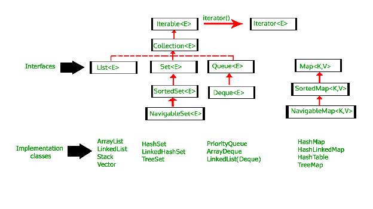

interface Collection\<E\> extends Iterable\<E\> {  
}

//Cares about which position each object is in  
//Elements can be added in by specifying position \- where should it be added in  
//If element is added without specifying position \- it is added at the end  
interface List\<E\> extends Collection\<E\> {  
}

// Unique things only \- Does not allow duplication.  
// If obj1.equals(obj2) then only one of them can be in the Set.  
interface Set\<E\> extends Collection\<E\> {  
}

// Arranged in order of processing \- A to-do list for example  
// Queue interface extends Collection. So, it supports all Collection Methods.  
interface Queue\<E\> extends Collection\<E\> {  
}

// {\["key1",value1\],\["key2",value2\],\["key3",value3\]}  
// Things with unique identifier  
// Key \- Value Pair  
interface Map\<K, V\> {  
}

Keywords Meaning:

- Hash: No order  
- Tree: Elements are sorted  
- Set: No duplication  
- Linked: Order is maintained

* 136 . What are the important methods that are declared in the collection interface?  
  interface Collection\<E\> extends Iterable\<E\> {  
      int size();  
      boolean isEmpty();  
      boolean contains(Object paramObject);  
      Iterator\<E\> iterator();  
      Object\[\] toArray();  
      boolean add(E paramE);  
      boolean remove(Object paramObject);  
      boolean containsAll(Collection\<?\> paramCollection);  
      boolean addAll(Collection\<? extends E\> paramCollection);  
      boolean removeAll(Collection\<?\> paramCollection);  
      boolean retainAll(Collection\<?\> paramCollection);  
      void clear();  
      boolean equals(Object paramObject);  
      int hashCode();  
  }  
    
* 137 . Can you explain briefly about the List interface?  
  List interface extends Collection interface. So it has all the methods that are there in Collection interface. In addition, it has methods to specify position of the elements. It maintains the order of insertion.  
  interface List\<E\> extends Collection\<E\> {  
      // \[1,2,3,4\]  
      // batsman \- "Sachin", "Kohli" , "Ponting", "Lara", "Kohli"  
      // 0 1 2 3 4  
      // batsman.remove(1);  
      // bastman.get(2);  
      // bastman.set(2,"Ponting"))  
      //  
      boolean addAll(int paramInt, Collection\<? extends E\> paramCollection);  
    
      E get(int position);  
      E set(int position, E paramE);  
      void add(int position, E paramE);  
      E remove(int paramInt);  
      int indexOf(Object paramObject);  
      int lastIndexOf(Object paramObject);  
      ListIterator\<E\> listIterator();  
      ListIterator\<E\> listIterator(int paramInt);  
      List\<E\> subList(int paramInt1, int paramInt2);  
  }

* 138 . Explain about ArrayList with an example?  
  class ArrayList /\* implements List\<E\>, RandomAccess \*/{  
      // implements RandomAccess, a marker interface, meaning it support fast \- almost constant time \- access  
      // Not Thread Safe   
      // Insertion and Deletion are slower compared to LinkedList  
  }  
    
  class Vector /\* implements List\<E\>, RandomAccess \*/{  
      // Thread Safe \- Synchronized Methods  
      // implements RandomAccess, a marker interface, meaning it support fast \-  
      // almost constant time \- access  
  }  
  class LinkedList /\* implements List\<E\>, Queue \*/{  
      // Elements are doubly linked \- forward and backword \- to one another  
      // Ideal choice to implement Stack or Queue  
      // Iteration is slower than ArrayList  
      // Fast Insertion and Deletion  
      // Implements Queue interface also. So, supports methods like peek(), poll()  
      // and remove()  
  }  
  Initial capacity of Collections  
  1\. Vector \= 10  
   2\. ArrayList \= 10   
* Load Factor:1 (when the list is full)  
* Growth Rate: current\_size \+ current\_size/2

 3\. LinkedList \- does not have a capacity  
 4\. HashMap \= 16 (but with the default load factor of 0.75, only 12 can be populated before a resize will happen)  
 5\. LinkedHashMap \= 16 (read above)    
 6\. ConcurrentHashMap \= 16  
 7\. HashSet \= 16 (it's  based on a HashMap)  
 8\. LinkedHashSet \= 16  
 9\. TreeSet \= does not have one  
Why default capacity 16?  
Because ArrayDeque capacity must be a power of two, and 16 is the smallest power of two that is at least 10\.

* 139 . Can an ArrayList have duplicate elements?  
  * yes  
* 140 . How do you iterate around an ArrayList using iterator?  
  * Iterator\<String\> iter  
  *             \= list.iterator();  
  *         // Displaying the values after iterating through the list  
  *         System.out.println("\\nThe iterator values"  
  *                            \+ " of list are: ");  
  *         while (iter.hasNext()) {  
  *             System.out.print(iter.next() \+ " ");  
  *         }  
  * [https\://www\.geeksforgeeks.org/iterating-arraylists-java/](https://www.geeksforgeeks.org/iterating-arraylists-java/)  
* 141 . How do you sort an ArrayList?  
  * Collections.Sort(ar)// primitives //comparable  
  * Collections.sort(arr, new comparator)  
    Comparable and comparator   
* 142 . How do you sort elements in an ArrayList using comparable interface?

  **public class** Employee **implements** Comparable\<Employee\> {

   @Override

   **public int** compareTo(Employee o) {

     **if** (o \== **null**)

       **return this**.getId();


     **return this**.getId() \- o.getId();

   }


* 143 . How do you sort elements in an ArrayList using comparator interface?

  employees.sort(Comparator.comparingInt(Employee::getId));  **OR**

  class RatingCompare implements Comparator\<Movie\>

  {

      public int compare(Movie m1, Movie m2)

      {

          if (m1.getRating() \< m2.getRating()) return \-1;

          if (m1.getRating() \> m2.getRating()) return 1;

          else return 0;

      }

  }


  * [https\://www\.geeksforgeeks.org/comparable-vs-comparator-in-java/](https://www.geeksforgeeks.org/comparable-vs-comparator-in-java/)  
* **144 . What is vector class? How is it different from an ArrayList?**  
  * A Vector defaults to doubling the size of its array, while the ArrayList increases its array size by 50 percent.  
  * Vector is synchronized arraylist is not \-- Collections.synchronizedList  
  * [https\://stackoverflow.com/questions/2986296/what-are-the-differences-between-arraylist-and-vector](https://stackoverflow.com/questions/2986296/what-are-the-differences-between-arraylist-and-vector)  
* 145 . What is linkedList? What interfaces does it implement? How is it different from an ArrayList?

| ArrayList | LinkedList |
| :---- | :---- |
| 1\) ArrayList internally uses a **dynamic array** to store the elements. | LinkedList internally uses a **doubly linked list** to store the elements. |
| 2\) Manipulation with ArrayList is **slow** because it internally uses an array. If any element is removed from the array, all the bits are shifted in memory. | Manipulation with LinkedList is **faster** than ArrayList because it uses a doubly linked list, so no bit shifting is required in memory. |
| 3\) An ArrayList class can **act as a list** only because it implements List only. | LinkedList class can **act as a list and queue** both because it implements List and Deque interfaces. |
| 4\) ArrayList is **better for storing and accessing** data. | LinkedList is **better for manipulating** data. |

  * [https\://www\.javatpoint.com/difference-between-arraylist-and-linkedlist](https://www.javatpoint.com/difference-between-arraylist-and-linkedlist)  
* 146 . Can you briefly explain about the Set interface?  
  * Set is an interface which extends Collection. It is an unordered collection of objects in which duplicate values cannot be stored.  
  * Basically, Set is implemented by HashSet, LinkedHashSet or TreeSet (sorted representation).  
  * Set has various methods to add, remove clear, size, etc to enhance the usage of this interface  
  * [https\://www\.geeksforgeeks.org/set-in-java/](https://www.geeksforgeeks.org/set-in-java/)  
* 147 . What are the important interfaces related to the Set interface?  
  * Set, SortedSet,-\> NavigableSet \-\>(Treeset \- [ConcurrentSkipListSet](https://docs.oracle.com/javase/7/docs/api/java/util/concurrent/ConcurrentSkipListSet.html))  
* 148 . What is the difference between Set and sortedSet interfaces?4  
  //Main difference between Set and SortedSet is \- an implementation of SortedSet interface   
  //maintains its elements in a sorted order.  Set interface does not guarantee any Order.  
  interface SortedSet\<E\> extends Set\<E\> {  
      SortedSet\<E\> subSet(E fromElement, E toElement);  
      SortedSet\<E\> headSet(E toElement);  
      SortedSet\<E\> tailSet(E fromElement);  
      E first();  
      E last();  
  }  
  //A SortedSet extended with navigation methods   
  interface NavigableSet\<E\> extends SortedSet\<E\> {  
      E lower(E e);  
      E floor(E e);  
      E ceiling(E e);  
      E higher(E e);  
      E pollFirst();  
      E pollLast();  
  }  
    
* 149 . Can you give examples of classes that implement the Set interface?  
  // Order of Insertion : A, X , B  
  // Possible Order of Storing : X, A ,B  
  class HashSet /\* implements Set \*/{  
      // unordered, unsorted \- iterates in random order  
      // uses hashCode()  
  }  
    
  // Order of Insertion :A, X, B  
  // Order of Storing : A, X, B  
  class LinkedHashSet /\* implements Set \*/{  
      // ordered \- iterates in order of insertion  
      // unsorted  
      // uses hashCode()  
  }  
    
  // Order of Insertion :A,C,B  
  // Order of Storing : A,B,C  
  class TreeSet /\* implements Set,NavigableSet \*/{  
      // 3,5,7  
      // sorted \- natural order  
      // implements NavigableSet  
  }  
    
* 150 . What is a HashSet?  
  * A HashSet holds a set of objects, but in a way that it allows you to easily and quickly determine whether an object is already in the set or not. It does so by internally managing an array and storing the object using an index which is calculated from the hashcode of the object  
  * HashSet is an unordered collection containing unique elements. It has the standard collection operations Add, Remove, Contains, but since it uses a hash-based implementation, these operations are O(1). (As opposed to List for example, which is O(n) for Contains and Remove.) HashSet also provides standard set operations such as *union*, *intersection*, and *symmetric difference(in C\# for java use guava)*.  
  * [https\://stackoverflow.com/a/4558802/4428927](https://stackoverflow.com/a/4558802/4428927)  
  * [https\://javarevisited.blogspot.com/2012/12/union-and-intersection-of-two-set-in-java-guava-example.html](https://javarevisited.blogspot.com/2012/12/union-and-intersection-of-two-set-in-java-guava-example.html)  
* 151 . What is a linkedHashSet? How is different from a HashSet?  
* 152 . What is a TreeSet? How is different from a HashSet?  
  * 

| FEATURES | HASHSET | LINKEDHASHSET | TREESET |
| ----- | ----- | ----- | ----- |
| Internal Working | HashSet internally uses HashMap for storing objects | LinkedHashSet uses LinkedHashMap internally to store objects | TreeSet uses TreeMap internally to store objects |
| When To Use | If you don’t want to maintain insertion order but want store unique objects | If you want to maintain insertion order of elements then you can use LinkedHashSet | If you want to sort the elements according to some Comparator then use TreeSet |
| Order | HashSet does not maintain insertion order | LinkedHashSet maintains insertion order of objects | While TreeSet orders of the elements according to supplied Comparator. Default, It’s objects will be placed in their natural ascending order. |
| Complexity of Operations | HashSet gives O(1) complicity for insertion, removing and retrieving objects | LinkedHashSet gives insertion, removing and retrieving operations performance in order O(1). | While TreeSet gives performance of order O(log(n)) for insertion, removing and retrieving operations. |
| Performance | HashSet performance is better according to LinkedHashSet and TreeSet. | The performance of LinkedHashSet is slow to TreeSet. The performance LinkedHashSet is almost similar to HashSet but slower because, LinkedHashSet maintains LinkedList internally to maintain the insertion order of elements | TreeSet performance is better to LinkedHashSet excluding insertion and removal operations because, it has to sort the elements after each insertion and removal operations. |
| Compare | HashSet uses equals() and hashCode() methods to compare the objects | LinkedHashSet uses equals() and hashCode() methods to compare it’s objects | TreeSet uses compare() and compareTo() methods to compare the objects |
| Null Elements | HashSet allows only one null objects | LinkedHashSet allows only one null objects. | TreeSet not allow a any null objects. If you insert null objects into TreeSet, it throws NullPointerException |

  * [https\://www\.geeksforgeeks.org/difference-and-similarities-between-hashset-linkedhashset-and-treeset-in-java/](https://www.geeksforgeeks.org/difference-and-similarities-between-hashset-linkedhashset-and-treeset-in-java/)  
* 153 . Can you give examples of implementations of navigableSet?  
  * the benefits of using navigation methods like lower(), higher(), ceiling() and floor(); and range view methods like headSet(), subSet() and tailSet().  
* 154 . Explain briefly about Queue interface?  
  * it follows the FIFO or the First-In-First-Out principle. Being an interface the queue needs a concrete class for the declaration and the most common classes are the [PriorityQueue](https://www.geeksforgeeks.org/priority-queue-class-in-java-2/) and [LinkedList](https://www.geeksforgeeks.org/linked-list-in-java/) in Java.  
  * [LinkedList](https://www.geeksforgeeks.org/linked-list-in-java/), ArrayBlockingQueue and [PriorityQueue](https://www.geeksforgeeks.org/priority-queue-class-in-java-2/)  
  * Reomove poll peek add element()  
  * [https\://www\.geeksforgeeks.org/queue-interface-java/](https://www.geeksforgeeks.org/queue-interface-java/)  
* 155 . What are the important interfaces related to the Queue interface?  
  * *Queue* interface is inherited by **3 main sub-interfaces.** *Blocking Queues, Transfer Queues*, and *Deques*.  
  *  *TransferQueue* interface, [*LinkedTransferQueue*](https://www.baeldung.com/java-transfer-queue)*.*  
  *  *[ArrayDeque](https://www.baeldung.com/java-array-deque)*  
  * [*https\://www\.baeldung.com/java-queue*](https://www.baeldung.com/java-queue)  
* 156 . Explain about the Deque interface?  
  * The **Deque interface** is a richer abstract data type than both Stack and Queue because it implements both stacks and queues at the same time. The **Deque interface**, defines methods to access the elements at both ends of the **Deque** instance. Methods are provided to insert, remove, and examine the elements  
  * These are faster than Stack and LinkedList.  
  * It provides the support of resizable array and helps in restriction-free capacity, so to grow the array according to the usage.  
  * Array deques prohibit the use of Null elements and do not accept any such elements.  
  * Any concurrent access by multiple threads is not supported.  
  * In the absence of external synchronization, Deque is not thread-safe.  
  * [https\://www\.geeksforgeeks.org/deque-interface-java-example/](https://www.geeksforgeeks.org/deque-interface-java-example/)  
* 157 . Explain the BlockingQueue interface?  
  *  BlockingQueue interface supports flow control (in addition to queue) by introducing blocking if either BlockingQueue is full or empty.   
  * A thread trying to enqueue an element in a full queue is blocked until some other thread makes space in the queue, either by dequeuing one or more element or clearing the queue completely. Similarly it blocks a thread trying to delete from an empty queue until some other threads inserts an item.   
  * BlockingQueue does not accept null value. If we try to enqueue null item, then it throws NullPointerException.  
  * Java provides several BlockingQueue implementations such as LinkedBlockingQueue, ArrayBlockingQueue, PriorityBlockingQueue, SynchronousQueue etc.   
  * Java BlockingQueue interface implementations are thread-safe. All methods of BlockingQueue are atomic in nature and use internal locks or other forms of concurrency control.   
  * [https\://www\.geeksforgeeks.org/blockingqueue-interface-in-java/](https://www.geeksforgeeks.org/blockingqueue-interface-in-java/)  
* 158 . What is a priorityQueue?  
  * Every item has a priority associated with it.  
  * An element with high priority is dequeued before an element with low priority.  
  * If two elements have the same priority, they are served according to their order in the queue.  
  * CPU Scheduling  
  * 2\) Graph algorithms like [Dijkstra’s shortest path algorithm](https://www.geeksforgeeks.org/greedy-algorithms-set-7-dijkstras-algorithm-for-adjacency-list-representation/), [Prim’s Minimum Spanning Tree](https://www.geeksforgeeks.org/greedy-algorithms-set-5-prims-mst-for-adjacency-list-representation/), etc  
  * We can’t create PriorityQueue of Objects that are non-comparable  
  * PriorityQueue are unbound queues.  
  * The head of this queue is the least element with respect to the specified ordering. If multiple elements are tied for least value, the head is one of those elements — ties are broken arbitrarily.  
  * The queue retrieval operations poll,  remove,  peek, and element access the element at the head of the queue.  
  * It inherits methods from AbstractQueue, AbstractCollection, Collection and Object class.  
  * [https\://www\.geeksforgeeks.org/priority-queue-class-in-java-2/](https://www.geeksforgeeks.org/priority-queue-class-in-java-2/)  
* 159 . Can you give example implementations of the BlockingQueue interface?  
  * **LinkedBlockingQueue**, **ArrayBlockingQueue**, PriorityBlockingQueue, SynchronousQueue  
  * Producer-consumer problem  
* 160 . Can you briefly explain about the Map interface?  
  * https\://www\.geeksforgeeks.org/map-interface-java-examples/

// Things with unique identifier  
// Key \- Value Pair  
interface Map\<K, V\> {  
    int size();  
    boolean isEmpty();  
    boolean containsKey(Object paramObject);  
    boolean containsValue(Object paramObject);  
    V get(Object key);  
    V put(K key, V value);  
    V remove(Object key);  
    void putAll(Map\<? extends K, ? extends V\> paramMap);  
    void clear();  
    Set\<K\> keySet();  
    Collection\<V\> values();  
    Set\<Entry\<K, V\>\> entrySet();  
    boolean equals(Object paramObject);  
    int hashCode();

    public static abstract interface Entry\<K, V\> {  
        K getKey();  
        V getValue();  
        V setValue(V paramV);  
        boolean equals(Object paramObject);  
        int hashCode();  
    }  
}

// A Map that orders based on the keys. Comparator can be provided at  
// map creation time  
interface SortedMap\<K, V\> extends Map\<K, V\> {  
    Comparator\<? super K\> comparator();  
    SortedMap\<K, V\> subMap(K fromKey, K toKey);  
    SortedMap\<K, V\> headMap(K toKey);  
    SortedMap\<K, V\> tailMap(K fromKey);  
    K firstKey();  
    K lastKey();  
}

//A SortedMap extended with navigation methods reporting closest matches for given search targets.  
interface NavigableMap\<K, V\> extends SortedMap\<K, V\> {  
    Map.Entry\<K, V\> lowerEntry(K key);  
    K lowerKey(K key);  
    Map.Entry\<K, V\> floorEntry(K key);  
    K floorKey(K key);  
    Map.Entry\<K, V\> ceilingEntry(K key);  
    K ceilingKey(K key);  
    Map.Entry\<K, V\> higherEntry(K key);  
    K higherKey(K key);  
    Map.Entry\<K, V\> firstEntry();  
    Map.Entry\<K, V\> lastEntry();  
    Map.Entry\<K, V\> pollFirstEntry();  
    Map.Entry\<K, V\> pollLastEntry();  
    NavigableMap\<K, V\> descendingMap();  
    NavigableSet\<K\> navigableKeySet();  
    NavigableSet\<K\> descendingKeySet();  
}

class HashMap /\* implements Map \*/{  
    // unsorted, unordered  
    // key's hashCode() is used  
}

class Hashtable /\* implements Map \*/{  
    // Synchronized \- Thread Safe \- version of HashMap  
    // unsorted, unordered  
    // key's hashCode() is used  
    // HashMap allows a key with null value. Hashtable doesn't.  
}

class LinkedHashMap /\* implements Map \*/{  
    // insertion order is maintained (optionally can maintain access order as  
    // well)  
    // slower insertion and deletion  
    // faster iteration  
}

// A,C,B  
// A,B,C  
class TreeMap /\* implements Map,NavigableMap \*/{  
    // sorted order is maintained  
    // implements NavigableMap  
}

* 161 . What is difference between Map and sortedMap?  
  * SortedMap is a special interface for maintaining all the elements in a sorted order. This interface extends Map interface. It maintains all the elements in ascending order. The sorting process is performed on the map keys. It has two additional methods than Map interface. They are firstKey() and lastKey(). Method firstKey() returns the first value available currently in the map, where as the lastKey() returns the last value available currently in the map.  
  * [https\://www\.careerride.com/Java-Map-SortedMap.aspx](https://www.careerride.com/Java-Map-SortedMap.aspx)  
* 162 . What is a HashMap?  
  * It provides the basic implementation of the Map interface of Java. It stores the data in (Key, Value) pairs. To access a value one must know its key. HashMap is known as HashMap because it uses a technique called Hashing. [Hashing](http://quiz.geeksforgeeks.org/hashing-set-1-introduction/) is a technique of converting a large String to small String that represents the same String. A shorter value helps in indexing and faster searches. HashSet also uses HashMap internally. It internally uses a link list to store key-value pairs already explained in [HashSet](https://www.geeksforgeeks.org/hashset-in-java/)  
  * Java 8 hash elements use balanced trees instead of linked lists after a certain threshold is reached. ( TREEFY- 8\)  
  * It is unsynchronized \- not thread safe  
  * Collections.synchronizedMap(new HashMap(...));  
  * [https\://www\.geeksforgeeks.org/internal-working-of-hashmap-java/](https://www.geeksforgeeks.org/internal-working-of-hashmap-java/)  
  * [https\://www\.geeksforgeeks.org/java-util-hashmap-in-java-with-examples/](https://www.geeksforgeeks.org/java-util-hashmap-in-java-with-examples/)  
* 163 . What are the different methods in a Hash Map?  
  * Hashmap uses array of buckets   
  * Linkedhashmap uses hashmap with doublelinkedlist which contains previous and next element that's how it maintains the insertion order   
  * [https\://www\.geeksforgeeks.org/differences-treemap-hashmap-linkedhashmap-java/](https://www.geeksforgeeks.org/differences-treemap-hashmap-linkedhashmap-java/)  
* 164 . What is a TreeMap? How is different from a HashMap?  
* 165 . Can you give an example of implementation of navigableMap interface?  
  * NavigableMap is an extension of [SortedMap](http://www.contribute.geeksforgeeks.org/sortedmap-in-java-with-examples/) which provides convenient navigation method like lowerKey, floorKey, ceilingKey and higherKey, and along with these popular navigation method it also provide ways to create a Sub Map from existing Map in Java e.g. headMap whose keys are less than specified key, tailMap whose keys are greater than specified key and a subMap which is strictly contains keys which falls between toKey and fromKey.  
  * [https\://www\.geeksforgeeks.org/navigablemap-interface-in-java-with-example/](https://www.geeksforgeeks.org/navigablemap-interface-in-java-with-example/)  
* 166 . What are the static methods present in the collections class?  
  * EMPTY\_LIST, map set 

### **Advanced collections**

* **167 . What is the difference between synchronized and concurrent collections in Java(hashtable vs concurrentHashmap)?**  
  * [**https\://www\.geeksforgeeks.org/difference-traditional-collections-concurrent-collections-java/**](https://www.geeksforgeeks.org/difference-traditional-collections-concurrent-collections-java/)  
  * Used in Java5 and before. Synchronized collections are created using synchronized keyword. Multiple threads cannot use synchronized block at the same time.  
  * Post Java5 concurrent collections came into picture.  
  * Though both Synchronized and Concurrent Collection classes provide thread-safety, the differences between them comes  in **performance**, **scalability** and how they achieve thread-safety. Synchronized collections like synchronized HashMap, Hashtable, HashSet, Vector, and synchronized ArrayList are much slower than their concurrent counterparts e.g. ConcurrentHashMap, CopyOnWriteArrayList, and CopyOnWriteHashSet.  
  *   
  * In multi-threaded Java application synchronized collection classes like Hashtable and Vector quickly becomes the bottleneck; to address scalability JDK 1.5 introduces some good concurrent collections which are highly efficient for high volume, low latency system electronic trading systems In general those are the backbone for Concurrent fast access to stored data.  
  * [https\://javarevisited.blogspot.com/2011/04/difference-between-concurrenthashmap.html\#ixzz6FFXw5O7M](https://javarevisited.blogspot.com/2011/04/difference-between-concurrenthashmap.html#ixzz6FFXw5O7M)  
  * [https\://javarevisited.blogspot.com/2016/05/what-is-difference-between-synchronized.html](https://javarevisited.blogspot.com/2016/05/what-is-difference-between-synchronized.html#ixzz6FFWlnUgZ)  
* 168 . Explain about the new concurrent collections in Java?  
  * ConcurrentHashMap are **fail-safe iterators** which doesn’t throw on currentModificationException thus eliminates another requirement of locking during iteration which result in further scalability and performance.  
  * **Multiple reader can access the Map concurrently** while a **portion of Map gets locked** for write operation depends upon concurrency level of Map.  
  * CopyOnWriteArrayList/CopyOnWriteArraySet provides better concurrency than synchronized List by allowing **multiple concurrent reade**r and replacing the whole list on write operation. Yes, write operation is costly on CopyOnWriteArrayList but it performs better when there are multiple reader and requirement of iteration is more than writing.   
  * BlockingQueue makes it easy to implement producer-consumer design pattern by providing inbuilt blocking support for put() and take() method. put() method will block if Queue is full while take() will block if Queue is empty. Java 5 API provides two implementation of BlockingQueue \- ArrayBlockingQueue and LinkedBlockingQueue, both implement FIFO ordering of element.   
  * [https\://medium.com/coding-corpus/concurrent-collections-in-java-9b131e41b3ad](https://medium.com/coding-corpus/concurrent-collections-in-java-9b131e41b3ad)  
  * [https\://javapapers.com/java/java-concurrent-collections/](https://javapapers.com/java/java-concurrent-collections/)  
  * ConcurrentSkipListMap and ConcurrentSkipListSet provide concurrent alternative for synchronized version of SortedMap and SortedSet  
  * [https\://javarevisited.blogspot.com/2013/02/concurrent-collections-from-jdk-56-java-example-tutorial.html\#ixzz6FFZkCSbc](https://javarevisited.blogspot.com/2013/02/concurrent-collections-from-jdk-56-java-example-tutorial.html#ixzz6FFZkCSbc)

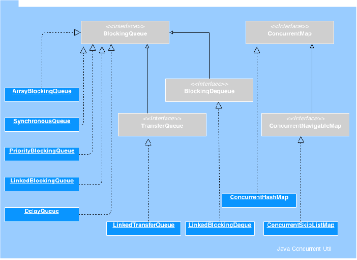

* 169 . Explain about copyonwrite concurrent collections approach?  
  * Java **CopyOnWriteArrayList** is a thread-safe variant of ArrayList in which all mutative operations (add, set, and so on) are implemented by making a fresh copy of the underlying array. It's **immutable snapshot style iterator** **method** uses a reference to the state of the array at the point that the iterator was created.  
  * Its content is an exact copy of data that is inside an *ArrayList* from the time when the *Iterator* was created.   
  * Because of the copying mechanism, the *remove()* operation on the returned *Iterator* is not permitted – resulting with *UnsupportedOperationException:*  
  * [*https\://www\.baeldung.com/java-copy-on-write-arraylist*](https://www.baeldung.com/java-copy-on-write-arraylist)  
  * *RandomAccess Marker*  
  * [*https\://www\.geeksforgeeks.org/copyonwritearraylist-in-java/*](https://www.geeksforgeeks.org/copyonwritearraylist-in-java/)  
* 170 . What is compare-and-swap approach (CAS)?  
  * **Compare and swap** is a technique used when designing concurrent algorithms. Basically, compare and swap compares an expected value to the concrete value of a variable, and if the concrete value of the variable is equals to the expected value, swaps the value of the variable for a new variable.  
  * A very commonly occurring patterns in programs and concurrent algorithms is the **"check then act" pattern**. The check then act pattern occurs when the code first checks the value of a variable and then acts based on that value.

public boolean lock() {  
        if(\!locked) {  
            locked \= true;  
            return true;  
        }  
        return false;  
    }

* If 2 thread access this method both thread can get locked   
  * To work properly in a multithreaded application, "check then act" operations must be atomic. By atomic is meant that both the "check" and "act" actions are executed as an atomic (non-dividable) block of code. Any thread that starts executing the block will finish executing the block without interference from other threads. No other threads can execute the atomic block at the same time.   
  * We can solve using “synchronized”  
  * Modern CPUs have built-in support for atomic compare and swap operations.   
  * public static class MyLock {  
  *     private AtomicBoolean locked \= new AtomicBoolean(false);  
  *     public boolean lock() {  
  *         return locked.compareAndSet(false, true);  
  *     }  
  * }  
  * [http\://tutorials.jenkov.com/java-concurrency/compare-and-swap.html](http://tutorials.jenkov.com/java-concurrency/compare-and-swap.html)  
* 171 . What is a lock? How is it different from using synchronized approach?  
  * LOck:  
  * Lock.acquire();   
  * doSomethingNifty(); // Throws a NPE\!   
  * Lock.release(); // Oh noes, we never release the lock\!  
  * Synchronized  
  * synchronized(myObject) { doSomethingNifty(); }  
  *  I would honestly prefer to avoid using bare Locks in the first place, and just go with a more sophisticated concurrency control such as a CyclicBarrier or a LinkedBlockingQueue, if they meet your needs.  
  * I've never had a reason to use wait() or notify() but there may be some good ones.  
  * [https\://stackoverflow.com/a/4201734/4428927](https://stackoverflow.com/a/4201734/4428927)  
  * When there are 100 synchronized methods in a class, only one thread can be executed of these 100 methods at any given point in time. Only one thread is allowed to access only one method at any given point of time using a synchronized block. This is a very expensive operation. Locks avoid this by allowing configuration of various locks for different purpose. One can have couple of methods synchronized under one lock and other methods under a different lock. This allows more concurrency and also increases overall performance.(**ReentrantLock**)  
  * [https\://www\.geeksforgeeks.org/lock-framework-vs-thread-synchronization-in-java/](https://www.geeksforgeeks.org/lock-framework-vs-thread-synchronization-in-java/)  
  *   
* 172 . What is initial capacity of a Java collection?  
  * 10 for list and 16 for maps 0 for trees  
* 173 . What is load factor?  
  * List is increase by 50% on full java increase it at 0.75% full  
* 174 . When does a Java collection throw UnsupportedOperationException?  
  * List\<String\> sample=Collections.emptyList(); //  
  * List\<String\> ls=new ArrayList\<String\>();  
  * sample \= ls; //sample is unmodifiable Collections.unmodifiableCollection().  
  *   
  * ***When List*** **is a fixed-size *List*, we can’t add/remove elements**.(created using arrays fixed length or varargs)   
  * An attempt to add more elements would cause *UnsupportedOperationException*:  
  * [https\://www\.baeldung.com/java-list-unsupported-operation-exception](https://www.baeldung.com/java-list-unsupported-operation-exception)  
  * [https\://stackoverflow.com/questions/2887590/unsupportedoperationexception-on-collection](https://stackoverflow.com/questions/2887590/unsupportedoperationexception-on-collection)  
* 175 . What is difference between fail-safe and fail-fast iterators?  
  Fail-fast iterators throw a ‘ConcurrentModificationException’ is there is a modification to collection. This was the default behaviour for synchronized collection in pre Java5 age.  
  Structural modification means adding, removing or updating any element from collection while a thread is iterating over that collection. Iterator on ArrayList, HashMap classes are some examples of fail-fast Iterator.  
  public class FailFast {  
      public static void main(String\[\] args) {  
          Map\<String, String\> map \= new HashMap\<String, String\>();  
          map.put("key1", "value1");  
          map.put("key2", "value2");  
          map.put("key3", "value3");  
          Iterator\<String\> iterator \= map.keySet().iterator();  
          while (iterator.hasNext()) {  
              System.out.println(map.get(iterator.next()));  
              map.put("key4", "value4"); //throws //ConcurrentModificationException  
          }  
      }  
  }  
  Fail-Safe iterators don’t throw any exceptions if a collection is structurally modified while iterating over it. This is because, they operate on the clone of the collection, not on the original collection and that’s why they are called fail-safe iterators. Iterator on CopyOnWriteArrayList, ConcurrentHashMap classes   
   those collections which don’t use fail-fast concept may not necessarily create clone/snapshot of it in memory to avoid ConcurrentModificationException. For example, in case of ConcurrentHashMap, it does not operate on a separate copy  
  public class FailSafe {  
      public static void main(String\[\] args) {  
          ConcurrentHashMap\<String, String\> map \= new ConcurrentHashMap\<String, String\>();  
          map.put("key1", "value1");  
          map.put("key2", "value2");  
          map.put("key3", "value3");  
          Iterator\<String\> iterator \= map.keySet().iterator();  
          while (iterator.hasNext()) {  
              System.out.println(map.get(iterator.next()));  
              map.put("key4", "value4");  
          }  
      }  
  }  
  [https\://www\.geeksforgeeks.org/fail-fast-fail-safe-iterators-java/](https://www.geeksforgeeks.org/fail-fast-fail-safe-iterators-java/)  
* 176 . What are atomic operations in Java?  
  An atomic operation cannot stop in the middle, it either happens completely or not at all. In a multi-threaded environment, there can be unexpected results. For eg. if thread1 is reading a value, immediately after thread2 stores the value.  
  To prevent these Java provides atomic operations. Atomic operations are performed as a single unit without interference from other threads ensuring data consistency. A good eg is **AtomicInteger**. To increment a AtomicInteger, we use the incrementAndGet() method. Java ensures this operation is atomic. **AtomicBoolean**

* **177 . What is BlockingQueue in Java?**  
  BlockingQueue interface is introduced in Java to address needs of some Producer Consumer scenarios. It allows consumer to wait(for a specified time or infinitely) for an element to become available. 

### **Generics**

* **178 . What are Generics?**  
  Generics are used to create Generic Classes and methods which can work with different types(classes).  
* 179 . Why do we need Generics? Can you give an example of how Generics make a program more flexible?  
* **180 . How do you declare a generic class?**  
  class MyListGeneric\<T\> {  
      private List\<T\> values;  
      void add(T value) {  
          values.add(value);  
      }  
      void remove(T value) {  
          values.remove(value);  
      }  
      T get(int index) {  
          return values.get(index);  
      }  
  }  
* **181 . What are the restrictions in using generic type that is declared in a class declaration?**  
  To put restriction on type, e.g \<T extends Number\> (will allow types which extends Number).  
* **182 . How can we restrict Generics to a subclass of particular class?**  
  \<T extends Number\>  
* **183 . How can we restrict Generics to a super class of particular class?**  
  \<T super Number\>  
* **184 . Can you give an example of a generic method?**  
  static \<X extends Number\> X doSomething(X number) {  
          X result \= number;  
          // do something with result  
          return result;  
      }  
  **Type Erasure in Generics**  
  Erasure is that entity which understand raw java code(embedded with generics syntax) and convert it into plain ordinary classes, interfaces, and methods at compile time,so that generics incur no run-time overhead.  
  [http\://www\.devinline.com/2014/02/how-generics-works-internally-in-java.html](http://www.devinline.com/2014/02/how-generics-works-internally-in-java.html)

### **Multi threading**

* Thread model ?  
  * The Java run-time system depends on threads for many things. Threads reduce inefficiency by preventing the waste of CPU cycles.Threads exist in several states. Following are those states:    
  * New – When we create an instance of Thread class, a thread is in a new state.  
  * Runnable – The Java thread is in running state.  
  * Suspended – A running thread can be suspended, which temporarily suspends its activity. A suspended thread can then be resumed, allowing it to pick up where it left off.  
  * Blocked – A java thread can be blocked when waiting for a resource.  
  * Terminated – A thread can be terminated, which halts its execution immediately at any given time. Once a thread is terminated, it cannot be resumed.   
  *   
* Main thread Main Thread so important?  
* Because this thread effects the other ‘child’ threads  
* Because it performs various shutdown actions  
* It is created automatically when your program is started.  
* [https\://www\.edureka.co/blog/java-thread/](https://www.edureka.co/blog/java-thread/)  
* 185 . What is the need for threads in Java?  
  * we use Threads to make Java application faster by doing multiple things at same time. In technical terms, Thread helps you to achieve parallelism in Java program.  
  * 4\) To sever multiple clients at the same time.  
  * 3\) For reducing response time  
  * 2\) To take full advantage of CPU power.  
  * 1\) To make a task run parallel to another task e.g. drawing and event handling.  
  * [https\://javarevisited.blogspot.com/2017/03/why-we-use-threads-in-java.html\#ixzz6FRU5IYy4](https://javarevisited.blogspot.com/2017/03/why-we-use-threads-in-java.html#ixzz6FRU5IYy4)  
  * multithreaded program contains two or more parts that can run concurrently. Each part of such a program is called thread and each thread defines a separate path of execution. Thus, multithreading is a specialized form of multitasking.  
* 186 . How do you create a thread?  
  * We create a class that extends the **java.lang.Thread** class. This class overrides the run() method available in the Thread class. A thread begins its life inside run() method. We create an object of our new class and call start() method to start the execution of a thread. Start() invokes the run() method on the Thread object.

| Method  | Meaning |
| ----- | ----- |
| getName | Obtain thread’s name |
| getPriority | Obtain thread’s priority |
| isAlive | Determine if a thread is still running |
| join | Wait for a thread to terminate |
| run | Entry point for the thread |
| sleep | Suspend a thread for a period of time |
| start | Start a thread by calling its run method |

  *   
* 187 . How do you create a thread by extending thread class?  
* 188 . How do you create a thread by implementing runnable interface?  
  * We create a new class which implements java.lang.Runnable interface and override run() method. Then we instantiate a Thread object and call start() method on this object.  
  * [https\://www\.geeksforgeeks.org/multithreading-in-java/](https://www.geeksforgeeks.org/multithreading-in-java/)  
* 189 . How do you run a thread in Java?  
* 190 . What are the different states of a thread?  
  * 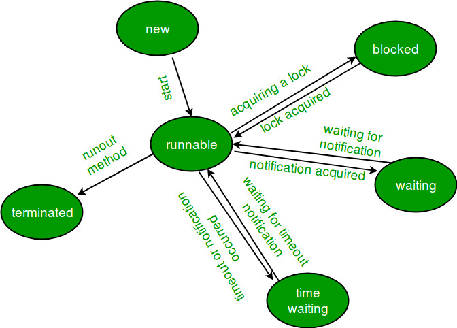  
  * A [thread](http://www.geeksforgeeks.org/multithreading-in-java/) in Java at any point of time exists in any one of the following states. A thread lies only in one of the shown states at any instant:  
  * New  
  * Runnable  
  * Blocked  
  * Waiting  
  * Timed Waiting  
  * Terminated  
  * [https\://www\.geeksforgeeks.org/lifecycle-and-states-of-a-thread-in-java/](https://www.geeksforgeeks.org/lifecycle-and-states-of-a-thread-in-java/)  
* 191 . What is priority of a thread? How do you change the priority of a thread?  
  * thread scheduler assigns processor to a thread based on priority of thread. Whenever we create a thread in Java, it always has some priority assigned to it.   
  * Priority can either be given by JVM(parent thread) while creating the thread or it can be given by programmer explicitly.  
  * Accepted value of priority for a thread is in range of 1 to 10  
  * **setPriority(int newPriority):** java.lang.Thread.setPriority() method changes the priority of thread to the value newPriority. This method throws IllegalArgumentException if value of parameter newPriority goes beyond minimum(1) and maximum(10) limit.  
  * Thread with highest priority will get execution chance prior to other threads.  
  * Default priority for main thread is always 5,   
  * [https\://www\.geeksforgeeks.org/java-thread-priority-multithreading/](https://www.geeksforgeeks.org/java-thread-priority-multithreading/)  
* 192 . What is executorservice?  
  * *ExecutorService* automatically provides a pool of threads and API for assigning tasks to it.  
  * ExecutorService, represents an asynchronous execution mechanism which is capable of executing tasks concurrently in the background.   
  * Executors newFixedThreadPool() factory method. This creates a thread pool with 10 threads executing tasks.  
  * an anonymous implementation of the Runnable interface is passed to the execute() method. This causes the Runnable to be executed by one of the threads in the ExecutorService.  
* 193 . Can you give an example for executorservice?  
  * ExecutorService executorService \= Executors.newFixedThreadPool(10);  
  *   
  * executorService.execute(new Runnable() {  
  *     public void run() {  
  *         System.out.println("Asynchronous task");  
  *     }  
  * });  
  *   
  * executorService.shutdown();  
* 194 . Explain different ways of creating executor services .  
  * ExecutorService executorService1 \= Executors.newSingleThreadExecutor();  
  * ExecutorService executorService2 \= Executors.newFixedThreadPool(10);  
  * ExecutorService executorService3 \= Executors.newScheduledThreadPool(10);  
    * Future\<String\> resultFuture \=   executorService.schedule(callableTask, 1, TimeUnit.SECONDS);  
    * Future\<String\> resultFuture \= service   .scheduleAtFixedRate(runnableTask, 100, 450, TimeUnit.MILLISECONDS);  
    * service.scheduleWithFixedDelay(task, 100, 150, TimeUnit.MILLISECONDS);  
  * executorService.shutdown();  
  * executorService.shutdownNow();  
  * executorService.awaitTermination();  
  * [http\://tutorials.jenkov.com/java-util-concurrent/executorservice.html](http://tutorials.jenkov.com/java-util-concurrent/executorservice.html)  
* 195 . How do you check whether an execution service task executed successfully?  
  * execute(Runnable)  
  * Future submit(Runnable)  
  * Future submit(Callable)  
  * invokeAny(...)  //takes a collection of Callable objects  
  * List\<Future\<?\>\> invokeAll(...)  
  *   
* 196 . What is callable? How do you execute a callable from execution service?  
  * Callable\<String\> callableTask \= () \-\> {  
  *     TimeUnit.MILLISECONDS.sleep(300);  
  *     return "Task's execution";  
  * };  
  * Future\<String\> future \=   executorService.submit(callableTask);  
  * [https\://www\.baeldung.com/java-executor-service-tutorial](https://www.baeldung.com/java-executor-service-tutorial)  
* 197 . What is synchronization of threads?  
  * synchronization method that only one thread can access the resource at a given point of time.  
  * Java provides a way of creating threads and synchronizing their task by using synchronized blocks.   
  * Synchronized blocks in Java are marked with the synchronized keyword. A synchronized block in Java is synchronized on some object.   
  * All synchronized blocks synchronized on the same object can only have one thread executing inside them at a time. All other threads attempting to enter the synchronized block are blocked until the thread inside the synchronized block exits the block.  
  *   
* 198 . Can you give an example of a synchronized block?  
  * synchronized(sync\_object)  
  * {  
  *    // Access shared variables and other shared resources  
  * }  
  * [https\://www\.geeksforgeeks.org/synchronized-in-java/](https://www.geeksforgeeks.org/synchronized-in-java/)  
* 199 . Can a static method be synchronized?  
  *   
* 200 . What is the use of join method in threads?  
  *  the join() method which allows one thread to wait until another thread completes its execution. If **t** is a Thread object whose thread is currently executing, then **t.join()** will make sure that **t** is terminated before the next instruction is executed by the program.  
  * [https\://www\.geeksforgeeks.org/joining-threads-in-java/](https://www.geeksforgeeks.org/joining-threads-in-java/)  
* 201 . Describe a few other important methods in threads?  
* 202 . What is a deadlock?  
* 203 . What are the important methods in Java for inter-thread communication?  
* 204 . What is the use of wait method?  
* 205 . What is the use of notify method?  
* 206 . What is the use of notifyall method?  
* 207 . Can you write a synchronized program with wait and notify methods?  
* Yeild vs join  
* Volatile vs syncronized  
* Fork join  
* Fork join vs executor service  
  * *ExecutorService* gives the developer the ability to control the number of generated threads and the granularity of tasks which should be executed by separate threads. The best use case for *ExecutorService* is the processing of independent tasks, such as transactions or requests according to the scheme “one thread for one task.”  
  * fork/join was designed to speed up work which can be broken into smaller pieces recursively.  
* Interesting reads  
  * [https\://www\.geeksforgeeks.org/volatile-keyword-in-java/](https://www.geeksforgeeks.org/volatile-keyword-in-java/)  
* Cyclic barriers and countdownlatch   
  * A *CountDownLatch* is a construct that a thread *wait*s on while other threads *count down* on the latch until it reaches zero.  
  * A *CyclicBarrier* is a reusable construct where a group of threads *waits* together until all of the threads *arrive*. At that point, the barrier is broken and an *action* can optionally be taken.  
  * [https\://www\.baeldung.com/java-cyclicbarrier-countdownlatch](https://www.baeldung.com/java-cyclicbarrier-countdownlatch)

Good reads

[http\://tutorials.jenkov.com/java-concurrency/index.html](http://tutorials.jenkov.com/java-concurrency/index.html)

### **Functional Programming \- Lamdba expressions and Streams**

> Modern answers with diagrams and 65 coding problems: [Java streams and functional programming](java-streams.md).


* 208 . What is functional programming?  
  * Functional programming (also called FP) is a way of thinking about software construction by **creating pure functions.** It avoid concepts of shared state, mutable data observed in Object Oriented Programming.  
  * Functional langauges **emphazies on expressions and declarations rather than execution of statements**. Therefore, unlike other procedures which depend on a local or global state, value output in **FP depends only on the arguments passed to the function.**  
  *  Its main focus is on “**what to solve**” in contrast to an imperative style where the main focus is “how to solve”. It uses expressions instead of statements.  
  * [https\://www\.guru99.com/functional-programming-tutorial.html](https://www.guru99.com/functional-programming-tutorial.html)  
  * [https\://www\.geeksforgeeks.org/functional-programming-paradigm/](https://www.geeksforgeeks.org/functional-programming-paradigm/)  
* 209 . Can you give an example of functional programming?  
* 210 . What is a stream?  
  * Stream API is used to process collections of objects.  
  *  A stream is a sequence of objects that supports various methods which can be pipelined to produce the desired result.  
  * The features of Java stream are –  
    * A stream is not a data structure instead it takes input from the Collections, Arrays or I/O channels.  
    * Streams don’t change the original data structure, they only provide the result as per the pipelined methods.  
    * Each intermediate operation is lazily executed and returns a stream as a result, hence various intermediate operations can be pipelined. Terminal operations mark the end of the stream and return the result.  
  * [https\://www\.geeksforgeeks.org/stream-in-java/](https://www.geeksforgeeks.org/stream-in-java/)  
* 211 . Explain about streams with an example?  
  * Streams can be created from different element sources e.g. collection or array with the help of *stream()* and *of()* methods:  
    String\[\] arr \= new String\[\]{"a", "b", "c"};  
  * Stream\<String\> stream \= Arrays.stream(arr);  
  * stream \= Stream.of("a", "b", "c");  
  * A *stream()* default method is added to the *Collection* interface and allows creating a *Stream\<T\>* using any collection as an element source  
  * Stream API also simplifies multithreading by providing the parallelStream() method that runs operations over stream’s elements in parallel mode.  
  * [https\://www\.baeldung.com/java-8-streams-introduction](https://www.baeldung.com/java-8-streams-introduction)  
* what are intermediate operations in streams?  
  * **map:** The map method is used to map the items in the collection to other objects according to the Predicate passed as argument.  
    List number \= Arrays.asList(2,3,4,5);  
    List square \= number.stream().map(x-\>x\*x).collect(Collectors.toList());  
  * **filter:** The filter method is used to select elements as per the Predicate passed as argument.  
    List names \= Arrays.asList("Reflection","Collection","Stream");  
    List result \= names.stream().filter(s-\>s.startsWith("S")).collect(Collectors.toList());  
  * **sorted:** The sorted method is used to sort the stream.  
    List names \= Arrays.asList("Reflection","Collection","Stream");  
    List result \= names.stream().sorted().collect(Collectors.toList());  
* 212 . What are terminal operations in streams?  
  * **collect:** The collect method is used to return the result of the intermediate operations performed on the stream.  
    List number \= Arrays.asList(2,3,4,5,3);  
    Set square \= number.stream().map(x-\>x\*x).collect(Collectors.toSet());  
  * **forEach:** The forEach method is used to iterate through every element of the stream.  
    List number \= Arrays.asList(2,3,4,5);  
    number.stream().map(x-\>x\*x).forEach(y-\>System.out.println(y));  
  * **reduce:** The reduce method is used to reduce the elements of a stream to a single value.  
    The reduce me	rameter.  
    List number \= Arrays.asList(2,3,4,5);  
    int even \= number.stream().filter(x-\>x%2==0).reduce(0,(ans,i)-\> ans+i);  
  *   
* 213 . What are method references?  
  * **Method references are a special type of lambda expressions**. They’re often used to create simple lambda expressions by referencing existing methods.  
  * There are four kinds of method references:  
    * Static methods  
    * Instance methods of particular objects  
    * Instance methods of an arbitrary object of a particular type  
    * Constructor  
  * [https\://www\.baeldung.com/java-method-references](https://www.baeldung.com/java-method-references)  
* 214 . What are lambda expressions and lamda calculus?  
  * Lambda calculus is framework developed by Alonzo Church to study computations with functions.  
  * It gives the definition of what is computable. Anything that can be computed by lambda calculus is computable. It is equivalent to Turing machine in its ability to compute. It provides a theoretical framework for describing functions and their evaluation. It forms the basis of almost all current functional programming languages.  
* 215 . Can you give an example of lambda expression?  
  * Lambda expressions basically express instances of [functional interfaces](https://www.geeksforgeeks.org/functional-interfaces-java/) (An interface with single abstract method is called functional interface. An example is java.lang.Runnable). lambda expressions implement the only abstract function and therefore implement functional interfaces  
  * lambda expressions are added in Java 8 and provide below functionalities.  
    * Enable to treat functionality as a method argument, or code as data.  
    * A function that can be created without belonging to any class.  
    * A lambda expression can be passed around as if it was an object and executed on demand.  
  * [https\://www\.geeksforgeeks.org/lambda-expressions-java-8/](https://www.geeksforgeeks.org/lambda-expressions-java-8/)  
  * [https\://www\.baeldung.com/java-8-lambda-expressions-tips](https://www.baeldung.com/java-8-lambda-expressions-tips)  
* 216 . Can you explain the relationship between lambda expression and functional interfaces?  
* 217 . What is a predicate?  
* 218 . What is the functional interface \- function?  
  * A functional interface in Java is an interface that only has one abstract method. By an abstract method is meant only one method which is not implemented. An interface can have multiple methods, e.g. default methods and static methods, both with implementations, but as long as the interface only has one method that is not implemented, the interface is considered a functional interface.  
* 219 . What is a consumer?  
  *   
* 220 . Can you give examples of functional interfaces with multiple arguments?  
  *   
* 221\. What are pure Function and its benefits  
  * Pure functional programming has a set of rules to follow too:  
    * No state  
    * No side effects  
    * Immutable variables  
    * Favour recursion over looping  
* 222\. **create Immutable class**

Immutable class means that once an object is created, we cannot change its content. In Java, all the [wrapper classes](https://www.geeksforgeeks.org/wrapper-classes-java/) (like Integer, Boolean, Byte, Short) and String class is immutable. We can create our own immutable class as well.

Following are the requirements:

* The class must be declared as final (So that child classes can’t be created)  
* Data members in the class must be declared as final (So that we can’t change the value of it after object creation)  
* A parameterized constructor  
* Getter method for all the variables in it  
* No setters(To not have the option to change the value of the instance variable)  
  


**\--------------Extras**

* JAVA memory model.  
* JAVA garbage collection process.What is survivor space?  
*   
* [**Where are static methods and static variables stored in Java?**](https://stackoverflow.com/questions/8387989/where-are-static-methods-and-static-variables-stored-in-java)  
  * Static variables are associated with the class, not with individual objects. This means there is only one copy of a static variable, shared among all instances of the class.  
  * All objects of a class share the same static variable. If one object modifies the value of a static variable, that change is reflected for all other objects of the same class.  
  * Static variables can be accessed directly using the class name (e.g., `ClassName.staticVariable`) without the need to create an object of the class. While they can also be accessed through an object reference, using the class name is the recommended and clearer approach.  
  * **Use cases:**  
    Static variables are commonly used for:  
    * **Constants:** Variables whose values remain constant throughout the program's execution (often declared as `public static final`).  
    * **Counters:** Keeping track of the number of objects created for a class.  
    * **Global data:** Storing data that needs to be accessible globally within the context of that class.  
    *   
  *    static int studentCount \= 0; *// Static variable to count students*  
  * In Java, a static method is a method that belongs to the class itself rather than to any specific instance (object) of that class. This means you can call a static method directly on the class using the class name, without needing to create an object of that class first.   
  * You call a static method using `ClassName.methodName()`.  
  * Static variables are stored in **METASPACE(java8)**  
  * Static methods (in fact all methods) as well as static variables are stored in the **PermGen** section of the heap, since they are part of the reflection data  
  * [https\://stackoverflow.com/questions/8387989/where-are-static-methods-and-static-variables-stored-in-java](https://stackoverflow.com/questions/8387989/where-are-static-methods-and-static-variables-stored-in-java)  
* Reflection  
  * Reflection is a set of functions which allows you to access the runtime information of your program and modify it behavior (with some limitations).  
  * It's useful because it allows you to change the runtime behaivour depending on the meta information of your program, that is, you can check the return type of a function and change the way you handle the situation.  
  * Annotations @Test  
  * Method method \= foo.getClass().getMethod("doSomething", null); method.invoke(foo, null);  
  * [https\://www\.baeldung.com/java-reflection](https://www.baeldung.com/java-reflection)  
  * [https\://stackoverflow.com/questions/37628/what-is-reflection-and-why-is-it-useful](https://stackoverflow.com/questions/37628/what-is-reflection-and-why-is-it-useful)  
*   
*   
* Explain externalizable interface  
  * When you use Serializable interface, your class is serialized automatically by default. But you can override writeObject() and readObject() methods to control more complex object serialization process.  
  * When you use Externalizable interface, you have a complete control over your class's serialization process.  
  * [https\://www\.careerride.com/Java-Externalizable-Interface.aspx](https://www.careerride.com/Java-Externalizable-Interface.aspx)  
* 5)Write a JAVA program to implement deadlock.Resolve it too.

Q. Java 8 features

1. forEach() method in Iterable interface   
   Different ways to traverse a collection:  
   //creating sample Collection  
           List\<Integer\> myList \= new ArrayList\<Integer\>();  
           for(int i=0; i\<10; i++) myList.add(i);  
              
           //traversing using Iterator  
           Iterator\<Integer\> it \= myList.iterator();  
           while(it.hasNext()){  
               Integer i \= it.next();  
               System.out.println("Iterator Value::"+i);  
           }  
              
           //traversing through forEach method of Iterable with anonymous class  
           myList.forEach(t \-\> System.out.println("forEach anonymous class Value::"+t));  
              
           //traversing with Consumer interface implementation  
           MyConsumer action \= new MyConsumer();  
           myList.forEach(action);  
              
     
2. default and static methods in Interfaces

If you read forEach method details carefully, you will notice that it’s defined in Iterable interface but we know that interfaces can’t have a method body. From Java 8, interfaces are enhanced to have a method with implementation. We can use default and static keyword to create interfaces with method implementation. forEach method implementation in Iterable interface is:

| default void forEach(Consumer\<? super T\> action) {     Objects.requireNonNull(action);     for (T t : this) {         action.accept(t);     } } |
| :---- |

3. Functional Interfaces and Lambda Expressions  
4. Java Stream API for Bulk Data Operations on Collections  
5. Java Time API  
6. Collection API improvements  
7. Concurrency API improvements  
8. Java IO improvements

   

* Controller and RestController difference  
* @Component  
* @Qualifier  
* Design patterns in java  
* How to declare Singleton class without annotation  
* String declared with new keyword, how many objects created  
* Marker interface

### **New Features**

* 221 . What are the new features in Java 5?  
* 222 . What are the new features in Java 6?  
* 223 . What are the new features in Java 7?  
* 224 . What are the new features in Java 8?  
* 224 . What are the new features in Java 11?  
*   
* Lambda Expressions and Streams : [https\://www\.youtube.com/watch?v=7YBPb64h2l4](https://www.youtube.com/watch?v=7YBPb64h2l4)  
* Java MultiThreading : [https\://www\.youtube.com/watch?v=AfVbJDr-8ic](https://www.youtube.com/watch?v=AfVbJDr-8ic)  
* Java Interview Questions and Answers : [https\://www\.youtube.com/watch?v=5aHZABb1Iwk](https://www.youtube.com/watch?v=5aHZABb1Iwk)  
* Java Collections Interview Questions and Answers : [https\://www\.youtube.com/watch?v=3hgYHXDVh-o](https://www.youtube.com/watch?v=3hgYHXDVh-o)  
* Exception Handling : [https\://www\.youtube.com/watch?v=wj3UmzeyrvE](https://www.youtube.com/watch?v=wj3UmzeyrvE)  
* JUnit : [https\://www\.youtube.com/watch?v=o5k9NOR9lrI](https://www.youtube.com/watch?v=o5k9NOR9lrI)  
* Design Patterns : [https\://www\.youtube.com/watch?v=f5Rzr5mVNbY](https://www.youtube.com/watch?v=f5Rzr5mVNbY)  
* Eclipse : [https\://www\.youtube.com/watch?v=s4ShbtOHMCA](https://www.youtube.com/watch?v=s4ShbtOHMCA)  
* Mockito : [https\://www\.youtube.com/watch?v=d2KwvXQgQx4](https://www.youtube.com/watch?v=d2KwvXQgQx4)  
* Spring MVC : [https\://www\.youtube.com/watch?v=BjNhGaZDr0Y](https://www.youtube.com/watch?v=BjNhGaZDr0Y)  
* JSP Servlets : [https\://www\.youtube.com/watch?v=Vvnliarkw48](https://www.youtube.com/watch?v=Vvnliarkw48)  
* Spring : [https\://www\.youtube.com/watch?v=24rGqtxuLhc](https://www.youtube.com/watch?v=24rGqtxuLhc)  
* OOPS : [https\://www\.youtube.com/watch?v=yJ5RSEZS9oA](https://www.youtube.com/watch?v=yJ5RSEZS9oA)  
* Maven : [https\://www\.youtube.com/watch?v=0CFWeVgzsqY](https://www.youtube.com/watch?v=0CFWeVgzsqY)

[http\://tutorials.jenkolv.com/java-concurrency/index.html](http://tutorials.jenkov.com/java-concurrency/index.html)
