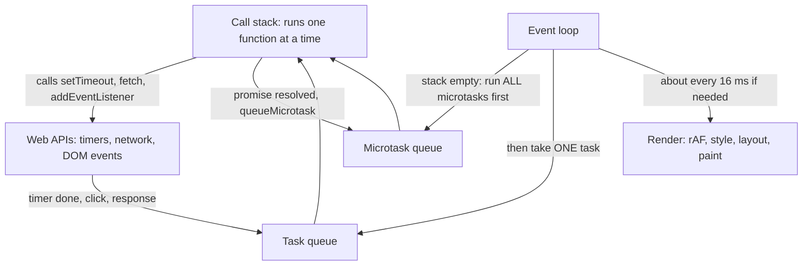
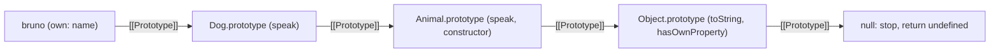
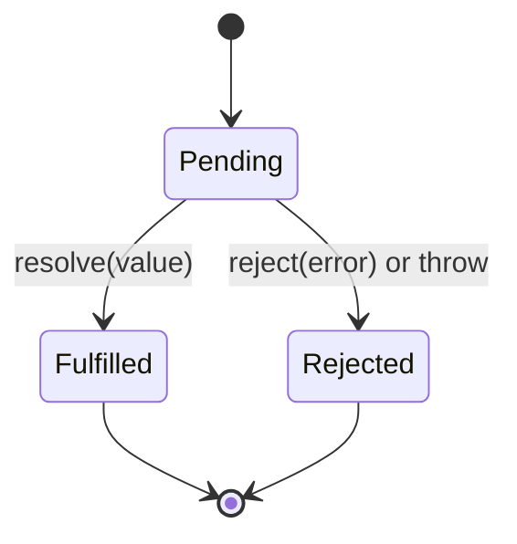
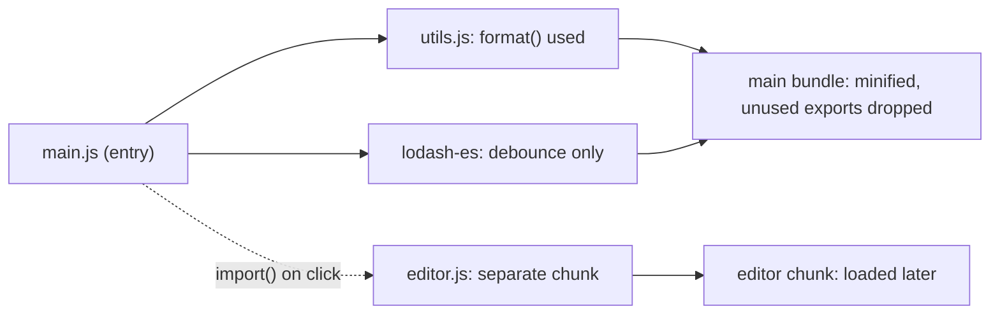

# JavaScript and TypeScript

[← Back to README](../README.md)

This page covers the JavaScript and TypeScript a senior full-stack engineer is asked about.
It starts with how JavaScript runs, then closures, `this`, prototypes and promises.
It ends with 30 coding problems (with real output) and short answers to common questions.

React and Next.js have their own pages: [React](react.md) and [Next.js](nextjs.md).

**Contents:**

- [How JavaScript runs: the event loop](#how-javascript-runs-the-event-loop)
- [Scope, hoisting and the temporal dead zone](#scope-hoisting-and-the-temporal-dead-zone)
- [Closures](#closures)
- [this, call, apply and bind](#this-call-apply-and-bind)
- [Prototypes and classes](#prototypes-and-classes)
- [Promises and async/await](#promises-and-asyncawait)
- [Equality, types and coercion](#equality-types-and-coercion)
- [Modern JavaScript (ES2015 to ES2025)](#modern-javascript-es2015-to-es2025)
- [Modules, bundlers and tree shaking](#modules-bundlers-and-tree-shaking)
- [Memory and performance in the browser](#memory-and-performance-in-the-browser)
- [TypeScript essentials for seniors](#typescript-essentials-for-seniors)
- [JavaScript coding problems (with answers)](#javascript-coding-problems-with-answers)
- [Older questions (2019 list)](#older-questions-2019-list)
- [JavaScript questions](#javascript-questions)

All code was run with Node.js 24. The output in the comments is the real output.

---

## How JavaScript runs: the event loop

**In one line:** JavaScript runs on one thread, and the event loop decides which waiting piece of code runs next.

**Story:** Think of a small restaurant with **one cook**.
The cook can make only one dish at a time (one thread).
Helpers do the slow work: the oven, the delivery boy, the phone (the browser's Web APIs).
When a helper is done, they put a slip on a board.
There are two boards. The **urgent board** (microtasks) is for small follow-up steps of the dish the cook just made.
The **normal board** (tasks) is for new orders: a timer rang, a click came, a network reply came.
The cook always clears the whole urgent board before taking one slip from the normal board.
Between normal slips, the waiter may **serve the plates** (the browser paints the screen).

**How it works:**
1. **Call stack:** the list of functions running right now. JavaScript runs the stack until it is empty.
2. **Web APIs:** `setTimeout`, `fetch`, DOM events. The browser (or Node.js) does this work outside the stack.
3. When a Web API finishes, it puts the callback in a queue.
4. **Task queue** (also called macrotask queue): `setTimeout`, `setInterval`, click events, network events, `MessageChannel`.
5. **Microtask queue:** promise callbacks (`.then`, code after `await`), `queueMicrotask`, `MutationObserver`.
6. **The loop:** take one task, run it, then run **all** microtasks (including new ones added on the way).
7. **Rendering step:** after microtasks, the browser may run `requestAnimationFrame` callbacks, then style, layout and paint. This happens about 60 times a second (every ~16 ms), only if something changed.

**Diagram:**



**Example: the classic output-order puzzle**

```js
console.log("1 sync start");
setTimeout(() => console.log("2 timeout"), 0);              // task queue
Promise.resolve().then(() => console.log("3 promise then")); // microtask
queueMicrotask(() => console.log("4 microtask"));           // microtask
(async () => {
  console.log("5 async body");  // runs now, async functions start sync
  await null;                   // rest of the function becomes a microtask
  console.log("6 after await");
})();
console.log("7 sync end");

// Real output (node 24):
// 1 sync start
// 5 async body
// 7 sync end
// 3 promise then
// 4 microtask
// 6 after await
// 2 timeout
```

Why this order:
- `1`, `5`, `7` are plain code on the call stack. They run first.
- `3`, `4`, `6` are microtasks. They run in the order they were queued, as soon as the stack is empty.
- `2` is a task. It waits until all microtasks are done, even with a 0 ms delay.

**Good and bad:**

| Good | Bad |
|---|---|
| Split long work into small chunks (`setTimeout`, `scheduler.yield()`), so the page can paint | A loop that runs 2 seconds. The page freezes. No clicks, no paint |
| Use Web Workers for heavy work (parsing big files, image work) | Endless microtask chains. Microtasks block rendering too |
| Use `requestAnimationFrame` for visual updates | Using `setTimeout(fn, 0)` and expecting it to run "now" |

**What can go wrong:**
- A long task (over 50 ms) makes the page feel slow. Google measures this as **INP** (Interaction to Next Paint, how fast the page reacts to a click).
- `setTimeout(fn, 0)` is not 0 ms. Browsers clamp nested timers to at least 4 ms. Background tabs are throttled to about 1 second.

**Node.js is a bit different:** it uses libuv (a C library for async I/O) and runs phases (timers, I/O callbacks, `setImmediate`, close callbacks).
`process.nextTick` runs before promise microtasks.
The main rule is the same: all microtasks run before the next task.

**Say this in the interview:**

> JavaScript has one call stack, so it runs one thing at a time.
> Slow work like timers and network calls is done by the browser, and the callback is put in a queue.
> After each task, the event loop empties the whole microtask queue, which holds promise callbacks.
> Then the browser may paint, then it takes the next task. That is why a promise callback runs before a `setTimeout(0)`.

**They may ask next:**
- **Is `setTimeout(fn, 1000)` exact?** No. It is the minimum wait. If the stack is busy, it runs later.
- **Can microtasks freeze the page?** Yes. If each microtask adds another one, the loop never reaches the render step.
- **Where does `requestAnimationFrame` run?** In the render step, just before paint. Good for animations.
- **How do you find long tasks?** Chrome DevTools Performance panel. Long tasks are marked with a red corner.

---

## Scope, hoisting and the temporal dead zone

**In one line:** Scope is where a variable can be seen; hoisting means declarations are known before the code runs, but `let` and `const` cannot be used before their line.

**Story:** A school register.
Before class starts, the teacher writes every student's name in the register (hoisting).
With `var`, the name is written with "absent" (`undefined`), so you can ask about them early.
With `let` and `const`, the name is written, but the line is **locked** until the student walks in.
Asking about a locked name is an error. This locked time is the **temporal dead zone (TDZ)**.

**How it works:**
1. **Scope types:** global, module (each ES module file), function, and block (`{ }` for `let`, `const`, `class`).
2. `var` is function-scoped. It ignores `{ }` blocks, so it "leaks" out of `if` and `for`.
3. `let` and `const` are block-scoped.
4. **Function declarations** are hoisted fully. You can call them before the line.
5. **Function expressions** (`var f = function () {}`) hoist only the variable, not the function.
6. **Lexical scope:** a function sees the variables where it was **written**, not where it is called.

**Example:**

```js
console.log(typeof sayHi, a);  // function undefined
var a = 1;
function sayHi() { return "hi"; }

try { console.log(b); } catch (e) { console.log(e.name + ": " + e.message); }
// ReferenceError: Cannot access 'b' before initialization   <- TDZ
let b = 2;

try { hello(); } catch (e) { console.log(e.name + ": " + e.message); }
// TypeError: hello is not a function   <- only "var hello" was hoisted
var hello = function () {};

{ var x = "var leaks"; let y = "let stays"; }
console.log(x, typeof y);       // var leaks undefined
```

**Good and bad:**

| Good | Bad |
|---|---|
| `const` by default, `let` when the value changes | `var` in new code |
| Declare variables at the top of their block | Using a variable before its line and hoping for `undefined` |
| ES modules: each file has its own scope | Putting things on `window` (global) |

**Say this in the interview:**

> JavaScript creates all declarations before it runs a scope. That is hoisting.
> `var` starts as `undefined`, so early reads give `undefined`.
> `let` and `const` are hoisted too, but they are in the temporal dead zone until their line runs, so early reads throw a ReferenceError.
> I use `const` by default and `let` only when I reassign.

**They may ask next:**
- **Does `const` make an object read-only?** No. It only stops reassignment. Use `Object.freeze` for a shallow read-only object.
- **Are classes hoisted?** Yes, but like `let`. Using a class before its line throws.
- **What is the scope chain?** If a variable is not in the current scope, JavaScript looks in the outer scope, then the next one, up to global.

---

## Closures

**In one line:** A closure is a function that remembers the variables from the place where it was created, even after that outer function has finished.

**Story:** A student goes on a school trip with a backpack.
The school (outer function) closes for the day. But the backpack still has the lunch box and the water bottle.
Wherever the student goes, they can open the backpack and use what is inside.
The function is the student. The backpack is the closure.

**How it works:**
1. When a function is created, it keeps a link to its outer scope.
2. When the outer function returns, its variables are not deleted if an inner function still uses them.
3. Each call of the outer function creates a **new** backpack.
4. This gives us private state without classes.

**Example: counter with private state**

```js
function makeCounter() {
  let count = 0;                     // private: only the returned functions see it
  return { inc: () => ++count, get: () => count };
}
const c = makeCounter();
c.inc(); c.inc();
console.log(c.get(), c.count);       // 2 undefined
```

**Example: the loop with `var` vs `let`**

```js
const fns1 = [], fns2 = [];
for (var i = 0; i < 3; i++) fns1.push(() => i); // ONE i shared by all
for (let j = 0; j < 3; j++) fns2.push(() => j); // a NEW j for each loop round
console.log(fns1.map(f => f()), fns2.map(f => f()));
// [ 3, 3, 3 ] [ 0, 1, 2 ]
```

- With `var`, there is one `i` for the whole function. When the functions run, the loop is over and `i` is 3.
- With `let`, each round of the loop gets its own `j`.

**Where closures are used:**
- **Memoize:** the cache lives in a closure. See [memoize](#9-memoize).
- **Debounce and throttle:** the timer id lives in a closure. See [debounce](#1-debounce).
- **Module pattern** (before ES modules): an IIFE (a function that runs at once) returns only public functions.
- **React hooks:** every render creates new closures. A **stale closure** is a callback that still sees old state. See [React](react.md).

**Module pattern (old style):**

```js
const cart = (() => {
  const items = [];                          // private
  return {
    add: item => items.push(item),
    count: () => items.length,
  };
})();
cart.add("tea");
console.log(cart.count(), cart.items);       // 1 undefined
```

Today we use ES modules: anything not exported is private to the file.

**Good and bad:**

| Good | Bad |
|---|---|
| Private state without a class | A closure that keeps a big array alive forever (memory leak) |
| Factory functions, debounce, memoize | An event listener with a closure that is never removed |
| Clear, small functions | Stale closures in React `useEffect` with missing dependencies |

**Closures and memory leaks:**
- The closure keeps its outer variables alive. The garbage collector cannot free them.
- If you add `window.addEventListener("resize", handler)` and never remove it, the handler and everything it closes over stay in memory.
- Fix: remove listeners, clear timers, set big references to `null` when done. See [memory](#memory-and-performance-in-the-browser).

**Say this in the interview:**

> A closure is a function plus the variables it captured from where it was written.
> The outer function can return, but its variables live on as long as the inner function is used.
> I use closures for private state, memoize, debounce, and every React hook is built on them.
> The risk is memory: a closure keeps its captured data alive, so I clean up listeners and timers.

**They may ask next:**
- **Does a closure copy the variable?** No. It keeps a live link. If the value changes, the closure sees the new value.
- **What is a stale closure?** A function that captured an old value. In React, a `setInterval` callback may see the first `count` forever. Fix with a functional update `setCount(c => c + 1)` or correct dependencies.
- **Before `let`, how did people fix the loop?** With an IIFE: `(function (i) { ... })(i)` to make a new scope per round.

---

## this, call, apply and bind

**In one line:** `this` is decided by **how** a function is called, not where it is written (except arrow functions, which take `this` from the outside).

**Story:** The word "my" in a sentence.
If Asha says "my phone", it means Asha's phone. If Ravi says the same sentence, it means Ravi's phone.
The sentence is the same. The speaker (the caller) decides what "my" means.
An arrow function is like a recorded message: "my" always means the person who recorded it.

**The four rules (highest priority first):**

| Rule | How you call it | `this` is |
|---|---|---|
| 1. `new` binding | `new Person()` | The new object |
| 2. Explicit binding | `fn.call(obj)`, `fn.apply(obj)`, `fn.bind(obj)` | `obj` |
| 3. Implicit binding | `obj.fn()` | `obj` (the thing before the dot) |
| 4. Default binding | `fn()` | `undefined` in strict mode and modules, `globalThis` in old sloppy mode |
| Arrow function | Any way | `this` of the outer scope. Cannot be changed |

**call, apply and bind:**
- `fn.call(obj, a, b)`: call now, arguments one by one.
- `fn.apply(obj, [a, b])`: call now, arguments as an array.
- `fn.bind(obj, a)`: do not call. Return a new function with `this` fixed forever.

**Example:**

```js
"use strict";
const user = {
  name: "Asha",
  regular() { return this?.name; },
  later() { setTimeout(() => console.log("arrow in method:", this.name), 0); },
};
console.log(user.regular());               // Asha       (implicit: user.regular())
const fn = user.regular;
console.log(fn());                         // undefined  (lost "this": plain call)
console.log(fn.call({ name: "Ravi" }), fn.apply({ name: "Meera" }), fn.bind({ name: "Kiran" })());
// Ravi Meera Kiran
user.later();                              // arrow in method: Asha (arrow keeps outer this)
function Person(n) { this.name = n; }
console.log(new Person("Neha").name);      // Neha
const bound = fn.bind({ name: "first" });
console.log(bound.call({ name: "second" })); // first (bind wins over call)
```

**Good and bad:**

| Good | Bad |
|---|---|
| Arrow functions for callbacks inside methods | Arrow functions as object methods (no own `this`) |
| `bind` once in the constructor, or class fields with arrows | Passing `obj.method` as a callback and losing `this` |
| `"use strict"` or modules, so lost `this` fails loudly | Relying on `this` being `window` |

**Say this in the interview:**

> `this` is set at call time, not where the function is written.
> With `new` it is the new object. With call, apply or bind it is the object I pass.
> With `obj.fn()` it is `obj`. A plain call gives `undefined` in strict mode.
> Arrow functions have no own `this`, they use the outer one.
> The common bug is passing `obj.method` as a callback, which loses `this`. I fix it with an arrow or `bind`.

**They may ask next:**
- **Can you re-bind a bound function?** No. The first `bind` wins. Only `new` can override it.
- **Why is `this` undefined in my event handler?** You passed the method without calling it on the object. Use an arrow function.
- **What is `this` in a DOM event listener (normal function)?** The element the listener is attached to (`event.currentTarget`).
- **Write bind, call, apply yourself.** See [bind polyfill](#5-functionprototypebind-polyfill) and [call/apply polyfill](#6-call-and-apply-polyfills).

---

## Prototypes and classes

**In one line:** Every object has a hidden link to another object (its prototype); if a property is not found, JavaScript looks up this chain.

**Story:** A family recipe book.
You ask your mother for a recipe. If she does not know it, she asks your grandmother. Then the great-grandmother.
If nobody knows it, the answer is "not found" (`undefined`).
Each person is an object. The "ask the elder" link is the prototype.

**How it works:**
1. Every object has an internal `[[Prototype]]` link. Read it with `Object.getPrototypeOf(obj)`.
2. Reading `obj.x`: look on `obj`, then its prototype, then its prototype, up to `null`.
3. Writing `obj.x = 1` always writes on `obj` itself. It does not change the prototype.
4. Functions have a `prototype` property. `new Fn()` makes an object whose prototype is `Fn.prototype`.
5. Methods live once on the prototype. All instances share them. This saves memory.
6. `class` is **syntax sugar** over this. `typeof SomeClass` is `"function"`.

**Diagram:**



**Example: class, private field, inheritance**

```js
class Animal {
  #sound;                                  // private field (ES2022): not visible outside
  constructor(name, sound) { this.name = name; this.#sound = sound; }
  speak() { return `${this.name} says ${this.#sound}`; }
}
class Dog extends Animal {
  constructor(name) { super(name, "woof"); } // must call super() before using this
  speak() { return super.speak() + "!"; }    // call the parent method
}
const d = new Dog("Bruno");
console.log(d.speak(), typeof Animal, Object.getPrototypeOf(d) === Dog.prototype);
// Bruno says woof! function true
console.log(Object.getPrototypeOf(Dog.prototype) === Animal.prototype, d instanceof Animal);
// true true
console.log(Object.hasOwn(d, "speak"), "speak" in d, d.sound);
// false true undefined
```

**What `class` adds over old functions:**
- Class code is always in strict mode.
- You must call a class with `new`. Calling it as a function throws.
- `#private` fields and methods are truly private. Not even `Object.keys` sees them.
- `static` methods and `static { }` blocks belong to the class, not the instances.

**Good and bad:**

| Good | Bad |
|---|---|
| `class` with `#private` fields for clear models | Changing built-in prototypes (`Array.prototype.myThing`) in real apps |
| Shallow inheritance (1–2 levels), or composition | Deep inheritance trees |
| `Object.hasOwn(obj, key)` to check own keys | `for...in` without an own-key check (it walks the chain too) |

**Say this in the interview:**

> JavaScript uses prototype inheritance. Each object links to a prototype, and property reads walk up that chain until `null`.
> `class` is cleaner syntax for the same thing. Methods sit on `Class.prototype` and are shared.
> For real privacy I use `#private` fields. I prefer composition over deep inheritance.

**They may ask next:**
- **`__proto__` vs `prototype`?** `prototype` is a property on functions, used by `new`. `__proto__` is the old accessor for any object's link. Use `Object.getPrototypeOf`.
- **How do you make an object with no prototype?** `Object.create(null)`. Good for plain dictionaries.
- **How does `instanceof` work?** It walks `obj`'s chain and looks for `Ctor.prototype`. See [new and instanceof](#25-implement-new-and-instanceof).
- **Private `#x` vs TypeScript `private x`?** TypeScript `private` is checked only at compile time. `#x` is enforced at runtime.

---

## Promises and async/await

**In one line:** A promise is an object for a value that will come later; `async/await` lets you write promise code that reads like normal top-to-bottom code.

**Story:** Ordering at a busy food court.
You pay and get a **token** (the promise). You do not stand at the counter. You sit and chat.
Later the token screen shows "ready" (fulfilled) or "sorry, out of stock" (rejected).
`await` is you walking to the counter only when your token is called.

**Promise states:**



- A promise is settled only once. Calling `resolve` again does nothing.
- `.then`, `.catch`, `.finally` callbacks always run as microtasks, even if the promise is already settled.

**How chaining and errors work:**
1. Each `.then` returns a **new** promise. Return a value or a promise from it to pass it on.
2. If any step throws, the chain skips to the next `.catch`.
3. With `async/await`, use `try/catch`. An `async` function always returns a promise.

```js
Promise.resolve(1)
  .then(v => v + 1)
  .then(v => { throw new Error("step 3 failed " + v); })
  .then(() => console.log("skipped"))           // skipped because of the error
  .catch(e => console.log("caught:", e.message)) // caught: step 3 failed 2
  .finally(() => console.log("finally"));        // finally
```

**Combinators table:**

| Method | Waits for | Resolves when | Rejects when | Use it for |
|---|---|---|---|---|
| `Promise.all` | All | All fulfilled (array, same order) | **First** rejection | Load user + orders + settings; all are needed |
| `Promise.allSettled` (ES2020) | All | Always, with `{status, value/reason}` | Never | Send 10 emails, report which failed |
| `Promise.race` | First to settle | First one fulfills | First one rejects | Timeout pattern |
| `Promise.any` (ES2021) | First success | First fulfillment | All reject (`AggregateError`) | Try 3 mirror servers, use the fastest good one |

**Common mistakes:**

```js
const getUser = id => new Promise(r => setTimeout(() => r({ id }), 10));
const ids = [1, 2, 3];
const out = [];
ids.forEach(async id => out.push(await getUser(id))); // forEach does NOT wait
console.log("forEach result:", out.length);            // forEach result: 0

const seq = [];
for (const id of ids) seq.push(await getUser(id));     // one by one (slow, but in order)
console.log("for...of:", seq.length);                  // for...of: 3
console.log("Promise.all:", (await Promise.all(ids.map(getUser))).length); // in parallel
// Promise.all: 3
```

Other mistakes:
- **Forgetting `return`** inside `.then`. The next step gets `undefined` and does not wait.
- **Await in a loop for independent calls.** 10 calls of 100 ms take 1 second, not 100 ms. Use `Promise.all`.
- **`Promise.all` with 10,000 items.** It fires 10,000 requests at once. Use a [concurrency pool](#17-concurrency-limited-promise-pool).
- **No `.catch`.** You get an "unhandled rejection". In Node.js this crashes the process by default (since Node 15).
- **`new Promise(async (resolve) => ...)`.** Errors inside are lost. Just write an `async` function.

**Async iteration:** `for await...of` reads values that come one by one, like pages from an API or chunks of a stream.

```js
async function* pages() {
  for (let p = 1; p <= 3; p++) { await null; yield [`item${p}`]; } // pretend: fetch page p
}
for await (const page of pages()) console.log("page", page);
// page [ 'item1' ]
// page [ 'item2' ]
// page [ 'item3' ]
```

**Cancellation with AbortController:** a promise cannot be cancelled by itself. We pass an `AbortSignal` to the work.

```js
const controller = new AbortController();
const res = fetch("/api/orders", { signal: controller.signal }); // fetch listens to the signal
controller.abort();                    // fetch rejects with an AbortError
fetch("/api/slow", { signal: AbortSignal.timeout(3000) });  // auto-cancel after 3 s (TimeoutError)
fetch("/api/x", { signal: AbortSignal.any([controller.signal, AbortSignal.timeout(3000)]) }); // either one
```

- In React, abort in the `useEffect` cleanup so an old request does not overwrite new data.
- Full search-box example: [fetch with cancel](#27-fetch-with-cancel-of-the-previous-request-search-box).

**Good and bad:**

| Good | Bad |
|---|---|
| `Promise.all` for independent calls | `await` one by one for independent calls |
| `try/catch` around `await`, or `.catch` at the end | Unhandled rejections |
| `AbortController` for user-driven cancel and timeouts | Ignoring old responses with flags only (the request still runs) |
| `Promise.allSettled` when partial success is fine | `Promise.all` when one failure should not hide the others |

**Say this in the interview:**

> A promise is a placeholder for a future value. It is pending, then fulfilled or rejected, only once.
> `async/await` is syntax over promises. I use `try/catch` for errors and `Promise.all` to run independent calls in parallel.
> I know the traps: `forEach` does not wait, and await in a loop runs things one by one.
> For cancel and timeouts I pass an `AbortSignal` to fetch.

**They may ask next:**
- **`all` vs `allSettled`?** `all` fails fast on the first error. `allSettled` always waits and tells you each result.
- **Does `Promise.all` cancel the other requests when one fails?** No. They keep running. Use an `AbortController` to cancel them.
- **What is `Promise.withResolvers()` (ES2024)?** It returns `{ promise, resolve, reject }`, so you can resolve from outside. Handy for wrapping events.
- **Callbacks vs promises?** Callbacks nest deeply ("callback hell") and error handling is manual. Promises chain and have one `.catch`. See [promisify](#28-promisify).
- **What is `Promise.try` (ES2025)?** It runs a function and always gives a promise, even if the function throws synchronously.

---

## Equality, types and coercion

**In one line:** `===` compares without changing types; `==` first converts types (coercion), which gives surprising results.

**Story:** Comparing two bank notes.
`===` checks the currency **and** the amount: 100 rupees is not 100 dollars.
`==` first converts one into the other with a strange rate, then compares. Sometimes it says "equal" when it should not.

**Types in JavaScript:**
- 7 primitive types: `string`, `number`, `bigint`, `boolean`, `undefined`, `null`, `symbol`.
- Everything else is an `object` (arrays, functions, dates, maps).
- Primitives are compared by value. Objects are compared by reference (same object in memory).

**Example:**

```js
console.log(0 == "", null == undefined, null === undefined, NaN === NaN,
            Object.is(NaN, NaN), Object.is(0, -0), 0 === -0);
// true true false false true false true
console.log(typeof null, typeof [], typeof function(){}, typeof NaN, typeof undefined, Array.isArray([]));
// object object function number undefined true
console.log([] == false, "5" + 1, "5" - 1, [1,2] + [3], {} + "", Number.isNaN("abc"), isNaN("abc"));
// true 51 4 1,23 [object Object] false true
console.log(0.1 + 0.2, 0.1 + 0.2 === 0.3);
// 0.30000000000000004 false
```

**Three ways to compare:**

| | `==` | `===` | `Object.is` |
|---|---|---|---|
| Converts types | Yes | No | No |
| `NaN` equals `NaN` | No | No | **Yes** |
| `0` equals `-0` | Yes | Yes | **No** |
| Use it | Only `x == null` (catches `null` and `undefined`) | Almost always | Rare cases, React uses it to compare state |

**typeof quirks:**
- `typeof null` is `"object"`. This is an old bug that cannot be fixed. Check `x === null`.
- `typeof []` is `"object"`. Use `Array.isArray(x)`.
- `typeof NaN` is `"number"`. NaN means "Not a Number", but it is a number value.

**Truthy and falsy:** only 8 values are falsy: `false`, `0`, `-0`, `0n`, `""`, `null`, `undefined`, `NaN`.
Everything else is truthy, including `"0"`, `"false"`, `[]` and `{}`.

**NaN:**
- `NaN` is the only value not equal to itself.
- Use `Number.isNaN(x)`. The old global `isNaN("abc")` converts first and says `true`.

**Good and bad:**

| Good | Bad |
|---|---|
| `===` everywhere | `==` except for `x == null` |
| `??` for defaults (keeps `0` and `""`) | `x \|\| default` when `0` is a valid value |
| Compare money in paise (integers) or use a decimal library | `0.1 + 0.2 === 0.3` |
| `Number.isNaN`, `Array.isArray` | `typeof` to check for arrays or `null` |

**Say this in the interview:**

> `===` is strict equality: no type conversion. `==` converts types first, which leads to bugs like `[] == false` being true.
> I always use `===`, except `x == null` to check null or undefined in one go.
> `NaN` is not equal to itself, so I use `Number.isNaN`. `Object.is` is like `===` but treats `NaN` as equal and `0` and `-0` as different.

**They may ask next:**
- **Why is `0.1 + 0.2` not `0.3`?** Numbers are 64-bit binary floating point. 0.1 cannot be stored exactly. Same as Java `double`.
- **What is the largest safe integer?** `Number.MAX_SAFE_INTEGER` is 2^53 - 1. For bigger values (like Java `long` IDs) use `BigInt` or send IDs as strings in JSON.
- **How do you deep-compare two objects?** There is no built-in. See [deep equal](#11-deep-equal).

---

## Modern JavaScript (ES2015 to ES2025)

**In one line:** Since 2015, JavaScript gets a new version every June (ES2015, ES2016, ...); each adds a few features that reached "stage 4" at TC39, the committee that designs the language.

**Story:** Like a phone that gets one software update every year.
ES2015 (also called ES6) was the big update. Every update after it is small.
You do not need to remember the year of every feature. Know the important ones and what they replace.

**Features by year** (checked against the TC39 finished-proposals list):

| Year | Feature | Tiny example |
|---|---|---|
| ES2015 (ES6) | `let` / `const`, arrow functions, classes | `const add = (a, b) => a + b;` |
| ES2015 | Destructuring, default params, rest/spread for arrays | `const [first, ...rest] = list;` |
| ES2015 | Template literals, modules, promises, `Map` / `Set`, `Symbol` | ``import { x } from "./x.js"; `Hi ${name}` `` |
| ES2016 (ES7) | `Array.prototype.includes`, `**` | `[1, 2].includes(2); 2 ** 10` |
| ES2017 | `async` / `await`, `Object.entries` / `values`, `padStart` | `for (const [k, v] of Object.entries(obj))` |
| ES2018 | Object rest/spread, `Promise.finally`, `for await...of` | `const copy = { ...user, age: 30 };` |
| ES2019 | `Array.flat` / `flatMap`, `Object.fromEntries`, optional `catch` binding | `[1, [2, [3]]].flat(Infinity)` |
| ES2020 | Optional chaining `?.`, nullish coalescing `??`, `BigInt`, `Promise.allSettled`, dynamic `import()`, `globalThis` | `user.profile?.name ?? "guest"` |
| ES2021 | `Promise.any`, `replaceAll`, logical assignment `??=`, numeric separators | `count ??= 0; 1_000_000` |
| ES2022 | Class fields and `#private`, top-level `await`, `Array.at`, `Object.hasOwn`, `Error` `cause` | `list.at(-1)` (last item) |
| ES2023 | `findLast` / `findLastIndex`, **change array by copy**: `toSorted`, `toReversed`, `toSpliced`, `with` | `const sorted = list.toSorted();` (original unchanged) |
| ES2024 | `Object.groupBy` / `Map.groupBy`, `Promise.withResolvers` | `Object.groupBy(orders, o => o.status)` |
| ES2025 | `Set` methods (`union`, `intersection`, `difference`), iterator helpers, `Promise.try`, JSON modules, `RegExp.escape` | `a.union(b)` |
| ES2026 | `Array.fromAsync`, `Error.isError`, `Math.sumPrecise`, `Uint8Array` base64, `Iterator.concat`, `Map.getOrInsert` | `await Array.fromAsync(asyncGen())` |
| Coming (ES2027) | `Temporal` (new date API), `using` (explicit resource management) | Finished at TC39, but not in every browser or in Node 24 yet |

**Note:** `structuredClone` is **not** an ECMAScript feature. It is a Web API from the HTML standard. It works in all modern browsers (since 2022) and Node.js 17+.

**Example (run in Node 24):**

```js
const a = [3, 1, 2];
console.log(a.at(-1), a.findLast(x => x > 1), a.toSorted(), a.toReversed(), a.with(0, 9), a);
// 2 2 [ 1, 2, 3 ] [ 2, 1, 3 ] [ 9, 1, 2 ] [ 3, 1, 2 ]     <- "a" is not changed
console.log(Object.groupBy([{ t: "a", n: 1 }, { t: "b", n: 2 }, { t: "a", n: 3 }], x => x.t));
// [Object: null prototype] { a: [ { t: 'a', n: 1 }, { t: 'a', n: 3 } ], b: [ { t: 'b', n: 2 } ] }
const s1 = new Set([1, 2, 3]), s2 = new Set([2, 3, 4]);
console.log(s1.union(s2), s1.intersection(s2), s1.difference(s2));
// Set(4) { 1, 2, 3, 4 } Set(2) { 2, 3 } Set(1) { 1 }
const { promise, resolve } = Promise.withResolvers();
resolve("ok");
console.log(await promise);                                       // ok
console.log([1, 2, 3].values().map(x => x * 2).filter(x => x > 2).toArray()); // [ 4, 6 ]
const user = { profile: null };
console.log(user.profile?.name ?? "guest", 0 || 5, 0 ?? 5);       // guest 5 0
```

**Why the immutable array methods matter:** `sort()` and `reverse()` change the original array.
In React, changing state in place does not trigger a re-render. `toSorted()` returns a new array, so it is safe for state.

**Good and bad:**

| Good | Bad |
|---|---|
| `?.` and `??` instead of long `&&` chains | `a && a.b && a.b.c` |
| `toSorted()` for React state | `state.list.sort()` (mutates state) |
| Check browser support (caniuse.com, MDN "Baseline") before using a new feature | Assuming every user has the newest browser |

**Say this in the interview:**

> ES2015 was the big release: let and const, arrow functions, classes, modules, promises and destructuring.
> Since then there is a small release every year. The ones I use daily are async/await, optional chaining, nullish coalescing, and the new non-mutating array methods like `toSorted`.
> `Object.groupBy` and the new `Set` methods remove a lot of small helper code.
> Before using new features I check Baseline support, or let the bundler and TypeScript handle the target.

**They may ask next:**
- **ES6 vs ES2015?** Same thing. After ES6, the names moved to years.
- **What are the TC39 stages?** 0 idea, 1 proposal, 2 draft, 2.7 tests, 3 ready for browsers, 4 finished. Only stage 4 goes into the yearly spec.
- **What is a polyfill vs a transpiler?** A polyfill adds a missing function at runtime (`Array.prototype.at`). A transpiler (Babel, TypeScript, SWC) rewrites new syntax (`?.`) into old syntax. Syntax cannot be polyfilled.

---

## Modules, bundlers and tree shaking

**In one line:** Modules split code into files with clear imports and exports; a bundler joins those files for the browser and removes code nobody uses (tree shaking).

**Story:** Packing for a trip.
Your wardrobe has 100 clothes (all the code in your libraries). You pack only what the trip needs (tree shaking).
You put daily clothes in the cabin bag and the party suit in the big suitcase that comes later (code splitting).

**ESM vs CommonJS:**

| | ES Modules (ESM) | CommonJS (CJS) |
|---|---|---|
| Syntax | `import` / `export` | `require()` / `module.exports` |
| When imports are read | Before the code runs (static) | While the code runs (dynamic) |
| Tree shaking | Yes, because imports are known early | Hard |
| Loading | Can be async; top-level `await` works | Sync |
| Where | Browsers, modern Node.js, all new code | Older Node.js packages |
| `this` at top level | `undefined` | `module.exports` |

- Node.js 22.12+ can `require()` an ESM file (no top-level `await` inside). This made mixing easier.
- New packages should ship ESM.

**Dynamic import and code splitting:** `import()` loads a module only when needed. The bundler puts it in a separate file (a *chunk*).

```js
button.addEventListener("click", async () => {
  const { openEditor } = await import("./heavy-editor.js"); // downloaded on first click only
  openEditor();
});
```

In React, `lazy(() => import("./Chart"))` with `<Suspense>` does the same per component. Next.js splits per route by itself.

**Tree shaking:**
1. The bundler starts at your entry file and follows every `import`.
2. Exports that nobody imports are dropped.
3. It only works well with ESM, and with code that has no *side effects* (code that changes something just by being imported).
4. Mark a package as side-effect free with `"sideEffects": false` in `package.json`.

**Diagram:**



**Vite vs webpack:**

| | Vite (v8, March 2026) | webpack 5 |
|---|---|---|
| Dev server | Serves native ESM; starts in under a second | Bundles everything first; slower start on big apps |
| Production build | Rolldown (written in Rust) | webpack itself (JavaScript) |
| Config | Small, good defaults | Large and flexible, many loaders |
| Best for | New React, Vue and Svelte apps | Old projects, very custom builds, Module Federation |

Next.js 16 uses **Turbopack** by default. See [Next.js](nextjs.md).

**Good and bad:**

| Good | Bad |
|---|---|
| `import { debounce } from "lodash-es"` | `import _ from "lodash"` (pulls the whole library) |
| Lazy-load heavy pages, charts, editors | One 3 MB bundle for the first page |
| Check bundle size (`vite-bundle-visualizer`, `@next/bundle-analyzer`) | Guessing why the bundle is big |

**Say this in the interview:**

> ES modules use static `import` and `export`, so the bundler knows the dependency graph before running the code.
> That lets it tree-shake unused exports and split code into chunks.
> I use dynamic `import()` or `React.lazy` for heavy parts, so the first page loads fast.
> For new apps I pick Vite; webpack stays for old or very custom builds.

**They may ask next:**
- **What is a side effect in a module?** Code that runs on import, like adding a polyfill or CSS. The bundler must keep it.
- **Why bundle at all if browsers support ESM?** Hundreds of small files mean many requests. Bundling also minifies and tree-shakes.
- **What is Module Federation?** Loading code from another separately deployed app at runtime. Used for micro-frontends.

---

## Memory and performance in the browser

**In one line:** JavaScript frees memory by itself (garbage collection), but anything still reachable stays in memory, so leaks come from references we forget to remove.

**Story:** A hotel cleaning staff.
They clean a room only when the guest has checked out and returned the key.
If a guest left but forgot to return the key (a reference), the room stays "in use" forever.
Many such rooms, and the hotel is full (out of memory).

**How garbage collection works:**
1. **Roots:** global variables, the current call stack, active closures.
2. **Mark:** the collector starts at the roots and marks every object it can reach.
3. **Sweep:** everything not marked is freed.
4. **Generational:** V8 (the JavaScript engine in Chrome and Node.js) collects young objects often and quickly. Objects that survive move to an "old" area that is checked less often.
5. Two objects pointing at each other but not reachable from a root are still freed. Cycles are not a problem.

**Common leaks:**

| Leak | Example | Fix |
|---|---|---|
| Event listeners | `window.addEventListener("resize", fn)` in a component, never removed | `removeEventListener`, or pass `{ signal }` and call `abort()` |
| Timers | `setInterval` that keeps running after the page section is gone | `clearInterval` in cleanup |
| Closures | A long-lived callback captures a 50 MB array | Capture only what you need |
| Detached DOM | A JavaScript variable still points to a removed `<div>` | Set the reference to `null` |
| Growing caches | A `Map` cache with no limit | Use an [LRU cache](#18-lru-cache) or `WeakMap` |
| Globals | Forgetting `let` in sloppy mode creates a global | Use modules and strict mode |

In React, most of these are fixed in the `useEffect` cleanup function. See [React](react.md).

**How to find a leak:** Chrome DevTools, Memory tab.
Take a heap snapshot, do the action 5 times, take another snapshot, and compare.
Search for "Detached" to find removed DOM nodes still in memory.

**Debounce vs throttle:** both limit how often a function runs during fast events (typing, scroll, resize).

```text
Events:    x x x x x x x . . . . . . x x x . . . . .   (time ->)
Debounce:  . . . . . . . . . . R . . . . . . . . R     run once, after the user STOPS for 300 ms
Throttle:  R . . . R . . . R . . . . R . . . R . . .   run at most once every N ms WHILE events come
```

| | Debounce | Throttle |
|---|---|---|
| Runs | After a quiet period | At a steady rate |
| Use for | Search box, auto-save, window resize end | Scroll position, mouse move, infinite scroll check |
| Code | [Debounce](#1-debounce) | [Throttle](#2-throttle), [rAF throttle](#26-throttle-with-requestanimationframe) |

**Other quick wins:**
- Avoid **layout thrashing**: reading `offsetHeight` then writing `style` in a loop forces layout again and again. Read all first, then write all.
- Use **passive** listeners for scroll and touch: `{ passive: true }`. The browser can scroll without waiting for your code.
- Long lists: render only visible rows (virtualization, for example TanStack Virtual).
- Move heavy CPU work to a **Web Worker** (a background thread with no DOM access).

**Good and bad:**

| Good | Bad |
|---|---|
| Clean up listeners, timers and subscriptions | "The GC will handle it" |
| `AbortController` to remove many listeners at once | Keeping references to removed DOM nodes |
| Measure first (Performance and Memory tabs) | Optimizing by guessing |

**Say this in the interview:**

> The garbage collector frees anything that is not reachable from roots like globals and the call stack.
> So leaks in JavaScript are references we forgot: listeners, intervals, closures holding big data, detached DOM nodes and caches with no limit.
> I find them with heap snapshots in DevTools and fix them in cleanup code, like the React `useEffect` return function.
> For fast events I use debounce when I want the final value and throttle when I want steady updates.

**They may ask next:**
- **What is a `WeakMap` for?** Keys are held weakly. When the key object is gone, the entry is freed too. Good for caching data per DOM node or per object.
- **What is `WeakRef`?** A weak link to an object you can read if it still exists. Rarely needed.
- **How do you measure page speed?** Core Web Vitals: LCP (main content shown), INP (reaction to clicks), CLS (layout jumps). Check in Lighthouse and real-user monitoring.

---

## TypeScript essentials for seniors

**In one line:** TypeScript is JavaScript with types that are checked at build time and removed before the code runs.

**Why TypeScript:** it finds bugs before users do, makes refactoring safe, and the editor can autocomplete everything.
TypeScript 6.0 (March 2026) turned `strict` on by default. TypeScript 7.0 (2026) moved the compiler to Go and is about 10x faster.

**Types vs interfaces:**

| | `interface` | `type` |
|---|---|---|
| Object shapes | Yes | Yes |
| Unions (`"a" \| "b"`) | No | Yes |
| Can be extended | `extends`, and merges if declared twice | `&` (intersection) |
| My rule | Public object shapes, class contracts | Unions, function types, mapped types |

**Unions and narrowing:** a union says "one of these". *Narrowing* is TypeScript learning the exact type from a check (`typeof`, `in`, `===`, a shared `status` field).

```ts
type ApiState<T> =
  | { status: "loading" }
  | { status: "error"; message: string }
  | { status: "success"; data: T };       // a discriminated union: "status" tells which shape

function render(state: ApiState<string[]>): string {
  switch (state.status) {
    case "loading": return "Loading...";
    case "error":   return `Error: ${state.message}`;    // TS knows message exists here
    case "success": return `${state.data.length} items`; // TS knows data exists here
  }
}

// Generic with a constraint: K must be a key of T
function pluck<T, K extends keyof T>(items: T[], key: K): T[K][] {
  return items.map(item => item[key]);
}
const names = pluck([{ id: 1, name: "Asha" }], "name"); // string[]
// pluck(users, "email");  -> compile error: "email" is not a key
```

**Say this in the interview:**

> TypeScript adds compile-time types to JavaScript. I keep `strict` on and use `unknown` instead of `any` for data from outside.
> I model screen states as discriminated unions, so TypeScript forces me to handle loading, error and success.
> Generics let me write one typed helper that works for many shapes.

More: [TypeScript in depth](typescript.md)

---

## JavaScript coding problems (with answers)

Machine-coding rounds ask these a lot. Each one was run with Node.js 24. The comments show the real output.

**How to answer in the round:**
1. Repeat the problem and ask 1–2 questions (edge cases, sync or async, order of results).
2. Write the simple version first. Then talk about edge cases.
3. Run it in your head with one small example.

| # | Problem | # | Problem |
|---|---|---|---|
| 1 | [Debounce](#1-debounce) | 16 | [Promise with timeout](#16-promise-with-timeout) |
| 2 | [Throttle](#2-throttle) | 17 | [Concurrency-limited pool](#17-concurrency-limited-promise-pool) |
| 3 | [Promise.all](#3-promiseall-polyfill) | 18 | [LRU cache](#18-lru-cache) |
| 4 | [Promise.allSettled](#4-promiseallsettled-polyfill) | 19 | [groupBy](#19-groupby) |
| 5 | [bind](#5-functionprototypebind-polyfill) | 20 | [Chunk](#20-chunk) |
| 6 | [call and apply](#6-call-and-apply-polyfills) | 21 | [Unique by key](#21-unique-by-key) |
| 7 | [Curry](#7-curry) | 22 | [Sleep](#22-sleep) |
| 8 | [Compose and pipe](#8-compose-and-pipe) | 23 | [Once](#23-once) |
| 9 | [Memoize](#9-memoize) | 24 | [map, filter, reduce](#24-map-filter-and-reduce-polyfills) |
| 10 | [Deep clone](#10-deep-clone) | 25 | [new and instanceof](#25-implement-new-and-instanceof) |
| 11 | [Deep equal](#11-deep-equal) | 26 | [rAF throttle](#26-throttle-with-requestanimationframe) |
| 12 | [Flatten array](#12-flatten-an-array-with-depth) | 27 | [Search box cancel](#27-fetch-with-cancel-of-the-previous-request-search-box) |
| 13 | [Flatten object](#13-flatten-an-object) | 28 | [Promisify](#28-promisify) |
| 14 | [Event emitter](#14-event-emitter) | 29 | [Promise.race and any](#29-promiserace-and-promiseany-polyfills) |
| 15 | [Retry with backoff](#15-retry-with-exponential-backoff) | 30 | [Safe get by path](#30-safe-get-by-path) |

### 1. Debounce

**Problem:** Run a function only after calls stop for `wait` ms (for example, a search box).

```js
function debounce(fn, wait) {
  let timer;
  return function (...args) {
    clearTimeout(timer); // cancel the previous call
    timer = setTimeout(() => fn.apply(this, args), wait);
  };
}
const search = debounce(q => console.log("search:", q), 100);
search("r"); search("re"); search("rea"); // typed fast
setTimeout(() => search("react"), 300);
// search: rea
// search: react
```

**Trick:** the timer lives in a closure. Use `function` (not arrow) inside so `this` is passed through. Follow-up: add `cancel()` and a `leading` option.

### 2. Throttle

**Problem:** Run a function at most once every `wait` ms while events keep coming.

```js
function throttle(fn, wait) {
  let last = 0;
  return function (...args) {
    const now = Date.now();
    if (now - last >= wait) { // run at most once per window
      last = now;
      fn.apply(this, args);
    }
  };
}
const onScroll = throttle(n => console.log("scroll", n), 100);
let n = 0;
const id = setInterval(() => onScroll(++n), 20); // fires every 20 ms
setTimeout(() => clearInterval(id), 350);
// scroll 1
// scroll 6
// scroll 11
// scroll 16
```

**Trick:** this is the "leading edge" version. It can miss the last event. A full version also schedules a trailing call with `setTimeout`.

### 3. Promise.all polyfill

**Problem:** Write `Promise.all`: results in the same order, reject on the first error.

```js
function promiseAll(items) {
  return new Promise((resolve, reject) => {
    const results = [];
    let done = 0;
    if (items.length === 0) return resolve(results);
    items.forEach((item, i) => {
      Promise.resolve(item).then(value => {
        results[i] = value; // keep the original order
        if (++done === items.length) resolve(results);
      }, reject); // first error rejects all
    });
  });
}
const wait = (ms, v) => new Promise(r => setTimeout(() => r(v), ms));
console.log(await promiseAll([wait(50, "a"), 42, wait(10, "c")])); // [ 'a', 42, 'c' ]
await promiseAll([wait(10, "a"), Promise.reject(new Error("boom"))])
  .catch(e => console.log("rejected:", e.message));               // rejected: boom
```

**Trick:** count finished items with a counter, not `results.length` (setting `results[2]` first makes length 3). Wrap with `Promise.resolve` so plain values work. Handle the empty array.

### 4. Promise.allSettled polyfill

**Problem:** Wait for all promises and return the status of each one. Never reject.

```js
function allSettled(items) {
  return Promise.all(items.map(item =>
    Promise.resolve(item).then(
      value => ({ status: "fulfilled", value }),
      reason => ({ status: "rejected", reason }) // never reject
    )
  ));
}
const r = await allSettled([1, Promise.reject("no"), Promise.resolve(3)]);
console.log(r);
// [ { status: 'fulfilled', value: 1 },
//   { status: 'rejected', reason: 'no' },
//   { status: 'fulfilled', value: 3 } ]
```

**Trick:** turn every rejection into a normal value, then reuse `Promise.all`.

### 5. Function.prototype.bind polyfill

**Problem:** Write `bind`: fix `this` and pre-fill some arguments.

```js
Function.prototype.myBind = function (ctx, ...preset) {
  const fn = this; // the function we bind
  return function (...later) {
    return fn.apply(ctx, [...preset, ...later]);
  };
};
function greet(greeting, mark) { return `${greeting}, ${this.name}${mark}`; }
const hi = greet.myBind({ name: "Asha" }, "Hi");
console.log(hi("!")); // Hi, Asha!
```

**Trick:** inside `myBind`, `this` is the original function. Join preset and later arguments. Bonus: real `bind` also works with `new` (then `this` is the new object).

### 6. call and apply polyfills

**Problem:** Write `call` and `apply` without using them.

```js
Function.prototype.myCall = function (ctx = globalThis, ...args) {
  const key = Symbol("fn"); // unique key, no name clash
  ctx[key] = this;          // obj.fn() sets this = obj
  const result = ctx[key](...args);
  delete ctx[key];
  return result;
};
Function.prototype.myApply = function (ctx, args = []) {
  return this.myCall(ctx, ...args);
};
function total(tax, tip) { return this.price + tax + tip; }
console.log(total.myCall({ price: 100 }, 18, 5));     // 123
console.log(total.myApply({ price: 200 }, [36, 10])); // 246
```

**Trick:** use the implicit binding rule: put the function on the object and call it as `obj.fn()`. A `Symbol` key avoids overwriting a real property.

### 7. Curry

**Problem:** Turn `f(a, b, c)` into `f(a)(b)(c)`, and also allow `f(a, b)(c)`.

```js
function curry(fn) {
  return function curried(...args) {
    if (args.length >= fn.length) return fn.apply(this, args); // enough args
    return (...more) => curried.apply(this, [...args, ...more]);
  };
}
const add3 = curry((a, b, c) => a + b + c);
console.log(add3(1)(2)(3), add3(1, 2)(3), add3(1)(2, 3)); // 6 6 6
```

**Trick:** `fn.length` is the number of declared parameters. Keep collecting until you have enough. Note: default and rest parameters are not counted in `length`.

### 8. Compose and pipe

**Problem:** Combine functions: `pipe` runs left to right, `compose` runs right to left.

```js
const pipe = (...fns) => x => fns.reduce((acc, f) => f(acc), x);        // left to right
const compose = (...fns) => x => fns.reduceRight((acc, f) => f(acc), x); // right to left
const trim = s => s.trim(), upper = s => s.toUpperCase(), shout = s => s + "!";
console.log(pipe(trim, upper, shout)("  hello "));    // HELLO!
console.log(compose(shout, upper, trim)("  hello ")); // HELLO!
```

**Trick:** it is just `reduce` with the value as the accumulator.

### 9. Memoize

**Problem:** Cache the results of an expensive pure function.

```js
function memoize(fn, key = (...args) => JSON.stringify(args)) {
  const cache = new Map();
  return function (...args) {
    const k = key(...args);
    if (cache.has(k)) return cache.get(k); // hit: skip the work
    const value = fn.apply(this, args);
    cache.set(k, value);
    return value;
  };
}
let calls = 0;
const slowSquare = memoize(n => { calls++; return n * n; });
console.log(slowSquare(9), slowSquare(9), "calls:", calls); // 81 81 calls: 1
const fib = memoize(n => (n < 2 ? n : fib(n - 1) + fib(n - 2)));
console.log(fib(50)); // fast: each n computed once
// 12586269025
```

**Trick:** use `cache.has`, not `if (cache.get(k))`, or a cached `0` counts as a miss. Only for pure functions. Talk about cache size limits (LRU).

### 10. Deep clone

**Problem:** Copy an object and all nested objects, including cycles.

```js
function deepClone(value, seen = new WeakMap()) {
  if (value === null || typeof value !== "object") return value;
  if (value instanceof Date) return new Date(value);
  if (seen.has(value)) return seen.get(value); // handles cycles
  const copy = Array.isArray(value) ? [] : Object.create(Object.getPrototypeOf(value));
  seen.set(value, copy);
  for (const key of Reflect.ownKeys(value)) copy[key] = deepClone(value[key], seen);
  return copy;
}
const a = { n: 1, list: [1, { x: 2 }], when: new Date(0) };
a.self = a; // cycle
const b = deepClone(a);
b.list[1].x = 99;
console.log(a.list[1].x, b.self === b, b.when instanceof Date); // 2 true true
const c = structuredClone({ m: new Map([["k", 1]]), s: new Set([1]) });
console.log(c); // { m: Map(1) { 'k' => 1 }, s: Set(1) { 1 } }
try { structuredClone({ f: () => 1 }); } catch (e) { console.log(e.name); } // DataCloneError
```

**Trick:** a `WeakMap` of "already copied" objects handles cycles.
**When is `structuredClone` enough?** For plain data: objects, arrays, `Date`, `Map`, `Set`, cycles. It fails on functions and DOM nodes, and it drops class prototypes (you get a plain object).
`JSON.parse(JSON.stringify(x))` is worse: it loses `Date`, `Map`, `undefined` and fails on cycles.

### 11. Deep equal

**Problem:** Check if two values have the same content, deeply.

```js
function deepEqual(a, b) {
  if (Object.is(a, b)) return true; // same value (NaN too)
  if (typeof a !== "object" || typeof b !== "object" || !a || !b) return false;
  if (Array.isArray(a) !== Array.isArray(b)) return false;
  const ka = Object.keys(a), kb = Object.keys(b);
  if (ka.length !== kb.length) return false;
  return ka.every(k => Object.hasOwn(b, k) && deepEqual(a[k], b[k]));
}
console.log(deepEqual({ a: [1, { b: 2 }] }, { a: [1, { b: 2 }] })); // true
console.log(deepEqual({ a: 1 }, { a: "1" }), deepEqual(NaN, NaN), deepEqual([1], { 0: 1 }));
// false true false
```

**Trick:** start with `Object.is`, compare key counts, then recurse. Mention what you skip: `Date`, `Map`, `Set`, cycles.

### 12. Flatten an array (with depth)

**Problem:** Write `flat(depth)`.

```js
function flatten(arr, depth = 1) {
  return depth < 1
    ? arr.slice()
    : arr.reduce((acc, item) =>
        acc.concat(Array.isArray(item) ? flatten(item, depth - 1) : item), []);
}
const data = [1, [2, [3, [4]]]];
console.log(flatten(data), flatten(data, 2), flatten(data, Infinity));
// [ 1, 2, [ 3, [ 4 ] ] ] [ 1, 2, 3, [ 4 ] ] [ 1, 2, 3, 4 ]
console.log(data.flat(Infinity)); // built in since ES2019
// [ 1, 2, 3, 4 ]
```

**Trick:** recurse with `depth - 1`. `Infinity - 1` is still `Infinity`. For very deep arrays, use a loop with a stack to avoid stack overflow.

### 13. Flatten an object

**Problem:** Turn nested keys into dot paths: `{ a: { b: 1 } }` becomes `{ "a.b": 1 }`.

```js
function flattenObject(obj, prefix = "", out = {}) {
  for (const [key, value] of Object.entries(obj)) {
    const path = prefix ? `${prefix}.${key}` : key;
    if (value && typeof value === "object" && !Array.isArray(value)) {
      flattenObject(value, path, out); // go deeper
    } else {
      out[path] = value;
    }
  }
  return out;
}
console.log(flattenObject({ user: { name: "Ravi", address: { city: "Pune" } }, tags: ["a"] }));
// { 'user.name': 'Ravi', 'user.address.city': 'Pune', tags: [ 'a' ] }
```

**Trick:** carry the path prefix down. Ask: should arrays become `tags.0`? Here they are kept as values.

### 14. Event emitter

**Problem:** Build `on`, `off`, `emit` and `once`.

```js
class EventEmitter {
  #events = new Map(); // name -> Set of listeners
  on(name, fn) {
    if (!this.#events.has(name)) this.#events.set(name, new Set());
    this.#events.get(name).add(fn);
    return () => this.off(name, fn); // return an unsubscribe function
  }
  off(name, fn) { this.#events.get(name)?.delete(fn); }
  once(name, fn) {
    const wrapper = (...args) => { this.off(name, wrapper); fn(...args); };
    return this.on(name, wrapper);
  }
  emit(name, ...args) {
    for (const fn of [...(this.#events.get(name) ?? [])]) fn(...args); // copy: safe if a listener removes itself
  }
}
const bus = new EventEmitter();
const stop = bus.on("order", id => console.log("on:", id));
bus.once("order", id => console.log("once:", id));
bus.emit("order", 1);  // on: 1   once: 1
bus.emit("order", 2);  // on: 2
stop();
bus.emit("order", 3);  // nothing printed
```

**Trick:** `once` wraps the listener and removes the wrapper. Copy the list before looping, because `once` changes it during `emit`.

### 15. Retry with exponential backoff

**Problem:** Retry a failing async call, waiting longer each time.

```js
const sleep = ms => new Promise(r => setTimeout(r, ms));
async function retry(fn, { retries = 3, baseMs = 100 } = {}) {
  for (let attempt = 0; ; attempt++) {
    try {
      return await fn(attempt);
    } catch (err) {
      if (attempt >= retries) throw err; // give up
      const delay = baseMs * 2 ** attempt + Math.random() * baseMs; // backoff + jitter
      console.log(`attempt ${attempt} failed, wait ~${baseMs * 2 ** attempt}ms`);
      await sleep(delay);
    }
  }
}
const flaky = async attempt => { if (attempt < 2) throw new Error("503"); return "ok"; };
console.log(await retry(flaky, { retries: 3, baseMs: 50 }));
// attempt 0 failed, wait ~50ms
// attempt 1 failed, wait ~100ms
// ok
```

**Trick:** `return await` inside `try`, or the error escapes the `catch`. Add *jitter* (random extra wait) so 1,000 clients do not retry at the same moment. Retry only safe errors (503, timeouts), not 400.

### 16. Promise with timeout

**Problem:** Reject if a promise takes longer than `ms`.

```js
function withTimeout(promise, ms) {
  let timer;
  const timeout = new Promise((_, reject) => {
    timer = setTimeout(() => reject(new Error(`Timed out after ${ms}ms`)), ms);
  });
  return Promise.race([promise, timeout]).finally(() => clearTimeout(timer)); // clean up
}
const slow = new Promise(r => setTimeout(() => r("data"), 500));
await withTimeout(slow, 100).catch(e => console.log(e.message)); // Timed out after 100ms
console.log(await withTimeout(Promise.resolve("fast"), 100));     // fast
// Built in for fetch: fetch(url, { signal: AbortSignal.timeout(100) })
```

**Trick:** `Promise.race` plus clearing the timer. Say clearly: the slow work still runs. Only an `AbortSignal` really stops a `fetch`.

### 17. Concurrency-limited promise pool

**Problem:** Run many async tasks, but at most `limit` at the same time. Keep result order.

```js
async function runPool(tasks, limit) {
  const results = new Array(tasks.length);
  let next = 0;
  async function worker() {
    while (next < tasks.length) {
      const i = next++; // take the next task (safe: single thread)
      results[i] = await tasks[i]();
    }
  }
  await Promise.all(Array.from({ length: limit }, worker)); // start `limit` workers
  return results;
}
let running = 0, peak = 0;
const task = (v, ms) => async () => {
  running++; peak = Math.max(peak, running);
  await new Promise(r => setTimeout(r, ms));
  running--; return v;
};
const out = await runPool([task("a", 50), task("b", 10), task("c", 30), task("d", 10), task("e", 20)], 2);
console.log(out, "peak running:", peak);
// [ 'a', 'b', 'c', 'd', 'e' ] peak running: 2
```

**Trick:** start `limit` workers that each pull the next index. No locks are needed because JavaScript is single-threaded. Pass functions, not promises (a promise has already started).

### 18. LRU cache

**Problem:** A cache with a size limit that removes the least recently used item. `get` and `put` in O(1).

```js
class LRUCache {
  #map = new Map(); // Map keeps insertion order
  constructor(capacity) { this.capacity = capacity; }
  get(key) {
    if (!this.#map.has(key)) return -1;
    const value = this.#map.get(key);
    this.#map.delete(key);
    this.#map.set(key, value); // move to the "newest" end
    return value;
  }
  put(key, value) {
    this.#map.delete(key);
    this.#map.set(key, value);
    if (this.#map.size > this.capacity) {
      this.#map.delete(this.#map.keys().next().value); // oldest = first key
    }
  }
  keys() { return [...this.#map.keys()]; }
}
const lru = new LRUCache(2);
lru.put("a", 1); lru.put("b", 2); lru.get("a"); lru.put("c", 3); // "b" is evicted
console.log(lru.keys(), lru.get("b")); // [ 'a', 'c' ] -1
```

**Trick:** a JavaScript `Map` remembers insertion order. Delete and re-insert to mark "recently used". The first key is the oldest. In Java you would use `LinkedHashMap`.

### 19. groupBy

**Problem:** Group a list into an object by a key function.

```js
function groupBy(list, keyFn) {
  return list.reduce((acc, item) => {
    const key = keyFn(item);
    (acc[key] ??= []).push(item); // create the bucket if missing
    return acc;
  }, {});
}
const orders = [{ id: 1, status: "paid" }, { id: 2, status: "new" }, { id: 3, status: "paid" }];
console.log(groupBy(orders, o => o.status));
// { paid: [ { id: 1, status: 'paid' }, { id: 3, status: 'paid' } ],
//   new: [ { id: 2, status: 'new' } ] }
console.log(Object.groupBy(orders, o => o.status).paid.length); // 2  (built in, ES2024)
```

**Trick:** `??=` creates the bucket in one line. Mention the built-in `Object.groupBy`, and `Map.groupBy` when keys are objects.

### 20. Chunk

**Problem:** Split an array into pieces of size `n`.

```js
function chunk(arr, size) {
  const out = [];
  for (let i = 0; i < arr.length; i += size) out.push(arr.slice(i, i + size));
  return out;
}
console.log(chunk([1, 2, 3, 4, 5], 2), chunk([], 3)); // [ [ 1, 2 ], [ 3, 4 ], [ 5 ] ] []
```

**Trick:** step `i` by `size`. `slice` handles the short last piece. Ask what to do if `size <= 0` (throw).

### 21. Unique by key

**Problem:** Remove duplicates from a list of objects by a key. Keep the first one.

```js
function uniqueBy(list, keyFn) {
  const seen = new Set();
  return list.filter(item => {
    const key = keyFn(item);
    if (seen.has(key)) return false;
    seen.add(key); // first one wins
    return true;
  });
}
const users = [{ id: 1, n: "A" }, { id: 2, n: "B" }, { id: 1, n: "A2" }];
console.log(uniqueBy(users, u => u.id)); // [ { id: 1, n: 'A' }, { id: 2, n: 'B' } ]
console.log([...new Set([3, 1, 3, 2, 1])]); // [ 3, 1, 2 ]   primitives only
```

**Trick:** a `Set` gives O(n). `new Set(objects)` does not work for objects, because it compares references.

### 22. Sleep

**Problem:** Pause an async function for `ms`.

```js
const sleep = ms => new Promise(resolve => setTimeout(resolve, ms));
const start = Date.now();
await sleep(100);
console.log("waited about", Math.round((Date.now() - start) / 100) * 100, "ms"); // waited about 100 ms
```

**Trick:** it does not block the thread. Other code keeps running while we wait.

### 23. Once

**Problem:** A function that runs only the first time. Later calls return the first result.

```js
function once(fn) {
  let called = false, result;
  return function (...args) {
    if (!called) {
      called = true;
      result = fn.apply(this, args); // run only the first time
    }
    return result;
  };
}
const init = once(() => { console.log("connecting..."); return "db"; });
console.log(init(), init(), init());
// connecting...
// db db db
```

**Trick:** use a `called` flag, not `if (!result)`, because the result can be `undefined` or `0`.

### 24. map, filter and reduce polyfills

**Problem:** Write `Array.prototype.map`, `filter` and `reduce`.

```js
Array.prototype.myMap = function (fn, thisArg) {
  const out = [];
  for (let i = 0; i < this.length; i++) if (i in this) out[i] = fn.call(thisArg, this[i], i, this);
  return out;
};
Array.prototype.myFilter = function (fn, thisArg) {
  const out = [];
  for (let i = 0; i < this.length; i++) if (i in this && fn.call(thisArg, this[i], i, this)) out.push(this[i]);
  return out;
};
Array.prototype.myReduce = function (fn, ...init) {
  let i = 0, acc;
  if (init.length) acc = init[0];
  else {
    while (i < this.length && !(i in this)) i++;
    if (i >= this.length) throw new TypeError("Reduce of empty array with no initial value");
    acc = this[i++]; // no initial value: first element is the start
  }
  for (; i < this.length; i++) if (i in this) acc = fn(acc, this[i], i, this);
  return acc;
};
const nums = [1, 2, 3, 4];
console.log(nums.myMap(x => x * 10), nums.myFilter(x => x % 2 === 0), nums.myReduce((a, b) => a + b));
// [ 10, 20, 30, 40 ] [ 2, 4 ] 10
try { [].myReduce((a, b) => a + b); } catch (e) { console.log(e.message); }
// Reduce of empty array with no initial value
```

**Trick:** pass `(item, index, array)` to the callback. `i in this` skips holes in sparse arrays. Use `...init` to tell "no initial value" apart from "initial value is `undefined`".

### 25. Implement new and instanceof

**Problem:** Write what `new` does, and write `instanceof`.

```js
function myNew(Ctor, ...args) {
  const obj = Object.create(Ctor.prototype); // 1. new object linked to prototype
  const result = Ctor.apply(obj, args);      // 2. run constructor with this = obj
  return result !== null && (typeof result === "object" || typeof result === "function")
    ? result : obj;                           // 3. return obj unless ctor returned an object
}
function myInstanceOf(obj, Ctor) {
  let proto = Object.getPrototypeOf(obj);
  while (proto) {                             // walk up the chain
    if (proto === Ctor.prototype) return true;
    proto = Object.getPrototypeOf(proto);
  }
  return false;
}
function Car(model) { this.model = model; }
Car.prototype.drive = function () { return `${this.model} drives`; };
const car = myNew(Car, "Nexon");
console.log(car.drive(), myInstanceOf(car, Car), myInstanceOf(car, Object), myInstanceOf(car, Array));
// Nexon drives true true false
```

**Trick:** `new` does 3 things: create an object linked to `prototype`, run the constructor with that `this`, and return it (unless the constructor returns its own object).

### 26. Throttle with requestAnimationFrame

**Problem:** For visual updates (drag, scroll effects), run the handler at most once per screen frame, with the newest event.

```js
// Node has no requestAnimationFrame; fake one at ~60 fps for this demo.
globalThis.requestAnimationFrame ??= cb => setTimeout(() => cb(performance.now()), 16);
function rafThrottle(fn) {
  let scheduled = false, lastArgs;
  return function (...args) {
    lastArgs = args;                 // always keep the newest event
    if (scheduled) return;
    scheduled = true;
    requestAnimationFrame(() => {    // run once, just before the next paint
      scheduled = false;
      fn.apply(this, lastArgs);
    });
  };
}
const onMove = rafThrottle(x => console.log("paint at x =", x));
for (let x = 1; x <= 50; x++) onMove(x); // 50 events in one frame
setTimeout(() => onMove(99), 40);
// paint at x = 50
// paint at x = 99
```

**Trick (explain this):** the browser paints about 60 times a second (every ~16 ms; 120 on fast screens).
Any work done more often than that is wasted, because the user never sees it.
`requestAnimationFrame` runs your code right before the next paint. So the rate matches the screen, with no magic number like `wait = 16`.
Browsers also pause rAF in background tabs, which saves battery.

### 27. Fetch with cancel of the previous request (search box)

**Problem:** The user types "rea", "reac", "react". Show only the result for the last query. Old slow replies must not overwrite it.

```js
// Fake fetch: answers after `ms`, and stops if the signal aborts.
const fakeFetch = (q, { signal }) => new Promise((resolve, reject) => {
  const t = setTimeout(() => resolve(`results for "${q}"`), q.length * 40);
  signal.addEventListener("abort", () => { clearTimeout(t); reject(signal.reason); });
});
let controller;
async function search(q) {
  controller?.abort();                 // cancel the previous request
  controller = new AbortController();
  try {
    const data = await fakeFetch(q, { signal: controller.signal });
    console.log("show:", data);
  } catch (e) {
    if (e.name === "AbortError") console.log("cancelled:", q);
    else throw e;
  }
}
search("rea"); search("reac"); search("react"); // user keeps typing
// cancelled: rea
// cancelled: reac
// show: results for "react"
```

**Trick:** without cancel, you get a **race condition**: the reply for "rea" may arrive after "react" and show wrong results.
In a real app, combine with [debounce](#1-debounce) (fewer requests) and use the real `fetch(url, { signal })`.
In React, abort in the `useEffect` cleanup, or use TanStack Query, which does this for you.

### 28. Promisify

**Problem:** Turn a Node-style callback function `(err, value)` into one that returns a promise.

```js
function promisify(fn) {
  return (...args) => new Promise((resolve, reject) => {
    fn(...args, (err, value) => (err ? reject(err) : resolve(value))); // Node-style callback
  });
}
function readUser(id, cb) { setTimeout(() => (id > 0 ? cb(null, { id }) : cb(new Error("bad id"))), 10); }
const readUserAsync = promisify(readUser);
console.log(await readUserAsync(7));                         // { id: 7 }
await readUserAsync(-1).catch(e => console.log(e.message));  // bad id
```

**Trick:** add your own callback as the last argument. Node.js has this built in: `util.promisify`.

### 29. Promise.race and Promise.any polyfills

**Problem:** `race`: first to settle wins. `any`: first success wins; fail only if all fail.

```js
const race = items => new Promise((resolve, reject) => {
  for (const p of items) Promise.resolve(p).then(resolve, reject); // first to settle wins
});
const any = items => new Promise((resolve, reject) => {
  const errors = []; let failed = 0;
  if (items.length === 0) return reject(new AggregateError([], "All promises were rejected"));
  items.forEach((p, i) => Promise.resolve(p).then(resolve, err => {
    errors[i] = err;
    if (++failed === items.length) reject(new AggregateError(errors, "All promises were rejected"));
  }));
});
const wait = (ms, v, fail) => new Promise((r, j) => setTimeout(() => (fail ? j(v) : r(v)), ms));
console.log(await race([wait(30, "slow"), wait(10, "fast")]));                  // fast
console.log(await any([wait(5, "err1", true), wait(20, "second"), wait(30, "third")])); // second
await any([wait(5, "e1", true), wait(5, "e2", true)]).catch(e => console.log(e.name, e.errors));
// AggregateError [ 'e1', 'e2' ]
```

**Trick:** a promise settles only once, so calling `resolve` many times is safe. The first call wins.

### 30. Safe get by path

**Problem:** Write lodash `get(obj, "a.b[0].c", fallback)`.

```js
function get(obj, path, fallback) {
  const keys = Array.isArray(path) ? path : path.replace(/\[(\d+)\]/g, ".$1").split(".");
  let cur = obj;
  for (const k of keys) {
    if (cur == null) return fallback; // null or undefined: stop
    cur = cur[k];
  }
  return cur === undefined ? fallback : cur;
}
const order = { items: [{ product: { name: "Tea" } }] };
console.log(get(order, "items[0].product.name"), get(order, "items[1].product.name", "n/a")); // Tea n/a
```

**Trick:** turn `[0]` into `.0`, split on dots, and stop at the first `null` or `undefined`. In normal code, just use `?.` and `??`.

---

## Older questions (2019 list)

Short answers to the old README list. Long answers are in the sections above.

### Js: Basics

- **JavaScript Fundamentals**: one thread, an event loop, dynamic types, functions are values. See [event loop](#how-javascript-runs-the-event-loop) and [scope](#scope-hoisting-and-the-temporal-dead-zone).
- **Code quality**: use ESLint (or Biome) for bugs and style, Prettier for format, TypeScript `strict` for types, and tests (Vitest, Playwright). Small pure functions, clear names, no magic numbers.
- **Objects: (this, GC, new)**: `this` depends on the call; see [this](#this-call-apply-and-bind). GC frees unreachable objects; see [memory](#memory-and-performance-in-the-browser). `new` creates an object linked to the prototype; see [new](#25-implement-new-and-instanceof).
- **Data types and DS**: 7 primitives plus objects. Built-in structures: `Array`, `Object`, `Map` (any key type, keeps order), `Set` (unique values), `WeakMap` / `WeakSet` (do not block GC), typed arrays. See [types](#equality-types-and-coercion).
- **Advanced working with functions (Closures, NFE, call/apply)**: [closures](#closures) and [call/apply](#this-call-apply-and-bind). An **NFE** (Named Function Expression) is `const f = function inner() {}`. The name `inner` is visible only inside, which is useful for recursion and clear stack traces.
- **Object properties configuration**: each property has flags: `writable`, `enumerable`, `configurable`. Set them with `Object.defineProperty`. Getters and setters use `get` / `set`. `Object.freeze` makes an object shallow read-only; `Object.seal` stops adding or deleting keys.
- **Prototypes, inheritance**: see [prototypes](#prototypes-and-classes).
- **Classes**: syntax sugar over prototypes, with `extends`, `super`, `static` and `#private`. See [classes](#prototypes-and-classes).
- **Error handling**: `try / catch / finally`. Throw `Error` objects (not strings) so you get a stack trace. Custom errors: `class NotFoundError extends Error {}`. Add context with `new Error("save failed", { cause: err })` (ES2022). In async code, use `try/catch` with `await`, and listen to `unhandledrejection` to log missed errors.
- **Promises, async/await, callbacks**: see [promises](#promises-and-asyncawait).
- **Generators, advanced iteration**: a generator `function*` can pause at `yield` and continue later. It returns an iterator. Any object with `[Symbol.iterator]` works with `for...of` and spread. Async generators plus `for await` read streams and paged APIs. ES2025 added iterator helpers: `.map`, `.filter`, `.take` on iterators (lazy, no big arrays).
- **Modules**: see [modules](#modules-bundlers-and-tree-shaking).

### Js: Advanced

- **Browser: Document, Events, Interfaces**: the DOM is the page as a tree of objects. Events go down (capture) and then up (bubble). **Event delegation**: put one listener on the parent and check `event.target`, instead of 1,000 listeners on rows. `stopPropagation` stops bubbling; `preventDefault` stops the default action (like a form submit).
- **Frames and windows**: an `<iframe>` is a page inside a page. Pages from different origins cannot read each other. They talk with `window.postMessage`, and the receiver must check `event.origin`.
- **Binary data, files**: `ArrayBuffer` is raw bytes, typed arrays (`Uint8Array`) are views on it. `Blob` and `File` are binary data from the user. Read a file with `await file.text()` or `file.arrayBuffer()`. Upload with `FormData` and `fetch`.
- **Network requests - websockets/http**: `fetch` for HTTP (with `AbortController` to cancel). WebSocket for two-way real-time data (chat). Server-Sent Events for one-way server push (live scores). See [WebSockets vs SSE](system-design.md#long-polling-vs-websockets-vs-server-sent-events).
- **Storage and IndexDB**: `localStorage` (about 5 MB, sync, strings only, stays), `sessionStorage` (same, but per tab), cookies (sent with every request, small, can be `httpOnly`), IndexedDB (big, async, stores objects, good for offline apps). Never keep login tokens in `localStorage`, because any XSS script can read it.
- **Animation**: prefer CSS transitions and animations on `transform` and `opacity` (the GPU handles them, no layout). For JavaScript animation, use `requestAnimationFrame` or the Web Animations API (`element.animate()`).
- **Web components**: custom HTML tags built with Custom Elements, Shadow DOM (styles that do not leak) and `<template>`. Good for design systems shared across React, Angular and plain pages.
- **Regular expressions**: patterns to match text, like `/^\d{6}$/` for an Indian PIN code. Know flags `g`, `i`, `m`, `u`, `v`, named groups `(?<year>\d{4})`, and `str.matchAll`. Watch out for slow patterns on big input (ReDoS: a regex that takes very long on bad input).
- **Web workers**: run JavaScript in a background thread. No DOM access. Talk with `postMessage`. Use for heavy parsing, image work, or big calculations so the page stays smooth.
- **Caching API**: the Cache Storage API (`caches.open()`) stores request and response pairs. A Service Worker uses it to serve files offline (Progressive Web Apps). Not the same as the HTTP cache. See [caching](system-design.md#caching) and [CDN](system-design.md#cdn).
- **Accessibility**: use real elements (`<button>`, not a clickable `<div>`), labels for inputs, `alt` text, keyboard support, visible focus, and ARIA only when no HTML element fits. Test with a screen reader and Lighthouse.

### Js: New features

- **ES2015** and **ES6**: the same release. Key features: `let`/`const`, arrow functions, classes, modules, promises, template literals, destructuring, spread, `Map`/`Set`. See [modern JavaScript](#modern-javascript-es2015-to-es2025).
- **ES7**: ES2016. Only `Array.prototype.includes` and the `**` operator. See the [features table](#modern-javascript-es2015-to-es2025).

### General (JavaScript parts)

- **When building a new web site or maintaining one, can you explain some techniques you have used to increase performance?** Ship less JavaScript: code splitting, tree shaking, lazy loading. Render the first page on the server ([Next.js](nextjs.md)). Compress and resize images. Cache static files on a [CDN](system-design.md#cdn). Debounce expensive handlers and virtualize long lists. Measure with Core Web Vitals. See [memory and performance](#memory-and-performance-in-the-browser).
- **Can you explain any common techniques or recent issues solved in regards to front-end security?** XSS (Cross-Site Scripting) means someone's script runs in your page. Never put user input into `innerHTML`. React escapes text for you. Use a Content Security Policy header. Keep tokens in `httpOnly` cookies, not `localStorage`. Use `SameSite` cookies and CSRF tokens. Keep npm packages updated and run `npm audit`. For CORS and CSRF on the server side, see [Spring: CORS and CSRF](spring-ecosystem.md#cors-and-csrf).
- **What actions have you personally taken on recent projects to increase maintainability of your code?** Move to TypeScript `strict`. Add ESLint and Prettier in CI. Split big components. Write tests for business logic. Share types between frontend and backend (for example, generated from OpenAPI).
- **How would you optimize a website's assets/resources?** Minify and bundle JavaScript and CSS. Split code per route. Use modern image formats (AVIF, WebP) with `srcset`. Compress with Brotli. Set long cache headers on hashed file names. `preload` the most important font or image.
- **What does CORS stand for and what issue does it address?** Cross-Origin Resource Sharing. Browsers block JavaScript from reading responses from another origin (domain, port or protocol) by default. CORS headers from the server (`Access-Control-Allow-Origin`) say which other origins may read. It protects users, not servers. See [CORS and CSRF](spring-ecosystem.md#cors-and-csrf).

---

## JavaScript questions

Short answers to questions seniors get today. Follow the links for more.

- **What happens when you run `setTimeout(fn, 0)` and a resolved promise together?** The promise callback runs first. It is a microtask, and all microtasks run before the next task. See [event loop](#how-javascript-runs-the-event-loop).
- **Is JavaScript single-threaded?** Your code runs on one main thread. The browser does timers and network work on other threads, and Web Workers give you extra threads.
- **What is a closure? Give a real use.** A function that remembers variables from where it was created. Debounce keeps its timer id in a closure. See [closures](#closures).
- **`var`, `let` and `const`?** `var` is function-scoped and hoisted as `undefined`. `let` and `const` are block-scoped and in the TDZ before their line. `const` blocks reassignment only. See [scope](#scope-hoisting-and-the-temporal-dead-zone).
- **Why does a `for` loop with `var` print 3, 3, 3?** All callbacks share one `var i`. `let` creates a new binding per round. See [closures](#closures).
- **What decides `this`?** How the function is called: `new`, `call`/`apply`/`bind`, `obj.fn()`, or a plain call. Arrows use the outer `this`. See [this](#this-call-apply-and-bind).
- **Arrow function vs normal function?** Arrows have no own `this`, `arguments` or `prototype`, and cannot be used with `new`. Good for callbacks, not for object methods.
- **How does inheritance work in JavaScript?** Through the prototype chain. `class extends` sets it up for you. See [prototypes](#prototypes-and-classes).
- **`==` vs `===`?** `==` converts types first; `===` does not. Use `===`. See [equality](#equality-types-and-coercion).
- **Why is `typeof null` "object"?** An old bug kept for compatibility. Check with `x === null`.
- **`null` vs `undefined`?** `undefined` means "not set yet" (the default). `null` means "empty on purpose". `x == null` catches both.
- **`??` vs `||`?** `||` falls back on any falsy value, including `0` and `""`. `??` falls back only on `null` and `undefined`.
- **`Promise.all` vs `allSettled` vs `race` vs `any`?** See the [combinators table](#promises-and-asyncawait).
- **Why does `await` inside `forEach` not work?** `forEach` ignores the returned promises. Use `for...of` (one by one) or `Promise.all` with `map` (parallel).
- **How do you cancel a fetch?** Pass `signal` from an `AbortController` and call `abort()`. For timeouts use `AbortSignal.timeout(ms)`. See [search box cancel](#27-fetch-with-cancel-of-the-previous-request-search-box).
- **How do you run 1,000 requests but only 5 at a time?** A concurrency pool. See [promise pool](#17-concurrency-limited-promise-pool).
- **Shallow copy vs deep copy?** Spread `{ ...obj }` copies only the top level; nested objects are shared. `structuredClone` copies deeply. See [deep clone](#10-deep-clone).
- **How do you sort without changing the original array?** `arr.toSorted()` (ES2023), or `[...arr].sort()`.
- **What is `Object.groupBy`?** Built-in grouping (ES2024): `Object.groupBy(list, item => key)`. See [groupBy](#19-groupby).
- **`Map` vs plain object?** `Map` allows any key type, keeps insertion order, has `.size`, and is faster for frequent adds and deletes. Objects are best for fixed shapes and JSON.
- **ESM vs CommonJS?** ESM uses static `import`/`export` and supports tree shaking. CommonJS uses `require` at runtime. See [modules](#modules-bundlers-and-tree-shaking).
- **What is tree shaking?** The bundler drops exports nobody imports. It needs ESM and code with no side effects.
- **What causes memory leaks in a single-page app?** Listeners and intervals not removed, closures holding big data, detached DOM, unlimited caches. See [memory](#memory-and-performance-in-the-browser).
- **Debounce or throttle for a search box?** Debounce: wait until the user stops typing. Throttle for scroll. See [debounce](#1-debounce).
- **What is event delegation?** One listener on a parent handles events from many children, using `event.target`. Fewer listeners, and it works for rows added later.
- **What is `structuredClone`?** A built-in deep copy from the HTML standard (not ECMAScript). It handles `Date`, `Map`, `Set` and cycles, but not functions or DOM nodes.
- **`unknown` vs `any` in TypeScript?** `any` turns checks off. `unknown` forces you to check the type before use. See [TypeScript](#typescript-essentials-for-seniors) and [TypeScript in depth](typescript.md).
- **Can Node.js run TypeScript directly?** Node.js 22.18+ and 24 strip types and run `.ts` files. Only "erasable" syntax works (no `enum`), and types are not checked. Use `tsc` for checking.
- **What is the difference between a polyfill and a transpiler?** A polyfill adds missing functions at runtime. A transpiler rewrites new syntax into old syntax at build time.
