# JavaScript and TypeScript

[← Back to README](../README.md)

This page covers the JavaScript and TypeScript a senior full-stack engineer is asked about.
It starts with the V8 engine and how JavaScript runs, then closures, `this`, prototypes, functional programming, callbacks and promises.
Then the object model (descriptors, Proxy), errors, timers, iterators, collections, and the browser parts: DOM events, `fetch`, Web Workers.
It ends with 15 tricky output puzzles, 45 coding problems (with real output) and short answers to common questions.

React and Next.js have their own pages: [React](react.md) and [Next.js](nextjs.md).

**Contents:**

- [Inside the JavaScript engine (V8)](#inside-the-javascript-engine-v8)
- [How JavaScript runs: the event loop](#how-javascript-runs-the-event-loop)
- [Scope, hoisting and the temporal dead zone](#scope-hoisting-and-the-temporal-dead-zone)
- [Closures](#closures)
- [this, call, apply and bind](#this-call-apply-and-bind)
- [Prototypes and classes](#prototypes-and-classes)
- [Symbols, property descriptors, getters and setters](#symbols-property-descriptors-getters-and-setters)
- [Proxy and Reflect](#proxy-and-reflect)
- [Functional programming in JavaScript](#functional-programming-in-javascript)
- [Callbacks and callback hell](#callbacks-and-callback-hell)
- [Promises and async/await](#promises-and-asyncawait)
- [Error handling in JavaScript](#error-handling-in-javascript)
- [Timers in depth](#timers-in-depth)
- [Iterators and generators](#iterators-and-generators)
- [Equality, types and coercion](#equality-types-and-coercion)
- [Map, Set, WeakMap, WeakSet and WeakRef](#map-set-weakmap-weakset-and-weakref)
- [Modern JavaScript (ES2015 to ES2025)](#modern-javascript-es2015-to-es2025)
- [Modules, bundlers and tree shaking](#modules-bundlers-and-tree-shaking)
- [Memory and performance in the browser](#memory-and-performance-in-the-browser)
- [DOM events: capturing, bubbling and delegation](#dom-events-capturing-bubbling-and-delegation)
- [fetch, AbortController and network requests](#fetch-abortcontroller-and-network-requests)
- [Web Workers and running off the main thread](#web-workers-and-running-off-the-main-thread)
- [TypeScript essentials for seniors](#typescript-essentials-for-seniors)
- [Strict mode, hoisting edge cases and tricky output questions](#strict-mode-hoisting-edge-cases-and-tricky-output-questions)
- [JavaScript coding problems (with answers)](#javascript-coding-problems-with-answers)
- [Questions from the README list](#questions-from-the-readme-list)
- [JavaScript questions](#javascript-questions)

All code was run with Node.js 24. The output in the comments is the real output.

---

## Inside the JavaScript engine (V8)

**In one line:** The engine (V8) turns your JavaScript into machine code and manages memory; the runtime (browser or Node.js) wraps the engine and adds timers, network, files and the event loop.

**Story:** Think of a car.
The **engine** makes the car move, but it cannot do much alone.
The **car** around it adds wheels, lights, a radio and a fuel tank.
V8 is the engine. Chrome and Node.js are two different cars built around the same engine.
Chrome adds the DOM, `fetch` and `setTimeout`. Node.js adds files, sockets and `process`.

### Engine vs runtime

- **Engine:** reads JavaScript, compiles it, runs it, and cleans memory. Examples: V8 (Chrome, Edge, Node.js, Deno), SpiderMonkey (Firefox), JavaScriptCore (Safari, Bun).
- **Runtime:** the engine plus extra APIs plus the event loop.
  - In the browser: Web APIs (DOM, `fetch`, timers) and the browser's event loop.
  - In Node.js: libuv (a C library for async I/O and the thread pool) and Node APIs (`fs`, `http`, `process`).
- The engine itself has **no** `setTimeout`, no event loop and no network. Those live in the runtime.
- So "JavaScript is single-threaded" means: your code runs on one thread. The runtime uses other threads for I/O.

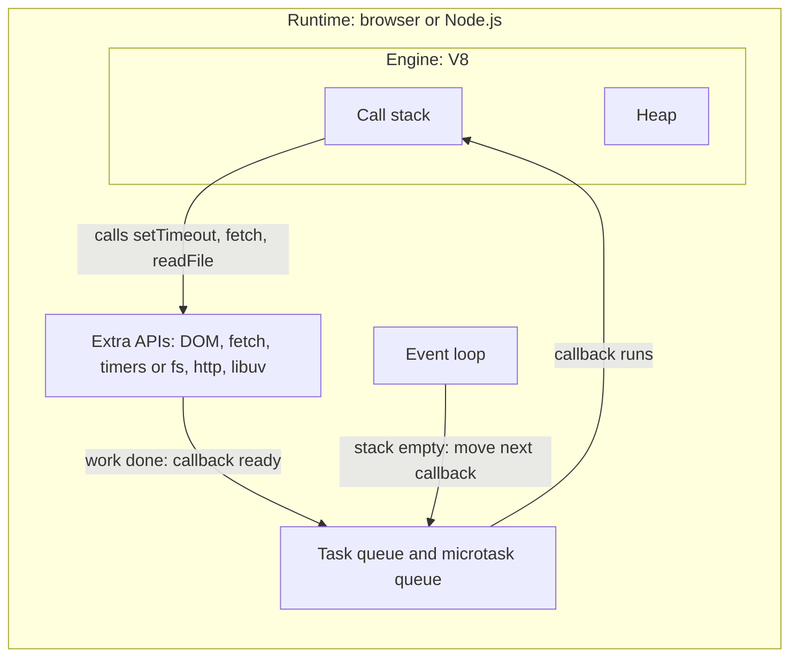

The full event loop order is in [How JavaScript runs: the event loop](#how-javascript-runs-the-event-loop). Node's own phases are in [Node.js: event loop phases](nodejs.md#the-node-event-loop-phases).

### The pipeline: from source code to machine code

**How it works:**
1. **Parser:** reads the source text and builds an **AST** (Abstract Syntax Tree, the code as a tree of objects). V8 parses lazily: a function body is fully parsed only when it is first called.
2. **Ignition (interpreter):** turns the AST into **bytecode** (small, simple instructions) and runs it. It starts fast and uses little memory.
3. While running, V8 collects **type feedback**: "this `add` always gets two small integers", "this object always has the same shape".
4. **Sparkplug (baseline compiler):** for warm code. It turns bytecode into machine code very fast, with no smart tricks.
5. **Maglev (mid-tier optimizing compiler, Chrome 117+):** for hot code. Uses the feedback to make good code quickly.
6. **TurboFan (top optimizing compiler):** for very hot code. Makes the fastest machine code, with inlining and guesses based on the feedback. Its newer backend is called Turboshaft.
7. **Deoptimization:** the optimized code has checks. If a guess turns out wrong (a string arrives where only numbers came before), V8 throws the fast code away and goes back to bytecode. Later it may optimize again.

Tier names are from [v8.dev](https://v8.dev/blog/maglev). They change over time, so say "V8 has an interpreter plus a few JIT tiers" if you are not sure.

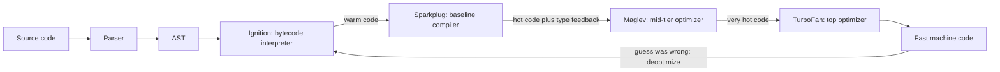

**JIT** means Just-In-Time: compile while the program runs, not before. Java's JVM does the same idea with its C1 and C2 compilers.

**Example: see V8 optimize and then deoptimize**

```js
// deopt.mjs   run: node --trace-opt --trace-deopt deopt.mjs
function add(a, b) { return a + b; }
for (let i = 0; i < 1e6; i++) add(i, 1); // only small integers: V8 optimizes add
add("oops", 1);                           // a string: the guess is wrong
// Real lines from the output (node 24, shortened):
// [marking ... <JSFunction add> for optimization to MAGLEV ... reason: hot and stable]
// [bailout (kind: deopt-eager, reason: not a Smi): ... deoptimizing ... <JSFunction add>
```

A **Smi** is V8's "small integer" type. The fast code expected a Smi and got a string, so it bailed out.

### Call stack and heap

- **Call stack:** one **frame** per running function call. A frame holds local variables, arguments and the return address. It is small and fast. Too deep (endless recursion) gives `RangeError: Maximum call stack size exceeded`.
- **Heap:** a big area for objects, arrays, functions and closures. The garbage collector cleans it.
- Primitives (numbers, strings, booleans) behave like values: copying a variable copies the value.
- Objects are reached by **reference**: copying a variable copies the address, not the object.
- Small detail for seniors: V8 may still keep some primitives (like long strings or big numbers) in the heap. "Primitives on the stack" is a simple model, not the exact rule.

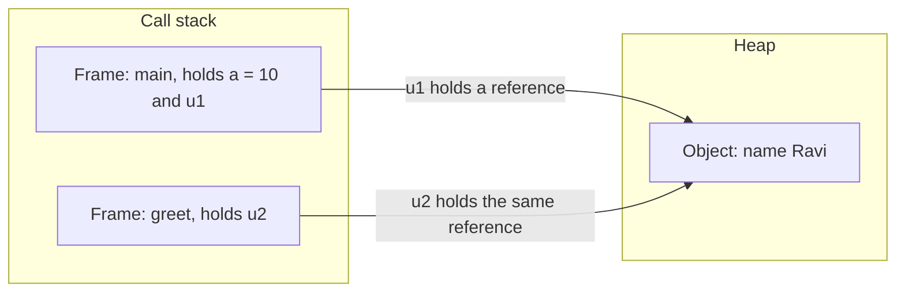

```js
let a = 10;
let b = a;          // primitive: the value is copied
b = 20;
console.log(a, b);  // 10 20

const u1 = { name: "Asha" };   // the object lives in the heap
const u2 = u1;                 // u2 copies the REFERENCE, not the object
u2.name = "Ravi";
console.log(u1.name);          // Ravi
```

### Execution context: creation phase and execution phase

An **execution context** is the box of information for running some code: its variables, its scope chain and its `this`.
There is one global context, and a new one for each function call (pushed on the call stack).

Each context has two phases:
1. **Creation phase:** the engine scans the code and sets up the variables before running any line.
   - `var` names are created with `undefined`.
   - Function declarations are created fully.
   - `let`, `const` and `class` names are created but locked (the temporal dead zone).
   - `this` and the link to the outer scope are set.
2. **Execution phase:** the code runs line by line and assigns real values.

This two-phase setup **is** hoisting. Examples are in [Scope, hoisting and the temporal dead zone](#scope-hoisting-and-the-temporal-dead-zone).

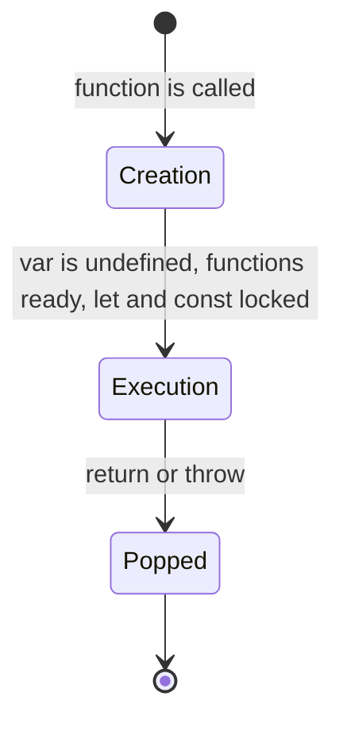

### Hidden classes and inline caches

**How it works:**
1. JavaScript objects can change shape at any time. Looking up `obj.x` in a dictionary every time would be slow.
2. So V8 gives every object a **hidden class** (also called a **shape** or **map**). It records which keys exist and in which order, and where each value sits in memory.
3. Objects created the same way share one hidden class.
4. An **inline cache** (IC) is a small memory at each property access in your code: "last time, this object had shape S1 and `x` was at slot 0". Next time, if the shape is S1, V8 jumps straight to slot 0.
5. One shape at a spot is **monomorphic** (fastest). 2 to 4 shapes is **polymorphic** (fine). Many shapes is **megamorphic** (slow, V8 stops caching).

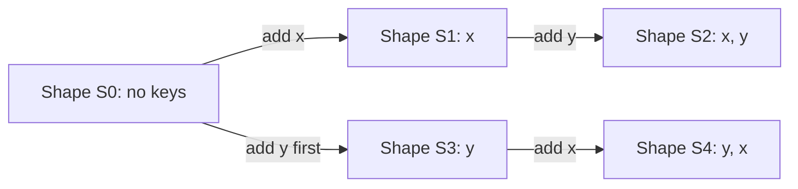

`{x, y}` and `{y, x}` end up with different shapes. Same data, different hidden class.

```js
// run: node --allow-natives-syntax shapes.mjs   (%-functions are V8 debug helpers)
function Point(x, y) { this.x = x; this.y = y; } // always same keys, same order
const a = new Point(1, 2), b = new Point(3, 4);
console.log("same shape:", %HaveSameMap(a, b));       // same shape: true
const c = { x: 1, y: 2 };
const d = { y: 2, x: 1 };                              // different key order
console.log("order matters:", %HaveSameMap(c, d));    // order matters: false
const e = { x: 1, y: 2 };
e.z = 3;                                               // key added later
console.log("added later:", %HaveSameMap(c, e));      // added later: false
delete e.z;                                            // delete can drop to slow "dictionary mode"
console.log("fast props after delete:", %HasFastProperties(e)); // false
```

**Keep object shapes stable:**
- Create all keys in the constructor or object literal, in the same order.
- Give a missing value `null`, instead of adding the key later.
- Do not `delete` keys on hot objects. Set them to `undefined`, or build a new object.
- Keep one type per field: do not store a number today and a string tomorrow.
- Keep arrays of one kind (all small integers, or all objects). Avoid holes like `arr[1000] = 1` on an empty array.

### Garbage collection in V8 (Orinoco)

**How it works:**
1. Most objects die young (a temp array inside a function). V8 uses this fact: it splits the heap into a **young generation** and an **old generation**.
2. **Minor GC (Scavenger):** cleans the small young generation often. It copies the live objects out and frees the rest in one go. Very fast.
3. Objects that survive two minor GCs are moved to the old generation.
4. **Major GC (Mark-Compact):** walks from the roots, marks what is reachable, sweeps the rest, and compacts (moves objects together to fill the gaps).
5. **Orinoco** is the name of V8's GC project. It does much of this work **in parallel** (many helper threads) and **concurrently** (while your JavaScript keeps running), so pauses stay short.

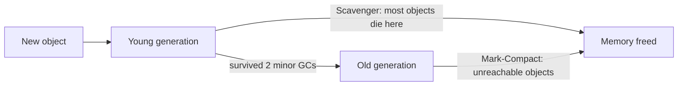

This is the same generational idea as Java's G1 (see [JVM memory basics](java.md#jvm-memory-basics)).
Leaks, heap snapshots and cleanup are in [Memory and performance in the browser](#memory-and-performance-in-the-browser) and [Node.js memory](nodejs.md#memory-leaks-and-performance).

**Practical tips for seniors:**
- Write normal, clear code first. V8 is very good at plain code. Measure before you tune.
- Keep hot functions **monomorphic**: same argument types, same object shapes.
- Do not mix types in arrays used in hot loops.
- Avoid `delete` on objects that are read a lot. Prefer `Map` when keys are added and removed often.
- Avoid huge functions that do everything. Small functions are easier to inline.
- Create fewer short-lived objects in very hot paths (60 frames a second, millions of rows). Less GC work.
- Tools: Chrome DevTools Performance and Memory tabs, `node --cpu-prof`, `node --inspect`, `--trace-opt`, `--trace-deopt`.
- In Node.js, `--max-old-space-size=4096` raises the old-generation limit (in MB) if a big job really needs it. Fix leaks first.

**Good and bad:**

| Good | Bad |
|---|---|
| Same keys, same order, set in the constructor | Adding keys in random order in different places |
| One type per variable and per array | A field that is sometimes a number, sometimes a string |
| `Map` for dynamic keys | `delete obj.key` in a hot loop |
| Profile with DevTools before tuning | Micro-tuning code that runs once |

**Say this in the interview:**

> V8 is the engine; the browser or Node.js is the runtime that adds APIs like timers, fetch or fs and the event loop.
> V8 parses code into an AST, Ignition turns it into bytecode and runs it, and hot code is compiled by JIT tiers like Sparkplug, Maglev and TurboFan.
> The fast code is based on guesses about types and shapes. If a guess breaks, V8 deoptimizes back to bytecode.
> So I keep object shapes and types stable in hot code, and I let the generational garbage collector do its job by not holding references I do not need.

**They may ask next:**
- **Is JavaScript interpreted or compiled?** Both. It starts in an interpreter and hot code is JIT-compiled to machine code.
- **What is a hidden class?** V8's internal record of an object's keys and their order. Objects with the same shape share one, which makes property access fast.
- **Why is `delete` slow?** It can change the object's shape or move it to dictionary mode. Inline caches then miss.
- **What is deoptimization?** Throwing away optimized code when its type guess is wrong, and going back to bytecode.
- **Where does the event loop live, in V8?** No. In the runtime: the browser, or libuv in Node.js.
- **Young vs old generation?** New objects go young and are cleaned often and fast. Survivors move to old space, which is cleaned less often by Mark-Compact.

---

## How JavaScript runs: the event loop

**In one line:** JavaScript runs on one thread, and the event loop decides which waiting piece of code runs next.

**Story:** Think of a small restaurant with **one cook**.
The cook can make only one dish at a time (one thread).
Helpers do the slow work: the oven, the delivery boy, the phone (the browser's Web APIs).
When a helper is done, they put a slip on a board.
There are two boards. The **urgent board** (microtasks) is for small follow-up steps of the dish the cook just made.
The **normal board** (tasks) is for new orders: a timer rang, a click came, a network reply came.
The cook always clears the whole urgent board before taking one slip from the normal board.
Between normal slips, the waiter may **serve the plates** (the browser paints the screen).

**How it works:**
1. **Call stack:** the list of functions running right now. JavaScript runs the stack until it is empty.
2. **Web APIs:** `setTimeout`, `fetch`, DOM events. The browser (or Node.js) does this work outside the stack.
3. When a Web API finishes, it puts the callback in a queue.
4. **Task queue** (also called macrotask queue): `setTimeout`, `setInterval`, click events, network events, `MessageChannel`.
5. **Microtask queue:** promise callbacks (`.then`, code after `await`), `queueMicrotask`, `MutationObserver`.
6. **The loop:** take one task, run it, then run **all** microtasks (including new ones added on the way).
7. **Rendering step:** after microtasks, the browser may run `requestAnimationFrame` callbacks, then style, layout and paint. This happens about 60 times a second (every ~16 ms), only if something changed.

**Diagram:**

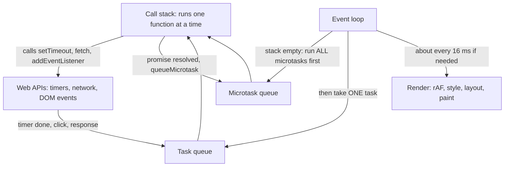

**Example: the classic output-order puzzle**

```js
console.log("1 sync start");
setTimeout(() => console.log("2 timeout"), 0);              // task queue
Promise.resolve().then(() => console.log("3 promise then")); // microtask
queueMicrotask(() => console.log("4 microtask"));           // microtask
(async () => {
  console.log("5 async body");  // runs now, async functions start sync
  await null;                   // rest of the function becomes a microtask
  console.log("6 after await");
})();
console.log("7 sync end");

// Real output (node 24):
// 1 sync start
// 5 async body
// 7 sync end
// 3 promise then
// 4 microtask
// 6 after await
// 2 timeout
```

Why this order:
- `1`, `5`, `7` are plain code on the call stack. They run first.
- `3`, `4`, `6` are microtasks. They run in the order they were queued, as soon as the stack is empty.
- `2` is a task. It waits until all microtasks are done, even with a 0 ms delay.

**Good and bad:**

| Good | Bad |
|---|---|
| Split long work into small chunks (`setTimeout`, `scheduler.yield()`), so the page can paint | A loop that runs 2 seconds. The page freezes. No clicks, no paint |
| Use Web Workers for heavy work (parsing big files, image work) | Endless microtask chains. Microtasks block rendering too |
| Use `requestAnimationFrame` for visual updates | Using `setTimeout(fn, 0)` and expecting it to run "now" |

**What can go wrong:**
- A long task (over 50 ms) makes the page feel slow. Google measures this as **INP** (Interaction to Next Paint, how fast the page reacts to a click).
- `setTimeout(fn, 0)` is not 0 ms. Browsers clamp nested timers to at least 4 ms. Background tabs are throttled to about 1 second.

**Node.js is a bit different:** it uses libuv (a C library for async I/O) and runs phases (timers, I/O callbacks, `setImmediate`, close callbacks).
`process.nextTick` runs before promise microtasks.
The main rule is the same: all microtasks run before the next task.

**Say this in the interview:**

> JavaScript has one call stack, so it runs one thing at a time.
> Slow work like timers and network calls is done by the browser, and the callback is put in a queue.
> After each task, the event loop empties the whole microtask queue, which holds promise callbacks.
> Then the browser may paint, then it takes the next task. That is why a promise callback runs before a `setTimeout(0)`.

**They may ask next:**
- **Is `setTimeout(fn, 1000)` exact?** No. It is the minimum wait. If the stack is busy, it runs later.
- **Can microtasks freeze the page?** Yes. If each microtask adds another one, the loop never reaches the render step.
- **Where does `requestAnimationFrame` run?** In the render step, just before paint. Good for animations.
- **How do you find long tasks?** Chrome DevTools Performance panel. Long tasks are marked with a red corner.

---

## Scope, hoisting and the temporal dead zone

**In one line:** Scope is where a variable can be seen; hoisting means declarations are known before the code runs, but `let` and `const` cannot be used before their line.

**Story:** A school register.
Before class starts, the teacher writes every student's name in the register (hoisting).
With `var`, the name is written with "absent" (`undefined`), so you can ask about them early.
With `let` and `const`, the name is written, but the line is **locked** until the student walks in.
Asking about a locked name is an error. This locked time is the **temporal dead zone (TDZ)**.

**How it works:**
1. **Scope types:** global, module (each ES module file), function, and block (`{ }` for `let`, `const`, `class`).
2. `var` is function-scoped. It ignores `{ }` blocks, so it "leaks" out of `if` and `for`.
3. `let` and `const` are block-scoped.
4. **Function declarations** are hoisted fully. You can call them before the line.
5. **Function expressions** (`var f = function () {}`) hoist only the variable, not the function.
6. **Lexical scope:** a function sees the variables where it was **written**, not where it is called.

**Example:**

```js
console.log(typeof sayHi, a);  // function undefined
var a = 1;
function sayHi() { return "hi"; }

try { console.log(b); } catch (e) { console.log(e.name + ": " + e.message); }
// ReferenceError: Cannot access 'b' before initialization   <- TDZ
let b = 2;

try { hello(); } catch (e) { console.log(e.name + ": " + e.message); }
// TypeError: hello is not a function   <- only "var hello" was hoisted
var hello = function () {};

{ var x = "var leaks"; let y = "let stays"; }
console.log(x, typeof y);       // var leaks undefined
```

**Good and bad:**

| Good | Bad |
|---|---|
| `const` by default, `let` when the value changes | `var` in new code |
| Declare variables at the top of their block | Using a variable before its line and hoping for `undefined` |
| ES modules: each file has its own scope | Putting things on `window` (global) |

**Say this in the interview:**

> JavaScript creates all declarations before it runs a scope. That is hoisting.
> `var` starts as `undefined`, so early reads give `undefined`.
> `let` and `const` are hoisted too, but they are in the temporal dead zone until their line runs, so early reads throw a ReferenceError.
> I use `const` by default and `let` only when I reassign.

**They may ask next:**
- **Does `const` make an object read-only?** No. It only stops reassignment. Use `Object.freeze` for a shallow read-only object.
- **Are classes hoisted?** Yes, but like `let`. Using a class before its line throws.
- **What is the scope chain?** If a variable is not in the current scope, JavaScript looks in the outer scope, then the next one, up to global.

---

## Closures

**In one line:** A closure is a function that remembers the variables from the place where it was created, even after that outer function has finished.

**Story:** A student goes on a school trip with a backpack.
The school (outer function) closes for the day. But the backpack still has the lunch box and the water bottle.
Wherever the student goes, they can open the backpack and use what is inside.
The function is the student. The backpack is the closure.

**How it works:**
1. When a function is created, it keeps a link to its outer scope.
2. When the outer function returns, its variables are not deleted if an inner function still uses them.
3. Each call of the outer function creates a **new** backpack.
4. This gives us private state without classes.

**Example: counter with private state**

```js
function makeCounter() {
  let count = 0;                     // private: only the returned functions see it
  return { inc: () => ++count, get: () => count };
}
const c = makeCounter();
c.inc(); c.inc();
console.log(c.get(), c.count);       // 2 undefined
```

**Example: the loop with `var` vs `let`**

```js
const fns1 = [], fns2 = [];
for (var i = 0; i < 3; i++) fns1.push(() => i); // ONE i shared by all
for (let j = 0; j < 3; j++) fns2.push(() => j); // a NEW j for each loop round
console.log(fns1.map(f => f()), fns2.map(f => f()));
// [ 3, 3, 3 ] [ 0, 1, 2 ]
```

- With `var`, there is one `i` for the whole function. When the functions run, the loop is over and `i` is 3.
- With `let`, each round of the loop gets its own `j`.

**Where closures are used:**
- **Memoize:** the cache lives in a closure. See [memoize](#9-memoize).
- **Debounce and throttle:** the timer id lives in a closure. See [debounce](#1-debounce).
- **Module pattern** (before ES modules): an IIFE (a function that runs at once) returns only public functions.
- **React hooks:** every render creates new closures. A **stale closure** is a callback that still sees old state. See [React](react.md).

**Module pattern (old style):**

```js
const cart = (() => {
  const items = [];                          // private
  return {
    add: item => items.push(item),
    count: () => items.length,
  };
})();
cart.add("tea");
console.log(cart.count(), cart.items);       // 1 undefined
```

Today we use ES modules: anything not exported is private to the file.

**Good and bad:**

| Good | Bad |
|---|---|
| Private state without a class | A closure that keeps a big array alive forever (memory leak) |
| Factory functions, debounce, memoize | An event listener with a closure that is never removed |
| Clear, small functions | Stale closures in React `useEffect` with missing dependencies |

**Closures and memory leaks:**
- The closure keeps its outer variables alive. The garbage collector cannot free them.
- If you add `window.addEventListener("resize", handler)` and never remove it, the handler and everything it closes over stay in memory.
- Fix: remove listeners, clear timers, set big references to `null` when done. See [memory](#memory-and-performance-in-the-browser).

**Say this in the interview:**

> A closure is a function plus the variables it captured from where it was written.
> The outer function can return, but its variables live on as long as the inner function is used.
> I use closures for private state, memoize, debounce, and every React hook is built on them.
> The risk is memory: a closure keeps its captured data alive, so I clean up listeners and timers.

**They may ask next:**
- **Does a closure copy the variable?** No. It keeps a live link. If the value changes, the closure sees the new value.
- **What is a stale closure?** A function that captured an old value. In React, a `setInterval` callback may see the first `count` forever. Fix with a functional update `setCount(c => c + 1)` or correct dependencies.
- **Before `let`, how did people fix the loop?** With an IIFE: `(function (i) { ... })(i)` to make a new scope per round.

---

## this, call, apply and bind

**In one line:** `this` is decided by **how** a function is called, not where it is written (except arrow functions, which take `this` from the outside).

**Story:** The word "my" in a sentence.
If Asha says "my phone", it means Asha's phone. If Ravi says the same sentence, it means Ravi's phone.
The sentence is the same. The speaker (the caller) decides what "my" means.
An arrow function is like a recorded message: "my" always means the person who recorded it.

**The four rules (highest priority first):**

| Rule | How you call it | `this` is |
|---|---|---|
| 1. `new` binding | `new Person()` | The new object |
| 2. Explicit binding | `fn.call(obj)`, `fn.apply(obj)`, `fn.bind(obj)` | `obj` |
| 3. Implicit binding | `obj.fn()` | `obj` (the thing before the dot) |
| 4. Default binding | `fn()` | `undefined` in strict mode and modules, `globalThis` in old sloppy mode |
| Arrow function | Any way | `this` of the outer scope. Cannot be changed |

**call, apply and bind:**
- `fn.call(obj, a, b)`: call now, arguments one by one.
- `fn.apply(obj, [a, b])`: call now, arguments as an array.
- `fn.bind(obj, a)`: do not call. Return a new function with `this` fixed forever.

**Example:**

```js
"use strict";
const user = {
  name: "Asha",
  regular() { return this?.name; },
  later() { setTimeout(() => console.log("arrow in method:", this.name), 0); },
};
console.log(user.regular());               // Asha       (implicit: user.regular())
const fn = user.regular;
console.log(fn());                         // undefined  (lost "this": plain call)
console.log(fn.call({ name: "Ravi" }), fn.apply({ name: "Meera" }), fn.bind({ name: "Kiran" })());
// Ravi Meera Kiran
user.later();                              // arrow in method: Asha (arrow keeps outer this)
function Person(n) { this.name = n; }
console.log(new Person("Neha").name);      // Neha
const bound = fn.bind({ name: "first" });
console.log(bound.call({ name: "second" })); // first (bind wins over call)
```

**Good and bad:**

| Good | Bad |
|---|---|
| Arrow functions for callbacks inside methods | Arrow functions as object methods (no own `this`) |
| `bind` once in the constructor, or class fields with arrows | Passing `obj.method` as a callback and losing `this` |
| `"use strict"` or modules, so lost `this` fails loudly | Relying on `this` being `window` |

**Say this in the interview:**

> `this` is set at call time, not where the function is written.
> With `new` it is the new object. With call, apply or bind it is the object I pass.
> With `obj.fn()` it is `obj`. A plain call gives `undefined` in strict mode.
> Arrow functions have no own `this`, they use the outer one.
> The common bug is passing `obj.method` as a callback, which loses `this`. I fix it with an arrow or `bind`.

**They may ask next:**
- **Can you re-bind a bound function?** No. The first `bind` wins. Only `new` can override it.
- **Why is `this` undefined in my event handler?** You passed the method without calling it on the object. Use an arrow function.
- **What is `this` in a DOM event listener (normal function)?** The element the listener is attached to (`event.currentTarget`).
- **Write bind, call, apply yourself.** See [bind polyfill](#5-functionprototypebind-polyfill) and [call/apply polyfill](#6-call-and-apply-polyfills).

---

## Prototypes and classes

**In one line:** Every object has a hidden link to another object (its prototype); if a property is not found, JavaScript looks up this chain.

**Story:** A family recipe book.
You ask your mother for a recipe. If she does not know it, she asks your grandmother. Then the great-grandmother.
If nobody knows it, the answer is "not found" (`undefined`).
Each person is an object. The "ask the elder" link is the prototype.

**How it works:**
1. Every object has an internal `[[Prototype]]` link. Read it with `Object.getPrototypeOf(obj)`.
2. Reading `obj.x`: look on `obj`, then its prototype, then its prototype, up to `null`.
3. Writing `obj.x = 1` always writes on `obj` itself. It does not change the prototype.
4. Functions have a `prototype` property. `new Fn()` makes an object whose prototype is `Fn.prototype`.
5. Methods live once on the prototype. All instances share them. This saves memory.
6. `class` is **syntax sugar** over this. `typeof SomeClass` is `"function"`.

**Diagram:**

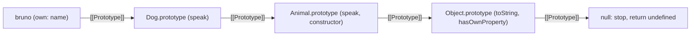

**Example: class, private field, inheritance**

```js
class Animal {
  #sound;                                  // private field (ES2022): not visible outside
  constructor(name, sound) { this.name = name; this.#sound = sound; }
  speak() { return `${this.name} says ${this.#sound}`; }
}
class Dog extends Animal {
  constructor(name) { super(name, "woof"); } // must call super() before using this
  speak() { return super.speak() + "!"; }    // call the parent method
}
const d = new Dog("Bruno");
console.log(d.speak(), typeof Animal, Object.getPrototypeOf(d) === Dog.prototype);
// Bruno says woof! function true
console.log(Object.getPrototypeOf(Dog.prototype) === Animal.prototype, d instanceof Animal);
// true true
console.log(Object.hasOwn(d, "speak"), "speak" in d, d.sound);
// false true undefined
```

**What `class` adds over old functions:**
- Class code is always in strict mode.
- You must call a class with `new`. Calling it as a function throws.
- `#private` fields and methods are truly private. Not even `Object.keys` sees them.
- `static` methods and `static { }` blocks belong to the class, not the instances.

**Good and bad:**

| Good | Bad |
|---|---|
| `class` with `#private` fields for clear models | Changing built-in prototypes (`Array.prototype.myThing`) in real apps |
| Shallow inheritance (1–2 levels), or composition | Deep inheritance trees |
| `Object.hasOwn(obj, key)` to check own keys | `for...in` without an own-key check (it walks the chain too) |

**Say this in the interview:**

> JavaScript uses prototype inheritance. Each object links to a prototype, and property reads walk up that chain until `null`.
> `class` is cleaner syntax for the same thing. Methods sit on `Class.prototype` and are shared.
> For real privacy I use `#private` fields. I prefer composition over deep inheritance.

**They may ask next:**
- **`__proto__` vs `prototype`?** `prototype` is a property on functions, used by `new`. `__proto__` is the old accessor for any object's link. Use `Object.getPrototypeOf`.
- **How do you make an object with no prototype?** `Object.create(null)`. Good for plain dictionaries.
- **How does `instanceof` work?** It walks `obj`'s chain and looks for `Ctor.prototype`. See [new and instanceof](#25-implement-new-and-instanceof).
- **Private `#x` vs TypeScript `private x`?** TypeScript `private` is checked only at compile time. `#x` is enforced at runtime.

---

## Symbols, property descriptors, getters and setters

**In one line:** Every object property has hidden settings (writable, enumerable, configurable) or a getter/setter pair, and symbols are unique keys that never clash with other keys; together they let you control exactly how an object behaves.

**Story:** A locker room in a gym.
Each locker (property) has a label (the key) and some rules on the door:
can you change what is inside (writable), is it shown in the list at the front desk (enumerable), can staff remove or re-label it (configurable).
A **symbol** is a locker with a secret code instead of a name. Nobody else can pick the same code by mistake.
A **getter** is a locker with a person inside: when you open it, they hand you something fresh each time.

### Symbols

```js
const id = Symbol("id");                    // a unique key; the text is only a label
const user = { name: "Asha", [id]: 42 };
console.log(Object.keys(user), JSON.stringify(user), user[id]);  // [ 'name' ] {"name":"Asha"} 42
console.log(Object.getOwnPropertySymbols(user), Reflect.ownKeys(user)); // [ Symbol(id) ] [ 'name', Symbol(id) ]
console.log(Symbol("a") === Symbol("a"), Symbol.for("a") === Symbol.for("a")); // false true
```

- `Symbol()` is always new and unique. `Symbol.for("key")` uses a global registry: same key, same symbol, even across iframes.
- Symbol keys are skipped by `Object.keys`, `for...in` and `JSON.stringify`. They are **hidden, not private**: `Reflect.ownKeys` shows them.
- Use them for metadata that must not clash with user keys (libraries tag objects this way).

**Well-known symbols** are hooks into the language itself:

| Symbol | Changes | Example use |
|---|---|---|
| `Symbol.iterator` | `for...of`, spread | Make a custom collection loopable. See [iterators](#iterators-and-generators) |
| `Symbol.asyncIterator` | `for await...of` | Paged API reader |
| `Symbol.toPrimitive` | `+obj`, `` `${obj}` ``, `obj > 1` | A `Money` object that prints nicely |
| `Symbol.toStringTag` | `Object.prototype.toString.call(obj)` | Shows `[object Money]` |
| `Symbol.hasInstance` | `instanceof` | Rare, mostly for puzzles |
| `Symbol.dispose` | `using` declarations (explicit resource management) | Auto-close a file or a lock |

```js
class Money {
  constructor(paise) { this.paise = paise; }
  [Symbol.toPrimitive](hint) {             // called when JS needs a primitive
    return hint === "string" ? `Rs ${this.paise / 100}` : this.paise;
  }
  get [Symbol.toStringTag]() { return "Money"; }
}
const m = new Money(15000);
console.log(`${m}`, m + 500, m > 100, Object.prototype.toString.call(m));
// Rs 150 15500 true [object Money]
```

### Property descriptors

Every property is either a **data property** (`value`, `writable`) or an **accessor property** (`get`, `set`). Both have `enumerable` and `configurable`.

| Flag | `false` means | Normal `obj.x = 1` | `Object.defineProperty` default |
|---|---|---|---|
| `writable` | Value cannot change | `true` | `false` |
| `enumerable` | Hidden from `Object.keys`, `for...in`, `JSON.stringify`, spread | `true` | `false` |
| `configurable` | Cannot delete it or change its flags (one-way door) | `true` | `false` |

```js
const config = { env: "prod" };
Object.defineProperty(config, "apiUrl", {
  value: "https://api.shop.in",
  writable: false,      // cannot change the value
  enumerable: true,     // shows in Object.keys, for...in, JSON
  configurable: false,  // cannot delete it or change these flags again
});
Object.defineProperty(config, "token", { value: "abc" });  // flags default to FALSE here
try { config.apiUrl = "http://evil.example"; } catch (e) { console.log(e.constructor.name); } // TypeError (strict mode)
console.log(config.apiUrl, Object.keys(config), JSON.stringify(config));
// https://api.shop.in [ 'env', 'apiUrl' ] {"env":"prod","apiUrl":"https://api.shop.in"}
console.log(Object.getOwnPropertyDescriptor(config, "env"));
// { value: 'prod', writable: true, enumerable: true, configurable: true }  <- normal keys: all true
```

- In **sloppy mode** the write to a read-only property is ignored silently. In **strict mode** (modules, classes) it throws a `TypeError`.
- Built-ins use this: `Array.prototype.map` is non-enumerable, so `for...in` over an array does not list it.

### freeze vs seal vs preventExtensions

| | Add keys | Delete keys | Change values | Check |
|---|---|---|---|---|
| `Object.preventExtensions` | No | Yes | Yes | `Object.isExtensible` |
| `Object.seal` | No | No | Yes | `Object.isSealed` |
| `Object.freeze` | No | No | No | `Object.isFrozen` |

```js
const frozen = Object.freeze({ price: 100, meta: { tag: "sale" } });
try { frozen.price = 1; } catch (e) { console.log("freeze:", e.constructor.name); } // freeze: TypeError
frozen.meta.tag = "changed";                          // allowed: freeze is SHALLOW
console.log(frozen.meta.tag, Object.isFrozen(frozen.meta)); // changed false

const sealed = Object.seal({ qty: 1 });
sealed.qty = 5;                                       // allowed: change an existing key
try { sealed.extra = 1; } catch (e) { console.log("seal add:", e.constructor.name); }   // seal add: TypeError
try { delete sealed.qty; } catch (e) { console.log("seal delete:", e.constructor.name); } // seal delete: TypeError
```

- All three are **shallow**. For a deep freeze, walk the object and freeze each nested object.
- All three are **one-way**. You cannot unfreeze. Make a copy instead.
- Frozen objects are useful for constants and for catching accidental state changes in development (Immer does this).

**Diagram: pick the right tool**

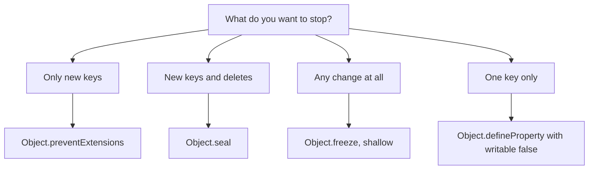

### Getters and setters

```js
class Temperature {
  #celsius = 0;
  get fahrenheit() { return this.#celsius * 9 / 5 + 32; }   // computed when read
  set fahrenheit(f) {
    if (typeof f !== "number") throw new TypeError("number please"); // check on write
    this.#celsius = (f - 32) * 5 / 9;
  }
}
const t = new Temperature();
t.fahrenheit = 212;
console.log(t.fahrenheit, Object.keys(t));                  // 212 []
try { t.fahrenheit = "hot"; } catch (e) { console.log(e.message); } // number please
```

- Use a getter for a **computed** value (`fullName`, `total`). Keep it cheap and free of side effects.
- Use a setter to **validate** or to keep two fields in sync.
- Class getters live on the **prototype**, so `Object.keys(t)` does not show them.
- Traps: a setter that assigns to its own name calls itself forever; spread `{ ...obj }` reads a getter once and copies a **plain value**. See [tricky output 14](#tricky-output-questions).

**Good and bad:**

| Good | Bad |
|---|---|
| `Object.freeze` for shared constants | Thinking `const` or `freeze` makes nested objects read-only |
| Getters for cheap computed values | A getter that calls the network or changes state |
| Symbols for library metadata keys | Symbols as "private" fields (use `#private` for that) |
| `defineProperty` to hide internal helpers from `Object.keys` | Forgetting that `defineProperty` flags default to `false` |

**Say this in the interview:**

> Each property has a descriptor: `writable`, `enumerable` and `configurable`, or a `get` and `set` pair. Normal assignment sets all flags to true, `Object.defineProperty` defaults them to false.
> `preventExtensions` stops new keys, `seal` also stops deletes, and `freeze` also stops value changes. All of them are shallow.
> A symbol is a unique key that never clashes, and well-known symbols like `Symbol.iterator` and `Symbol.toPrimitive` let my objects plug into language features.
> Getters and setters are good for computed values and validation, and Vue 2 even used them for reactivity.

**They may ask next:**
- **How did Vue 2 track changes?** It replaced each property with a getter and setter using `Object.defineProperty`. It could not see new keys, so it needed `Vue.set`. Vue 3 moved to [Proxy](#proxy-and-reflect).
- **How do you make a deep freeze?** Recursively call `Object.freeze` on every nested object (watch out for cycles).
- **Are symbols private?** No. `Object.getOwnPropertySymbols` finds them. Use `#private` class fields for real privacy.
- **What is `Symbol.for`?** A global registry. The same string gives the same symbol everywhere in the app.

---

## Proxy and Reflect

**In one line:** A `Proxy` wraps an object and lets you run your own code (a *trap*) on every read, write, delete or call; `Reflect` gives you the normal, default version of each of those actions.

**Story:** A personal secretary for a busy doctor.
Every visitor talks to the secretary first, never directly to the doctor (the target).
The secretary can check the appointment (validation), write the visit in a register (logging, tracking), or say "no" (access control).
When everything is fine, the secretary simply lets the visitor in the normal way. That "normal way" is `Reflect`.

**How it works:**
1. `new Proxy(target, handler)`. The handler is an object with trap functions.
2. If a trap is missing, the action goes straight to the target.
3. Inside a trap, call the matching `Reflect` method to do the default action. It returns `true`/`false` instead of throwing, and it passes `receiver` correctly (important for getters and inheritance).
4. The proxy is a **new object**: `proxy !== target`. Code that holds the raw target bypasses every trap.

**Common traps:**

| Trap | Runs on | Used for |
|---|---|---|
| `get` | `p.x`, `p[key]` | Default values, tracking reads (reactivity), typo errors |
| `set` | `p.x = 1` | Validation, triggering updates |
| `has` | `"x" in p` | Hiding keys |
| `deleteProperty` | `delete p.x` | Blocking deletes |
| `ownKeys` | `Object.keys(p)`, `for...in` | Hiding private keys from lists |
| `apply` | `p(...)` (when the target is a function) | Logging, timing, caching calls |
| `construct` | `new p()` | Singletons, factories |
| `getOwnPropertyDescriptor`, `defineProperty`, `getPrototypeOf` | Reflection calls | Rare |

**Diagram:**

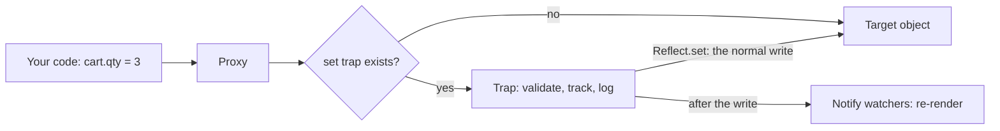

**Example 1: validation and typo errors** (run on Node 24)

```js
function strict(target, rules) {
  return new Proxy(target, {
    get(obj, key, receiver) {
      if (typeof key === "string" && !(key in obj)) throw new ReferenceError(`no field "${key}"`); // catch typos
      return Reflect.get(obj, key, receiver);         // the normal read
    },
    set(obj, key, value, receiver) {
      const check = rules[key];
      if (check && !check(value)) throw new TypeError(`bad ${key}: ${value}`);
      return Reflect.set(obj, key, value, receiver);  // the normal write; returns true/false
    },
  });
}
const product = strict({ name: "Tea", price: 50 }, { price: v => typeof v === "number" && v >= 0 });
product.price = 60;
console.log(product.price);                              // 60
try { product.price = -5; } catch (e) { console.log(e.message); }  // bad price: -5
try { product.prcie; } catch (e) { console.log(e.message); }       // no field "prcie"
```

### Example 2: reactivity, the way Vue 3 and MobX do it

The idea behind Vue 3 `reactive()` and MobX `observable`:
- **Track:** while an effect runs, every `get` records "this effect reads this key".
- **Trigger:** every `set` re-runs only the effects that read that key.

```js
let activeEffect = null;
const deps = new WeakMap();                     // target -> Map(key -> Set of effects)

function reactive(obj) {
  return new Proxy(obj, {
    get(target, key, receiver) {
      if (activeEffect) {                       // track: "this effect reads this key"
        if (!deps.has(target)) deps.set(target, new Map());
        const byKey = deps.get(target);
        if (!byKey.has(key)) byKey.set(key, new Set());
        byKey.get(key).add(activeEffect);
      }
      return Reflect.get(target, key, receiver);
    },
    set(target, key, value, receiver) {
      const ok = Reflect.set(target, key, value, receiver);
      deps.get(target)?.get(key)?.forEach(fn => fn()); // trigger: re-run effects that read it
      return ok;
    },
  });
}
function effect(fn) { activeEffect = fn; fn(); activeEffect = null; }

const cart = reactive({ qty: 1, price: 50, note: "" });
effect(() => console.log("total:", cart.qty * cart.price));  // total: 50
cart.qty = 3;                                                 // total: 150
cart.note = "gift wrap";                                      // (nothing: no effect reads "note")
```

- Why `WeakMap` for `deps`? When the state object is gone, its tracking data can be garbage collected too. See [WeakMap](#map-set-weakmap-weakset-and-weakref).
- Real Vue also makes nested objects reactive on first read, batches updates, and cleans old dependencies.
- **Vue 2 vs Vue 3:** Vue 2 used getters and setters from `Object.defineProperty`, so it could not see new keys or array index writes. A Proxy sees everything, including new keys and `delete`.
- **Immer** (used by Redux Toolkit) also uses a Proxy: you "change" a draft, and it records the changes to build a new immutable object.

### Limits and traps

```js
class Box { #secret = 1; get secret() { return this.#secret; } }
const p = new Proxy(new Box(), {});
try { p.secret; } catch (e) { console.log(e.constructor.name); }  // TypeError: #private does not pass through a proxy

const m = new Proxy(new Map(), {});
try { m.set("a", 1); } catch (e) { console.log(e.constructor.name); } // TypeError: Map methods need the real Map as "this"

const { proxy, revoke } = Proxy.revocable({ plan: "pro" }, {});
console.log(proxy.plan);  // pro
revoke();                  // cut access, for example when a plugin is unloaded
try { proxy.plan; } catch (e) { console.log(e.constructor.name); }  // TypeError
```

- `#private` fields, `Map`, `Set` and `Date` keep their data in **internal slots**. Methods fail when `this` is the proxy. Fix: in the `get` trap, bind functions to the target (Vue does special work for collections).
- Every access runs your trap, so a proxy is slower than a plain object. Fine for app state, bad in a hot loop over 1 million items.
- Some rules (*invariants*) cannot be broken. Example: a `get` trap cannot lie about a non-writable, non-configurable property.
- `Reflect` is also useful on its own: `Reflect.ownKeys(obj)` lists string **and** symbol keys; `Reflect.apply(fn, thisArg, args)` is a clean `fn.apply`.

**Good and bad:**

| Good | Bad |
|---|---|
| Validation layers, reactive state, test mocks, API clients that build URLs from property names | Wrapping everything "just in case" |
| Always call `Reflect.*` with `receiver` inside traps | `target[key] = value` in the trap (breaks setters and inheritance) |
| Return `true` from `set` and `deleteProperty` | Returning nothing: in strict mode that throws a `TypeError` |
| Proxy plain objects | Proxy `Map`, `Set` or classes with `#private` without special handling |

**Say this in the interview:**

> A Proxy wraps a target object, and traps like `get` and `set` let me run code on every read and write. Inside the trap I call `Reflect` to do the normal action.
> I have used it for validation and for typo-safe config objects.
> Vue 3 reactivity is built on it: `get` tracks which effect reads which key, and `set` re-runs only those effects. MobX and Immer use the same idea.
> The limits: private fields and `Map` internals do not pass through, and every access costs a little time.

**They may ask next:**
- **Why use `Reflect` and not just `target[key]`?** `Reflect.get(t, k, receiver)` keeps the right `this` for getters on the prototype chain, and `Reflect.set` returns a boolean instead of throwing.
- **Can you detect if an object is a proxy?** Not with standard JavaScript. That is on purpose.
- **Proxy vs `Object.defineProperty`?** `defineProperty` works per existing key. A proxy covers every key, including new ones, deletes and `in` checks.
- **What is a revocable proxy?** `Proxy.revocable` gives you a `revoke()` function. After it, every access throws. Good for handing temporary access to a plugin.

---

## Functional programming in JavaScript

**In one line:** Functional programming (FP) means building programs from small pure functions that take data and return new data, without changing anything outside.

**Story:** A juice shop.
The juicer is a pure function: put in 3 oranges, you always get one glass of orange juice.
It does not change the apples on the next table. It does not keep a secret count.
You can line up machines: wash, then cut, then squeeze. Each one takes the output of the last.
That line of machines is **composition**. The oranges you started with are not changed: you get **new** juice.

### First-class and higher-order functions

- **First-class functions:** a function is a value. You can store it in a variable, pass it, and return it.
- **Higher-order function (HOF):** a function that takes a function or returns one. `map`, `filter`, `reduce`, `setTimeout`, debounce and React's `memo` are all HOFs.

### Pure functions and side effects

A **pure function**:
1. Gives the same output for the same input, every time.
2. Has no **side effects**: it does not change anything outside itself.

Side effects are: changing a global or an argument, writing to the DOM, calling an API, writing logs, reading `Date.now()` or `Math.random()`.

```js
const greet = name => "Hello " + name;          // a function is a value
const run = (fn, value) => fn(value);           // higher-order: takes a function
const multiplier = n => x => x * n;             // higher-order: returns a function
console.log(run(greet, "Asha"), multiplier(3)(5)); // Hello Asha 15

let total = 0;
function addImpure(x) { total += x; return total; } // reads and changes outside state
const addPure = (a, b) => a + b;                    // same input -> same output
console.log(addImpure(5), addImpure(5));            // 5 10   <- same input, different output
console.log(addPure(5, 5), addPure(5, 5));          // 10 10
```

- Pure functions are easy to **test** (no mocks), easy to **cache** ([memoize](#9-memoize)) and safe to run in any order.
- A real app needs side effects. The FP idea is: keep the core pure, and push side effects to the edges (the API call, the `useEffect`, the click handler).

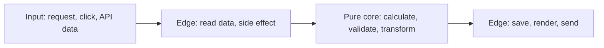

### Immutability

**Immutable** means "not changed after it is made". Instead of changing an object, you make a new one with the change.

- Spread (`{ ...obj }`, `[...arr]`) makes a **shallow** copy. Nested objects are still shared.
- `Object.freeze` stops changes, but only at the top level (shallow).
- `structuredClone` makes a full deep copy.
- ES2023 added array methods that return a new array: `toSorted`, `toReversed`, `toSpliced`, `with`. The old `sort`, `reverse` and `splice` change the array in place.

```js
const user = Object.freeze({ name: "Asha", address: { city: "Pune" } });
try { user.name = "Ravi"; } catch (e) { console.log(e.name); } // TypeError (modules are strict)
user.address.city = "Delhi";     // works! freeze is shallow
console.log(user.name, user.address.city); // Asha Delhi

const moved = { ...user, address: { ...user.address, city: "Mumbai" } }; // copy the path you change
console.log(user.address.city, moved.address.city); // Delhi Mumbai

const deep = structuredClone(user);   // full deep copy
deep.address.city = "Goa";
console.log(user.address.city);       // Delhi

const scores = [30, 10, 20];
console.log(scores.toSorted((a, b) => a - b)); // [ 10, 20, 30 ]  new array
console.log(scores.with(0, 99), scores.toSpliced(1, 1)); // [ 99, 10, 20 ] [ 30, 20 ]
console.log(scores);                  // [ 30, 10, 20 ]  original unchanged
```

In sloppy (non-module, non-strict) scripts, writing to a frozen object is silently ignored, with no error.

### map, filter and reduce on real data

- `filter`: keep the items that pass a test.
- `map`: change each item into something else. Same length out.
- `reduce`: fold the whole list into one value (a number, an object, a map).

**Example: total amount per customer, only for paid orders**

```js
const orders = [
  { id: 1, customer: "Asha", amount: 250, status: "PAID" },
  { id: 2, customer: "Ravi", amount: 100, status: "CANCELLED" },
  { id: 3, customer: "Asha", amount: 400, status: "PAID" },
  { id: 4, customer: "Meera", amount: 150, status: "PAID" },
];
const totalByCustomer = orders
  .filter(o => o.status === "PAID")                       // keep only paid orders
  .map(o => ({ customer: o.customer, amount: o.amount })) // keep only what we need
  .reduce((acc, o) => {
    acc[o.customer] = (acc[o.customer] ?? 0) + o.amount;  // add to the running total
    return acc;
  }, {});
console.log(totalByCustomer); // { Asha: 650, Meera: 150 }
```


- It is the same as Java Streams: `filter`, `map`, then `collect(groupingBy(...))`.
- Each step loops the list again and makes a new array. For 1,000 items this does not matter. For 1 million items in a hot path, one `reduce` or one `for` loop is faster.
- For grouping, ES2024 has `Object.groupBy`. See [groupBy](#19-groupby).
- How these methods work inside: [map, filter, reduce polyfills](#24-map-filter-and-reduce-polyfills).

### Declarative vs imperative

- **Imperative:** say **how** to do it, step by step. Loops, counters, `if` and changing variables.
- **Declarative:** say **what** you want. `filter` the paid ones, `map` to amounts, `reduce` to a sum. SQL and JSX are declarative too.

```js
// Imperative version of the same total: HOW, step by step
const totals = {};
for (let i = 0; i < orders.length; i++) {
  if (orders[i].status !== "PAID") continue;
  totals[orders[i].customer] = (totals[orders[i].customer] || 0) + orders[i].amount;
}
console.log(totals);          // { Asha: 650, Meera: 150 }
```

Both are fine. Declarative code is usually shorter to read and review. Imperative code can be faster and easier to stop early.

### Currying and partial application

- **Partial application:** fix some arguments now, give the rest later. `bind` or a small arrow does it.
- **Currying:** turn `f(a, b, c)` into `f(a)(b)(c)`, one argument at a time. Code: [curry](#7-curry).
- Use: make small, ready-to-use functions from general ones, like `tenOff` from `discount`.

### Composition and pipe

- **Compose:** join small functions into one. `compose(f, g)(x)` is `f(g(x))`, right to left.
- **Pipe:** the same, but left to right, which reads more naturally. Code: [compose and pipe](#8-compose-and-pipe).
- **Point-free style:** write the pipeline without naming the data (`pipe(trim, upper)` instead of `s => upper(trim(s))`). Use it a little. Too much makes code hard to debug.

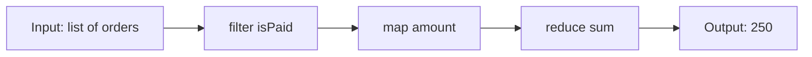

```js
const discount = (percent, price) => price - (price * percent) / 100;
const tenOff = discount.bind(null, 10);           // partial application: fix the first arg
console.log(tenOff(500));                         // 450

const pipe = (...fns) => x => fns.reduce((acc, f) => f(acc), x);
const isPaid = o => o.status === "PAID";
const amount = o => o.amount;
const sum = (a, b) => a + b;
const paidTotal = pipe(
  list => list.filter(isPaid),
  list => list.map(amount),
  list => list.reduce(sum, 0),
);
console.log(paidTotal([{ status: "PAID", amount: 250 }, { status: "NEW", amount: 99 }])); // 250
console.log(["1", "2", "3"].map(parseInt));       // [ 1, NaN, NaN ]  point-free trap
console.log(["1", "2", "3"].map(s => parseInt(s, 10))); // [ 1, 2, 3 ]
```

The `parseInt` trap: `map` passes `(item, index)`, and `parseInt` reads the index as the number base. Wrap it in an arrow.

### Recursion and tail calls

- FP likes **recursion** (a function that calls itself) instead of loops.
- Each call adds a frame to the call stack. Very deep recursion overflows the stack.
- **Tail call optimization (TCO)** would reuse the frame when the last step is the call itself. It is in the ES2015 spec, but only Safari ships it. V8 (Chrome, Node.js) and Firefox do not.
- So in JavaScript, use a loop (or an explicit stack) for deep data. Use recursion for trees that are not too deep (menus, JSON, the DOM).

```js
const sumTo = n => (n === 0 ? 0 : n + sumTo(n - 1));      // simple recursion
console.log(sumTo(1000));                                   // 500500
try { sumTo(100000); } catch (e) { console.log(e.name, e.message); }
// RangeError Maximum call stack size exceeded

const sumTail = (n, acc = 0) => (n === 0 ? acc : sumTail(n - 1, acc + n)); // tail call form
try { sumTail(100000); } catch (e) { console.log("tail call too:", e.name); }
// tail call too: RangeError   <- no TCO in V8

const sumLoop = n => { let acc = 0; for (let i = 1; i <= n; i++) acc += i; return acc; };
console.log(sumLoop(100000));                              // 5000050000
```

### FP in React

- A React component should be **pure**: same props and state give the same JSX. No API calls or DOM changes during render. Side effects go in `useEffect` or event handlers.
- **Strict Mode** renders components twice in development to catch impure render code.
- State must be **immutable**. React compares old and new state by reference (`Object.is`). If you change the old object, React sees "same object" and may skip the re-render.
- A reducer (`useReducer`, Redux) is a pure function: `(state, action) => newState`.

```js
function cartReducer(state, action) {           // plain JavaScript, no React needed
  switch (action.type) {
    case "add":
      return { ...state, items: [...state.items, action.item] };        // new array
    case "qty":
      return { ...state, items: state.items.map(i =>
        i.id === action.id ? { ...i, qty: action.qty } : i) };          // copy only the changed item
    case "remove":
      return { ...state, items: state.items.filter(i => i.id !== action.id) };
    default:
      return state;
  }
}
const s0 = { items: [] };
const s1 = cartReducer(s0, { type: "add", item: { id: 1, name: "Tea", qty: 1 } });
const s2 = cartReducer(s1, { type: "qty", id: 1, qty: 3 });
console.log(s0.items.length, s1.items[0].qty, s2.items[0].qty); // 0 1 3
console.log(s1 === s2, s1.items === s2.items);  // false false  -> React sees the change
```

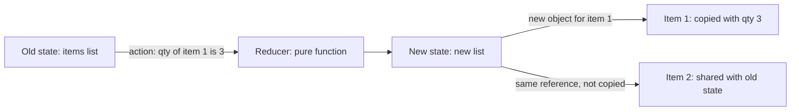

More in [React: useState and useReducer](react.md#usestate-and-usereducer).

**Good and bad:**

| Good | Bad |
|---|---|
| Small pure functions for business rules | Hidden changes to arguments or globals |
| New objects and arrays for state updates | `state.items.push(x); setState(state)` |
| `filter`/`map`/`reduce` for clear data steps | A 10-step chain over 1 million rows in a hot loop |
| A little point-free style | Point-free everywhere: hard to debug and read |
| Loops for very deep data | Deep recursion with no limit (stack overflow) |

**When to use / when not to use:**
- Use FP style for data transforms, reducers, validation and anything you want to unit test.
- Do not force it. Classes are fine for things with state and life (a WebSocket client, a cache).
- JavaScript supports both styles. Seniors mix them on purpose.

**Say this in the interview:**

> Functional programming in JavaScript means small pure functions, no hidden side effects, and immutable data.
> Functions are values, so I pass them around: `map`, `filter` and `reduce` are higher-order functions, and so are debounce and memoize.
> I keep the business logic pure and push side effects like API calls to the edges, which makes testing easy.
> In React this is the main rule: render is pure, and state updates create new objects so React can see the change.

**They may ask next:**
- **What is a pure function?** Same input gives the same output, and it changes nothing outside itself.
- **Is `Object.freeze` deep?** No, shallow. Nested objects can still change. Freeze each level, or use a library like Immer for safe updates.
- **Currying vs partial application?** Currying gives one argument at a time, always. Partial application fixes some arguments once and returns a function for the rest.
- **Why does JavaScript not have tail call optimization?** It is in the spec, but V8 and Firefox never shipped it (stack traces and debugging concerns). Only Safari has it.
- **`map` vs `forEach`?** `map` returns a new array (pure). `forEach` returns nothing and is used for side effects.
- **Is `reduce` always the right tool?** No. If it is hard to read, a simple `for...of` loop is better.

---

## Callbacks and callback hell

**In one line:** A callback is a function you pass to another function so it can call you back later; too many nested async callbacks make "callback hell", which promises and `async/await` fix.

**Story:** You give your phone number to a tailor and say "call me when the shirt is ready".
Your number is the callback. You go home and do other work.
Now imagine: when the tailor calls, you must then call the dry cleaner, who calls the courier, who calls you.
Each step waits inside the last one. That chain of calls inside calls is callback hell.
Also, you **trust** the tailor: what if he never calls, or calls twice?

### What a callback is

**How it works:**
1. Functions are values in JavaScript. You can pass them like any other value.
2. The function you pass in is the **callback**. The other function decides **when** to call it.
3. **Sync callbacks** run right now, before the outer function returns: `map`, `filter`, `forEach`, `sort`.
4. **Async callbacks** run later, from the event loop: `setTimeout`, `addEventListener`, Node's `fs.readFile`.

```js
console.log("start");
[1, 2].map(n => console.log("map callback", n));       // sync: runs now, inside map
setTimeout(() => console.log("timeout callback"), 0);   // async: runs later
console.log("end");
// start / map callback 1 / map callback 2 / end / timeout callback
```

### Error-first callbacks (Node.js style)

- Old Node.js APIs call the callback as `cb(err, result)`.
- `err` is first. It is `null` when all is fine.
- You **must** check `err` first and `return` if it is set.
- A `throw` inside an async callback cannot be caught by a `try/catch` around the outer call. The outer code is already finished.

```js
import { readFile } from "node:fs";
readFile("missing.txt", "utf8", (err, data) => {
  if (err) {                          // error first: always check it
    console.log("failed:", err.code); // failed: ENOENT
    return;                           // stop here, do not use data
  }
  console.log("data:", data);
});
```

### Callback hell (the pyramid of doom)

Three async steps that depend on each other: get the user, then the orders, then the invoice.

```js
// Fake async API in Node callback style: (args..., cb(err, value))
const getUser = (id, cb) => setTimeout(() => cb(null, { id, name: "Asha" }), 10);
const getOrders = (user, cb) => setTimeout(() => cb(null, [{ id: 101, total: 250 }]), 10);
const getInvoice = (order, cb) => setTimeout(() => cb(null, { no: "INV-" + order.id }), 10);

getUser(7, (err, user) => {
  if (err) return console.log(err);
  getOrders(user, (err, orders) => {
    if (err) return console.log(err);
    getInvoice(orders[0], (err, invoice) => {
      if (err) return console.log(err);
      console.log("1 pyramid:", user.name, invoice.no); // 1 pyramid: Asha INV-101
    });
  });
});
```

**What is wrong with it:**
- The code moves right with each step. Ten steps are hard to read.
- Error handling is repeated at every level. Forget one `if (err)` and the error is lost.
- Running steps in parallel, retrying or adding a timeout is hard to write by hand.

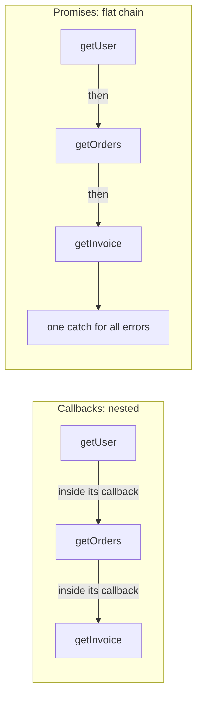

### The fix, step by step: same example 3 ways

**Fix 1: named functions.** The code is flat, but you pass state around by hand.

```js
let currentUser;
function onUser(err, user) { if (err) return fail(err); currentUser = user; getOrders(user, onOrders); }
function onOrders(err, orders) { if (err) return fail(err); getInvoice(orders[0], onInvoice); }
function onInvoice(err, invoice) { if (err) return fail(err); console.log("2 named:", currentUser.name, invoice.no); }
function fail(err) { console.log("failed:", err.message); }
getUser(7, onUser);  // 2 named: Asha INV-101
```

**Fix 2 and 3: promises, then `async/await`.** First wrap each callback API with `util.promisify` (see [promisify](#28-promisify)).

```js
import { promisify } from "node:util";
const [userP, ordersP, invoiceP] = [getUser, getOrders, getInvoice].map(f => promisify(f));

let user;                                          // Fix 2: a flat chain, ONE catch
userP(7)
  .then(u => { user = u; return ordersP(u); })     // return the next promise
  .then(orders => invoiceP(orders[0]))
  .then(invoice => console.log("3 promises:", user.name, invoice.no))
  .catch(err => console.log("failed:", err.message));

async function showInvoice(id) {                   // Fix 3: reads top to bottom
  try {
    const user = await userP(id);
    const orders = await ordersP(user);
    const invoice = await invoiceP(orders[0]);
    console.log("4 async/await:", user.name, invoice.no);
  } catch (err) {
    console.log("failed:", err.message);           // one normal try/catch
  }
}
await showInvoice(7);
// 3 promises: Asha INV-101
// 4 async/await: Asha INV-101
```

Most Node.js APIs now have promise versions too: `import { readFile } from "node:fs/promises"`.

### Inversion of control: the trust problem

When you pass a callback, you hand **control** of your code to someone else.
You trust them to call it:
- exactly once (not twice, not zero times),
- with the right arguments,
- not too early (sync) and not too late,
- and to not swallow your errors.

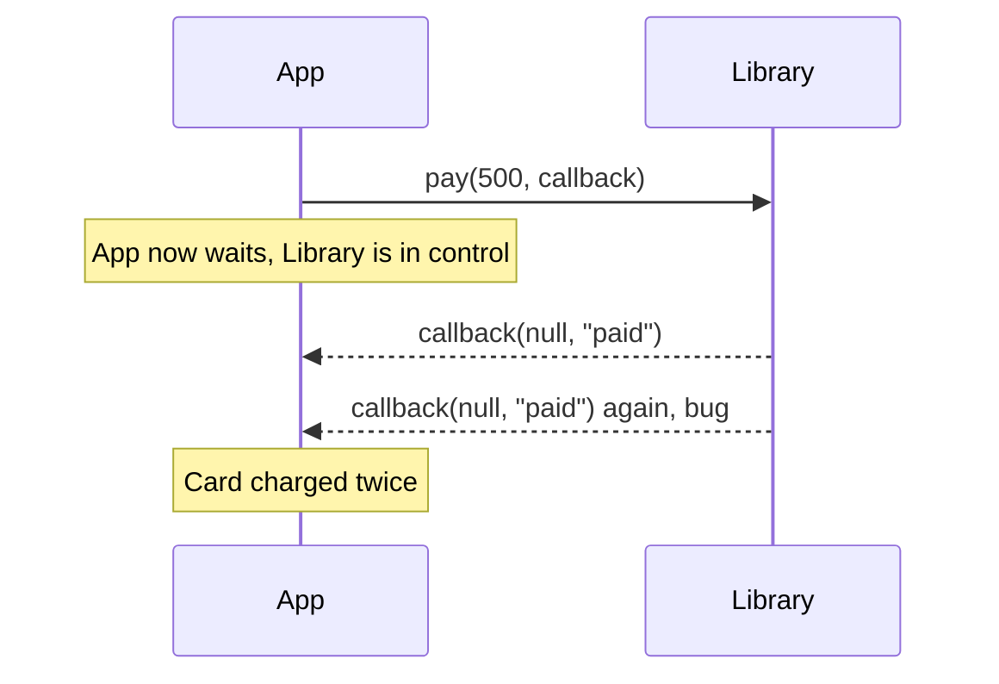

```js
// A buggy library: it calls our callback TWICE (charges the card twice!)
function badPay(amount, cb) { cb(null, "paid " + amount); cb(null, "paid " + amount); }

function once(cb) {                       // guard: only the first call counts
  let called = false;
  return (...args) => { if (called) return; called = true; cb(...args); };
}
badPay(500, once((err, msg) => console.log("callback:", msg))); // callback: paid 500 (once)

const p = new Promise(resolve => badPay(500, (err, msg) => resolve(msg)));
p.then(msg => console.log("promise:", msg)); // promise: paid 500 (a promise settles only once)
```

- **Never called:** add a timeout. With promises: [Promise with timeout](#16-promise-with-timeout).
- **Called twice:** a promise can settle only once, so wrapping it in a promise protects you. See also [once](#23-once).

**Zalgo (sometimes sync, sometimes async):**
A function that calls back **sync** on a cache hit and **async** on a miss.
The order of your code then changes at random, which gives bugs that are very hard to find.
Rule: an async API must **always** be async. Promises follow this rule: `.then` always runs as a microtask.

```js
const cache = new Map();
function getPrice(id, cb) {               // BAD: sync on hit, async on miss
  if (cache.has(id)) return cb(cache.get(id));
  setTimeout(() => { cache.set(id, 99); cb(99); }, 10);
}
function getPriceSafe(id, cb) {           // GOOD: always async
  if (cache.has(id)) return queueMicrotask(() => cb(cache.get(id)));
  setTimeout(() => { cache.set(id, 99); cb(99); }, 10);
}
getPrice(1, () => {
  getPrice(1, () => console.log("bad: callback")); console.log("bad: after call");
  getPriceSafe(1, () => console.log("safe: callback")); console.log("safe: after call");
});
// bad: callback / bad: after call   <- the order flipped because of the cache
// safe: after call / safe: callback  <- always the same order
```

**Good and bad:**

| Good | Bad |
|---|---|
| Sync callbacks for `map`, `filter`, `sort` | Deep nesting of async callbacks |
| `async/await` with `try/catch` for async flows | Forgetting `if (err) return` in an error-first callback |
| `util.promisify` or `fs/promises` for old Node APIs | Mixing callbacks and promises in the same flow |
| Always-async APIs | A callback that is sometimes sync, sometimes async (Zalgo) |
| Callbacks for events that fire many times (`on("data")`) | Using a promise for something that happens many times |

**When to use / when not to use:**
- Callbacks are still right for **events** (click, stream data) and sync helpers (`map`, `sort`).
- For a **one-time** async result, use a promise and `await`.

**Say this in the interview:**

> A callback is a function I pass so another function can call it, now (like `map`) or later (like `setTimeout`).
> Old Node APIs use error-first callbacks, so I always check `err` first.
> Nested async callbacks give callback hell: deep nesting, repeated error checks, and I lose control of when and how often my code runs.
> Promises fix this: a flat chain, one `catch`, and they settle only once. `async/await` makes it read like normal code.

**They may ask next:**
- **Is every callback async?** No. `map` and `forEach` callbacks run sync. Only callbacks given to timers, events or I/O run later.
- **Why can't `try/catch` catch an error thrown in a `setTimeout` callback?** The callback runs later, on a new call stack. The `try` block has already finished.
- **Are promises just callbacks?** They still use callbacks (`.then(fn)`), but the promise gives guarantees: one result, always async, errors flow to `catch`.
- **When do you still use callbacks?** Events and streams that fire many times, and sync helpers like `sort`.
- **How do you convert a callback API?** `util.promisify`, or wrap it in `new Promise`. See [promisify](#28-promisify).

---

## Promises and async/await

**In one line:** A promise is an object for a value that will come later; `async/await` lets you write promise code that reads like normal top-to-bottom code.

**Story:** Ordering at a busy food court.
You pay and get a **token** (the promise). You do not stand at the counter. You sit and chat.
Later the token screen shows "ready" (fulfilled) or "sorry, out of stock" (rejected).
`await` is you walking to the counter only when your token is called.

**Promise states:**

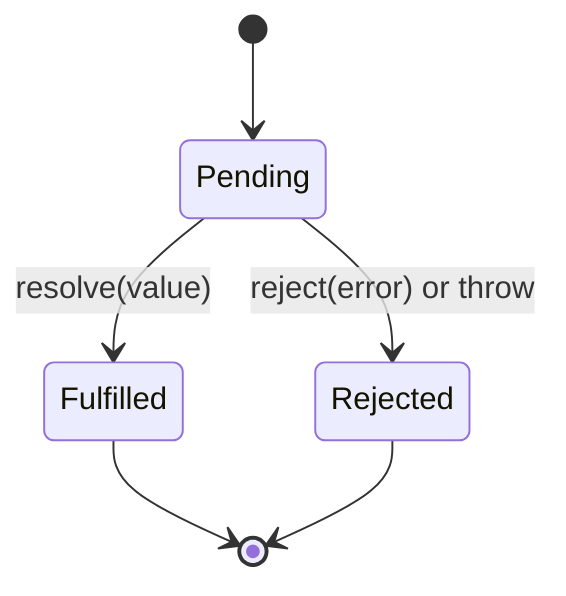

- A promise is settled only once. Calling `resolve` again does nothing.
- `.then`, `.catch`, `.finally` callbacks always run as microtasks, even if the promise is already settled.

**How chaining and errors work:**
1. Each `.then` returns a **new** promise. Return a value or a promise from it to pass it on.
2. If any step throws, the chain skips to the next `.catch`.
3. With `async/await`, use `try/catch`. An `async` function always returns a promise.

```js
Promise.resolve(1)
  .then(v => v + 1)
  .then(v => { throw new Error("step 3 failed " + v); })
  .then(() => console.log("skipped"))           // skipped because of the error
  .catch(e => console.log("caught:", e.message)) // caught: step 3 failed 2
  .finally(() => console.log("finally"));        // finally
```

**Combinators table:**

| Method | Waits for | Resolves when | Rejects when | Use it for |
|---|---|---|---|---|
| `Promise.all` | All | All fulfilled (array, same order) | **First** rejection | Load user + orders + settings; all are needed |
| `Promise.allSettled` (ES2020) | All | Always, with `{status, value/reason}` | Never | Send 10 emails, report which failed |
| `Promise.race` | First to settle | First one fulfills | First one rejects | Timeout pattern |
| `Promise.any` (ES2021) | First success | First fulfillment | All reject (`AggregateError`) | Try 3 mirror servers, use the fastest good one |

**Common mistakes:**

```js
const getUser = id => new Promise(r => setTimeout(() => r({ id }), 10));
const ids = [1, 2, 3];
const out = [];
ids.forEach(async id => out.push(await getUser(id))); // forEach does NOT wait
console.log("forEach result:", out.length);            // forEach result: 0

const seq = [];
for (const id of ids) seq.push(await getUser(id));     // one by one (slow, but in order)
console.log("for...of:", seq.length);                  // for...of: 3
console.log("Promise.all:", (await Promise.all(ids.map(getUser))).length); // in parallel
// Promise.all: 3
```

Other mistakes:
- **Forgetting `return`** inside `.then`. The next step gets `undefined` and does not wait.
- **Await in a loop for independent calls.** 10 calls of 100 ms take 1 second, not 100 ms. Use `Promise.all`.
- **`Promise.all` with 10,000 items.** It fires 10,000 requests at once. Use a [concurrency pool](#17-concurrency-limited-promise-pool).
- **No `.catch`.** You get an "unhandled rejection". In Node.js this crashes the process by default (since Node 15).
- **`new Promise(async (resolve) => ...)`.** Errors inside are lost. Just write an `async` function.

**Async iteration:** `for await...of` reads values that come one by one, like pages from an API or chunks of a stream.

```js
async function* pages() {
  for (let p = 1; p <= 3; p++) { await null; yield [`item${p}`]; } // pretend: fetch page p
}
for await (const page of pages()) console.log("page", page);
// page [ 'item1' ]
// page [ 'item2' ]
// page [ 'item3' ]
```

**Cancellation with AbortController:** a promise cannot be cancelled by itself. We pass an `AbortSignal` to the work.

```js
const controller = new AbortController();
const res = fetch("/api/orders", { signal: controller.signal }); // fetch listens to the signal
controller.abort();                    // fetch rejects with an AbortError
fetch("/api/slow", { signal: AbortSignal.timeout(3000) });  // auto-cancel after 3 s (TimeoutError)
fetch("/api/x", { signal: AbortSignal.any([controller.signal, AbortSignal.timeout(3000)]) }); // either one
```

- In React, abort in the `useEffect` cleanup so an old request does not overwrite new data.
- Full search-box example: [fetch with cancel](#27-fetch-with-cancel-of-the-previous-request-search-box).

**Good and bad:**

| Good | Bad |
|---|---|
| `Promise.all` for independent calls | `await` one by one for independent calls |
| `try/catch` around `await`, or `.catch` at the end | Unhandled rejections |
| `AbortController` for user-driven cancel and timeouts | Ignoring old responses with flags only (the request still runs) |
| `Promise.allSettled` when partial success is fine | `Promise.all` when one failure should not hide the others |

**Say this in the interview:**

> A promise is a placeholder for a future value. It is pending, then fulfilled or rejected, only once.
> `async/await` is syntax over promises. I use `try/catch` for errors and `Promise.all` to run independent calls in parallel.
> I know the traps: `forEach` does not wait, and await in a loop runs things one by one.
> For cancel and timeouts I pass an `AbortSignal` to fetch.

**They may ask next:**
- **`all` vs `allSettled`?** `all` fails fast on the first error. `allSettled` always waits and tells you each result.
- **Does `Promise.all` cancel the other requests when one fails?** No. They keep running. Use an `AbortController` to cancel them.
- **What is `Promise.withResolvers()` (ES2024)?** It returns `{ promise, resolve, reject }`, so you can resolve from outside. Handy for wrapping events.
- **Callbacks vs promises?** Callbacks nest deeply ("callback hell") and error handling is manual. Promises chain and have one `.catch`. See [callbacks](#callbacks-and-callback-hell) and [promisify](#28-promisify).
- **What is `Promise.try` (ES2025)?** It runs a function and always gives a promise, even if the function throws synchronously.

---

## Error handling in JavaScript

**In one line:** Throw real `Error` objects, catch them where you can do something useful, add context with `cause`, and keep a global safety net for the errors nobody caught.

**Story:** A hospital.
A nurse who sees a small problem fixes it on the spot (a local `try/catch`).
A bigger problem goes up to the doctor with a note: "patient fainted, after taking medicine X" (a new error with a `cause`).
The emergency alarm (`window.onerror`, `unhandledrejection`) is the last safety net. It should ring rarely, and someone must always hear it (your monitoring tool).

**How it works:**
1. `throw` stops the current function and walks up the call stack until a `try/catch` catches it.
2. `finally` always runs: after `try`, after `catch`, even after a `return`.
3. Throw `Error` objects, not strings. An `Error` has `name`, `message` and `stack` (where it happened).
4. In async code, a thrown error **rejects the promise**. Catch it with `await` inside `try/catch`, or with `.catch()`.
5. A `try/catch` cannot catch an error thrown later in a callback (a timer, an event). That callback runs on a different call stack.
6. Errors nobody catches go to global handlers: `error` and `unhandledrejection` in the browser, `uncaughtException` and `unhandledRejection` in Node.js.

**Built-in error types:**

| Type | When you see it | Example |
|---|---|---|
| `TypeError` | Wrong type: calling a non-function, reading a property of `undefined` | `null.x`, `fetch` network failure |
| `ReferenceError` | Variable does not exist, or is in the TDZ | `undefinedThing` |
| `RangeError` | Number out of range, too-deep recursion | `new Array(-1)`, stack overflow |
| `SyntaxError` | Bad code or bad JSON | `JSON.parse("{bad")` |
| `URIError` | Bad `%` encoding | `decodeURIComponent("%")` |
| `AggregateError` (ES2021) | Many errors at once | `Promise.any` when all fail |
| `DOMException` | Web API errors, checked by `name` | `AbortError`, `TimeoutError`, `QuotaExceededError` |

**Diagram: where an error goes**

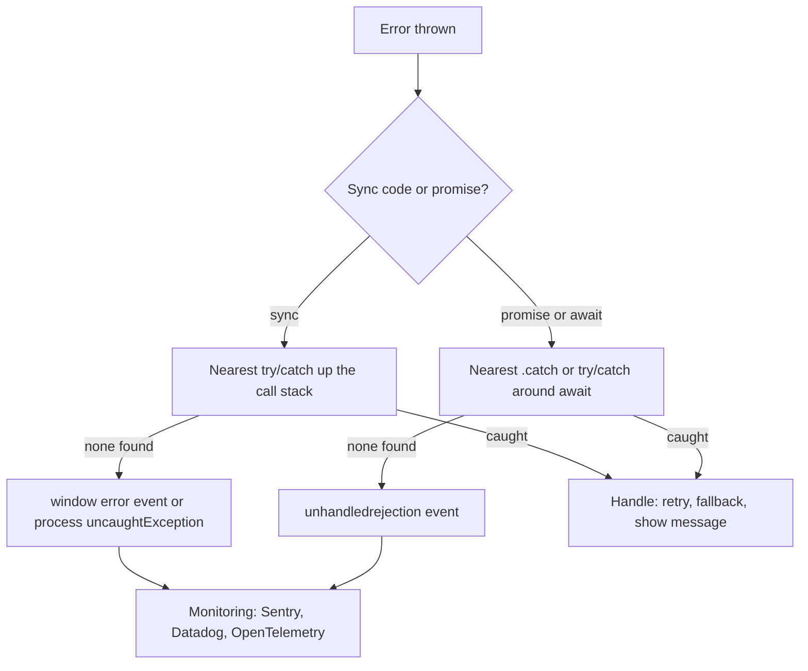

**Example: custom errors with `cause`** (run on Node 24)

```js
class AppError extends Error {
  constructor(message, { status = 500, cause } = {}) {
    super(message, { cause });             // ES2022: keep the original error as "cause"
    this.name = this.constructor.name;     // logs show "NotFoundError", not "Error"
    this.status = status;
  }
}
class NotFoundError extends AppError {
  constructor(what, options) { super(`${what} not found`, { status: 404, ...options }); }
}
async function loadOrder(id) {
  try {
    throw new TypeError("rows is undefined");               // pretend: low-level failure
  } catch (err) {
    throw new NotFoundError(`order ${id}`, { cause: err });  // wrap it, keep the original
  }
}
try { await loadOrder(7); } catch (e) {
  console.log(e.name, e.status, e.message, e instanceof AppError, e instanceof Error);
  // NotFoundError 404 order 7 not found true true
  console.log("cause:", e.cause.name, e.cause.message);     // cause: TypeError rows is undefined
}
```

**Example: async traps**

```js
const fail = async () => { throw new Error("db down"); };

async function a() { try { return fail(); } catch { return "caught"; } }       // NOT caught here
async function b() { try { return await fail(); } catch { return "caught"; } } // caught
console.log(await b());                                      // caught
console.log(await a().catch(e => "escaped: " + e.message));  // escaped: db down

function f() { try { throw new Error("lost"); } finally { return "finally wins"; } }
console.log(f());     // finally wins   <- a return in finally swallows the error. Never do this.
console.log(Error.isError(new TypeError()), Error.isError({ message: "x" })); // true false (ES2026)
```

- `return promise` inside `try` leaves the function before the promise fails. Use `return await` inside `try`.
- `Error.isError(x)` (ES2026) works even for errors from another iframe or window, where `instanceof Error` fails.

### The global safety net

```js
// Browser
window.addEventListener("error", (e) => report(e.error ?? e.message));           // sync errors nobody caught
window.addEventListener("unhandledrejection", (e) => report(e.reason));          // promise with no catch

// Node.js
process.on("unhandledRejection", (reason) => { log(reason); process.exitCode = 1; });
process.on("uncaughtException", (err) => { log(err); process.exit(1); });        // state may be broken: restart
```

- Since Node.js 15, an unhandled rejection **crashes the process** by default. I checked: a bare `Promise.reject(new Error("x"))` exits with code 1 on Node 24.
- After `uncaughtException`, the app may be in a broken state. Log, flush, and exit. Let the process manager (Kubernetes, PM2) restart it. More: [Node.js async errors](nodejs.md#async-error-handling).
- Production stack traces are minified. Upload **source maps** to your error tool so the stack shows real file names and lines.

### Errors in React

A render error with no handler unmounts the whole app (a white screen).
An **error boundary** catches render errors in its child tree and shows a fallback. It does **not** catch errors in event handlers or async code; use `try/catch` there.
More: [React error boundaries](react.md#error-boundaries-and-error-handling).

**Good and bad:**

| Good | Bad |
|---|---|
| `throw new NotFoundError(...)` with a `name` and `status` | `throw "not found"` (no stack trace) |
| Wrap with `{ cause }` to keep the root reason | Catch, then throw a new error and lose the original |
| Catch where you can act (retry, fallback, show a message) | `catch (e) {}`: silent failure, hard to debug |
| `return await` inside `try` | `return promise` inside `try` and expecting `catch` to run |
| Global handlers that report to monitoring | Global handlers that hide errors and keep going |

**Say this in the interview:**

> I throw `Error` subclasses with a clear `name` and extra fields like `status`, and I wrap low-level errors with `cause`, so logs show the full story.
> In async code an error becomes a rejected promise. I `await` inside `try/catch`, and I use `return await` inside `try`.
> I only catch where I can do something: retry, show a fallback, or add context.
> As a last safety net, I listen to `error` and `unhandledrejection` and send them, with source maps, to the monitoring tool. In React, error boundaries catch render errors.

**They may ask next:**
- **Why does `try/catch` not catch an error in `setTimeout`?** The callback runs later, on a new call stack. The `try` block already finished. Put the `try` inside the callback.
- **How do you handle errors in `Promise.all`?** It rejects on the first error. Use `Promise.allSettled` if you want every result. See [promises](#promises-and-asyncawait).
- **What is `cause` for?** To chain errors. The top error says what failed for the user; the cause says why.
- **Should you catch everything?** No. Catching and ignoring hides bugs. Let unknown errors reach the global handler and monitoring.
- **How do you show a nice message for a 500 from the API?** Turn the response into a typed error (see [fetch](#fetch-abortcontroller-and-network-requests)), then map error types to user messages in one place.

---

## Timers in depth

**In one line:** Timers say "run this **not before** N ms", never "exactly at N ms"; for screen updates use `requestAnimationFrame`, for low-priority work use idle time, and for long tasks yield to the main thread.

**Story:** A cook with kitchen timers.
The timer rings at 10 minutes, but the cook is busy flipping 20 rotis. He checks the timer only when his hands are free.
So "10 minutes" really means "10 minutes or more".
`requestAnimationFrame` is the waiter who comes **just before** each plate goes out, to add the garnish.
`requestIdleCallback` is cleaning the counter when no orders are waiting.

**How it works:**
1. `setTimeout(fn, ms)` puts `fn` in the task queue after **at least** `ms`. If the main thread is busy, it waits longer.
2. **4 ms clamp:** after 5 levels of nested timers (a timer that sets a timer that sets a timer...), browsers use at least 4 ms. This is in the HTML standard.
3. **Background tabs:** browsers slow timers to about once per second. Chrome slows chained timers in a tab hidden for 5+ minutes even more (about once per minute).
4. **Max delay** is 2^31 − 1 ms (about 24.8 days). A bigger number overflows and the timer fires at once.
5. `setInterval(fn, ms)` tries to run every `ms`. If `fn` is slow or the thread is busy, ticks come late and **drift**. Ticks are not queued up to "catch up" in browsers.
6. `requestAnimationFrame(fn)` runs `fn` right **before the next paint**, matched to the screen (60, 120 Hz...). It pauses in background tabs.
7. `requestIdleCallback(fn, { timeout })` runs `fn` when the browser has free time in a frame. `deadline.timeRemaining()` tells you how much (max 50 ms).

**Diagram: one frame of the browser**

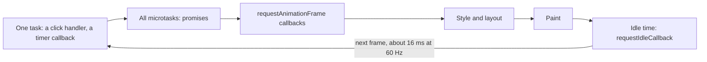

**Example: a timer is a minimum wait** (run on Node 24)

```js
const t0 = performance.now();
setTimeout(() => console.log("asked for 100 ms, got", Math.round(performance.now() - t0), "ms"), 100);
const busyUntil = performance.now() + 300;
while (performance.now() < busyUntil) {}   // main thread busy for 300 ms
// asked for 100 ms, got 300 ms
setTimeout(() => console.log("fired at once!"), 2 ** 31); // too big: Node warns (TimeoutOverflowWarning), uses 1 ms
```

### setInterval drift and the fix

- `setInterval(fn, 1000)` for a countdown clock can be several seconds wrong after 10 minutes, and much more in a background tab.
- **Fix 1:** do not count ticks. Compute from the real clock each time: `remaining = endTime - Date.now()`.
- **Fix 2:** a self-correcting `setTimeout` that plans each tick by the clock. See [setInterval using setTimeout](#35-setinterval-using-settimeout).
- A chained `setTimeout` also never stacks calls: the next tick is planned only after the current one finishes.

### requestAnimationFrame for animation

```js
function slideIn(el, durationMs) {
  const start = performance.now();
  function frame(now) {                                  // "now" is the frame time from the browser
    const progress = Math.min((now - start) / durationMs, 1); // based on TIME, not on frame count
    el.style.transform = `translateX(${progress * 300}px)`;
    if (progress < 1) requestAnimationFrame(frame);      // ask for the next frame
  }
  requestAnimationFrame(frame);
}
```

- Base the movement on elapsed time. On a 120 Hz screen frames come twice as often; the speed stays right.
- For simple moves, CSS transitions on `transform` and `opacity` are better: they run off the main thread.
- rAF is also great for [throttling scroll handlers](#26-throttle-with-requestanimationframe).

### requestIdleCallback

```js
function sendMore(deadline) {
  while (deadline.timeRemaining() > 5 && queue.length) sendAnalytics(queue.shift()); // only in free time
  if (queue.length) requestIdleCallback(sendMore, { timeout: 2000 }); // not done: continue later
}
requestIdleCallback(sendMore, { timeout: 2000 });     // run within 2 s even if never idle
```

- Good for analytics, prefetching, warming caches.
- Not for DOM changes: they would cause extra layout in the next frame.
- Safari does not support it. Feature-check and fall back to `setTimeout`.

### Yielding: scheduler.yield and scheduler.postTask

A long task (over 50 ms) blocks clicks and hurts **INP** (Interaction to Next Paint). Split the work and **yield** (give the main thread a break) between parts.

```js
const yieldToMain = () =>
  globalThis.scheduler?.yield?.() ??              // Chrome 129+, Firefox 142+
  new Promise(resolve => setTimeout(resolve, 0)); // fallback (Safari, Node.js)

async function processAll(items, handle) {
  let last = performance.now(), breaks = 0;
  for (const item of items) {
    handle(item);
    if (performance.now() - last > 50) {        // worked 50 ms? let clicks and paint happen
      await yieldToMain();
      breaks++;
      last = performance.now();
    }
  }
  return breaks;
}
const slowItem = () => { const until = performance.now() + 1; while (performance.now() < until) {} }; // 1 ms each
console.log("took a break", await processAll(Array.from({ length: 300 }), slowItem), "times");
// took a break 5 times   (about 300 ms of work, one break about every 50 ms; 5 or 6 on a real run)
```

- `scheduler.yield()` is better than `setTimeout(0)`: your code continues **before** other waiting tasks, so it does not lose its place in the line.
- `scheduler.postTask(fn, { priority })` runs a task with a priority: `"user-blocking"`, `"user-visible"` (default) or `"background"`. It also takes a `signal` to cancel.
- Support (Nov 2026): Chromium (`postTask` since 94, `yield` since 129) and Firefox 142+. Safari: not yet. Always feature-check.

### Node.js timers in short

| API | When it runs |
|---|---|
| `process.nextTick(fn)` | Right after the current operation, before promise callbacks |
| Promise callbacks | Microtasks, after `nextTick` |
| `setTimeout(fn, 0)` | Timers phase of the event loop (at least 1 ms) |
| `setImmediate(fn)` | Check phase, right after I/O |
| `await setTimeout(100)` from `node:timers/promises` | A promise-based sleep |

At the top level, `setTimeout(0)` vs `setImmediate` order can change between runs (I saw both orders on Node 24). Inside an I/O callback, `setImmediate` always runs first.
`timer.unref()` lets the process exit even if the timer is still waiting. More: [Node event loop phases](nodejs.md#the-node-event-loop-phases).

**Good and bad:**

| Good | Bad |
|---|---|
| Compute time from `Date.now()` or `performance.now()` | Counting `setInterval` ticks for a clock |
| `requestAnimationFrame` for visual changes | `setInterval(draw, 16)` |
| Yield every ~50 ms in long loops | One 2-second loop that freezes the page |
| Clear every timer in cleanup (`clearTimeout`, `clearInterval`) | Intervals that run after the component is gone |
| Feature-check `scheduler` and `requestIdleCallback` | Assuming Safari has them |

**Say this in the interview:**

> A timer delay is a minimum, not a promise. The callback waits in the task queue until the call stack is free. Browsers also clamp nested timers to 4 ms and slow timers in background tabs.
> `setInterval` drifts, so for clocks I compute from the real time, or chain `setTimeout` and correct each tick.
> For animation I use `requestAnimationFrame`, which runs right before paint. For low-priority work, `requestIdleCallback`.
> For long tasks I split the work and yield with `scheduler.yield()` where it exists, falling back to `setTimeout`, to keep INP good.

**They may ask next:**
- **Why does a countdown get wrong in a background tab?** Background timers run at most about once a second (or less). Compute from the end time when the tab comes back (`visibilitychange` event).
- **rAF vs `setTimeout(16)`?** rAF matches the real screen refresh, runs just before paint, and pauses in hidden tabs. `setTimeout(16)` can run mid-frame and waste work.
- **What is a long task?** Any task over 50 ms. DevTools marks it with a red corner.
- **What happens with `setTimeout(fn, 2 ** 31)`?** It overflows and fires almost at once. Split very long waits into chunks.

---

## Iterators and generators

**In one line:** An iterator is any object with a `next()` method that returns `{ value, done }`; a generator (`function*`) is the easy way to write one, because it can pause at `yield` and continue later.

**Story:** A token machine at a bank.
You press the button (`next()`), and it gives you one token: `{ value: 42, done: false }`.
It does not print all 500 tokens in the morning. It prints one when you ask (lazy).
When the day is over, it says `{ done: true }`.
A generator is a machine that remembers exactly where it stopped, like a bookmark in a book.

**How it works:**
1. **Iterable:** an object with a `[Symbol.iterator]()` method. Arrays, strings, `Map`, `Set`, `arguments` and NodeLists are iterable. Plain objects are not.
2. **Iterator:** the object that method returns. It has `next()` that gives `{ value, done }`.
3. `for...of`, spread `[...x]`, `Array.from`, destructuring, `Promise.all` and `new Map(x)` all use this protocol.
4. **Generator function** `function*`: calling it runs **nothing**. It returns a generator object (an iterator).
5. Each `next()` runs the body until the next `yield`, then pauses. `next(value)` sends a value **into** the paused `yield`.
6. `return()` stops the generator early. `finally` blocks still run, so cleanup is safe. `for...of` calls it when you `break`.
7. **Async iterators** use `[Symbol.asyncIterator]` and `next()` returns a promise. Read them with `for await...of`.

**Diagram: what `for...of` does with a generator**

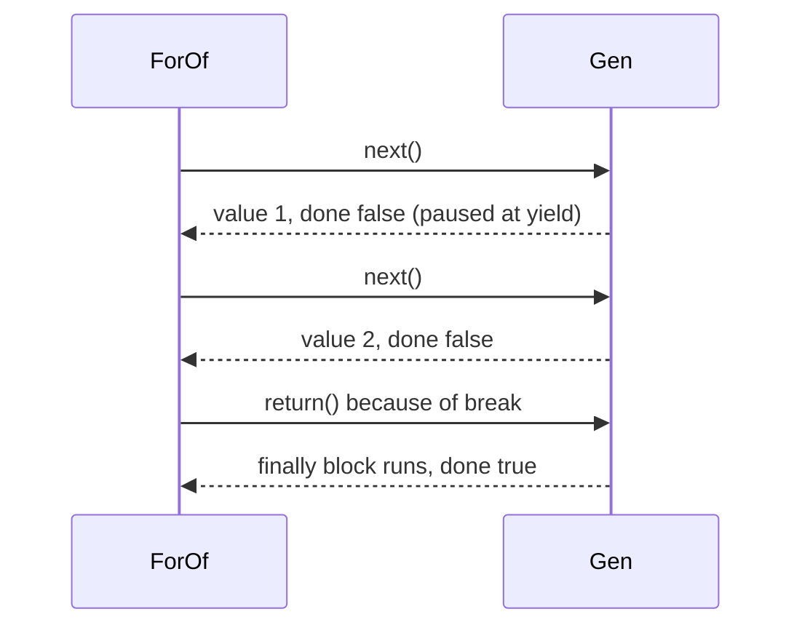

**Example: make your own object iterable** (run on Node 24)

```js
const range = {
  from: 1, to: 3,
  [Symbol.iterator]() {                     // the "iterable" part: returns an iterator
    let cur = this.from;
    const last = this.to;
    return {
      next: () => (cur <= last
        ? { value: cur++, done: false }     // the "iterator" part: next() gives { value, done }
        : { value: undefined, done: true }),
    };
  },
};
console.log([...range], Math.max(...range), Array.from(range, x => x * 10));
// [ 1, 2, 3 ] 3 [ 10, 20, 30 ]
const [first, ...rest] = range;
console.log(first, rest);                   // 1 [ 2, 3 ]
```

**Example: a generator, sending values in, and cleanup**

```js
function* orderIds(prefix) {
  let n = 0;
  while (true) {                             // endless, but safe: it runs only when asked
    const reset = yield `${prefix}-${++n}`;  // pause here; give a value out, take a value in
    if (reset) n = 0;
  }
}
const ids = orderIds("ORD");
console.log(ids.next().value, ids.next().value);   // ORD-1 ORD-2
console.log(ids.next(true).value);                 // ORD-1   <- we sent "true" into the generator

function* withCleanup() {
  try { yield 1; yield 2; yield 3; }
  finally { console.log("cleanup runs"); }         // runs when the loop stops early
}
for (const x of withCleanup()) { console.log(x); if (x === 2) break; }
// 1
// 2
// cleanup runs
```

- `yield* other` hands out every value of another iterable, one by one.
- A generator object can be used **once**. After `done: true`, it stays done.

### Lazy sequences and iterator helpers (ES2025)

Before ES2025, to use `map` and `filter` you first had to build a full array.
Now iterators have their own **lazy** helpers: `map`, `filter`, `take`, `drop`, `flatMap`, `reduce`, `toArray`, `forEach`, `some`, `every`, `find`, and `Iterator.from()`.
They work one value at a time, so they even work on an endless source.

```js
function* naturals() { let n = 1; while (true) yield n++; }  // infinite and lazy

const result = naturals()
  .filter(n => n % 2 === 0)   // iterator helpers (ES2025): no arrays in between
  .map(n => n * n)
  .take(3)                    // stop after 3 values, so the endless source is fine
  .toArray();
console.log(result);          // [ 4, 16, 36 ]

const words = new Set(["tea", "coffee", "milk"]).values();
console.log(words.drop(1).map(w => w.toUpperCase()).toArray()); // [ 'COFFEE', 'MILK' ]
```

- Array methods are **eager**: `arr.map().filter()` makes a full new array at each step.
- Iterator helpers are **lazy**: one value goes through the whole chain, then the next one.
- Good for big files read line by line, large `Map`s, or "find the first 10 matches" in a huge list.
- Support: Chrome 122+, Firefox 131+, Safari 18.4+, Node.js 22+.

### Async generators for paged APIs

The classic use: an API returns 50 orders per page with a `nextPage` link. You want "all orders" as one simple loop.

```js
// Pretend API: GET /orders?page=N  ->  { items, nextPage }
async function fetchPage(page) {
  await new Promise(r => setTimeout(r, 10));                   // network wait
  console.log(`  (fetched page ${page})`);
  return { items: [`o${page * 2 - 1}`, `o${page * 2}`], nextPage: page < 3 ? page + 1 : null };
}
async function* allOrders() {
  let page = 1;
  while (page) {
    const { items, nextPage } = await fetchPage(page);
    yield* items;                // hand out items one by one
    page = nextPage;
  }
}
for await (const order of allOrders()) {
  console.log(order);
  if (order === "o3") break;     // stop early: page 3 is never fetched
}
//   (fetched page 1)
// o1
// o2
//   (fetched page 2)
// o3
const all = await Array.fromAsync(allOrders());  // ES2026: collect every page into one array
console.log(all.length);                         // 6
```

- The caller does not know about pages at all. It just loops.
- Pages are fetched **only when needed**. `break` stops the network calls.
- The same pattern reads streams: `for await (const chunk of response.body)` and Node.js `readline`.

**Good and bad:**

| Good | Bad |
|---|---|
| Generators for lazy or endless sequences | Building a 1-million-item array to use the first 10 |
| Async generators to hide paging | Callers that track page numbers everywhere |
| `try/finally` inside generators for cleanup | Leaving a file or connection open when the loop breaks |
| Iterator helpers on big `Map`s and `Set`s | `[...bigMap.values()].filter(...)` (copies everything first) |
| `for...of` on arrays when you need `break` or `await` | `forEach` with `await` inside (it does not wait) |

**Say this in the interview:**

> The iteration protocol is simple: an iterable has `Symbol.iterator`, which returns an iterator with `next()`, and `next()` returns `{ value, done }`. `for...of`, spread and destructuring all use it.
> A generator function is the easy way to build an iterator. It pauses at each `yield` and keeps its local state, so it is lazy.
> I use async generators with `for await` to turn a paged API into one simple loop, and `break` stops the extra requests.
> ES2025 added lazy iterator helpers like `map`, `filter` and `take` directly on iterators.

**They may ask next:**
- **Iterable vs iterator?** An iterable can **give** you an iterator (`[Symbol.iterator]()`). An iterator **is** the cursor with `next()`. Arrays are iterable; `arr.values()` is an iterator.
- **Why is a plain object not iterable?** Its keys could mean many things. Use `Object.entries(obj)` to loop.
- **How did Redux-Saga use generators?** A saga yields effect descriptions (`call`, `put`). The library runs them and resumes the generator with the result. Async code before `async/await` was common.
- **How does `async/await` relate to generators?** `async/await` works like a generator that yields promises, with a runner that resumes it when each promise settles. Babel used to compile it that way.

---

## Equality, types and coercion

**In one line:** `===` compares without changing types; `==` first converts types (coercion), which gives surprising results.

**Story:** Comparing two bank notes.
`===` checks the currency **and** the amount: 100 rupees is not 100 dollars.
`==` first converts one into the other with a strange rate, then compares. Sometimes it says "equal" when it should not.

**Types in JavaScript:**
- 7 primitive types: `string`, `number`, `bigint`, `boolean`, `undefined`, `null`, `symbol`.
- Everything else is an `object` (arrays, functions, dates, maps).
- Primitives are compared by value. Objects are compared by reference (same object in memory).

**Example:**

```js
console.log(0 == "", null == undefined, null === undefined, NaN === NaN,
            Object.is(NaN, NaN), Object.is(0, -0), 0 === -0);
// true true false false true false true
console.log(typeof null, typeof [], typeof function(){}, typeof NaN, typeof undefined, Array.isArray([]));
// object object function number undefined true
console.log([] == false, "5" + 1, "5" - 1, [1,2] + [3], {} + "", Number.isNaN("abc"), isNaN("abc"));
// true 51 4 1,23 [object Object] false true
console.log(0.1 + 0.2, 0.1 + 0.2 === 0.3);
// 0.30000000000000004 false
```

**Three ways to compare:**

| | `==` | `===` | `Object.is` |
|---|---|---|---|
| Converts types | Yes | No | No |
| `NaN` equals `NaN` | No | No | **Yes** |
| `0` equals `-0` | Yes | Yes | **No** |
| Use it | Only `x == null` (catches `null` and `undefined`) | Almost always | Rare cases, React uses it to compare state |

**typeof quirks:**
- `typeof null` is `"object"`. This is an old bug that cannot be fixed. Check `x === null`.
- `typeof []` is `"object"`. Use `Array.isArray(x)`.
- `typeof NaN` is `"number"`. NaN means "Not a Number", but it is a number value.

**Truthy and falsy:** only 8 values are falsy: `false`, `0`, `-0`, `0n`, `""`, `null`, `undefined`, `NaN`.
Everything else is truthy, including `"0"`, `"false"`, `[]` and `{}`.

**NaN:**
- `NaN` is the only value not equal to itself.
- Use `Number.isNaN(x)`. The old global `isNaN("abc")` converts first and says `true`.

**Good and bad:**

| Good | Bad |
|---|---|
| `===` everywhere | `==` except for `x == null` |
| `??` for defaults (keeps `0` and `""`) | `x \|\| default` when `0` is a valid value |
| Compare money in paise (integers) or use a decimal library | `0.1 + 0.2 === 0.3` |
| `Number.isNaN`, `Array.isArray` | `typeof` to check for arrays or `null` |

**Say this in the interview:**

> `===` is strict equality: no type conversion. `==` converts types first, which leads to bugs like `[] == false` being true.
> I always use `===`, except `x == null` to check null or undefined in one go.
> `NaN` is not equal to itself, so I use `Number.isNaN`. `Object.is` is like `===` but treats `NaN` as equal and `0` and `-0` as different.

**They may ask next:**
- **Why is `0.1 + 0.2` not `0.3`?** Numbers are 64-bit binary floating point. 0.1 cannot be stored exactly. Same as Java `double`.
- **What is the largest safe integer?** `Number.MAX_SAFE_INTEGER` is 2^53 - 1. For bigger values (like Java `long` IDs) use `BigInt` or send IDs as strings in JSON.
- **How do you deep-compare two objects?** There is no built-in. See [deep equal](#11-deep-equal).

---

## Map, Set, WeakMap, WeakSet and WeakRef

**In one line:** `Map` is a key-value store where any value can be a key, `Set` keeps unique values, and the "weak" versions hold their keys loosely so the garbage collector can still free them.

**Story:** A hotel.
A **Map** is the front-desk register: guest (key) → room number (value). The guest can be anyone, not only a name written as text.
A **Set** is the guest list for a party: each person only once.
A **WeakMap** is a sticky note on the guest's own suitcase. When the guest checks out and leaves with the suitcase, the note goes too. The hotel does not keep it.
A **WeakRef** is "I think Mr. Rao is still in room 12, let me check". He may have left already.

**How it works:**
1. `Map` keys can be anything: objects, functions, numbers, `NaN`. Keys are compared with *SameValueZero* (like `===`, but `NaN` equals `NaN`).
2. `Map` and `Set` remember **insertion order** and have `.size`. They are fast for many adds and deletes.
3. A plain object turns every key into a string (or a symbol). `obj[someObject]` becomes the key `"[object Object]"`.
4. `WeakMap` and `WeakSet` accept **only objects** (and non-registered symbols) as keys. They do not stop the key from being garbage collected.
5. Because entries can disappear at any time, weak collections have **no `.size`, no iteration, no `.clear()`**. Only `get`, `set`, `has`, `delete`.
6. `WeakRef` holds one object weakly. `ref.deref()` gives the object, or `undefined` if it was collected.
7. `FinalizationRegistry` runs a callback **some time after** an object is collected. Maybe late, maybe never.

**Which one to use:**

| Need | Use | Why |
|---|---|---|
| Fixed shape, JSON, config | Plain object | Simple, works with `JSON.stringify` and spread |
| Keys added and removed often, any key type, count with `.size` | `Map` | Faster for heavy add/delete, keeps order |
| Unique values, fast "have I seen it?" | `Set` | `has` is O(1) on average; `[...new Set(arr)]` removes duplicates |
| Extra data **about** an object you do not own (DOM node, request) | `WeakMap` | Data dies with the object: no leak |
| Mark objects as visited or "already processed" | `WeakSet` | Cycle detection, branding |
| A cache that may be dropped under memory pressure | `WeakRef` (+ maybe `FinalizationRegistry`) | Rare, advanced |

**Diagram: strong vs weak references**

```mermaid
flowchart LR
    R["Your variable: node"] -->|"strong"| N["DOM node object"]
    M["Map"] -->|"strong key: keeps node alive"| N
    W["WeakMap"] -.->|"weak key: does not keep it alive"| N
    N --> GC{"Any strong reference left?"}
    GC -->|"no"| F["GC frees node and its WeakMap entry"]
    GC -->|"yes"| K["Node stays in memory"]
```

**Example: Map and Set** (run on Node 24)

```js
const asha = { id: 1, name: "Asha" };
const visits = new Map();
visits.set(asha, 3).set("guest", 1);        // any type can be a key, even an object
console.log(visits.get(asha), visits.size, [...visits.keys()]);
// 3 2 [ { id: 1, name: 'Asha' }, 'guest' ]

const plain = {};
plain[asha] = 3;                            // a plain object turns the key into a string
console.log(Object.keys(plain));            // [ '[object Object]' ]

const tags = new Set(["js", "react", "js"]);
console.log(tags.size, tags.has("react"), [...new Set([3, 1, 3, 2])]); // 2 true [ 3, 1, 2 ]
console.log(new Map(Object.entries({ a: 1 })), Object.fromEntries(new Map([["b", 2]])));
// Map(1) { 'a' => 1 } { b: 2 }
```

- ES2025 added set maths: `a.union(b)`, `intersection`, `difference`, `symmetricDifference`, `isSubsetOf`. See [modern JavaScript](#modern-javascript-es2015-to-es2025).
- `Map.groupBy(list, fn)` (ES2024) groups into a `Map`, so group keys can be objects.
- `JSON.stringify(new Map(...))` gives `{}`. Convert first: `Object.fromEntries(map)` or `[...map]`.

**Example: WeakMap for private data and caches, WeakSet for cycles**

```js
const secrets = new WeakMap();               // private data per object
class Account {
  constructor(owner, pin) { this.owner = owner; secrets.set(this, { pin }); }
  check(pin) { return secrets.get(this).pin === pin; }
}
const acc = new Account("Ravi", "4321");
console.log(acc.check("4321"), JSON.stringify(acc), Object.keys(acc)); // true {"owner":"Ravi"} [ 'owner' ]

const sizeCache = new WeakMap();             // a cache that dies with its key
function measure(el) {
  if (!sizeCache.has(el)) {
    console.log("  slow measure for", el.id);
    sizeCache.set(el, { width: el.id.length * 100 }); // pretend: slow layout read
  }
  return sizeCache.get(el);
}
let panel = { id: "panel" };
measure(panel); measure(panel);              // second call uses the cache
//   slow measure for panel
panel = null;                                // the cache entry can now be freed too

const seen = new WeakSet();                  // "have I visited this object?"
const a = { name: "a" }; a.self = a;         // a cycle
function walk(obj) { if (seen.has(obj)) return "cycle!"; seen.add(obj); return walk(obj.self); }
console.log(walk(a));                        // cycle!
```

- Before `#private` fields (ES2022), the WeakMap pattern was the way to get real private data. Babel still compiles `#x` to a WeakMap.
- Real uses: libraries attach data to DOM nodes, Vue 3 keeps its reactivity tracking in a `WeakMap`, and [deep clone](#10-deep-clone) uses one to handle cycles.

**Example: WeakRef and FinalizationRegistry**

```js
const tick = () => new Promise(r => setTimeout(r, 0));
let report = { rows: new Array(1_000_000).fill(0) };
const ref = new WeakRef(report);
const registry = new FinalizationRegistry(label => console.log("freed:", label));
registry.register(report, "big report");

console.log(ref.deref() === report);  // true
report = null;                        // drop the only strong reference
await tick();                         // deref() keeps the object alive until the current job ends
globalThis.gc?.();                    // only with node --expose-gc; browsers decide by themselves
await tick();
console.log(ref.deref()?.rows.length ?? "gone");
// with --expose-gc:  freed: big report, then gone
// without it:        usually 1000000 for a while. There is no promise WHEN (or IF) it is freed.
```

**FinalizationRegistry caveats:**
- The callback may run late, or **never** (for example, if the page closes first).
- Never use it for important work like saving data or closing a database connection. Use explicit `close()`, `try/finally`, or `using`.
- After `deref()` returns the object, it stays alive until the current job ends. So checking twice in one function gives the same answer.
- Do not keep the target object inside the "held value" you register. That makes a strong reference, and it is never freed.

**Good and bad:**

| Good | Bad |
|---|---|
| `Map` for a cache keyed by user id with many adds and deletes | A plain object as a dictionary with user input keys (`__proto__` problems) |
| `WeakMap` for data attached to DOM nodes or objects you do not own | A `Map` keyed by DOM nodes that never removes them (leak) |
| `Set` to remove duplicates or for fast `has` | `arr.includes(x)` inside a loop over 100,000 items (O(n²)) |
| Explicit cleanup for resources | Relying on `FinalizationRegistry` to close files |

**Say this in the interview:**

> A `Map` takes any key type, keeps insertion order, and has `.size`, so I use it for dynamic dictionaries. A `Set` keeps unique values with fast `has`.
> A `WeakMap` holds its keys weakly: when the key object is gone, the entry goes too. I use it to attach data or a cache to objects I do not own, like DOM nodes, without leaking memory.
> Because entries can vanish any time, weak collections cannot be iterated or counted.
> `WeakRef` and `FinalizationRegistry` exist, but the timing is not guaranteed, so I never use them for important cleanup.

**They may ask next:**
- **Why can you not loop over a WeakMap?** The result would depend on when the GC ran, which is not predictable.
- **Map vs object performance?** For many adds and deletes, `Map` is usually faster. For a fixed shape read many times, objects are well optimized by V8 [hidden classes](#inside-the-javascript-engine-v8).
- **Can a string be a WeakMap key?** No. Only objects and non-registered symbols (ES2023). Strings are not garbage collected in a trackable way.
- **How does a WeakMap help avoid memory leaks?** It never keeps its keys alive. Once nothing else points to the key, both the key and its value can be freed.

---

## Modern JavaScript (ES2015 to ES2025)

**In one line:** Since 2015, JavaScript gets a new version every June (ES2015, ES2016, ...); each adds a few features that reached "stage 4" at TC39, the committee that designs the language.

**Story:** Like a phone that gets one software update every year.
ES2015 (also called ES6) was the big update. Every update after it is small.
You do not need to remember the year of every feature. Know the important ones and what they replace.

**Features by year** (checked against the TC39 finished-proposals list):

| Year | Feature | Tiny example |
|---|---|---|
| ES2015 (ES6) | `let` / `const`, arrow functions, classes | `const add = (a, b) => a + b;` |
| ES2015 | Destructuring, default params, rest/spread for arrays | `const [first, ...rest] = list;` |
| ES2015 | Template literals, modules, promises, `Map` / `Set`, `Symbol` | ``import { x } from "./x.js"; `Hi ${name}` `` |
| ES2016 (ES7) | `Array.prototype.includes`, `**` | `[1, 2].includes(2); 2 ** 10` |
| ES2017 | `async` / `await`, `Object.entries` / `values`, `padStart` | `for (const [k, v] of Object.entries(obj))` |
| ES2018 | Object rest/spread, `Promise.finally`, `for await...of` | `const copy = { ...user, age: 30 };` |
| ES2019 | `Array.flat` / `flatMap`, `Object.fromEntries`, optional `catch` binding | `[1, [2, [3]]].flat(Infinity)` |
| ES2020 | Optional chaining `?.`, nullish coalescing `??`, `BigInt`, `Promise.allSettled`, dynamic `import()`, `globalThis` | `user.profile?.name ?? "guest"` |
| ES2021 | `Promise.any`, `replaceAll`, logical assignment `??=`, numeric separators | `count ??= 0; 1_000_000` |
| ES2022 | Class fields and `#private`, top-level `await`, `Array.at`, `Object.hasOwn`, `Error` `cause` | `list.at(-1)` (last item) |
| ES2023 | `findLast` / `findLastIndex`, **change array by copy**: `toSorted`, `toReversed`, `toSpliced`, `with` | `const sorted = list.toSorted();` (original unchanged) |
| ES2024 | `Object.groupBy` / `Map.groupBy`, `Promise.withResolvers` | `Object.groupBy(orders, o => o.status)` |
| ES2025 | `Set` methods (`union`, `intersection`, `difference`), iterator helpers, `Promise.try`, JSON modules and import attributes, `RegExp.escape`, `Float16Array` | `a.union(b)` |
| ES2026 | `Array.fromAsync`, `Error.isError`, `Math.sumPrecise`, `Uint8Array` base64, `Iterator.concat`, `Map.getOrInsert` | `await Array.fromAsync(asyncGen())` (Node 24 has `fromAsync` and `isError`, not the last four) |
| Coming (ES2027) | `Temporal` (new date API), `using` / `await using` (explicit resource management) | Finished at TC39. `using` already works in Node 24, Chrome and Firefox; `Temporal` in Chrome, Firefox and Node 26. Safari: both still in beta (Nov 2026) |

**Note:** `structuredClone` is **not** an ECMAScript feature. It is a Web API from the HTML standard. It works in all modern browsers (since 2022) and Node.js 17+.

**Example (run in Node 24):**

```js
const a = [3, 1, 2];
console.log(a.at(-1), a.findLast(x => x > 1), a.toSorted(), a.toReversed(), a.with(0, 9), a);
// 2 2 [ 1, 2, 3 ] [ 2, 1, 3 ] [ 9, 1, 2 ] [ 3, 1, 2 ]     <- "a" is not changed
console.log(Object.groupBy([{ t: "a", n: 1 }, { t: "b", n: 2 }, { t: "a", n: 3 }], x => x.t));
// [Object: null prototype] { a: [ { t: 'a', n: 1 }, { t: 'a', n: 3 } ], b: [ { t: 'b', n: 2 } ] }
const s1 = new Set([1, 2, 3]), s2 = new Set([2, 3, 4]);
console.log(s1.union(s2), s1.intersection(s2), s1.difference(s2));
// Set(4) { 1, 2, 3, 4 } Set(2) { 2, 3 } Set(1) { 1 }
const { promise, resolve } = Promise.withResolvers();
resolve("ok");
console.log(await promise);                                       // ok
console.log([1, 2, 3].values().map(x => x * 2).filter(x => x > 2).toArray()); // [ 4, 6 ]
const user = { profile: null };
console.log(user.profile?.name ?? "guest", 0 || 5, 0 ?? 5);       // guest 5 0
```

**Why the immutable array methods matter:** `sort()` and `reverse()` change the original array.
In React, changing state in place does not trigger a re-render. `toSorted()` returns a new array, so it is safe for state.

**Good and bad:**

| Good | Bad |
|---|---|
| `?.` and `??` instead of long `&&` chains | `a && a.b && a.b.c` |
| `toSorted()` for React state | `state.list.sort()` (mutates state) |
| Check browser support (caniuse.com, MDN "Baseline") before using a new feature | Assuming every user has the newest browser |

**Say this in the interview:**

> ES2015 was the big release: let and const, arrow functions, classes, modules, promises and destructuring.
> Since then there is a small release every year. The ones I use daily are async/await, optional chaining, nullish coalescing, and the new non-mutating array methods like `toSorted`.
> `Object.groupBy` and the new `Set` methods remove a lot of small helper code.
> Before using new features I check Baseline support, or let the bundler and TypeScript handle the target.

**They may ask next:**
- **ES6 vs ES2015?** Same thing. After ES6, the names moved to years.
- **What are the TC39 stages?** 0 idea, 1 proposal, 2 draft, 2.7 tests, 3 ready for browsers, 4 finished. Only stage 4 goes into the yearly spec.
- **What is a polyfill vs a transpiler?** A polyfill adds a missing function at runtime (`Array.prototype.at`). A transpiler (Babel, TypeScript, SWC) rewrites new syntax (`?.`) into old syntax. Syntax cannot be polyfilled.

---

## Modules, bundlers and tree shaking

**In one line:** Modules split code into files with clear imports and exports; a bundler joins those files for the browser and removes code nobody uses (tree shaking).

**Story:** Packing for a trip.
Your wardrobe has 100 clothes (all the code in your libraries). You pack only what the trip needs (tree shaking).
You put daily clothes in the cabin bag and the party suit in the big suitcase that comes later (code splitting).

**ESM vs CommonJS:**

| | ES Modules (ESM) | CommonJS (CJS) |
|---|---|---|
| Syntax | `import` / `export` | `require()` / `module.exports` |
| When imports are read | Before the code runs (static) | While the code runs (dynamic) |
| Tree shaking | Yes, because imports are known early | Hard |
| Loading | Can be async; top-level `await` works | Sync |
| Where | Browsers, modern Node.js, all new code | Older Node.js packages |
| `this` at top level | `undefined` | `module.exports` |

- Node.js 22.12+ can `require()` an ESM file (no top-level `await` inside). This made mixing easier.
- New packages should ship ESM.

**Dynamic import and code splitting:** `import()` loads a module only when needed. The bundler puts it in a separate file (a *chunk*).

```js
button.addEventListener("click", async () => {
  const { openEditor } = await import("./heavy-editor.js"); // downloaded on first click only
  openEditor();
});
```

In React, `lazy(() => import("./Chart"))` with `<Suspense>` does the same per component. Next.js splits per route by itself.

**Tree shaking:**
1. The bundler starts at your entry file and follows every `import`.
2. Exports that nobody imports are dropped.
3. It only works well with ESM, and with code that has no *side effects* (code that changes something just by being imported).
4. Mark a package as side-effect free with `"sideEffects": false` in `package.json`.

**Diagram:**

```mermaid
flowchart LR
    E["main.js (entry)"] --> A["utils.js: format() used"]
    E --> B["lodash-es: debounce only"]
    E -.->|"import() on click"| C["editor.js: separate chunk"]
    A --> O["main bundle: minified, unused exports dropped"]
    B --> O
    C --> O2["editor chunk: loaded later"]
```

**Vite vs webpack:**

| | Vite (v8, March 2026) | webpack 5 |
|---|---|---|
| Dev server | Serves native ESM; starts in under a second | Bundles everything first; slower start on big apps |
| Production build | Rolldown (written in Rust) | webpack itself (JavaScript) |
| Config | Small, good defaults | Large and flexible, many loaders |
| Best for | New React, Vue and Svelte apps | Old projects, very custom builds, Module Federation |

Next.js 16 uses **Turbopack** by default. See [Next.js](nextjs.md).

**Good and bad:**

| Good | Bad |
|---|---|
| `import { debounce } from "lodash-es"` | `import _ from "lodash"` (pulls the whole library) |
| Lazy-load heavy pages, charts, editors | One 3 MB bundle for the first page |
| Check bundle size (`vite-bundle-visualizer`, `@next/bundle-analyzer`) | Guessing why the bundle is big |

**Say this in the interview:**

> ES modules use static `import` and `export`, so the bundler knows the dependency graph before running the code.
> That lets it tree-shake unused exports and split code into chunks.
> I use dynamic `import()` or `React.lazy` for heavy parts, so the first page loads fast.
> For new apps I pick Vite; webpack stays for old or very custom builds.

**They may ask next:**
- **What is a side effect in a module?** Code that runs on import, like adding a polyfill or CSS. The bundler must keep it.
- **Why bundle at all if browsers support ESM?** Hundreds of small files mean many requests. Bundling also minifies and tree-shakes.
- **What is Module Federation?** Loading code from another separately deployed app at runtime. Used for micro-frontends.

---

## Memory and performance in the browser

**In one line:** JavaScript frees memory by itself (garbage collection), but anything still reachable stays in memory, so leaks come from references we forget to remove.

**Story:** A hotel cleaning staff.
They clean a room only when the guest has checked out and returned the key.
If a guest left but forgot to return the key (a reference), the room stays "in use" forever.
Many such rooms, and the hotel is full (out of memory).

**How garbage collection works:**
1. **Roots:** global variables, the current call stack, active closures.
2. **Mark:** the collector starts at the roots and marks every object it can reach.
3. **Sweep:** everything not marked is freed.
4. **Generational:** V8 (the JavaScript engine in Chrome and Node.js) collects young objects often and quickly. Objects that survive move to an "old" area that is checked less often.
5. Two objects pointing at each other but not reachable from a root are still freed. Cycles are not a problem.

**Common leaks:**

| Leak | Example | Fix |
|---|---|---|
| Event listeners | `window.addEventListener("resize", fn)` in a component, never removed | `removeEventListener`, or pass `{ signal }` and call `abort()` |
| Timers | `setInterval` that keeps running after the page section is gone | `clearInterval` in cleanup |
| Closures | A long-lived callback captures a 50 MB array | Capture only what you need |
| Detached DOM | A JavaScript variable still points to a removed `<div>` | Set the reference to `null` |
| Growing caches | A `Map` cache with no limit | Use an [LRU cache](#18-lru-cache) or `WeakMap` |
| Globals | Forgetting `let` in sloppy mode creates a global | Use modules and strict mode |

In React, most of these are fixed in the `useEffect` cleanup function. See [React](react.md).

**How to find a leak:** Chrome DevTools, Memory tab.
Take a heap snapshot, do the action 5 times, take another snapshot, and compare.
Search for "Detached" to find removed DOM nodes still in memory.

**Debounce vs throttle:** both limit how often a function runs during fast events (typing, scroll, resize).

```text
Events:    x x x x x x x . . . . . . x x x . . . . .   (time ->)
Debounce:  . . . . . . . . . . R . . . . . . . . R     run once, after the user STOPS for 300 ms
Throttle:  R . . . R . . . R . . . . R . . . R . . .   run at most once every N ms WHILE events come
```

| | Debounce | Throttle |
|---|---|---|
| Runs | After a quiet period | At a steady rate |
| Use for | Search box, auto-save, window resize end | Scroll position, mouse move, infinite scroll check |
| Code | [Debounce](#1-debounce) | [Throttle](#2-throttle), [rAF throttle](#26-throttle-with-requestanimationframe) |

**Other quick wins:**
- Avoid **layout thrashing**: reading `offsetHeight` then writing `style` in a loop forces layout again and again. Read all first, then write all.
- Use **passive** listeners for scroll and touch: `{ passive: true }`. The browser can scroll without waiting for your code.
- Long lists: render only visible rows (virtualization, for example TanStack Virtual).
- Move heavy CPU work to a **Web Worker** (a background thread with no DOM access).

**Good and bad:**

| Good | Bad |
|---|---|
| Clean up listeners, timers and subscriptions | "The GC will handle it" |
| `AbortController` to remove many listeners at once | Keeping references to removed DOM nodes |
| Measure first (Performance and Memory tabs) | Optimizing by guessing |

**Say this in the interview:**

> The garbage collector frees anything that is not reachable from roots like globals and the call stack.
> So leaks in JavaScript are references we forgot: listeners, intervals, closures holding big data, detached DOM nodes and caches with no limit.
> I find them with heap snapshots in DevTools and fix them in cleanup code, like the React `useEffect` return function.
> For fast events I use debounce when I want the final value and throttle when I want steady updates.

**They may ask next:**
- **What is a `WeakMap` for?** Keys are held weakly. When the key object is gone, the entry is freed too. Good for caching data per DOM node or per object.
- **What is `WeakRef`?** A weak link to an object you can read if it still exists. Rarely needed.
- **How do you measure page speed?** Core Web Vitals: LCP (main content shown), INP (reaction to clicks), CLS (layout jumps). Check in Lighthouse and real-user monitoring.

---

## DOM events: capturing, bubbling and delegation

**In one line:** A DOM event travels down the tree to the clicked element (capture), then back up (bubble), so one listener on a parent can handle clicks from thousands of children (delegation).

**Story:** A letter for flat 302 in an apartment tower.
The postman goes through the main gate, then the lobby, then the 3rd floor, then flat 302 (capture, going down).
Flat 302 opens the letter (target).
Then the news travels back up: the floor group, the lobby notice board, the gate guard all hear about it (bubble).
Event delegation is the gate guard who handles every parcel for every flat. You do not need one guard per flat.

**How it works:**
1. **Capture phase:** the event starts at `window` and goes down through each parent to the target.
2. **Target phase:** listeners on the element itself run.
3. **Bubble phase:** the event goes back up through every parent to `window`.
4. `addEventListener(type, fn)` listens in the **bubble** phase. Pass `{ capture: true }` for the capture phase.
5. `event.target` is the element that was really clicked (maybe a small icon). `event.currentTarget` is the element whose listener is running now.
6. Most events bubble. Some do not: `focus`, `blur`, `mouseenter`, `mouseleave`, `load`. Use `focusin` and `focusout` if you need bubbling for focus.

**Diagram: the trip of one click**

```mermaid
flowchart TD
    W["window"] -->|"capture: going down"| D["document"]
    D -->|"capture"| B["body"]
    B -->|"capture"| C["div.card"]
    C -->|"target phase"| T["button: the clicked element"]
    T -->|"bubble: going up"| C2["div.card again"]
    C2 -->|"bubble"| B2["body again"]
    B2 -->|"bubble"| W2["window again"]
```

**Example: the order of listeners** (run with jsdom on Node 24)

```js
document.body.innerHTML = `<div id="card"><button id="buy">Buy</button></div>`;
const card = document.getElementById("card");
const buy = document.getElementById("buy");
card.addEventListener("click", () => console.log("card: capture"), { capture: true });
card.addEventListener("click", () => console.log("card: bubble"));
buy.addEventListener("click", (e) => console.log("button: target, phase", e.eventPhase));
document.body.addEventListener("click", (e) =>
  console.log("body: target is", e.target.id, "| currentTarget is", e.currentTarget.tagName));
buy.click();
// card: capture
// button: target, phase 2
// card: bubble
// body: target is buy | currentTarget is BODY
```

### Event delegation for 1,000 rows

**The problem:** an orders table has 1,000 rows. Each row has a "Delete" button.
1,000 listeners use memory, take time to add, and new rows need new listeners.

**The fix:** one listener on the `<tbody>`. Find the button with `closest()`.

```js
const tbody = document.getElementById("rows");            // 1,000 <tr data-id="..."> rows inside
tbody.addEventListener("click", (e) => {                  // ONE listener for all rows
  const btn = e.target.closest("button.del");             // works even if the <span> icon was clicked
  if (!btn || !tbody.contains(btn)) return;               // click was somewhere else
  const row = btn.closest("tr");
  console.log("delete order", row.dataset.id);
  row.remove();
});
tbody.querySelector('tr[data-id="42"] span').click();     // delete order 42
tbody.insertAdjacentHTML("beforeend",
  `<tr data-id="1001"><td>New</td><td><button class="del">Delete</button></td></tr>`);
tbody.querySelector('tr[data-id="1001"] .del').click();   // delete order 1001  <- added later, still works
console.log(tbody.children.length);                       // 999
```

- `e.target.closest(selector)` walks up from the clicked element. This handles clicks on an icon inside the button.
- `tbody.contains(btn)` makes sure we did not match a button outside the table.
- React uses the same idea: it puts one listener per event type on the root container, not on each element.

### stopPropagation vs preventDefault

| | `preventDefault()` | `stopPropagation()` | `stopImmediatePropagation()` |
|---|---|---|---|
| What it stops | The browser's **default action** (follow a link, submit a form, check a box) | The event's **trip** to other elements | The trip **and** other listeners on the same element |
| Event still bubbles? | Yes | No | No |
| Typical use | Handle a form with `fetch` instead of a page reload | A dropdown inside a card: a click on the dropdown should not open the card | Rare: a library must be the only handler |

```js
link.addEventListener("click", (e) => {
  e.preventDefault();                  // stop the browser action: no navigation
  console.log("prevented:", e.defaultPrevented);
});
link.click();
// prevented: true
// body heard the click                <- the event still bubbles up
link.addEventListener("click", (e) => e.stopPropagation()); // stop the trip up the tree
link.click();
// prevented: true                     <- body is quiet now
```

**Be careful with `stopPropagation`:** it breaks delegation, analytics listeners and "click outside to close" logic on `document`.
Prefer checking `e.target` in the parent instead.

### Passive listeners

- For `touchstart`, `touchmove` and `wheel`, the browser must wait for your listener before it scrolls. Why? Your code might call `preventDefault()` and block the scroll.
- `{ passive: true }` is a promise: "I will not call `preventDefault()`". The browser can scroll at once, on its own thread.
- Chrome and Firefox already make `touchstart`, `touchmove` and `wheel` listeners on `window`, `document` and `body` passive by default.

```js
window.addEventListener("touchmove", onMove, { passive: true }); // smooth scrolling, no waiting
```

### Custom events and removing listeners

```js
const cart = new EventTarget();              // any object can be an event target (browser and Node.js)
const controller = new AbortController();

cart.addEventListener("item-added", (e) => console.log("badge:", e.detail.count),
  { signal: controller.signal });            // remove later with controller.abort()
cart.addEventListener("item-added", () => console.log("first item toast"), { once: true });

cart.dispatchEvent(new CustomEvent("item-added", { detail: { count: 1 } }));
// badge: 1
// first item toast
cart.dispatchEvent(new CustomEvent("item-added", { detail: { count: 2 } }));
// badge: 2                                  <- the "once" listener is gone
controller.abort();                          // removes every listener that used this signal
cart.dispatchEvent(new CustomEvent("item-added", { detail: { count: 3 } }));
// (nothing)
```

- On a DOM element, add `bubbles: true` so parents can hear it: `new CustomEvent("cart:add", { detail, bubbles: true })`.
- `removeEventListener` needs the **same function reference**. An inline arrow function cannot be removed. This is a common leak.
- `{ signal }` removes many listeners with one `abort()`. Great for a component cleanup or a React `useEffect` return.
- `{ once: true }` removes the listener after its first run.

**Good and bad:**

| Good | Bad |
|---|---|
| One delegated listener on the list | One listener per row, added again after every re-render |
| `e.target.closest(".del")` | `e.target.className === "del"` (fails when the icon inside is clicked) |
| `{ signal }` or `removeEventListener` in cleanup | Inline arrow listeners that can never be removed |
| `{ passive: true }` for scroll and touch | Heavy work in a `touchmove` listener that blocks scrolling |
| Check `e.target` in the parent | `stopPropagation` everywhere "to be safe" |

**Say this in the interview:**

> A DOM event goes down from window to the target in the capture phase, then back up in the bubble phase.
> `addEventListener` uses the bubble phase by default, so a parent hears clicks from all its children.
> That is event delegation: one listener on the table, then `e.target.closest("button")` to find which row was clicked. It uses less memory and works for rows added later.
> `preventDefault` stops the browser's default action. `stopPropagation` stops the bubbling. I remove listeners with an `AbortSignal` in cleanup.

**They may ask next:**
- **`target` vs `currentTarget`?** `target` is the element clicked. `currentTarget` is the element whose listener is running.
- **Does `focus` bubble?** No. Use `focusin` and `focusout`, which do bubble.
- **How does React handle events?** React 17+ attaches one listener per event type to the root container and dispatches to your handlers. That is delegation. See [React](react.md).
- **Why can a passive listener not call `preventDefault`?** Because the browser already started scrolling. The call is ignored, and Chrome logs a warning.
- **How do you build "click outside to close"?** Listen on `document` and check `!menu.contains(e.target)`. This breaks if an inner element calls `stopPropagation`.

---

## fetch, AbortController and network requests

**In one line:** `fetch` sends an HTTP request and gives a promise of the response; it rejects only on network failure (not on 404 or 500), so you must check `res.ok`, add a timeout, and cancel requests you no longer need.

**Story:** Sending a courier.
`fetch` is the courier. He comes back with a sealed envelope (the response).
He says "delivered" even if the answer inside is "sorry, no such person" (a 404). You must open the envelope and read it.
He only says "failed" when he could not reach the address at all (network error).
`AbortController` is your phone call to the courier: "come back, I don't need it anymore".

**How it works:**
1. `fetch(url, options)` returns a promise. It resolves when the **headers** arrive. The body may still be coming.
2. `res.ok` is true for status 200–299. For 404 or 500 the promise still **resolves**. Check `res.ok` yourself.
3. Read the body **once**: `res.json()`, `res.text()`, `res.blob()`, or `res.body` as a stream.
4. It rejects with a `TypeError` for network errors (offline, DNS failure, CORS block).
5. It rejects with an `AbortError` when you abort, or a `TimeoutError` when `AbortSignal.timeout()` fires.
6. There is **no default timeout** you control. A request can hang for minutes. Always add one.

**Diagram: one request with a timeout**

```mermaid
sequenceDiagram
    participant UI
    participant Fetch
    participant Server
    UI->>Fetch: fetch(url, signal = timeout 5 s)
    Fetch->>Server: GET /api/orders
    alt answer within 5 s
        Server-->>Fetch: 200 headers, then body
        Fetch-->>UI: resolve(res), then check res.ok
    else server too slow
        Fetch-->>UI: reject TimeoutError
        Fetch->>Server: connection closed
    end
```

**Example: a small `getJson` helper with timeout and cancel** (run on Node 24 against a local test server)

```js
class HttpError extends Error {
  constructor(status, body) { super(`HTTP ${status}`); this.name = "HttpError"; this.status = status; this.body = body; }
}
async function getJson(url, { timeoutMs = 5000, signal, ...init } = {}) {
  const timeout = AbortSignal.timeout(timeoutMs);                 // auto-abort after N ms
  const res = await fetch(url, {
    ...init,
    signal: signal ? AbortSignal.any([signal, timeout]) : timeout, // user cancel OR timeout
    headers: { Accept: "application/json", ...init.headers },
  });
  if (!res.ok) throw new HttpError(res.status, await res.text()); // fetch does NOT reject on 404/500
  return res.json();
}
console.log(await getJson(`${API}/orders`));                       // [ { id: 1 }, { id: 2 } ]
await getJson(`${API}/missing`).catch(e => console.log(e.name, e.status, e.body)); // HttpError 404 no such order
await getJson(`${API}/slow`, { timeoutMs: 100 }).catch(e => console.log(e.name)); // TimeoutError
const user = new AbortController();
setTimeout(() => user.abort(), 50);                                // user left the page
await getJson(`${API}/slow`, { signal: user.signal }).catch(e => console.log(e.name)); // AbortError
```

- `AbortSignal.any([a, b])` aborts when **either** signal aborts. Supported in all modern browsers and Node.js 20.3+.
- Tell the user a timeout ("server is slow, try again") apart from their own cancel (show nothing).

### Cancel the previous request

In a search box the user types "rea", "reac", "react". Old answers can come back **after** new ones and show wrong results (a race condition).
Abort the previous request before you send a new one. Full runnable code: [fetch with cancel](#27-fetch-with-cancel-of-the-previous-request-search-box).

```js
let current;
async function search(q) {
  current?.abort();                                   // cancel the old request
  current = new AbortController();
  const res = await fetch(`/api/search?q=${encodeURIComponent(q)}`, { signal: current.signal });
  render(await res.json());
}
```

In React, abort in the `useEffect` cleanup, or let TanStack Query do it. See [React](react.md).

### Retries

Retry only when it is **safe** and **useful**:
- **Safe:** the request is idempotent (doing it twice has the same effect): `GET`, `PUT`, `DELETE`. For a `POST` that charges money, send an **idempotency key** header, so the server can ignore the duplicate.
- **Useful:** network errors, `5xx`, `429 Too Many Requests` (respect the `Retry-After` header). Never retry a `400` or `404`; it will fail again.
- Wait longer each time (exponential backoff) and add randomness (jitter), so 10,000 browsers do not retry at the same second.

```js
async function fetchWithRetry(url, init = {}, { retries = 3, baseMs = 100 } = {}) {
  for (let attempt = 0; ; attempt++) {
    let res;
    try { res = await fetch(url, init); }
    catch (e) {                                       // network error (TypeError) or abort
      if (e.name === "AbortError" || attempt === retries) throw e;
    }
    if (res && !(res.status >= 500 || res.status === 429)) return res; // success or a 4xx: do not retry
    if (res && attempt === retries) return res;      // give up, let the caller see the 5xx
    const wait = baseMs * 2 ** attempt * (0.5 + Math.random() / 2);   // backoff + jitter
    console.log(`  attempt ${attempt + 1} got ${res?.status ?? "network error"}, wait ~${Math.round(wait)} ms`);
    await new Promise(r => setTimeout(r, wait));
  }
}
const res = await fetchWithRetry(`${API}/flaky`);    // test server: fails twice with 503
console.log(res.status, await res.json());
//   attempt 1 got 503, wait ~53 ms        (numbers change: jitter is random)
//   attempt 2 got 503, wait ~158 ms
// 200 { ok: true }
```

Same idea on the server side: [retry with backoff and jitter](microservices.md#retry-with-exponential-backoff-and-jitter) and [generic retry](#15-retry-with-exponential-backoff).

### Streaming the response body

`res.body` is a `ReadableStream`. You can handle a big CSV or an AI chat answer **chunk by chunk**, while it downloads.

```js
const res = await fetch(`${API}/report.csv`);
const reader = res.body.pipeThrough(new TextDecoderStream()).getReader(); // bytes -> text chunks
let rows = 0, chunks = 0, rest = "";
while (true) {
  const { value, done } = await reader.read();   // one chunk as soon as it arrives
  if (done) break;
  chunks++;
  const lines = (rest + value).split("\n");
  rest = lines.pop();                            // last piece may be half a line: keep it
  rows += lines.length;
}
console.log({ chunks, rows });                   // { chunks: 3, rows: 6 }
```

- A chunk can end in the middle of a line (or a JSON object). Always keep the leftover part.
- `for await (const chunk of res.body)` also works in Node.js, Chrome 124+, Firefox 110+ and Safari 27+. `getReader()` works in older browsers too.
- Upload progress: `fetch` has no upload progress event. Use `XMLHttpRequest` (`xhr.upload.onprogress`) for a progress bar.

### CORS in 4 lines

- The browser blocks JavaScript from **reading** a response from another origin (scheme + host + port) unless the server allows it with `Access-Control-Allow-Origin`.
- "Non-simple" requests (JSON body, `PUT`, `DELETE`, custom headers like `Authorization`) first send an `OPTIONS` **preflight**.
- Cookies go cross-origin only with `credentials: "include"` **and** the server's `Access-Control-Allow-Credentials: true` with an exact origin (not `*`).
- A CORS error shows up in JavaScript as a plain `TypeError: Failed to fetch`. Look at the DevTools console for the real reason. More: [CORS](frontend-ui.md#cors-what-it-is-and-is-not), [Spring CORS](spring-ecosystem.md#cors-and-csrf).

**Other useful options:**

| Option | What it does |
|---|---|
| `credentials: "include"` | Send cookies to another origin |
| `keepalive: true` | Request survives page close (small analytics beacons; all keepalive bodies in flight together must stay under 64 KB). `navigator.sendBeacon` is similar |
| `cache: "no-store"` | Skip the HTTP cache |
| `priority: "high"` | Hint to load this before other requests |

**Good and bad:**

| Good | Bad |
|---|---|
| Check `res.ok` and throw a typed error | Assuming `fetch` rejects on 500 |
| `AbortSignal.timeout()` on every call | No timeout: a spinner that spins forever |
| Abort old requests in search and on unmount | Old answers overwrite new ones |
| Retry idempotent calls with backoff and jitter | Retrying a payment `POST` with no idempotency key |
| Stream big bodies | `await res.text()` on a 500 MB file |

**Say this in the interview:**

> `fetch` returns a promise that rejects only on network errors or abort. A 404 or 500 still resolves, so I check `res.ok` and throw my own error.
> Every call gets a timeout with `AbortSignal.timeout`, and I combine it with the user's cancel signal using `AbortSignal.any`.
> In a search box I abort the previous request, so an old answer cannot overwrite a new one.
> I retry only safe requests, only on network errors, 5xx or 429, with exponential backoff and jitter.

**They may ask next:**
- **`fetch` vs axios?** axios adds interceptors, rejects on non-2xx, and has upload progress. `fetch` is built in and supports streams. Many teams write a tiny `fetch` wrapper instead.
- **Why do I see an `OPTIONS` request?** That is the CORS preflight for a non-simple request. Cache it with `Access-Control-Max-Age`.
- **Can I read the body twice?** No. Use `res.clone()` before reading if two parts of the code need it.
- **What does `AbortController.abort()` do on the server?** The connection closes. The server may still finish the work, unless it listens for the client disconnect.

---

## Web Workers and running off the main thread

**In one line:** A Web Worker runs JavaScript on a separate background thread with no DOM access; the page and the worker talk only by sending messages, so heavy work does not freeze the screen.

**Story:** A busy shop with one cashier (the main thread).
If the cashier also counts a full sack of coins, the queue stops and customers get angry (the page freezes).
So the owner hires a helper in the back room (a worker).
The cashier passes the sack through a small window with a note (`postMessage`). The helper counts and passes back the total.
The helper cannot talk to customers or touch the shop counter (no DOM). They only use the window.

**How it works:**
1. `new Worker(url, { type: "module" })` starts a new thread with its own event loop and its own global scope (`self`).
2. The page and the worker share **no variables**. They use `postMessage(data)` and the `message` event.
3. Data is **copied** with the structured clone algorithm. It supports objects, arrays, `Map`, `Set`, `Date`, typed arrays. It does **not** support functions, DOM nodes or class methods.
4. Big binary data can be **transferred** instead of copied: ownership moves, and the sender's copy becomes empty. This is almost free.
5. A worker has `fetch`, timers, `IndexedDB`, WebSockets and `OffscreenCanvas`. It has no `document` and no `window`.
6. A worker costs memory (its own heap) and some start-up time. Create one and reuse it; do not create one per task.

**Diagram:**

```mermaid
sequenceDiagram
    participant Main as MainThread
    participant W as Worker
    Main->>W: postMessage({ csv }) data is copied
    Note over Main: UI stays smooth, clicks still work
    W->>W: parse 50 MB CSV (2 seconds)
    W-->>Main: postMessage({ rows })
    Main->>Main: render the table
```

**Kinds of workers:**

| Kind | Who can use it | Lives for | Use it for |
|---|---|---|---|
| **Dedicated worker** | The one page that created it | As long as that page | CSV or JSON parsing, image filters, search index, encryption |
| **Shared worker** | All tabs of the same origin | As long as one tab uses it | One WebSocket shared by many tabs. Chrome for Android only since 148 (May 2026), so feature-check |
| **Service worker** | The whole site, as a network proxy | Started and stopped by the browser | Offline cache, push notifications, background sync. See [service workers](frontend-ui.md#service-workers-and-pwa-basics) |
| **Worklets** | Rendering pipeline | Very short | Audio processing (`AudioWorklet`), CSS Paint API |

**Example: parse a big file in a worker** (browser code, checked by hand)

```js
// main.js
const worker = new Worker(new URL("./parse-worker.js", import.meta.url), { type: "module" });
worker.onmessage = (e) => renderTable(e.data.rows);      // answer comes back as an event
worker.onerror = (e) => showError(e.message);
input.addEventListener("change", async () => {
  const text = await input.files[0].text();
  worker.postMessage({ csv: text });                      // copied to the worker
});

// parse-worker.js
self.onmessage = (e) => {
  const rows = e.data.csv.split("\n").map((line) => line.split(",")); // slow, but not on the UI thread
  self.postMessage({ rows });
};
```

**Example: copy vs transfer** (run on Node 24; `structuredClone` uses the same rules as `postMessage`)

```js
const pixels = new Uint8Array(8 * 1024 * 1024);           // 8 MB of image data
const copy = structuredClone(pixels);                      // COPY: 8 MB more memory, takes time
const moved = structuredClone(pixels, { transfer: [pixels.buffer] }); // MOVE: like postMessage(msg, [buffer])
console.log(copy.byteLength, moved.byteLength, pixels.byteLength); // 8388608 8388608 0  <- old view is now empty

try { structuredClone({ onClick() {} }); } catch (e) { console.log(e.name); } // DataCloneError: functions cannot be sent
console.log(structuredClone(new Map([["d", new Date(0)]])));                  // Map(1) { 'd' => 1970-01-01T00:00:00.000Z }
```

- Transferable objects: `ArrayBuffer`, `MessagePort`, `ImageBitmap`, `OffscreenCanvas`, `ReadableStream`, and more.
- In the browser: `worker.postMessage({ pixels }, [pixels.buffer])`. The second argument is the list to transfer.

### Making messages feel like function calls

Raw `postMessage` gets messy when you have many request types. Give every request an `id` and keep a map of waiting promises.

```js
const { port1, port2 } = new MessageChannel();   // the same kind of pipe a worker uses
port2.onmessage = (e) => {                        // "worker side"
  const sum = e.data.numbers.reduce((a, b) => a + b, 0);
  port2.postMessage({ id: e.data.id, sum });
};
const pending = new Map();                        // id -> resolve: turns messages into promises
port1.onmessage = (e) => { pending.get(e.data.id)(e.data.sum); pending.delete(e.data.id); };
let nextId = 0;
const call = (numbers) => new Promise((resolve) => {
  const id = ++nextId; pending.set(id, resolve); port1.postMessage({ id, numbers });
});
console.log(await Promise.all([call([1, 2, 3]), call([10, 20])]));  // [ 6, 30 ]
```

**Comlink** (a small library from Google Chrome Labs) does exactly this for you.
You `expose(api)` in the worker and `wrap(worker)` in the page. Then `await api.parse(csv)` looks like a normal async call.

### OffscreenCanvas, SharedArrayBuffer and Node.js

- **OffscreenCanvas:** `canvas.transferControlToOffscreen()` sends a canvas to a worker. The worker draws charts or game frames without blocking the UI.
- **SharedArrayBuffer + Atomics:** real shared memory between threads. The page must be *cross-origin isolated* (send the `COOP` and `COEP` headers). Used by heavy apps like video editors and WebAssembly ports.
- **Node.js:** it uses `worker_threads`, a different API with the same idea. See [Node.js worker threads](nodejs.md#worker-threads-child-processes-and-cluster).

**Good and bad:**

| Good | Bad |
|---|---|
| Move work over ~50 ms (parsing, diffing, crypto, image work) to a worker | Doing a 2-second parse on the main thread |
| Reuse one worker (or a small pool) | A new worker for every small task |
| Transfer big `ArrayBuffer`s | Copying 100 MB back and forth |
| Send plain data | Trying to send functions, class instances or DOM nodes |
| Measure first: messaging has a cost | A worker for 1 ms of work: messaging costs more than the work |

**Say this in the interview:**

> A Web Worker is a background thread with its own event loop and no DOM.
> The page and the worker talk with `postMessage`. Data is copied with structured clone, or transferred for big buffers, which moves ownership with no copy.
> I use a worker when a task is longer than about 50 ms, like parsing a big file, so the main thread stays free for clicks and paint.
> A service worker is different: it is a network proxy for offline cache and push, not for CPU work.

**They may ask next:**
- **Can a worker update the DOM?** No. It sends data back and the main thread updates the DOM.
- **Web Worker vs service worker?** A Web Worker does CPU work for one page. A service worker sits between the site and the network, and the browser starts and stops it.
- **Are workers real threads?** Yes, real OS threads. JavaScript in each one is still single-threaded.
- **What is the cost of `postMessage`?** It must clone the data. For big objects that can take many milliseconds. Transfer buffers or send less.

---

## TypeScript essentials for seniors

**In one line:** TypeScript is JavaScript with types that are checked at build time and removed before the code runs.

**Why TypeScript:** it finds bugs before users do, makes refactoring safe, and the editor can autocomplete everything.
TypeScript 6.0 (March 2026) turned `strict` on by default. TypeScript 7.0 (2026) moved the compiler to Go and is about 10x faster.

**Types vs interfaces:**

| | `interface` | `type` |
|---|---|---|
| Object shapes | Yes | Yes |
| Unions (`"a" \| "b"`) | No | Yes |
| Can be extended | `extends`, and merges if declared twice | `&` (intersection) |
| My rule | Public object shapes, class contracts | Unions, function types, mapped types |

**Unions and narrowing:** a union says "one of these". *Narrowing* is TypeScript learning the exact type from a check (`typeof`, `in`, `===`, a shared `status` field).

```ts
type ApiState<T> =
  | { status: "loading" }
  | { status: "error"; message: string }
  | { status: "success"; data: T };       // a discriminated union: "status" tells which shape

function render(state: ApiState<string[]>): string {
  switch (state.status) {
    case "loading": return "Loading...";
    case "error":   return `Error: ${state.message}`;    // TS knows message exists here
    case "success": return `${state.data.length} items`; // TS knows data exists here
  }
}

// Generic with a constraint: K must be a key of T
function pluck<T, K extends keyof T>(items: T[], key: K): T[K][] {
  return items.map(item => item[key]);
}
const names = pluck([{ id: 1, name: "Asha" }], "name"); // string[]
// pluck(users, "email");  -> compile error: "email" is not a key
```

**Say this in the interview:**

> TypeScript adds compile-time types to JavaScript. I keep `strict` on and use `unknown` instead of `any` for data from outside.
> I model screen states as discriminated unions, so TypeScript forces me to handle loading, error and success.
> Generics let me write one typed helper that works for many shapes.

More: [TypeScript in depth](typescript.md)

---

## Strict mode, hoisting edge cases and tricky output questions

**In one line:** Strict mode turns silent JavaScript mistakes into real errors, and most "what is the output?" questions test just five things: the event loop, `this`, hoisting, closures and type coercion.

**Story:** A cricket match with and without a third umpire.
Without one (sloppy mode), a close run-out is just waved away, and nobody notices the mistake.
With a third umpire (strict mode), the mistake is caught and shown on the big screen.
You would rather know.

### Strict mode

**How you get it:**
- Add `"use strict";` at the top of a script or a function.
- **ES modules and `class` bodies are always strict.** So almost all modern code (Vite, Next.js, TypeScript output as ESM) is already strict.

**What changes:**

| Sloppy mode | Strict mode |
|---|---|
| `total = 1` without `let` creates a global by mistake | `ReferenceError` |
| `this` in a plain function call is `globalThis` (`window`) | `this` is `undefined` |
| Writing to a read-only or frozen property is ignored | `TypeError` |
| `delete` of a non-deletable property returns `false` | `TypeError` |
| Duplicate parameter names `function f(a, a)` are allowed | `SyntaxError` |
| `with` statement and `0644` octal literals work | `SyntaxError` |
| `arguments[0] = 9` also changes the parameter | They are not linked |

```js
// run as CommonJS (sloppy by default) on Node 24
function sloppy() { return this === globalThis; }
function strict() { "use strict"; return this; }
console.log(sloppy(), strict());                // true undefined
function leak() { total = 1; }                  // sloppy: creates a global by mistake
leak(); console.log(globalThis.total);           // 1
function noLeak() { "use strict"; count = 1; }
try { noLeak(); } catch (e) { console.log(e.name, e.message); } // ReferenceError count is not defined
```

### Tricky output questions

**How to solve any output puzzle, in this order:**

```mermaid
flowchart TD
    S["Read the code once"] --> H["Hoisting: which var and function names exist from the start?"]
    H --> R["Run the sync code top to bottom"]
    R --> TH["For each function call: how is it called? That decides this"]
    TH --> Q["Write down queued work: microtasks and tasks"]
    Q --> M["Empty ALL microtasks, in order"]
    M --> T["Run ONE task, then microtasks again"]
    T --> C["Check coercion: + with a string, == rules, typeof"]
```

Every puzzle below was run with Node.js 24. The ESM ones run in strict mode. Answers are under each block.

**Puzzle 1: `var` vs `let` in a loop with `setTimeout`**

```js
for (var i = 0; i < 3; i++) setTimeout(() => console.log("var", i));
for (let j = 0; j < 3; j++) setTimeout(() => console.log("let", j));
// var 3, var 3, var 3, let 0, let 1, let 2   (each on its own line)
```

**Why:** `var` has one `i` for the whole loop, and the timers run after the loop ends. `let` makes a new `j` for each round.

**Puzzle 2: `this` in normal and arrow functions**

```js
const user = {
  name: "Asha",
  regular() { return this.name; },
  arrow: () => this?.name,                          // "this" of the module top level
  inMap() { return [1].map(function () { return this?.name; }); },
  inMapArrow() { return [1].map(() => this.name); },
};
console.log(user.regular(), user.arrow(), user.inMap(), user.inMapArrow());
// Asha undefined [ undefined ] [ 'Asha' ]
const { regular } = user;                           // method taken out of the object
try { regular(); } catch (e) { console.log(e.constructor.name); } // TypeError
```

**Why:** an arrow takes `this` from where it is written (module top level: `undefined`). A normal callback gets `this = undefined` in strict mode. A method taken out of its object loses `this`.

**Puzzle 3: promise vs `setTimeout` order**

```js
console.log("A");
setTimeout(() => console.log("B"), 0);
Promise.resolve()
  .then(() => { console.log("C"); setTimeout(() => console.log("D"), 0); })
  .then(() => console.log("E"));
queueMicrotask(() => console.log("F"));
console.log("G");
// A G C F E B D
```

**Why:** sync first (A, G). Then all microtasks: C and F were queued; E is queued when C finishes. Then tasks in order: B, then D (queued later).

**Puzzle 4: `async/await` order**

```js
async function one() { console.log("1"); await two(); console.log("2"); }
async function two() { console.log("3"); }
console.log("4");
one();
Promise.resolve().then(() => console.log("5"));
console.log("6");
// 4 1 3 6 2 5
```

**Why:** an `async` function runs synchronously until its first `await`. The code after `await` becomes a microtask, queued before "5".

**Puzzle 5: the promise executor runs at once**

```js
console.log("1");
const p = new Promise((resolve) => {
  console.log("2");
  resolve("done");
  resolve("again");      // ignored: a promise settles once
  console.log("3");      // still runs: resolve() does not stop the function
});
p.then((v) => console.log("4", v));
console.log("5");
// 1 2 3 5 4 done
```

**Why:** the function passed to `new Promise` runs synchronously. Only `.then` callbacks are async.

**Puzzle 6: `typeof`**

```js
console.log(typeof null, typeof undefined, typeof NaN, typeof [], typeof class {},
  typeof Symbol(), typeof 10n, typeof notDeclaredAnywhere);
// object undefined number object function symbol bigint undefined
```

**Why:** `typeof null` is an old bug. Classes are functions. `typeof` on an undeclared name does not throw (but on a `let` in the TDZ it does).

**Puzzle 7: the `+` operator**

```js
console.log([[] + [], [] + {}, [1] + [2], 1 + "2" - 1, "3" * "4", true + true, [] + null + 1]);
// [ '', '[object Object]', '12', 11, 12, 2, 'null1' ]
```

**Why:** `+` with an object turns both sides into primitives. If either is a string, it joins strings. `-` and `*` always convert to numbers. In a browser console, `{} + []` at the start of a line gives `0`, because `{}` is read as an empty block.

**Puzzle 8: `==` coercion**

```js
console.log(null == 0, null >= 0, undefined == null, "" == 0, "0" == false, [] == ![], [0] == false);
// false true true true true true true
```

**Why:** `null == x` is true only for `null` and `undefined`. But `>=` converts `null` to `0`. `![]` is `false`, then both sides become `0`. See [equality](#equality-types-and-coercion).

**Puzzle 9: `NaN` and number parsing**

```js
console.log(NaN === NaN, [NaN].includes(NaN), [NaN].indexOf(NaN), Object.is(NaN, NaN));
// false true -1 true
console.log(Math.max(), Math.min(), parseInt("08px"), Number("08px"), 0 / 0, 1 / 0);
// -Infinity Infinity 8 NaN NaN Infinity
```

**Why:** `includes` uses SameValueZero (finds `NaN`); `indexOf` uses `===` (does not). `parseInt` reads digits until it fails; `Number` needs the whole string to be a number.

**Puzzle 10: each closure has its own backpack**

```js
function counter() { let n = 0; return () => ++n; }
const a = counter();
const b = counter();
console.log(a(), a(), b(), a());
// 1 2 1 3
```

**Why:** every call to `counter()` creates a new `n`. `a` and `b` do not share it. See [closures](#closures).

**Puzzle 11: hoisting of function vs `var`**

```js
// run as a classic script / CommonJS. In an ES module this is a SyntaxError (foo declared twice).
console.log(typeof foo);
var foo = "text";
function foo() {}
console.log(typeof foo);
function test() { if (false) { var y = 1; } return y; }
console.log(test());
// function
// string
// undefined
```

**Why:** at the start, the function declaration wins over the `var` with the same name. The assignment `foo = "text"` runs later. `var y` is hoisted to the top of `test` even from a block that never runs.

**Puzzle 12: object key order**

```js
const o = { b: 1, 2: "two", a: 2, 1: "one", "-1": "minus", [Symbol("s")]: 3 };
console.log(Object.keys(o));
// [ '1', '2', 'b', 'a', '-1' ]
```

**Why:** integer-like keys come first in ascending order. Then string keys in insertion order (`"-1"` is not an array index, so it is a normal string). Symbols are not in `Object.keys`.

**Puzzle 13: `delete`**

```js
const arr = [1, 2, 3];
delete arr[1];
console.log(arr, arr.length);
// [ 1, <1 empty item>, 3 ] 3
const obj = { a: 1 };
console.log(delete obj.a, delete obj.notThere, obj);
// true true {}
```

**Why:** `delete` on an array leaves a **hole**; the length stays. Use `splice` or `toSpliced`. `delete` returns `true` even when the key did not exist. It also makes V8 objects slower ([hidden classes](#inside-the-javascript-engine-v8)).

**Puzzle 14: getter traps**

```js
const account = {
  _balance: 100,
  get balance() { return this._balance; },
};
const copy = { ...account };          // spread READS the getter once
account._balance = 500;
console.log(account.balance, copy.balance, typeof Object.getOwnPropertyDescriptor(copy, "balance").get);
// 500 100 undefined
const user = { set name(v) { this.name = v; } };   // the setter calls itself
try { user.name = "Asha"; } catch (e) { console.log(e.constructor.name, e.message); }
// RangeError Maximum call stack size exceeded
```

**Why:** spread and `Object.assign` copy **values**, not getters. Inside a setter, `this.name = v` calls the same setter again. Store the value in another field (`#name` or `_name`). See [getters and setters](#symbols-property-descriptors-getters-and-setters).

**Puzzle 15: default `sort`**

```js
console.log([10, 9, 1, 100].sort(), [10, 9, 1, 100].sort((a, b) => a - b));
// [ 1, 10, 100, 9 ] [ 1, 9, 10, 100 ]
```

**Why:** without a compare function, `sort` converts items to strings and compares them as text. "100" comes before "9". Always pass `(a, b) => a - b` for numbers.

**Good and bad:**

| Good | Bad |
|---|---|
| ES modules (strict by default) | Old scripts with no `"use strict"` |
| Say your steps out loud: "sync first, then microtasks, then one task" | Guessing the full answer at once |
| `let`/`const`, arrow callbacks, `===`, a compare function in `sort` | The code that makes these puzzles possible in real projects |

**Say this in the interview:**

> Strict mode turns silent mistakes into errors: no accidental globals, `this` is `undefined` in plain calls, and writing to read-only properties throws. ES modules and classes are always strict.
> For output questions I go step by step: hoisting first, then the sync code, then all microtasks, then one task at a time.
> For `this`, I look at how the function is called, and arrows take `this` from outside.
> For coercion, I remember that `+` prefers strings, other math operators prefer numbers, and `==` has special rules for `null`.

**They may ask next:**
- **Is TypeScript output strict?** With `"alwaysStrict"` (on under `strict`) it adds `"use strict"` to non-module files. ES module output is strict anyway.
- **Can you turn strict mode off inside a module?** No. Modules are always strict.
- **Why does `typeof` on a `let` before its line throw?** The variable is in the temporal dead zone. See [scope](#scope-hoisting-and-the-temporal-dead-zone).
- **What prints for `["1", "2", "3"].map(parseInt)`?** `[1, NaN, NaN]`. `map` passes `(value, index)`, so it calls `parseInt("2", 1)` and `parseInt("3", 2)`, which are invalid.

---

## JavaScript coding problems (with answers)

Machine-coding rounds ask these a lot. Each one was run with Node.js 24. The comments show the real output.

**How to answer in the round:**
1. Repeat the problem and ask 1–2 questions (edge cases, sync or async, order of results).
2. Write the simple version first. Then talk about edge cases.
3. Run it in your head with one small example.

| # | Problem | # | Problem |
|---|---|---|---|
| 1 | [Debounce](#1-debounce) | 16 | [Promise with timeout](#16-promise-with-timeout) |
| 2 | [Throttle](#2-throttle) | 17 | [Concurrency-limited pool](#17-concurrency-limited-promise-pool) |
| 3 | [Promise.all](#3-promiseall-polyfill) | 18 | [LRU cache](#18-lru-cache) |
| 4 | [Promise.allSettled](#4-promiseallsettled-polyfill) | 19 | [groupBy](#19-groupby) |
| 5 | [bind](#5-functionprototypebind-polyfill) | 20 | [Chunk](#20-chunk) |
| 6 | [call and apply](#6-call-and-apply-polyfills) | 21 | [Unique by key](#21-unique-by-key) |
| 7 | [Curry](#7-curry) | 22 | [Sleep](#22-sleep) |
| 8 | [Compose and pipe](#8-compose-and-pipe) | 23 | [Once](#23-once) |
| 9 | [Memoize](#9-memoize) | 24 | [map, filter, reduce](#24-map-filter-and-reduce-polyfills) |
| 10 | [Deep clone](#10-deep-clone) | 25 | [new and instanceof](#25-implement-new-and-instanceof) |
| 11 | [Deep equal](#11-deep-equal) | 26 | [rAF throttle](#26-throttle-with-requestanimationframe) |
| 12 | [Flatten array](#12-flatten-an-array-with-depth) | 27 | [Search box cancel](#27-fetch-with-cancel-of-the-previous-request-search-box) |
| 13 | [Flatten object](#13-flatten-an-object) | 28 | [Promisify](#28-promisify) |
| 14 | [Event emitter](#14-event-emitter) | 29 | [Promise.race and any](#29-promiserace-and-promiseany-polyfills) |
| 15 | [Retry with backoff](#15-retry-with-exponential-backoff) | 30 | [Safe get by path](#30-safe-get-by-path) |
| 31 | [Promise from scratch](#31-implement-a-promise-from-scratch) | 39 | [Virtual DOM render](#39-virtual-dom-rendercreateelement-to-real-dom) |
| 32 | [JSON.stringify](#32-jsonstringify-polyfill-simplified) | 40 | [Template engine](#40-string-template-engine) |
| 33 | [Array.prototype.flat](#33-arrayprototypeflat-polyfill) | 41 | [Debounce: leading, trailing, cancel](#41-debounce-with-leading-trailing-cancel-and-flush) |
| 34 | [Deep merge](#34-deep-merge) | 42 | [Infinite curry sum(1)(2)()](#42-infinite-curry-sum123) |
| 35 | [setInterval with setTimeout](#35-setinterval-using-settimeout) | 43 | [Cancelable promise](#43-cancelable-promise) |
| 36 | [Priority task queue](#36-async-task-queue-with-priority) | 44 | [getElementsByClassName](#44-getelementsbyclassname-polyfill) |
| 37 | [Pub/sub](#37-pubsub-with-unsubscribe) | 45 | [Array to tree and back](#45-array-to-tree-and-tree-to-array-parentid) |
| 38 | [Signals store](#38-observable--signal-tiny-reactive-store) |  |  |

### 1. Debounce

**Problem:** Run a function only after calls stop for `wait` ms (for example, a search box).

```js
function debounce(fn, wait) {
  let timer;
  return function (...args) {
    clearTimeout(timer); // cancel the previous call
    timer = setTimeout(() => fn.apply(this, args), wait);
  };
}
const search = debounce(q => console.log("search:", q), 100);
search("r"); search("re"); search("rea"); // typed fast
setTimeout(() => search("react"), 300);
// search: rea
// search: react
```

**Trick:** the timer lives in a closure. Use `function` (not arrow) inside so `this` is passed through. Follow-up: add `cancel()` and a `leading` option.

### 2. Throttle

**Problem:** Run a function at most once every `wait` ms while events keep coming.

```js
function throttle(fn, wait) {
  let last = 0;
  return function (...args) {
    const now = Date.now();
    if (now - last >= wait) { // run at most once per window
      last = now;
      fn.apply(this, args);
    }
  };
}
const onScroll = throttle(n => console.log("scroll", n), 100);
let n = 0;
const id = setInterval(() => onScroll(++n), 20); // fires every 20 ms
setTimeout(() => clearInterval(id), 350);
// scroll 1
// scroll 6
// scroll 11
// scroll 16
```

**Trick:** this is the "leading edge" version. It can miss the last event. A full version also schedules a trailing call with `setTimeout`.

### 3. Promise.all polyfill

**Problem:** Write `Promise.all`: results in the same order, reject on the first error.

```js
function promiseAll(items) {
  return new Promise((resolve, reject) => {
    const results = [];
    let done = 0;
    if (items.length === 0) return resolve(results);
    items.forEach((item, i) => {
      Promise.resolve(item).then(value => {
        results[i] = value; // keep the original order
        if (++done === items.length) resolve(results);
      }, reject); // first error rejects all
    });
  });
}
const wait = (ms, v) => new Promise(r => setTimeout(() => r(v), ms));
console.log(await promiseAll([wait(50, "a"), 42, wait(10, "c")])); // [ 'a', 42, 'c' ]
await promiseAll([wait(10, "a"), Promise.reject(new Error("boom"))])
  .catch(e => console.log("rejected:", e.message));               // rejected: boom
```

**Trick:** count finished items with a counter, not `results.length` (setting `results[2]` first makes length 3). Wrap with `Promise.resolve` so plain values work. Handle the empty array.

### 4. Promise.allSettled polyfill

**Problem:** Wait for all promises and return the status of each one. Never reject.

```js
function allSettled(items) {
  return Promise.all(items.map(item =>
    Promise.resolve(item).then(
      value => ({ status: "fulfilled", value }),
      reason => ({ status: "rejected", reason }) // never reject
    )
  ));
}
const r = await allSettled([1, Promise.reject("no"), Promise.resolve(3)]);
console.log(r);
// [ { status: 'fulfilled', value: 1 },
//   { status: 'rejected', reason: 'no' },
//   { status: 'fulfilled', value: 3 } ]
```

**Trick:** turn every rejection into a normal value, then reuse `Promise.all`.

### 5. Function.prototype.bind polyfill

**Problem:** Write `bind`: fix `this` and pre-fill some arguments.

```js
Function.prototype.myBind = function (ctx, ...preset) {
  const fn = this; // the function we bind
  return function (...later) {
    return fn.apply(ctx, [...preset, ...later]);
  };
};
function greet(greeting, mark) { return `${greeting}, ${this.name}${mark}`; }
const hi = greet.myBind({ name: "Asha" }, "Hi");
console.log(hi("!")); // Hi, Asha!
```

**Trick:** inside `myBind`, `this` is the original function. Join preset and later arguments. Bonus: real `bind` also works with `new` (then `this` is the new object).

### 6. call and apply polyfills

**Problem:** Write `call` and `apply` without using them.

```js
Function.prototype.myCall = function (ctx = globalThis, ...args) {
  const key = Symbol("fn"); // unique key, no name clash
  ctx[key] = this;          // obj.fn() sets this = obj
  const result = ctx[key](...args);
  delete ctx[key];
  return result;
};
Function.prototype.myApply = function (ctx, args = []) {
  return this.myCall(ctx, ...args);
};
function total(tax, tip) { return this.price + tax + tip; }
console.log(total.myCall({ price: 100 }, 18, 5));     // 123
console.log(total.myApply({ price: 200 }, [36, 10])); // 246
```

**Trick:** use the implicit binding rule: put the function on the object and call it as `obj.fn()`. A `Symbol` key avoids overwriting a real property.

### 7. Curry

**Problem:** Turn `f(a, b, c)` into `f(a)(b)(c)`, and also allow `f(a, b)(c)`.

```js
function curry(fn) {
  return function curried(...args) {
    if (args.length >= fn.length) return fn.apply(this, args); // enough args
    return (...more) => curried.apply(this, [...args, ...more]);
  };
}
const add3 = curry((a, b, c) => a + b + c);
console.log(add3(1)(2)(3), add3(1, 2)(3), add3(1)(2, 3)); // 6 6 6
```

**Trick:** `fn.length` is the number of declared parameters. Keep collecting until you have enough. Note: default and rest parameters are not counted in `length`.

### 8. Compose and pipe

**Problem:** Combine functions: `pipe` runs left to right, `compose` runs right to left.

```js
const pipe = (...fns) => x => fns.reduce((acc, f) => f(acc), x);        // left to right
const compose = (...fns) => x => fns.reduceRight((acc, f) => f(acc), x); // right to left
const trim = s => s.trim(), upper = s => s.toUpperCase(), shout = s => s + "!";
console.log(pipe(trim, upper, shout)("  hello "));    // HELLO!
console.log(compose(shout, upper, trim)("  hello ")); // HELLO!
```

**Trick:** it is just `reduce` with the value as the accumulator.

### 9. Memoize

**Problem:** Cache the results of an expensive pure function.

```js
function memoize(fn, key = (...args) => JSON.stringify(args)) {
  const cache = new Map();
  return function (...args) {
    const k = key(...args);
    if (cache.has(k)) return cache.get(k); // hit: skip the work
    const value = fn.apply(this, args);
    cache.set(k, value);
    return value;
  };
}
let calls = 0;
const slowSquare = memoize(n => { calls++; return n * n; });
console.log(slowSquare(9), slowSquare(9), "calls:", calls); // 81 81 calls: 1
const fib = memoize(n => (n < 2 ? n : fib(n - 1) + fib(n - 2)));
console.log(fib(50)); // fast: each n computed once
// 12586269025
```

**Trick:** use `cache.has`, not `if (cache.get(k))`, or a cached `0` counts as a miss. Only for pure functions. Talk about cache size limits (LRU).

### 10. Deep clone

**Problem:** Copy an object and all nested objects, including cycles.

```js
function deepClone(value, seen = new WeakMap()) {
  if (value === null || typeof value !== "object") return value;
  if (value instanceof Date) return new Date(value);
  if (seen.has(value)) return seen.get(value); // handles cycles
  const copy = Array.isArray(value) ? [] : Object.create(Object.getPrototypeOf(value));
  seen.set(value, copy);
  for (const key of Reflect.ownKeys(value)) copy[key] = deepClone(value[key], seen);
  return copy;
}
const a = { n: 1, list: [1, { x: 2 }], when: new Date(0) };
a.self = a; // cycle
const b = deepClone(a);
b.list[1].x = 99;
console.log(a.list[1].x, b.self === b, b.when instanceof Date); // 2 true true
const c = structuredClone({ m: new Map([["k", 1]]), s: new Set([1]) });
console.log(c); // { m: Map(1) { 'k' => 1 }, s: Set(1) { 1 } }
try { structuredClone({ f: () => 1 }); } catch (e) { console.log(e.name); } // DataCloneError
```

**Trick:** a `WeakMap` of "already copied" objects handles cycles.
**When is `structuredClone` enough?** For plain data: objects, arrays, `Date`, `Map`, `Set`, cycles. It fails on functions and DOM nodes, and it drops class prototypes (you get a plain object).
`JSON.parse(JSON.stringify(x))` is worse: it loses `Date`, `Map`, `undefined` and fails on cycles.

### 11. Deep equal

**Problem:** Check if two values have the same content, deeply.

```js
function deepEqual(a, b) {
  if (Object.is(a, b)) return true; // same value (NaN too)
  if (typeof a !== "object" || typeof b !== "object" || !a || !b) return false;
  if (Array.isArray(a) !== Array.isArray(b)) return false;
  const ka = Object.keys(a), kb = Object.keys(b);
  if (ka.length !== kb.length) return false;
  return ka.every(k => Object.hasOwn(b, k) && deepEqual(a[k], b[k]));
}
console.log(deepEqual({ a: [1, { b: 2 }] }, { a: [1, { b: 2 }] })); // true
console.log(deepEqual({ a: 1 }, { a: "1" }), deepEqual(NaN, NaN), deepEqual([1], { 0: 1 }));
// false true false
```

**Trick:** start with `Object.is`, compare key counts, then recurse. Mention what you skip: `Date`, `Map`, `Set`, cycles.

### 12. Flatten an array (with depth)

**Problem:** Write `flat(depth)`.

```js
function flatten(arr, depth = 1) {
  return depth < 1
    ? arr.slice()
    : arr.reduce((acc, item) =>
        acc.concat(Array.isArray(item) ? flatten(item, depth - 1) : item), []);
}
const data = [1, [2, [3, [4]]]];
console.log(flatten(data), flatten(data, 2), flatten(data, Infinity));
// [ 1, 2, [ 3, [ 4 ] ] ] [ 1, 2, 3, [ 4 ] ] [ 1, 2, 3, 4 ]
console.log(data.flat(Infinity)); // built in since ES2019
// [ 1, 2, 3, 4 ]
```

**Trick:** recurse with `depth - 1`. `Infinity - 1` is still `Infinity`. For very deep arrays, use a loop with a stack to avoid stack overflow.

### 13. Flatten an object

**Problem:** Turn nested keys into dot paths: `{ a: { b: 1 } }` becomes `{ "a.b": 1 }`.

```js
function flattenObject(obj, prefix = "", out = {}) {
  for (const [key, value] of Object.entries(obj)) {
    const path = prefix ? `${prefix}.${key}` : key;
    if (value && typeof value === "object" && !Array.isArray(value)) {
      flattenObject(value, path, out); // go deeper
    } else {
      out[path] = value;
    }
  }
  return out;
}
console.log(flattenObject({ user: { name: "Ravi", address: { city: "Pune" } }, tags: ["a"] }));
// { 'user.name': 'Ravi', 'user.address.city': 'Pune', tags: [ 'a' ] }
```

**Trick:** carry the path prefix down. Ask: should arrays become `tags.0`? Here they are kept as values.

### 14. Event emitter

**Problem:** Build `on`, `off`, `emit` and `once`.

```js
class EventEmitter {
  #events = new Map(); // name -> Set of listeners
  on(name, fn) {
    if (!this.#events.has(name)) this.#events.set(name, new Set());
    this.#events.get(name).add(fn);
    return () => this.off(name, fn); // return an unsubscribe function
  }
  off(name, fn) { this.#events.get(name)?.delete(fn); }
  once(name, fn) {
    const wrapper = (...args) => { this.off(name, wrapper); fn(...args); };
    return this.on(name, wrapper);
  }
  emit(name, ...args) {
    for (const fn of [...(this.#events.get(name) ?? [])]) fn(...args); // copy: safe if a listener removes itself
  }
}
const bus = new EventEmitter();
const stop = bus.on("order", id => console.log("on:", id));
bus.once("order", id => console.log("once:", id));
bus.emit("order", 1);  // on: 1   once: 1
bus.emit("order", 2);  // on: 2
stop();
bus.emit("order", 3);  // nothing printed
```

**Trick:** `once` wraps the listener and removes the wrapper. Copy the list before looping, because `once` changes it during `emit`.

### 15. Retry with exponential backoff

**Problem:** Retry a failing async call, waiting longer each time.

```js
const sleep = ms => new Promise(r => setTimeout(r, ms));
async function retry(fn, { retries = 3, baseMs = 100 } = {}) {
  for (let attempt = 0; ; attempt++) {
    try {
      return await fn(attempt);
    } catch (err) {
      if (attempt >= retries) throw err; // give up
      const delay = baseMs * 2 ** attempt + Math.random() * baseMs; // backoff + jitter
      console.log(`attempt ${attempt} failed, wait ~${baseMs * 2 ** attempt}ms`);
      await sleep(delay);
    }
  }
}
const flaky = async attempt => { if (attempt < 2) throw new Error("503"); return "ok"; };
console.log(await retry(flaky, { retries: 3, baseMs: 50 }));
// attempt 0 failed, wait ~50ms
// attempt 1 failed, wait ~100ms
// ok
```

**Trick:** `return await` inside `try`, or the error escapes the `catch`. Add *jitter* (random extra wait) so 1,000 clients do not retry at the same moment. Retry only safe errors (503, timeouts), not 400.

### 16. Promise with timeout

**Problem:** Reject if a promise takes longer than `ms`.

```js
function withTimeout(promise, ms) {
  let timer;
  const timeout = new Promise((_, reject) => {
    timer = setTimeout(() => reject(new Error(`Timed out after ${ms}ms`)), ms);
  });
  return Promise.race([promise, timeout]).finally(() => clearTimeout(timer)); // clean up
}
const slow = new Promise(r => setTimeout(() => r("data"), 500));
await withTimeout(slow, 100).catch(e => console.log(e.message)); // Timed out after 100ms
console.log(await withTimeout(Promise.resolve("fast"), 100));     // fast
// Built in for fetch: fetch(url, { signal: AbortSignal.timeout(100) })
```

**Trick:** `Promise.race` plus clearing the timer. Say clearly: the slow work still runs. Only an `AbortSignal` really stops a `fetch`.

### 17. Concurrency-limited promise pool

**Problem:** Run many async tasks, but at most `limit` at the same time. Keep result order.

```js
async function runPool(tasks, limit) {
  const results = new Array(tasks.length);
  let next = 0;
  async function worker() {
    while (next < tasks.length) {
      const i = next++; // take the next task (safe: single thread)
      results[i] = await tasks[i]();
    }
  }
  await Promise.all(Array.from({ length: limit }, worker)); // start `limit` workers
  return results;
}
let running = 0, peak = 0;
const task = (v, ms) => async () => {
  running++; peak = Math.max(peak, running);
  await new Promise(r => setTimeout(r, ms));
  running--; return v;
};
const out = await runPool([task("a", 50), task("b", 10), task("c", 30), task("d", 10), task("e", 20)], 2);
console.log(out, "peak running:", peak);
// [ 'a', 'b', 'c', 'd', 'e' ] peak running: 2
```

**Trick:** start `limit` workers that each pull the next index. No locks are needed because JavaScript is single-threaded. Pass functions, not promises (a promise has already started).

### 18. LRU cache

**Problem:** A cache with a size limit that removes the least recently used item. `get` and `put` in O(1).

```js
class LRUCache {
  #map = new Map(); // Map keeps insertion order
  constructor(capacity) { this.capacity = capacity; }
  get(key) {
    if (!this.#map.has(key)) return -1;
    const value = this.#map.get(key);
    this.#map.delete(key);
    this.#map.set(key, value); // move to the "newest" end
    return value;
  }
  put(key, value) {
    this.#map.delete(key);
    this.#map.set(key, value);
    if (this.#map.size > this.capacity) {
      this.#map.delete(this.#map.keys().next().value); // oldest = first key
    }
  }
  keys() { return [...this.#map.keys()]; }
}
const lru = new LRUCache(2);
lru.put("a", 1); lru.put("b", 2); lru.get("a"); lru.put("c", 3); // "b" is evicted
console.log(lru.keys(), lru.get("b")); // [ 'a', 'c' ] -1
```

**Trick:** a JavaScript `Map` remembers insertion order. Delete and re-insert to mark "recently used". The first key is the oldest. In Java you would use `LinkedHashMap`.

### 19. groupBy

**Problem:** Group a list into an object by a key function.

```js
function groupBy(list, keyFn) {
  return list.reduce((acc, item) => {
    const key = keyFn(item);
    (acc[key] ??= []).push(item); // create the bucket if missing
    return acc;
  }, {});
}
const orders = [{ id: 1, status: "paid" }, { id: 2, status: "new" }, { id: 3, status: "paid" }];
console.log(groupBy(orders, o => o.status));
// { paid: [ { id: 1, status: 'paid' }, { id: 3, status: 'paid' } ],
//   new: [ { id: 2, status: 'new' } ] }
console.log(Object.groupBy(orders, o => o.status).paid.length); // 2  (built in, ES2024)
```

**Trick:** `??=` creates the bucket in one line. Mention the built-in `Object.groupBy`, and `Map.groupBy` when keys are objects.

### 20. Chunk

**Problem:** Split an array into pieces of size `n`.

```js
function chunk(arr, size) {
  const out = [];
  for (let i = 0; i < arr.length; i += size) out.push(arr.slice(i, i + size));
  return out;
}
console.log(chunk([1, 2, 3, 4, 5], 2), chunk([], 3)); // [ [ 1, 2 ], [ 3, 4 ], [ 5 ] ] []
```

**Trick:** step `i` by `size`. `slice` handles the short last piece. Ask what to do if `size <= 0` (throw).

### 21. Unique by key

**Problem:** Remove duplicates from a list of objects by a key. Keep the first one.

```js
function uniqueBy(list, keyFn) {
  const seen = new Set();
  return list.filter(item => {
    const key = keyFn(item);
    if (seen.has(key)) return false;
    seen.add(key); // first one wins
    return true;
  });
}
const users = [{ id: 1, n: "A" }, { id: 2, n: "B" }, { id: 1, n: "A2" }];
console.log(uniqueBy(users, u => u.id)); // [ { id: 1, n: 'A' }, { id: 2, n: 'B' } ]
console.log([...new Set([3, 1, 3, 2, 1])]); // [ 3, 1, 2 ]   primitives only
```

**Trick:** a `Set` gives O(n). `new Set(objects)` does not work for objects, because it compares references.

### 22. Sleep

**Problem:** Pause an async function for `ms`.

```js
const sleep = ms => new Promise(resolve => setTimeout(resolve, ms));
const start = Date.now();
await sleep(100);
console.log("waited about", Math.round((Date.now() - start) / 100) * 100, "ms"); // waited about 100 ms
```

**Trick:** it does not block the thread. Other code keeps running while we wait.

### 23. Once

**Problem:** A function that runs only the first time. Later calls return the first result.

```js
function once(fn) {
  let called = false, result;
  return function (...args) {
    if (!called) {
      called = true;
      result = fn.apply(this, args); // run only the first time
    }
    return result;
  };
}
const init = once(() => { console.log("connecting..."); return "db"; });
console.log(init(), init(), init());
// connecting...
// db db db
```

**Trick:** use a `called` flag, not `if (!result)`, because the result can be `undefined` or `0`.

### 24. map, filter and reduce polyfills

**Problem:** Write `Array.prototype.map`, `filter` and `reduce`.

```js
Array.prototype.myMap = function (fn, thisArg) {
  const out = [];
  for (let i = 0; i < this.length; i++) if (i in this) out[i] = fn.call(thisArg, this[i], i, this);
  return out;
};
Array.prototype.myFilter = function (fn, thisArg) {
  const out = [];
  for (let i = 0; i < this.length; i++) if (i in this && fn.call(thisArg, this[i], i, this)) out.push(this[i]);
  return out;
};
Array.prototype.myReduce = function (fn, ...init) {
  let i = 0, acc;
  if (init.length) acc = init[0];
  else {
    while (i < this.length && !(i in this)) i++;
    if (i >= this.length) throw new TypeError("Reduce of empty array with no initial value");
    acc = this[i++]; // no initial value: first element is the start
  }
  for (; i < this.length; i++) if (i in this) acc = fn(acc, this[i], i, this);
  return acc;
};
const nums = [1, 2, 3, 4];
console.log(nums.myMap(x => x * 10), nums.myFilter(x => x % 2 === 0), nums.myReduce((a, b) => a + b));
// [ 10, 20, 30, 40 ] [ 2, 4 ] 10
try { [].myReduce((a, b) => a + b); } catch (e) { console.log(e.message); }
// Reduce of empty array with no initial value
```

**Trick:** pass `(item, index, array)` to the callback. `i in this` skips holes in sparse arrays. Use `...init` to tell "no initial value" apart from "initial value is `undefined`".

### 25. Implement new and instanceof

**Problem:** Write what `new` does, and write `instanceof`.

```js
function myNew(Ctor, ...args) {
  const obj = Object.create(Ctor.prototype); // 1. new object linked to prototype
  const result = Ctor.apply(obj, args);      // 2. run constructor with this = obj
  return result !== null && (typeof result === "object" || typeof result === "function")
    ? result : obj;                           // 3. return obj unless ctor returned an object
}
function myInstanceOf(obj, Ctor) {
  let proto = Object.getPrototypeOf(obj);
  while (proto) {                             // walk up the chain
    if (proto === Ctor.prototype) return true;
    proto = Object.getPrototypeOf(proto);
  }
  return false;
}
function Car(model) { this.model = model; }
Car.prototype.drive = function () { return `${this.model} drives`; };
const car = myNew(Car, "Nexon");
console.log(car.drive(), myInstanceOf(car, Car), myInstanceOf(car, Object), myInstanceOf(car, Array));
// Nexon drives true true false
```

**Trick:** `new` does 3 things: create an object linked to `prototype`, run the constructor with that `this`, and return it (unless the constructor returns its own object).

### 26. Throttle with requestAnimationFrame

**Problem:** For visual updates (drag, scroll effects), run the handler at most once per screen frame, with the newest event.

```js
// Node has no requestAnimationFrame; fake one at ~60 fps for this demo.
globalThis.requestAnimationFrame ??= cb => setTimeout(() => cb(performance.now()), 16);
function rafThrottle(fn) {
  let scheduled = false, lastArgs;
  return function (...args) {
    lastArgs = args;                 // always keep the newest event
    if (scheduled) return;
    scheduled = true;
    requestAnimationFrame(() => {    // run once, just before the next paint
      scheduled = false;
      fn.apply(this, lastArgs);
    });
  };
}
const onMove = rafThrottle(x => console.log("paint at x =", x));
for (let x = 1; x <= 50; x++) onMove(x); // 50 events in one frame
setTimeout(() => onMove(99), 40);
// paint at x = 50
// paint at x = 99
```

**Trick (explain this):** the browser paints about 60 times a second (every ~16 ms; 120 on fast screens).
Any work done more often than that is wasted, because the user never sees it.
`requestAnimationFrame` runs your code right before the next paint. So the rate matches the screen, with no magic number like `wait = 16`.
Browsers also pause rAF in background tabs, which saves battery.

### 27. Fetch with cancel of the previous request (search box)

**Problem:** The user types "rea", "reac", "react". Show only the result for the last query. Old slow replies must not overwrite it.

```js
// Fake fetch: answers after `ms`, and stops if the signal aborts.
const fakeFetch = (q, { signal }) => new Promise((resolve, reject) => {
  const t = setTimeout(() => resolve(`results for "${q}"`), q.length * 40);
  signal.addEventListener("abort", () => { clearTimeout(t); reject(signal.reason); });
});
let controller;
async function search(q) {
  controller?.abort();                 // cancel the previous request
  controller = new AbortController();
  try {
    const data = await fakeFetch(q, { signal: controller.signal });
    console.log("show:", data);
  } catch (e) {
    if (e.name === "AbortError") console.log("cancelled:", q);
    else throw e;
  }
}
search("rea"); search("reac"); search("react"); // user keeps typing
// cancelled: rea
// cancelled: reac
// show: results for "react"
```

**Trick:** without cancel, you get a **race condition**: the reply for "rea" may arrive after "react" and show wrong results.
In a real app, combine with [debounce](#1-debounce) (fewer requests) and use the real `fetch(url, { signal })`.
In React, abort in the `useEffect` cleanup, or use TanStack Query, which does this for you.

### 28. Promisify

**Problem:** Turn a Node-style callback function `(err, value)` into one that returns a promise.

```js
function promisify(fn) {
  return (...args) => new Promise((resolve, reject) => {
    fn(...args, (err, value) => (err ? reject(err) : resolve(value))); // Node-style callback
  });
}
function readUser(id, cb) { setTimeout(() => (id > 0 ? cb(null, { id }) : cb(new Error("bad id"))), 10); }
const readUserAsync = promisify(readUser);
console.log(await readUserAsync(7));                         // { id: 7 }
await readUserAsync(-1).catch(e => console.log(e.message));  // bad id
```

**Trick:** add your own callback as the last argument. Node.js has this built in: `util.promisify`.

### 29. Promise.race and Promise.any polyfills

**Problem:** `race`: first to settle wins. `any`: first success wins; fail only if all fail.

```js
const race = items => new Promise((resolve, reject) => {
  for (const p of items) Promise.resolve(p).then(resolve, reject); // first to settle wins
});
const any = items => new Promise((resolve, reject) => {
  const errors = []; let failed = 0;
  if (items.length === 0) return reject(new AggregateError([], "All promises were rejected"));
  items.forEach((p, i) => Promise.resolve(p).then(resolve, err => {
    errors[i] = err;
    if (++failed === items.length) reject(new AggregateError(errors, "All promises were rejected"));
  }));
});
const wait = (ms, v, fail) => new Promise((r, j) => setTimeout(() => (fail ? j(v) : r(v)), ms));
console.log(await race([wait(30, "slow"), wait(10, "fast")]));                  // fast
console.log(await any([wait(5, "err1", true), wait(20, "second"), wait(30, "third")])); // second
await any([wait(5, "e1", true), wait(5, "e2", true)]).catch(e => console.log(e.name, e.errors));
// AggregateError [ 'e1', 'e2' ]
```

**Trick:** a promise settles only once, so calling `resolve` many times is safe. The first call wins.

### 30. Safe get by path

**Problem:** Write lodash `get(obj, "a.b[0].c", fallback)`.

```js
function get(obj, path, fallback) {
  const keys = Array.isArray(path) ? path : path.replace(/\[(\d+)\]/g, ".$1").split(".");
  let cur = obj;
  for (const k of keys) {
    if (cur == null) return fallback; // null or undefined: stop
    cur = cur[k];
  }
  return cur === undefined ? fallback : cur;
}
const order = { items: [{ product: { name: "Tea" } }] };
console.log(get(order, "items[0].product.name"), get(order, "items[1].product.name", "n/a")); // Tea n/a
```

**Trick:** turn `[0]` into `.0`, split on dots, and stop at the first `null` or `undefined`. In normal code, just use `?.` and `??`.

### 31. Implement a Promise from scratch

**Problem:** Write `MyPromise` with `then`, `catch`, `finally`, `resolve` and `reject`. Follow the main Promises/A+ rules.

**The rules that matter (Promises/A+):**
1. Three states: pending, fulfilled, rejected. It settles **once**.
2. `then` callbacks run **async** (as microtasks), even if the promise is already settled.
3. `then` returns a **new** promise. A returned value fulfills it; a thrown error rejects it.
4. If a callback returns a promise (or any *thenable*, an object with a `then` method), the new promise waits for it ("adopts" its state).
5. A missing callback passes the value or error down the chain.

```mermaid
stateDiagram-v2
    [*] --> Pending
    Pending --> Pending: resolve(thenable), wait for it
    Pending --> Fulfilled: resolve(plain value)
    Pending --> Rejected: reject(error) or executor throws
    Fulfilled --> [*]: run then callbacks as microtasks
    Rejected --> [*]: run catch callbacks as microtasks
```

**Part 1: state and resolution**

```js
class MyPromise {
  #state = "pending"; #value; #handlers = []; #locked = false;

  constructor(executor) {
    const resolve = (v) => { if (!this.#locked) { this.#locked = true; this.#adopt(v); } };
    const reject = (e) => { if (!this.#locked) { this.#locked = true; this.#settle("rejected", e); } };
    try { executor(resolve, reject); } catch (e) { reject(e); }  // a throw in the executor = reject
  }

  #adopt(v) {                                   // A+ "resolution procedure"
    if (v === this) return this.#settle("rejected", new TypeError("Chaining cycle"));
    let then;
    try { then = (v !== null && (typeof v === "object" || typeof v === "function")) ? v.then : undefined; }
    catch (e) { return this.#settle("rejected", e); }
    if (typeof then !== "function") return this.#settle("fulfilled", v);  // plain value
    let called = false;                         // a bad thenable may call back twice: first one wins
    const once = (fn) => (x) => { if (!called) { called = true; fn(x); } };
    try { then.call(v, once((x) => this.#adopt(x)), once((e) => this.#settle("rejected", e))); }
    catch (e) { once((err) => this.#settle("rejected", err))(e); }
  }

  #settle(state, value) {
    if (this.#state !== "pending") return;      // settle only once
    this.#state = state; this.#value = value;
    this.#handlers.forEach((h) => this.#run(h));
    this.#handlers = [];
  }
```

**Part 2: `then`, `catch` and `finally`**

```js
  // ...still inside class MyPromise
  #run({ onOk, onErr, resolve, reject }) {
    queueMicrotask(() => {                      // callbacks always run later, as microtasks
      const ok = this.#state === "fulfilled";
      const cb = ok ? onOk : onErr;
      if (typeof cb !== "function") return (ok ? resolve : reject)(this.#value); // pass it down the chain
      try { resolve(cb(this.#value)); } catch (e) { reject(e); }
    });
  }

  then(onOk, onErr) {                           // always returns a NEW promise
    return new MyPromise((resolve, reject) => {
      const h = { onOk, onErr, resolve, reject };
      this.#state === "pending" ? this.#handlers.push(h) : this.#run(h);
    });
  }
  catch(onErr) { return this.then(undefined, onErr); }
  finally(fn) {                                 // runs fn, then passes the SAME value or error on
    return this.then(
      (v) => MyPromise.resolve(fn()).then(() => v),
      (e) => MyPromise.resolve(fn()).then(() => { throw e; }));
  }
  static resolve(v) { return v instanceof MyPromise ? v : new MyPromise((r) => r(v)); }
  static reject(e) { return new MyPromise((_, j) => j(e)); }
}
```

**Test:**

```js
console.log("sync start");
new MyPromise((resolve) => setTimeout(() => resolve(1), 10))
  .then((v) => v + 1)
  .then((v) => new MyPromise((r) => r(v * 10)))       // returning a promise: the chain waits for it
  .then((v) => { console.log("value", v); throw new Error("boom"); })
  .then(() => console.log("skipped"))
  .catch((e) => { console.log("caught", e.message); return "recovered"; })
  .finally(() => console.log("finally"))
  .then((v) => console.log("after finally:", v));
MyPromise.resolve("now").then((v) => console.log("microtask:", v));
console.log("sync end");
// sync start
// sync end
// microtask: now
// value 20
// caught boom
// finally
// after finally: recovered
```

**Checked:** this class passes all **872 tests** of the official `promises-aplus-tests` suite (v2.1.2) on Node 24.

**Trick:** three ideas carry the whole thing: a list of waiting handlers, `queueMicrotask` so callbacks are always async, and the "adopt a thenable" step. `#locked` stops a second `resolve` while we wait for a thenable. `finally` gets no argument and passes the original value through. MyPromise also works with `await`, because `await` accepts any thenable.

### 32. JSON.stringify polyfill (simplified)

**Problem:** Write `stringify(value)` that matches `JSON.stringify` for common data. Skip the `replacer` and `space` arguments.

```js
function stringify(value, seen = new Set()) {
  if (value === null) return "null";
  if (typeof value?.toJSON === "function") value = value.toJSON();       // Date -> ISO string
  const t = typeof value;
  if (t === "string") return '"' + value.replace(/[\\"\u0000-\u001f]/g, (c) =>
    ({ '"': '\\"', "\\": "\\\\", "\n": "\\n", "\r": "\\r", "\t": "\\t" })[c] ??
    "\\u" + c.charCodeAt(0).toString(16).padStart(4, "0")) + '"';
  if (t === "number") return Number.isFinite(value) ? String(value) : "null"; // NaN, Infinity -> null
  if (t === "boolean") return String(value);
  if (t === "bigint") throw new TypeError("Do not know how to serialize a BigInt");
  if (t !== "object") return undefined;                // undefined, function, symbol
  if (seen.has(value)) throw new TypeError("Converting circular structure to JSON");
  seen.add(value);
  let out;
  if (Array.isArray(value)) {
    out = "[" + Array.from(value, (v) => stringify(v, seen) ?? "null").join(",") + "]"; // undefined and holes -> null
  } else {
    const parts = [];
    for (const key of Object.keys(value)) {            // own, enumerable, string keys only
      const s = stringify(value[key], seen);
      if (s !== undefined) parts.push(stringify(key) + ":" + s);  // skip undefined values
    }
    out = "{" + parts.join(",") + "}";
  }
  seen.delete(value);                                  // same object twice (not a cycle) is fine
  return out;
}
```

```js
const sample = { name: 'Asha "A"', tags: ["js", undefined, () => 1], n: NaN, d: new Date(0),
  skip: undefined, nested: { ok: true, line: "a\nb" }, [Symbol("s")]: 1 };
console.log(stringify(sample));
// {"name":"Asha \"A\"","tags":["js",null,null],"n":null,"d":"1970-01-01T00:00:00.000Z","nested":{"ok":true,"line":"a\nb"}}
console.log(stringify(sample) === JSON.stringify(sample));   // true
const loop = { a: 1 }; loop.self = loop;
try { stringify(loop); } catch (e) { console.log(e.message); } // Converting circular structure to JSON
console.log(stringify([1, , undefined]), JSON.stringify([1, , undefined])); // [1,null,null] [1,null,null]
```

**Trick:** know the special rules: `undefined`, functions and symbols are **skipped** in objects but become `null` in arrays. `NaN` and `Infinity` become `null`. `toJSON` (like `Date`) runs first. A `Set` of objects "on the current path" finds cycles. Remove the object after visiting it, so the same object in two places is fine.

### 33. Array.prototype.flat polyfill

**Problem:** Write `arr.myFlat(depth = 1)` that works like `Array.prototype.flat`, including holes.

```js
Array.prototype.myFlat = function (depth = 1) {
  const out = [];
  const walk = (arr, d) => {
    for (let i = 0; i < arr.length; i++) {
      if (!(i in arr)) continue;                      // skip holes, like the real flat()
      const item = arr[i];
      if (Array.isArray(item) && d > 0) walk(item, d - 1); // go one level deeper
      else out.push(item);
    }
  };
  walk(this, Math.floor(Number(depth)) || 0);            // flat("2") and flat(2.7) work like flat(2)
  return out;
};
const data = [1, [2, [3, [4]]], , 5];                    // note the hole after [2, ...]
console.log(data.myFlat());           // [ 1, 2, [ 3, [ 4 ] ], 5 ]
console.log(data.myFlat(2));          // [ 1, 2, 3, [ 4 ], 5 ]
console.log(data.myFlat(Infinity));   // [ 1, 2, 3, 4, 5 ]
console.log(JSON.stringify(data.myFlat(Infinity)) === JSON.stringify(data.flat(Infinity))); // true
delete Array.prototype.myFlat;        // in real code: do not add to built-in prototypes
```

**Trick:** recurse with `depth - 1`. Holes (`[1, , 2]`) are skipped by the real `flat`, so check `i in arr`. `Infinity - 1` is still `Infinity`, so "flatten everything" works with no special case. For a version without a prototype, see [flatten an array](#12-flatten-an-array-with-depth).

### 34. Deep merge

**Problem:** Merge config objects deeply: nested objects merge, everything else is replaced by the later source. Do not change the inputs.

```js
const isPlainObject = (v) =>
  v !== null && typeof v === "object" && Object.getPrototypeOf(v) === Object.prototype;

function deepMerge(target, ...sources) {
  const out = { ...target };                           // never change the inputs
  for (const src of sources) {
    for (const key of Object.keys(src)) {
      if (key === "__proto__" || key === "constructor" || key === "prototype") continue; // stop prototype pollution
      const a = out[key], b = src[key];
      out[key] = isPlainObject(a) && isPlainObject(b)
        ? deepMerge(a, b)                              // both objects: merge inside
        : b;                                           // arrays, dates, values: the later one wins
    }
  }
  return out;
}
const defaults = { theme: { color: "blue", font: { size: 14 } }, features: ["a"] };
const user = { theme: { font: { size: 16 } }, features: ["b"] };
console.log(JSON.stringify(deepMerge(defaults, user)));
// {"theme":{"color":"blue","font":{"size":16}},"features":["b"]}
console.log(defaults.theme.font.size);                       // 14  <- inputs unchanged
deepMerge({}, JSON.parse('{"__proto__": {"isAdmin": true}}'));
console.log({}.isAdmin);                                      // undefined  <- attack blocked
```

**Trick:** merge only **plain objects**; arrays, dates and class instances are replaced as a whole (say this choice out loud). Copy, never mutate. Senior point: skip `__proto__`, `constructor` and `prototype` keys. Merging user JSON without this guard caused real **prototype pollution** bugs in old versions of lodash and jQuery.

### 35. setInterval using setTimeout

**Problem:** Build `mySetInterval(fn, ms)` with `setTimeout`. Return a stop function. Bonus: no drift.

```js
function mySetInterval(fn, ms) {
  let timer, stopped = false;
  let expected = Date.now() + ms;
  const tick = () => {
    const drift = Date.now() - expected;      // how late this tick is
    fn();
    if (stopped) return;                       // fn() may have called stop()
    expected += ms;                            // plan by the clock, not "ms from now"
    timer = setTimeout(tick, Math.max(0, ms - drift));
  };
  timer = setTimeout(tick, ms);
  return () => { stopped = true; clearTimeout(timer); };  // the "clearInterval"
}
const start = Date.now();
let n = 0;
const stop = mySetInterval(() => {
  n++;
  console.log(`tick ${n} at ~${Math.round((Date.now() - start) / 10) * 10} ms`);
  if (n === 3) stop();
}, 100);
// tick 1 at ~100 ms
// tick 2 at ~200 ms
// tick 3 at ~300 ms
```

**Trick:** plan each tick from the **expected** time, not "ms from now". Then small delays do not add up. Check a `stopped` flag after `fn()`, because `fn` itself may call `stop()`. (My first version forgot this flag and ran forever. A good edge case to mention.) A chained `setTimeout` also never overlaps two runs. See [timers](#timers-in-depth).

### 36. Async task queue with priority

**Problem:** A queue runs async tasks with a concurrency limit. Each task has a priority; higher runs first. `add()` returns a promise for that task's result.

```mermaid
flowchart LR
    A["add: task with a priority"] --> W["Waiting list, sorted by priority"]
    W -->|"a slot is free"| R["Running: max N at once"]
    R -->|"done or failed"| S["Settle that task's promise"]
    S -->|"slot free again"| W
```

```js
class PriorityTaskQueue {
  #waiting = []; #running = 0;
  constructor(concurrency = 1) { this.concurrency = concurrency; }

  add(task, priority = 0) {                      // higher number runs first
    return new Promise((resolve, reject) => {
      this.#waiting.push({ task, priority, resolve, reject });
      this.#waiting.sort((a, b) => b.priority - a.priority); // stable sort: same priority stays FIFO
      this.#next();
    });
  }
  #next() {
    if (this.#running >= this.concurrency || this.#waiting.length === 0) return;
    const { task, resolve, reject } = this.#waiting.shift();
    this.#running++;
    Promise.resolve().then(task).then(resolve, reject)  // a throwing task rejects only its own promise
      .finally(() => { this.#running--; this.#next(); });
  }
}
const q = new PriorityTaskQueue(1);
const job = (name, ms) => () => new Promise((r) => setTimeout(() => { console.log("done", name); r(name); }, ms));
q.add(job("report", 30), 0);           // starts at once: the queue was empty
q.add(job("analytics", 10), 0);
q.add(job("payment", 10), 10);         // jumps the line
q.add(() => { throw new Error("bad job"); }, 5).catch((e) => console.log("failed:", e.message));
// done report
// done payment
// failed: bad job
// done analytics
```

**Trick:** keep the `resolve` and `reject` of each task's promise in the waiting list. When a task ends, in `finally`, free the slot and start the next one. The array `sort` is stable, so equal priorities stay first-in, first-out. For big queues, use a binary heap instead of sorting each time (O(log n) instead of O(n log n)). Related: [promise pool](#17-concurrency-limited-promise-pool).

### 37. Pub/sub with unsubscribe

**Problem:** Topic-based publish/subscribe. `subscribe` returns an `unsubscribe` function. One bad subscriber must not break the others.

```js
function createPubSub() {
  const topics = new Map();                         // topic -> Set of handlers
  return {
    subscribe(topic, handler) {
      if (!topics.has(topic)) topics.set(topic, new Set());
      topics.get(topic).add(handler);
      return () => {                                // the unsubscribe function
        topics.get(topic)?.delete(handler);
        if (topics.get(topic)?.size === 0) topics.delete(topic); // no empty topics left behind
      };
    },
    publish(topic, data) {
      const handlers = [...(topics.get(topic) ?? [])]; // copy: handlers may unsubscribe while we loop
      for (const h of handlers) {
        try { h(data); } catch (e) { console.log("handler failed:", e.message); } // others still run
      }
      return handlers.length;
    },
  };
}
const bus = createPubSub();
const offBadge = bus.subscribe("cart:add", (item) => console.log("badge +1 for", item));
bus.subscribe("cart:add", () => { throw new Error("analytics down"); });
const offOnce = bus.subscribe("cart:add", (item) => { console.log("toast:", item); offOnce(); });
console.log(bus.publish("cart:add", "tea"));
// badge +1 for tea / handler failed: analytics down / toast: tea / 3
offBadge();
console.log(bus.publish("cart:add", "milk"));       // handler failed: analytics down / 1
```

**Trick:** return a closure as the unsubscribe function, so callers do not need to keep the handler. Copy the handler list before looping, because a handler may unsubscribe during `publish`. Wrap each call in `try/catch`. Difference from the [event emitter](#14-event-emitter): pub/sub usually means publishers and subscribers do not know each other, only the topic name.

### 38. Observable / signal (tiny reactive store)

**Problem:** Build `signal`, `computed` and `effect`. An effect re-runs when a signal it read changes. This is how Solid, Preact Signals, Angular signals and Vue refs work.

```js
let currentEffect = null;

function signal(initial) {
  let value = initial;
  const subscribers = new Set();
  return {
    get() { if (currentEffect) subscribers.add(currentEffect); return value; }, // track who reads
    set(next) {
      if (Object.is(next, value)) return;          // same value: nobody is told
      value = next;
      [...subscribers].forEach((fn) => fn());      // tell every reader
    },
  };
}
function effect(fn) {
  const run = () => { const prev = currentEffect; currentEffect = run; try { fn(); } finally { currentEffect = prev; } };
  run();
}
function computed(fn) {
  const s = signal(undefined);
  effect(() => s.set(fn()));                       // re-computes when its inputs change
  return { get: s.get };
}
const qty = signal(1), price = signal(50);
const total = computed(() => qty.get() * price.get());
effect(() => console.log("render total:", total.get()));   // render total: 50
qty.set(3);                                                 // render total: 150
price.set(50);                                              // (nothing: same value)
price.set(40);                                              // render total: 120
```

**Trick:** the global `currentEffect` is the secret. While an effect runs, every `get()` adds that effect to the signal's subscribers (automatic dependency tracking). `Object.is` skips updates with the same value. Missing for production: removing old dependencies, batching many `set` calls, and avoiding "glitches" (an effect seeing half-updated values). Compare with the [Proxy version](#proxy-and-reflect).

### 39. Virtual DOM: render(createElement) to real DOM

**Problem:** Write `h(type, props, ...children)` (what JSX compiles to) and `render(vnode)` that builds real DOM nodes. Support text, events, `className`, `style` and function components.

```mermaid
flowchart LR
    J["JSX: Badge count 2"] -->|"compiler"| H["h call: type Badge, props"]
    H --> V["Virtual node: a plain object"]
    V -->|"render()"| D["Real DOM: createElement, addEventListener"]
    V -->|"later: diff old vs new tree"| P["Patch only what changed"]
```

```js
function h(type, props, ...children) {              // what JSX turns into
  return { type, props: props ?? {}, children: children.flat() };
}
function render(vnode) {
  if (vnode == null || vnode === false) return document.createComment("empty"); // {cond && <x/>}
  if (typeof vnode !== "object") return document.createTextNode(String(vnode)); // text is escaped
  if (typeof vnode.type === "function") return render(vnode.type({ ...vnode.props, children: vnode.children })); // component
  const el = document.createElement(vnode.type);
  for (const [key, value] of Object.entries(vnode.props)) {
    if (key.startsWith("on") && typeof value === "function") {
      el.addEventListener(key.slice(2).toLowerCase(), value);  // onClick -> "click"
    } else if (key === "className") el.setAttribute("class", value);
    else if (key === "style" && typeof value === "object") Object.assign(el.style, value);
    else el.setAttribute(key, value);
  }
  vnode.children.forEach((child) => el.appendChild(render(child)));
  return el;
}
const Badge = ({ count }) => h("span", { className: "badge" }, count);
const app = h("div", { id: "cart" },
  h("h2", null, "Cart ", h(Badge, { count: 2 })),
  h("button", { onClick: () => console.log("checkout clicked"), style: { color: "green" } }, "Checkout"),
  false && h("p", null, "hidden"),
  h("p", null, "<b>not bold</b>"));
document.body.appendChild(render(app));
console.log(document.body.innerHTML);
// <div id="cart"><h2>Cart <span class="badge">2</span></h2><button style="color: green;">Checkout</button><!--empty--><p>&lt;b&gt;not bold&lt;/b&gt;</p></div>
document.querySelector("button").click();   // checkout clicked
```

(Run on Node 24 with jsdom.)

**Trick:** a virtual node is just `{ type, props, children }`. Strings become **text nodes**, so `<b>` in user text is shown as text, not run as HTML (this is why React is safe from most XSS by default). `false` and `null` render nothing, which makes `cond && h(...)` work. Next step an interviewer may ask: a `diff(oldVnode, newVnode)` that changes only what is different, using `key` to match list items. See [React](react.md).

### 40. String template engine

**Problem:** `renderTemplate("Hi {{ user.name }}", data)`. Support nested paths, missing values, HTML escaping by default and `{{{ raw }}}` without escaping.

```js
const escapeHtml = (s) => String(s).replace(/[&<>"']/g, (c) =>
  ({ "&": "&amp;", "<": "&lt;", ">": "&gt;", '"': "&quot;", "'": "&#39;" })[c]);

function renderTemplate(template, data) {
  return template.replace(/\{\{(\{?)\s*([\w.]+)\s*\}?\}\}/g, (_, raw, path) => {
    const value = path.split(".").reduce((obj, key) => obj?.[key], data); // "user.name" -> data.user.name
    if (value == null) return "";                        // missing: print nothing, do not crash
    return raw ? String(value) : escapeHtml(value);      // {{x}} is escaped, {{{x}}} is raw
  });
}
const tpl = "Hi {{ user.name }}, you have {{count}} items. {{ user.city }}{{{ promo }}} {{ note }}";
console.log(renderTemplate(tpl, {
  user: { name: "Asha" }, count: 3, promo: "<b>10% off</b>", note: "<script>alert(1)</script>",
}));
// Hi Asha, you have 3 items. <b>10% off</b> &lt;script&gt;alert(1)&lt;/script&gt;
```

**Trick:** one regex with a replace callback does all the work. Resolve the path with `reduce` and `?.`. **Escape by default**, because user data in HTML is the classic XSS hole. Raw output must be a deliberate choice (Handlebars and Mustache use the same `{{{ }}}` rule).

### 41. Debounce with leading, trailing, cancel and flush

**Problem:** Extend [debounce](#1-debounce): options `leading` (run on the first call) and `trailing` (run after the quiet time), plus `cancel()` and `flush()`.

```js
function debounce(fn, wait, { leading = false, trailing = true } = {}) {
  let timer = null, lastArgs, lastThis;
  function debounced(...args) {
    lastArgs = args; lastThis = this;
    const callNow = leading && timer === null;       // first call of a burst
    clearTimeout(timer);
    timer = setTimeout(() => {
      timer = null;
      if (trailing && lastArgs) fn.apply(lastThis, lastArgs); // last call of the burst
      lastArgs = null;
    }, wait);
    if (callNow) { fn.apply(this, args); lastArgs = null; }  // do not run the same call twice
  }
  debounced.cancel = () => { clearTimeout(timer); timer = null; lastArgs = null; };
  debounced.flush = () => {                          // run the waiting call right now
    if (timer !== null && lastArgs) { const a = lastArgs; debounced.cancel(); fn.apply(lastThis, a); }
  };
  return debounced;
}
const log = (tag) => (q) => console.log(tag, q);
const both = debounce(log("both:"), 50, { leading: true });
both("r"); both("re"); both("rea");                  // "r" runs at once, "rea" after 50 ms quiet
const save = debounce(log("save:"), 50);
save("draft 1"); save("draft 2"); save.flush();      // user closes the tab: save now
const dropped = debounce(log("never:"), 50);
dropped("x"); dropped.cancel();                      // component unmounted: drop it
// both: r
// save: draft 2
// both: rea
```

**Trick:** `leading` runs when `timer === null` (a new burst starts). Set `lastArgs = null` after the leading call, so the trailing call does not repeat it when there was only one call. `cancel` is for unmount; `flush` is for "save now" before the page closes. lodash `debounce` has the same options plus `maxWait`.

### 42. Infinite curry: sum(1)(2)(3)()

**Problem:** `sum(1)(2)(3)()` returns 6. Any number of calls; an empty call ends the chain.

```js
function sum(a) {
  let total = a;
  const next = (b) => {
    if (b === undefined) return total;   // empty call () ends the chain
    total += b;
    return next;                         // keep chaining
  };
  return next;
}
console.log(sum(1)(2)(3)(), sum(10)());  // 6 10
// Note: "total" is shared inside one chain. const s = sum(1); s(2); s(3)() gives 6, not 4.

function add(...first) {                 // version 2: no empty call, many args at once
  const fn = (...more) => add(...first, ...more);  // a NEW function each time: no shared state
  fn.valueOf = () => first.reduce((a, b) => a + b, 0); // used when JS needs a number
  return fn;
}
console.log(+add(1)(2)(3), add(1, 2)(3, 4) + 0, add(5) > 4);  // 6 10 true
```

**Trick:** return a function that returns itself until it gets no argument. Version 1 shares `total` inside one chain (mention it). Version 2 makes a new function each time and uses `valueOf`, so `+add(1)(2)` works with no empty call. Interviewers like to ask why `console.log(add(1)(2))` prints a function: `console.log` does not call `valueOf`.

### 43. Cancelable promise

**Problem:** Wrap a task so the caller gets `{ promise, cancel }`. After `cancel()`, the promise rejects with an `AbortError`, and the real work stops too.

```js
function makeCancelable(work) {                  // work(signal) -> promise
  const controller = new AbortController();
  const promise = new Promise((resolve, reject) => {
    const onAbort = () => reject(controller.signal.reason); // reject at once on cancel
    controller.signal.addEventListener("abort", onAbort, { once: true });
    work(controller.signal).then(resolve, reject)
      .finally(() => controller.signal.removeEventListener("abort", onAbort));
  });
  return { promise, cancel: (reason = new DOMException("Cancelled", "AbortError")) => controller.abort(reason) };
}
const slowReport = (signal) => new Promise((resolve, reject) => {
  const t = setTimeout(() => resolve("report ready"), 100);
  signal.addEventListener("abort", () => { clearTimeout(t); console.log("  work stopped"); }); // real work stops too
});
const job1 = makeCancelable(slowReport);
console.log(await job1.promise);                         // report ready
const job2 = makeCancelable(slowReport);
setTimeout(() => job2.cancel(), 20);                     // user clicked "Cancel"
await job2.promise.catch((e) => console.log(e.name, e.message));
//   work stopped
// AbortError Cancelled
```

**Trick:** a promise itself cannot be cancelled. Cancel the **work** through an `AbortSignal` and reject the wrapper at once. Old libraries only ignored the result ("make it look cancelled"), which still wastes network and CPU. Remove the abort listener in `finally` to avoid leaks. See [fetch and AbortController](#fetch-abortcontroller-and-network-requests).

### 44. getElementsByClassName polyfill

**Problem:** Write `getByClassName(root, "card active")` by walking the DOM tree. Match elements that have **all** the given classes, in document order.

```js
function getByClassName(root, classNames) {
  const wanted = classNames.trim().split(/\s+/);     // "card active" means BOTH classes
  const found = [];
  const walk = (node) => {
    for (const child of node.children) {             // element children only, not text
      if (wanted.every((c) => child.classList.contains(c))) found.push(child);
      walk(child);                                   // depth-first = document order
    }
  };
  walk(root);
  return found;
}
document.body.innerHTML = `
  <div class="card active" id="a"><p class="card" id="b"><span class="card active" id="c"></span></p></div>
  <section class="card" id="d"><div class="active" id="e"></div></section>`;
const mine = getByClassName(document.body, "card active").map((el) => el.id);
const real = [...document.body.getElementsByClassName("card active")].map((el) => el.id);
console.log(mine, real);                    // [ 'a', 'c' ] [ 'a', 'c' ]
console.log(getByClassName(document.body, "card").map((el) => el.id)); // [ 'a', 'b', 'c', 'd' ]
```

(Run on Node 24 with jsdom. It matches the native result.)

**Trick:** depth-first walk over `children` (elements only, not text nodes) gives document order. Split the class string on spaces and require all of them. Note: the real method returns a **live** `HTMLCollection` that updates when the DOM changes; ours returns a fixed array. For a deep tree, a stack-based loop avoids recursion limits. `document.createTreeWalker` is the built-in fast walker.

### 45. Array to tree and tree to array (parentId)

**Problem:** Turn flat rows `{ id, parentId }` (like categories from SQL) into a tree, and back. Rows can come in any order.

```mermaid
flowchart LR
    F["Flat rows with parentId"] -->|"pass 1: Map id to node"| M["Map of nodes"]
    M -->|"pass 2: push each node into its parent"| T["Tree: roots with children"]
    T -->|"depth-first flatMap"| F2["Flat rows again"]
```

```js
function arrayToTree(rows) {
  const byId = new Map(rows.map((r) => [r.id, { ...r, children: [] }])); // pass 1: index by id
  const roots = [];
  for (const row of rows) {                                  // pass 2: link child to parent
    const node = byId.get(row.id);
    const parent = byId.get(row.parentId);
    if (parent) parent.children.push(node);
    else roots.push(node);                                   // no parent (null or missing) = root
  }
  return roots;                                              // O(n), works in any input order
}
function treeToArray(nodes, parentId = null) {
  return nodes.flatMap(({ children = [], ...node }) =>       // depth-first: parent before its children
    [{ ...node, parentId }, ...treeToArray(children, node.id)]);
}
const rows = [
  { id: 4, name: "Phones", parentId: 2 },
  { id: 1, name: "Home", parentId: null },
  { id: 2, name: "Electronics", parentId: null },
  { id: 3, name: "Kitchen", parentId: 1 },
];
const tree = arrayToTree(rows);
console.log(JSON.stringify(tree.map((n) => [n.name, n.children.map((c) => c.name)])));
// [["Home",["Kitchen"]],["Electronics",["Phones"]]]
console.log(treeToArray(tree).map((r) => `${r.id}<-${r.parentId}`).join(" "));
// 1<-null 3<-1 2<-null 4<-2
```

**Trick:** two passes with a `Map` make it **O(n)**. The naive version ("for each node, search all rows for children") is O(n²) and is slow for 10,000 categories. The `Map` also makes input order unimportant. Ask: what about rows whose parent is missing? Here they become roots; you could also report them as bad data. Watch for cycles (A is parent of B, B is parent of A).

---

## Questions from the README list

Short answers to the older question list in the README. Each links to the deeper section above when there is one.

### JavaScript Fundamentals

JavaScript is a dynamic, single-threaded language where functions are values.
- **One thread, one call stack.** Slow work (timers, network) is done by the browser or Node.js, and callbacks come back through the event loop.
- **Dynamic types:** a variable can hold any type. 7 primitives plus objects.
- **Functions are first-class:** pass them, return them, store them. This gives closures and callbacks.
- **Prototypes:** objects inherit from other objects. `class` is syntax on top.
- **Engine and runtime:** V8 runs the code; the browser or Node.js adds APIs.

More: [event loop](#how-javascript-runs-the-event-loop), [V8 engine](#inside-the-javascript-engine-v8), [scope](#scope-hoisting-and-the-temporal-dead-zone).

### Code quality

Good JavaScript code quality comes from tools that catch problems early, plus small, clear code.
- **Types:** TypeScript with `strict` on. Use `unknown` instead of `any` for outside data.
- **Lint and format:** ESLint (or Biome) catches bugs like unused variables and missing hook dependencies. Prettier fixes formatting, so reviews talk about logic, not spaces.
- **Tests:** Vitest or Jest for logic, Testing Library for components, Playwright for main user flows.
- **Code:** small pure functions, clear names, no magic numbers, early returns instead of deep `if` nesting.
- **CI:** run type check, lint and tests on every pull request. Block the merge if they fail.

More: [TypeScript in depth](typescript.md), [JavaScript testing](js-testing.md), [functional programming](#functional-programming-in-javascript).

### Objects: (this, GC, new)

- **`this`** is decided by how a function is called: `obj.fn()` gives `obj`, `fn()` gives `undefined` (strict), `new` gives the new object, `call/apply/bind` set it. Arrow functions take `this` from outside.
- **GC (garbage collection):** V8 frees any object that cannot be reached from roots (globals, the call stack). Leaks are references we forgot: listeners, timers, caches.
- **`new Foo()`** does four things: creates an empty object, links it to `Foo.prototype`, runs `Foo` with `this` set to it, and returns it (unless `Foo` returns another object).

```js
function User(name) { this.name = name; }
const u = new User("Asha");
console.log(Object.getPrototypeOf(u) === User.prototype); // true
```

More: [this](#this-call-apply-and-bind), [memory](#memory-and-performance-in-the-browser), [GC in V8](#garbage-collection-in-v8-orinoco), [implement new](#25-implement-new-and-instanceof).

### Data types and DS

JavaScript has 7 primitive types and objects; the built-in data structures are all objects.
- **Primitives:** `string`, `number` (64-bit float), `bigint`, `boolean`, `undefined`, `null`, `symbol`. Compared by value, cannot be changed.
- **Objects:** plain objects, arrays, functions, dates. Compared by reference.
- **Built-in structures:** `Array` (ordered list), `Object` (fixed shape, JSON), `Map` (any key, keeps order), `Set` (unique values), `WeakMap` / `WeakSet` (do not block GC), typed arrays (`Uint8Array`) for raw bytes.
- **Missing built-ins:** no queue, heap or linked list. Use an array (careful: `shift()` is O(n)) or write one.

More: [equality and types](#equality-types-and-coercion), [Map and Set](#map-set-weakmap-weakset-and-weakref).

### Advanced working with functions (Closures, NFE, call/apply)

- **Closure:** a function remembers the variables from where it was created, even after the outer function returned. Used for private state, debounce, memoize and every React hook.
- **NFE (Named Function Expression):** `const f = function fact(n) { return n <= 1 ? 1 : n * fact(n - 1); }`. The name `fact` is visible only inside, so recursion still works if `f` is reassigned. It also gives a clear name in stack traces.
- **`call` / `apply`:** run a function with a chosen `this`. `call(thisArg, a, b)` takes arguments one by one, `apply(thisArg, [a, b])` takes an array. `bind` returns a new function with `this` fixed.

More: [closures](#closures), [call, apply, bind](#this-call-apply-and-bind), [bind polyfill](#5-functionprototypebind-polyfill).

### Object properties configuration

Every property has hidden flags: `writable`, `enumerable` and `configurable`, or a `get`/`set` pair.
- Normal assignment sets all flags to `true`. `Object.defineProperty` defaults them to `false`.
- `Object.preventExtensions` stops new keys; `Object.seal` also stops deletes; `Object.freeze` also stops value changes. All are shallow.

```js
Object.defineProperty(config, "apiUrl", { value: "https://api.shop.in", writable: false });
```

More: [symbols, descriptors, getters and setters](#symbols-property-descriptors-getters-and-setters).

### Prototypes, inheritance

Every object has a hidden link (`[[Prototype]]`) to another object. When a property is not found, JavaScript looks up this chain.
- `class Admin extends User` sets `Admin.prototype`'s prototype to `User.prototype`.
- Methods live once on the prototype, not on each object. That saves memory.
- `Object.create(proto)` makes an object with a chosen prototype.
- Prefer composition (small objects and functions) over deep inheritance trees.

More: [prototypes and classes](#prototypes-and-classes).

### Classes

A class is syntax on top of prototypes and constructor functions.
- Features: `constructor`, methods, `extends`, `super`, `static`, getters and setters.
- ES2022 added class fields, `#private` fields and methods (real privacy), and `static { }` blocks.
- Class bodies are always strict mode, and classes are hoisted like `let` (TDZ).
- Gotcha: passing `obj.method` as a callback loses `this`. Use an arrow field (`handle = () => {}`) or `bind`.

More: [prototypes and classes](#prototypes-and-classes).

### Error handling

Use `try / catch / finally`, throw real `Error` objects, and keep a global safety net.
- Custom errors: `class NotFoundError extends Error {}` with a `name` and extra fields like `status`.
- Wrap low-level errors: `new Error("save failed", { cause: err })` (ES2022).
- Async: `await` inside `try/catch`, and `return await` inside `try`.
- Last safety net: `error` and `unhandledrejection` events in the browser, `process.on("unhandledRejection")` in Node.js. In React, error boundaries.

More: [error handling](#error-handling-in-javascript).

### Promises, async/await, callbacks

- **Callbacks:** pass a function to call later. Nesting many gives "callback hell" and manual error checks.
- **Promises:** an object for a future value: pending, then fulfilled or rejected, once. Chain with `.then`, one `.catch` for errors.
- **async/await:** syntax over promises that reads top to bottom. Use `Promise.all` for parallel work.
- Promise callbacks are microtasks: they run before `setTimeout(0)`.

More: [callbacks](#callbacks-and-callback-hell), [promises](#promises-and-asyncawait), [build a promise](#31-implement-a-promise-from-scratch).

### Generators, advanced iteration

- **Iteration protocol:** an iterable has `[Symbol.iterator]()`, which returns an iterator with `next()` → `{ value, done }`. `for...of` and spread use it.
- **Generator** `function*`: pauses at each `yield` and resumes on the next `next()`. Lazy and good for endless sequences.
- **Async generators** + `for await...of`: read paged APIs and streams as one simple loop.
- **Iterator helpers (ES2025):** `.map`, `.filter`, `.take`, `.toArray` directly on iterators, lazily.

```js
function* ids() { let n = 0; while (true) yield ++n; }
console.log(ids().take(3).toArray()); // [ 1, 2, 3 ]
```

More: [iterators and generators](#iterators-and-generators).

### Modules

Modules split code into files with their own scope; you share only what you `export`.
- **ES modules** (`import`/`export`) are static, so bundlers can tree-shake unused code. They are always strict mode and support top-level `await`.
- **CommonJS** (`require`) is the old Node.js format, loaded at runtime.
- Dynamic `import()` loads code on demand (code splitting).

More: [modules, bundlers and tree shaking](#modules-bundlers-and-tree-shaking).

### Browser: Document, Events, Interfaces

- **DOM (Document Object Model):** the page as a tree of objects. Read with `querySelector`, change with `textContent`, `classList`, `append`.
- **Events** go down the tree (capture), hit the target, then go up (bubble).
- **Event delegation:** one listener on a parent handles events from many children with `e.target.closest()`.
- `preventDefault()` stops the browser action; `stopPropagation()` stops bubbling.
- **Interfaces:** the DOM is built from interfaces like `EventTarget` → `Node` → `Element` → `HTMLElement` → `HTMLButtonElement`. Each level adds methods.
- Performance: batch DOM writes, and read layout values (`offsetHeight`) before writing styles.

More: [DOM events](#dom-events-capturing-bubbling-and-delegation).

### Frames and windows

- An `<iframe>` is a page inside a page. `window.open()` opens a new window or tab.
- The **same-origin policy**: pages from different origins (scheme + host + port) cannot read each other's DOM or data.
- They talk safely with `postMessage`. The receiver **must** check `event.origin`.
- Use `sandbox` on iframes with untrusted content, and `rel="noopener"` on links that open new tabs.
- Stop your site being framed by others (clickjacking) with the CSP header `frame-ancestors 'self'`.

```js
window.addEventListener("message", (e) => {
  if (e.origin !== "https://pay.example.com") return;  // ignore unknown senders
  handlePayment(e.data);
});
```

More: [frontend security](frontend-ui.md#frontend-security).

### Binary data, files

- `ArrayBuffer` is a block of raw bytes. Typed arrays (`Uint8Array`, `Float32Array`) and `DataView` are views to read and write it.
- `Blob` is binary data with a type; `File` is a `Blob` with a name, from `<input type="file">` or drag and drop.
- Read: `await file.text()`, `await file.arrayBuffer()`, or `file.stream()` for big files.
- Upload: `FormData` with `fetch`. Show a local preview with `URL.createObjectURL(file)` (call `revokeObjectURL` later).
- Big binary data can be **transferred** to a Web Worker with no copy.

More: [Web Workers](#web-workers-and-running-off-the-main-thread), [streaming with fetch](#fetch-abortcontroller-and-network-requests).

### Network requests - websockets/http

- **HTTP with `fetch`:** a promise of a response. It does not reject on 404/500, so check `res.ok`. Add a timeout with `AbortSignal.timeout`, cancel old requests with `AbortController`.
- **WebSocket:** one long-lived, two-way connection. Good for chat, live trading, multiplayer.
- **Server-Sent Events (`EventSource`):** one-way server push over plain HTTP, with auto-reconnect. Good for live scores, notifications, AI answers streaming.
- **Long polling:** the old fallback.

More: [fetch and AbortController](#fetch-abortcontroller-and-network-requests), [WebSockets vs SSE](system-design.md#long-polling-vs-websockets-vs-server-sent-events).

### Storage and IndexDB

| Storage | Size | API | Good for |
|---|---|---|---|
| `localStorage` | ~5 MB per origin | Sync, strings only | Small settings (theme) |
| `sessionStorage` | ~5 MB | Sync, per tab | Wizard state in one tab |
| Cookies | ~4 KB each | Sent with every request | Session id (`httpOnly`, `Secure`, `SameSite`) |
| IndexedDB | Large (a share of disk) | Async, stores objects and blobs, indexes | Offline data, big caches |
| Cache Storage | Large | Async, request/response pairs | Service worker offline files |

- Never keep login tokens in `localStorage`: any XSS script can read it.
- IndexedDB's raw API is clumsy; most teams use a small wrapper like `idb` or Dexie.

More: [frontend security](frontend-ui.md#frontend-security).

### Animation

- Prefer **CSS transitions and animations** on `transform` and `opacity`. The browser can run them on the compositor (GPU), with no layout work.
- For JavaScript animation, use `requestAnimationFrame` and base the movement on elapsed time, or the **Web Animations API** (`el.animate(keyframes, options)`), which can be paused and reversed.
- Avoid animating `width`, `height`, `top` or `left`: each frame needs layout.
- Respect `prefers-reduced-motion` for users who get motion sickness.

More: [timers and requestAnimationFrame](#timers-in-depth), [CSS](css-tailwind.md).

### Web components

Web components are custom HTML tags that work in any framework.
- **Custom Elements:** `customElements.define("price-tag", class extends HTMLElement { ... })`.
- **Shadow DOM:** a private DOM tree with styles that do not leak in or out.
- **`<template>` and `<slot>`:** markup to clone, and places where outside content goes.
- Good for design systems shared by React, Angular and plain pages. React 19 supports custom elements fully (props and events).

### Regular expressions

A regular expression is a pattern to find or check text, like `/^\d{6}$/` for an Indian PIN code.
- Flags: `g` (all matches), `i` (ignore case), `m` (multi-line), `s` (dot matches new lines), `u` / `v` (Unicode), `y` (sticky), `d` (match indices).
- Named groups: `/(?<year>\d{4})-(?<month>\d{2})/` then `match.groups.year`. `str.matchAll(re)` loops all matches.
- `RegExp.escape(userText)` (ES2025) makes user input safe inside a pattern.
- Danger: **ReDoS**, a pattern like `/(a+)+$/` can take seconds on a bad input and block the thread.

```js
const m = "2026-11".match(/(?<year>\d{4})-(?<month>\d{2})/);
console.log(m.groups.year, m.groups.month); // 2026 11
```

### Web workers

A Web Worker runs JavaScript on a background thread, with no DOM access. The page and the worker talk with `postMessage`.
Use it for work longer than about 50 ms: parsing a big file, image filters, search indexes. Data is copied, or transferred for big buffers.
A service worker is a different thing: a network proxy for offline support.

More: [Web Workers](#web-workers-and-running-off-the-main-thread).

### Caching API

The Cache Storage API (`caches.open()`) stores request and response pairs. Mostly a service worker uses it to serve files offline (Progressive Web Apps).
- Strategies: **cache first** (fonts, images), **network first** (API data), **stale-while-revalidate** (show cached, update in the background).
- It is separate from the normal HTTP cache, and you must delete old entries yourself.
- Workbox (from Google) gives these strategies ready-made.

More: [service workers](frontend-ui.md#service-workers-and-pwa-basics), [caching](system-design.md#caching).

### Accessibility

Accessibility (a11y) means everyone can use the page, including people using a keyboard or a screen reader.
- Use real elements: `<button>`, `<a href>`, `<label for>`. A clickable `<div>` has no keyboard support.
- `alt` text for images, visible focus styles, enough colour contrast (4.5:1 for normal text).
- ARIA only when no HTML element fits. "No ARIA is better than bad ARIA."
- Test: keyboard only (Tab, Enter, Escape), a screen reader, and Lighthouse or axe in CI.

More: [Frontend UI](frontend-ui.md).

### ES2015

ES2015 and ES6 are the **same** release (June 2015). It was the biggest update in JavaScript history. After it, versions are named by year.

| Feature | Tiny example |
|---|---|
| `let` / `const` | `const total = 0;` |
| Arrow functions | `items.map(x => x * 2)` |
| Classes | `class Admin extends User {}` |
| Template literals | `` `Hi ${name}` `` |
| Destructuring and default params | `const { id, role = "user" } = props;` |
| Rest and spread (arrays) | `const all = [...a, ...b];` |
| Modules | `import { sum } from "./math.js";` |
| Promises | `fetchUser().then(show)` |
| `Map`, `Set`, `WeakMap`, `Symbol` | `new Set([1, 1, 2]).size // 2` |
| Iterators, generators, `for...of` | `for (const x of list) {}` |
| `Proxy` and `Reflect` | `new Proxy(obj, handler)` |

More: [modern JavaScript](#modern-javascript-es2015-to-es2025).

### ES6

ES6 is the old name of **ES2015**. Same features, see the table just above.
After ES6, TC39 (the committee) moved to one small release every June, named by year. "ES7" is ES2016, "ES8" is ES2017, and so on.

**Timeline after ES6** (checked against the TC39 finished-proposals list):

| Version | Main features |
|---|---|
| ES2016 | `Array.prototype.includes`, `**` |
| ES2017 | `async`/`await`, `Object.entries`/`values`, `padStart` |
| ES2018 | Object rest/spread, `Promise.finally`, `for await...of` |
| ES2019 | `flat`/`flatMap`, `Object.fromEntries` |
| ES2020 | `?.`, `??`, `BigInt`, `Promise.allSettled`, dynamic `import()` |
| ES2021 | `Promise.any`, `replaceAll`, `??=` |
| ES2022 | Class fields and `#private`, top-level `await`, `.at()`, `Error` `cause` |
| ES2023 | `findLast`, `toSorted` / `toReversed` / `with` |
| ES2024 | `Object.groupBy`, `Promise.withResolvers` |
| ES2025 | Iterator helpers, `Set` methods (`union`...), `Promise.try`, JSON modules and import attributes, RegExp modifiers, `RegExp.escape`, `Float16Array` |
| ES2026 | `Array.fromAsync`, `Error.isError`, `Math.sumPrecise`, `Uint8Array` base64, `Iterator.concat`, `Map.getOrInsert` |
| Coming (ES2027) | `Temporal`, `using` (explicit resource management) |

More: [modern JavaScript](#modern-javascript-es2015-to-es2025).

### ES7

ES7 is **ES2016**. It was a very small release with two features:
- `Array.prototype.includes`: `[1, 2, NaN].includes(NaN)` is `true` (unlike `indexOf`, it finds `NaN`).
- The exponent operator: `2 ** 10` is `1024` (same as `Math.pow(2, 10)`).

```js
console.log([1, 2, NaN].includes(NaN), [NaN].indexOf(NaN), 2 ** 10); // true -1 1024
```

More: [modern JavaScript](#modern-javascript-es2015-to-es2025).

---

## JavaScript questions

Short answers to questions seniors get today. Follow the links for more.

- **What happens when you run `setTimeout(fn, 0)` and a resolved promise together?** The promise callback runs first. It is a microtask, and all microtasks run before the next task. See [event loop](#how-javascript-runs-the-event-loop).
- **Is JavaScript single-threaded?** Your code runs on one main thread. The browser does timers and network work on other threads, and Web Workers give you extra threads.
- **What is a closure? Give a real use.** A function that remembers variables from where it was created. Debounce keeps its timer id in a closure. See [closures](#closures).
- **`var`, `let` and `const`?** `var` is function-scoped and hoisted as `undefined`. `let` and `const` are block-scoped and in the TDZ before their line. `const` blocks reassignment only. See [scope](#scope-hoisting-and-the-temporal-dead-zone).
- **Why does a `for` loop with `var` print 3, 3, 3?** All callbacks share one `var i`. `let` creates a new binding per round. See [closures](#closures).
- **What decides `this`?** How the function is called: `new`, `call`/`apply`/`bind`, `obj.fn()`, or a plain call. Arrows use the outer `this`. See [this](#this-call-apply-and-bind).
- **Arrow function vs normal function?** Arrows have no own `this`, `arguments` or `prototype`, and cannot be used with `new`. Good for callbacks, not for object methods.
- **How does inheritance work in JavaScript?** Through the prototype chain. `class extends` sets it up for you. See [prototypes](#prototypes-and-classes).
- **`==` vs `===`?** `==` converts types first; `===` does not. Use `===`. See [equality](#equality-types-and-coercion).
- **Why is `typeof null` "object"?** An old bug kept for compatibility. Check with `x === null`.
- **`null` vs `undefined`?** `undefined` means "not set yet" (the default). `null` means "empty on purpose". `x == null` catches both.
- **`??` vs `||`?** `||` falls back on any falsy value, including `0` and `""`. `??` falls back only on `null` and `undefined`.
- **`Promise.all` vs `allSettled` vs `race` vs `any`?** See the [combinators table](#promises-and-asyncawait).
- **Why does `await` inside `forEach` not work?** `forEach` ignores the returned promises. Use `for...of` (one by one) or `Promise.all` with `map` (parallel).
- **How do you cancel a fetch?** Pass `signal` from an `AbortController` and call `abort()`. For timeouts use `AbortSignal.timeout(ms)`. See [search box cancel](#27-fetch-with-cancel-of-the-previous-request-search-box).
- **How do you run 1,000 requests but only 5 at a time?** A concurrency pool. See [promise pool](#17-concurrency-limited-promise-pool).
- **Shallow copy vs deep copy?** Spread `{ ...obj }` copies only the top level; nested objects are shared. `structuredClone` copies deeply. See [deep clone](#10-deep-clone).
- **How do you sort without changing the original array?** `arr.toSorted()` (ES2023), or `[...arr].sort()`.
- **What is `Object.groupBy`?** Built-in grouping (ES2024): `Object.groupBy(list, item => key)`. See [groupBy](#19-groupby).
- **`Map` vs plain object?** `Map` allows any key type, keeps insertion order, has `.size`, and is faster for frequent adds and deletes. Objects are best for fixed shapes and JSON.
- **ESM vs CommonJS?** ESM uses static `import`/`export` and supports tree shaking. CommonJS uses `require` at runtime. See [modules](#modules-bundlers-and-tree-shaking).
- **What is tree shaking?** The bundler drops exports nobody imports. It needs ESM and code with no side effects.
- **What causes memory leaks in a single-page app?** Listeners and intervals not removed, closures holding big data, detached DOM, unlimited caches. See [memory](#memory-and-performance-in-the-browser).
- **Debounce or throttle for a search box?** Debounce: wait until the user stops typing. Throttle for scroll. See [debounce](#1-debounce).
- **What is event delegation?** One listener on a parent handles events from many children, using `event.target`. Fewer listeners, and it works for rows added later.
- **What is `structuredClone`?** A built-in deep copy from the HTML standard (not ECMAScript). It handles `Date`, `Map`, `Set` and cycles, but not functions or DOM nodes.
- **`unknown` vs `any` in TypeScript?** `any` turns checks off. `unknown` forces you to check the type before use. See [TypeScript](#typescript-essentials-for-seniors) and [TypeScript in depth](typescript.md).
- **Can Node.js run TypeScript directly?** Node.js 22.18+ and 24 strip types and run `.ts` files. Only "erasable" syntax works (no `enum`), and types are not checked. Use `tsc` for checking.
- **What is the difference between a polyfill and a transpiler?** A polyfill adds missing functions at runtime. A transpiler rewrites new syntax into old syntax at build time.
- **V8 vs Node.js?** V8 is the engine: it compiles and runs JavaScript and manages the heap. Node.js is a runtime: V8 plus libuv, the event loop and APIs like `fs` and `http`. See [JavaScript engine](#inside-the-javascript-engine-v8).
- **Is JavaScript interpreted or compiled?** Both. V8's Ignition interpreter runs bytecode first, and JIT compilers (Sparkplug, Maglev, TurboFan) compile hot code to machine code. See [the pipeline](#inside-the-javascript-engine-v8).
- **What is a hidden class, and why keep object shapes stable?** V8's record of an object's keys and their order. Same shape means inline caches hit and property reads are fast. Set all keys in the constructor, same order, and avoid `delete`. See [hidden classes](#inside-the-javascript-engine-v8).
- **What is deoptimization?** Optimized code is built on type guesses. When a guess fails (a string where only numbers came), V8 drops the fast code and goes back to bytecode.
- **What is an execution context?** The box for running code: variables, scope chain and `this`. It has a creation phase (hoisting happens here) and an execution phase. See [execution context](#inside-the-javascript-engine-v8).
- **How does V8's garbage collector work?** Generational. A fast Scavenger cleans the young generation often; survivors move to the old generation, cleaned by Mark-Compact. Much of it runs in parallel and concurrently (Orinoco).
- **What is callback hell and how do you fix it?** Nested async callbacks: deep code, repeated error checks. Fix with named functions, then promises, then `async/await`. See [callbacks](#callbacks-and-callback-hell).
- **What is inversion of control with callbacks?** You hand your code to someone else, and trust them to call it once, on time, with the right data. Promises help because they settle only once and are always async. See [trust problem](#callbacks-and-callback-hell).
- **What is a pure function, and why does React care?** Same input gives the same output, with no side effects. React expects pure render and new state objects, because it compares state by reference. See [functional programming](#functional-programming-in-javascript).
- **What is a higher-order function?** A function that takes or returns a function: `map`, `filter`, debounce, memoize. See [functional programming](#functional-programming-in-javascript).
- **Capture vs bubble: which runs first?** Capture listeners (top-down) run first, then the target, then bubble listeners (bottom-up). `addEventListener` uses bubble unless you pass `{ capture: true }`. See [DOM events](#dom-events-capturing-bubbling-and-delegation).
- **`stopPropagation` vs `preventDefault`?** `preventDefault` stops the browser's default action (link, form submit). `stopPropagation` stops the event from reaching parents. They are independent.
- **Does `fetch` reject on a 500?** No. It resolves with `res.ok === false`. It rejects only on network errors, CORS blocks and aborts. See [fetch](#fetch-abortcontroller-and-network-requests).
- **How do you add a timeout to `fetch`?** `fetch(url, { signal: AbortSignal.timeout(5000) })`. Combine with a user cancel using `AbortSignal.any([a, b])`.
- **What is a generator, and where is it useful?** A `function*` that pauses at `yield` and resumes on `next()`. Lazy sequences, and async generators for paged APIs with `for await`. See [iterators and generators](#iterators-and-generators).
- **`Map` vs `WeakMap`?** `Map` keeps its keys alive and can be iterated. `WeakMap` takes only object keys, holds them weakly, and cannot be iterated. Use it to attach data to objects without leaks. See [Map and WeakMap](#map-set-weakmap-weakset-and-weakref).
- **`Object.freeze` vs `Object.seal`?** `seal` blocks adding and deleting keys but allows changing values. `freeze` blocks all three. Both are shallow. See [descriptors](#symbols-property-descriptors-getters-and-setters).
- **How does Vue 3 reactivity work?** Objects are wrapped in a `Proxy`. The `get` trap records which effect read which key; the `set` trap re-runs those effects. See [Proxy and Reflect](#proxy-and-reflect).
- **How do you catch errors no one handled?** `window` `error` and `unhandledrejection` events in the browser, `process.on("unhandledRejection")` in Node.js. Report them with source maps. See [error handling](#error-handling-in-javascript).
- **When would you use a Web Worker?** For CPU work over ~50 ms (parsing a big file, image work), so the main thread stays free. Transfer big buffers instead of copying. See [Web Workers](#web-workers-and-running-off-the-main-thread).
- **Why is `setInterval` not accurate?** Each tick waits for a free main thread, and background tabs are throttled. Compute from the real clock, or chain `setTimeout` with drift correction. See [timers](#timers-in-depth).
- **What does `scheduler.yield()` do?** It pauses a long task so the browser can handle input and paint, then continues your task first. Chromium and Firefox have it; fall back to `setTimeout` in Safari.
- **How do you implement a Promise?** States, a list of waiting handlers, callbacks run as microtasks, and `then` returning a new promise that adopts thenables. See [Promise from scratch](#31-implement-a-promise-from-scratch).
- **Does strict mode still matter if I write ES modules?** Modules and classes are already strict, so `this` is `undefined` in plain calls and silent errors throw. Old scripts and some CommonJS files are not. See [strict mode](#strict-mode-hoisting-edge-cases-and-tricky-output-questions).
