# Testing JavaScript, TypeScript, React and Node.js

[← Back to README](../README.md)

This page is about testing a modern JavaScript stack: React frontends, Node.js APIs and shared TypeScript code.
It covers what to test, which tool to use for which job, and how to keep tests fast and trustworthy in CI.
Every Vitest, React Testing Library, MSW, Supertest and `node:test` example on this page was run (Vitest 5.1, MSW 3.0, React 19, Node 24). Playwright examples were type-checked and listed with Playwright 1.65.

The short testing section in [react.md](react.md#testing-a-react-app) gives the big picture. This page goes deeper.
Accessibility tools are listed in [frontend-ui.md](frontend-ui.md#testing-tools). Load testing is in [production-ready.md](production-ready.md#performance-and-load-testing). Java testing is in [spring-ecosystem.md](spring-ecosystem.md#testing-spring-boot-apps).

**Contents:**

- [The testing trophy vs the test pyramid](#the-testing-trophy-vs-the-test-pyramid)
- [The 2026 tool map](#the-2026-tool-map)
- [Vitest vs Jest](#vitest-vs-jest)
- [Unit tests: pure functions, async code and fake timers](#unit-tests-pure-functions-async-code-and-fake-timers)
- [Mocking: vi.fn, vi.mock and spies](#mocking-vifn-vimock-and-spies)
- [React Testing Library: test like a user](#react-testing-library-test-like-a-user)
- [user-event and testing forms](#user-event-and-testing-forms)
- [Async UI: findBy, waitFor and act() warnings](#async-ui-findby-waitfor-and-act-warnings)
- [Testing custom hooks with renderHook](#testing-custom-hooks-with-renderhook)
- [MSW: mock the network, not your code](#msw-mock-the-network-not-your-code)
- [Testing state: Redux, Zustand and TanStack Query](#testing-state-redux-zustand-and-tanstack-query)
- [Snapshot tests: when they help and when they hurt](#snapshot-tests-when-they-help-and-when-they-hurt)
- [Component tests in Storybook and Vitest browser mode](#component-tests-in-storybook-and-vitest-browser-mode)
- [End-to-end tests with Playwright](#end-to-end-tests-with-playwright)
- [Playwright vs Cypress](#playwright-vs-cypress)
- [Visual regression tests](#visual-regression-tests)
- [Accessibility testing with axe](#accessibility-testing-with-axe)
- [Node.js API tests: node:test, Vitest, Supertest and Testcontainers](#nodejs-api-tests-nodetest-vitest-supertest-and-testcontainers)
- [TypeScript type tests](#typescript-type-tests)
- [Code coverage and its limits](#code-coverage-and-its-limits)
- [Flaky tests: causes and fixes](#flaky-tests-causes-and-fixes)
- [Tests in CI: sharding, retries and artifacts](#tests-in-ci-sharding-retries-and-artifacts)
- [What to test in a senior take-home](#what-to-test-in-a-senior-take-home)
- [Interview questions](#interview-questions)

---

## The testing trophy vs the test pyramid

**In one line:** The pyramid says "mostly unit tests". The trophy says "mostly integration tests" because, for UI code, they give the most confidence for the time you spend.

**Story:** Think of checking a new restaurant kitchen.
You can taste every spice alone (unit tests). That is fast, but the dish can still be bad.
You can cook one full dish and taste it (integration test). This catches most problems.
You can also run a full dinner service with real guests (end-to-end test). It is the most real, but slow and costly, so you do it rarely.

**How it works:**
1. **Test pyramid** (Mike Cohn): a wide base of unit tests, fewer integration (service) tests, a thin top of UI/E2E tests. It fits backend code with a lot of business logic.
2. **Testing trophy** (Kent C. Dodds): a base of **static checks** (TypeScript, ESLint), a small unit layer, a **big integration layer**, and a small E2E top.
3. Why the trophy for React: most frontend bugs are in the wiring. A prop is passed wrong, the API shape changed, a loading state is missing. Pure unit tests of one component with everything mocked do not see these bugs.
4. Both shapes agree on one thing: **E2E tests are few**, because they are slow and can be flaky (pass or fail without a code change).

**Diagram (the pyramid, typical for a backend):**

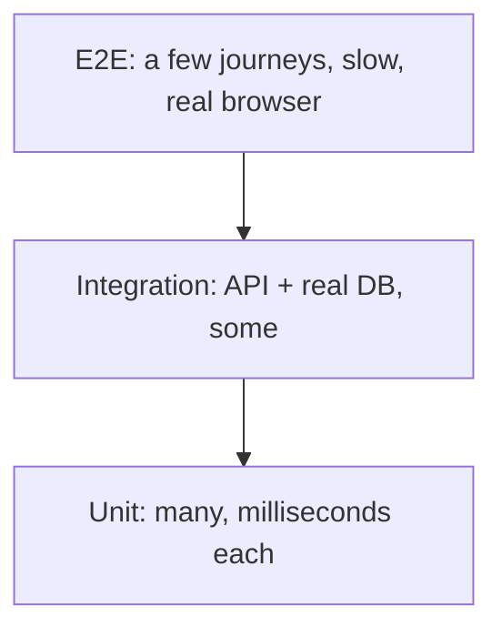

**Diagram (the trophy, typical for a React app):**

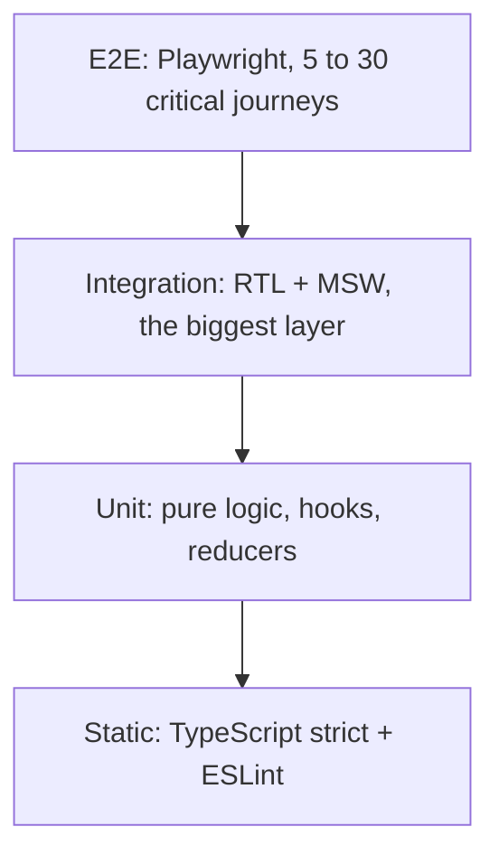

Read both from the bottom up: cheap and fast at the bottom, slow but close to the real user at the top.

**Example (a realistic split for a mid-size React + Node product):**

| Layer | Count | Time in CI | What it catches |
|---|---|---|---|
| Static (tsc, ESLint) | whole codebase | 30–60 s | Typos, wrong props, null bugs |
| Unit (Vitest) | 300–800 | under 20 s | Price rules, date logic, reducers |
| Integration (RTL + MSW, Supertest) | 200–500 | 1–3 min | Screens, forms, API routes with a real DB |
| E2E (Playwright) | 10–40 | 3–10 min (sharded) | Login, checkout, payment really work |

**Good and bad:**

| Good | Bad |
|---|---|
| Pick the shape by where the bugs are | Copy a shape because a blog said so |
| Integration tests for screens, unit tests for logic | Unit tests that mock every child component |
| A few E2E tests for money paths | 500 E2E tests that take 2 hours |
| Static checks first: cheapest bug catcher | Skipping `strict` mode and writing tests for null checks |

**Say this in the interview:**

> For the backend I think in a pyramid: many fast unit tests for business rules, then integration tests with a real database.
> For React I use the testing trophy: strict TypeScript at the base, then mostly integration tests with React Testing Library and MSW.
> On top, a small set of Playwright tests for journeys that make money, like login and checkout.
> The rule is: the more a test looks like real use, the more confidence it gives, but it costs more time.

**They may ask next:**
- **"Is the pyramid wrong?"** No. It is a good default for logic-heavy code. The trophy is a better fit for UI, where the wiring is the risk.
- **"What is an integration test in React?"** Render a real screen with its real children and real hooks. Mock only the network. Then click and check the screen.
- **"Who decides the ratio?"** The team, based on past bugs. If most incidents come from API contract changes, add contract or integration tests there.

---

## The 2026 tool map

**In one line:** Vitest or Jest runs fast tests, Testing Library finds elements like a user, MSW fakes the network, Playwright drives real browsers, and axe checks accessibility.

**Story:** A car factory has different checks at different stations.
A torque tester checks one bolt. A rolling road checks the engine with the wheels. A test driver drives the full car on a track.
You need all three, but each one for its own job.

**How it works (versions checked on npm in November 2026):**

| Tool | Version | Job |
|---|---|---|
| **Vitest** | 5.x (Sept 2026) | Test runner on top of Vite. Jest-like API. Node 22+ |
| **Jest** | 30.x | Older, very common test runner. ESM support still experimental |
| **`node:test`** | built into Node | Zero-dependency runner for Node libraries and APIs |
| **React Testing Library** | 16.x | Render components, query by role/label/text |
| **user-event** | 14.x | Real-like typing, clicking, tabbing |
| **jest-dom** | 7.x | Matchers like `toBeInTheDocument`, `toBeDisabled` |
| **MSW** (Mock Service Worker) | 3.x (Sept 2026) | Fake HTTP at the network level, in browser and Node |
| **Playwright** | 1.65 | E2E in Chromium, Firefox, WebKit. Also visual and a11y checks |
| **Cypress** | 16.x | E2E and component tests, runs inside the browser |
| **Storybook** | 10.x | Stories as tests through the Vitest addon |
| **Supertest** | 7.x | Call an Express/Fastify-style app in tests without picking a port (it binds a free one for you) |
| **Testcontainers** | 12.x (Node) | Start a real Postgres/Redis/Kafka in Docker for a test |
| **axe-core** | 4.x | Automated accessibility rules |

**Diagram (where each tool sits):**

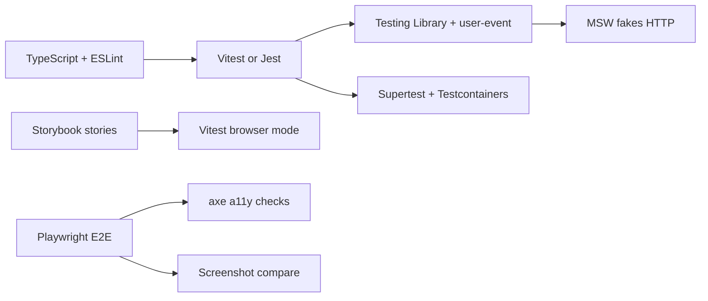

**Good and bad:**

| Good | Bad |
|---|---|
| One runner for unit and integration (Vitest) | Jest for some packages, Mocha for others, Karma for the rest |
| MSW handlers shared by tests, Storybook and local dev | A different fake API in every place |
| Pin major versions and upgrade on purpose | `latest` in `package.json` |

**Say this in the interview:**

> My default stack in 2026 is Vitest with React Testing Library and user-event for components, and MSW to fake the network.
> For APIs I use Vitest or node:test with Supertest, and Testcontainers when I need a real database.
> Playwright covers E2E, plus axe for accessibility and screenshots for visual checks.
> I keep one set of MSW handlers and reuse it in tests, Storybook and local development.

**They may ask next:**
- **"Why not Enzyme?"** Enzyme is dead. It has no adapter for modern React and it tested component internals.
- **"Do you still need jsdom?"** jsdom is a fake browser DOM written in JavaScript. For fast component tests, yes (or happy-dom). For real CSS, layout and browser APIs, use Vitest browser mode or Playwright.

---

## Vitest vs Jest

**In one line:** Vitest is the default for Vite, ESM and TypeScript projects; Jest is fine for existing Jest codebases and some React Native setups.

**Story:** Jest is like an old, reliable bus. Everyone knows the route.
Vitest is a new metro line on the same route. It is faster, and the stops (the API) have the same names. Most people can switch with a new ticket and little else.

**How it works:**
1. **Same API:** `describe`, `it`, `expect`, mocks. `jest.fn()` becomes `vi.fn()`. Most tests move over with search and replace.
2. **ESM and TypeScript:** Vitest uses Vite to transform files, so ESM, TypeScript and JSX work with no Babel setup. Jest's own docs still call its ESM support **experimental**. It needs `--experimental-vm-modules`, and ESM mocking uses `jest.unstable_mockModule`.
3. **One config:** Vitest reads your `vite.config` (aliases, plugins), so tests and the app build the same way.
4. **Speed:** Vitest has fast watch mode. It reruns only tests touched by a change.
5. **Vitest 5 changes to know (Sept 2026):** it needs Node 22.12+ and Vite 6.4+. `clearMocks` is now **on by default** (call history is wiped before each test). `vi.mock` must be at the top level of the file.
6. **Projects:** one config can hold several "projects", for example `ui` (jsdom + MSW) and `api` (plain Node). `test.projects` replaced the old "workspace" file (deprecated in Vitest 3.2, removed in 4).

**Example (`vitest.config.ts` with two projects, run with Vitest 5.1):**

```ts
import { defineConfig } from 'vitest/config';
import react from '@vitejs/plugin-react';

export default defineConfig({
  plugins: [react()],
  test: {
    globals: true,           // describe/it/expect without imports; RTL auto-cleanup
    restoreMocks: true,      // undo vi.spyOn after each test
    coverage: { provider: 'v8', include: ['src/**', 'api/**'], thresholds: { lines: 80 } },
    projects: [
      {
        test: {
          name: 'ui',
          include: ['src/**/*.test.{ts,tsx}'],
          environment: 'jsdom',                // fake browser DOM for React
          setupFiles: ['./src/test/setup.ts'], // jest-dom + MSW server
        },
      },
      {
        test: { name: 'api', include: ['api/**/*.test.ts'], environment: 'node' }, // no MSW here
      },
    ],
  },
});
```

Why two projects? We first ran the Supertest tests with the MSW setup file loaded. MSW caught the local HTTP calls and failed them ("Cannot bypass a request when using the error strategy"). So keep API tests in their own project.

**Good and bad:**

| Good | Bad |
|---|---|
| New Vite/Next/Node TS project: Vitest | Adding Babel just to make Jest read ESM |
| Big, stable Jest suite: keep Jest until there is a reason | A "rewrite all tests" project with no user value |
| `jsdom` for components, `node` for APIs | jsdom for every file (slower, wrong globals for Node code) |

**Say this in the interview:**

> For a new project I pick Vitest. It shares the Vite config, handles ESM and TypeScript out of the box, and its API is almost the same as Jest.
> Jest still works well, but ESM is experimental there and needs extra flags.
> If a team has a big Jest suite that works, I would not migrate just for speed. I would migrate when ESM or config pain starts costing time.

**They may ask next:**
- **"How hard is a Jest to Vitest migration?"** Mostly mechanical: `jest` to `vi`, config into `vitest.config`, and fix module mocks (factories must return named exports). Run both in CI for a short time.
- **"jsdom or happy-dom?"** happy-dom is faster, jsdom is more complete. Start with jsdom. Neither does real layout.
- **"What does `globals: true` do?"** It makes `describe`, `it`, `expect`, `vi` global like Jest. Testing Library then cleans up the DOM after each test on its own.

---

## Unit tests: pure functions, async code and fake timers

**In one line:** A unit test checks one small piece of logic with no network, no DB and no real clock, so it is fast and always gives the same result.

**Story:** A cricket bowling machine throws the same ball every time. The batter can practice one shot again and again.
A unit test is the bowling machine: same input, same output, no weather (network) and no clock to change the result.

**How it works:**
1. **Pure functions first:** same input gives the same output, no side effects. They are the easiest code to test. Move logic out of components into such functions.
2. **Table tests:** `test.each` runs one test body over many rows. Good for edge cases: zero, negative, rounding, empty.
3. **Async code:** `await` the code, or use `await expect(promise).resolves/.rejects`. Forgetting `await` is the classic bug: the test ends before the check runs.
4. **Fake timers:** `vi.useFakeTimers()` replaces `setTimeout`, `setInterval` and `Date`. Move time with `vi.advanceTimersByTime(ms)`. A 5-minute retry test runs in 1 ms.
5. **Timers plus promises:** use `await vi.runAllTimersAsync()` or `advanceTimersByTimeAsync`. They also let pending promises finish between timers.

**Example (table test, run with Vitest 5.1):**

```ts
import { describe, it, expect } from 'vitest';
import { finalPrice } from './price';

describe('finalPrice', () => {
  it.each([
    { price: 100, coupon: undefined, expected: 100 },
    { price: 100, coupon: 'SAVE10', expected: 90 },
    { price: 30, coupon: 'FLAT50', expected: 0 },     // never below zero
    { price: 19.99, coupon: 'SAVE10', expected: 17.99 },
  ])('$price with $coupon -> $expected', ({ price, coupon, expected }) => {
    expect(finalPrice(price, coupon)).toBe(expected);
  });

  it('rejects a negative price', () => {
    expect(() => finalPrice(-1)).toThrow(RangeError); // pass a function, not the result
  });
});
```

The test names come out as `100 with SAVE10 -> 90`, so a failure tells you the exact row.

**Example (fake timers for a debounce, run with Vitest 5.1):**

```ts
import { vi, it, expect, beforeEach, afterEach } from 'vitest';
import { debounce } from './debounce';

beforeEach(() => vi.useFakeTimers());   // our own clock
afterEach(() => vi.useRealTimers());    // always give the real clock back

it('calls search once, 300 ms after the last key', () => {
  const search = vi.fn();
  const onType = debounce(search, 300);

  onType('j'); onType('ja'); onType('jav');
  vi.advanceTimersByTime(299);
  expect(search).not.toHaveBeenCalled();

  vi.advanceTimersByTime(1);            // 300 ms reached, no real waiting
  expect(search).toHaveBeenCalledTimes(1);
  expect(search).toHaveBeenCalledWith('jav');
});
```

The debounce itself is in [javascript.md](javascript.md#1-debounce).

**Example (async retry with timers and promises, run with Vitest 5.1):**

```ts
import { vi, it, expect } from 'vitest';
import { retry } from './retry'; // waits 200, 400 ms between tries

it('succeeds on the third try', async () => {
  vi.useFakeTimers();
  const call = vi.fn()
    .mockRejectedValueOnce(new Error('503'))
    .mockRejectedValueOnce(new Error('503'))
    .mockResolvedValue('ok');

  const result = retry(call);              // do not await yet
  await vi.runAllTimersAsync();            // runs timers AND waits for promises
  await expect(result).resolves.toBe('ok');
  expect(call).toHaveBeenCalledTimes(3);
  vi.useRealTimers();
});

it('throws the last error after 3 tries', async () => {
  const call = vi.fn().mockRejectedValue(new Error('down'));
  await expect(retry(call, 3, 1)).rejects.toThrow('down'); // await the expect!
});
```

Retry with backoff as a design topic is in [microservices.md](microservices.md#retry-with-exponential-backoff-and-jitter).

**Good and bad:**

| Good | Bad |
|---|---|
| `await expect(p).rejects.toThrow()` | `expect(p).rejects.toThrow()` with no `await`: passes even when wrong |
| Fake timers for debounce, retry, polling | Real `setTimeout(…, 3000)` in a test |
| One behavior per test, clear name | One test with 15 unrelated `expect`s |
| Test edge cases: 0, empty, max, rounding | Only the happy number 100 |
| Restore real timers in `afterEach` | Fake timers leaking into the next file |

**Say this in the interview:**

> I keep business logic in pure functions and test them with table tests, so each edge case is one row.
> For async code I always await the assertion, otherwise the test can pass without checking anything.
> For timers I use fake timers, and runAllTimersAsync when timers and promises mix. A retry with backoff then tests in milliseconds.

**They may ask next:**
- **"`toBe` vs `toEqual`?"** `toBe` checks the same value or the same object reference. `toEqual` compares contents deeply. `toStrictEqual` also checks `undefined` keys and class types.
- **"How do you test `Date.now()` code?"** `vi.useFakeTimers()` then `vi.setSystemTime(new Date('2026-11-16'))`. Or pass a clock into the function.
- **"Floats?"** Use `toBeCloseTo(0.3)` for `0.1 + 0.2`. For money, store integer cents.

---

## Mocking: vi.fn, vi.mock and spies

**In one line:** Replace only the slow or outside things (network, email, payment, clock) with fakes, and keep your own code real.

**Story:** A flight simulator fakes the sky, the weather and the airport.
It does not fake the pilot's hands or the cockpit buttons. Those are what you are testing.
Mock the world outside your code, not the parts inside it.

**How it works:**
1. **`vi.fn()`** makes a fake function. It records calls and can return what you tell it: `mockResolvedValue`, `mockRejectedValueOnce`, `mockImplementation`.
2. **`vi.spyOn(obj, 'method')`** wraps a real method. It records calls. Add `.mockImplementation()` to replace it too. Restore it after the test (`restoreMocks: true` does this).
3. **`vi.mock('./module', factory)`** replaces a whole module. Vitest moves (hoists) it above the imports. In Vitest 5 it must be at the top level of the file.
4. **Reset rules:** `mockClear` wipes call history. `mockReset` also removes fake behavior. `mockRestore` puts the original back. In Vitest 5, `clearMocks` is on by default.
5. **Mock at the boundary:** HTTP (use MSW), email/SMS/payment clients, the clock, random IDs. Do not mock your own hooks, reducers or child components.
6. **Prefer injection:** pass the dependency in (`buildApp(repo)`). Then the test passes a fake and no module mocking is needed.

**Diagram (where to put the fake):**

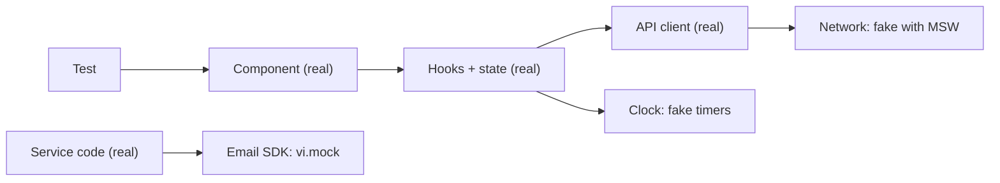

**Example (module mock + spy, run with Vitest 5.1):**

```ts
import { vi, it, expect } from 'vitest';
import { placeOrder } from './orderService';
import { sendEmail } from './emailClient';

vi.mock('./emailClient', () => ({ sendEmail: vi.fn() })); // hoisted above imports

it('sends one confirmation email', async () => {
  const log = vi.spyOn(console, 'info').mockImplementation(() => {}); // spy + silence

  const result = await placeOrder({ id: 'o-1', email: 'a@x.com', total: 500 });

  expect(result.status).toBe('PLACED');
  expect(sendEmail).toHaveBeenCalledWith('a@x.com', 'Order o-1 confirmed');
  expect(log).toHaveBeenCalledOnce();
});

it('does not email for an empty order', async () => {
  await expect(placeOrder({ id: 'o-2', email: 'a@x.com', total: 0 })).rejects.toThrow('empty');
  expect(sendEmail).not.toHaveBeenCalled(); // clean because mocks are cleared before each test
});
```

**Good and bad:**

| Good | Bad |
|---|---|
| Fake the email SDK, check it was called with the right data | Fake `placeOrder` itself, then test the fake |
| MSW for HTTP | `vi.mock('axios')` in 200 files |
| Pass dependencies in, fake them in the test | Mock 6 modules to test 10 lines |
| Assert on results first, calls second | Only `toHaveBeenCalled` checks, no result checks |

**Say this in the interview:**

> I mock boundaries, not internals. The network, email, payment and the clock get fakes. My own components, hooks and services stay real.
> If I need many mocks to test one function, the design is the problem, so I inject the dependency instead.
> Too many mocks give green tests while production is broken, because the mocks drift away from reality.

**They may ask next:**
- **"`vi.mock` vs `vi.spyOn`?"** `vi.mock` replaces a whole module for the file. `spyOn` wraps one method on one object and can be restored.
- **"`vi.hoisted`?"** Use it to create variables that a `vi.mock` factory needs, because the factory runs before normal code.
- **"Mock vs stub vs fake?"** Stub returns canned data. Mock also checks how it was called. Fake is a small working version, like an in-memory repo.

---

## React Testing Library: test like a user

**In one line:** React Testing Library (RTL) renders a component into a DOM and finds elements the way a user or a screen reader does: by role, label and text.

**Story:** A mystery shopper visits a shop. They do not open the cash drawer or read the staff notes.
They look at the signs, ask for "the blue shirt", and pay at the counter.
RTL is the mystery shopper. It only uses what a real customer can see and use.

**How it works:**
1. `render(<Component />)` puts the component in a jsdom page.
2. `screen` has queries. Each query comes in three types:
   - `getBy…`: must be there now, throws if not.
   - `queryBy…`: returns `null` if missing. Use it only to check "not there".
   - `findBy…`: waits (default up to 1 second) and returns a promise. Use it for things that appear later.
3. **Query priority** (from the Testing Library docs), best first:
   1. `getByRole` with a name: `getByRole('button', { name: 'Save' })`
   2. `getByLabelText`: form fields
   3. `getByPlaceholderText`, `getByText`, `getByDisplayValue`
   4. `getByAltText`, `getByTitle`
   5. `getByTestId`: last choice, when nothing else works
4. `getByRole` checks accessibility for free. If you cannot find the button by role and name, a screen reader user cannot either.
5. Assertions come from **jest-dom**: `toBeInTheDocument`, `toBeVisible`, `toBeDisabled`, `toHaveValue`, `toHaveTextContent`.

**Example (query choices):**

```tsx
// Good: what users and screen readers see
screen.getByRole('button', { name: 'Place order' });
screen.getByRole('textbox', { name: 'Email' });          // input with <label>Email</label>
screen.getByRole('heading', { level: 2, name: /orders/i });
screen.getByRole('checkbox', { name: /accept the terms/i });

// OK for things with no role
screen.getByText('Free delivery over ₹999');

// Last choice
screen.getByTestId('price-chart');                        // a canvas has no text

// Bad: tied to markup and CSS
container.querySelector('.btn.btn-primary > span');
```

**Good and bad:**

| Good | Bad |
|---|---|
| `getByRole('button', { name: 'Save' })` | `getByTestId('save-btn')` everywhere |
| `expect(queryByRole('alert')).not.toBeInTheDocument()` | `expect(getByRole('alert')).toBeNull()` (throws first) |
| Assert what is on screen | Assert component state or props |
| `screen.debug()` or `logRoles()` when stuck | Guessing selectors |

**Say this in the interview:**

> React Testing Library makes me test the way a user uses the app. I find elements by role and accessible name first, then label, then text, and test IDs only as a last choice.
> This keeps tests stable during refactors and checks accessibility at the same time.
> I use getBy for things that must be there, queryBy to prove something is not there, and findBy for things that appear later.

**They may ask next:**
- **"Why not test IDs everywhere?"** Users do not see them. A button can lose its label and the test still passes. Use them for charts, canvas or lists with no good role.
- **"How do you find the role of an element?"** Use `screen.logRoles(container)`, the browser accessibility panel, or Testing Playground.
- **"Shallow rendering?"** Not supported in RTL on purpose. Render the real tree. Mock only the network.

---

## user-event and testing forms

**In one line:** `user-event` acts like a real person: it focuses, types key by key, clicks and tabs, so the test fires the same events the browser would.

**Story:** `fireEvent` is like a robot that pushes a button with a stick. `user-event` is like a person who first walks to the counter, looks at the button, then presses it.
Bugs often hide in the walking part: focus, blur, key events and disabled buttons.

**How it works:**
1. Call `const user = userEvent.setup()` at the start of each test, **before** `render`.
2. All actions return promises: `await user.type(...)`, `await user.click(...)`.
3. `user.type` fires keydown, keypress, input and keyup for each character. `fireEvent.change` fires only one change event.
4. `user.click` on a disabled button does nothing, like in a real browser.
5. Useful actions: `type`, `clear`, `click`, `dblClick`, `selectOptions`, `upload`, `keyboard('{Enter}')`, `tab()`, `hover`.
6. **For forms, test three things:** validation errors show, a valid form sends the right data, and the submit button is disabled while saving.

**Example (signup form, run with Vitest 5.1 + RTL 16 + user-event 14):**

```tsx
import { render, screen } from '@testing-library/react';
import userEvent from '@testing-library/user-event';
import { SignupForm } from './SignupForm';

test('shows an error for a bad email and does not submit', async () => {
  const user = userEvent.setup();               // create before render
  const onSubmit = vi.fn();
  render(<SignupForm onSubmit={onSubmit} />);

  await user.type(screen.getByLabelText('Email'), 'asha.example.com');
  await user.click(screen.getByRole('button', { name: 'Sign up' }));

  expect(screen.getByRole('alert')).toHaveTextContent('Enter a valid email');
  expect(onSubmit).not.toHaveBeenCalled();
});

test('submits the filled form', async () => {
  const user = userEvent.setup();
  const onSubmit = vi.fn();
  render(<SignupForm onSubmit={onSubmit} />);

  await user.type(screen.getByRole('textbox', { name: 'Email' }), 'asha@example.com');
  await user.selectOptions(screen.getByRole('combobox', { name: 'Plan' }), 'pro');
  await user.click(screen.getByRole('checkbox', { name: /accept the terms/i }));
  await user.click(screen.getByRole('button', { name: 'Sign up' }));

  expect(onSubmit).toHaveBeenCalledWith({ email: 'asha@example.com', plan: 'pro', terms: true });
  expect(screen.queryByRole('alert')).not.toBeInTheDocument(); // query* for "not there"
});
```

The form uses a `<label>` for each field and `role="alert"` for the error. That is why the role queries work. Good accessibility and easy tests go together.

**Good and bad:**

| Good | Bad |
|---|---|
| `await user.type(...)` | `user.type(...)` without `await` |
| `userEvent.setup()` per test | One shared `user` across tests |
| Test the error message the user reads | Test that `setError` was called |
| Test submit with the keyboard too (`{Enter}`) | Only mouse clicks |
| Form library (React Hook Form, Formik) stays real | Mocking the form library |

**Say this in the interview:**

> I use user-event, not fireEvent, because it types and clicks like a real person and fires focus, key and input events in the right order.
> For a form I test three things: the validation message appears, a valid form submits the right data, and the button is disabled while saving.
> I keep the form library real and only check what the user sees and what leaves the form.

**They may ask next:**
- **"When is `fireEvent` OK?"** For events user-event does not cover, like `scroll` or a custom event.
- **"How do you test a file upload?"** `await user.upload(input, new File(['hi'], 'cv.pdf', { type: 'application/pdf' }))`.
- **"Server-side validation?"** Return a 400 from an MSW handler and check the field error appears.

---

## Async UI: findBy, waitFor and act() warnings

**In one line:** When the screen changes later (after a fetch or a timer), wait for what the user waits for with `findBy…`, and the act() warning goes away.

**Story:** You order food in an app. You do not refresh every 1 millisecond. You wait until the "Delivered" message shows, with a sensible time limit.
`findBy` is that wait: it checks again and again until the thing shows up, or it gives up after a timeout.

**How it works:**
1. `await screen.findByRole(...)` = `getBy` + retry until found (default timeout 1000 ms).
2. `await waitFor(() => expect(...))` retries any assertion. Put **one** assertion inside, and no side effects (no clicks inside `waitFor`).
3. `waitForElementToBeRemoved(() => screen.queryByText('Loading...'))` waits for a spinner to go.
4. **What `act()` is:** React's way to say "finish all state updates and effects before you check". RTL already wraps `render`, user-event actions, `findBy` and `waitFor` in `act`.
5. **Why the warning appears:** a state update happened after your test stopped waiting. Example: a save finished 50 ms after the last check. React says "An update to X inside a test was not wrapped in act(...)".
6. **The fix is almost never to add `act()` by hand.** Await the thing the user sees at the end: the button comes back, the toast shows, or the spinner goes.

**Example (we ran both tests; only the first printed the act warning):**

```tsx
test('bad: does not wait for the button to come back', async () => {
  const user = userEvent.setup();
  const onSubmit = () => new Promise<void>((r) => setTimeout(r, 50)); // slow save
  render(<SignupForm onSubmit={onSubmit} />);
  await user.type(screen.getByLabelText('Email'), 'a@b.com');
  await user.click(screen.getByRole('button', { name: 'Sign up' }));
  expect(screen.getByRole('button', { name: 'Saving...' })).toBeDisabled();
  await new Promise((r) => setTimeout(r, 100)); // save finishes outside act -> warning
});

test('good: wait for what the user waits for', async () => {
  const user = userEvent.setup();
  const onSubmit = () => new Promise<void>((r) => setTimeout(r, 50));
  render(<SignupForm onSubmit={onSubmit} />);
  await user.type(screen.getByLabelText('Email'), 'a@b.com');
  await user.click(screen.getByRole('button', { name: 'Sign up' }));
  expect(screen.getByRole('button', { name: 'Saving...' })).toBeDisabled();
  expect(await screen.findByRole('button', { name: 'Sign up' })).toBeEnabled(); // waits inside act
});
```

**Good and bad:**

| Good | Bad |
|---|---|
| `await screen.findByText('Saved')` | `await new Promise(r => setTimeout(r, 500))` |
| One assertion inside `waitFor` | Clicks or several assertions inside `waitFor` |
| Fix the act warning by awaiting the end state | Wrapping everything in `act()` to hide it |
| `findBy` for appear, `waitForElementToBeRemoved` for disappear | `findBy` for "not there" (it waits and then fails) |

**Say this in the interview:**

> For async UI I wait for what the user waits for. I use findBy for things that appear, and waitForElementToBeRemoved for spinners.
> The act warning means a state update happened after my test stopped watching. I fix it by awaiting the final visible state, not by adding act by hand.
> I never use fixed sleeps, because they are slow on a fast machine and flaky on a slow one.

**They may ask next:**
- **"When do you call `act` yourself?"** When you change state outside RTL helpers, for example calling a function from `renderHook`'s `result.current`, or advancing fake timers that trigger React updates.
- **"Fake timers with user-event?"** Use `userEvent.setup({ advanceTimers: vi.advanceTimersByTime })`, or user-event waits forever on its own delays.
- **"Test times out at 1 second?"** Raise it for that query: `findByText('Done', {}, { timeout: 3000 })`. But first ask why the UI is so slow.

---

## Testing custom hooks with renderHook

**In one line:** `renderHook` runs a hook inside a tiny test component, so you can test a reusable hook without building a fake screen.

**Story:** You test a new car engine on a test stand before putting it in a car.
`renderHook` is the test stand. It is good for engines you will put in many cars (generic hooks). For an engine built for one car, test it inside that car (the component).

**How it works:**
1. `const { result, rerender, unmount } = renderHook(() => useMyHook(args), { wrapper })`.
2. Read values from `result.current`. Read it fresh after each change. Do not save it in a variable early.
3. Wrap calls that change state in `act(() => result.current.inc())`.
4. Hooks that need context (React Query, Redux, router, theme) need a `wrapper` with the provider.
5. For async hooks, wait with `await waitFor(() => expect(result.current.isSuccess).toBe(true))`.
6. `renderHook` is in `@testing-library/react`. The old `@testing-library/react-hooks` package is not needed any more.

**Example (sync hook, run with Vitest 5.1):**

```ts
import { renderHook, act } from '@testing-library/react';
import { useCounter } from './useCounter';

test('stops at max', () => {
  const { result } = renderHook(() => useCounter(9, 10));
  act(() => result.current.inc());       // state change: wrap in act
  act(() => result.current.inc());
  expect(result.current.count).toBe(10); // always read result.current fresh
});
```

**Example (data hook with TanStack Query + MSW, run with Vitest 5.1):**

```tsx
import { renderHook, waitFor } from '@testing-library/react';
import { QueryClient, QueryClientProvider } from '@tanstack/react-query';
import { useUser } from './useUser';

function wrapper({ children }: { children: React.ReactNode }) {
  const client = new QueryClient({
    defaultOptions: { queries: { retry: false } }, // fail fast in tests
  });
  return <QueryClientProvider client={client}>{children}</QueryClientProvider>;
}

test('loads the user through the real hook and MSW', async () => {
  const { result } = renderHook(() => useUser('42'), { wrapper });
  await waitFor(() => expect(result.current.isSuccess).toBe(true));
  expect(result.current.data).toEqual({ id: '42', name: 'Asha' });
});
```

A new `QueryClient` per test stops cached data leaking from one test to the next.

**Good and bad:**

| Good | Bad |
|---|---|
| `renderHook` for shared hooks (`useDebounce`, `useLocalStorage`) | `renderHook` for every hook in a feature |
| New `QueryClient` per test, `retry: false` | One global client: tests share cache |
| Read `result.current` after each change | `const { count } = result.current` once, then check it later |

**Say this in the interview:**

> I use renderHook for generic, reusable hooks. I wrap state changes in act and always read result.current fresh.
> Feature hooks I test through the component that uses them, because that is how users meet them.
> For data hooks I use a wrapper with a fresh QueryClient and retry turned off, and MSW for the network.

**They may ask next:**
- **"How do you change hook props?"** `renderHook((props) => useThing(props.id), { initialProps: { id: '1' } })`, then `rerender({ id: '2' })`.
- **"How do you test cleanup?"** Call `unmount()` and check the listener or timer was removed.

---

## MSW: mock the network, not your code

**In one line:** MSW (Mock Service Worker) catches HTTP requests at the network level and returns fake responses, so all your real client code still runs.

**Story:** In a film shoot, the actors are real and the set is real. Only the view outside the window is a painted screen.
MSW is that painted screen. Everything inside your app is real; only the "outside world" (the backend) is fake.

**How it works:**
1. You write **handlers**: "for `GET /api/users/:id`, return this JSON".
2. **In Node tests** (Vitest, Jest): `setupServer(...handlers)` from `msw/node` patches Node's HTTP modules and `fetch`.
3. **In the browser** (local dev, Storybook, Vitest browser mode): `setupWorker(...handlers)` from `msw/browser` installs a Service Worker that answers requests.
4. **Same handlers in both places.** One file of fakes serves tests, Storybook and the dev server.
5. **Per-test overrides:** `server.use(http.get(..., () => new HttpResponse(null, { status: 500 })))` for the error case. `resetHandlers()` removes it after the test.
6. **Unknown requests:** set `onUnhandledFrame: 'error'` so a request with no handler fails the test. **MSW 3 (Sept 2026) renamed** this option from `onUnhandledRequest`. MSW 3 also needs Node 22+ and is ESM-only. `http`, `HttpResponse` and `delay` still import from `msw` (we checked).

**Diagram (where MSW sits):**

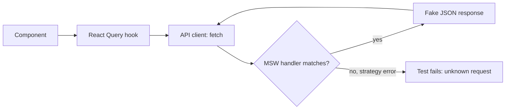

**Diagram (one set of handlers, three places):**

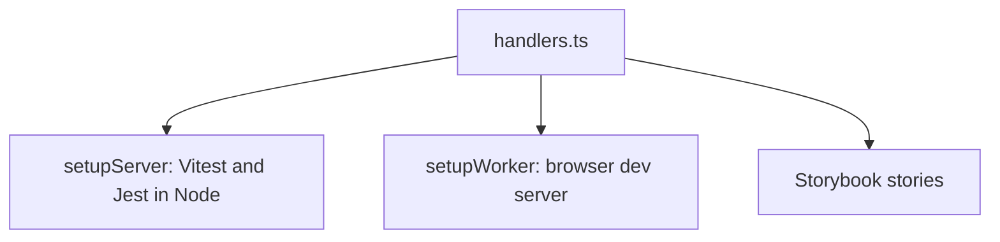

**Example (handlers + setup, run with MSW 3.0.6):**

```ts
// src/test/handlers.ts
import { http, HttpResponse } from 'msw';

export const handlers = [
  http.get('/api/users/:id', ({ params }) =>
    HttpResponse.json({ id: params.id, name: 'Asha' })),
  http.post('/api/orders', async ({ request }) => {
    const body = (await request.json()) as { qty: number };
    if (body.qty > 10) return HttpResponse.json({ error: 'Max 10 items' }, { status: 400 });
    return HttpResponse.json({ id: 'o-1' }, { status: 201 });
  }),
];

// src/test/setup.ts
import '@testing-library/jest-dom/vitest';   // adds toBeInTheDocument, toHaveValue...
import { setupServer } from 'msw/node';
import { handlers } from './handlers';

export const server = setupServer(...handlers);
beforeAll(() => server.listen({ onUnhandledFrame: 'error' })); // MSW 3 name
afterEach(() => server.resetHandlers());     // drop per-test overrides
afterAll(() => server.close());
```

(In our checked project, `server` lives in its own `server.ts` file so tests can import it.)

**Example (happy path and error path, run with Vitest 5.1):**

```tsx
import { render, screen } from '@testing-library/react';
import { http, HttpResponse } from 'msw';
import { server } from './test/server';
import { UserCard } from './UserCard';

test('shows the user name after loading', async () => {
  render(<UserCard id="42" />);
  expect(screen.getByText('Loading...')).toBeInTheDocument();
  expect(await screen.findByRole('heading', { name: 'Asha' })).toBeInTheDocument(); // waits
});

test('shows an error when the API fails', async () => {
  server.use(                                    // override for this test only
    http.get('/api/users/:id', () => new HttpResponse(null, { status: 500 })),
  );
  render(<UserCard id="42" />);
  expect(await screen.findByRole('alert')).toHaveTextContent('Could not load user');
});
```

**Good and bad:**

| Good | Bad |
|---|---|
| Fake the network, keep the API client real | `vi.mock('../api/client')` in every test |
| `onUnhandledFrame: 'error'` | Silent unknown requests that hang tests |
| Test 200, 400, 401, 500 and slow responses | Only the happy path |
| Generate handlers or types from the OpenAPI spec | Hand-written fakes that drift from the real API |

**Say this in the interview:**

> I fake the backend with MSW at the network level. My real fetch code, API client and React Query all run, so the test is close to production.
> The same handlers run in Node tests with setupServer, and in the browser and Storybook with setupWorker.
> Each test can override a handler to return a 500 or a slow response, and unknown requests fail the test.
> The risk is drift from the real API, so I keep handlers typed from the OpenAPI spec or add contract tests.

**They may ask next:**
- **"MSW vs mocking `fetch`?"** Mocking `fetch` skips your client code (headers, errors, retries). MSW runs it all.
- **"How do you test a slow response?"** `await delay(2000)` inside the handler (`import { delay } from 'msw'`), then check the spinner.
- **"Does MSW replace backend tests?"** No. It tests the frontend against an agreed contract. The backend needs its own tests, and contract tests (for example Pact) keep the two sides in sync.

---

## Testing state: Redux, Zustand and TanStack Query

**In one line:** Test state logic as plain functions where you can (reducers, store actions), and test connected screens with a real store, not a mocked one.

**Story:** A bank tests its interest formula on paper first (unit). Then it opens a real test account and checks the statement (integration).
It never tests by pretending the account database said "OK".

**How it works:**
1. **Redux Toolkit:** a reducer is a pure function: `reducer(state, action)`. Test it with plain input and output. For screens, render with a **real store** made by the same `configureStore` code.
2. **Zustand:** a store is a module-level singleton. **Reset it before each test** with `useStore.setState(initial)`, or state leaks between tests.
3. **TanStack Query:** do not mock `useQuery`. Use a fresh `QueryClient` per test (`retry: false`) and MSW for the data.
4. Most of the time you do not test the store alone. You render the screen and check the result.

**Example (Redux Toolkit slice + Zustand store, both run with Vitest 5.1):**

```ts
import reducer, { added, toggled } from './todosSlice';
import { useCart } from './cartStore';

test('toggle marks a todo done', () => {
  let state = reducer(undefined, { type: 'init' });            // initial state
  state = reducer(state, added({ id: 1, text: 'Pay bill', done: false }));
  state = reducer(state, toggled(1));
  expect(state).toEqual([{ id: 1, text: 'Pay bill', done: true }]); // plain in, plain out
});

beforeEach(() => useCart.setState({ items: [] })); // stores are global: reset them

test('adding the same item twice increases qty', () => {
  useCart.getState().add('shoe');
  useCart.getState().add('shoe');
  expect(useCart.getState().items).toEqual([{ sku: 'shoe', qty: 2 }]);
});
```

**Example (a `renderWithProviders` helper, by hand):**

```tsx
export function renderWithProviders(ui: React.ReactElement, preloaded?: Partial<RootState>) {
  const store = makeStore(preloaded);                       // same factory as the app
  const queryClient = new QueryClient({ defaultOptions: { queries: { retry: false } } });
  return {
    store,
    ...render(
      <Provider store={store}>
        <QueryClientProvider client={queryClient}>{ui}</QueryClientProvider>
      </Provider>,
    ),
  };
}
```

**Good and bad:**

| Good | Bad |
|---|---|
| Real store from the app's factory | `redux-mock-store`: it does not run reducers |
| Reset Zustand stores in `beforeEach` | State from test 1 breaking test 7 |
| Fresh `QueryClient` per test | `vi.mock('@tanstack/react-query')` |
| Test selectors with tricky logic as pure functions | Testing that `dispatch` was called with an action |

**Say this in the interview:**

> Reducers and store actions are pure, so I test them with plain input and output.
> For screens I render with a real store and a fresh QueryClient using a renderWithProviders helper, and fake only the network with MSW.
> Zustand stores are global, so I reset them before each test.

**They may ask next:**
- **"Why not mock the store?"** A mock store does not run reducers, so you test nothing real. A real store is fast enough.
- **"How to start a test in a given state?"** Pass `preloadedState` to the store factory, or `setState` for Zustand.

---

## Snapshot tests: when they help and when they hurt

**In one line:** A snapshot saves an output once and fails when it changes; it is good for small, stable outputs and bad for big component trees.

**Story:** You take a photo of your parked car. Later you compare. If one small scratch appears, you notice.
But if you photograph the whole city and compare, every passing bus is a "difference". People stop looking and just click "accept".

**How it works:**
1. `toMatchSnapshot()` writes a `.snap` file the first time. Later runs compare against it.
2. `toMatchInlineSnapshot()` writes the value into the test file itself, so reviewers can see it.
3. `vitest -u` (or `jest -u`) updates snapshots. This is the danger: people update without reading.
4. **Helps:** error object shapes, generated config, a CLI's output, serializers, small API response mappers.
5. **Hurts:** whole component HTML. It breaks on every class name change, catches nothing about behavior, and diffs are too long to review.
6. For UI, use better tools: role queries for behavior, Playwright **aria snapshots** for structure, screenshots for looks.

**Example (inline snapshot, written by Vitest 5.1 on the first run):**

```ts
function toApiError(status: number, msg: string) {
  return { status, error: { code: status >= 500 ? 'SERVER' : 'CLIENT', message: msg } };
}
test('error shape stays the same', () => {
  expect(toApiError(404, 'Not found')).toMatchInlineSnapshot(`
    {
      "error": {
        "code": "CLIENT",
        "message": "Not found",
      },
      "status": 404,
    }
  `);
});
```

**Good and bad:**

| Good | Bad |
|---|---|
| Small inline snapshots that fit on a screen | 2,000-line `.snap` of a page |
| Review snapshot diffs like code | `-u` on every red build |
| Snapshot data shapes | Snapshot `<div class="css-1x2y3">` trees |

**Say this in the interview:**

> I use snapshots for small, stable outputs like an error shape or a generated config, and I prefer inline snapshots so the reviewer sees the value.
> I avoid snapshots of large component trees. They break on every style change, people update them without reading, and they test nothing about behavior.

**They may ask next:**
- **"What replaced DOM snapshots for you?"** Role-based assertions for behavior and Playwright screenshots or aria snapshots for structure and looks.
- **"Snapshot with dates or IDs?"** Use property matchers like `expect.any(String)`, or fake the clock and the ID generator.

---

## Component tests in Storybook and Vitest browser mode

**In one line:** A story shows one state of a component; with a `play` function and the Vitest addon, each story is also a real-browser test.

**Story:** A furniture showroom has a sofa in every color, ready to see.
If a staff member also sits on each sofa every morning to check it, the showroom becomes a test lab too.
Stories are the showroom. Play functions are the staff member sitting on the sofa.

**How it works:**
1. A **story** renders a component with fixed props: `Empty`, `Loading`, `WithError`, `LongName`.
2. A **play function** runs after render. It clicks and types with `userEvent` and checks with `expect`, both from `storybook/test`.
3. **Storybook 10** runs stories as tests through the **Vitest addon** (`npx storybook add @storybook/addon-vitest`). It uses Vitest **browser mode** with Playwright, so the test runs in real Chromium, not jsdom.
4. The same run can do accessibility checks (the a11y addon, using axe) and visual checks (for example Chromatic).
5. Data comes from MSW handlers (shared with unit tests), or module mocks with `sb.mock()` in `.storybook/preview.ts`.
6. **Vitest browser mode** also works without Storybook. It became stable in Vitest 4. Install `@vitest/browser-playwright` and set `browser.enabled`.

**Example (story with a play function, Storybook 10, checked by hand):**

```tsx
import type { Meta, StoryObj } from '@storybook/react-vite';
import { expect, fn } from 'storybook/test';
import { SignupForm } from './SignupForm';

const meta = {
  component: SignupForm,
  args: { onSubmit: fn() },                       // spy, shown in the Actions panel
} satisfies Meta<typeof SignupForm>;
export default meta;
type Story = StoryObj<typeof meta>;

export const InvalidEmail: Story = {
  play: async ({ canvas, userEvent, args }) => {
    await userEvent.type(canvas.getByLabelText('Email'), 'not-an-email');
    await userEvent.click(canvas.getByRole('button', { name: 'Sign up' }));
    await expect(canvas.getByRole('alert')).toHaveTextContent('Enter a valid email');
    await expect(args.onSubmit).not.toHaveBeenCalled();
  },
};
```

**Good and bad:**

| Good | Bad |
|---|---|
| A story for each state: empty, loading, error, long text | Only the "happy" story |
| Play functions for design-system components | Copying every RTL test into stories too |
| Real browser for focus, layout and CSS bugs | jsdom for a drag-and-drop test |

**Say this in the interview:**

> For a design system I write a story for each important state and add play functions, so stories double as interaction tests.
> With Storybook 10 and the Vitest addon those run in a real browser through Vitest browser mode, together with axe checks and visual snapshots.
> For app screens I still use RTL with MSW, because it is faster and closer to the feature.

**They may ask next:**
- **"jsdom or real browser for component tests?"** jsdom for speed and most logic. A real browser when layout, focus, scroll, CSS or browser APIs matter.
- **"Storybook test-runner?"** It is the older way for non-Vite projects. The Vitest addon is the recommended path for Vite-based projects.

---

## End-to-end tests with Playwright

**In one line:** Playwright drives real Chromium, Firefox and WebKit browsers against a running app, with auto-waiting locators, parallel workers and a trace viewer for debugging failures.

**Story:** Before a new train line opens, a test train runs the full route with staff acting as passengers.
It is slow and costly, so they run only the main routes. If something goes wrong, the black box recorder (the trace) shows every second of the trip.

**How it works:**
1. **Locators:** `page.getByRole('button', { name: 'Pay' })`, `getByLabel`, `getByText`, `getByTestId`. Same priority idea as RTL. Chain and filter: `getByRole('listitem').filter({ hasText: 'Red shoes' })`.
2. **Auto-wait:** before a click, Playwright waits until the element is visible, stable, enabled and receives events. **Web-first assertions** like `await expect(locator).toBeVisible()` retry until true (default 5 s). So no `sleep`.
3. **Fixtures:** `{ page, context, request }` are built-in fixtures. Each test gets a **new browser context** (fresh cookies and storage), so tests do not share state. You can add your own fixtures with `test.extend`.
4. **Auth once:** a `setup` project logs in and saves cookies to a file (`storageState`). Other projects depend on it and start already logged in.
5. **Parallel:** files run in parallel workers. `fullyParallel: true` also splits tests inside a file. In CI, `--shard=1/4` splits work across machines.
6. **Trace viewer:** with `trace: 'on-first-retry'`, a retried test saves a trace: DOM snapshots, network, console and each action. Open it with `npx playwright show-trace trace.zip`.
7. **Network control:** `page.route()` fakes or blocks a single call, for example "payment returns 503".
8. Recent extras: UI mode (`--ui`), aria snapshots (`toMatchAriaSnapshot`), clock control (`page.clock`), `--only-changed`, and test agents (planner, generator, healer) since 1.56.

**Diagram (auth setup project):**

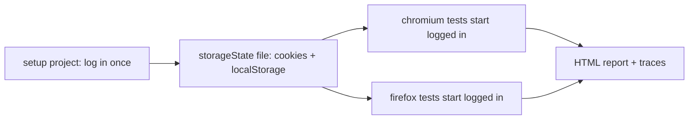

**Example (`playwright.config.ts`, type-checked and listed with Playwright 1.65):**

```ts
import { defineConfig, devices } from '@playwright/test';

export default defineConfig({
  testDir: './e2e',
  fullyParallel: true,                         // tests inside a file also run in parallel
  forbidOnly: !!process.env.CI,                // a forgotten test.only fails CI
  retries: process.env.CI ? 1 : 0,             // one retry in CI only, and we track flaky tests
  workers: process.env.CI ? 2 : undefined,
  reporter: process.env.CI ? [['blob'], ['github']] : 'html',
  use: {
    baseURL: 'http://localhost:3000',
    trace: 'on-first-retry',                   // full recording when a test is retried
    screenshot: 'only-on-failure',
  },
  projects: [
    { name: 'setup', testMatch: /.*\.setup\.ts/ },   // logs in once
    {
      name: 'chromium',
      use: { ...devices['Desktop Chrome'], storageState: 'playwright/.auth/user.json' },
      dependencies: ['setup'],                  // runs after login is saved
    },
  ],
  webServer: { command: 'npm run start', url: 'http://localhost:3000', reuseExistingServer: !process.env.CI },
});
```

**Example (login once, then a custom fixture, type-checked):**

```ts
// e2e/auth.setup.ts
import { test as setup, expect } from '@playwright/test';

setup('log in once', async ({ page }) => {
  await page.goto('/login');
  await page.getByLabel('Email').fill(process.env.E2E_USER!);
  await page.getByLabel('Password').fill(process.env.E2E_PASSWORD!);
  await page.getByRole('button', { name: 'Sign in' }).click();
  await expect(page.getByRole('heading', { name: 'My orders' })).toBeVisible();
  await page.context().storageState({ path: 'playwright/.auth/user.json' }); // git-ignore this
});

// e2e/fixtures.ts
import { test as base, expect, type Page } from '@playwright/test';

class CartPage {                                   // small page object
  constructor(private page: Page) {}
  async addProduct(name: string) {
    await this.page.goto(`/products?q=${encodeURIComponent(name)}`);
    await this.page.getByRole('listitem').filter({ hasText: name })
      .getByRole('button', { name: 'Add to cart' }).click();
  }
}
export const test = base.extend<{ cart: CartPage }>({
  cart: async ({ page }, use) => { await use(new CartPage(page)); }, // setup, use, cleanup
});
export { expect };
```

**Example (two journeys, type-checked):**

```ts
import { test, expect } from './fixtures';

test('logged-in user can check out', async ({ page, cart }) => {
  await cart.addProduct('Red shoes');
  await page.getByRole('link', { name: 'Cart (1)' }).click();
  await page.getByRole('button', { name: 'Place order' }).click();
  await expect(page.getByRole('heading', { name: 'Order confirmed' })).toBeVisible(); // auto-retries
  await expect(page).toHaveURL(/\/orders\/\w+/);
});

test('shows a friendly error when payment is down', async ({ page, cart }) => {
  await page.route('**/api/payments', (route) =>   // fake only this one call
    route.fulfill({ status: 503, json: { error: 'down' } }));
  await cart.addProduct('Red shoes');
  await page.goto('/cart');
  await page.getByRole('button', { name: 'Place order' }).click();
  await expect(page.getByRole('alert')).toHaveText(/try again/i);
});
```

**Good and bad:**

| Good | Bad |
|---|---|
| Role and label locators | Long CSS or XPath chains |
| `await expect(locator).toBeVisible()` | `await page.waitForTimeout(3000)` |
| Log in once with `storageState`, or log in through the API | Typing the password in every test |
| Each test creates its own data (unique email, order) | Tests that depend on the order they run in |
| E2E for money paths only | Every validation message tested in E2E |
| `trace: 'on-first-retry'` and upload the report | "It failed in CI, I can't see why" |

**Say this in the interview:**

> I use Playwright for a small set of critical journeys like login, checkout and payment.
> I use role-based locators and web-first assertions, so Playwright waits for me and I never add sleeps.
> A setup project logs in once and saves storageState, so other tests start logged in. Each test gets a fresh browser context and creates its own data, so tests can run in parallel.
> In CI I shard, retry once, and keep traces for retried tests, so any failure can be replayed step by step.

**They may ask next:**
- **"Page objects or fixtures?"** Both. Small page objects hold locators and actions. Fixtures create them and handle setup and cleanup.
- **"How do you seed data?"** Through the API (`request` fixture) or a test-only endpoint, before the test. Not through the UI, which is slow.
- **"Real backend or mocked?"** Real backend in a test environment for the main journeys. `page.route` only for cases you cannot create, like a payment outage.
- **"Several users in one test?"** Create two browser contexts, each with its own `storageState`.

---

## Playwright vs Cypress

**In one line:** Both are good E2E tools; Playwright is strong at many browsers, tabs and parallel runs, and Cypress has a very friendly in-browser runner.

**Story:** Playwright is a remote-control driver. It sits outside the car and can drive many cars at once.
Cypress sits inside the car next to the driver. It sees everything in great detail, but it is harder for it to jump between two cars.

**How it works:**

| Point | Playwright (1.65) | Cypress (16) |
|---|---|---|
| Where code runs | Node process, talks to the browser over a protocol | Inside the browser, next to your app |
| Browsers | Chromium, Firefox, WebKit (Safari engine) | Chrome-family, Firefox, WebKit (experimental) |
| Multiple tabs / origins / users | Yes, easy (several contexts and pages) | Limited; `cy.origin` for other domains |
| Parallel | Built in and free (workers + `--shard`) | Parallel across machines mainly through Cypress Cloud |
| Style | Plain `async/await` | Chained commands, a command queue (not real promises) |
| Debugging | Trace viewer, UI mode | Time-travel runner, Test Replay (Cloud) |
| Component tests | Experimental `mount` | Mature component testing |
| Languages | JS/TS, Python, Java, .NET | JS/TS |

Cypress 16 (Sept 2026) moved network interception into the browser's native network layer for Chrome-family browsers, added HTTP/2 and HTTP/3, and needs Node 22+.

**Good and bad:**

| Good | Bad |
|---|---|
| Pick one E2E tool per repo | Half the suite in each tool |
| Playwright when you need Safari/WebKit, many tabs or cheap parallel CI | Choosing by hype |
| Keep Cypress if the team knows it and the suite is healthy | Rewriting 600 stable tests "because Playwright is faster" |

**Say this in the interview:**

> Both are fine. I default to Playwright for new projects: WebKit support, multiple tabs and users, free sharding and the trace viewer.
> Cypress has a great interactive runner and mature component testing, so a team with a healthy Cypress suite should keep it.
> I choose by needs: browsers to cover, multi-tab flows, CI cost and what the team already knows.

**They may ask next:**
- **"Why do Cypress tests not use `await`?"** Cypress commands are queued and run later. They look like promises but are not.
- **"Selenium?"** Still common in big enterprises and for many languages. Playwright gives auto-waiting and better debugging out of the box.

---

## Visual regression tests

**In one line:** Screenshot a component, compare it pixel by pixel with an approved "baseline" image, and fail if it changed too much.

**Story:** A painter compares today's wall with yesterday's photo. A new crack shows up right away.
But if the sunlight is different today (fonts, animations, dates), every photo looks "different". So you control the light first.

**How it works:**
1. First run: Playwright saves the baseline image next to the test. Commit it.
2. Next runs: `await expect(locator).toHaveScreenshot()` compares. A diff image is saved on failure.
3. Update on purpose: `npx playwright test --update-snapshots`, and review the image in the pull request.
4. **Make it stable:**
   - Same OS and browser: run in the official Playwright Docker image.
   - No animations: Playwright turns them off for screenshots by default.
   - Mask parts that change (dates, ads, avatars) and wait for fonts.
5. Screenshot **components or sections**, not full long pages.
6. Hosted tools (Chromatic, Percy, Applitools and others) add review UIs and cross-browser baselines. Vitest browser mode also has `toMatchScreenshot`.

**Example (checked by type-check and `playwright test --list`):**

```ts
test('product card looks the same', async ({ page }) => {
  await page.goto('/products/red-shoes');
  await expect(page.getByTestId('product-card')).toHaveScreenshot('product-card.png', {
    mask: [page.getByText(/delivery by/i)],                    // hide dates that change daily
    maxDiffPixelRatio: 0.01,                                   // allow 1% noise
  });
});
```

**Good and bad:**

| Good | Bad |
|---|---|
| Baselines made in the same Docker image as CI | Baselines from a Mac, CI on Linux: fonts differ |
| Mask dates, random content | Full page with a live clock |
| Small set for the design system and key pages | 2,000 screenshots nobody reviews |

**Say this in the interview:**

> Visual tests catch CSS bugs that functional tests miss, like an overlapping button.
> I screenshot components and key sections, run them in the same Docker image as the baselines, and mask anything that changes like dates.
> Baseline updates go through code review like any other change.

**They may ask next:**
- **"Why do screenshots differ between machines?"** Font rendering, GPU, OS and browser versions. Fix by generating and comparing in the same container.

---

## Accessibility testing with axe

**In one line:** Run axe automatically in component and E2E tests to catch common accessibility bugs, and still check keyboard and screen reader by hand.

**Story:** A building inspector with a checklist can measure door width and ramp angle fast.
But only a person in a wheelchair can tell you the lift button is too high to reach. Automated checks and real use go together.

**How it works:**
1. **axe-core** checks the DOM against rules: missing labels, low color contrast, missing `alt`, wrong ARIA, duplicate IDs.
2. Automated tools find only part of the problems (often quoted as around a third to a half). Keyboard focus order and screen reader wording still need a person.
3. **Where to run it:**
   - In the editor: `eslint-plugin-jsx-a11y`.
   - In component tests: `vitest-axe` or `jest-axe` (jsdom cannot check color contrast, because it has no real layout).
   - In Storybook: the a11y addon checks every story.
   - In E2E: `@axe-core/playwright` on key pages, in a real browser, so contrast is checked too.
4. RTL's `getByRole` is already a small a11y test: no accessible name, no test pass.
5. The tool list and WCAG basics are in [frontend-ui.md](frontend-ui.md#testing-tools).

**Example (axe in Playwright, type-checked):**

```ts
import { test, expect } from '@playwright/test';
import AxeBuilder from '@axe-core/playwright';

test('cart page has no WCAG A/AA violations', async ({ page }) => {
  await page.goto('/cart');
  const results = await new AxeBuilder({ page })
    .withTags(['wcag2a', 'wcag2aa', 'wcag21aa', 'wcag22aa'])   // which rules to run
    .exclude('#third-party-chat')                              // not our code
    .analyze();
  expect(results.violations).toEqual([]);                      // the report lists each problem
});
```

**Good and bad:**

| Good | Bad |
|---|---|
| axe on every key page in CI | Only a Lighthouse score once a year |
| Fail the build on new violations | A list of 400 ignored warnings |
| Manual keyboard pass for main flows | "axe is green, so we are accessible" |

**Say this in the interview:**

> I run axe in three places: Storybook stories, component tests, and Playwright on key pages, where it can also check contrast in a real browser.
> New violations fail the build. Role-based queries in my tests also catch missing labels.
> Automated tools catch only part of the problems, so I also do a keyboard-only pass and a short screen reader check on main flows.

**They may ask next:**
- **"Old page with 300 violations?"** Record the current list as a baseline, fail only on new ones, and fix the old ones page by page.

---

## Node.js API tests: node:test, Vitest, Supertest and Testcontainers

**In one line:** Test a Node API by calling its HTTP routes in-process with Supertest, using a real database in Docker (Testcontainers) for the parts where SQL matters.

**Story:** To test a new ticket counter, you do not build a full railway station. You set up the counter, a real ticket printer and a queue of test passengers.
Supertest is the queue of passengers. Testcontainers gives you a real ticket printer (the database), not a cardboard one.

**How it works:**
1. **Build the app without listening:** export `buildApp(deps)` that returns the Express/Fastify app. Only `server.ts` calls `listen()`. Tests can then create the app with fake or real dependencies.
2. **Supertest:** `request(app).post('/orders').send(body).expect(201)`. It starts the app on a temporary port for you. For Fastify, `app.inject()` does the same with no network at all.
3. **Runner choice:**
   - **`node:test`**: built into Node, stable since Node 20, zero dependencies. Has mocks, fake timers (stable since Node 23.1), snapshots (stable since 23.4) and `--test-shard`. Coverage (`--experimental-test-coverage`) and module mocking (`--experimental-test-module-mocks`) are still experimental. Good for libraries and small services.
   - **Vitest**: same API as your frontend, `test.each`, `vi.mock`, watch mode, nice coverage. Good for full-stack monorepos.
4. **Real database with Testcontainers:** start Postgres in Docker in `beforeAll`, run migrations, `truncate` tables between tests. You test real SQL, constraints, transactions and JSON columns. An in-memory fake would lie about these.
5. **What to cover per endpoint:** happy path, validation (400), auth (401/403), not found (404), conflict (409), and one "dependency down" case.
6. **Speed:** start one container per test file (or per worker), not per test. Use the `postgres:17-alpine` image and keep it pulled on CI runners.

**Diagram (API integration test):**

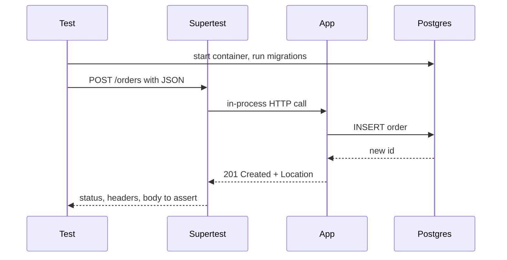

**Example (Vitest + Supertest, run with Vitest 5.1, Express 5, Supertest 7):**

```ts
import request from 'supertest';
import { buildApp } from './app';     // buildApp(repo) returns an Express app, no listen()

const repo = { save: vi.fn(async () => ({ id: 'o-1' })) };
const app = buildApp(repo);

test('POST /orders creates an order', async () => {
  const res = await request(app)
    .post('/orders')
    .send({ sku: 'shoe', qty: 2 })
    .expect(201)
    .expect('Location', '/orders/o-1');
  expect(res.body).toEqual({ id: 'o-1' });
  expect(repo.save).toHaveBeenCalledWith({ sku: 'shoe', qty: 2 });
});

test.each([{}, { sku: 'shoe' }, { sku: 'shoe', qty: 0 }])('400 for bad body %o', async (body) => {
  await request(app).post('/orders').send(body).expect(400);
  expect(repo.save).not.toHaveBeenCalled();
});
```

**Example (`node:test` only, zero dependencies, run with Node 24.14):**

```js
import { test, before, after } from 'node:test';
import assert from 'node:assert/strict';
import { createServer } from 'node:http';

const server = createServer((req, res) => {
  if (req.url === '/health') return res.writeHead(200, { 'content-type': 'application/json' }).end('{"status":"UP"}');
  res.writeHead(404).end();
});
let base;

before(async () => {
  await new Promise((r) => server.listen(0, r));          // port 0 = any free port
  base = `http://127.0.0.1:${server.address().port}`;
});
after(() => server.close());

test('GET /health returns UP', async () => {
  const res = await fetch(`${base}/health`);              // built-in fetch
  assert.equal(res.status, 200);
  assert.deepEqual(await res.json(), { status: 'UP' });
});
```

**Example (`node:test` mocks and fake timers, run with Node 24.14):**

```js
import { test } from 'node:test';
import assert from 'node:assert/strict';

const userApi = { async get(id) { throw new Error('real network!'); } };

test('builds the display name', async (t) => {
  t.mock.method(userApi, 'get', async () => ({ first: 'Asha', last: 'Rao' })); // undone after test
  const u = await userApi.get(7);
  assert.equal(`${u.first} ${u.last}`, 'Asha Rao');
  assert.equal(userApi.get.mock.calls[0].arguments[0], 7);
});

test('debounce fires once', (t) => {
  t.mock.timers.enable({ apis: ['setTimeout'] });          // fake clock
  const fn = t.mock.fn();
  let timer;
  const onType = () => { clearTimeout(timer); timer = setTimeout(fn, 300); };
  onType(); onType(); t.mock.timers.tick(300);
  assert.equal(fn.mock.callCount(), 1);
});
```

`node:test` has no `test.each`. A `for` loop over a table of cases does the same job.

**Example (real Postgres with Testcontainers 12, type-checked; needs Docker):**

```ts
import { PostgreSqlContainer, type StartedPostgreSqlContainer } from '@testcontainers/postgresql';
import pg from 'pg';

let container: StartedPostgreSqlContainer;
let pool: pg.Pool;

beforeAll(async () => {
  container = await new PostgreSqlContainer('postgres:17-alpine').start(); // real DB in Docker
  pool = new pg.Pool({ connectionString: container.getConnectionUri() });
  await pool.query('create table orders (id serial primary key, sku text not null, qty int check (qty > 0))');
}, 60_000);                                     // first image pull can be slow

afterAll(async () => { await pool?.end(); await container?.stop(); });
beforeEach(() => pool.query('truncate orders restart identity')); // clean data per test

test('the DB rejects qty 0 (constraint is real, not mocked)', async () => {
  await expect(pool.query("insert into orders (sku, qty) values ('shoe', 0)"))
    .rejects.toThrow(/check constraint/);
});
```

In a real project, run your migration tool (Prisma, Drizzle, Knex, Flyway) instead of the `create table` line. The Java version of this idea is in [spring-ecosystem.md](spring-ecosystem.md#testcontainers-and-serviceconnection).

**Good and bad:**

| Good | Bad |
|---|---|
| `buildApp(deps)` with no `listen()` | Tests that need the server already running on port 3000 |
| Real Postgres in Docker for repository and API tests | SQLite or an in-memory fake "because it is like Postgres" |
| Truncate or use a transaction per test | Tests that depend on rows from other tests |
| Test 400/401/404/409, not just 200 | Only happy paths |
| Keep MSW out of the API test project | MSW catching Supertest's local calls |

**Say this in the interview:**

> I build the app in a function that does not call listen, so tests create it with the dependencies they want.
> Supertest calls routes in-process. For anything with SQL, I use Testcontainers to run real Postgres in Docker and clean the tables between tests.
> I use node:test for small libraries with no dependencies, and Vitest when the repo is full-stack and shares tooling with the frontend.

**They may ask next:**
- **"How to test outbound HTTP from Node (a call to a payment API)?"** MSW's `setupServer` works in Node too. Or inject the client and pass a fake.
- **"Contract tests?"** Consumer-driven contracts (Pact) let the frontend publish what it expects and the backend verify it in CI. Useful when teams deploy separately.
- **"Testcontainers is slow?"** Start once per file or worker, reuse containers locally, and keep unit tests for the pure logic.

---

## TypeScript type tests

**In one line:** Type tests prove your public types accept the right calls and reject the wrong ones; they matter most for libraries and shared helpers.

**Story:** A key maker tests a new key two ways: it must open the right lock, and it must **not** open the neighbor's lock.
Type tests check both: the right call compiles, and the wrong call fails to compile.

**How it works:**
1. **`expectTypeOf`** (built into Vitest): `expectTypeOf(fn).returns.toEqualTypeOf<number>()`. It does nothing at runtime. The check happens in the type checker.
2. Run them with `vitest --typecheck`, or just run `tsc --noEmit` in CI over the test files.
3. **`// @ts-expect-error`** on a line that must not compile. If the line ever compiles, `tsc` fails because the comment is unused.
4. **tsd** is a separate tool for library `.d.ts` files (`expectType`, `expectError`).
5. Where it matters: generic helpers, a typed API client, a design-system `Button` that must reject wrong props, discriminated unions. See [typescript.md](typescript.md).

**Example (run with `vitest --typecheck` and `tsc`, no errors):**

```ts
import { expectTypeOf } from 'vitest';
import { finalPrice } from './price';
import { useCart } from './cartStore';

test('public types', () => {
  expectTypeOf(finalPrice).parameter(0).toEqualTypeOf<number>();
  expectTypeOf(finalPrice).returns.toEqualTypeOf<number>();
  expectTypeOf(useCart.getState().add).toBeCallableWith('sku-1');
  // @ts-expect-error  a number is not a valid sku
  useCart.getState().add(42);
});
```

**Good and bad:**

| Good | Bad |
|---|---|
| Type tests for exported generic helpers | Type tests for every component prop |
| `@ts-expect-error` (fails if no error) | `@ts-ignore` (hides any error forever) |
| `tsc --noEmit` in CI for app and test files | Tests run in Vitest, which strips types and never type-checks them |

**Say this in the interview:**

> Vitest and Node strip types without checking them, so CI must run tsc separately.
> For shared libraries I add type tests with expectTypeOf or tsd, and ts-expect-error lines to prove wrong usage does not compile.
> For normal app code, strict TypeScript plus tsc in CI is enough.

**They may ask next:**
- **"`@ts-expect-error` vs `@ts-ignore`?"** `expect-error` fails when there is no error, so it cannot go stale. `ignore` hides any error silently.

---

## Code coverage and its limits

**In one line:** Coverage shows which lines and branches ran during tests; low coverage shows untested code, but high coverage does not prove the tests check anything.

**Story:** A security guard walks through every room of a building (100% coverage). That does not mean he checked the windows.
Coverage tells you where the guard walked, not how carefully he looked.

**How it works:**
1. **Two engines:**
   - **V8** (default in Vitest): uses the coverage data built into the V8 JavaScript engine. Fast, no code changes. Since Vitest 4 it maps results back to source precisely, so it matches Istanbul closely.
   - **Istanbul**: adds counters into your code before running. Works in any JS engine. Slower.
2. **Metrics:** lines, statements, functions, **branches**. Branch coverage is the most useful: did we test both the `if` and the `else`?
3. **Thresholds:** `coverage.thresholds: { lines: 80, branches: 75 }` fails CI if coverage drops. A "no drop" rule on changed files works better than one global number.
4. **Limits:**
   - A test with no `expect` still gives coverage.
   - It does not show missing code (a missing null check has no line to cover).
   - Chasing 100% leads to tests for getters and config, not risk.
5. **Mutation testing** (Stryker) changes your code (for example `>` to `>=`) and checks a test fails. It measures test quality, not just reach. Run it on core logic, not the whole app.
6. `node:test` coverage is behind `--experimental-test-coverage` (still experimental).

**Example (output from our checked project, `vitest run --coverage`, trimmed):**

```text
File              | % Stmts | % Branch | % Funcs | % Lines | Uncovered Line #s
All files         |   92.47 |    86.04 |   90.62 |   91.54 |
  cartStore.ts    |    87.5 |       75 |   83.33 |   83.33 | 12
  todosSlice.ts   |     100 |       50 |     100 |     100 | 10
  useUser.ts      |      80 |       50 |     100 |     100 | 7
```

Look at `todosSlice.ts`: 100% lines, but only 50% branches. We never toggled an ID that does not exist. Line coverage alone would hide that.

**Good and bad:**

| Good | Bad |
|---|---|
| Watch branch coverage on business logic | Celebrating 100% line coverage |
| "Coverage must not drop" on changed files | Fixed 90% gate that people game with empty tests |
| Read the uncovered lines in PR review | Never opening the report |
| Mutation tests on pricing or auth logic | Mutation tests on the whole UI (very slow) |

**Say this in the interview:**

> Coverage tells me what code never ran in tests. It does not tell me the tests check the right things.
> I watch branch coverage on business logic and use a "no drop" rule on changed files instead of chasing 100%.
> For critical logic like pricing I sometimes add mutation testing, which proves the tests fail when the code is wrong.

**They may ask next:**
- **"What target?"** Around 70–80% overall is common. Near 100% branches for money, auth and permissions. Lower for UI glue.
- **"V8 vs Istanbul?"** V8 is faster and the Vitest default. Istanbul works outside V8 (for example in Firefox or Safari runs).

---

## Flaky tests: causes and fixes

**In one line:** A flaky test passes and fails on the same code; the usual causes are timing, shared state, test order, real network and real time.

**Story:** A smoke alarm that rings once a week for no reason is worse than no alarm. People start ignoring it, and then they miss the real fire.
Flaky tests do the same to a team: people press "re-run" and stop trusting red builds.

**How it works (cause → fix):**

| Cause | Example | Fix |
|---|---|---|
| Timing | `sleep(500)` then click | `findBy` / web-first assertions that wait |
| Shared data | Two tests use `user@test.com` | Unique data per test (`order-${randomUUID()}`) |
| Test order | Test 7 needs data from test 3 | Each test sets up its own data; run with `--shuffle` / `sequence.shuffle` |
| Leaking state | Zustand store, fake timers, `QueryClient` not reset | Reset in `beforeEach`/`afterEach`; `restoreMocks` |
| Real network | Calls a real third-party sandbox | MSW in unit tests, `page.route` in E2E |
| Real time and timezone | Fails after midnight or in UTC CI | Fake timers, `vi.setSystemTime`, fixed `TZ=UTC` |
| Animations | Click hits a moving button | Playwright auto-wait; disable animations in tests |
| Resource limits | Slow CI machine, too many workers | Fewer workers, more shards; raise timeouts only with a reason |

**Diagram (what to do with a flaky test):**

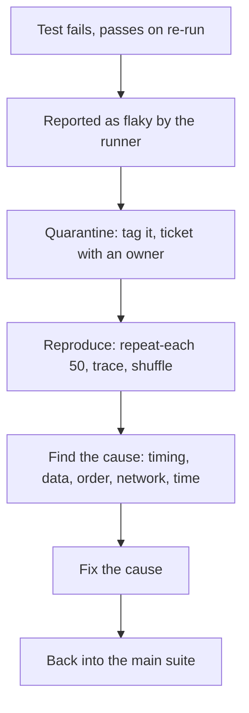

**Example (find it fast):**

```bash
# Playwright: run one test 50 times in parallel to reproduce
npx playwright test checkout.spec.ts --repeat-each=50 --workers=8
# Playwright: fail CI if any test needed a retry
npx playwright test --fail-on-flaky-tests
# Vitest: run in random order, then rerun a file 20 times
npx vitest run --sequence.shuffle
npx vitest run src/cart.test.tsx --repeats=20             # repeat every test 20 times
```

**Good and bad:**

| Good | Bad |
|---|---|
| Track flaky rate per test, fix the top 5 each sprint | Retries set to 3 "to make CI green" |
| Quarantine with an owner and a deadline | Delete the test quietly |
| Fix the cause (waits, data, isolation) | Raise every timeout to 60 s |

**Say this in the interview:**

> A flaky test is a bug, either in the test or in the app, often a real race condition.
> I allow one retry in CI only to collect data. Playwright marks a test as flaky when it passes on retry, and we track and fix those.
> The usual causes are fixed sleeps, shared test data, test order, real network and real time. The fixes are auto-waiting, unique data per test, resetting state, MSW and fake timers.

**They may ask next:**
- **"Can flaky tests show a real bug?"** Yes. A double-click that creates two orders, or a race between two requests, often shows up first as a "flaky" test.

---

## Tests in CI: sharding, retries and artifacts

**In one line:** Run cheap checks first and in parallel, split slow E2E tests across machines with sharding, retry at most once, and always upload reports and traces.

**Story:** At an airport, security has many lanes open at once (sharding).
Quick checks (boarding pass) come before slow ones (bag scan). If a bag scan beeps, they keep the X-ray image (the artifact) to look at, instead of guessing.

**How it works:**
1. **Order by cost:** lint + `tsc` + unit tests first (1–2 minutes). E2E only if they pass. Fail fast.
2. **Only what changed:** in a monorepo, use the build tool's "affected" logic (Nx, Turborepo), `vitest --changed`, or Playwright `--only-changed` on pull requests. Run everything on `main` and nightly.
3. **Sharding:** split the suite across N machines. `npx playwright test --shard=2/4`. Vitest also has `--shard`. Each shard writes a **blob report**. A final job merges them: `npx playwright merge-reports --reporter html ./all-blob-reports`.
4. **Retries policy:** `retries: 1` in CI, 0 locally. A test that passes on retry is "flaky", shown in the report and tracked. Some teams turn on `failOnFlakyTests` for critical suites.
5. **Artifacts:** upload the HTML report, traces, screenshots, videos and JUnit XML, even when the job fails (`if: ${{ !cancelled() }}`).
6. **Environment:** run E2E against a fresh preview deploy or a Docker Compose stack. Seed data through an API. Use the official Playwright Docker image so browsers and fonts match.

**Diagram (pull request pipeline):**

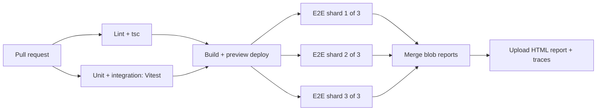

**Example (GitHub Actions E2E job, checked by hand):**

```yaml
e2e:
  needs: [unit]
  runs-on: ubuntu-latest
  strategy:
    fail-fast: false
    matrix:
      shard: [1, 2, 3]
  steps:
    - uses: actions/checkout@v7
    - uses: actions/setup-node@v7
      with: { node-version: 24, cache: npm }
    - run: npm ci
    - run: npx playwright install --with-deps chromium
    - run: npx playwright test --shard=${{ matrix.shard }}/3   # each machine runs one third
    - uses: actions/upload-artifact@v7
      if: ${{ !cancelled() }}                                  # upload even when tests fail
      with:
        name: blob-report-${{ matrix.shard }}
        path: blob-report
        retention-days: 7
```

A last job downloads all `blob-report-*` artifacts and runs `npx playwright merge-reports --reporter html`.

**Good and bad:**

| Good | Bad |
|---|---|
| Fast checks first, E2E after | 20-minute E2E before lint even runs |
| Shards + merged report | One huge job, one huge wait |
| Retry once, track flaky tests | `retries: 3`, nobody looks |
| Upload traces on failure | "Works on my machine" debates |
| Cache dependencies and browsers | Download browsers on every run |

**Say this in the interview:**

> In CI I run lint, type-check and unit tests first because they are fast and catch most problems.
> E2E runs after the build, against a preview environment, split into shards. Each shard writes a blob report and a final job merges them into one HTML report.
> I allow one retry and track tests that pass on retry as flaky. Reports and traces are always uploaded, so a failure can be debugged without re-running it.

**They may ask next:**
- **"PR takes 25 minutes. What do you do?"** Measure first. Then shard E2E, run only affected tests on PRs, cache dependencies, move slow E2E tests down to integration tests, and run the full suite on `main` and nightly.
- **"Who owns a red main build?"** The person whose change broke it. Revert first, fix later.

---

## What to test in a senior take-home

**In one line:** Show judgment, not volume: a few well-chosen tests at the right levels, one command to run them, and a note on what you skipped and why.

**Story:** A chef in a cooking test does not cook 20 dishes. They cook 3 dishes well, keep the kitchen clean, and explain their choices to the judges.

**How it works:**
1. **One command:** `npm test` runs everything. `npm run test:e2e` if there is E2E. Put both in the README.
2. **Test the core logic as pure functions:** pricing, validation, sorting. Use table tests for edge cases.
3. **2–4 integration tests for the main screen or endpoint:** happy path, an error from the API, an empty state, a validation error. Use RTL + MSW, or Supertest.
4. **One E2E smoke test** if time allows: the main journey works end to end.
5. **CI file:** a small GitHub Actions workflow that runs lint, `tsc` and tests. It shows you work like a professional.
6. **A short "testing notes" section in the README:**
   - what you tested and at which level,
   - what you skipped and why ("no visual tests: no design spec"),
   - what you would add with more time (contract tests, load test, a11y).
7. **Signals reviewers look for:** role-based queries, no fixed sleeps, no mocked internals, error paths tested, clear test names, tests that would survive a refactor.

**Diagram (a simple plan for a 4-hour take-home):**

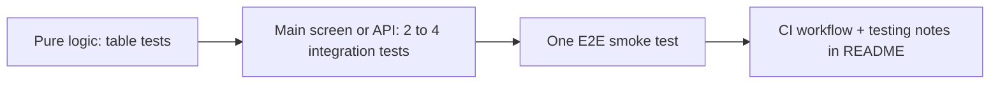

**Good and bad:**

| Good | Bad |
|---|---|
| 12 meaningful tests | 80 tests that check the framework works |
| Error and empty states covered | Only the happy path |
| README explains trade-offs | No word on testing at all |
| Tests read like a spec: "shows an error when payment fails" | `test('works')`, `test('test 2')` |
| Green CI badge | "Tests pass on my laptop" |

**Say this in the interview:**

> In a take-home I show judgment. Core logic gets table tests. The main screen or endpoint gets a few integration tests, including error and empty states. One E2E smoke test proves the whole thing runs.
> Everything runs with one command and in a small CI workflow.
> I also write what I chose not to test and what I would add with more time, because that shows how I think about risk.

**They may ask next:**
- **"Would you do TDD?"** For pure logic, yes: write the table first, then the code. For UI, I write the integration test right after the first working version.
- **"What if you ran out of time?"** Keep the integration test of the main flow and the logic tests. Drop E2E first, and say so in the README.

---

## Interview questions

**1. Testing trophy or test pyramid for a React app?**
The trophy: strict TypeScript at the base, then mostly integration tests with RTL and MSW, a small unit layer and a few E2E tests. For logic-heavy backends, the pyramid still fits. [More](#the-testing-trophy-vs-the-test-pyramid)

**2. Vitest or Jest for a new project in 2026?**
Vitest. It shares the Vite config and handles ESM and TypeScript with no Babel. Jest 30 still calls ESM support experimental. Keep a healthy Jest suite if you already have one. [More](#vitest-vs-jest)

**3. How do you test code that uses `setTimeout` or `Date.now()`?**
Fake timers: `vi.useFakeTimers()`, `vi.advanceTimersByTime(ms)`, `vi.setSystemTime(date)`. When timers and promises mix, use `await vi.runAllTimersAsync()`. Restore real timers after. [More](#unit-tests-pure-functions-async-code-and-fake-timers)

**4. What do you mock and what do you keep real?**
Mock boundaries: network (MSW), email, payment, the clock, random IDs. Keep your own components, hooks, reducers and services real. Many mocks for one function is a design smell. [More](#mocking-vifn-vimock-and-spies)

**5. `vi.fn`, `vi.spyOn` and `vi.mock`: the difference?**
`vi.fn` makes a fake function. `spyOn` wraps a real method on an object and can be restored. `vi.mock` replaces a whole module and is hoisted above imports. [More](#mocking-vifn-vimock-and-spies)

**6. What is the query priority in React Testing Library?**
`getByRole` with a name first, then `getByLabelText`, then text-based queries, and `getByTestId` last. Role queries also check accessibility. [More](#react-testing-library-test-like-a-user)

**7. `getBy`, `queryBy` and `findBy`?**
`getBy` must exist now (throws). `queryBy` returns null, so use it for "not there". `findBy` waits and returns a promise, for things that appear later. [More](#react-testing-library-test-like-a-user)

**8. Why user-event over fireEvent?**
user-event types and clicks like a person: focus, key events, input events, and it respects disabled elements. fireEvent sends one synthetic event. [More](#user-event-and-testing-forms)

**9. How do you test a form?**
Three tests: the validation error shows and nothing is sent, a valid form sends the right data, and the button is disabled while saving. Also test a server-side 400 with MSW. [More](#user-event-and-testing-forms)

**10. What does "not wrapped in act(...)" mean and how do you fix it?**
A state update happened after the test stopped waiting. Await the final visible state with `findBy` or `waitForElementToBeRemoved`. Do not hide it with manual `act()`. [More](#async-ui-findby-waitfor-and-act-warnings)

**11. How do you test a custom hook?**
Generic hooks: `renderHook` from RTL, `act` for state changes, read `result.current` fresh. Feature hooks: test through the component. Add a `wrapper` for providers. [More](#testing-custom-hooks-with-renderhook)

**12. What is MSW and why use it over mocking fetch?**
It intercepts requests at the network level, so your real fetch code, API client and React Query run. The same handlers work in Node tests, the browser and Storybook. [More](#msw-mock-the-network-not-your-code)

**13. What changed in MSW 3?**
It needs Node 22+, is ESM-only, and `onUnhandledRequest` was renamed to `onUnhandledFrame`. `worker.stop()` now returns a promise. `http` and `HttpResponse` still import from `msw`. [More](#msw-mock-the-network-not-your-code)

**14. How do you test components that use Redux, Zustand or React Query?**
Real store from the app's factory, Zustand reset in `beforeEach`, a fresh `QueryClient` with `retry: false` per test, and MSW for data. Never mock the store or `useQuery`. [More](#testing-state-redux-zustand-and-tanstack-query)

**15. Are snapshot tests good?**
For small, stable outputs, yes, preferably inline. For big component trees, no: they break on every style change and people update them without reading. [More](#snapshot-tests-when-they-help-and-when-they-hurt)

**16. How can Storybook be part of testing?**
Write a story per state and add `play` functions. With Storybook 10 and the Vitest addon, stories run as tests in a real browser, plus axe and visual checks. [More](#component-tests-in-storybook-and-vitest-browser-mode)

**17. How does Playwright avoid flaky waits?**
Actions auto-wait for the element to be visible, stable and enabled. Web-first assertions like `toBeVisible()` retry until true. So there are no fixed sleeps. [More](#end-to-end-tests-with-playwright)

**18. How do you handle login in Playwright tests?**
A setup project logs in once and saves `storageState`. Other projects depend on it and start logged in. Each test still gets a fresh browser context. [More](#end-to-end-tests-with-playwright)

**19. Playwright or Cypress?**
Playwright for WebKit, multiple tabs or users, and free sharding. Cypress for its interactive runner and mature component tests. Keep whichever healthy suite you have. [More](#playwright-vs-cypress)

**20. How do you make visual tests stable?**
Generate baselines in the same Docker image as CI, mask dates and random content, screenshot components not full pages, and review baseline updates in PRs. [More](#visual-regression-tests)

**21. How do you test accessibility automatically?**
axe in Storybook, component tests and Playwright (`@axe-core/playwright`). New violations fail CI. Then a manual keyboard and screen reader pass, because tools catch only part of the issues. [More](#accessibility-testing-with-axe)

**22. How do you test a Node API with a database?**
`buildApp(deps)` without `listen()`, Supertest for HTTP calls, Testcontainers for a real Postgres, tables truncated between tests. Cover 400, 401, 404 and 409, not just 200. [More](#nodejs-api-tests-nodetest-vitest-supertest-and-testcontainers)

**23. Is 100% coverage a good goal?**
No. Coverage shows what ran, not what was checked. Watch branch coverage on business logic, block drops on changed files, and use mutation testing for critical code. [More](#code-coverage-and-its-limits)

**24. Your CI has flaky tests and takes 25 minutes. What do you do?**
Track flaky tests (pass on retry), quarantine with an owner, fix causes: sleeps, shared data, order, real network, real time. For speed: fast checks first, shard E2E, run affected tests on PRs, upload traces. [More](#flaky-tests-causes-and-fixes) and [CI](#tests-in-ci-sharding-retries-and-artifacts)

**25. What testing do you show in a senior take-home?**
Table tests for core logic, 2–4 integration tests including error and empty states, one E2E smoke test, a CI workflow, and README notes on what you skipped and why. [More](#what-to-test-in-a-senior-take-home)
