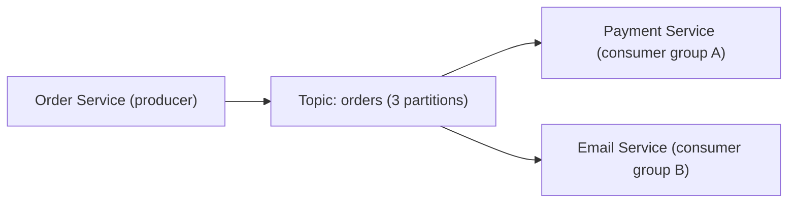
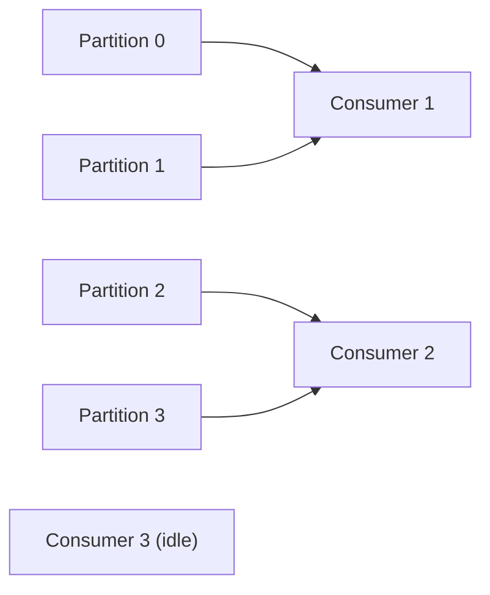
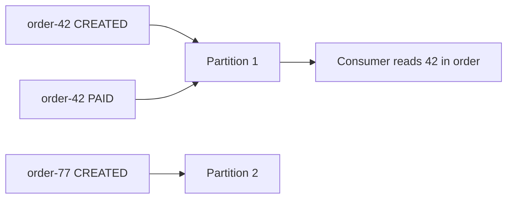
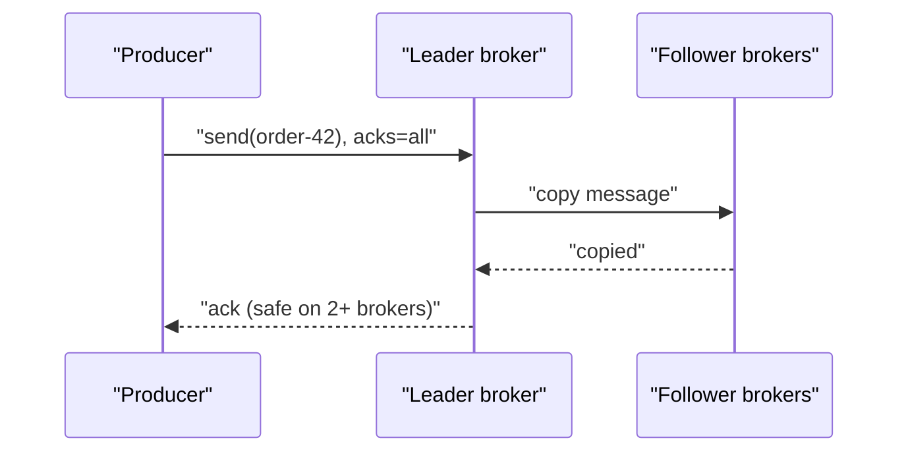
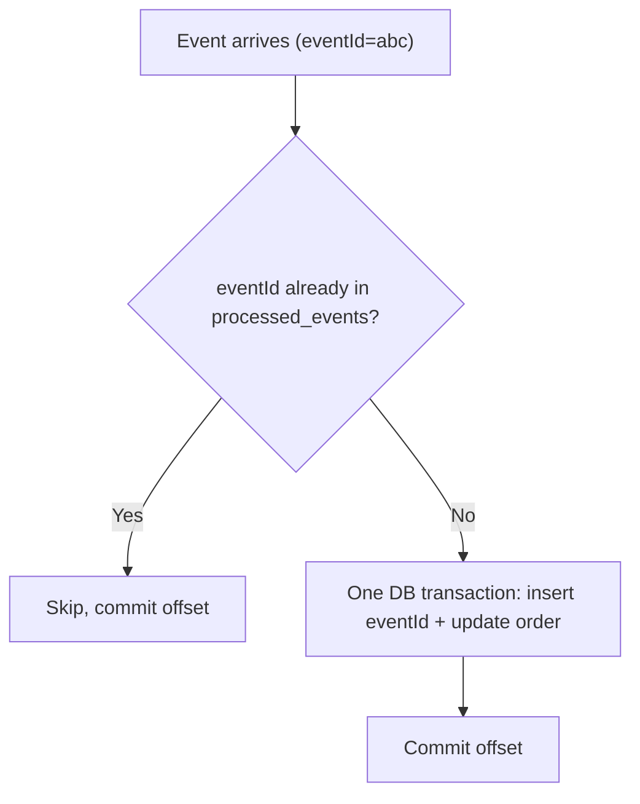

# Apache Kafka

[← Back to README](../README.md)

## Kafka basics in simple words

**In one line:** Kafka is a big shared notebook. Services write events in it, and other services read them at their own speed.

**Story:** Think of a newspaper office.
- Reporters write news. They do not know who will read it.
- The paper has sections: Sports, Business, City.
- Each reader reads at their own speed. One reads today's paper. Another is still on last week's paper.
- Old papers are kept in the store room for 7 days, then thrown away.

Kafka works the same way. Writers and readers never talk to each other directly.

**How it works (the words you must know):**

| Word | Simple meaning | Newspaper story |
|---|---|---|
| **Topic** | A named stream of events, like `orders` | A section of the paper (Sports) |
| **Partition** | A topic is split into parts. Each part is an ordered list | Sports section printed on 3 separate rolls |
| **Offset** | The position number of a message inside one partition (0, 1, 2...) | Page number on one roll |
| **Broker** | One Kafka server. A cluster has many brokers | One printing press |
| **Producer** | The app that writes events | The reporter |
| **Consumer** | The app that reads events | The reader |
| **Replication factor** | How many copies of each partition exist. Usually 3 | 3 photocopies kept in 3 buildings |
| **Leader / follower** | One copy is the leader (takes reads and writes). Others are followers (they copy the leader) | The main copy and the backup copies |
| **ISR** (in-sync replicas) | Copies that are fully up to date with the leader | Backup copies that are not behind |
| **Retention** | How long Kafka keeps messages. Default is 7 days (`log.retention.hours=168`) | Store room keeps old papers for 7 days |

Important points:
1. Kafka does **not delete** a message when someone reads it. It deletes only when retention time (or size) is over.
2. Each consumer remembers its own offset. So two different apps can read the same topic, each at its own place.
3. If a leader broker dies, one follower from the ISR becomes the new leader.

**ZooKeeper is gone:** Old Kafka used a separate system called ZooKeeper to store cluster information. **Kafka 4.0 (March 2025) removed ZooKeeper fully.** Now Kafka uses **KRaft** (Kafka's own built-in way to manage the cluster). You must move an old cluster to KRaft before you upgrade to 4.x.

**Diagram:**



**Example:** Size of the data.
- 1 million orders a day is about 12 orders per second.
- Each event is 1 KB. So 1 GB per day.
- Retention 7 days and replication factor 3: 1 GB x 7 x 3 = **21 GB of disk**. Very small for Kafka.

**Good and bad:**
| Good | Bad |
|---|---|
| Very high speed (millions of messages per second on a cluster) | More moving parts to run than a simple queue |
| Many apps can read the same events | No easy "delete one message" or "pick by filter" |
| Can replay old events (move the offset back) | Ordering only inside one partition |
| Copies on many brokers, so a server crash does not lose data | Needs tuning: partitions, retention, replication |

**When to use / when not to use:**
- Use for event streams, logs, many readers of the same data, and replay.
- Do not use it for a small app that just needs a simple job queue. A database table or RabbitMQ may be enough.

**Say this in the interview:**
> Kafka is a distributed log. Producers write events to topics, and topics are split into partitions for scale. Each consumer group tracks its own offset, so many services can read the same events at their own speed. We keep 3 copies of each partition, and since Kafka 4.0 the cluster runs on KRaft, not ZooKeeper.

**They may ask next:**
- **Is Kafka a queue?** Not exactly. A queue removes a message after reading. Kafka keeps it until retention ends, so many readers can read it.
- **What is the default replication factor?** The broker default is 1. In production we set 3.
- **What is log compaction?** A mode where Kafka keeps only the latest message for each key. Good for "current state" topics, like latest address per customer.

## Kafka partitions and consumer groups

**In one line:** Partitions split the work, and a consumer group shares those partitions so many workers can read in parallel.

**Story:** A post office has 6 sorting boxes (partitions) and some workers (consumers).
- With 2 workers, each worker takes 3 boxes.
- With 6 workers, each takes 1 box.
- With 8 workers, 2 workers stand idle. Two workers never share one box, because letters would get mixed up.
- If one worker goes home sick, the manager gives his boxes to others. This is a **rebalance**.

**How it works:**
1. A **consumer group** is a set of consumers with the same `group.id`. They share the work.
2. Inside one group, **one partition is read by at most one consumer**. One consumer can read many partitions.
3. Different groups are independent. Payment group and Email group both get every message.
4. Each group saves its **committed offset** per partition (the "I have read up to here" mark) in Kafka.
5. **Rebalance** happens when a consumer joins, leaves, or crashes. Kafka moves partitions between consumers.
6. Since Kafka 4.0, a new rebalance protocol (KIP-848) is ready for production. It reduces the "stop everyone" pause. The client opts in with `group.protocol=consumer`.

**Diagram:**


Here 4 partitions and 2 busy consumers (2 partitions each). Kafka may also split them 2+1+1 to use Consumer 3. But with 5 consumers and 4 partitions, 1 consumer is always idle.

**What happens when a consumer crashes:**
1. It stops sending heartbeats (an "I am alive" signal).
2. After `session.timeout.ms` (default 45 seconds), Kafka removes it from the group.
3. Its partitions go to other consumers.
4. They start from the **last committed offset**. Messages after that offset are read again. So you may get **duplicates**.
5. Also watch `max.poll.interval.ms` (default 5 minutes). If your code takes longer than this between two polls, Kafka thinks the consumer is stuck. It removes it from the group.

**Example: how many partitions?** Simple math.
- Target: 3,000 messages per second at peak.
- One consumer can process 200 messages per second (each takes 5 ms).
- Needed consumers: 3,000 / 200 = **15**.
- Add room for growth (2x): **30 partitions**.
- Rule of thumb: partitions = max(target / producer speed per partition, target / consumer speed per partition), then add room to grow.

Why not just choose 1,000 partitions?
- More files and memory on brokers.
- Slower recovery when a broker fails.
- Slower rebalances.
- You can increase partitions later, but never decrease them. And increasing breaks key ordering (see next topic).

**Good and bad:**
| Good | Bad |
|---|---|
| Add consumers to go faster, up to the partition count | Consumers beyond partition count do nothing |
| Crash of one consumer does not stop the group | Rebalance can pause reading for a few seconds |
| Many groups read the same data with no copying | Too many partitions slow down the cluster |

**Say this in the interview:**
> Partitions are the unit of parallel work. In one consumer group, each partition goes to only one consumer, so max useful consumers equals the partition count. I size partitions from peak throughput divided by per-consumer speed, plus room to grow. When a consumer crashes, its partitions move to others, and they restart from the last committed offset, so consumers must handle duplicates.

**They may ask next:**
- **How do you see if consumers are slow?** Check **consumer lag** (latest offset minus committed offset). Rising lag means consumers cannot keep up.
- **How do you stop rebalance storms?** Keep processing fast. Tune `max.poll.records` (default 500) and `max.poll.interval.ms`. Use the cooperative or the new KIP-848 protocol.
- **Can you lower the partition count?** No. You must create a new topic and move data.

## Kafka message ordering

**In one line:** Kafka keeps order only inside one partition, so use the order ID as the key.

**Story:** At a bank, your passbook shows your entries in order: deposit 500, withdraw 200, deposit 100. If two different clerks write your entries in two different books, nobody knows the right order. So the bank keeps **one passbook per customer**. Kafka keys do the same: one key always goes to one partition.

**How it works:**
1. The producer sends a message with a **key**, for example `orderId`.
2. Kafka hashes the key: `partition = hash(key) % numberOfPartitions`.
3. Same key, same partition, every time. So events of order 42 stay in order: `CREATED -> PAID -> SHIPPED`.
4. Different orders may go to different partitions. There is **no order between different partitions**. That is fine, because order 42 and order 43 do not depend on each other.
5. No key? Kafka spreads messages across partitions. Then you get no ordering.

**Diagram:**



**What breaks ordering:**

| Cause | Why it breaks | Fix |
|---|---|---|
| Retries with `max.in.flight.requests.per.connection` > 1 and **no idempotence** | Batch 1 fails, batch 2 succeeds, batch 1 retry lands after batch 2 | Keep `enable.idempotence=true` (default since Kafka 3.0). Then order is safe with up to 5 in flight |
| Increasing partition count | `hash(key) % 6` is different from `hash(key) % 12`. New events for order 42 go to a new partition | Choose enough partitions at the start. Or create a new topic and migrate |
| Parallel processing inside the consumer | You read in order, but hand messages to a thread pool. Thread 2 may finish before thread 1 | Process one key on one thread. Or process in order per partition |
| No key, or a bad key | Events of one order spread across partitions | Always set a key that matches your ordering need |

**Example:** Send with a key in Spring Kafka.

```java
@Service
public class OrderEventPublisher {
    private final KafkaTemplate<String, OrderEvent> kafka;

    public OrderEventPublisher(KafkaTemplate<String, OrderEvent> kafka) {
        this.kafka = kafka;
    }

    public void publish(OrderEvent event) {
        // key = orderId -> all events of one order go to the same partition
        kafka.send("orders", event.orderId(), event);
    }
}
```

**Good and bad:**
| Good | Bad |
|---|---|
| Ordering per key is free and simple | No global order across the whole topic |
| Many keys still spread over many partitions | One very busy key (a "hot key") overloads one partition |

**When to use / when not to use:**
- Use the business ID (orderId, accountId) as the key when order matters.
- If you need global order for all events, you need 1 partition. That means no parallel reading. Avoid it if you can.

**Say this in the interview:**
> Kafka guarantees order only inside one partition. So I use the business ID, like orderId, as the message key. Then all events of one order land on the same partition and are read in order. I keep idempotence on. I don't change the partition count of a keyed topic. And I don't process the same key on two threads.

**They may ask next:**
- **What is a hot key?** One key with huge traffic, like one big seller. It overloads one partition. Fix: add a sub-key (sellerId + bucket) if strict order is not needed for that key.
- **Is order kept after a consumer rebalance?** Yes, per partition. The new consumer starts from the committed offset, in the same order.

## Kafka delivery guarantees

**In one line:** Kafka gives at-most-once, at-least-once or exactly-once delivery, based on your settings and when you commit.

**Story:** You send a registered letter at the post office.
- **At-most-once:** You post it and never check. If it is lost, it is lost.
- **At-least-once:** You wait for a receipt. No receipt? You send it again. Sometimes the friend gets 2 letters.
- **Exactly-once:** The post office tracks the letter number and throws away copies. The friend gets exactly 1 letter.

**How it works:**

| Guarantee | Consumer side | Result | Use for |
|---|---|---|---|
| **At-most-once** | Commit offset **before** processing | Crash = message lost | Metrics, logs where loss is fine |
| **At-least-once** | Commit offset **after** processing | Crash = message read again (duplicate) | Most business systems (the normal choice) |
| **Exactly-once** | Kafka transactions | Each message has effect once, inside Kafka | Read from Kafka, process, write to Kafka |

**Producer settings for "do not lose my message":**
1. `acks=all`: the leader waits until all in-sync copies have the message. Default since Kafka 3.0.
2. `min.insync.replicas=2` (on the topic or broker, default is 1): at least 2 copies must have it. If fewer are alive, the write fails instead of being unsafe.
3. With replication factor 3 and min ISR 2, **1 broker can die** and writes still work.
4. `enable.idempotence=true` (default since 3.0): Kafka gives the producer an ID and numbers each message. If a retry sends the same message again, the broker drops the copy. No duplicates **from producer retries**.
5. `retries` default is very high and `delivery.timeout.ms` is 2 minutes. The producer keeps trying for 2 minutes.

**Exactly-once with transactions:**
1. Producer sets a `transactional.id`.
2. Consumer reads input, producer writes output and the consumer offset **in one transaction**.
3. Readers set `isolation.level=read_committed` (default is `read_uncommitted`). They only see committed messages.
4. Either all of it happens, or none of it.

**Diagram:**



**Big warning:** Exactly-once is **only inside Kafka** (Kafka in, Kafka out). If your consumer calls a payment API, sends an email, or writes to MySQL, Kafka cannot undo that. A crash after the email but before the commit means the email goes again. For these **external side effects you still need idempotent consumers** (next topic).

**Example:** Safe producer config in Spring Boot `application.yml`.

```yaml
spring:
  kafka:
    producer:
      acks: all                      # wait for all in-sync copies
      properties:
        enable.idempotence: true     # broker drops retry duplicates
        max.in.flight.requests.per.connection: 5   # must be <= 5 with idempotence
    consumer:
      enable-auto-commit: false      # commit only after processing
      isolation-level: read_committed
```
Topic: `replication factor = 3`, `min.insync.replicas = 2`.

**Good and bad:**
| Good | Bad |
|---|---|
| `acks=all` + min ISR 2 = no loss when 1 broker dies | A bit slower than `acks=1` |
| Idempotent producer is on by default, free safety | Does not stop duplicates on the consumer side |
| Transactions give exactly-once for Kafka-to-Kafka | More latency and more complex. Does not cover DB or HTTP calls |

**Say this in the interview:**
> Most systems use at-least-once. On the producer I use acks=all and idempotence. Topics have replication factor 3 and min.insync.replicas 2, so one broker can die with no data loss. On the consumer I commit the offset after processing. Kafka exactly-once works only for Kafka-to-Kafka flows, so for database writes or emails I make the consumer idempotent.

**They may ask next:**
- **What if 2 of 3 brokers die with min ISR 2?** Writes with acks=all fail with a "not enough replicas" error. Reads still work. This is on purpose: Kafka chooses safety over availability.
- **What is unclean leader election?** Letting an out-of-date copy become leader. You lose data. It is off by default (`unclean.leader.election.enable=false`).
- **What is the transactional outbox?** Write the DB change and the event to an outbox table in one DB transaction. A separate process sends outbox rows to Kafka. This avoids "DB saved but event not sent".

## Handling duplicate events

**In one line:** Duplicates will happen in Kafka, so make the consumer safe to run twice on the same event.

**Story:** A library gives each book a unique barcode. When a book is returned, the clerk scans it. If the same book is scanned twice by mistake, the system says "already returned" and does nothing. The member is not charged twice. Your consumer needs that same barcode check.

**Why duplicates happen:**
1. Consumer processes the message, then crashes **before** committing the offset. After restart, it reads the message again.
2. A rebalance moves the partition before the commit.
3. The producer app itself sends the same business event twice (for example, a user double-clicks "Pay").
4. Someone replays a topic by moving offsets back.

**How it works (3 common ways):**
1. **Processed events table:** Each event has a unique `eventId`. Save it in a `processed_events` table with a **unique constraint**. If the insert fails, it is a duplicate. Skip it. Do the insert and the business change in **one DB transaction**.
2. **Upsert:** Write in a way that gives the same result if run twice. Example: `INSERT ... ON CONFLICT (order_id) DO UPDATE` (PostgreSQL) or `INSERT ... ON DUPLICATE KEY UPDATE` (MySQL).
3. **Natural check:** "Set status = PAID where status = PENDING". The second run changes 0 rows.

**Diagram:**



**Example:** Idempotent consumer with Spring Kafka 3.x.

```java
@Component
public class PaymentConsumer {
    private final ProcessedEventRepository processed;
    private final OrderService orders;

    PaymentConsumer(ProcessedEventRepository p, OrderService o) { processed = p; orders = o; }

    @KafkaListener(topics = "payments", groupId = "order-service")
    @Transactional
    public void onPayment(PaymentEvent event) {
        if (processed.existsById(event.eventId())) {
            return; // duplicate: already done, just skip
        }
        orders.markPaid(event.orderId());
        processed.save(new ProcessedEvent(event.eventId())); // PK on event_id = safety net
    }
}
```
```sql
CREATE TABLE processed_events (
  event_id     VARCHAR(64) PRIMARY KEY,   -- unique: second insert fails
  processed_at TIMESTAMP NOT NULL DEFAULT now()
);
```
- If two copies run at the same time, both may pass `existsById`. But the primary key makes the second insert fail. Its transaction rolls back, so the order is not updated twice.
- Clean old rows after some days (for example, older than retention + 7 days).

**Retry topics and DLQ (dead letter queue):** Some messages fail again and again (bad data, a down service). Do not block the whole partition. Spring Kafka `@RetryableTopic` moves the message to retry topics with a delay. If it still fails, it goes to a **DLT** (dead letter topic, a "parking place" for failed messages).

```java
@RetryableTopic(
    attempts = "4",                                   // 1 try + 3 retries
    backoff = @Backoff(delay = 1000, multiplier = 2), // 1s, 2s, 4s
    exclude = InvalidOrderException.class)            // bad data: go straight to DLT
@KafkaListener(topics = "payments", groupId = "order-service")
public void onPayment(PaymentEvent event) { orders.markPaid(event.orderId()); }

@DltHandler
public void onDlt(PaymentEvent event) {
    log.error("Moved to DLT: {}", event.eventId()); // alert, fix, replay later
}
```
- Retry topics are named like `payments-retry-0`, and the dead letter topic like `payments-dlt` (default suffixes).
- Note: retry topics **lose ordering** for that message, because it goes to another topic. Use them only when order does not matter for that event.

**Good and bad:**
| Good | Bad |
|---|---|
| Unique constraint is simple and very safe | One extra table and one extra write per event |
| Upsert needs no extra table | Works only when the operation is naturally "set", not "add" |
| Retry topics keep the main partition moving | Breaks per-key ordering for retried messages |
| DLT keeps bad messages for later fixing | Someone must watch the DLT. Add an alert |

**When to use / when not to use:**
- Use a processed events table for payments, stock, money: anything with "add" or "subtract".
- Use upsert for "latest state" data, like a profile or order status.
- Use retry topics for temporary errors. Send bad data straight to the DLT.

**Say this in the interview:**
> Kafka is at-least-once in practice, so I always assume duplicates. Every event carries a unique eventId. The consumer saves it in a processed_events table with a unique constraint. This happens in the same DB transaction as the business change. So a second copy fails and is skipped. For failures I use Spring Kafka @RetryableTopic with backoff, and a dead letter topic with an alert for messages that still fail.

**They may ask next:**
- **Where does eventId come from?** The producer creates it once, for example a UUID, and keeps it the same on every retry. Never create it in the consumer.
- **Can Redis replace the table?** Yes, with `SET eventId NX EX 86400`. But Redis and the DB are not in one transaction. If the DB update fails after the Redis set, you skip a real event. The DB table is safer for money.
- **How do you replay DLT messages?** Fix the bug, then a small job reads the DLT and sends the messages back to the main topic. The idempotent consumer makes replay safe.
