# Apache Kafka

[← Back to README](../README.md)

Kafka is the event backbone in most Java microservice systems.
This page starts with the basics. Then it goes deep on what senior interviews ask: replication, rebalancing, exactly-once, schemas, retries, lag and sizing.
One running example: an online shop that sends `orders` events.

**Contents:**
- Basics: [Kafka basics](#kafka-basics-in-simple-words), [Partitions and consumer groups](#kafka-partitions-and-consumer-groups), [Message ordering](#kafka-message-ordering), [Delivery guarantees](#kafka-delivery-guarantees), [Handling duplicate events](#handling-duplicate-events)
- Inside Kafka: [Architecture and KRaft](#kafka-architecture-brokers-kraft-controllers-and-the-log), [Replication, ISR and acks](#replication-isr-acks-and-mininsyncreplicas), [Retention and log compaction](#retention-and-log-compaction), [Consumer rebalancing](#consumer-rebalancing-eager-cooperative-and-the-new-protocol-kip-848)
- Doing it right: [Exactly-once and transactions](#exactly-once-and-kafka-transactions), [Schema Registry](#schema-registry-with-avro-and-protobuf), [Retries and dead letter topics](#retries-and-dead-letter-topics-in-spring-kafka), [Kafka Streams and Connect](#kafka-streams-and-kafka-connect)
- Running it: [Consumer lag](#consumer-lag-monitoring), [Sizing](#sizing-partitions-and-brokers), [Performance tuning](#kafka-performance-tuning), [Security](#kafka-security), [Kafka vs RabbitMQ vs SQS](#kafka-vs-rabbitmq-vs-sqs)
- [Questions from the README list](#questions-from-the-readme-list)

**The big picture:** Where each part of this page lives.

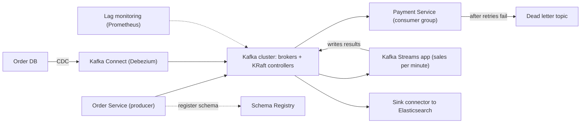

## Kafka basics in simple words

**In one line:** Kafka is a big shared notebook. Services write events in it, and other services read them at their own speed.

**Story:** Think of a newspaper office.
- Reporters write news. They do not know who will read it.
- The paper has sections: Sports, Business, City.
- Each reader reads at their own speed. One reads today's paper. Another is still on last week's paper.
- Old papers are kept in the store room for 7 days, then thrown away.

Kafka works the same way. Writers and readers never talk to each other directly.

**How it works (the words you must know):**

| Word | Simple meaning | Newspaper story |
|---|---|---|
| **Topic** | A named stream of events, like `orders` | A section of the paper (Sports) |
| **Partition** | A topic is split into parts. Each part is an ordered list | Sports section printed on 3 separate rolls |
| **Offset** | The position number of a message inside one partition (0, 1, 2...) | Page number on one roll |
| **Broker** | One Kafka server. A cluster has many brokers | One printing press |
| **Producer** | The app that writes events | The reporter |
| **Consumer** | The app that reads events | The reader |
| **Replication factor** | How many copies of each partition exist. Usually 3 | 3 photocopies kept in 3 buildings |
| **Leader / follower** | One copy is the leader (takes reads and writes). Others are followers (they copy the leader) | The main copy and the backup copies |
| **ISR** (in-sync replicas) | Copies that are fully up to date with the leader | Backup copies that are not behind |
| **Retention** | How long Kafka keeps messages. Default is 7 days (`log.retention.hours=168`) | Store room keeps old papers for 7 days |

Important points:
1. Kafka does **not delete** a message when someone reads it. It deletes only when retention time (or size) is over.
2. Each consumer remembers its own offset. So two different apps can read the same topic, each at its own place.
3. If a leader broker dies, one follower from the ISR becomes the new leader.

**ZooKeeper is gone:** Old Kafka used a separate system called ZooKeeper to store cluster information. **Kafka 4.0 (March 2025) removed ZooKeeper fully.** Now Kafka uses **KRaft** (Kafka's own built-in way to manage the cluster). You must move an old cluster to KRaft before you upgrade to 4.x.

**Diagram:**

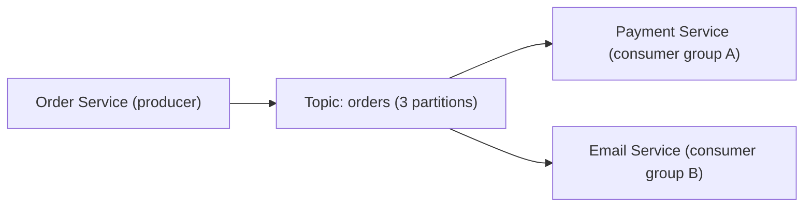

**Example:** Size of the data.
- 1 million orders a day is about 12 orders per second.
- Each event is 1 KB. So 1 GB per day.
- Retention 7 days and replication factor 3: 1 GB x 7 x 3 = **21 GB of disk**. Very small for Kafka.

**Good and bad:**
| Good | Bad |
|---|---|
| Very high speed (millions of messages per second on a cluster) | More moving parts to run than a simple queue |
| Many apps can read the same events | No easy "delete one message" or "pick by filter" |
| Can replay old events (move the offset back) | Ordering only inside one partition |
| Copies on many brokers, so a server crash does not lose data | Needs tuning: partitions, retention, replication |

**When to use / when not to use:**
- Use for event streams, logs, many readers of the same data, and replay.
- Do not use it for a small app that just needs a simple job queue. A database table or RabbitMQ may be enough.

**Say this in the interview:**
> Kafka is a distributed log. Producers write events to topics, and topics are split into partitions for scale. Each consumer group tracks its own offset, so many services can read the same events at their own speed. We keep 3 copies of each partition, and since Kafka 4.0 the cluster runs on KRaft, not ZooKeeper.

**They may ask next:**
- **Is Kafka a queue?** Not exactly. A queue removes a message after reading. Kafka keeps it until retention ends, so many readers can read it.
- **What is the default replication factor?** The broker default is 1. In production we set 3.
- **What is log compaction?** A mode where Kafka keeps only the latest message for each key. Good for "current state" topics, like latest address per customer.

## Kafka partitions and consumer groups

**In one line:** Partitions split the work, and a consumer group shares those partitions so many workers can read in parallel.

**Story:** A post office has 6 sorting boxes (partitions) and some workers (consumers).
- With 2 workers, each worker takes 3 boxes.
- With 6 workers, each takes 1 box.
- With 8 workers, 2 workers stand idle. Two workers never share one box, because letters would get mixed up.
- If one worker goes home sick, the manager gives his boxes to others. This is a **rebalance**.

**How it works:**
1. A **consumer group** is a set of consumers with the same `group.id`. They share the work.
2. Inside one group, **one partition is read by at most one consumer**. One consumer can read many partitions.
3. Different groups are independent. Payment group and Email group both get every message.
4. Each group saves its **committed offset** per partition (the "I have read up to here" mark) in Kafka.
5. **Rebalance** happens when a consumer joins, leaves, or crashes. Kafka moves partitions between consumers.
6. Since Kafka 4.0, a new rebalance protocol (KIP-848) is ready for production. It reduces the "stop everyone" pause. The client opts in with `group.protocol=consumer`.

**Diagram:**

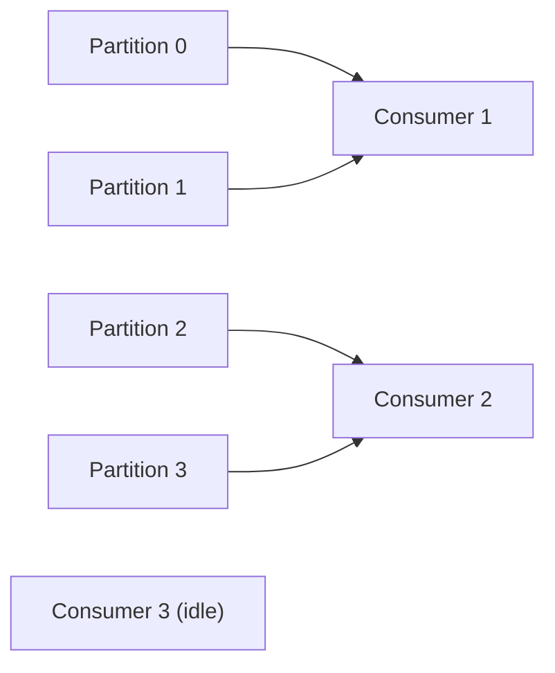
Here 4 partitions and 2 busy consumers (2 partitions each). Kafka may also split them 2+1+1 to use Consumer 3. But with 5 consumers and 4 partitions, 1 consumer is always idle.

**What happens when a consumer crashes:**
1. It stops sending heartbeats (an "I am alive" signal).
2. After `session.timeout.ms` (default 45 seconds), Kafka removes it from the group.
3. Its partitions go to other consumers.
4. They start from the **last committed offset**. Messages after that offset are read again. So you may get **duplicates**.
5. Also watch `max.poll.interval.ms` (default 5 minutes). If your code takes longer than this between two polls, Kafka thinks the consumer is stuck. It removes it from the group.

**Example: how many partitions?** Simple math.
- Target: 3,000 messages per second at peak.
- One consumer can process 200 messages per second (each takes 5 ms).
- Needed consumers: 3,000 / 200 = **15**.
- Add room for growth (2x): **30 partitions**.
- Rule of thumb: partitions = max(target / producer speed per partition, target / consumer speed per partition), then add room to grow.

Why not just choose 1,000 partitions?
- More files and memory on brokers.
- Slower recovery when a broker fails.
- Slower rebalances.
- You can increase partitions later, but never decrease them. And increasing breaks key ordering (see next topic).

**Good and bad:**
| Good | Bad |
|---|---|
| Add consumers to go faster, up to the partition count | Consumers beyond partition count do nothing |
| Crash of one consumer does not stop the group | Rebalance can pause reading for a few seconds |
| Many groups read the same data with no copying | Too many partitions slow down the cluster |

**Say this in the interview:**
> Partitions are the unit of parallel work. In one consumer group, each partition goes to only one consumer, so max useful consumers equals the partition count. I size partitions from peak throughput divided by per-consumer speed, plus room to grow. When a consumer crashes, its partitions move to others, and they restart from the last committed offset, so consumers must handle duplicates.

**They may ask next:**
- **How do you see if consumers are slow?** Check **consumer lag** (latest offset minus committed offset). Rising lag means consumers cannot keep up.
- **How do you stop rebalance storms?** Keep processing fast. Tune `max.poll.records` (default 500) and `max.poll.interval.ms`. Use the cooperative or the new KIP-848 protocol.
- **Can you lower the partition count?** No. You must create a new topic and move data.

## Kafka message ordering

**In one line:** Kafka keeps order only inside one partition, so use the order ID as the key.

**Story:** At a bank, your passbook shows your entries in order: deposit 500, withdraw 200, deposit 100. If two different clerks write your entries in two different books, nobody knows the right order. So the bank keeps **one passbook per customer**. Kafka keys do the same: one key always goes to one partition.

**How it works:**
1. The producer sends a message with a **key**, for example `orderId`.
2. Kafka hashes the key: `partition = hash(key) % numberOfPartitions`.
3. Same key, same partition, every time. So events of order 42 stay in order: `CREATED -> PAID -> SHIPPED`.
4. Different orders may go to different partitions. There is **no order between different partitions**. That is fine, because order 42 and order 43 do not depend on each other.
5. No key? Kafka spreads messages across partitions. Then you get no ordering.

**Diagram:**

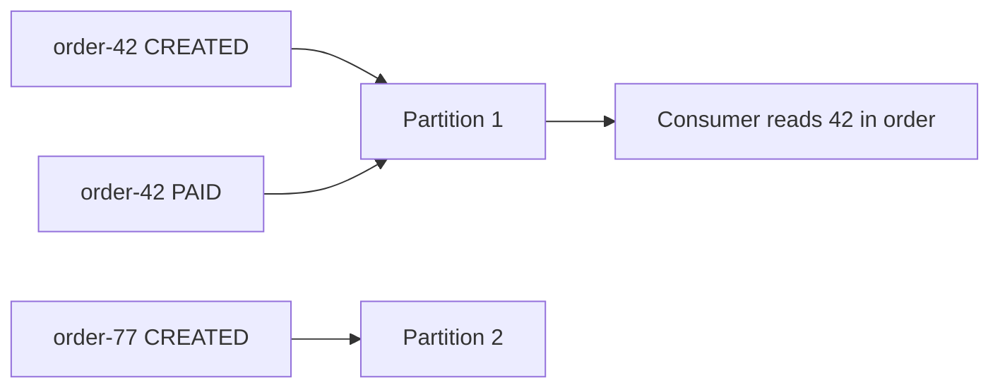

**What breaks ordering:**

| Cause | Why it breaks | Fix |
|---|---|---|
| Retries with `max.in.flight.requests.per.connection` > 1 and **no idempotence** | Batch 1 fails, batch 2 succeeds, batch 1 retry lands after batch 2 | Keep `enable.idempotence=true` (default since Kafka 3.0). Then order is safe with up to 5 in flight |
| Increasing partition count | `hash(key) % 6` is different from `hash(key) % 12`. New events for order 42 go to a new partition | Choose enough partitions at the start. Or create a new topic and migrate |
| Parallel processing inside the consumer | You read in order, but hand messages to a thread pool. Thread 2 may finish before thread 1 | Process one key on one thread. Or process in order per partition |
| No key, or a bad key | Events of one order spread across partitions | Always set a key that matches your ordering need |

**Example:** Send with a key in Spring Kafka.

```java
@Service
public class OrderEventPublisher {
    private final KafkaTemplate<String, OrderEvent> kafka;

    public OrderEventPublisher(KafkaTemplate<String, OrderEvent> kafka) {
        this.kafka = kafka;
    }

    public void publish(OrderEvent event) {
        // key = orderId -> all events of one order go to the same partition
        kafka.send("orders", event.orderId(), event);
    }
}
```

**Good and bad:**
| Good | Bad |
|---|---|
| Ordering per key is free and simple | No global order across the whole topic |
| Many keys still spread over many partitions | One very busy key (a "hot key") overloads one partition |

**When to use / when not to use:**
- Use the business ID (orderId, accountId) as the key when order matters.
- If you need global order for all events, you need 1 partition. That means no parallel reading. Avoid it if you can.

**Say this in the interview:**
> Kafka guarantees order only inside one partition. So I use the business ID, like orderId, as the message key. Then all events of one order land on the same partition and are read in order. I keep idempotence on. I don't change the partition count of a keyed topic. And I don't process the same key on two threads.

**They may ask next:**
- **What is a hot key?** One key with huge traffic, like one big seller. It overloads one partition. Fix: add a sub-key (sellerId + bucket) if strict order is not needed for that key.
- **Is order kept after a consumer rebalance?** Yes, per partition. The new consumer starts from the committed offset, in the same order.

## Kafka delivery guarantees

**In one line:** Kafka gives at-most-once, at-least-once or exactly-once delivery, based on your settings and when you commit.

**Story:** You send a registered letter at the post office.
- **At-most-once:** You post it and never check. If it is lost, it is lost.
- **At-least-once:** You wait for a receipt. No receipt? You send it again. Sometimes the friend gets 2 letters.
- **Exactly-once:** The post office tracks the letter number and throws away copies. The friend gets exactly 1 letter.

**How it works:**

| Guarantee | Consumer side | Result | Use for |
|---|---|---|---|
| **At-most-once** | Commit offset **before** processing | Crash = message lost | Metrics, logs where loss is fine |
| **At-least-once** | Commit offset **after** processing | Crash = message read again (duplicate) | Most business systems (the normal choice) |
| **Exactly-once** | Kafka transactions | Each message has effect once, inside Kafka | Read from Kafka, process, write to Kafka |

**Producer settings for "do not lose my message":**
1. `acks=all`: the leader waits until all in-sync copies have the message. Default since Kafka 3.0.
2. `min.insync.replicas=2` (on the topic or broker, default is 1): at least 2 copies must have it. If fewer are alive, the write fails instead of being unsafe.
3. With replication factor 3 and min ISR 2, **1 broker can die** and writes still work.
4. `enable.idempotence=true` (default since 3.0): Kafka gives the producer an ID and numbers each message. If a retry sends the same message again, the broker drops the copy. No duplicates **from producer retries**.
5. `retries` default is very high and `delivery.timeout.ms` is 2 minutes. The producer keeps trying for 2 minutes.

**Exactly-once with transactions:**
1. Producer sets a `transactional.id`.
2. Consumer reads input, producer writes output and the consumer offset **in one transaction**.
3. Readers set `isolation.level=read_committed` (default is `read_uncommitted`). They only see committed messages.
4. Either all of it happens, or none of it.

**Diagram:**

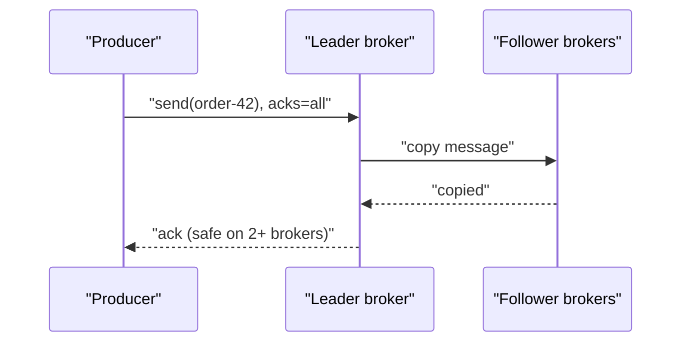

**Big warning:** Exactly-once is **only inside Kafka** (Kafka in, Kafka out). If your consumer calls a payment API, sends an email, or writes to MySQL, Kafka cannot undo that. A crash after the email but before the commit means the email goes again. For these **external side effects you still need idempotent consumers** (next topic).

**Example:** Safe producer config in Spring Boot `application.yml`.

```yaml
spring:
  kafka:
    producer:
      acks: all                      # wait for all in-sync copies
      properties:
        enable.idempotence: true     # broker drops retry duplicates
        max.in.flight.requests.per.connection: 5   # must be <= 5 with idempotence
    consumer:
      enable-auto-commit: false      # commit only after processing
      isolation-level: read_committed
```
Topic: `replication factor = 3`, `min.insync.replicas = 2`.

**Good and bad:**
| Good | Bad |
|---|---|
| `acks=all` + min ISR 2 = no loss when 1 broker dies | A bit slower than `acks=1` |
| Idempotent producer is on by default, free safety | Does not stop duplicates on the consumer side |
| Transactions give exactly-once for Kafka-to-Kafka | More latency and more complex. Does not cover DB or HTTP calls |

**Say this in the interview:**
> Most systems use at-least-once. On the producer I use acks=all and idempotence. Topics have replication factor 3 and min.insync.replicas 2, so one broker can die with no data loss. On the consumer I commit the offset after processing. Kafka exactly-once works only for Kafka-to-Kafka flows, so for database writes or emails I make the consumer idempotent.

**They may ask next:**
- **What if 2 of 3 brokers die with min ISR 2?** Writes with acks=all fail with a "not enough replicas" error. Reads still work. This is on purpose: Kafka chooses safety over availability.
- **What is unclean leader election?** Letting an out-of-date copy become leader. You lose data. It is off by default (`unclean.leader.election.enable=false`).
- **What is the transactional outbox?** Write the DB change and the event to an outbox table in one DB transaction. A separate process sends outbox rows to Kafka. This avoids "DB saved but event not sent".

## Handling duplicate events

**In one line:** Duplicates will happen in Kafka, so make the consumer safe to run twice on the same event.

**Story:** A library gives each book a unique barcode. When a book is returned, the clerk scans it. If the same book is scanned twice by mistake, the system says "already returned" and does nothing. The member is not charged twice. Your consumer needs that same barcode check.

**Why duplicates happen:**
1. Consumer processes the message, then crashes **before** committing the offset. After restart, it reads the message again.
2. A rebalance moves the partition before the commit.
3. The producer app itself sends the same business event twice (for example, a user double-clicks "Pay").
4. Someone replays a topic by moving offsets back.

**How it works (3 common ways):**
1. **Processed events table:** Each event has a unique `eventId`. Save it in a `processed_events` table with a **unique constraint**. If the insert fails, it is a duplicate. Skip it. Do the insert and the business change in **one DB transaction**.
2. **Upsert:** Write in a way that gives the same result if run twice. Example: `INSERT ... ON CONFLICT (order_id) DO UPDATE` (PostgreSQL) or `INSERT ... ON DUPLICATE KEY UPDATE` (MySQL).
3. **Natural check:** "Set status = PAID where status = PENDING". The second run changes 0 rows.

**Diagram:**

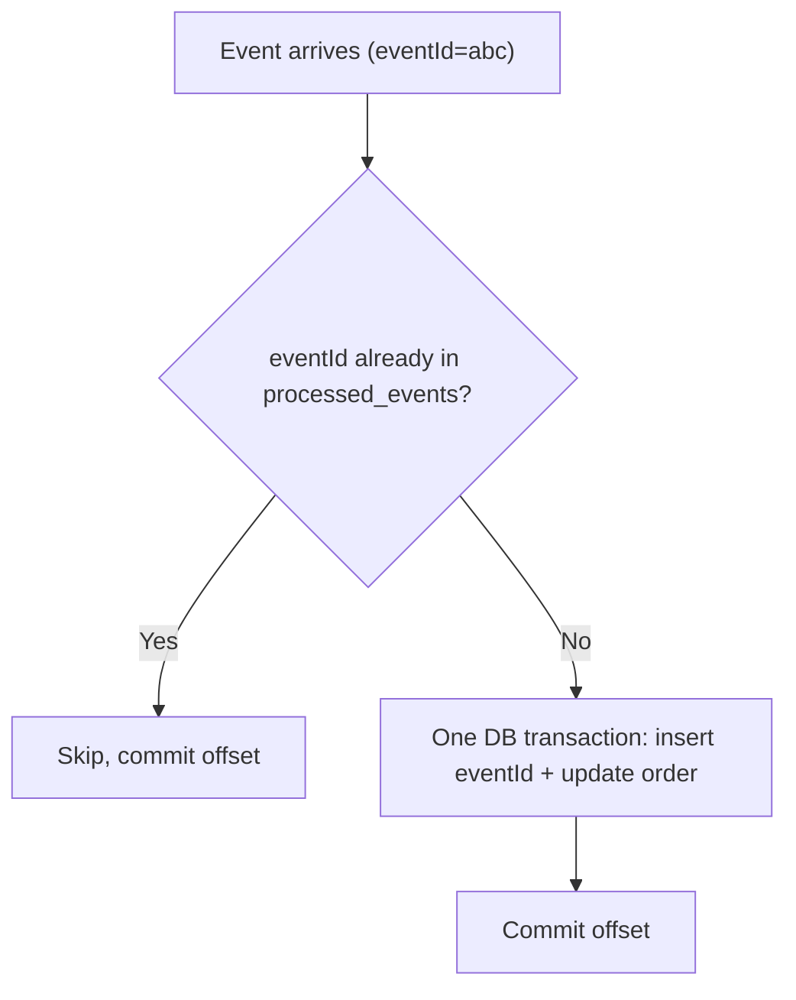

**Example:** Idempotent consumer with Spring Kafka (same code on 3.x and 4.x).

```java
@Component
public class PaymentConsumer {
    private final ProcessedEventRepository processed;
    private final OrderService orders;

    PaymentConsumer(ProcessedEventRepository p, OrderService o) { processed = p; orders = o; }

    @KafkaListener(topics = "payments", groupId = "order-service")
    @Transactional
    public void onPayment(PaymentEvent event) {
        if (processed.existsById(event.eventId())) {
            return; // duplicate: already done, just skip
        }
        orders.markPaid(event.orderId());
        processed.save(new ProcessedEvent(event.eventId())); // PK on event_id = safety net
    }
}
```
```sql
CREATE TABLE processed_events (
  event_id     VARCHAR(64) PRIMARY KEY,   -- unique: second insert fails
  processed_at TIMESTAMP NOT NULL DEFAULT now()
);
```
- If two copies run at the same time, both may pass `existsById`. But the primary key makes the second insert fail. Its transaction rolls back, so the order is not updated twice.
- Clean old rows after some days (for example, older than retention + 7 days).

**Retry topics and DLQ (dead letter queue):** Some messages fail again and again (bad data, a down service). Do not block the whole partition. Spring Kafka `@RetryableTopic` moves the message to retry topics with a delay. If it still fails, it goes to a **DLT** (dead letter topic, a "parking place" for failed messages).

```java
@RetryableTopic(
    attempts = "4",                                   // 1 try + 3 retries
    backOff = @BackOff(delay = 1000, multiplier = 2), // 1s, 2s, 4s (Spring Kafka 4.x)
    exclude = InvalidOrderException.class)            // bad data: go straight to DLT
@KafkaListener(topics = "payments", groupId = "order-service")
public void onPayment(PaymentEvent event) { orders.markPaid(event.orderId()); }

@DltHandler
public void onDlt(PaymentEvent event) {
    log.error("Moved to DLT: {}", event.eventId()); // alert, fix, replay later
}
```
- Spring Kafka 4.0 dropped Spring Retry, so the annotation is now Spring Kafka's own `@BackOff` on the `backOff` attribute. On 3.x it was `backoff = @Backoff(...)` from Spring Retry.
- Retry topics are named like `payments-retry-0`, and the dead letter topic like `payments-dlt` (default suffixes).
- Note: retry topics **lose ordering** for that message, because it goes to another topic. Use them only when order does not matter for that event.

**Good and bad:**
| Good | Bad |
|---|---|
| Unique constraint is simple and very safe | One extra table and one extra write per event |
| Upsert needs no extra table | Works only when the operation is naturally "set", not "add" |
| Retry topics keep the main partition moving | Breaks per-key ordering for retried messages |
| DLT keeps bad messages for later fixing | Someone must watch the DLT. Add an alert |

**When to use / when not to use:**
- Use a processed events table for payments, stock, money: anything with "add" or "subtract".
- Use upsert for "latest state" data, like a profile or order status.
- Use retry topics for temporary errors. Send bad data straight to the DLT.

**Say this in the interview:**
> Kafka is at-least-once in practice, so I always assume duplicates. Every event carries a unique eventId. The consumer saves it in a processed_events table with a unique constraint. This happens in the same DB transaction as the business change. So a second copy fails and is skipped. For failures I use Spring Kafka @RetryableTopic with backoff, and a dead letter topic with an alert for messages that still fail.

**They may ask next:**
- **Where does eventId come from?** The producer creates it once, for example a UUID, and keeps it the same on every retry. Never create it in the consumer.
- **Can Redis replace the table?** Yes, with `SET eventId NX EX 86400`. But Redis and the DB are not in one transaction. If the DB update fails after the Redis set, you skip a real event. The DB table is safer for money.
- **How do you replay DLT messages?** Fix the bug, then a small job reads the DLT and sends the messages back to the main topic. The idempotent consumer makes replay safe.

## Kafka architecture: brokers, KRaft controllers and the log

**In one line:** A Kafka cluster is a group of brokers that store partition logs on disk, plus a small group of KRaft controllers that keep the cluster map.

**Story:** Think of a library chain.
- Each branch (a **broker**) keeps some books (the **partitions**). Popular books have photocopies in other branches.
- A head-office committee of 3 people (the **controllers**) keeps the master register: which branch has which book, and which copy is the main one.
- The committee votes. If 2 of 3 agree, the decision is final.
- If a branch closes, the committee picks a new main copy in another branch and tells everyone.

**How it works:**
1. **Broker:** a Kafka server. It stores partitions as files and answers "write" (produce) and "read" (fetch) requests.
2. Each partition has one **leader** copy and some **follower** copies on other brokers. Clients write to and read from the leader.
3. **Controllers (KRaft mode):** usually 3 or 5 nodes. They use **Raft** (a voting protocol where the majority decides). One of them is the active controller.
4. The controllers keep all cluster **metadata** (topics, partitions, leaders, configs, ACLs) in an internal topic called `__cluster_metadata`.
5. Brokers read this metadata log and keep a copy in memory. So every broker knows who leads each partition.
6. A client connects to any broker from `bootstrap.servers`. It asks "who leads what?", then talks to each leader directly.
7. Each node has a role: `process.roles=broker`, `controller`, or both. "Both" (combined mode) is fine for a laptop. In production, keep controllers separate.
8. ZooKeeper is gone since Kafka 4.0 (see [Kafka basics](#kafka-basics-in-simple-words)).

**Why Kafka is fast (the log on disk):**
- Each partition is a folder. Data is split into **segment files** (default 1 GB each, `log.segment.bytes`) plus small index files.
- Kafka only **appends** to the end of the active segment. Disks are very fast at this kind of sequential write.
- Recent data stays in the OS page cache (free RAM the OS uses for file data). Most reads never touch the disk.
- **Zero-copy:** Kafka sends file bytes straight to the network socket, without copying them through the JVM.
- Producers and consumers work in **batches**, and batches can be compressed.

**Diagram:**

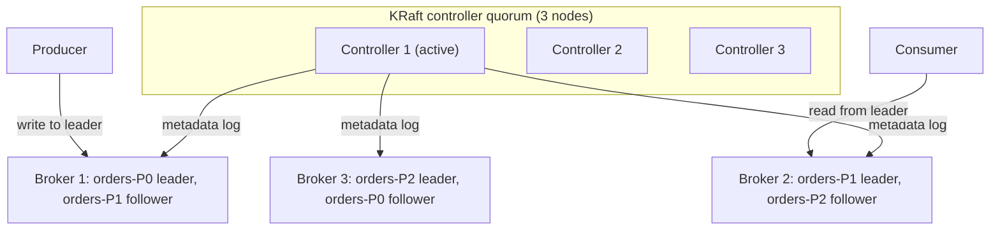

**Example:** A broker config in KRaft mode (`server.properties`).

```properties
# this node is only a broker
process.roles=broker
# unique number per node
node.id=4
# older: controller.quorum.voters
controller.quorum.bootstrap.servers=ctrl1:9093,ctrl2:9093,ctrl3:9093
controller.listener.names=CONTROLLER
listeners=PLAINTEXT://:9092
# where partition folders live
log.dirs=/var/lib/kafka/data
# spread copies across zones
broker.rack=zone-a
```

**Good and bad:**
| Good | Bad |
|---|---|
| One system to run (no ZooKeeper since 4.0) | Old clusters must move to KRaft before upgrading to 4.x |
| Sequential disk writes and page cache make it very fast | Needs enough RAM for page cache and fast disks |
| Leaders spread across brokers, so load is shared | A broker restart moves leaders around for a while |

**Say this in the interview:**
> A Kafka cluster has brokers and controllers. Brokers store partitions as append-only segment files, and each partition has a leader and followers on other brokers. Since Kafka 4.0, a KRaft controller quorum of 3 or 5 nodes keeps the metadata, with no ZooKeeper. Kafka is fast because it appends to disk sequentially, reads from the page cache, uses zero-copy and works in batches.

**They may ask next:**
- **Why did Kafka remove ZooKeeper?** Two systems to run, secure and monitor. ZooKeeper also limited how many partitions a cluster could have, and controller failover was slow. KRaft fixes both.
- **What happens when a broker dies?** The controller sees missed heartbeats. For each partition that broker led, it picks a new leader from the ISR. It writes this to the metadata log. Clients refresh metadata and continue.
- **Why 3 controllers and not 2?** Raft needs a majority. With 3, one can fail. With 5, two can fail. With 2, one failure stops everything.

## Replication, ISR, acks and min.insync.replicas

**In one line:** Each partition is copied to several brokers. `acks` says how many copies must confirm a write, and `min.insync.replicas` says the minimum safe number.

**Story:** A bank keeps your locker papers in 3 branches.
- The bank says "deposit done" only when at least 2 branches have the copy.
- If only 1 branch is open, the bank refuses new deposits. It does not want a deposit that lives in only one place.
- A branch that is far behind on copying is not trusted until it catches up.

**How it works:**
1. **Replication factor 3:** one leader and two followers, on three different brokers.
2. Followers **fetch** from the leader, a bit like consumers do.
3. **ISR (in-sync replicas):** the leader plus followers that caught up recently. "Recently" means within `replica.lag.time.max.ms` (default 30 seconds).
4. A slow or dead follower is removed from the ISR. When it catches up, it joins again.
5. **High watermark:** the last offset that all ISR copies have. Consumers can read only up to here. So they never read data that might vanish after a crash.
6. **acks** on the producer:
   - `acks=0`: do not wait. Fastest. Messages can be lost.
   - `acks=1`: wait for the leader only. Lost if the leader dies before followers copy it.
   - `acks=all` (or `-1`): wait for all current ISR copies. Default since Kafka 3.0.
7. **min.insync.replicas:** with `acks=all`, if the ISR is smaller than this number, the write fails with `NotEnoughReplicasException`.

**What happens when brokers fail** (replication factor 3, `min.insync.replicas=2`, `acks=all`):

| Situation | ISR size | Writes | Reads |
|---|---|---|---|
| All 3 brokers up | 3 | OK | OK |
| 1 broker down | 2 | OK | OK |
| 2 brokers down | 1 | Fail (not enough replicas) | OK from the leader |
| Leader dies, `acks=1` was used | - | The last messages may be lost | OK after new leader |
| Only an out-of-date copy is left, unclean election on | 1 | OK | OK, but some data is lost forever |

**Diagram:**

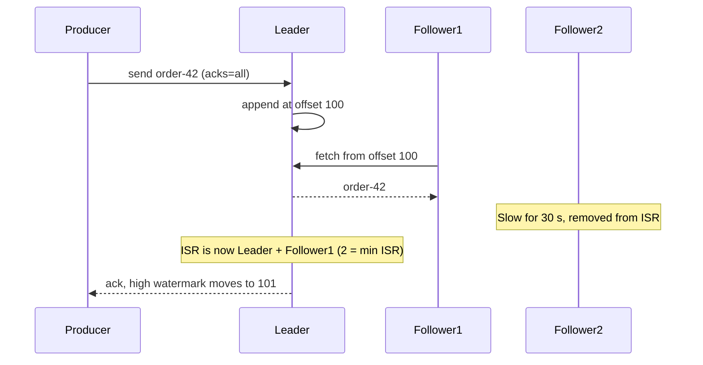

**Example:** Create a safe topic and check health.

```bash
# 12 partitions, 3 copies, at least 2 copies must have each write
kafka-topics.sh --bootstrap-server localhost:9092 --create --topic orders \
  --partitions 12 --replication-factor 3 --config min.insync.replicas=2

# Partitions where some copy is behind (should be empty)
kafka-topics.sh --bootstrap-server localhost:9092 --describe --under-replicated-partitions
```

Set `broker.rack` on each broker (for example the cloud zone). Then Kafka puts the 3 copies in 3 different zones. One zone can go down and you lose nothing.

**Good and bad:**
| Good | Bad |
|---|---|
| RF 3 + min ISR 2 + acks=all: no data loss when 1 broker dies | Each write goes over the network 2 more times |
| High watermark stops consumers reading unsafe data | Writes stop if 2 of 3 brokers are down (on purpose) |
| Rack awareness survives a full zone outage | 3 copies means 3x disk |

**When to use / when not to use:**
- Use RF 3, min ISR 2, acks=all for business data (orders, payments).
- `acks=1` or `acks=0` is fine for metrics or logs where a small loss is OK.
- Do not use RF 3 with min ISR 3. One broker down would stop all writes.

**Say this in the interview:**
> Each partition has a leader and followers. The ISR is the set of copies that are caught up. With acks=all, the leader waits for every ISR copy, and min.insync.replicas sets the minimum. I use replication factor 3 and min ISR 2, so one broker can die with no loss. If two die, writes fail instead of becoming unsafe. I also set broker.rack so copies live in different zones.

**They may ask next:**
- **Why not RF 2 with min ISR 2?** Then one broker down stops all writes. RF 3 with min ISR 2 gives one spare.
- **What is the high watermark?** The highest offset that all ISR copies have. Consumers see data only up to it.
- **What does "under-replicated partitions" mean?** Some partition has fewer in-sync copies than its replication factor. It is the first metric to alert on.

## Retention and log compaction

**In one line:** Kafka removes old data by time or size (the delete policy), or keeps only the latest message for each key (the compact policy).

**Story:**
- A shop keeps CCTV video for 7 days. After that, old video is deleted. That is the **delete** policy.
- The same shop keeps an address book. When a customer moves, the old address is crossed out. Only the latest one matters. That is **compaction**.

**How it works:**
1. A partition is a list of **segment files**. New messages go into the active segment. Retention works only on closed segments.
2. `cleanup.policy=delete` (default): delete segments older than `retention.ms` (default 7 days). Or delete when the partition is bigger than `retention.bytes` (default -1, no size limit).
3. `cleanup.policy=compact`: a background **log cleaner** keeps the last message per key. Older messages with the same key are removed later.
4. **Tombstone:** a message with a key and a `null` value. It means "delete this key". Kafka keeps it for `delete.retention.ms` (default 1 day), so consumers can see it. Then it is removed.
5. You can use both: `cleanup.policy=compact,delete`.
6. Kafka uses compaction itself. The `__consumer_offsets` topic is compacted.
7. **Tiered storage** (production-ready since Kafka 3.9): old segments move to cheap object storage like S3. Brokers keep only recent data on local disk.

**Diagram:**

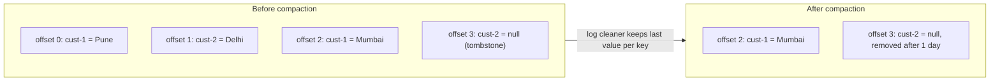

Offsets do not change. Compaction only leaves gaps.

**Example:**

```bash
# A "latest address per customer" topic
kafka-topics.sh --bootstrap-server localhost:9092 --create --topic customer-address \
  --partitions 6 --replication-factor 3 --config cleanup.policy=compact

# Keep orders for 3 days instead of 7
kafka-configs.sh --bootstrap-server localhost:9092 --alter --entity-type topics \
  --entity-name orders --add-config retention.ms=259200000
```

```java
kafka.send("customer-address", customerId, null); // tombstone: delete this key
```

**Good and bad:**
| Good | Bad |
|---|---|
| Delete policy: simple, disk use is easy to predict | Old data is gone; you cannot replay past retention |
| Compaction: a full "current state" table that never grows forever | Not instant; the cleaner runs later, so old values stay a while |
| Tombstones let you delete a key | On delete-policy topics you cannot delete one single message |

**When to use / when not to use:**
- Delete policy for event streams (orders, clicks).
- Compact for "latest state per key" (customer profile, product price, config).
- Do not use compaction when you need full history, like an audit log.

**Say this in the interview:**
> Kafka does not delete messages on read. With the delete policy it drops whole segments after the retention time, 7 days by default. With the compact policy it keeps the latest value per key, and a null value is a tombstone that deletes the key. I use compaction for current-state topics and delete for event streams. Tiered storage can move old segments to object storage to keep longer history cheaply.

**They may ask next:**
- **How do you delete one user's data (GDPR) from a normal topic?** You cannot remove one message. Use short retention, compacted topics with tombstones, or encrypt each user's data with their own key and delete the key ("crypto-shredding").
- **When does compaction run?** On closed segments, when enough of the log is "dirty". `min.cleanable.dirty.ratio` (default 0.5) controls it.
- **Can retention be forever?** Yes, `retention.ms=-1`. Plan the disk, or use tiered storage.

## Consumer rebalancing: eager, cooperative and the new protocol (KIP-848)

**In one line:** A rebalance moves partitions between consumers in a group. Newer protocols move only the partitions that must move, so the rest of the group keeps working.

**Story:** A teacher gives each class monitor some rows to watch.
- **Old way (eager):** one monitor is absent. The teacher takes back **all** rows from everyone, then hands them out again. The class stops for a minute.
- **Better (cooperative):** the teacher reassigns only the absent monitor's rows. Everyone else keeps watching.
- **Newest (KIP-848):** the principal's office (the broker) decides the plan. Monitors just check in and follow it.

**How it works:**
1. **What starts a rebalance:** a consumer joins, leaves or crashes. A consumer is too slow (`max.poll.interval.ms`). Partitions are added. The subscription changes.
2. **Eager (classic protocol, Range or RoundRobin assignor):** all consumers give up all partitions, rejoin, and get a new plan. Everyone stops ("stop the world").
3. **Cooperative incremental** (`CooperativeStickyAssignor`): only the partitions that move are revoked. Others keep running. It may take two short rounds.
4. **New consumer group protocol (KIP-848):** production-ready in Kafka 4.0. The **broker's group coordinator** computes the plan, not a consumer. Changes are small and incremental. There is no global "everyone wait" step. The client opts in with `group.protocol=consumer` (the client default is still `classic`, even in Kafka 4.4).
5. With the new protocol, some settings move to the broker side. For example, `partition.assignment.strategy` is not used. The broker uses `group.consumer.assignors` instead. Session timeout and heartbeat interval also become broker settings (`group.consumer.session.timeout.ms`, `group.consumer.heartbeat.interval.ms`).
6. **Static membership:** give each consumer a fixed `group.instance.id` (for example the pod name). If it restarts within the session timeout, it gets the same partitions back with no rebalance. Great for rolling deploys.

**Diagram:**

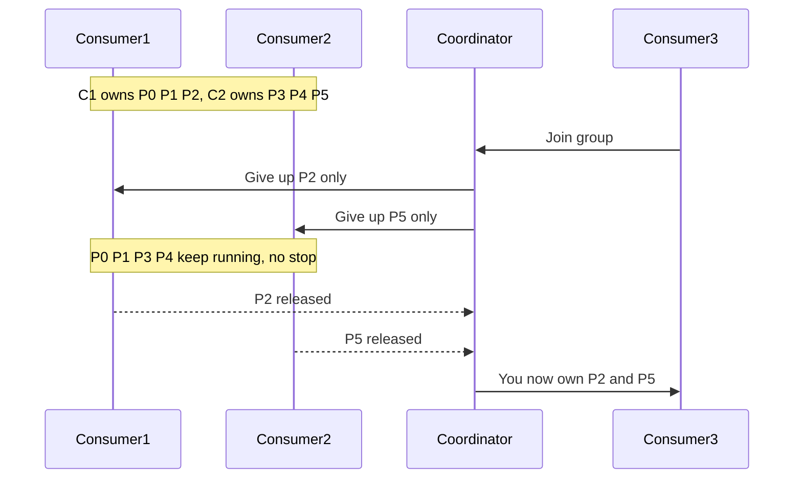

**Example:** Spring Boot `application.yml`.

```yaml
spring:
  kafka:
    consumer:
      group-id: payment-service
      max-poll-records: 200                 # less work per poll, fewer "too slow" kicks
      properties:
        group.protocol: consumer            # new KIP-848 protocol (Kafka 4.0+ clients and brokers)
        group.instance.id: ${HOSTNAME}      # static membership: pod name stays the same
```

On the classic protocol, use cooperative rebalancing instead:

```properties
partition.assignment.strategy=org.apache.kafka.clients.consumer.CooperativeStickyAssignor
```

**Good and bad:**
| Good | Bad |
|---|---|
| Cooperative and KIP-848: no full stop when one pod changes | Mixed old and new settings during migration can confuse |
| Static membership: rolling restarts cause no rebalance | A really dead static member is noticed only after the session timeout |
| KIP-848: broker decides, simpler and faster clients | Needs Kafka 4.0+ brokers and new clients |

**Say this in the interview:**
> A rebalance moves partitions when consumers join, leave or are too slow. The old eager protocol stops the whole group. Cooperative sticky moves only the needed partitions. Since Kafka 4.0, the new KIP-848 protocol lets the broker compute assignments incrementally, and clients opt in with group.protocol=consumer. For Kubernetes I also use static membership with group.instance.id, so a rolling restart does not trigger a rebalance.

**They may ask next:**
- **Why does my group rebalance again and again?** Usually processing takes longer than `max.poll.interval.ms` (default 5 minutes). Lower `max.poll.records`, make processing faster, or hand slow work to another system.
- **What happens to uncommitted work in a rebalance?** The new owner starts from the last committed offset. Some messages are processed again, so consumers must be idempotent.
- **Can I see who owns which partition?** `kafka-consumer-groups.sh --describe --group payment-service --members --verbose`.

## Exactly-once and Kafka transactions

**In one line:** Kafka transactions let an app read from Kafka, write to Kafka and save its consumer offset as one all-or-nothing step.

**Recap:** [Delivery guarantees](#kafka-delivery-guarantees) covers at-most-once, at-least-once and the safe producer settings. This section explains how exactly-once works inside.

**Story:** A bank transfer between two accounts in the same bank. The money leaves account A and reaches account B in one entry. If the clerk's system crashes halfway, both sides are cancelled. Nobody sees half a transfer. Kafka transactions do this for "read input, write output, mark input as done".

**How it works:**
1. **Idempotent producer** (on by default): the broker gives the producer an ID and numbers each message per partition. A retried duplicate is dropped.
2. **`transactional.id`:** a stable name for the producer, the same after a restart. Each new start gets a higher **epoch** (a version number).
3. **Zombie fencing:** if an old copy of the app wakes up with the same `transactional.id` and an old epoch, the broker rejects it (`ProducerFencedException`). So two copies never both write.
4. A **transaction coordinator** (a role inside a broker) keeps the state in the internal `__transaction_state` topic.
5. The steps: `beginTransaction` → send output messages → `sendOffsetsToTransaction` (the input offsets) → `commitTransaction`.
6. On commit, Kafka writes **commit markers** into every partition involved. On failure it writes abort markers.
7. Consumers with `isolation.level=read_committed` skip aborted messages. They read only up to the last stable offset (the point where no transaction is still open).
8. **Kafka Streams** does all of this for you with `processing.guarantee=exactly_once_v2`.

**Diagram:** consume, transform, produce.

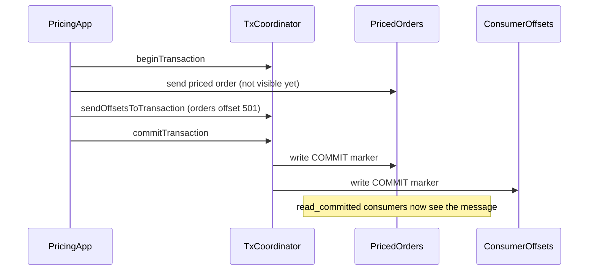

**Example:** Spring Kafka. Setting `transaction-id-prefix` turns on transactions. Spring Boot then gives the listener container a Kafka transaction manager.

```yaml
spring:
  kafka:
    producer:
      transaction-id-prefix: pricing-tx-    # turns on Kafka transactions
    consumer:
      enable-auto-commit: false
      isolation-level: read_committed       # never read aborted data
```

```java
@KafkaListener(topics = "orders", groupId = "pricing")
public void onOrder(OrderPlaced order) {    // the container starts a Kafka transaction
    kafka.send("priced-orders", order.orderId(), pricing.price(order)); // joins it
}   // output + input offset commit together; an exception aborts both
```

**Good and bad:**
| Good | Bad |
|---|---|
| True exactly-once for Kafka-to-Kafka flows | Does not cover your database, emails or HTTP calls |
| Zombie fencing stops two copies writing | Extra latency: commit markers, coordinator round trips |
| Kafka Streams turns it on with one setting | `read_committed` consumers wait for open transactions to finish |

**When to use / when not to use:**
- Use for stream processing: read topic A, compute, write topic B.
- Do not expect it to make DB writes exactly-once. Use the [transactional outbox](microservices.md#transactional-outbox-pattern) on the producer side and an [idempotent consumer](#handling-duplicate-events) on the reader side.

**Say this in the interview:**
> Exactly-once in Kafka is built from two parts. The idempotent producer removes retry duplicates. Transactions with a transactional.id write output messages and the consumer offsets together, with zombie fencing by epoch. Readers use read_committed to skip aborted data. It works only for Kafka-to-Kafka. For a database I use the outbox pattern and idempotent consumers.

**They may ask next:**
- **What is a zombie producer?** An old instance that was thought dead (for example a long GC pause) and wakes up. Fencing with the epoch stops it.
- **Is exactly-once slower?** A little. Commit markers and coordinator calls add latency. Use bigger transactions (more messages per commit) to reduce the cost.
- **Default isolation level?** `read_uncommitted`. You must set `read_committed` yourself.

## Schema Registry with Avro and Protobuf

**In one line:** A schema registry stores the shape (schema) of your events. Producers and consumers agree on the format, and a bad change cannot break old readers.

**Story:** A courier company uses a printed form. Someone wants to add a new box, "landmark". The form office checks the new form first: "Can old staff still read it? Can new staff read old forms?" Only then is it printed. The schema registry is that form office.

**How it works:**
1. The producer's serializer sends the schema to the registry under a **subject** (by default `<topic>-value`, like `orders-value`). It gets a small **schema ID** back, and caches it.
2. Each message is: a magic byte + the schema ID (4 bytes) + the data in binary (Avro or Protobuf). No field names inside, so messages are small.
3. The consumer's deserializer reads the ID, fetches the schema once (cached), and decodes the data.
4. When a new schema version is registered, the registry checks **compatibility**:

| Mode | Rule | Safe changes | Upgrade order |
|---|---|---|---|
| **BACKWARD** (Confluent default) | New schema can read old data | Delete a field, add a field with a default | Consumers first |
| **FORWARD** | Old schema can read new data | Add a field, delete a field that has a default | Producers first |
| **FULL** | Both | Add or delete only fields with defaults | Any order |
| **..._TRANSITIVE** | Same, but checked against all old versions | Same | Same |

5. Formats: **Avro** (compact, schema in JSON, common in Kafka), **Protobuf** (compact, strong typing, also used for gRPC), **JSON Schema** (readable, bigger messages).
6. Registries: Confluent Schema Registry, Apicurio Registry (open source, Apache 2.0) and cloud registries like AWS Glue Schema Registry. They work in a similar way.

**Diagram:**

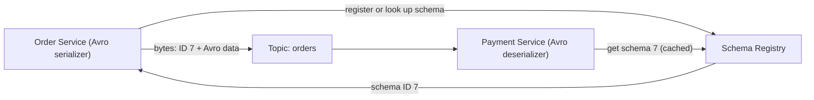

**Example:** Version 2 of an Avro schema adds an optional field with a default. Old readers ignore it. New readers fill `null` for old messages.

```json
{
  "type": "record", "name": "OrderPlaced", "namespace": "shop.events",
  "fields": [
    {"name": "orderId", "type": "string"},
    {"name": "amountPaise", "type": "long"},
    {"name": "coupon", "type": ["null", "string"], "default": null}
  ]
}
```

```yaml
spring:
  kafka:
    producer:
      value-serializer: io.confluent.kafka.serializers.KafkaAvroSerializer
    consumer:
      value-deserializer: io.confluent.kafka.serializers.KafkaAvroDeserializer
    properties:
      schema.registry.url: http://schema-registry:8081
      auto.register.schemas: false   # the CI pipeline registers schemas, not the app
      specific.avro.reader: true     # give me the generated OrderPlaced class
```

**Good and bad:**
| Good | Bad |
|---|---|
| Breaking changes are blocked before deploy | One more service to run, and it must be highly available |
| Small binary messages | Messages are not human readable in a plain console tool |
| A clear contract between teams | Teams must learn schema rules (defaults, unions) |

**When to use / when not to use:**
- Use when many teams share topics, or events live a long time.
- Plain JSON can be fine for one small team with a few topics. Still add a `version` field.

**Say this in the interview:**
> I keep event schemas in a schema registry, usually Avro or Protobuf. The producer sends only a schema ID plus binary data, so messages are small. The registry checks compatibility before a new version is saved. With BACKWARD mode, the default, I can add fields with defaults and must upgrade consumers first. I register schemas from CI, not from the running app.

**They may ask next:**
- **How do you rename a field safely?** Add the new field with a default, move producers and consumers, then remove the old field later. Avro aliases can also help.
- **What if the registry is down?** Clients cache schemas, so running apps keep working. New schemas and new app starts may fail. Run 2+ registry nodes.
- **Avro or Protobuf?** Both are fine. Protobuf if you already use gRPC. Avro is the most common in the Kafka world.

## Retries and dead letter topics in Spring Kafka

**In one line:** Retry a failed message a few times; if it still fails, park it in a dead letter topic (DLT) so the partition can move on.

**Recap:** [Handling duplicate events](#handling-duplicate-events) shows `@RetryableTopic` (non-blocking retry topics) and a `@DltHandler`. Here we add the default **blocking** retry with `DefaultErrorHandler`, and when to pick which.

**Story:** A postman cannot deliver a parcel.
- **Blocking retry:** he rings the bell 3 times, waiting a bit each time. The rest of the street waits for him.
- **Non-blocking retry:** he puts the parcel in his "try again at 5 pm" bag and moves on to the next house.
- **Dead letter:** after the last try, the parcel goes to the post office's "undelivered" shelf. Someone looks at it later.

**How it works:**
1. If a `@KafkaListener` throws, Spring Kafka's **`DefaultErrorHandler`** handles it.
2. Its default: retry in place 9 more times with no delay (10 attempts), then log and skip the message.
3. **Blocking retry:** the same message is tried again, and the partition waits. Order is kept. Keep each delay well under `max.poll.interval.ms`.
4. Add a **`DeadLetterPublishingRecoverer`**: after the last retry, it sends the message to a DLT. It adds headers with the error, the original topic, partition and offset.
5. **Not retryable** errors (bad data, validation) should go to the DLT at once. Spring already treats `DeserializationException` and some conversion errors as not retryable.
6. Use **`ErrorHandlingDeserializer`**. Otherwise a message that cannot be parsed (a "poison pill") fails before your code runs, again and again.
7. **Non-blocking retry** (`@RetryableTopic`): the message goes to retry topics with delays. The main partition keeps moving. But order is lost for that message.

**Diagram:**

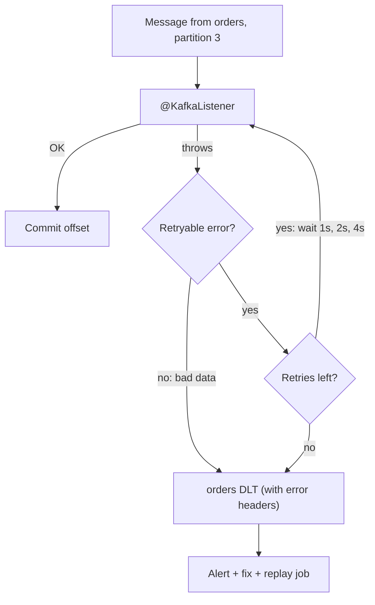

**Example:** Blocking retries with backoff and a DLT. Spring Boot plugs a `CommonErrorHandler` bean into the default listener factory.

```java
@Bean
DefaultErrorHandler errorHandler(KafkaTemplate<Object, Object> template) {
    var recoverer = new DeadLetterPublishingRecoverer(template,
        (rec, ex) -> new TopicPartition(rec.topic() + ".DLT", rec.partition())); // DLT name and partition
    var backOff = new ExponentialBackOffWithMaxRetries(3); // 3 retries after the first try
    backOff.setInitialInterval(1_000L);                    // 1s, 2s, 4s
    backOff.setMultiplier(2.0);
    var handler = new DefaultErrorHandler(recoverer, backOff);
    handler.addNotRetryableExceptions(InvalidOrderException.class); // bad data: DLT at once
    return handler;
}
```

- Here we name the DLT ourselves (`orders.DLT`). Without the resolver, the default is `<topic>-dlt` since Spring Kafka 3.3. Older versions used `<topic>.DLT`, so check which name your existing alerts and replay jobs expect.
- Sending to the **same partition number** needs a DLT with at least as many partitions as the main topic.

**Blocking or non-blocking?**

| | Blocking (`DefaultErrorHandler`) | Non-blocking (`@RetryableTopic`) |
|---|---|---|
| Order per key | Kept | Lost for retried messages |
| Other messages in the partition | Wait | Keep flowing |
| Good for | Short blips (DB failover, a few seconds) | Long outages of a downstream service |
| Extra topics | Only the DLT | Retry topics + DLT |

**Say this in the interview:**
> In Spring Kafka, the DefaultErrorHandler retries a failed record with a backoff, then a DeadLetterPublishingRecoverer sends it to a dead letter topic with error headers. Bad data skips retries and goes straight to the DLT. I use ErrorHandlingDeserializer so a poison pill cannot block the partition. When order does not matter and outages can be long, I use @RetryableTopic for non-blocking retry topics. Someone must watch the DLT, so I add an alert and a replay job.

**They may ask next:**
- **How do you replay from the DLT?** Fix the bug, then a small job reads the DLT and sends messages back to the main topic. The consumer is idempotent, so a replay is safe.
- **Can retries cause a rebalance?** Yes, if the total wait is longer than `max.poll.interval.ms`. Keep retry delays short for blocking retries.
- **What goes in DLT headers?** The exception class and message, the stack trace, and the original topic, partition and offset.

## Kafka Streams and Kafka Connect

**In one line:** Kafka Streams is a Java library to process topics inside your own app. Kafka Connect is a ready-made runner that moves data between Kafka and other systems with config, not code.

**Story:**
- **Connect** is the delivery truck. It brings goods from farms (databases) to the warehouse (Kafka). Other trucks take goods from the warehouse to shops (search, data lake).
- **Streams** is the cook inside the warehouse kitchen. He takes raw goods, cooks them (filter, count, join) and puts the dishes back on a shelf (another topic).

**How Kafka Streams works:**
1. It is just a library in your Spring Boot app. No separate cluster.
2. To scale, run more copies of the app. Max useful copies = number of input partitions.
3. **KStream:** every event ("all orders"). **KTable:** the latest value per key ("current stock per product").
4. **Stateful operations:** count, aggregate, join, windows (for example "orders per 1 minute"). State lives in a local RocksDB store. It is backed up to a **changelog topic**, so a new instance can rebuild it.
5. Exactly-once with `processing.guarantee=exactly_once_v2`.

**How Kafka Connect works:**
1. **Workers** (a small cluster of JVMs) run **connectors**. You send JSON config to its REST API.
2. **Source connector:** from a system into Kafka. Example: Debezium reads the Postgres WAL or MySQL binlog (CDC, change data capture).
3. **Sink connector:** from Kafka into a system. Example: Elasticsearch, S3, a JDBC database.
4. **SMTs (single message transforms):** small changes on each message, like renaming a field.
5. In distributed mode, Connect stores its config, offsets and status in Kafka topics.

**Diagram:**

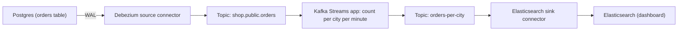

**Example:** A Streams topology in Spring Boot (`@EnableKafkaStreams`, default serdes set in `application.yml`).

```java
@Bean
KStream<String, OrderPlaced> ordersPerCity(StreamsBuilder builder) {
    KStream<String, OrderPlaced> orders = builder.stream("orders");
    orders.groupBy((key, order) -> order.city())                // re-key by city
          .windowedBy(TimeWindows.ofSizeWithNoGrace(Duration.ofMinutes(1)))
          .count()                                               // state kept in RocksDB
          .toStream()
          .map((window, count) -> KeyValue.pair(window.key(), count))
          .to("orders-per-city", Produced.with(Serdes.String(), Serdes.Long()));
    return orders;
}
```

A Debezium source connector (sent with `POST /connectors`):

```json
{
  "name": "orders-cdc",
  "config": {
    "connector.class": "io.debezium.connector.postgresql.PostgresConnector",
    "database.hostname": "orders-db",
    "database.dbname": "orders",
    "table.include.list": "public.orders",
    "topic.prefix": "shop"
  }
}
```

**Good and bad:**
| Good | Bad |
|---|---|
| Streams: no extra cluster, plain Java, exactly-once | Java/Kotlin only; big state means long restore times |
| Connect: hundreds of ready connectors, no code | One more cluster to run; connector bugs are hard to debug |
| Both scale with partitions | Both are Kafka-only; for multi-source jobs many teams pick Apache Flink |

**When to use / when not to use:**
- Streams for per-event logic, counts, joins and windows inside a Java service.
- Connect for "copy data from X to Y" with no business logic.
- Apache Flink for big, complex jobs across many sources, or SQL-style streaming.

**Say this in the interview:**
> Kafka Connect moves data in and out of Kafka with config: source connectors like Debezium for CDC, sink connectors like Elasticsearch or S3. Kafka Streams is a library for processing inside my app: KStream for events, KTable for the latest value per key, with local RocksDB state backed by changelog topics. It scales up to the partition count and supports exactly_once_v2. For very large multi-source jobs I would look at Flink.

**They may ask next:**
- **KStream vs KTable?** KStream is every event, like a bank statement. KTable is the latest value per key, like the current balance.
- **What is a GlobalKTable?** A table copied fully to every app instance. Good for small lookup data like a country list.
- **Where is Streams state kept?** In local RocksDB, plus a changelog topic in Kafka for recovery.

## Consumer lag monitoring

**In one line:** Lag is the latest offset in a partition minus the offset your group has committed. It tells you how far behind your consumers are.

**Story:** A bank token display says "Now serving 120". The token machine has given out 180. So 60 people are waiting. If the gap grows every minute, the manager opens more counters. If one counter is stuck on token 95 for 10 minutes, that clerk has a problem.

**How it works:**
1. Per partition: **lag = log end offset − committed offset**. Group lag is the sum over partitions.
2. Lag in **messages** is hard to judge. Lag in **time** ("the oldest unread message is 4 minutes old") is easier to alert on.
3. Alert on **lag growing for some minutes**, not on one high number. A short spike after a deploy is normal.
4. Look **per partition**. All partitions behind = consumers are too slow. One partition behind = a hot key or a stuck message.
5. Where to get it:
   - `kafka-consumer-groups.sh --describe` (built in).
   - A Prometheus exporter (for example kafka_exporter) or LinkedIn's Burrow.
   - Consumer client metrics like `records-lag-max`, which Spring Boot exposes through Micrometer.
   - Your cloud provider's Kafka dashboard.
6. Full debugging steps for a lag incident: [Kafka consumer lag growing](production-ready.md#kafka-consumer-lag-growing).

**Diagram:** A quick way to find the cause.

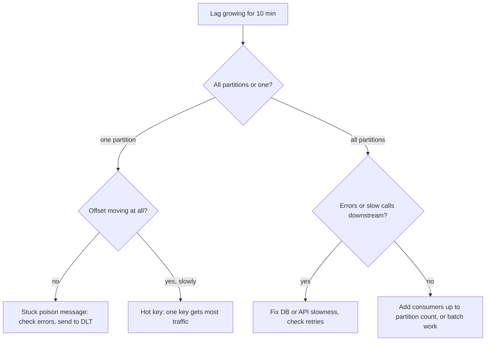

**Example:**

```bash
kafka-consumer-groups.sh --bootstrap-server localhost:9092 --describe --group payment-service
# GROUP            TOPIC   PARTITION  CURRENT-OFFSET  LOG-END-OFFSET  LAG
# payment-service  orders  0          10500           10520           20
# payment-service  orders  1          9800            15800           6000   <- stuck or hot
```

A Prometheus alert with kafka_exporter:

```yaml
- alert: KafkaConsumerLagHigh
  expr: sum by (consumergroup, topic) (kafka_consumergroup_lag) > 10000
  for: 10m                       # must stay high for 10 minutes
  labels:
    severity: page
```

**Lag math:** Producers send 3,000 messages per second. Consumers handle 2,500. Lag grows by 500 per second, which is 30,000 per minute. Say you double consumers to 5,000 per second. A backlog of 1,000,000 then drains at 2,000 per second, in about 8 minutes.

**Good and bad:**
| Good | Bad |
|---|---|
| One number that shows if consumers keep up | Message-count lag means different things on different topics |
| Per-partition view finds hot keys and stuck messages | Lag of an idle topic can look wrong if nothing is committed |
| Time-based lag maps to user impact ("emails 4 min late") | Needs an extra exporter or tool |

**Say this in the interview:**
> Lag is log end offset minus committed offset, per partition. I export it to Prometheus and alert when it keeps growing for about 10 minutes, ideally as time lag. Then I check per partition: if one partition is stuck, it is a poison message or a hot key. If all are behind, the consumer or its database is slow, and I scale consumers up to the partition count.

**They may ask next:**
- **Lag is high but CPU is low. Why?** The consumer is waiting on something slow: a DB, an HTTP call or a lock. Look at traces and downstream latency.
- **Can you add consumers forever?** No. Max useful consumers in one group = partition count.
- **Lag after a deploy?** Normal for a short time because of the rebalance. Alert only if it keeps growing.

## Sizing partitions and brokers

**In one line:** Size from numbers: peak messages per second, message size, retention and copies give you partitions, disk and broker count.

**Recap:** [Partitions and consumer groups](#kafka-partitions-and-consumer-groups) has the partition math: 3,000 messages per second ÷ 200 per consumer = 15 consumers, x2 for growth = 30 partitions. Here we size the disk and brokers.

**Story:** Planning a wedding hall. You count guests (messages per second), plate size (message size), how many days the food must last (retention) and backup kitchens (replication). Then you pick the hall size and the number of cooks.

**How it works:**
1. **Write rate:** peak messages per second x message size.
2. **Disk:** write rate x seconds of retention x replication factor, plus about 30–40% free space.
3. **Network:** brokers receive the data once from producers, plus (RF − 1) copies for followers. They send it once per consumer group.
4. **Partitions:** from the throughput math. A few thousand partitions per broker is common. Too many slows recovery.
5. **Brokers:** at least 3 for RF 3, spread across 3 zones. Add brokers for disk, network or partition count, whichever runs out first.
6. **Controllers:** 3 (survive 1 failure) or 5 (survive 2).
7. **Compression** (lz4 or zstd) often makes JSON 2–5x smaller. Measure with your real data.

**Diagram:**

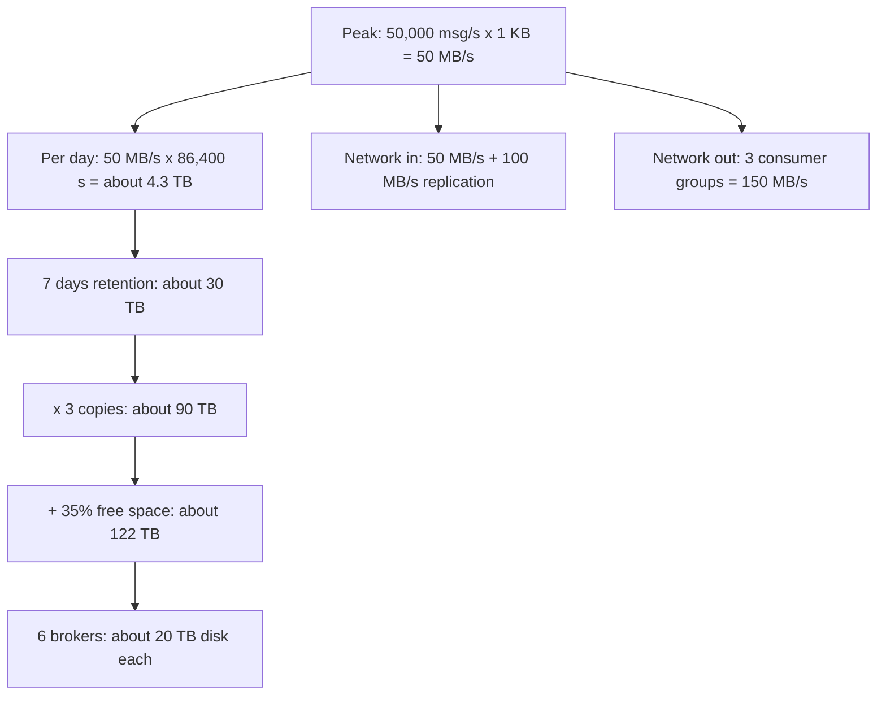

**Example:** The same numbers with lz4 compression at 3x: about 40 TB total. Now 3 brokers of 14 TB each may be enough. Check network and partitions before you cut brokers.

**Good and bad:**
| Good | Bad |
|---|---|
| Numbers make the design easy to defend | Peak traffic is often a guess; leave room |
| Compression and tiered storage cut disk a lot | Over-partitioning slows rebalances and broker recovery |
| Spreading across zones survives a zone outage | Cross-zone traffic can cost money in the cloud |

**Say this in the interview:**
> I size Kafka from four numbers: peak messages per second, message size, retention and replication factor. 50,000 messages per second at 1 KB is 50 MB per second, about 30 TB for 7 days, and about 90 TB with 3 copies, plus free space. Partitions come from per-consumer speed with 2x headroom. I start with at least 3 brokers in 3 zones and 3 controllers, and I measure compression with real data.

**They may ask next:**
- **Can you add partitions later?** Yes, but key order breaks for existing keys. Plan enough at the start.
- **Can you add brokers later?** Yes, but existing partitions do not move by themselves. Use `kafka-reassign-partitions.sh` or a tool like Cruise Control.
- **One big topic or many small ones?** Group by business event (`orders`, `payments`). Avoid one topic per customer; that creates too many partitions.

## Kafka performance tuning

**In one line:** Kafka is fast by default. Most tuning is about bigger batches, compression, and enough partitions and consumers.

**Story:** A bus does not leave each time one passenger arrives. It waits a few minutes and leaves when full. More passengers per trip means fewer trips. Kafka batches messages the same way. Waiting a little (`linger.ms`) lets the batch fill.

**How it works:**

| Where | Setting | Default | For more throughput |
|---|---|---|---|
| Producer | `batch.size` | 16 KB | 64–256 KB |
| Producer | `linger.ms` | 5 ms (was 0 before Kafka 4.0) | 10–50 ms |
| Producer | `compression.type` | none | `lz4` or `zstd` |
| Producer | `buffer.memory` | 32 MB | More if sends block |
| Consumer | `fetch.min.bytes` | 1 byte | 50–500 KB (wait for more data per fetch) |
| Consumer | `fetch.max.wait.ms` | 500 ms | Keep, it caps the wait |
| Consumer | `max.poll.records` | 500 | Lower if processing is slow; higher with batch listeners |
| Broker | `num.io.threads`, `num.network.threads` | 8, 3 | Raise on big machines |

Other tips:
- Keep the broker JVM heap modest (a few GB). Leave the rest of RAM to the OS page cache.
- Use fast local disks (SSD/NVMe). Watch disk and network first, CPU second.
- For low latency, use small `linger.ms`, small batches and no heavy compression.
- On the consumer, the slow part is usually **your code**: DB calls per message. Use batch listeners and bulk DB writes.

**Diagram:**

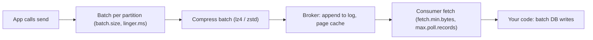

**Example:** A high-throughput producer in Spring Boot, then a load test with the built-in tool.

```yaml
spring:
  kafka:
    producer:
      acks: all                 # keep safety
      compression-type: lz4     # smaller batches on the network and disk
      batch-size: 131072        # 128 KB
      properties:
        linger.ms: 20           # wait up to 20 ms to fill a batch
```

```bash
kafka-producer-perf-test.sh --topic perf-test --num-records 1000000 --record-size 1024 \
  --throughput -1 --producer-props bootstrap.servers=localhost:9092 acks=all linger.ms=20 compression.type=lz4
```

**Good and bad:**
| Good | Bad |
|---|---|
| Bigger batches + compression = much higher throughput | Each message waits a bit longer (latency up by `linger.ms`) |
| Built-in perf tools make tests easy | Lab numbers lie if message size and keys differ from production |
| Batch listeners cut DB round trips | Batch error handling is harder (one bad record in a batch) |

**Say this in the interview:**
> I tune Kafka for throughput with bigger producer batches, a small linger.ms of 10 to 50 ms, and lz4 or zstd compression, while keeping acks=all. On the consumer I tune fetch.min.bytes and max.poll.records, and usually the real fix is batching DB writes in my code. Brokers need fast disks and lots of page cache, not a huge heap. I prove changes with kafka-producer-perf-test using real message sizes.

**They may ask next:**
- **Why did latency go up after upgrading to Kafka 4.0?** The `linger.ms` default changed from 0 to 5 ms. Set it to 0 if every millisecond matters.
- **Which compression is best?** `lz4` is fast with good savings. `zstd` saves more space with a bit more CPU. Test with your data.
- **How do you load test Kafka?** Use `kafka-producer-perf-test.sh` and `kafka-consumer-perf-test.sh`, or tools like k6 or Gatling through your service. Watch lag, p99 latency and broker disk and network.

## Kafka security

**In one line:** Encrypt traffic with TLS, check who is calling with SASL or mTLS, and allow only the right actions with ACLs.

**Story:** An office building. Tinted glass so outsiders cannot see in (TLS). An ID card at the door (authentication). Your card opens only your floor (authorization with ACLs).

**How it works:**
1. **Encryption in transit:** TLS on the listeners. Listener protocols: `SSL` or `SASL_SSL`.
2. **Authentication** (who are you?):
   - **mTLS:** the client shows its own certificate.
   - **SASL/SCRAM-SHA-512:** username and password, stored as salted hashes.
   - **SASL/OAUTHBEARER:** OAuth tokens from your identity provider.
   - **SASL/GSSAPI:** Kerberos, common in older enterprises.
   - **SASL/PLAIN:** plain password; only with TLS.
3. **Authorization** (what can you do?): **ACLs** like "User:payment-service can Read topic orders". In KRaft the authorizer is `StandardAuthorizer`.
4. Use separate listeners for clients, brokers and controllers.
5. **Quotas** limit bytes per second per client, so one noisy app cannot hurt others.
6. Kafka does **not** encrypt data on disk. Use disk encryption, or encrypt sensitive fields before sending.

**Diagram:**

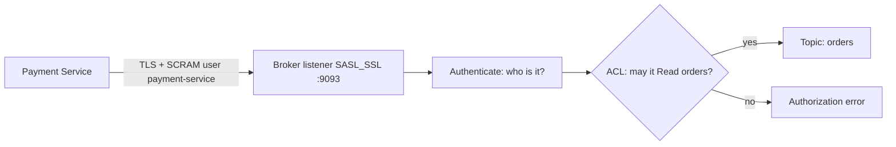

**Example:** Client config in Spring Boot and an ACL for a consumer.

```yaml
spring:
  kafka:
    security:
      protocol: SASL_SSL
    properties:
      sasl.mechanism: SCRAM-SHA-512
      sasl.jaas.config: >-
        org.apache.kafka.common.security.scram.ScramLoginModule required
        username="payment-service" password="${KAFKA_PASSWORD}";
```

```bash
# Read access on topic "orders" and group "payment-service"
kafka-acls.sh --bootstrap-server kafka:9093 --command-config admin.properties \
  --add --allow-principal User:payment-service --consumer --topic orders --group payment-service
```

**Good and bad:**
| Good | Bad |
|---|---|
| Each service has its own identity and least access | Certificates and passwords must be rotated |
| ACLs stop one team reading another team's data | TLS costs some CPU and breaks zero-copy for consumers |
| Quotas protect a shared cluster | Many ACLs are hard to manage by hand; use code or a tool |

**Say this in the interview:**
> I turn on TLS for all listeners. Each service gets its own identity, with mTLS or SASL SCRAM, or OAuth tokens. ACLs give least access, for example payment-service can only read orders with its own group. I add quotas on shared clusters. Kafka does not encrypt data at rest, so I use disk encryption and encrypt sensitive fields.

**They may ask next:**
- **mTLS or SCRAM?** mTLS if you already have a certificate system (for example a service mesh). SCRAM is simpler to start.
- **Where do you keep the password?** In a secrets manager or Kubernetes Secret, injected as an env var. Never in Git.
- **How do you manage ACLs at scale?** As code: Terraform, a GitOps tool, or the Kubernetes operator you use (for example Strimzi `KafkaUser` resources).

## Kafka vs RabbitMQ vs SQS

**In one line:** Kafka is a replayable event log for many readers. RabbitMQ is a smart message broker for routing tasks. SQS is a simple managed queue on AWS.

**Story:**
- **Kafka** is a newspaper archive. Every edition is kept. Many readers read at their own speed, and can re-read old ones.
- **RabbitMQ** is a post office. Letters are sorted by address rules into boxes. Once picked up, a letter is gone.
- **SQS** is a token counter run by someone else. You take a token, do the job, and tell them "done". No building to maintain.

**How they compare:**

| | Kafka | RabbitMQ | Amazon SQS |
|---|---|---|---|
| Model | Log of events in partitions | Exchanges route to queues | Managed queue |
| After a read | Message stays until retention ends | Removed after ack | Hidden (visibility timeout), deleted after the consumer deletes it |
| Replay old messages | Yes, move the offset | Only with RabbitMQ Streams | No |
| Many readers of the same message | Yes, one per consumer group | Yes, with fanout to many queues | Not alone; pair with SNS fan-out |
| Ordering | Per partition (per key) | Per queue, single consumer | Standard: best effort. FIFO: per message group |
| Routing | By key to partitions only | Rich: direct, topic, fanout, headers | None |
| Throughput | Very high | High | High, with no tuning (standard queues) |
| Delivery | At-least-once; exactly-once Kafka-to-Kafka | At-least-once | Standard: at-least-once. FIFO: no duplicates in a 5-minute window |
| Max message (default) | About 1 MB (configurable) | Large, but keep small | 1 MiB (since August 2025) |
| Running it | You or a managed service | You or a managed service | Fully managed by AWS |

**Queues for Kafka:** Kafka now also has **share groups** (KIP-932). Many consumers share one partition and acknowledge each message, like a classic queue. It was early access in 4.0, preview in 4.1, and production-ready in 4.2.

**Diagram:** How to choose.

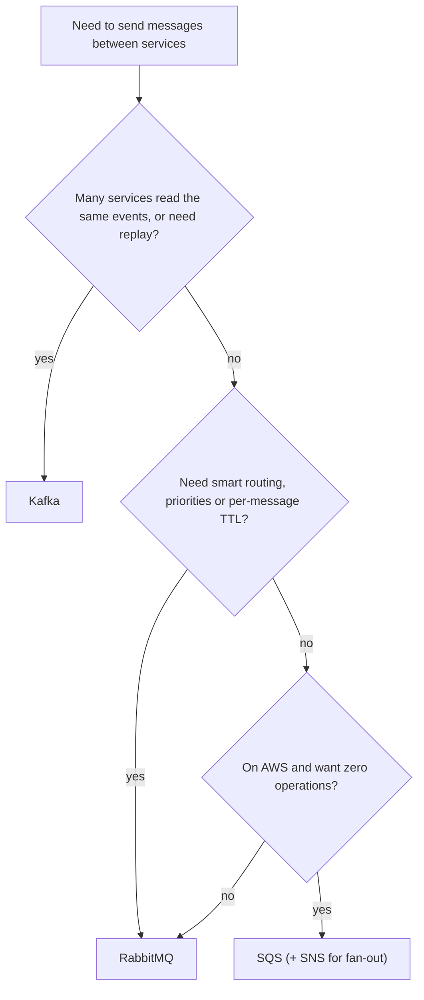

**Example:** One shop, three tools.
- `OrderPlaced` goes to **Kafka**. Payment, Inventory, Search and Analytics all read it. Analytics replays last week after a bug fix.
- "Resize this product photo" jobs go to **RabbitMQ** or **SQS**. Any free worker takes the next job.
- A small Lambda-based side project on AWS uses **SQS** with a DLQ (redrive policy) and no servers to run.

**Good and bad:**
| | Good | Bad |
|---|---|---|
| Kafka | Replay, many readers, huge throughput | More to learn and run; no per-message routing |
| RabbitMQ | Flexible routing, priorities, simple task queues | No replay of normal queues; very deep queues get slow |
| SQS | Nothing to run, scales by itself | AWS only; no replay; FIFO has lower limits |

**Say this in the interview:**
> I pick Kafka when many services need the same events, when I need replay, or for very high volume. I pick RabbitMQ for task queues with smart routing, priorities or TTL. On AWS, SQS is the simplest choice for a job queue, with SNS for fan-out. Kafka 4.2 also made share groups production-ready, so Kafka can now act like a queue too, but RabbitMQ and SQS are still simpler for plain jobs.

**They may ask next:**
- **Can RabbitMQ replay?** Normal queues cannot. RabbitMQ Streams (since 3.9) add a log-like, replayable structure.
- **What is the SQS visibility timeout?** After a consumer takes a message, it is hidden for this time. If not deleted in time, it comes back for another consumer.
- **Kafka or Pulsar?** Pulsar separates storage (BookKeeper) from brokers and has built-in multi-tenancy. Kafka has the bigger ecosystem and is more common in job interviews.

## Questions from the README list

Short answers to the older question list in the README. Each links to the deeper section above when there is one.

### Architecture

Kafka is a cluster of brokers that store topics as partitioned, replicated logs, plus KRaft controllers that keep the cluster metadata.
- Producers write to the partition leader. Followers copy it. Consumers read in groups and track offsets.
- Since Kafka 4.0 there is no ZooKeeper.

More: [Kafka architecture](#kafka-architecture-brokers-kraft-controllers-and-the-log)

### Workflow

The flow is: producer sends a keyed message, the leader appends it, followers copy it, and consumers read it and commit their offset.
1. Producer picks the partition with `hash(key) % partitions`.
2. Leader appends at the next offset. With `acks=all` it waits for the ISR.
3. A consumer in a group polls its partitions, processes, and commits the offset.
4. Data stays until retention ends, so other groups can read it too.

More: [Kafka basics](#kafka-basics-in-simple-words)

### Cluster

A Kafka cluster is many brokers working together, plus 3 or 5 KRaft controllers. Partitions and their copies are spread across brokers, so the load is shared and one broker can die without data loss. Production: at least 3 brokers in 3 zones, replication factor 3.

More: [Sizing partitions and brokers](#sizing-partitions-and-brokers)

### Producer

A producer is the app that writes messages to a topic. It batches messages per partition, compresses them, and sends them to the leader. Key settings: `acks=all`, `enable.idempotence=true` (default), `linger.ms`, `batch.size`, `compression.type`. In Spring you use `KafkaTemplate`.

More: [Delivery guarantees](#kafka-delivery-guarantees)

### Consumer

A consumer reads messages from partitions and commits offsets to remember its place. Consumers with the same `group.id` share partitions; one partition goes to one consumer in the group. In Spring you use `@KafkaListener`. Make consumers idempotent, because a crash before commit means re-reading.

More: [Partitions and consumer groups](#kafka-partitions-and-consumer-groups)

### Broker

A broker is one Kafka server. It stores partition files on disk, leads some partitions and follows others, and serves produce and fetch requests. Each broker has a unique `node.id`. Clients only need a few broker addresses in `bootstrap.servers`; they discover the rest.

More: [Kafka architecture](#kafka-architecture-brokers-kraft-controllers-and-the-log)

### Queuing

Kafka can work like a queue: inside one consumer group, each message goes to only one consumer. Unlike a classic queue, the message is not deleted after reading. Kafka 4.2 also made **share groups** (KIP-932) production-ready, where many consumers share one partition and ack each message.

More: [Kafka vs RabbitMQ vs SQS](#kafka-vs-rabbitmq-vs-sqs)

### Client

A Kafka client is any library that talks the Kafka protocol. Examples: the Java producer, consumer and admin client. Other languages have their own clients (librdkafka for C, plus Go, Python and Node clients). The Java client is the reference one. Spring Kafka wraps it. Keep client and broker versions close.

### Connect

Kafka Connect is a framework that moves data between Kafka and other systems with config instead of code. Source connectors bring data in (Debezium CDC from Postgres). Sink connectors send data out (Elasticsearch, S3, JDBC).

More: [Kafka Streams and Kafka Connect](#kafka-streams-and-kafka-connect)

### Docker

You can run a single-node Kafka in KRaft mode with the official `apache/kafka` image; no ZooKeeper container is needed. Good for local work and tests (or use Testcontainers). For Kubernetes, see [docker-kubernetes.md](docker-kubernetes.md); many teams use an operator like Strimzi.

```bash
docker run -d --name kafka -p 9092:9092 apache/kafka:4.4.0   # single node, KRaft (pick the latest 4.x tag)
```

### Monitoring Tools

Watch consumer lag, under-replicated partitions, offline partitions, request latency, and disk and network use.
- Built-in: JMX metrics and `kafka-consumer-groups.sh`.
- Common stack: Prometheus (JMX exporter, kafka_exporter) + Grafana.
- UIs: AKHQ, Kafbat UI (the fork of "UI for Apache Kafka"), Conduktor, Cruise Control for rebalancing.

More: [Consumer lag monitoring](#consumer-lag-monitoring)

### Role of Zookeeper

In old Kafka, ZooKeeper stored the cluster metadata, elected the controller and tracked live brokers. Kafka 4.0 (March 2025) removed it completely. Today: KRaft controllers do this job inside Kafka. Old clusters must migrate to KRaft on 3.x before upgrading to 4.x.

More: [Kafka basics](#kafka-basics-in-simple-words)

### Streams

Kafka Streams is a Java library for processing data from topics inside your own app: filter, map, join, count and windows. It keeps local state in RocksDB, backed by changelog topics, and supports exactly-once.

More: [Kafka Streams and Kafka Connect](#kafka-streams-and-kafka-connect)

### Spark Streaming

Spark can read from and write to Kafka for big batch-like streaming jobs. The old DStream "Spark Streaming" API is legacy. Today: Spark **Structured Streaming** with the Kafka source, or Apache Flink or Kafka Streams for low-latency processing.

### Performance Tuning

Tune for throughput with bigger batches (`batch.size`, `linger.ms`), compression (`lz4`, `zstd`), enough partitions, and consumers that batch their DB work. Give brokers fast disks and lots of page cache.

More: [Kafka performance tuning](#kafka-performance-tuning)

### Load Testing

Use the built-in `kafka-producer-perf-test.sh` and `kafka-consumer-perf-test.sh` with real message sizes. Then test the full service with k6 or Gatling. Watch p99 latency, consumer lag, and broker disk and network.

More: [Kafka performance tuning](#kafka-performance-tuning), [production-ready.md](production-ready.md#performance-and-load-testing)

### Storm Kafka Integration

Apache Storm had a Kafka spout (`storm-kafka-client`) to read topics into a Storm topology. Storm is rarely used in new projects. Today: Kafka Streams for in-app processing, or Apache Flink for large stream jobs.

### Security

Use TLS for encryption, SASL (SCRAM, OAUTHBEARER, Kerberos) or mTLS for authentication, ACLs for authorization, and quotas to stop noisy clients. Kafka does not encrypt data at rest.

More: [Kafka security](#kafka-security)

### Q.1 What is Apache Kafka?

Apache Kafka is a distributed event streaming platform: a durable, replicated log that many apps can write to and read from at high speed. Producers write events to topics, and consumers read them at their own pace, even days later.

More: [Kafka basics](#kafka-basics-in-simple-words)

### Q.2 Enlist the several components in Kafka.

The main parts are topics, partitions, brokers, KRaft controllers, producers, consumers and consumer groups. Around them: Kafka Connect, Kafka Streams and a schema registry (not part of Apache Kafka, but common). ZooKeeper was a component before Kafka 4.0; it is removed now.

More: [Kafka architecture](#kafka-architecture-brokers-kraft-controllers-and-the-log)

### Q.3 Explain the role of the offset.

An offset is the position number of a message inside one partition (0, 1, 2...). It never changes. Each consumer group commits the offset it has processed, so after a restart it continues from there. Moving the offset back lets you replay.

More: [Partitions and consumer groups](#kafka-partitions-and-consumer-groups)

### Q.4 What is a Consumer Group?

A consumer group is a set of consumers with the same `group.id` that share the partitions of a topic. Each partition goes to one consumer in the group. Different groups each get all messages, so Payment and Email can read the same topic independently.

More: [Partitions and consumer groups](#kafka-partitions-and-consumer-groups)

### Q.5 What is the role of the ZooKeeper in Kafka?

In Kafka before 4.0, ZooKeeper stored metadata (topics, partitions, configs), elected the controller and tracked which brokers were alive. Kafka 4.0 removed it. Today: the KRaft controller quorum does all of this inside Kafka.

More: [Kafka architecture](#kafka-architecture-brokers-kraft-controllers-and-the-log)

### Q.6 Is it possible to use Kafka without ZooKeeper?

Yes. KRaft mode has been production-ready since Kafka 3.3, and since Kafka 4.0 it is the only mode. New clusters never use ZooKeeper.

### Q.7 What do you know about Partition in Kafka?

A partition is one ordered, append-only part of a topic. Partitions let a topic spread across brokers and let many consumers read in parallel. Order is kept only inside one partition. Messages with the same key go to the same partition. You can add partitions but never remove them.

More: [Message ordering](#kafka-message-ordering), [Sizing](#sizing-partitions-and-brokers)

### Q.8 Why is Kafka technology significant to use?

Kafka lets services share events without calling each other, at very high speed, with copies for safety and the option to replay. One event can feed many services (payment, email, search, analytics). It decouples teams: a new reader can join without changing the producer.

### Q.9 What are main APIs of Kafka?

Kafka has five main APIs:
- **Producer API:** write events.
- **Consumer API:** read events.
- **Streams API:** process streams inside an app.
- **Connect API:** move data in and out with connectors.
- **Admin API:** manage topics, configs and ACLs.

### Q.10 What are consumers or users?

Consumers are the apps that read messages from Kafka topics. They subscribe to topics, poll for new messages, process them and commit offsets. "Users" here just means consumers. Consumers work in groups to share partitions.

More: [Partitions and consumer groups](#kafka-partitions-and-consumer-groups)

### Q.11 Explain the concept of Leader and Follower.

Each partition has one leader copy and some follower copies on other brokers. Producers write to the leader, and consumers usually read from the leader. Followers fetch from the leader to stay in sync. If the leader's broker dies, an in-sync follower becomes the new leader.

More: [Replication, ISR, acks](#replication-isr-acks-and-mininsyncreplicas)

### Q.12 What ensures load balancing of the server in Kafka?

Load is shared because partition leaders are spread across brokers. Kafka also moves leadership back to the "preferred" leader (`auto.leader.rebalance.enable=true`). Producers spread messages across partitions by key. Consumer groups spread partitions across consumers. When you add brokers, move partitions with `kafka-reassign-partitions.sh` or Cruise Control.

### Q.13 What roles do Replicas and the ISR play?

Replicas are copies of a partition on different brokers, so data survives a broker crash. The ISR (in-sync replicas) is the set of copies that are caught up with the leader. With `acks=all`, a write is confirmed only when all ISR copies have it. Only an ISR member can become the new leader (by default).

More: [Replication, ISR, acks](#replication-isr-acks-and-mininsyncreplicas)

### Q.14 Why are Replications critical in Kafka?

Without replication, one broker or disk failure loses data and stops the partition. With replication factor 3 and `min.insync.replicas=2`, one broker can die with no loss and no downtime. It also allows rolling upgrades of brokers.

More: [Replication, ISR, acks](#replication-isr-acks-and-mininsyncreplicas)

### Q.15 If a Replica stays out of the ISR for a long time, what does it signify?

It means that follower cannot keep up: the broker is slow, overloaded, has disk or network trouble, or is down. Your partition has fewer safe copies, so one more failure can stop writes or lose data. Alert on under-replicated partitions and fix the broker.

More: [Replication, ISR, acks](#replication-isr-acks-and-mininsyncreplicas)

### Q.16 What is the process for starting a Kafka server?

Today (KRaft, Kafka 4.x): create a cluster ID, format the storage, then start the server. No ZooKeeper start step.

```bash
KAFKA_CLUSTER_ID="$(bin/kafka-storage.sh random-uuid)"
bin/kafka-storage.sh format --standalone -t "$KAFKA_CLUSTER_ID" -c config/server.properties
bin/kafka-server-start.sh config/server.properties
```

Old tutorials start ZooKeeper first; that no longer works on 4.x.

### Q.17 In the Producer, when does QueueFullException occur?

`QueueFullException` came from the old Scala producer, when its async send queue was full because brokers could not keep up. That producer is long gone. Today: the Java producer buffers in `buffer.memory` (32 MB default). When it is full, `send()` blocks up to `max.block.ms` (60 s), then throws a `TimeoutException`. Fix: faster brokers, more partitions, compression or more buffer.

### Q.18 Explain the role of the Kafka Producer API.

The Producer API lets an app send records (key, value, headers) to topics. It picks the partition, batches and compresses records, retries on errors, and returns a future with the offset. With idempotence and transactions it can avoid duplicates. Spring wraps it as `KafkaTemplate`.

More: [Delivery guarantees](#kafka-delivery-guarantees)

### Q.19 What is the main difference between Kafka and Flume?

Flume is an old tool to collect logs and push them into Hadoop (HDFS); data flows one way to a fixed sink. Kafka is a general event log that many apps write to and read from, with replay. Today: Flume is rare (it now lives under Apache Logging Services). Teams use Kafka with Kafka Connect, Fluent Bit or Vector.

### Q.20 Is Apache Kafka is a distributed streaming platform? if yes, what you can do with it?

Yes. Kafka runs on many brokers and handles streams of events. You can:
- publish and subscribe to event streams,
- store them safely for as long as you need,
- process them as they arrive (Kafka Streams, Flink),
- move data between systems (Kafka Connect).

### Q. 21 What can you do with Kafka?

Common uses: events between microservices, activity tracking (clicks, views), and log and metrics pipelines. Also CDC from databases into search or a data lake, real-time analytics, fraud checks and event sourcing. See also Q.40.

### Q.22 What is the purpose of retention period in Kafka cluster?

Retention decides how long Kafka keeps messages, whether or not they were read. Default is 7 days (`retention.ms`). It lets slow or new consumers catch up and lets you replay. It also controls disk use. Compacted topics keep the latest value per key instead.

More: [Retention and log compaction](#retention-and-log-compaction)

### Q.23 Explain the maximum size of a message that can be received by the Kafka?

The default max is about 1 MB (`message.max.bytes` on the broker, `max.request.size` on the producer). You can raise it on the broker, topic (`max.message.bytes`), producer and consumer together. Better: keep messages small and put big files in object storage like S3, sending only a link (the "claim check" pattern).

### Q.24 What are the types of traditional method of message transfer?

Two types: **queuing** (point-to-point; each message goes to one consumer) and **publish-subscribe** (each message goes to every subscriber). Kafka's consumer groups give you both: one group acts like a queue, many groups act like pub-sub.

### Q.25 What does ISR stand in Kafka environment?

ISR means **in-sync replicas**: the leader plus the followers that are fully caught up (within `replica.lag.time.max.ms`, default 30 s). With `acks=all`, writes wait for all ISR copies.

More: [Replication, ISR, acks](#replication-isr-acks-and-mininsyncreplicas)

### Q.26 What is Geo-Replication in Kafka?

Geo-replication copies topics from one Kafka cluster to another, usually in another region, for disaster recovery or local reads. Apache Kafka's tool is **MirrorMaker 2** (built on Kafka Connect). It also translates consumer offsets so apps can fail over. Vendors have their own tools, like cluster linking. Offsets differ between clusters, so plan failover carefully.

### Q.27 Explain Multi-tenancy?

Multi-tenancy means many teams or apps share one Kafka cluster safely. You use topic name prefixes per team, ACLs so a team sees only its topics, quotas to limit bytes per second per client, and separate credentials. Very noisy tenants may still need their own cluster.

More: [Kafka security](#kafka-security)

### Q.28 What is the role of Consumer API?

The Consumer API lets an app subscribe to topics, poll records, and commit offsets. It handles group membership and rebalances. Key settings: `group.id`, `enable.auto.commit`, `max.poll.records`, `isolation.level`. Spring wraps it with `@KafkaListener`.

More: [Partitions and consumer groups](#kafka-partitions-and-consumer-groups)

### Q.29 Explain the role of Streams API?

The Streams API (Kafka Streams) lets you build apps that read topics, transform, join, count or window the data, and write results to other topics. It runs inside your app, keeps state in RocksDB, and supports exactly-once.

More: [Kafka Streams and Kafka Connect](#kafka-streams-and-kafka-connect)

### Q.30 What is the role of Connector API?

The Connect API lets you build or run connectors that copy data between Kafka and other systems. Source connectors import (for example Debezium from a database). Sink connectors export (for example to Elasticsearch or S3). Workers handle scaling, offsets and restarts.

More: [Kafka Streams and Kafka Connect](#kafka-streams-and-kafka-connect)

### Q.31 Explain Producer?

A producer is a client that publishes records to Kafka topics. It chooses the partition (by key, or spread if no key), batches records, and waits for acks based on `acks`. Since Kafka 3.0 it is idempotent by default, so retries do not create duplicates.

More: [Delivery guarantees](#kafka-delivery-guarantees)

### Q.32 Compare: RabbitMQ vs Apache Kafka

RabbitMQ is a message broker with smart routing; a message is removed after it is acked. Kafka is a log; messages stay for the retention time and many groups can read and replay them. Pick Kafka for event streams and high volume. Pick RabbitMQ for task queues, routing, priorities and TTL.

More: [Kafka vs RabbitMQ vs SQS](#kafka-vs-rabbitmq-vs-sqs)

### Q.33 Compare: Traditional queuing systems vs Apache Kafka

A traditional queue deletes a message once it is consumed, and gives each message to one consumer. Kafka keeps messages for the retention time, lets many consumer groups read the same data, and lets you replay. Kafka scales by partitions; ordering is per partition.

More: [Kafka vs RabbitMQ vs SQS](#kafka-vs-rabbitmq-vs-sqs)

### Q.34 Why Should we use Apache Kafka Cluster?

A cluster (many brokers) gives you scale and safety. Partitions spread load across brokers, and copies on other brokers survive a crash. You can upgrade brokers one by one with no downtime. One broker alone is fine only for local development.

More: [Kafka architecture](#kafka-architecture-brokers-kraft-controllers-and-the-log)

### Q.35 Explain the term “Log Anatomy”.

"Log anatomy" means how a partition log looks inside: an ordered, append-only list of records, each with an offset. On disk it is split into segment files (default 1 GB) with index files. New records go to the end of the active segment. Old segments are deleted or compacted.

More: [Kafka architecture](#kafka-architecture-brokers-kraft-controllers-and-the-log), [Retention and log compaction](#retention-and-log-compaction)

### Q.36 What is Data Log in Kafka?

The data log is the stored list of messages for each partition, kept on the broker's disk. Messages are kept for the retention time, even after being read. Each consumer group reads the log at its own offset. That is why Kafka can replay.

More: [Retention and log compaction](#retention-and-log-compaction)

### Q.37 Explain how to Tune Kafka for Optimal Performance.

Producer: bigger `batch.size`, `linger.ms` of 10–50 ms, `lz4` or `zstd` compression. Consumer: right `fetch.min.bytes` and `max.poll.records`, batch DB writes. Topics: enough partitions. Brokers: fast disks, lots of page cache, modest heap. Measure with perf tools before and after.

More: [Kafka performance tuning](#kafka-performance-tuning)

### Q.38 State Disadvantages of Apache Kafka.

- More to learn and run than a simple queue (partitions, rebalances, retention).
- Order only per partition; partitions cannot be reduced.
- No per-message routing, priorities or delete of one message.
- Exactly-once only for Kafka-to-Kafka.
- Big messages need extra work.
- Managed services help, but cost money.

### Q.39 Enlist all Apache Kafka Operations.

Common operations:
- add, delete and change topics (`kafka-topics.sh`, `kafka-configs.sh`),
- add partitions,
- move partitions between brokers (`kafka-reassign-partitions.sh`),
- run preferred leader election,
- add or decommission brokers,
- check and reset consumer group offsets (`kafka-consumer-groups.sh`),
- mirror data between clusters (MirrorMaker 2),
- check the controller quorum (`kafka-metadata-quorum.sh`),
- rolling upgrades.

### Q.40 Explain Apache Kafka Use Cases?

Main use cases:
- **Messaging** between microservices (`OrderPlaced` to many services).
- **Activity tracking:** clicks, page views.
- **Metrics and log aggregation.**
- **Stream processing:** fraud checks, live dashboards.
- **CDC:** copy database changes to search or a data lake.
- **Event sourcing and commit log:** rebuild state by replaying events.

### Q.41 Some of the most notable applications of Kafka.

Kafka was built at LinkedIn for activity streams and metrics. Large companies like Netflix, Uber and Airbnb have written about using it. They use it for event pipelines, real-time analytics, logging and moving data between services. Most banks, retailers and ride or food apps use it as their event backbone.

### Q.42 Features of Kafka Stream.

Kafka Streams features:
- a plain Java library (no cluster),
- KStream and KTable,
- joins and windows,
- local state in RocksDB with changelog backup,
- exactly-once (`exactly_once_v2`),
- scaling by running more instances up to the partition count,
- interactive queries to read the local state.

More: [Kafka Streams and Kafka Connect](#kafka-streams-and-kafka-connect)

### Q.43 What do you mean by Stream Processing in Kafka?

Stream processing means handling each event as it arrives, instead of waiting for a nightly batch. Example: count orders per city every minute, or flag a card used in two countries within 5 minutes. In Kafka you do it with Kafka Streams, or with Flink or Spark reading from Kafka.

More: [Kafka Streams and Kafka Connect](#kafka-streams-and-kafka-connect)

### Q.44 What are the types of System tools?

Old answers list three: the Kafka migration tool, MirrorMaker and the consumer offset checker. Today you use the shell scripts in `bin/`:
- `kafka-topics.sh`, `kafka-configs.sh`,
- `kafka-consumer-groups.sh` (replaced the offset checker),
- `kafka-reassign-partitions.sh`, `kafka-acls.sh`,
- `kafka-storage.sh`, `kafka-metadata-quorum.sh` for KRaft,
- MirrorMaker 2 for copying between clusters.

### Q.45 What are Replication Tool and its types?

Old answers list the "create topic", "list topic" and "add partition" tools. Today these are all `kafka-topics.sh` (`--create`, `--list`, `--describe`, `--alter --partitions`). Use `kafka-reassign-partitions.sh` to move copies and change replication factor. Use `kafka-leader-election.sh` to elect preferred leaders.

More: [Replication, ISR, acks](#replication-isr-acks-and-mininsyncreplicas)

### Q.46 What is Importance of Java in Apache Kafka?

Kafka runs on the JVM and is written in Java and Scala; newer code is mostly Java. The Java client is the official, most complete client, and Kafka Streams and Connect are Java libraries. Kafka 4.0 needs Java 17 for brokers and Java 11+ for clients. Spring Kafka makes it easy in Spring Boot.

### Q.47 State one best feature of Kafka.

Durable replay. Kafka keeps events after they are read. Many services can read the same data at their own speed, and you can re-read the past after a bug fix. Very high throughput is a close second.

### Q.48 Explain the term “Topic Replication Factor”.

The replication factor is how many copies of each partition exist on different brokers. RF 3 means one leader and two followers. In production use 3 with `min.insync.replicas=2`. The broker default is 1, so set it on purpose.

More: [Replication, ISR, acks](#replication-isr-acks-and-mininsyncreplicas)

### Q.49 Explain some Kafka Streams real-time Use Cases.

Examples:
- live order counts per city for a dashboard,
- fraud checks (too many payments from one card in 1 minute),
- joining clicks with user profiles for recommendations,
- keeping a "current stock per product" table from stock events,
- alerting when a delivery is late.

More: [Kafka Streams and Kafka Connect](#kafka-streams-and-kafka-connect)

### Q.50 What are Guarantees provided by Kafka?

- Order is kept inside a partition.
- A committed message (acked with `acks=all`) survives as long as one in-sync copy is alive.
- Consumers see messages in log order.
- Delivery can be at-most-once, at-least-once (most common) or exactly-once for Kafka-to-Kafka with transactions.

More: [Delivery guarantees](#kafka-delivery-guarantees), [Exactly-once](#exactly-once-and-kafka-transactions)
