# Low-level design (object-oriented design) case studies

[← Back to README](../README.md)

This file is for the *low-level design* round (LLD): "Design a parking lot", "Design an ATM", "Design Splitwise".
You draw classes, pick design patterns, and write the core Java code in about one hour.
It has a method you can repeat, UML in 10 minutes, and 20 worked case studies with class diagrams, flows and Java 21 code.

For OOP, SOLID and all 23 design patterns, read [OOP and clean code](oop-clean-code.md). For big distributed systems (HLD), read [System design](system-design.md).

**Contents**

- [How the LLD round works](#how-the-lld-round-works)
- [A repeatable method](#a-repeatable-method)
- [UML in 10 minutes](#uml-in-10-minutes)
- Case studies (full depth): [Parking Lot](#design-a-parking-lot), [Library](#design-a-library-management-system), [Amazon shopping](#design-amazon---online-shopping-system), [Movie tickets](#design-a-movie-ticket-booking-system), [ATM](#design-an-atm), [Chess](#design-chess), [Elevator](#design-an-elevator-system), [Vending Machine](#design-a-vending-machine), [Splitwise](#design-splitwise), [Rate Limiter](#design-a-rate-limiter-lld)
- Case studies (shorter): [Stack Overflow](#design-stack-overflow), [Airline](#design-an-airline-management-system), [Blackjack](#design-blackjack-and-a-deck-of-cards), [Hotel](#design-a-hotel-management-system), [Restaurant](#design-a-restaurant-management-system), [Stock brokerage](#design-an-online-stock-brokerage-system), [Car rental](#design-a-car-rental-system), [LinkedIn](#design-linkedin), [Cricinfo](#design-cricinfo), [Facebook](#design-facebook---a-social-network)
- [Questions from the README list](#questions-from-the-readme-list)
- [Interview questions](#interview-questions)

**How to read the code:** every case uses Java 21 (records, enums, sealed interfaces, pattern matching `switch`).
Imports (`java.util.*`, `java.util.concurrent.*`, `java.time.*`) are left out to save space.
Money is a `long` in paise or cents, never a `double`.

---

## How the LLD round works

**In one line:** In 60 to 90 minutes you turn a small real-world problem into clean classes and working core code.

**Story:** A carpenter is asked to make a cupboard. He does not start cutting wood.
He asks: how many shelves, which room, sliding or swing doors? Then he draws a plan, then he cuts.
The LLD round checks the same habit. Ask, plan, then build the important parts well.

**What the hour looks like:**

| Minutes | What you do |
|---|---|
| 0–5 | Ask clarifying questions. Write the scope on the board. |
| 5–10 | List actors, use cases and core entities (the nouns). |
| 10–25 | Draw the class diagram: classes, interfaces, relationships, enums. |
| 25–50 | Write the code for the 1–2 core flows (park a car, book a seat). |
| 50–60 | Concurrency, extensions, tests. "What if we add electric cars?" |

Some companies run it as *machine coding*: 90 minutes, working code that must run, sometimes with tests.
Others want only the class diagram and method signatures. Ask which one at the start.

**What the interviewer checks:**

- **OOP:** do your classes own their data and behaviour? Do you use *encapsulation* (hide the fields, expose methods)?
- **SOLID:** small classes with one job, new features added by new classes, not by editing old `if` chains.
- **Design patterns:** Strategy, State, Factory, Observer, used where they solve a real problem. Not forced.
- **Extensibility:** "Now add a new vehicle type." Can you do it by adding one class?
- **Thread safety:** two people book the same seat at the same second. What happens?
- **Clean code:** good names, small methods, immutable objects, clear errors, testable code (inject the `Clock`).
- **Communication:** you think aloud, state assumptions, and accept hints.

**LLD vs HLD:**

| | Low-level design (LLD) | High-level design (HLD) |
|---|---|---|
| Question | "Design a parking lot." "Design Splitwise." | "Design BookMyShow for 10 million users." |
| You draw | Classes, interfaces, enums, methods | Services, databases, queues, caches |
| You write | Java code for core flows | APIs, data model, numbers |
| They check | OOP, SOLID, patterns, thread safety, clean code | Scale, data flow, failure, trade-offs |
| Concurrency means | Locks, CAS, `ConcurrentHashMap` inside one JVM | Distributed locks, DB constraints, idempotency |
| Typical length | 60–90 minutes | 45–60 minutes |

Many questions exist in both forms. BookMyShow, stock exchange and rate limiter have HLD versions in [system-design/](system-design.md#case-studies).
If the question is vague, ask: "Do you want classes and code, or the distributed architecture?"

**Good and bad:**

| Good | Bad |
|---|---|
| Ask 4–6 questions, then write scope | Start coding at minute one |
| 6–12 core classes | 40 classes with getters only |
| Patterns that remove an `if` chain | "I used all 23 patterns" |
| Talk about thread safety before they ask | Ignore it until the last minute |

**Say this in the interview:**

> I will first ask a few questions and fix the scope.
> Then I will list the main entities and draw the class diagram.
> I will code the core flow, make it thread safe, and show how to extend it.
> Please stop me if you want me to go deeper in one area.

---

## A repeatable method

**In one line:** Use the same 11 steps for every LLD question, so you never freeze.

**Story:** A pilot uses the same checklist before every flight, small plane or big plane.
The checklist does not make the pilot slow. It makes sure nothing is missed when the pressure is high.

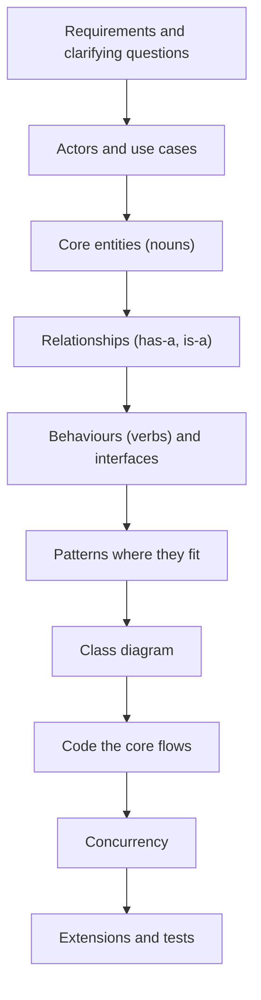

**The steps:**

1. **Requirements and clarifying questions.** Ask about scope, users, rules and limits. Write "in scope" and "out of scope" on the board.
2. **Actors and use cases.** Who uses the system (customer, admin, system timer)? What do they do (park, pay, exit)?
3. **Core entities.** Underline the nouns in the requirements: *lot, floor, spot, vehicle, ticket*. Each strong noun can be a class.
4. **Relationships.** Is it *has-a* (a lot has floors) or *is-a* (a car is a vehicle)? Prefer has-a (*composition*) over is-a (*inheritance*).
5. **Behaviours.** Underline the verbs: *park, pay, exit*. Put each verb on the class that owns the data it needs.
6. **Interfaces.** Wherever a rule can change (pricing, spot choice, payment), hide it behind an interface.
7. **Patterns.** Strategy for changeable rules, State for life cycles, Factory for creation, Observer for notifications.
8. **Class diagram.** 6–12 classes. Show fields only when they matter.
9. **Code the core flows.** Records for values, enums for fixed lists, sealed interfaces for "one of these kinds".
10. **Concurrency.** Find shared mutable data. Protect it with the smallest lock, an atomic, or a DB constraint.
11. **Extensions.** Show that a new feature is a new class. Mention tests (inject `Clock`, fake gateways).

**Nouns and verbs in practice:**

> "A customer **parks** a **car** at a **spot** on a **floor**. The **gate** gives a **ticket**. At exit the customer **pays** by **card**."

- Nouns: customer, car, spot, floor, gate, ticket, card. Most become classes. Some become fields (customer name).
- Verbs: park, give ticket, pay. They become methods: `ParkingLot.park(Vehicle)`, `Gate.issueTicket()`, `PaymentService.pay()`.

**Rules of thumb that make code look senior:**

- Value objects are `record`s (immutable): `Money`, `Position`, `Ticket`.
- Fixed lists are `enum`s: `SpotSize`, `Direction`, `Suit`.
- "One of these kinds" is a `sealed interface` with records. The compiler checks your `switch` covers all kinds.
- Rules that change are interfaces with small classes (Strategy). The main class does not change.
- Inject time (`Clock`), random (`Random`) and outside systems (`PaymentGateway`). Then tests are easy.
- Throw clear exceptions (`SeatNotAvailableException`). Do not return `null` for errors.

**Say this in the interview:**

> I follow the same steps every time: requirements, entities, relationships, behaviours, then patterns.
> I draw the class diagram, code the main flow, and then look for shared data that needs locking.
> Rules that can change go behind interfaces, so new features are new classes.

---

## UML in 10 minutes

**In one line:** UML is a shared picture language for software; in an interview you need only class, sequence, state and activity diagrams.

You do not need perfect UML in an interview. You need pictures that are clear and consistent.
The Mermaid code below draws on GitHub, so you can practise with it.

### Object-Oriented Basics

**In one line:** An object keeps its data and the actions on that data together.

**Story:** A TV remote is an object. Its data is the battery level and the current channel. Its actions are buttons.
You press "volume up". You do not open the remote to move wires. That is *encapsulation*.

The four pillars:

| Pillar | Simple meaning | Java example |
|---|---|---|
| Encapsulation | Hide the data, show only safe methods | `private int balance;` with `withdraw(amount)` that checks rules |
| Abstraction | Show what it does, hide how | `interface PaymentGateway { Receipt pay(Money m); }` |
| Inheritance | A child class reuses a parent class | `class SavingsAccount extends Account` |
| Polymorphism | One call, different behaviour per object | `vehicle.spotSize()` returns a different size for a car and a bike |

Two more ideas interviewers like:

- **Composition over inheritance:** a `Car` *has an* `Engine`. It does not *extend* `Engine`. Composition is easier to change.
- **Program to an interface:** fields and parameters use the interface type (`PricingStrategy`), not the concrete class.

Deeper notes are in [OOP and clean code](oop-clean-code.md).

### OO Analysis and Design

**In one line:** *Analysis* finds what the system must do; *design* decides which classes do it.

**Story:** An architect first talks to the family (analysis): "We need 3 bedrooms and a big kitchen."
Then he draws the plan (design): walls, doors and pipes. Building starts only after that.

- **OO Analysis (OOA):** find actors, use cases, entities and rules. Output: use case list, entity list.
- **OO Design (OOD):** give each entity a class, add interfaces, pick patterns, decide who calls whom. Output: class diagram, sequence diagrams.
- **OO Programming (OOP):** write the code.

In the interview, OOA is your first 10 minutes. OOD is the class diagram. OOP is the code.

### What is UML?

**In one line:** UML (Unified Modeling Language) is a standard set of diagram types to describe software.

UML has 14 diagram types in two groups. You need only four or five.

| Group | Diagram | Use it for | Used in interviews? |
|---|---|---|---|
| Structure | Class diagram | Classes and how they connect | Always |
| Structure | Object, component, deployment, package | Runtime objects, modules, servers | Rarely |
| Behaviour | Use case diagram | Actors and what they do | Sometimes, as a quick list |
| Behaviour | Sequence diagram | Who calls whom, in time order | Often |
| Behaviour | State machine diagram | Life cycle of one object | Often (orders, tickets, ATM) |
| Behaviour | Activity diagram | Steps of a process, like a flowchart | Sometimes |

### Use Case Diagrams

**In one line:** A use case diagram shows the actors (people or systems) and the things they can do.

**Story:** A cinema poster says what you can do there: buy tickets, buy popcorn, watch a movie.
It does not say how the projector works. A use case diagram is that poster for software.

Mermaid has no real use case diagram, so draw actors and use cases with a flowchart:

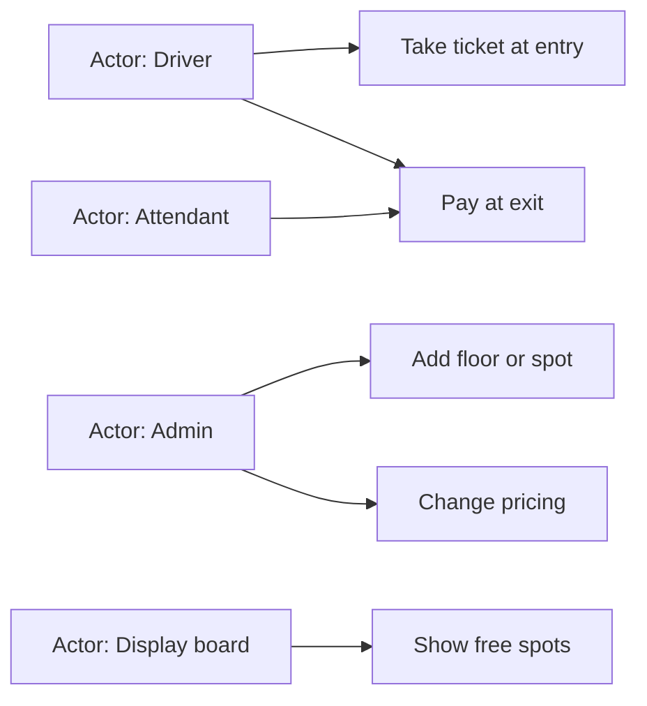

- An *actor* is outside the system: a person, another system, or a timer.
- A *use case* is one goal of an actor: "pay at exit".
- In UML, `<<include>>` means "always also does" (pay *includes* calculate fee). `<<extend>>` means "sometimes also does" ("lost ticket fine" *extends* pay, only when the ticket is lost; the arrow points from the extra case to the base case).

In an interview, a bullet list of actors and use cases is usually enough.

### Class Diagram

**In one line:** A class diagram shows classes, their fields and methods, and how they are connected.

A class box has three parts: name, fields, methods. `+` is public, `-` is private, `#` is protected.

The six connections you must know:

| Relation | Meaning | Example | Mermaid arrow |
|---|---|---|---|
| Association | "uses" or "knows about" | `Ticket` knows its `ParkingSpot` | `-->` |
| Aggregation | "has", but the part can live alone | `Team` has `Player`s; a player exists without the team | `o--` (empty diamond) |
| Composition | "owns"; the part dies with the whole | `Order` owns `OrderLine`s | `*--` (filled diamond) |
| Inheritance | "is a" (extends) | `Car` is a `Vehicle` | `<\|--` |
| Realization | "implements an interface" | `CardPayment` implements `PaymentMethod` | `<\|..` |
| Dependency | "uses for a moment" (parameter, local) | `Gate` uses `PricingStrategy` in one method | `..>` |

*Multiplicity* says how many: `1`, `0..1`, `*` (many), `1..*` (at least one).

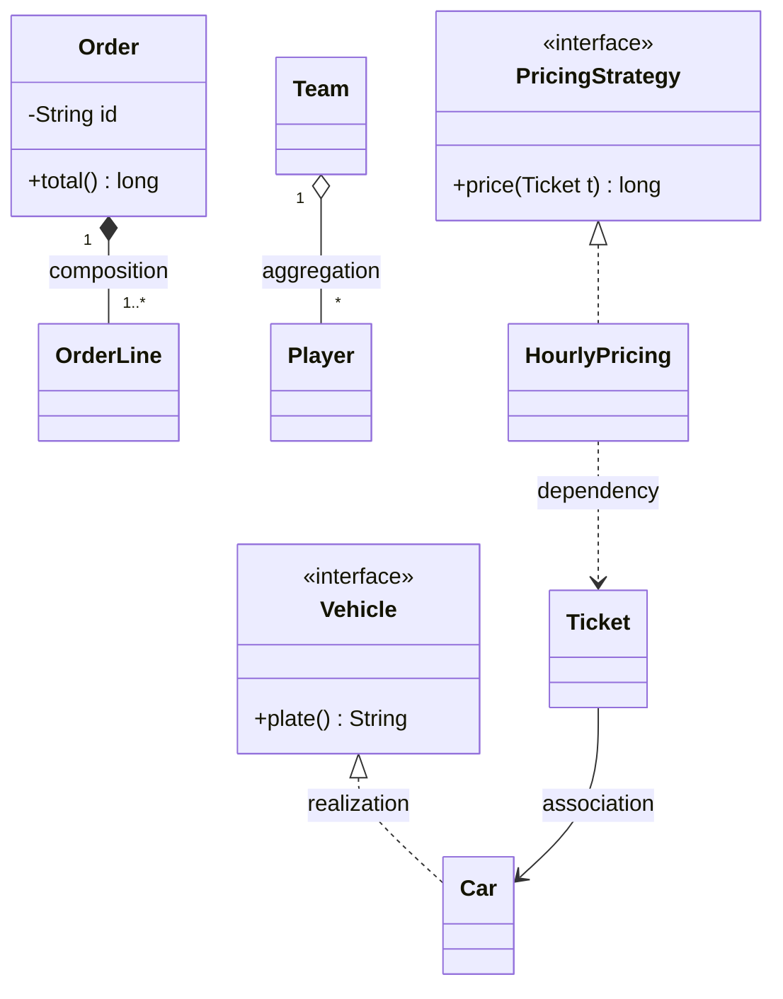

**Tips:**

- Draw the important 6–12 classes. Skip getters and setters.
- Mark interfaces with `<<interface>>` and enums with `<<enumeration>>`.
- If you are not sure between aggregation and composition, ask: "If I delete the whole, does the part die too?" Yes means composition.

### Sequence diagram

**In one line:** A sequence diagram shows the messages between objects in time order, top to bottom.

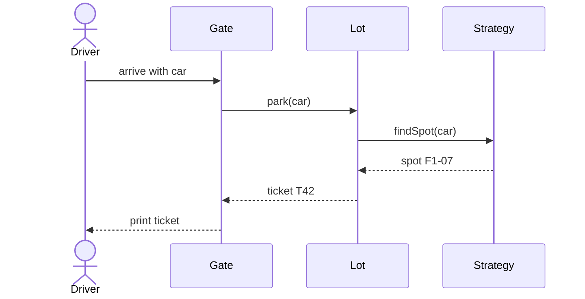

- Solid arrow `->>` is a call. Dashed arrow `-->>` is a reply.
- Use `alt` / `else` boxes for "if this, else that" (for example "spot found" vs "lot full").
- Draw it for the 1–2 main flows only. It proves your classes really work together.

### Activity Diagrams

**In one line:** An activity diagram shows the steps of a process with decisions, like a flowchart.

Use it when the *process* matters more than the objects. Example: the steps of an ATM cash withdrawal.

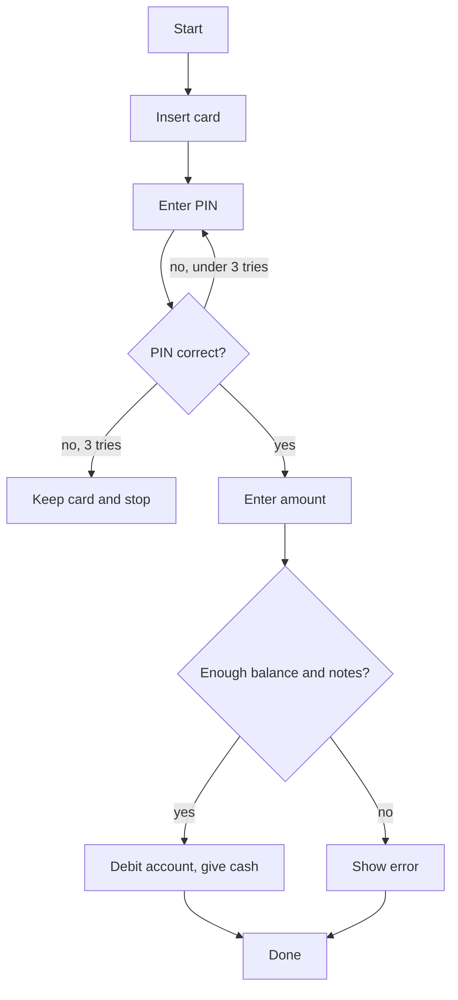

- Diamonds are decisions. Rectangles are actions.
- Real UML also has *swimlanes* (one column per actor) and *fork/join* bars for parallel steps.

**State machine diagrams** (not in the README list, but asked often) show one object's life cycle. Example: an order goes `CREATED → PAID → SHIPPED → DELIVERED`. You will see one in most case studies below.

**Say this in the interview:**

> I use a class diagram for structure, a sequence diagram for the main flow, and a state diagram for objects with a life cycle.
> Composition is a filled diamond: the part dies with the whole. Aggregation is an empty diamond: the part can live alone.
> I keep diagrams small and draw only what helps the discussion.

---
## Design a Parking Lot

**In one line:** Give each vehicle the right free spot, issue a ticket, charge by time at exit, and never give one spot to two cars.

**Story:** A mall has a parking building with 4 floors. At the entry gate, a machine prints a ticket and shows "Floor 2, spot 17".
Boards on each floor show "Car: 23 free". At exit you pay by time.
On Saturday evening, five gates issue tickets at the same second. Two cars must never get spot 17.

### Clarifying questions

| Question | Assumed answer |
|---|---|
| How many floors and gates? | Many floors, many entry and exit gates. |
| Which vehicles? | Bike, car, truck. Electric cars later. |
| Spot sizes? | Small, medium, large. A smaller vehicle may use a bigger spot. |
| How do we charge? | Per hour, rounded up, price depends on spot size. |
| Do we need reservations or monthly passes? | Not now. Design so we can add them. |
| Payment? | Cash or card at the exit gate. |
| Display boards? | Yes, free count per floor and size. |

### Requirements

**Functional:**

- Issue a ticket at entry and assign a free spot that fits the vehicle.
- Calculate the fee at exit and free the spot.
- Show free spots per floor and size on display boards.
- Admin can add floors, spots and change prices.

**Out of scope:** reservations, monthly passes, number plate cameras, valet parking.

### Core entities and relationships

- `ParkingLot` has many `Floor`s (composition). A `Floor` has many `ParkingSpot`s (composition).
- `Vehicle` is a sealed interface: `Bike`, `Car`, `Truck`.
- `Ticket` links a vehicle, a spot and the entry time.
- `EntryGate` and `ExitGate` talk to the lot. `DisplayBoard` listens to spot changes.
- `SpotAllocationStrategy` decides which spot. `PricingStrategy` decides the fee.

### Class diagram

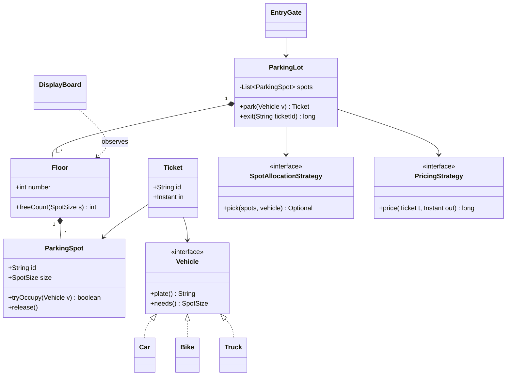

### Key flows

**Park a car:**

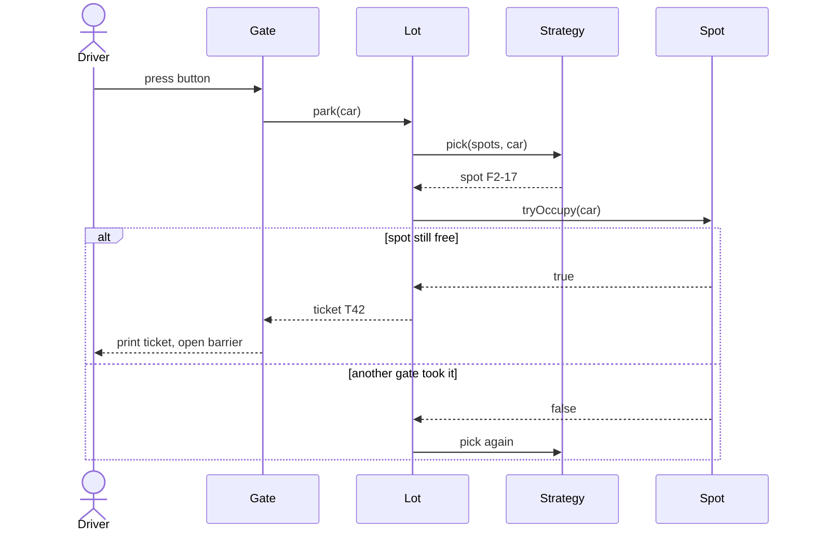

**Ticket life cycle:**

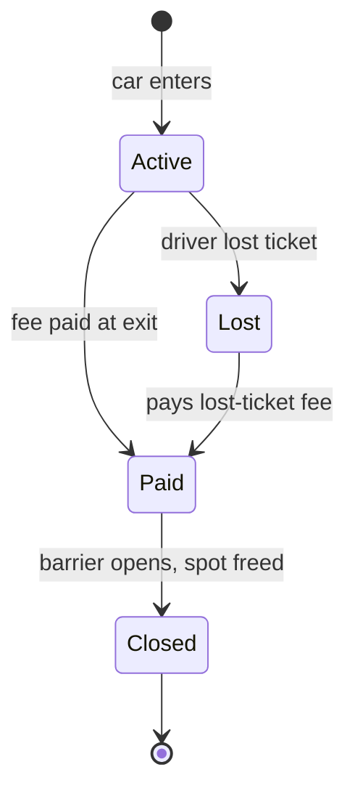

### Patterns used and why

| Pattern | Where | Why |
|---|---|---|
| Strategy | `SpotAllocationStrategy`, `PricingStrategy` | Weekend pricing or "nearest to lift" is a new class, no edits. |
| Sealed interface + records | `Vehicle` | The compiler knows all vehicle types. Adding `ElectricCar` shows every place to update. |
| Factory | `VehicleFactory.from(type, plate)` | Gates create vehicles from scanner input in one place. |
| Observer | `DisplayBoard` listens to spot events | Boards update without the lot knowing about boards. |
| Singleton (careful) | One `ParkingLot` per building | Use one Spring bean, not a static `getInstance()`. Static singletons are hard to test. |

### Core Java code

Vehicles and spots. The spot uses an `AtomicReference`, so taking it is one atomic step:

```java
enum SpotSize { SMALL, MEDIUM, LARGE }

sealed interface Vehicle permits Bike, Car, Truck {
    String plate();
    SpotSize needs();
}
record Bike(String plate) implements Vehicle { public SpotSize needs() { return SpotSize.SMALL; } }
record Car(String plate) implements Vehicle { public SpotSize needs() { return SpotSize.MEDIUM; } }
record Truck(String plate) implements Vehicle { public SpotSize needs() { return SpotSize.LARGE; } }

final class ParkingSpot {
    final String id;
    final int floor;
    final SpotSize size;
    private final AtomicReference<Vehicle> parked = new AtomicReference<>();

    ParkingSpot(String id, int floor, SpotSize size) { this.id = id; this.floor = floor; this.size = size; }

    boolean fits(Vehicle v)      { return size.compareTo(v.needs()) >= 0; } // a bike may use a car spot
    boolean isFree()             { return parked.get() == null; }
    boolean tryOccupy(Vehicle v) { return parked.compareAndSet(null, v); }  // only one thread wins
    void release()               { parked.set(null); }
}
```

The two strategies. Each one is small and easy to test alone:

```java
interface SpotAllocationStrategy {
    Optional<ParkingSpot> pick(List<ParkingSpot> spots, Vehicle v);
}

// Smallest spot that fits, then lowest floor. Keeps large spots free for trucks.
final class BestFitLowestFloor implements SpotAllocationStrategy {
    public Optional<ParkingSpot> pick(List<ParkingSpot> spots, Vehicle v) {
        return spots.stream()
                .filter(ParkingSpot::isFree)
                .filter(s -> s.fits(v))
                .min(Comparator.comparing((ParkingSpot s) -> s.size).thenComparingInt(s -> s.floor));
    }
}

interface PricingStrategy { long price(Ticket t, Instant out); }

final class HourlyPricing implements PricingStrategy {
    private final Map<SpotSize, Long> perHour = Map.of(
            SpotSize.SMALL, 2_000L, SpotSize.MEDIUM, 4_000L, SpotSize.LARGE, 10_000L); // paise
    public long price(Ticket t, Instant out) {
        long minutes = Duration.between(t.in(), out).toMinutes();
        long hours = Math.max(1, (minutes + 59) / 60);              // round up, minimum 1 hour
        return hours * perHour.get(t.spot().size);
    }
}
```

The lot ties them together. It retries when another gate wins the race for the same spot:

```java
record Ticket(String id, Vehicle vehicle, ParkingSpot spot, Instant in) {}

final class ParkingLot {
    private final List<ParkingSpot> spots;
    private final SpotAllocationStrategy allocation;
    private final PricingStrategy pricing;
    private final Clock clock;                                      // injected, so tests control time
    private final Map<String, Ticket> active = new ConcurrentHashMap<>();

    ParkingLot(List<ParkingSpot> spots, SpotAllocationStrategy a, PricingStrategy p, Clock clock) {
        this.spots = List.copyOf(spots); this.allocation = a; this.pricing = p; this.clock = clock;
    }

    Ticket park(Vehicle v) {
        for (int attempt = 0; attempt < 5; attempt++) {
            ParkingSpot spot = allocation.pick(spots, v)
                    .orElseThrow(() -> new IllegalStateException("No free spot for " + v.needs()));
            if (spot.tryOccupy(v)) {                                // false if another gate took it first
                Ticket t = new Ticket(UUID.randomUUID().toString(), v, spot, clock.instant());
                active.put(t.id(), t);
                return t;
            }
        }
        throw new IllegalStateException("Lot is very busy, please retry");
    }
```

Exit removes the ticket first, so a copied ticket cannot open the barrier twice:

```java
    long exit(String ticketId) {
        Ticket t = active.remove(ticketId);                         // atomic: one ticket exits once
        if (t == null) throw new IllegalArgumentException("Unknown or already used ticket");
        t.spot().release();
        return pricing.price(t, clock.instant());
    }
}
```

### Concurrency

- **The race:** gate A and gate B both run `pick()` and get spot F2-17. Both try to take it.
- **The fix:** `compareAndSet(null, car)` is atomic. Only one gate wins. The loser picks again.
- **Same ticket at two exits:** `ConcurrentHashMap.remove()` is atomic, so only one exit gets the ticket.
- **At scale:** scanning all spots is O(n). Keep one free-spot queue per size (`ConcurrentLinkedDeque<ParkingSpot>`). `poll()` is atomic and O(1).
- **With a database:** `UPDATE spot SET vehicle = ? WHERE id = ? AND vehicle IS NULL`. If 0 rows changed, someone else won. See [optimistic vs pessimistic locking](databases.md#optimistic-vs-pessimistic-locking).

### Extensions the interviewer will ask

- **Electric cars with chargers:** add `ElectricCar` and a spot feature `hasCharger`. A new strategy prefers charger spots.
- **Reservations:** add a `Reservation` with a time window; the spot is "reserved" for that window.
- **Monthly pass:** a `PricingStrategy` that returns 0 for pass holders (or a decorator around the hourly price).
- **Lost ticket:** look up the active ticket by plate number and charge a fixed fine.
- **Display boards:** spots publish `SpotFreed` and `SpotTaken` events. Boards keep counters (Observer).

**Say this in the interview:**

> I model vehicles as a sealed interface and spots with a size, so the smallest fitting spot is chosen.
> Spot choice and pricing are strategies, so new rules are new classes.
> Two gates can pick the same spot, so taking a spot is an atomic compare-and-set, and the loser retries.
> At scale I keep a free-spot queue per size, and in a database I use a conditional update.

---

## Design a Library Management System

**In one line:** Members search the catalog, borrow copies with limits and due dates, reserve books that are out, and pay fines when late.

**Story:** A college library has 3 copies of "Clean Code". All three are borrowed.
Priya reserves it. When Rahul returns a copy, the librarian keeps it aside for Priya and sends her an SMS.
Priya has 3 days to collect it. Rahul pays 30 rupees because he is 3 days late.

### Clarifying questions

| Question | Assumed answer |
|---|---|
| Books or also magazines and DVDs? | Books now. Other media later. |
| Many copies of one book? | Yes. A `Book` (title, ISBN) has many `BookCopy` items (each with a barcode). |
| Borrow limits? | Max 5 copies per member, 14 days each. |
| Fines? | 10 rupees per late day. |
| Reservations? | Yes, a queue per book. First come, first served. |
| Who uses it? | Members (search, borrow, reserve) and librarians (add books, issue, return). |
| Search by? | Title, author, subject, ISBN. |

### Requirements

**Functional:**

- Search the catalog by title, author, subject.
- Check out a copy (limit 5, due in 14 days) and return it.
- Reserve a book when all copies are out. Notify the next member when a copy comes back.
- Calculate fines for late returns.
- Librarians add books and copies, and block members.

**Out of scope:** e-books, inter-library loans, online payment of fines.

### Core entities and relationships

- `Book` is the title (ISBN, author). `BookCopy` is one physical copy with a barcode. One book has many copies.
- `Member` and `Librarian` are both `Person` types with an `Account`.
- `Loan` links a member, a copy and the due date.
- `Reservation` is a member waiting for a book (not a copy).
- `Catalog` keeps search indexes. `FinePolicy` calculates fines. `Notifier` sends SMS or email.

### Class diagram

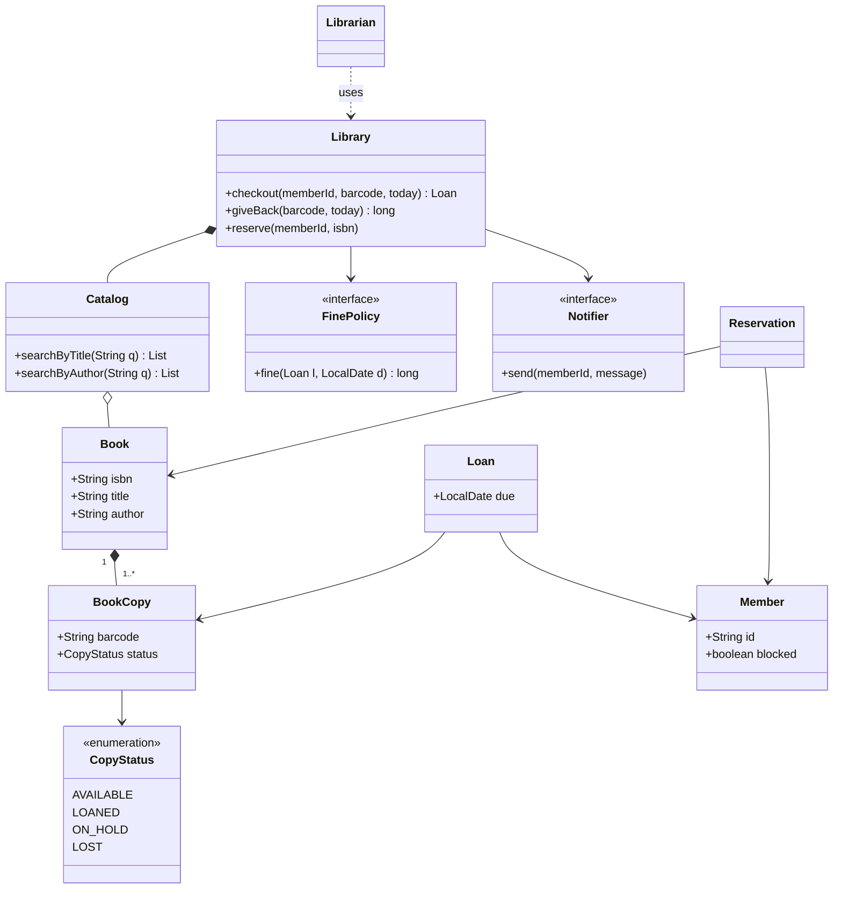

### Key flows

**Return a book that someone reserved:**

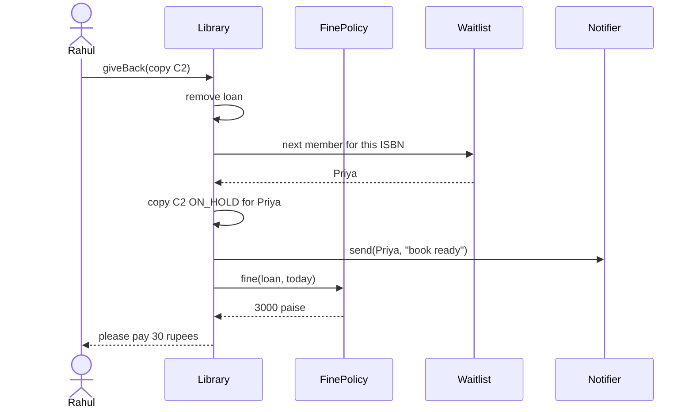

**Book copy life cycle:**

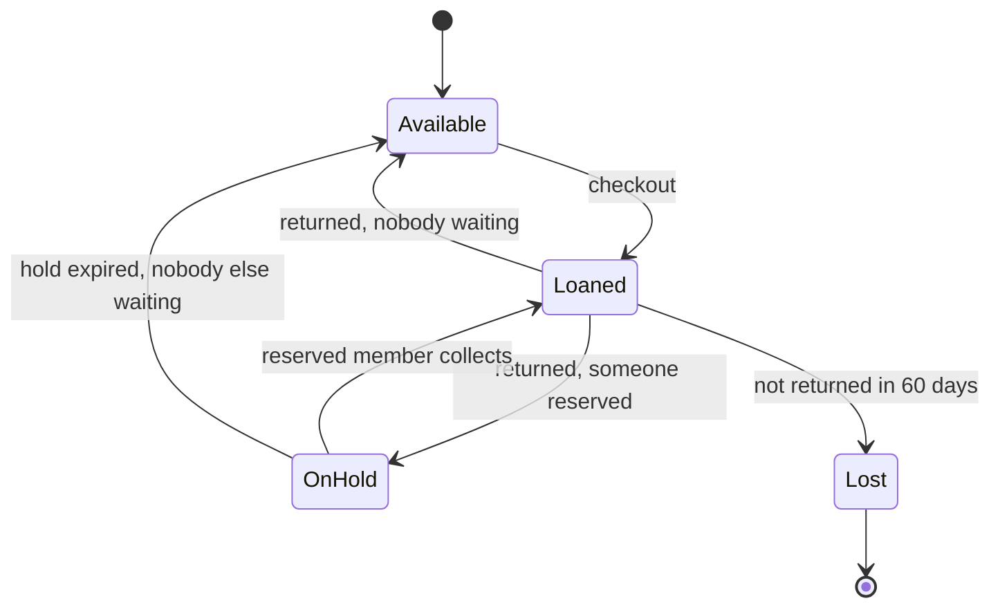

### Patterns used and why

| Pattern | Where | Why |
|---|---|---|
| Strategy | `FinePolicy` | Students and staff can have different fine rules. |
| Observer | `Notifier` on return | Reserving members are told without `Library` knowing about SMS. |
| Facade | `Library` | One simple entry point for the librarian screen. |
| Repository | `BookRepository`, `LoanRepository` (in a real app) | Storage can change without touching rules. |

### Core Java code

Values and the fine rule. `Book` and `Loan` are records because they never change:

```java
enum CopyStatus { AVAILABLE, LOANED, ON_HOLD, LOST }

record Book(String isbn, String title, String author, String subject) {}
record Loan(String barcode, String memberId, LocalDate from, LocalDate due) {}

final class BookCopy {
    final String barcode;
    final Book book;
    CopyStatus status = CopyStatus.AVAILABLE;
    String heldFor;                                  // member id while ON_HOLD
    BookCopy(String barcode, Book book) { this.barcode = barcode; this.book = book; }
}

interface FinePolicy { long fine(Loan loan, LocalDate returnedOn); }
interface Notifier { void send(String memberId, String message); }

final class PerDayFine implements FinePolicy {
    public long fine(Loan loan, LocalDate returnedOn) {
        long lateDays = returnedOn.toEpochDay() - loan.due().toEpochDay();
        return Math.max(0, lateDays) * 1_000;        // 10 rupees a day, in paise
    }
}
```

Checkout checks three rules: the copy is free (or held for this member), and the member is under the limit:

```java
final class Library {
    static final int MAX_BOOKS = 5, LOAN_DAYS = 14;
    private final Map<String, BookCopy> copies = new HashMap<>();
    private final Map<String, Loan> loans = new HashMap<>();             // barcode -> loan
    private final Map<String, Deque<String>> waitlist = new HashMap<>();  // isbn -> member ids
    private final FinePolicy finePolicy;
    private final Notifier notifier;

    Library(FinePolicy f, Notifier n) { finePolicy = f; notifier = n; }

    synchronized void addCopy(BookCopy c) { copies.put(c.barcode, c); }

    synchronized Loan checkout(String memberId, String barcode, LocalDate today) {
        BookCopy c = copies.get(barcode);
        if (c == null) throw new IllegalArgumentException("No such copy");
        boolean heldForMe = c.status == CopyStatus.ON_HOLD && memberId.equals(c.heldFor);
        if (c.status != CopyStatus.AVAILABLE && !heldForMe) throw new IllegalStateException("Copy not available");
        long count = loans.values().stream().filter(l -> l.memberId().equals(memberId)).count();
        if (count >= MAX_BOOKS) throw new IllegalStateException("Limit of " + MAX_BOOKS + " reached");
        Loan loan = new Loan(barcode, memberId, today, today.plusDays(LOAN_DAYS));
        c.status = CopyStatus.LOANED;
        c.heldFor = null;
        loans.put(barcode, loan);
        return loan;
    }
```

Return hands the copy to the next person in the queue, then calculates the fine:

```java
    synchronized long giveBack(String barcode, LocalDate today) {
        Loan loan = loans.remove(barcode);
        if (loan == null) throw new IllegalStateException("Copy was not on loan");
        BookCopy c = copies.get(barcode);
        Deque<String> queue = waitlist.getOrDefault(c.book.isbn(), new ArrayDeque<>());
        String next = queue.pollFirst();
        if (next == null) {
            c.status = CopyStatus.AVAILABLE;
        } else {
            c.status = CopyStatus.ON_HOLD;                                    // keep it for the next member
            c.heldFor = next;
            notifier.send(next, c.book.title() + " is ready. Collect in 3 days.");
        }
        return finePolicy.fine(loan, today);
    }

    synchronized void reserve(String memberId, String isbn) {
        waitlist.computeIfAbsent(isbn, k -> new ArrayDeque<>()).addLast(memberId); // first come, first served
    }
}
```

### Concurrency

- Two librarians at two desks can issue the last copy at the same second.
- Here one `synchronized` lock guards the whole library. It is simple and correct, and a library has low traffic.
- **Better at scale:** lock per copy, or store copies in a database with a `version` column (optimistic locking). `UPDATE copy SET status='LOANED', version=version+1 WHERE barcode=? AND version=?`.
- The member limit needs care too: count and insert in the same transaction, or keep a `loan_count` column with a check `loan_count <= 5`.
- Send notifications *after* the state change is saved (or through an outbox), so a failed SMS never undoes a return.

### Extensions the interviewer will ask

- **Hold expiry:** a scheduled job moves `ON_HOLD` copies older than 3 days to the next member or back to `AVAILABLE`.
- **Different rules for students and staff:** `MemberType` with its own limit and `FinePolicy` (Strategy).
- **DVDs and magazines:** `Book` becomes one kind of `LibraryItem` (sealed interface: `Book`, `Dvd`, `Magazine`).
- **Search at scale:** move the catalog to a full-text index (Elasticsearch or PostgreSQL full-text search).
- **Renewals:** allowed only if nobody is in the waitlist for that ISBN.

**Say this in the interview:**

> I separate `Book`, the title, from `BookCopy`, the physical item with a barcode.
> A `Loan` links a member and a copy, and a waitlist per ISBN handles reservations.
> On return, the copy goes on hold for the next member and we notify them.
> Fine rules are a strategy, and checkout is guarded by a lock or a versioned database update.

---

## Design Amazon - Online Shopping System

**In one line:** Customers search products, add them to a cart, place an order that reserves stock and takes payment, and track it until delivery.

**Story:** Anjali adds a phone and a cover to her cart and clicks "Buy now".
Only one phone is left. Vikram clicks "Buy now" on the same phone at the same second.
The system must sell it to one of them, take payment only once, and put the cover back on the shelf if the phone part fails.

The distributed version (order service, Kafka, saga) is in [Amazon order processing (HLD)](system-design/amazon-order-processing.md).

### Clarifying questions

| Question | Assumed answer |
|---|---|
| Who uses it? | Guests (browse), members (buy), sellers (list products), admins. |
| Many sellers? | Yes, but stock is per product SKU for this round. |
| Payment types? | Card, UPI, cash on delivery. |
| What happens if payment fails? | Order is cancelled, stock is released. |
| Partial orders? | No. All lines or nothing. |
| Returns and refunds? | Return after delivery, yes. Refund details are out of scope. |

### Requirements

**Functional:**

- Search products by name and category. See price, rating and stock.
- Add, remove and change quantity in a cart.
- Checkout: reserve stock, take payment, create the order.
- Track order status: created, paid, shipped, delivered, cancelled, returned.
- Send notifications on status change.

**Out of scope:** recommendations, seller payouts, coupons (mentioned as an extension), search ranking.

### Core entities and relationships

- `Customer` has one `Cart`. A cart has many `CartItem`s.
- `Product` (SKU, name, price) belongs to a `Category`. `Inventory` keeps stock per SKU.
- `Order` owns many `OrderLine`s (composition). Each line copies the price at the time of order.
- `PaymentMethod` is sealed: `Card`, `Upi`, `CashOnDelivery`. `Shipment` tracks delivery.

### Class diagram

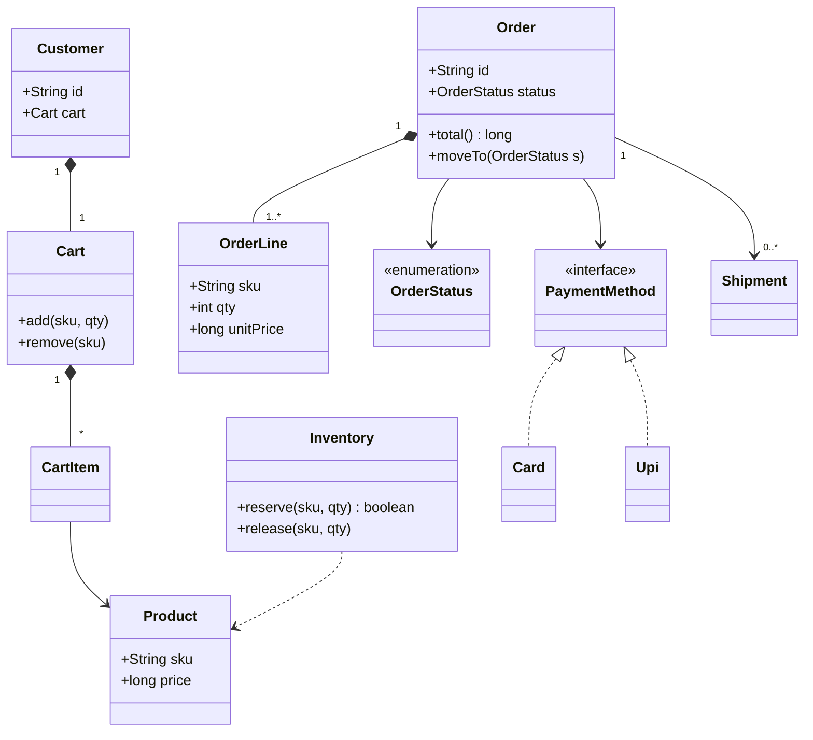

### Key flows

**Checkout:**

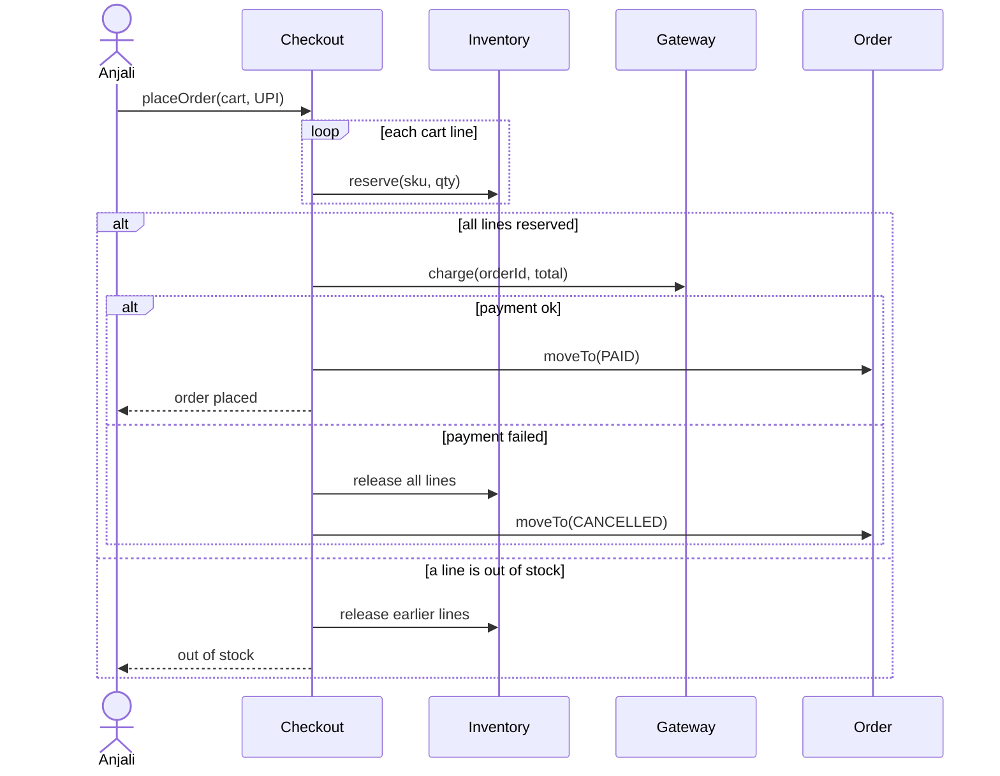

**Order life cycle:**

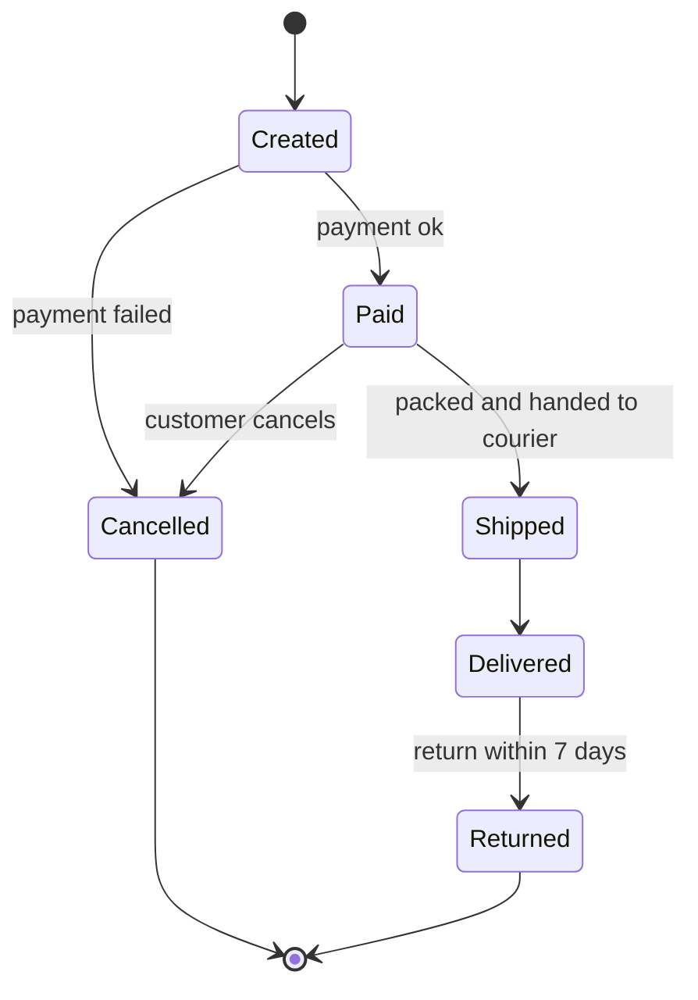

### Patterns used and why

| Pattern | Where | Why |
|---|---|---|
| State (as enum rules) | `OrderStatus.canMoveTo` | Illegal jumps like `CREATED → DELIVERED` throw an error. |
| Strategy | `PaymentMethod` handling, shipping cost, discounts | New payment type = new record and one `switch` case. |
| Observer | Status change → email, SMS, push | Notifications do not slow down checkout. |
| Facade | `CheckoutService` | One method hides inventory, payment and order steps. |
| Saga (compensation) | Release stock when payment fails | No distributed transaction needed. |

### Core Java code

Order status rules and payment types. The pattern `switch` must cover every sealed type, or it does not compile:

```java
enum OrderStatus {
    CREATED, PAID, SHIPPED, DELIVERED, CANCELLED, RETURNED;

    boolean canMoveTo(OrderStatus next) {
        return switch (this) {
            case CREATED   -> next == PAID || next == CANCELLED;
            case PAID      -> next == SHIPPED || next == CANCELLED;
            case SHIPPED   -> next == DELIVERED;
            case DELIVERED -> next == RETURNED;
            case CANCELLED, RETURNED -> false;                  // final states
        };
    }
}

sealed interface PaymentMethod permits Card, Upi, CashOnDelivery {}
record Card(String token, String last4) implements PaymentMethod {}
record Upi(String vpa) implements PaymentMethod {}
record CashOnDelivery() implements PaymentMethod {}

final class Payments {
    static String describe(PaymentMethod m) {
        return switch (m) {                                     // no default: compiler checks all types
            case Card c -> "Card ending " + c.last4();
            case Upi u -> "UPI " + u.vpa();
            case CashOnDelivery cod -> "Cash on delivery";
        };
    }
}
```

Order and inventory. `computeIfPresent` runs atomically for one key, so two buyers cannot both take the last phone:

```java
record OrderLine(String sku, int qty, long unitPrice) { long total() { return qty * unitPrice; } }

final class Order {
    final String id, customerId;
    final List<OrderLine> lines;
    private OrderStatus status = OrderStatus.CREATED;
    Order(String id, String customerId, List<OrderLine> lines) {
        this.id = id; this.customerId = customerId; this.lines = List.copyOf(lines);
    }
    long total() { return lines.stream().mapToLong(OrderLine::total).sum(); }
    synchronized OrderStatus status() { return status; }
    synchronized void moveTo(OrderStatus next) {
        if (!status.canMoveTo(next)) throw new IllegalStateException(status + " -> " + next + " not allowed");
        status = next;
    }
}
```

```java
final class Inventory {
    private final ConcurrentHashMap<String, Integer> stock = new ConcurrentHashMap<>();
    void add(String sku, int qty) { stock.merge(sku, qty, Integer::sum); }
    boolean reserve(String sku, int qty) {
        boolean[] ok = {false};
        stock.computeIfPresent(sku, (k, have) -> {              // atomic for this key
            if (have < qty) return have;
            ok[0] = true;
            return have - qty;
        });
        return ok[0];
    }
    void release(String sku, int qty) { stock.merge(sku, qty, Integer::sum); }
}
```

Checkout with compensation (undo earlier steps when a later step fails):

```java
interface PaymentGateway { boolean charge(String orderId, long amount, PaymentMethod method); }

final class CheckoutService {
    private final Inventory inventory;
    private final PaymentGateway gateway;
    CheckoutService(Inventory i, PaymentGateway g) { inventory = i; gateway = g; }

    Order placeOrder(String customerId, List<OrderLine> cart, PaymentMethod method) {
        List<OrderLine> reserved = new ArrayList<>();
        for (OrderLine line : cart) {
            if (!inventory.reserve(line.sku(), line.qty())) {
                reserved.forEach(r -> inventory.release(r.sku(), r.qty()));  // undo earlier lines
                throw new IllegalStateException("Out of stock: " + line.sku());
            }
            reserved.add(line);
        }
        Order order = new Order(UUID.randomUUID().toString(), customerId, cart);
        if (gateway.charge(order.id, order.total(), method)) {          // order id = idempotency key
            order.moveTo(OrderStatus.PAID);
        } else {
            reserved.forEach(r -> inventory.release(r.sku(), r.qty()));
            order.moveTo(OrderStatus.CANCELLED);
        }
        return order;
    }
}
```

### Concurrency

- **Last item:** `computeIfPresent` locks only that key's bucket in the map (in practice, one SKU). Two buyers of different products almost never wait for each other.
- **In a database:** `UPDATE inventory SET qty = qty - ? WHERE sku = ? AND qty >= ?`. One row changed means success.
- **Double click on "Pay":** use the order id as an *idempotency key* (a unique id so the gateway charges once).
- **Slow payment:** reserve stock with an expiry (like a seat hold). A job releases reservations older than 15 minutes.
- **Prices change during checkout:** `OrderLine` copies the price at order time, so the order never changes later.

### Extensions the interviewer will ask

- **Coupons and discounts:** a `DiscountRule` interface (Strategy), or a chain of rules applied in order (Chain of Responsibility).
- **Many sellers for one product:** add `Offer` (seller, price, stock). Inventory is per offer.
- **Split shipments:** one order has many `Shipment`s, each with some lines.
- **Order history and search:** read models built from order events (CQRS, *command query responsibility segregation*, meaning separate write and read models).
- **Product reviews and ratings:** `Review` linked to a delivered `OrderLine`, so only buyers can review.

**Say this in the interview:**

> I keep the order life cycle in an enum with allowed transitions, so illegal jumps fail fast.
> Checkout reserves stock line by line with an atomic per-SKU update, and undoes earlier lines if one fails.
> Payment uses the order id as an idempotency key, and a failed payment releases the stock.
> Payment types are a sealed interface, so the compiler checks that every type is handled.

---
## Design Stack Overflow

**In one line:** Members ask questions, post answers and comments, vote, earn reputation, and the asker accepts one answer.

**Story:** Arjun asks "Why is my HashMap slow?" and adds tags `java` and `hashmap`.
Three people answer. Others vote. Arjun accepts the best answer, and its author gets reputation points.
A moderator closes a duplicate question. Arjun cannot vote on his own question.

### Clarifying questions

| Question | Assumed answer |
|---|---|
| Who uses it? | Guests (read), members (ask, answer, vote), moderators (close, delete). |
| Can users change a vote? | Yes. One vote per user per post. The new vote replaces the old one. |
| Reputation rules? | Upvote +10, downvote −2, accepted answer +15. |
| Comments? | On questions and answers. No votes on comments in this round. |
| Bounties and badges? | Mention as extensions. |
| Search? | By tag and text. |

### Requirements

**Functional:**

- Ask a question with tags. Answer a question. Comment on both.
- Vote up or down on questions and answers. Change a vote.
- Accept one answer per question.
- Reputation changes with votes and accepts.
- Moderators close, reopen and delete questions.

**Out of scope:** search ranking, spam detection, chat, edits history.

### Core entities and relationships

- `Post` is the shared parent of `Question` and `Answer` (both have a body, author, votes and comments).
- A `Question` has many `Answer`s, many `Tag`s and at most one accepted answer.
- `Member` has a reputation and badges. `Moderator` is a member with more rights.
- `Vote` is one member's up or down on one post.

### Class diagram

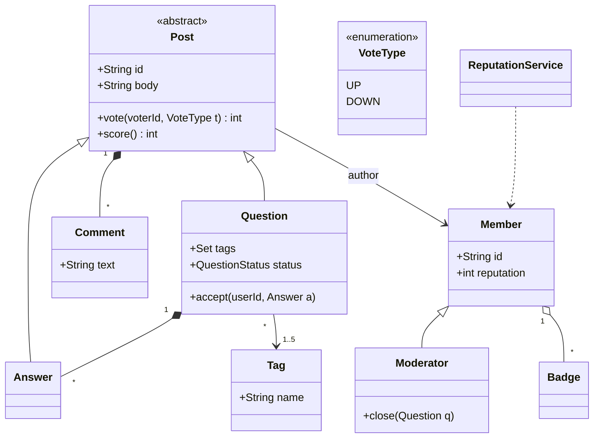

### Key flows

**Vote on an answer:**

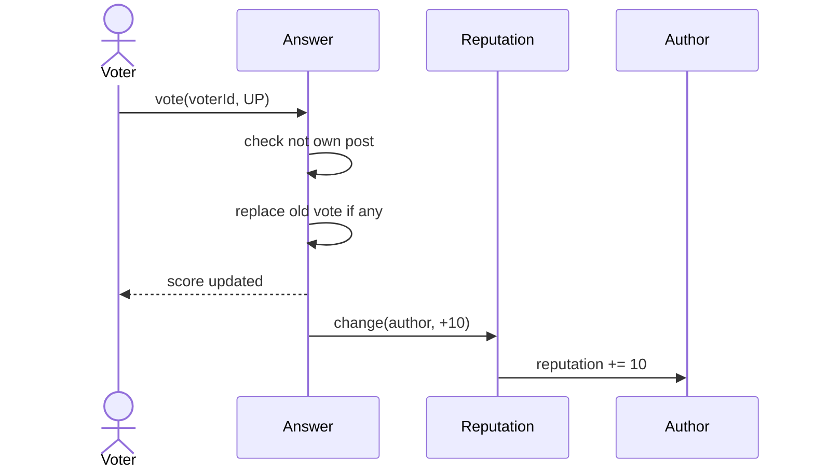

**Question life cycle:**

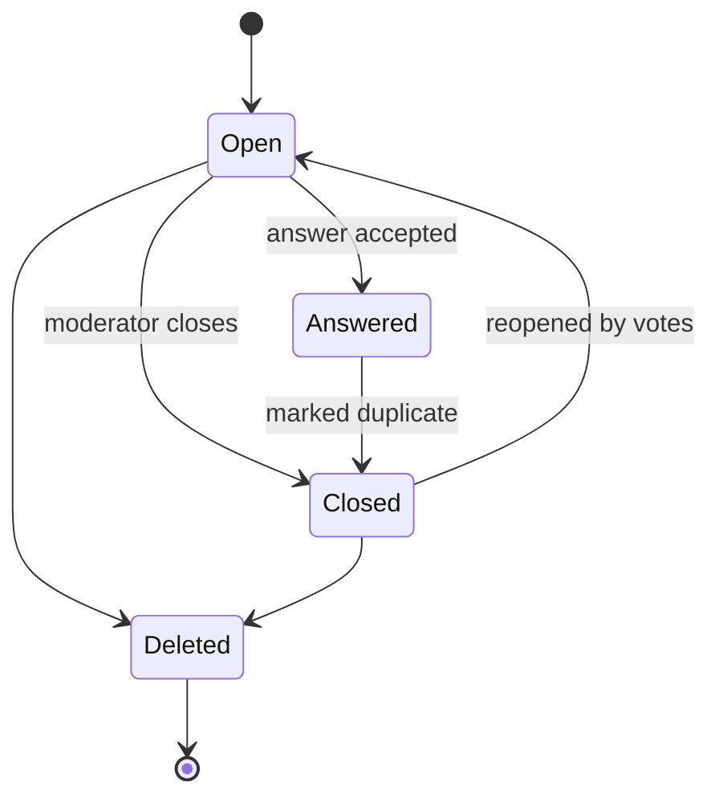

### Patterns used and why

| Pattern | Where | Why |
|---|---|---|
| Template / inheritance | `Post` with `Question` and `Answer` | Votes and comments are shared, points rules differ. |
| Observer | Vote and accept events → `ReputationService`, badges, notifications | Post code does not know about badges. |
| Strategy | Reputation rules | Rules change over time without editing posts. |
| Composite (light) | A question holds answers, both hold comments | One way to render the tree. |

### Core Java code

A sealed abstract `Post`. One vote per user is just a map from voter id to vote:

```java
enum VoteType { UP, DOWN }
enum QuestionStatus { OPEN, CLOSED, DELETED }

abstract sealed class Post permits Question, Answer {
    final String id, authorId, body;
    private final Map<String, VoteType> votes = new ConcurrentHashMap<>(); // voterId -> vote

    Post(String id, String authorId, String body) { this.id = id; this.authorId = authorId; this.body = body; }

    /** Records the vote and returns the reputation change for the author. */
    int vote(String voterId, VoteType type) {
        if (voterId.equals(authorId)) throw new IllegalArgumentException("Cannot vote on your own post");
        VoteType old = votes.put(voterId, type);                 // a new vote replaces the old one
        return points(type) - (old == null ? 0 : points(old));
    }
    int score() { return votes.values().stream().mapToInt(v -> v == VoteType.UP ? 1 : -1).sum(); }
    int points(VoteType t) { return t == VoteType.UP ? 10 : -2; }
}
```

Question and answer. Only the asker can accept, and only an answer to this question:

```java
final class Question extends Post {
    final Set<String> tags;
    private final List<Answer> answers = new CopyOnWriteArrayList<>();
    private QuestionStatus status = QuestionStatus.OPEN;
    private Answer accepted;

    Question(String id, String authorId, String body, Set<String> tags) { super(id, authorId, body); this.tags = Set.copyOf(tags); }

    Answer answer(String id, String userId, String body) {
        if (status != QuestionStatus.OPEN) throw new IllegalStateException("Question is " + status);
        Answer a = new Answer(id, userId, body, this);
        answers.add(a);
        return a;
    }
    synchronized void accept(String userId, Answer a) {
        if (!userId.equals(authorId)) throw new IllegalStateException("Only the asker can accept");
        if (a.question != this) throw new IllegalArgumentException("Answer belongs to another question");
        accepted = a;                                            // the author of a gets +15 via an event
    }
    synchronized void close() { status = QuestionStatus.CLOSED; }
}

final class Answer extends Post {
    final Question question;
    Answer(String id, String authorId, String body, Question q) { super(id, authorId, body); question = q; }
}
```

### Concurrency

- Many people vote at once. `ConcurrentHashMap.put` is atomic per voter, so one voter has one vote.
- Reputation is a hot counter for famous users. Use `ConcurrentHashMap.merge(userId, delta, Integer::sum)` or an atomic DB update `SET rep = rep + ?`.
- In a database, a unique key `(post_id, voter_id)` on the vote table stops double votes, even across servers.
- Score is read far more than written. Store a cached `score` column and update it in the same transaction as the vote.

### Extensions the interviewer will ask

- **Bounty:** a `Bounty` (amount, expiry) on a question. Reputation is moved when an answer is awarded.
- **Badges:** listeners on events ("10 accepted answers" → badge). Badge rules are strategies.
- **Duplicate detection and search:** full-text index on title and body, plus tag filters.
- **Privileges by reputation:** "can downvote at 125". A `Privilege` enum with a minimum reputation.

**Say this in the interview:**

> Question and answer share a sealed `Post` parent with votes and comments.
> One vote per user is a map from voter to vote, so changing a vote replaces the old one.
> Reputation changes are events, so badges and notifications are listeners.
> In the database, a unique key on post and voter stops double voting.

---

## Design a Movie Ticket Booking System

**In one line:** Users pick seats for a show, the seats are held for a few minutes while they pay, and a seat is never sold twice.

**Story:** At an old cinema counter, the clerk marks your seats G7 and G8 with a pencil and says "pay in 10 minutes".
If you pay, he marks them in ink. If you walk away, he erases the pencil mark.
Our system is the same counter, but thousands of people point at the same seat chart at the same second.

The large-scale version (Redis holds, queues for big concerts) is in [BookMyShow (HLD)](system-design/bookmyshow-ticket-booking.md).

### Clarifying questions

| Question | Assumed answer |
|---|---|
| Movies only? | Movies in cinemas. Many cinemas, many screens, many shows. |
| Does the user pick exact seats? | Yes, from a seat map. |
| How long is a hold? | 10 minutes. |
| Max seats per booking? | 10. |
| Seat types and prices? | Regular, premium, recliner. Price per seat type per show. |
| Cancellation? | Allowed until 2 hours before the show, with a fee. |
| Payment failure? | Seats are released at once. |

### Requirements

**Functional:**

- Browse cities, cinemas, movies and shows.
- See the seat map with free, held and booked seats.
- Hold up to 10 seats for 10 minutes. All or nothing.
- Pay. On success the seats become booked. On failure or timeout they become free.
- Cancel a booking and get a refund.

**Out of scope:** food orders, offers, reviews, dynamic pricing.

### Core entities and relationships

- `Cinema` has many `Screen`s. A `Screen` has many `Seat`s (fixed layout).
- `Movie` is shown in many `Show`s. A `Show` is one movie on one screen at one time.
- `ShowSeats` keeps the state of each seat *for one show*: free, held or booked. This is the key class.
- `Booking` links a user, a show and seats. `Payment` belongs to a booking.

### Class diagram

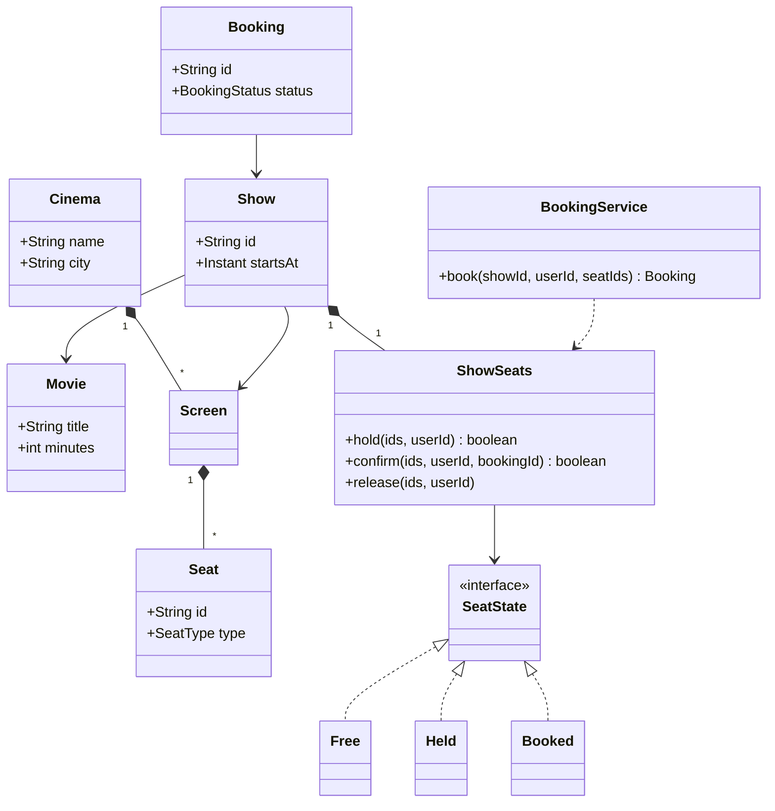

### Key flows

**Hold, pay, confirm:**

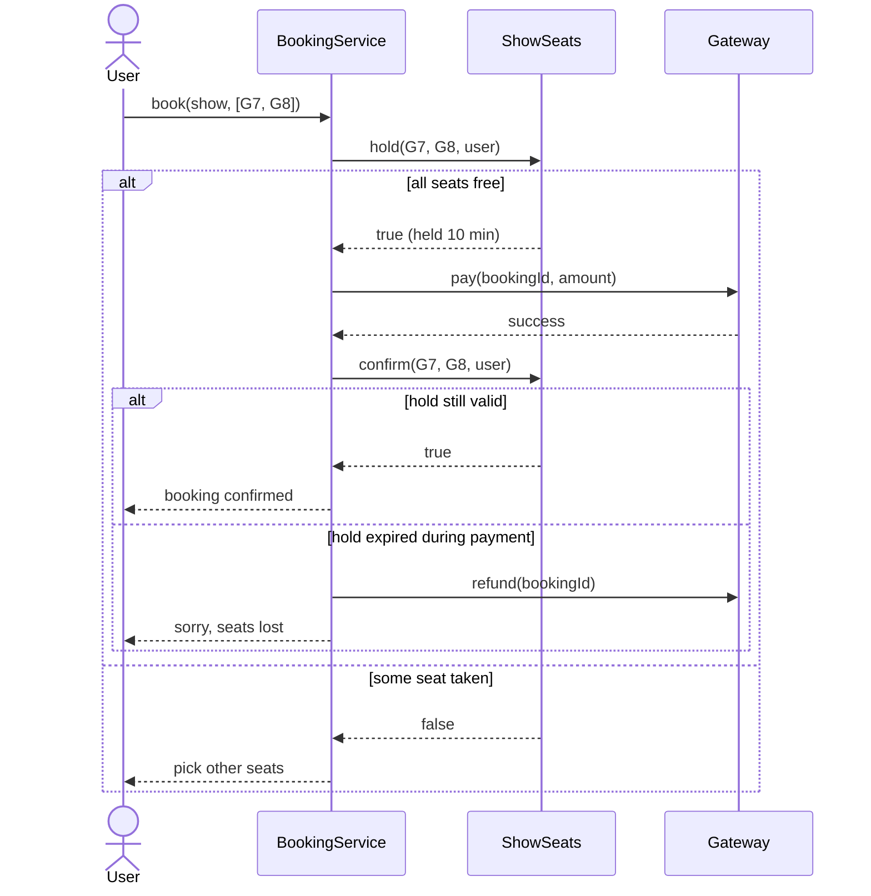

**One seat in one show:**

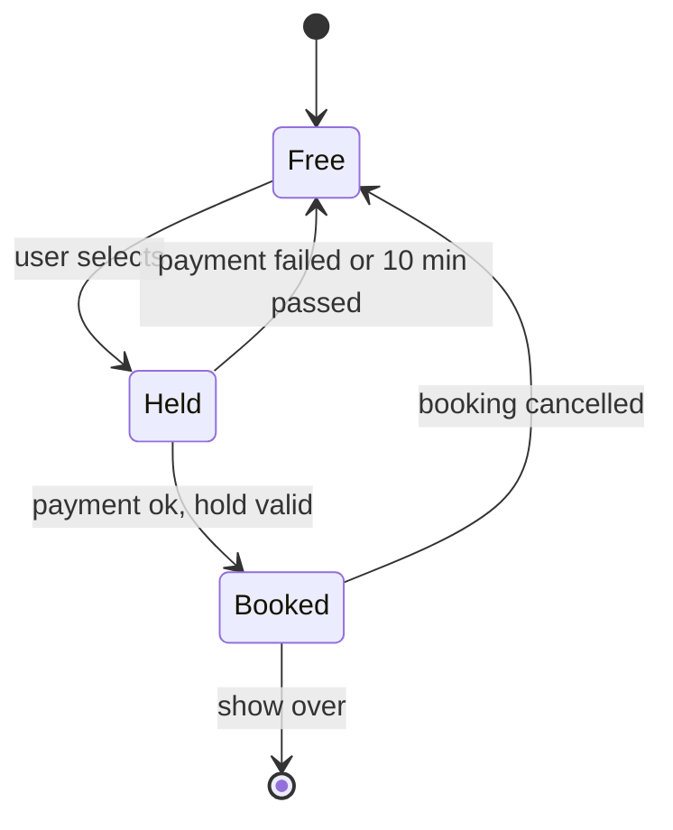

**Booking life cycle:**

```mermaid
stateDiagram-v2
    [*] --> Pending : seats held
    Pending --> Confirmed : paid in time
    Pending --> Expired : hold timed out
    Pending --> Cancelled : payment failed
    Confirmed --> Cancelled : user cancels, refund
    Expired --> [*]
    Cancelled --> [*]
    Confirmed --> [*]
```

### Patterns used and why

| Pattern | Where | Why |
|---|---|---|
| Sealed interface + records | `SeatState` = `Free`, `Held`, `Booked` | Each state carries only its own data (who holds, until when). `switch` covers all. |
| Strategy | `PricingStrategy` per seat type, weekend, offers | Prices change often. |
| Strategy | `SeatLockProvider` (in-memory, Redis, DB) | Same booking code on one server or many. |
| Observer | Booking confirmed → ticket email, SMS | Slow sends do not block booking. |
| Facade | `BookingService` | One call for hold, pay, confirm. |

### Core Java code

Seat states as a sealed interface. A `Held` seat knows who holds it and until when:

```java
sealed interface SeatState permits Free, Held, Booked {}
record Free() implements SeatState {}
record Held(String userId, Instant until) implements SeatState {}
record Booked(String bookingId) implements SeatState {}

enum BookingStatus { PENDING, CONFIRMED, EXPIRED, CANCELLED }

record Booking(String id, String showId, String userId, List<String> seats, BookingStatus status) {
    Booking with(BookingStatus s) { return new Booking(id, showId, userId, seats, s); }
}

interface PaymentGateway {
    boolean pay(String bookingId, long amount);
    void refund(String bookingId);
}
```

`ShowSeats` holds all seats of one show. One lock per show: two different shows never wait for each other.

```java
final class ShowSeats {
    private final Map<String, SeatState> seats = new HashMap<>();     // guarded by "this"
    private final Clock clock;
    private final Duration holdFor;

    ShowSeats(Collection<String> seatIds, Clock clock, Duration holdFor) {
        seatIds.forEach(id -> seats.put(id, new Free()));
        this.clock = clock;
        this.holdFor = holdFor;
    }

    synchronized boolean hold(List<String> ids, String userId) {
        Instant now = clock.instant();
        for (String id : ids) if (!isFree(seats.get(id), now)) return false; // check all first: all or nothing
        Held h = new Held(userId, now.plus(holdFor));
        ids.forEach(id -> seats.put(id, h));
        return true;
    }

    private static boolean isFree(SeatState s, Instant now) {
        return switch (s) {
            case null -> false;                                     // unknown seat id
            case Free f -> true;
            case Held h -> h.until().isBefore(now);                 // expired hold counts as free
            case Booked b -> false;
        };
    }
```

Confirm only if *this user* still holds *every* seat. Release gives seats back:

```java
    synchronized boolean confirm(List<String> ids, String userId, String bookingId) {
        Instant now = clock.instant();
        for (String id : ids) {
            if (!(seats.get(id) instanceof Held h && h.userId().equals(userId) && h.until().isAfter(now)))
                return false;                                       // hold lost or expired
        }
        ids.forEach(id -> seats.put(id, new Booked(bookingId)));
        return true;
    }

    synchronized void release(List<String> ids, String userId) {
        for (String id : ids)
            if (seats.get(id) instanceof Held h && h.userId().equals(userId)) seats.put(id, new Free());
    }
}
```

The booking service. In a real app, hold and pay are two HTTP calls; here they are one method to keep it short:

```java
final class BookingService {
    private final Map<String, ShowSeats> shows;
    private final PaymentGateway gateway;
    BookingService(Map<String, ShowSeats> shows, PaymentGateway g) { this.shows = shows; this.gateway = g; }

    Booking book(String showId, String userId, List<String> seatIds, long amount) {
        if (seatIds.isEmpty() || seatIds.size() > 10) throw new IllegalArgumentException("Pick 1 to 10 seats");
        ShowSeats seats = shows.get(showId);
        if (!seats.hold(seatIds, userId)) throw new IllegalStateException("Some seats are already taken");
        var b = new Booking(UUID.randomUUID().toString(), showId, userId, List.copyOf(seatIds), BookingStatus.PENDING);
        if (!gateway.pay(b.id(), amount)) {
            seats.release(seatIds, userId);
            return b.with(BookingStatus.CANCELLED);
        }
        if (!seats.confirm(seatIds, userId, b.id())) {               // hold expired while paying
            gateway.refund(b.id());
            return b.with(BookingStatus.EXPIRED);
        }
        return b.with(BookingStatus.CONFIRMED);
    }
}
```

### Concurrency

- **Two users, same seat:** both call `hold()`. The lock on `ShowSeats` lets one in first. The second sees `Held` and gets `false`.
- **All or nothing:** we check every seat first, then mark them. With per-seat locks, you must lock seats in sorted order to avoid *deadlock* (two threads waiting on each other forever).
- **Expiry without a timer:** an old `Held` counts as free (*lazy expiry*). A background job can still clean up for the seat map display.
- **Payment slower than the hold:** `confirm()` checks the hold again. If it expired and someone else took the seat, refund.
- **Many servers:** the in-memory map no longer works. Options:
  - Database: `UPDATE show_seat SET status='HELD', held_by=?, hold_until=? WHERE show_id=? AND seat_id IN (...) AND (status='FREE' OR hold_until < now())`. Success only if row count = number of seats.
  - Redis: `SET seat:show42:G7 user1 NX PX 600000` per seat (`NX` = only if not there, `PX` = expiry in ms). Release your own keys if one fails.
- Use a unique key `(show_id, seat_id)` on the booked-seat table as the final safety net.

### Extensions the interviewer will ask

- **Big concert, 1 million users at 10 AM:** a virtual waiting room (queue) in front. See the [HLD version](system-design/bookmyshow-ticket-booking.md).
- **General admission (no seat numbers):** a counter per zone, `UPDATE zone SET sold = sold + ? WHERE sold + ? <= capacity`.
- **Don't leave a single empty seat:** a seat-selection rule (Strategy) that rejects such picks.
- **Dynamic pricing:** a `PricingStrategy` that uses demand.
- **Waitlist when sold out:** on cancellation, offer seats to the waitlist in order.

**Say this in the interview:**

> Each seat in each show is free, held with an expiry, or booked; I model this as a sealed interface.
> Holding is all or nothing under one lock per show, and an expired hold counts as free.
> After payment I confirm only if the same user still holds every seat, otherwise I refund.
> Across many servers I move the same rule to a conditional database update or Redis SET NX with expiry.

---

## Design an ATM

**In one line:** An ATM is a state machine: card in, PIN checked, transaction done, cash given, and the bank's balance stays correct even when the machine fails.

**Story:** Ravi inserts his card and types a wrong PIN twice. The third try is right.
He asks for 2,500 rupees. The machine has 500 and 100 notes, so it gives four 500s and five 100s.
If the cash motor jams after the bank took the money, the bank must put the money back.

### Clarifying questions

| Question | Assumed answer |
|---|---|
| Which transactions? | Balance check, cash withdrawal, deposit, transfer. Withdrawal is the main one. |
| Wrong PIN? | 3 wrong tries: the card is blocked and kept. |
| Which notes? | 100, 200, 500. Each cassette has a count. |
| Who holds the balance? | The bank. The ATM never trusts its own copy. |
| Limits? | Per-withdrawal and daily limits, checked by the bank. |
| Receipt? | Printed if the user wants. |

### Requirements

**Functional:**

- Read card, check PIN (max 3 tries), show menu.
- Withdraw: check balance and limit at the bank, check notes in the machine, debit, give cash.
- If cash is not given, reverse the debit.
- Balance check, deposit, transfer. Print receipt.
- Operator can load cash and take the ATM out of service.

**Out of scope:** card-less withdrawal, cheque deposit, network encryption details.

### Core entities and relationships

- `Atm` is the context. It has hardware parts: `CardReader`, `Keypad`, `Screen`, `CashDispenser`, `Printer` (composition).
- `AtmState` is sealed: `Idle`, `CardInserted`, `Authenticated`, `OutOfService`.
- `BankService` is the remote bank (interface). It owns `Account`s and balances.
- `Transaction` is sealed: `Withdrawal`, `Deposit`, `BalanceInquiry`, `Transfer`.

### Class diagram

```mermaid
classDiagram
    Atm : -AtmState state
    Atm : +insertCard(cardNo)
    Atm : +enterPin(pin)
    Atm : +withdraw(amount) Map
    Atm : +ejectCard()
    CardInserted : +String cardNo
    CardInserted : +int wrongPins
    Authenticated : +String accountId
    CashDispenser : +plan(amount) Optional
    CashDispenser : +dispense(plan)
    BankService : +verifyPin(card, pin) Optional
    BankService : +debit(account, amount) String
    BankService : +reverse(txId)
    Atm --> AtmState
    AtmState <|.. Idle
    AtmState <|.. CardInserted
    AtmState <|.. Authenticated
    AtmState <|.. OutOfService
    Atm *-- CashDispenser
    Atm *-- CardReader
    Atm *-- Printer
    Atm --> BankService
    Transaction <|.. Withdrawal
    <<interface>> AtmState
    <<interface>> BankService
    <<interface>> Transaction
```

### Key flows

**Withdraw cash:**

```mermaid
sequenceDiagram
    actor Ravi
    participant Atm
    participant Dispenser
    participant Bank
    Ravi->>Atm: withdraw(2500)
    Atm->>Dispenser: plan(2500)
    Dispenser-->>Atm: 4 x 500, 5 x 100
    Atm->>Bank: debit(account, 2500)
    Bank-->>Atm: txId T9
    Atm->>Dispenser: dispense(plan)
    alt cash given
        Dispenser-->>Atm: done
        Atm-->>Ravi: take cash and card
    else motor jam
        Dispenser-->>Atm: error
        Atm->>Bank: reverse(T9)
        Atm-->>Ravi: sorry, no cash, no debit
    end
```

**ATM session states:**

```mermaid
stateDiagram-v2
    [*] --> Idle
    Idle --> CardInserted : insert card
    CardInserted --> CardInserted : wrong PIN, tries under 3
    CardInserted --> Idle : 3 wrong PINs, card kept
    CardInserted --> Authenticated : correct PIN
    Authenticated --> Authenticated : transaction done
    Authenticated --> Idle : eject card or timeout
    Idle --> OutOfService : no cash or fault
    OutOfService --> Idle : operator fixes
```

### Patterns used and why

| Pattern | Where | Why |
|---|---|---|
| State | `AtmState` | Each button means something different in each state. No big `if` chain. |
| Chain of Responsibility | Note cassettes (500 → 200 → 100) | Each cassette gives what it can and passes the rest on. Our `plan()` loop is the same idea. |
| Command | `Transaction` types | Each transaction can be logged, retried, or reversed. |
| Facade | `Atm` over the hardware parts | Screens call one simple API. |
| Adapter | `BankService` over the bank's network protocol | Test with a fake bank. |

**Two ways to write State in Java 21:** the classic GoF way has one class per state with methods (see the [vending machine](#design-a-vending-machine)). The modern way below uses sealed records for the data of each state and `instanceof` patterns in the context. Both are fine. Say which one you picked and why.

### Core Java code

States carry their own data. `CardInserted` counts wrong PINs; `Authenticated` knows the account:

```java
sealed interface AtmState permits Idle, CardInserted, Authenticated, OutOfService {}
record Idle() implements AtmState {}
record CardInserted(String cardNo, int wrongPins) implements AtmState {}
record Authenticated(String cardNo, String accountId) implements AtmState {}
record OutOfService(String reason) implements AtmState {}

interface BankService {
    Optional<String> verifyPin(String cardNo, String pin);    // account id if correct
    void blockCard(String cardNo);
    String debit(String accountId, long amount);              // throws if no balance or over limit
    void reverse(String txId);
}
```

The cash dispenser. It plans with the biggest notes first, and changes counts only when it really dispenses:

```java
final class CashDispenser {
    private final TreeMap<Integer, Integer> notes = new TreeMap<>(Comparator.reverseOrder()); // note -> count

    synchronized void load(int note, int count) { notes.merge(note, count, Integer::sum); }

    synchronized Optional<Map<Integer, Integer>> plan(int amount) {
        Map<Integer, Integer> plan = new LinkedHashMap<>();
        int left = amount;
        for (var e : notes.entrySet()) {
            int use = Math.min(left / e.getKey(), e.getValue());   // as many big notes as possible
            if (use > 0) { plan.put(e.getKey(), use); left -= use * e.getKey(); }
        }
        return left == 0 ? Optional.of(plan) : Optional.empty();
    }

    synchronized void dispense(Map<Integer, Integer> plan) {
        plan.forEach((note, n) -> notes.merge(note, -n, Integer::sum)); // the motor pushes notes out here
    }
}
```

The ATM context. Each method first checks the current state with a pattern:

```java
final class Atm {
    private AtmState state = new Idle();
    private final BankService bank;
    private final CashDispenser cash;
    Atm(BankService bank, CashDispenser cash) { this.bank = bank; this.cash = cash; }

    synchronized void insertCard(String cardNo) {
        if (!(state instanceof Idle)) throw new IllegalStateException("ATM busy: " + state);
        state = new CardInserted(cardNo, 0);
    }

    synchronized void enterPin(String pin) {
        if (!(state instanceof CardInserted c)) throw new IllegalStateException("Insert card first");
        Optional<String> account = bank.verifyPin(c.cardNo(), pin);
        if (account.isPresent()) state = new Authenticated(c.cardNo(), account.get());
        else if (c.wrongPins() + 1 >= 3) { bank.blockCard(c.cardNo()); state = new Idle(); } // card kept
        else state = new CardInserted(c.cardNo(), c.wrongPins() + 1);
    }

    synchronized void ejectCard() { state = new Idle(); }
```

Withdraw: check notes first, then debit, then dispense. If dispensing fails, reverse:

```java
    synchronized Map<Integer, Integer> withdraw(int amount) {
        if (!(state instanceof Authenticated a)) throw new IllegalStateException("Enter PIN first");
        var plan = cash.plan(amount).orElseThrow(() -> new IllegalStateException("Cannot give this amount"));
        String txId = bank.debit(a.accountId(), amount);         // bank checks balance and daily limit
        try {
            cash.dispense(plan);
            return plan;
        } catch (RuntimeException jam) {
            bank.reverse(txId);                                   // no cash out, so give the money back
            throw jam;
        }
    }
}
```

### Concurrency

- One ATM serves one person at a time, so `synchronized` on `Atm` is enough inside the machine.
- **The real race is at the bank:** Ravi's wife uses the same account at another ATM and on UPI at the same second.
  The bank does `UPDATE account SET balance = balance - ? WHERE id = ? AND balance >= ?`. Zero rows means "not enough money".
- **Network timeout after debit:** the ATM does not know if the debit happened. It sends `debit` with a unique transaction id (*idempotency key*). A retry with the same id does not debit twice. If still unknown, it sends a reversal, which is also idempotent.
- **Power cut in the middle:** the ATM writes a local journal ("debit T9 sent", "cash out T9 done") before each step. On restart it reads the journal and reverses unfinished transactions.

### Extensions the interviewer will ask

- **Greedy notes can fail:** with one 500 note and three 200 notes, greedy fails for 600 (500 + ?). Three 200s work. For 3–5 note types, a small search (dynamic programming or backtracking) finds a plan.
- **Deposit:** a `CashAcceptor` counts notes; the bank credits after counting. Fake note detection rejects notes.
- **Card-less (UPI QR) withdrawal:** a new way into `Authenticated`. Other states stay the same.
- **Session timeout:** a timer moves `Authenticated` to `Idle` after 30 seconds of no input.
- **Low cash alert:** observer on the dispenser notifies the operator.

**Say this in the interview:**

> The ATM is a state machine: Idle, CardInserted, Authenticated and OutOfService. Each state is a record with its own data.
> The bank owns the balance; the ATM only asks it to debit with an idempotent transaction id.
> I plan notes first, then debit, then dispense, and I reverse the debit if the cash does not come out.
> A local journal lets the ATM fix unfinished transactions after a power cut.

---
## Design an Airline Management System

**In one line:** Customers search flights, reserve seats for one or more passengers, pay, and check in; staff manage aircraft, schedules and crew.

**Story:** Meera books Delhi to Bengaluru on 20 December for herself and her father.
She picks seats 12A and 12B. The flight AI-501 flies every day, but her booking is for one date only.
At the same moment, another family tries to take 12B. Only one booking can win.

### Clarifying questions

| Question | Assumed answer |
|---|---|
| One-way, return, multi-city? | One-way and return. A booking (PNR) can have many legs. |
| Many passengers per booking? | Yes, up to 9. |
| Seat classes? | Economy, business, first. |
| Seat choice? | Optional. If not chosen, assign at check-in. |
| Who uses it? | Customers, front desk agents, admins (add aircraft, flights), crew (view schedule). |
| Overbooking? | Not in this round. |

### Requirements

**Functional:**

- Search flights by source, destination and date.
- Reserve seats for passengers on one or more flight legs. Pay.
- Cancel a reservation. Check in and get a boarding pass.
- Admin: add aircraft, create a weekly schedule, assign crew.
- Notify passengers about delays and gate changes.

**Out of scope:** loyalty miles, baggage, fare rules in depth, partner airlines.

### Core entities and relationships

- `Airport` (code, city). `Aircraft` (model, seat layout).
- `Flight` is the route and number (AI-501, DEL → BLR). `FlightInstance` is that flight on one date. This split is the key idea, like `Book` vs `BookCopy`.
- `FlightSeat` is one seat on one flight instance.
- `Reservation` (PNR) has many `Passenger`s and many legs (`FlightInstance`s). `Payment` belongs to a reservation.

### Class diagram

```mermaid
classDiagram
    Airport : +String code
    Aircraft : +String model
    Flight : +String number
    Flight : +Duration duration
    FlightInstance : +LocalDate date
    FlightInstance : +FlightStatus status
    FlightInstance : +assign(seatNo, passengerId) boolean
    FlightSeat : +String seatNo
    FlightSeat : +SeatClass cls
    FlightSeat : +long version
    Reservation : +String pnr
    Reservation : +ReservationStatus status
    Passenger : +String name
    Passenger : +String passport
    Flight --> Airport : from
    Flight --> Airport : to
    Flight "1" *-- "*" FlightInstance
    FlightInstance --> Aircraft
    FlightInstance "1" *-- "*" FlightSeat
    FlightInstance o-- Crew
    Reservation "1" *-- "1..9" Passenger
    Reservation "*" --> "1..*" FlightInstance
    Customer "1" --> "*" Reservation
    Reservation "1" *-- "0..1" Payment
```

### Key flows

**Reserve seats:**

```mermaid
sequenceDiagram
    actor Meera
    participant Booking
    participant Flight as FlightInstance
    participant Gateway
    Meera->>Booking: reserve(AI-501 on 20 Dec, 12A and 12B)
    Booking->>Flight: assign(12A, Meera)
    Flight-->>Booking: true
    Booking->>Flight: assign(12B, Father)
    alt seat still free
        Flight-->>Booking: true
        Booking->>Gateway: pay(pnr, amount)
        Booking-->>Meera: PNR confirmed
    else version changed
        Flight-->>Booking: false
        Booking->>Flight: free 12A again
        Booking-->>Meera: pick another seat
    end
```

**Reservation life cycle:**

```mermaid
stateDiagram-v2
    [*] --> Pending : seats assigned
    Pending --> Confirmed : paid
    Pending --> Cancelled : not paid in 15 min
    Confirmed --> CheckedIn : online or at counter
    Confirmed --> Cancelled : customer cancels
    CheckedIn --> Flown : boarded
    Flown --> [*]
    Cancelled --> [*]
```

### Patterns used and why

| Pattern | Where | Why |
|---|---|---|
| Template vs instance split | `Flight` / `FlightInstance` | The schedule repeats; seats and status belong to one date. |
| Strategy | `FareStrategy` (by class, days before flight, demand) | Pricing rules change often. |
| Observer | Flight delay → notify all passengers | Flight does not know about SMS or email. |
| Builder | `Reservation.builder()` with many optional parts | Many passengers, legs and add-ons. |

### Core Java code

Seats use *optimistic locking*: read the seat, then replace it only if the version did not change:

```java
enum SeatClass { ECONOMY, BUSINESS, FIRST }
enum ReservationStatus { PENDING, CONFIRMED, CHECKED_IN, CANCELLED }

record Passenger(String id, String name, String passport) {}
record FlightSeat(String seatNo, SeatClass cls, String passengerId, long version) {
    boolean free() { return passengerId == null; }
}

final class FlightInstance {                                       // AI-501 on one date
    final String flightNo;
    final LocalDate date;
    private final ConcurrentHashMap<String, FlightSeat> seats = new ConcurrentHashMap<>();

    FlightInstance(String flightNo, LocalDate date, List<FlightSeat> all) {
        this.flightNo = flightNo; this.date = date;
        all.forEach(s -> seats.put(s.seatNo(), s));
    }

    boolean assign(String seatNo, String passengerId) {
        FlightSeat current = seats.get(seatNo);
        if (current == null || !current.free()) return false;
        FlightSeat taken = new FlightSeat(seatNo, current.cls(), passengerId, current.version() + 1);
        return seats.replace(seatNo, current, taken);              // like UPDATE ... WHERE version = ?
    }

    void free(String seatNo, String passengerId) {
        seats.computeIfPresent(seatNo, (k, s) -> passengerId.equals(s.passengerId())
                ? new FlightSeat(k, s.cls(), null, s.version() + 1) : s);
    }
}
```

A reservation keeps legs and passengers together. Seats are taken for all passengers or none:

```java
final class Reservation {
    final String pnr = UUID.randomUUID().toString().substring(0, 6).toUpperCase();
    final List<Passenger> passengers;
    private ReservationStatus status = ReservationStatus.PENDING;
    Reservation(List<Passenger> passengers) { this.passengers = List.copyOf(passengers); }

    static Optional<Reservation> reserve(FlightInstance f, Map<Passenger, String> seatFor) {
        List<Passenger> done = new ArrayList<>();
        for (var e : seatFor.entrySet()) {
            if (!f.assign(e.getValue(), e.getKey().id())) {
                done.forEach(p -> f.free(seatFor.get(p), p.id()));  // undo: all or nothing
                return Optional.empty();
            }
            done.add(e.getKey());
        }
        return Optional.of(new Reservation(done));
    }
    synchronized void confirm() { status = ReservationStatus.CONFIRMED; }
}
```

### Concurrency

- `ConcurrentHashMap.replace(key, old, new)` changes the seat only if it still equals what we read. This is optimistic locking in memory.
- In a database: a `version` column and `UPDATE flight_seat SET passenger_id=?, version=version+1 WHERE id=? AND version=?`. JPA does this with `@Version`.
- Optimistic locking is good when conflicts are rare (most seats are not fought over). For a hot sale, use a hold with expiry like the [movie booking](#design-a-movie-ticket-booking-system).
- Unpaid reservations: a scheduled job cancels `PENDING` older than 15 minutes and frees the seats.

### Extensions the interviewer will ask

- **Overbooking:** allow sales up to 105% of seats; seats are assigned at check-in.
- **Multi-city:** a reservation already holds many legs. Make it all-or-nothing across legs.
- **Waitlist:** a queue per flight instance and class.
- **Crew rules:** a crew member cannot fly more than N hours a week (a validation rule).

**Say this in the interview:**

> I split `Flight`, the repeating schedule, from `FlightInstance`, one flight on one date that owns its seats.
> A reservation holds passengers and legs, and seats are assigned all or nothing.
> I use optimistic locking with a version, because most seats are not fought over.
> Unpaid reservations expire and free their seats.

---

## Design Blackjack and a Deck of Cards

**In one line:** Model cards, a shuffled deck, hands that score aces as 1 or 11, and a dealer who follows fixed rules.

**Story:** At a casino table, the dealer deals two cards to each player and two to himself.
Players say "hit" (one more card) or "stand" (stop). Over 21 is a *bust* (you lose).
The dealer must keep taking cards until he has 17 or more.

### Clarifying questions

| Question | Assumed answer |
|---|---|
| A generic deck or only blackjack? | A generic deck that blackjack uses. Other games can reuse it. |
| How many decks? | A *shoe* with 1 to 8 decks. |
| How many players? | 1 to 7 per table, each with a bet. |
| Which moves? | Hit and stand. Split and double later. |
| Dealer rule? | Dealer stands on 17. |
| Payouts? | Win 1:1, blackjack 3:2, tie (*push*) returns the bet. |

### Requirements

**Functional:**

- Create and shuffle a shoe of N decks. Deal cards.
- Score a hand, with aces worth 1 or 11.
- Players bet, hit or stand. Dealer plays by rule.
- Settle bets: win, lose, push, blackjack.

**Out of scope:** splitting, insurance, card counting detection, real money wallets.

### Core entities and relationships

- `Suit` and `Rank` are enums. `Card` is a record (rank, suit).
- `Deck` (or `Shoe`) holds cards and deals. `Hand` holds cards and scores them.
- `Player` has a hand, a bet and a balance. `Dealer` has a hand. `Game` runs a round.
- `Rules` (dealer rule, payouts) is separate, so other blackjack variants are new classes.

### Class diagram

```mermaid
classDiagram
    Suit : HEARTS
    Suit : SPADES
    Rank : +int points
    Card : +Rank rank
    Card : +Suit suit
    Deck : +deal() Card
    Deck : +left() int
    Hand : +add(Card c)
    Hand : +score() int
    Hand : +isBust() boolean
    Player : +long balance
    Player : +long bet
    Game : +startRound()
    Game : +hit(player)
    Game : +stand(player)
    Rules : +playDealer(hand, deck)
    Rules : +settle(player, dealer) Result
    Card --> Rank
    Card --> Suit
    Deck "1" o-- "*" Card
    Hand "1" o-- "*" Card
    Player *-- Hand
    Dealer *-- Hand
    Game *-- Deck
    Game o-- Player
    Game *-- Dealer
    Game --> Rules
    <<enumeration>> Suit
    <<enumeration>> Rank
```

### Key flows

**One round:**

```mermaid
sequenceDiagram
    actor Player
    participant Game
    participant Deck
    participant Rules
    Player->>Game: bet(100)
    Game->>Deck: deal 2 cards each
    loop until stand or bust
        Player->>Game: hit
        Game->>Deck: deal()
    end
    Game->>Rules: playDealer(dealerHand, deck)
    Game->>Rules: settle(playerHand, dealerHand)
    Rules-->>Game: WIN
    Game-->>Player: balance + 100
```

**Round states:**

```mermaid
stateDiagram-v2
    [*] --> Betting
    Betting --> Dealing : all bets placed
    Dealing --> PlayerTurns
    PlayerTurns --> DealerTurn : all players stand or bust
    DealerTurn --> Settling
    Settling --> Betting : next round
```

### Patterns used and why

| Pattern | Where | Why |
|---|---|---|
| Enum with data | `Rank(points)` | Points live with the rank; no `switch` everywhere. |
| Strategy | `Rules` (dealer stands on soft 17 or not) | Casino variants are new classes. |
| State | Round phases | "Hit" during betting is an error. |
| Dependency injection | `Random` into `Deck` | Tests use a fixed seed; production uses `SecureRandom`. |

### Core Java code

Cards and a deck. The deck is generic; nothing in it knows about blackjack:

```java
enum Suit { HEARTS, DIAMONDS, CLUBS, SPADES }
enum Rank {
    ACE(11), TWO(2), THREE(3), FOUR(4), FIVE(5), SIX(6), SEVEN(7),
    EIGHT(8), NINE(9), TEN(10), JACK(10), QUEEN(10), KING(10);
    final int points;
    Rank(int points) { this.points = points; }
}
record Card(Rank rank, Suit suit) {}

final class Deck {
    private final Deque<Card> cards = new ArrayDeque<>();
    Deck(int decks, Random random) {
        List<Card> all = new ArrayList<>();
        for (int i = 0; i < decks; i++)
            for (Suit s : Suit.values()) for (Rank r : Rank.values()) all.add(new Card(r, s));
        Collections.shuffle(all, random);                          // fixed seed in tests
        cards.addAll(all);
    }
    Card deal() {
        if (cards.isEmpty()) throw new IllegalStateException("Shoe is empty, reshuffle");
        return cards.pop();
    }
    int left() { return cards.size(); }
}
```

A hand counts every ace as 11, then turns aces into 1 while the total is over 21:

```java
enum Result { WIN, LOSE, PUSH, BLACKJACK }

final class Hand {
    private final List<Card> cards = new ArrayList<>();
    void add(Card c) { cards.add(c); }
    int score() {
        int total = 0, aces = 0;
        for (Card c : cards) { total += c.rank().points; if (c.rank() == Rank.ACE) aces++; }
        while (total > 21 && aces-- > 0) total -= 10;             // count one ace as 1 instead of 11
        return total;
    }
    boolean isBlackjack() { return cards.size() == 2 && score() == 21; }
    boolean isBust()      { return score() > 21; }
}

final class Rules {
    static void playDealer(Hand dealer, Deck deck) { while (dealer.score() < 17) dealer.add(deck.deal()); }
    static Result settle(Hand player, Hand dealer) {
        if (player.isBust()) return Result.LOSE;                   // player busts first, always loses
        if (player.isBlackjack() && !dealer.isBlackjack()) return Result.BLACKJACK;
        if (dealer.isBlackjack() && !player.isBlackjack()) return Result.LOSE;
        if (dealer.isBust() || player.score() > dealer.score()) return Result.WIN;
        return player.score() == dealer.score() ? Result.PUSH : Result.LOSE;
    }
}
```

### Concurrency

- One table is one game. Run each table on its own thread (or virtual thread) and keep the game single-threaded. No locks needed inside.
- Player actions come from many devices. Put them in a queue for that table; the table thread handles them one by one (*actor model*).
- Balances are shared across tables. Update them with an atomic DB update or a ledger, not in the `Game` object.
- Shuffling must be fair and unpredictable: use `SecureRandom` in production.

### Extensions the interviewer will ask

- **Split and double down:** a player has a list of hands, not one hand.
- **Soft 17 rule:** a `Rules` subclass where the dealer hits on a soft 17 (17 with an ace counted as 11).
- **Reshuffle point:** when fewer than 25% of cards are left, reshuffle before the next round.
- **Other card games:** reuse `Card`, `Deck`, `Suit`, `Rank`. Only `Hand` scoring and `Rules` change.

**Say this in the interview:**

> Suit and rank are enums, a card is a record, and the deck is generic with an injected `Random`.
> A hand counts aces as 11 and turns them into 1 while it is over 21.
> Dealer rules and payouts live in a separate rules class, so variants are new classes.
> Each table runs on one thread, so the game itself needs no locks.

---

## Design a Hotel Management System

**In one line:** Guests search free rooms for a date range, book, check in, add charges during the stay, and pay one invoice at check-out.

**Story:** Kiran books a double room from 10 to 12 March. He checks in, orders room service twice, and uses the minibar.
At check-out, the front desk prints one bill: 2 nights plus food plus tax.
The same room is free for another guest from 12 March, because check-out day is not a night.

### Clarifying questions

| Question | Assumed answer |
|---|---|
| One hotel or a chain? | A chain, but each booking is in one hotel. |
| Room types? | Single, double, suite. Each with a price per night. |
| Book a type or a room number? | Book a type; a room number is assigned at check-in. For the code below, we book a room directly to keep it short. |
| Extra charges? | Room service, minibar, laundry. Added during the stay. |
| Cancellation? | Free until 24 hours before. |
| Housekeeping? | Yes, rooms need cleaning after check-out. |

### Requirements

**Functional:**

- Search free rooms by type and date range.
- Book, cancel, check in, check out.
- Add charges to a stay. Generate an invoice. Pay.
- Housekeeping marks rooms clean. Staff see room status.

**Out of scope:** loyalty, dynamic pricing, online travel agent sync, key card hardware.

### Core entities and relationships

- `Hotel` has many `Room`s. A `Room` has a `RoomType` and a status.
- `RoomBooking` links a guest, a room and a `Stay` (check-in date, check-out date).
- `Invoice` holds many `Charge`s. `Charge` is sealed: `RoomCharge`, `RoomService`, `Minibar`, `Laundry`.
- `Guest`, `Receptionist`, `Housekeeper` are people with different actions.

### Class diagram

```mermaid
classDiagram
    Hotel : +findFree(RoomType t, Stay s) List
    Room : +String number
    Room : +RoomType type
    Room : +RoomStatus status
    Room : +book(guestId, Stay s) Optional
    Stay : +LocalDate checkIn
    Stay : +LocalDate checkOut
    Stay : +overlaps(Stay o) boolean
    RoomBooking : +String id
    Invoice : +add(Charge c)
    Invoice : +total() long
    Charge : +amount() long
    Hotel "1" *-- "*" Room
    Room "1" *-- "*" RoomBooking
    RoomBooking --> Stay
    RoomBooking --> Guest
    RoomBooking "1" *-- "1" Invoice
    Invoice "1" *-- "*" Charge
    Charge <|.. RoomCharge
    Charge <|.. Minibar
    Receptionist ..> Hotel : uses
    Housekeeper ..> Room : cleans
    <<interface>> Charge
```

### Key flows

**Check out:**

```mermaid
sequenceDiagram
    actor Kiran
    participant Desk as Receptionist
    participant Booking as RoomBooking
    participant Invoice
    participant Room
    Kiran->>Desk: check out
    Desk->>Booking: closeStay()
    Booking->>Invoice: add RoomCharge(2 nights)
    Invoice-->>Desk: total with tax
    Kiran->>Desk: pay by card
    Desk->>Room: status = CLEANING
    Desk-->>Kiran: receipt
```

**Room status:**

```mermaid
stateDiagram-v2
    [*] --> Available
    Available --> Occupied : guest checks in
    Occupied --> Cleaning : guest checks out
    Cleaning --> Available : housekeeping done
    Available --> Maintenance : fault reported
    Maintenance --> Available : fixed
```

### Patterns used and why

| Pattern | Where | Why |
|---|---|---|
| Sealed interface | `Charge` types | Invoice lines are fixed kinds; reports `switch` on them safely. |
| Value object | `Stay` with `overlaps()` | Date logic lives in one tested place. |
| Strategy | `RoomPricing` (weekend, season) | Prices change without touching booking code. |
| Observer | Check-out → housekeeping task | Housekeeping is told without the desk calling it directly. |

### Core Java code

A stay is a value with the overlap rule. Two stays overlap when each one starts before the other ends:

```java
enum RoomType { SINGLE, DOUBLE, SUITE }

record Stay(LocalDate checkIn, LocalDate checkOut) {
    Stay {
        if (!checkOut.isAfter(checkIn)) throw new IllegalArgumentException("Check-out must be after check-in");
    }
    boolean overlaps(Stay o) { return checkIn.isBefore(o.checkOut) && o.checkIn.isBefore(checkOut); }
    long nights() { return checkOut.toEpochDay() - checkIn.toEpochDay(); }
}
record RoomBooking(String id, String roomNo, String guestId, Stay stay) {}

final class Room {
    final String number;
    final RoomType type;
    final long pricePerNight;
    private final List<RoomBooking> bookings = new ArrayList<>();
    Room(String number, RoomType type, long pricePerNight) { this.number = number; this.type = type; this.pricePerNight = pricePerNight; }

    synchronized boolean freeFor(Stay s) { return bookings.stream().noneMatch(b -> b.stay().overlaps(s)); }

    synchronized Optional<RoomBooking> book(String guestId, Stay s) {
        if (!freeFor(s)) return Optional.empty();                  // check and add under one lock
        var b = new RoomBooking(UUID.randomUUID().toString(), number, guestId, s);
        bookings.add(b);
        return Optional.of(b);
    }
}
```

Charges and the invoice. A record field named `amount` already implements `amount()`:

```java
sealed interface Charge permits RoomCharge, RoomService, Minibar, Laundry { long amount(); }
record RoomCharge(long nights, long perNight) implements Charge { public long amount() { return nights * perNight; } }
record RoomService(String item, long amount) implements Charge {}
record Minibar(String item, long amount) implements Charge {}
record Laundry(int pieces, long amount) implements Charge {}

final class Invoice {
    private final List<Charge> charges = new CopyOnWriteArrayList<>();
    void add(Charge c) { charges.add(c); }
    long subtotal() { return charges.stream().mapToLong(Charge::amount).sum(); }
    long total(int taxPercent) { long s = subtotal(); return s + s * taxPercent / 100; }
}
```

### Concurrency

- Two receptionists book room 204 for overlapping dates. `book()` checks and adds under the room's lock, so only one wins.
- In PostgreSQL, the database can enforce it: an *exclusion constraint* `EXCLUDE USING gist (room_id WITH =, stay WITH &&)` on a `daterange` column (needs the `btree_gist` extension). Two overlapping rows for one room are rejected.
- Without that, lock the room row (`SELECT ... FOR UPDATE`), check overlaps, insert, commit.
- When guests book a *type* (not a room), keep a count per type per night and decrement with a conditional update.

### Extensions the interviewer will ask

- **Book by type, assign at check-in:** `TypeInventory(date, type, free)` rows; assignment picks a clean room.
- **Seasonal pricing:** `RoomPricing` strategy that prices each night separately.
- **Group bookings:** many rooms, all or nothing.
- **Key cards:** a `KeyCard` linked to the booking, valid only during the stay.

**Say this in the interview:**

> A `Stay` value object holds the dates and the overlap rule: each stay starts before the other ends.
> A room books only if no existing booking overlaps, checked and added under one lock.
> In PostgreSQL an exclusion constraint on a date range makes double booking impossible.
> Charges are a sealed interface, and the invoice adds them up at check-out.

---

## Design a Restaurant Management system

**In one line:** Manage tables, reservations, menus, orders from waiters to the kitchen, and bills, with chefs working from a shared queue.

**Story:** Table 7 orders two dosas and a coffee. The waiter taps it on a tablet.
The order appears on the kitchen screen. Three chefs take orders from the same queue.
When the food is ready, the waiter's tablet buzzes. At the end, the table asks for the bill and splits it.

### Clarifying questions

| Question | Assumed answer |
|---|---|
| One branch or many? | Many branches, each with its own tables and menu prices. |
| Reservations? | Yes, a table for a time slot. Walk-ins also. |
| Order changes? | Add items any time. Cancel an item only before cooking starts. |
| Kitchen? | One shared queue; any free chef takes the next order. |
| Bill? | Tax and optional tip. Split equally. |
| Who uses it? | Receptionist, waiter, chef, manager. |

### Requirements

**Functional:**

- Reserve a table for a slot. Seat walk-ins.
- Waiter takes an order for a table and sends it to the kitchen.
- Chefs take orders in order, mark them preparing and ready. Waiter is notified.
- Generate the bill with tax. Pay.
- Manager edits the menu and prices.

**Out of scope:** online delivery, stock of ingredients, staff payroll.

### Core entities and relationships

- `Restaurant` has many `Branch`es. A `Branch` has `Table`s and a `Menu`.
- `Menu` has `MenuSection`s with `MenuItem`s.
- `TableOrder` belongs to a table and has many `OrderItem`s.
- `Kitchen` holds the order queue. `Chef` takes from it. `Waiter` listens for ready orders.
- `Bill` belongs to an order.

### Class diagram

```mermaid
classDiagram
    Branch : +String city
    Table : +int number
    Table : +int seats
    Reservation : +LocalDateTime slot
    MenuItem : +String name
    MenuItem : +long price
    TableOrder : +OrderStatus status
    TableOrder : +subtotal() long
    OrderItem : +int qty
    Kitchen : +submit(TableOrder o)
    OrderListener : +onReady(TableOrder o)
    Branch "1" *-- "*" Table
    Branch "1" *-- "1" Menu
    Menu "1" *-- "*" MenuItem
    Table "1" --> "*" Reservation
    TableOrder --> Table
    TableOrder "1" *-- "*" OrderItem
    OrderItem --> MenuItem
    Kitchen o-- Chef
    OrderListener <|.. Waiter
    Kitchen --> OrderListener
    TableOrder "1" --> "0..1" Bill
    <<interface>> OrderListener
```

### Key flows

**Order to table:**

```mermaid
sequenceDiagram
    actor Waiter
    participant Order as TableOrder
    participant Kitchen
    participant Chef
    Waiter->>Order: add 2 dosa, 1 coffee
    Waiter->>Kitchen: submit(order)
    Chef->>Kitchen: take next order
    Kitchen-->>Chef: order for table 7
    Chef->>Order: status = PREPARING
    Chef->>Order: status = READY
    Kitchen-->>Waiter: onReady(table 7)
    Waiter->>Order: status = SERVED
```

**Order life cycle:**

```mermaid
stateDiagram-v2
    [*] --> Received
    Received --> Preparing : chef takes it
    Received --> Cancelled : cancelled before cooking
    Preparing --> Ready
    Ready --> Served
    Served --> Paid
    Paid --> [*]
    Cancelled --> [*]
```

### Patterns used and why

| Pattern | Where | Why |
|---|---|---|
| Producer–consumer | Waiters put orders in a `BlockingQueue`; chefs take | Chefs never fight over one order. |
| Observer | `OrderListener` for ready orders | Kitchen does not know which screen or tablet to buzz. |
| Command | `TableOrder` as a ticket for the kitchen | Orders can be queued, logged, and replayed. |
| Strategy | Tax and service charge rules per city | Rules differ by state or country. |
| Composite | Menu → sections → items (and combos) | A combo meal is an item made of items. |

### Core Java code

Order and menu values:

```java
enum OrderStatus { RECEIVED, PREPARING, READY, SERVED, PAID, CANCELLED }

record MenuItem(String id, String name, long price) {}
record OrderItem(MenuItem item, int qty, String note) {}
record Bill(String orderId, long subtotal, long tax, long tip) { long total() { return subtotal + tax + tip; } }

final class TableOrder {
    final String id;
    final int table;
    final List<OrderItem> items = new CopyOnWriteArrayList<>();
    volatile OrderStatus status = OrderStatus.RECEIVED;           // read by waiter and chef threads
    TableOrder(String id, int table) { this.id = id; this.table = table; }
    long subtotal() { return items.stream().mapToLong(i -> i.item().price() * i.qty()).sum(); }
    Bill bill(int taxPercent, long tip) { long s = subtotal(); return new Bill(id, s, s * taxPercent / 100, tip); }
}

interface OrderListener { void onReady(TableOrder o); }
```

The kitchen. Waiters produce orders; chef threads consume them. `take()` waits when the queue is empty:

```java
final class Kitchen {
    private final BlockingQueue<TableOrder> tickets = new LinkedBlockingQueue<>();
    private final List<OrderListener> listeners = new CopyOnWriteArrayList<>();

    void subscribe(OrderListener l) { listeners.add(l); }
    void submit(TableOrder o) { tickets.add(o); }                  // waiter is the producer

    void startChefs(int chefs, ExecutorService pool) {
        for (int i = 0; i < chefs; i++) {
            pool.submit(() -> {
                while (!Thread.currentThread().isInterrupted()) {
                    TableOrder o = tickets.take();                 // each order goes to exactly one chef
                    o.status = OrderStatus.PREPARING;
                    cook(o);
                    o.status = OrderStatus.READY;
                    listeners.forEach(l -> l.onReady(o));         // waiter's tablet buzzes
                }
                return null;
            });
        }
    }
    private void cook(TableOrder o) { /* real cooking time */ }
}
```

### Concurrency

- `BlockingQueue.take()` gives each order to exactly one chef. No extra locks.
- Status is `volatile`, so a waiter thread sees the chef's change at once. For strict transitions, use a lock or `AtomicReference` with compare-and-set.
- **Table reservations:** two receptionists book table 7 for 8 PM. Same overlap rule as the [hotel](#design-a-hotel-management-system), checked under a lock or a DB constraint.
- **Priority:** a `PriorityBlockingQueue` can put starters or VIP tables first.

### Extensions the interviewer will ask

- **Stations:** grill, tandoor, drinks. One queue per station; an order is split by station.
- **Ingredient stock:** cooking a dish decrements ingredients; low stock hides the item from the menu.
- **Split bill by items:** each guest picks items; tax is shared in proportion.
- **Online orders (Swiggy, Zomato):** an adapter turns partner orders into `TableOrder` with a virtual table.

**Say this in the interview:**

> Branches have tables and a menu; a table order has items and a clear life cycle.
> Waiters put orders in a blocking queue and chef threads take them, which is producer and consumer.
> When an order is ready, listeners notify the waiter, so the kitchen is not tied to any screen.
> Table reservations use the same overlap check as hotel rooms.

---
## Design Chess

**In one line:** Model the board, six piece types with their own move rules, turns, and the rule that you may never leave your own king in check.

**Story:** Two friends play online chess. White moves a knight. Black tries to move a bishop, but that would expose his king.
The app says "illegal move". Later White's queen gives check and Black has no legal move: checkmate.
The app must know the rules better than both players.

### Clarifying questions

| Question | Assumed answer |
|---|---|
| Two humans, or against a computer? | Two humans. An AI player is an extension. |
| Full rules? | Normal moves, captures, check. Castling, en passant and promotion as extensions. |
| Timers? | Out of scope for now (a chess clock is an extension). |
| Undo? | Yes, keep a move history. |
| Online across devices? | Yes, so moves can arrive at the same time. |
| End of game? | Checkmate, stalemate, resign, draw by agreement. |

### Requirements

**Functional:**

- Set up the board. White moves first. Players alternate.
- Validate each move: right player, right piece shape, path clear, target not own piece, own king not left in check.
- Capture pieces. Detect check, checkmate and stalemate.
- Keep the move history. Resign or agree a draw.

**Out of scope:** ratings, matchmaking, chess clock, AI opponent, spectators.

### Core entities and relationships

- `Board` has 64 squares. Each square holds one `Piece` or nothing.
- `Piece` is sealed: `King`, `Queen`, `Rook`, `Bishop`, `Knight`, `Pawn`. Each knows its own move shape (*polymorphism*).
- `Pos` is a record (file 0–7, rank 0–7). `Move` is a record (from, to, piece, captured).
- `Game` owns the board, the turn, the history and the status. `Player` has a colour.

### Class diagram

```mermaid
classDiagram
    Game : -Color turn
    Game : -GameStatus status
    Game : +move(player, from, to)
    Game : +resign(player)
    Board : +at(Pos p) Piece
    Board : +pathClear(from, to) boolean
    Board : +attacked(Pos p, Color by) boolean
    Piece : +color() Color
    Piece : +canMove(from, to, board) boolean
    Move : +Pos from
    Move : +Pos to
    Player : +Color color
    Pos : +int file
    Pos : +int rank
    Game "1" *-- "1" Board
    Game "1" o-- "2" Player
    Game "1" *-- "*" Move
    Board "1" o-- "0..32" Piece
    Piece <|.. King
    Piece <|.. Queen
    Piece <|.. Rook
    Piece <|.. Bishop
    Piece <|.. Knight
    Piece <|.. Pawn
    Move --> Pos
    <<interface>> Piece
```

### Key flows

**Make a move:**

```mermaid
sequenceDiagram
    actor White
    participant Game
    participant Piece
    participant Board
    White->>Game: move(e2, e4)
    Game->>Game: is it White's turn?
    Game->>Piece: canMove(e2, e4, board)
    Piece->>Board: pathClear(e2, e4)
    Board-->>Piece: true
    Piece-->>Game: true
    Game->>Board: apply move
    Game->>Board: attacked(white king, by Black)?
    alt king safe
        Game->>Game: save Move, switch turn
        Game-->>White: ok
    else king in check
        Game->>Board: undo move
        Game-->>White: illegal move
    end
```

**Game status:**

```mermaid
stateDiagram-v2
    [*] --> Active
    Active --> Active : legal move
    Active --> WhiteWins : black checkmated or resigns
    Active --> BlackWins : white checkmated or resigns
    Active --> Stalemate : no legal move, not in check
    Active --> Draw : agreed or 50-move rule
    WhiteWins --> [*]
    BlackWins --> [*]
    Stalemate --> [*]
    Draw --> [*]
```

### Patterns used and why

| Pattern | Where | Why |
|---|---|---|
| Polymorphism + sealed interface | `Piece.canMove` | Each piece owns its rule. No giant `switch` on piece type. |
| Command | `Move` record | History, undo, replay and sending moves over the network. |
| Template-like split | Piece checks shape; `Game` checks turn and check rules | Shared rules live in one place. |
| Observer | Move made → both clients, spectators | UI updates without the game knowing about sockets. |
| Strategy | `Player` as human or AI | An AI player chooses moves with a search strategy. |

### Core Java code

Positions, colours and the pieces. Each piece checks only the *shape* of its move:

```java
enum Color { WHITE, BLACK; Color other() { return this == WHITE ? BLACK : WHITE; } }

record Pos(int file, int rank) {
    boolean onBoard() { return file >= 0 && file < 8 && rank >= 0 && rank < 8; }
}

sealed interface Piece permits King, Queen, Rook, Bishop, Knight, Pawn {
    Color color();
    boolean canMove(Pos from, Pos to, Board b);                // shape and path only
}
record King(Color color) implements Piece {
    public boolean canMove(Pos f, Pos t, Board b) { return Math.max(Math.abs(f.file() - t.file()), Math.abs(f.rank() - t.rank())) == 1; }
}
record Knight(Color color) implements Piece {
    public boolean canMove(Pos f, Pos t, Board b) { return Math.abs(f.file() - t.file()) * Math.abs(f.rank() - t.rank()) == 2; } // L shape
}
record Rook(Color color) implements Piece {
    public boolean canMove(Pos f, Pos t, Board b) { return (f.file() == t.file() || f.rank() == t.rank()) && b.pathClear(f, t); }
}
record Bishop(Color color) implements Piece {
    public boolean canMove(Pos f, Pos t, Board b) { return Math.abs(f.file() - t.file()) == Math.abs(f.rank() - t.rank()) && b.pathClear(f, t); }
}
record Queen(Color color) implements Piece {
    public boolean canMove(Pos f, Pos t, Board b) { return new Rook(color).canMove(f, t, b) || new Bishop(color).canMove(f, t, b); }
}
```

The pawn is the odd one: it moves forward but captures diagonally:

```java
record Pawn(Color color) implements Piece {
    public boolean canMove(Pos f, Pos t, Board b) {
        int dir = color == Color.WHITE ? 1 : -1;
        int df = t.file() - f.file(), dr = t.rank() - f.rank();
        boolean empty = b.at(t) == null;
        if (df == 0 && dr == dir) return empty;                                 // one step forward
        boolean onStartRank = f.rank() == (color == Color.WHITE ? 1 : 6);
        if (df == 0 && dr == 2 * dir && onStartRank) return empty && b.pathClear(f, t); // two steps from start
        return Math.abs(df) == 1 && dr == dir && !empty;                        // diagonal capture
    }
}
record Move(Pos from, Pos to, Piece piece, Piece captured) {}
```

The board knows squares, paths and attacks:

```java
final class Board {
    private final Piece[][] grid = new Piece[8][8];
    Piece at(Pos p) { return grid[p.file()][p.rank()]; }
    void put(Pos p, Piece piece) { grid[p.file()][p.rank()] = piece; }

    boolean pathClear(Pos f, Pos t) {                           // squares strictly between f and t
        int sf = Integer.signum(t.file() - f.file()), sr = Integer.signum(t.rank() - f.rank());
        for (Pos p = new Pos(f.file() + sf, f.rank() + sr); !p.equals(t); p = new Pos(p.file() + sf, p.rank() + sr))
            if (at(p) != null) return false;
        return true;
    }
    Pos kingOf(Color c) {
        for (int f = 0; f < 8; f++) for (int r = 0; r < 8; r++)
            if (grid[f][r] instanceof King k && k.color() == c) return new Pos(f, r);
        throw new IllegalStateException("No king for " + c);
    }
    boolean attacked(Pos target, Color by) {
        for (int f = 0; f < 8; f++) for (int r = 0; r < 8; r++) {
            Pos p = new Pos(f, r);
            Piece piece = grid[f][r];
            if (piece != null && piece.color() == by && !p.equals(target) && piece.canMove(p, target, this)) return true;
        }
        return false;
    }
}
```

The game applies all shared rules. It tries the move and undoes it if the own king would be in check:

```java
final class Game {
    private final Board board;
    private Color turn = Color.WHITE;
    private final List<Move> history = new ArrayList<>();
    Game(Board board) { this.board = board; }

    synchronized void move(Color player, Pos from, Pos to) {
        if (player != turn) throw new IllegalStateException("Not your turn");
        if (!from.onBoard() || !to.onBoard() || from.equals(to)) throw new IllegalArgumentException("Bad squares");
        Piece p = board.at(from), target = board.at(to);
        if (p == null || p.color() != turn) throw new IllegalArgumentException("No piece of yours at " + from);
        if (target != null && target.color() == turn) throw new IllegalArgumentException("Your own piece is there");
        if (!p.canMove(from, to, board)) throw new IllegalArgumentException("Illegal move for " + p);
        board.put(to, p);                                       // try the move
        board.put(from, null);
        if (board.attacked(board.kingOf(turn), turn.other())) {
            board.put(from, p);                                 // undo
            board.put(to, target);
            throw new IllegalArgumentException("Your king would be in check");
        }
        history.add(new Move(from, to, p, target));
        turn = turn.other();
    }
}
```

**Checkmate and stalemate:** after a move, try every move of the other side (same "try and undo" check).
If none is legal: checkmate when the king is attacked, stalemate when it is not.

### Concurrency

- Both players can send a move at the same time (or one player double-clicks). `synchronized move()` makes moves one at a time; the turn check rejects the wrong player.
- Many games run at once. Each game has its own lock, so games never block each other.
- Across servers, keep each game on one server (route by game id), or save moves with a sequence number: `INSERT move (game_id, seq, ...)` with a unique key on `(game_id, seq)`. Two moves with the same number cannot both save.

### Extensions the interviewer will ask

- **Castling, en passant, promotion:** need history (has the king moved? what was the last move?). Add them as special cases in `Game`, using the `Move` history.
- **Undo:** pop the last `Move`, put the piece back, restore the captured piece.
- **Chess clock:** a `Clock` per player; the game ends when one runs out.
- **AI player:** a `Player` strategy that searches moves (minimax with alpha-beta pruning).
- **Save and load:** store the move list, or the board in FEN (a standard one-line board format).

**Say this in the interview:**

> Each piece is a record in a sealed interface and checks only its own move shape and path.
> The game checks the shared rules: turn, own piece at target, and that the king is not left in check.
> I test check by making the move, asking if the king is attacked, and undoing it if so.
> Moves are records, which gives history, undo and replay for free, and each game has its own lock.

---

## Design an Online Stock Brokerage System

**In one line:** Members watch stocks, place buy and sell orders (market, limit, stop-loss), and the system matches or forwards them, then updates the portfolio.

**Story:** Neha wants 10 Infosys shares, but only at 1,500 rupees or less. She places a *limit order* (an order with a price cap).
The price is 1,520 now, so her order waits. At 2 PM someone sells at 1,500. The orders *match* (meet), and a *trade* happens.
Her portfolio now shows 10 shares and her cash goes down.

The exchange-scale version (matching engine at millions of orders per second) is in [Stock exchange (HLD)](system-design/stock-exchange.md).

### Clarifying questions

| Question | Assumed answer |
|---|---|
| Are we the broker or the exchange? | The broker. It sends orders to an exchange. To show the core logic, we also code a small matching order book. |
| Order types? | Market, limit, stop-loss. |
| Partial fills? | Yes. 10 shares may fill as 4 + 6. |
| Cancel and modify? | Cancel an open order. Modify = cancel + new. |
| Money and holdings? | Cash is blocked when a buy order is placed; shares are blocked for a sell. |
| Notifications? | On fill, on price alerts. |

### Requirements

**Functional:**

- Search stocks, see quotes, keep watchlists.
- Place market, limit and stop-loss orders. Cancel open orders.
- Block cash for buys and shares for sells. Release on cancel.
- On a trade, update positions and cash. Notify the member.
- Show portfolio and order history.

**Out of scope:** options, margin trading, tax statements, the exchange's network protocol.

### Core entities and relationships

- `Member` has one `Account` (cash) and a `Portfolio` (many `Position`s).
- `Order` is sealed: `MarketOrder`, `LimitOrder`, `StopLossOrder`. It has a side (buy or sell), quantity and status.
- `OrderBook` per stock keeps open buy orders (*bids*) and sell orders (*asks*).
- `Trade` is one match: buyer, seller, price, quantity.
- `Watchlist`, `PriceAlert` and `Notifier` support the member.

### Class diagram

```mermaid
classDiagram
    Account : +long cash
    Account : +long blocked
    Position : +String symbol
    Position : +long qty
    Order : +long id
    Order : +Side side
    Order : +long qty
    Order : +OrderStatus status
    LimitOrder : +long price
    StopLossOrder : +long trigger
    OrderBook : +submit(Order o) List
    OrderBook : +cancel(long id)
    Trade : +long price
    Trade : +long qty
    Member *-- Account
    Member *-- Portfolio
    Portfolio "1" *-- "*" Position
    Member "1" o-- "*" Watchlist
    Order <|-- LimitOrder
    Order <|-- MarketOrder
    Order <|-- StopLossOrder
    OrderBook "1" o-- "*" Order
    OrderBook ..> Trade : creates
    OrderBook --> Notifier
    <<interface>> Notifier
```

### Key flows

**Place a limit buy:**

```mermaid
sequenceDiagram
    actor Neha
    participant Broker
    participant Account
    participant Book as OrderBook
    participant Portfolio
    Neha->>Broker: buy 10 INFY at 1500
    Broker->>Account: block 15000
    Broker->>Book: submit(order)
    alt matching sell at 1500 or less
        Book-->>Broker: trades (fills)
        Broker->>Portfolio: add 10 INFY
        Broker->>Account: move blocked cash to paid
        Broker-->>Neha: order filled
    else no match yet
        Book-->>Broker: no trades, order rests in book
        Broker-->>Neha: order open
    end
```

**Order status:**

```mermaid
stateDiagram-v2
    [*] --> Open : accepted
    [*] --> Rejected : not enough cash or shares
    Open --> PartiallyFilled : some qty matched
    PartiallyFilled --> Filled : rest matched
    Open --> Filled : all matched
    Open --> Cancelled : member cancels
    PartiallyFilled --> Cancelled : rest cancelled
    Filled --> [*]
    Cancelled --> [*]
    Rejected --> [*]
```

### Patterns used and why

| Pattern | Where | Why |
|---|---|---|
| Sealed hierarchy | `Order` types | Matching code `switch`es on type safely. |
| Strategy | Matching rule (price-time priority, pro-rata) | Exchanges differ. |
| Observer | Trades → portfolio, notifications, price alerts | The book stays fast and simple. |
| Single writer | One thread per stock symbol | No locks in the hot path (LMAX Disruptor style). |
| Adapter | Exchange gateway (FIX protocol) | Swap NSE or BSE connectors. |

### Core Java code

An order book with *price-time priority*: best price first, and earlier orders first at the same price. Prices are in paise.
To keep the code short, one `Order` class with a price stands in for the sealed order types:

```java
enum Side { BUY, SELL }
record Trade(long buyId, long sellId, long price, long qty) {}

final class Order {
    final long id, price, seq;                               // seq = arrival order
    final Side side;
    long qty;                                                // remaining quantity
    Order(long id, Side side, long price, long qty, long seq) {
        this.id = id; this.side = side; this.price = price; this.qty = qty; this.seq = seq;
    }
}
```

The matching loop. The incoming order eats the best opposite orders while prices cross:

```java
final class OrderBook {
    private final PriorityQueue<Order> bids = new PriorityQueue<>(            // highest price first
            Comparator.comparingLong((Order o) -> -o.price).thenComparingLong(o -> o.seq));
    private final PriorityQueue<Order> asks = new PriorityQueue<>(            // lowest price first
            Comparator.comparingLong((Order o) -> o.price).thenComparingLong(o -> o.seq));

    synchronized List<Trade> submit(Order in) {
        List<Trade> trades = new ArrayList<>();
        PriorityQueue<Order> other = in.side == Side.BUY ? asks : bids;
        while (in.qty > 0 && !other.isEmpty() && crosses(in, other.peek())) {
            Order best = other.peek();
            long q = Math.min(in.qty, best.qty);                                 // partial fill is normal
            trades.add(in.side == Side.BUY ? new Trade(in.id, best.id, best.price, q)
                                           : new Trade(best.id, in.id, best.price, q)); // resting price wins
            in.qty -= q;
            best.qty -= q;
            if (best.qty == 0) other.poll();
        }
        if (in.qty > 0) (in.side == Side.BUY ? bids : asks).add(in);            // rest of the order waits
        return trades;
    }
    private static boolean crosses(Order in, Order best) {
        return in.side == Side.BUY ? in.price >= best.price : in.price <= best.price;
    }
}
```

A market buy is a buy with price `Long.MAX_VALUE` that does not rest in the book (cancel the rest). A stop-loss waits outside the book and becomes a market order when the last trade price touches its trigger.

### Concurrency

- **Inside one stock:** order matters more than speed of locks. Use one thread per symbol that reads from a queue (*single writer*). No locks, and orders are processed exactly in arrival order. The `synchronized` here is the simple version.
- **Across stocks:** different symbols run on different threads in parallel.
- **Cash and shares:** block them *before* sending the order: `UPDATE account SET cash = cash - ?, blocked = blocked + ? WHERE id = ? AND cash >= ?`. This stops a member from spending the same money on two orders.
- **Fills arrive from the exchange out of order or twice:** each fill has an exchange trade id. Store it with a unique key, so each fill is applied once.

### Extensions the interviewer will ask

- **Cancel:** remove from the heap (O(n)) or mark cancelled and skip on poll (lazy delete). Real engines use a price-level map plus linked lists for O(1) cancel.
- **Price alerts:** an observer on last trade price; alerts stored in a sorted map by price.
- **Good-till-cancelled vs day orders:** a job cancels day orders at market close.
- **Mutual funds and SIPs:** different instrument types; SIP is a scheduled buy.

**Say this in the interview:**

> Orders are sealed types: market, limit and stop-loss, with partial fills and a clear status life cycle.
> The order book uses two heaps with price-time priority, and a trade happens at the resting order's price.
> Each stock is handled by a single thread in order, so the hot path needs no locks.
> Cash and shares are blocked with a conditional update before the order is sent.

---

## Design a Car Rental System

**In one line:** Customers reserve a vehicle type at a branch for a period, add extras like GPS, pick it up, return it, and pay including late fees.

**Story:** Sameer books an SUV in Goa from Friday 10 AM to Sunday 6 PM, with a child seat and GPS.
He picks it up, drives, and returns it 3 hours late. The bill shows 3 days, the two extras, and a late fee.
That SUV must not be given to anyone else for that period.

### Clarifying questions

| Question | Assumed answer |
|---|---|
| One branch or many? | Many branches. Pick up and return at the same branch for now. |
| Book a model or a type? | A type (hatchback, sedan, SUV, van). The car is assigned. |
| Extras? | GPS, child seat, extra driver, insurance. Priced per day. |
| Pricing? | Per day, rounded up. Late return charged per hour. |
| Damage? | Recorded at return, charged later. |
| Who uses it? | Customers, branch staff, admins. |

### Requirements

**Functional:**

- Search vehicle types free at a branch for a period.
- Reserve, cancel, pick up, return.
- Add extras. Calculate the price. Charge late fees.
- Staff log vehicle condition and mileage at pick-up and return.
- Send reminders before pick-up and return.

**Out of scope:** one-way rentals, driver background checks, fleet purchase.

### Core entities and relationships

- `Branch` has many `Vehicle`s. A vehicle has a type and a status.
- `RentalReservation` links a customer, a vehicle and a `Period`.
- `DailyPrice` is the price; extras wrap it (*Decorator*).
- `VehicleLog` records condition, fuel and km at pick-up and return. `Bill` has the final amounts.

### Class diagram

```mermaid
classDiagram
    Branch : +reserve(customer, type, period, price) Optional
    Vehicle : +String id
    Vehicle : +VehicleType type
    Vehicle : +VehicleStatus status
    RentalReservation : +String id
    RentalReservation : +estimate() long
    Period : +LocalDateTime from
    Period : +LocalDateTime to
    Period : +overlaps(Period o) boolean
    Customer : +String licence
    DailyPrice : +perDay() long
    AddOn : +String name
    AddOn : +long extra
    Branch "1" o-- "*" Vehicle
    RentalReservation --> Vehicle
    RentalReservation --> Customer
    RentalReservation --> Period
    RentalReservation --> DailyPrice
    DailyPrice <|.. BaseRate
    DailyPrice <|.. AddOn
    AddOn --> DailyPrice : wraps
    Vehicle "1" *-- "*" VehicleLog
    RentalReservation "1" --> "0..1" Bill
    <<interface>> DailyPrice
```

### Key flows

**Reserve and return:**

```mermaid
sequenceDiagram
    actor Sameer
    participant Branch
    participant Vehicle
    participant Billing
    Sameer->>Branch: reserve(SUV, Fri to Sun, GPS, child seat)
    Branch->>Branch: find an SUV with no overlap
    Branch-->>Sameer: reservation R7, estimate
    Sameer->>Vehicle: pick up (log km, fuel)
    Sameer->>Vehicle: return 3 hours late
    Vehicle->>Billing: days, extras, late hours
    Billing-->>Sameer: final bill
```

**Vehicle status:**

```mermaid
stateDiagram-v2
    [*] --> Available
    Available --> Reserved : reservation starts soon
    Reserved --> Rented : picked up
    Reserved --> Available : no-show or cancelled
    Rented --> InService : returned with damage
    Rented --> Available : returned fine
    InService --> Available : repaired
```

### Patterns used and why

| Pattern | Where | Why |
|---|---|---|
| Decorator | `AddOn` wraps `DailyPrice` | Any mix of extras without a class for each mix. |
| Strategy | Late fee rules, weekend rates | Branches and seasons differ. |
| Value object | `Period` with overlap rule | Same idea as hotel stays. |
| Observer | Reminders before pick-up and return | Scheduler and notifications are separate. |

### Core Java code

Prices with a decorator. Each `AddOn` wraps another price and adds its own amount:

```java
enum VehicleType { HATCHBACK, SEDAN, SUV, VAN }

interface DailyPrice { long perDay(); String describe(); }
record BaseRate(VehicleType type, long perDay) implements DailyPrice {
    public String describe() { return type.name(); }
}
record AddOn(DailyPrice inner, String name, long extra) implements DailyPrice {  // Decorator
    public long perDay() { return inner.perDay() + extra; }
    public String describe() { return inner.describe() + " + " + name; }
}
// new AddOn(new AddOn(new BaseRate(SUV, 300_000), "GPS", 20_000), "Child seat", 15_000)

record Period(LocalDateTime from, LocalDateTime to) {
    boolean overlaps(Period o) { return from.isBefore(o.to) && o.from.isBefore(to); }
    long days() { return Math.max(1, (Duration.between(from, to).toHours() + 23) / 24); } // round up
}
record RentalReservation(String id, String vehicleId, String customerId, Period period, DailyPrice price) {
    long estimate() { return period.days() * price.perDay(); }
}
```

A branch reserves the first free vehicle of the type. It locks one vehicle's list at a time, not the whole branch:

```java
final class Branch {
    private final Map<String, VehicleType> fleet = new ConcurrentHashMap<>();               // vehicleId -> type
    private final Map<String, List<RentalReservation>> byVehicle = new ConcurrentHashMap<>();

    void addVehicle(String id, VehicleType t) { fleet.put(id, t); byVehicle.put(id, new ArrayList<>()); }

    Optional<RentalReservation> reserve(String customerId, VehicleType type, Period p, DailyPrice price) {
        for (var e : fleet.entrySet()) {
            if (e.getValue() != type) continue;
            List<RentalReservation> list = byVehicle.get(e.getKey());
            synchronized (list) {                                        // check and add together
                if (list.stream().noneMatch(r -> r.period().overlaps(p))) {
                    var r = new RentalReservation(UUID.randomUUID().toString(), e.getKey(), customerId, p, price);
                    list.add(r);
                    return Optional.of(r);
                }
            }
        }
        return Optional.empty();
    }
}
```

### Concurrency

- Two customers want the last SUV for overlapping days. Each vehicle's reservation list is checked and changed under its own lock, so only one gets it.
- In a database: an exclusion constraint on `(vehicle_id, period)` in PostgreSQL, or `SELECT ... FOR UPDATE` on the vehicle row before checking overlaps.
- Booking by type at scale: keep a count per type per day and decrement with a conditional update; assign the actual car at pick-up.

### Extensions the interviewer will ask

- **One-way rentals:** pick-up and drop-off branches differ; add a relocation fee and move the car to the new branch's fleet.
- **Late return fee:** a strategy, for example hourly up to 3 hours, then a full day.
- **Loyalty and coupons:** another decorator, or a discount strategy applied to the total.
- **Fuel policy:** compare fuel level in the pick-up and return logs.

**Say this in the interview:**

> A branch has vehicles; a reservation links a customer, a vehicle and a period with an overlap rule.
> Extras are decorators around the base daily price, so any mix works without new classes.
> Each vehicle's reservations are checked and changed under its own lock, so two people never get the same car.
> In the database I use an exclusion constraint or a row lock on the vehicle.

---

## Design LinkedIn

**In one line:** Members have profiles, send and accept connection requests, see 1st, 2nd and 3rd degree connections, post, message, and apply for jobs.

**Story:** Asha sends Vivek a connection request. He accepts. Now they are 1st degree.
Vivek's friend Rohan is 2nd degree for Asha. When Asha searches "Rohan", LinkedIn shows "2nd" and "1 mutual connection: Vivek".
Asha also follows a company and applies to its job post.

The feed at scale is in [News feed (HLD)](system-design/news-feed.md).

### Clarifying questions

| Question | Assumed answer |
|---|---|
| Which features? | Profile, connections, degree of connection, posts, messages, jobs. |
| Connection is mutual? | Yes: a request, then accept. Following is one-way. |
| Degrees shown? | 1st, 2nd, 3rd. Beyond 3 is "out of network". |
| Jobs? | Companies post jobs; members apply. |
| Search? | By name, company, skill. |
| Scale? | Classes only in this round. Mention graph storage at scale. |

### Requirements

**Functional:**

- Create and edit a profile (experience, education, skills).
- Send, accept, ignore and withdraw connection requests.
- Show connection degree between two members.
- Post, comment, like. Endorse skills.
- Company pages with job posts. Apply with a resume.
- Send messages. Get notifications.

**Out of scope:** feed ranking, ads, premium features, recommendations.

### Core entities and relationships

- `Member` has one `Profile` (with `Experience`, `Education`, `Skill` lists).
- `ConnectionRequest` (from, to, status). Accepted requests become edges in the `Network` graph.
- `Company` has `JobPosting`s. `Application` links a member and a job.
- `Post`, `Comment`, `Message`, `Notification` are content and events.

### Class diagram

```mermaid
classDiagram
    Member : +String id
    Member : +String name
    Profile : +String headline
    Skill : +String name
    Skill : +int endorsements
    ConnectionRequest : +RequestStatus status
    Network : +send(from, to) ConnectionRequest
    Network : +accept(requestId, by)
    Network : +degree(a, b) int
    JobPosting : +String title
    Member "1" *-- "1" Profile
    Profile "1" *-- "*" Experience
    Profile "1" *-- "*" Skill
    Network "1" o-- "*" ConnectionRequest
    Network ..> Member
    Company "1" *-- "*" JobPosting
    Application --> JobPosting
    Application --> Member
    Member "1" --> "*" Post
    Member "1" --> "*" Message
```

### Key flows

**Connect and see degree:**

```mermaid
sequenceDiagram
    actor Asha
    participant Network
    actor Vivek
    Asha->>Network: send(Asha, Vivek)
    Network-->>Vivek: notification
    Vivek->>Network: accept(request, Vivek)
    Network->>Network: add edge Asha and Vivek
    Asha->>Network: degree(Asha, Rohan)
    Network->>Network: breadth-first search, max depth 3
    Network-->>Asha: 2nd
```

**Connection request:**

```mermaid
stateDiagram-v2
    [*] --> Pending
    Pending --> Accepted : receiver accepts
    Pending --> Ignored : receiver ignores
    Pending --> Withdrawn : sender withdraws
    Accepted --> [*]
    Ignored --> [*]
    Withdrawn --> [*]
```

### Patterns used and why

| Pattern | Where | Why |
|---|---|---|
| Graph + BFS | `Network.degree` | Degrees are levels of a breadth-first search. |
| Observer | Request, accept, post → notifications | Content code does not know about email or push. |
| Builder | `Profile` with many optional parts | Clear creation of big objects. |
| Strategy | Search ranking, job matching | Rules change often. |

### Core Java code

Connection requests and the graph. Accepting is a guarded state change:

```java
enum RequestStatus { PENDING, ACCEPTED, IGNORED, WITHDRAWN }
record ConnectionRequest(String id, String from, String to, RequestStatus status) {
    ConnectionRequest with(RequestStatus s) { return new ConnectionRequest(id, from, to, s); }
}

final class Network {
    private final Map<String, Set<String>> connections = new ConcurrentHashMap<>();
    private final Map<String, ConnectionRequest> requests = new ConcurrentHashMap<>();

    ConnectionRequest send(String from, String to) {
        if (from.equals(to)) throw new IllegalArgumentException("Cannot connect to yourself");
        var r = new ConnectionRequest(UUID.randomUUID().toString(), from, to, RequestStatus.PENDING);
        requests.put(r.id(), r);
        return r;
    }

    void accept(String requestId, String by) {
        ConnectionRequest r = requests.computeIfPresent(requestId, (k, old) ->     // atomic per request
                old.status() == RequestStatus.PENDING && old.to().equals(by) ? old.with(RequestStatus.ACCEPTED) : old);
        if (r == null || r.status() != RequestStatus.ACCEPTED) throw new IllegalStateException("Cannot accept");
        connections.computeIfAbsent(r.from(), k -> ConcurrentHashMap.newKeySet()).add(r.to());
        connections.computeIfAbsent(r.to(), k -> ConcurrentHashMap.newKeySet()).add(r.from());
    }
```

Degree of connection with a breadth-first search that stops at depth 3:

```java
    int degree(String from, String to) {                       // 1, 2, 3, or 0 for "out of network"
        Set<String> seen = new HashSet<>(Set.of(from));
        List<String> level = List.of(from);
        for (int d = 1; d <= 3; d++) {
            List<String> next = new ArrayList<>();
            for (String u : level)
                for (String v : connections.getOrDefault(u, Set.of())) {
                    if (v.equals(to)) return d;
                    if (seen.add(v)) next.add(v);              // visit each member once
                }
            level = next;
        }
        return 0;
    }
}
```

### Concurrency

- Both members send each other a request at the same time. Before creating a request, check for an open request the other way and accept it instead. In a database, a unique key on `(min(a,b), max(a,b))` stops duplicates.
- Accept is atomic per request (`computeIfPresent`), so a double tap does not create two edges. Adding to a `Set` is safe to repeat anyway.
- Endorsement counts are hot counters: atomic increment, or count rows.

### Extensions the interviewer will ask

- **Scale of the graph:** 1 billion members, 500 connections each. A 3rd-degree BFS can touch millions of nodes. Use bidirectional BFS (search from both sides and meet in the middle), or a precomputed 2nd-degree cache, or a graph database.
- **"People you may know":** count mutual connections among 2nd-degree members and rank them.
- **Followers vs connections:** following is a one-way edge set.
- **Job recommendations:** match skills in the profile with skills in the job (Strategy).

**Say this in the interview:**

> Connections are a graph: an accepted request adds an edge both ways.
> Degree is breadth-first search from one member, stopping at depth 3.
> Accepting is an atomic state change on the request, so double taps are safe.
> At LinkedIn scale I would use bidirectional search or precomputed second-degree lists.

---
## Design Cricinfo

**In one line:** Store tournaments, matches, teams and players, record every ball as it happens, and push live scores, commentary and stats to readers.

**Story:** India vs Australia, T20 final. The scorer at the ground taps each ball: "4 runs", "wide", "wicket, caught".
Within a second, 10 million phones show 145/3 (16.2 overs) and a line of commentary.
After the match, the stats pages update: Kohli's average, the bowler's economy.

### Clarifying questions

| Question | Assumed answer |
|---|---|
| Formats? | Test, ODI, T20. The format sets overs per innings and number of innings. |
| Who enters data? | A scorer per match through an admin app. Readers only read. |
| What is live? | Score, overs, batters, bowler, ball-by-ball commentary. |
| Stats? | Career and tournament stats for players and teams. |
| Extras rules? | Wides and no-balls give 1 run and are not legal balls. |
| Corrections? | The scorer can undo the last ball. |

### Requirements

**Functional:**

- Manage tournaments, matches, teams, squads and playing XIs.
- Record each delivery: runs, extras, wickets. Track overs and strike.
- Show the live scorecard and commentary. Push updates to readers.
- Compute player and team stats. Search players and matches.

**Out of scope:** video, fantasy games, betting odds, news articles.

### Core entities and relationships

- `Tournament` has many `Match`es. A `Match` has a `MatchFormat`, two `Team`s, a `Venue`, `Umpire`s.
- A `Match` has 2 or 4 `Innings`. An `Innings` has `Over`s, an `Over` has `Ball`s.
- `Delivery` (what happened on a ball) is sealed: `Runs`, `Wide`, `NoBall`, `Wicket`.
- `Commentary` lines attach to balls. `Stats` are computed from balls.

### Class diagram

```mermaid
classDiagram
    Match : +MatchFormat format
    Match : +MatchStatus status
    Player : +String name
    Player : +String role
    Innings : +record(Delivery d)
    Innings : +score() String
    Over : +int number
    Commentary : +String text
    ScoreListener : +onBall(innings, delivery)
    Tournament "1" *-- "*" Match
    Match "1" o-- "2" Team
    Team "1" o-- "*" Player
    Match "1" *-- "2..4" Innings
    Innings "1" *-- "*" Over
    Over "1" *-- "6..*" Ball
    Ball --> Delivery
    Delivery <|.. Wicket
    Ball "1" --> "0..1" Commentary
    Innings --> ScoreListener
    <<interface>> Delivery
    <<interface>> ScoreListener
```

### Key flows

**One ball, live to readers:**

```mermaid
sequenceDiagram
    actor Scorer
    participant Innings
    participant Listener as ScorePublisher
    participant Readers
    Scorer->>Innings: record(Runs 4)
    Innings->>Innings: runs += 4, legal ball, check over end
    Innings->>Listener: onBall(innings, Runs 4)
    Listener->>Readers: push 145/3 (16.2 ov)
    Scorer->>Innings: record(Wicket caught)
    Innings->>Listener: onBall(innings, Wicket)
    Listener->>Readers: push 145/4 and commentary
```

**Match status:**

```mermaid
stateDiagram-v2
    [*] --> Scheduled
    Scheduled --> Toss
    Toss --> InProgress
    InProgress --> InningsBreak
    InningsBreak --> InProgress
    InProgress --> RainDelay
    RainDelay --> InProgress
    InProgress --> Completed
    RainDelay --> Abandoned
    Completed --> [*]
    Abandoned --> [*]
```

### Patterns used and why

| Pattern | Where | Why |
|---|---|---|
| Sealed interface | `Delivery` types | Each ball type has its own scoring rule; `switch` covers all. |
| Observer | `ScoreListener` → push service, commentary, stats | Recording a ball stays fast; readers are updated separately. |
| Strategy | `MatchFormat` rules (overs, innings, powerplay) | Test, ODI, T20 differ only in rules. |
| Command / event log | Each ball is an event | Undo the last ball; rebuild stats by replaying events. |

### Core Java code

What can happen on one ball, and the innings that records it. Wides and no-balls are not legal balls:

```java
sealed interface Delivery permits Runs, Wide, NoBall, Wicket {}
record Runs(int runs) implements Delivery {}                    // off the bat, or byes
record Wide(int ranExtra) implements Delivery {}
record NoBall(int batRuns) implements Delivery {}
record Wicket(String how) implements Delivery {}

interface ScoreListener { void onBall(Innings innings, Delivery d); }

final class Innings {
    private final List<String> battingOrder;
    private final List<ScoreListener> listeners = new CopyOnWriteArrayList<>();
    private int runs, wickets, legalBalls, nextBatter = 2;
    private String striker, nonStriker;

    Innings(List<String> battingOrder) {
        this.battingOrder = List.copyOf(battingOrder);
        striker = battingOrder.get(0);
        nonStriker = battingOrder.get(1);
    }
    void subscribe(ScoreListener l) { listeners.add(l); }
    private void swap() { String t = striker; striker = nonStriker; nonStriker = t; }
    synchronized String score() { return runs + "/" + wickets + " (" + legalBalls / 6 + "." + legalBalls % 6 + " ov)"; }
```

```java
    synchronized void record(Delivery d) {
        if (wickets == 10) throw new IllegalStateException("Innings is over");
        switch (d) {
            case Runs r   -> { runs += r.runs(); legalBalls++; if (r.runs() % 2 == 1) swap(); }
            case Wide w   -> { runs += 1 + w.ranExtra(); if (w.ranExtra() % 2 == 1) swap(); }   // not a legal ball
            case NoBall n -> { runs += 1 + n.batRuns(); if (n.batRuns() % 2 == 1) swap(); }   // not a legal ball
            case Wicket w -> {
                wickets++;
                legalBalls++;
                if (wickets < 10) striker = battingOrder.get(nextBatter++);                 // new batter comes in
            }
        }
        boolean legal = d instanceof Runs || d instanceof Wicket;
        if (legal && legalBalls % 6 == 0) swap();                  // over ends: the other batter faces
        listeners.forEach(l -> l.onBall(this, d));                 // push to readers, commentary, stats
    }
}
```

### Concurrency

- Only one scorer writes to a match, so writes are simple. `synchronized` guards against a double tap.
- Reads are huge (millions of readers). Never let readers touch `Innings` directly. Publish an immutable snapshot after each ball and cache it (CDN or Redis). Readers get it by push (WebSocket or SSE) or short polling.
- Listeners should be fast or asynchronous (put the event in a queue). A slow listener must not block the scorer.
- Stats are computed from the ball events in the background, not in the scoring path.

### Extensions the interviewer will ask

- **Undo last ball:** keep the list of deliveries; undo = remove last and replay the innings (event sourcing).
- **Run outs and byes in detail:** richer `Wicket` and `Runs` records (who is out, which end).
- **DLS (rain rule) targets:** a strategy that computes the revised target.
- **Player stats:** batting average = runs / times out; strike rate = runs × 100 / balls faced.

**Say this in the interview:**

> A match has innings, innings have overs, and every ball is a delivery event: runs, wide, no-ball or wicket.
> A sealed interface with a pattern switch keeps each scoring rule in one place, including strike changes.
> After each ball, listeners push an immutable snapshot to millions of readers through a cache.
> Because balls are events, undo and stats are just replays.

---

## Design Facebook - a social network

**In one line:** Users have profiles, add friends, post with privacy settings, like and comment, join groups and pages, and see a news feed of friends' posts.

**Story:** Pooja posts a photo from her trip, visible to "Friends only". Her friend Rahul sees it in his feed and likes it.
Her colleague Amit, who is not her friend, cannot see it. Pooja gets a notification: "Rahul liked your photo".

The feed at scale (fan-out on write vs read, ranking, caches) is in [News feed (HLD)](system-design/news-feed.md).

### Clarifying questions

| Question | Assumed answer |
|---|---|
| Friends or followers? | Friends (two-way, request and accept). Pages are followed (one-way). |
| Privacy levels? | Public, friends, only me. Blocking hides everything. |
| Feed order? | Newest first for this round. Ranking is an extension. |
| Content? | Text and photos. Likes and comments. |
| Groups and pages? | Yes, as places to post. |
| Messages? | Mention only; a chat system is its own design. |

### Requirements

**Functional:**

- Create a profile. Send and accept friend requests. Block users.
- Create posts with a visibility. Like and comment.
- See a feed of friends' and followed pages' posts, newest first, respecting privacy.
- Join groups, follow pages. Get notifications.

**Out of scope:** ads, feed ranking, stories, live video, chat.

### Core entities and relationships

- `User` has a `Profile`, friends (graph), and blocked users.
- `Post` has an author, text, media, `Visibility`, `Comment`s and `Reaction`s.
- `Group` and `Page` are places where posts live.
- `SocialGraph` answers "are they friends?" and "can this user see this post?".
- `FeedService` builds a user's feed. `Notification` is sent on likes, comments, requests.

### Class diagram

```mermaid
classDiagram
    User : +String id
    User : +String name
    FriendRequest : +RequestStatus status
    SocialGraph : +befriend(a, b)
    SocialGraph : +canView(viewer, post) boolean
    Post : +String text
    Post : +Visibility visibility
    Post : +Instant at
    Reaction : +ReactionType type
    FeedService : +feed(userId, limit) List
    User "1" *-- "1" Profile
    SocialGraph "1" o-- "*" User
    SocialGraph "1" o-- "*" FriendRequest
    Post --> User : author
    Post "1" *-- "*" Comment
    Post "1" *-- "*" Reaction
    Group "1" o-- "*" Post
    Page "1" o-- "*" Post
    FeedService --> SocialGraph
    FeedService ..> Post
    Reaction ..> Notification : triggers
```

### Key flows

**Build the feed (fan-out on read):**

```mermaid
sequenceDiagram
    actor Rahul
    participant Feed as FeedService
    participant Graph as SocialGraph
    participant Posts as PostStore
    Rahul->>Feed: feed(Rahul, 20)
    Feed->>Graph: friendsOf(Rahul)
    Graph-->>Feed: Pooja, Kiran, Meera
    loop each friend
        Feed->>Posts: latest posts of friend
        Feed->>Graph: canView(Rahul, post)?
    end
    Feed->>Feed: merge newest first, keep 20
    Feed-->>Rahul: 20 posts
```

**Friend request:**

```mermaid
stateDiagram-v2
    [*] --> Pending
    Pending --> Friends : accepted
    Pending --> Declined : declined
    Pending --> Cancelled : sender cancels
    Friends --> NotFriends : unfriend
    Friends --> Blocked : one blocks the other
    Declined --> [*]
    Cancelled --> [*]
```

### Patterns used and why

| Pattern | Where | Why |
|---|---|---|
| Observer | Like, comment, request → notifications | Posting is fast; notifications go out later. |
| Strategy | Feed ordering (newest, ranked) and privacy rules | Ranking changes often. |
| Proxy / guard | `canView` check before every read | Privacy is enforced in one place, not in each screen. |
| Composite | Comments with replies | A reply is a comment inside a comment. |

### Core Java code

Privacy in one place. A blocked user sees nothing; otherwise the visibility decides:

```java
enum Visibility { PUBLIC, FRIENDS, ONLY_ME }
record Post(String id, String authorId, String text, Visibility visibility, Instant at) {}

final class SocialGraph {
    private final Map<String, Set<String>> friends = new ConcurrentHashMap<>();
    private final Map<String, Set<String>> blocked = new ConcurrentHashMap<>();   // user -> users they blocked

    void befriend(String a, String b) {
        friends.computeIfAbsent(a, k -> ConcurrentHashMap.newKeySet()).add(b);
        friends.computeIfAbsent(b, k -> ConcurrentHashMap.newKeySet()).add(a);
    }
    void block(String user, String other) { blocked.computeIfAbsent(user, k -> ConcurrentHashMap.newKeySet()).add(other); }
    Set<String> friendsOf(String u) { return friends.getOrDefault(u, Set.of()); }

    boolean canView(String viewer, Post p) {
        if (viewer.equals(p.authorId())) return true;
        if (blocked.getOrDefault(p.authorId(), Set.of()).contains(viewer)) return false;
        return switch (p.visibility()) {
            case PUBLIC  -> true;
            case FRIENDS -> friendsOf(viewer).contains(p.authorId());
            case ONLY_ME -> false;
        };
    }
}
```

The feed merges the latest posts of each friend with a heap (newest first):

```java
final class FeedService {
    private final Map<String, List<Post>> postsByAuthor = new ConcurrentHashMap<>();  // oldest first
    private final SocialGraph graph;
    FeedService(SocialGraph graph) { this.graph = graph; }

    void publish(Post p) { postsByAuthor.computeIfAbsent(p.authorId(), k -> new CopyOnWriteArrayList<>()).add(p); }

    List<Post> feed(String user, int limit) {
        PriorityQueue<Post> heap = new PriorityQueue<>(Comparator.comparing(Post::at).reversed());
        for (String friend : graph.friendsOf(user)) {
            List<Post> posts = postsByAuthor.getOrDefault(friend, List.of());
            int from = Math.max(0, posts.size() - limit);                  // only the latest few per friend
            for (Post p : posts.subList(from, posts.size()))
                if (graph.canView(user, p)) heap.add(p);                   // privacy checked on read
        }
        List<Post> out = new ArrayList<>();
        while (!heap.isEmpty() && out.size() < limit) out.add(heap.poll());
        return out;
    }
}
```

### Concurrency

- Likes on a viral post are a hot counter. Store each like as a row with a unique key `(post_id, user_id)`, so one user likes once. Keep a count with atomic increments, or update it in batches.
- Friend graph updates use concurrent sets, so two requests at once do not corrupt the graph.
- Feed reads are far more than writes. At scale, precompute feeds (fan-out on write) for normal users, and merge on read for celebrities with millions of followers. See [News feed (HLD)](system-design/news-feed.md).
- Privacy changes must apply at once. That is why `canView` runs on read, even for precomputed feeds.

### Extensions the interviewer will ask

- **Ranked feed:** a `FeedRanker` strategy (closeness, likes, recency) instead of newest first.
- **Custom friend lists:** visibility "close friends" = a list id; `canView` checks membership.
- **Groups with admins:** roles per group (admin, moderator, member) and post approval.
- **Reactions:** `ReactionType` enum (like, love, haha...) with one reaction per user per post.

**Say this in the interview:**

> Users, posts and the friend graph are the core; privacy is checked in one `canView` method on every read.
> The feed merges friends' latest posts with a heap, newest first, filtered by privacy.
> Likes and comments raise events, and notifications are sent by listeners.
> At scale I precompute feeds for normal users and merge on read for celebrities.

---

## Design an Elevator System

**In one line:** A controller sends each hall call to the best elevator, and each elevator serves its stops in one direction before turning around.

**Story:** An office tower has 20 floors and 4 lifts. At 9 AM everyone presses "up" at the ground floor.
At 6 PM everyone presses "down" from many floors. A good controller sends the closest lift that is already going the right way.
A bad one sends one lift up and down like a yo-yo while people wait.

### Clarifying questions

| Question | Assumed answer |
|---|---|
| How many floors and elevators? | 20 floors, 4 elevators. Should work for any number. |
| Which buttons? | Hall buttons (up or down on each floor) and car buttons (floor numbers inside). |
| Capacity? | Max weight per car. If full, skip hall calls. |
| Goal? | Low wait time and fair service. |
| Special modes? | Maintenance and fire mode later. |
| Is it a simulation? | Yes, a `tick()` moves each car one floor. Real hardware sends events. |

### Requirements

**Functional:**

- Hall call: a person on floor F presses up or down. Assign the best elevator.
- Car call: a person inside presses a floor. That elevator adds the stop.
- Elevators move, stop at requested floors, open and close doors.
- Show each car's floor and direction on displays.
- Take an elevator out of service.

**Out of scope:** destination dispatch (choose floor in the lobby), VIP mode, energy saving.

### Core entities and relationships

- `ElevatorController` (one per building) has many `Elevator`s and a `Dispatcher`.
- `Elevator` has a current floor, a `Direction`, a state, and two sets of stops (up stops and down stops).
- `Request` is a record (floor, direction). `HallButton` and `CarButton` create requests.
- `Dispatcher` is a strategy that picks an elevator for a hall call.
- `Display` observes elevators.

### Class diagram

```mermaid
classDiagram
    ElevatorController : +hallCall(floor, Direction want)
    ElevatorController : +carCall(carId, floor)
    ElevatorController : +tick()
    Elevator : +int id
    Elevator : -int floor
    Elevator : -Direction dir
    Elevator : -TreeSet upStops
    Elevator : -TreeSet downStops
    Elevator : +addStop(floor)
    Elevator : +step()
    Elevator : +cost(floor, want) int
    Direction : UP
    Direction : DOWN
    Direction : IDLE
    Dispatcher : +choose(cars, floor, want) Elevator
    Request : +int floor
    Request : +Direction dir
    ElevatorController "1" *-- "1..*" Elevator
    ElevatorController --> Dispatcher
    Dispatcher <|.. NearestCarDispatcher
    Elevator --> Direction
    Elevator *-- Door
    HallButton ..> Request : creates
    CarButton ..> Request : creates
    ElevatorController ..> Request
    Display ..> Elevator : observes
    <<enumeration>> Direction
    <<interface>> Dispatcher
```

### Key flows

**Hall call from floor 7, going down:**

```mermaid
sequenceDiagram
    actor Person
    participant Controller
    participant Dispatcher
    participant Car2 as Elevator
    Person->>Controller: hallCall(7, DOWN)
    Controller->>Dispatcher: choose(cars, 7, DOWN)
    Dispatcher->>Car2: cost(7, DOWN) for each car
    Dispatcher-->>Controller: car 2 (closest, going down)
    Controller->>Car2: addStop(7)
    loop every tick
        Controller->>Car2: step()
    end
    Car2-->>Person: doors open at floor 7
```

**Elevator states:**

```mermaid
stateDiagram-v2
    [*] --> Idle
    Idle --> MovingUp : stop above
    Idle --> MovingDown : stop below
    MovingUp --> DoorsOpen : reached a stop
    MovingDown --> DoorsOpen : reached a stop
    DoorsOpen --> MovingUp : more stops above
    DoorsOpen --> MovingDown : more stops below
    DoorsOpen --> Idle : no stops
    Idle --> Maintenance : taken out of service
    Maintenance --> Idle : back in service
```

### Patterns used and why

| Pattern | Where | Why |
|---|---|---|
| Strategy | `Dispatcher` (nearest car, zone-based, rush-hour) | Morning and evening traffic need different rules. |
| State | Idle, moving, doors open, maintenance | Buttons and movement behave differently in each state. |
| Observer | Displays and floor indicators | Cars do not know about screens. |
| Command | `Request` objects | Requests can be queued, logged and replayed in tests. |

**The scheduling idea (LOOK algorithm):** keep going in one direction while there are stops that way.
Then turn around. It is like a bus on a route, not a taxi that turns for every new call.
Two sorted sets make it simple: `upStops` (floors above) and `downStops` (floors below).

### Core Java code

An elevator with two sorted stop sets. `step()` moves one floor per tick:

```java
enum Direction { UP, DOWN, IDLE }

final class Elevator {
    final int id;
    private int floor = 0;
    private Direction dir = Direction.IDLE;
    private final TreeSet<Integer> upStops = new TreeSet<>(), downStops = new TreeSet<>();
    Elevator(int id) { this.id = id; }

    synchronized void addStop(int target) {
        if (target > floor) upStops.add(target);
        else if (target < floor) downStops.add(target);
        else openDoors();                                       // already here
    }

    synchronized void step() {                                  // LOOK: finish one direction, then turn
        if (dir == Direction.IDLE)
            dir = !upStops.isEmpty() ? Direction.UP : !downStops.isEmpty() ? Direction.DOWN : Direction.IDLE;
        if (dir == Direction.UP) {
            if (upStops.isEmpty()) { dir = downStops.isEmpty() ? Direction.IDLE : Direction.DOWN; return; }
            floor++;
            if (upStops.remove(floor)) openDoors();
        } else if (dir == Direction.DOWN) {
            if (downStops.isEmpty()) { dir = upStops.isEmpty() ? Direction.IDLE : Direction.UP; return; }
            floor--;
            if (downStops.remove(floor)) openDoors();
        }
    }
```

The cost of serving a hall call. A car that must turn around first gets a big penalty:

```java
    synchronized int cost(int target, Direction want) {
        int distance = Math.abs(target - floor);
        if (dir == Direction.IDLE) return distance;
        boolean onTheWay = (dir == Direction.UP && target >= floor && want == Direction.UP)
                        || (dir == Direction.DOWN && target <= floor && want == Direction.DOWN);
        return onTheWay ? distance : distance + 100;            // must finish its trip first
    }
    synchronized int floor() { return floor; }
    synchronized Direction direction() { return dir; }
    private void openDoors() { /* open, wait 3 seconds, close; notify displays */ }
}
```

The dispatcher strategy and the controller:

```java
interface Dispatcher { Elevator choose(List<Elevator> cars, int floor, Direction want); }

final class NearestCarDispatcher implements Dispatcher {
    public Elevator choose(List<Elevator> cars, int floor, Direction want) {
        return cars.stream().min(Comparator.comparingInt(e -> e.cost(floor, want))).orElseThrow();
    }
}

final class ElevatorController {
    private final List<Elevator> cars;
    private final Dispatcher dispatcher;
    ElevatorController(List<Elevator> cars, Dispatcher d) { this.cars = List.copyOf(cars); this.dispatcher = d; }

    void hallCall(int floor, Direction want) { dispatcher.choose(cars, floor, want).addStop(floor); }
    void carCall(int carId, int floor)       { cars.get(carId).addStop(floor); }
    void tick()                              { cars.forEach(Elevator::step); }  // a scheduler calls this every second
}
```

### Concurrency

- Buttons are pressed from many threads while the tick thread moves cars. Each `Elevator` locks only itself, so cars never block each other.
- `cost()` reads a snapshot; the car may move a floor before `addStop()`. That is fine: `addStop` uses the floor *at that moment* to choose the up or down set.
- Drive `tick()` from one `ScheduledExecutorService`. Real controllers often use one thread per car that takes commands from its own queue (*actor model*), so no locks at all.
- Hardware events (door sensor, overweight) must be handled in the car's own thread, never blocked by the dispatcher.

### Extensions the interviewer will ask

- **Respect the hall call direction:** someone on floor 6 pressed DOWN while the car goes up. Store hall calls with their direction and stop only when the directions match (or at the turnaround).
- **Rush hour:** at 9 AM park idle cars at the ground floor; at 6 PM spread them across upper floors (a different `Dispatcher`).
- **Zones:** cars 1–2 serve floors 1–10, cars 3–4 serve 11–20.
- **Capacity:** if the car is full, skip new hall calls and let the dispatcher choose another car.
- **Fire mode:** all cars go to the ground floor and ignore calls (a special state).
- **Destination dispatch:** people enter the floor in the lobby; the system groups people going to nearby floors.

**Say this in the interview:**

> A controller receives hall calls and asks a dispatcher strategy for the cheapest car.
> Each car keeps two sorted sets, stops above and stops below, and serves one direction before turning (LOOK).
> A car going the right way is cheap; a car that must turn around gets a penalty.
> Each car locks only itself, and a scheduler ticks all cars, so buttons and movement can run in parallel.

---
## Design a Vending Machine

**In one line:** A vending machine is a small state machine: take money, let the user pick a product, give the product and the change, or give the money back.

**Story:** At a railway station, Ankit puts a 10 rupee coin and a 5 rupee coin into the machine. He presses B2 for a 12 rupee biscuit packet.
The machine drops the biscuits and gives back a 2 and a 1. If B2 is empty, it says "sold out" and he can press cancel to get his coins back.
If the machine has no coins for change, it must say so *before* it takes his money.

### Clarifying questions

| Question | Assumed answer |
|---|---|
| Which payments? | Coins of 1, 2, 5, 10. Notes and UPI later. |
| One product per transaction? | Yes. |
| Change? | Yes, from the coins inside the machine. If it cannot make change, refuse the sale. |
| Cancel? | Yes, any time before the product drops. All inserted coins come back. |
| Operator actions? | Refill products, collect coins, set prices, maintenance mode. |
| Many users at once? | One user at the machine, but operator and remote monitoring can act at the same time. |

### Requirements

**Functional:**

- Insert coins. Show the balance.
- Select a product by slot code. Check stock and price.
- Dispense the product and the change. Refuse if change is not possible.
- Cancel and refund.
- Operator: refill, collect cash, set prices, out-of-service mode.

**Out of scope:** card and UPI payments (an extension), temperature control, telemetry.

### Core entities and relationships

- `VendingMachine` is the context. It has `Slot`s (product, price, count) and a coin box (count per `Coin`).
- `State` is an interface with `Idle`, `HasMoney`, `Dispensing`, `OutOfService`.
- `Coin` is an enum with a value.
- `Operator` refills and services the machine.

### Class diagram

```mermaid
classDiagram
    VendingMachine : -State state
    VendingMachine : -List~Coin~ inserted
    VendingMachine : +insert(Coin c)
    VendingMachine : +select(String code)
    VendingMachine : +cancel() List
    State : +insert(machine, coin)
    State : +select(machine, code)
    State : +cancel(machine) List
    Slot : +String code
    Slot : +int price
    Slot : +int count
    Coin : ONE
    Coin : TWO
    Coin : FIVE
    Coin : TEN
    Operator : +refill(slot, count)
    Operator : +collectCash()
    VendingMachine --> State
    State <|.. Idle
    State <|.. HasMoney
    State <|.. Dispensing
    State <|.. OutOfService
    VendingMachine "1" *-- "*" Slot
    VendingMachine ..> Coin
    Operator ..> VendingMachine : services
    <<interface>> State
    <<enumeration>> Coin
```

### Key flows

**Buy with change:**

```mermaid
sequenceDiagram
    actor Ankit
    participant Machine
    participant State as HasMoney
    Ankit->>Machine: insert(TEN)
    Machine->>Machine: Idle to HasMoney
    Ankit->>Machine: insert(FIVE)
    Ankit->>Machine: select(B2)
    Machine->>State: select(machine, B2)
    State->>Machine: in stock? price 12, balance 15
    State->>Machine: makeChange(3)
    alt change possible
        State->>Machine: dispense biscuits, give TWO and ONE
        Machine-->>Ankit: product and 3 rupees
    else no change
        State-->>Ankit: use exact amount or cancel
    end
```

**Machine states:**

```mermaid
stateDiagram-v2
    [*] --> Idle
    Idle --> HasMoney : coin inserted
    HasMoney --> HasMoney : more coins
    HasMoney --> Idle : cancel, coins returned
    HasMoney --> Dispensing : product selected, paid enough
    Dispensing --> Idle : product and change given
    Dispensing --> OutOfService : last product sold
    Idle --> OutOfService : operator maintenance
    OutOfService --> Idle : refilled
```

### Patterns used and why

| Pattern | Where | Why |
|---|---|---|
| State (classic GoF) | `Idle`, `HasMoney`, `OutOfService` classes | Each state answers each button its own way. No `if (state == ...)` in every method. |
| Default methods | `State` interface | A state overrides only the buttons it allows; the rest throw a clear error. |
| Strategy | Change-making, payment method | Coins, notes and UPI are different ways to pay. |
| Singleton (per machine) | The controller software | One controller per physical machine; still created by DI, not a static field. |

**State pattern vs enum + switch:** with 3 states and 3 actions, an enum and a `switch` is fine.
When states and actions grow, separate state classes keep each state's rules together and follow the open/closed principle.
The [ATM](#design-an-atm) shows the other modern style: sealed records for state data.

### Core Java code

Coins, slots and the states. Each state overrides only the actions it allows:

```java
enum Coin { ONE(1), TWO(2), FIVE(5), TEN(10); final int value; Coin(int v) { value = v; } }

final class Slot {
    final String code, product;
    final int price;
    int count;
    Slot(String code, String product, int price, int count) { this.code = code; this.product = product; this.price = price; this.count = count; }
}

interface State {
    default void insert(VendingMachine m, Coin c)      { throw new IllegalStateException(name() + ": cannot insert"); }
    default void select(VendingMachine m, String code) { throw new IllegalStateException(name() + ": insert coins first"); }
    default List<Coin> cancel(VendingMachine m)        { return List.of(); }
    default String name() { return getClass().getSimpleName(); }
}

final class OutOfService implements State {}                // every action is refused

final class Idle implements State {
    public void insert(VendingMachine m, Coin c) { m.accept(c); m.setState(new HasMoney()); }
}
```

The interesting state. It checks stock, money and change *before* it gives anything:

```java
final class HasMoney implements State {
    public void insert(VendingMachine m, Coin c) { m.accept(c); }

    public void select(VendingMachine m, String code) {
        Slot s = m.slot(code);
        if (s.count == 0) throw new IllegalStateException("Sold out");
        if (m.balance() < s.price) throw new IllegalStateException("Insert " + (s.price - m.balance()) + " more");
        List<Coin> change = m.makeChange(m.balance() - s.price)
                .orElseThrow(() -> new IllegalStateException("No change. Use exact amount or cancel"));
        m.dispense(s, change);                                 // product and change come out together
        m.setState(m.allSoldOut() ? new OutOfService() : new Idle());
    }

    public List<Coin> cancel(VendingMachine m) {
        List<Coin> back = m.refund();
        m.setState(new Idle());
        return back;
    }
}
```

The machine. Public buttons are `synchronized` and delegate to the current state:

```java
final class VendingMachine {
    private State state = new Idle();
    private final Map<String, Slot> slots = new HashMap<>();
    private final EnumMap<Coin, Integer> coins = new EnumMap<>(Coin.class);  // coins inside the machine
    private final List<Coin> inserted = new ArrayList<>();                     // this customer's coins

    synchronized void insert(Coin c)      { state.insert(this, c); }
    synchronized void select(String code) { state.select(this, code); }
    synchronized List<Coin> cancel()      { return state.cancel(this); }
    synchronized void load(Slot s, Map<Coin, Integer> float_) { slots.put(s.code, s); float_.forEach((c, n) -> coins.merge(c, n, Integer::sum)); }

    void setState(State s) { state = s; }
    void accept(Coin c)    { inserted.add(c); coins.merge(c, 1, Integer::sum); }
    int balance()          { return inserted.stream().mapToInt(c -> c.value).sum(); }
    boolean allSoldOut()   { return slots.values().stream().allMatch(s -> s.count == 0); }
    Slot slot(String code) {
        Slot s = slots.get(code);
        if (s == null) throw new IllegalArgumentException("No slot " + code);
        return s;
    }
```

Change and refund. `makeChange` only plans; coins leave the box in `dispense`:

```java
    Optional<List<Coin>> makeChange(int amount) {              // biggest coin first
        List<Coin> out = new ArrayList<>();
        Coin[] all = Coin.values();
        for (int i = all.length - 1; i >= 0 && amount > 0; i--) {
            int n = Math.min(amount / all[i].value, coins.getOrDefault(all[i], 0));
            for (int k = 0; k < n; k++) out.add(all[i]);
            amount -= n * all[i].value;
        }
        return amount == 0 ? Optional.of(out) : Optional.empty();
    }
    void dispense(Slot s, List<Coin> change) {
        s.count--;
        change.forEach(c -> coins.merge(c, -1, Integer::sum));
        inserted.clear();                                      // the money now belongs to the machine
    }
    List<Coin> refund() {
        List<Coin> back = List.copyOf(inserted);
        back.forEach(c -> coins.merge(c, -1, Integer::sum));
        inserted.clear();
        return back;
    }
}
```

In real code, hide `setState`, `accept` and the helpers from callers. For example, put them in a package-private interface. Only the buttons stay public.

### Concurrency

- One customer uses the machine at a time, but the operator app, remote monitoring and the coin sensor run on other threads. `synchronized` buttons make each action atomic.
- The danger is a half-done sale: product dropped but change not given, or the opposite. We plan the change first, then do both steps under one lock.
- Hardware can fail after the plan (coin jam). Log each step; on failure, refund or show "call the operator" with a transaction id.
- For a fleet of machines: each machine syncs sales and stock to a server as events. The server never controls a sale in real time.

### Extensions the interviewer will ask

- **UPI or card payment:** a `PaymentMethod` strategy. `HasMoney` becomes "Paid" after the payment confirms; refund goes back through the gateway.
- **Notes:** add `Note` values; a note acceptor that can reject fake notes.
- **Greedy change can fail with limited coins:** with only 5 and 2 coins, greedy fails for 6 (5 + ?) though 2 + 2 + 2 works. Use a small dynamic programming search when greedy fails.
- **Product dispensing failure (stuck item):** a drop sensor; if nothing drops, refund.
- **Discounts and combos:** a pricing strategy per slot.

**Say this in the interview:**

> I use the State pattern: Idle, HasMoney and OutOfService each handle the buttons in their own way.
> When a product is selected, I check stock, balance and change first, and only then dispense product and change together.
> Cancel returns exactly the coins the customer inserted.
> The public buttons are synchronized, so the operator and sensors cannot break a sale in the middle.

---

## Design Splitwise

**In one line:** Friends add shared expenses split equally, by exact amounts or by percent, see who owes whom, and settle with the fewest payments.

**Story:** Four friends go to Goa. Rohit pays 4,000 for the hotel, split equally. Sneha pays 1,000 for dinner, but Amit did not eat, so it is split among three.
At the end, nobody wants to make 6 small payments. Splitwise says: "Neha pays Rohit about 1,333. Amit pays Rohit 1,000. Sneha pays Rohit about 333."
Every rupee must add up, even when 1,000 does not divide by 3.

### Clarifying questions

| Question | Assumed answer |
|---|---|
| Groups and one-to-one? | Both. An expense belongs to a group or to two people. |
| Split types? | Equal, exact amounts, percentages. Shares later. |
| Currency? | One currency per group. Amounts in paise (`long`). |
| Rounding? | Leftover paise go to the first people in the list, so the total is exact. |
| Simplify debts? | Yes, on request, inside a group. |
| Edit and delete expenses? | Yes. History must be kept. |

### Requirements

**Functional:**

- Create groups and add members.
- Add an expense: who paid, how much, how it is split.
- Show balances: how much each person owes or gets back, and who owes whom.
- Record a settlement (a payment between two people).
- Simplify debts to fewer payments.
- Edit or delete an expense, with history.

**Out of scope:** multi-currency, receipts upload, payment integration, recurring expenses.

### Core entities and relationships

- `User`, `Group` (has members).
- `Expense` (paid by, amount, `Split` rule, note). `Split` is sealed: `Equal`, `Exact`, `Percent`.
- `GroupLedger` keeps the net balance of each member and the expense history.
- `Transfer` is a payment from one user to another (a settlement or a suggestion).

### Class diagram

```mermaid
classDiagram
    User : +String id
    User : +String name
    Group : +String name
    Expense : +String paidBy
    Expense : +long amount
    Expense : +String note
    Equal : +List users
    Exact : +Map amounts
    Percent : +Map percents
    Splitter : +shares(total, split) Map
    GroupLedger : -Map net
    GroupLedger : +add(Expense e)
    GroupLedger : +settle(Transfer t)
    GroupLedger : +simplify() List
    Transfer : +String from
    Transfer : +String to
    Transfer : +long amount
    Group "1" o-- "2..*" User
    Group "1" *-- "1" GroupLedger
    GroupLedger "1" *-- "*" Expense
    Expense --> Split
    Split <|.. Equal
    Split <|.. Exact
    Split <|.. Percent
    GroupLedger ..> Splitter
    GroupLedger ..> Transfer : creates
    <<interface>> Split
```

### Key flows

**Add an expense and simplify:**

```mermaid
sequenceDiagram
    actor Sneha
    participant Ledger as GroupLedger
    participant Splitter
    Sneha->>Ledger: add(1000 paid by Sneha, Equal among 3)
    Ledger->>Splitter: shares(100000, Equal)
    Splitter-->>Ledger: 33334, 33333, 33333 paise
    Ledger->>Ledger: Sneha +100000, each share minus
    Sneha->>Ledger: simplify()
    Ledger->>Ledger: biggest debtor pays biggest creditor
    Ledger-->>Sneha: list of transfers
```

**Expense life cycle:**

```mermaid
stateDiagram-v2
    [*] --> Active : added
    Active --> Active : edited (old version kept)
    Active --> Deleted : deleted (balances reversed)
    Deleted --> Active : restored
```

### Patterns used and why

| Pattern | Where | Why |
|---|---|---|
| Sealed interface + pattern switch (Strategy) | `Split` types | Each split rule is a record; adding `Shares` makes the compiler show every place to update. |
| Ledger / event log | Expenses are kept, balances derived | Edits and deletes are reversals, like accounting. |
| Greedy algorithm | `simplify()` | At most n − 1 payments for n people. |
| Observer | Expense added → notify members | The ledger does not send emails. |

### Core Java code

Split rules and the share calculation. Every split must add up to the exact total:

```java
sealed interface Split permits Equal, Exact, Percent {}
record Equal(List<String> users) implements Split {}
record Exact(Map<String, Long> amounts) implements Split {}
record Percent(Map<String, Integer> percents) implements Split {}     // use a LinkedHashMap

record Expense(String id, String paidBy, long amount, Split split, String note) {}
record Transfer(String from, String to, long amount) {}
```

`Splitter` turns a rule into exact shares. Leftover paise from rounding go to the first people:

```java
final class Splitter {
    static Map<String, Long> shares(long total, Split split) {
        return switch (split) {
            case Equal e -> {
                Map<String, Long> m = new LinkedHashMap<>();
                int n = e.users().size();
                for (int i = 0; i < n; i++) m.put(e.users().get(i), total / n + (i < total % n ? 1 : 0)); // spread leftover paise
                yield m;
            }
            case Exact x -> {
                long sum = x.amounts().values().stream().mapToLong(Long::longValue).sum();
                if (sum != total) throw new IllegalArgumentException("Shares add to " + sum + ", not " + total);
                yield new LinkedHashMap<>(x.amounts());
            }
            case Percent p -> {
                if (p.percents().values().stream().mapToInt(Integer::intValue).sum() != 100)
                    throw new IllegalArgumentException("Percents must add to 100");
                Map<String, Long> m = new LinkedHashMap<>();
                p.percents().forEach((u, pct) -> m.put(u, total * pct / 100));
                long given = m.values().stream().mapToLong(Long::longValue).sum();
                m.merge(p.percents().keySet().iterator().next(), total - given, Long::sum); // rounding leftover
                yield m;
            }
        };
    }
}
```

The ledger keeps one net number per person. Positive means "gets money back":

```java
final class GroupLedger {
    private final Map<String, Long> net = new HashMap<>();
    private final List<Expense> history = new ArrayList<>();             // append-only

    synchronized void add(Expense e) {
        Map<String, Long> shares = Splitter.shares(e.amount(), e.split()); // validate before changing anything
        history.add(e);
        net.merge(e.paidBy(), e.amount(), Long::sum);
        shares.forEach((user, share) -> net.merge(user, -share, Long::sum));
    }

    synchronized void settle(Transfer t) {                                 // t.from paid t.to
        net.merge(t.from(), t.amount(), Long::sum);
        net.merge(t.to(), -t.amount(), Long::sum);
    }

    synchronized long balanceOf(String user) { return net.getOrDefault(user, 0L); }
```

Simplify debts: the person who owes the most pays the person owed the most, again and again:

```java
    synchronized List<Transfer> simplify() {
        Comparator<Map.Entry<String, Long>> bigFirst = (a, b) -> Long.compare(Math.abs(b.getValue()), Math.abs(a.getValue()));
        PriorityQueue<Map.Entry<String, Long>> creditors = new PriorityQueue<>(bigFirst), debtors = new PriorityQueue<>(bigFirst);
        net.forEach((u, v) -> { if (v > 0) creditors.add(Map.entry(u, v)); else if (v < 0) debtors.add(Map.entry(u, v)); });
        List<Transfer> out = new ArrayList<>();
        while (!creditors.isEmpty() && !debtors.isEmpty()) {
            var c = creditors.poll();
            var d = debtors.poll();
            long amt = Math.min(c.getValue(), -d.getValue());
            out.add(new Transfer(d.getKey(), c.getKey(), amt));
            if (c.getValue() - amt > 0) creditors.add(Map.entry(c.getKey(), c.getValue() - amt));
            if (d.getValue() + amt < 0) debtors.add(Map.entry(d.getKey(), d.getValue() + amt));
        }
        return out;                                                       // at most n - 1 transfers
    }
}
```

**Why the net balance works:** the sum of all nets is always zero (money paid = money owed).
Each loop step makes at least one person's balance zero, so there are at most n − 1 transfers.
Finding the true *minimum* number of transfers is NP-hard (no fast exact method is known). The greedy answer (at most n − 1 transfers) is good enough in practice for expense-sharing apps.

### Concurrency

- Two friends add expenses to the same group at the same second. Both update `net`. The ledger lock (one per group) keeps the sums correct; different groups do not block each other.
- In a database: store expenses and their shares as rows (the source of truth). Balances are a `SUM` query or a cached table updated in the same transaction.
- Use `UPDATE balance SET amount = amount + ? WHERE group_id = ? AND user_id = ?`, which is atomic, instead of read-modify-write in Java.
- Edits: save a new version and a reversal of the old one in one transaction. Never edit history in place. The same idea is in [Bank ledger and wallet (HLD)](system-design/bank-ledger-wallet.md).

### Extensions the interviewer will ask

- **Split by shares (2:1:1):** a new `Shares` record and one more `case`. The compiler flags the `switch` until you add it.
- **Multi-currency:** each expense has a currency; balances are kept per currency, converted only at settle time.
- **Cross-group simplify:** combine nets of the same two people across groups (only if users agree).
- **Recurring expenses:** a scheduler adds the rent expense on the 1st of each month.
- **Payment integration:** a settlement via UPI creates a `Transfer` only after the payment succeeds.

**Say this in the interview:**

> Split rules are a sealed interface: equal, exact and percent, and every rule must add up to the exact total in paise.
> The ledger keeps one net balance per person; the sum is always zero.
> To simplify debts, the biggest debtor pays the biggest creditor, which gives at most n minus one payments.
> Expenses are append-only history, and edits are reversals, like a bank ledger.

---

## Design a Rate Limiter (LLD)

**In one line:** A rate limiter answers "may this client make one more request now?" with a pluggable algorithm, per-key state, and thread-safe code.

**Story:** A bank lets you try your PIN 3 times, then waits. A ticket counter lets each person buy 4 tickets.
An API does the same: "each user may call 100 times a minute". The 101st call gets *HTTP 429 Too Many Requests*.
In the LLD round, they want the classes and the thread-safe code, not the Redis cluster.

The distributed version (Redis, Lua scripts, gateways) is in [Rate limiter (HLD)](system-design/rate-limiter.md). Algorithm basics are in [Rate limiting algorithms](system-design.md#rate-limiting-algorithms).

### Clarifying questions

| Question | Assumed answer |
|---|---|
| Limit by what? | By a key: user id, API key, or IP. |
| One server or many? | One JVM first. Then explain the distributed version. |
| Which algorithm? | Pluggable. Token bucket by default (allows short bursts). |
| Different limits per API? | Yes, rules per endpoint or plan (free 100/min, paid 1,000/min). |
| What happens when limited? | Reject with 429 and a `Retry-After` header. No queueing. |
| Must be exact? | Close is fine. Memory per key should be small. |

### Requirements

**Functional:**

- `tryAcquire(key)` returns true or false.
- Support token bucket, fixed window, sliding window log, sliding window counter.
- Rules per endpoint or plan. Change rules without code changes.
- Thread safe under heavy load. Clean up idle keys.

**Out of scope:** distributed sync (discussed as an extension), billing, quota dashboards.

### Core entities and relationships

- `RateLimiter` interface with one method. Each algorithm is a class (Strategy).
- `Rule` (limit, window). `RuleRegistry` maps an endpoint or plan to a rule.
- `RateLimiterFactory` builds a limiter from a rule and an algorithm.
- `RateLimitFilter` (in Spring, a servlet filter or interceptor) calls the limiter for each request.
- A clock (`LongSupplier` of nanoseconds) is injected, so tests control time.

### Class diagram

```mermaid
classDiagram
    RateLimiter : +tryAcquire(String key) boolean
    TokenBucketLimiter : -double capacity
    TokenBucketLimiter : -double refillPerNano
    SlidingWindowLogLimiter : -int limit
    SlidingWindowLogLimiter : -long windowNanos
    Rule : +int limit
    Rule : +Duration window
    Algorithm : TOKEN_BUCKET
    Algorithm : SLIDING_LOG
    RateLimiterFactory : +create(Algorithm a, Rule r, clock) RateLimiter
    RuleRegistry : +ruleFor(endpoint, plan) Rule
    RateLimitFilter : +doFilter(request, response)
    RateLimiter <|.. TokenBucketLimiter
    RateLimiter <|.. SlidingWindowLogLimiter
    RateLimiter <|.. FixedWindowLimiter
    RateLimiter <|.. SlidingWindowCounterLimiter
    RateLimiterFactory ..> RateLimiter : creates
    RateLimiterFactory ..> Algorithm
    RuleRegistry o-- Rule
    RateLimitFilter --> RuleRegistry
    RateLimitFilter --> RateLimiter
    <<interface>> RateLimiter
    <<enumeration>> Algorithm
```

### Key flows

**A request through the limiter:**

```mermaid
sequenceDiagram
    actor Client
    participant Filter as RateLimitFilter
    participant Registry as RuleRegistry
    participant Limiter as TokenBucket
    participant Api as Controller
    Client->>Filter: GET /orders (user 42)
    Filter->>Registry: ruleFor(/orders, FREE)
    Registry-->>Filter: 100 per minute
    Filter->>Limiter: tryAcquire(user42:/orders)
    alt token available
        Limiter-->>Filter: true
        Filter->>Api: forward request
        Api-->>Client: 200 OK
    else bucket empty
        Limiter-->>Filter: false
        Filter-->>Client: 429 with Retry-After
    end
```

**One key's token bucket over time:**

```mermaid
stateDiagram-v2
    [*] --> Full : first request creates bucket
    Full --> Partial : request takes a token
    Partial --> Partial : request or refill
    Partial --> Empty : last token taken
    Empty --> Partial : time passes, tokens refill
    Partial --> Full : refilled to capacity
    Full --> [*] : idle key evicted
```

### Patterns used and why

| Pattern | Where | Why |
|---|---|---|
| Strategy | Each algorithm implements `RateLimiter` | Swap algorithms per endpoint without touching the filter. |
| Factory | `RateLimiterFactory.create(...)` | Config says "TOKEN_BUCKET, 100/min"; the factory builds it. |
| Chain of Responsibility / filter | `RateLimitFilter` in the request chain | Limits are applied before the controller, in one place. |
| Dependency injection | Clock as `LongSupplier` | Tests move time forward without `Thread.sleep`. |
| Immutable state + CAS | `Bucket` record in an `AtomicReference` | Lock-free and safe under many threads. |

### Core Java code

The interface, a rule, and the token bucket. Tokens refill lazily, only when a request comes:

```java
interface RateLimiter { boolean tryAcquire(String key); }
record Rule(int limit, Duration window) {}

final class TokenBucketLimiter implements RateLimiter {
    private record Bucket(double tokens, long lastNanos) {}
    private final double capacity, refillPerNano;
    private final LongSupplier clock;                                      // System::nanoTime in production
    private final ConcurrentHashMap<String, AtomicReference<Bucket>> buckets = new ConcurrentHashMap<>();

    TokenBucketLimiter(Rule rule, LongSupplier clock) {
        this.capacity = rule.limit();
        this.refillPerNano = (double) rule.limit() / rule.window().toNanos();
        this.clock = clock;
    }

    public boolean tryAcquire(String key) {
        var ref = buckets.computeIfAbsent(key, k -> new AtomicReference<>(new Bucket(capacity, clock.getAsLong())));
        while (true) {
            Bucket old = ref.get();
            long now = clock.getAsLong();
            double tokens = Math.min(capacity, old.tokens() + (now - old.lastNanos()) * refillPerNano);
            if (tokens < 1) return false;                                  // empty: reject
            if (ref.compareAndSet(old, new Bucket(tokens - 1, now))) return true; // lost a race? loop again
        }
    }
}
```

Sliding window log: exact, but keeps one timestamp per request. One small lock per key:

```java
final class SlidingWindowLogLimiter implements RateLimiter {
    private final int limit;
    private final long windowNanos;
    private final LongSupplier clock;
    private final ConcurrentHashMap<String, Deque<Long>> logs = new ConcurrentHashMap<>();

    SlidingWindowLogLimiter(Rule rule, LongSupplier clock) {
        this.limit = rule.limit(); this.windowNanos = rule.window().toNanos(); this.clock = clock;
    }

    public boolean tryAcquire(String key) {
        Deque<Long> log = logs.computeIfAbsent(key, k -> new ArrayDeque<>());
        synchronized (log) {                                               // different keys never wait for each other
            long now = clock.getAsLong();
            while (!log.isEmpty() && now - log.peekFirst() >= windowNanos) log.pollFirst(); // drop old entries
            if (log.size() >= limit) return false;
            log.addLast(now);
            return true;
        }
    }
}
```

A small factory builds the right limiter from config:

```java
enum Algorithm { TOKEN_BUCKET, SLIDING_LOG }

final class RateLimiterFactory {
    static RateLimiter create(Algorithm a, Rule r, LongSupplier clock) {
        return switch (a) {
            case TOKEN_BUCKET -> new TokenBucketLimiter(r, clock);
            case SLIDING_LOG  -> new SlidingWindowLogLimiter(r, clock);
        };
    }
}
```

**Which algorithm when:**

| Algorithm | Memory per key | Bursts | Accuracy |
|---|---|---|---|
| Fixed window counter | 1 counter | 2× burst at window edges | Low |
| Sliding window log | 1 timestamp per request | No | Exact |
| Sliding window counter | 2 counters | Smoothed | Good (weighted guess) |
| Token bucket | 2 numbers | Allowed up to capacity | Good, and the most common |

### Concurrency

- **Token bucket:** the state is an immutable record. A thread reads it, computes the new one, and swaps with `compareAndSet`. If another thread changed it first, retry. No locks.
- **Sliding log:** `synchronized` on that key's deque only. Hot keys contend; other keys never wait.
- `computeIfAbsent` makes sure two threads do not create two buckets for the same key.
- **Memory:** millions of keys stay forever in a plain map. Use a cache with idle expiry (Caffeine `expireAfterAccess`), or a scheduled cleanup.
- **Many servers:** in-memory limits are per server (10 servers × 100 = 1,000 per minute). For a global limit, keep the state in Redis and run the check-and-update as one Lua script, so it is atomic. See the [HLD version](system-design/rate-limiter.md).

### Extensions the interviewer will ask

- **Different limits per plan:** `RuleRegistry` reads rules from config; the key includes the plan.
- **Multiple limits at once (10/second and 1,000/hour):** a `CompositeLimiter` that asks all limiters. Take tokens only if all say yes, or accept a small error.
- **Retry-After header:** the limiter returns the wait time (`(1 - tokens) / refillPerNano`) instead of only true/false.
- **Queue instead of reject (leaky bucket):** requests wait in a bounded queue and are processed at a fixed rate.
- **Spring integration:** a `OncePerRequestFilter` or a library such as Bucket4j or Resilience4j `RateLimiter`.

**Say this in the interview:**

> I define one `RateLimiter` interface and implement token bucket, sliding window log and others as strategies, built by a factory from config rules.
> State is per key in a `ConcurrentHashMap`. The token bucket uses an immutable record swapped with compare-and-set, so it needs no locks.
> I inject the clock so tests can move time, and I evict idle keys to bound memory.
> For a limit across many servers, the same logic moves into Redis as an atomic Lua script.

---
## Questions from the README list

Short answers to the older question list in the README. Each links to the deeper section above when there is one.
The first seven are topic words, so each is answered as "What should you know about this topic?".

### Object-Oriented Basics

An object keeps data and the actions on that data together, and hides the inside.
Know the four pillars: encapsulation, abstraction, inheritance and polymorphism. Also know "composition over inheritance" and "program to an interface".
More: [Object-Oriented Basics](#object-oriented-basics)

### OO Analysis and Design

Analysis finds *what* the system must do: actors, use cases, entities and rules.
Design decides *which classes* do it: classes, interfaces, patterns and who calls whom.
In an interview, analysis is your first 10 minutes and design is your class diagram.
More: [OO Analysis and Design](#oo-analysis-and-design)

### What is UML?

UML (Unified Modeling Language) is a standard set of diagrams for software. It has 14 types.
In interviews you need the class, sequence, state machine and sometimes use case and activity diagrams.
More: [What is UML?](#what-is-uml)

### Use Case Diagrams

A use case diagram shows actors (people or systems outside) and the goals they can reach in the system.
`<<include>>` means "always also does"; `<<extend>>` means "sometimes also does". In interviews a bullet list of actors and use cases is often enough.
More: [Use Case Diagrams](#use-case-diagrams)

### Class Diagram

A class diagram shows classes with fields and methods, and the links between them.
Know the six links: association, aggregation (empty diamond, part can live alone), composition (filled diamond, part dies with the whole), inheritance, realization (implements) and dependency. Add multiplicity like `1`, `*`, `0..1`.
More: [Class Diagram](#class-diagram)

### Sequence diagram

A sequence diagram shows the calls between objects in time order, top to bottom.
Solid arrows are calls, dashed arrows are replies, and `alt` boxes show if/else. Draw one for the main flow only.
More: [Sequence diagram](#sequence-diagram)

### Activity Diagrams

An activity diagram is a flowchart of a process: actions, decisions, and parallel steps.
Use it when the steps matter more than the objects, like an ATM withdrawal. Swimlanes show which actor does each step.
More: [Activity Diagrams](#activity-diagrams)

### Design a Library Management System

Split `Book` (the title) from `BookCopy` (one physical copy with a barcode). A `Loan` links a member and a copy with a due date.
Reservations are a queue per ISBN; on return the copy is held for the next member, who is notified.
Fines are a strategy, and checkout is guarded by a lock or a versioned database update.
More: [Design a Library Management System](#design-a-library-management-system)

### Design a Parking Lot

Vehicles are a sealed interface; spots have a size, and the smallest fitting spot is chosen by a strategy.
Taking a spot is an atomic compare-and-set, so two gates never get the same spot. Pricing is another strategy.
More: [Design a Parking Lot](#design-a-parking-lot)

### Design Amazon - Online Shopping System

Customer, cart, product, inventory, order with lines, payment and shipment.
The order life cycle is an enum with allowed moves. Checkout reserves stock per SKU atomically, undoes earlier lines on failure, and uses the order id as the payment idempotency key.
More: [Design Amazon - Online Shopping System](#design-amazon---online-shopping-system)

### Design Stack Overflow

`Question` and `Answer` share a `Post` parent with votes and comments. One vote per user per post (a map, or a unique key in the database).
Votes and accepts raise events that change reputation and give badges.
More: [Design Stack Overflow](#design-stack-overflow)

### Design a Movie Ticket Booking System

Each seat in each show is free, held with an expiry, or booked. Holding many seats is all or nothing.
After payment, confirm only if the same user still holds every seat; otherwise refund. Across servers, use a conditional DB update or Redis `SET NX PX`.
More: [Design a Movie Ticket Booking System](#design-a-movie-ticket-booking-system)

### Design an ATM

The ATM is a state machine: Idle, CardInserted, Authenticated, OutOfService. The bank owns the balance.
Plan the notes first, then debit with an idempotent transaction id, then dispense; if no cash comes out, reverse the debit.
More: [Design an ATM](#design-an-atm)

### Design an Airline Management System

Split `Flight` (the repeating schedule) from `FlightInstance` (one date, owns the seats).
A reservation (PNR) holds passengers and legs; seats are assigned all or nothing with optimistic locking on a version.
More: [Design an Airline Management System](#design-an-airline-management-system)

### Design Blackjack and a Deck of Cards

Suit and rank are enums, a card is a record, and the deck takes an injected `Random` for fair shuffles and easy tests.
A hand counts aces as 11 and turns them into 1 while it is over 21. Dealer rules and payouts live in a rules class.
More: [Design Blackjack and a Deck of Cards](#design-blackjack-and-a-deck-of-cards)

### Design a Hotel Management System

Rooms have a type and status; a booking holds a `Stay` with the rule "each starts before the other ends" for overlaps.
Book under a room lock, or let a PostgreSQL exclusion constraint reject overlapping stays. Charges are a sealed interface on one invoice.
More: [Design a Hotel Management System](#design-a-hotel-management-system)

### Design a Restaurant Management system

Branches with tables and menus; orders with items and a clear life cycle.
Waiters put orders on a blocking queue and chefs take them (producer and consumer). Listeners tell the waiter when food is ready.
More: [Design a Restaurant Management system](#design-a-restaurant-management-system)

### Design Chess

Each piece is a record in a sealed interface and checks its own move shape. The game checks turn, target square, and that your own king is not left in check (try the move, test, undo).
Moves are records, so history and undo are easy.
More: [Design Chess](#design-chess)

### Design an Online Stock Brokerage System

Members, accounts, portfolios, orders (market, limit, stop-loss) with partial fills.
The order book uses two heaps with price-time priority. One thread per stock keeps order without locks; cash is blocked with a conditional update.
More: [Design an Online Stock Brokerage System](#design-an-online-stock-brokerage-system)

### Design a Car Rental System

A branch has vehicles; a reservation links a customer, a vehicle and a period with an overlap rule.
Extras (GPS, child seat) are decorators on the daily price. Each vehicle's reservations are checked under its own lock.
More: [Design a Car Rental System](#design-a-car-rental-system)

### Design LinkedIn

Profiles, connection requests with a status, companies, jobs and posts.
Connections are a graph; the degree is a breadth-first search that stops at depth 3. At scale, use bidirectional search or precomputed lists.
More: [Design LinkedIn](#design-linkedin)

### Design Cricinfo

Tournament, match, innings, over, ball. Each ball is a delivery event (runs, wide, no-ball, wicket) handled by a pattern switch.
Listeners push an immutable score snapshot to readers; undo and stats are replays of ball events.
More: [Design Cricinfo](#design-cricinfo)

### Design Facebook - a social network

Users, friend graph, posts with visibility, comments, reactions, groups and pages.
Privacy is checked in one `canView` method on every read. The feed merges friends' latest posts with a heap, newest first.
More: [Design Facebook - a social network](#design-facebook---a-social-network)

---

## Interview questions

**1. How do you start an LLD question you have never seen?**
Ask clarifying questions and write the scope. List actors, use cases and nouns (entities). Draw 6–12 classes, then code the main flow.
Finish with concurrency and extensions. See [A repeatable method](#a-repeatable-method).

**2. What is the difference between LLD and HLD?**
LLD is classes, interfaces, patterns and code inside one service. HLD is services, databases, queues and scale.
Both care about correctness under concurrency, but at different levels. See [How the LLD round works](#how-the-lld-round-works).

**3. Aggregation vs composition?**
Both are "has-a". In composition the part dies with the whole (an order and its lines). In aggregation the part lives alone (a team and its players).
See [Class Diagram](#class-diagram).

**4. Why do you prefer composition over inheritance?**
Inheritance ties a child to every detail of the parent, and Java allows only one parent class. Composition lets you swap parts at runtime (a strategy) and test them alone.
Use inheritance only for a true "is-a" with shared behaviour.

**5. How do you stop two users from booking the same seat?**
In one JVM: check and mark under one lock per show, or an atomic compare-and-set per seat. Across servers: a conditional `UPDATE ... WHERE status='FREE'` and check the row count, or Redis `SET NX PX`.
A unique key is the final safety net. See [Movie ticket booking](#design-a-movie-ticket-booking-system).

**6. Optimistic or pessimistic locking?**
Optimistic (a version column, retry on conflict) is best when conflicts are rare, like most airline seats. Pessimistic (`SELECT ... FOR UPDATE`) is better when many people fight for the same row.
See [Airline](#design-an-airline-management-system) and [optimistic vs pessimistic locking](databases.md#optimistic-vs-pessimistic-locking).

**7. Strategy vs State pattern?**
Both swap behaviour behind an interface. In Strategy, the *client* picks the behaviour (pricing rule). In State, the *object itself* changes behaviour as its state changes (vending machine).
See [Vending Machine](#design-a-vending-machine).

**8. When is an enum with a switch better than the State pattern?**
When there are few states and few actions, and the rules fit on one screen, like `OrderStatus.canMoveTo`. Move to state classes when each state has a lot of its own logic.
See [Amazon](#design-amazon---online-shopping-system).

**9. How do Java 21 records and sealed interfaces help in LLD?**
Records give immutable value objects with `equals` and `hashCode` for free. Sealed interfaces list all subtypes, so a pattern `switch` with no `default` is checked by the compiler.
Adding a new type then shows every place you must update. See [Splitwise](#design-splitwise).

**10. How do you handle money in code?**
Use `long` in the smallest unit (paise or cents) or `BigDecimal`. Never `double`, because 0.1 + 0.2 is not exactly 0.3.
When splitting, give leftover paise to someone so the total stays exact. See [Splitwise](#design-splitwise).

**11. How do you make time-based logic testable?**
Inject a `Clock` (or a `LongSupplier` for nanoseconds) instead of calling `Instant.now()` inside the class. Tests move time forward without `Thread.sleep`.
See [Rate Limiter](#design-a-rate-limiter-lld) and [Parking Lot](#design-a-parking-lot).

**12. Is Singleton a good idea for `ParkingLot`?**
One instance is right, but a static `getInstance()` is hard to test and hides dependencies. Let Spring create one bean and inject it.
If you must write it by hand, use an enum singleton or a holder class.

**13. How do you make a class thread safe without one big lock?**
Lock the smallest thing: one lock per show, per vehicle, per key. Use atomics and `ConcurrentHashMap.compute` for single-key updates, and immutable objects for shared state.
See [Rate Limiter](#design-a-rate-limiter-lld) and [Java concurrency](java-concurrency.md#atomics-and-cas).

**14. How do you avoid deadlock when locking many objects?**
Always lock in the same order (for example, sorted seat ids). Or take one coarser lock (per show). Or use `tryLock` with a timeout and retry.
See [Deadlock](java-concurrency.md#deadlock).

**15. Where should business logic live: in the entity or in a service?**
Rules about one object's own data live in the object (`Order.moveTo`, `Stay.overlaps`). Flows across many objects live in a service (`CheckoutService`).
Entities with only getters and setters (an *anemic model*) push all rules into big services.

**16. How do you show your design is extensible?**
Point to the interfaces: "a new vehicle type is a new record; a new pricing rule is a new strategy class". That is the open/closed principle.
See [OOP and clean code](oop-clean-code.md).

**17. How do you model an object with a life cycle?**
Draw a state diagram first. Then use an enum with allowed transitions, or sealed records that carry each state's data. Reject illegal moves with a clear exception.
See [ATM](#design-an-atm) and [Elevator](#design-an-elevator-system).

**18. How do you send notifications without slowing the main flow?**
Use the Observer pattern: the main object raises an event, listeners send email or SMS. In production, publish to a queue (Kafka) through an outbox, so a failed SMS never undoes the booking.
See [Kafka](kafka.md).

**19. What tests would you write for an LLD solution?**
Unit tests for each strategy and state, with a fake clock and fake gateways. A concurrency test: 100 threads try to book one seat, exactly one wins.
Edge cases: lot full, expired hold, rounding of shares.

**20. Greedy algorithms appear in ATM, vending machine and Splitwise. What should you say about them?**
Greedy is simple and fast, but it is not always correct or optimal. Greedy notes can fail when some notes run out, and greedy debt settling is not always minimal.
Say so, and mention a small dynamic programming fallback. See [ATM](#design-an-atm).
