[← Back to README](../README.md)

# Microservices patterns

Microservices are small apps that talk over the network. The network can be slow, and it can fail.
These patterns are the standard answers to "what happens when it fails?".
We use one running example: an online shop with **Order**, **Payment**, **Inventory** and **Shipping** services.

## Monolith vs microservices

**In one line:** A monolith is one app that you deploy as one unit. Microservices are many small apps, and each one is deployed on its own.

**Story:** Think of food.
- **Monolith** = one restaurant with one big kitchen. Easy to run. But if the kitchen floods, nothing is cooked.
- **Microservices** = a food court. Each stall has its own kitchen, staff and menu. The pizza stall can close for repairs, and the dosa stall still works. But now you need a common billing system, cleaning and security for 20 stalls.
- **Modular monolith** = one big kitchen with clear stations: a tandoor station, a curry station, a dessert station. Each cook owns a station and does not touch the others. One building, but clean borders.

**How it works:**
1. **Monolith:** one codebase, one deployable file (one Spring Boot JAR), usually one database.
2. **Microservices:** each service owns one business area. It has its own code, its own database and its own deployment.
3. **Modular monolith:** one deployable app, but the code is split into modules with strict borders. Modules talk only through public APIs or events. Tools like **Spring Modulith** check these borders in tests.
4. **Conway's law** (one line): your system design copies the way your teams talk to each other. 3 teams usually build 3 services.

**Diagram:**

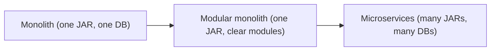

Most teams should move left to right **only when they feel real pain**.

**Example:** Our shop with 8 developers and 10,000 orders a day.
- 10,000 orders a day is less than 1 order per second. One Spring Boot app handles this easily.
- A modular monolith with modules `order`, `payment`, `inventory`, `shipping` is a good start.
- Later, you have 60 developers in 6 teams. The payment team wants to deploy 5 times a day. Now you can cut `payment` out as a separate service. The clean module border makes this easy.

Real case: in 2023, the Amazon Prime Video team moved one monitoring system **from** microservices **back** to a monolith. They said it cut that system's cost by about 90%.

**Good and bad:**
| | Good | Bad |
|---|---|---|
| **Monolith** | Simple to build, test, deploy and debug | One bug can crash everything |
| | Normal database transactions (ACID) | Big codebase gets messy over years |
| | No network calls between modules, so it is fast | You must scale the whole app, even if only one part is busy |
| **Microservices** | Each team deploys on its own | Network calls fail and add delay |
| | Scale only the busy service | No simple transaction across services (you need sagas) |
| | One service can crash and others keep working | You need tracing, central logs, service discovery, CI/CD per service |

**When to use / when not to use:**
- **Do not** start with microservices when the team is small (under about 10-15 developers).
- **Do not** use them when the business areas are still unclear. You will draw the borders in the wrong place.
- **Do not** use them if you have no CI/CD, no central logging and no monitoring yet.
- **Use** them when many teams block each other.
- **Use** them when parts need very different scaling or different release speeds.
- A **modular monolith** is a sensible default for most new projects.

**Say this in the interview:**
> "Microservices are not automatically better. They trade code complexity for network and operations complexity. I usually start with a modular monolith with clear module borders. I split out a service only when team size, scaling or release speed gives a real reason."

**They may ask next:**
- **What is a "distributed monolith"?** Many services that must be deployed together, or that share one database. You get the pain of both styles and the benefit of neither.
- **Should services share a database?** No. Each service owns its data. Others get it through an API or events. A shared database couples them tightly.
- **How do you find service borders?** Use business areas (DDD *bounded contexts*: a part of the business with its own words and rules), for example Order, Payment, Shipping. Not technical layers like "DAO service".

## Sync vs async communication

**In one line:** Sync means "call and wait for the answer now". Async means "send a message and continue; someone handles it later".

**Story:**
- **Sync** = a phone call. You call the shop and wait on the line until they answer. If they do not pick up, you are stuck.
- **Async** = a WhatsApp message. You send it and go back to work. They reply when they are free. If their phone is off, the message waits for them.

**How it works:**
1. **Sync:** REST (HTTP + JSON) or gRPC (HTTP/2 + Protocol Buffers, a fast binary format with a strict contract). The caller waits for the response.
2. **Async:** the service publishes an **event** (a fact, like `OrderPlaced`) to a broker like Kafka or RabbitMQ. Other services read it when they can.
3. REST is best for browsers and public APIs. gRPC is good for fast service-to-service calls inside the company.

**Diagram:**

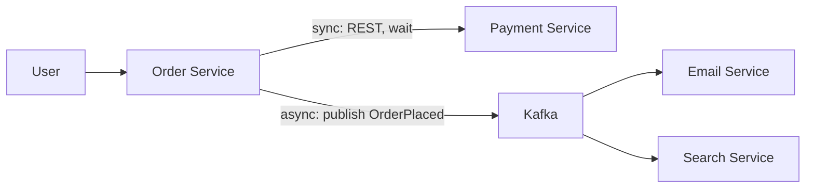

**Example: the math of a call chain.**

*Availability* (the percent of time a service works):
- One service at 99.9% is down about 43 minutes a month.
- A sync chain of 5 services, each 99.9%: 0.999 x 0.999 x 0.999 x 0.999 x 0.999 = **about 99.5%**.
- 99.5% means about **3.6 hours down a month**. Five good services made one weaker system.

*Latency* (time to answer):
- In a sync chain, the delays add up. 5 calls x 50 ms = 250 ms before any business logic.
- Slow calls hurt more. Say each service is slower than 100 ms in 1% of calls. If one request calls 10 services, about **10% of requests** hit at least one slow call (1 - 0.99^10 = 9.6%).

With async, the email service can be down for 1 hour. Orders still work. Emails go out when it comes back.

**Good and bad:**
| | Good | Bad |
|---|---|---|
| **Sync** | Simple to write and debug | Caller is blocked while it waits |
| | You get the answer right now | One slow service slows the whole chain |
| | Easy errors: you get a 4xx/5xx back | Availability drops with each extra hop |
| **Async** | Services do not need to be up at the same time | *Eventual consistency*: data is correct a bit later, not right now |
| | Broker absorbs traffic spikes | Duplicate messages, so consumers must be idempotent |
| | One event, many readers | Harder to trace and debug |

**When to use / when not to use:**
- **Use sync** when the user needs the answer to continue. Examples: login, price check, "is this item in stock?".
- **Use async** when the work can happen a bit later. Examples: send email, update search index, analytics, loyalty points.
- **Use async** when many services care about the same fact (one `OrderPlaced`, five readers).
- **Avoid** long sync chains (A calls B calls C calls D). Keep it to 1-2 hops if you can.

**Say this in the interview:**
> "I use sync REST or gRPC when the user needs the answer right now. I use events when the work can happen later or many services need the same fact. Sync chains multiply failure: 5 services at 99.9% give only about 99.5%. Async improves availability, but I must handle duplicates and eventual consistency."

**They may ask next:**
- **REST or gRPC?** REST for browsers and public APIs because it is simple and readable. gRPC for internal high-traffic calls because it is smaller, faster and typed.
- **Is "async" the same as "non-blocking"?** No. Async messaging is about *who waits* between services. Non-blocking I/O (WebFlux, virtual threads) is about how one service uses its threads.
- **Can you do request-reply over Kafka?** Yes, but it is usually a sign you want a sync call. Keep Kafka for events.

## Saga pattern

**In one line:** A saga is a chain of local transactions across services. If one step fails, you run "undo" steps (compensations) for the steps that already finished.

**Story:** A wedding planner books a hall, then a caterer, then a band.
- The band is not free on that date.
- You cannot "roll back" the world. The planner must **call** the hall and cancel, then call the caterer and cancel.
- Each cancel is a new action, maybe with a fee. That is a **compensating action**.

**How it works (our shop):**
1. **Order Service:** create order with status `PENDING`.
2. **Payment Service:** charge the card.
3. **Inventory Service:** reserve the items.
4. **Shipping Service:** create the shipment.
5. If step 3 fails (out of stock), run compensations backwards: **refund payment**, then **cancel order**.

| Step | Action | Compensation (undo) |
|---|---|---|
| Order | Create order (PENDING) | Mark order CANCELLED |
| Payment | Charge card | Refund |
| Inventory | Reserve items | Release items |
| Shipping | Create shipment | Cancel shipment (only before it leaves) |

Each step is a normal local transaction inside one service and one database.

**Two styles:**

**1. Choreography** (no boss; each service reacts to events):

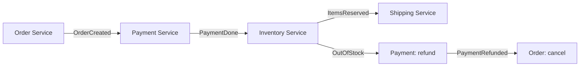

Like a group chat: each vendor does their job when they see the previous message.

**2. Orchestration** (one boss tells each service what to do):

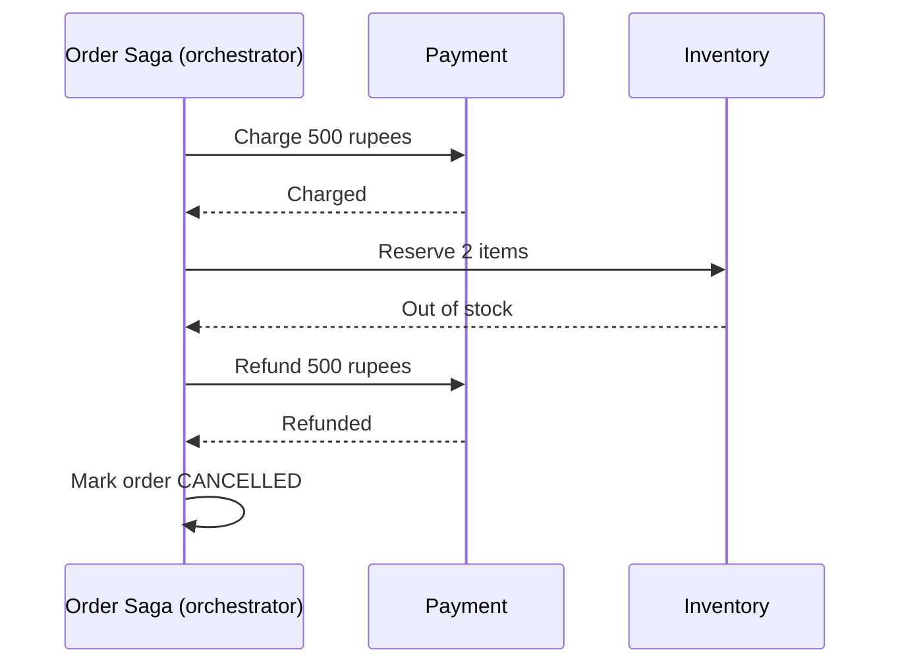

Like the wedding planner: one person knows the full plan and the current step.

**Example:** Orchestrator state is saved in a table, so a crash does not lose progress.

```java
public void onInventoryResult(UUID orderId, boolean reserved) {
    var saga = sagaRepo.findById(orderId).orElseThrow();
    if (reserved) {
        saga.setStep(Step.SHIPPING);
        commands.send("shipping-commands", new CreateShipment(orderId));
    } else {
        saga.setStep(Step.COMPENSATING);
        commands.send("payment-commands", new RefundPayment(orderId)); // undo the earlier step
    }
    sagaRepo.save(saga); // save progress; use the outbox so save + send are safe together
}
```

**Good and bad:**
| | Good | Bad |
|---|---|---|
| **Choreography** | No central service, very loose coupling | Hard to see the full flow; logic is spread across services |
| | Simple for 2-3 steps | Risk of event loops and "who handles this?" questions |
| **Orchestration** | Full flow in one place, easy to read and monitor | The orchestrator is one more service to build and run |
| | Easy to add timeouts and retries per step | Risk of putting too much business logic in the orchestrator |

**Why not 2PC (two-phase commit)?** 2PC is a protocol where a coordinator asks every database "ready?" and then says "commit" to all.
- It holds locks in all services while it waits. Slow and blocks other users.
- If the coordinator dies in the middle, databases can stay locked.
- Kafka and many NoSQL databases do not support it (no XA support, the standard for 2PC).
- All services must be up at the same time. That kills the main benefit of microservices.

**Tools:** You can build a simple orchestrator yourself with a state table. For bigger flows, use a workflow engine:
- **Temporal**: you write the workflow as normal Java code. It saves every step and resumes after a crash.
- **Camunda**: BPMN (a drawn flowchart that the engine runs). Good when business people want to see the flow.
- **Spring Statemachine**: a library for states and transitions inside your own app.

**When to use / when not to use:**
- Use choreography for short flows (2-3 steps).
- Use orchestration for 4+ steps, or when you need timeouts, a clear status page, or audits.
- Do not use a saga if the data can live in one service and one database. A local transaction is much simpler.

**Say this in the interview:**
> "Across services I cannot use one database transaction, and 2PC is slow and fragile. So I use a saga: each service does a local transaction and publishes an event. If a later step fails, I run compensations, like a refund. For short flows I use choreography. For longer flows I use an orchestrator like Temporal, so the whole flow is visible in one place."

**They may ask next:**
- **What if a compensation fails?** Retry it, because it must be idempotent. If it still fails, send it to a dead letter queue and alert a human.
- **What about dirty reads during the saga?** Other users may see the order before it is final. Use a status like `PENDING` (a *semantic lock*) so others know it is not final.
- **What if a step cannot be undone, like a parcel that already left?** Put such steps last. After that point, the saga only moves forward.

## Transactional outbox pattern

**In one line:** Save the business data and the "event to send" in the **same database transaction**. A separate process sends the event to Kafka later.

**Story:** A bank clerk takes your deposit.
- He writes it in the main ledger.
- In the **same book**, on the last page, he writes "send SMS to customer".
- A peon checks that last page every few minutes and sends the SMS. Then he ticks it.
- If the peon is on lunch, the SMS goes late. But it is **never lost**, because it is written in the same book as the deposit.

**How it works:**

*The problem (dual write):* Order Service must do two things: save the order in the DB and publish `OrderCreated` to Kafka. These are two different systems.
1. DB commit works, then Kafka publish fails (network blip, app crash). The order exists, but Payment never hears about it.
2. Or you publish first, then the DB commit fails. Payment charges for an order that does not exist.

There is no shared transaction between Postgres and Kafka.

*The fix:*
1. In one DB transaction: insert the order **and** insert a row in the `outbox` table.
2. A relay process reads new outbox rows and publishes them to Kafka.
3. After Kafka confirms, mark the row as sent (or delete it).

Two ways to build the relay:
- **Poller:** a scheduled job runs `SELECT ... WHERE sent_at IS NULL` every 500 ms. Simple.
- **CDC (Change Data Capture):** a tool like **Debezium** reads the database change log (Postgres WAL, MySQL binlog). It pushes new outbox rows to Kafka. No polling load on the DB. Debezium has a ready "Outbox Event Router" for this.

**Diagram:**

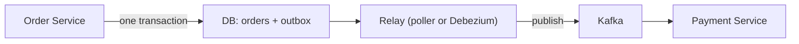

**Example:**

```java
@Transactional // order and outbox row commit together, or not at all
public Order placeOrder(CreateOrder cmd) {
    Order order = orderRepo.save(Order.from(cmd));
    outboxRepo.save(new OutboxEvent(UUID.randomUUID(), "Order", order.getId(),
            "OrderCreated", json.write(order)));
    return order;
}

// Simple poller relay
@Scheduled(fixedDelay = 500)
@Transactional
public void relay() {
    for (var e : outboxRepo.findNextBatchForUpdateSkipLocked(100)) { // SKIP LOCKED: safe with many pods
        kafka.send("order-events", e.getAggregateId().toString(), e.getPayload()).join(); // wait for ack
        e.markSent();
    }
}
```

**Good and bad:**
| Good | Bad |
|---|---|
| No lost events: if the order is saved, the event is saved | Event is a bit late (milliseconds to seconds) |
| Uses only your normal DB transaction | Outbox table grows, so you need a cleanup job |
| Works with any broker | **At-least-once**: an event can be sent twice (crash after send, before mark) |
| CDC gives low delay and no polling | CDC (Debezium + Kafka Connect) is one more system to run |

**When to use / when not to use:**
- Use it whenever a service must change its DB **and** tell others about it.
- Not needed if the service only reads.
- Not needed if losing an event is fine, for example a "page viewed" metric.

**Say this in the interview:**
> "Writing to the database and to Kafka is a dual write, and one of them can fail. So I write the event into an outbox table in the same transaction as the business data. A poller or Debezium CDC publishes it to Kafka later. This gives at-least-once delivery, so consumers must be idempotent."

**They may ask next:**
- **How do you keep event order?** Use the aggregate id (order id) as the Kafka key. All events of one order go to one partition, in order.
- **What is the inbox pattern?** The consumer side: save the event id in a `processed_events` table in the same transaction as the business change. Skip ids you have already seen.
- **Why not Kafka transactions?** Kafka transactions cover Kafka only. They cannot include your Postgres commit.

## Idempotency

**In one line:** An operation is *idempotent* if doing it 2 or 10 times gives the same result as doing it once.

**Story:** You press "Pay 2,000 rupees" on a slow phone network. The screen spins. You press again.
- Without idempotency: you pay 4,000 rupees.
- With idempotency: the shop says "I already have payment request #A12. Here is the same receipt." You pay 2,000 rupees once.

The lift button is the same. Pressing it 5 times does not call 5 lifts.

**How it works:**
1. The client makes a unique id for each *intended* action, for example a UUID. It sends it in the `Idempotency-Key` header. Stripe and many payment APIs use this pattern.
2. On a retry, the client sends the **same** key.
3. The server stores each key in a table with a **unique constraint**. The database refuses a second row with the same key.
4. If the key is new: do the work, save the result with the key.
5. If the key already exists: do not do the work again. Return the saved result.
6. If the same key comes with a different body: return an error (409 or 422).

Why we need it: retries, timeouts and at-least-once delivery from Kafka all create duplicates. You cannot stop duplicates, so you make them harmless.

**Diagram:**

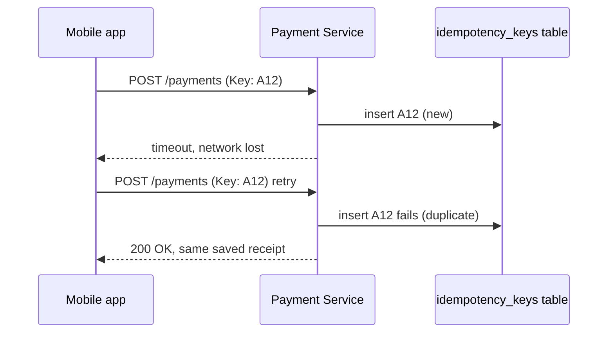

**Example:**

```sql
CREATE TABLE idempotency_keys (
  idem_key     VARCHAR(64) PRIMARY KEY,  -- unique: a second insert fails
  request_hash CHAR(64)    NOT NULL,
  status       VARCHAR(20) NOT NULL,     -- IN_PROGRESS or DONE
  response     JSONB,
  created_at   TIMESTAMP   NOT NULL
);
```

```java
@PostMapping("/payments")
public PaymentResponse pay(@RequestHeader("Idempotency-Key") String key,
                           @RequestBody PaymentRequest req) {
    try {
        keys.insertInProgress(key, hash(req)); // INSERT; fails if the key exists
    } catch (DuplicateKeyException e) {
        var row = keys.find(key);
        if (!row.requestHash().equals(hash(req))) throw new ConflictException("Key reused");
        if (row.isDone()) return row.response();  // replay: same answer, no new charge
        throw new ConflictException("Still processing, retry later");
    }
    var response = gateway.charge(req, key);      // pass the key to the bank too
    keys.markDone(key, response);
    return response;
}
```

For Kafka consumers, the idea is the same. Save the `eventId` in a `processed_events` table in the same transaction as the business change.

**Good and bad:**
| Good | Bad |
|---|---|
| Retries become safe | One extra DB write per request |
| No double charges or double emails | Keys table grows, so delete keys after 24 hours to 7 days |
| Works with at-least-once Kafka | Client must send a good key (one per action, not one per click) |

**When to use / when not to use:**
- Must have: payments, order creation, money transfer, any Kafka consumer that changes data.
- Free already: `GET`, `PUT` (set to a value) and `DELETE` are idempotent by HTTP rules. `POST` is not.
- Not worth it: actions where a duplicate does not matter, like "mark notification as read".

**Say this in the interview:**
> "Networks fail, so clients retry and Kafka can deliver twice. I make every write idempotent. For payments the client sends an Idempotency-Key header. I store it in a table with a unique constraint and return the saved response on a repeat. For Kafka consumers I keep a processed-events table, written in the same transaction as the change."

**They may ask next:**
- **Why a unique constraint and not "check, then insert"?** Two requests can check at the same moment and both see "not found". The unique constraint lets only one win.
- **Redis or database for keys?** Database if the key must be in the same transaction as the business data. Redis `SET key value NX EX 86400` is fine for a fast first filter.
- **Is `PUT` always idempotent?** `PUT /orders/1 {status: PAID}` is. `PUT /account/1/add-100` is not; that is a bad API design.

## Retry with exponential backoff and jitter

**In one line:** Retry a failed call a few times and wait longer after each failure. Add a random part to the wait, so clients do not all retry at the same moment.

**Story:** Customer care opens at 9:00 AM. The line is busy.
- If 1,000 people redial every 5 seconds, the line stays jammed forever.
- Smart people wait 1 minute, then 2, then 4.
- Even smarter: each person adds a random few seconds. Now the calls spread out and the lines clear.

The spike of everyone retrying together is called the **thundering herd**.

**How it works:**
1. **Retry only safe errors.** Transient errors are short problems that fix themselves: timeout, connection reset, 503, 429. Do **not** retry 400 Bad Request, 401, 404 or "card declined". They fail again every time.
2. **Retry only idempotent calls**, or calls with an idempotency key.
3. **Exponential backoff:** wait = base x 2^attempt. With base 200 ms: 200, 400, 800, 1,600 ms.
4. **Cap it:** never wait more than a max, for example 2 seconds.
5. **Jitter:** add randomness. A common formula ("full jitter"):
   `wait = random(0, min(cap, base x 2^attempt))`
6. **Limit attempts:** usually 3 total (1 call + 2 retries).
7. **Retry budget:** retries must be a small part of traffic, for example at most 10% extra calls. If more is failing, the server is sick. Stop retrying and let the circuit breaker act.

**Diagram:**

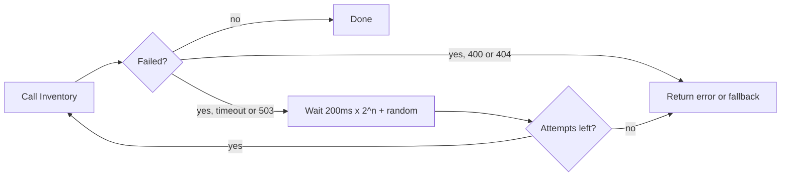

**Example:** Why retries multiply. Gateway, Order and Inventory each retry 3 times. One user click can become 3 x 3 x 3 = **27 calls** to Inventory. A small outage becomes a big one. **Retry at one layer only**, usually the one closest to the failing service.

Resilience4j 2.x with Spring Boot (`resilience4j-spring-boot3` starter):

```yaml
resilience4j:
  retry:
    instances:
      inventory:
        maxAttempts: 3                    # 1 call + 2 retries
        waitDuration: 200ms               # first wait
        enableExponentialBackoff: true
        exponentialBackoffMultiplier: 2   # 200ms, 400ms, ...
        exponentialMaxWaitDuration: 2s    # cap
        enableRandomizedWait: true        # jitter
        randomizedWaitFactor: 0.5         # wait can move +/- 50%
        retryExceptions:
          - java.io.IOException
          - org.springframework.web.client.HttpServerErrorException
        ignoreExceptions:
          - org.springframework.web.client.HttpClientErrorException  # 4xx: do not retry (429 is the one exception, handle it separately)
```

```java
@Retry(name = "inventory", fallbackMethod = "reserveLater")
public Reservation reserve(ReserveRequest req) {
    return inventoryClient.reserve(req); // must be idempotent: send a request id
}
```

Note: Spring Framework 7 (Spring Boot 4) also has a built-in `@Retryable` with `delay`, `multiplier`, `jitter` and `maxDelay`. Turn it on with `@EnableResilientMethods`. Its `maxRetries` counts only retries, not the first call.

**Good and bad:**
| Good | Bad |
|---|---|
| Hides short network blips from the user | Retrying a non-idempotent call can charge twice |
| Backoff gives the server time to recover | Retries at many layers multiply load (27x) |
| Jitter spreads load and avoids the thundering herd | Adds delay to the user request |

**When to use / when not to use:**
- Use for short, transient errors on idempotent calls.
- Do not retry business errors or 4xx errors.
- Do not retry when the user is waiting and the time budget is already used up.

**Say this in the interview:**
> "I retry only transient errors like timeouts and 503, and only on idempotent calls. I use exponential backoff with jitter, so thousands of clients do not retry at the same second. I keep it to about 3 attempts at one layer only, with a retry budget. If failures continue, the circuit breaker stops the calls."

**They may ask next:**
- **Why jitter if we already have backoff?** Without jitter, all clients that failed at 9:00:00 retry together at 9:00:00.2, then 9:00:00.6. Backoff alone keeps them in step.
- **Retry or circuit breaker first?** In Resilience4j's default order, Retry is the outer layer and CircuitBreaker is inside it. When the breaker is open, each retry fails fast. Set `ignoreExceptions` so the "breaker open" error is not retried.
- **Should Kafka consumers retry like this?** Retry a few times, then send the message to a retry topic or a DLT (dead letter topic). Do not block the partition forever.

## Timeouts

**In one line:** A timeout is the max time you will wait for an answer before you give up.

**Story:** You order food at a restaurant. You decide: "If food does not come in 30 minutes, I leave and eat somewhere else."
- Without this rule, you sit there all night. The table is blocked. New customers cannot sit.
- In a server, the "table" is a thread or a connection. A call with no timeout keeps it busy forever.

**How it works:**
1. **Connect timeout:** max time to open the connection (the TCP handshake, the first "hello" between two machines). Keep it short, like 1-2 seconds. If you cannot even connect, the server is down or unreachable.
2. **Read timeout** (also called response or socket timeout): max time to wait for data after the connection is open. Set it from the real p99 latency of that service (the time in which 99% of calls finish), plus some margin.
3. **Default timeouts are often infinite.** For example, Java's `HttpURLConnection` uses 0, which means "wait forever". The JDK `HttpClient` has no request timeout unless you set one. Never trust the default.
4. **Timeout budget:** the user-facing deadline is split across the chain. Each inner call must get **less** time than its caller.

**Diagram:**

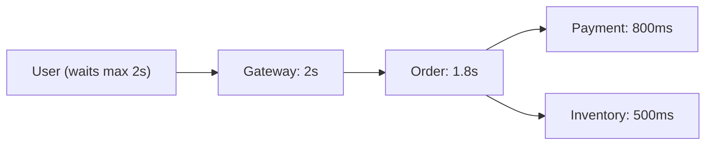

**Example: why no timeout kills the system.**
- Order Service has 200 Tomcat threads.
- Payment Service hangs (does not answer at all).
- At 100 requests per second, all 200 threads are stuck in about 2 seconds.
- Now even `/health` and "view my orders" fail. One slow service took down another. This is a **cascading failure**.

With an 800 ms read timeout, each thread is free again after 800 ms. Users get a quick error or a fallback.

*Budget mistake:* Order has a 1 second timeout. But it calls Payment with a 3 second timeout. Order gives up at 1 second, but Payment keeps working for 2 more seconds. That is wasted work.

Spring Boot 4 sets timeouts for all auto-configured HTTP clients (RestClient, RestTemplate):

```yaml
spring:
  http:
    clients:
      connect-timeout: 1s
      read-timeout: 800ms
```

(In Spring Boot 3.4 and 3.5, the prefix is `spring.http.client`, without the "s".)

Do not forget other timeouts: DB query timeout, connection pool wait (HikariCP `connectionTimeout`, default 30 s), and Redis timeout.

**Good and bad:**
| Good | Bad |
|---|---|
| Threads and connections are freed fast | Too short: you fail calls that would have worked |
| Stops one slow service from killing others | Too long: threads pile up anyway |
| User gets a clear answer fast | A timeout does not mean "it failed". The server may have done the work, so retries need idempotency |

**When to use / when not to use:**
- Use on **every** network call: HTTP, DB, cache, broker. No exceptions.
- Set values from measured p99 latency, not guesses.

**Say this in the interview:**
> "Every network call needs a connect timeout and a read timeout, because many defaults are infinite. I set them from the real p99 latency. I also think in a timeout budget: if the user waits 2 seconds, inner calls get less time than their callers. A timeout does not prove the call failed, so the retry must be idempotent."

**They may ask next:**
- **What is deadline propagation?** Pass the remaining time to the next service (gRPC does this with deadlines). Then the inner service stops work when the caller has already given up.
- **Timeout vs circuit breaker?** A timeout protects one call. A circuit breaker watches many calls and stops all of them when the service looks sick.
- **What if a payment call times out?** You do not know if money was taken. Check the status with the same idempotency key before you charge again.

## Circuit breaker

**In one line:** A circuit breaker watches calls to a service. When too many fail, it stops sending calls for a while and fails fast instead.

**Story:** The electric fuse (MCB) at home.
- Normal: power flows. This is **closed**.
- A short circuit happens. The MCB trips and cuts the power. This is **open**. It protects the wires from burning.
- After some time, you push it up and test carefully. This is **half-open**. If it holds, power is back. If it trips again, you wait more.

**How it works:**
1. **Closed:** all calls go through. The breaker counts failures and slow calls in a sliding window (for example, the last 20 calls).
2. If the failure rate goes over a threshold (for example 50%), it goes **open**.
3. **Open:** no calls go to the service. Every call fails at once, or goes to a **fallback** (a backup answer).
4. After a wait (for example 30 s), it goes **half-open**.
5. **Half-open:** a few test calls (for example 3) go through. If they work, back to **closed**. If they fail, back to **open**.

Why it helps:
- The sick service gets rest and can recover.
- Callers do not waste threads waiting for timeouts.

**Diagram:**

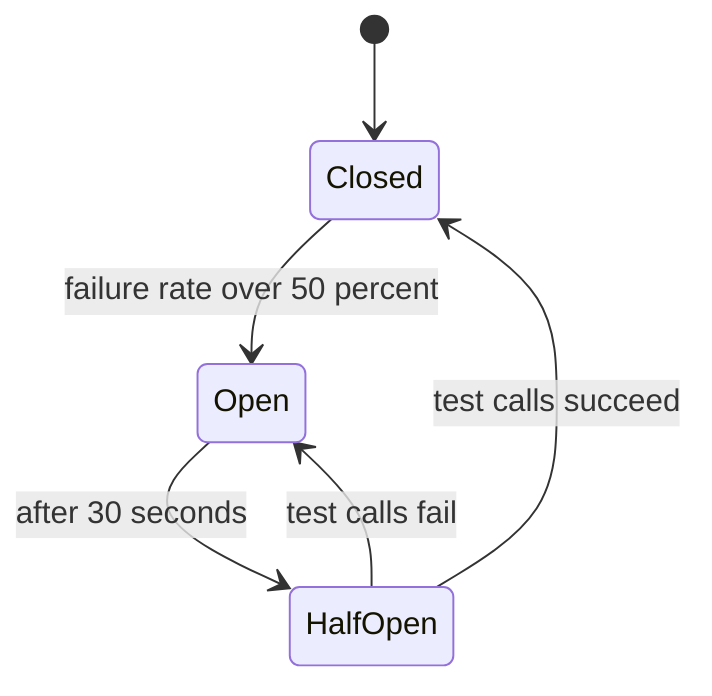

**Example:** Order Service calls Payment Service with Resilience4j and Spring Boot 3 (`resilience4j-spring-boot3` plus the Spring AOP starter for annotations).

```yaml
resilience4j:
  circuitbreaker:
    instances:
      payment:
        slidingWindowType: COUNT_BASED
        slidingWindowSize: 20               # look at the last 20 calls
        minimumNumberOfCalls: 10            # do not judge on 2 calls
        failureRateThreshold: 50            # 50% failed -> open
        slowCallDurationThreshold: 2s       # slower than 2s counts as "slow"
        slowCallRateThreshold: 80           # 80% slow -> open
        waitDurationInOpenState: 30s
        permittedNumberOfCallsInHalfOpenState: 3
        automaticTransitionFromOpenToHalfOpenEnabled: true
```

```java
@Service
public class PaymentClient {
    private final RestClient restClient;

    PaymentClient(RestClient.Builder builder) {
        this.restClient = builder.baseUrl("http://payment-service").build();
    }

    @CircuitBreaker(name = "payment", fallbackMethod = "payLater")
    public PaymentStatus charge(PaymentRequest req) {
        return restClient.post().uri("/payments").body(req).retrieve().body(PaymentStatus.class);
    }

    private PaymentStatus payLater(PaymentRequest req, Throwable t) {
        return PaymentStatus.PENDING; // fallback: accept order now, charge later by a job
    }
}
```

**Good fallbacks:** cached data, a default value ("no recommendations"), "accept now, process later", or a clear error message. **Bad fallback:** pretending the payment succeeded.

**Good and bad:**
| Good | Bad |
|---|---|
| Stops cascading failures | Wrong thresholds: opens too often, or never |
| Fails in milliseconds, not after a 2 s timeout | Fallback logic must be tested too, or it fails on the bad day |
| Gives the sick service time to recover | Each pod has its own breaker state, so pods can disagree for a short time |

**When to use / when not to use:**
- Use on calls to other services and third-party APIs (payment gateway, SMS provider).
- Not useful for in-memory calls. Not a fix for business errors like "card declined"; do not count those as failures.

**Say this in the interview:**
> "A circuit breaker works like a house fuse. When too many calls fail or are slow, it opens and fails fast. We stop wasting threads on a sick service. After a wait it goes half-open and sends a few test calls. I use Resilience4j with a fallback, like returning cached data or accepting the order and charging later."

**They may ask next:**
- **Which errors should count as failures?** Timeouts, connection errors and 5xx. Not 4xx and not business errors. Use `ignoreExceptions` or `recordExceptions`.
- **Count-based or time-based window?** Count-based (last N calls) is simple. Time-based (last N seconds) is better when traffic changes a lot during the day.
- **What replaced Hystrix?** Netflix put Hystrix in maintenance mode in 2018. Resilience4j is the standard now. Spring Cloud CircuitBreaker can sit on top of it.

## Bulkhead

**In one line:** A bulkhead gives each dependency its own small pool of threads or slots. One slow dependency cannot use up everything.

**Story:** A big ship is split into **compartments** with walls between them. These walls are called bulkheads.
- If the ship hits a rock, water fills only one compartment.
- The walls stop the water. The ship stays afloat.
- Without walls, one hole sinks the whole ship. That is what happened to the Titanic: its walls were not high enough.

**How it works:**
1. Your service calls many dependencies: Payment, Inventory, Recommendations.
2. Without a bulkhead, they all share one pool, for example 200 Tomcat threads.
3. With a bulkhead, each dependency gets its own limit. For example: Recommendations max 20 calls at a time.
4. If Recommendations is slow, only those 20 slots fill up. Extra calls are rejected fast (or get a fallback). The other 180 threads still serve checkout.

Two types in Resilience4j:
- **Semaphore bulkhead:** a counter. "Max 20 calls at the same time." Runs on the caller's thread. Light and simple.
- **Thread-pool bulkhead:** a separate thread pool and queue per dependency. Stronger walls, but more threads and more memory.

**Diagram:**

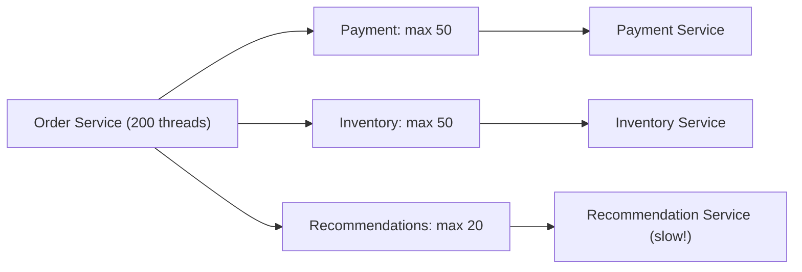

**Example:**
- Recommendations becomes slow: each call takes 10 s.
- Traffic: 50 requests per second.
- Without a bulkhead, 200 threads are full in 4 seconds. Checkout stops. The shop loses money because of a "nice-to-have" feature.
- With a bulkhead of 20, only 20 slots are stuck. The product page shows "no recommendations". Checkout works.

```yaml
resilience4j:
  bulkhead:
    instances:
      recommendations:
        maxConcurrentCalls: 20   # max 20 calls at the same time
        maxWaitDuration: 10ms    # wait a little for a slot, then reject
```

```java
@Bulkhead(name = "recommendations", fallbackMethod = "noRecommendations")
public List<Product> recommendations(String userId) {
    return recoClient.forUser(userId);
}

private List<Product> noRecommendations(String userId, Throwable t) {
    return List.of(); // page still loads, just without this box
}
```

**With virtual threads** (Java 21+): you can have millions of threads, so thread count is no longer the limit. But the slow service and the connection pool still have limits. A semaphore bulkhead (or Spring Framework 7's `@ConcurrencyLimit`) is still needed to cap calls.

**Good and bad:**
| Good | Bad |
|---|---|
| One slow dependency cannot sink the whole service | Limits must be tuned; too small rejects good traffic |
| Important flows (checkout) stay alive | Thread-pool bulkheads use more memory and threads |
| Fast rejection is better than slow waiting | More config to manage per dependency |

**When to use / when not to use:**
- Use when one service calls several dependencies with different importance.
- Use to protect the critical path (checkout, payment) from nice-to-have features.
- Not needed for a service with only one dependency. Timeouts may be enough there.

**Say this in the interview:**
> "A bulkhead is like the compartments in a ship. I give each dependency its own limit of concurrent calls. A slow recommendation service can block only 20 slots, not all 200 threads. Checkout keeps working. In Resilience4j I use a semaphore bulkhead for most cases and a thread-pool bulkhead when I need stronger isolation."

**They may ask next:**
- **How do you pick the limit?** Use Little's law: concurrent calls = requests per second x latency in seconds. 100 rps x 0.2 s = 20 slots. Add some margin.
- **Bulkhead vs rate limiter?** A bulkhead limits calls *at the same time*. A rate limiter limits calls *per second*.
- **Other kinds of bulkheads?** Yes: separate DB connection pools, separate Kafka consumer groups, or even separate pods for VIP customers.

## API gateway and BFF

**In one line:** An API gateway is the single front door for all client requests. A BFF (Backend for Frontend) is a small backend made for one type of client, like the mobile app.

**Story:** A big hotel.
- Guests do not walk into the kitchen, the laundry or the accounts office. They go to the **reception**.
- Reception checks your ID (auth). It sends you to the right place (routing). It stops a crowd from rushing in (rate limit).
- The hotel also has a **kids' desk** and a **business desk**. Each one speaks the language of its guests. That is the BFF idea: one front desk per client type.

**How it works:**

*API gateway jobs:*
1. **Routing:** `/orders/**` goes to Order Service, `/payments/**` goes to Payment Service.
2. **Auth:** check the JWT token (a signed login token) once, at the door.
3. **Rate limiting:** for example 100 requests per minute per user. Extra requests get HTTP 429.
4. **Cross-cutting work:** TLS, CORS, request ids for tracing, logging.
5. **Aggregation (sometimes):** call 3 services and merge the answers into one response.

*BFF (Backend for Frontend):*
- Web and mobile need different data. A web page shows 20 fields. A mobile screen shows 5 and has a slow network.
- So you build one BFF per client type: `web-bff`, `mobile-bff`. Each one calls the services and shapes the response for its screen.
- The team that owns the app usually owns its BFF.

**Diagram:**

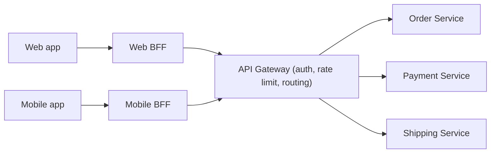

(Many teams put the gateway first and the BFFs behind it. Both layouts are fine. Pick one and keep it simple.)

**Example:** Spring Cloud Gateway (2025.0 or newer uses the `server.webflux` prefix):

```yaml
spring:
  cloud:
    gateway:
      server:
        webflux:
          routes:
            - id: orders
              uri: lb://order-service          # lb = use Spring Cloud LoadBalancer
              predicates:
                - Path=/api/orders/**
              filters:
                - StripPrefix=1                # /api/orders/1 -> /orders/1
                - name: RequestRateLimiter
                  args:
                    redis-rate-limiter.replenishRate: 10   # 10 requests per second
                    redis-rate-limiter.burstCapacity: 20   # short bursts up to 20
```

Older versions used `spring.cloud.gateway.routes`. In 2025.0+ that old block does nothing, so check this when you upgrade.

**Netflix stack is retired.** Many old tutorials use it. Know the replacements:

| Old (Netflix OSS) | Status | Use now |
|---|---|---|
| Zuul 1 (gateway) | Removed from Spring Cloud in 2020.0 | **Spring Cloud Gateway** |
| Hystrix (circuit breaker) | Maintenance mode since 2018, removed in 2020.0 | **Resilience4j** (via Spring Cloud CircuitBreaker) |
| Ribbon (client load balancer) | Removed in 2020.0 | **Spring Cloud LoadBalancer** |
| Eureka (service discovery) | Still supported | Eureka, or Kubernetes Services |

**Good and bad:**
| Good | Bad |
|---|---|
| One place for auth, rate limit, TLS and logging | One more hop: adds a few ms of latency |
| Clients do not know internal service addresses | Can become a single point of failure, so run 2+ instances |
| BFF gives each client exactly the data it needs | Business logic can creep into the gateway; keep it thin |
| Fewer round trips for mobile apps | Many BFFs can copy the same code |

**When to use / when not to use:**
- Use a gateway once you have more than 2-3 services exposed to clients.
- Use BFFs when web and mobile need very different data or release at different speeds.
- Do not put business rules (prices, discounts) in the gateway. It is a door, not a shop.
- A small app with one client may not need a BFF at all.

**Say this in the interview:**
> "The API gateway is the single front door. It handles routing, auth, rate limiting and tracing ids, and it stays thin with no business logic. When web and mobile need different data, I add a BFF per client type, owned by that frontend team. In Spring I use Spring Cloud Gateway. The old Netflix Zuul, Hystrix and Ribbon are retired; today it is Spring Cloud Gateway, Resilience4j and Spring Cloud LoadBalancer."

**They may ask next:**
- **Gateway vs load balancer?** A load balancer spreads traffic across copies of one service. A gateway understands the request (path, token, user) and routes to different services.
- **Gateway vs service mesh?** The gateway handles traffic coming *into* the system (north-south). A service mesh like Istio handles service-to-service traffic (east-west). It adds mTLS (both sides show a certificate), retries and timeouts in a proxy next to each service.
- **Is the gateway reactive?** The main Spring Cloud Gateway runs on WebFlux (non-blocking). There is also a Server MVC version for teams that prefer the servlet stack.
