[← Back to README](../README.md)

# Microservices patterns

Microservices are small apps that talk over the network. The network can be slow, and it can fail.
These patterns are the standard answers to "what happens when it fails?".
We use one running example: an online shop with **Order**, **Payment**, **Inventory** and **Shipping** services.

## The big picture: where each pattern lives

**The big picture:** Follow one order from the app on the left to the services on the right; each pattern below has a place in this picture.

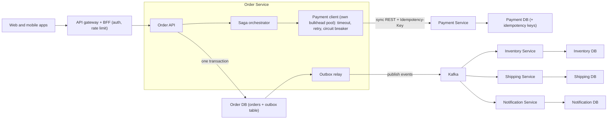

| Pattern | Where it sits in the picture | Problem it solves | Read more |
|---|---|---|---|
| Microservices | The services on the right, each with its own DB | Each team can deploy and scale its part on its own | [Monolith vs microservices](#monolith-vs-microservices) |
| Sync vs async | Order → Payment is sync (REST). Kafka → Inventory, Shipping, Notification is async | The user waits only for the work that must happen now | [Sync vs async](#sync-vs-async-communication) |
| Saga | "Saga orchestrator" inside Order Service | One order changes 4 databases. If a step fails, undo the earlier steps | [Saga](#saga-pattern) |
| Transactional outbox | "Order DB (orders + outbox table)" and "Outbox relay" | Save the order and send the event, and never lose one of them | [Outbox](#transactional-outbox-pattern) |
| Idempotency | Idempotency-Key on the Payment call, keys saved in Payment DB | A retry or a duplicate event does not charge the card twice | [Idempotency](#idempotency) |
| Retry with backoff and jitter | Payment client inside Order Service | Short network blips do not reach the user | [Retry](#retry-with-exponential-backoff-and-jitter) |
| Timeouts | Payment client (and every arrow in the picture) | A slow service cannot hold our threads forever | [Timeouts](#timeouts) |
| Circuit breaker | Payment client | Stop calling a sick Payment Service and fail fast | [Circuit breaker](#circuit-breaker) |
| Bulkhead | "own bulkhead pool" in the Payment client | A slow dependency fills only its own pool, not all threads | [Bulkhead](#bulkhead) |
| API gateway and BFF | "API gateway + BFF", the front door | One place for login check, rate limit and routing; the right data for each app | [API gateway and BFF](#api-gateway-and-bff) |

**More topics in this file:** [The 12-factor app](#the-12-factor-app) · [Service discovery](#service-discovery) · [Config management](#config-management) · [Database per service](#database-per-service-and-data-consistency) · [API composition and CQRS](#api-composition-and-cqrs) · [Event sourcing](#event-sourcing) · [Strangler fig](#strangler-fig-migration-from-a-monolith) · [Tracing and correlation IDs](#distributed-tracing-and-correlation-ids) · [Security](#securing-microservices) · [Testing](#testing-microservices) · [Deployment patterns](#deployment-patterns) · [Service mesh](#service-mesh-and-sidecar) · [DDD boundaries](#domain-driven-design-for-service-boundaries) · [Anti-patterns](#microservices-anti-patterns) · [README questions](#questions-from-the-readme-list) · [Akka questions](#akka-questions-from-the-readme-list)

## Monolith vs microservices

**In one line:** A monolith is one app that you deploy as one unit. Microservices are many small apps, and each one is deployed on its own.

**Story:** Think of food.
- **Monolith** = one restaurant with one big kitchen. Easy to run. But if the kitchen floods, nothing is cooked.
- **Microservices** = a food court. Each stall has its own kitchen, staff and menu. The pizza stall can close for repairs, and the dosa stall still works. But now you need a common billing system, cleaning and security for 20 stalls.
- **Modular monolith** = one big kitchen with clear stations: a tandoor station, a curry station, a dessert station. Each cook owns a station and does not touch the others. One building, but clean borders.

**How it works:**
1. **Monolith:** one codebase, one deployable file (one Spring Boot JAR), usually one database.
2. **Microservices:** each service owns one business area. It has its own code, its own database and its own deployment.
3. **Modular monolith:** one deployable app, but the code is split into modules with strict borders. Modules talk only through public APIs or events. Tools like **Spring Modulith** check these borders in tests.
4. **Conway's law** (one line): your system design copies the way your teams talk to each other. 3 teams usually build 3 services.

**Diagram:**

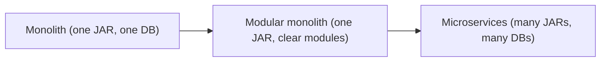

Most teams should move left to right **only when they feel real pain**.


**Architecture:** Look at the databases: one DB for both monolith styles, one DB per service for microservices.

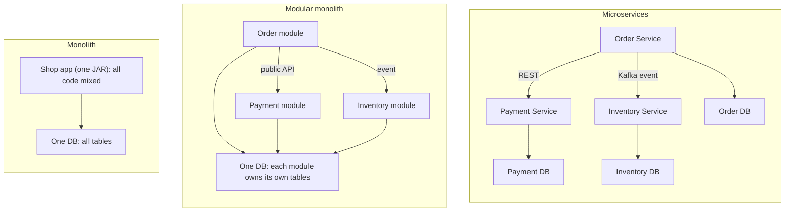

**Example:** Our shop with 8 developers and 10,000 orders a day.
- 10,000 orders a day is less than 1 order per second. One Spring Boot app handles this easily.
- A modular monolith with modules `order`, `payment`, `inventory`, `shipping` is a good start.
- Later, you have 60 developers in 6 teams. The payment team wants to deploy 5 times a day. Now you can cut `payment` out as a separate service. The clean module border makes this easy.

Real case: in 2023, the Amazon Prime Video team moved one monitoring system **from** microservices **back** to a monolith. They said it cut that system's cost by about 90%.

**Good and bad:**
| | Good | Bad |
|---|---|---|
| **Monolith** | Simple to build, test, deploy and debug | One bug can crash everything |
| | Normal database transactions (ACID) | Big codebase gets messy over years |
| | No network calls between modules, so it is fast | You must scale the whole app, even if only one part is busy |
| **Microservices** | Each team deploys on its own | Network calls fail and add delay |
| | Scale only the busy service | No simple transaction across services (you need sagas) |
| | One service can crash and others keep working | You need tracing, central logs, service discovery, CI/CD per service |

**When to use / when not to use:**
- **Do not** start with microservices when the team is small (under about 10-15 developers).
- **Do not** use them when the business areas are still unclear. You will draw the borders in the wrong place.
- **Do not** use them if you have no CI/CD, no central logging and no monitoring yet.
- **Use** them when many teams block each other.
- **Use** them when parts need very different scaling or different release speeds.
- A **modular monolith** is a sensible default for most new projects.

**Say this in the interview:**
> "Microservices are not automatically better. They trade code complexity for network and operations complexity. I usually start with a modular monolith with clear module borders. I split out a service only when team size, scaling or release speed gives a real reason."

**They may ask next:**
- **What is a "distributed monolith"?** Many services that must be deployed together, or that share one database. You get the pain of both styles and the benefit of neither.
- **Should services share a database?** No. Each service owns its data. Others get it through an API or events. A shared database couples them tightly.
- **How do you find service borders?** Use business areas (DDD *bounded contexts*: a part of the business with its own words and rules), for example Order, Payment, Shipping. Not technical layers like "DAO service".

## Sync vs async communication

**In one line:** Sync means "call and wait for the answer now". Async means "send a message and continue; someone handles it later".

**Story:**
- **Sync** = a phone call. You call the shop and wait on the line until they answer. If they do not pick up, you are stuck.
- **Async** = a WhatsApp message. You send it and go back to work. They reply when they are free. If their phone is off, the message waits for them.

**How it works:**
1. **Sync:** REST (HTTP + JSON) or gRPC (HTTP/2 + Protocol Buffers, a fast binary format with a strict contract). The caller waits for the response.
2. **Async:** the service publishes an **event** (a fact, like `OrderPlaced`) to a broker like Kafka or RabbitMQ. Other services read it when they can.
3. REST is best for browsers and public APIs. gRPC is good for fast service-to-service calls inside the company.

**Diagram:**

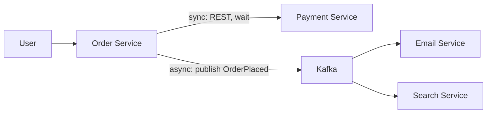

**Example: the math of a call chain.**

*Availability* (the percent of time a service works):
- One service at 99.9% is down about 43 minutes a month.
- A sync chain of 5 services, each 99.9%: 0.999 x 0.999 x 0.999 x 0.999 x 0.999 = **about 99.5%**.
- 99.5% means about **3.6 hours down a month**. Five good services made one weaker system.

*Latency* (time to answer):
- In a sync chain, the delays add up. 5 calls x 50 ms = 250 ms before any business logic.
- Slow calls hurt more. Say each service is slower than 100 ms in 1% of calls. If one request calls 10 services, about **10% of requests** hit at least one slow call (1 - 0.99^10 = 9.6%).

With async, the email service can be down for 1 hour. Orders still work. Emails go out when it comes back.


**Architecture:** Compare what the user waits for: all 5 services in a sync chain, only Order Service with events.

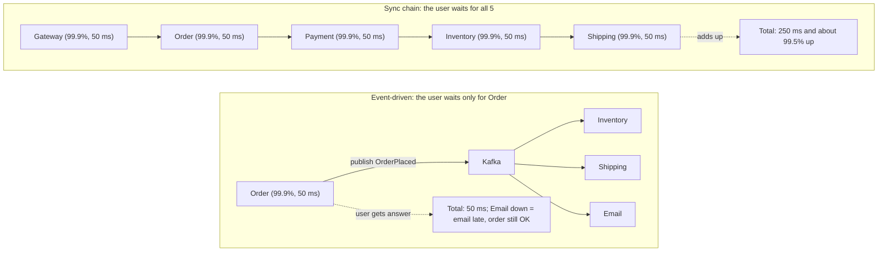

**Good and bad:**
| | Good | Bad |
|---|---|---|
| **Sync** | Simple to write and debug | Caller is blocked while it waits |
| | You get the answer right now | One slow service slows the whole chain |
| | Easy errors: you get a 4xx/5xx back | Availability drops with each extra hop |
| **Async** | Services do not need to be up at the same time | *Eventual consistency*: data is correct a bit later, not right now |
| | Broker absorbs traffic spikes | Duplicate messages, so consumers must be idempotent |
| | One event, many readers | Harder to trace and debug |

**When to use / when not to use:**
- **Use sync** when the user needs the answer to continue. Examples: login, price check, "is this item in stock?".
- **Use async** when the work can happen a bit later. Examples: send email, update search index, analytics, loyalty points.
- **Use async** when many services care about the same fact (one `OrderPlaced`, five readers).
- **Avoid** long sync chains (A calls B calls C calls D). Keep it to 1-2 hops if you can.

**Say this in the interview:**
> "I use sync REST or gRPC when the user needs the answer right now. I use events when the work can happen later or many services need the same fact. Sync chains multiply failure: 5 services at 99.9% give only about 99.5%. Async improves availability, but I must handle duplicates and eventual consistency."

**They may ask next:**
- **REST or gRPC?** REST for browsers and public APIs because it is simple and readable. gRPC for internal high-traffic calls because it is smaller, faster and typed.
- **Is "async" the same as "non-blocking"?** No. Async messaging is about *who waits* between services. Non-blocking I/O (WebFlux, virtual threads) is about how one service uses its threads.
- **Can you do request-reply over Kafka?** Yes, but it is usually a sign you want a sync call. Keep Kafka for events.

## Saga pattern

**In one line:** A saga is a chain of local transactions across services. If one step fails, you run "undo" steps (compensations) for the steps that already finished.

**Story:** A wedding planner books a hall, then a caterer, then a band.
- The band is not free on that date.
- You cannot "roll back" the world. The planner must **call** the hall and cancel, then call the caterer and cancel.
- Each cancel is a new action, maybe with a fee. That is a **compensating action**.

**How it works (our shop):**
1. **Order Service:** create order with status `PENDING`.
2. **Payment Service:** charge the card.
3. **Inventory Service:** reserve the items.
4. **Shipping Service:** create the shipment.
5. If step 3 fails (out of stock), run compensations backwards: **refund payment**, then **cancel order**.

| Step | Action | Compensation (undo) |
|---|---|---|
| Order | Create order (PENDING) | Mark order CANCELLED |
| Payment | Charge card | Refund |
| Inventory | Reserve items | Release items |
| Shipping | Create shipment | Cancel shipment (only before it leaves) |

Each step is a normal local transaction inside one service and one database.

**Two styles:**

**1. Choreography** (no boss; each service reacts to events):

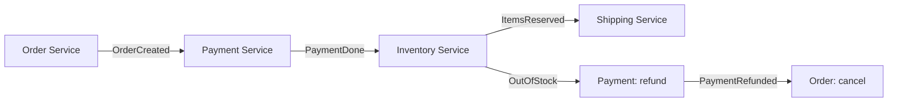

Like a group chat: each vendor does their job when they see the previous message.

**2. Orchestration** (one boss tells each service what to do):

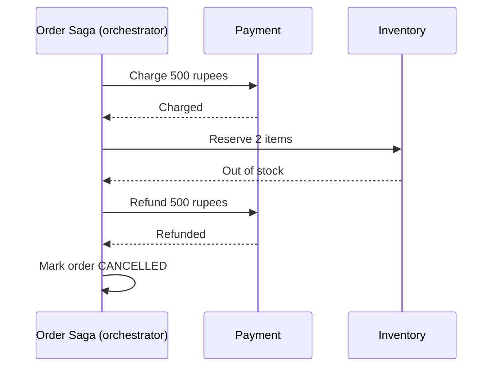

Like the wedding planner: one person knows the full plan and the current step.


**Architecture:** The orchestrator sends commands on Kafka topics, and each service replies on `saga-replies`.

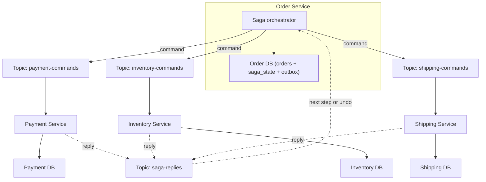

Each service changes only its own DB. The orchestrator saves its current step in `saga_state`, so a crash does not lose progress.

**Example:** Orchestrator state is saved in a table, so a crash does not lose progress.

```java
public void onInventoryResult(UUID orderId, boolean reserved) {
    var saga = sagaRepo.findById(orderId).orElseThrow();
    if (reserved) {
        saga.setStep(Step.SHIPPING);
        commands.send("shipping-commands", new CreateShipment(orderId));
    } else {
        saga.setStep(Step.COMPENSATING);
        commands.send("payment-commands", new RefundPayment(orderId)); // undo the earlier step
    }
    sagaRepo.save(saga); // save progress; use the outbox so save + send are safe together
}
```

**Good and bad:**
| | Good | Bad |
|---|---|---|
| **Choreography** | No central service, very loose coupling | Hard to see the full flow; logic is spread across services |
| | Simple for 2-3 steps | Risk of event loops and "who handles this?" questions |
| **Orchestration** | Full flow in one place, easy to read and monitor | The orchestrator is one more service to build and run |
| | Easy to add timeouts and retries per step | Risk of putting too much business logic in the orchestrator |

**Why not 2PC (two-phase commit)?** 2PC is a protocol where a coordinator asks every database "ready?" and then says "commit" to all.
- It holds locks in all services while it waits. Slow and blocks other users.
- If the coordinator dies in the middle, databases can stay locked.
- Kafka and many NoSQL databases do not support it (no XA support, the standard for 2PC).
- All services must be up at the same time. That kills the main benefit of microservices.

**Tools:** You can build a simple orchestrator yourself with a state table. For bigger flows, use a workflow engine:
- **Temporal**: you write the workflow as normal Java code. It saves every step and resumes after a crash.
- **Camunda**: BPMN (a drawn flowchart that the engine runs). Good when business people want to see the flow.
- **Spring Statemachine**: a library for states and transitions inside your own app.

**When to use / when not to use:**
- Use choreography for short flows (2-3 steps).
- Use orchestration for 4+ steps, or when you need timeouts, a clear status page, or audits.
- Do not use a saga if the data can live in one service and one database. A local transaction is much simpler.

**Say this in the interview:**
> "Across services I cannot use one database transaction, and 2PC is slow and fragile. So I use a saga: each service does a local transaction and publishes an event. If a later step fails, I run compensations, like a refund. For short flows I use choreography. For longer flows I use an orchestrator like Temporal, so the whole flow is visible in one place."

**They may ask next:**
- **What if a compensation fails?** Retry it, because it must be idempotent. If it still fails, send it to a dead letter queue and alert a human.
- **What about dirty reads during the saga?** Other users may see the order before it is final. Use a status like `PENDING` (a *semantic lock*) so others know it is not final.
- **What if a step cannot be undone, like a parcel that already left?** Put such steps last. After that point, the saga only moves forward.

## Transactional outbox pattern

**In one line:** Save the business data and the "event to send" in the **same database transaction**. A separate process sends the event to Kafka later.

**Story:** A bank clerk takes your deposit.
- He writes it in the main ledger.
- In the **same book**, on the last page, he writes "send SMS to customer".
- A peon checks that last page every few minutes and sends the SMS. Then he ticks it.
- If the peon is on lunch, the SMS goes late. But it is **never lost**, because it is written in the same book as the deposit.

**How it works:**

*The problem (dual write):* Order Service must do two things: save the order in the DB and publish `OrderCreated` to Kafka. These are two different systems.
1. DB commit works, then Kafka publish fails (network blip, app crash). The order exists, but Payment never hears about it.
2. Or you publish first, then the DB commit fails. Payment charges for an order that does not exist.

There is no shared transaction between Postgres and Kafka.


**Failure path:** Without an outbox, the crash can happen after the DB commit and before the Kafka publish.

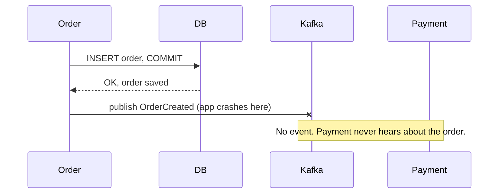

*The fix:*
1. In one DB transaction: insert the order **and** insert a row in the `outbox` table.
2. A relay process reads new outbox rows and publishes them to Kafka.
3. After Kafka confirms, mark the row as sent (or delete it).

Two ways to build the relay:
- **Poller:** a scheduled job runs `SELECT ... WHERE sent_at IS NULL` every 500 ms. Simple.
- **CDC (Change Data Capture):** a tool like **Debezium** reads the database change log (Postgres WAL, MySQL binlog). It pushes new outbox rows to Kafka. No polling load on the DB. Debezium has a ready "Outbox Event Router" for this.

**Diagram:**

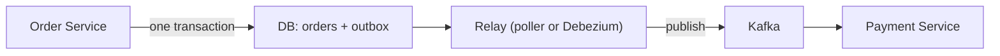


**Architecture:** Both rows go in one transaction; Debezium reads the new outbox rows from the database log and sends them to Kafka.

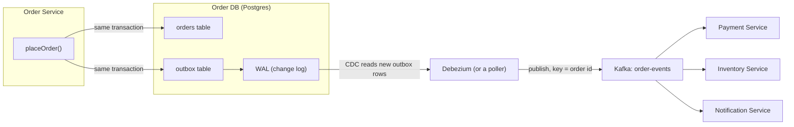

**Example:**

```java
@Transactional // order and outbox row commit together, or not at all
public Order placeOrder(CreateOrder cmd) {
    Order order = orderRepo.save(Order.from(cmd));
    outboxRepo.save(new OutboxEvent(UUID.randomUUID(), "Order", order.getId(),
            "OrderCreated", json.write(order)));
    return order;
}

// Simple poller relay
@Scheduled(fixedDelay = 500)
@Transactional
public void relay() {
    for (var e : outboxRepo.findNextBatchForUpdateSkipLocked(100)) { // SKIP LOCKED: safe with many pods
        kafka.send("order-events", e.getAggregateId().toString(), e.getPayload()).join(); // wait for ack
        e.markSent();
    }
}
```

**Good and bad:**
| Good | Bad |
|---|---|
| No lost events: if the order is saved, the event is saved | Event is a bit late (milliseconds to seconds) |
| Uses only your normal DB transaction | Outbox table grows, so you need a cleanup job |
| Works with any broker | **At-least-once**: an event can be sent twice (crash after send, before mark) |
| CDC gives low delay and no polling | CDC (Debezium + Kafka Connect) is one more system to run |

**When to use / when not to use:**
- Use it whenever a service must change its DB **and** tell others about it.
- Not needed if the service only reads.
- Not needed if losing an event is fine, for example a "page viewed" metric.

**Say this in the interview:**
> "Writing to the database and to Kafka is a dual write, and one of them can fail. So I write the event into an outbox table in the same transaction as the business data. A poller or Debezium CDC publishes it to Kafka later. This gives at-least-once delivery, so consumers must be idempotent."

**They may ask next:**
- **How do you keep event order?** Use the aggregate id (order id) as the Kafka key. All events of one order go to one partition, in order.
- **What is the inbox pattern?** The consumer side: save the event id in a `processed_events` table in the same transaction as the business change. Skip ids you have already seen.
- **Why not Kafka transactions?** Kafka transactions cover Kafka only. They cannot include your Postgres commit.

## Idempotency

**In one line:** An operation is *idempotent* if doing it 2 or 10 times gives the same result as doing it once.

**Story:** You press "Pay 2,000 rupees" on a slow phone network. The screen spins. You press again.
- Without idempotency: you pay 4,000 rupees.
- With idempotency: the shop says "I already have payment request #A12. Here is the same receipt." You pay 2,000 rupees once.

The lift button is the same. Pressing it 5 times does not call 5 lifts.

**How it works:**
1. The client makes a unique id for each *intended* action, for example a UUID. It sends it in the `Idempotency-Key` header. Stripe and many payment APIs use this pattern.
2. On a retry, the client sends the **same** key.
3. The server stores each key in a table with a **unique constraint**. The database refuses a second row with the same key.
4. If the key is new: do the work, save the result with the key.
5. If the key already exists: do not do the work again. Return the saved result.
6. If the same key comes with a different body: return an error (409 or 422).

Why we need it: retries, timeouts and at-least-once delivery from Kafka all create duplicates. You cannot stop duplicates, so you make them harmless.

**Diagram:**

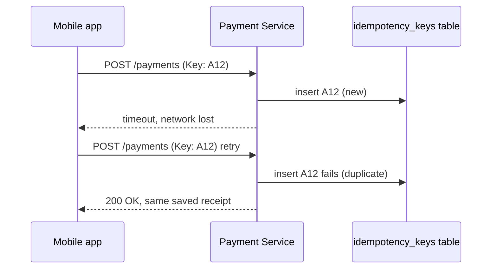


**Architecture:** Idempotency lives in two places: the Payment API (key from the client) and the Kafka consumer (event id).

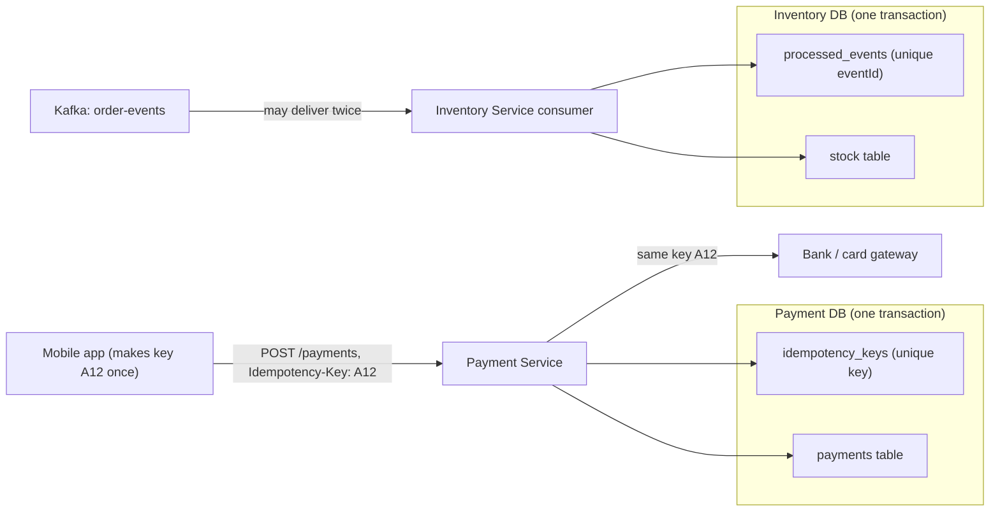

**Example:**

```sql
CREATE TABLE idempotency_keys (
  idem_key     VARCHAR(64) PRIMARY KEY,  -- unique: a second insert fails
  request_hash CHAR(64)    NOT NULL,
  status       VARCHAR(20) NOT NULL,     -- IN_PROGRESS or DONE
  response     JSONB,
  created_at   TIMESTAMP   NOT NULL
);
```

```java
@PostMapping("/payments")
public PaymentResponse pay(@RequestHeader("Idempotency-Key") String key,
                           @RequestBody PaymentRequest req) {
    try {
        keys.insertInProgress(key, hash(req)); // INSERT; fails if the key exists
    } catch (DuplicateKeyException e) {
        var row = keys.find(key);
        if (!row.requestHash().equals(hash(req))) throw new ConflictException("Key reused");
        if (row.isDone()) return row.response();  // replay: same answer, no new charge
        throw new ConflictException("Still processing, retry later");
    }
    var response = gateway.charge(req, key);      // pass the key to the bank too
    keys.markDone(key, response);
    return response;
}
```

For Kafka consumers, the idea is the same. Save the `eventId` in a `processed_events` table in the same transaction as the business change.

**Good and bad:**
| Good | Bad |
|---|---|
| Retries become safe | One extra DB write per request |
| No double charges or double emails | Keys table grows, so delete keys after 24 hours to 7 days |
| Works with at-least-once Kafka | Client must send a good key (one per action, not one per click) |

**When to use / when not to use:**
- Must have: payments, order creation, money transfer, any Kafka consumer that changes data.
- Free already: `GET`, `PUT` (set to a value) and `DELETE` are idempotent by HTTP rules. `POST` is not.
- Not worth it: actions where a duplicate does not matter, like "mark notification as read".

**Say this in the interview:**
> "Networks fail, so clients retry and Kafka can deliver twice. I make every write idempotent. For payments the client sends an Idempotency-Key header. I store it in a table with a unique constraint and return the saved response on a repeat. For Kafka consumers I keep a processed-events table, written in the same transaction as the change."

**They may ask next:**
- **Why a unique constraint and not "check, then insert"?** Two requests can check at the same moment and both see "not found". The unique constraint lets only one win.
- **Redis or database for keys?** Database if the key must be in the same transaction as the business data. Redis `SET key value NX EX 86400` is fine for a fast first filter.
- **Is `PUT` always idempotent?** `PUT /orders/1 {status: PAID}` is. `PUT /account/1/add-100` is not; that is a bad API design.

## Retry with exponential backoff and jitter

**In one line:** Retry a failed call a few times and wait longer after each failure. Add a random part to the wait, so clients do not all retry at the same moment.

**Story:** Customer care opens at 9:00 AM. The line is busy.
- If 1,000 people redial every 5 seconds, the line stays jammed forever.
- Smart people wait 1 minute, then 2, then 4.
- Even smarter: each person adds a random few seconds. Now the calls spread out and the lines clear.

The spike of everyone retrying together is called the **thundering herd**.

**How it works:**
1. **Retry only safe errors.** Transient errors are short problems that fix themselves: timeout, connection reset, 503, 429. Do **not** retry 400 Bad Request, 401, 404 or "card declined". They fail again every time.
2. **Retry only idempotent calls**, or calls with an idempotency key.
3. **Exponential backoff:** wait = base x 2^attempt. With base 200 ms: 200, 400, 800, 1,600 ms.
4. **Cap it:** never wait more than a max, for example 2 seconds.
5. **Jitter:** add randomness. A common formula ("full jitter"):
   `wait = random(0, min(cap, base x 2^attempt))`
6. **Limit attempts:** usually 3 total (1 call + 2 retries).
7. **Retry budget:** retries must be a small part of traffic, for example at most 10% extra calls. If more is failing, the server is sick. Stop retrying and let the circuit breaker act.

**Diagram:**

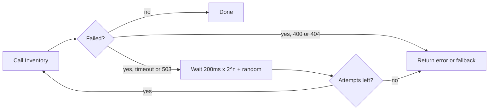


**Timeline:** Each wait is longer than the one before, and has a random part.

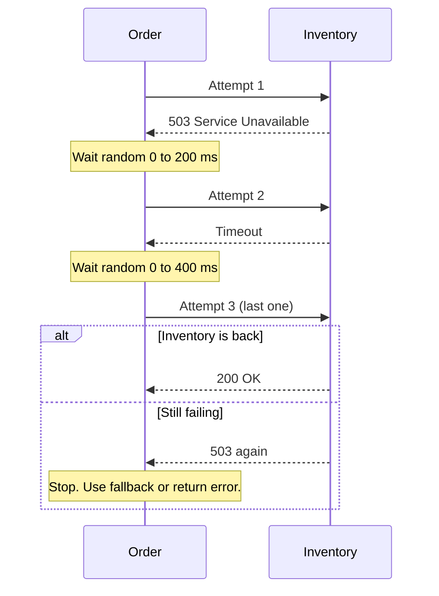

**Example:** Why retries multiply. Gateway, Order and Inventory each retry 3 times. One user click can become 3 x 3 x 3 = **27 calls** to Inventory. A small outage becomes a big one. **Retry at one layer only**, usually the one closest to the failing service.


**Architecture:** Retries live in one place only: the client closest to the failing service, with a retry budget.

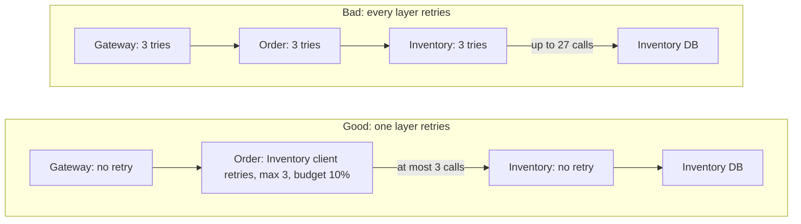

Resilience4j 2.x with Spring Boot (`resilience4j-spring-boot3` starter on Boot 3, `resilience4j-spring-boot4` on Boot 4, since Resilience4j 2.4):

```yaml
resilience4j:
  retry:
    instances:
      inventory:
        maxAttempts: 3                    # 1 call + 2 retries
        waitDuration: 200ms               # first wait
        enableExponentialBackoff: true
        exponentialBackoffMultiplier: 2   # 200ms, 400ms, ...
        exponentialMaxWaitDuration: 2s    # cap
        enableRandomizedWait: true        # jitter
        randomizedWaitFactor: 0.5         # wait can move +/- 50%
        retryExceptions:
          - java.io.IOException
          - org.springframework.web.client.HttpServerErrorException
        ignoreExceptions:
          - org.springframework.web.client.HttpClientErrorException  # 4xx: do not retry (429 is the one exception, handle it separately)
```

```java
@Retry(name = "inventory", fallbackMethod = "reserveLater")
public Reservation reserve(ReserveRequest req) {
    return inventoryClient.reserve(req); // must be idempotent: send a request id
}
```

Note: Spring Framework 7 (Spring Boot 4) also has a built-in `@Retryable` with `delay`, `multiplier`, `jitter` and `maxDelay`. Turn it on with `@EnableResilientMethods`. Its `maxRetries` counts only retries, not the first call.

**Good and bad:**
| Good | Bad |
|---|---|
| Hides short network blips from the user | Retrying a non-idempotent call can charge twice |
| Backoff gives the server time to recover | Retries at many layers multiply load (27x) |
| Jitter spreads load and avoids the thundering herd | Adds delay to the user request |

**When to use / when not to use:**
- Use for short, transient errors on idempotent calls.
- Do not retry business errors or 4xx errors.
- Do not retry when the user is waiting and the time budget is already used up.

**Say this in the interview:**
> "I retry only transient errors like timeouts and 503, and only on idempotent calls. I use exponential backoff with jitter, so thousands of clients do not retry at the same second. I keep it to about 3 attempts at one layer only, with a retry budget. If failures continue, the circuit breaker stops the calls."

**They may ask next:**
- **Why jitter if we already have backoff?** Without jitter, all clients that failed at 9:00:00 retry together at 9:00:00.2, then 9:00:00.6. Backoff alone keeps them in step.
- **Retry or circuit breaker first?** In Resilience4j's default order, Retry is the outer layer and CircuitBreaker is inside it. When the breaker is open, each retry fails fast. Set `ignoreExceptions` so the "breaker open" error is not retried.
- **Should Kafka consumers retry like this?** Retry a few times, then send the message to a retry topic or a DLT (dead letter topic). Do not block the partition forever.

## Timeouts

**In one line:** A timeout is the max time you will wait for an answer before you give up.

**Story:** You order food at a restaurant. You decide: "If food does not come in 30 minutes, I leave and eat somewhere else."
- Without this rule, you sit there all night. The table is blocked. New customers cannot sit.
- In a server, the "table" is a thread or a connection. A call with no timeout keeps it busy forever.

**How it works:**
1. **Connect timeout:** max time to open the connection (the TCP handshake, the first "hello" between two machines). Keep it short, like 1-2 seconds. If you cannot even connect, the server is down or unreachable.
2. **Read timeout** (also called response or socket timeout): max time to wait for data after the connection is open. Set it from the real p99 latency of that service (the time in which 99% of calls finish), plus some margin.
3. **Default timeouts are often infinite.** For example, Java's `HttpURLConnection` uses 0, which means "wait forever". The JDK `HttpClient` has no request timeout unless you set one. Never trust the default.
4. **Timeout budget:** the user-facing deadline is split across the chain. Each inner call must get **less** time than its caller.

**Diagram:**

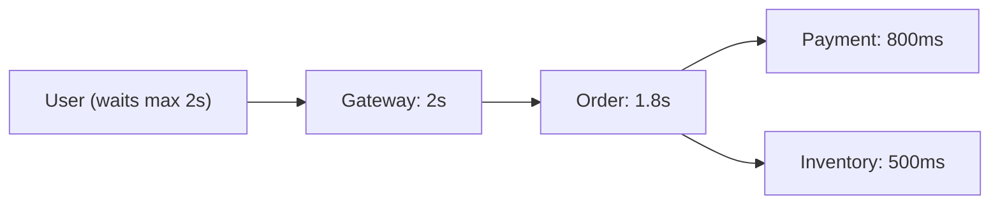

**Example: why no timeout kills the system.**
- Order Service has 200 Tomcat threads.
- Payment Service hangs (does not answer at all).
- At 100 requests per second, all 200 threads are stuck in about 2 seconds.
- Now even `/health` and "view my orders" fail. One slow service took down another. This is a **cascading failure**.

With an 800 ms read timeout, each thread is free again after 800 ms. Users get a quick error or a fallback.


**Failure path:** Payment hangs, but the 800 ms timeout frees the thread, and the user gets an answer inside the 2 s budget.

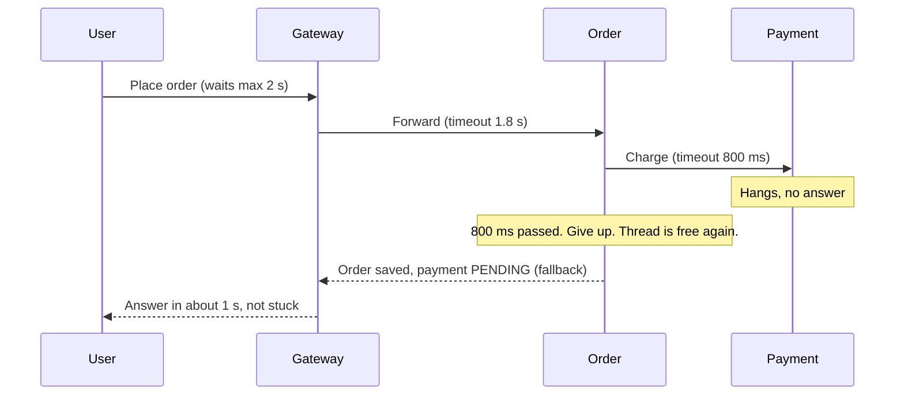

*Budget mistake:* Order has a 1 second timeout. But it calls Payment with a 3 second timeout. Order gives up at 1 second, but Payment keeps working for 2 more seconds. That is wasted work.

Spring Boot 4 sets timeouts for all auto-configured HTTP clients (RestClient, RestTemplate):

```yaml
spring:
  http:
    clients:
      connect-timeout: 1s
      read-timeout: 800ms
```

(In Spring Boot 3.4 and 3.5, the prefix is `spring.http.client`, without the "s".)

Do not forget other timeouts: DB query timeout, connection pool wait (HikariCP `connectionTimeout`, default 30 s), and Redis timeout.

**Good and bad:**
| Good | Bad |
|---|---|
| Threads and connections are freed fast | Too short: you fail calls that would have worked |
| Stops one slow service from killing others | Too long: threads pile up anyway |
| User gets a clear answer fast | A timeout does not mean "it failed". The server may have done the work, so retries need idempotency |

**When to use / when not to use:**
- Use on **every** network call: HTTP, DB, cache, broker. No exceptions.
- Set values from measured p99 latency, not guesses.

**Say this in the interview:**
> "Every network call needs a connect timeout and a read timeout, because many defaults are infinite. I set them from the real p99 latency. I also think in a timeout budget: if the user waits 2 seconds, inner calls get less time than their callers. A timeout does not prove the call failed, so the retry must be idempotent."

**They may ask next:**
- **What is deadline propagation?** Pass the remaining time to the next service (gRPC does this with deadlines). Then the inner service stops work when the caller has already given up.
- **Timeout vs circuit breaker?** A timeout protects one call. A circuit breaker watches many calls and stops all of them when the service looks sick.
- **What if a payment call times out?** You do not know if money was taken. Check the status with the same idempotency key before you charge again.

## Circuit breaker

**In one line:** A circuit breaker watches calls to a service. When too many fail, it stops sending calls for a while and fails fast instead.

**Story:** The electric fuse (MCB) at home.
- Normal: power flows. This is **closed**.
- A short circuit happens. The MCB trips and cuts the power. This is **open**. It protects the wires from burning.
- After some time, you push it up and test carefully. This is **half-open**. If it holds, power is back. If it trips again, you wait more.

**How it works:**
1. **Closed:** all calls go through. The breaker counts failures and slow calls in a sliding window (for example, the last 20 calls).
2. If the failure rate goes over a threshold (for example 50%), it goes **open**.
3. **Open:** no calls go to the service. Every call fails at once, or goes to a **fallback** (a backup answer).
4. After a wait (for example 30 s), it goes **half-open**.
5. **Half-open:** a few test calls (for example 3) go through. If they work, back to **closed**. If they fail, back to **open**.

Why it helps:
- The sick service gets rest and can recover.
- Callers do not waste threads waiting for timeouts.

**Diagram:**

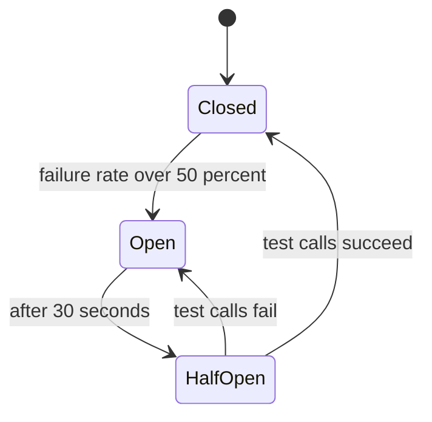

**Example:** Order Service calls Payment Service with Resilience4j and Spring Boot 3 (`resilience4j-spring-boot3` plus the Spring AOP starter for annotations).

```yaml
resilience4j:
  circuitbreaker:
    instances:
      payment:
        slidingWindowType: COUNT_BASED
        slidingWindowSize: 20               # look at the last 20 calls
        minimumNumberOfCalls: 10            # do not judge on 2 calls
        failureRateThreshold: 50            # 50% failed -> open
        slowCallDurationThreshold: 2s       # slower than 2s counts as "slow"
        slowCallRateThreshold: 80           # 80% slow -> open
        waitDurationInOpenState: 30s
        permittedNumberOfCallsInHalfOpenState: 3
        automaticTransitionFromOpenToHalfOpenEnabled: true
```

```java
@Service
public class PaymentClient {
    private final RestClient restClient;

    PaymentClient(RestClient.Builder builder) {
        this.restClient = builder.baseUrl("http://payment-service").build();
    }

    @CircuitBreaker(name = "payment", fallbackMethod = "payLater")
    public PaymentStatus charge(PaymentRequest req) {
        return restClient.post().uri("/payments").body(req).retrieve().body(PaymentStatus.class);
    }

    private PaymentStatus payLater(PaymentRequest req, Throwable t) {
        return PaymentStatus.PENDING; // fallback: accept order now, charge later by a job
    }
}
```

**Good fallbacks:** cached data, a default value ("no recommendations"), "accept now, process later", or a clear error message. **Bad fallback:** pretending the payment succeeded.


**Architecture:** The breaker sits inside Order Service, in front of the Payment client; when it is open, calls go to the fallback.

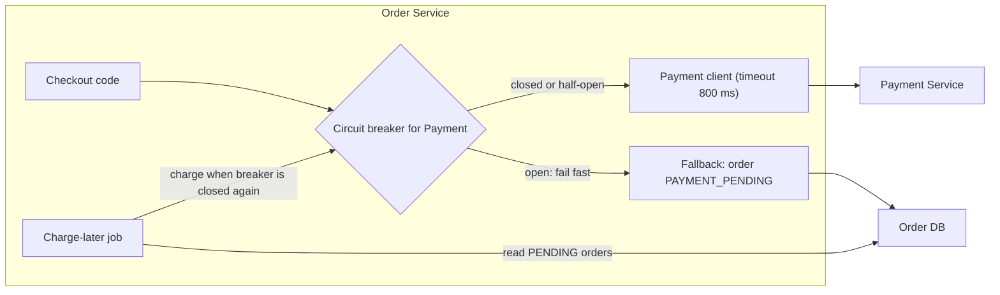

**Good and bad:**
| Good | Bad |
|---|---|
| Stops cascading failures | Wrong thresholds: opens too often, or never |
| Fails in milliseconds, not after a 2 s timeout | Fallback logic must be tested too, or it fails on the bad day |
| Gives the sick service time to recover | Each pod has its own breaker state, so pods can disagree for a short time |

**When to use / when not to use:**
- Use on calls to other services and third-party APIs (payment gateway, SMS provider).
- Not useful for in-memory calls. Not a fix for business errors like "card declined"; do not count those as failures.

**Say this in the interview:**
> "A circuit breaker works like a house fuse. When too many calls fail or are slow, it opens and fails fast. We stop wasting threads on a sick service. After a wait it goes half-open and sends a few test calls. I use Resilience4j with a fallback, like returning cached data or accepting the order and charging later."

**They may ask next:**
- **Which errors should count as failures?** Timeouts, connection errors and 5xx. Not 4xx and not business errors. Use `ignoreExceptions` or `recordExceptions`.
- **Count-based or time-based window?** Count-based (last N calls) is simple. Time-based (last N seconds) is better when traffic changes a lot during the day.
- **What replaced Hystrix?** Netflix put Hystrix in maintenance mode in 2018. Resilience4j is the standard now. Spring Cloud CircuitBreaker can sit on top of it.

## Bulkhead

**In one line:** A bulkhead gives each dependency its own small pool of threads or slots. One slow dependency cannot use up everything.

**Story:** A big ship is split into **compartments** with walls between them. These walls are called bulkheads.
- If the ship hits a rock, water fills only one compartment.
- The walls stop the water. The ship stays afloat.
- Without walls, one hole sinks the whole ship. That is what happened to the Titanic: its walls were not high enough.

**How it works:**
1. Your service calls many dependencies: Payment, Inventory, Recommendations.
2. Without a bulkhead, they all share one pool, for example 200 Tomcat threads.
3. With a bulkhead, each dependency gets its own limit. For example: Recommendations max 20 calls at a time.
4. If Recommendations is slow, only those 20 slots fill up. Extra calls are rejected fast (or get a fallback). The other 180 threads still serve checkout.

Two types in Resilience4j:
- **Semaphore bulkhead:** a counter. "Max 20 calls at the same time." Runs on the caller's thread. Light and simple.
- **Thread-pool bulkhead:** a separate thread pool and queue per dependency. Stronger walls, but more threads and more memory.

**Diagram:**

```mermaid
flowchart LR
    O["Order Service (200 threads)"] --> B1["Payment: max 50"]
    O --> B2["Inventory: max 50"]
    O --> B3["Recommendations: max 20"]
    B1 --> P["Payment Service"]
    B2 --> I["Inventory Service"]
    B3 --> R["Recommendation Service (slow!)"]
```

**Example:**
- Recommendations becomes slow: each call takes 10 s.
- Traffic: 50 requests per second.
- Without a bulkhead, 200 threads are full in 4 seconds. Checkout stops. The shop loses money because of a "nice-to-have" feature.
- With a bulkhead of 20, only 20 slots are stuck. The product page shows "no recommendations". Checkout works.


**Architecture:** Recommendations is slow, so only its own pool is full; the Payment and Inventory pools still have free slots.

```mermaid
flowchart LR
    REQ["Incoming requests"] --> T
    subgraph orderBox["Order Service"]
        T["Request threads (200)"]
        P1["Payment pool: 12 of 50 busy"]
        P2["Inventory pool: 8 of 50 busy"]
        P3["Recommendations pool: 20 of 20 busy, FULL"]
        FB["Fallback: empty list"]
        T --> P1
        T --> P2
        T --> P3
        P3 -->|"extra calls rejected fast"| FB
    end
    P1 --> PAY["Payment Service (OK)"]
    P2 --> INV["Inventory Service (OK)"]
    P3 --> REC["Recommendation Service (10 s per call)"]
```

```yaml
resilience4j:
  bulkhead:
    instances:
      recommendations:
        maxConcurrentCalls: 20   # max 20 calls at the same time
        maxWaitDuration: 10ms    # wait a little for a slot, then reject
```

```java
@Bulkhead(name = "recommendations", fallbackMethod = "noRecommendations")
public List<Product> recommendations(String userId) {
    return recoClient.forUser(userId);
}

private List<Product> noRecommendations(String userId, Throwable t) {
    return List.of(); // page still loads, just without this box
}
```

**With virtual threads** (Java 21+): you can have millions of threads, so thread count is no longer the limit. But the slow service and the connection pool still have limits. A semaphore bulkhead (or Spring Framework 7's `@ConcurrencyLimit`) is still needed to cap calls.

**Good and bad:**
| Good | Bad |
|---|---|
| One slow dependency cannot sink the whole service | Limits must be tuned; too small rejects good traffic |
| Important flows (checkout) stay alive | Thread-pool bulkheads use more memory and threads |
| Fast rejection is better than slow waiting | More config to manage per dependency |

**When to use / when not to use:**
- Use when one service calls several dependencies with different importance.
- Use to protect the critical path (checkout, payment) from nice-to-have features.
- Not needed for a service with only one dependency. Timeouts may be enough there.

**Say this in the interview:**
> "A bulkhead is like the compartments in a ship. I give each dependency its own limit of concurrent calls. A slow recommendation service can block only 20 slots, not all 200 threads. Checkout keeps working. In Resilience4j I use a semaphore bulkhead for most cases and a thread-pool bulkhead when I need stronger isolation."

**They may ask next:**
- **How do you pick the limit?** Use Little's law: concurrent calls = requests per second x latency in seconds. 100 rps x 0.2 s = 20 slots. Add some margin.
- **Bulkhead vs rate limiter?** A bulkhead limits calls *at the same time*. A rate limiter limits calls *per second*.
- **Other kinds of bulkheads?** Yes: separate DB connection pools, separate Kafka consumer groups, or even separate pods for VIP customers.

## API gateway and BFF

**In one line:** An API gateway is the single front door for all client requests. A BFF (Backend for Frontend) is a small backend made for one type of client, like the mobile app.

**Story:** A big hotel.
- Guests do not walk into the kitchen, the laundry or the accounts office. They go to the **reception**.
- Reception checks your ID (auth). It sends you to the right place (routing). It stops a crowd from rushing in (rate limit).
- The hotel also has a **kids' desk** and a **business desk**. Each one speaks the language of its guests. That is the BFF idea: one front desk per client type.

**How it works:**

*API gateway jobs:*
1. **Routing:** `/orders/**` goes to Order Service, `/payments/**` goes to Payment Service.
2. **Auth:** check the JWT token (a signed login token) once, at the door.
3. **Rate limiting:** for example 100 requests per minute per user. Extra requests get HTTP 429.
4. **Cross-cutting work:** TLS, CORS, request ids for tracing, logging.
5. **Aggregation (sometimes):** call 3 services and merge the answers into one response.

*BFF (Backend for Frontend):*
- Web and mobile need different data. A web page shows 20 fields. A mobile screen shows 5 and has a slow network.
- So you build one BFF per client type: `web-bff`, `mobile-bff`. Each one calls the services and shapes the response for its screen.
- The team that owns the app usually owns its BFF.

**Diagram:**

```mermaid
flowchart LR
    W["Web app"] --> WB["Web BFF"]
    M["Mobile app"] --> MB["Mobile BFF"]
    WB --> G["API Gateway (auth, rate limit, routing)"]
    MB --> G
    G --> O["Order Service"]
    G --> P["Payment Service"]
    G --> S["Shipping Service"]
```

(Many teams put the gateway first and the BFFs behind it. Both layouts are fine. Pick one and keep it simple.)


**Architecture:** This is the other layout: the gateway checks login and rate limit first, then sends each app to its own BFF.

```mermaid
flowchart LR
    W["Web app"] --> G1
    M["Mobile app"] --> G1
    subgraph gw["API gateway"]
        G1["Step 1: check JWT"] --> G2["Step 2: rate limit, 100 per minute"]
        G2 --> G3["Step 3: route by path"]
    end
    G2 --> R["Redis (rate limit counters)"]
    G3 -->|"/web/**"| WB["Web BFF (20 fields)"]
    G3 -->|"/mobile/**"| MB["Mobile BFF (5 fields)"]
    WB --> O["Order Service"]
    WB --> P["Payment Service"]
    WB --> S["Shipping Service"]
    MB --> O
    MB --> S
```

**Example:** Spring Cloud Gateway (2025.0 or newer uses the `server.webflux` prefix):

```yaml
spring:
  cloud:
    gateway:
      server:
        webflux:
          routes:
            - id: orders
              uri: lb://order-service          # lb = use Spring Cloud LoadBalancer
              predicates:
                - Path=/api/orders/**
              filters:
                - StripPrefix=1                # /api/orders/1 -> /orders/1
                - name: RequestRateLimiter
                  args:
                    redis-rate-limiter.replenishRate: 10   # 10 requests per second
                    redis-rate-limiter.burstCapacity: 20   # short bursts up to 20
```

Older versions used `spring.cloud.gateway.routes`. In 2025.0 that old prefix is deprecated, and the release notes say to add `spring-boot-properties-migrator` if you still need it. Without it, your old routes may be silently ignored, so move to the new prefix when you upgrade.

**Netflix stack is retired.** Many old tutorials use it. Know the replacements:

| Old (Netflix OSS) | Status | Use now |
|---|---|---|
| Zuul 1 (gateway) | Removed from Spring Cloud in 2020.0 | **Spring Cloud Gateway** |
| Hystrix (circuit breaker) | Maintenance mode since 2018, removed in 2020.0 | **Resilience4j** (via Spring Cloud CircuitBreaker) |
| Ribbon (client load balancer) | Removed in 2020.0 | **Spring Cloud LoadBalancer** |
| Eureka (service discovery) | Still supported | Eureka, or Kubernetes Services |

**Good and bad:**
| Good | Bad |
|---|---|
| One place for auth, rate limit, TLS and logging | One more hop: adds a few ms of latency |
| Clients do not know internal service addresses | Can become a single point of failure, so run 2+ instances |
| BFF gives each client exactly the data it needs | Business logic can creep into the gateway; keep it thin |
| Fewer round trips for mobile apps | Many BFFs can copy the same code |

**When to use / when not to use:**
- Use a gateway once you have more than 2-3 services exposed to clients.
- Use BFFs when web and mobile need very different data or release at different speeds.
- Do not put business rules (prices, discounts) in the gateway. It is a door, not a shop.
- A small app with one client may not need a BFF at all.

**Say this in the interview:**
> "The API gateway is the single front door. It handles routing, auth, rate limiting and tracing ids, and it stays thin with no business logic. When web and mobile need different data, I add a BFF per client type, owned by that frontend team. In Spring I use Spring Cloud Gateway. The old Netflix Zuul, Hystrix and Ribbon are retired; today it is Spring Cloud Gateway, Resilience4j and Spring Cloud LoadBalancer."

**They may ask next:**
- **Gateway vs load balancer?** A load balancer spreads traffic across copies of one service. A gateway understands the request (path, token, user) and routes to different services.
- **Gateway vs service mesh?** The gateway handles traffic coming *into* the system (north-south). A service mesh like Istio handles service-to-service traffic (east-west). It adds mTLS (both sides show a certificate), retries and timeouts in a proxy next to each service.
- **Is the gateway reactive?** The main Spring Cloud Gateway runs on WebFlux (non-blocking). There is also a Server MVC version for teams that prefer the servlet stack.

## The 12-factor app

**In one line:** The twelve-factor app is a list of 12 rules for building apps that run well in the cloud: easy to deploy, easy to scale, easy to replace.

**Story:** Think of a food truck, not a restaurant building.
- The truck carries everything it needs (dependencies).
- The menu prices come from a board outside, not painted on the truck (config).
- You can park 1 truck or 10 trucks at a festival (scale out).
- If one truck breaks down, you tow it away and bring another. No customer data is lost, because nothing important is kept inside the truck (stateless, disposable).

Heroku engineers wrote these rules in 2011. Most of them are now normal practice with Spring Boot, Docker and Kubernetes.

**How it works: the 12 factors in one line each**

| # | Factor | Simple meaning | How Spring Boot / Kubernetes meets it |
|---|---|---|---|
| 1 | Codebase | One app = one Git repo (or one folder), deployed to many environments | One repo per service; the same code goes to dev, test and prod |
| 2 | Dependencies | Declare every library. Never rely on what is "already on the server" | `pom.xml` / `build.gradle`; a fat JAR or a container image with the JDK inside |
| 3 | Config | Settings that change per environment live outside the code, in env vars | `application.yml` + profiles, overridden by env vars (`SPRING_DATASOURCE_URL`), K8s ConfigMaps and Secrets |
| 4 | Backing services | DB, cache, broker are "attached resources", swapped by changing a URL | `spring.datasource.url`, `spring.kafka.bootstrap-servers` from config |
| 5 | Build, release, run | Build once. Release = build + config. Run that release. Never edit code on a server | CI builds one image; the same image tag goes to every environment |
| 6 | Processes | The app is stateless. Shared data lives in a DB or cache, not in memory or local disk | No sticky sessions; Spring Session with Redis if you need sessions |
| 7 | Port binding | The app serves HTTP itself. No external app server needed | Embedded Tomcat/Netty, `server.port=8080` |
| 8 | Concurrency | Scale out by running more copies (processes), not one giant server | K8s `replicas: 5`, Horizontal Pod Autoscaler (HPA) |
| 9 | Disposability | Start fast, stop gracefully. Copies can be killed any time | `server.shutdown=graceful` (default since Boot 3.4), CDS/AOT for fast start, readiness probes |
| 10 | Dev/prod parity | Keep dev, test and prod as similar as possible | Testcontainers runs the real Postgres and Kafka in tests; same image everywhere |
| 11 | Logs | Write logs to stdout as a stream. The platform collects them | Log to console (JSON), Fluent Bit / OpenTelemetry Collector ships them |
| 12 | Admin processes | One-off jobs (migrations, fixes) run as separate processes with the same code and config | Flyway/Liquibase on start or as a K8s Job; a K8s `CronJob` for scheduled tasks |

**Beyond the 12 factors:** In 2016, Kevin Hoffman's book *Beyond the Twelve-Factor App* added three more. Interviewers like these:
- **API first:** design and agree on the API contract (OpenAPI) before writing code.
- **Telemetry:** metrics, traces and health checks are built in, not added later.
- **Security (authentication and authorization):** every service checks who is calling, from day one.

Note: in 2024 Heroku made the twelve-factor text open source, so the community can update it.

**Diagram:** One build, many environments. Only the config changes.

```mermaid
flowchart LR
    G["Git repo (factor 1)"] --> B["CI build: one image (factors 2, 5)"]
    B --> R1["Release: image + dev config"]
    B --> R2["Release: image + prod config (factor 3)"]
    R2 --> P1["Pod 1 (stateless)"]
    R2 --> P2["Pod 2 (stateless)"]
    P1 --> DB["Postgres, Redis, Kafka (backing services)"]
    P2 --> DB
    P1 -->|"stdout logs (factor 11)"| L["Log collector"]
    P2 -->|"stdout logs"| L
```

**Example:** The same Spring Boot image, config from the environment.

```yaml
# application.yml: safe defaults, real values come from env vars
spring:
  datasource:
    url: ${DB_URL:jdbc:postgresql://localhost:5432/orders}   # factor 3 and 4
  kafka:
    bootstrap-servers: ${KAFKA_SERVERS:localhost:9092}
server:
  port: 8080            # factor 7: the app serves HTTP itself
  shutdown: graceful    # factor 9: finish in-flight requests on SIGTERM
logging:
  structured:
    format:
      console: ecs      # factor 11: JSON logs to stdout (Spring Boot 3.4+)
```

**Good and bad:**
| Good | Bad |
|---|---|
| Any copy can be killed and replaced, so scaling and healing are easy | Moving an old stateful app (local files, in-memory sessions) takes real work |
| One image tested once and promoted everywhere | Env vars are not a safe place for secrets on their own; use a vault or K8s Secrets |
| New team members understand the setup fast | Some rules (like "logs only to stdout") need platform support |

**When to use / when not to use:**
- Use it as a checklist for every new service and in design reviews.
- Do not treat it as law. Example: a batch job may keep a local temp file. That is fine if losing it is fine.

**Say this in the interview:**
> The twelve-factor app is a checklist for cloud-ready services. The big ones for me are: config in the environment, stateless processes, build once and promote the same image, fast startup and graceful shutdown, and logs to stdout. Spring Boot and Kubernetes give most of this for free: profiles and env vars, embedded server, replicas, probes. I also add the three "beyond" factors: API first, telemetry and security.

**They may ask next:**
- **Where do secrets go?** Not in Git and not baked into the image. Use Vault or a cloud secret manager, or K8s Secrets (with encryption at rest). See [Spring Cloud Config and secrets](spring-ecosystem.md#spring-cloud-config-and-secrets).
- **Why stateless?** Any pod can take any request. You can add or kill pods freely. State in memory dies with the pod.
- **How do you run DB migrations in a 12-factor way?** As a one-off admin process with the same code and config: Flyway on startup for small apps, or a separate K8s Job before the rollout.

## Service discovery

**In one line:** Service discovery is the phone book of a microservices system: it tells a caller where the live copies of a service are right now.

**Story:** In a big office, people change desks every week.
- You cannot write "Ravi sits at desk 42" in your diary. Next week he moves.
- So you ask the reception: "Where is Ravi today?" Reception keeps the up-to-date list.
- In the cloud, pods come and go every hour, and their IP addresses change. Services need the same reception.

**How it works:** There are two styles.
1. **Client-side discovery:** the caller asks a **registry** (like Eureka or Consul) for the list of instances. The caller itself picks one (client-side load balancing, Spring Cloud LoadBalancer).
2. **Server-side discovery:** the caller calls one stable name. Something in the middle (a load balancer, or Kubernetes) picks the instance. The caller knows nothing about instances.
3. **Registration:** each instance registers itself at startup and sends heartbeats ("I am alive"). If heartbeats stop, the registry removes it.
4. **Health matters:** only healthy, ready instances should be in the list. In Kubernetes the readiness probe decides this.

Deep details (Eureka timings, K8s Service): see [Service discovery and load balancing](spring-ecosystem.md#service-discovery-and-load-balancing).

**Diagram:** Client-side (Eureka) on top, server-side (Kubernetes DNS) below.

```mermaid
flowchart LR
    subgraph clientSide["Client-side: Eureka"]
        direction LR
        O1["Order Service + LoadBalancer"] -->|"where is payment?"| E["Eureka registry"]
        E -->|"10.0.0.5, 10.0.0.6"| O1
        O1 -->|"picks 10.0.0.6"| PA["Payment pod B"]
    end
    subgraph serverSide["Server-side: Kubernetes"]
        direction LR
        O2["Order Service"] -->|"http://payment-service"| S["K8s Service (DNS name)"]
        S --> PB["Payment pod 1"]
        S --> PC["Payment pod 2"]
    end
```

**Eureka vs Kubernetes DNS:**

| | Eureka (Spring Cloud Netflix) | Kubernetes Service + DNS |
|---|---|---|
| Who picks the instance | The caller (Spring Cloud LoadBalancer) | kube-proxy / the network layer |
| Extra servers to run | Eureka server (run 2+ for safety) | None, it is part of K8s |
| Code needed | `spring-cloud-starter-netflix-eureka-client`, `lb://payment-service` | Just call `http://payment-service:8080` |
| Health | Heartbeats every 30 s | Readiness probe |
| Works outside K8s | Yes (VMs, mixed setups) | No, K8s only |

**Example:** On Kubernetes, discovery is just a DNS name.

```yaml
# payment-service Service: gives a stable name to all payment pods
apiVersion: v1
kind: Service
metadata:
  name: payment-service        # callers use http://payment-service:8080
spec:
  selector:
    app: payment               # pods with this label are behind the name
  ports:
    - port: 8080
      targetPort: 8080
```

```java
// Order Service: no Eureka, no extra library
RestClient payment = RestClient.builder().baseUrl("http://payment-service:8080").build();
```

**Good and bad:**
| Good | Bad |
|---|---|
| No hard-coded IPs; pods can move and scale freely | Registry is a critical part; if it is down with no cache, calls fail |
| Client-side LB can do smart picks (zone-aware, retry another instance) | Client-side needs a library in every language you use |
| K8s DNS needs zero code | DNS caching in the JVM can keep old IPs (keep the JVM DNS cache TTL short) |

**When to use / when not to use:**
- On Kubernetes: use K8s Services. Eureka adds little.
- On VMs or a mixed setup: Eureka or Consul.
- Do not build your own registry.

**Say this in the interview:**
> Service discovery tells a caller where the healthy copies of a service are. With client-side discovery, like Eureka plus Spring Cloud LoadBalancer, the caller gets the list and picks one. With server-side discovery, like a Kubernetes Service, the caller uses one DNS name and the platform picks the pod. On Kubernetes I just use the Service name; I use Eureka only on VMs or mixed setups.

**They may ask next:**
- **What if Eureka goes down?** Clients keep their last copy of the list, so calls still work for a while. Run 2 or more Eureka servers.
- **What is Eureka self-preservation?** If many heartbeats stop at once, Eureka assumes a network problem and stops removing instances. It prefers old data to an empty list.
- **Headless Service?** A K8s Service with no virtual IP. DNS returns all pod IPs. Used by databases and by Kafka brokers, where clients must reach one exact pod.

## Config management

**In one line:** Config management keeps settings (URLs, limits, feature switches) outside the code, in one controlled place, with secrets kept separately and safely.

**Story:** A chain of 200 tea shops.
- The head office sets the price list. Every shop reads it each morning.
- To change the price of tea, you change it once at head office, not in 200 shops.
- The cash box keys are not on the price list. They are kept in a safe.

**How it works:**
1. **Defaults** live in `application.yml` inside the app.
2. **Per-environment values** come from outside: env vars, K8s ConfigMaps, or a config server.
3. **Secrets** (DB passwords, API keys) come from a vault: HashiCorp Vault, AWS Secrets Manager, Azure Key Vault, or K8s Secrets.
4. Spring Boot reads all of them in a fixed order. Later sources win: env vars beat the file.
5. **Refresh without restart** is possible (`@RefreshScope`, Spring Cloud Bus), but many teams just do a rolling restart. It is simpler and safer.

Main options:
- **Spring Cloud Config Server**, backed by a Git repo. Full details: [Spring Cloud Config and secrets](spring-ecosystem.md#spring-cloud-config-and-secrets).
- **Kubernetes ConfigMaps and Secrets**, mounted as env vars or files. Spring Boot can read them with `spring.config.import=configtree:/etc/config/`.
- **Feature flags** (a switch you flip at runtime) are a special kind of config. See [Deployment patterns](#deployment-patterns).

**Diagram:**

```mermaid
flowchart LR
    GIT["Git repo: order-service-prod.yml"] --> CS["Config Server or ConfigMap"]
    V["Vault / secret manager"] -->|"DB password"| APP
    CS -->|"URLs, limits, flags"| APP["Order Service pod"]
    ENV["Env vars from the deployment"] --> APP
    APP --> DB["Postgres"]
```

**Example:** Read config from a mounted K8s ConfigMap and Secret folder.

```yaml
spring:
  config:
    import:
      - "optional:configtree:/etc/config/"    # each file name = a property name
      - "optional:configtree:/etc/secrets/"   # K8s Secret mounted as files
  datasource:
    password: ${db.password}                   # from /etc/secrets/db.password
```

**Good and bad:**
| Good | Bad |
|---|---|
| Change config without a new build | A bad config change can break all services at once; review config like code |
| Git gives history and rollback | Config Server is one more service that must be up at startup |
| Secrets in a vault can be rotated and audited | Live refresh can leave pods with different values for a short time |

**When to use / when not to use:**
- Few services on K8s: ConfigMaps and Secrets are enough.
- Many services, shared settings, non-K8s: Spring Cloud Config.
- Never put secrets in Git in plain text, even in a private repo.

**Say this in the interview:**
> I keep defaults in application.yml and override per environment from outside: env vars, ConfigMaps, or Spring Cloud Config backed by Git. Secrets come from a vault, never from Git. Config changes go through review like code. For runtime changes I prefer a rolling restart, or a feature flag for things I need to switch fast.

**They may ask next:**
- **How do you rotate a DB password without downtime?** Support two valid passwords for a short time, update the secret, roll the pods, then remove the old password. Vault dynamic secrets can do this for you.
- **What is the property order in Spring Boot?** Roughly: defaults in the JAR, then profile files, then env vars, then command-line args. Later wins.

## Database per service and data consistency

**In one line:** Each service owns its own data and nobody else touches it directly; across services we accept "correct a little later" (eventual consistency) instead of one big transaction.

**Story:** Two shops in a mall: a shoe shop and a sock shop.
- Each shop keeps its own stock book. The shoe shop never writes in the sock shop's book.
- If the shoe shop wants to know sock stock, it **asks** the sock shop (API) or reads the sock shop's **notice board** (events).
- When you buy shoes and socks together, each shop updates its own book. For a few seconds the two books are not in step. That is fine.

**How it works:**
1. **Private data:** each service has its own schema or database. Other services cannot query its tables.
2. **Share by API or events:** others get data through the service's API, or keep their own copy updated from its events.
3. **No cross-service transaction:** one business action that touches 3 services is a [saga](#saga-pattern), not a DB transaction.
4. **Reliable events:** use the [transactional outbox](#transactional-outbox-pattern) so "data saved" and "event sent" never get out of step.
5. **Idempotent consumers:** events can come twice, so handle them safely ([Idempotency](#idempotency)).
6. **Local copies:** Shipping can keep a small copy of the customer's address, updated by `AddressChanged` events. This avoids a sync call on every order.

Levels of "own database":
- **Private tables** in a shared DB server (cheapest, weakest walls).
- **Schema per service** on one DB server (common middle ground).
- **Database server per service** (strongest, most cost).

**Diagram:**

```mermaid
flowchart LR
    O["Order Service"] --> ODB["Order DB"]
    C["Customer Service"] --> CDB["Customer DB"]
    C -->|"CustomerAddressChanged"| K["Kafka"]
    K --> S["Shipping Service"]
    S --> SDB["Shipping DB (own copy of address)"]
    O -->|"GET /customers/7 (only if needed now)"| C
    O -.->|"never: direct SQL"| CDB
```

**Example: what eventual consistency looks like.**
- 10:00:00.000: Customer changes address. Customer DB is updated.
- 10:00:00.050: `CustomerAddressChanged` goes to Kafka (outbox).
- 10:00:00.200: Shipping updates its copy.
- For 200 ms, Shipping has the old address. For a parcel, that is fine. For a bank balance, it may not be. Then keep that data in one service.

**Good and bad:**
| Good | Bad |
|---|---|
| Each team changes its schema without asking others | No joins across services; you need API composition or CQRS |
| Each service picks the right DB (Postgres, Mongo, Redis) | Data is copied; copies are a bit late |
| A slow query in one DB does not hurt other services | Reports across all data need a separate data warehouse or lake |

**When to use / when not to use:**
- Always in real microservices. A shared DB makes it a distributed monolith.
- If two "services" always need the same data in one transaction, they may be one service.

**Say this in the interview:**
> Each service owns its data, and others reach it only through an API or events. That keeps services independent. The cost is no cross-service transactions and no joins. So I use sagas for multi-service actions, the outbox for reliable events, idempotent consumers, and local read copies where it helps. I explain to the business which data can be a few seconds late.

**They may ask next:**
- **How do you build a report across services?** Stream events into a data warehouse (BigQuery, Snowflake, ClickHouse) or a read model. Do not query service DBs directly.
- **How do you keep a local copy correct after a bug?** Replay the events from Kafka, or run a one-time backfill from the owner's API.
- **What about strong consistency where it matters?** Keep that data inside one service and one DB, so a normal transaction works.

## API composition and CQRS

**In one line:** API composition builds one answer by calling several services and joining the results; CQRS keeps a separate read model, built from events, so reads do not need those calls.

**Story:** A travel agent plans your trip.
- **API composition:** you ask, and she phones the airline, the hotel and the taxi company, then gives you one plan. Fine for one trip, slow for 1,000.
- **CQRS:** she keeps a big ready-made board of "trip packages", updated whenever an airline or hotel sends news. When you ask, she just reads the board.

**How it works:**

*API composition:*
1. A **composer** (the BFF, the gateway, or a service) gets one request: "show order 42 page".
2. It calls Order, Payment and Shipping in parallel.
3. It joins the results in memory and returns one response.

*CQRS (Command Query Responsibility Segregation):*
1. **Command side:** writes go to the owning services, as normal.
2. Each change publishes an event.
3. A **query service** listens to the events and builds a **read model**: one table or document shaped exactly for the screen (a *materialized view*).
4. Reads go to the read model only. One fast query, no joins across services.
5. The read model is a little behind (eventual consistency).

**Diagram:** Composition on top, CQRS read model below.

```mermaid
flowchart LR
    subgraph compose["API composition"]
        direction LR
        BFF["Order page BFF"] -->|"parallel calls"| O["Order"]
        BFF --> P["Payment"]
        BFF --> S["Shipping"]
    end
    subgraph cqrs["CQRS"]
        direction LR
        W["Order, Payment, Shipping (writes)"] -->|"events"| K["Kafka"]
        K --> Q["Order view builder"]
        Q --> RM["Read model: order_view (Elasticsearch or Postgres)"]
        UI["Order page"] -->|"one fast read"| RM
    end
```

**Example:** A simple composer with virtual threads (Java 21+) calling 3 services in parallel.

```java
public OrderPage orderPage(long orderId) throws Exception {
    try (var pool = Executors.newVirtualThreadPerTaskExecutor()) {
        var order    = pool.submit(() -> orderClient.get(orderId));
        var payment  = pool.submit(() -> paymentClient.forOrder(orderId));
        var shipment = pool.submit(() -> shippingClient.forOrder(orderId));
        // total time = the slowest call, not the sum
        return new OrderPage(order.get(), payment.get(), shipment.get());
    }
}
```

**Good and bad:**
| | Good | Bad |
|---|---|---|
| **API composition** | Simple, data is always fresh | Slow if one service is slow; fails if one is down (use timeouts and partial results) |
| | No extra storage | Hard for search or "list 1,000 orders with filters" |
| **CQRS** | Very fast reads, any shape you need | Read model is seconds behind |
| | Read side scales on its own | More moving parts: events, builder, extra DB, replay |

**When to use / when not to use:**
- Start with API composition for detail pages with 2-3 calls.
- Move to CQRS for search, dashboards, lists with filters across services, or very high read traffic.
- Do not use CQRS for simple CRUD screens. It adds a lot of work.

**Say this in the interview:**
> To show data from many services, I first try API composition: a BFF calls them in parallel with timeouts and joins the result. When I need search, filters across services or very high reads, I use CQRS: services publish events, and a separate read model, like an Elasticsearch index, is built for the screen. Reads become fast, but the view is a few seconds behind.

**They may ask next:**
- **Is CQRS the same as event sourcing?** No. CQRS splits reads from writes. Event sourcing stores events as the source of truth. They are often used together, but each works alone.
- **How do you rebuild a read model?** Delete it and replay the events from the start of the topic (or from a snapshot). Keep enough Kafka retention, or use a compacted topic.
- **What if one call fails in composition?** Return a partial page ("shipping info not available") instead of a full error.

## Event sourcing

**In one line:** Event sourcing stores every change as an event in an append-only log; the current state is calculated by replaying those events.

**Story:** Your bank passbook.
- The bank does not just write "balance: 5,000". It writes every entry: deposit 10,000, withdraw 3,000, withdraw 2,000.
- The balance is the sum of the entries.
- You can see what happened on any date. You never erase an entry. A mistake is fixed with a new correcting entry.

**How it works:**
1. A command comes in: "add item to cart".
2. The service loads the **aggregate** (one business object, like one cart) by replaying its past events.
3. It checks the rules and creates new events: `ItemAdded`.
4. It appends the events to the **event store**. Events are never updated or deleted.
5. Other services and read models subscribe to these events (often with CQRS).
6. **Snapshots:** after many events (say 500), save the state, so you do not replay from zero every time.

**Diagram:**

```mermaid
flowchart LR
    CMD["Command: withdraw 2,000"] --> AGG["Account aggregate"]
    ES["Event store (append only)"] -->|"replay past events"| AGG
    AGG -->|"append MoneyWithdrawn"| ES
    ES --> PROJ["Projection builder"]
    PROJ --> RM["Read model: balance table"]
    ES --> SNAP["Snapshot every 500 events"]
```

**Example:** State is a fold over events (Java 21 records and pattern matching).

```java
sealed interface AccountEvent permits Deposited, Withdrawn {}
record Deposited(long amount) implements AccountEvent {}
record Withdrawn(long amount) implements AccountEvent {}

long balance(List<AccountEvent> events) {
    long balance = 0;
    for (AccountEvent e : events) {
        balance = switch (e) {              // replay: apply each event in order
            case Deposited d -> balance + d.amount();
            case Withdrawn w -> balance - w.amount();
        };
    }
    return balance;   // 10,000 - 3,000 - 2,000 = 5,000
}
```

**Good and bad:**
| Good | Bad |
|---|---|
| Full history and audit for free | Harder to learn and to query ("all accounts over 1 lakh" needs a read model) |
| You can rebuild any read model by replay | Changing an event format later is hard (event versioning, upcasting) |
| Natural fit for events to other services | "Delete my data" (GDPR) is hard with an append-only log; use crypto-shredding (delete the key) |

**When to use / when not to use:**
- Use when history is the business: banking ledgers, audit-heavy domains, order lifecycles.
- Do not use for simple CRUD (user profile, settings). It is a lot of extra work.
- Tools: Axon Framework (Java), EventStoreDB (now KurrentDB), or a Postgres table with an append-only design. Kafka alone is a weak event store: it is hard to load "all events for account 42".

**Say this in the interview:**
> In event sourcing I store the events, not just the current state. The state is rebuilt by replaying them, with snapshots for speed. It gives a perfect audit trail and lets me rebuild read models any time, so it pairs well with CQRS. But it is harder to query and to evolve, so I use it only where history really matters, like a ledger, and not for normal CRUD.

**They may ask next:**
- **Can Kafka be the event store?** For streaming events to others, yes. As the main store, it is weak: no easy "load all events of one aggregate" and no per-aggregate concurrency check.
- **How do you handle two writers on the same aggregate?** Optimistic locking: append only if the version is still N. If someone else wrote N+1, retry.
- **How do you change an event's shape?** Never edit old events. Add a new version and convert old ones when reading (upcasting).

## Strangler fig migration from a monolith

**In one line:** The strangler fig pattern moves a monolith to services piece by piece: put a router in front, build one new service, send its traffic there, and repeat until the old app is empty.

**Story:** A strangler fig is a tree that grows around an old tree. Slowly the new tree takes its shape. One day the old tree inside is gone, and the new tree stands on its own.
Or think of renovating a house while living in it. You fix one room at a time. You never move the whole family out.

Martin Fowler named the pattern in 2004.

**How it works:**
1. **Put a front door first:** an API gateway or reverse proxy in front of the monolith. At first it sends 100% of traffic to the monolith.
2. **Pick one piece:** choose a part with clear borders and real value. Notifications or search are good first picks. Payments is usually a bad first pick.
3. **Build the new service** with its own database.
4. **Move the data:** copy data from the monolith DB. Keep it in sync with CDC (Debezium) or events while both run.
5. **Switch traffic slowly:** route `/notifications/**` to the new service, maybe 5% first, then 100%.
6. **Anti-corruption layer (ACL):** a small translator so the new service is not forced to use the monolith's messy model.
7. **Delete the old code** in the monolith. If you never delete, you just have two systems.
8. Repeat for the next piece.

**Diagram:**

```mermaid
flowchart LR
    U["Users"] --> GW["Gateway / router"]
    GW -->|"/orders, /payments (old)"| M["Monolith"]
    GW -->|"/notifications (new)"| N["Notification Service"]
    M --> MDB["Monolith DB"]
    MDB -->|"CDC (Debezium) keeps data in sync"| K["Kafka"]
    K --> N
    N --> NDB["Notification DB"]
```

**Example:** The router change is one route. Old and new run side by side.

```yaml
spring:
  cloud:
    gateway:
      server:
        webflux:
          routes:
            - id: notifications-new
              uri: lb://notification-service   # new service gets this path
              predicates:
                - Path=/api/notifications/**
            - id: monolith-everything-else
              uri: http://legacy-shop:8080      # all other paths still go to the monolith
              predicates:
                - Path=/api/**
```

Real numbers: a team of 20 might move one piece every 1-3 months. A big monolith can take 1-3 years. That is normal.

**Good and bad:**
| Good | Bad |
|---|---|
| Low risk: small steps, easy rollback (change the route back) | Two systems to run during the move, sometimes for years |
| Business keeps getting features during the move | Data sync between old and new DB is the hardest part |
| You learn from the first service before doing the next | Teams may stop halfway and leave a half-migrated mess |

**When to use / when not to use:**
- Use for almost every monolith migration.
- Do not do a "big bang rewrite" (stop everything, rewrite, switch one day). It usually runs late and misses old business rules.
- First ask: is a [modular monolith](#monolith-vs-microservices) enough? Often it is.

**Say this in the interview:**
> I never rewrite a monolith in one go. I use the strangler fig pattern. First I put a gateway in front. Then I pull out one piece with clear borders, give it its own database, keep data in sync with CDC, and move traffic to it step by step. When the old code is not used, I delete it. Then the next piece. The hardest part is data, so I plan that first.

**They may ask next:**
- **Which piece first?** Something with clear borders, few dependencies, and real benefit. Not the core of the core.
- **How do you test that the new service gives the same answers?** Shadow traffic (send a copy of real requests to the new service and compare results), then a canary.
- **What is branch by abstraction?** Inside the monolith code, put an interface in front of the old module. Then switch the implementation to call the new service.

## Distributed tracing and correlation IDs

**In one line:** A correlation ID (or trace ID) is one ID that travels with a request through every service, so you can find all its logs and see where the time went.

**Story:** A courier parcel has one tracking number. Every hub scans it. If the parcel is late, you type the number and see every stop and how long it stayed. Without the number, you would phone 10 hubs and ask "did you see a brown box?".

**How it works:**
1. The first service (often the gateway) creates a **trace ID**. Today we use the W3C `traceparent` header for it.
2. Every service passes it on: in HTTP headers and in Kafka message headers.
3. Each step records a **span**: name, start time, duration, status.
4. The trace ID is also put in every log line (through the logging MDC, a per-request key-value map). Now one search finds all logs of one request.
5. Spans go to a tracing backend (Jaeger, Grafana Tempo, Zipkin or an APM tool), which draws the timeline.
6. In Spring Boot 3+, **Micrometer Tracing** with the OpenTelemetry bridge does steps 2 to 5 for `RestClient`, `WebClient`, `KafkaTemplate` and `@KafkaListener` built by Spring. For Kafka, turn it on with `spring.kafka.template.observation-enabled=true` and `spring.kafka.listener.observation-enabled=true`.

Full details: [Distributed tracing with OpenTelemetry](production-ready.md#distributed-tracing-with-opentelemetry) and [Observability with Actuator, Micrometer and OpenTelemetry](spring-ecosystem.md#observability-with-actuator-micrometer-and-opentelemetry).

**Diagram:**

```mermaid
sequenceDiagram
    participant User
    participant Gateway
    participant Order
    participant Kafka
    participant Shipping
    User->>Gateway: POST /orders
    Note over Gateway: create trace id abc123
    Gateway->>Order: traceparent: abc123
    Note over Order: log line has traceId=abc123
    Order->>Kafka: OrderPlaced, header traceparent: abc123
    Kafka->>Shipping: OrderPlaced, same header
    Note over Shipping: log line has traceId=abc123
```

**Example:** Spring Boot 3/4 setup.

```yaml
# deps (Boot 3): spring-boot-starter-actuator, micrometer-tracing-bridge-otel,
#                opentelemetry-exporter-otlp
# deps (Boot 4): spring-boot-starter-actuator, spring-boot-starter-opentelemetry
management:
  tracing:
    sampling:
      probability: 0.1     # keep 10% of traces in prod; 1.0 in dev
logging:
  pattern:
    correlation: "[${spring.application.name:},%X{traceId:-},%X{spanId:-}] "
```

Tip: return the trace ID to the user in an error response (for example in a `ProblemDetail` field). Support can then find the exact request.

**Good and bad:**
| Good | Bad |
|---|---|
| Find all logs of one request with one search | Every hop must pass the header; one custom thread pool or a hand-made HTTP client can break the chain |
| See which service is slow in a timeline | Storing 100% of traces is expensive; you must sample |
| Works across HTTP and Kafka | Async flows (Kafka) show as linked traces, which takes practice to read |

**When to use / when not to use:**
- Use from day one in any system with more than 2 services.
- Correlation IDs in logs are the minimum. Full tracing is the next step.

**Say this in the interview:**
> Every request gets a trace ID at the edge, and it travels in the W3C traceparent header over HTTP and in Kafka headers. Each service adds it to every log line through MDC. In Spring Boot I use Micrometer Tracing with the OpenTelemetry bridge and export to Tempo or Jaeger. Then one ID shows me all logs and a timeline of where the time went. I sample in production to control cost.

**They may ask next:**
- **Correlation ID vs trace ID?** Same idea. "Correlation ID" is the older, home-made name. Today the trace ID from `traceparent` is the standard one.
- **Why do some spans go missing?** Usually context is lost when work moves to another thread. Use Spring-managed executors, or wrap them with context propagation.
- **Head vs tail sampling?** Head sampling decides at the start (keep 10%). Tail sampling decides at the end (keep all errors and slow traces), in the OpenTelemetry Collector.

## Securing microservices

**In one line:** Users log in once with an identity provider and get a token (OAuth2/OIDC, usually a JWT); each service checks that token, and services also prove who they are to each other with their own tokens or with mTLS.

**Story:** An office building.
- At the gate you show your ID once and get a visitor badge (the token).
- Every floor door checks your badge: is it real, not expired, and allowed on this floor?
- Staff moving between floors also wear badges. A delivery robot has its own badge too (service identity).
- The badge has a stamp that cannot be faked (the token signature).

**How it works:**
1. **User login:** the app sends the user to the identity provider (Keycloak, Okta, Auth0, Entra ID, Cognito). After login it gets an **access token** (often a JWT: a signed JSON with user id, roles, expiry).
2. **At the gateway:** check the token once (signature, expiry, issuer). Apply rate limits.
3. **In every service too:** check the token again as an OAuth2 **resource server**. Never trust "it came from inside the network". This is **zero trust**.
4. **Service-to-service calls**, two choices:
   - **Pass the user's token on** (token relay) when the action is "on behalf of the user".
   - **Client credentials flow:** the service gets its own token for machine-to-machine calls, like a nightly job.
5. **mTLS (mutual TLS):** both sides show a certificate, so both know who is talking, and traffic is encrypted. A service mesh can do this for you without code changes.
6. **Authorization:** check permissions close to the data. "Can user 7 see order 42?" is answered by the Order Service, not by the gateway.
7. **Secrets:** keys and passwords come from a vault. Tokens are short-lived (5-15 minutes).

Spring code for JWT checking: [JWT and OAuth2 resource server](spring-ecosystem.md#jwt-and-oauth2-resource-server).

**Diagram:**

```mermaid
sequenceDiagram
    participant App
    participant IdP
    participant Gateway
    participant Order
    participant Payment
    App->>IdP: login (OIDC)
    IdP-->>App: access token (JWT, 10 min)
    App->>Gateway: GET /orders/42 + Bearer token
    Note over Gateway: check signature, expiry, rate limit
    Gateway->>Order: forward token
    Note over Order: check token again, check owner of order 42
    Order->>Payment: mTLS + token (relay or client credentials)
    Payment-->>Order: payment status
    Order-->>App: order details
```

**Example:** Each service checks JWTs itself (Spring Boot 3/4).

```yaml
spring:
  security:
    oauth2:
      resourceserver:
        jwt:
          issuer-uri: https://login.example.com/shop   # public keys are fetched from here
```

```java
@Bean
SecurityFilterChain api(HttpSecurity http) throws Exception {
    return http
        .authorizeHttpRequests(a -> a
            .requestMatchers("/actuator/health/**").permitAll()
            .anyRequest().authenticated())            // every call needs a valid token
        .oauth2ResourceServer(o -> o.jwt(Customizer.withDefaults()))
        .build();
}
```

**Good and bad:**
| Good | Bad |
|---|---|
| JWT check is local (no call to the IdP per request) | A JWT cannot be cancelled before it expires; keep it short-lived |
| One login for all services (SSO) | Big JWTs with many roles make every request heavier |
| mTLS gives encryption and service identity | Managing certificates by hand is painful; use a mesh or cert-manager |

**When to use / when not to use:**
- Always check tokens in every service, not only at the gateway.
- Use mTLS (through a mesh) when you have many services or strict compliance rules.
- Do not invent your own token format or crypto.

**Say this in the interview:**
> Users log in with an OIDC identity provider and get a short-lived JWT. The gateway checks it and applies rate limits, and every service checks it again as a resource server, because I follow zero trust. For service-to-service calls I either relay the user token or use the client credentials flow for machine calls. For transport I use mTLS, usually from a service mesh. Authorization, like "can this user see this order", stays in the service that owns the data.

**They may ask next:**
- **How do you log a user out if JWTs cannot be revoked?** Short expiry (5-15 minutes) plus refresh tokens that the IdP can revoke. For urgent cases, a small deny list checked at the gateway.
- **Where do you store tokens in a browser?** Best: a BFF keeps tokens on the server and the browser gets an HttpOnly cookie. Avoid localStorage for tokens.
- **What is token exchange?** The service swaps the user token for a new, narrower token for the next service (OAuth2 Token Exchange, RFC 8693).

## Testing microservices

**In one line:** Test each service alone with fast unit and integration tests (Testcontainers for real DB and Kafka), and use contract tests to prove that services still agree on their APIs, so you need very few slow end-to-end tests.

**Story:** A car factory buys tyres from another company.
- The factory does not test every tyre by driving the full car across India.
- Both sides agree on a **spec**: size, bolt pattern, pressure. That is the contract.
- The tyre maker tests against the spec. The factory tests its car against the spec. One short test drive at the end is enough.

**How it works (the test pyramid for microservices):**
1. **Unit tests:** business logic, no Spring, milliseconds. Most of your tests.
2. **Integration tests:** one service with its real DB and broker in Docker, using **Testcontainers**. Spring Boot's `@ServiceConnection` wires them in. See [Testcontainers and @ServiceConnection](spring-ecosystem.md#testcontainers-and-serviceconnection).
3. **Contract tests:** check that the provider (Payment) still gives what the consumer (Order) expects.
   - **Consumer-driven contracts with Pact:** the consumer writes the expectation. It is shared through a Pact Broker. The provider's build checks it.
   - **Spring Cloud Contract:** the provider writes contracts (Groovy/YAML). It generates tests for the provider and a **stub** (a fake server, run with WireMock) for consumers.
4. **Component tests:** one service, with the other services faked (WireMock stubs).
5. **End-to-end tests:** a few happy-path journeys in a staging environment. Slow and flaky, so keep them few.
6. **In production:** canary releases, synthetic checks and good monitoring are also a kind of testing.

**Diagram:** How a consumer-driven contract flows.

```mermaid
flowchart LR
    OC["Order Service tests (consumer)"] -->|"writes expectation"| PACT["Contract file"]
    PACT --> BR["Pact Broker"]
    BR -->|"verify in CI"| PV["Payment Service build (provider)"]
    PV -->|"pass or fail"| BR
    BR -->|"can-i-deploy?"| CD["Deploy pipeline"]
```

**Example:** Spring Cloud Contract, written by the provider (Payment).

```yaml
# src/test/resources/contracts/getPayment.yml
request:
  method: GET
  url: /payments/42
response:
  status: 200
  headers:
    Content-Type: application/json
  body:
    orderId: 42
    status: "PAID"        # Order Service depends on this field
```
- The provider build generates a test from this file. If someone renames `status`, the provider build fails.
- The consumer runs the generated stub with `@AutoConfigureStubRunner` and tests against it, with no real Payment Service.

**Good and bad:**
| Good | Bad |
|---|---|
| Contract tests catch breaking API changes before deploy | Contracts must be kept up to date; a stale contract gives false comfort |
| Testcontainers tests against the real Postgres/Kafka, not a fake | Needs Docker in CI; tests take seconds, not milliseconds |
| Fewer end-to-end tests means a faster, less flaky pipeline | Contract tests do not test business flows across services |

**When to use / when not to use:**
- Contract tests: when different teams own the consumer and the provider.
- Pact: many languages, consumer-driven. Spring Cloud Contract: mostly Spring teams, provider-driven, also works for messaging contracts.
- Keep a handful of end-to-end tests for the main money paths only.

**Say this in the interview:**
> I keep most tests inside one service: unit tests plus integration tests with Testcontainers for the real database and Kafka. Between services I use contract tests, Pact or Spring Cloud Contract, so a provider cannot break a consumer without the build failing. I keep end-to-end tests to a few key journeys, and I use canary releases and monitoring as the last safety net.

**They may ask next:**
- **What is cross-functional testing?** Testing non-functional things: load, security, resilience (kill a pod, slow a dependency). See [Performance and load testing](production-ready.md#performance-and-load-testing).
- **How do you test Kafka flows?** Testcontainers Kafka in an integration test; send an event, then wait (Awaitility) until the DB shows the result.
- **What is chaos testing?** Breaking things on purpose (kill pods, add latency) to see if timeouts, retries and circuit breakers really work.

## Deployment patterns

**In one line:** Blue-green, canary and rolling deployments release a new version with little or no downtime and an easy way back; feature flags separate "code is deployed" from "feature is on".

**Story:** A new recipe in a restaurant chain.
- **Rolling:** change the recipe in one branch at a time.
- **Blue-green:** set up a second full kitchen with the new recipe. At 12:00 send all orders there. If it goes wrong, switch back to the old kitchen in one minute.
- **Canary:** give the new dish to 5 tables first. Watch their faces. Then 25%, then all.
- **Feature flag:** the dish is cooked and ready in every branch, but it is hidden on the menu until the manager flips a switch.

**How it works:**
1. **Rolling update** (the Kubernetes default): replace pods a few at a time. Old and new versions run together for a short time.
2. **Blue-green:** run two full copies: blue (live) and green (new). Test green, then switch the router. Rollback = switch back. Costs 2x capacity during the release.
3. **Canary:** send a small share of traffic (1-5%) to the new version. Compare error rate and latency with the old one. Increase step by step, or roll back automatically. Tools: Argo Rollouts, Flagger, a service mesh, or the gateway.
4. **Feature flags:** wrap new code in `if (flags.isOn("new-checkout", user))`. Turn it on for staff, then 10% of users, then everyone. Tools: OpenFeature (a vendor-neutral standard API) with providers like Unleash, flagd or LaunchDarkly.
5. **Database changes** must work with both old and new code at the same time: **expand, then contract**. First add the new column, then deploy code that uses it, and remove the old column in a later release.

More on pipelines and rollbacks: [Deploying safely](production-ready.md#deploying-safely).

**Diagram:** A canary release step by step.

```mermaid
flowchart LR
    R["Router / mesh"] -->|"95%"| V1["Order v1 (stable)"]
    R -->|"5%"| V2["Order v2 (canary)"]
    V1 --> M["Metrics: errors, p99 latency"]
    V2 --> M
    M -->|"healthy"| UP["Raise to 25%, 50%, 100%"]
    M -->|"errors up"| RB["Roll back to 0%"]
```

**Example:** A canary with Argo Rollouts.

```yaml
apiVersion: argoproj.io/v1alpha1
kind: Rollout
metadata:
  name: order-service
spec:
  replicas: 10
  strategy:
    canary:
      steps:
        - setWeight: 5          # 5% of traffic to the new version
        - pause: {duration: 10m}
        - setWeight: 50
        - pause: {duration: 10m} # then 100% automatically
```

**Good and bad:**
| | Good | Bad |
|---|---|---|
| **Rolling** | Built into K8s, no extra cost | Old and new run together; rollback is another rollout |
| **Blue-green** | Instant switch and instant rollback | Double capacity; DB must work for both versions |
| **Canary** | Real users test it, small blast radius | Needs good metrics and traffic splitting |
| **Feature flags** | Turn off a bad feature in seconds, no deploy | Old flags pile up; remove them after full rollout |

**When to use / when not to use:**
- Rolling for most services.
- Canary for busy, critical services where a bug costs money.
- Blue-green when you need an instant full switch (big release, schema-safe).
- Feature flags for risky features, A/B tests and trunk-based development.

**Say this in the interview:**
> By default I use rolling updates with readiness probes. For critical services I use a canary: 5% of traffic first, compare errors and p99 latency, then increase, with automatic rollback. Blue-green gives an instant switch but costs double capacity. I also use feature flags, so deploying code and turning a feature on are separate steps. Database changes follow expand-then-contract so old and new code both work.

**They may ask next:**
- **How do you roll back a DB migration?** Usually you do not. You roll forward with a fix. That is why changes are backward-compatible (expand, then contract).
- **What is a dark launch?** Deploy the feature and send it real traffic (or shadow traffic), but hide the results from users.
- **Canary vs A/B test?** Canary checks if the version is healthy. An A/B test checks which version users like more (business metric).

## Service mesh and sidecar

**In one line:** A service mesh moves network features (mTLS, retries, timeouts, traffic splitting, metrics) out of your code into a proxy next to each service, controlled from one central place.

**Story:** In a big company, every manager gets a personal assistant.
- The assistant handles all calls and letters: checks who is calling, retries busy lines, keeps a call log.
- The manager just does the real work.
- One head office tells all assistants the rules: "do not call the finance team after 6 PM".
- The assistant sitting next to the manager is the **sidecar**. The head office is the **control plane**.

**How it works:**
1. **Sidecar:** a small proxy (often Envoy, or Linkerd's own proxy) runs in the same pod as your app. All traffic in and out goes through it.
2. **Data plane:** all these proxies together. They carry the real traffic.
3. **Control plane:** (Istio's `istiod`, Linkerd's control plane) sends rules and certificates to all proxies.
4. **Features you get without code:** mTLS between all services, retries and timeouts, canary traffic splits, circuit breaking, and golden metrics (requests, errors, latency) per service.
5. **Sidecar pattern in general:** any helper container next to your app: log shipper, config reloader, proxy.
6. **Sidecar-less mode:** Istio **ambient mode** (production-ready since Istio 1.24, late 2024) uses one shared proxy per node for mTLS, plus optional "waypoint" proxies for the heavier features. It saves memory compared with one proxy per pod.

**Diagram:**

```mermaid
flowchart LR
    CP["Control plane (istiod)"] -.->|"rules, certificates"| SA
    CP -.->|"rules, certificates"| SB
    subgraph podA["Order pod"]
        A["Order app"] --> SA["Sidecar proxy"]
    end
    subgraph podB["Payment pod"]
        SB["Sidecar proxy"] --> B["Payment app"]
    end
    SA -->|"mTLS, retry, timeout"| SB
    SA -.->|"metrics, traces"| OBS["Prometheus / tracing"]
```

**Example:** A 90/10 traffic split in Istio, no app change.

```yaml
apiVersion: networking.istio.io/v1
kind: VirtualService
metadata:
  name: payment
spec:
  hosts: ["payment-service"]
  http:
    - route:
        - destination: {host: payment-service, subset: v1}
          weight: 90
        - destination: {host: payment-service, subset: v2}
          weight: 10              # canary gets 10% of calls
      timeout: 2s
      retries: {attempts: 2, perTryTimeout: 800ms}
```

**Good and bad:**
| Good | Bad |
|---|---|
| mTLS and metrics for every service, in any language | One more complex system to run and upgrade |
| Traffic rules change without redeploying apps | Extra latency per hop (about a millisecond) and extra memory per pod |
| Same behaviour across Java, Node and Go services | Retries in the mesh plus retries in code can multiply calls |

**When to use / when not to use:**
- Use with many services, many languages, or strict mTLS/compliance needs.
- Skip it for 5-10 Spring services: Resilience4j, Spring Cloud Gateway and Micrometer cover most needs.
- Decide **one** place for retries: the mesh or the code, not both.

**Say this in the interview:**
> A service mesh puts a proxy next to every service. The proxies carry the traffic, and a control plane like istiod gives them rules and certificates. That gives mTLS, retries, timeouts, traffic splitting and metrics without code changes, in any language. It costs complexity and some latency, so I use it when there are many services or strict security needs. Istio ambient mode now avoids a sidecar per pod.

**They may ask next:**
- **Mesh vs API gateway?** Gateway handles traffic coming in from outside (north-south). Mesh handles service-to-service traffic inside (east-west).
- **Mesh vs Resilience4j?** Mesh works at the network level for every language. Resilience4j works inside the app and knows business fallbacks ("show cached price"). Many teams use the mesh for mTLS and the library for fallbacks.
- **Popular meshes?** Istio, Linkerd, Consul service mesh, and Cilium (based on eBPF, a way to run small programs inside the Linux kernel).

## Domain-driven design for service boundaries

**In one line:** Domain-driven design (DDD) helps you draw service borders around business areas (bounded contexts), with each service owning its own words, rules and data.

**Story:** In a hospital, the word "patient" means different things.
- At **reception**, a patient is a name, phone and insurance number.
- In the **lab**, a patient is a sample ID and test results.
- In **billing**, a patient is a list of charges.
Each department keeps its own file with its own meaning. They share only the patient ID. Each department is a **bounded context**.

**How it works (the words you must know):**
1. **Domain:** the business area (online shopping).
2. **Ubiquitous language:** the same words used by business people and in the code. If the business says "shipment", the class is `Shipment`, not `DeliveryRecordDTO`.
3. **Bounded context:** a border inside which a word has one clear meaning. `Order` in Sales and `Order` in Warehouse can be different models. **One bounded context is a good first guess for one microservice.**
4. **Aggregate:** a group of objects changed together as one unit, with one root. Example: `Order` (root) with its `OrderLines`. Rules: change one aggregate per transaction; other aggregates are referenced by ID only.
5. **Domain events:** facts like `OrderPlaced`. They connect contexts.
6. **Context map:** how contexts relate. Example: an **anti-corruption layer** translates an old system's model so it does not leak into yours.
7. **Event storming:** a workshop with sticky notes on a wall. Business and tech people list the events in time order. Clusters of events often show you the bounded contexts.

**Diagram:**

```mermaid
flowchart LR
    subgraph sales["Sales context"]
        O["Order aggregate: Order + OrderLines"]
    end
    subgraph pay["Payment context"]
        P["Payment aggregate"]
    end
    subgraph wh["Warehouse context"]
        S["Shipment aggregate"]
    end
    O -->|"OrderPlaced (orderId only)"| P
    P -->|"PaymentDone"| S
    LEG["Old ERP"] -->|"through anti-corruption layer"| S
```

**Example:** An aggregate protects its own rules and refers to others by ID.

```java
public class Order {                          // aggregate root
    private final UUID id;
    private final UUID customerId;            // other aggregate: ID only, not a Customer object
    private final List<OrderLine> lines = new ArrayList<>();
    private OrderStatus status = OrderStatus.DRAFT;

    public void addLine(UUID productId, int qty, long priceInPaise) {
        if (status != OrderStatus.DRAFT) throw new IllegalStateException("Order is locked");
        if (lines.size() >= 50) throw new IllegalStateException("Max 50 lines"); // rule lives here
        lines.add(new OrderLine(productId, qty, priceInPaise));
    }
    // getters omitted; lines are changed only through the root
}
```

**Good and bad:**
| Good | Bad |
|---|---|
| Borders follow the business, so changes stay inside one service | Takes time with business experts to get right |
| Fewer chatty calls, because each service has the data it needs | Wrong borders are costly to move later |
| Clear ownership per team | DDD words can sound heavy; keep it practical |

**When to use / when not to use:**
- Use bounded contexts to split any non-trivial system, even a modular monolith.
- Skip the heavy tactical patterns for simple CRUD areas.
- Do not split by technical layer ("DB service", "validation service"). Split by business capability.

**Say this in the interview:**
> I find service borders with DDD. I look for bounded contexts: areas where a word like "order" has one clear meaning and its own rules. Event storming with business people helps find them. Inside a context, aggregates like Order with its lines are changed as one unit, and other aggregates are referenced by ID. One bounded context is a good starting point for one service, and they talk through domain events.

**They may ask next:**
- **How big should a microservice be?** Big enough to own a business capability end to end; small enough for one team. Not "100 lines".
- **What is an anti-corruption layer?** A translator between your model and an outside or old model, so their messy names and rules do not leak in.
- **Can a bounded context have more than one service?** Yes, sometimes, for scaling. But one service should never span two contexts.

## Microservices anti-patterns

**In one line:** The common microservices mistakes are a distributed monolith (services that must change and deploy together), a shared database, and chatty calls; they give you all the cost of microservices and none of the benefit.

**Story:** A food court where every stall shares one kitchen and one fridge.
- The pizza stall cannot change its fridge shelf without asking 5 other stalls.
- To make one plate, the dosa stall runs to 6 other stalls for chutney, oil and salt.
- If the fridge breaks, every stall closes.
That is a food court in name only.

**How it works (the list):**

| Anti-pattern | What it looks like | Fix |
|---|---|---|
| **Distributed monolith** | One change needs 4 services deployed together, in order | Redraw borders by business area; version APIs; use events |
| **Shared database** | Two services read and write the same tables | One owner per table; others use API or events |
| **Chatty calls** | One page makes 30 sync calls between services | Coarser APIs, local data copies, CQRS read model |
| **Long sync chains** | A calls B calls C calls D calls E | Async events; fewer hops ([Sync vs async](#sync-vs-async-communication)) |
| **Nano-services** | A service per function: "tax-calculator-service" | Merge into the business capability that owns it |
| **Shared "common" library with business logic** | Every service must upgrade together | Share only small technical libs; copy small code instead |
| **No observability** | No trace IDs, logs on each pod | Tracing, central logs and metrics before the 3rd service |
| **Microservices first** | 5 developers, 15 services | Start with a modular monolith |
| **Entity services** | `CustomerService`, `ProductService` that are just CRUD over one table | Model by business process (Ordering, Billing), not by table |

**Diagram:** A distributed monolith: everything is connected to everything, and to one DB.

```mermaid
flowchart LR
    O["Order"] -->|"sync"| P["Payment"]
    P -->|"sync"| C["Customer"]
    C -->|"sync"| I["Inventory"]
    I -->|"sync"| O
    O --> DB["One shared database"]
    P --> DB
    C --> DB
    I --> DB
```

**Example: chatty calls in numbers.**
- An order list page shows 20 orders.
- For each order it calls Customer and Product: 1 + 20 x 2 = **41 calls**.
- At 20 ms each, done one by one, that is 820 ms. If one call is slow, the page is slow.
- Fix: one batch call (`GET /customers?ids=...`) or a read model with the names already in it. Now 1-3 calls.

**Good and bad:** (signs to check in a review)
| Healthy sign | Warning sign |
|---|---|
| A team deploys its service alone, many times a week | Release day needs a "deployment order" document |
| A service can be down and others mostly keep working | One service down takes the whole site down |
| Each table has one owner | "Just add a read-only DB user for the other team" |

**When to use / when not to use:** Use this list as a checklist in design reviews and when someone says "let's split this into a new service".

**Say this in the interview:**
> The biggest mistake I watch for is the distributed monolith: services that share a database or must be deployed together. Other warning signs are chatty sync calls, long call chains, nano-services and a shared library full of business logic. I fix them by drawing borders around business capabilities, giving each service its own data, using events instead of long chains, and keeping a modular monolith until there is a real reason to split.

**They may ask next:**
- **How do you know you have a distributed monolith?** Count how often a change needs more than one service deployed. If it is common, the borders are wrong.
- **Is sharing a DB server bad too?** Sharing a server is OK for cost. Sharing tables is the problem.
- **When do you merge services back?** When two services always change together and call each other on every request.

## Questions from the README list

Short answers to the older question list in the README. Each links to the deeper section above when there is one.

### Why Would You Opt For Microservices Architecture?

I choose microservices when many teams block each other in one codebase, or when parts of the system need very different scaling or release speeds.
- Each team deploys its own service on its own schedule.
- A busy part (search, checkout) can scale alone.
- For a small team or an unclear domain, I start with a modular monolith instead.

More: [Monolith vs microservices](#monolith-vs-microservices)

### List down the advantages of Microservices Architecture

The main advantages are independent deploys, independent scaling, and smaller blast radius.
- Teams own a service end to end and release many times a day.
- Scale only the busy service.
- One service can fail while others keep working (with timeouts and circuit breakers).
- Each service can pick its own database or language.
- Smaller codebases are easier to understand.

More: [Monolith vs microservices](#monolith-vs-microservices)

### Define Microservice Architecture

Microservice architecture builds one application as a set of small services. Each service owns one business area and its own data. Each is deployed on its own, and they talk over the network (REST, gRPC or events).

More: [Monolith vs microservices](#monolith-vs-microservices)

### What Are The Fundamentals Of Microservices Design?

The fundamentals are: borders by business area, own data, loose coupling, and design for failure.
- One service per bounded context ([DDD](#domain-driven-design-for-service-boundaries)).
- [Database per service](#database-per-service-and-data-consistency).
- Communicate through stable APIs and events.
- Expect failure: [timeouts](#timeouts), [retries](#retry-with-exponential-backoff-and-jitter), [circuit breakers](#circuit-breaker).
- Automate deploys and add observability from day one ([12-factor](#the-12-factor-app)).

### What are the features of Microservices?

Typical features: small and focused, independently deployable, own database, talk over lightweight protocols, owned by one team, and built for failure and automation.
Other common traits: decentralised choices (each team picks its tools), stateless processes, and central logs, metrics and traces.

More: [The 12-factor app](#the-12-factor-app)

### How does Microservice Architecture work?

Clients call an API gateway. The gateway routes each request to the right service. Services call each other with REST/gRPC for "need it now" work, and publish events to Kafka for "later" work. Each service has its own DB. Discovery, config, tracing and a CI/CD pipeline hold it all together.

More: [The big picture](#the-big-picture-where-each-pattern-lives)

### What is the difference between Monolithic, SOA and Microservices Architecture?

- **Monolith:** one deployable app, usually one database.
- **SOA (Service-Oriented Architecture):** big, shared enterprise services, often joined by a central ESB (enterprise service bus, a smart middleware that routes and transforms messages). Services often share databases.
- **Microservices:** many small services, each with its own data, joined by simple "dumb pipes" (HTTP, Kafka). Logic stays in the services.

More: [Monolith vs microservices](#monolith-vs-microservices)

### What are the challenges you face while working Microservice Architectures?

The hard parts are the network and the data.
- Calls fail and add latency.
- No transactions across services, so you need sagas and eventual consistency.
- Debugging needs tracing and central logs.
- Testing across services needs contract tests.
- More things to deploy, secure and monitor.

More: [Microservices anti-patterns](#microservices-anti-patterns)

### How can we perform Cross-Functional testing?

Cross-functional testing checks the non-functional needs: performance, security, resilience, accessibility. In microservices that means load tests (k6, Gatling, JMeter), security scans, and chaos tests (kill a pod, add latency) to prove timeouts and circuit breakers work. Run them in a staging copy of prod and keep small checks in CI.

More: [Testing microservices](#testing-microservices) and [Performance and load testing](production-ready.md#performance-and-load-testing)

### What are main differences between Microservices and Monolithic Architecture?

| | Monolith | Microservices |
|---|---|---|
| Deploy | One unit | Each service alone |
| Data | One DB, ACID transactions | DB per service, sagas |
| Scale | Whole app | Per service |
| Failure | One bug can crash all | Failure is contained (if designed well) |
| Ops cost | Low | High: tracing, CI/CD, discovery |

More: [Monolith vs microservices](#monolith-vs-microservices)

### What are the standard patterns of orchestrating microservices?

For a multi-step business flow there are two styles: **orchestration** (one coordinator tells each service what to do, for example with Temporal or Camunda) and **choreography** (each service reacts to events, no boss). Use choreography for 2-3 steps and orchestration for longer flows.
For running the containers themselves, the "orchestrator" is Kubernetes.

More: [Saga pattern](#saga-pattern)

### What are smart endpoints and dumb pipes?

It means the business logic lives in the services (smart endpoints), and the transport only carries messages (dumb pipes: HTTP, a Kafka topic). This is the opposite of old SOA, where an ESB held routing and transformation logic. Smart pipes become a bottleneck that every team must change.

### What is the difference between a proxy server and a reverse proxy server?

A forward proxy sits in front of clients and hides them (an office proxy for web browsing). A reverse proxy sits in front of servers and hides them (Nginx, an API gateway, a load balancer). In microservices, the API gateway is a reverse proxy.

More: [Proxy vs reverse proxy](system-design.md#proxy-vs-reverse-proxy)

### Whether do you find GraphQL the right fit for designing microservice architecture?

GraphQL fits well at the edge, as a BFF or gateway layer that lets the client ask for exactly the fields it needs. Behind it, services can still use REST, gRPC or events. Watch out for N+1 calls to services (use batching, DataLoader), caching is harder than REST, and you must limit query depth and cost. Federation (one graph made from many services' sub-graphs) works for big teams.

More: [Spring GraphQL](spring-ecosystem.md#spring-graphql) and [API composition and CQRS](#api-composition-and-cqrs)

### What is Idempotence?

An operation is idempotent if running it twice gives the same result as running it once. It makes retries safe. For APIs we use an `Idempotency-Key` header and a unique constraint; for Kafka consumers, a processed-events table.

More: [Idempotency](#idempotency)

### What are the pros and cons of Microservice Architecture?

Pros: independent deploys and scaling, team ownership, fault isolation, tech freedom.
Cons: network failures and latency, no simple transactions, harder testing and debugging, high ops cost, risk of a distributed monolith.

More: [Monolith vs microservices](#monolith-vs-microservices)

### What do you understand by Distributed Transaction?

A distributed transaction is one unit of work that changes data in more than one database or service, and must succeed or fail as a whole. The classic way is 2PC (two-phase commit), which is slow and blocks. In microservices we use a [saga](#saga-pattern) with compensations, plus the [outbox](#transactional-outbox-pattern) for reliable events.

### What do you understand by Contract Testing?

A contract test checks that a provider's API still matches what its consumers expect, without starting both services together. Tools: Pact (consumer-driven) and Spring Cloud Contract (provider writes contracts, stubs are generated for consumers). It catches breaking API changes in CI.

More: [Testing microservices](#testing-microservices)

### What is the role of an architect in Microservices architecture?

The architect sets the borders and the rules of the road, not every detail. That means: drawing service borders with the business (DDD), choosing shared standards (API style, events, security, observability, CI/CD), guarding against anti-patterns, writing decisions down (ADRs: architecture decision records), and coaching teams. Think of a town planner, not the builder of every house.

### Can we create State Machines out of Microservices?

Yes. Each business object (like an order) has states such as `PENDING -> PAID -> SHIPPED`, and events move it from one state to the next. Inside a service you can use Spring Statemachine or a simple status column with allowed transitions. A saga orchestrator (Temporal, Camunda) is a state machine that spans services. Save the state in the DB so a crash does not lose it.

```mermaid
stateDiagram-v2
    [*] --> PENDING
    PENDING --> PAID: PaymentDone
    PENDING --> CANCELLED: PaymentFailed
    PAID --> SHIPPED: ShipmentCreated
    SHIPPED --> [*]
```

More: [Saga pattern](#saga-pattern)

### Explain what is the API Gateway pattern

The API gateway is the single front door for all clients. It routes requests to services and handles common work in one place: auth check, rate limiting, TLS, CORS and trace IDs. It stays thin, with no business rules. Example: Spring Cloud Gateway.

More: [API gateway and BFF](#api-gateway-and-bff)

### Mention some benefits and drawbacks of an API Gateway

Benefits: one entry point, clients do not know internal addresses, central auth and rate limits, fewer round trips for mobile.
Drawbacks: one more hop (a few ms), can become a single point of failure (run 2+ copies), and business logic can creep in if you are not strict.

More: [API gateway and BFF](#api-gateway-and-bff)

### What is Materialized View pattern and when will you use it?

A materialized view is a ready-made, read-only copy of data shaped for one query, kept updated from events. Use it when a screen needs data from many services, or needs search and filters that live calls cannot do fast. Example: an `order_view` index in Elasticsearch built from Order, Payment and Shipping events. It is a little behind real time.

More: [API composition and CQRS](#api-composition-and-cqrs)

### How should the various services share a common DB Schema and code?

Ideally they should not share a schema. Each service owns its tables, and others use its API or events. For code, share only small technical libraries (logging setup, security config, API client stubs). Do not share business logic or entity classes; that forces all services to upgrade together. Copying a little code is often better than coupling.

More: [Database per service and data consistency](#database-per-service-and-data-consistency)

### What Did The Law Stated By Melvin Conway Implied?

Conway's law (1967) says a system's design copies the communication structure of the organisation that builds it. Three teams usually build three services. So we design teams and service borders together ("inverse Conway manoeuvre"): set up teams around business areas, and the services will follow.

More: [Monolith vs microservices](#monolith-vs-microservices)

### Name the main differences between SOA and Microservices?

| | SOA | Microservices |
|---|---|---|
| Size | Large, enterprise-wide services | Small, one business capability |
| Middleware | Smart ESB (routing, transforming) | Dumb pipes: HTTP, Kafka |
| Data | Often a shared DB | DB per service |
| Contracts | SOAP/WSDL, heavy governance | REST/gRPC/events, team ownership |
| Deploy | Often together | Each service alone |

Today: SOAP and ESBs are legacy in most new projects.

### What is the difference between cohesion and coupling?

Cohesion is how closely the things inside one service belong together. Coupling is how much one service depends on another. Good design is **high cohesion, low coupling**: everything about payments in the Payment Service, and few, stable links to others. Low cohesion plus high coupling gives a distributed monolith.

### What is a Consumer-Driven Contract (CDC)?

A consumer-driven contract is a contract test where the consumer writes down what it needs from the provider (which fields, which status codes). The provider's build checks it can still meet every consumer's contract. Pact is the common tool. (Do not mix it up with CDC = Change Data Capture, as in Debezium.)

More: [Testing microservices](#testing-microservices)

### What are Reactive Extensions in Microservices?

Reactive Extensions (ReactiveX, RxJava) is a library for working with async streams of data using operators like `map`, `filter`, `zip`. In microservices it helps call many services in parallel and combine results without blocking threads. In Spring today we use Project Reactor (`Mono`, `Flux`) with WebFlux. With Java 21 virtual threads, many teams now write simple blocking code instead and get similar scale.

### What is the most accepted transaction strategy for microservices

The accepted strategy is the saga: a chain of local transactions with compensating actions on failure, plus the transactional outbox for reliable events and idempotent consumers. We accept eventual consistency and avoid 2PC.

More: [Saga pattern](#saga-pattern) and [Transactional outbox pattern](#transactional-outbox-pattern)

### What does it mean that shifting to microservices creates a run-time problem?

It means problems move from compile time to run time. In a monolith, a wrong method call fails the build. With microservices, a changed API, a slow service or a network drop only shows up when the system is running. So you need contract tests, timeouts, retries, circuit breakers, tracing and good monitoring.

More: [Testing microservices](#testing-microservices) and [Distributed tracing and correlation IDs](#distributed-tracing-and-correlation-ids)

### Why would one use sagas over 2PC and vice versa?

Sagas: no long locks, services do not need to be up at the same time, works with Kafka and NoSQL. The cost is eventual consistency and writing compensations.
2PC: strong consistency (all or nothing at once), but slow, holds locks, blocks if the coordinator dies, and needs XA support. Use 2PC only inside one platform with few, reliable resources (rare in microservices).

More: [Saga pattern](#saga-pattern)

### Provide an example of "smart pipes" and "dumb endpoint"

A classic ESB setup: the ESB (smart pipe) takes an order message, changes its format, decides which systems get it, and adds data from another system. The services (dumb endpoints) just receive what the ESB prepared. Today we prefer the reverse: Kafka only stores and delivers events, and each service decides what to do with them.

### How would you implement SSO for Microservice Architecture?

Use an OpenID Connect identity provider (Keycloak, Okta, Entra ID). The user logs in once there and gets tokens. The gateway or a BFF holds the session and passes a short-lived JWT access token to services. Every service checks the JWT as an OAuth2 resource server. Logging in to one app works for all apps that trust the same provider.

More: [Securing microservices](#securing-microservices)

### Microservices Design Pattern (Saga Pattern)

What should you know about the saga pattern? It runs a business flow across services as a chain of local transactions. If a step fails, earlier steps are undone with compensations (refund, release stock). Two styles: choreography (events, no boss) and orchestration (one coordinator).

More: [Saga pattern](#saga-pattern)

## Akka questions from the README list

Short answers to the Akka list in the README. Akka is a toolkit (for Scala and Java) for building concurrent and distributed apps with the **actor model**.

**The actor model in simple words:** Think of an office where people only talk by notes.
- Each person (an **actor**) has a mailbox and a private desk drawer (its own state).
- Nobody opens another person's drawer. You can only drop a note in their mailbox.
- Each person reads one note at a time, so they never get confused by two jobs at once. No locks needed.
- A manager (the **parent**) watches their team and decides what to do when someone fails (**supervision**).

```mermaid
flowchart LR
    S["Sender actor"] -->|"tell: message"| MB["Mailbox (queue)"]
    MB -->|"one at a time"| A["Actor (private state)"]
    A -->|"reply"| S
    P["Parent (supervisor)"] -.->|"restart on failure"| A
```

**License note (important in 2026):** In September 2022, Lightbend changed Akka from the Apache 2.0 license to the Business Source License (BSL 1.1), starting with Akka 2.7. Production use now needs a paid license for most companies (each BSL release turns into Apache 2.0 after 3 years). The community forked the last Apache version (2.6) as **Apache Pekko**, which became an Apache top-level project in 2024. Many open-source users (for example Play Framework 3) moved to Pekko. The ideas and most APIs below are the same in both, mostly with the package renamed from `akka` to `org.apache.pekko`.

Also: since Akka 2.6, the recommended API is **Akka Typed** (`Behaviors`, `ActorRef<T>`). The older API is called "classic" (`Props`, `UntypedActor`/`AbstractActor`).

### Akka Actor

What should you know about an Akka actor? An actor is a small object with private state and a mailbox. It reacts to one message at a time and can send messages, create child actors, or change its behaviour for the next message. Because only the actor touches its state, you need no locks.

```java
// Akka Typed (Java): a counter actor
static Behavior<Integer> counter(int total) {
    return Behaviors.receiveMessage(n -> counter(total + n)); // new behaviour holds new state
}
```

### Akka ActorSystem

What should you know about the ActorSystem? It is the home of all actors in one app: it owns the threads (dispatchers), config, scheduler and the top "guardian" actor. Create one per application, not one per request. Stop it on shutdown (`system.terminate()`).

### Akka Props

What should you know about Props? In classic Akka, `Props` is the recipe for creating an actor (its class and constructor args): `context.actorOf(Props.create(Worker.class), "worker")`. Today: in Akka Typed you pass a `Behavior` instead, and `Props` is only used for extra options like a custom dispatcher.

### Akka Child Actor

What should you know about child actors? Any actor can create children with `context.spawn(...)` (typed) or `context.actorOf(...)` (classic). The parent supervises its children, and stopping a parent stops all its children. This builds a tree of actors, like a company org chart.

### Akka Actor Lifecycle

What should you know about the actor lifecycle? An actor is created (spawned), processes messages, and may be restarted or stopped. Hooks let you run code at these points: classic `preStart`, `postStop`, `preRestart`, `postRestart`; typed uses `PreRestart` and `PostStop` signals. On restart the state is reset, but the mailbox and `ActorRef` stay the same.

```mermaid
stateDiagram-v2
    [*] --> Started
    Started --> Running: preStart done
    Running --> Restarting: exception, supervisor says restart
    Restarting --> Running: new instance, same mailbox
    Running --> Stopped: stop or parent stops
    Stopped --> [*]
```

### Actor Send, Reply, Forward Messages

What should you know about sending messages? **Tell** (`!` / `tell`) is fire-and-forget and the normal way. **Ask** (`?` / `ask`) sends and returns a future with the reply, with a timeout. **Reply** means sending back to the sender (in typed Akka, the message carries a `replyTo` ref). **Forward** passes a message on but keeps the original sender, so the final actor replies straight to the first caller.

### Actors

What should you know about actors? Actors are the unit of concurrency in Akka: each has state, behaviour, a mailbox, children and a supervisor. They talk only by async messages. Millions can live in one JVM because each is only a few hundred bytes and they share a thread pool.

### Location transparency

What should you know about location transparency? You talk to an actor through an `ActorRef`, and you do not care if it lives in the same JVM or on another machine. The same `tell` works in both cases. This is what lets Akka Cluster spread actors across nodes without code changes. The catch: messages must be serializable, and remote messages can be lost.

### Supervision and monitoring

What should you know about supervision? The parent decides what happens when a child throws: **resume** (keep state), **restart** (fresh state), **stop**, or **escalate** to its own parent. This is the "let it crash" idea from Erlang: do not wrap everything in try/catch; let a supervisor reset the broken part. **Monitoring (death watch)** is different: any actor can `watch` another and gets a `Terminated` message when it stops.

### Actor paths and addresses

What should you know about actor paths? Every actor has a unique path in the tree, like a file path: `akka://shop@10.0.0.5:25520/user/orders/order-42`. The address part (`protocol://system@host:port`) tells where it lives; the rest is the parent-child chain. You can look actors up by path, but holding an `ActorRef` is better.

### Message delivery reliability

What should you know about delivery reliability? Akka's default is **at-most-once**: a message is delivered zero or one times, with no automatic retry. Order is kept only between one sender-receiver pair. For at-least-once, use acknowledgements and retries (Akka's reliable delivery module, or Persistence), and make receivers idempotent, same as with Kafka.

### Akka Dispatchers

What should you know about dispatchers? A dispatcher is the thread pool that runs actors. The default uses a fork-join pool. Put blocking work (JDBC, file I/O) on a separate dispatcher, so it cannot starve the threads that run all other actors. This is the [bulkhead](#bulkhead) idea.

### Akka Routers

What should you know about routers? A router sends messages to a group of worker actors using a strategy: round robin, random, smallest mailbox, or consistent hashing (same key, same worker). A **pool** router creates its own workers; a **group** router uses existing actors. Use them to spread work in parallel.

### Akka HTTP

What should you know about Akka HTTP? It is Akka's library for HTTP servers and clients, built on Akka Streams, with a routing DSL (`path("orders") { get { ... } }`). It is good for streaming and back-pressure. Today: the open-source fork is Pekko HTTP; in the Java/Spring world most teams use Spring WebFlux or Spring MVC with virtual threads instead.

### Akka FSM

What should you know about Akka FSM? FSM (finite state machine) helps an actor move between named states (Idle, Waiting, Done) with data, using `when(state)` blocks and timeouts. Today: in Akka Typed you do this simply by returning a different `Behavior` for each state, so the classic FSM DSL is rarely used.

### Akka TestKit

What should you know about the TestKit? It lets you test actors: spawn the actor, send messages, and check replies with a `TestProbe` (`expectMessage`). Typed has `ActorTestKit` for async tests and `BehaviorTestKit` for fast synchronous unit tests of one behaviour.

### Fault tolerance

What should you know about fault tolerance in Akka? It comes from supervision ("let it crash" and restart), isolation (state is private, so a crash does not corrupt others), and clustering (other nodes take over). Add Persistence so a restarted actor can rebuild its state.

### Routing

What should you know about routing? Routing means choosing which actor gets a message. Inside one JVM, routers (round robin, consistent hashing). Across a cluster, cluster-aware routers and Cluster Sharding route by entity ID. See "Akka Routers" above.

### Dispatching

What should you know about dispatching? Dispatching is how actors get threads to run. A dispatcher takes actors with messages and runs them on its pool, a few messages at a time ("throughput" setting) before moving to the next actor. Tune pool size and keep blocking calls on their own dispatcher.

### Persistence

What should you know about Akka Persistence? It is event sourcing for actors: a persistent actor saves each event to a journal (Cassandra, JDBC/Postgres) before changing state. After a restart it replays events (with snapshots) to rebuild state. Typed API: `EventSourcedBehavior`.

More: [Event sourcing](#event-sourcing)

### Streams

What should you know about Akka Streams? It processes data as a flow (`Source -> Flow -> Sink`) with **back-pressure**: a slow consumer tells the producer to slow down, so memory never explodes. It follows the Reactive Streams standard, so it works with Reactor and RxJava. Alpakka adds connectors (Kafka, S3, JMS).

### Clusters

What should you know about Akka Cluster? Several JVMs join into one cluster and share membership info through a gossip protocol (nodes tell each other who is up). It detects failed nodes and needs a "split brain resolver" so a network split does not create two clusters that both think they are in charge. On top of it you get pub-sub, sharding, distributed data and singletons.

### Pub Sub

What should you know about distributed pub-sub? Actors subscribe to a topic name, and any actor in the cluster can publish to it; the message reaches subscribers on all nodes. It is in-memory and at-most-once, so it is not a replacement for Kafka when you need durable events.

### Sharding

What should you know about Cluster Sharding? It spreads many stateful entities (for example one actor per shopping cart) across cluster nodes by entity ID. You send to "cart-42" and Akka finds the node that holds it. If a node dies, its entities restart elsewhere (with Persistence to restore state).

### Distributed Data

What should you know about Distributed Data? It shares small data (counters, sets, maps) across cluster nodes using CRDTs (data types that can be merged without conflicts). Every node can update locally, and copies converge over time. Good for things like a cluster-wide feature flag set, not for big business data.

### Cluster aware routers

What should you know about cluster-aware routers? They are routers whose workers live on many cluster nodes. When a node joins, its workers are added; when it leaves, they are removed. Use them to spread stateless work across the cluster. For stateful entities, prefer Cluster Sharding.

### Network

What should you know about Akka networking? Akka Remoting ("Artery") sends messages between nodes over TCP (or Aeron UDP), with TLS as an option. Messages must be serializable; use Jackson or Protobuf, not Java serialization (it is unsafe and disabled by default). Remote messages can be lost, so design for at-most-once.

### Discovery

What should you know about Akka Discovery? It is how cluster nodes find each other at startup: from config, DNS, or the Kubernetes API. Akka Management's "cluster bootstrap" uses it so pods on Kubernetes form a cluster with no fixed seed node list.

More: [Service discovery](#service-discovery)

### Co-ordination

What should you know about Akka Coordination? It provides **leases**: a distributed lock with a timeout, backed by something like the Kubernetes API. It makes sure only one node runs a cluster singleton or owns a shard, even during a network split, so two nodes never do the same job at once.
