# MongoDB for backend engineers

[← Back to README](../README.md)

This page explains MongoDB for senior backend interviews, in simple words.
It covers the document model, schema design, indexes, aggregation, replica sets, transactions, sharding and Spring Data MongoDB.
The running example is an online shop: customers, products, orders and reviews.

**Version note (Nov 2026):** MongoDB **9.0** is the current major release (9.0.0 came out on 28 September 2026). **8.0** is the previous major release and is still supported. 8.1 to 8.3 were minor releases between them. Everything on this page works on 8.0 and 9.0 unless a version is named.

**Already covered elsewhere (linked, not repeated):**

- Spring Data basics for Redis, MongoDB and Elasticsearch: [spring-ecosystem.md](spring-ecosystem.md#spring-data-for-redis-mongodb-and-elasticsearch)
- Sharding in general: [system-design.md](system-design.md#partitioning-and-sharding). CAP: [system-design.md](system-design.md#cap-theorem)
- Outbox, saga and idempotency: [microservices.md](microservices.md#transactional-outbox-pattern)
- SQL, JPA and Redis: [sql.md](sql.md), [hibernate-jpa.md](hibernate-jpa.md), [redis.md](redis.md)

**Contents:**

- [MongoDB in one picture](#mongodb-in-one-picture)
- [Document model and BSON](#document-model-and-bson)
- [When MongoDB fits and when SQL is better](#when-mongodb-fits-and-when-sql-is-better)
- [Schema design: embed or reference](#schema-design-embed-or-reference)
- [Schema design patterns](#schema-design-patterns)
- [The 16 MB limit and the unbounded array trap](#the-16-mb-limit-and-the-unbounded-array-trap)
- [CRUD and query operators](#crud-and-query-operators)
- [Index types](#index-types)
- [Compound indexes and the ESR rule](#compound-indexes-and-the-esr-rule)
- [explain(): COLLSCAN vs IXSCAN](#explain-collscan-vs-ixscan)
- [Aggregation pipeline](#aggregation-pipeline)
- [Replica sets: primary, secondaries, elections and oplog](#replica-sets-primary-secondaries-elections-and-oplog)
- [Write concern, read concern and read preference](#write-concern-read-concern-and-read-preference)
- [Multi-document transactions](#multi-document-transactions)
- [Sharding](#sharding)
- [Change streams](#change-streams)
- [Consistency and CAP in MongoDB](#consistency-and-cap-in-mongodb)
- [Spring Data MongoDB](#spring-data-mongodb)
- [Managed features: Atlas Search and Vector Search](#managed-features-atlas-search-and-vector-search)
- [Production checklist](#production-checklist)
- [Interview questions](#interview-questions)

---

## MongoDB in one picture

**In one line:** The app talks to a replica set (or a router); the primary takes writes and copies on other machines keep data safe.

**Story:** Think of a big library chain.
- Each branch keeps books on shelves. A book is a *document*. A shelf is a *collection*.
- Every branch has one head librarian (the *primary*) who writes in the main register. Two assistants (the *secondaries*) copy every line of that register.
- When books do not fit in one branch, the chain opens more branches (*shards*). A help desk at the entrance (the *router*, called `mongos`) tells you which branch has your book.

**How it works:**
1. A small app uses one **replica set**: 3 servers (*nodes*) with the same data. One is primary, two are secondaries.
2. The app connects with a **driver** (the client library, for example the Java driver). The driver finds the primary by itself.
3. A big app uses a **sharded cluster**: many replica sets (shards), plus `mongos` routers and **config servers** that store "which data lives where".
4. Your code does not change much between the two. The connection string changes.

**Diagram:**

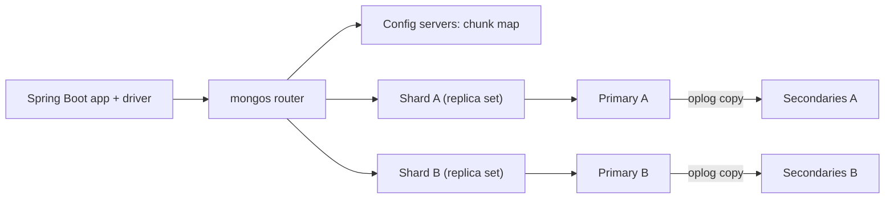

**Say this in the interview:**

> MongoDB stores JSON-like documents in collections. In production it runs as a replica set: one primary for writes and two or more secondaries that copy its oplog. When one replica set is not enough, we shard. A mongos router sends each query to the right shard, using metadata from the config servers.

**They may ask next:**
- **What is the smallest production setup?** A 3-node replica set. Two nodes cannot elect a new primary when one dies.
- **Do I need sharding from day 1?** Almost never. Start with a replica set and a good shard-key plan. Shard when data or write load is too big for one primary.

---

## Document model and BSON

**In one line:** MongoDB stores each record as a JSON-like document, saved on disk in a binary format called BSON.

**Story:** In a SQL shop, one order is split across many registers: the orders table, the order_items table, the address table. To read one order, you open three registers and join them.
In MongoDB, one order is one file folder. The items and the address are inside the folder. You pick up one folder and you have everything.

**How it works:**
- A **document** is a set of field-value pairs, like a JSON object. Values can be arrays or other documents (*embedded documents*).
- A **collection** is a group of documents, like a table. Documents in one collection can have different fields.
- **BSON** (Binary JSON) is how documents are stored and sent over the network. It has more types than JSON:
  - `ObjectId`: a 12-byte id. 4 bytes are a timestamp, 5 bytes are random per process, 3 bytes are a counter. So ids are roughly sorted by creation time.
  - `Date`, `Int32`, `Int64`, `Double`, `Decimal128` (exact decimals for money), `Binary`, `UUID`.
- Every document has an `_id` field. It is unique in the collection and has an index by default. You cannot change it after insert.
- A single-document write is **atomic** (all or nothing), even if it changes many fields and arrays. This is the most important design fact.
- Limits: a document is at most **16 MB**, and nesting is at most 100 levels deep.

**Diagram:**

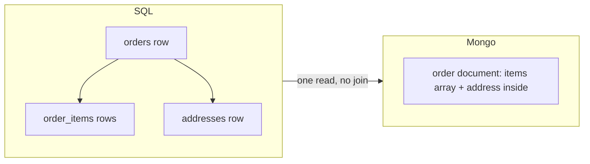

**Example:** one order document.

```json
{
  "_id": { "$oid": "6730f1a2c3d4e5f601234567" },
  "orderNo": "ORD-2026-000123",
  "customer": { "id": "c-42", "name": "Asha Rao" },
  "status": "PAID",
  "items": [
    { "sku": "TEA-1KG", "qty": 2, "price": { "$numberDecimal": "450.00" } },
    { "sku": "MUG-RED", "qty": 1, "price": { "$numberDecimal": "199.00" } }
  ],
  "total": { "$numberDecimal": "1099.00" },
  "shippingAddress": { "city": "Pune", "pin": "411001" },
  "createdAt": { "$date": "2026-11-10T09:30:00Z" }
}
```

(This is *Extended JSON*: the `$oid`, `$date` and `$numberDecimal` wrappers show the real BSON types.)

**Good and bad:**

| Good | Bad |
|---|---|
| Store money as `Decimal128`, or as whole paise in a `long` | Store money as `Double` (0.1 + 0.2 problems) |
| Store dates as BSON `Date` | Store dates as strings like "10/11/2026" (cannot range-query well) |
| Keep the shape the same for documents of one kind | "Schemaless" chaos: `price`, `Price` and `cost` in one collection |
| Use short but clear field names | Repeat giant field names in millions of documents (each name is stored in every document) |

**Say this in the interview:**

> MongoDB stores data as documents, which are like JSON objects, saved as BSON. BSON adds types like ObjectId, Date and Decimal128. A document can hold arrays and sub-documents, so one order with its items can be one document. A write to one document is atomic, and that is the base of good schema design.

**They may ask next:**
- **Is MongoDB really schemaless?** The database does not force a schema by default. But your app always has one. In production I add *schema validation* (`$jsonSchema`) on important collections.
- **Can I use my own `_id`?** Yes, any unique value, like `orderNo`. Avoid random values that make the index big and slow, if inserts are very frequent.
- **How is BSON different from JSON?** BSON is binary, has length prefixes (fast to skip fields) and more types like Date and Decimal128.

---

## When MongoDB fits and when SQL is better

**In one line:** Pick MongoDB for object-shaped, flexible data; pick SQL for many relations, joins and strict rules.

**Story:** A wardrobe vs a filing cabinet.
- A wardrobe (MongoDB) is great when each person's clothes stay together. You open one door and take one person's full outfit.
- A filing cabinet with cross-references (SQL) is great for an accounts office. Every bill links to a customer, a ledger and a tax code. Auditors join them in many ways.
- Both are good furniture. Wrong furniture in the wrong room hurts.

**How it works (honest decision table):**

| Need | MongoDB | SQL (PostgreSQL, MySQL) |
|---|---|---|
| Data shape changes often (product attributes, user settings) | Strong fit | Possible with JSONB columns, but less natural |
| Read one aggregate (order + items) in one go | One document, one read | Join 2–3 tables |
| Many-to-many relations, ad-hoc reports, many joins | Weak: `$lookup` exists but is not the main tool | Strong fit |
| Money transfers across many records, strict constraints (foreign keys, checks) | Possible with transactions, but not its home | Strong fit |
| Huge write volume, scale out across machines | Built-in sharding | Harder (Citus, Vitess, or app-level sharding) |
| Event logs, IoT readings, catalogs, content, profiles | Good fit | Works too |
| Team skills and tooling (BI tools, SQL reports) | Fewer people know aggregation | Everybody knows SQL |

**Diagram:**

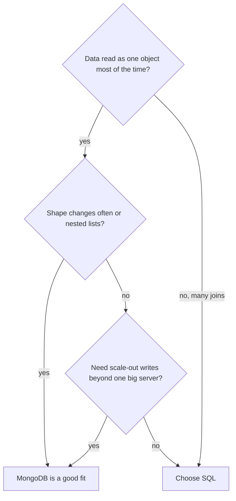

**Good and bad:**

| Good reason for MongoDB | Bad reason for MongoDB |
|---|---|
| Product catalog where a phone and a sofa have totally different attributes | "We do not want to design a schema" |
| Per-user activity feed, sessions, content documents | "NoSQL is faster" (not true in general) |
| Need to scale writes across shards later | A banking ledger with many cross-account rules |

**Say this in the interview:**

> I choose MongoDB when the data is read and written as whole objects, the shape changes often, or we need to scale out writes. I choose SQL when there are many relations, ad-hoc reports and strict constraints like foreign keys. Both support transactions and JSON today, so I decide by access patterns and team skills, not by hype. Many systems use both: SQL for orders and payments, MongoDB for the catalog.

**They may ask next:**
- **PostgreSQL has JSONB. Why MongoDB at all?** JSONB is great for a few flexible columns. MongoDB is built around documents end to end: indexes on nested fields and arrays, sharding and change streams are native.
- **Is MongoDB ACID?** Yes. Single-document writes are always atomic. Multi-document ACID transactions exist since 4.0 (replica sets) and 4.2 (sharded clusters).

---

## Schema design: embed or reference

**In one line:** Design the schema around how the app reads data: keep together what is read together, and split what grows without limit.

**Story:** Packing for a trip.
- Your toothbrush goes in the bag. You always need it with you. That is *embedding*.
- Your house stays at home. You only carry the address. That is a *reference*.
- You would never carry the house, and you would not leave the toothbrush at home.

**How it works:** In SQL you design tables first, then queries. In MongoDB you list the queries first, then design documents.

Rules of thumb (from the classic "6 rules" by MongoDB engineers):

| Relation | Example | What to do |
|---|---|---|
| **One-to-few** (up to a few dozen) | Customer and their 3 addresses | **Embed** the addresses in the customer |
| **One-to-many** (hundreds to a few thousand) | Product and its parts | **Array of ids** in the parent, parts in their own collection |
| **One-to-squillions** (millions, no limit) | Server and its log lines | **Parent id in each child**. Never an array in the parent |
| **Many-to-many** | Students and courses | Arrays of ids on one or both sides |

More rules:
1. Embed by default, unless you have a reason not to.
2. If you need to read or update an item on its own (for example a review), give it its own collection.
3. Arrays must not grow without a limit.
4. Copy (denormalize) a field only if it is read often and changes rarely. A customer's name: yes. A live stock count: no.
5. Joins (`$lookup`) are fine sometimes. If you need them on every request, rethink the schema.

**Diagram:**

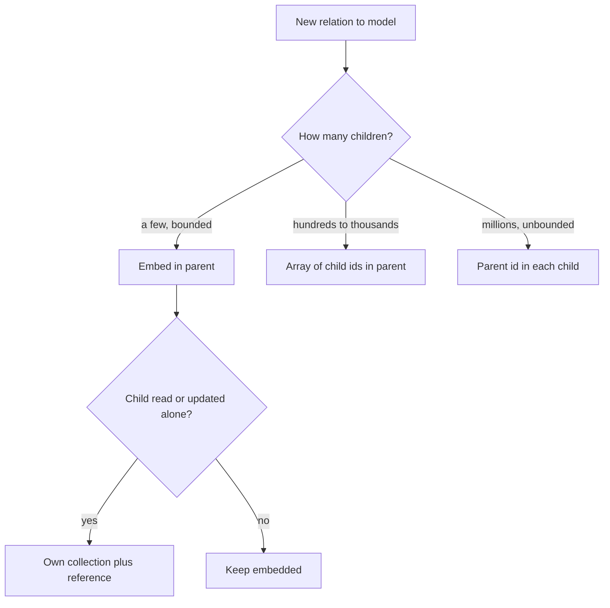

**Example:** the three shapes.

```jsonc
// One-to-few: embed
{ "_id": "c-42", "name": "Asha", "addresses": [ { "city": "Pune" }, { "city": "Goa" } ] }

// One-to-many: array of ids in the parent
{ "_id": "p-7", "name": "Bicycle", "partIds": ["part-1", "part-2", "part-3"] }

// One-to-squillions: parent id in each child
{ "_id": "log-991", "serverId": "srv-3", "msg": "disk 91% full", "at": "2026-11-10T09:30:00Z" }
```

**Good and bad:**

| Good | Bad |
|---|---|
| Order embeds its items (always read together, fixed after checkout) | Every item in its own collection, then `$lookup` on each order read |
| Reviews in their own collection, with `productId` | All reviews embedded in the product forever |
| Copy `customer.name` into the order | Copy the customer's wallet balance into every order |

**Say this in the interview:**

> I design the MongoDB schema from the access patterns. If data is read together and is small and bounded, I embed it. For one-to-many I keep an array of ids, and for one-to-millions I put the parent id in each child. I never let an array grow without a limit. I copy a field only if it is read often and changes rarely.

**They may ask next:**
- **How do you update a copied field, like a customer name in old orders?** Usually you do not. The order should keep the name at the time of purchase. If you must, run an `updateMany` in the background, or react to a change stream.
- **Is `$lookup` bad?** No. It is fine for reports and rare screens. It is a smell if the hottest API needs it on every call.

---

## Schema design patterns

**In one line:** Schema patterns are named, proven document shapes for common problems like tiny documents, slow totals and huge arrays.

**Story:** A tailor has standard patterns: shirt, kurta, trousers. They still measure each customer. Schema patterns are the same: starting points, adjusted to your data.

**How it works:** Each pattern answers one problem.

| Pattern | Problem it solves | Shop example |
|---|---|---|
| Bucket | Millions of tiny documents | Price-tracking readings, one document per product per hour |
| Computed | Same total calculated on every read | `ratingAvg` and `reviewCount` stored on the product |
| Extended reference | `$lookup` on every read | Order keeps customer name and phone |
| Subset | Big document, but screen needs a small part | Product keeps only the latest 10 reviews |
| Outlier | A few documents are much bigger than the rest | A best-seller with 2 million reviews |
| Polymorphic | Different shapes, same query | Payments: card, UPI, net banking in one collection |

**Diagram:**

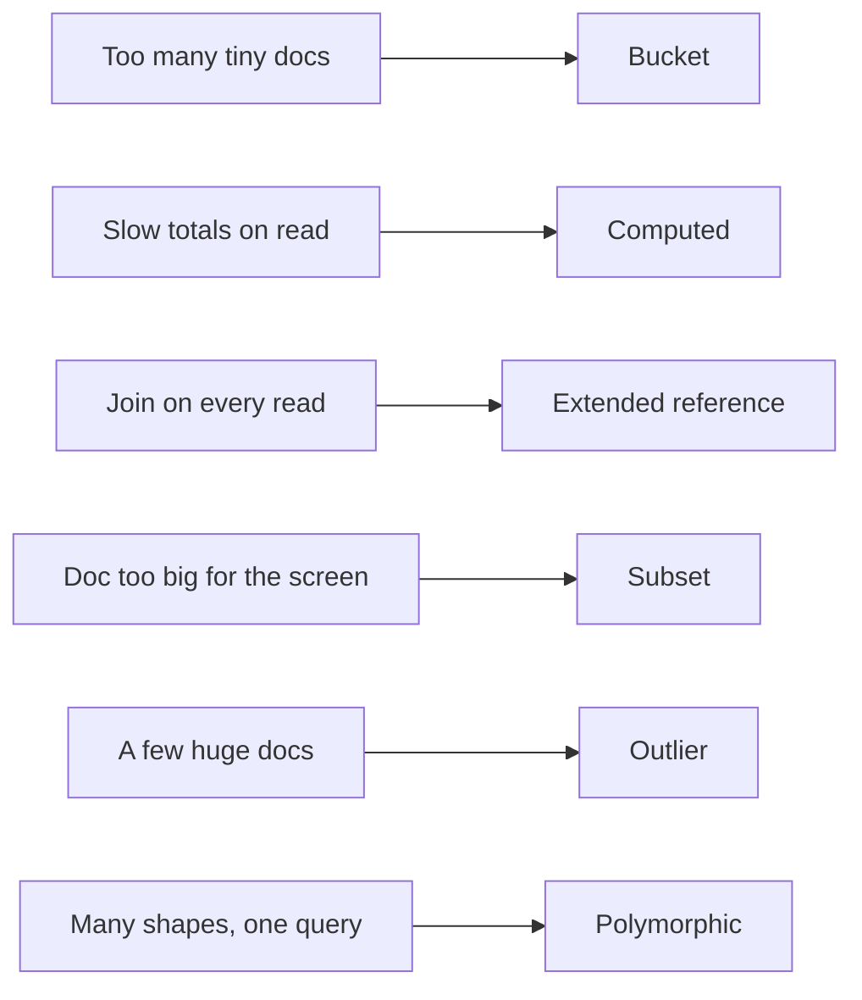

### Bucket pattern

Group many small events into one document per time window.

```json
{
  "productId": "p-7",
  "hour": { "$date": "2026-11-10T09:00:00Z" },
  "count": 3,
  "readings": [ { "m": 0, "price": 450 }, { "m": 20, "price": 445 }, { "m": 40, "price": 440 } ],
  "minPrice": 440, "maxPrice": 450
}
```

- 3,600 readings per hour become 1 document instead of 3,600. The index is much smaller.
- Since MongoDB 5.0, **time series collections** do this bucketing for you. Use them for metrics and IoT data.

### Computed pattern

Do the math on write, not on every read.

```json
{ "_id": "p-7", "name": "Bicycle", "reviewCount": 1520, "ratingSum": 6688, "ratingAvg": 4.4 }
```

- When a review is added: `$inc` `reviewCount` and `ratingSum`, then update `ratingAvg`. Good when reads are much more frequent than writes.

### Extended reference pattern

Copy the few fields you always show, keep the id for the rest.

```json
{ "_id": "ORD-123", "customer": { "id": "c-42", "name": "Asha Rao", "phone": "+91-90000-00000" }, "total": 1099 }
```

### Subset pattern

Keep the hot part inside, the rest outside.

```json
{ "_id": "p-7", "name": "Bicycle", "latestReviews": [ { "user": "Ravi", "stars": 5, "text": "Great" } ] }
```

- All reviews live in a `reviews` collection. The product page shows the latest 10 from the product document. "See all reviews" reads the other collection.

### Outlier pattern

Design for the normal case and flag the rare giant one.

```json
{ "_id": "p-best", "name": "Phone X", "reviewIds": ["r1", "r2", "...", "r1000"], "hasOverflow": true }
```

- 99.9% of products have fewer than 1,000 reviews and fit in one document. The rare best-seller sets `hasOverflow: true`, and the app reads extra overflow documents only for it.

### Polymorphic pattern

Different shapes in one collection, with a `type` field.

```json
[
  { "_id": "pay-1", "type": "CARD", "orderId": "ORD-123", "amount": 1099, "last4": "4242", "network": "VISA" },
  { "_id": "pay-2", "type": "UPI",  "orderId": "ORD-124", "amount": 499,  "vpa": "asha@bank" }
]
```

- One query "all payments for an order" works for every type. In Java, map each `type` to a subclass.
- A related idea is the **schema versioning pattern**: add `schemaVersion: 2` and let the app read both old and new shapes while you migrate slowly.

**Say this in the interview:**

> I use schema patterns as starting points. Bucket for time-based events, or a time series collection. Computed for totals like average rating. Extended reference to copy a customer's name into an order, so there is no join. Subset to keep only the latest reviews in a product. Outlier for the rare huge document. Polymorphic when payment types have different fields but one query.

**They may ask next:**
- **What is the cost of the computed and extended reference patterns?** Data is copied, so it can become stale. You must decide who updates the copy and how fast.
- **When is bucketing wrong?** When you often update or delete single readings. Then one document per event is simpler.

---

## The 16 MB limit and the unbounded array trap

**In one line:** A document can never pass 16 MB, and an ever-growing array hurts performance long before that.

**Story:** A train compartment has a fixed number of seats. If the railway keeps selling tickets for it, people stand in the aisle. Then the doors do not close, and the train cannot leave. You must add more compartments, not more tickets for one.

**How it works:**
- The hard limit for a BSON document is **16 MB**. Inserts or updates that cross it fail.
- The real problem starts earlier. A big document:
  - is read fully from disk and sent over the network, even if you need one field;
  - is rewritten more on every update, which means more disk and cache work;
  - makes a *multikey index* (an index on an array) grow with every element.
- Typical traps: `followers` inside a user, `comments` inside a post, `events` inside a device, `orders` inside a customer.
- For big files (images, PDFs), use **GridFS**, which splits a file into 255 KB chunks. Better: object storage like S3, with a link in the document.

**Diagram:**

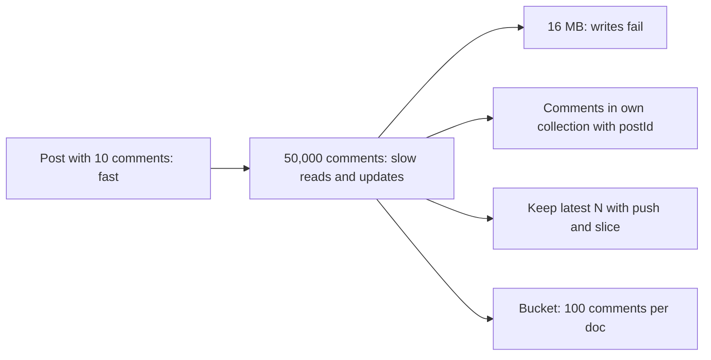

**Example:** keep only the latest 50 activity entries (a capped array).

```javascript
db.users.updateOne(
  { _id: "u-42" },
  { $push: { recentActivity: {
      $each: [ { action: "LOGIN", at: new Date() } ],
      $slice: -50                 // keep only the last 50 entries
  } } }
);
```

**Good and bad:**

| Good | Bad |
|---|---|
| Array with a known maximum (addresses, last 50 events) | `followers: [...]` for a celebrity |
| Children with a parent id, in their own collection | Images stored as Base64 inside documents |
| Alert when average document size grows (`$bsonSize`, collection stats) | Finding the problem when inserts start failing |

**Say this in the interview:**

> A MongoDB document has a hard 16 MB limit, but unbounded arrays hurt long before that. Every read loads the whole document and the array index keeps growing. So I keep only bounded arrays inside a document, like the last 50 events with push and slice. Anything that can grow forever goes into its own collection with a parent id, or into buckets.

**They may ask next:**
- **How do you find big documents?** Use `$bsonSize` in an aggregation, for example `$match` on `{$expr: {$gt: [{$bsonSize: "$$ROOT"}, 1000000]}}`.
- **Can I raise the 16 MB limit?** No. It is fixed. Redesign the schema.

---

## CRUD and query operators

**In one line:** CRUD uses a filter document plus operators like `$gt`, `$in` and `$set` to say what to match or change.

**Story:** Asking a shopkeeper for things. "Give me all red mugs under ₹300" is a filter. "Only tell me the name and price" is a projection. "Cheapest first, only 10" is sort and limit. "Mark these as sold" is an update.

**How it works:**
- **Create:** `insertOne`, `insertMany` (use `ordered: false` so one bad document does not stop the rest).
- **Read:** `find(filter, projection).sort().skip().limit()`, `findOne`, `countDocuments`.
- **Update:** `updateOne`, `updateMany`, `replaceOne`, `findOneAndUpdate`. Use operators: `$set`, `$unset`, `$inc`, `$push`, `$addToSet`, `$pull`. With `upsert: true`, the document is inserted if nothing matches.
- **Delete:** `deleteOne`, `deleteMany`.
- **Many writes at once:** `bulkWrite` sends a batch in one round trip.
- Query operators:
  - Compare: `$eq`, `$ne`, `$gt`, `$gte`, `$lt`, `$lte`, `$in`, `$nin`
  - Logic: `$and`, `$or`, `$not`, `$nor`
  - Fields: `$exists`, `$type`
  - Arrays: `$elemMatch`, `$all`, `$size`
  - Text: `$regex` (use with care), `$text` (needs a text index)
  - Compare two fields: `$expr`

**Diagram:**

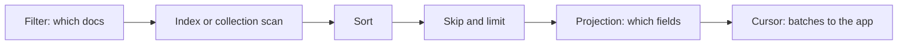

**Example:** shop queries in `mongosh` (the MongoDB shell).

```javascript
// Paid orders in Pune over 1000, newest first, only 3 fields
db.orders.find(
  { status: "PAID", "shippingAddress.city": "Pune", total: { $gt: 1000 } },
  { orderNo: 1, total: 1, createdAt: 1 }
).sort({ createdAt: -1 }).limit(20);

// Atomic stock decrement: only if enough stock (no race condition)
db.products.updateOne(
  { _id: "p-7", stock: { $gte: 2 } },          // condition and change in one atomic step
  { $inc: { stock: -2 }, $set: { updatedAt: new Date() } }
);

// Array trap: $elemMatch makes both conditions apply to the SAME item
db.orders.find({ items: { $elemMatch: { sku: "TEA-1KG", qty: { $gte: 2 } } } });

// Keyset pagination: faster than a big skip()
db.orders.find({ _id: { $lt: lastSeenId } }).sort({ _id: -1 }).limit(20);
```

**Good and bad:**

| Good | Bad |
|---|---|
| Atomic `$inc` with a condition in the filter | Read the document, change it in Java, write it back (lost updates) |
| `$elemMatch` when two conditions must hit one array element | `{"items.sku": "A", "items.qty": {$gte: 2}}`, which can match two different items |
| Keyset pagination (`_id < last`) for deep pages | `skip(100000)`: the server still walks 100,000 entries |
| Anchored regex `^Asha` (can use an index) | `/asha/i` on a big collection (full scan) |

**Say this in the interview:**

> CRUD in MongoDB uses a filter document plus operators. For updates I use operators like $set and $inc, never read-modify-write in Java. A single-document update is atomic, so "decrement stock only if stock is at least 2" is one safe call. For arrays I use $elemMatch, and for deep pages I use keyset pagination instead of skip.

**They may ask next:**
- **`updateOne` vs `findOneAndUpdate`?** `findOneAndUpdate` also returns the document (before or after the change). Use it when you need the new value, for example a counter.
- **What does `upsert` do?** Update if it matches, insert if not. Put a unique index on the filter fields, or two parallel upserts can insert two documents.

---

## Index types

**In one line:** An index is a sorted list of field values with pointers to documents, so MongoDB avoids reading everything.

**Story:** The index at the back of a cookbook. To find "paneer", you do not read 400 pages. You look under "P" and jump to page 212. But every new recipe also means updating the index, so too many indexes slow down writing the book.

**How it works:** MongoDB indexes are B-trees (sorted trees). Every collection has an `_id` index by default.

| Type | What it is | Shop example |
|---|---|---|
| Single field | One field, ascending or descending | `{ customerId: 1 }` |
| Compound | Several fields, order matters | `{ status: 1, createdAt: -1 }` |
| Multikey | Index on an array: one entry per element. Created automatically when the field holds an array | `{ tags: 1 }` on `tags: ["tea", "organic"]` |
| Text | Word-based search on strings. Only one per collection | `{ name: "text", description: "text" }` |
| TTL | Deletes documents after a time, on a `Date` field | Carts expire 24 hours after `createdAt` |
| Partial | Only indexes documents that match a filter | Only `status: "PENDING"` orders |
| Unique | No two documents with the same value | `{ email: 1 }` unique |
| Wildcard | Indexes unknown or changing field names (since 4.2) | `{ "attributes.$**": 1 }` for product attributes |
| Hashed | Index on a hash of the value. Used for hashed sharding | `{ customerId: "hashed" }` |
| Geospatial | Location queries | `{ location: "2dsphere" }` for nearby stores |

**Diagram:**

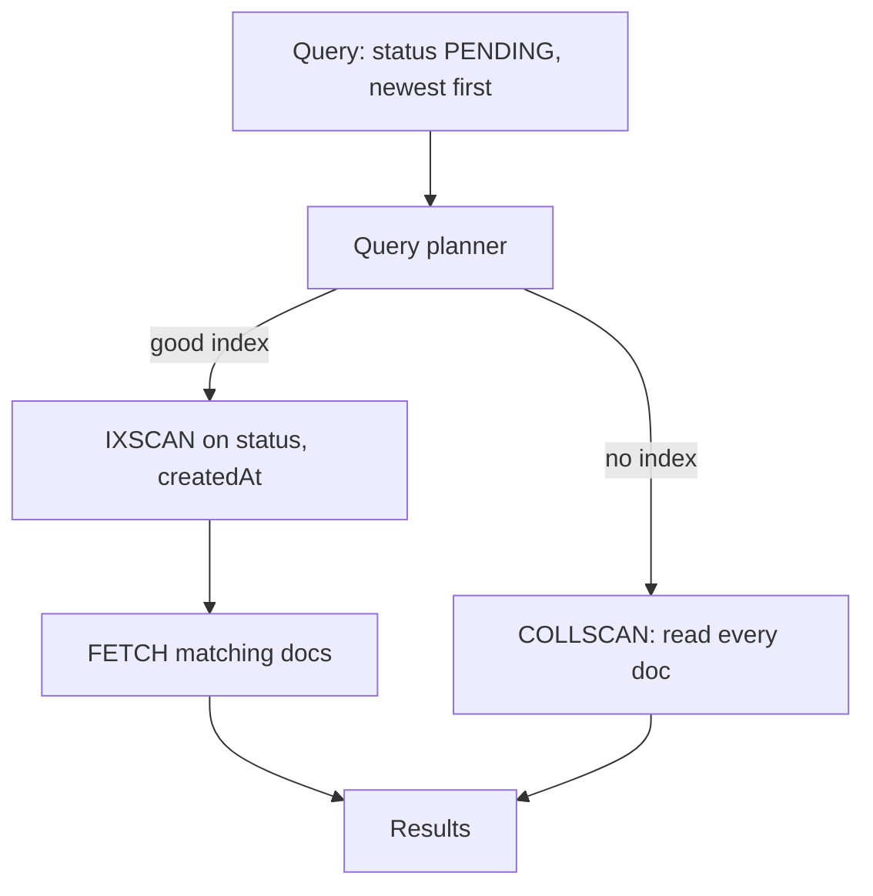

**Example:**

```javascript
db.orders.createIndex({ customerId: 1, createdAt: -1 });                    // compound
db.users.createIndex({ email: 1 }, { unique: true });                       // unique
db.carts.createIndex({ createdAt: 1 }, { expireAfterSeconds: 86400 });      // TTL: 24 hours
db.orders.createIndex(
  { createdAt: 1 },
  { partialFilterExpression: { status: "PENDING" } }                        // small index, only pending
);
db.products.createIndex({ "attributes.$**": 1 });                           // wildcard
db.orders.getIndexes();                                                     // list indexes
```

**Good and bad:**

| Good | Bad |
|---|---|
| One index per important query shape, checked with `explain()` | An index on every field "just in case" (slower writes, more RAM) |
| Partial index for a small hot subset | Full index on a field where 99% of values are the same |
| TTL index for sessions, carts, OTPs | A cron job that deletes old rows one by one |
| A search engine for real full-text search | Text index for a Google-like search box |

**Say this in the interview:**

> Indexes are B-trees that let MongoDB avoid reading the whole collection. I use compound indexes for most queries, unique indexes for business keys, TTL indexes for expiring data, and partial indexes for small hot subsets. Each index costs write speed and RAM, so I keep only the ones queries use. I check them with explain and remove unused ones with $indexStats.

**They may ask next:**
- **Is a TTL delete exact?** No. A background job runs about every 60 seconds, so a document can live a bit longer than its TTL.
- **Limits of multikey indexes?** In one compound index, at most one field can be an array in the same document. Big arrays make big indexes.
- **Do index builds block the database?** Since 4.2 the build takes an exclusive lock only briefly at the start and the end. It still uses CPU and disk, so build big indexes in quiet hours.

---

## Compound indexes and the ESR rule

**In one line:** In a compound index, put fields in the order Equality, then Sort, then Range (ESR).

**Story:** A phone book is sorted by city, then surname, then first name. "All Sharmas in Pune" is fast: go to Pune, then to S. "All people named Rahul in any city" is slow, because first names are sorted only inside each city and surname.

**How it works:**
1. **E (Equality):** fields matched exactly (`status: "PAID"`) come first. They narrow the search to one part of the index.
2. **S (Sort):** the sort field comes next. Inside one equality value, entries are already in sort order. So there is no in-memory sort.
3. **R (Range):** range filters (`$gt`, `$lt`, `$in` with many values, regex) come last.
4. **Prefix rule:** index `{a, b, c}` also serves queries on `{a}` and `{a, b}`. It does not serve `{b}` or `{c}` alone.

**Diagram:**

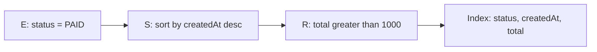

**Example:**

```javascript
// Query: paid orders over 1000, newest first
db.orders.find({ status: "PAID", total: { $gt: 1000 } }).sort({ createdAt: -1 });

// ESR index: Equality, Sort, Range
db.orders.createIndex({ status: 1, createdAt: -1, total: 1 });

// Worse: { status: 1, total: 1, createdAt: -1 }
// The range on total breaks the sort order, so MongoDB must sort in memory.
```

**Good and bad:**

| Good | Bad |
|---|---|
| ESR order, checked in `explain()` | Fields in "the order I thought of them" |
| One compound index serving several queries via its prefix | Separate single-field indexes, hoping MongoDB combines them |
| No `SORT` stage in the plan | Big in-memory sorts that are slow and use a lot of memory |

**Say this in the interview:**

> For compound indexes I follow ESR: equality fields first, then the sort field, then range fields. Equality narrows to one part of the index. The sort field then gives results already in order, so there is no in-memory sort. Range comes last because a range breaks the sort order of fields after it. I confirm with explain that there is no SORT stage.

**They may ask next:**
- **Does direction (1 or -1) matter?** For a single field, no: MongoDB can walk the index both ways. For multi-field sorts, the directions must match the index or its exact reverse.
- **Is `$in` equality or range?** With a few values it acts like equality. With a sort after it, it can act like range. Check `explain()`.

---

## explain(): COLLSCAN vs IXSCAN

**In one line:** `explain()` shows the chosen plan and the work done: COLLSCAN reads every document, IXSCAN uses an index.

**Story:** Two ways to find a guest at a wedding. COLLSCAN: walk through the whole hall and look at every face. IXSCAN: check the seating chart, then walk to table 12.

**How it works:**
1. Run `.explain("executionStats")` on the query.
2. Read `winningPlan` stages, from the inside out:
   - `COLLSCAN`: full collection scan. Bad on big collections.
   - `IXSCAN`: index scan. Good.
   - `FETCH`: load the full documents after the index scan.
   - `SORT`: in-memory sort. Usually means the index order is wrong.
   - `PROJECTION_COVERED`: the index alone answered the query (a *covered query*).
3. Compare three numbers: `nReturned`, `totalKeysExamined`, `totalDocsExamined`.
   - Ideal: all three are close to each other.
   - `docsExamined` = 1,000,000 and `nReturned` = 20 means a missing or weak index.
4. The planner tries candidate plans and caches the winner for that *query shape* (the same filter, sort and projection fields).

**Diagram:**

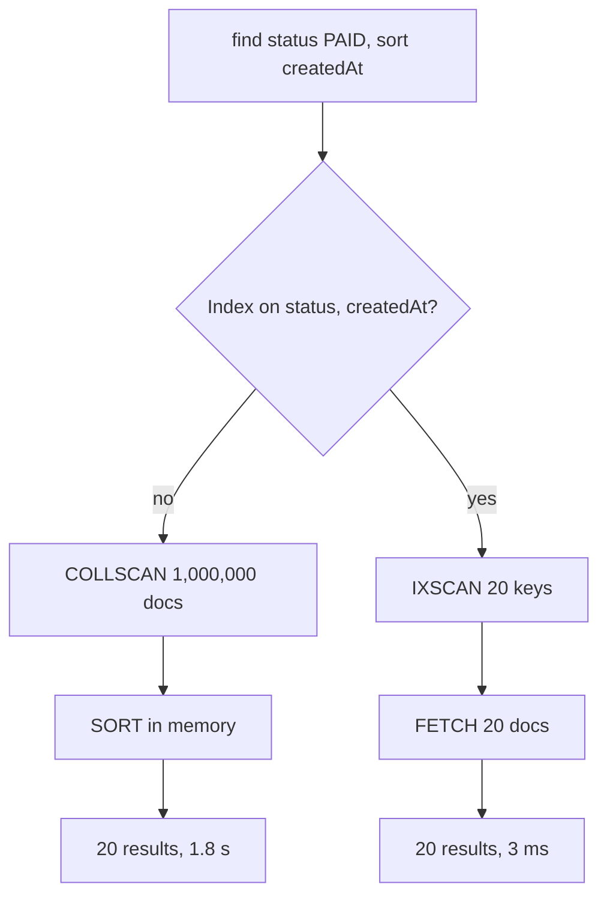

**Example:**

```javascript
db.orders.find({ status: "PAID" }).sort({ createdAt: -1 }).limit(20)
  .explain("executionStats");
// Look for:
//   winningPlan.stage: "LIMIT" -> "FETCH" -> "IXSCAN"   (good)
//   executionStats.totalKeysExamined: 20
//   executionStats.totalDocsExamined: 20               (equal to nReturned: good)

// Covered query: filter and projection only use indexed fields, _id excluded
db.orders.find({ status: "PAID" }, { _id: 0, status: 1, createdAt: 1 });
```

**Good and bad:**

| Good | Bad |
|---|---|
| Run `explain` on real-size data before release | Test on 100 documents and trust it |
| Watch `docsExamined / nReturned` ratio | Look only at "it used an index" |
| Use `hint()` only as a short-term fix | `hint()` everywhere, forcing old plans forever |

**Say this in the interview:**

> I run explain with executionStats. I want IXSCAN, not COLLSCAN, and no in-memory SORT stage. Then I compare keys examined, docs examined and docs returned. If MongoDB reads a million documents to return 20, the index is missing or in the wrong order. For the hottest reads I try a covered query, where the index alone answers.

**They may ask next:**
- **How do you find slow queries in production?** The database profiler and the slow query log. Operations slower than `slowms` (100 ms by default) are logged. Managed services also show a query profiler.
- **What is a covered query?** All filter and returned fields are in one index, and `_id` is excluded. MongoDB never loads the documents.

---

## Aggregation pipeline

**In one line:** The aggregation pipeline passes documents through stages, like `$match`, `$group` and `$sort`, to filter, reshape and summarize data on the server.

**Story:** A factory assembly line for mangoes. Station 1 throws out bad mangoes (`$match`). Station 2 cuts each crate into single mangoes (`$unwind`). Station 3 groups them by farm and counts (`$group`). Station 4 sorts farms by count (`$sort`). Each station only sees what the previous one passed on.

**How it works:**

| Stage | What it does | SQL cousin |
|---|---|---|
| `$match` | Filter documents | `WHERE` |
| `$project` / `$set` | Pick, rename or compute fields | `SELECT a, b, a*b` |
| `$unwind` | One document per array element | Flatten a child table |
| `$group` | Group and compute `$sum`, `$avg`, `$max`, `$push` | `GROUP BY` |
| `$sort`, `$limit`, `$skip` | Order and page | `ORDER BY`, `LIMIT` |
| `$lookup` | Join another collection | `LEFT OUTER JOIN` |
| `$facet` | Run several sub-pipelines on the same input | Several queries in one call |
| `$merge` / `$out` | Write results to a collection | `INSERT INTO ... SELECT` |

Rules:
1. Put `$match` and `$sort` first, so they can use indexes.
2. Each stage can use up to 100 MB of memory. Bigger work spills to disk (`allowDiskUse`, on by default since 6.0), which is slower.
3. For heavy reports on big data, pre-compute with `$merge` into a summary collection, or run on a secondary or analytics node.

**Diagram:**

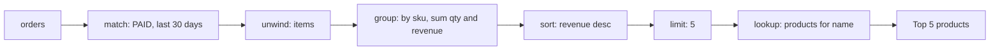

**Example:** top 5 products by revenue in the last 30 days.

```javascript
db.orders.aggregate([
  { $match: { status: "PAID", createdAt: { $gte: ISODate("2026-10-17") } } }, // uses index
  { $unwind: "$items" },                                       // one doc per item
  { $group: {
      _id: "$items.sku",
      qty: { $sum: "$items.qty" },
      revenue: { $sum: { $multiply: ["$items.qty", "$items.price"] } }
  } },
  { $sort: { revenue: -1 } },
  { $limit: 5 },
  { $lookup: { from: "products", localField: "_id", foreignField: "sku", as: "product" } },
  { $project: { _id: 0, sku: "$_id", qty: 1, revenue: 1,
                name: { $first: "$product.name" } } }
]);
```

**Example:** `$facet` for a search page (results and counts in one call).

```javascript
db.products.aggregate([
  { $match: { category: "tea", price: { $lte: 800 } } },
  { $facet: {
      results: [ { $sort: { rating: -1 } }, { $limit: 20 } ],
      byBrand: [ { $group: { _id: "$brand", count: { $sum: 1 } } } ],   // filter counts
      total:   [ { $count: "n" } ]
  } }
]);
```

**Good and bad:**

| Good | Bad |
|---|---|
| `$match` first, on indexed fields | `$lookup` or `$unwind` on the whole collection, then `$match` |
| `$lookup` after `$limit` (join 5 docs, not 5 million) | `$lookup` on every row of a big report in an API call |
| Pre-computed daily summaries with `$merge` | Running a 30-second report on the primary at peak time |

**Say this in the interview:**

> The aggregation pipeline is a list of stages. Each stage takes documents from the previous one. I put $match and $sort first so they use indexes, and I do $lookup as late as possible, after $limit. $group is like GROUP BY, $unwind flattens arrays, and $facet gives several results, like search results and filter counts, in one call. For heavy reports I pre-compute with $merge.

**They may ask next:**
- **`$lookup` vs embedding?** `$lookup` is a left outer join done at read time. Fine for reports, costly on hot paths. Embedding or extended reference avoids it.
- **Can `$lookup` join a sharded collection?** Yes, since 5.1. It is still a cross-shard operation, so it costs more.

---

## Replica sets: primary, secondaries, elections and oplog

**In one line:** A replica set is a group of servers with the same data: one primary writes, secondaries copy its oplog, and they elect a new primary on failure.

**Story:** A cricket team has one captain. Two vice-captains follow every decision in the scorebook. If the captain gets injured, the players vote. The vice-captain with the most up-to-date scorebook becomes captain. The match continues after a short pause.

**How it works:**
1. **Primary:** the only member that accepts writes. It records each change in the **oplog** (operations log). The oplog is a special *capped collection* (fixed size, oldest entries removed first) named `local.oplog.rs`.
2. **Secondaries:** pull the oplog from the primary (or from another secondary) and apply the same operations. Oplog entries are *idempotent* (applying one twice gives the same result).
3. **Heartbeats:** members ping each other every 2 seconds.
4. **Election:** if the primary does not answer for `electionTimeoutMillis` (10 seconds by default), a secondary asks for votes. It needs a **majority** of voting members. The most up-to-date eligible member wins. With default settings, a new primary is usually ready in about 12 seconds or less.
5. **Retryable writes** (on by default in modern drivers) retry a write once after a failover. So most apps see a short pause, not an error.
6. **Rollback:** if the old primary had writes that did not reach a majority, those writes are rolled back when it rejoins as a secondary.
7. Sizes: up to 50 members, at most 7 can vote. Use an odd number of voters (3 or 5).
8. Special members:
   - **hidden**: no app reads; used for backups or analytics.
   - **delayed**: for example 1 hour behind, to recover from a bad delete.
   - **arbiter**: votes but holds no data. Avoid in production.

**Diagram:**

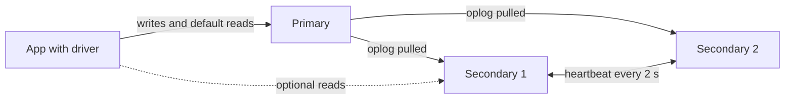

**Diagram (failover):**

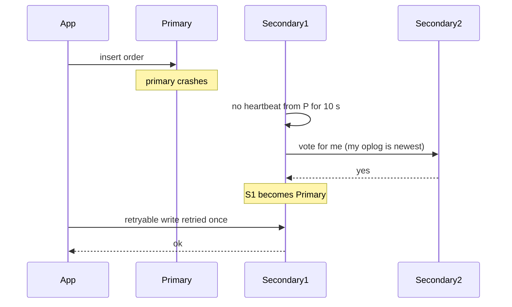

**Good and bad:**

| Good | Bad |
|---|---|
| 3 data-bearing members in 3 availability zones | 2 members, or all 3 in one rack |
| Oplog sized to hold 24–72 hours of changes | Small oplog: a secondary that falls behind needs a full resync |
| Alert on replication lag | Reading from secondaries without knowing they can be stale |

**Say this in the interview:**

> A replica set has one primary and usually two secondaries. The primary writes every change to the oplog, and secondaries pull and replay it. If the primary stops answering for about 10 seconds, the secondaries hold an election. The most up-to-date one that wins a majority becomes primary. Drivers find the new primary and retry the write once. Writes that never reached a majority can be rolled back, which is why I use write concern majority.

**They may ask next:**
- **Why an odd number of members?** To get a clear majority. With 4 voters you still need 3, so 4 gives no extra safety over 3.
- **What is replication lag?** How far a secondary is behind the primary, in seconds. Causes: slow disk, network, heavy writes. Watch it with `rs.printSecondaryReplicationInfo()`.
- **What if the oplog window is too short?** A secondary that was down longer than the window cannot catch up. It needs a full *initial sync* (copy all data again).

---

## Write concern, read concern and read preference

**In one line:** Write concern = how many members confirm a write; read concern = how safe the data you read is; read preference = which member you read from.

**Story:** Sending an important letter.
- **Write concern** is how many people must sign the receipt. One clerk (`w:1`) is fast. A majority of the office (`w:"majority"`) is safe even if one clerk loses the letter.
- **Read concern** is "show me only letters a majority has filed" vs "show me what the clerk just got, even if it may get lost".
- **Read preference** is which window you go to: the main counter (primary) or a side counter (secondary) that may be a few minutes behind.

**How it works:**

| Setting | Options | Default |
|---|---|---|
| Write concern `w` | `0` (no ack), `1` (primary only), `"majority"`, a number | `"majority"` since 5.0 for most setups |
| Journal `j` | `true`: wait until written to the on-disk journal | Follows the server setting |
| `wtimeout` | Stop waiting after N ms (the write may still happen) | None |
| Read concern | `local`, `available`, `majority`, `linearizable`, `snapshot` | `local` |
| Read preference | `primary`, `primaryPreferred`, `secondary`, `secondaryPreferred`, `nearest` | `primary` |

**What you lose with `w:1`:**
1. The primary saves the order and says "ok".
2. It crashes before any secondary copied the write.
3. A secondary becomes primary without that order.
4. The old primary rejoins and **rolls back** the order. Your app already told the customer "order placed".

With `w:"majority"`, the write is on most members, so the new primary will have it.

**Reads:**
- `local` can return data that is later rolled back.
- `majority` returns only data confirmed by a majority. Safe for decisions like "is this payment done?"
- For **read your own writes** on secondaries, use a *causally consistent session*.
- Reading from secondaries gives stale data. `maxStalenessSeconds` (90 seconds minimum) skips members that are too far behind.

**Diagram:**

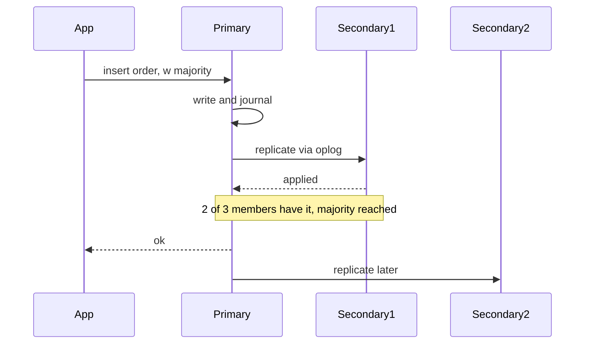

**Example (Java driver):**

```java
MongoCollection<Document> orders = db.getCollection("orders")
    .withWriteConcern(WriteConcern.MAJORITY.withWTimeout(5, TimeUnit.SECONDS)) // safe writes
    .withReadConcern(ReadConcern.MAJORITY)                                     // no rolled-back reads
    .withReadPreference(ReadPreference.primary());

MongoCollection<Document> analytics = db.getCollection("orders")
    .withReadPreference(ReadPreference.secondaryPreferred());                  // ok to be a bit stale
```

**Good and bad:**

| Good | Bad |
|---|---|
| `w:"majority"` for orders, payments, user data | `w:1` or `w:0` for money, to "go faster" |
| Secondary reads for reports and dashboards | Secondary reads for "did my payment go through?" |
| Read-your-writes with causal sessions | Assuming secondaries are always up to date |

**Say this in the interview:**

> Write concern majority means the write is on most members before I get an ok, so it survives a failover. With w:1 the primary can confirm and then crash, and the write gets rolled back. Read concern majority means I only read data that cannot be rolled back. By default I read from the primary. I send reports and dashboards to secondaries, because they can be a few seconds behind.

**They may ask next:**
- **Does `wtimeout` cancel the write?** No. It only stops waiting. The write may still be applied. Treat it as "unknown", and make the write idempotent.
- **Is MongoDB strongly consistent?** Reads from the primary with majority write and read concern give strong guarantees. `linearizable` read concern gives the strongest, at more cost.

---

## Multi-document transactions

**In one line:** MongoDB has multi-document ACID transactions (4.0 on replica sets, 4.2 on shards), but a good schema needs them rarely.

**Story:** Moving money between two pockets of the same shirt needs no paperwork. Moving money between two banks needs a form, two signatures and a waiting period. Embedding is "same shirt". A transaction is "two banks": possible, but slower, so do it only when needed.

**How it works:**
1. Start a **session**, then start a transaction inside it.
2. All reads see one **snapshot** (a frozen view of the data at the start).
3. Writes stay hidden from others until **commit**. On **abort**, nothing is applied.
4. If two transactions change the same document, one gets a **write conflict**. It must retry. The error has the label `TransientTransactionError`.
5. If the commit result is unknown (network cut), the error has the label `UnknownTransactionCommitResult`. Retry the commit.
6. The driver's `withTransaction(...)` helper does both retries for you.
7. Limits to know:
   - A transaction runs at most **60 seconds** by default (`transactionLifetimeLimitSeconds`).
   - Keep it small. MongoDB suggests at most about 1,000 changed documents per transaction.
   - Create collections and indexes **before** the transaction (for example at startup).
   - MongoDB 9.0 also limits concurrently open transactions (10,000 by default).
8. On a sharded cluster, a transaction that touches many shards uses *two-phase commit* (prepare on all shards, then commit). This costs more.

**Diagram:**

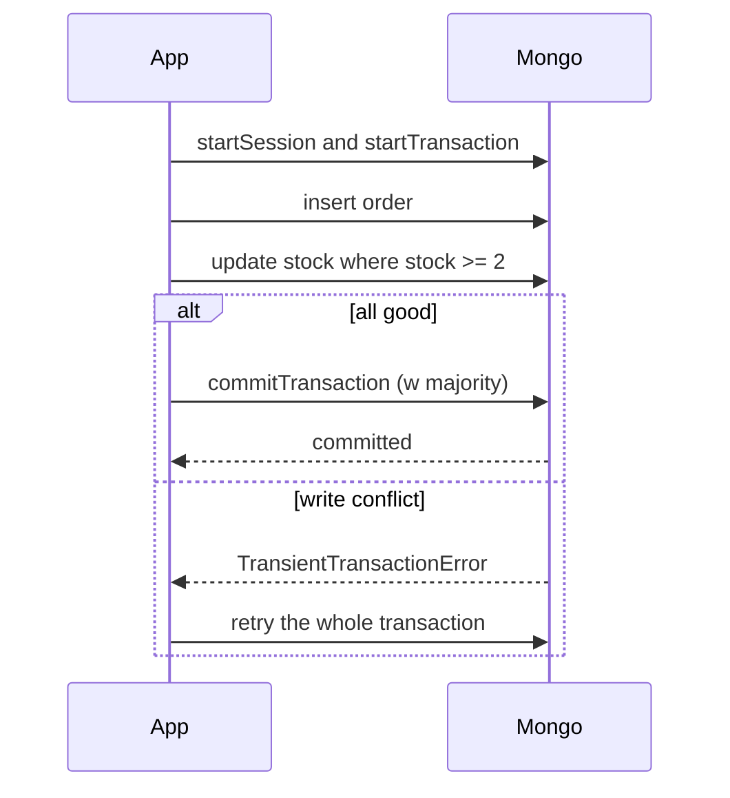

**Example (Java driver):**

```java
try (ClientSession session = client.startSession()) {
    session.withTransaction(() -> {                       // retries transient errors for you
        orders.insertOne(session, orderDoc);
        UpdateResult r = products.updateOne(session,
            and(eq("_id", "p-7"), gte("stock", 2)),
            inc("stock", -2));
        if (r.getModifiedCount() == 0) throw new IllegalStateException("Out of stock"); // aborts
        return null;
    }, TransactionOptions.builder()
         .writeConcern(WriteConcern.MAJORITY)
         .readConcern(ReadConcern.SNAPSHOT).build());
}
```

**Good and bad:**

| Good | Bad |
|---|---|
| Model as one document first; use a transaction only across documents | Wrap every write in a transaction "to be safe" |
| Short transactions, a few documents, retry on transient errors | A 5-minute batch job inside one transaction |
| Idempotent logic so retries are safe | HTTP calls to other services inside the transaction |
| Atomic `$inc` with a condition for a hot counter | A transaction on one hot document from 1,000 users at once (many conflicts) |

**When to use / when not to use:**
- Use: order + stock in different collections, transfer between two wallet documents, writing an outbox document with the business change.
- Avoid: when one document can hold the change, long batch jobs, hot counters, and anything that calls other systems.

**Say this in the interview:**

> MongoDB has full ACID transactions across documents since 4.0, and across shards since 4.2. Inside a transaction all reads see one snapshot, and writes become visible only at commit. I keep transactions short, retry on TransientTransactionError, and create collections before. But I first try to model the change as one document, because single-document writes are atomic and much cheaper.

**They may ask next:**
- **Can a transaction span shards?** Yes, since 4.2. It uses two-phase commit, so it is slower. Choose a shard key that keeps one transaction on one shard.
- **What isolation level is it?** Snapshot isolation. The transaction sees a consistent snapshot. Conflicting writes fail fast instead of waiting.
- **Read more on Spring's side?** [@Transactional deep dive](spring-ecosystem.md#transactional-deep-dive) and the [Spring Data MongoDB](#spring-data-mongodb) section below.

---

## Sharding

**In one line:** Sharding splits one collection across many replica sets by a shard key, so data and writes can outgrow one server.

**Story:** A big railway reservation office. One counter cannot serve the whole city. So: counter A for surnames A–F, counter B for G–M, and so on. A guard at the door (the router) sends you to the right counter. If everyone in the city is named "Sharma", one counter is flooded and the others sit idle. Choosing how to split (the shard key) is everything.

**How it works:**
1. **Shards:** each shard is a full replica set and holds part of the data.
2. **mongos:** a router. Apps connect to it, not to shards. It knows which shard has which key range.
3. **Config servers:** a replica set that stores the metadata (which ranges live on which shard).
4. **Chunks:** the data is cut into ranges of the shard key. The default chunk size is 128 MB. The **balancer** moves ranges between shards to keep data even.
5. Two ways to split:
   - **Ranged:** nearby keys go together. Good for range queries. A rising key (timestamp, ObjectId) sends all new inserts to the last chunk: a **hot shard**.
   - **Hashed:** the key is hashed first. Writes spread evenly. Range queries go to all shards.
6. **Targeted vs scatter-gather:** a query with the shard key goes to one shard. A query without it goes to **all shards** and mongos merges the results. Slow and costly at scale.
7. **Jumbo chunk:** a range that cannot split, because too many documents share one shard key value (for example `country: "IN"`). The balancer cannot move it, and one shard gets too big.
8. Fixes: since 4.4 you can **refine** a shard key (add suffix fields). Since 5.0 you can **reshard** a collection to a new key online. (Changing one document's shard key value is allowed since 4.2.)

**A good shard key:**
- **High cardinality:** many distinct values (`customerId`, not `status`).
- **Low frequency:** no single value is very common.
- **Not monotonic:** does not keep rising, or is hashed.
- **Matches the main queries:** so most reads are targeted.

**Diagram:**

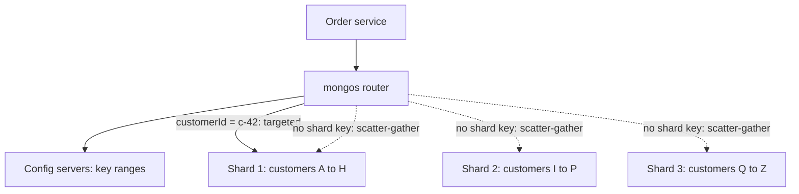

**Example:** shard orders by customer.

```javascript
sh.enableSharding("shop");   // optional since 6.0, still common in scripts
db.orders.createIndex({ customerId: 1, createdAt: -1 });
sh.shardCollection("shop.orders", { customerId: 1, createdAt: -1 });   // ranged, compound key
// "My orders" is targeted: one shard.
db.orders.find({ customerId: "c-42" }).sort({ createdAt: -1 });

// Alternative for very even writes:
// sh.shardCollection("shop.events", { deviceId: "hashed" });
```

**Good and bad:**

| Good key | Bad key | Why bad |
|---|---|---|
| `{ customerId: 1, createdAt: -1 }` | `{ createdAt: 1 }` | All new writes hit the last shard |
| `{ deviceId: "hashed" }` | `{ status: 1 }` | Only a few values: jumbo chunks |
| Key used in 90% of queries | Key never used in queries | Every read is scatter-gather |

**When to use / when not to use:**
- Shard when the data no longer fits on one replica set (many TB), or one primary cannot take the write rate.
- First try: better indexes, bigger machines, archiving old data, read from secondaries for reports.

**Say this in the interview:**

> Sharding splits a collection across replica sets by a shard key. Apps talk to mongos, which uses config server metadata to route each query. I pick a key with high cardinality, low frequency, not rising, and present in most queries, like customerId. Ranged keys help range queries but a rising key creates a hot shard. Hashed keys spread writes but make range queries scatter-gather. If I pick wrong, I can reshard online since 5.0, but it is expensive.

**They may ask next:**
- **What happens to unsharded collections?** They live on one shard (the database's primary shard). Since 8.0 you can move them with `moveCollection`.
- **How are unique indexes handled?** A unique index on a sharded collection must start with the shard key. Otherwise each shard can only check its own data.
- **More on sharding in general:** [system-design.md](system-design.md#partitioning-and-sharding) and [consistent hashing](system-design.md#consistent-hashing).

---

## Change streams

**In one line:** A change stream is a live, resumable feed of inserts, updates and deletes, built on the oplog.

**Story:** A newspaper subscription. You do not walk to the press every morning to ask "anything new?". The paper arrives at your door. If you go on holiday, you tell them "start again from Monday's issue". The *resume token* is that "Monday" note.

**How it works:**
1. Call `watch()` on a collection, a database or the whole cluster. Needs a replica set or a sharded cluster.
2. Each event has an operation type (`insert`, `update`, `delete`, ...), the document key and a **resume token**.
3. Add a pipeline to filter, for example only `insert` events with `status: "PAID"`.
4. `fullDocument: "updateLookup"` returns the current full document on updates. Since 6.0 you can also ask for *pre-images* and *post-images* (before and after versions).
5. Save the resume token after you process each event. After a restart, start with `resumeAfter: token`.
6. If you are down longer than the **oplog window**, the token is gone and you cannot resume. You must do a full resync.
7. Delivery is **at least once** after a restart. Consumers must be idempotent.

**Use cases:**
- **CDC** (change data capture): send changes to Kafka, a search index or a cache.
- **Outbox-like publishing:** write the order and an `outbox` document in one transaction (or just the order). A publisher watches the outbox and sends events to Kafka. No dual write. See [Transactional outbox](microservices.md#transactional-outbox-pattern).
- Cache invalidation and real-time screens.
- Ready-made connectors exist: the MongoDB Kafka connector and Debezium's MongoDB connector.

**Diagram:**

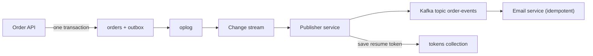

**Example (Java driver):**

```java
List<Bson> pipeline = List.of(Aggregates.match(Filters.eq("operationType", "insert")));
BsonDocument token = tokenStore.load();                       // last processed position

var stream = db.getCollection("outbox").watch(pipeline);
if (token != null) stream = stream.resumeAfter(token);

for (ChangeStreamDocument<Document> e : stream) {             // blocks and waits for events
    kafka.send("order-events", e.getFullDocument().toJson()); // at least once
    tokenStore.save(e.getResumeToken());                      // save after success
}
```

**Good and bad:**

| Good | Bad |
|---|---|
| Save the resume token after each processed event | Keep the token only in memory |
| Oplog window much bigger than your longest expected outage | 2-hour oplog and a weekend outage |
| Idempotent consumers (event id as dedupe key) | Assume exactly once |
| One publisher per stream, with leader election, or a connector | 5 pods all watching and sending duplicates |

**Say this in the interview:**

> Change streams give a live feed of changes, built on the oplog. I use them for CDC into Kafka or a search index. I also use them as an outbox publisher. The order and the outbox document go in one transaction, and a publisher watches the outbox and sends to Kafka. I save the resume token after each event so I can continue after a restart. Delivery is at least once, so consumers are idempotent, and the oplog window must cover the longest outage.

**They may ask next:**
- **Change streams vs polling a table?** Change streams push events in order with low delay and no extra load from polling queries.
- **Change streams vs Debezium?** Debezium is a Kafka Connect connector that uses change streams for MongoDB. It handles tokens, restarts and Kafka for you.
- **More on Kafka side:** [kafka.md](kafka.md#handling-duplicate-events) and [idempotency](microservices.md#idempotency).

---

## Consistency and CAP in MongoDB

**In one line:** By default MongoDB picks consistency during a network split (CP), but each operation can trade some consistency for speed.

**Story:** A shop with two branches and a phone line between them. If the line is cut, the branch with the majority of staff keeps taking orders. The small branch stops selling, so it never sells the same last item twice. That is choosing consistency. A shop that lets both branches sell during the cut chooses availability, and must fix double sales later.

**How it works:**
- **CAP:** during a network *partition* (split), a system must choose Consistency or Availability. Recap and details: [system-design.md](system-design.md#cap-theorem).
- In a split, only the side with a majority can have a primary. The minority side has **no primary**, so writes there fail. That is CP behavior.
- But it depends on settings:

| Settings | Behavior |
|---|---|
| Primary reads + `w:"majority"` + read concern `majority` | Strong: no lost writes, no rolled-back reads |
| `w:1` | Faster, but acknowledged writes can be rolled back after failover |
| Read preference `secondary` / `nearest` | More available reads, but stale data |
| Causally consistent sessions | Read-your-writes even on secondaries |

- **PACELC** adds: Else (no partition), choose Latency or Consistency. `w:"majority"` costs a bit of latency. `w:1` is faster but less safe.

**Diagram:**

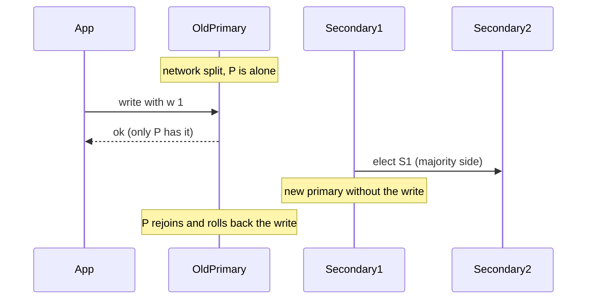

**Say this in the interview:**

> By default MongoDB is CP: during a split, only the majority side has a primary, so the minority side stops taking writes. With majority write and read concern and primary reads, I get strong consistency. If I use w:1 or read from secondaries, I trade consistency for speed and availability. So in MongoDB, CAP is a per-operation choice, not one fixed label.

**They may ask next:**
- **Is MongoDB eventually consistent?** Secondary reads are. Primary reads with majority settings are not. See [strong vs eventual](system-design.md#database-consistency-strong-vs-eventual).
- **What is a causally consistent session?** The driver passes a cluster time. A later read in the session waits until it can see your earlier writes.

---

## Spring Data MongoDB

**In one line:** Spring Data MongoDB maps Java objects to documents with `@Document`, gives you repositories for simple queries and `MongoTemplate` for everything else.

**Story:** Two ways to order food. The menu (repository) is fast for common dishes: "paneer tikka, please". The chef's counter (`MongoTemplate`) lets you ask for exactly what you want: "half spicy, no onion, extra sauce on the side". Use the menu most days, the counter for special orders.

**Recap:** the basics (`@Document`, `MongoRepository`, derived queries) are in [spring-ecosystem.md](spring-ecosystem.md#spring-data-for-redis-mongodb-and-elasticsearch). This section adds what seniors are asked.

**How it works:**
- **Mapping:** `@Document("orders")`, `@Id`, `@Field("cust")` to rename, `@Indexed`, `@CompoundIndex`, `@Version`.
- **Repository:** derived queries (`findByCustomerIdOrderByCreatedAtDesc`), `@Query` with JSON, `@Aggregation`, paging with `Pageable`.
- **`MongoTemplate`:** `Query` + `Criteria` + `Update` for partial updates, `findAndModify`, bulk operations and aggregations.
- **Optimistic locking:** a `@Version Long version` field. On `save()`, Spring adds `version = old` to the filter and increments it. If someone else saved first, no document matches, and you get `OptimisticLockingFailureException`. See [optimistic vs pessimistic locking](databases.md#optimistic-vs-pessimistic-locking).
- **Transactions:** Spring Boot does **not** create a `MongoTransactionManager`. Without one, `@Transactional` does nothing for MongoDB. Declare the bean yourself. It needs a replica set (a single-node replica set is fine for local tests).
- **Indexes:** `@Indexed` is only created if `spring.data.mongodb.auto-index-creation=true`. It is off by default. In production, create indexes in a migration step (for example Mongock or a startup runner) so you control when big builds run.
- **Spring Boot 4 property names:** connection settings moved to `spring.mongodb.*` (for example `spring.mongodb.uri`). Data settings stay under `spring.data.mongodb.*`. Set `spring.data.mongodb.representation.big-decimal` (for example `decimal128`) so `BigDecimal` is stored the way you expect.

**Diagram:**

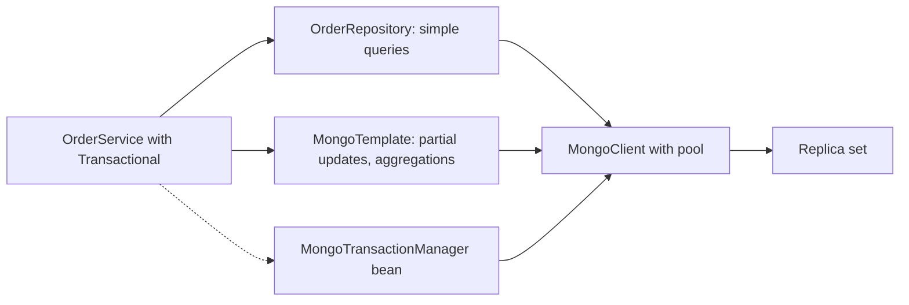

**Example: entity, repository and template update:**

```java
@Document("orders")
@CompoundIndex(def = "{'customerId': 1, 'createdAt': -1}")
record Order(@Id String id, String customerId, String status,
             List<OrderItem> items, BigDecimal total, Instant createdAt,
             @Version Long version) {}                          // optimistic locking

interface OrderRepository extends MongoRepository<Order, String> {
    Page<Order> findByCustomerIdOrderByCreatedAtDesc(String customerId, Pageable page);
}

@Service
class OrderStatusUpdater {
    private final MongoTemplate mongo;
    OrderStatusUpdater(MongoTemplate mongo) { this.mongo = mongo; }

    boolean markShipped(String orderId) {
        var q = Query.query(Criteria.where("_id").is(orderId).and("status").is("PAID"));
        var u = new Update().set("status", "SHIPPED").inc("version", 1);  // keep version in sync
        return mongo.updateFirst(q, u, Order.class).getModifiedCount() == 1; // only one field sent
    }
}
```

**Example: transactions:**

```java
@Configuration
class MongoTxConfig {
    @Bean
    MongoTransactionManager transactionManager(MongoDatabaseFactory factory) {
        return new MongoTransactionManager(factory);           // without this, @Transactional is ignored
    }
}

@Service
class CheckoutService {
    private final OrderRepository orders;
    private final MongoTemplate mongo;
    CheckoutService(OrderRepository orders, MongoTemplate mongo) { this.orders = orders; this.mongo = mongo; }

    @Transactional                                              // one MongoDB transaction
    public Order checkout(Order order, String sku, int qty) {
        var q = Query.query(Criteria.where("sku").is(sku).and("stock").gte(qty));
        var r = mongo.updateFirst(q, new Update().inc("stock", -qty), "products");
        if (r.getModifiedCount() == 0) throw new IllegalStateException("Out of stock"); // rollback
        return orders.save(order);
    }
}
```

**Good and bad:**

| Good | Bad |
|---|---|
| Repository for simple reads, `MongoTemplate` for partial updates | `findById` → change one field → `save()` the whole document on a hot path |
| `@Version` for documents edited by users | Last write wins silently on a shared document |
| A `MongoTransactionManager` bean when you use `@Transactional` | Thinking `@Transactional` works without it |
| Indexes created in a controlled migration | Auto index creation on a 500 GB collection at app start |
| Avoid `@DBRef` (it does an extra query per reference) | `@DBRef` everywhere, like JPA relations |

**Say this in the interview:**

> I use MongoRepository for simple reads and MongoTemplate for partial updates and aggregations. Partial updates with $set avoid lost updates and send less data. For documents users edit, I add a @Version field, and Spring throws OptimisticLockingFailureException on a stale save. For transactions I declare a MongoTransactionManager bean, because Spring Boot does not create one. And I create indexes in a migration step, not by auto index creation.

**They may ask next:**
- **Does `@Version` work with `updateFirst`?** Not by itself. Only `save()` checks it. With `MongoTemplate`, add the version to the filter and `$inc` it yourself.
- **How do you test?** Testcontainers with a MongoDB container. It starts as a single-node replica set, so transactions and change streams work in tests.
- **Reactive?** `ReactiveMongoRepository` and `ReactiveMongoTemplate` with the reactive driver, for WebFlux apps.

---

## Managed features: Atlas Search and Vector Search

**In one line:** Atlas is the managed MongoDB service; its known extras are Atlas Search (full text) and Atlas Vector Search (AI similarity).

**Story:** Renting a furnished flat vs buying an empty one. Managed services come with furniture: backups, monitoring, search. You pay for it and depend on one company. Self-hosting gives full control, but you buy and fix everything yourself.

**How it works (names only, vendor-neutral):**
- **Atlas Search:** full-text search based on Apache Lucene, queried with the `$search` aggregation stage. Similar to what you would use Elasticsearch or OpenSearch for.
- **Atlas Vector Search:** stores embeddings (lists of numbers that describe meaning) and finds similar ones with `$vectorSearch`. Used for semantic search and RAG. See [ai-rag.md](ai-rag.md).
- Since June 2026, Search and Vector Search are also generally available for self-managed **Community Edition**, through a separate search process called `mongot`.
- Other managed features you may hear: Online Archive, Data Federation, Queryable Encryption, automated backups and point-in-time restore, Performance Advisor (index suggestions).
- Alternatives exist: self-managed MongoDB on Kubernetes (operators), or MongoDB-compatible cloud services. Check compatibility carefully, because they do not support every feature.

**Diagram:**

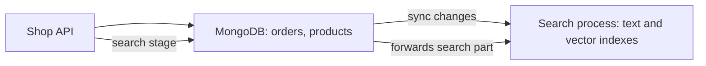

**Say this in the interview:**

> For search I can keep data in MongoDB and use its search features: Lucene-based full-text search and vector search. That avoids syncing to a separate Elasticsearch cluster. If the team already runs Elasticsearch, or needs advanced search tuning, a separate search engine fed by change streams is also fine. I choose by team skills and ops cost, not only by features.

**They may ask next:**
- **Text index vs Atlas Search?** A text index is basic word matching with one index per collection. Lucene-based search gives relevance scores, fuzzy matching, autocomplete and facets.
- **Why vector search in the main database?** Embeddings live next to the data. Filters (like "only my tenant") and updates stay in one place.

---

## Production checklist

**In one line:** Most production problems are missing indexes, schemas that do not handle growth, bad pool settings and unsafe write concern.

**Story:** A pilot's pre-flight checklist. Pilots are experts, but they still read the list every time. One forgotten item is enough to cause trouble.

**How it works:**

| Area | Check |
|---|---|
| **Indexes** | Every query in the code has an index. `explain()` shows IXSCAN, no big SORT. Remove unused indexes (`$indexStats`) |
| **Schema** | No unbounded arrays. Average document size is watched. Schema validation (`$jsonSchema`) on key collections |
| **Durability** | `w:"majority"` for important writes. Retryable writes on. 3-member replica set across zones |
| **Connection pool** | One `MongoClient` per app (it is thread-safe). Set `maxPoolSize` (default 100) and timeouts. Pods × pool size must stay below the server's connection limit |
| **Slow queries** | Profiler or slow query log on (`slowms`, 100 ms by default). Review weekly. Index suggestions from your tools |
| **Dangerous queries** | Avoid `$where` and server-side JavaScript (cannot use indexes, slow). Avoid huge `$in` lists (thousands of values). Avoid unanchored regex. Avoid big `skip()` |
| **Memory** | Working set (hot data + indexes) fits in RAM. The WiredTiger cache is by default 50% of (RAM − 1 GB) |
| **Ops** | Oplog window of 24–72 hours. Backups with tested restore. Alerts on replication lag, connections, disk, cache eviction |
| **Security** | Auth on, TLS on, least-privilege users, no database open to the internet |
| **Timeouts** | `maxTimeMS` on user-facing queries so a bad query cannot run for minutes |

**Diagram:**

```mermaid
flowchart TD
    A["Slow API alert"] --> B["Check slow query log or profiler"]
    B --> C["Run explain on the query"]
    C --> D{"COLLSCAN or big SORT?"}
    D -->|"yes"| E["Add or fix index (ESR)"]
    D -->|"no"| F{"Huge documents or arrays?"}
    F -->|"yes"| G["Fix schema: subset, bucket, own collection"]
    F -->|"no"| H["Check pool waits, lag, CPU, cache"]
    E --> I["Verify with explain and p95 latency"]
    G --> I
    H --> I
```

**Example:** schema validation and a safe client.

```javascript
db.runCommand({
  collMod: "orders",
  validator: { $jsonSchema: {
    bsonType: "object",
    required: ["orderNo", "customerId", "status", "total"],
    properties: {
      status: { enum: ["NEW", "PAID", "SHIPPED", "CANCELLED"] },
      total:  { bsonType: "decimal" }                        // money as Decimal128
    }
  } },
  validationLevel: "moderate"     // check inserts and valid docs; old bad docs can still be updated
});
```

```yaml
# Spring Boot 4 (Boot 3 used spring.data.mongodb.uri)
spring:
  mongodb:
    uri: mongodb://app:${MONGO_PWD}@m1,m2,m3/shop?replicaSet=rs0&w=majority&retryWrites=true&maxPoolSize=50&connectTimeoutMS=2000&serverSelectionTimeoutMS=5000
```

**Good and bad:**

| Good | Bad |
|---|---|
| One `MongoClient` bean, pool sized by load test | A new `MongoClient` per request |
| `maxTimeMS` and driver timeouts | Default "wait forever" on a stuck query |
| Indexes reviewed in code review with the query | "We will add indexes when it is slow" |

**Say this in the interview:**

> Before going live I check: an index for every query, verified with explain. No unbounded arrays, and schema validation on key collections. Majority write concern and a 3-node replica set across zones. One MongoClient with a sized pool and timeouts. The slow query profiler on, and alerts on replication lag, connections and cache. I also avoid $where, huge $in lists, unanchored regex and big skips.

**They may ask next:**
- **How many connections?** Each pod's pool × number of pods. 40 pods × 100 = 4,000 connections, which can overload a small cluster. Size it with a load test. Same idea as [HikariCP](spring-ecosystem.md#connection-pooling-with-hikaricp).
- **Is `$where` still bad in 9.0?** MongoDB 9.0 runs server-side JavaScript on a new engine and no longer marks `$where` deprecated. It still cannot use indexes, so use `$expr` instead.

---

## Questions from the README list

Short answers to the older question list in the README. Each links to the deeper section above when there is one.

### Does Mongodb Support Foreign Key Constraints?

No. MongoDB has no foreign keys and no "on delete cascade". You store a reference (like `customerId`) and your app keeps it correct.
You can still use `$lookup` to join, unique indexes, and schema validation for required fields. Often you embed data instead, so no reference is needed.
More: [Schema design: embed or reference](#schema-design-embed-or-reference)

### Which are the most important features of MongoDB?

- Flexible JSON-like documents (BSON), with nested objects and arrays.
- Rich queries, many index types and the aggregation pipeline.
- Replica sets for high availability, sharding for scale-out.
- ACID transactions, change streams, and search and vector search.
More: [MongoDB in one picture](#mongodb-in-one-picture)

### How many indexes does MongoDB create by default for a new collection?

One: the unique index on `_id`. You cannot drop it. Every other index you create yourself.

### Explain what is MongoDB?

MongoDB is an open-source document database. It stores data as JSON-like documents in collections, not rows in tables.
It runs as a replica set (copies for safety) and can shard (split data across machines) for scale.
More: [Document model and BSON](#document-model-and-bson)

### What is “Namespace” in MongoDB?

A namespace is the full name of a collection or index: `<database>.<collection>`.
Example: database `shop`, collection `orders` → namespace `shop.orders`. You see it in logs, `explain()` output and sharding commands.

### Why does Profiler use in MongoDB?

The database profiler records slow operations, so you can find queries that need an index.
Level 0 is off, level 1 logs operations slower than `slowms` (100 ms by default), level 2 logs everything (only for short debugging).

```javascript
db.setProfilingLevel(1, { slowms: 100 });
db.system.profile.find().sort({ ts: -1 }).limit(5);   // latest slow operations
```
More: [explain(): COLLSCAN vs IXSCAN](#explain-collscan-vs-ixscan)

### If you remove an object attribute, is it deleted from the database?

Only if you write it. Use `$unset` to remove a field from stored documents.
If you remove a field from a Java object and then `save()` the whole document, it is removed too (the document is replaced). A partial update with `$set` on other fields leaves it in the database.

### Does MongoDB need a lot space of Random Access Memory (RAM)?

It needs enough RAM for the **working set**: the data and indexes your app uses often. It does not need all data in RAM.
The WiredTiger cache uses about 50% of (RAM − 1 GB) by default, and the OS file cache uses more. If the working set does not fit, reads go to disk and latency jumps.

### What is a replica set?

A group of MongoDB servers with the same data: one primary for writes, secondaries that copy it. If the primary fails, the others elect a new one.
More: [Replica sets](#replica-sets-primary-secondaries-elections-and-oplog)

### What Is Replication In MongoDB?

Replication means keeping copies of the same data on several servers. The primary writes each change to the oplog, and secondaries replay it.
It gives safety (no data loss if one disk dies) and high availability (automatic failover).
More: [Replica sets](#replica-sets-primary-secondaries-elections-and-oplog)

### Compare SQL databases and MongoDB at a high level.

SQL stores rows in tables with a fixed schema and uses joins. MongoDB stores documents with flexible shape and embeds related data.
SQL shines at many relations and ad-hoc reports. MongoDB shines at object-shaped data, changing shapes and built-in sharding. Both have ACID transactions today.
More: [When MongoDB fits and when SQL is better](#when-mongodb-fits-and-when-sql-is-better)

### What is BSON in MongoDB?

BSON is "Binary JSON": the format MongoDB uses to store documents and send them over the network.
It is fast to scan and has extra types like `ObjectId`, `Date`, `Decimal128` and binary data.
More: [Document model and BSON](#document-model-and-bson)

### How is data stored in MongoDB?

Documents (BSON) live in collections, and collections live in databases.
On disk, the WiredTiger storage engine keeps each collection and each index in its own file, compressed (Snappy by default). Changes go to a journal first for crash safety.

### Mention the command to insert a document in a database called school and collection called persons.

```javascript
use school
db.persons.insertOne({ name: "Asha", age: 14, city: "Pune" })
```
The database and the collection are created on the first insert. (`insert()` is the old, deprecated form.)

### What are Indexes in MongoDB?

Indexes are sorted B-tree structures on one or more fields. They let MongoDB find documents without scanning the whole collection.
Each index makes writes a bit slower and uses RAM, so create only the ones your queries need.
More: [Index types](#index-types)

### Can you create an index on an array field in MongoDB? If yes, what happens in this case?

Yes. MongoDB creates a **multikey index**: one index entry for each array element.
So `{tags: "tea"}` finds every document whose `tags` array has "tea". Big arrays mean big indexes, and in one compound index only one field can be an array per document.
More: [Index types](#index-types)

### When should we embed one document within another in MongoDB?

Embed when the child data is read together with the parent, belongs only to it, and is small and bounded.
Example: an order's items and shipping address. Do not embed lists that grow without limit, or data you often read or update on its own.
More: [Schema design: embed or reference](#schema-design-embed-or-reference)

### What do you understand by NoSQL databases? Explain.

NoSQL means "not only SQL": databases that do not use the classic table-and-join model.
They trade some SQL features for a flexible shape, easy scale-out or very fast simple access. Examples: MongoDB, Redis, Cassandra, Neo4j.

### What is the difference between MongoDB and MySQL?

MySQL is a relational database: tables, fixed columns, joins, foreign keys. MongoDB is a document database: flexible JSON-like documents, embedding, built-in sharding.
Use MySQL for many relations and strict rules. Use MongoDB when data is read as whole objects and its shape changes often.
More: [When MongoDB fits and when SQL is better](#when-mongodb-fits-and-when-sql-is-better)

### What is the difference b/w MongoDB and CouchDB?

Both store JSON documents.
- **CouchDB:** HTTP/REST API, multi-master replication, built for offline sync (with PouchDB in the browser), queries through views and Mango.
- **MongoDB:** binary protocol with drivers, rich query language and aggregation, one primary per replica set, built-in sharding.

### Explain the structure of ObjectID in MongoDB

An `ObjectId` is 12 bytes:
- 4 bytes: timestamp in seconds (creation time).
- 5 bytes: random value, unique per machine and process.
- 3 bytes: counter that starts from a random value.
So ObjectIds sort roughly by creation time, and you can read the time with `getTimestamp()`.

### What is sharding?

Sharding splits a large dataset across many servers by a key. Each server (shard) holds part of the data, so storage and writes can grow beyond one machine.
More: [Sharding](#sharding)

### What are NoSQL databases? What are the different types of NoSQL databases?

Databases that do not use the relational table model. Four main types:
- **Document:** MongoDB, Couchbase (JSON documents).
- **Key-value:** Redis, DynamoDB (get by key, very fast).
- **Wide-column:** Cassandra, HBase (huge write volume, rows with many columns).
- **Graph:** Neo4j (relations like friends-of-friends).

### How is MongoDB better than other SQL databases?

It is not "better", it fits different problems. MongoDB is easier for nested, changing data and for scaling writes with sharding.
SQL databases are better for many joins, strict constraints and reporting. Pick by access patterns.
More: [When MongoDB fits and when SQL is better](#when-mongodb-fits-and-when-sql-is-better)

### What does MongoDB not being ACID compliant really mean?

This is an old premise. Single-document writes were always atomic. Since 4.0 (replica sets) and 4.2 (sharded clusters), MongoDB has full multi-document ACID transactions.
Before 4.0 it meant: a change across two documents could half-succeed. Today you choose: one document (atomic and cheap) or a transaction (atomic, more costly).
More: [Multi-document transactions](#multi-document-transactions)

### How can you achieve primary key - foreign key relationships in MongoDB?

`_id` is the primary key. For a "foreign key", store the other document's `_id` (for example `customerId` in an order).
Read related data with a second query or `$lookup`. The database does not check that the referenced document exists, so the app must handle it.
More: [Schema design: embed or reference](#schema-design-embed-or-reference)

### Does MongoDB pushes the writes to disk immediately or lazily?

Both, in layers. The write goes to memory and to the **journal** (a write-ahead log). The journal is flushed to disk about every 100 ms, or at once if you ask for `j: true` or majority write concern.
Data files are updated by **checkpoints** every 60 seconds. After a crash, MongoDB replays the journal since the last checkpoint.

### If you remove a document from database, does MongoDB remove it from disk?

The document is deleted, but the file does not shrink. WiredTiger marks the space as free and reuses it for new data in that collection.
To give space back to the OS, run `compact` (or resync a member). Usually you do not need to.

### What is a covered query in MongoDB?

A query where the filter and all returned fields are in one index, and `_id` is excluded from the result. MongoDB answers from the index alone and never reads the documents.
In `explain()` you see `PROJECTION_COVERED` and `totalDocsExamined: 0`.
More: [explain(): COLLSCAN vs IXSCAN](#explain-collscan-vs-ixscan)

### How can you achieve transaction and locking in MongoDB?

- One document: updates are atomic. Use a condition in the filter (`stock >= 2`) with `$inc`.
- Many documents: use a multi-document transaction (`session.withTransaction`), or `@Transactional` with `MongoTransactionManager` in Spring.
- Concurrent edits: optimistic locking with a `version` field (`@Version` in Spring).
More: [Multi-document transactions](#multi-document-transactions)

### What is Aggregation in MongoDB?

Aggregation means processing many documents on the server to get results like totals, groups or reshaped data.
You use the aggregation pipeline: a list of stages like `$match`, `$group`, `$sort` and `$lookup`.
More: [Aggregation pipeline](#aggregation-pipeline)

### What is Sharding in MongoDB? Explain.

MongoDB splits a collection across shards (each a replica set) by a shard key. `mongos` routers send each query to the right shard, using metadata from config servers.
A good shard key has many distinct values, is not always rising, and appears in most queries.
More: [Sharding](#sharding)

### Why are MongoDB data files large in size?

- Field names are stored in every document.
- Indexes take space, often a lot.
- Deleted space is reused but not returned to the OS.
- The oplog is a pre-sized collection (by default 5% of free disk, between 990 MB and 50 GB).
WiredTiger compresses data, so files are much smaller than in the old MMAPv1 engine.

### Why MongoDB is not preferred over a 32-bit system?

A 32-bit process can address only about 4 GB of memory, so the old engine could hold only about 2 GB of data.
Today this does not matter: current MongoDB versions have no 32-bit builds at all. Use 64-bit.

### Mention the command to check whether you are on the master server or not.

```javascript
db.hello().isWritablePrimary   // true on the primary
rs.status()                    // full replica set state
```
The old command was `db.isMaster()`. Today MongoDB uses "primary" and "secondary" instead of "master" and "slave".

### Can one MongoDB operation lock more than one databases? If yes, how?

Normal reads and writes do not. WiredTiger locks at document level, with light *intent* locks on the collection and database.
Some admin operations take a global lock that affects all databases, for example `fsyncLock` for backups. A multi-document transaction can also write to several databases, but it uses document-level concurrency, not big locks.

### What is oplog?

The oplog (operations log) is a capped collection (`local.oplog.rs`) on each replica set member. It records every change to data.
Secondaries replay it to stay in sync, and change streams read from it. Its size decides how long a member can be offline and still catch up.
More: [Replica sets](#replica-sets-primary-secondaries-elections-and-oplog)

### Is there an “upsert” option in the mongodb insert command?

No. `insertOne` only inserts. For "update if exists, else insert" use `updateOne`, `replaceOne` or `findOneAndUpdate` with `upsert: true`.

```javascript
db.carts.updateOne({ userId: "u-42" }, { $set: { items: [] } }, { upsert: true });
```

### How to query MongoDB with “like”?

Use a regular expression with `$regex`.

```javascript
db.users.find({ name: { $regex: "^Ash" } })        // starts with: can use an index
db.users.find({ name: { $regex: "ash", $options: "i" } })  // contains, ignore case: full scan
```

### Find objects between two dates MongoDB

Store dates as BSON `Date`, then use `$gte` and `$lt`.

```javascript
db.orders.find({ createdAt: { $gte: ISODate("2026-11-01"), $lt: ISODate("2026-12-01") } })
```
Add an index on `createdAt` (or a compound index with it last, per ESR).

### How can I combine data from multiple collections into one collection?

- `$lookup`: join matching documents from another collection.
- `$unionWith` (since 4.4): append documents from another collection, like SQL `UNION ALL`.
- `$merge` or `$out`: write the result into a target collection.

```javascript
db.orders2025.aggregate([ { $unionWith: "orders2026" }, { $merge: { into: "allOrders" } } ])
```

### When to use MongoDB or other document oriented database systems?

When data is read and written as whole objects (an order with its items), the shape changes often (product catalogs), or you need scale-out writes.
Avoid it for heavy many-to-many relations and complex ad-hoc reporting.
More: [When MongoDB fits and when SQL is better](#when-mongodb-fits-and-when-sql-is-better)

### How do I perform the SQL JOIN equivalent in MongoDB?

Use `$lookup` in an aggregation. It works like a LEFT OUTER JOIN.

```javascript
db.orders.aggregate([
  { $match: { customerId: "c-42" } },
  { $lookup: { from: "customers", localField: "customerId", foreignField: "_id", as: "customer" } }
])
```
If you need it on every request, consider embedding or copying fields instead. More: [Aggregation pipeline](#aggregation-pipeline)

### How to query MongoDB with %like%?

`%like%` means "contains". Use a regex without `^`: `{ name: /ash/i }`.
It cannot use the index well, so it scans. For real search on big data, use a text index or a search engine (Atlas Search, or the Community search process).
More: [Managed features](#managed-features-atlas-search-and-vector-search)

### What is use of capped collection in MongoDB?

A capped collection has a fixed size. It keeps insertion order and deletes the oldest documents when full, like a ring buffer.
Use: simple logs, recent events, tailable cursors. MongoDB itself uses one for the oplog. Today: for most "expire old data" needs, a TTL index or a time series collection is more flexible.

### Does MongoDB support ACID transaction management and locking functionalities?

Yes. Single-document operations are atomic. Multi-document ACID transactions with snapshot isolation exist since 4.0, and across shards since 4.2.
Locking is document-level (WiredTiger). For app-level locking, use optimistic locking with a version field.
More: [Multi-document transactions](#multi-document-transactions)

### Should I normalize my data before storing it in MongoDB?

Usually not fully. Design from the queries: embed what is read together, reference what grows without limit or is shared.
Some copying (denormalization) is normal, for fields that are read often and change rarely.
More: [Schema design: embed or reference](#schema-design-embed-or-reference)

### How replication works in MongoDB?

The primary applies each write and records it in the oplog. Secondaries pull oplog entries and replay them in order.
Members send heartbeats every 2 seconds. If the primary is silent for 10 seconds, an election picks a new primary by majority vote.
More: [Replica sets](#replica-sets-primary-secondaries-elections-and-oplog)

### What are alternatives to MongoDB?

- PostgreSQL with JSONB (documents inside SQL).
- Couchbase, CouchDB (document stores).
- Amazon DynamoDB, Azure Cosmos DB, Google Firestore (managed cloud stores).
- Amazon DocumentDB and FerretDB (speak the MongoDB protocol, but not every feature).
- Cassandra for huge write volume.

### Where can I run MongoDB?

- MongoDB Atlas (managed, on AWS, Google Cloud or Azure).
- Self-managed Community or Enterprise edition on VMs or bare metal.
- Kubernetes with an operator.
- Locally in Docker, or Testcontainers for tests. See [docker-kubernetes.md](docker-kubernetes.md).

### How does MongoDB ensure high availability?

With replica sets: 3 or more members, ideally in different zones. If the primary fails, the others elect a new one in about 10–12 seconds.
Drivers find the new primary and retry writes once. Majority write concern makes sure confirmed writes survive.
More: [Replica sets](#replica-sets-primary-secondaries-elections-and-oplog)

### Is MongoDB schema-less?

The database does not force a schema by default, so it is "schema-flexible". Your app still has a schema.
For important collections, add schema validation with `$jsonSchema`. MongoDB 9.0 adds a `constraint` validation level that guarantees every document matches.
More: [Production checklist](#production-checklist)

### Why is a covered query important?

It never reads documents, only the index. That saves disk reads and cache space, so it is the fastest kind of query.
Useful for very hot reads, like "list order numbers and status for a customer".
More: [explain(): COLLSCAN vs IXSCAN](#explain-collscan-vs-ixscan)

### Does MongoDB provide a facility to do text searches? How?

Yes, two ways:
- A **text index** with the `$text` operator: basic word search, one text index per collection.
- **Search indexes** with `$search` (Lucene-based): relevance, fuzzy match, autocomplete. On Atlas, and now on Community through `mongot`.

```javascript
db.products.createIndex({ name: "text", description: "text" });
db.products.find({ $text: { $search: "green tea" } });
```

### What happens if an index does not fit into RAM?

MongoDB still works, but index pages are read from disk. Reads become much slower and the cache keeps evicting pages.
Fix: remove unused indexes, use partial indexes, add RAM, or shard.

### Mention the command to list all the indexes on a particular collection.

```javascript
db.orders.getIndexes()
db.orders.aggregate([ { $indexStats: {} } ])   // also shows how often each index is used
```

### At what interval does MongoDB write updates to the disk?

With WiredTiger: the journal is flushed about every 100 ms, and data files are written at checkpoints every 60 seconds.
A write with `j: true` (or majority write concern, by default) waits for the journal flush.

### What are Primary and Secondary Replica sets?

Small fix: they are **members** of one replica set, not separate replica sets. The primary takes all writes. Secondaries copy the primary's oplog and can serve reads if you allow it.
More: [Replica sets](#replica-sets-primary-secondaries-elections-and-oplog)

### By default, MongoDB writes and reads data from both primary and secondary replica sets. True or False.

False. Writes always go to the primary. Reads also go to the primary by default (read preference `primary`). You must opt in to secondary reads.
More: [Write concern, read concern and read preference](#write-concern-read-concern-and-read-preference)

### How does Journaling work in MongoDB?

The journal is a write-ahead log. Every change is written to the journal before the data files.
The journal is flushed about every 100 ms. Data files are synced at checkpoints every 60 seconds. After a crash, MongoDB loads the last checkpoint and replays the journal, so confirmed journaled writes are not lost.

### How does MongoDB provide concurrency?

WiredTiger uses document-level concurrency: two writers can change two documents in one collection at the same time.
Readers use MVCC snapshots, so they do not block writers. If two writers hit the same document, one retries automatically. Higher levels use light intent locks.

### How can you isolate your cursors from intervening with the write operations?

The old `cursor.snapshot()` method is gone. Today:
- Use read concern `snapshot` (in a transaction, or for reads since 5.0) to see one point in time.
- Or sort by an unchanging field like `_id`, so an updated document is not returned twice.

### Update MongoDB field using value of another field

Use an update with an aggregation pipeline (since 4.2). Fields are referenced with `$`.

```javascript
db.users.updateMany({}, [ { $set: { fullName: { $concat: ["$first", " ", "$last"] } } } ])
```

### How to remove a field completely from a MongoDB document?

Use `$unset`.

```javascript
db.users.updateMany({ legacyFlag: { $exists: true } }, { $unset: { legacyFlag: "" } })
```

### When to Redis or MongoDB?

Redis: in-memory key-value store for cache, sessions, rate limits, leaderboards and short-lived data. Very fast, data must fit in RAM.
MongoDB: durable main database for documents, with rich queries and indexes. They are often used together: MongoDB as the source of truth, Redis as the cache. See [redis.md](redis.md).

### MongoDB relationships. What to use - embed or reference?

Embed for one-to-few data read together (order items, addresses). Reference for one-to-many that can grow, data shared by many parents, or data updated on its own.
For one-to-millions, put the parent id in each child.
More: [Schema design: embed or reference](#schema-design-embed-or-reference)

### How to get the last N records from find?

Sort newest first, then limit.

```javascript
db.orders.find().sort({ createdAt: -1 }).limit(10)   // or sort({ _id: -1 }) with ObjectIds
```
Add `.sort` on an indexed field, so it does not sort in memory.

### How to find MongoDB records where array field is not empty?

```javascript
db.products.find({ "tags.0": { $exists: true } })    // has a first element
// or: db.products.find({ tags: { $exists: true, $ne: [] } })
```

### How to check if a field contains a substring?

Use `$regex`: `db.products.find({ name: { $regex: "tea", $options: "i" } })`.
In an aggregation, `$regexMatch` or `$indexOfCP` also work. For big collections, prefer a search index.

### What's the advantage of the backup features in Ops Manager versus traditional backup strategies?

Ops Manager (and Cloud Manager or Atlas backups) gives continuous backup with **point-in-time restore**, consistent snapshots across all shards, and restore with a few clicks.
Traditional `mongodump` is logical, slow on big data and hard to keep consistent across shards. File-system snapshots need careful setup per node. Whatever you use, test the restore.

### What is a Storage Engine in MongoDB

The storage engine is the part that stores data on disk and in memory. It handles caching, compression, concurrency and the journal.
WiredTiger is the default and the main engine since 3.2.

### Which are the two storage engines used by MongoDB?

Historically: MMAPv1 and WiredTiger. MMAPv1 was removed in 4.2.
Today: **WiredTiger** (default) and the **In-Memory** engine (Enterprise only, no data on disk).

### What is splitting in mongodb?

In a sharded collection, data is grouped into chunks (key ranges). Splitting cuts one chunk into two smaller ranges, so the balancer can move part of it to another shard.
Since 6.0, the balancer looks at data size per shard and splits ranges only when needed. A range with one very common key value cannot split: a *jumbo chunk*.
More: [Sharding](#sharding)

### How to condense large volumes of data in Mongo?

- Compression: Snappy by default, zstd for better ratio.
- Bucket pattern or time series collections for events.
- Pre-aggregate with `$merge` into daily summaries, then delete or archive raw data (TTL index).
- Shorter field names, and drop unused indexes.
More: [Schema design patterns](#schema-design-patterns)

### What are three primary concerns when choosing a data management system?

A simple answer:
1. **Data model and access patterns:** what shape is the data and how is it queried?
2. **Consistency and durability:** what happens if data is stale or lost?
3. **Scale and operations:** expected size and traffic, cost, and team skills to run it.

### How to find document with array that contains a specific value?

Match the array field with the value directly.

```javascript
db.products.find({ tags: "organic" })                       // array contains "organic"
db.products.find({ tags: { $all: ["organic", "green"] } })  // contains both
```

### Is it possible to update MongoDB field using value of another field?

Yes, since 4.2, with a pipeline update. Example: `db.orders.updateMany({}, [ { $set: { totalWithTax: { $multiply: ["$total", 1.18] } } } ])`.
See [Update MongoDB field using value of another field](#update-mongodb-field-using-value-of-another-field).

### Explain what is horizontal scalability?

Horizontal scaling means adding more machines and spreading data and load across them. Vertical scaling means buying a bigger machine.
MongoDB scales horizontally with sharding, and spreads reads with secondaries.
More: [Sharding](#sharding)

### What are the differences between MongoDB and MySQL?

| | MySQL | MongoDB |
|---|---|---|
| Data | Rows in tables | Documents in collections |
| Schema | Fixed columns, migrations | Flexible, optional validation |
| Relations | Joins, foreign keys | Embedding, references, `$lookup` |
| Scale-out | Replicas; sharding needs extra tools | Built-in sharding |
| Transactions | ACID | ACID (single doc always, multi-doc since 4.0) |

---

## Interview questions

**1. When would you choose MongoDB over PostgreSQL?**
When data is read and written as whole objects, the shape changes often (like a product catalog), or we need built-in scale-out writes. For many relations, ad-hoc reports and strict constraints, I choose PostgreSQL. See [When MongoDB fits](#when-mongodb-fits-and-when-sql-is-better).

**2. What is BSON and why not plain JSON?**
BSON is binary JSON. It is fast to scan and has more types: ObjectId, Date, Decimal128, binary. JSON has no date or exact decimal type. See [Document model](#document-model-and-bson).

**3. Embed or reference: how do you decide?**
Start from the queries. Embed small, bounded data that is read together. Use an array of ids for one-to-many, and a parent id in each child for one-to-millions. See [Embed or reference](#schema-design-embed-or-reference).

**4. What is the unbounded array problem?**
An array that grows forever makes every read and update heavier and the multikey index bigger, and finally hits 16 MB. Fix with a separate collection, buckets, or `$push` with `$slice`. See [16 MB limit](#the-16-mb-limit-and-the-unbounded-array-trap).

**5. Explain the bucket and computed patterns.**
Bucket groups many small events into one document per time window (or use a time series collection). Computed stores totals like average rating on write, so reads are cheap. See [Schema design patterns](#schema-design-patterns).

**6. What is the extended reference pattern and its cost?**
Copy a few often-read fields, like customer name, into the order to avoid a join. The cost: the copy can become stale, so only copy fields that rarely change. See [Schema design patterns](#schema-design-patterns).

**7. How do you safely decrement stock without a transaction?**
One atomic update with the condition in the filter: `updateOne({_id, stock: {$gte: 2}}, {$inc: {stock: -2}})`. If `modifiedCount` is 0, there was not enough stock. See [CRUD](#crud-and-query-operators).

**8. Why use `$elemMatch`?**
Without it, two conditions on an array can match two different elements. `$elemMatch` makes both conditions apply to the same element. See [CRUD](#crud-and-query-operators).

**9. What is the ESR rule?**
Order compound index fields as Equality, Sort, Range. This narrows the search first, gives results already sorted, and keeps ranges last. See [ESR rule](#compound-indexes-and-the-esr-rule).

**10. How do you read an `explain()` output?**
Look for IXSCAN, not COLLSCAN, and no SORT stage. Compare `nReturned`, `totalKeysExamined` and `totalDocsExamined`. They should be close. See [explain()](#explain-collscan-vs-ixscan).

**11. What is a TTL index and is it exact?**
An index on a date field that deletes documents after a set time. A background job runs about every 60 seconds, so deletion can be a bit late. See [Index types](#index-types).

**12. Partial vs sparse vs unique index?**
Partial indexes only documents matching a filter you choose. Sparse (older) skips documents without the field. Unique blocks duplicates; with a partial filter, it is unique only among matching documents. See [Index types](#index-types).

**13. Walk me through an aggregation for top products.**
`$match` paid orders in range (uses index), `$unwind` items, `$group` by sku with sums, `$sort` by revenue, `$limit` 5, then `$lookup` product names. See [Aggregation pipeline](#aggregation-pipeline).

**14. What does `$facet` give you?**
Several sub-pipelines on the same input in one call. For example search results, brand counts and total count for a search page. See [Aggregation pipeline](#aggregation-pipeline).

**15. How does failover work in a replica set?**
If the primary is silent for 10 seconds, a secondary asks for votes. The most up-to-date member with a majority becomes primary, usually within about 12 seconds. Drivers retry the write once. See [Replica sets](#replica-sets-primary-secondaries-elections-and-oplog).

**16. What is the oplog and why does its size matter?**
A capped collection of all changes, replayed by secondaries and read by change streams. If a member or a change stream consumer is down longer than the oplog window, it cannot catch up. See [Replica sets](#replica-sets-primary-secondaries-elections-and-oplog).

**17. What do you lose with `w:1`?**
The primary confirms before any secondary has the write. If it crashes, the new primary does not have it, and the write is rolled back. Use `w:"majority"` for important data. See [Write concern](#write-concern-read-concern-and-read-preference).

**18. Read concern `local` vs `majority`?**
`local` returns the latest data on that member, which can be rolled back later. `majority` returns only data confirmed by a majority, so it never disappears. See [Read concern](#write-concern-read-concern-and-read-preference).

**19. When is reading from secondaries okay?**
For reports, dashboards and analytics that can be a few seconds stale. Not for "read my own write" flows, unless you use causally consistent sessions. See [Read preference](#write-concern-read-concern-and-read-preference).

**20. Does MongoDB support transactions? Any limits?**
Yes, multi-document ACID since 4.0, across shards since 4.2. They run up to 60 seconds by default, should touch few documents, and need retries on `TransientTransactionError`. See [Transactions](#multi-document-transactions).

**21. When would you avoid a transaction?**
When the change fits in one document, for long batch jobs, for hot counters with many writers, and when the work calls external services. See [Transactions](#multi-document-transactions).

**22. How do you choose a shard key?**
High cardinality, low frequency, not always rising, and present in most queries. For example `customerId`, or a hashed key for even writes. See [Sharding](#sharding).

**23. Ranged vs hashed sharding?**
Ranged keeps nearby keys together: good for range queries, but a rising key creates a hot shard. Hashed spreads writes evenly, but range queries become scatter-gather. See [Sharding](#sharding).

**24. What is a jumbo chunk and how do you fix it?**
A key range that cannot split because many documents share one shard key value. Fix by refining the shard key with more fields (4.4+) or resharding (5.0+). See [Sharding](#sharding).

**25. What is a scatter-gather query?**
A query without the shard key. mongos sends it to every shard and merges the results. It gets slower as you add shards. See [Sharding](#sharding).

**26. How do change streams work and how do you resume?**
They are a live feed of changes built on the oplog. Save the resume token after each processed event, and start again with `resumeAfter`. Delivery is at least once. See [Change streams](#change-streams).

**27. How would you publish events reliably from a MongoDB service?**
Write the business change and an outbox document in one transaction. A publisher uses a change stream on the outbox and sends to Kafka. Consumers are idempotent. See [Change streams](#change-streams) and [outbox](microservices.md#transactional-outbox-pattern).

**28. Is MongoDB CP or AP?**
By default CP: in a network split, only the majority side has a primary. With `w:1` or secondary reads you trade consistency for availability and speed. See [Consistency and CAP](#consistency-and-cap-in-mongodb).

**29. Why does `@Transactional` not work in my Spring Boot MongoDB app?**
Spring Boot does not create a `MongoTransactionManager`. Declare the bean, and run on a replica set. Also create collections before the transaction. See [Spring Data MongoDB](#spring-data-mongodb).

**30. How does `@Version` work in Spring Data MongoDB?**
On `save()`, Spring adds the old version to the filter and increments it. If another save happened first, nothing matches, and it throws `OptimisticLockingFailureException`. `MongoTemplate.updateFirst` does not check it for you. See [Spring Data MongoDB](#spring-data-mongodb).
