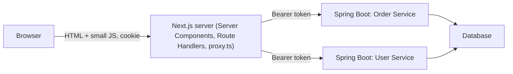

[← Back to README](../README.md)

# Next.js

## Next.js architecture and Server Components

**In one line:** Next.js is a React framework that renders pages on the server. It can also be a small backend (BFF) in front of Spring Boot.

**Story:** Think of a restaurant.
Plain React is like giving every customer a box of raw food and a recipe. They must cook at their own table (the browser). Slow phones cook slowly.
Next.js cooks most food in the kitchen (the server) and serves it ready. Only dishes that need the customer's hands, like a DIY taco, are finished at the table (the browser).
**Server Components** are kitchen-cooked dishes. **Client Components** are the DIY parts.
The kitchen also talks to the store room (your Spring Boot API). Customers never go there.

**Why Next.js and not plain React:**
- Plain React (single-page app) sends a big JavaScript bundle. The page is empty until it loads. Bad for slow phones and SEO (search engines).
- Next.js sends ready HTML first. The page shows fast, and Google can read it.
- It gives routing, data fetching, caching, image optimization and API endpoints in one place.

**How it works:**
1. **App Router:** folders in `app/` become URLs. `app/orders/page.tsx` is the page for `/orders`. `layout.tsx` is the shared frame (header, menu).
2. **Server Components (default):** run only on the server. They can call databases or APIs directly. Their code is never sent to the browser.
3. **Client Components:** start the file with `"use client"`. Use them for `useState`, `onClick`, browser APIs (`localStorage`). Their JavaScript goes to the browser.
4. **Server Actions:** functions marked `"use server"`. A form or button in the browser can call them. Next.js sends a POST request for you. Good for create, update, delete from forms.
5. **Route Handlers:** `app/api/orders/route.ts` with `GET` / `POST` functions. These are normal HTTP endpoints, for example for mobile apps or webhooks.
6. **`proxy.ts`:** code that runs before a request reaches a page. Use it for login redirects and rewrites. In Next.js 16 it replaced `middleware.ts`.

**Rendering options:**

| Option | When HTML is made | Example page | Freshness |
|---|---|---|---|
| SSG (static) | At build time | About us, blog post | Stale until next build |
| ISR (static + refresh) | At build, then refreshed in background every N seconds | Product page | Fresh within N seconds |
| SSR (dynamic) | On every request | My orders, cart | Always fresh, more server work |
| Streaming | On request, sent in parts with `<Suspense>` | Dashboard with slow widgets | Fast first paint, slow parts come later |
| CSR (client) | In the browser after JavaScript loads | Live chart after login | Needs JavaScript |

**Caching (what changed):**
- Next.js 15: `fetch` calls and `GET` Route Handlers are **not cached by default** any more. Before, they were.
- Next.js 16: *Cache Components*. You turn it on with `cacheComponents: true`. Then caching is fully opt-in: you mark a component or function with `"use cache"`. Everything else runs per request.
- `cacheLife("hours")` sets how long to keep it. `cacheTag("orders")` names it, so you can clear it later.
- Next.js 16.4 (Oct 2026) recommends Cache Components for every app. New apps from `create-next-app` have it on. The team says it will be the default in Next.js 17.
- *Partial Prerendering* (static shell + dynamic holes) is now part of Cache Components.

**Next.js 15 to 16 changes:**

| Change | Details |
|---|---|
| Turbopack is the default bundler | Stable for dev and build. 2-5x faster builds. Use `--webpack` to opt out |
| Cache Components | `"use cache"` directive, opt-in caching, replaces old `experimental.ppr` flag |
| `proxy.ts` replaces `middleware.ts` | Rename the file and the function to `proxy`. Runs on Node.js runtime. `middleware.ts` is deprecated |
| React 19.2 | View Transitions, `useEffectEvent`, `<Activity/>`. Next.js 16.4 ships React 19.3 |
| React Compiler support stable | Auto-memoization. Not on by default |
| New cache APIs | `updateTag()` (read your own write in a Server Action), `refresh()`, `revalidateTag(tag, profile)` |
| Async request APIs only | Must `await params`, `await cookies()`, `await headers()`. Sync access removed |
| Removed | AMP support, `next lint` command (use ESLint or Biome directly) |
| Version needs | Node.js 20.9+, TypeScript 5.1+ |

**BFF pattern:** BFF means *Backend for Frontend*. Next.js runs on a server, so it can be a thin backend made only for this UI.
- The browser talks only to Next.js. It never sees internal Spring Boot URLs.
- The login token stays in an `httpOnly` cookie (JavaScript cannot read it). Next.js reads the cookie and calls Spring Boot with `Authorization: Bearer ...`.
- Next.js can combine 3 backend calls into 1 response for the page.
- No CORS problems, because the browser calls the same domain.
- Business rules stay in Spring Boot. Next.js only shapes data for the screen.

**Diagram:**



**Example:**

```tsx
// app/orders/page.tsx - Server Component (default). Runs on the server only.
import { cookies } from "next/headers";
import { CancelButton } from "./cancel-button";

export default async function OrdersPage() {
  const token = (await cookies()).get("session")?.value;          // async in Next.js 15+
  const res = await fetch(`${process.env.ORDER_API}/orders`, {    // internal URL, hidden
    headers: { Authorization: `Bearer ${token}` },
  });
  const orders: { id: string; total: number }[] = await res.json();
  return (
    <ul>
      {orders.map((o) => (
        <li key={o.id}>{o.id}: {o.total} <CancelButton id={o.id} /></li>
      ))}
    </ul>
  );
}
```

```tsx
// app/orders/actions.ts - Server Action
"use server";
import { revalidatePath } from "next/cache";

export async function cancelOrder(id: string) {
  await fetch(`${process.env.ORDER_API}/orders/${id}/cancel`, { method: "POST" });
  revalidatePath("/orders");                                       // show fresh list
}
```

```tsx
// app/orders/cancel-button.tsx - Client Component (needs onClick)
"use client";
import { cancelOrder } from "./actions";

export function CancelButton({ id }: { id: string }) {
  return <button onClick={() => cancelOrder(id)}>Cancel</button>;
}
```

```ts
// proxy.ts (Next.js 16) - redirect to login if no session cookie
import { NextResponse, type NextRequest } from "next/server";

export function proxy(request: NextRequest) {
  if (!request.cookies.has("session")) {
    return NextResponse.redirect(new URL("/login", request.url));
  }
  return NextResponse.next();
}
export const config = { matcher: ["/orders/:path*"] };
```

With Cache Components on, you can cache a slow part:

```tsx
import { cacheLife } from "next/cache";

async function TopProducts() {
  "use cache";                     // cache this component's output
  cacheLife("hours");              // keep it for hours
  const res = await fetch(`${process.env.PRODUCT_API}/top`);
  return <ProductList items={await res.json()} />;
}
```

**Good and bad:**

| Good | Bad |
|---|---|
| Keep components on the server by default | Put `"use client"` at the top of every file |
| Add `"use client"` only to small leaf parts (buttons, forms) | Make the whole page a Client Component for one button |
| Keep tokens in `httpOnly` cookies, call backend from the server | Put API secrets in `NEXT_PUBLIC_*` env variables (they go to the browser) |
| Keep business rules in Spring Boot | Write pricing or payment logic in Next.js |
| Use `"use cache"` only for data that is the same for many users | Cache a page that shows one user's private data for everyone |
| Check auth inside the Server Action too | Trust only `proxy.ts` for security |

**When to use / when not to use:**
- Use Next.js for public pages that need SEO and fast first load: shops, blogs, landing pages.
- Use it as a BFF when you have many backend services and want one clean API for the UI.
- A small internal admin tool behind login may not need it. A plain React app (Vite) can be simpler.
- Don't move core business logic into Next.js. Keep it in the Java services.

**Say this in the interview:**
> "Next.js renders React on the server. With the App Router, components are Server Components by default. So data fetching and secrets stay on the server, and less JavaScript goes to the browser. I add `"use client"` only where I need state or clicks. I choose static, ISR, SSR or streaming per page. In Next.js 16, Turbopack is the default, caching is opt-in with `"use cache"`, and `proxy.ts` replaced middleware. In my setup, Next.js is a BFF: the browser talks to Next.js, and Next.js calls Spring Boot with the user's token."

**They may ask next:**
- **Can a Server Component use `useState`?** No. State and event handlers need a Client Component.
- **Server Action vs Route Handler?** A Server Action is for your own UI (forms, buttons). A Route Handler is a normal HTTP endpoint that any client can call.
- **Is `proxy.ts` enough for security?** No. It is a first check. Always check the user again in Server Actions, Route Handlers and the Spring Boot API.
- **How do you share types between Next.js and Spring Boot?** Generate a TypeScript client from the Spring Boot OpenAPI spec.
- **What is hydration?** The browser takes the server HTML and attaches the JavaScript event handlers, so buttons start to work.
