# Next.js for senior engineers

[← Back to README](../README.md)

Next.js is the most used React framework. Senior interviews do not stop at "what is SSR?". They ask how it renders, how it caches, where security checks go, and how it sits in front of a Java backend.
This page covers the App Router in **Next.js 16**, with notes on what changed from 14 and 15.
Related: [React](react.md) · [TypeScript](typescript.md) · [JavaScript](javascript.md) · [Frontend UI](frontend-ui.md) · [Node.js](nodejs.md) · [Production-ready apps](production-ready.md)

**Versions on this page (checked November 2026):**

- **Next.js 16.4** is the latest minor (October 2026). Next.js 16.x is "Active LTS", and fixes ship as 16.4.x patches. 15.x is "Maintenance LTS" (fixes ship as 15.5.x). Its end date was extended: security releases for 15 continue until 31 January 2027.
- Next.js 16.4 ships **React 19.3**.
- New apps from `create-next-app` have **Cache Components** turned on. The Next.js team says it becomes the default for every app in Next.js 17.
- **Code note:** many examples read `params`, `cookies()` or fresh data at the top of a page. With Cache Components on, that page needs a `loading.tsx` file (or a `<Suspense>` parent) in the same folder. Assume it is there.

**Part 1: How Next.js works**

- [Next.js architecture and Server Components](#nextjs-architecture-and-server-components)
- [App Router vs Pages Router](#app-router-vs-pages-router)
- [File conventions and routing](#file-conventions-and-routing)
- [Server Components vs Client Components](#server-components-vs-client-components)
- [Rendering strategies](#rendering-strategies)
- [Caching in depth](#caching-in-depth)
- [Data fetching patterns](#data-fetching-patterns)
- [Server Actions (Server Functions)](#server-actions-server-functions)
- [Route Handlers vs Server Actions vs a separate backend](#route-handlers-vs-server-actions-vs-a-separate-backend)
- [proxy.ts (formerly middleware)](#proxyts-formerly-middleware)

**Part 2: Next.js with a Spring Boot backend**

- [Authentication and the BFF pattern](#authentication-and-the-bff-pattern)
- [Calling a Spring Boot backend](#calling-a-spring-boot-backend)

**Part 3: Quality**

- [Performance and Core Web Vitals](#performance-and-core-web-vitals)
- [SEO with the Metadata API](#seo-with-the-metadata-api)
- [Error handling and loading UI](#error-handling-and-loading-ui)
- [State management in the App Router era](#state-management-in-the-app-router-era)
- [Internationalization (i18n)](#internationalization-i18n)

**Part 4: Running it in production**

- [Deployment: Vercel vs self-hosting](#deployment-vercel-vs-self-hosting)
- [Observability](#observability)
- [Testing Next.js apps](#testing-nextjs-apps)
- [Security](#security)

**Part 5: Architecture and design**

- [Large-scale Next.js architecture](#large-scale-nextjs-architecture)
- [Migration: Pages to App Router, and 14 to 15 to 16](#migration-pages-to-app-router-and-14-to-15-to-16)
- [Frontend system design: an e-commerce product page](#frontend-system-design-an-e-commerce-product-page)
- [Interview questions](#interview-questions)

---

## Next.js architecture and Server Components

**In one line:** Next.js is a React framework that renders pages on the server. It can also be a small backend (BFF) in front of Spring Boot.

**Story:** Think of a restaurant.
Plain React is like giving every customer a box of raw food and a recipe. They must cook at their own table (the browser). Slow phones cook slowly.
Next.js cooks most food in the kitchen (the server) and serves it ready. Only dishes that need the customer's hands, like a DIY taco, are finished at the table (the browser).
**Server Components** are kitchen-cooked dishes. **Client Components** are the DIY parts.
The kitchen also talks to the store room (your Spring Boot API). Customers never go there.

**Why Next.js and not plain React:**

- Plain React (a *single-page app*, SPA) sends a big JavaScript bundle. The page is empty until it loads. Bad for slow phones and SEO (search engines).
- Next.js sends ready HTML first. The page shows fast, and Google can read it.
- It gives routing, data fetching, caching, image optimization and API endpoints in one place.

**How it works (the main pieces):**

1. **App Router:** folders in `app/` become URLs. `app/orders/page.tsx` is the page for `/orders`. `layout.tsx` is the shared frame (header, menu).
2. **Server Components (default):** run only on the server. They can call databases or APIs directly. Their code is never sent to the browser.
3. **Client Components:** start the file with `"use client"`. Use them for `useState`, `onClick`, browser APIs (`localStorage`). Their JavaScript goes to the browser.
4. **Server Actions:** functions marked `"use server"`. A form or button in the browser can call them. Next.js sends a POST request for you. Good for create, update, delete.
5. **Route Handlers:** `app/api/orders/route.ts` with `GET` / `POST` functions. Normal HTTP endpoints, for example for mobile apps or webhooks.
6. **`proxy.ts`:** code that runs before a request reaches a page. Use it for quick login redirects and rewrites. In Next.js 16 it replaced `middleware.ts`.
7. **Caching:** with Cache Components, nothing is cached unless you say `"use cache"`. Static parts become a *static shell* (ready HTML) that a CDN can serve.

**Diagram (big picture):**

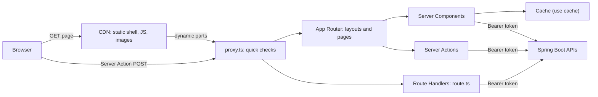

**What happens on one page load:**

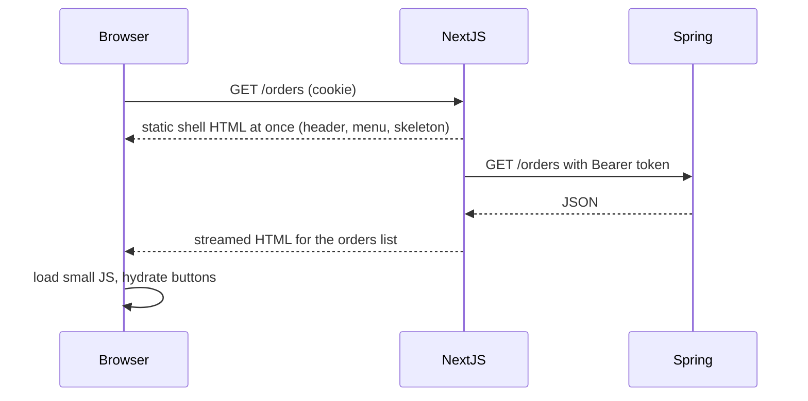

**BFF pattern:** BFF means *Backend for Frontend*. Next.js runs on a server, so it can be a thin backend made only for this UI.

- The browser talks only to Next.js. It never sees internal Spring Boot URLs.
- The login token stays in an `httpOnly` cookie (JavaScript cannot read it). Next.js reads the cookie and calls Spring Boot with `Authorization: Bearer ...`.
- Next.js can combine 3 backend calls into 1 response for the page.
- No CORS problems, because the browser calls the same domain.
- Business rules stay in Spring Boot. Next.js only shapes data for the screen.
- More in [Authentication and the BFF pattern](#authentication-and-the-bff-pattern) and [API gateway and BFF](microservices.md#api-gateway-and-bff).

**Example:**

```tsx
// app/orders/page.tsx - Server Component (default). Runs on the server only.
import { cookies } from "next/headers";
import { CancelButton } from "./cancel-button";

export default async function OrdersPage() {
  const token = (await cookies()).get("session")?.value;          // async since Next.js 15
  const res = await fetch(`${process.env.ORDER_API}/orders`, {    // internal URL, hidden
    headers: { Authorization: `Bearer ${token}` },
  });
  const orders: { id: string; total: number }[] = await res.json();
  return (
    <ul>
      {orders.map((o) => (
        <li key={o.id}>{o.id}: {o.total} <CancelButton id={o.id} /></li>
      ))}
    </ul>
  );
}
```

```tsx
// app/orders/actions.ts - Server Action
"use server";
import { revalidatePath } from "next/cache";

export async function cancelOrder(id: string) {
  // real code: check the session here too (see Server Actions section)
  await fetch(`${process.env.ORDER_API}/orders/${id}/cancel`, { method: "POST" });
  revalidatePath("/orders");                                       // show fresh list
}
```

```tsx
// app/orders/cancel-button.tsx - Client Component (needs onClick)
"use client";
import { cancelOrder } from "./actions";

export function CancelButton({ id }: { id: string }) {
  return <button onClick={() => cancelOrder(id)}>Cancel</button>;
}
```

**Good and bad:**

| Good | Bad |
|---|---|
| Keep components on the server by default | Put `"use client"` at the top of every file |
| Add `"use client"` only to small leaf parts (buttons, forms) | Make the whole page a Client Component for one button |
| Keep tokens in `httpOnly` cookies, call backend from the server | Put API secrets in `NEXT_PUBLIC_*` env variables (they go to the browser) |
| Keep business rules in Spring Boot | Write pricing or payment logic in Next.js |
| Use `"use cache"` only for data that is the same for many users | Cache a page that shows one user's private data for everyone |
| Check auth inside the Server Action too | Trust only `proxy.ts` for security |

**When to use / when not to use:**

- Use Next.js for public pages that need SEO and fast first load: shops, blogs, landing pages.
- Use it as a BFF when you have many backend services and want one clean API for the UI.
- A small internal admin tool behind login may not need it. A plain React app (Vite) can be simpler.
- Don't move core business logic into Next.js. Keep it in the Java services.

**Say this in the interview:**

> "Next.js renders React on the server. With the App Router, components are Server Components by default. So data fetching and secrets stay on the server, and less JavaScript goes to the browser. I add `"use client"` only where I need state or clicks. In Next.js 16, Turbopack is the default bundler, caching is opt-in with `"use cache"`, and `proxy.ts` replaced middleware. In my setup, Next.js is a BFF: the browser talks to Next.js, and Next.js calls Spring Boot with the user's token."

**They may ask next:**

- **Can a Server Component use `useState`?** No. State and event handlers need a Client Component.
- **Server Action vs Route Handler?** A Server Action is for your own UI (forms, buttons). A Route Handler is a normal HTTP endpoint that any client can call.
- **Is `proxy.ts` enough for security?** No. It is a first check. Always check the user again in Server Actions, Route Handlers and the Spring Boot API.
- **How do you share types between Next.js and Spring Boot?** Generate a TypeScript client from the Spring Boot OpenAPI spec.
- **What is hydration?** The browser takes the server HTML and attaches the JavaScript event handlers, so buttons start to work.

---

## App Router vs Pages Router

**In one line:** The Pages Router (`pages/`) is the old way with `getServerSideProps`; the App Router (`app/`) is the current way with Server Components, layouts and streaming.

**Story:** An old railway station and a new one in the same city. The old one (Pages Router) still runs trains. All new lines (features) are built only in the new station (App Router). You can move platforms one by one.

**How it works:**

| | Pages Router (`pages/`) | App Router (`app/`) |
|---|---|---|
| Data loading | `getServerSideProps`, `getStaticProps` | `async` Server Components, `fetch` directly |
| Components | All are Client Components (sent to the browser) | Server Components by default |
| Layouts | One `_app.tsx`, manual nesting | Nested `layout.tsx` per folder, kept on navigation |
| Loading UI | Build it yourself | `loading.tsx` and `<Suspense>` streaming |
| APIs | `pages/api/*.ts` | `app/**/route.ts` (Route Handlers) |
| Mutations | API route + `fetch` from client | Server Actions |
| Caching | ISR with `revalidate` | `"use cache"`, `cacheLife`, `cacheTag` |
| Status | Supported, no big new features | Where all new features land |

- Both can live in one app. The same URL must not exist in both folders.
- Navigating between the two routers is a full page load (hard navigation).

**Diagram:**

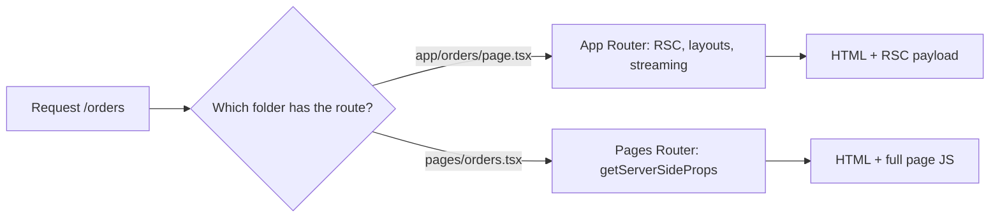

**Good and bad:**

| Good | Bad |
|---|---|
| New pages in `app/`, old pages move over time | Big-bang rewrite of 300 pages |
| Use App Router for new projects | Start a new project on Pages Router in 2026 |
| Keep one design system for both routers | Two copies of the header that drift apart |

**Say this in the interview:**

> "The Pages Router loads data with getServerSideProps and ships every component to the browser. The App Router uses Server Components, nested layouts, streaming and Server Actions. Both can run in one app, so I migrate route by route. New features only come to the App Router."

**They may ask next:**

- **Is the Pages Router deprecated?** No. It is still supported, but new features go to the App Router.

---

## File conventions and routing

**In one line:** In the App Router, folders are URL segments and special file names (`layout`, `page`, `loading`, `error`, `not-found`) decide what renders at each level.

**Story:** A shopping mall. Each floor is a folder. The building frame (walls, lifts) is the `layout`. A shop is the `page`. The "please wait" sign is `loading`. The "shop closed, sorry" sign is `error`. The "no such shop" sign is `not-found`.

**How it works:**

| File | What it does |
|---|---|
| `layout.tsx` | Shared frame. Stays mounted when you move between child pages. Root layout must have `<html>` and `<body>` |
| `page.tsx` | The UI for that URL. A folder without `page.tsx` is not a route |
| `loading.tsx` | Fallback shown while the page loads. Next.js wraps the page in `<Suspense>` for you |
| `error.tsx` | Client Component. Catches errors in this segment and below |
| `not-found.tsx` | Shown when you call `notFound()` |
| `global-error.tsx` | Catches errors in the root layout. Needs its own `<html>` and `<body>` |
| `template.tsx` | Like a layout, but mounts fresh on every navigation |
| `default.tsx` | Fallback for a parallel route slot. Required for every slot since Next.js 16 |
| `route.ts` | Route Handler (API). Cannot sit next to a `page.tsx` |

Folder name tricks:

- `[id]` dynamic segment, `[...slug]` catch-all, `[[...slug]]` optional catch-all.
- `(shop)` **route group**: groups files, not part of the URL. Use it for different layouts.
- `_components` **private folder**: never a route.
- `@modal` **parallel route slot**: a layout can show two pages at once.
- `(.)photo` **intercepting route**: show a page as a modal on soft navigation.

**Diagram (how the files nest for one segment):**

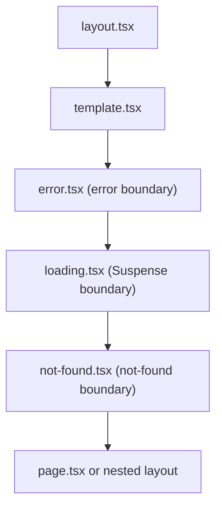

### Dynamic segments and generateStaticParams

```tsx
// app/products/[id]/page.tsx
export async function generateStaticParams() {
  const top = await fetch(`${process.env.PRODUCT_API}/products/top`).then((r) => r.json());
  return top.map((p: { id: string }) => ({ id: p.id }));   // prerender the top 100 at build
}

export default async function Product({ params }: PageProps<"/products/[id]">) {
  const { id } = await params;                             // params is a Promise since 15
  const product = await getProduct(id);
  return <h1>{product.name}</h1>;
}
```

- `PageProps<"/products/[id]">` is a global type helper. Next.js generates it during `next dev`, `next build` or `next typegen`.
- URLs not listed in `generateStaticParams` are rendered on the first visit and then cached (ISR, see [Rendering strategies](#rendering-strategies)).

### Route groups

```text
app/
  (marketing)/layout.tsx      -> big hero header
  (marketing)/about/page.tsx  -> /about
  (shop)/layout.tsx           -> header with cart
  (shop)/cart/page.tsx        -> /cart
```

### Parallel and intercepting routes

- **Parallel routes:** `app/dashboard/@stats/page.tsx` and `app/dashboard/@orders/page.tsx`. The layout gets `stats` and `orders` as props. Each slot can load and fail on its own.
- **Intercepting routes:** a photo grid at `/feed`. Clicking a photo opens `/photo/42` as a modal (soft navigation). Reloading `/photo/42` shows the full page (hard navigation). The shareable URL works both ways.

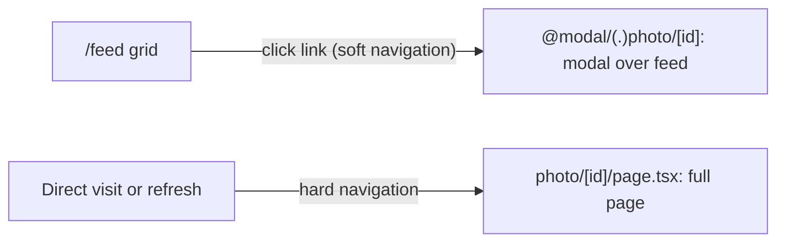

**Good and bad:**

| Good | Bad |
|---|---|
| Use route groups for different layouts | Deep `if (pathname === ...)` checks in one big layout |
| Put `loading.tsx` where data is slow | No loading UI, so a click feels frozen |
| Add `default.tsx` for every parallel slot | Forget it and the Next.js 16 build fails |
| Keep helpers in `_components` or outside `app/` | Files named `page.tsx` that are not meant to be routes |

**Say this in the interview:**

> "In the App Router, folders are URL segments. layout is the shared frame and stays mounted, page is the screen, loading adds a Suspense boundary, error adds an error boundary. I use route groups for different layouts, parallel routes for dashboards with independent panels, and intercepting routes for modals that also have a real URL."

**They may ask next:**

- **layout vs template?** A layout keeps its state across navigation. A template remounts every time, for example to replay an enter animation.
- **Does `error.tsx` catch errors in the layout of the same folder?** No. It wraps the page and children, not the layout beside it. Use the parent's `error.tsx` or `global-error.tsx`.
- **What does `[[...slug]]` match?** `/docs`, `/docs/a` and `/docs/a/b`. The plain `[...slug]` does not match `/docs`.

---

## Server Components vs Client Components

**In one line:** Server Components run only on the server and send rendered output; Client Components also run in the browser for state and clicks, and `"use client"` marks the border between them.

**Story:** A newspaper. Most of the paper is printed at the press (Server Components). It arrives ready to read. The crossword is the only part you write on at home (Client Component). You don't ship the printing press to every house.

**How it works:**

1. Every component in `app/` is a Server Component unless its file (or a file that imports it) starts with `"use client"`.
2. Server Components can be `async`, read files, call databases and use secrets. Their code never goes to the browser.
3. Client Components render once on the server (for the first HTML), then again in the browser (hydration). They can use hooks and browser APIs.
4. `"use client"` marks an **entry point**. Everything that file imports also becomes client code.

### The boundary

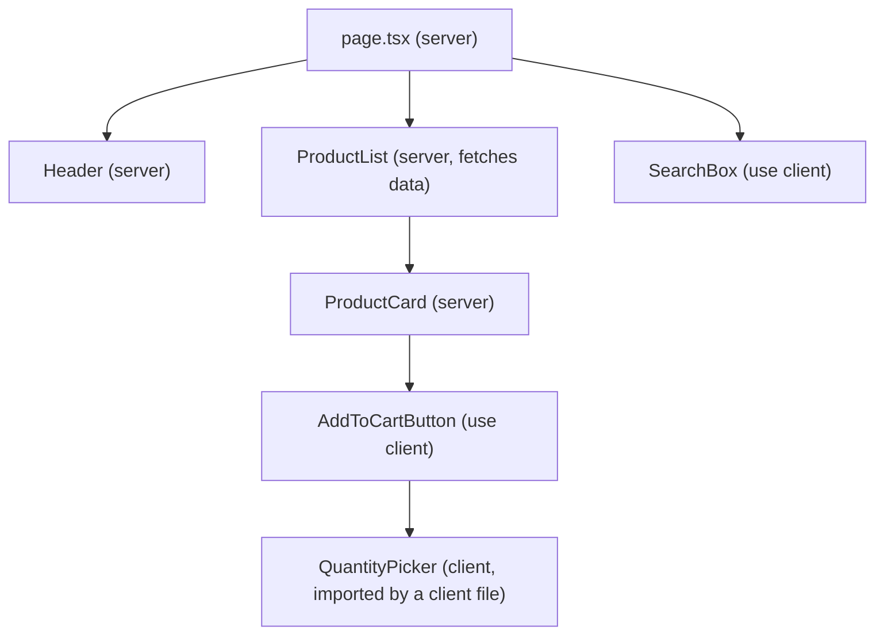

Only `AddToCartButton`, `QuantityPicker` and `SearchBox` send JavaScript to the browser.

### What can be passed as props (server to client)

Props from a Server Component to a Client Component must be **serializable** (React can turn them into text and back).

| Allowed | Not allowed |
|---|---|
| string, number, bigint, boolean, null, undefined | Normal functions (event handlers made on the server) |
| Plain objects and arrays | Class instances (`new User()`) |
| `Date`, `Map`, `Set`, typed arrays | Symbols not made with `Symbol.for` |
| JSX (Server Components as `children`) | Objects with a null prototype |
| Promises (client reads them with `use()`) | |
| Server Functions (`"use server"` functions) | |

### Composition: server children inside a client wrapper

A Client Component cannot import a Server Component. But it can **receive one as a prop** (`children` or any JSX prop). The server part is rendered on the server and passed in as finished output.

```tsx
// app/ui/collapsible.tsx - client: owns open/close state only
"use client";
import { useState, type ReactNode } from "react";

export function Collapsible({ title, children }: { title: string; children: ReactNode }) {
  const [open, setOpen] = useState(false);
  return (
    <section>
      <button onClick={() => setOpen(!open)}>{title}</button>
      {open && children}   {/* children was rendered on the server */}
    </section>
  );
}

// app/products/[id]/page.tsx - server
// <Collapsible title="Reviews"><Reviews productId={id} /></Collapsible>
// Reviews is an async Server Component. Its code never reaches the browser.
```

### "use client" spreads, and the bundle grows

- If `page.tsx` starts with `"use client"`, the whole page and every import become browser JavaScript. A 300 KB date library goes to every phone.
- **Fix:** keep the page on the server. Move `"use client"` down to the smallest leaf that needs state.
- **Context providers:** make one small `app/providers.tsx` with `"use client"`. Render it in the root layout around `{children}`. The children stay Server Components.
- **Third-party UI without `"use client"`:** re-export it from your own file that starts with `"use client"`.
- **Stop leaks:** `import "server-only"` at the top of a module makes the build fail if a Client Component imports it. `client-only` does the opposite.

### RSC payload and how it streams

The **RSC payload** (React Server Components payload) is a compact data format (the Next.js docs call it binary). It holds:

- The rendered output of Server Components.
- Placeholders for Client Components, with links to their JavaScript files.
- The props passed to those Client Components.

On the **first visit**, the browser gets HTML (fast first paint) plus the RSC payload (to build the React tree) plus JS for Client Components (hydration).
On a **client navigation** (`<Link>` click), only the RSC payload for the changed segments is fetched. Layouts above stay as they are.

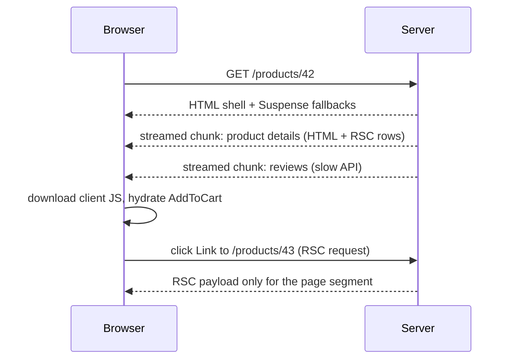

**Good and bad:**

| Good | Bad |
|---|---|
| Fetch on the server, pass small plain props | Pass a whole DB row (with internal fields) to a Client Component |
| Leaf-level `"use client"` | `"use client"` on layouts and pages |
| `server-only` on data access modules | Hoping nobody imports the DB module into a client file |
| Pass server JSX as `children` to client wrappers | Convert a whole subtree to client because the wrapper needs state |

**Say this in the interview:**

> "Server Components run only on the server, so their code and secrets never reach the browser. Client Components hydrate in the browser for state and events. `use client` marks an entry point, so everything it imports becomes client code. I keep it on small leaves, and I pass server-rendered parts into client wrappers as children. Props across the boundary must be serializable, so no functions or class instances. On navigation, Next.js fetches only the RSC payload for the changed part of the page."

**They may ask next:**

- **Do Client Components render on the server?** Yes, once for the first HTML. Then they hydrate in the browser.
- **Can a Server Component pass an `onClick` to a Client Component?** No. Functions are not serializable. Pass a Server Action instead, or define the handler in the client file.
- **Why is my secret in the browser bundle?** A Client Component (or its import) read `process.env.SECRET`, or the variable starts with `NEXT_PUBLIC_`. Use `server-only` and keep secrets in the data layer.

---

## Rendering strategies

**In one line:** Next.js can build HTML at build time (static), on every request (dynamic), in parts (streaming), as a static shell with dynamic holes (Partial Prerendering), refreshed in the background (ISR), or in the browser (CSR), and you pick per part of the page.

**Story:** A wedding caterer.
Sweets are made the day before (static). Rotis are made fresh when each guest arrives (dynamic). Starters are served first while the main course is still cooking (streaming). The plate comes with fixed items already on it and a gap for the hot dish (Partial Prerendering). The sweet box is re-filled when it runs low (ISR). The salad bar is "make it yourself" (CSR).

**How it works:**

| Strategy | When HTML is made | Example | How you get it (Next.js 16) |
|---|---|---|---|
| Static (SSG) | At build | About page, docs | No runtime data. Next.js prerenders it by itself |
| Dynamic (SSR) | Every request | "My orders" | Read `cookies()`, `headers()`, `searchParams`, or uncached data |
| Streaming | Every request, sent in parts | Dashboard with a slow widget | Wrap slow parts in `<Suspense>` or add `loading.tsx` |
| Partial Prerendering (PPR) | Shell at build, holes at request | Product page with price per user | Cache Components: static and `"use cache"` parts form the shell, `<Suspense>` parts stream |
| ISR | At build or first visit, refreshed later | Product pages for 1M SKUs | `"use cache"` + `cacheLife("hours")`, or `cacheTag` + `revalidateTag` |
| CSR | In the browser | Live stock chart after login | Client Component + TanStack Query or SWR |

- With **Cache Components** (`cacheComponents: true`), PPR is the default way pages render. One HTTP response has the static shell first, then the dynamic parts.
- **ISR** (Incremental Static Regeneration) means: serve a cached page, rebuild it in the background after a time or an event.
- **On-demand revalidation:** call `revalidateTag`, `updateTag` or `revalidatePath` after data changes. See [Caching in depth](#caching-in-depth).
- Without Cache Components (the "previous model"), a route is static or dynamic as a whole. Reading `cookies()` anywhere made the whole route dynamic.

**Diagram (pick per part of the page):**

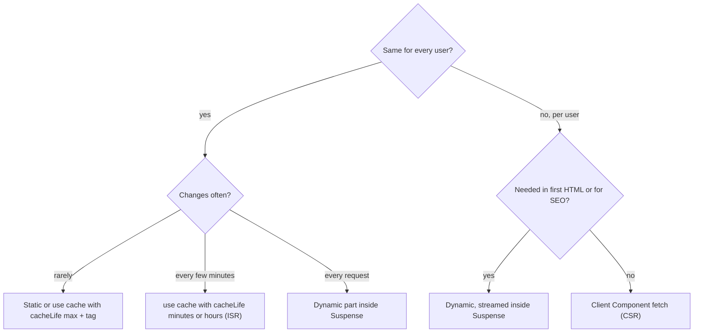

**Example (one page, three strategies):**

```tsx
// app/products/[id]/page.tsx
import { Suspense } from "react";
import { cacheLife, cacheTag } from "next/cache";

export default async function Page({ params }: PageProps<"/products/[id]">) {
  const { id } = await params;
  return (
    <>
      <ProductInfo id={id} />                              {/* cached: in the shell */}
      <Suspense fallback={<p>Checking stock...</p>}>
        <LiveStock id={id} />                              {/* dynamic: streams */}
      </Suspense>
    </>
  );
}

async function ProductInfo({ id }: { id: string }) {
  "use cache";
  cacheLife("hours");                                      // ISR-like refresh
  cacheTag(`product-${id}`);                               // for on-demand refresh
  const p = await fetch(`${process.env.PRODUCT_API}/products/${id}`).then((r) => r.json());
  return <h1>{p.name}</h1>;
}

async function LiveStock({ id }: { id: string }) {
  const s = await fetch(`${process.env.STOCK_API}/stock/${id}`).then((r) => r.json());
  return <p>{s.count} in stock</p>;                        // fresh on every request
}
```

**Good and bad:**

| Good | Bad |
|---|---|
| Decide per component, not per page | Make the whole page dynamic because of one avatar |
| Push dynamic reads (`cookies()`, `params`) deep into small components | `await cookies()` at the top of the root layout |
| Use tags and on-demand revalidation for CMS data | Rebuild the whole site on every content change |
| CSR only for data that is live or not needed for SEO | CSR for product pages that must rank on Google |

**Say this in the interview:**

> "I choose rendering per part of the page. Shared data that changes rarely goes in `use cache` with a long cacheLife and a tag, so it is in the static shell. Per-user or live data streams inside Suspense. With Cache Components this is Partial Prerendering: one response, static shell first, dynamic parts after. After a write I call updateTag or revalidateTag, so I don't need a rebuild."

**They may ask next:**

- **What is the difference between ISR and SSR?** ISR serves a cached page and refreshes it in the background. SSR builds the page on every request.
- **Does `<Suspense>` make a component dynamic?** No. It only gives a fallback. A component is dynamic because it reads runtime data or uncached data.
- **How do I make sure a marketing page never becomes dynamic by mistake?** Next.js 16.4 has `export const ensureStatic = "navigation"` on the page or layout. The build fails if dynamic content sneaks in.

---

## Caching in depth

**In one line:** Next.js caches at several layers; in Next.js 16 with Cache Components, nothing is cached unless you mark it with `"use cache"`, give it a life with `cacheLife`, and a name with `cacheTag` so you can clear it.

**Story:** A tea stall.
The cook remembers an order he heard 10 seconds ago and does not ask again (request memoization). He keeps a flask of tea ready for everyone (shared server cache). Some cups are poured before customers arrive (prerendered static shell). Each customer keeps a half cup at their table to sip while waiting (browser router cache). The problem: if the milk changes, someone must empty the flask.

### The old model: four layers (Next.js 13 and 14)

| Layer | Where | What it stores | How long |
|---|---|---|---|
| Request memoization | Server, one render | Same `fetch` GET called twice in one render runs once | One request |
| Data Cache | Server, shared | `fetch` results | Until revalidated (was cached by default in 14) |
| Full Route Cache | Server | HTML + RSC payload of static routes | Until revalidated or redeployed |
| Router Cache | Browser memory | RSC payload of visited and prefetched pages | Session, or a time window |

This was **implicit**. Many teams saw stale data and did not know which layer held it.

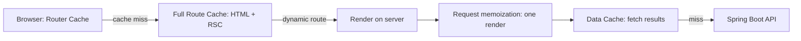

### What changed in Next.js 15

- `fetch` is **not cached by default** any more. Use `cache: "force-cache"` to opt in.
- `GET` Route Handlers are **not cached by default**.
- The browser Router Cache no longer reuses **page** segments on `<Link>` navigation by default (layouts and loading states are still reused). `staleTimes` in config can change this.

### Next.js 16: Cache Components

Turn on with `cacheComponents: true` (and `partialPrefetching: true`, which the docs ask you to set too). New apps have both since 16.4.

- **Dynamic by default.** Everything runs at request time unless cached.
- **`"use cache"`** at the top of a file, component or async function caches its return value.
- **Cache key** = build id (or `deploymentId` if you set one) + function id + all arguments + any outer values it uses. Different inputs give different entries.
- **`cacheLife(profile)`** sets how long. **`cacheTag(name)`** names the entry for on-demand refresh.
- You **cannot** read `cookies()` or `headers()` inside a `"use cache"` scope. Read them outside and pass the value as an argument.
- **`"use cache: private"`**: may read cookies directly. In production it is never stored in a server cache across requests. It is reused only inside one request and in that user's browser memory.
- **`"use cache: remote"`**: uses the `remote` cache handler. You (or your platform) point it at shared storage, for example Redis, so all servers share it. Without a configured handler it is also just in memory.
- The default `"use cache"` store is **in memory, per server instance**. On serverless it may not survive between requests.

`cacheLife` profiles (`stale` = how long the browser may reuse it, `revalidate` = refresh in background after, `expire` = must rebuild after):

| Profile | stale | revalidate | expire |
|---|---|---|---|
| `default` | 5m | 15m | never |
| `seconds` | 30s | 1s | 60s |
| `minutes` | 5m | 1m | 1h |
| `hours` | 5m | 1h | 1d |
| `days` | 5m | 1d | 1w |
| `weeks` | 5m | 1w | 30d |
| `max` | 5m | 30d | 1y |

- "Short-lived" entries (`revalidate: 0`, `expire` under 5 minutes, or `stale` under 30 seconds) are left out of the prerender. They become dynamic holes. Of the presets, only `seconds` is short-lived.
- All cache entries are tied to one deployment. A new deploy starts with an empty cache.

### Revalidation APIs (Next.js 16)

| API | Where | Behavior | Use for |
|---|---|---|---|
| `updateTag(tag)` | Server Actions only | Expire now. The re-render in the same response waits for fresh data | "I saved, show my change" (read-your-own-writes) |
| `revalidateTag(tag, "max")` | Server Actions, Route Handlers | Stale-while-revalidate: old data now, fresh data in background | CMS webhook, catalog updates |
| `revalidatePath("/orders")` | Server Actions, Route Handlers | Clears everything for that path | When you don't have tags |
| `refresh()` | Server Actions only | Re-renders uncached data. Does not touch the cache | Notification count in the header |
| `router.refresh()` | Client Component | Refetch the current route from the server | After a client-side change |

- `revalidateTag(tag)` with one argument is **deprecated** in 16. Add a profile, usually `"max"`.

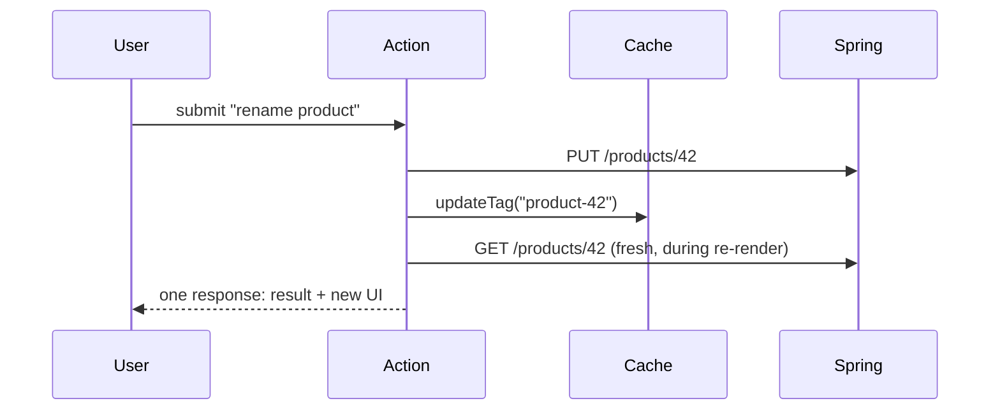

### Common stale-data bugs and fixes

| Bug | Why | Fix |
|---|---|---|
| "I saved, but the page shows the old name" | Used `revalidateTag(tag, "max")`. It serves stale data first | Use `updateTag(tag)` in the Server Action |
| Works on one pod, stale on the others | Each Kubernetes pod has its own in-memory cache | Shared cache handler (Redis) in `cacheHandlers`, with tag sync (`updateTags` writes, `refreshTags` reads) |
| User A sees user B's data | Per-user data cached without the user id in the key | Pass `userId` as an argument, or use `"use cache: private"` |
| Page frozen at build-time data (old model) | No dynamic API used, so the route became fully static | Read runtime data, call `connection()`, or set `revalidate` |
| Env var has the build-time value | Static page read `process.env` during build | Read it after `await connection()` or in a dynamic part |
| `Date.now()` is the same for everyone | Time was read during prerender | `await connection()` first, inside `<Suspense>` |
| Back button shows old list | Browser router cache | Revalidate in the action, or `router.refresh()` |
| CDN shows one user's page to another | CDN cached a dynamic response | Dynamic pages send `Cache-Control: private`. Check your CDN rules respect it |

**Example (data-level cache with tag, and read-your-own-writes):**

```ts
// lib/products.ts
import "server-only";
import { cacheLife, cacheTag } from "next/cache";

export async function getProduct(id: string) {
  "use cache";
  cacheLife("days");
  cacheTag("products", `product-${id}`);          // two tags: all products, one product
  const res = await fetch(`${process.env.PRODUCT_API}/products/${id}`);
  if (!res.ok) throw new Error(`Product ${id}: ${res.status}`);
  return (await res.json()) as { id: string; name: string; price: number };
}
```

```ts
// app/admin/products/actions.ts
"use server";
import { updateTag } from "next/cache";
import { requireAdmin } from "@/lib/dal";
import { springApi } from "@/lib/spring";          // server-only API client

export async function renameProduct(id: string, name: string) {
  await requireAdmin();                           // auth inside every action
  await springApi.put(`/products/${id}`, { name });
  updateTag(`product-${id}`);                     // admin sees the new name at once
}
```

**Good and bad:**

| Good | Bad |
|---|---|
| Cache shared data with clear tags (`product-42`) | One giant tag `"all"` cleared on every write |
| Put the user or tenant id in the arguments of per-user caches | Read a "current user" global inside `"use cache"` |
| Shared cache handler when you run many instances | In-memory cache on 10 pods and "random" stale data |
| Event-driven refresh (Spring publishes a Kafka event, a consumer calls a revalidate endpoint) | Short `cacheLife("seconds")` everywhere "to be safe" |

**Say this in the interview:**

> "Old Next.js had four implicit caches: request memoization, data cache, full route cache and the browser router cache. Stale data was a common pain. Next.js 15 stopped caching fetch by default. Next.js 16 Cache Components make caching explicit: `use cache`, cacheLife for time, cacheTag for names. After a user's own write I use updateTag so they see it at once. For CMS or catalog changes I use revalidateTag with 'max', which serves stale data while it refreshes. With many pods I add a shared cache handler, or tag invalidation only hits one pod."

**They may ask next:**

- **Why can't I call `cookies()` inside `"use cache"`?** The result is shared by many users. Reading cookies there would leak one user's data. Read outside, pass the value in, or use `"use cache: private"`.
- **What is in the cache key?** Build id, function id, serialized arguments and closed-over values.
- **Did a real bug come from cache keys?** Yes. The November 2026 security release fixed cases where `use cache` entries leaked across tenants (root params) and users (binary arguments). Lesson: tenant and user ids belong in the key, and keep Next.js patched.

---

## Data fetching patterns

**In one line:** Fetch on the server, inside the component that needs the data, start independent requests together, and wrap shared lookups in React `cache()` so they run once per request.

**Story:** A waiter takes an order for three dishes. A bad waiter walks to the kitchen for dish 1, waits, comes back, then goes for dish 2. A good waiter gives all three orders at once. That is the difference between a **waterfall** and **parallel** fetching.

**How it works:**

1. **Fetch in Server Components.** No `useEffect`, no extra API route. The component is `async` and awaits data.
2. **Avoid waterfalls.** Two `await`s in a row wait for each other. If they don't depend on each other, start both first, then await with `Promise.all`.
3. **Split by Suspense.** Put slow parts in their own component inside `<Suspense>`. The fast part shows first.
4. **Preload.** Call `void getItem(id)` early, before other slow work. The later `await getItem(id)` reuses the same promise.
5. **React `cache()`** deduplicates a function within one server render. Use it for `getCurrentUser()` called from the layout, the page and three components. It does not dedupe across requests, and it does nothing inside Server Actions or Route Handlers.
6. **`server-only`** stops the data module from being imported by a Client Component.
7. **Pass a promise to the client.** A Server Component starts the fetch and passes the promise. The Client Component reads it with `use(promise)` inside `<Suspense>`.
8. **TanStack Query** still fits for client-only needs: polling, infinite scroll, optimistic lists, offline. Load the first page on the server and hand it over. See [Data fetching in a large app](react.md#data-fetching-in-a-large-app).

**Diagram (waterfall vs parallel):**

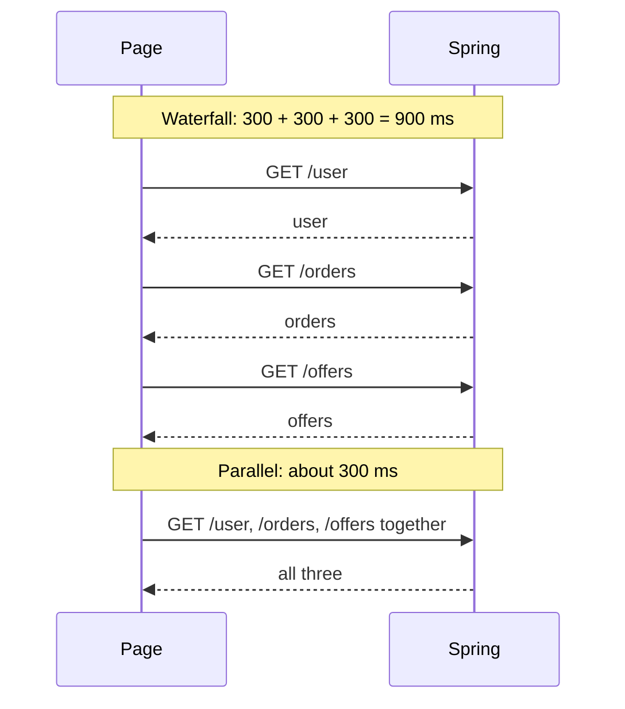

**Example:**

```tsx
// lib/dal.ts
import "server-only";
import { cache } from "react";

export const getCurrentUser = cache(async () => {   // runs once per request
  const session = await verifySession();
  return api.get<User>(`/users/${session.userId}`);
});
```

```tsx
// app/account/page.tsx
import { Suspense } from "react";
import { getCurrentUser } from "@/lib/dal";

export default async function Account() {
  const userP = getCurrentUser();          // start now
  const ordersP = getRecentOrders();       // start now, does not wait for user
  const [user, orders] = await Promise.all([userP, ordersP]);
  return (
    <>
      <h1>Hi {user.name}</h1>
      <OrderList orders={orders} />
      <Suspense fallback={<p>Loading offers...</p>}>
        <Offers userId={user.id} />        {/* slow, streams later */}
      </Suspense>
    </>
  );
}
```

```tsx
// Passing a promise to a Client Component
"use client";
import { use } from "react";

export function Comments({ commentsP }: { commentsP: Promise<Comment[]> }) {
  const comments = use(commentsP);         // suspends until the promise resolves
  return <ul>{comments.map((c) => <li key={c.id}>{c.text}</li>)}</ul>;
}
```

**Good and bad:**

| Good | Bad |
|---|---|
| `Promise.all` for independent calls | `await a(); await b(); await c();` when they don't depend on each other |
| Fetch where the data is used, dedupe with `cache()` | Fetch everything in the page and pass it 5 levels down |
| Slow, optional parts in their own `<Suspense>` | One slow API blocks the whole page |
| Server fetch for the first render, TanStack Query for live updates | `useEffect` + `fetch` chains in Client Components (client waterfall) |

**Say this in the interview:**

> "I fetch in Server Components, close to where the data is used. Independent calls start together with Promise.all, and slow parts go in their own Suspense boundary so they stream. Shared lookups like the current user are wrapped in React cache, so they run once per request. Data modules import server-only. I still use TanStack Query in Client Components for polling, infinite scroll and optimistic lists."

**They may ask next:**

- **Is `fetch` deduplicated automatically?** Yes, identical `GET` fetches in one render are memoized. Database calls are not, so wrap them in `cache()`.
- **Should I call my own Route Handler from a Server Component?** No. It adds an HTTP hop. Call the data function directly.

---

## Server Actions (Server Functions)

**In one line:** A Server Action is an async function marked `"use server"` that the browser can call through a form or a transition; Next.js turns it into a POST request to the server.

**Story:** A suggestion box at a bank. You drop a form in the box (POST). The clerk inside reads it and updates the records. But anyone can drop a paper in the box, even a stranger. So the clerk must check the signature on every form.

**How it works:**

1. Put `"use server"` at the top of a file (all exports become actions) or at the top of an async function inside a Server Component.
2. Use it as `<form action={createPost}>`, `<button formAction={...}>`, or call it inside `startTransition`.
3. At build time the client gets only an encrypted **action ID**, not the code. Calling it sends a `POST` to the current page URL.
4. The response carries both the return value and, if you called `updateTag`, `revalidatePath`, `refresh`, `redirect` or changed cookies, the new RSC payload for the page. **One round trip.**
5. The client sends actions **one at a time**. Three quick clicks run in order. Don't use `Promise.all` on actions, and don't use actions for reading data.
6. Forms work before JavaScript loads (progressive enhancement) when the action is passed to `<form action>`.
7. React calls these **Server Functions**. Next.js calls them **Server Actions** when used for actions and forms.

**React hooks around actions:**

- `useActionState(action, initialState)` returns `[state, formAction, pending]`. Return errors as values, don't throw them.
- `useFormStatus()` gives `pending` inside a child of the form (for a submit button).
- `useOptimistic(state, updateFn)` shows the change at once, then settles when the server answers.

**Diagram:**

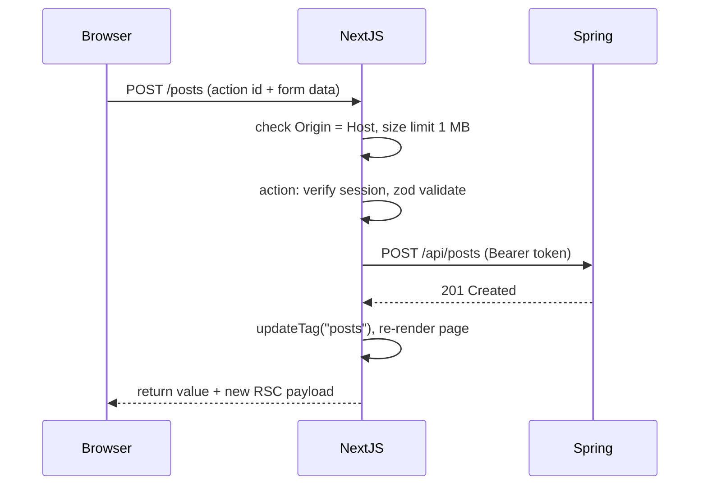

**Example (validated, authorized action + form):**

```ts
// app/posts/actions.ts
"use server";
import { z } from "zod";
import { updateTag } from "next/cache";
import { verifySession } from "@/lib/dal";
import { springFetch } from "@/lib/spring";

const PostSchema = z.object({ title: z.string().trim().min(3).max(120) });
export type State = { error?: string; ok?: boolean };

export async function createPost(_prev: State, formData: FormData): Promise<State> {
  const session = await verifySession();                 // 1. who is calling?
  const parsed = PostSchema.safeParse({ title: formData.get("title") });
  if (!parsed.success) return { error: "Title must be 3 to 120 characters" };
  const res = await springFetch("/posts", {              // 2. Spring checks permissions too
    method: "POST", token: session.accessToken, body: parsed.data,
  });
  if (!res.ok) return { error: "Could not save. Please try again." };
  updateTag("posts");                                    // 3. user sees the new post
  return { ok: true };                                   // 4. small, safe return value
}
```

```tsx
// app/posts/new-post-form.tsx
"use client";
import { useActionState } from "react";
import { createPost, type State } from "./actions";

export function NewPostForm() {
  const [state, formAction, pending] = useActionState<State, FormData>(createPost, {});
  return (
    <form action={formAction}>
      <input name="title" required />
      <button disabled={pending}>{pending ? "Saving..." : "Save"}</button>
      {state.error && <p role="alert">{state.error}</p>}
    </form>
  );
}
```

**Example (optimistic like button):**

```tsx
"use client";
import { useOptimistic, startTransition } from "react";
import { likePost } from "./actions";

export function LikeButton({ postId, likes }: { postId: string; likes: number }) {
  const [shown, addLike] = useOptimistic(likes, (current, delta: number) => current + delta);
  return (
    <button
      onClick={() =>
        startTransition(async () => {
          addLike(1);                 // show +1 now
          await likePost(postId);     // when done, the real count from the server is shown
        })
      }
    >
      Like ({shown})
    </button>
  );
}
```

**Security (treat every action as a public POST endpoint):**

- **Authenticate and authorize inside each action.** A page that is hidden behind login does not protect the action. Anyone can replay the POST.
- **Check ownership** (stops IDOR, *Insecure Direct Object Reference*): send only an id from the client, load the row with the session user's id.
- **Validate** all input with zod (shape) and business rules (meaning).
- **Return small DTOs** (*Data Transfer Objects*). The return value is sent to the browser.
- **CSRF** (*Cross-Site Request Forgery*): actions accept only `POST`, and Next.js compares the `Origin` header with `Host` (or `X-Forwarded-Host`). Behind another domain or proxy, set `serverActions.allowedOrigins`. `SameSite=Lax` cookies add one more layer.
- **Closures:** values captured by an inline action are encrypted before they go to the client. Don't rely on that for secrets.
- **Many servers:** set the same `NEXT_SERVER_ACTIONS_ENCRYPTION_KEY` on all instances, or you get "Failed to find Server Action".
- **Unused actions** are removed from the build, so they get no endpoint. Action IDs usually change with each new deploy.
- **Body size** is capped at 1 MB by default (`serverActions.bodySizeLimit`).
- **Rate-limit** expensive actions (email, payments).

**Good and bad:**

| Good | Bad |
|---|---|
| `verifySession()` as the first line of every action | Trust that only logged-in users see the button |
| Accept `postId`, load the post with `ownerId = session.userId` | Accept the whole `post` object from the client and save it |
| Return `{ ok: true }` or field errors | Return the raw database row |
| Use actions for writes | Use actions to load lists (they run one at a time) |

**Say this in the interview:**

> "Server Actions are functions marked `use server`. The client only gets an action ID, and calling it sends a POST. The response can carry the new UI too, so the mutation, cache update and re-render happen in one round trip. I treat every action as a public endpoint: check the session, check ownership, validate with zod, return a small DTO. Next.js adds an Origin check against CSRF, a 1 MB body limit and encrypted closures, but those don't replace my checks."

**They may ask next:**

- **Can I call a Server Action from `useEffect`?** Yes, inside `startTransition`. But reads are better done in Server Components.
- **How do you show field errors?** Return them from the action and read them from `useActionState` state.
- **What happens to old browser tabs after a deploy?** Their action IDs may not exist any more. Show a "please refresh" message, and use rolling deploys with a stable encryption key.
- **Where does `redirect()` go?** After `updateTag`/`revalidatePath`, because `redirect` throws and stops the function.

---

## Route Handlers vs Server Actions vs a separate backend

**In one line:** Use Server Actions for your own UI's writes, Route Handlers for real HTTP endpoints (webhooks, mobile, public API), and keep business logic in a separate backend like Spring Boot.

**Story:** A hotel. The room service phone (Server Action) is only for guests in rooms. The front desk (Route Handler) serves anyone who walks in: taxi drivers, delivery people (webhooks, mobile apps). The kitchen and accounts office (Spring Boot) do the real work for both.

**How it works:**

| Need | Pick | Why |
|---|---|---|
| Form submit, button click in your Next.js UI | Server Action | Typed call, one round trip with new UI, progressive enhancement |
| Webhook from Stripe, CMS, GitHub | Route Handler | Fixed URL, raw body for signature check |
| Mobile app or partner calls an API | Route Handler, or call Spring directly through the gateway | Needs a stable, versioned HTTP contract |
| Streaming (Server-Sent Events, file download) | Route Handler | Full control of `Response` |
| Polling or infinite scroll from a Client Component | Route Handler (GET) | Actions run one at a time and are POST |
| Business rules, transactions, money | Separate backend (Spring Boot) | Owned by the backend team, tested, reused by all clients |

- Route Handlers live in `app/**/route.ts`. Methods: `GET`, `POST`, `PUT`, `PATCH`, `DELETE`, `HEAD`, `OPTIONS`.
- They are not cached by default. With Cache Components, a `GET` handler that reads no runtime data is prerendered. Put `"use cache"` in a helper function, not in the handler body.
- A `route.ts` cannot sit in the same folder as a `page.tsx`.

**Diagram:**

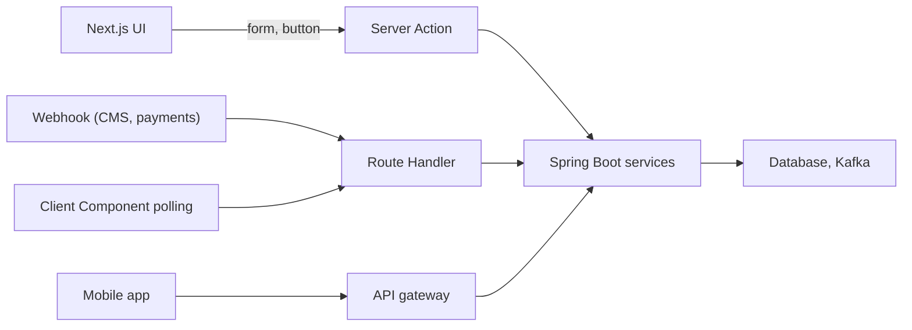

**Example (webhook that refreshes the cache):**

```ts
// app/api/webhooks/cms/route.ts
import { revalidateTag } from "next/cache";
import { createHmac, timingSafeEqual } from "node:crypto";

export async function POST(request: Request) {
  const body = await request.text();                         // raw body for signature
  const sig = request.headers.get("x-signature") ?? "";
  const expected = createHmac("sha256", process.env.CMS_WEBHOOK_SECRET!)
    .update(body).digest("hex");
  const ok = sig.length === expected.length &&
    timingSafeEqual(Buffer.from(sig), Buffer.from(expected)); // constant-time compare
  if (!ok) return new Response("Bad signature", { status: 401 });

  const { slug } = JSON.parse(body) as { slug: string };
  revalidateTag(`page-${slug}`, "max");                      // stale-while-revalidate
  return Response.json({ revalidated: true });
}
```

```ts
// app/api/orders/[id]/route.ts - typed params
export async function GET(_req: Request, ctx: RouteContext<"/api/orders/[id]">) {
  const { id } = await ctx.params;
  const session = await verifySession();                     // Route Handlers are public too
  const order = await getOrderForUser(id, session.userId);
  return order ? Response.json(order) : new Response(null, { status: 404 });
}
```

**Good and bad:**

| Good | Bad |
|---|---|
| Actions for UI writes, handlers for outside callers | A Route Handler for every form, plus `fetch` from the client |
| Spring Boot owns business rules | Copying discount logic into Route Handlers |
| Verify signatures on webhooks | Trusting any POST to `/api/webhooks` |
| Call data functions directly from Server Components | Server Component calls its own `/api/...` over HTTP |

**Say this in the interview:**

> "Server Actions are for my own UI: forms and buttons, with the new UI in the same response. Route Handlers are real HTTP endpoints: webhooks, polling from Client Components, file downloads, or a small public API. Business logic stays in Spring Boot behind both. I never call my own Route Handler from a Server Component, I call the data function directly."

**They may ask next:**

- **Do I still need a separate backend?** For a small app, Next.js plus a database may be enough. With several clients, complex rules or a Java team, keep a separate backend.
- **How do you protect a Route Handler?** Same as an action: check the session or an API key inside, rate-limit, validate input.

---

## proxy.ts (formerly middleware)

**In one line:** `proxy.ts` is one file at the project root that runs before every matched request, to redirect, rewrite, or set headers and cookies; in Next.js 16 it replaced `middleware.ts` and runs on Node.js.

**Story:** The security guard at the gate of an office park. He looks at your badge (cookie) and sends you to the right building, or to the reception desk. He does not open your bag or check your bank balance. Each office still checks you at its own door.

**How it works:**

1. Create `proxy.ts` next to `app/` (or inside `src/`). Export a function named `proxy` (or a default export) and an optional `config.matcher`.
2. It runs **before** routes render, for every path the matcher allows.
3. It can return `NextResponse.next()`, `redirect()`, `rewrite()`, a direct `Response`, and set request or response headers and cookies.
4. **Runtime:** Node.js by default. You cannot set `runtime` in `proxy.ts`. The old `middleware.ts` still works for the Edge runtime but is deprecated.
5. **Order:** `headers` and `redirects` from `next.config` run first, then proxy, then rewrites, then file-system routes.
6. **Limits:** not for slow data fetching or database calls. `"use cache"` and `"use server"` do nothing in it. `fetch` caching options do nothing in it.
7. **Server Actions** are POSTs to the page route. If the matcher skips a path, the actions on that path skip proxy too.
8. Rename with the codemod: `npx @next/codemod@canary middleware-to-proxy .`

**Good uses:** optimistic login redirect (only read the cookie), locale redirect (`/` to `/en`), A/B test rewrite with a sticky cookie, CSP nonce header, blocking bad bots, routing paths to other zones.

**Diagram (where proxy sits):**

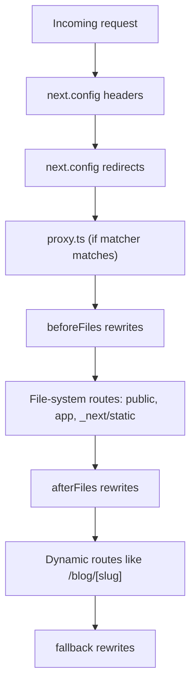

**Example (login redirect + A/B rewrite):**

```ts
// proxy.ts
import { NextResponse, type NextRequest } from "next/server";

export function proxy(request: NextRequest) {
  const { pathname } = request.nextUrl;

  if (pathname.startsWith("/account") && !request.cookies.has("session")) {
    const login = new URL("/login", request.url);
    login.searchParams.set("next", pathname);
    return NextResponse.redirect(login);              // optimistic check only
  }

  if (pathname === "/pricing") {
    const bucket = request.cookies.get("ab-pricing")?.value ?? (Math.random() < 0.5 ? "a" : "b");
    const res = NextResponse.rewrite(new URL(`/pricing/${bucket}`, request.url));
    res.cookies.set("ab-pricing", bucket, { maxAge: 60 * 60 * 24 * 30 }); // sticky bucket
    return res;
  }
  return NextResponse.next();
}

export const config = {
  matcher: ["/((?!_next/static|_next/image|favicon.ico|robots.txt|sitemap.xml).*)"],
};
```

**Good and bad:**

| Good | Bad |
|---|---|
| Read a cookie, redirect fast | Call the database or a slow API on every request |
| Exclude `_next/static` and images in the matcher | No matcher, so CSS and images also go through auth logic |
| Check auth again in the page, action and Spring | Treat proxy as the only security check |
| Simple fixed redirects in `next.config` `redirects` | Hundreds of `if` rules in proxy |

**Say this in the interview:**

> "proxy.ts runs before the route, for redirects, rewrites and headers. In Next.js 16 it replaced middleware and runs on Node.js. I use it for optimistic checks like 'no session cookie, go to login', locale redirects and A/B rewrites. It should be fast, so no database calls. It is never my only security layer. CVE-2025-29927 showed why: a header trick let attackers skip middleware completely, and apps that checked auth only there were open."

**They may ask next:**

- **Why the rename?** "Middleware" made people think of Express middleware and overuse it. "Proxy" says it is a network boundary in front of the app. Next.js wants it used as a last resort.
- **How do I test it?** `next/experimental/testing/server` has helpers such as `unstable_doesMiddlewareMatch`, `isRewrite` and `getRewrittenUrl`.

---

## Authentication and the BFF pattern

**In one line:** Keep tokens on the server: Next.js does the login with the identity provider, gives the browser only an `httpOnly` session cookie, and calls Spring Boot with the access token; then check the user at three layers (proxy, data layer, Spring Security).

**Story:** A hotel key card. The hotel (Next.js) keeps your passport in the safe (tokens on the server). You only carry a key card (session cookie). The card opens your room, but if you lose it, nobody gets your passport. The lift checks the card (proxy), the room door checks it (data layer), and the safe has its own lock (Spring Security).

**How it works:**

1. **Choose who does login:**
   - A library: **Auth.js** (formerly NextAuth.js), Better Auth, or a hosted provider (Auth0, Clerk, WorkOS, Supabase and others).
   - Or an OIDC provider your company already has: **Keycloak** or **Spring Authorization Server**. Next.js is the OIDC client.
   - Small apps can manage their own session cookie with `iron-session` or `jose`.
2. **BFF login (OIDC authorization code flow with PKCE):** Next.js redirects to the provider. The provider redirects back with a `code`. Next.js swaps the code for tokens **on the server** using its client secret.
3. **Store tokens server-side:** in an encrypted cookie (only if small, cookies max out around 4 KB) or in a session store like Redis, keyed by a random session id.
4. **Session cookie:** `httpOnly` (JavaScript cannot read it), `Secure` (HTTPS only), `SameSite=Lax` (not sent on most cross-site requests), short `Max-Age`.
5. **Calling Spring:** the data layer reads the session, refreshes the access token if it is about to expire, and sends `Authorization: Bearer <token>`. Spring Boot is an OAuth2 **resource server** and checks the JWT.
6. **Three layers of checks:**
   - `proxy.ts`: optimistic. "No cookie? Go to login." No database call.
   - Data Access Layer (DAL): `verifySession()` in pages, Server Actions and Route Handlers.
   - Spring Security: the real permission check (`@PreAuthorize`, ownership in the query).
7. **Layouts are not a security gate.** They don't re-render on every navigation, and nested pages and actions still run. Check close to the data.

**Diagram (login and an API call through the BFF):**

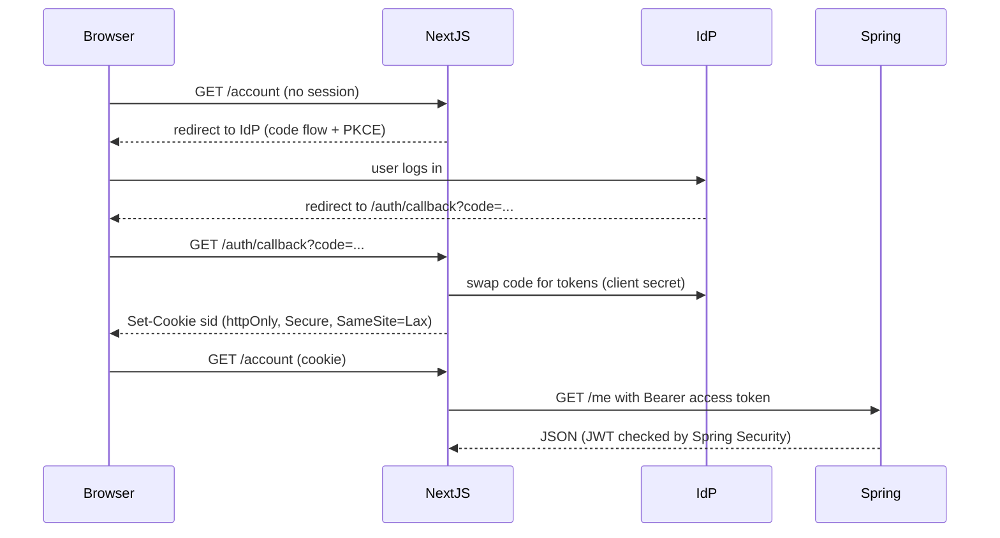

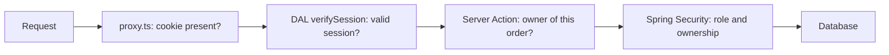

**Example (Data Access Layer):**

```ts
// lib/dal.ts
import "server-only";
import { cache } from "react";
import { cookies } from "next/headers";
import { redirect } from "next/navigation";
import { readSession, refreshTokens } from "./session-store";   // Redis, keyed by sid

export const verifySession = cache(async () => {
  const sid = (await cookies()).get("sid")?.value;
  const session = sid ? await readSession(sid) : null;  // { userId, roles, accessToken, expiresAt }
  if (!session) redirect("/login");
  if (session.expiresAt - Date.now() < 30_000) {
    return refreshTokens(sid!, session);   // refresh on the server, store new tokens in Redis
  }
  return session;
});

export async function requireRole(role: string) {
  const session = await verifySession();
  if (!session.roles.includes(role)) throw new Error("Forbidden");
  return session;
}
```

- `cache()` makes `verifySession()` run once per render, even if 5 components call it.
- In Server Actions and Route Handlers, `cache()` does nothing, so it runs each time. That is fine.
- Tokens are refreshed in Redis, not in the cookie, because Server Components cannot set cookies.

**Good and bad:**

| Good | Bad |
|---|---|
| Access and refresh tokens stay on the server | Access token in `localStorage` (any XSS can steal it) |
| `httpOnly; Secure; SameSite=Lax` session cookie | Readable cookie with the JWT inside |
| `verifySession()` in every page, action and handler | Auth check only in `layout.tsx` or only in proxy |
| Spring checks the JWT and ownership again | Spring trusts any request from the Next.js network |
| Small session payload (user id, roles) | Email, phone and address inside the cookie |

**Say this in the interview:**

> "I use Next.js as a BFF. Next.js does the OIDC code flow as a confidential client, keeps the tokens on the server, for example in Redis, and the browser only gets an httpOnly, Secure, SameSite session cookie. Server Components and actions call Spring Boot with the bearer token, and Spring is a resource server that checks the JWT. I check auth at three layers: proxy for a fast redirect, a data access layer with verifySession, and Spring Security for real permissions. Layouts are never my security gate."

**They may ask next:**

- **Why not keep the JWT in `localStorage`?** Any XSS can read it. An `httpOnly` cookie cannot be read by scripts. See [Storing tokens](frontend-ui.md#storing-tokens-httponly-cookie-vs-localstorage).
- **How does Spring validate the token?** As an OAuth2 resource server with the provider's JWKS (public keys). See [JWT and OAuth2 resource server](spring-ecosystem.md#jwt-and-oauth2-resource-server).
- **What about CSRF with cookies?** `SameSite=Lax` plus the Server Action Origin check covers most cases. Route Handlers that change data should check `Origin` too, or use a CSRF token. See [CORS and CSRF](spring-ecosystem.md#cors-and-csrf).

---

## Calling a Spring Boot backend

**In one line:** Call Spring Boot only from server code through one `server-only` client that adds the token, a timeout and tracing, maps errors to `notFound()`, `redirect()` or `error.tsx`, and uses types generated from Spring's OpenAPI spec.

**Story:** A company has one courier desk for all outgoing letters. Every letter gets the right stamp (token), a "return if not delivered in 3 days" note (timeout) and a tracking number (trace id). People don't post letters on their own.

**How it works:**

1. **Where to fetch:** Server Components (reads), Server Actions (writes), Route Handlers (outside callers). Not from the browser. Internal URLs stay in server env vars like `SPRING_API_URL`.
2. **One client module** in `lib/spring.ts` with `import "server-only"`.
3. **Headers to send:** `Authorization: Bearer`, `Accept-Language`, a request id. With OpenTelemetry set up, outgoing `fetch` can carry the W3C `traceparent` header, so one trace goes from the browser to the database.
4. **Headers not to forward:** don't copy all incoming headers. `Host`, `Cookie` and `Content-Length` from the browser are wrong for Spring.
5. **Timeouts:** `fetch` has no short default timeout. Use `AbortSignal.timeout(3000)`. Retry only safe `GET` calls, with backoff. See [Timeouts](microservices.md#timeouts) and [Retry with backoff](microservices.md#retry-with-exponential-backoff-and-jitter).
6. **Error mapping:** 401 → `redirect("/login")`. 404 → `notFound()`. 400/422 → return field errors to the form. 5xx → throw, so `error.tsx` shows and `onRequestError` logs it. Spring's `ProblemDetail` JSON gives a clean message.
7. **Typed client:** Spring exposes `/v3/api-docs` with springdoc. Generate TypeScript types with `openapi-typescript` (plus `openapi-fetch`) or `orval`. Run it in CI so a backend change breaks the frontend build, not production.
8. **Caching:** wrap stable reads (catalog, config) in `"use cache"` with tags. When Spring changes data, it can call a Next.js revalidate endpoint (or a Kafka consumer does it).

**Diagram:**

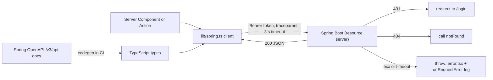

**Example (the one client):**

```ts
// lib/spring.ts
import "server-only";
import { notFound, redirect } from "next/navigation";

type Opts = { method?: string; token?: string; body?: unknown; timeoutMs?: number };

export async function springFetch(path: string, opts: Opts = {}): Promise<Response> {
  return fetch(`${process.env.SPRING_API_URL}${path}`, {
    method: opts.method ?? "GET",
    headers: {
      "Content-Type": "application/json",
      ...(opts.token ? { Authorization: `Bearer ${opts.token}` } : {}),
    },
    body: opts.body === undefined ? undefined : JSON.stringify(opts.body),
    signal: AbortSignal.timeout(opts.timeoutMs ?? 3000),     // never wait forever
  });
}

export async function getJson<T>(path: string, token?: string): Promise<T> {
  const res = await springFetch(path, { token });
  if (res.status === 401) redirect("/login");
  if (res.status === 404) notFound();
  if (!res.ok) throw new Error(`Spring GET ${path} failed: ${res.status}`); // error.tsx
  return (await res.json()) as T;
}
```

**Typed client in one line:** `npx openapi-typescript http://localhost:8080/v3/api-docs -o lib/spring-api.d.ts`, then `createClient<paths>()` from `openapi-fetch` gives `spring.GET("/orders/{id}", ...)` with path, params and response typed from the Java DTOs.

**Good and bad:**

| Good | Bad |
|---|---|
| One `server-only` client with timeout and auth | `fetch` calls with copy-pasted headers in 40 files |
| Types generated from OpenAPI in CI | Hand-written TypeScript types that drift from Java DTOs |
| Map 404 to `notFound()`, 5xx to `error.tsx` | Show a blank page when Spring returns 500 |
| Next.js and Spring in the same region and network | Next.js in one cloud region, Spring in another (100 ms per call) |
| `Promise.all` for independent backend calls | 6 sequential calls to 6 services per page |

**Say this in the interview:**

> "Only server code calls Spring Boot, through one server-only client. It adds the bearer token and a timeout, and with OpenTelemetry the trace header goes along too. Errors are mapped: 401 redirects to login, 404 calls notFound, 5xx throws to the error boundary and gets logged. Types come from Spring's OpenAPI spec, generated in CI, so a contract change breaks the build and not production."

**They may ask next:**

- **Why not let the browser call Spring directly?** Then you need CORS, the token must live in the browser, and internal URLs are public. The BFF keeps all three on the server.
- **What if Spring is slow?** Put that part in `<Suspense>` so the rest of the page streams. Add a timeout and a fallback. Consider a circuit breaker in the calling layer. See [Circuit breaker](microservices.md#circuit-breaker).

---

## Performance and Core Web Vitals

**In one line:** Next.js gives tools for each Core Web Vital: `next/image` and streaming for LCP, less client JavaScript and the React Compiler for INP, `next/font` and image sizes for CLS.

**Story:** A shop opening in the morning. Customers judge three things: how fast the shutter opens (LCP), how fast the shopkeeper answers a question (INP), and whether shelves fall over while they look (CLS).

**How it works:**

Core Web Vitals (good at the 75th percentile of real users):

| Metric | Means | Good | Next.js tools |
|---|---|---|---|
| LCP (Largest Contentful Paint) | Main content visible | ≤ 2.5 s | Static shell from CDN, streaming, `next/image` with `fetchPriority="high"` on the hero |
| INP (Interaction to Next Paint) | Reaction to a click or key | ≤ 200 ms | Less client JS, Server Components, `useTransition`, React Compiler |
| CLS (Cumulative Layout Shift) | Things jumping around | ≤ 0.1 | `next/font`, `width`/`height` or `fill` + `sizes` on images, fixed space for ads |

Tools in Next.js:

- **`next/image`:** resizes, serves AVIF/WebP, lazy-loads by default. Remote images need `images.remotePatterns`. In Next.js 16 the `priority` prop is deprecated: use `loading="eager"` or `fetchPriority="high"` on the LCP image (or the new `preload` prop).
- **`next/font`:** downloads Google or local fonts at build time and self-hosts them. No layout shift, no request to Google from the browser.
- **`next/script`:** `strategy="afterInteractive"` (default) or `"lazyOnload"` for chat widgets and analytics.
- **Dynamic import:** `next/dynamic` or `React.lazy` for heavy Client Components (charts, editors). `ssr: false` is allowed only inside Client Components.
- **Bundle analyzer:** `npx next analyze` (Turbopack). It came in 16.1 as `next experimental-analyze`. `@next/bundle-analyzer` for webpack builds.
- **`optimizePackageImports`:** loads only the icons or helpers you use from big libraries.
- **React Compiler:** `reactCompiler: true`. Stable support since Next.js 16, off by default. It adds memoization for you. It also makes builds slower. An experimental Rust version exists (`experimental.turbopackRustReactCompiler`).
- **Streaming:** push slow, dynamic reads into small components inside `<Suspense>`.
- **Prefetching:** `<Link>` prefetches routes in the viewport. With Partial Prefetching (16.3+), it fetches one reusable shell per route. `<Link prefetch>` fetches more.

**Avoid client waterfalls:** a Client Component that fetches in `useEffect`, then renders a child that fetches again, is a waterfall in the browser. Move the first fetch to the server, or pass a promise from the server.

**Diagram:**

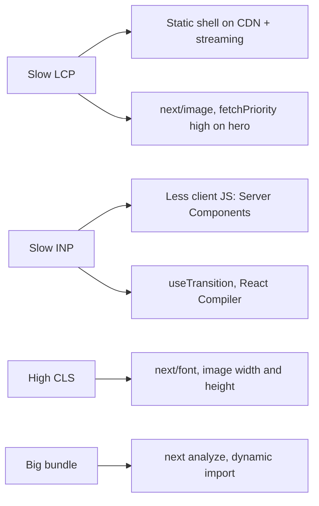

**Example:**

```tsx
// Hero image (LCP) and a heavy chart loaded only when needed
import Image from "next/image";
<Image src={p.imageUrl} alt={p.name} width={800} height={800}
  sizes="(max-width: 768px) 100vw, 50vw" fetchPriority="high" />   // tells the browser: load first

// app/dashboard/chart-loader.tsx
"use client";
import dynamic from "next/dynamic";
export const Chart = dynamic(() => import("./chart"), {
  ssr: false,                                       // chart needs window
  loading: () => <div style={{ height: 320 }} />,   // reserve space: no CLS
});
```

**Good and bad:**

| Good | Bad |
|---|---|
| Measure with real-user data (RUM) and Lighthouse | Optimize by guessing |
| Keep heavy libraries (markdown, syntax highlight) in Server Components | Ship a 200 KB markdown parser to render static text |
| One `fetchPriority="high"` image per page | Mark 10 images as high priority |
| Set a performance budget in CI (JS per route) | Notice bundle growth only after users complain |

**Say this in the interview:**

> "I measure Core Web Vitals from real users first. For LCP: a static shell from the CDN, streaming for slow parts, and next/image with high fetch priority on the hero. For INP: less client JavaScript by keeping components on the server, transitions for heavy updates, and the React Compiler. For CLS: next/font and fixed image sizes. I check bundles with next analyze and lazy-load heavy client widgets."

**They may ask next:**

- **The page is fast in Lighthouse but slow for users. Why?** Lab data uses one device. Real users have slow phones and networks. Look at field data (CrUX, RUM). See [Web performance and Core Web Vitals](frontend-ui.md#web-performance-and-core-web-vitals).
- **Does the React Compiler replace `useMemo`?** Mostly, for new code. Measure the build time cost first.
- **How do you find what makes the bundle big?** `npx next analyze`, then follow the import chain to the file that pulls the library in.

---

## SEO with the Metadata API

**In one line:** Export `metadata` or `generateMetadata` from a page or layout for titles and tags, and add `sitemap.ts`, `robots.ts`, `opengraph-image.tsx` and JSON-LD so search engines and social apps understand the page.

**Story:** A book in a library. The title on the spine (title tag), the summary on the back cover (description), the library catalog card (sitemap), the "staff only" sign (robots), and the cover photo used in ads (Open Graph image).

**How it works:**

1. **Static metadata:** `export const metadata: Metadata = { title, description }` in a layout or page.
2. **Dynamic metadata:** `export async function generateMetadata({ params })`. Use the same cached data function as the page, so the data is fetched once.
3. **Title template:** in the root layout, `title: { template: "%s | MyShop", default: "MyShop" }`.
4. **Canonical URL:** `alternates: { canonical: "/products/42" }`. Stops duplicate pages (with tracking params) from competing.
5. **Files that become routes:** `app/sitemap.ts`, `app/robots.ts`, `opengraph-image.tsx`, `icon.tsx`. They are static by default.
6. **Big sitemaps:** one file holds up to 50,000 URLs. Use `generateSitemaps` to split.
7. **Structured data (JSON-LD):** a `<script type="application/ld+json">` tag in the page with Product, Article or Breadcrumb data.
8. **Streaming metadata:** metadata can stream after the shell for users. For known bots, Next.js renders it in the `<head>` before the body.
9. **Server rendering** is the base of SEO. Content that only appears after client JavaScript may be indexed late.

**Diagram:**

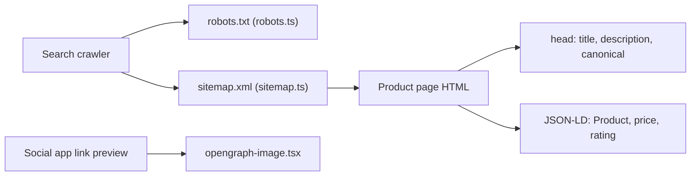

**Example:**

```tsx
// app/products/[id]/page.tsx
import type { Metadata } from "next";

export async function generateMetadata({ params }: PageProps<"/products/[id]">): Promise<Metadata> {
  const { id } = await params;
  const p = await getProduct(id);                     // "use cache": no second backend call
  return {
    title: p.name,                                    // root template adds "| MyShop"
    description: p.summary,
    alternates: { canonical: `/products/${id}` },
    openGraph: { title: p.name, images: [p.imageUrl] },
  };
}

function ProductJsonLd({ p }: { p: Product }) {
  const data = { "@context": "https://schema.org", "@type": "Product", name: p.name,
    offers: { "@type": "Offer", price: p.price, priceCurrency: "EUR" } };
  return (
    <script type="application/ld+json"
      dangerouslySetInnerHTML={{ __html: JSON.stringify(data).replace(/</g, "\\u003c") }} />  // stop script injection
  );
}
```

```ts
// app/sitemap.ts
import type { MetadataRoute } from "next";

export default async function sitemap(): Promise<MetadataRoute.Sitemap> {
  const products = await getAllProductSummaries();     // [{ id, updatedAt }]
  return products.map((p) => ({
    url: `https://shop.example.com/products/${p.id}`,
    lastModified: p.updatedAt,
  }));
}
```

**Good and bad:**

| Good | Bad |
|---|---|
| Unique title and description per page | Same title on 10,000 product pages |
| Canonical URL on pages with filters and tracking params | Each `?sort=` variant indexed as a new page |
| Product content in server HTML | Price and name loaded only by client JS |
| Escape `<` in JSON-LD | Raw user text inside `dangerouslySetInnerHTML` |

**Say this in the interview:**

> "I use the Metadata API: a title template in the root layout and generateMetadata on dynamic pages, reading the same cached data as the page. I add canonical URLs, sitemap.ts, robots.ts, an Open Graph image route and JSON-LD for products. The key point is server-rendered content, so crawlers see the real page in the HTML."

**They may ask next:**

- **Does `generateMetadata` slow the page?** It runs on the server. For users, metadata can stream. Share the data call with the page so it is not fetched twice.
- **How do you handle 1 million products in the sitemap?** `generateSitemaps` to split into files of up to 50,000 URLs, plus a sitemap index.

---

## Error handling and loading UI

**In one line:** Return expected errors as values, let unexpected ones throw to the nearest `error.tsx` boundary, call `notFound()` for missing data and `redirect()` for moves, and use `loading.tsx` or `<Suspense>` for waiting states.

**Story:** A train journey. A late train is expected: the board shows "delayed 10 minutes" (loading UI, expected error message). A broken bridge is unexpected: the train stops at the last safe station (error boundary), not in the middle of the river (white screen).

**How it works:**

| Situation | Tool |
|---|---|
| Form validation failed, API said 409 | Return `{ error }` from the action, show it with `useActionState` |
| Data does not exist | `notFound()` → nearest `not-found.tsx`, 404 status |
| User must go elsewhere | `redirect("/login")` (307) or `permanentRedirect()` (308) |
| Bug or backend 500 during render | Throw → nearest `error.tsx` |
| Error in the root layout | `global-error.tsx` (needs its own `<html>` and `<body>`) |
| Error boundary around one widget | `catchError()` from `next/error` (Next.js 16.3+) |
| Waiting for data | `loading.tsx` for the segment, `<Suspense>` for one part |
| Not logged in / not allowed | `unauthorized()` / `forbidden()` (experimental `authInterrupts` flag) |

- `error.tsx` must be a Client Component. It gets `error` and `retry`. `retry()` re-fetches and re-renders the segment, including Server Components. It became stable in 16.3. The older `reset()` only clears the error state on the client.
- In production, errors from Server Components reach the browser with a generic message and a `digest` (a hash). Match the digest with server logs. Secrets in error messages don't leak.
- Error boundaries don't catch errors in event handlers. Catch those yourself and set state.
- `redirect()` and `notFound()` work by throwing. Don't wrap them in a `try/catch` that swallows them.

**Diagram (where an error goes):**

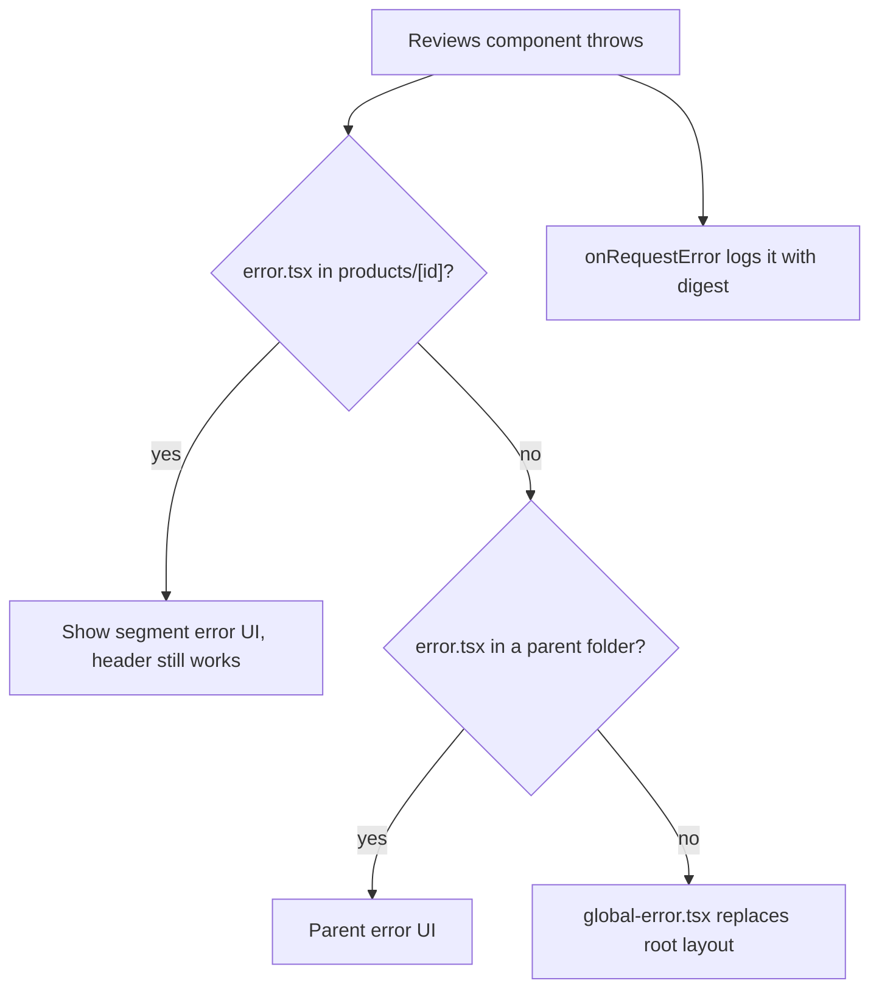

**Example:**

```tsx
// app/products/[id]/error.tsx
"use client";
import { useEffect } from "react";

export default function ProductError({ error, retry }: { error: unknown; retry: () => void }) {
  useEffect(() => {
    const digest = error instanceof Error && "digest" in error ? error.digest : undefined;
    console.error("product page error", digest);       // report to Sentry etc.
  }, [error]);

  return (
    <div role="alert">
      <h2>We could not load this product.</h2>
      <button onClick={() => retry()}>Try again</button>  {/* re-fetches server data */}
    </div>
  );
}
```

**Good and bad:**

| Good | Bad |
|---|---|
| `error.tsx` per important segment, so the shell survives | Only `global-error.tsx`, so any error kills the page |
| Expected errors as return values | `throw new Error("Email taken")` from a form action |
| Log the digest on the server, show a friendly message | Show stack traces to users |
| Skeleton in `loading.tsx` with the same size as the content | Spinner that causes layout shift when content arrives |

**Say this in the interview:**

> "Expected errors, like validation, are return values that the form shows. Unexpected errors throw to the nearest error.tsx, so only that segment shows an error and the layout keeps working. Missing data calls notFound for a real 404. In production the browser gets only a digest, which I match with server logs from onRequestError. Since 16.3, the retry prop re-fetches the server data, not only the client state."

**They may ask next:**

- **Why must `error.tsx` be a Client Component?** React error boundaries need client state to switch to the fallback and to retry.
- **How do you return a 404 status from a dynamic page?** Call `notFound()` during render. Next.js sets the status.

---

## State management in the App Router era

**In one line:** Most "global state" disappears: server data lives in Server Components and the cache, filters and tabs live in the URL, and only real UI state (open menus, drafts) stays in client state.

**Story:** A family kitchen. Groceries are in the store room (server state). The shopping list is on the fridge door where everyone can see it (URL state). What you are chopping right now is on your own board (client state). You don't copy the whole store room onto your chopping board.

**How it works:**

| Kind | Example | Where it lives |
|---|---|---|
| Server state | Products, orders, user profile | Server Components + `"use cache"`; TanStack Query for live client data |
| URL state | Search text, filters, sort, page, selected tab | `searchParams` on the server, `useSearchParams` + `router.replace` on the client (or the `nuqs` library) |
| Form state | Errors, pending | `useActionState`, `useFormStatus` |
| Client UI state | Modal open, accordion, draft text | `useState`, small context, or Zustand for cross-tree UI |
| Session state | Who is logged in | Cookie + DAL on the server, passed to client parts as props |

- **Trap:** a store created at module level on the server is shared by all requests. User A could see user B's data. Create stores per request inside a provider.
- Client Components that call `useSearchParams` need a `<Suspense>` parent, or the page falls back to client rendering up to the nearest boundary.
- More detail: [State management: which state goes where](react.md#state-management-which-state-goes-where).

**Diagram:**

```mermaid
flowchart LR
    S["Server state: Spring data"] --> SC["Server Components + use cache"]
    U["URL state: ?sort=price&page=2"] --> SC
    U --> CC["Client Components"]
    SC -->|"props"| CC
    CC --> L["Local UI state: useState, Zustand"]
    CC -->|"Server Action"| S
```

**Example (sort kept in the URL):**

```tsx
"use client";
import { usePathname, useRouter, useSearchParams } from "next/navigation";

export function SortSelect() {
  const router = useRouter();
  const pathname = usePathname();
  const params = useSearchParams();

  return (
    <select
      defaultValue={params.get("sort") ?? "popular"}
      onChange={(e) => {
        const next = new URLSearchParams(params);
        next.set("sort", e.target.value);
        router.replace(`${pathname}?${next}`, { scroll: false });  // URL is the state
      }}
    >
      <option value="popular">Popular</option>
      <option value="price">Price</option>
    </select>
  );
}
```

The page reads `searchParams`, fetches sorted data on the server, and the link can be shared.

**Good and bad:**

| Good | Bad |
|---|---|
| Filters in the URL (shareable, back button works) | Filters in Redux, lost on refresh |
| Server data fetched where it is shown | Copy server data into a global store "just in case" |
| Per-request store in a provider | Module-level store on the server (data leak between users) |

**Say this in the interview:**

> "In the App Router I split state by kind. Server data comes from Server Components and the cache, and I refresh it with revalidation, not a client store. Filters, sort and pagination live in the URL, so links are shareable. Only real UI state, like an open modal, stays in useState or a small Zustand store. I never create a global store at module level on the server, because it is shared between users."

**They may ask next:**

- **Do we still need Redux?** Rarely. Maybe for a complex client-only editor. Not for server data.
- **How does a Client Component get the current user?** A Server Component reads it with the DAL and passes the safe fields as props or through a context provider.

---

## Internationalization (i18n)

**In one line:** In the App Router, put the language in the URL (`app/[lang]/...`), let `proxy.ts` redirect `/` to the best language, load dictionaries on the server, and add `hreflang` links.

**Story:** An airport sign board. The same board shows English, Hindi and German. The airport decides which language to show first from your boarding pass (cookie or browser setting), but you can switch.

**How it works:**

1. Folder `app/[lang]/layout.tsx` and pages below it. `generateStaticParams` returns `[{ lang: "en" }, { lang: "de" }]` so each language can be prerendered.
2. `proxy.ts` reads a `locale` cookie or the `Accept-Language` header and redirects `/products` to `/de/products`.
3. Dictionaries (JSON) are loaded in Server Components with `server-only`. No translation files are sent to the browser for server parts.
4. Since 16.3, `import { lang } from "next/root-params"` reads the `[lang]` root param in any Server Component, without passing props down.
5. `alternates.languages` in metadata adds `hreflang` links for SEO.
6. Format dates, numbers and money with `Intl`. Libraries like `next-intl` add plurals and client support.

**Diagram:**

```mermaid
flowchart LR
    R["GET /products"] --> P["proxy.ts: cookie or Accept-Language"]
    P -->|"redirect"| D["/de/products"]
    D --> L["app/[lang]/layout.tsx"]
    L --> DI["Load de.json on the server"]
    DI --> PG["Page HTML in German + hreflang links"]
```

**Say this in the interview:**

> "I keep the language in the URL with an app/[lang] segment, so each language has its own indexable URL. Proxy redirects the root to the best language from a cookie or Accept-Language. Dictionaries load on the server, so no translation JSON goes to the browser for server parts. I add hreflang links and use Intl for numbers and dates."

**They may ask next:**

- **Is there built-in i18n routing in the App Router?** No, the Pages Router had an `i18n` config. In the App Router you build it with `[lang]` and proxy, or use a library.

---

## Deployment: Vercel vs self-hosting

**In one line:** Vercel runs every Next.js feature with no setup; self-hosting (`next start` in Docker or Kubernetes) also supports all features, but you must set up a shared cache, a stable encryption key, a deployment id, streaming-friendly proxies and a CDN yourself.

**Story:** A restaurant chain. A franchise (Vercel) gives you the kitchen, staff rules and delivery partner on day one. Running your own restaurant (self-hosting) is cheaper at scale and fully yours, but you hire the cleaner, the cashier and the delivery boys yourself.

**How it works:**

| Topic | Vercel or other platforms with an adapter | Self-hosted (Node server, Docker, Kubernetes) |
|---|---|---|
| Setup | Push to git | `output: "standalone"` build, Docker image, `node server.js` |
| CDN for the static shell | Built in | Put a CDN or nginx in front; it must respect `Cache-Control` |
| ISR and `"use cache"` | Shared, durable | Default is local disk / memory per pod. Add `cacheHandler` (ISR, previous model) and `cacheHandlers` (for `"use cache"`) backed by Redis |
| `revalidateTag` across pods | Handled | In your cache handler, `updateTags()` writes the tag time to Redis and `refreshTags()` reads it on each pod, or only one pod is cleared |
| Server Action keys | Handled | Same `NEXT_SERVER_ACTIONS_ENCRYPTION_KEY` on all pods |
| Version skew (old tab, new deploy) | Skew protection | Set `deploymentId`; Next.js does a hard reload on mismatch |
| Streaming | Works | nginx: send `X-Accel-Buffering: no`; load balancers must not buffer |
| Images | Optimized at the edge | `sharp` in the server, or a custom image loader to an image CDN |
| Graceful shutdown | Handled | Send `SIGTERM`, wait 10 to 30 s so requests and `after()` work finish |

- Next.js 16.2 added a stable **Adapter API**, so other platforms (for example through OpenNext) can support features in the same way.
- **Runtime:** use Node.js. The Edge runtime is deprecated in the current docs, and Cache Components does not allow the `runtime` export.
- **Env vars trap:** `NEXT_PUBLIC_*` values are **baked into the JavaScript at build time**. Changing them in Kubernetes does nothing until you rebuild. Server-only env vars can be read at request time (after `await connection()`), so one Docker image can move from staging to production.
- Use a **reverse proxy** (nginx, a cloud load balancer) in front of Next.js for TLS, slow-client attacks, body limits and rate limits.
- Docker and Kubernetes details: [Docker and Kubernetes](docker-kubernetes.md). Health checks and safe deploys: [Health checks](production-ready.md#health-checks-graceful-shutdown-and-kubernetes-basics), [Deploying safely](production-ready.md#deploying-safely).

**Diagram (self-hosted setup):**

```mermaid
flowchart LR
    U["Users"] --> CDN["CDN: static shell, _next/static"]
    CDN --> LB["nginx or load balancer (no buffering)"]
    LB --> P1["Next.js pod 1"]
    LB --> P2["Next.js pod 2"]
    P1 --> R["Redis: shared cache handler + tags"]
    P2 --> R
    P1 --> SB["Spring Boot services"]
    P2 --> SB
```

**Example:**

```dockerfile
# Dockerfile (multi-stage, standalone output)
FROM node:24-alpine AS build
WORKDIR /app
COPY package*.json ./
RUN npm ci
COPY . .
RUN npm run build                      # next.config: output: "standalone"

FROM node:24-alpine
WORKDIR /app
# HOSTNAME=0.0.0.0: listen on all interfaces, not the container hostname
ENV NODE_ENV=production PORT=3000 HOSTNAME=0.0.0.0
# small image: only the files the server needs
COPY --from=build /app/.next/standalone ./
COPY --from=build /app/.next/static ./.next/static
COPY --from=build /app/public ./public
USER node
CMD ["node", "server.js"]
```

```ts
// next.config.ts (self-hosted, many pods)
import type { NextConfig } from "next";

const nextConfig: NextConfig = {
  output: "standalone",
  cacheComponents: true,
  partialPrefetching: true,
  deploymentId: process.env.DEPLOYMENT_VERSION,          // version skew protection
  cacheHandlers: { remote: require.resolve("./cache/redis-handler.js") }, // for "use cache: remote"
  images: { remotePatterns: [new URL("https://img.example.com/**")] },
};
export default nextConfig;
```

**Good and bad:**

| Good | Bad |
|---|---|
| One image promoted through environments, secrets as server env vars | Rebuild per environment because of `NEXT_PUBLIC_API_URL` |
| Shared Redis cache handler for many pods | Each pod with its own cache, random stale pages |
| Rolling deploy + `deploymentId` + stable action key | "Failed to find Server Action" after every deploy |
| CDN caches only `Cache-Control: public` responses | CDN that ignores `private` and caches user pages |

**Say this in the interview:**

> "On Vercel everything works out of the box. Self-hosting with the standalone output in Docker also supports all features, but I add four things: a shared cache handler in Redis with tag sync so revalidation reaches every pod, the same Server Action encryption key on all pods, a deploymentId for version skew, and proxies that don't buffer, so streaming works. I remember that NEXT_PUBLIC variables are fixed at build time."

**They may ask next:**

- **Edge or Node runtime?** Node. Edge is deprecated now, and proxy runs on Node too.
- **Can I use a static export?** Yes, `output: "export"`, but then no Server Actions, proxy, ISR or request-time rendering.

---

## Observability

**In one line:** Use `instrumentation.ts` to start OpenTelemetry once per server and `onRequestError` to report every server error, add a browser error tracker and Web Vitals reporting, and connect traces to Spring Boot with `traceparent`.

**Story:** A delivery company. Each parcel gets one tracking number (trace id) that every hub scans. When a parcel is late, you look up the number and see which hub was slow. Without it, everyone blames the other hub.

**How it works:**

1. **`instrumentation.ts`** at the project root. `register()` runs once when a server starts. Start OpenTelemetry here, for example with `registerOTel("shop-web")` from `@vercel/otel` or the OpenTelemetry Node SDK.
2. Next.js creates spans for incoming requests, rendering, route handlers and `fetch`. Outgoing calls can carry `traceparent`, and Spring Boot (Micrometer Tracing) continues the same trace.
3. **`onRequestError(error, request, context)`** in the same file is called for errors in rendering, Route Handlers, Server Actions and proxy. `context.routeType` tells you which. Send it to your error tracker.
4. **Browser:** `instrumentation-client.ts` runs before the app starts in the browser. Use it for an error tracker (Sentry and others) and analytics. `useReportWebVitals` from `next/web-vitals` sends LCP, INP and CLS.
5. **Logs:** JSON logs with trace id, route and user id (not personal data). See [Logging done right](production-ready.md#logging-done-right).
6. **Alerts:** error rate per route, p95 server render time, Spring call latency, cache hit rate. See [Frontend monitoring](production-ready.md#frontend-monitoring) and [Distributed tracing with OpenTelemetry](production-ready.md#distributed-tracing-with-opentelemetry).

**Diagram:**

```mermaid
flowchart LR
    BR["Browser: instrumentation-client, Web Vitals"] --> ET["Error tracker / RUM"]
    BR -->|"request"| NX["Next.js: instrumentation.ts (OTel)"]
    NX -->|"traceparent header"| SB["Spring Boot: Micrometer Tracing"]
    NX --> COL["OTel Collector"]
    SB --> COL
    COL --> TR["Tracing backend (Tempo, Jaeger, APM)"]
    NX -->|"onRequestError"| ET
```

**Example:**

```ts
// instrumentation.ts
import { registerOTel } from "@vercel/otel";
import type { Instrumentation } from "next";

export function register() {
  registerOTel({ serviceName: "shop-web" });      // spans for render, fetch, actions
}

export const onRequestError: Instrumentation.onRequestError = async (err, request, context) => {
  const digest = typeof err === "object" && err !== null && "digest" in err ? String(err.digest) : undefined;
  await reportError({                              // your error tracker client
    message: err instanceof Error ? err.message : String(err),
    digest,                                        // same digest the user sees
    path: request.path,
    routeType: context.routeType,                  // render | route | action | proxy
  });
};
```

**Say this in the interview:**

> "I start OpenTelemetry in instrumentation.ts, so render, fetch and action spans go to the collector, and the traceparent header carries the trace into Spring Boot. onRequestError reports every server error with its digest, which is the same id the user's error page has. In the browser I add an error tracker in instrumentation-client and send Web Vitals from real users."

**They may ask next:**

- **How do you connect a user's error screen to server logs?** The `digest` shown in production matches the one in `onRequestError` logs.

---

## Testing Next.js apps

**In one line:** Unit-test pure logic and Client Components with Vitest or Jest, test Server Actions and the data layer as plain functions, and use Playwright end-to-end tests for async Server Components and full flows.

**Story:** Testing a car. You test the brake pads on a bench (unit test), the engine with the gearbox (integration test), and finally you drive the car on a road (end-to-end test).

**How it works:**

- **Unit (Vitest + React Testing Library):** Client Components and sync Server Components. Vitest does not support `async` Server Components yet. The Next.js docs suggest E2E tests for them.
- **Server Actions and DAL:** they are async functions. Call them directly, mock `next/headers` and the Spring client, and check auth and validation paths.
- **Contract:** types generated from Spring OpenAPI catch API drift at build time. Pact-style tests add more safety.
- **E2E (Playwright):** run against `next build && next start`, not `next dev`. Mock Spring with a stub server or use a test environment.
- **Instant navigation tests:** `instant()` from `@next/playwright` (16.3) checks what shows at once after a click.
- **Proxy:** `unstable_doesMiddlewareMatch` and friends in `next/experimental/testing/server`.
- More: [JavaScript testing](js-testing.md), [Testing a React app](react.md#testing-a-react-app).

**Diagram:**

```mermaid
flowchart TD
    E2E["Playwright E2E: login, checkout, async pages"] --> INT["Integration: Server Actions + DAL with mocked Spring"]
    INT --> UNIT["Unit: Client Components, utils, zod schemas"]
    UNIT --> TYPES["Type check: generated OpenAPI types"]
```

**Example (testing a Server Action):**

```ts
// app/posts/actions.test.ts
import { describe, it, expect, vi } from "vitest";

vi.mock("@/lib/dal", () => ({ verifySession: vi.fn(async () => ({ userId: "u1", accessToken: "t" })) }));
vi.mock("@/lib/spring", () => ({ springFetch: vi.fn(async () => new Response(null, { status: 201 })) }));
vi.mock("next/cache", () => ({ updateTag: vi.fn() }));

import { createPost } from "./actions";

describe("createPost", () => {
  it("rejects a short title", async () => {
    const fd = new FormData();
    fd.set("title", "Hi");
    expect(await createPost({}, fd)).toEqual({ error: "Title must be 3 to 120 characters" });
  });
});
```

**Say this in the interview:**

> "Client Components and utilities get Vitest unit tests. Server Actions are plain async functions, so I test them directly with mocked headers and a mocked Spring client, mainly the auth and validation paths. Async Server Components and full flows like checkout get Playwright tests against a production build."

---

## Security

**In one line:** The main Next.js risks are leaking server data or secrets into client code, unprotected Server Actions and Route Handlers, trusting proxy alone, unsafe cache keys, missing headers, and old versions with known CVEs.

**Story:** A house with a kitchen door to the garden. The front door has a good lock (proxy and login page). But if the kitchen door (a Server Action) is open, a thief walks in anyway. And if the house plan (old version) has a known weak window, thieves read about it online.

**How it works (checklist):**

1. **Server/client boundary leaks**
   - Secrets only in server env vars. Never `NEXT_PUBLIC_` for secrets.
   - `import "server-only"` in data and secret modules.
   - Pass DTOs, not DB rows, to Client Components. Props are visible in the page source.
   - React **taint APIs** (`experimental_taintObjectReference`, `experimental_taintUniqueValue`, flag `experimental.taint`) block chosen objects or tokens from being sent to the client. An extra net, not a replacement for DTOs.
2. **Server Actions and Route Handlers are public endpoints:** auth, ownership, zod validation, small return values, rate limits. See [Server Actions](#server-actions-server-functions).
3. **Don't trust proxy alone.** Check in the DAL and in Spring.
4. **Cache safety:** never cache per-user data under a shared key. Put tenant and user ids in the arguments.
5. **Headers:** Content Security Policy (with a nonce set in proxy, or hashes), `Strict-Transport-Security`, `X-Content-Type-Options: nosniff`, `Referrer-Policy`, `frame-ancestors`. See [CSP](frontend-ui.md#csp-content-security-policy).
6. **XSS:** React escapes text. Danger is `dangerouslySetInnerHTML`, `href={userUrl}` with `javascript:` links, and JSON-LD without escaping `<`.
7. **Images:** use strict `images.remotePatterns`. `images.domains` is deprecated.
8. **Dependencies:** Renovate or Dependabot, `npm audit` in CI, lockfile, and follow the Next.js monthly security releases.

**Recent CVEs and their lessons:**

| CVE | What happened | Lesson |
|---|---|---|
| CVE-2025-29927 (March 2025, Critical, CVSS 9.1) | Sending the internal `x-middleware-subrequest` header made Next.js skip middleware. Auth that lived only in middleware was bypassed. Fixed in 15.2.3, 14.2.25, 13.5.9, 12.3.5 | Defense in depth: check auth near the data too. Strip internal headers at the edge |
| CVE-2025-66478 / React CVE-2025-55182 "React2Shell" (December 2025) | Remote code execution through the React Server Components protocol, CVSS 10.0. App Router on 15.x and 16.x was affected | Patch the same day, then rotate secrets. RSC endpoints face the internet |
| November 2026 security release (16.4.5, 15.5.29) | Several `use cache` issues could serve one tenant's or user's cached data to another, plus header and image issues | Keep cache keys tenant-aware and stay on a patched line |

- Since July 2026, Next.js has a **scheduled security release, roughly once a month**, announced in advance on the blog (urgent fixes can still come out of band). Plan upgrades around it. 16.x is Active LTS (patched as 16.4.x), 15.x is Maintenance LTS (patched as 15.5.x).

**Diagram (defense in depth):**

```mermaid
flowchart LR
    A["Attacker"] --> E["CDN / WAF: strip internal headers, rate limit"]
    E --> PX["proxy.ts: optimistic check"]
    PX --> SA["Server Action: auth, zod, ownership"]
    SA --> DAL["DAL: server-only, DTOs, taint"]
    DAL --> SP["Spring Security: JWT, roles"]
    SP --> DB["Database"]
```

**Example (CSP nonce in proxy):**

```ts
// proxy.ts (part)
import { NextResponse, type NextRequest } from "next/server";

export function proxy(request: NextRequest) {
  const nonce = Buffer.from(crypto.randomUUID()).toString("base64");
  const csp = `default-src 'self'; script-src 'self' 'nonce-${nonce}' 'strict-dynamic'; ` +
    `object-src 'none'; base-uri 'self'; frame-ancestors 'none'`;
  const headers = new Headers(request.headers);
  headers.set("x-nonce", nonce);                                   // read it in layouts if needed
  headers.set("Content-Security-Policy", csp);
  const res = NextResponse.next({ request: { headers } });
  res.headers.set("Content-Security-Policy", csp);                 // header the browser enforces
  return res;
}
```

Note: a nonce-based CSP makes pages dynamic (a new nonce per request). For static pages, use hash-based CSP or a looser policy.

**Say this in the interview:**

> "I watch four places. The boundary: secrets in server env vars, server-only on data modules, DTOs to clients, taint as a safety net. The entry points: every Server Action and Route Handler checks auth, ownership and input. The cache: no per-user data under shared keys. And versions: CVE-2025-29927 bypassed middleware with one header, and React2Shell was remote code execution in the RSC protocol. So auth never lives only in proxy, and we patch on the monthly security release."

**They may ask next:**

- **How did teams protect themselves from CVE-2025-29927 before patching?** Strip the `x-middleware-subrequest` header at the load balancer or CDN.
- **Is `"use server"` code safe because it is on the server?** The code is. The endpoint is not. Anyone can call it.

---

## Large-scale Next.js architecture

**In one line:** For big teams, use a monorepo (Turborepo or Nx) with shared packages (design system, API client, config), strict module boundaries, and split into separate apps (multi-zones) only when teams or deploys really need it.

**Story:** A big housing society. Shared things (water tank, security) are built once for all buildings (shared packages). Each building has its own committee (team). If one building wants its own gate and timings, it becomes a separate wing with its own entrance (multi-zone), but residents still use one address (domain).

**How it works:**

- **Monorepo:** `apps/web`, `apps/admin`, `packages/ui` (design system), `packages/api-client` (generated from OpenAPI), `packages/config` (ESLint, tsconfig). Turborepo caches builds and tests, so CI runs only what changed.
- **Inside an app, group by feature:** `features/cart`, `features/checkout`, each with components, actions and data. `app/` stays thin: routes import from features.
- **Module boundaries:** lint rules stop `features/cart` from importing `features/checkout` internals, and stop client files from importing server-only modules.
- **Design system:** shared React components, tokens and Tailwind preset. Mostly Client Components that accept server-rendered children. See [Shared UI and design systems](react.md#shared-ui-and-design-systems).
- **Multi-zones (micro-frontends):** several Next.js apps behind one domain. Each app owns paths (`/blog`, `/shop`) and sets an `assetPrefix`. One app or a proxy routes with rewrites. Links across zones are full page loads, so use `<a>`, not `<Link>`. Add `serverActions.allowedOrigins`.
- **Ownership:** CODEOWNERS per feature folder, per-route performance budgets, feature flags.

**When NOT to use Next.js:**

- Internal tools behind login with no SEO need: a Vite SPA is simpler and needs no Node server.
- Highly interactive apps that run mostly in the browser (a design tool, a trading terminal): the server adds little.
- A team without Node operations skills that cannot run a server: a static site or SPA on a CDN is easier.
- When the backend team wants one API for web, mobile and partners: keep the API in Spring and use Next.js only as a thin UI layer, or not at all.

**Diagram:**

```mermaid
flowchart TD
    D["shop.example.com"] --> Z1["apps/web: /, /products, /cart"]
    D --> Z2["apps/blog: /blog (assetPrefix /blog-static)"]
    D --> Z3["apps/account: /account"]
    Z1 --> UI["packages/ui: design system"]
    Z2 --> UI
    Z3 --> UI
    Z1 --> AC["packages/api-client: OpenAPI types"]
    Z3 --> AC
```

**Say this in the interview:**

> "For a large team I use a Turborepo monorepo with shared packages for the design system, the generated API client and configs. Inside an app I group code by feature and enforce boundaries with lint rules. I split into multi-zones only when teams need separate deploys, because crossing zones is a full page load. And I say no to Next.js when there is no SEO or first-load need and no one can run a Node server."

**They may ask next:**

- **Monorepo vs separate repos?** Monorepo for shared code and atomic changes. Separate repos when teams and release cycles are fully independent.

---

## Migration: Pages to App Router, and 14 to 15 to 16

**In one line:** Move from `pages/` to `app/` one route at a time (both work together), and upgrade versions with the official codemods, fixing async request APIs in 15 and caching, proxy and Turbopack changes in 16.

**Story:** Renovating a house while living in it. You redo one room at a time. The family keeps using the other rooms. You never break all the water pipes on the same day.

**How it works (Pages to App Router):**

1. Upgrade to the latest version first. Add `app/layout.tsx` (root layout with `<html>` and `<body>`).
2. Move shared providers into a small `"use client"` `providers.tsx`.
3. Move low-risk pages first (about, blog). Then high-traffic pages behind a feature flag.
4. Replace `getServerSideProps` with `async` Server Components, `getStaticProps` with `"use cache"`, `getStaticPaths` with `generateStaticParams`, `next/head` with the Metadata API, `pages/api` with Route Handlers or Server Actions.
5. `useRouter` comes from `next/navigation` in the App Router (no `router.query`; use `useParams` and `useSearchParams`).
6. Remember: moving between the two routers is a hard navigation. Move routes that link to each other often together.

**What changed per version:**

| Version | Main changes |
|---|---|
| 14 (Oct 2023) | Server Actions stable. `fetch` cached by default (implicit caching) |
| 15 (Oct 2024) | React 19. `cookies()`, `headers()`, `params`, `searchParams` became async. `fetch` and `GET` handlers not cached by default. Client router no longer reuses page segments by default. `useFormState` replaced by `useActionState`. `instrumentation` stable with `onRequestError` |
| 15.5 (Aug 2025) | Node.js runtime for middleware stable. `next lint` deprecated. Typed route helpers |
| 16 (Oct 2025) | Turbopack default (`--webpack` to opt out). Cache Components (`"use cache"`), replacing `experimental.ppr` and `dynamicIO`. `middleware.ts` renamed to `proxy.ts` (Node runtime). `updateTag`, `refresh`, `revalidateTag(tag, profile)`. Sync request APIs removed. AMP and `next lint` removed. React Compiler support stable. Parallel slots need `default.tsx`. `next/image` `priority` deprecated, new defaults. Node.js 20.9+, TypeScript 5.1+ |
| 16.1 to 16.2 | Turbopack file cache for dev, bundle analyzer, stable Adapter API |
| 16.3 (Aug 2026) | Instant Navigations, Partial Prefetching, `catchError`, `retry` in `error.tsx`, root params, faster SSR with Node streams |
| 16.4 (Oct 2026) | Cache Components recommended for every app and on in new apps. `ensureStatic`, `navigation()` / `prefetch()`. React 19.3. `next upgrade --agent` |

**Diagram:**

```mermaid
stateDiagram-v2
    [*] --> V14
    V14 --> V15: codemod upgrade, await cookies and params
    V15 --> V16: Turbopack, proxy.ts, revalidateTag profile
    V16 --> CacheComponents: cacheComponents true, add Suspense or use cache
    CacheComponents --> [*]
```

**Example (upgrade commands):**

```bash
npx @next/codemod@canary upgrade latest           # bumps next, react, runs codemods
npx @next/codemod@canary middleware-to-proxy .    # middleware.ts -> proxy.ts
npx next@canary upgrade --agent=latest            # 16.4+: guided upgrade for a coding agent
```

**Say this in the interview:**

> "I migrate Pages to App Router route by route, since both routers run in one app. getServerSideProps becomes an async Server Component, getStaticProps becomes use cache, pages/api becomes Route Handlers or Server Actions. For versions I use the official codemods: 15 made request APIs async and stopped default fetch caching; 16 made Turbopack the default, renamed middleware to proxy and added Cache Components. Turning on Cache Components is its own step, because every uncached read needs Suspense or use cache."

**They may ask next:**

- **Biggest risk in the 15 upgrade?** Sync `cookies()` and `params` everywhere, and pages that relied on implicit `fetch` caching becoming slower.
- **Biggest risk in 16?** Custom webpack config (Turbopack is default), `revalidateTag` without a profile, missing `default.tsx` in parallel routes.

---

## Frontend system design: an e-commerce product page

**In one line:** Build the product page as a cached static shell (name, images, description, reviews summary) with small dynamic islands streamed in (price for this user, stock, recommendations) and a client-side cart, so it is fast, indexable and correct.

**Story:** A shop window. The mannequin and the poster (product info) stay the same all day. The price tag can change for members (dynamic price). The "only 3 left" sign is updated often (stock). The shopping basket is in your hand (client cart).

**How the interviewer asks it:** "Design the product detail page for a big online shop. 5 million products, 2,000 requests per second at peak, must rank on Google, cart must feel instant." They test rendering choices, caching, SEO and performance.

**Questions to ask (with assumed answers):**

| Question | Why it matters | What we assume |
|---|---|---|
| Prices per user or region? | Decides what can be cached | Region price cached, member discount per user |
| How fresh must stock be? | Cache life of stock | Within 30 seconds |
| How often does product info change? | Revalidation strategy | Few times a day, CMS/PIM sends events |
| Logged-in share of traffic? | Personalization cost | 30% |

**Rendering choice per section:**

| Section | Strategy | Why |
|---|---|---|
| Header, footer, breadcrumbs | Static shell | Same for all |
| Name, images, description, specs | `"use cache"` + `cacheLife("days")` + `cacheTag("product-42")` | SEO, rarely changes, refreshed by event |
| Reviews summary | `"use cache"` + `cacheLife("hours")` | Changes slowly |
| Price | Region price cached; member price streamed in `<Suspense>` | Correct per user |
| Stock badge | Dynamic in `<Suspense>`, short timeout, fallback "Check availability" | Fresh, must not block |
| Recommendations | Dynamic in `<Suspense>`, below the fold | Personal and slow |
| Add to cart, cart drawer | Client island + Server Action + `useOptimistic` | Instant feel |

**Numbers:** 2,000 RPS at peak. If the CDN serves 90% of shells, Next.js renders about 200 dynamic responses per second. At about 50 ms of server work each, that is roughly 10 CPU cores, so 6 to 10 pods with headroom. Each dynamic response makes 2 to 3 Spring calls, so Spring sees about 500 RPS.

**Diagram (architecture):**

```mermaid
flowchart LR
    U["Shopper"] --> CDN["CDN: static shell per product"]
    CDN --> NX["Next.js pods"]
    NX --> RC["Redis: use cache remote"]
    NX --> CAT["Catalog service (Spring)"]
    NX --> PR["Pricing service (Spring)"]
    NX --> ST["Inventory service (Spring)"]
    NX --> CART["Cart service (Spring)"]
    PIM["PIM / CMS change"] -->|"Kafka event"| RV["Revalidate consumer"]
    RV -->|"revalidateTag product-42"| NX
```

**Diagram (one page load):**

```mermaid
sequenceDiagram
    participant Shopper
    participant CDN
    participant NextJS
    participant Spring
    Shopper->>CDN: GET /products/42
    CDN-->>Shopper: static shell: name, images, specs, skeletons
    CDN->>NextJS: dynamic holes for this request
    NextJS->>Spring: price (member), stock, recommendations in parallel
    Spring-->>NextJS: price + stock fast, recommendations slower
    NextJS-->>Shopper: stream price and stock, then recommendations
    Shopper->>NextJS: Add to cart (Server Action)
    NextJS-->>Shopper: cart count (optimistic already shown)
```

**Deep dives:**

- **Cart:** a Client Component shows the count with `useOptimistic`. The Server Action calls the Cart service with the session token and returns the new cart. Anonymous carts use a cart id cookie.
- **SEO:** product info is in the shell HTML. `generateMetadata` and JSON-LD Product with price and availability. Canonical URL without tracking params. Sitemaps split with `generateSitemaps`.
- **Performance budget:** LCP ≤ 2.5 s on a mid-range phone, under 150 KB of client JS for the route, hero image with `fetchPriority="high"`, gallery zoom loaded with `dynamic()`.
- **Freshness:** PIM change → Kafka → consumer → `revalidateTag("product-42", "max")`. Price change for one product → same path. Admin edits use `updateTag` for read-your-own-writes.
- **Failure:** recommendations service down → its `<Suspense>` area shows nothing or a fallback via `catchError`; the page still sells. Inventory timeout (500 ms) → "Check availability at checkout".
- **Scale of ISR:** prerender the top 10,000 products with `generateStaticParams`. The rest get the App Shell on first visit and are upgraded in the background (ISR with Cache Components).

**What can go wrong:**

| Problem | Handling |
|---|---|
| Member price cached for everyone | Member price only in a dynamic part, never in shared `"use cache"` |
| Flash sale: 20x traffic | Shell from CDN, stock call with timeout, Spring autoscaling, rate limits |
| Stale price after change | Event-driven `revalidateTag`; checkout re-checks the price in Spring |
| Deploy during sale | `deploymentId`, rolling deploy, stable action key |

**Say this in the interview:**

> "I split the page by how fresh and how personal each part is. Product info, images and specs are in use cache with a long life and a product tag, so they are in the static shell on the CDN and indexable. Member price, stock and recommendations stream in Suspense, each with a timeout and fallback, so a slow service never blocks the page. The cart is a small client island using a Server Action with useOptimistic. Freshness is event-driven: a Kafka event calls revalidateTag for that product. Checkout always re-validates price and stock in Spring."

**Mid vs senior:** a mid-level answer says "use SSR". A senior answer chooses per section, gives numbers, plans cache invalidation, failure fallbacks, the performance budget and what stays in Spring.

More: [Frontend system design: how to answer](frontend-ui.md#frontend-system-design-how-to-answer), [CDN](system-design.md#cdn), [Caching](system-design.md#caching).

---

## Interview questions

1. **What is a Server Component?** A component that runs only on the server. It can be async, read data and secrets, and sends rendered output, not its code, to the browser. See [Server vs Client Components](#server-components-vs-client-components).
2. **What does `"use client"` really do?** It marks an entry point into the client bundle. That file and everything it imports run in the browser too. Push it down to small leaves.
3. **Can a Client Component render a Server Component?** Not by importing it. But it can receive one as `children` or another prop. See [composition](#composition-server-children-inside-a-client-wrapper).
4. **What props can cross from server to client?** Serializable ones: primitives, plain objects, arrays, Date, Map, Set, JSX, promises and Server Functions. Not normal functions or class instances.
5. **What is the RSC payload?** A compact description of the rendered server tree with placeholders for Client Components. Used for hydration and for client navigation without a full reload.
6. **App Router vs Pages Router?** App Router: Server Components, nested layouts, streaming, Server Actions, `"use cache"`. Pages: `getServerSideProps`, all client components. Both can run together. See [App Router vs Pages Router](#app-router-vs-pages-router).
7. **layout vs template vs page?** Layout stays mounted across navigation. Template remounts each time. Page is the screen for the URL.
8. **What are parallel and intercepting routes?** Parallel: `@slot` folders render several pages in one layout. Intercepting: `(.)photo/[id]` shows a route as a modal on soft navigation, full page on reload.
9. **What is Partial Prerendering?** A static shell (static + cached parts) sent at once, with dynamic parts streamed into `<Suspense>` holes in the same response. Default with Cache Components. See [Rendering strategies](#rendering-strategies).
10. **ISR in Next.js 16?** `"use cache"` with a `cacheLife`, or a tag plus `revalidateTag`. Unknown params get the App Shell first, then the full page is cached.
11. **The old four caches?** Request memoization, Data Cache, Full Route Cache, Router Cache. See [Caching in depth](#caching-in-depth).
12. **What changed in caching in 15 and 16?** 15: `fetch` and `GET` handlers not cached by default. 16: Cache Components, caching is opt-in with `"use cache"`, `cacheLife`, `cacheTag`.
13. **`updateTag` vs `revalidateTag`?** `updateTag` expires now, for read-your-own-writes, only in Server Actions. `revalidateTag(tag, "max")` serves stale data while it refreshes in the background.
14. **Why can't you read cookies inside `"use cache"`?** The result is shared. Read outside and pass values as arguments, or use `"use cache: private"`.
15. **Users see stale data on some pods only. Why?** Each pod has its own cache. Use a shared cache handler with tag sync. See [Deployment](#deployment-vercel-vs-self-hosting).
16. **How do you avoid data waterfalls?** Start independent fetches together with `Promise.all`, split slow parts into `<Suspense>`, preload. See [Data fetching patterns](#data-fetching-patterns).
17. **What does React `cache()` do?** Dedupes a function call within one server render, for example `getCurrentUser()`. Not across requests, not in actions.
18. **Are Server Actions secure by default?** No. They are public POST endpoints. Check session, ownership and input in each one. Next.js only adds an Origin check, a body limit and encrypted IDs. See [Server Actions](#server-actions-server-functions).
19. **`useActionState` vs `useOptimistic`?** `useActionState` holds the action's result and pending state. `useOptimistic` shows a change before the server confirms.
20. **When a Route Handler instead of a Server Action?** Webhooks, mobile or partner callers, streaming, file downloads, client polling. See [Route Handlers](#route-handlers-vs-server-actions-vs-a-separate-backend).
21. **What is `proxy.ts`?** The renamed middleware in Next.js 16. Runs on Node.js before routes for redirects, rewrites and headers. Not for slow data or full auth. See [proxy.ts](#proxyts-formerly-middleware).
22. **What was CVE-2025-29927?** An internal header let attackers skip middleware, so middleware-only auth was bypassed. Lesson: check auth near the data. See [Security](#security).
23. **How do you do auth with a Spring Boot backend?** Next.js BFF does OIDC, keeps tokens on the server, gives the browser an httpOnly cookie, calls Spring with a bearer token. See [Authentication](#authentication-and-the-bff-pattern).
24. **How do you keep TypeScript types in sync with Java DTOs?** Generate them from Spring's OpenAPI spec in CI. See [Calling a Spring Boot backend](#calling-a-spring-boot-backend).
25. **How do you improve LCP in Next.js?** Static shell on a CDN, streaming, `next/image` with high fetch priority on the hero, `next/font`. See [Performance](#performance-and-core-web-vitals).
26. **How do you set SEO tags on a dynamic page?** `generateMetadata`, sharing cached data with the page, plus canonical, sitemap, robots and JSON-LD. See [SEO](#seo-with-the-metadata-api).
27. **What does `error.tsx` catch, and what is the digest?** Errors in its segment and below, not its sibling layout. The digest is a hash that links the user's error to server logs. See [Error handling](#error-handling-and-loading-ui).
28. **Where should filter state live?** In the URL, so it is shareable and survives refresh. See [State management](#state-management-in-the-app-router-era).
29. **What breaks when you self-host on Kubernetes?** Per-pod caches, different Server Action keys, version skew, buffered streaming, `NEXT_PUBLIC_` values fixed at build. See [Deployment](#deployment-vercel-vs-self-hosting).
30. **When would you not use Next.js?** Internal tools with no SEO need, browser-heavy apps, or teams that can't run a Node server. See [Large-scale architecture](#large-scale-nextjs-architecture).
