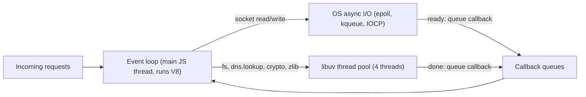
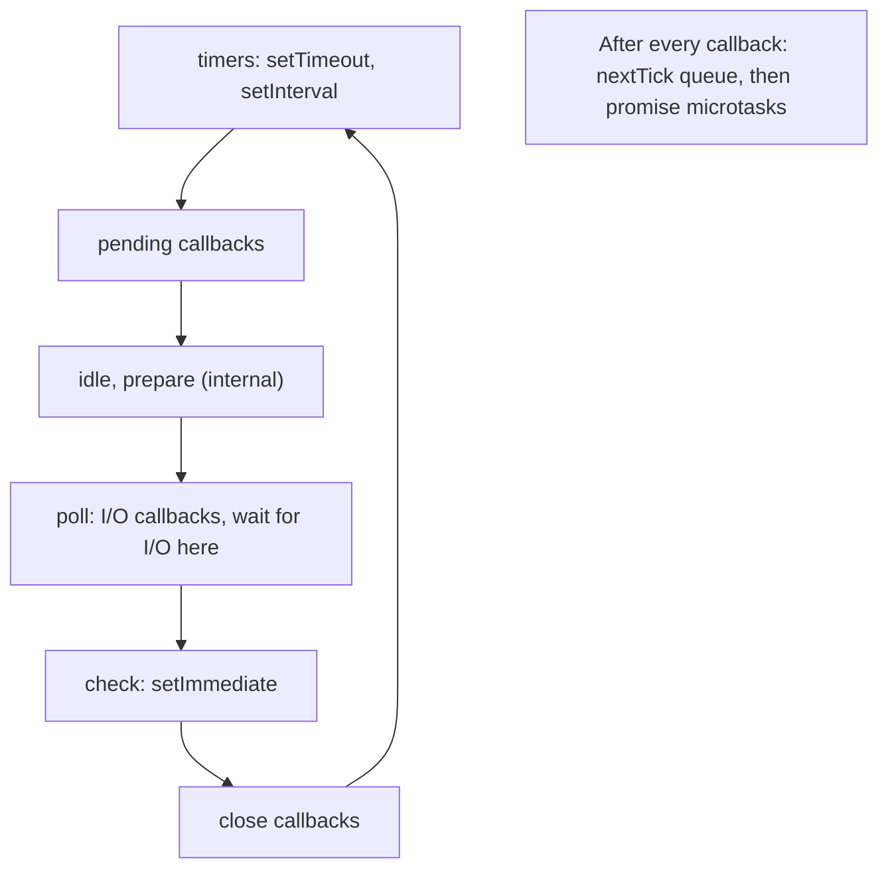
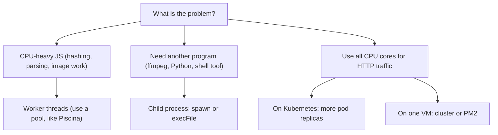
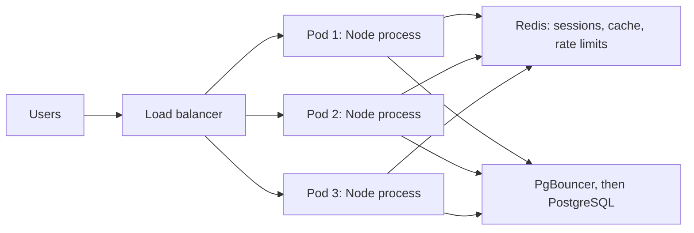
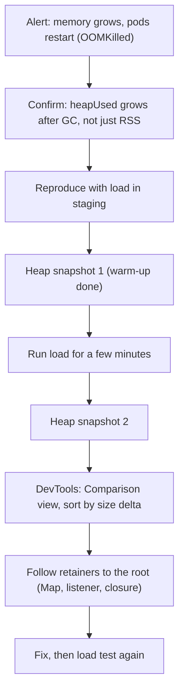
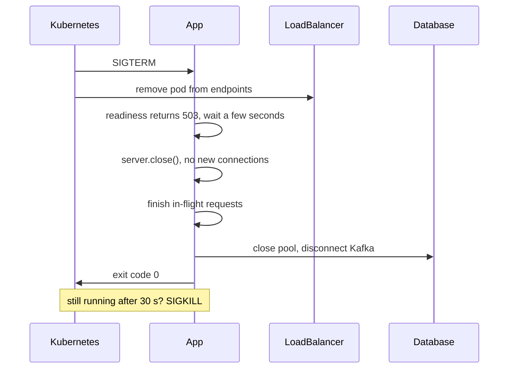
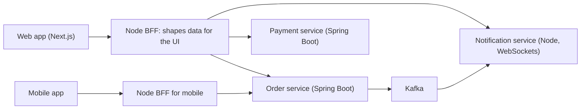

# Node.js for backend engineers

[← Back to README](../README.md)

This file explains Node.js for people who build backends, especially if you come from Java and Spring.
Every topic starts with a simple story, then the real mechanism, then code you can run.
All JavaScript examples were run on Node 24. The outputs shown are real.

**Contents:**
- [How Node.js works](#how-nodejs-works)
- [The Node event loop phases](#the-node-event-loop-phases)
- [What blocks the event loop](#what-blocks-the-event-loop)
- [Worker threads, child processes and cluster](#worker-threads-child-processes-and-cluster)
- [Streams and backpressure](#streams-and-backpressure)
- [Async error handling](#async-error-handling)
- [Building APIs: Express, Fastify, NestJS](#building-apis-express-fastify-nestjs)
- [Scaling Node.js](#scaling-nodejs)
- [Memory leaks and performance](#memory-leaks-and-performance)
- [Graceful shutdown](#graceful-shutdown)
- [Security in Node](#security-in-node)
- [Modern Node (20 to 24+)](#modern-node-20-to-24)
- [Node vs Java/Spring: how to choose](#node-vs-javaspring-how-to-choose)
- [Interview questions](#interview-questions)

Browser basics (call stack, task queue, microtasks) are in [javascript.md](javascript.md). This file does not repeat them.
TypeScript is in [typescript.md](typescript.md).

---

## How Node.js works

**In one line:** Node.js runs your JavaScript on one main thread and hands slow waiting (network, disk) to the OS and a small thread pool.

**Story:** Think of a small restaurant with **one very fast waiter**.
- The waiter takes an order, gives it to the kitchen, and goes to the next table right away.
- The waiter never stands at the kitchen door waiting for food.
- When a dish is ready, the kitchen rings a bell. The waiter picks it up when free.
- One waiter can serve 50 tables, because most of the time is spent *waiting for the kitchen*, not walking.
- But if a customer asks the waiter to peel 100 potatoes, every other table waits. That is CPU-heavy work on the main thread.

A classic Spring MVC app is a restaurant with **one waiter per table** (one thread per request). Simple to think about, but waiters cost money (memory).

**How it works:**
1. **V8** is the JavaScript engine (the same one Chrome uses). It compiles and runs your JS code.
2. Your JS code runs on **one main thread**. Only one piece of your JS runs at any moment.
3. **libuv** is a C library inside Node. It runs the *event loop* (a loop that picks the next ready callback and runs it).
4. **Network I/O** (HTTP, database sockets, Kafka) goes to the operating system's async I/O: *epoll* on Linux, *kqueue* on macOS, *IOCP* on Windows. No extra thread waits for it.
5. Some work has no good async OS API. libuv runs it on a **thread pool** of 4 threads by default: file system calls, `dns.lookup`, some `crypto` (like `pbkdf2`, `scrypt`) and `zlib`.
6. When the OS or the pool finishes, a callback is queued. The event loop runs it on the main thread when the thread is free.

**Diagram:**



**Example: one request, two models.**
- 10,000 users keep a connection open, and each request waits 200 ms for the database.
- **Thread per request (classic Tomcat):** 10,000 threads. Each platform thread reserves about 1 MB of stack. That is about 10 GB of reserved memory, plus a lot of context switching.
- **Node:** one thread and 10,000 small socket objects (a few KB each). While the database works, the thread serves other requests.
- **Java 21 virtual threads** close most of this gap. You keep simple blocking code, and the JVM parks the waiting thread cheaply. See [java-concurrency.md](java-concurrency.md#era-6-virtual-threads-java-21).

**Why Node is bad for CPU-heavy work:**
- Say one request needs 200 ms of pure CPU (resize an image, hash a password with high cost).
- One JS thread can do only 5 of these per second.
- While one runs, **every** other request waits, even a `/health` check.
- A Java app with 200 threads on 8 cores would run 8 of them in parallel.

**Good and bad:**
| Good | Bad |
|---|---|
| Handles many open connections with little memory | One CPU-heavy task freezes all requests |
| No locks for your own JS data (one thread) | Uses one CPU core per process unless you add processes or workers |
| Same language on frontend and backend | Callback/async style must be used everywhere |
| Very fast start-up, small containers | Weaker for heavy number crunching than the JVM |

**When to use / when not to use:**
- Use for I/O-heavy APIs: BFFs (backend for frontend), API gateways, chat, notifications, server-side rendering.
- Avoid for long CPU jobs in the request path: video encoding, big reports, ML inference. Move them to workers or another service.

**Say this in the interview:**

> "Node runs JavaScript on one main thread with an event loop. Network I/O goes to the OS, and file, DNS and some crypto work go to a small libuv thread pool. Because the thread never waits for I/O, one process can hold thousands of connections. The flip side: any CPU-heavy code on the main thread blocks every request, so I move that work to worker threads or another service."

**They may ask next:**
- **Is Node single-threaded?** Your JS runs on one thread. Node itself uses more threads: the libuv pool, V8 garbage collector threads, and worker threads if you create them.
- **How big is the thread pool?** 4 by default. Change it with the `UV_THREADPOOL_SIZE` environment variable (max 1024). Set it before the app starts.
- **Does an HTTP call use the thread pool?** The socket does not. But `dns.lookup` (used by default to resolve host names) does. Many slow DNS lookups can fill the 4 threads and slow down file reads too.

---

## The Node event loop phases

**In one line:** The event loop goes round fixed phases (timers, poll, check, close), and runs nextTick and promise callbacks after every callback.

**Story:** Think of a post office counter with one clerk and several trays.
- First the clerk handles the **alarm tray**: tasks with a time ("call Mr. Rao at 10:00").
- Then **leftover tray**: a few system tasks from last round.
- Then the **inbox**: new letters that arrived (I/O). If the inbox is empty, the clerk waits here for new letters.
- Then the **"right after the inbox" tray**: tasks people asked to do "immediately after this round" (`setImmediate`).
- Then the **closing tray**: closed connections to clean up.
- Between every task, the clerk checks one **VIP sticky note pile** (`nextTick`) and then the **promise pile**. These always go first.

**How it works:**
1. **timers**: run `setTimeout` and `setInterval` callbacks whose time has passed.
2. **pending callbacks**: some system callbacks delayed from the last round (for example some TCP errors).
3. **idle, prepare**: used only inside Node.
4. **poll**: get new I/O events and run their callbacks (socket data, finished file reads). If nothing else is waiting, the loop blocks here until I/O arrives or a timer is due.
5. **check**: run `setImmediate` callbacks.
6. **close callbacks**: for example `socket.on('close')`.
7. After **each** callback, Node empties the `process.nextTick` queue, then the promise *microtask* queue (`.then`, `await`, `queueMicrotask`).
8. When there is nothing left to do (no timers, no open sockets), the process exits.

**Diagram:**



### The ordering puzzle (run with Node 24)

Guess the order before reading the output.

```javascript
const fs = require('node:fs');

console.log('A: sync start');
process.nextTick(() => console.log('C: nextTick'));
Promise.resolve().then(() => console.log('D: promise.then'));
queueMicrotask(() => console.log('E: queueMicrotask'));

fs.readFile(__filename, () => {                 // I/O callback: poll phase
  console.log('F: readFile callback');
  setTimeout(() => console.log('J: setTimeout 0'), 0);
  setImmediate(() => console.log('I: setImmediate')); // check phase is next
  Promise.resolve().then(() => console.log('H: promise in callback'));
  process.nextTick(() => console.log('G: nextTick in callback'));
});

console.log('B: sync end');
```

Real output (same in 30 out of 30 runs):

```text
A: sync start
B: sync end
C: nextTick
D: promise.then
E: queueMicrotask
F: readFile callback
G: nextTick in callback
H: promise in callback
I: setImmediate
J: setTimeout 0
```

Why:
- **A, B:** plain synchronous code runs first, to the end.
- **C before D, E:** in a CommonJS file, the `nextTick` queue is emptied before the promise queue.
- **F:** the file read finishes on the thread pool. Its callback runs in the **poll** phase.
- **G, H:** after that callback, nextTick first, then promises.
- **I before J:** after poll comes **check** (`setImmediate`). Timers come only in the next round.

### setImmediate vs setTimeout(0)

At the top level of a script, the order is **not fixed**:

```javascript
setTimeout(() => console.log('timeout'), 0);
setImmediate(() => console.log('immediate'));
```

I ran this 40 times: 39 times `immediate` came first, 1 time `timeout` came first.
- `setTimeout(fn, 0)` really means "at least 1 ms". If the loop starts within 1 ms, the timer is not due yet, so check runs first.
- **Inside an I/O callback**, `setImmediate` is always first (poll → check → next round's timers).

### Two traps

- **ES modules change the order a bit.** The same puzzle as an `.mjs` file printed `D, E` before `C`. Top-level module code already runs inside a promise job, so the promise queue drains first. Never write code that depends on nextTick vs promise order.
- **Recursive `nextTick` starves the loop.** A `nextTick` that schedules another `nextTick` forever never lets the loop reach the poll phase. No I/O is handled. The same is true for an endless promise chain.

**Good and bad:**
| Tool | Use it for | Watch out |
|---|---|---|
| `process.nextTick` | Emit an event after the caller has attached listeners | Can starve I/O if used in a loop |
| `queueMicrotask` / promises | Normal async code | Same starvation risk in a tight loop |
| `setImmediate` | Split a long job into chunks so I/O can run between them | Runs after poll, not "immediately" |
| `setTimeout(fn, 0)` | Real delays | Minimum 1 ms; order vs setImmediate is random at top level |

**Say this in the interview:**

> "The Node event loop has phases: timers, pending callbacks, poll for I/O, check for setImmediate, and close callbacks. After every single callback, Node empties the nextTick queue and then the promise microtask queue. So promises always run before the next timer or I/O callback. Inside an I/O callback, setImmediate always runs before setTimeout zero."

**They may ask next:**
- **Browser loop vs Node loop?** The browser has tasks, microtasks and rendering. Node has the libuv phases above and no rendering. Both run microtasks right after each task. See [javascript.md](javascript.md).
- **Why do `nextTick` and `setImmediate` have confusing names?** `nextTick` runs sooner (before the loop continues). `setImmediate` runs on the next check phase. The Node docs admit the names are swapped, but they cannot change them now.
- **Did microtask timing change?** Yes, since Node 11 microtasks run after **each** `setTimeout`/`setImmediate` callback, like browsers. Before that, they ran after the whole phase.

---

## What blocks the event loop

**In one line:** Anything that keeps the main thread busy blocks every other request: CPU loops, sync APIs, huge JSON and bad regexes.

**Story:** The single waiter from before stops to count all the coins in the cash box. It takes 5 minutes. No table gets served, even the person who only wants water. Nothing is broken. The waiter is just busy.

**How it works:**
- The event loop can only pick the next callback when the current one returns.
- If one callback runs for 300 ms, all other callbacks wait at least 300 ms. This wait is called **event loop lag** (or delay).
- Health checks also wait. Kubernetes may think the pod is dead and restart it.

**Common blockers:**
| Blocker | Example | Fix |
|---|---|---|
| CPU loops | Sorting 1 million items, PDF generation, image resize | Worker thread, separate job service |
| Sync APIs | `fs.readFileSync`, `crypto.pbkdf2Sync`, `zlib.gzipSync` in a request | Use the async version (runs on the thread pool) |
| Huge JSON | `JSON.parse` / `JSON.stringify` of tens of MB | Paginate, stream (NDJSON), or limit body size |
| Regex backtracking (ReDoS) | `/^(a+)+$/` on a long, almost-matching input | Safe regex, input length limits, linear engines |
| Big sync loops over data | Building a 100k-row CSV in memory | Streams; chunk with `setImmediate` |
| Endless `nextTick`/microtasks | Recursive promise chain | Yield with `setImmediate` |

Real numbers from my laptop (fast machine; a small cloud CPU is often 2-5x slower):
- `JSON.stringify` of 300,000 objects (28 MB): **70 ms**. `JSON.parse` of the same: **46 ms**.
- `crypto.pbkdf2Sync` with 600,000 iterations: **82 ms**.

**Example: ReDoS (regular expression denial of service).**

```javascript
const evil = /^(a+)+$/;                     // nested quantifier: catastrophic backtracking
for (const n of [20, 24, 28]) {
  const input = 'a'.repeat(n) + '!';        // almost matches, then fails at the end
  const t = performance.now();
  evil.test(input);
  console.log(`n=${n}: ${Math.round(performance.now() - t)} ms`);
}
```

Real output:

```text
n=20: 24 ms
n=24: 67 ms
n=28: 1025 ms
```

Each extra character roughly doubles the time. 30 characters from an attacker can freeze the server for seconds.

### How to detect it

**Example: measure event loop lag and busy time.**

```javascript
const { monitorEventLoopDelay, performance } = require('node:perf_hooks');

const delay = monitorEventLoopDelay({ resolution: 10 }); // sample every 10 ms
delay.enable();
const startElu = performance.eventLoopUtilization();

setTimeout(() => {                         // simulate one bad request
  const t = Date.now();
  while (Date.now() - t < 300) {}          // 300 ms of pure CPU: loop is blocked
}, 100);

setTimeout(() => {
  delay.disable();
  const elu = performance.eventLoopUtilization(startElu);
  console.log('max lag ms:', Math.round(delay.max / 1e6));
  console.log('p50 lag ms:', Math.round(delay.percentile(50) / 1e6));
  console.log('loop utilization:', elu.utilization.toFixed(2)); // 0 = idle, 1 = always busy
}, 1000);
```

Real output:

```text
max lag ms: 309
p50 lag ms: 11
loop utilization: 0.30
```

Tools to find the slow code:
- **Metrics in production:** export event loop lag (p99) and *ELU* (event loop utilization: the share of time the loop is busy). `prom-client` default metrics and most APM agents include lag. Alert when p99 lag is above about 100 ms.
- **`--cpu-prof`:** `node --cpu-prof app.js` writes a `.cpuprofile` file on exit. Open it in Chrome DevTools (Performance tab) and look for wide bars.
- **`--inspect`:** attach Chrome DevTools (`chrome://inspect`) and record a CPU profile live.
- **`--trace-sync-io`:** prints a stack trace whenever sync I/O runs after the first loop turn. Good for finding `readFileSync` in request code.
- **0x:** makes flame graphs from a run. Still published (v6.0.0, July 2025).
- **Clinic.js:** was popular (`clinic doctor`, `clinic flame`). Its README now says it is **not actively maintained** and may give wrong results on new Node versions. Last release was 13.0.0 in June 2023. Prefer `--cpu-prof`, DevTools, 0x or your APM.

**Good and bad (fixes):**
| Fix | Good | Bad |
|---|---|---|
| Async APIs | Easy, uses thread pool | Pool has only 4 threads by default |
| Worker threads | Real parallel CPU work in the same process | Data must be copied or shared on purpose |
| Chunking with `setImmediate` | No new threads | Job takes longer overall; code is harder |
| Move to a job queue (Kafka, BullMQ) | Request stays fast; retries | More moving parts |
| Limits (body size, regex input length) | Stops abuse early | Must pick good numbers |

**Say this in the interview:**

> "Anything that holds the main thread blocks all requests: CPU loops, sync file or crypto calls, parsing huge JSON, and catastrophic regex backtracking. I watch event loop lag and loop busy time as production metrics. To find the cause I take a CPU profile with --cpu-prof or DevTools. Then I move the work to async APIs, worker threads or a background job."

**They may ask next:**
- **Is `await` blocking?** No. `await` pauses only that async function. The thread is free for other work. But code between two awaits runs without a break.
- **Is `JSON.parse` async?** No, it is fully synchronous. For big data, stream it or keep payloads small.
- **What is a good lag number?** Under 10-20 ms is healthy for an API. Hundreds of ms means something is blocking.

---

## Worker threads, child processes and cluster

**In one line:** Worker threads run JS in parallel in one process, child processes run other programs, and cluster runs server copies on one port.

**Story:** The restaurant is busy.
- **Worker thread:** hire a helper cook in the **same kitchen**. They share the building but each has their own table. They talk by passing notes.
- **Child process:** call an **outside caterer**. Fully separate kitchen. Talking is slower, but if their kitchen burns, yours is safe.
- **Cluster:** open **4 identical counters** in the same restaurant, each with its own waiter. The door manager sends each customer to a counter.

**How it works:**
- **Worker threads** (`node:worker_threads`): each worker has its own V8 instance, event loop and memory heap. They talk with `postMessage` (data is copied). `SharedArrayBuffer` can share raw memory.
- **Child processes** (`node:child_process`): `spawn`, `execFile`, `fork`. A new OS process. Can be any program (ffmpeg, Python, another Node script).
- **Cluster** (`node:cluster`): the primary process forks N worker processes. They share the listening port. The primary spreads connections between them.

**Diagram: which one should I use?**



**Comparison:**
| | Worker threads | Child process | Cluster |
|---|---|---|---|
| What it is | Thread in the same process | Separate OS process | N copies of your server process |
| Memory | Own heap, same process | Fully separate | Fully separate |
| Talk by | `postMessage`, `SharedArrayBuffer` | stdin/stdout, IPC channel | IPC; usually no talking |
| Start cost | Some ms and a few MB | Higher | Higher |
| Crash impact | Can crash the process if not handled | Isolated | One worker dies, others serve |
| Best for | CPU work in JS | Running other programs | Using all cores on one machine |
| Java comparison | `ExecutorService` for CPU tasks | `ProcessBuilder` | Running more JVMs |

**Example: worker thread (run with Node 24).**

```javascript
const { Worker, isMainThread, parentPort, workerData } = require('node:worker_threads');

function fib(n) { return n < 2 ? n : fib(n - 1) + fib(n - 2); } // CPU-heavy on purpose

if (isMainThread) {
  const runInWorker = (n) => new Promise((resolve, reject) => {
    const w = new Worker(__filename, { workerData: n });  // same file, worker branch
    w.once('message', resolve);
    w.once('error', reject);
  });

  const tick = setInterval(() => console.log('main loop is still free'), 200);
  runInWorker(40).then((result) => {
    console.log('fib(40) =', result);
    clearInterval(tick);
  });
} else {
  parentPort.postMessage(fib(workerData));          // runs on another thread
}
```

Real output: `main loop is still free` (twice), then `fib(40) = 102334155`. The timer kept firing while the worker computed.

In real apps, do not create a new worker per request. Starting one costs time and memory. Use a pool (for example the *Piscina* library), sized to the number of cores.

**Example: child process (run with Node 24).**

```javascript
const { execFile } = require('node:child_process');

// Separate OS process. execFile does not use a shell, so user input cannot inject commands.
execFile('node', ['--version'], { timeout: 5000 }, (err, stdout) => {
  if (err) throw err;
  console.log('child says:', stdout.trim());   // child says: v24.14.0
});
```

**Example: cluster (run with Node 24).**

```javascript
const cluster = require('node:cluster');
const http = require('node:http');
const os = require('node:os');

if (cluster.isPrimary) {
  const n = Math.min(2, os.availableParallelism()); // usually one per core
  for (let i = 0; i < n; i++) cluster.fork();
  cluster.on('exit', (w) => { console.log(`worker ${w.process.pid} died, starting a new one`); cluster.fork(); });
} else {
  http.createServer((req, res) => res.end(`hello from ${process.pid}\n`))
    .listen(3100);                                 // all workers share port 3100
}
```

Four `curl` calls to port 3100 answered from two different PIDs, taking turns (round-robin is the default on all platforms except Windows).

**Good and bad:**
| Good | Bad |
|---|---|
| Worker threads keep the event loop free for CPU work | Workers do not help with I/O; Node is already async there |
| Child processes isolate risky or non-JS tools | `exec` with a shell plus user input = command injection |
| Cluster uses all cores with no code change | In containers, one process per pod is simpler; cluster hides crashes from Kubernetes |

**Say this in the interview:**

> "I use worker threads for CPU-heavy JavaScript, through a pool, so the event loop stays free. I use child processes to run other programs like ffmpeg, with execFile and no shell. Cluster or PM2 runs one Node process per core on a VM. On Kubernetes I usually skip cluster and just run more small pods, because Kubernetes already restarts and balances them."

**They may ask next:**
- **Process vs thread?** A process has its own memory. A crash stays inside it. Threads live inside one process and can share memory, so they are cheaper but less isolated.
- **Do worker threads share variables?** No. Each has its own heap. You pass messages (copied) or share a `SharedArrayBuffer` with `Atomics`.
- **Can a worker thread speed up a slow database query?** No. The query time is in the database. Workers help only with CPU work inside Node.

---

## Streams and backpressure

**In one line:** A stream moves data in small chunks, and *backpressure* makes a fast producer pause when a slow consumer is full.

**Story:** Think of filling water bottles from a tank with a pipe.
- You do not carry the whole tank at once. Water flows bit by bit (chunks).
- If the bottle is full, you close the tap until the next bottle is ready. That is backpressure.
- Without it, water spills on the floor. In Node, "spilling" means data piling up in memory until the process crashes.

**How it works:**
1. **Readable:** a source of data (file, HTTP request, DB cursor).
2. **Writable:** a destination (file, HTTP response, socket).
3. **Duplex / Transform:** both. A Transform changes data on the way (gzip, CSV formatting).
4. Each stream has a buffer limit called **`highWaterMark`** (default 64 KB for byte streams since Node 22; 16 objects in object mode).
5. `writable.write(chunk)` returns **`false`** when the buffer is above the limit. The producer must stop and wait for the **`'drain'`** event.
6. **`pipeline()`** from `node:stream/promises` connects streams, handles backpressure, forwards errors and closes everything on failure. Prefer it over `.pipe()`, which does not clean up on errors.

**Diagram: CSV export.**


**Example 1: backpressure by hand (run with Node 24).**

```javascript
const { Writable } = require('node:stream');

// A slow consumer: takes 10 ms per chunk, buffer limit of 3 chunks.
const slow = new Writable({
  highWaterMark: 3,
  objectMode: true,
  write(chunk, _enc, done) { setTimeout(done, 10); },
});

let i = 0, pauses = 0;
function produce() {
  while (i < 20) {
    const ok = slow.write(`row ${i++}`);   // false means "my buffer is full"
    if (!ok) {
      pauses++;
      slow.once('drain', produce);         // wait, then continue
      return;
    }
  }
  slow.end(() => console.log(`wrote ${i} rows, paused ${pauses} times`));
}
produce();
```

Real output: `wrote 20 rows, paused 6 times`. Memory stayed small because the producer waited.

**Example 2: export 100,000 rows as a gzipped CSV with `pipeline()`.**

```javascript
// export.mjs (ES module, so top-level await works)
import { pipeline } from 'node:stream/promises';
import fs from 'node:fs';
import zlib from 'node:zlib';

async function* rowsFromDb() {             // pretend: read the DB page by page
  yield 'id,name,amount\n';
  for (let page = 0; page < 100; page++) {
    for (let r = 0; r < 1000; r++) {
      const id = page * 1000 + r;
      yield `${id},customer-${id},${(id % 500) + 0.99}\n`;
    }
  }
}

await pipeline(                            // backpressure, errors and cleanup in one call
  rowsFromDb,
  zlib.createGzip(),
  fs.createWriteStream('orders.csv.gz'),   // in a web handler, use the response object here
);
```

Real result: a 516 KB file with 100,001 lines. The process used about 76 MB RSS in total. Building the whole CSV as one string first would hold every row in memory at once.

In an HTTP handler, pass `res` as the last stage. If the client disconnects, `pipeline` destroys the other streams and stops the DB reads.

**Good and bad:**
| Good | Bad |
|---|---|
| Constant memory for any file size | Harder to debug than "load all, then process" |
| First bytes reach the user fast | Errors in the middle: headers (200 OK) are already sent |
| `pipeline()` cleans up on errors and client disconnects | Ignoring `write()` returning false breaks backpressure |

**When to use / when not to use:**
- Use for big files, uploads, exports, proxying, log processing.
- For a 5 KB JSON response, a normal `res.json()` is simpler.

**Say this in the interview:**

> "Streams process data in chunks, so memory stays flat even for a 10 GB file. Backpressure means the writer tells the reader to slow down: write returns false when the buffer passes highWaterMark, and you wait for drain. I use pipeline from stream/promises, because it handles backpressure, errors and cleanup. For a big CSV export, I stream rows from a DB cursor through a transform and gzip straight into the response."

**They may ask next:**
- **What happens without backpressure?** The fast side keeps buffering in memory. Heap grows until the process crashes with "out of memory".
- **Java equivalent?** Reactive Streams `request(n)` in Java's Flow API or Reactor. Same idea: the consumer controls the speed. See [java-concurrency.md](java-concurrency.md).
- **What is object mode?** The stream moves JS objects instead of bytes. `highWaterMark` then counts objects, not bytes.

---

## Async error handling

**In one line:** Await or `.catch()` every promise, handle expected failures in place, and let unknown bugs crash the process so it restarts clean.

**Story:** A courier company has two kinds of problems.
- **Expected problems:** "customer not home", "wrong address". The courier has a rule for each: try again tomorrow, call the customer.
- **Bugs:** the van's brakes are broken. You do not "handle" this on the road. You stop the van and send it to the garage.
- Node errors are the same. The first kind are *operational errors*. The second kind are *programmer errors*.

**How it works:**
1. **Callbacks (old style):** the first argument is the error: `fs.readFile(path, (err, data) => ...)`. Errors thrown inside a callback are not caught by an outer `try/catch`.
2. **Promises:** `.then(onOk).catch(onError)`. A rejected promise with no handler is an *unhandled rejection*.
3. **async/await:** `await` turns a rejected promise back into a thrown error. A normal `try/catch` works again.
4. **Since Node 15, an unhandled rejection crashes the process** (default mode `--unhandled-rejections=throw`).
5. **`process.on('uncaughtException')` / `('unhandledRejection')`:** last-chance hooks. Use them to log and shut down, not to keep running.

**Operational vs programmer errors:**
| | Operational error | Programmer error |
|---|---|---|
| What | Expected failure of the outside world | A bug in our code |
| Examples | DB timeout, 404 from another service, bad user input, disk full | `undefined is not a function`, wrong argument, forgot `await` |
| Handle by | Retry, fallback, return 4xx/5xx | Fix the code |
| At runtime | Catch and respond | Log, crash, let the orchestrator restart |

**Example 1: unhandled rejection crashes the process (real run).**

```javascript
async function loadUser() { throw new Error('db is down'); }
loadUser();                                   // no await, no .catch()
setTimeout(() => console.log('never printed'), 100);
```

Real result: Node prints `Error: db is down` with the stack and exits with **code 1**. `never printed` is never printed.

**Example 2: timeout with `fetch` and `AbortSignal` (run with Node 24).**

```javascript
async function getPaymentStatus(id) {
  try {
    const res = await fetch(`http://localhost:3300/payments/${id}`, {
      signal: AbortSignal.timeout(800),          // give up after 800 ms
    });
    if (!res.ok) throw new Error(`payment service said ${res.status}`);
    return await res.text();
  } catch (err) {
    if (err.name === 'TimeoutError') return 'UNKNOWN'; // operational error: fallback
    throw err;                                         // anything else: let it go up
  }
}
```

Against a server that answers after 3 seconds, this printed `status: UNKNOWN` after 800 ms.
- Built-in `fetch` has **no timeout by default**. Always pass a signal. Same rule as Java clients, see [microservices.md](microservices.md#timeouts).
- `AbortSignal.any([userCancel, AbortSignal.timeout(800)])` combines a user cancel with a timeout.
- A timeout does not prove the server did nothing. Retries need idempotency. See [microservices.md](microservices.md#retry-with-exponential-backoff-and-jitter).

**Example 3: last-chance handlers.**

```javascript
process.on('unhandledRejection', (reason) => {
  logger.fatal({ err: reason }, 'unhandled rejection'); // log with context
  shutdown('unhandledRejection', 1);                    // graceful stop, then exit code 1
});
process.on('uncaughtException', (err) => {
  logger.fatal({ err }, 'uncaught exception');
  shutdown('uncaughtException', 1);                     // state may be broken: do not continue
});
```

`shutdown` is like the function in [Graceful shutdown](#graceful-shutdown), with an extra exit code argument. `logger` is your logger (for example pino).

**Common mistakes:**
- **Forgetting `await`:** `try { save(order) } catch {}` catches nothing, because `save` returns a promise.
- **`forEach` with async:** `items.forEach(async (i) => await save(i))` does not wait. Use `for...of` with `await`, or `Promise.all`.
- **`Promise.all` fails fast:** one rejection rejects all. Use `Promise.allSettled` when you want every result.
- **Throwing strings:** `throw 'oops'` has no stack trace. Always throw `Error` objects.
- **Event emitters:** an `'error'` event with no listener crashes the process. Always add `.on('error')` to streams and sockets.

**Good and bad:**
| Good | Bad |
|---|---|
| `async/await` + `try/catch` reads like Java | Easy to forget `await` (use the ESLint rule `no-floating-promises` from typescript-eslint) |
| Crash on unknown errors keeps state clean | Without a restart policy, one bug means downtime |
| `AbortSignal.timeout` is built in | Some libraries ignore the signal; check them |

**Say this in the interview:**

> "I separate operational errors, like a timeout or bad input, from programmer errors, which are bugs. Operational errors I handle in place with retries, fallbacks or a clear 4xx or 5xx. Programmer errors I log and let the process crash, because its state may be broken, and Kubernetes restarts it. Every promise is awaited or caught, and every outgoing call has an AbortSignal timeout."

**They may ask next:**
- **Promise vs callback?** A promise is an object for a future result. You can chain it, combine it (`Promise.all`) and use `await`. Callbacks nest deeply and handle errors by hand.
- **What does async/await really do?** An `async` function always returns a promise. `await` pauses that function and gives the thread back. The rest runs later as a microtask.
- **Why not just catch everything in `uncaughtException` and continue?** After an unknown error, open transactions, locks or half-written data may be wrong. Restarting is safer.

---

## Building APIs: Express, Fastify, NestJS

**In one line:** Express is the simple classic, Fastify is fast with built-in schemas, and NestJS is Spring-like with modules and DI.

**Story:** Three ways to open a food stall.
- **Express:** a plain cart. You bring every tool yourself. Everyone knows how to run one.
- **Fastify:** a cart with a built-in weighing scale and order checker. Faster service, a few house rules.
- **NestJS:** a franchise kit. Fixed layout, manuals, roles for each staff member. Great for big teams, more to learn.

**Comparison (versions as of November 2026):**
| | Express | Fastify | NestJS |
|---|---|---|---|
| Latest major | 5 (5.3.0) | 5 (5.12.x) | 12 (12.5.0) |
| Style | Minimal, middleware chain | Plugins and hooks | Modules, DI, decorators (like Spring) |
| Validation | Bring your own (Zod, Joi) | JSON Schema built in | `ValidationPipe` + class-validator, or Zod |
| Speed | Good | Among the fastest | Runs on Express (default) or Fastify |
| TypeScript | Optional | Good types | TypeScript first |
| Learning curve | Lowest | Low | Highest |
| Best for | Small services, prototypes, existing code | High-traffic APIs, BFFs | Large teams, Java/Spring developers |

### Middleware

A *middleware* is a function that runs before your handler. It can read or change the request, stop it, or call `next()`. It is the same idea as a Spring `Filter` or `HandlerInterceptor`.

**Example: Express 5 with Helmet, a logger, Zod validation and an error handler (run with Node 24).**

```javascript
import express from 'express';
import helmet from 'helmet';
import { z } from 'zod';

const app = express();
app.use(helmet());                                   // safe HTTP headers
app.use(express.json({ limit: '100kb' }));           // body size limit
app.use((req, res, next) => {                        // logging middleware
  const start = performance.now();
  res.on('finish', () => console.log(req.method, req.url, res.statusCode, `${Math.round(performance.now() - start)}ms`));
  next();                                            // pass to the next middleware
});

const CreateOrder = z.object({ productId: z.string().min(1), qty: z.number().int().positive() });

app.post('/orders', async (req, res) => {
  const order = CreateOrder.parse(req.body);         // throws ZodError if invalid
  res.status(201).json({ id: 'ord_1', ...order });   // Express 5: async errors reach the error handler
});

app.use((err, req, res, next) => {                   // error middleware: 4 arguments
  if (err instanceof z.ZodError) return res.status(400).json({ errors: err.issues });
  console.error(err);
  res.status(500).json({ error: 'internal error' });
});
app.listen(3500);
```

Real result: a good body returned `201`. A body with `productId: ""` and `qty: -1` returned `400` with two Zod issues.
Express 5 forwards rejected promises from async handlers to the error middleware. In Express 4 you needed a wrapper for that.

**Example: Fastify with JSON Schema (run with Node 24).**

```javascript
import Fastify from 'fastify';
const app = Fastify({ logger: true });               // pino logger built in

app.post('/orders', {
  schema: {                                          // validates input before the handler runs
    body: {
      type: 'object',
      required: ['productId', 'qty'],
      properties: { productId: { type: 'string', minLength: 1 }, qty: { type: 'integer', minimum: 1 } },
    },
  },
}, async (req, reply) => {
  reply.code(201);
  return { id: 'ord_1', ...req.body };              // returning a value sends it
});
await app.listen({ port: 3600 });
```

Real result: `qty: 0` returned `400` with `"body/qty must be >= 1"`. An output schema (`response`) also makes JSON serialization faster.

### NestJS for Java/Spring developers

NestJS will feel familiar. It copies many Spring ideas.

| Spring | NestJS |
|---|---|
| `@RestController`, `@GetMapping` | `@Controller('orders')`, `@Get()` |
| `@Service`, `@Component` | `@Injectable()` provider |
| Constructor injection | Constructor injection (by TypeScript type) |
| `@Configuration` + component scan | `@Module({ providers, controllers, imports })` |
| `@Valid` + Bean Validation | `ValidationPipe` + DTO class with class-validator |
| `@ControllerAdvice` | Exception filters |
| Spring Security filters / `@PreAuthorize` | Guards |
| AOP / `HandlerInterceptor` | Interceptors |
| `@ConfigurationProperties` | `ConfigModule` |
| Spring Data JPA | TypeORM, Prisma or MikroORM |

```typescript
@Injectable()
export class OrderService {
  constructor(private readonly repo: OrderRepository) {}      // injected, like Spring
  create(dto: CreateOrderDto) { return this.repo.save(dto); }
}

@Controller('orders')
export class OrderController {
  constructor(private readonly orders: OrderService) {}
  @Post()
  create(@Body() dto: CreateOrderDto) {                        // validated by a global ValidationPipe
    return this.orders.create(dto);
  }
}

@Module({ controllers: [OrderController], providers: [OrderService, OrderRepository] })
export class OrderModule {}
```

Differences from Spring to know:
- There is no `@Transactional` built in. Transactions come from the ORM (for example a TypeORM `DataSource.transaction()` callback).
- Everything still runs on one event loop. A blocking provider blocks the whole app.
- NestJS uses TypeScript decorators, so it needs a build step (`tsc` or SWC). Node's built-in type stripping does not support decorators.

### Request context with AsyncLocalStorage

In Spring, you put the request id in the logging MDC (it uses a `ThreadLocal`). In Node, many requests share one thread, so a thread-local value does not work. `AsyncLocalStorage` (from `node:async_hooks`, stable) keeps a value across all `await`s of one request. Loggers like pino and OpenTelemetry use it for trace ids.

### Structure of a production service

```text
src/
  main.ts              # start server, wire shutdown hooks
  config.ts            # read and validate env vars once (Zod), fail fast if missing
  routes/              # thin HTTP layer: parse, validate, call service
  services/            # business logic, no HTTP objects here
  repositories/        # DB access (pool, queries)
  clients/             # outgoing HTTP/Kafka clients with timeouts and retries
  middleware/          # auth, request id, logging, rate limit
  health.ts            # /live and /ready endpoints
test/                  # node:test or Vitest; integration tests with Testcontainers
```

Must-haves: structured JSON logs (pino), OpenTelemetry traces and metrics, health endpoints, config validation at start-up, timeouts on every outgoing call, and graceful shutdown. More in [production-ready.md](production-ready.md).

**Good and bad:**
| Good | Bad |
|---|---|
| Express: everyone knows it, huge middleware choice | Express: no structure; each team invents its own |
| Fastify: fast, schemas give validation and docs | Fastify: plugin and encapsulation rules take time to learn |
| NestJS: Spring-like structure, easy for Java teams | NestJS: more magic, heavier, decorators need a build step |

**Say this in the interview:**

> "For a small service I pick Express or Fastify. Fastify is faster and has JSON Schema validation built in. For a large team, especially Java developers, I like NestJS, because modules, providers and constructor injection map almost one to one to Spring. Whatever the framework, I validate every input at the edge with Zod or JSON Schema, keep handlers thin, and put logic in services."

**They may ask next:**
- **What is Express middleware?** A function `(req, res, next)`. It runs in order. Call `next()` to continue, or send a response to stop. Error middleware has 4 arguments.
- **Why validate at runtime if we use TypeScript?** Types disappear at runtime. A request body is just unknown JSON. Zod or JSON Schema checks the real data.
- **How do you pass a request id to logs?** With `AsyncLocalStorage`, like MDC in Java.

---

## Scaling Node.js

**In one line:** Scale Node by running many small, stateless processes behind a load balancer, and protect shared resources like the database.

**Story:** One waiter is fast, but one waiter can only be in one place. To serve a wedding of 1,000 guests, you hire 20 waiters with the same menu. Any waiter can serve any table, because orders are written on a shared board, not in one waiter's head. That shared board is Redis or the database.

**How it works:**
1. **One process uses about one CPU core for JS.** On a 4-core VM, run 4 processes (cluster or PM2).
2. **On Kubernetes**, run one Node process per pod, with a CPU request of about 1 core. Add replicas with the HorizontalPodAutoscaler.
3. **Stateless:** no user session or upload kept only in process memory. Use Redis, the database or object storage. See [system-design.md](system-design.md#stateless-services).
4. **Load balancer** in front spreads requests. See [system-design.md](system-design.md#load-balancing).
5. **WebSockets** are long-lived. Use sticky sessions or a pub/sub layer (for example Socket.IO's Redis adapter) so a message reaches users on other pods.

**Diagram:**



**Example: the connection pool math.**
- 20 pods, each with a DB pool of 10 connections = **200 connections**.
- PostgreSQL's default `max_connections` is **100**. Pods fail to connect during a scale-up.
- Fixes: smaller pools per pod (Node needs fewer, since one process does not block on queries), or a pooler like PgBouncer. Same idea as HikariCP in [spring-ecosystem.md](spring-ecosystem.md#connection-pooling-with-hikaricp).

**PM2/cluster vs Kubernetes replicas:**
| | PM2 or cluster on a VM | Kubernetes replicas |
|---|---|---|
| Restarts crashed processes | PM2 / your cluster code | Kubernetes |
| Uses all cores | Yes, N processes | Yes, N pods |
| Health checks and rolling deploys | Limited | Built in |
| Metrics per process | Harder (one container, many processes) | Easy, one process per pod |
| Use when | Plain VMs, small setups | You already run Kubernetes |

**Other scaling tools:**
- **Caching:** a small in-process LRU cache (for example `lru-cache`) for hot, read-only data. Redis for shared data. Remember each pod has its own in-process copy. See [system-design.md](system-design.md#caching).
- **Rate limiting:** an in-memory limiter counts per pod. With 10 pods, the real limit is 10x higher. Keep the counter in Redis, or rate limit at the gateway. See [system-design.md](system-design.md#rate-limiting-algorithms).
- **Keep-alive behind a load balancer:** Node's `server.keepAliveTimeout` default is **5 seconds**. Many load balancers keep idle connections for 60 seconds. The LB may reuse a socket that Node just closed, and the user sees a 502. Set Node's keep-alive timeout higher than the LB's idle timeout.
- **Move slow work out:** emails, PDFs, reports go to a queue (Kafka, RabbitMQ, BullMQ on Redis). See [kafka.md](kafka.md).

**Good and bad:**
| Good | Bad |
|---|---|
| Small processes start fast and scale out quickly | Every pod multiplies DB connections |
| Stateless pods are easy to replace | In-memory caches and limits are per pod |
| One process per pod gives clear metrics | Cluster inside a pod hides restarts from Kubernetes |

**Say this in the interview:**

> "Node uses one core per process for JavaScript, so I scale out. I run one process per pod and more replicas behind a load balancer. The service is stateless; sessions, cache and rate limit counters live in Redis. I watch the shared parts, mainly the database: 20 pods times a pool of 10 is already 200 connections. CPU-heavy or slow jobs go to a queue and worker services."

**They may ask next:**
- **Should I use cluster inside a container?** Usually no. Run one process per container and let Kubernetes scale. Cluster makes sense on plain VMs.
- **What do you autoscale on?** CPU is a good start. Event loop lag or request latency is better for Node, because a blocked loop may not show high average CPU.
- **How do you scale WebSockets?** Sticky sessions plus Redis pub/sub between pods. Watch file descriptor and memory limits per pod.

---

## Memory leaks and performance

**In one line:** A memory leak is memory your app keeps reachable by mistake; find it by comparing heap snapshots over time.

**Story:** A hotel locker room gives a key to every guest. Guests leave but nobody takes the keys back. Lockers stay "in use". After a month, no lockers are free, and the hotel turns new guests away. The garbage collector is the cleaner who only empties lockers with no key holder.

**How it works (GC basics):**
1. V8 stores JS objects in the *heap*.
2. **New space (young generation):** new objects. Cleaned often with a fast copy step (*scavenge*). Most objects die young.
3. **Old space (old generation):** objects that survived. Cleaned less often with *mark-sweep-compact* (find live objects from the roots, free the rest).
4. The GC frees only **unreachable** objects. If a global `Map` still points to an object, it is live forever. That is a leak.
5. When the heap reaches its limit, Node crashes: `FATAL ERROR: ... JavaScript heap out of memory`.
6. **`--max-old-space-size=<MB>`** sets the old space limit. In a container, set it to about 75% of the memory limit, so there is room for buffers and native memory. Newer releases also have `--max-old-space-size-percentage`.

**Common leaks:**
| Leak | Example | Fix |
|---|---|---|
| Global cache with no limit | `const cache = new Map()` that only grows | LRU with a max size and TTL |
| Event listeners | `emitter.on('data', ...)` added per request, never removed | `once`, `off`, or `AbortSignal` to remove; watch the `MaxListenersExceededWarning` |
| Closures | A long-lived callback holds a big request object | Keep only the fields you need |
| Timers | `setInterval` per user, never cleared | `clearInterval` on cleanup |
| Unbounded queues | Pushing to an array faster than you process | Backpressure, max length |
| Per-request data in module scope | `let currentUser` at the top of a file | `AsyncLocalStorage` or function arguments |

**Example: a leaking server (run with Node 24).**

```javascript
const http = require('node:http');

const cache = new Map();                          // global, no limit, no expiry
http.createServer((req, res) => {
  const id = Math.random().toString(36);
  cache.set(id, { url: req.url, data: new Array(1000).fill(id) }); // ~8 KB, never removed
  res.end('ok');
}).listen(3400);

setInterval(() => {
  const mb = (process.memoryUsage().heapUsed / 1e6).toFixed(0);
  console.log(`entries=${cache.size} heapUsed=${mb} MB`);
}, 1000).unref();
```

After 6,000 requests it printed `entries=6000 heapUsed=61 MB`. It never goes down. At 100 requests per second, that is about 1 GB in 20 minutes.

**Diagram: diagnose a leak.**



**Steps to diagnose a leak:**
1. **Check the graph.** RSS (total process memory) and `heapUsed` over hours. A leak is a saw-tooth that keeps climbing after each GC.
2. **Reproduce** with load (autocannon, k6) in staging. Use the same Node version and flags.
3. **Take heap snapshots:**
   - Local: `node --inspect app.js`, open `chrome://inspect`, Memory tab, "Take heap snapshot".
   - Server: `node --heapsnapshot-signal=SIGUSR2 app.js`, then `kill -USR2 <pid>`. Or call `v8.writeHeapSnapshot()` from an admin endpoint.
   - Before a crash: `--heapsnapshot-near-heap-limit=2` writes snapshots when the heap is close to the limit.
4. **Compare** two snapshots in DevTools (Comparison view). Sort by "Size Delta".
5. **Follow the retainers** of the growing objects. They lead to the `Map`, listener or closure that keeps them alive.
6. **Fix and verify** with the same load test.

Warning: a heap snapshot pauses the process and can need as much memory as the heap again. Take it from one pod that is out of the load balancer.

**Performance tips:**
- CPU profile first, then optimize. Do not guess.
- Avoid sync APIs in request paths.
- Reuse HTTP connections (keep-alive agents; Node 19+ enables keep-alive in the global agent by default).
- Use Fastify's response schemas or avoid huge `JSON.stringify` calls.
- Cache hot data, paginate big queries, and fix N+1 queries (see [spring-ecosystem.md](spring-ecosystem.md#the-n1-problem-and-how-to-fix-it), same idea).

**Say this in the interview:**

> "A leak in Node is almost always something still reachable: an unbounded Map, listeners added per request, or timers never cleared. First I confirm the heap grows after GC, not just RSS. Then I reproduce with load and take two heap snapshots. I compare them in DevTools and follow the retainers to the root. In containers I set max-old-space-size to about 75% of the memory limit."

**They may ask next:**
- **RSS vs heapUsed?** RSS is all memory of the process. `heapUsed` is JS objects only. Buffers live outside the heap (`external`, `arrayBuffers`).
- **Can a leak be outside JS?** Yes: native addons, many open file descriptors, or Buffers. Then heap snapshots look fine but RSS grows.
- **What does `WeakMap` help with?** Its keys do not keep objects alive. Good for attaching data to objects you do not own.

---

## Graceful shutdown

**In one line:** On SIGTERM, stop new requests, finish running ones, close DB and Kafka, then exit before the platform kills you.

**Story:** A shop closes at 9 PM. At 8:55 the guard turns the sign to "Closed" so no new customers come in. Customers already inside finish shopping and pay. Then the staff locks the cash box and switches off the lights. Nobody is thrown out with a half-paid bill.

**How it works:**
1. Kubernetes sends **SIGTERM** to the container and starts removing the pod from Service endpoints. These happen at the same time.
2. Mark the app "not ready" (readiness returns 503). Wait a few seconds so load balancers stop sending traffic.
3. Call `server.close()`. It stops accepting new connections. Its callback runs when in-flight requests finish.
4. Close idle keep-alive connections so `close()` does not wait for them.
5. Stop consumers (Kafka, queues), so they commit offsets and stop taking new messages. Then close DB pools and producers.
6. Exit with code 0.
7. If you are not done after **`terminationGracePeriodSeconds`** (default **30 s**), Kubernetes sends **SIGKILL**. Your own hard timeout should fire earlier.

**Diagram:**



**Example (run with Node 24).**

```javascript
const http = require('node:http');
const { setTimeout: sleep } = require('node:timers/promises');

let shuttingDown = false;
const server = http.createServer(async (req, res) => {
  if (req.url === '/ready') {                       // Kubernetes readiness probe
    res.statusCode = shuttingDown ? 503 : 200;
    return res.end();
  }
  await sleep(2000);                                // a slow request (2 s)
  res.end('order saved\n');
});
server.listen(3200);

async function shutdown(signal) {
  console.log(`${signal}: readiness now 503`);
  shuttingDown = true;
  setTimeout(() => process.exit(1), 25_000).unref(); // hard stop before the 30 s SIGKILL
  await sleep(Number(process.env.DRAIN_DELAY_MS ?? 5000)); // let the LB remove us
  server.close(async () => {                        // runs when in-flight requests finish
    console.log('in-flight requests done');
    // await consumer.disconnect(); await pool.end(); // close Kafka and DB last
    process.exit(0);
  });
  server.closeIdleConnections();                    // drop idle keep-alive sockets
}
process.once('SIGTERM', shutdown);
process.once('SIGINT', shutdown);
```

Real test: start a 2-second request, send SIGTERM 0.3 s later. Output: `SIGTERM: readiness now 503`, a readiness check returned `503`, the request still got `order saved`, then `in-flight requests done` and exit code 0.

**Common mistakes:**
- **`CMD npm start` in Docker.** npm may not forward SIGTERM to Node. Use `CMD ["node", "dist/main.js"]` (exec form). If Node runs as PID 1, it gets the signal directly; use `--init` or `tini` if you spawn child processes.
- **No hard timeout.** One stuck request keeps the pod alive until SIGKILL.
- **Closing the DB first.** In-flight requests then fail. Close the DB **last**.
- **Long-lived connections.** WebSockets and SSE never end on their own. Send a close message and end them.

**Good and bad:**
| Good | Bad |
|---|---|
| No failed requests during deploys | Deploys take a few seconds longer |
| Kafka offsets committed cleanly, fewer duplicates | Needs testing; easy to get the order wrong |
| Same idea as Spring Boot's `server.shutdown=graceful` | Delay too long: rolling deploys get slow |

**Say this in the interview:**

> "On SIGTERM I first fail readiness and wait a few seconds so the load balancer stops sending traffic. Then server.close stops new connections and waits for in-flight requests. Then I disconnect Kafka consumers and close the DB pool, last. I keep a hard timeout below Kubernetes' terminationGracePeriodSeconds, which is 30 seconds by default, so we exit on our own terms."

**They may ask next:**
- **Why wait before `server.close()`?** Removing the pod from endpoints takes a moment. Requests can still arrive. A short wait (or a `preStop` sleep hook) avoids errors.
- **SIGTERM vs SIGKILL?** SIGTERM is a polite request; you can handle it. SIGKILL cannot be caught; the process just dies.
- **What about background jobs?** Stop taking new jobs, finish or checkpoint the current one, then exit.

---

## Security in Node

**In one line:** The biggest Node risks are npm dependencies, unvalidated input, and JS-specific bugs like prototype pollution and ReDoS.

**Story:** You build a house with bricks from 1,000 different suppliers. You checked 10 of them. If one supplier sends a bad brick, the wall can fall. A typical Node app has hundreds of packages, most of them indirect (dependencies of dependencies).

**How it works (main risks):**
1. **Supply chain attacks:** an attacker takes over a maintainer account and publishes a bad version. Real examples from September 2025: phishing led to bad releases of `chalk` and `debug`. Then the **Shai-Hulud** worm stole npm tokens and used them to publish bad versions of more packages, spreading by itself.
2. **Install scripts:** `postinstall` scripts run code on your machine and CI during `npm install`.
3. **Input:** missing validation, SQL/NoSQL injection, command injection via `exec`.
4. **Prototype pollution:** an attacker sets `__proto__` keys, which change `Object.prototype` for **every** object.
5. **ReDoS:** a bad regex freezes the event loop (see [What blocks the event loop](#what-blocks-the-event-loop)).
6. **Secrets:** API keys in code, logs or images.

**Example: prototype pollution (run with Node 24).**

```javascript
function merge(target, source) {               // naive deep merge (common in old code)
  for (const key in source) {
    if (typeof source[key] === 'object') {
      target[key] ??= {};
      merge(target[key], source[key]);
    } else {
      target[key] = source[key];
    }
  }
  return target;
}

const body = JSON.parse('{"__proto__": {"isAdmin": true}}'); // attacker's request body
merge({}, body);

const user = {};                                  // a brand new, empty object
console.log('isAdmin?', user.isAdmin);            // true: every object is now "admin"
```

Real output: `isAdmin? true`. Fixes: validate input with a schema that rejects unknown keys, skip `__proto__`, `constructor` and `prototype` keys, use `Object.create(null)` or `Map` for user-keyed data.

**Checklist:**
| Area | What to do |
|---|---|
| Lockfile | Commit `package-lock.json`. Use `npm ci` in CI (installs exactly the lockfile). |
| Audit | `npm audit` in CI; Dependabot or Renovate for updates. |
| New versions | Wait a few days before installing fresh releases. npm 11.10+ has `min-release-age` (days); pnpm has `minimumReleaseAge`. |
| Install scripts | `npm ci --ignore-scripts` where possible; allow only the ones you need. |
| Publishing | Use npm trusted publishing (OIDC from CI) and 2FA, not long-lived tokens. |
| HTTP headers | `helmet` for Express (Fastify has `@fastify/helmet`). |
| Input | Validate everything (Zod, JSON Schema). Limit body size. |
| Commands | `execFile`/`spawn` with an argument array. Never `exec` with user input. |
| Secrets | Env vars or a secret manager. Never commit `.env`. Redact in logs. |
| Runtime | Run as non-root. Stay on a supported LTS version. |

**Node permission model:**
- Start Node with `--permission`. Then file system, child processes, workers, native addons and more are **denied** unless allowed.
- Allow with flags like `--allow-fs-read=/srv/app`, `--allow-fs-write=/tmp/out`, `--allow-child-process`, `--allow-net`.
- A denied call throws `ERR_ACCESS_DENIED`. `--permission-audit` only logs.
- **Status:** added in Node 20, **stable since 22.13.0 and 23.5.0**.
- **Limit:** the docs call it a "seat belt" for trusted code. It is **not** a security boundary against malicious code. Symlinks and already-open file descriptors can get around it. Use containers and OS limits too.

```bash
node --permission --allow-fs-read=/srv/app --allow-fs-write=/tmp/out --allow-net index.js
```

**Good and bad:**
| Good | Bad |
|---|---|
| Huge npm ecosystem: a package for everything | Every package is code you trust blindly |
| Lockfiles and `npm ci` give repeatable builds | `npm audit` shows many low-value warnings; teams start ignoring it |
| Permission model limits damage from bugs | It is not a sandbox for malicious code |

**Say this in the interview:**

> "In Node the main risk is the supply chain. I commit the lockfile, install with npm ci, and run npm audit and Renovate. I also avoid fresh releases for a few days. At the edge I validate all input with a schema, limit body size and use helmet. I watch for Node-specific bugs: prototype pollution from unsafe merges and ReDoS from bad regexes. Secrets come from env vars or a secret manager, and the app runs as non-root on a supported LTS."

**They may ask next:**
- **`npm install` vs `npm ci`?** `npm install` may update the lockfile. `npm ci` deletes `node_modules` and installs exactly what the lockfile says. Use `npm ci` in CI and Docker.
- **How to block ReDoS?** Avoid nested quantifiers and limit input length. Test regexes with a checker. Run untrusted patterns in a worker with a timeout.
- **What does helmet do?** It sets safe HTTP headers: Content-Security-Policy, HSTS, `X-Content-Type-Options` and others.

---

## Modern Node (20 to 24+)

**In one line:** Modern Node has fetch, a test runner, watch mode, .env loading, TypeScript stripping and permissions built in, so you need fewer packages.

**Story:** An old phone needed a separate torch, a separate camera and a separate music player. A new phone has all of them inside. Node 18 needed `node-fetch`, `jest`, `nodemon` and `dotenv`. Node 24 has its own version of each.

### LTS schedule (as of November 2026)

LTS means *long-term support*: about 30 months of fixes. Production should run an LTS version.

| Version | Codename | Status in November 2026 | End of life |
|---|---|---|---|
| Node 20 | Iron | **End of life** (since 30 April 2026) | 2026-04-30 |
| Node 22 | Jod | Maintenance LTS (security fixes only) | 2027-04-30 |
| Node 24 | Krypton | Maintenance LTS (since 20 October 2026) | 2028-04-30 |
| Node 26 | Lithium | **Active LTS** (since 28 October 2026) | 2029-04-30 |

- **New schedule:** Node 26 is the last release under the old "two majors a year, only even numbers get LTS" model. From **Node 27 (April 2027)** there is one major per year, released in April, and **every** major becomes LTS in October. Version numbers then follow the year (27 in 2027).
- **Advice in late 2026:** new services on Node 24 or 26. Plan the move off Node 22 before April 2027.

### Built-in features

| Feature | Command or API | Status |
|---|---|---|
| `fetch`, `AbortSignal.timeout` | `await fetch(url, { signal })` | Stable since Node 21 (based on undici) |
| Test runner | `node --test`, `import { test } from 'node:test'` | Stable since Node 20 |
| Watch mode | `node --watch app.js` | Stable since 22.0 and 20.13 |
| `.env` loading | `node --env-file=.env app.js`, `process.loadEnvFile()` | Added 20.6; no longer experimental since 24.10 and 22.21 |
| TypeScript type stripping | `node app.ts` | On by default since 23.6 and 22.18; **stable since 25.2 and 24.12** |
| Permission model | `node --permission ...` | Stable since 23.5 and 22.13 |
| `require()` of ES modules | `require('./esm-lib.mjs')` | On by default since 22.12 and 20.19; stable since 25.4 |
| Temporal (dates and times) | `Temporal.Now.instant()` | On by default in Node 26 |

**Example: test runner and `.env` + TypeScript (run with Node 24).**

```javascript
// sum.test.mjs  ->  run: node --test
import { test } from 'node:test';
import assert from 'node:assert/strict';

const total = (items) => items.reduce((s, i) => s + i.price * i.qty, 0);

test('total adds price times quantity', () => {
  assert.equal(total([{ price: 10, qty: 2 }, { price: 5, qty: 1 }]), 25);
});
```

```typescript
// env.ts  ->  run: node --env-file=.env env.ts   (no build step, no warning on Node 24)
type Config = { dbUrl: string; port: number };
const config: Config = { dbUrl: process.env.DB_URL ?? '', port: Number(process.env.PORT) };
console.log(config);   // { dbUrl: 'postgres://localhost/shop', port: 3000 }
```

Both ran on Node 24.14: the test passed, and the TypeScript file printed the config from `.env`.

### TypeScript type stripping: the limits

- Node only **removes** type annotations. It does **not** type-check. Still run `tsc --noEmit` in CI.
- Syntax that needs generated JS fails: `enum`, `namespace` with runtime code, parameter properties (`constructor(private x)`), and decorators.
- `tsconfig.json` is ignored. `paths` aliases do not work; use `#` subpath imports.
- Write `import type { X }` for type-only imports, and include the `.ts` extension in imports.
- TypeScript's `erasableSyntaxOnly` option (TS 5.8+) warns you about syntax Node cannot strip.
- `--experimental-transform-types` (for enums and so on) was **removed in Node 26**.

### ESM vs CommonJS

- **CommonJS:** `require()` and `module.exports`. The old Node default.
- **ES modules (ESM):** `import`/`export`. The JavaScript standard. Use `"type": "module"` in `package.json` or the `.mjs` extension.
- ESM allows top-level `await`. `__dirname` is replaced by `import.meta.dirname` and `import.meta.filename`.
- `require(esm)` now works (for modules without top-level `await`), which ends most "ESM-only package" pain.
- For new projects, use ESM.

**Good and bad:**
| Good | Bad |
|---|---|
| Fewer dependencies: smaller supply chain risk | Built-in test runner has fewer extras than Vitest or Jest |
| Run `.ts` files directly for scripts and simple services | Type stripping has no type checking and no decorators |
| One LTS per year from Node 27: easier planning | Teams on Node 20 are now unsupported |

**Say this in the interview:**

> "In November 2026, Node 26 is the active LTS. Node 24 and 22 are in maintenance, and Node 20 is end of life. Modern Node has fetch, a test runner, watch mode, .env loading and a permission model built in, so I need fewer packages. It can run TypeScript files directly by stripping types, but it does not type-check, so CI still runs tsc. From Node 27, there is one major release a year and every one becomes LTS."

**They may ask next:**
- **Does `node app.ts` replace `tsc`?** No. It only strips types. You still need `tsc --noEmit` to find type errors, and a build for decorators (NestJS).
- **Can I drop `dotenv`?** For loading a file, yes: `--env-file` or `process.loadEnvFile()`. Real environment variables win over the file.
- **Which version for a new service today?** Node 24 or 26 (both LTS). Check that your libraries support it.

---

## Node vs Java/Spring: how to choose

**In one line:** Pick Node for I/O-heavy edges like BFFs and real-time, and Java/Spring for heavy domains, transactions and CPU work.

**Story:** A scooter and a truck. In city traffic with many short trips, the scooter wins. It is light and quick. To move furniture across the country, the truck wins. It is heavier, but built for the load. Most companies own both.

**How it works (the real differences):**
1. **Concurrency model:** Node uses one event loop per process. Spring MVC uses one thread per request; with virtual threads (Java 21+) that thread is cheap. Spring WebFlux is event-loop based, like Node.
2. **CPU work:** the JVM uses all cores in one process and has a mature JIT. Node needs workers or more processes.
3. **Typing:** Java is statically typed at compile time and at runtime. TypeScript checks only at compile time; at runtime it is plain JS.
4. **Ecosystem:** Spring has deep, stable modules for transactions, security, batch and messaging. npm has more packages, but quality and lifetime vary.
5. **Start-up and memory:** Node starts in milliseconds with a small heap. The JVM starts slower and uses more memory, but GraalVM native images and CRaC narrow this.

**Comparison:**
| | Node.js | Java / Spring Boot |
|---|---|---|
| Team skills | Same language as the React/Next.js frontend | Strong for backend teams, long-lived services |
| I/O-heavy APIs | Excellent | Excellent with virtual threads or WebFlux |
| CPU-heavy work | Weak in the main thread; needs workers | Strong: multi-core, mature JIT |
| Transactions and complex domain | Possible, fewer standard tools (no `@Transactional`) | Very strong (JPA, `@Transactional`, Spring Batch) |
| Typing | TypeScript, compile time only | Static types, checked at runtime too |
| Ecosystem | Huge, uneven quality, supply chain risk | Smaller, curated, very stable |
| Start-up and memory | Fast start, small footprint | Slower start, bigger footprint (native image helps) |
| Real-time (WebSockets, SSE) | Very natural | Good (WebFlux, virtual threads), more setup |
| Observability | OpenTelemetry, APM agents | Actuator, Micrometer, OpenTelemetry ([link](spring-ecosystem.md#observability-with-actuator-micrometer-and-opentelemetry)) |

**Diagram: a common split.**



**The nuance:**
- "Node for BFF and real-time, Java for heavy domain and transactions" is a good default, not a law.
- Virtual threads removed Node's biggest old advantage: Java can now hold many waiting requests with simple blocking code.
- Node still wins on shared language with the frontend, fast start, and small services owned by full-stack teams.
- Java still wins on long-lived, complex, transactional systems, and CPU-heavy work.
- Do not mix stacks without a reason. Each extra stack costs hiring, tooling, security patching and on-call knowledge.

**Say this in the interview:**

> "I choose by workload and team. Node is great for I/O-heavy edges: BFFs, API aggregation, real-time features, and teams that already write TypeScript on the frontend. Java and Spring are my pick for complex domains with transactions, heavy CPU work and long-lived core services. Virtual threads made Java just as good at many waiting requests, so the I/O argument alone is no longer enough."

**They may ask next:**
- **Is Node faster than Java?** For simple I/O APIs they are close. For CPU work, the JVM is usually faster. Measure your real workload.
- **Spring WebFlux vs Node?** Same event loop idea. WebFlux runs several event loop threads (one per core) in one JVM; Node runs one per process.
- **Would you write a payment ledger in Node?** I can. But I prefer Java/Spring for strong transactions, mature libraries and runtime typing.

---

## Interview questions

**1. What is the event loop?**
A loop in libuv that runs callbacks on the single JS thread when they are ready. It goes through phases: timers, pending callbacks, poll (I/O), check (`setImmediate`), close. Between each callback it empties the nextTick and promise queues. See [The Node event loop phases](#the-node-event-loop-phases).

**2. Why is Node good for I/O?**
The main thread never waits for I/O. Sockets are watched by the OS (epoll, kqueue), and files go to the libuv pool. One process can hold thousands of connections with little memory. See [How Node.js works](#how-nodejs-works).

**3. What blocks Node?**
Anything that keeps the main thread busy: CPU loops, sync APIs like `readFileSync` or `pbkdf2Sync`, huge `JSON.parse`, and regex backtracking (ReDoS). Detect it with event loop lag metrics and CPU profiles. See [What blocks the event loop](#what-blocks-the-event-loop).

**4. What are worker threads?**
Extra threads, each with its own V8 instance, event loop and heap, in the same process. They talk with `postMessage`. Use them, through a pool, for CPU-heavy JS. See [Worker threads, child processes and cluster](#worker-threads-child-processes-and-cluster).

**5. Process vs thread?**
A process has its own memory, so a crash stays inside it. Threads share one process and can share memory: cheaper, less isolated. In Node: cluster and child processes are processes; worker threads are threads.

**6. What are promise microtasks?**
`.then` callbacks, code after `await`, and `queueMicrotask` go into the microtask queue. Node empties it after every callback, before the next timer or I/O callback. `process.nextTick` runs even earlier in CommonJS. See [The ordering puzzle](#the-ordering-puzzle-run-with-node-24).

**7. How does async/await work?**
An `async` function always returns a promise. `await` pauses that function and frees the thread. The rest of the function runs later as a microtask. Errors become normal `try/catch` again. See [Async error handling](#async-error-handling).

**8. What are streams?**
Objects that move data in chunks: Readable, Writable, Duplex and Transform. Memory stays flat for any data size. Connect them with `pipeline()`. See [Streams and backpressure](#streams-and-backpressure).

**9. What is backpressure?**
The consumer slowing the producer. `write()` returns `false` when the buffer passes `highWaterMark`; the producer waits for `'drain'`. `pipeline()` does this for you. Without it, memory grows until a crash.

**10. How do you scale Node?**
Many stateless processes behind a load balancer: one process per pod on Kubernetes, or cluster/PM2 on a VM. State goes to Redis or the DB. Watch total DB connections and per-pod rate limits. See [Scaling Node.js](#scaling-nodejs).

**11. How do you find a memory leak?**
Confirm heap grows after GC. Reproduce with load. Take two heap snapshots (`--inspect` or `--heapsnapshot-signal`), compare in DevTools, follow retainers. Usual causes: unbounded caches, listeners, timers, closures. See [Memory leaks and performance](#memory-leaks-and-performance).

**12. How do you shut down gracefully?**
On SIGTERM: fail readiness, wait a few seconds, `server.close()`, finish in-flight requests, stop consumers, close DB last, exit 0. Keep a hard timeout under the 30 s grace period. See [Graceful shutdown](#graceful-shutdown).

**13. `setImmediate` vs `setTimeout(fn, 0)`?**
`setImmediate` runs in the check phase. `setTimeout(0)` runs in the timers phase, at least 1 ms later. At the top level their order is random. Inside an I/O callback, `setImmediate` always wins.

**14. What is `process.nextTick` for?**
To run something right after the current function, before promises and before the loop continues. Typical use: emit an event after the caller attached listeners. Recursive nextTick starves I/O.

**15. What is the libuv thread pool?**
4 threads by default (`UV_THREADPOOL_SIZE`, max 1024). It runs file system calls, `dns.lookup`, some crypto and zlib. Network sockets do not use it.

**16. Cluster vs Kubernetes replicas?**
Cluster forks N processes that share a port on one machine. On Kubernetes, prefer one process per pod and more replicas. Kubernetes then handles restarts, health checks and metrics per process.

**17. What happens on an unhandled promise rejection?**
Since Node 15, the process crashes with exit code 1. Log it in an `unhandledRejection` handler and shut down. Do not keep running.

**18. Operational vs programmer errors?**
Operational: expected failures (timeout, bad input, 404). Handle with retries, fallbacks and clear responses. Programmer: bugs. Log, crash, restart, and fix the code.

**19. How do you add a timeout to `fetch`?**
`fetch(url, { signal: AbortSignal.timeout(800) })`. It throws an error named `TimeoutError`. `fetch` has no timeout by default.

**20. Express vs Fastify vs NestJS?**
Express: minimal, everyone knows it. Fastify: faster, JSON Schema validation built in. NestJS: modules, DI and decorators like Spring, good for big teams. See [Building APIs](#building-apis-express-fastify-nestjs).

**21. How is NestJS like Spring?**
`@Controller` ~ `@RestController`, `@Injectable` ~ `@Service`, `@Module` ~ `@Configuration`. Guards ~ security filters, interceptors ~ AOP, exception filters ~ `@ControllerAdvice`. Constructor injection works the same way.

**22. What is the Java MDC equivalent in Node?**
`AsyncLocalStorage`. It keeps a value (request id, user id) across all `await`s of one request. Thread-locals do not work because many requests share one thread.

**23. What is prototype pollution?**
An attacker sends `__proto__` keys. An unsafe merge writes them to `Object.prototype`, so every object gets the new property (for example `isAdmin: true`). Fix with schema validation and by blocking those keys.

**24. How do you protect against npm supply chain attacks?**
Commit the lockfile, use `npm ci`, run `npm audit` and Renovate, delay fresh versions (`min-release-age`), limit install scripts, and publish with trusted publishing. See [Security in Node](#security-in-node).

**25. Which Node versions are LTS in November 2026?**
Node 26 is Active LTS. Node 24 and Node 22 are Maintenance LTS. Node 20 reached end of life on 30 April 2026. From Node 27, there is one major per year and each becomes LTS. See [Modern Node](#modern-node-20-to-24).

**26. Can Node run TypeScript directly?**
Yes, `node app.ts` strips types (stable since 25.2 / 24.12). It does not type-check and does not support enums or decorators. Run `tsc --noEmit` in CI.

**27. Why does a Node pod behind a load balancer sometimes return 502?**
Often keep-alive: Node closes idle sockets after 5 s, but the load balancer keeps them for 60 s and reuses a closed one. Set `server.keepAliveTimeout` higher than the LB idle timeout.

**28. Node event loop vs Java virtual threads?**
Node: one thread, you write async code with `await`. Virtual threads: many cheap threads, you write blocking code and the JVM parks it during I/O. Both handle many waiting requests. Java also uses all cores in one process. See [java-concurrency.md](java-concurrency.md#era-6-virtual-threads-java-21).

**29. When would you not choose Node?**
For CPU-heavy work in the request path, complex transactional domains, or when the team is mostly Java. See [Node vs Java/Spring](#node-vs-javaspring-how-to-choose).
