# Node.js for backend engineers

[← Back to README](../README.md)

This file explains Node.js for people who build backends, especially if you come from Java and Spring.
Every topic starts with a simple story, then the real mechanism, then code you can run.
Examples marked "run with Node 24" were really run, and their outputs are real. Examples that need a database, Redis or S3 were checked by hand and with `node --check`.

**Contents:**
- [How Node.js works](#how-nodejs-works) (and [Inside Node: V8, libuv, bindings and the thread pool](#inside-node-v8-libuv-bindings-and-the-thread-pool))
- [The Node event loop phases](#the-node-event-loop-phases)
- [What blocks the event loop](#what-blocks-the-event-loop)
- [Worker threads, child processes and cluster](#worker-threads-child-processes-and-cluster)
- [Streams and backpressure](#streams-and-backpressure)
- [EventEmitter in depth](#eventemitter-in-depth)
- [Buffers and binary data](#buffers-and-binary-data)
- [Async error handling](#async-error-handling)
- [Modules: CommonJS, ES modules and package.json](#modules-commonjs-es-modules-and-packagejson)
- [Building APIs: Express, Fastify, NestJS](#building-apis-express-fastify-nestjs)
- [Validation, API design and rate limiting](#validation-api-design-and-rate-limiting)
- [Configuration and secrets](#configuration-and-secrets)
- [Authentication and authorization in Node APIs](#authentication-and-authorization-in-node-apis)
- [Databases from Node](#databases-from-node)
- [Caching and Redis from Node](#caching-and-redis-from-node)
- [Files and uploads](#files-and-uploads)
- [Background jobs and queues](#background-jobs-and-queues)
- [Real-time: WebSockets and Server-Sent Events](#real-time-websockets-and-server-sent-events)
- [Logging and observability in Node](#logging-and-observability-in-node)
- [Microservices with Node](#microservices-with-node)
- [Scaling Node.js](#scaling-nodejs)
- [Memory leaks and performance](#memory-leaks-and-performance)
- [Graceful shutdown](#graceful-shutdown)
- [Deploying Node: PM2, Docker and Kubernetes](#deploying-node-pm2-docker-and-kubernetes)
- [Testing Node services](#testing-node-services)
- [Security in Node](#security-in-node)
- [Modern Node (20 to 24+)](#modern-node-20-to-24)
- [Node vs Java/Spring: how to choose](#node-vs-javaspring-how-to-choose)
- [Node.js coding problems (with answers)](#nodejs-coding-problems-with-answers)
- [Interview questions](#interview-questions)

Browser basics (call stack, task queue, microtasks) are in [javascript.md](javascript.md). This file does not repeat them.
TypeScript is in [typescript.md](typescript.md).

---

## How Node.js works

**In one line:** Node.js runs your JavaScript on one main thread and hands slow waiting (network, disk) to the OS and a small thread pool.

**Story:** Think of a small restaurant with **one very fast waiter**.
- The waiter takes an order, gives it to the kitchen, and goes to the next table right away.
- The waiter never stands at the kitchen door waiting for food.
- When a dish is ready, the kitchen rings a bell. The waiter picks it up when free.
- One waiter can serve 50 tables, because most of the time is spent *waiting for the kitchen*, not walking.
- But if a customer asks the waiter to peel 100 potatoes, every other table waits. That is CPU-heavy work on the main thread.

A classic Spring MVC app is a restaurant with **one waiter per table** (one thread per request). Simple to think about, but waiters cost money (memory).

**How it works:**
1. **V8** is the JavaScript engine (the same one Chrome uses). It compiles and runs your JS code.
2. Your JS code runs on **one main thread**. Only one piece of your JS runs at any moment.
3. **libuv** is a C library inside Node. It runs the *event loop* (a loop that picks the next ready callback and runs it).
4. **Network I/O** (HTTP, database sockets, Kafka) goes to the operating system's async I/O: *epoll* on Linux, *kqueue* on macOS, *IOCP* on Windows. No extra thread waits for it.
5. Some work has no good async OS API. libuv runs it on a **thread pool** of 4 threads by default: file system calls, `dns.lookup`, some `crypto` (like `pbkdf2`, `scrypt`) and `zlib`.
6. When the OS or the pool finishes, a callback is queued. The event loop runs it on the main thread when the thread is free.

**Diagram:**

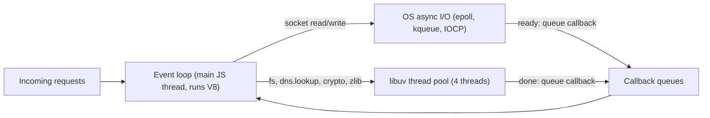

**Example: one request, two models.**
- 10,000 users keep a connection open, and each request waits 200 ms for the database.
- **Thread per request (classic Tomcat):** 10,000 threads. Each platform thread reserves about 1 MB of stack. That is about 10 GB of reserved memory, plus a lot of context switching.
- **Node:** one thread and 10,000 small socket objects (a few KB each). While the database works, the thread serves other requests.
- **Java 21 virtual threads** close most of this gap. You keep simple blocking code, and the JVM parks the waiting thread cheaply. See [java-concurrency.md](java-concurrency.md#era-6-virtual-threads-java-21).

**Why Node is bad for CPU-heavy work:**
- Say one request needs 200 ms of pure CPU (resize an image, hash a password with high cost).
- One JS thread can do only 5 of these per second.
- While one runs, **every** other request waits, even a `/health` check.
- A Java app with 200 threads on 8 cores would run 8 of them in parallel.

**Good and bad:**
| Good | Bad |
|---|---|
| Handles many open connections with little memory | One CPU-heavy task freezes all requests |
| No locks for your own JS data (one thread) | Uses one CPU core per process unless you add processes or workers |
| Same language on frontend and backend | Callback/async style must be used everywhere |
| Very fast start-up, small containers | Weaker for heavy number crunching than the JVM |

**When to use / when not to use:**
- Use for I/O-heavy APIs: BFFs (backend for frontend), API gateways, chat, notifications, server-side rendering.
- Avoid for long CPU jobs in the request path: video encoding, big reports, ML inference. Move them to workers or another service.

**Say this in the interview:**

> "Node runs JavaScript on one main thread with an event loop. Network I/O goes to the OS, and file, DNS and some crypto work go to a small libuv thread pool. Because the thread never waits for I/O, one process can hold thousands of connections. The flip side: any CPU-heavy code on the main thread blocks every request, so I move that work to worker threads or another service."

**They may ask next:**
- **Is Node single-threaded?** Your JS runs on one thread. Node itself uses more threads: the libuv pool, V8 garbage collector threads, and worker threads if you create them.
- **How big is the thread pool?** 4 by default. Change it with the `UV_THREADPOOL_SIZE` environment variable (max 1024). Set it before the app starts.
- **Does an HTTP call use the thread pool?** The socket does not. But `dns.lookup` (used by default to resolve host names) does. Many slow DNS lookups can fill the 4 threads and slow down file reads too.

### Inside Node: V8, libuv, bindings and the thread pool

**In one line:** Node is layers: your JS, core JS libraries, C++ bindings, then V8 (runs JS) and libuv (event loop and I/O).

**Story:** Think of a hotel front desk.
- **You (the guest)** speak to the receptionist in plain words. That is your JavaScript.
- **The receptionist's forms** (`fs`, `http`, `crypto`) are Node's core JS libraries.
- **The phone line to the back office** is the C++ *bindings* layer. It turns a JS call into a C/C++ call.
- **The back office** has two teams. **V8** reads and runs the instructions. **libuv** handles the waiting: it calls the laundry, the taxi company, the kitchen, and rings a bell when they are done.

**How it works:**
1. **Your code** calls `fs.readFile(path, cb)`.
2. **Core JS library** (`lib/fs.js` inside Node) checks the arguments and calls the binding.
3. **C++ binding** creates a libuv *request* (a small C struct that remembers "read this file, then call back").
4. **libuv** decides how to wait:
   - **Network sockets:** register the socket with the OS readiness API. *epoll* (Linux), *kqueue* (macOS, BSD) or *IOCP* (Windows) tell libuv "this socket has data now". No thread is used while waiting.
   - **File system and some other work:** there is no good async OS API that works the same everywhere. libuv runs the blocking call on its **thread pool**.
5. When the work is done, libuv puts the callback in a queue. The event loop runs it on the main thread, and V8 executes your JS callback.
6. **V8** also owns the heap and the garbage collector. It compiles hot functions to machine code with its JIT compilers (Ignition interpreter first, then optimizing tiers).

**Diagram: the layers.**

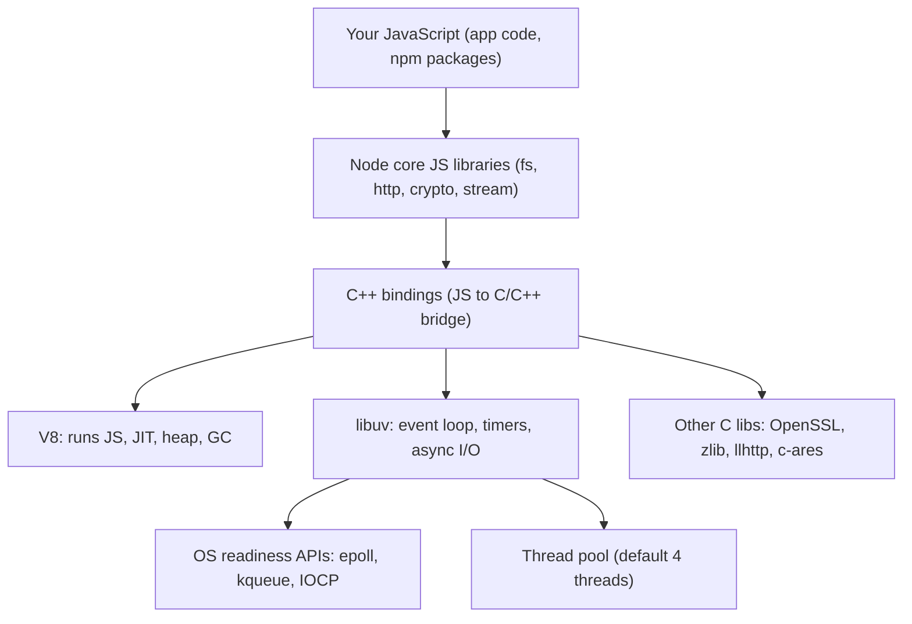

**What uses the thread pool (from the Node docs):**
| Uses the pool | Does not use the pool |
|---|---|
| All async `fs` APIs (except file watchers) | TCP/UDP sockets, HTTP, `fetch`, DB drivers' sockets |
| `dns.lookup()` (the default for `http.get('host')`) | `dns.resolve*()` (uses c-ares, network-based) |
| Async crypto: `pbkdf2`, `scrypt`, `randomBytes`, `randomFill`, `generateKeyPair` | Timers |
| All async `zlib` APIs | Pure JS code (always the main thread) |

**Why network I/O does not need threads:**
- A socket is a file descriptor (a number the OS gives to an open connection).
- epoll/kqueue let one thread ask: "tell me which of these 10,000 sockets has data". The OS answers with a short list.
- So one thread can watch thousands of sockets. Files on disk do not work well with these APIs (a disk file is "always ready"), so libuv uses threads for them.

**Example: the pool is a shared queue (run with Node 24).**

```javascript
const crypto = require('node:crypto');

const start = Date.now();
for (let i = 1; i <= 8; i++) {
  crypto.pbkdf2('secret', 'salt', 300_000, 64, 'sha512', () => {  // async: runs on the libuv pool
    console.log(`hash ${i} done at ${Date.now() - start} ms`);
  });
}
```

Real output on my 18-core laptop:
- **Default pool (4 threads):** hashes 1-4 finished at about 52 ms, hashes 5-8 at about 105 ms. Two "waves".
- **`UV_THREADPOOL_SIZE=8 node pool.js`:** all 8 finished at about 60 ms. One wave.

The trap: password hashing, file reads, gzip and `dns.lookup` all share these 4 threads. Slow hashing on login can make unrelated file reads and DNS lookups slow too.

**Good and bad:**
| Good | Bad |
|---|---|
| One thread watches thousands of sockets cheaply | Only 4 pool threads by default, shared by fs, DNS, crypto and zlib |
| Blocking work is hidden behind async APIs | Pool saturation looks like "random slowness" in unrelated calls |
| `UV_THREADPOOL_SIZE` is easy to change | Setting it from inside the code (`process.env`) may be too late; the pool may already exist |

**Say this in the interview:**

> "Node has layers: my JS, Node's core JS libraries, C++ bindings, and then V8 and libuv. V8 runs the JavaScript and the garbage collector. libuv runs the event loop and the I/O. Sockets use the OS readiness APIs like epoll or kqueue, so no thread waits for them. File system calls, dns.lookup, async crypto and zlib run on the libuv thread pool, which has 4 threads by default. If many slow hashes fill the pool, file reads and DNS lookups wait too, so I raise UV_THREADPOOL_SIZE or move hashing to worker threads."

**They may ask next:**
- **How do you set the pool size?** As an environment variable before Node starts: `UV_THREADPOOL_SIZE=16 node app.js`, or in the Dockerfile `ENV`. Max is 1024.
- **Should I set it to 128?** No. More threads than cores means more context switching. Size it for your real mix: a bit above the number of cores is a common start. Measure.
- **Why does `http.get('api.example.com')` touch the pool?** Host name resolution uses `dns.lookup`, which calls the OS `getaddrinfo` on a pool thread. Cache DNS or use keep-alive connections to reduce lookups.
- **What are worker threads vs the libuv pool?** The libuv pool runs C++ tasks for Node APIs. Worker threads run *your* JavaScript, each with its own V8 instance. See [Worker threads](#worker-threads-child-processes-and-cluster).

---

## The Node event loop phases

**In one line:** The event loop goes round fixed phases (timers, poll, check, close), and runs nextTick and promise callbacks after every callback.

**Story:** Think of a post office counter with one clerk and several trays.
- First the clerk handles the **alarm tray**: tasks with a time ("call Mr. Rao at 10:00").
- Then **leftover tray**: a few system tasks from last round.
- Then the **inbox**: new letters that arrived (I/O). If the inbox is empty, the clerk waits here for new letters.
- Then the **"right after the inbox" tray**: tasks people asked to do "immediately after this round" (`setImmediate`).
- Then the **closing tray**: closed connections to clean up.
- Between every task, the clerk checks one **VIP sticky note pile** (`nextTick`) and then the **promise pile**. These always go first.

**How it works:**
1. **timers**: run `setTimeout` and `setInterval` callbacks whose time has passed.
2. **pending callbacks**: some system callbacks delayed from the last round (for example some TCP errors).
3. **idle, prepare**: used only inside Node.
4. **poll**: get new I/O events and run their callbacks (socket data, finished file reads). If nothing else is waiting, the loop blocks here until I/O arrives or a timer is due.
5. **check**: run `setImmediate` callbacks.
6. **close callbacks**: for example `socket.on('close')`.
7. After **each** callback, Node empties the `process.nextTick` queue, then the promise *microtask* queue (`.then`, `await`, `queueMicrotask`).
8. When there is nothing left to do (no timers, no open sockets), the process exits.

**Diagram:**

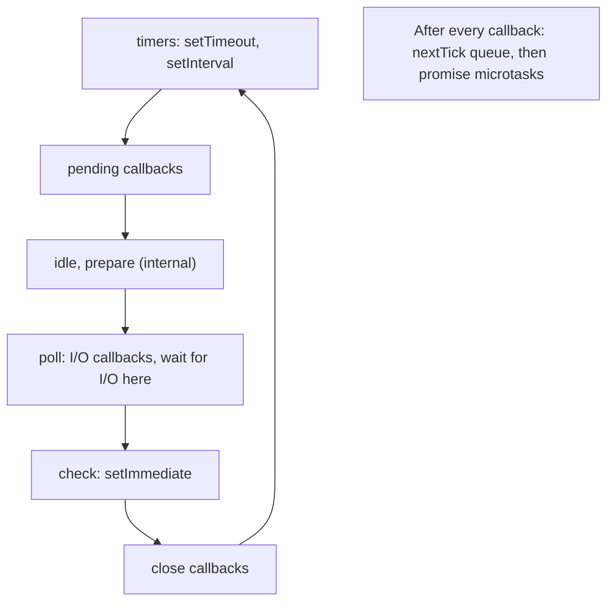

### The ordering puzzle (run with Node 24)

Guess the order before reading the output.

```javascript
const fs = require('node:fs');

console.log('A: sync start');
process.nextTick(() => console.log('C: nextTick'));
Promise.resolve().then(() => console.log('D: promise.then'));
queueMicrotask(() => console.log('E: queueMicrotask'));

fs.readFile(__filename, () => {                 // I/O callback: poll phase
  console.log('F: readFile callback');
  setTimeout(() => console.log('J: setTimeout 0'), 0);
  setImmediate(() => console.log('I: setImmediate')); // check phase is next
  Promise.resolve().then(() => console.log('H: promise in callback'));
  process.nextTick(() => console.log('G: nextTick in callback'));
});

console.log('B: sync end');
```

Real output (same in 30 out of 30 runs):

```text
A: sync start
B: sync end
C: nextTick
D: promise.then
E: queueMicrotask
F: readFile callback
G: nextTick in callback
H: promise in callback
I: setImmediate
J: setTimeout 0
```

Why:
- **A, B:** plain synchronous code runs first, to the end.
- **C before D, E:** in a CommonJS file, the `nextTick` queue is emptied before the promise queue.
- **F:** the file read finishes on the thread pool. Its callback runs in the **poll** phase.
- **G, H:** after that callback, nextTick first, then promises.
- **I before J:** after poll comes **check** (`setImmediate`). Timers come only in the next round.

### setImmediate vs setTimeout(0)

At the top level of a script, the order is **not fixed**:

```javascript
setTimeout(() => console.log('timeout'), 0);
setImmediate(() => console.log('immediate'));
```

I ran this 40 times: 39 times `immediate` came first, 1 time `timeout` came first.
- `setTimeout(fn, 0)` really means "at least 1 ms". If the loop starts within 1 ms, the timer is not due yet, so check runs first.
- **Inside an I/O callback**, `setImmediate` is always first (poll → check → next round's timers).

### Two traps

- **ES modules change the order a bit.** The same puzzle as an `.mjs` file printed `D, E` before `C`. Top-level module code already runs inside a promise job, so the promise queue drains first. Never write code that depends on nextTick vs promise order.
- **Recursive `nextTick` starves the loop.** A `nextTick` that schedules another `nextTick` forever never lets the loop reach the poll phase. No I/O is handled. The same is true for an endless promise chain.

**Good and bad:**
| Tool | Use it for | Watch out |
|---|---|---|
| `process.nextTick` | Emit an event after the caller has attached listeners | Can starve I/O if used in a loop |
| `queueMicrotask` / promises | Normal async code | Same starvation risk in a tight loop |
| `setImmediate` | Split a long job into chunks so I/O can run between them | Runs after poll, not "immediately" |
| `setTimeout(fn, 0)` | Real delays | Minimum 1 ms; order vs setImmediate is random at top level |

**Say this in the interview:**

> "The Node event loop has phases: timers, pending callbacks, poll for I/O, check for setImmediate, and close callbacks. After every single callback, Node empties the nextTick queue and then the promise microtask queue. So promises always run before the next timer or I/O callback. Inside an I/O callback, setImmediate always runs before setTimeout zero."

**They may ask next:**
- **Browser loop vs Node loop?** The browser has tasks, microtasks and rendering. Node has the libuv phases above and no rendering. Both run microtasks right after each task. See [javascript.md](javascript.md).
- **Why do `nextTick` and `setImmediate` have confusing names?** `nextTick` runs sooner (before the loop continues). `setImmediate` runs on the next check phase. The Node docs admit the names are swapped, but they cannot change them now.
- **Did microtask timing change?** Yes, since Node 11 microtasks run after **each** `setTimeout`/`setImmediate` callback, like browsers. Before that, they ran after the whole phase.

---

## What blocks the event loop

**In one line:** Anything that keeps the main thread busy blocks every other request: CPU loops, sync APIs, huge JSON and bad regexes.

**Story:** The single waiter from before stops to count all the coins in the cash box. It takes 5 minutes. No table gets served, even the person who only wants water. Nothing is broken. The waiter is just busy.

**How it works:**
- The event loop can only pick the next callback when the current one returns.
- If one callback runs for 300 ms, all other callbacks wait at least 300 ms. This wait is called **event loop lag** (or delay).
- Health checks also wait. Kubernetes may think the pod is dead and restart it.

**Common blockers:**
| Blocker | Example | Fix |
|---|---|---|
| CPU loops | Sorting 1 million items, PDF generation, image resize | Worker thread, separate job service |
| Sync APIs | `fs.readFileSync`, `crypto.pbkdf2Sync`, `zlib.gzipSync` in a request | Use the async version (runs on the thread pool) |
| Huge JSON | `JSON.parse` / `JSON.stringify` of tens of MB | Paginate, stream (NDJSON), or limit body size |
| Regex backtracking (ReDoS) | `/^(a+)+$/` on a long, almost-matching input | Safe regex, input length limits, linear engines |
| Big sync loops over data | Building a 100k-row CSV in memory | Streams; chunk with `setImmediate` |
| Endless `nextTick`/microtasks | Recursive promise chain | Yield with `setImmediate` |

Real numbers from my laptop (fast machine; a small cloud CPU is often 2-5x slower):
- `JSON.stringify` of 300,000 objects (28 MB): **70 ms**. `JSON.parse` of the same: **46 ms**.
- `crypto.pbkdf2Sync` with 600,000 iterations: **82 ms**.

**Example: ReDoS (regular expression denial of service).**

```javascript
const evil = /^(a+)+$/;                     // nested quantifier: catastrophic backtracking
for (const n of [20, 24, 28]) {
  const input = 'a'.repeat(n) + '!';        // almost matches, then fails at the end
  const t = performance.now();
  evil.test(input);
  console.log(`n=${n}: ${Math.round(performance.now() - t)} ms`);
}
```

Real output:

```text
n=20: 24 ms
n=24: 67 ms
n=28: 1025 ms
```

Each extra character roughly doubles the time. 30 characters from an attacker can freeze the server for seconds.

### How to detect it

**Example: measure event loop lag and busy time.**

```javascript
const { monitorEventLoopDelay, performance } = require('node:perf_hooks');

const delay = monitorEventLoopDelay({ resolution: 10 }); // sample every 10 ms
delay.enable();
const startElu = performance.eventLoopUtilization();

setTimeout(() => {                         // simulate one bad request
  const t = Date.now();
  while (Date.now() - t < 300) {}          // 300 ms of pure CPU: loop is blocked
}, 100);

setTimeout(() => {
  delay.disable();
  const elu = performance.eventLoopUtilization(startElu);
  console.log('max lag ms:', Math.round(delay.max / 1e6));
  console.log('p50 lag ms:', Math.round(delay.percentile(50) / 1e6));
  console.log('loop utilization:', elu.utilization.toFixed(2)); // 0 = idle, 1 = always busy
}, 1000);
```

Real output:

```text
max lag ms: 309
p50 lag ms: 11
loop utilization: 0.30
```

Tools to find the slow code:
- **Metrics in production:** export event loop lag (p99) and *ELU* (event loop utilization: the share of time the loop is busy). `prom-client` default metrics and most APM agents include lag. Alert when p99 lag is above about 100 ms.
- **`--cpu-prof`:** `node --cpu-prof app.js` writes a `.cpuprofile` file on exit. Open it in Chrome DevTools (Performance tab) and look for wide bars.
- **`--inspect`:** attach Chrome DevTools (`chrome://inspect`) and record a CPU profile live.
- **`--trace-sync-io`:** prints a stack trace whenever sync I/O runs after the first loop turn. Good for finding `readFileSync` in request code.
- **0x:** makes flame graphs from a run. Still published (v6.0.0, July 2025).
- **Clinic.js:** was popular (`clinic doctor`, `clinic flame`). Its README now says it is **not actively maintained** and may give wrong results on new Node versions. Last release was 13.0.0 in June 2023. Prefer `--cpu-prof`, DevTools, 0x or your APM.

**Good and bad (fixes):**
| Fix | Good | Bad |
|---|---|---|
| Async APIs | Easy, uses thread pool | Pool has only 4 threads by default |
| Worker threads | Real parallel CPU work in the same process | Data must be copied or shared on purpose |
| Chunking with `setImmediate` | No new threads | Job takes longer overall; code is harder |
| Move to a job queue (Kafka, BullMQ) | Request stays fast; retries | More moving parts |
| Limits (body size, regex input length) | Stops abuse early | Must pick good numbers |

**Say this in the interview:**

> "Anything that holds the main thread blocks all requests: CPU loops, sync file or crypto calls, parsing huge JSON, and catastrophic regex backtracking. I watch event loop lag and loop busy time as production metrics. To find the cause I take a CPU profile with --cpu-prof or DevTools. Then I move the work to async APIs, worker threads or a background job."

**They may ask next:**
- **Is `await` blocking?** No. `await` pauses only that async function. The thread is free for other work. But code between two awaits runs without a break.
- **Is `JSON.parse` async?** No, it is fully synchronous. For big data, stream it or keep payloads small.
- **What is a good lag number?** Under 10-20 ms is healthy for an API. Hundreds of ms means something is blocking.

---

## Worker threads, child processes and cluster

**In one line:** Worker threads run JS in parallel in one process, child processes run other programs, and cluster runs server copies on one port.

**Story:** The restaurant is busy.
- **Worker thread:** hire a helper cook in the **same kitchen**. They share the building but each has their own table. They talk by passing notes.
- **Child process:** call an **outside caterer**. Fully separate kitchen. Talking is slower, but if their kitchen burns, yours is safe.
- **Cluster:** open **4 identical counters** in the same restaurant, each with its own waiter. The door manager sends each customer to a counter.

**How it works:**
- **Worker threads** (`node:worker_threads`): each worker has its own V8 instance, event loop and memory heap. They talk with `postMessage` (data is copied). `SharedArrayBuffer` can share raw memory.
- **Child processes** (`node:child_process`): `spawn`, `execFile`, `fork`. A new OS process. Can be any program (ffmpeg, Python, another Node script).
- **Cluster** (`node:cluster`): the primary process forks N worker processes. They share the listening port. The primary spreads connections between them.

**Diagram: which one should I use?**

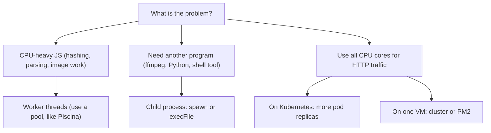

**Comparison:**
| | Worker threads | Child process | Cluster |
|---|---|---|---|
| What it is | Thread in the same process | Separate OS process | N copies of your server process |
| Memory | Own heap, same process | Fully separate | Fully separate |
| Talk by | `postMessage`, `SharedArrayBuffer` | stdin/stdout, IPC channel | IPC; usually no talking |
| Start cost | Some ms and a few MB | Higher | Higher |
| Crash impact | Can crash the process if not handled | Isolated | One worker dies, others serve |
| Best for | CPU work in JS | Running other programs | Using all cores on one machine |
| Java comparison | `ExecutorService` for CPU tasks | `ProcessBuilder` | Running more JVMs |

**Example: worker thread (run with Node 24).**

```javascript
const { Worker, isMainThread, parentPort, workerData } = require('node:worker_threads');

function fib(n) { return n < 2 ? n : fib(n - 1) + fib(n - 2); } // CPU-heavy on purpose

if (isMainThread) {
  const runInWorker = (n) => new Promise((resolve, reject) => {
    const w = new Worker(__filename, { workerData: n });  // same file, worker branch
    w.once('message', resolve);
    w.once('error', reject);
  });

  const tick = setInterval(() => console.log('main loop is still free'), 200);
  runInWorker(40).then((result) => {
    console.log('fib(40) =', result);
    clearInterval(tick);
  });
} else {
  parentPort.postMessage(fib(workerData));          // runs on another thread
}
```

Real output: `main loop is still free` (twice), then `fib(40) = 102334155`. The timer kept firing while the worker computed.

In real apps, do not create a new worker per request. Starting one costs time and memory. Use a pool (for example the *Piscina* library), sized to the number of cores.

**Example: child process (run with Node 24).**

```javascript
const { execFile } = require('node:child_process');

// Separate OS process. execFile does not use a shell, so user input cannot inject commands.
execFile('node', ['--version'], { timeout: 5000 }, (err, stdout) => {
  if (err) throw err;
  console.log('child says:', stdout.trim());   // child says: v24.14.0
});
```

**Example: cluster (run with Node 24).**

```javascript
const cluster = require('node:cluster');
const http = require('node:http');
const os = require('node:os');

if (cluster.isPrimary) {
  const n = Math.min(2, os.availableParallelism()); // usually one per core
  for (let i = 0; i < n; i++) cluster.fork();
  cluster.on('exit', (w) => { console.log(`worker ${w.process.pid} died, starting a new one`); cluster.fork(); });
} else {
  http.createServer((req, res) => res.end(`hello from ${process.pid}\n`))
    .listen(3100);                                 // all workers share port 3100
}
```

Four `curl` calls to port 3100 answered from two different PIDs, taking turns (round-robin is the default on all platforms except Windows).

**Good and bad:**
| Good | Bad |
|---|---|
| Worker threads keep the event loop free for CPU work | Workers do not help with I/O; Node is already async there |
| Child processes isolate risky or non-JS tools | `exec` with a shell plus user input = command injection |
| Cluster uses all cores with no code change | In containers, one process per pod is simpler; cluster hides crashes from Kubernetes |

**Say this in the interview:**

> "I use worker threads for CPU-heavy JavaScript, through a pool, so the event loop stays free. I use child processes to run other programs like ffmpeg, with execFile and no shell. Cluster or PM2 runs one Node process per core on a VM. On Kubernetes I usually skip cluster and just run more small pods, because Kubernetes already restarts and balances them."

**They may ask next:**
- **Process vs thread?** A process has its own memory. A crash stays inside it. Threads live inside one process and can share memory, so they are cheaper but less isolated.
- **Do worker threads share variables?** No. Each has its own heap. You pass messages (copied) or share a `SharedArrayBuffer` with `Atomics`.
- **Can a worker thread speed up a slow database query?** No. The query time is in the database. Workers help only with CPU work inside Node.

---

## Streams and backpressure

**In one line:** A stream moves data in small chunks, and *backpressure* makes a fast producer pause when a slow consumer is full.

**Story:** Think of filling water bottles from a tank with a pipe.
- You do not carry the whole tank at once. Water flows bit by bit (chunks).
- If the bottle is full, you close the tap until the next bottle is ready. That is backpressure.
- Without it, water spills on the floor. In Node, "spilling" means data piling up in memory until the process crashes.

**How it works:**
1. **Readable:** a source of data (file, HTTP request, DB cursor).
2. **Writable:** a destination (file, HTTP response, socket).
3. **Duplex / Transform:** both. A Transform changes data on the way (gzip, CSV formatting).
4. Each stream has a buffer limit called **`highWaterMark`** (default 64 KB for byte streams since Node 22; 16 objects in object mode).
5. `writable.write(chunk)` returns **`false`** when the buffer is above the limit. The producer must stop and wait for the **`'drain'`** event.
6. **`pipeline()`** from `node:stream/promises` connects streams, handles backpressure, forwards errors and closes everything on failure. Prefer it over `.pipe()`, which does not clean up on errors.

**Diagram: CSV export.**


**Example 1: backpressure by hand (run with Node 24).**

```javascript
const { Writable } = require('node:stream');

// A slow consumer: takes 10 ms per chunk, buffer limit of 3 chunks.
const slow = new Writable({
  highWaterMark: 3,
  objectMode: true,
  write(chunk, _enc, done) { setTimeout(done, 10); },
});

let i = 0, pauses = 0;
function produce() {
  while (i < 20) {
    const ok = slow.write(`row ${i++}`);   // false means "my buffer is full"
    if (!ok) {
      pauses++;
      slow.once('drain', produce);         // wait, then continue
      return;
    }
  }
  slow.end(() => console.log(`wrote ${i} rows, paused ${pauses} times`));
}
produce();
```

Real output: `wrote 20 rows, paused 6 times`. Memory stayed small because the producer waited.

**Example 2: export 100,000 rows as a gzipped CSV with `pipeline()`.**

```javascript
// export.mjs (ES module, so top-level await works)
import { pipeline } from 'node:stream/promises';
import fs from 'node:fs';
import zlib from 'node:zlib';

async function* rowsFromDb() {             // pretend: read the DB page by page
  yield 'id,name,amount\n';
  for (let page = 0; page < 100; page++) {
    for (let r = 0; r < 1000; r++) {
      const id = page * 1000 + r;
      yield `${id},customer-${id},${(id % 500) + 0.99}\n`;
    }
  }
}

await pipeline(                            // backpressure, errors and cleanup in one call
  rowsFromDb,
  zlib.createGzip(),
  fs.createWriteStream('orders.csv.gz'),   // in a web handler, use the response object here
);
```

Real result: a 516 KB file with 100,001 lines. The process used about 76 MB RSS in total. Building the whole CSV as one string first would hold every row in memory at once.

In an HTTP handler, pass `res` as the last stage. If the client disconnects, `pipeline` destroys the other streams and stops the DB reads.

**Good and bad:**
| Good | Bad |
|---|---|
| Constant memory for any file size | Harder to debug than "load all, then process" |
| First bytes reach the user fast | Errors in the middle: headers (200 OK) are already sent |
| `pipeline()` cleans up on errors and client disconnects | Ignoring `write()` returning false breaks backpressure |

**When to use / when not to use:**
- Use for big files, uploads, exports, proxying, log processing.
- For a 5 KB JSON response, a normal `res.json()` is simpler.

**Say this in the interview:**

> "Streams process data in chunks, so memory stays flat even for a 10 GB file. Backpressure means the writer tells the reader to slow down: write returns false when the buffer passes highWaterMark, and you wait for drain. I use pipeline from stream/promises, because it handles backpressure, errors and cleanup. For a big CSV export, I stream rows from a DB cursor through a transform and gzip straight into the response."

**They may ask next:**
- **What happens without backpressure?** The fast side keeps buffering in memory. Heap grows until the process crashes with "out of memory".
- **Java equivalent?** Reactive Streams `request(n)` in Java's Flow API or Reactor. Same idea: the consumer controls the speed. See [java-concurrency.md](java-concurrency.md).
- **What is object mode?** The stream moves JS objects instead of bytes. `highWaterMark` then counts objects, not bytes.

---

## EventEmitter in depth

**In one line:** An EventEmitter keeps listeners per event name and calls them **synchronously**, in order, on `emit`.

**Story:** A school bell.
- Teachers "subscribe" by standing near the bell (`on`).
- When the peon rings it (`emit`), every teacher hears it **at that same moment**, one after another. The peon waits until the last teacher has heard it.
- A teacher who only wants the first bell of the day uses `once`.
- If a fire alarm rings (`'error'`) and no one is assigned to it, the whole school is evacuated (the process crashes).

**How it works:**
1. `on(name, fn)` adds `fn` to the list for `name`. `once` adds a wrapper that removes itself after the first call. `off` (same as `removeListener`) removes it.
2. `emit(name, ...args)` calls every listener **right now**, on the same call stack. It is **not** async. `emit` returns `true` if there were listeners.
3. A slow listener blocks the emitter and the event loop. Do heavy work later (`setImmediate`, a queue).
4. **`'error'` is special.** If you emit `'error'` and nobody listens, Node throws the error and the process exits.
5. **Leak warning:** more than **10** listeners for one event prints `MaxListenersExceededWarning`. It is only a warning, but it usually means you add a listener per request and never remove it. Raise the limit with `setMaxListeners(n)` only if you really need more.
6. **Async listeners:** if an `async` listener rejects, the emitter does not see it. Use `new EventEmitter({ captureRejections: true })` to route the rejection to `'error'`.
7. **Promise helpers:** `events.once(emitter, name, { signal })` returns a promise. `events.on(emitter, name, { signal })` returns an async iterator. Both stop when the `AbortSignal` fires.
8. Streams, HTTP servers, sockets and `process` are all EventEmitters.

**Example (run with Node 24).**

```javascript
const { EventEmitter, once } = require('node:events');

const orders = new EventEmitter();
orders.on('created', (o) => console.log('listener 1 got', o.id));
orders.on('created', (o) => console.log('listener 2 got', o.id));
console.log('before emit');
orders.emit('created', { id: 7 });              // runs both listeners now, synchronously
console.log('after emit');

for (let i = 0; i < 11; i++) orders.on('paid', () => {}); // 11 > default 10: leak warning

orders.on('error', (err) => console.log('handled:', err.message)); // without this: crash
orders.emit('error', new Error('payment gateway down'));

(async () => {
  const ac = new AbortController();
  setTimeout(() => ac.abort(), 50);             // stop waiting after 50 ms
  try { await once(orders, 'shipped', { signal: ac.signal }); }
  catch (err) { console.log('stopped waiting:', err.name); }
})();
```

Real output:

```text
before emit
listener 1 got 7
listener 2 got 7
after emit
handled: payment gateway down
(node:PID) MaxListenersExceededWarning: Possible EventEmitter memory leak detected. 11 paid listeners added to [EventEmitter]. MaxListeners is 10. ...
stopped waiting: AbortError
```

`after emit` comes after both listeners. That proves `emit` is synchronous.

**Why `process.nextTick` is used with emitters:** a constructor that emits an event right away fires before the caller can attach a listener. Emitting inside `process.nextTick` gives the caller time to call `.on()` first.

**Good and bad:**
| Good | Bad |
|---|---|
| Simple, decoupled: the emitter does not know who listens | Listeners run synchronously; one slow listener slows everyone |
| Built into streams, sockets and servers | Forgotten listeners are a classic memory leak |
| `once()` and `on()` with `AbortSignal` work with `await` | Errors in async listeners are lost unless `captureRejections` is on |
| Good for in-process events | Not durable: if the process dies, events are gone. Use Kafka or a queue across services |

**Say this in the interview:**

> "EventEmitter keeps a list of listeners per event and calls them synchronously, in order, when you emit. So a slow listener blocks the emitter. The 'error' event is special: with no listener the process crashes, so I always attach one to streams and sockets. The max listeners warning at 10 usually means a leak, like adding a listener per request. For async code I use events.once with an AbortSignal, so I never wait forever."

**They may ask next:**
- **Is `emit` async?** No. Listeners run before `emit` returns. Only if a listener itself schedules async work does anything happen later.
- **EventEmitter vs Kafka?** EventEmitter is in-memory, in one process, with no retry or storage. Kafka is durable and works across services. See [kafka.md](kafka.md).
- **How do you remove a listener added with `once`?** `off(name, sameFn)` works, because Node remembers the original function inside the wrapper. With `AbortSignal` you can also pass `{ signal }` to `events.on`/`events.once`.
- **What is `EventTarget`?** The browser-style API (`addEventListener`). Node has it too, and `AbortSignal` is one. EventEmitter is the older Node-only API.

---

## Buffers and binary data

**In one line:** A `Buffer` is a fixed-size chunk of raw bytes (a subclass of `Uint8Array`), used for files, sockets, images and any binary protocol.

**Story:** A string is a written letter. A Buffer is the envelope of bytes the post office actually carries. To read the letter, you must know the language it was written in. That "language" is the *encoding* (UTF-8, base64, hex).

**How it works:**
1. `Buffer` extends `Uint8Array`. Any API that takes a `Uint8Array` also takes a Buffer.
2. **Create:** `Buffer.from('text', 'utf8')`, `Buffer.from(arrayBuffer)`, `Buffer.alloc(n)` (zero-filled, safe), `Buffer.allocUnsafe(n)` (faster, but may contain old memory: fill it before reading).
3. **Encodings:** `utf8` (default), `hex`, `base64`, `base64url` (safe in URLs and JWTs), `latin1`, `utf16le`.
4. **Length is bytes, not characters.** `'₹'` is 1 character but 3 bytes in UTF-8.
5. **`subarray` shares memory.** Changing the slice changes the original. Use `Buffer.from(buf)` to copy.
6. Buffer memory lives **outside the V8 heap**. It shows as `external` / `arrayBuffers` in `process.memoryUsage()`, not in `heapUsed`.
7. Small `allocUnsafe` and `Buffer.from` calls are cut from a shared 8 KB pool (`Buffer.poolSize`). Keeping one tiny slice alive keeps the whole 8 KB alive.
8. **Multi-byte characters split across chunks:** a UTF-8 character can arrive in two network chunks. Use `StringDecoder` or `setEncoding('utf8')` on the stream, not `chunk.toString()` per chunk.

**Example (run with Node 24).**

```javascript
const b = Buffer.from('Hi ₹', 'utf8');           // ₹ takes 3 bytes in UTF-8
console.log(b, 'bytes:', b.length, 'chars:', 'Hi ₹'.length);
console.log(b.toString('hex'), b.toString('base64'), b.toString('base64url'));
console.log(b instanceof Uint8Array);            // true: Buffer is a Uint8Array
console.log(b.subarray(0, 4).toString());        // cuts ₹ in half: shows a replacement char

const header = Buffer.alloc(6);
header.writeUInt16BE(0xCAFE, 0);                 // binary protocol: big-endian 2 bytes
header.writeUInt32BE(1024, 2);                   // payload length
console.log(header, header.readUInt32BE(2));

const { StringDecoder } = require('node:string_decoder');
const d = new StringDecoder('utf8');
console.log(d.write(b.subarray(0, 4)) + d.write(b.subarray(4))); // joins split bytes correctly
```

Real output:

```text
<Buffer 48 69 20 e2 82 b9> bytes: 6 chars: 4
486920e282b9 SGkg4oK5 SGkg4oK5
true
Hi �
<Buffer ca fe 00 00 04 00> 1024
Hi ₹
```

**Buffer vs Uint8Array:**
| | `Buffer` | `Uint8Array` |
|---|---|---|
| Where | Node only (and Bun, Deno for compatibility) | Standard JS: browsers, Node, workers |
| Extras | `toString(encoding)`, `readUInt32BE`, `equals`, `compare` | Plain bytes; use `TextEncoder`/`TextDecoder` for text |
| Use for | Node APIs, binary protocols | Code shared with the browser, Web Streams, `fetch` bodies |

**Good and bad:**
| Good | Bad |
|---|---|
| Fast raw bytes, outside the JS heap | `allocUnsafe` can leak old memory if you send it before filling it |
| Easy encodings: hex, base64, base64url | `toString()` per chunk breaks multi-byte characters |
| Works with all `Uint8Array` APIs | Reading a 2 GB file into one Buffer is slow and risky; stream it |

**Say this in the interview:**

> "A Buffer is a fixed-size block of bytes and a subclass of Uint8Array. Its memory lives outside the V8 heap, so a Buffer leak shows in RSS, not in heapUsed. Length is in bytes, not characters, so a rupee sign is three bytes. I use Buffer.alloc unless I fill the memory right away, and StringDecoder when text arrives in chunks. For big files I stream instead of loading one huge Buffer."

**They may ask next:**
- **How do you compare two secrets safely?** `crypto.timingSafeEqual(a, b)` with Buffers of the same length. A normal `===` returns early and leaks timing.
- **base64 vs base64url?** base64url uses `-` and `_` instead of `+` and `/`, and drops `=` padding. JWTs use base64url.
- **Why is RSS high but heap small?** Often Buffers: big uploads held in memory, or many small slices keeping 8 KB pool blocks alive.

---

## Async error handling

**In one line:** Await or `.catch()` every promise, handle expected failures in place, and let unknown bugs crash the process so it restarts clean.

**Story:** A courier company has two kinds of problems.
- **Expected problems:** "customer not home", "wrong address". The courier has a rule for each: try again tomorrow, call the customer.
- **Bugs:** the van's brakes are broken. You do not "handle" this on the road. You stop the van and send it to the garage.
- Node errors are the same. The first kind are *operational errors*. The second kind are *programmer errors*.

**How it works:**
1. **Callbacks (old style):** the first argument is the error: `fs.readFile(path, (err, data) => ...)`. Errors thrown inside a callback are not caught by an outer `try/catch`.
2. **Promises:** `.then(onOk).catch(onError)`. A rejected promise with no handler is an *unhandled rejection*.
3. **async/await:** `await` turns a rejected promise back into a thrown error. A normal `try/catch` works again.
4. **Since Node 15, an unhandled rejection crashes the process** (default mode `--unhandled-rejections=throw`).
5. **`process.on('uncaughtException')` / `('unhandledRejection')`:** last-chance hooks. Use them to log and shut down, not to keep running.

**Operational vs programmer errors:**
| | Operational error | Programmer error |
|---|---|---|
| What | Expected failure of the outside world | A bug in our code |
| Examples | DB timeout, 404 from another service, bad user input, disk full | `undefined is not a function`, wrong argument, forgot `await` |
| Handle by | Retry, fallback, return 4xx/5xx | Fix the code |
| At runtime | Catch and respond | Log, crash, let the orchestrator restart |

**Example 1: unhandled rejection crashes the process (real run).**

```javascript
async function loadUser() { throw new Error('db is down'); }
loadUser();                                   // no await, no .catch()
setTimeout(() => console.log('never printed'), 100);
```

Real result: Node prints `Error: db is down` with the stack and exits with **code 1**. `never printed` is never printed.

**Example 2: timeout with `fetch` and `AbortSignal` (run with Node 24).**

```javascript
async function getPaymentStatus(id) {
  try {
    const res = await fetch(`http://localhost:3300/payments/${id}`, {
      signal: AbortSignal.timeout(800),          // give up after 800 ms
    });
    if (!res.ok) throw new Error(`payment service said ${res.status}`);
    return await res.text();
  } catch (err) {
    if (err.name === 'TimeoutError') return 'UNKNOWN'; // operational error: fallback
    throw err;                                         // anything else: let it go up
  }
}
```

Against a server that answers after 3 seconds, this printed `status: UNKNOWN` after 800 ms.
- Built-in `fetch` has **no timeout by default**. Always pass a signal. Same rule as Java clients, see [microservices.md](microservices.md#timeouts).
- `AbortSignal.any([userCancel, AbortSignal.timeout(800)])` combines a user cancel with a timeout.
- A timeout does not prove the server did nothing. Retries need idempotency. See [microservices.md](microservices.md#retry-with-exponential-backoff-and-jitter).

**Example 3: last-chance handlers.**

```javascript
process.on('unhandledRejection', (reason) => {
  logger.fatal({ err: reason }, 'unhandled rejection'); // log with context
  shutdown('unhandledRejection', 1);                    // graceful stop, then exit code 1
});
process.on('uncaughtException', (err) => {
  logger.fatal({ err }, 'uncaught exception');
  shutdown('uncaughtException', 1);                     // state may be broken: do not continue
});
```

`shutdown` is like the function in [Graceful shutdown](#graceful-shutdown), with an extra exit code argument. `logger` is your logger (for example pino).

**Common mistakes:**
- **Forgetting `await`:** `try { save(order) } catch {}` catches nothing, because `save` returns a promise.
- **`forEach` with async:** `items.forEach(async (i) => await save(i))` does not wait. Use `for...of` with `await`, or `Promise.all`.
- **`Promise.all` fails fast:** one rejection rejects all. Use `Promise.allSettled` when you want every result.
- **Throwing strings:** `throw 'oops'` has no stack trace. Always throw `Error` objects.
- **Event emitters:** an `'error'` event with no listener crashes the process. Always add `.on('error')` to streams and sockets.

**Good and bad:**
| Good | Bad |
|---|---|
| `async/await` + `try/catch` reads like Java | Easy to forget `await` (use the ESLint rule `no-floating-promises` from typescript-eslint) |
| Crash on unknown errors keeps state clean | Without a restart policy, one bug means downtime |
| `AbortSignal.timeout` is built in | Some libraries ignore the signal; check them |

**Say this in the interview:**

> "I separate operational errors, like a timeout or bad input, from programmer errors, which are bugs. Operational errors I handle in place with retries, fallbacks or a clear 4xx or 5xx. Programmer errors I log and let the process crash, because its state may be broken, and Kubernetes restarts it. Every promise is awaited or caught, and every outgoing call has an AbortSignal timeout."

**They may ask next:**
- **Promise vs callback?** A promise is an object for a future result. You can chain it, combine it (`Promise.all`) and use `await`. Callbacks nest deeply and handle errors by hand.
- **What does async/await really do?** An `async` function always returns a promise. `await` pauses that function and gives the thread back. The rest runs later as a microtask.
- **Why not just catch everything in `uncaughtException` and continue?** After an unknown error, open transactions, locks or half-written data may be wrong. Restarting is safer.

---

## Modules: CommonJS, ES modules and package.json

**In one line:** `require` loads and caches files synchronously, ES modules are linked before they run, and `exports` in package.json sets a package's public files.

The basics (syntax, `"type": "module"`, `require(esm)`) are in [ESM vs CommonJS](#esm-vs-commonjs). This section adds how loading really works.

**Story:** A library.
- **CommonJS** is a librarian who fetches each book the moment you ask, and keeps a copy on the desk. Ask again and you get the **same copy** from the desk (the cache).
- **ES modules** is a librarian who first reads your whole reading list and collects every book. She checks that every chapter you mention exists. Only then can you start reading.
- **`exports` in package.json** is the "reference only" sign: you may read the public shelves, not the back room.

**How CommonJS `require('x')` finds a file:**
1. **Core module?** `node:fs` or `fs`: return it.
2. **Starts with `./`, `../` or `/`?** Try the exact file, then add `.js`, `.json`, `.node`. If it is a folder, use its `package.json` `"main"`, else `index.js`.
3. **Bare name (`express`)?** Look in `./node_modules`, then `../node_modules`, and so on up to the root.
4. Inside the package, `"exports"` (if present) wins over `"main"`, and blocks every path it does not list.
5. **Cache:** the module runs **once**. Its `module.exports` is stored in `require.cache` by full file path. Every later `require` gets the same object. That is why a module works like a singleton.
6. **Circular requires:** if A requires B and B requires A, B gets A's **unfinished** `exports` (often `{}`). Fix by moving shared code to a third module.

**Diagram: CommonJS resolution.**

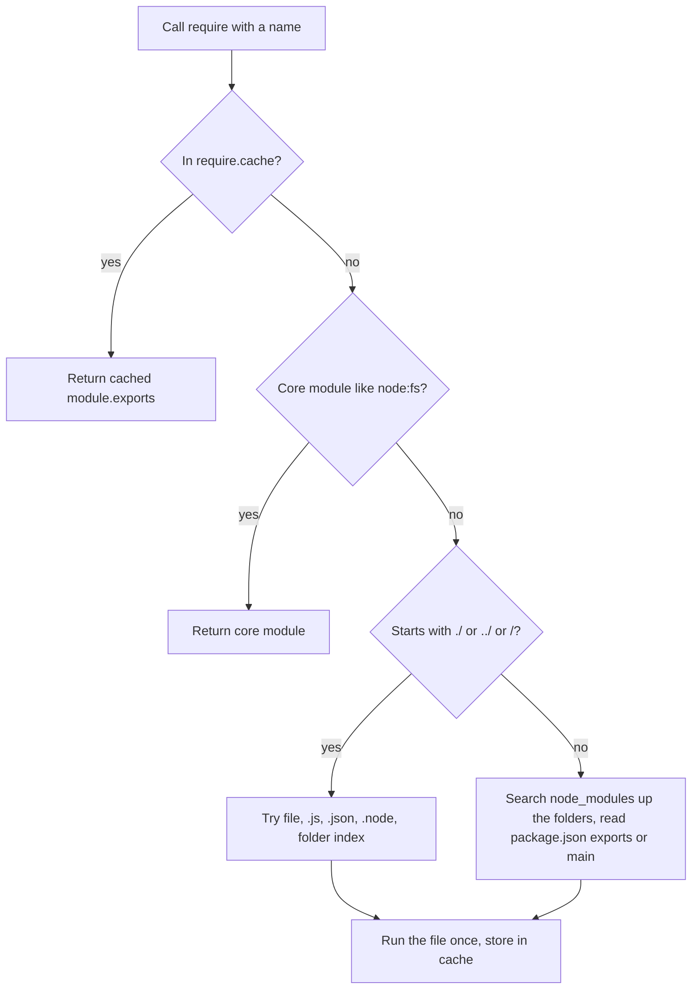

**How ES modules load (three steps):**
1. **Parse and find imports.** Node reads the file and finds all static `import` lines **before running anything**. Then it loads those files the same way.
2. **Link.** Node connects every `import { x }` to the matching `export`. A missing export fails here, before any code runs.
3. **Evaluate.** Code runs, children first. Top-level `await` is allowed.
- Imports are **live bindings**: if the exporting module changes a `let`, importers see the new value.
- Relative imports need the file extension: `import './db.js'`, not `'./db'`.
- `import()` (dynamic import) loads a module later and returns a promise. It works in both CommonJS and ESM.
- There is no `require.cache` for ESM. You cannot "reload" a module by deleting a cache entry.

**package.json fields that matter:**
| Field | What it does |
|---|---|
| `"type": "module"` | `.js` files in this package are ESM. Without it they are CommonJS |
| `"main"` | Old entry point. Ignored when `"exports"` exists |
| `"exports"` | The public entry points. Anything not listed gives `ERR_PACKAGE_PATH_NOT_EXPORTED` |
| Conditions in `"exports"` | `"import"`, `"require"`, `"module-sync"`, `"node"`, `"default"` (Node); `"types"` (TypeScript) |
| `"imports"` | Private aliases that start with `#`, like `#config`. Only code inside the package can use them. Node's answer to TS `paths` |

**Example: a dual package (run with Node 24).**

```json
{
  "name": "shop-utils",
  "type": "module",
  "exports": {
    ".": { "import": "./src/index.js", "require": "./src/index.cjs" },
    "./money": "./src/money.js"
  },
  "imports": { "#config": "./internal/config.js" }
}
```

```javascript
// app.cjs
const a = require('./counter.js');
const b = require('./counter.js');        // from require.cache, not run again
a.inc(); console.log('same object?', a === b, 'count via b =', b.inc());
console.log(require('shop-utils').who);     // "require" condition -> CJS build
try { require('shop-utils/src/money.js'); } catch (e) { console.log(e.code); } // not in "exports"
```

Real output: `counter.js runs` (printed once), `same object? true count via b = 2`, `cjs build`, `ERR_PACKAGE_PATH_NOT_EXPORTED`. The same package loaded with `import` printed `esm build`, and `#config` resolved inside the package.

**The dual package hazard:**
- A package ships both a CJS build and an ESM build.
- One part of your app `require`s it, another part `import`s it. Now **two copies** are loaded.
- Two copies means two singletons, two caches, and `instanceof` checks that fail.
- Fixes: ship one real implementation and a thin wrapper for the other format, or ship ESM only and rely on `require(esm)` (default in Node 22.12+ and 20.19+).

**Good and bad:**
| Good | Bad |
|---|---|
| ESM is the standard: same in browsers and Node, top-level `await`, static analysis for tree shaking | Mixing CJS and ESM in one app causes confusing errors and dual copies |
| `exports` hides internal files, so a library can change them safely | Adding `exports` to an old package is a breaking change for deep imports |
| `imports` with `#` gives clean internal aliases without a bundler | Jest and older tools needed extra setup for ESM |

**Say this in the interview:**

> "CommonJS require is synchronous. It resolves the path, runs the file once, and caches module.exports by file name, so every require gets the same object. ES modules are parsed and linked before any code runs, so a missing export fails early, and imports are live bindings. In package.json, exports defines the public entry points and the import or require conditions, and imports gives private hash aliases. I start new projects as ESM, and I watch for the dual package hazard, where a package gets loaded twice."

**They may ask next:**
- **How do you mock or reload a CommonJS module?** Delete it from `require.cache` and require again. Test tools do this. For ESM, test runners use loader hooks instead.
- **Why is `__dirname` missing in ESM?** ESM uses URLs. Use `import.meta.dirname` and `import.meta.filename`.
- **What is `module-sync`?** An exports condition that matches for both `import` and `require`, for packages whose ESM has no top-level `await`, so `require(esm)` can load it.
- **Does `require` block the event loop?** Yes, it reads files synchronously. That is fine at start-up, bad inside a request handler.

---

## Building APIs: Express, Fastify, NestJS

**In one line:** Express is the simple classic, Fastify is fast with built-in schemas, and NestJS is Spring-like with modules and DI.

**Story:** Three ways to open a food stall.
- **Express:** a plain cart. You bring every tool yourself. Everyone knows how to run one.
- **Fastify:** a cart with a built-in weighing scale and order checker. Faster service, a few house rules.
- **NestJS:** a franchise kit. Fixed layout, manuals, roles for each staff member. Great for big teams, more to learn.

**Comparison (versions as of November 2026):**
| | Express | Fastify | NestJS |
|---|---|---|---|
| Latest major | 5 (5.3.0) | 5 (5.12.x) | 12 (12.5.0) |
| Style | Minimal, middleware chain | Plugins and hooks | Modules, DI, decorators (like Spring) |
| Validation | Bring your own (Zod, Joi) | JSON Schema built in | `ValidationPipe` + class-validator, or Zod |
| Speed | Good | Among the fastest | Runs on Express (default) or Fastify |
| TypeScript | Optional | Good types | TypeScript first |
| Learning curve | Lowest | Low | Highest |
| Best for | Small services, prototypes, existing code | High-traffic APIs, BFFs | Large teams, Java/Spring developers |

### Middleware

A *middleware* is a function that runs before your handler. It can read or change the request, stop it, or call `next()`. It is the same idea as a Spring `Filter` or `HandlerInterceptor`.

**Example: Express 5 with Helmet, a logger, Zod validation and an error handler (run with Node 24).**

```javascript
import express from 'express';
import helmet from 'helmet';
import { z } from 'zod';

const app = express();
app.use(helmet());                                   // safe HTTP headers
app.use(express.json({ limit: '100kb' }));           // body size limit
app.use((req, res, next) => {                        // logging middleware
  const start = performance.now();
  res.on('finish', () => console.log(req.method, req.url, res.statusCode, `${Math.round(performance.now() - start)}ms`));
  next();                                            // pass to the next middleware
});

const CreateOrder = z.object({ productId: z.string().min(1), qty: z.number().int().positive() });

app.post('/orders', async (req, res) => {
  const order = CreateOrder.parse(req.body);         // throws ZodError if invalid
  res.status(201).json({ id: 'ord_1', ...order });   // Express 5: async errors reach the error handler
});

app.use((err, req, res, next) => {                   // error middleware: 4 arguments
  if (err instanceof z.ZodError) return res.status(400).json({ errors: err.issues });
  console.error(err);
  res.status(500).json({ error: 'internal error' });
});
app.listen(3500);
```

Real result: a good body returned `201`. A body with `productId: ""` and `qty: -1` returned `400` with two Zod issues.
Express 5 forwards rejected promises from async handlers to the error middleware. In Express 4 you needed a wrapper for that.

**Example: Fastify with JSON Schema (run with Node 24).**

```javascript
import Fastify from 'fastify';
const app = Fastify({ logger: true });               // pino logger built in

app.post('/orders', {
  schema: {                                          // validates input before the handler runs
    body: {
      type: 'object',
      required: ['productId', 'qty'],
      properties: { productId: { type: 'string', minLength: 1 }, qty: { type: 'integer', minimum: 1 } },
    },
  },
}, async (req, reply) => {
  reply.code(201);
  return { id: 'ord_1', ...req.body };              // returning a value sends it
});
await app.listen({ port: 3600 });
```

Real result: `qty: 0` returned `400` with `"body/qty must be >= 1"`. An output schema (`response`) also makes JSON serialization faster.

### NestJS for Java/Spring developers

NestJS will feel familiar. It copies many Spring ideas.

| Spring | NestJS |
|---|---|
| `@RestController`, `@GetMapping` | `@Controller('orders')`, `@Get()` |
| `@Service`, `@Component` | `@Injectable()` provider |
| Constructor injection | Constructor injection (by TypeScript type) |
| `@Configuration` + component scan | `@Module({ providers, controllers, imports })` |
| `@Valid` + Bean Validation | `ValidationPipe` + DTO class with class-validator |
| `@ControllerAdvice` | Exception filters |
| Spring Security filters / `@PreAuthorize` | Guards |
| AOP / `HandlerInterceptor` | Interceptors |
| `@ConfigurationProperties` | `ConfigModule` |
| Spring Data JPA | TypeORM, Prisma or MikroORM |

```typescript
@Injectable()
export class OrderService {
  constructor(private readonly repo: OrderRepository) {}      // injected, like Spring
  create(dto: CreateOrderDto) { return this.repo.save(dto); }
}

@Controller('orders')
export class OrderController {
  constructor(private readonly orders: OrderService) {}
  @Post()
  create(@Body() dto: CreateOrderDto) {                        // validated by a global ValidationPipe
    return this.orders.create(dto);
  }
}

@Module({ controllers: [OrderController], providers: [OrderService, OrderRepository] })
export class OrderModule {}
```

Differences from Spring to know:
- There is no `@Transactional` built in. Transactions come from the ORM (for example a TypeORM `DataSource.transaction()` callback).
- Everything still runs on one event loop. A blocking provider blocks the whole app.
- NestJS uses TypeScript decorators, so it needs a build step (`tsc` or SWC). Node's built-in type stripping does not support decorators.

### Request context with AsyncLocalStorage

In Spring, you put the request id in the logging MDC (it uses a `ThreadLocal`). In Node, many requests share one thread, so a thread-local value does not work. `AsyncLocalStorage` (from `node:async_hooks`, stable) keeps a value across all `await`s of one request. Loggers like pino and OpenTelemetry use it for trace ids.

### Structure of a production service

```text
src/
  main.ts              # start server, wire shutdown hooks
  config.ts            # read and validate env vars once (Zod), fail fast if missing
  routes/              # thin HTTP layer: parse, validate, call service
  services/            # business logic, no HTTP objects here
  repositories/        # DB access (pool, queries)
  clients/             # outgoing HTTP/Kafka clients with timeouts and retries
  middleware/          # auth, request id, logging, rate limit
  health.ts            # /live and /ready endpoints
test/                  # node:test or Vitest; integration tests with Testcontainers
```

Must-haves: structured JSON logs (pino), OpenTelemetry traces and metrics, health endpoints, config validation at start-up, timeouts on every outgoing call, and graceful shutdown. More in [production-ready.md](production-ready.md).

**Good and bad:**
| Good | Bad |
|---|---|
| Express: everyone knows it, huge middleware choice | Express: no structure; each team invents its own |
| Fastify: fast, schemas give validation and docs | Fastify: plugin and encapsulation rules take time to learn |
| NestJS: Spring-like structure, easy for Java teams | NestJS: more magic, heavier, decorators need a build step |

**Say this in the interview:**

> "For a small service I pick Express or Fastify. Fastify is faster and has JSON Schema validation built in. For a large team, especially Java developers, I like NestJS, because modules, providers and constructor injection map almost one to one to Spring. Whatever the framework, I validate every input at the edge with Zod or JSON Schema, keep handlers thin, and put logic in services."

**They may ask next:**
- **What is Express middleware?** A function `(req, res, next)`. It runs in order. Call `next()` to continue, or send a response to stop. Error middleware has 4 arguments.
- **Why validate at runtime if we use TypeScript?** Types disappear at runtime. A request body is just unknown JSON. Zod or JSON Schema checks the real data.
- **How do you pass a request id to logs?** With `AsyncLocalStorage`, like MDC in Java.

---

## Validation, API design and rate limiting

**In one line:** One schema validates input and generates docs, errors share one format, and rate limits use a shared store.

**Story:** A railway reservation counter.
- The clerk checks the form **before** booking: name filled, age is a number, date is in the future. A wrong form goes back at once with a clear note: "age must be a number". That is validation and a good error format.
- A printed list on the wall shows every form type and its fields. That is OpenAPI.
- One person cannot book 500 tickets in a minute. The counter counts per person. That is rate limiting.

**How it works:**
1. **One schema, three jobs.** A schema (Zod, or JSON Schema built with TypeBox) gives you: runtime validation, TypeScript types, and OpenAPI docs.
2. **Validate at the edge.** Parse `body`, `params`, `query` and `headers` in the route layer. Services get clean, typed data.
3. **Reject unknown fields** (`z.strictObject` in Zod 4, `additionalProperties: false` in JSON Schema). This also blocks prototype pollution (see [Security in Node](#security-in-node)).
4. **Coerce carefully.** Query strings are always strings. Use `z.coerce.number()` for `?page=2`.
5. **One error format.** Use RFC 9457 *Problem Details* (`application/problem+json`): `type`, `title`, `status`, `detail`, plus a list of field errors. Spring returns the same shape with `ProblemDetail`, see [spring-ecosystem.md](spring-ecosystem.md#global-error-handling-with-restcontrolleradvice-and-problemdetail).
6. **OpenAPI from code.** Fastify: `@fastify/swagger` reads route schemas. Zod 4: `z.toJSONSchema()` is built in; libraries like `zod-openapi` build full specs. NestJS: `@nestjs/swagger`.
7. **Rate limit** per user or API key, not only per IP. Keep counters in Redis so all pods share one count. Return `429` with a `Retry-After` header.

**Diagram: the request path.**

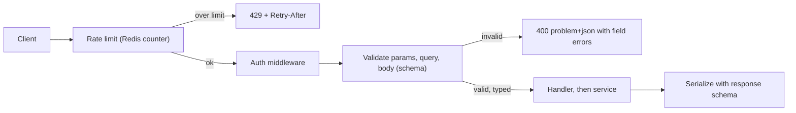

**Example: Zod schema, problem details and the same schema as JSON Schema.**

```javascript
import { z } from 'zod';

const CreateOrder = z.strictObject({                   // unknown keys are rejected
  productId: z.string().min(1),
  qty: z.number().int().positive().max(100),
  coupon: z.string().optional(),
});

export function validate(schema) {
  return (req, res, next) => {
    const r = schema.safeParse(req.body);
    if (r.success) { req.body = r.data; return next(); } // clean, typed data from here on
    res.status(400).type('application/problem+json').json({
      type: 'https://api.example.com/problems/validation',
      title: 'Invalid request', status: 400,
      errors: r.error.issues.map((i) => ({ field: i.path.join('.'), message: i.message })),
    });
  };
}
// app.post('/orders', validate(CreateOrder), createOrderHandler);
console.log(z.toJSONSchema(CreateOrder));               // feed this into your OpenAPI spec
```

**Good API habits in Node:**
- **Pagination:** cursor based (`?after=ord_123&limit=50`) for big lists; cap `limit`.
- **Idempotency keys** on `POST` that create money or orders: store the key and response in Redis or the DB. See [microservices.md](microservices.md#idempotency).
- **Response schemas** (Fastify `response`) stop accidental leaks like `passwordHash` and make JSON output faster.
- **Body size limits:** `express.json({ limit: '100kb' })`; Fastify has `bodyLimit` (1 MB default).
- **Versioning:** `/v1/...` in the path is the simplest to explain and to route.

**Rate limiting options:**
| Option | Where the count lives | Note |
|---|---|---|
| `express-rate-limit` default store | Memory of one pod | Real limit = limit × number of pods |
| `express-rate-limit` + a Redis store, or `rate-limiter-flexible` | Redis | One shared count for all pods |
| `@fastify/rate-limit` with Redis | Redis | Fastify plugin |
| API gateway / NGINX / cloud WAF | The gateway | Stops abuse before it reaches Node |

The algorithms (token bucket, sliding window) are in [system-design.md](system-design.md#rate-limiting-algorithms). A token bucket you can write in an interview is in [the coding problems](#nodejs-coding-problems-with-answers).

**Good and bad:**
| Good | Bad |
|---|---|
| One schema gives types, validation and docs | Hand-written `if` checks drift from the docs |
| `strictObject` blocks unexpected fields | Too strict on responses from other services breaks you when they add a field |
| Shared rate limit counters in Redis | Every request now does a Redis call; keep it fast or limit at the gateway |

**Say this in the interview:**

> "I validate params, query and body at the edge with one schema, usually Zod or TypeBox with Fastify. The same schema gives TypeScript types and OpenAPI docs, so docs never drift. Unknown fields are rejected. Errors use one format, RFC 9457 problem details, with a list of field errors. Rate limits are per user or API key, counted in Redis so all pods share the count, and I return 429 with Retry-After."

**They may ask next:**
- **Zod or JSON Schema?** Zod is nicer to write in TypeScript. JSON Schema (via TypeBox) is the native format for Fastify and OpenAPI and is very fast to validate. Both are fine; pick one per service.
- **Why validate if the frontend already validates?** Anyone can call the API directly with curl. The server is the only place you can trust.
- **400 or 422 for validation errors?** Both are used. Pick one and be consistent. 400 is the most common.
- **How do you rate limit login?** Per account and per IP, with a small limit and growing delay, so password guessing is slow. Also log and alert.

---

## Configuration and secrets

**In one line:** Read env vars once at start-up, validate them with a schema, fail fast, and keep secrets in a secret manager.

**Story:** A pilot's pre-flight checklist. Before take-off, the pilot checks fuel, doors and flaps. If one item fails, the plane does not leave the gate. It is much better to find a problem on the ground than in the air. A Node service should check its config the same way, before it takes the first request.

**How it works:**
1. **Twelve-factor rule:** config that changes between environments (URLs, ports, keys) comes from **environment variables**, not from code.
2. **Local development:** `node --env-file=.env app.js` (or `--env-file-if-exists`). Both are no longer experimental since Node 24.10 and 22.21. Real environment variables win over the file. `dotenv` is no longer needed for this.
3. **Validate once, at start-up,** in one `config` module. Use a schema (Zod, or `env-schema` with JSON Schema). Convert types: env vars are always strings.
4. **Fail fast:** a missing `DATABASE_URL` should stop the process with a clear message and exit code 1, not crash later on the first request.
5. **The rest of the code imports `config`,** never `process.env` directly. Easy to test, easy to find every setting.
6. **Secrets in production** come from a secret manager or Kubernetes Secrets. Examples: AWS Secrets Manager, GCP Secret Manager, Azure Key Vault, HashiCorp Vault. They arrive as env vars or mounted files.
7. **Never log config values.** Log only the names that failed. Redact tokens in logs.
8. `NODE_ENV=production` changes library behaviour (Express caches views and hides stack traces). Set it in production images.

**Diagram: start-up config check.**

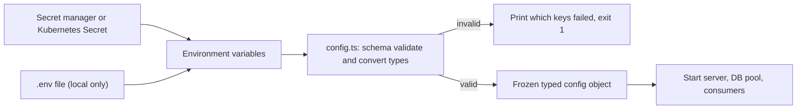

**Example: validated config (run with Node 24 and Zod 4).**

```javascript
// config.mjs   run: node --env-file=.env config.mjs
import { z } from 'zod';

const Env = z.object({
  NODE_ENV: z.enum(['development', 'test', 'production']).default('development'),
  PORT: z.coerce.number().int().min(1).max(65535).default(3000), // env vars are strings
  DATABASE_URL: z.url(),                                          // must be a valid URL
  JWT_SECRET: z.string().min(32, 'JWT_SECRET must be at least 32 chars'),
  LOG_LEVEL: z.enum(['debug', 'info', 'warn', 'error']).default('info'),
});

const parsed = Env.safeParse(process.env);
if (!parsed.success) {
  console.error('Invalid config:\n' + z.prettifyError(parsed.error)); // never print the values
  process.exit(1);                                                   // fail fast at start-up
}
export const config = Object.freeze(parsed.data);                    // typed and read-only
```

Real output with a short secret: `Invalid config: ✖ JWT_SECRET must be at least 32 chars → at JWT_SECRET`, exit code 1. With a good `.env`: `config ok, port 8080`.

**Secrets: good and bad places:**
| Place | OK? | Why |
|---|---|---|
| Hard-coded in source | No | In git history forever |
| `.env` committed to git | No | Same; add `.env` to `.gitignore`, commit `.env.example` |
| Baked into the Docker image (`ENV API_KEY=...`) | No | Anyone who pulls the image can read it (`docker history`) |
| Env var injected at runtime from a secret manager | Yes | Common and simple |
| Mounted file from Kubernetes Secret or Vault agent | Yes | Can rotate without a new image; not visible in `env` dumps |
| Fetched by the app from the secret manager at start-up | Yes | Needs cloud credentials (workload identity) and a retry |

**Good and bad:**
| Good | Bad |
|---|---|
| Fail fast at start-up gives a clear error in the deploy log | Without validation, a typo in a var name shows up as a strange bug days later |
| Built-in `--env-file` removes a dependency | `.env` files tend to get copied around and committed |
| One typed config module is easy to test | Env vars are read once; rotating a secret needs a restart unless you reload it |

**Say this in the interview:**

> "Config comes from environment variables. Locally I load a .env file with node --env-file, which is built in now. At start-up one config module validates everything with Zod and converts types. If something is missing, it exits with a clear message, so a bad deploy fails before it takes traffic. The rest of the code imports that typed config, not process.env. In production, secrets come from a secret manager or Kubernetes Secrets, never from git or the image, and I never log their values."

**They may ask next:**
- **How do you rotate a secret without downtime?** Support two valid values for a while (old and new key), roll out the new one, then remove the old one. For DB passwords, the secret manager can rotate and the pool reconnects.
- **Spring equivalent?** `@ConfigurationProperties` with `@Validated`. Same idea: typed, validated at start-up.
- **Is a Kubernetes Secret encrypted?** Only base64 by default. Turn on encryption at rest in etcd and limit who can read Secrets with RBAC. See [docker-kubernetes.md](docker-kubernetes.md).

---

## Authentication and authorization in Node APIs

**In one line:** Authentication proves who you are (session or JWT); authorization decides what you may do, on every request.

**Story:** A company office.
- **Session:** at the gate you show your ID. The guard writes your name in a register and gives you a visitor slip with a number. Each time, the guard looks up the number in the register. He can cancel your slip any time.
- **JWT:** the guard gives you a sealed, signed badge with your name, team and "valid until 6 PM". Any door can check the seal without calling the gate. But if you are fired at 2 PM, the badge still opens doors until 6 PM.
- **Authorization:** even with a valid badge, only finance people enter the finance room.

The same ideas for Spring are in [Spring Security](spring-ecosystem.md#spring-security), [Authentication vs authorization](spring-ecosystem.md#authentication-vs-authorization) and [JWT and OAuth2 resource server](spring-ecosystem.md#jwt-and-oauth2-resource-server).

**How it works:**
1. **Passwords:** store only a slow, salted hash. **argon2id** first choice (npm `argon2`; Node 24.7+ also has `crypto.argon2`), **bcrypt** is still fine. Never SHA-256 alone; it is too fast to brute force.
2. **Sessions:** after login, create a random session id, store `{ userId, roles }` in Redis, send the id as a cookie: `HttpOnly`, `Secure`, `SameSite=Lax`. Logout = delete the Redis key. Libraries: `express-session` with a Redis store, `@fastify/session`.
3. **JWT access tokens:** a signed JSON token (`header.payload.signature`). The API verifies the signature and claims (`exp`, `iss`, `aud`) with no DB call. Keep them short-lived (5-15 minutes). Library: `jose`.
4. **Refresh tokens:** a long-lived, random, **opaque** token stored server-side (hashed). Used only to get a new access token. **Rotate** it on every use; if an old one is reused, someone stole it: revoke the whole family.
5. **Where to keep tokens in a browser:** prefer an `HttpOnly` cookie (JS cannot read it, so XSS cannot steal it). Add CSRF protection (`SameSite` plus a CSRF token for cookie-based APIs). `localStorage` is readable by any injected script.
6. **OAuth2 / OIDC ("Login with Google", company SSO):** use a library, not your own code.
   - **Passport:** strategy-based middleware for Express. Old but still common.
   - **Auth.js** (formerly NextAuth.js): now maintained by the Better Auth team, mainly security fixes.
   - **Better Auth:** a newer, full auth framework for TypeScript.
   - A hosted identity provider: Keycloak, Auth0, Cognito, Entra ID.
7. **Authorization:** check on the server, every request. **RBAC** (role-based: `admin`, `support`) in middleware; **ownership** checks (`order.userId === req.user.id`) in the service. Missing ownership checks cause *IDOR* (insecure direct object reference: user A reads `/orders/123` of user B).

**Diagram: sessions vs JWT.**

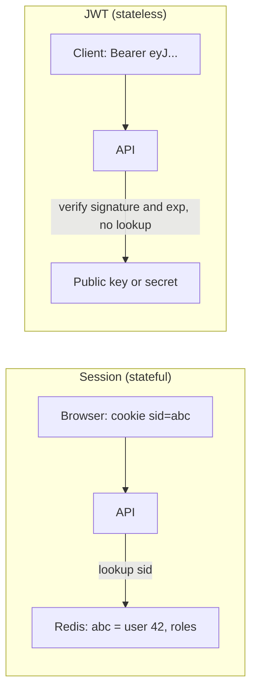

**Diagram: refresh token rotation.**

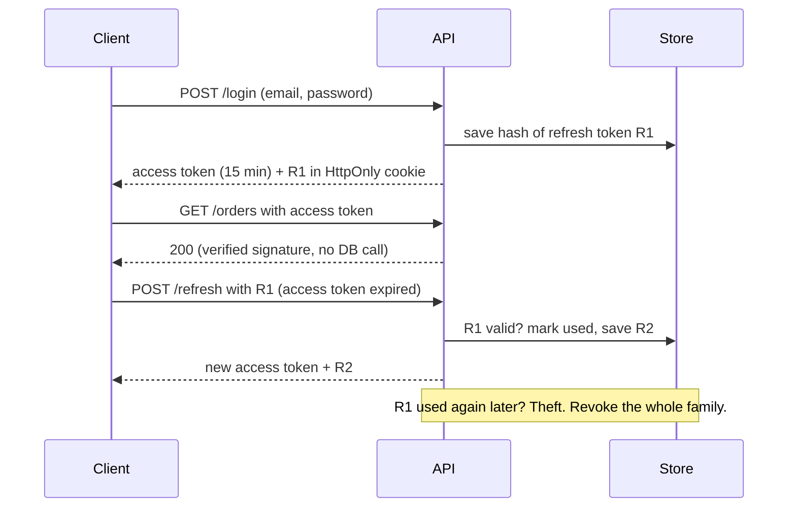

**Example: hash, verify JWT, RBAC middleware (logic run with Node 24, `argon2` and `jose`).**

```javascript
import argon2 from 'argon2';
import { jwtVerify } from 'jose';

export const hashPassword = (pw) => argon2.hash(pw);           // argon2id + random salt by default
export const checkPassword = (hash, pw) => argon2.verify(hash, pw);

export function authenticate(key) {
  return async (req, res, next) => {
    try {
      const token = (req.headers.authorization ?? '').replace(/^Bearer /, '');
      const { payload } = await jwtVerify(token, key, {
        algorithms: ['HS256'], issuer: 'shop-api', audience: 'shop-web', // pin alg, iss, aud
      });
      req.user = { id: payload.sub, roles: payload.roles ?? [] };
      next();
    } catch { res.status(401).json({ title: 'Unauthorized', status: 401 }); }
  };
}

export const requireRole = (...roles) => (req, res, next) =>
  roles.some((r) => req.user.roles.includes(r))
    ? next()
    : res.status(403).json({ title: 'Forbidden', status: 403 });  // 403: known user, no permission

// app.delete('/orders/:id', authenticate(key), requireRole('admin'), deleteOrder);
```

Real run: the hash looked like `$argon2id$v=19$m=65536,t=3,p=4$...`, the right password verified `true` and a wrong one `false`, a `support` user got 403 on an `admin` route.

**Sessions vs JWT:**
| | Server session (cookie + Redis) | JWT access token |
|---|---|---|
| Logout / ban right now | Easy: delete the key | Hard: wait for `exp`, or keep a deny list |
| Lookup per request | Yes (Redis, about 1 ms) | No |
| Good for | Web apps on one domain | Service-to-service, mobile apps, many APIs trusting one issuer |
| Size | Small cookie | Grows with claims (sent on every request) |
| Common mistake | No `HttpOnly`/`Secure` on the cookie | Long `exp`, secrets in the payload, not checking `alg` |

**Good and bad:**
| Good | Bad |
|---|---|
| Short access tokens + rotating refresh tokens limit damage | More moving parts than a simple session |
| argon2id/bcrypt make leaked hashes slow to crack | Hashing is CPU work: it uses the libuv pool; big login spikes need care |
| Hosted IdP or Passport/Better Auth avoid home-made OAuth bugs | Rolling your own JWT or OAuth code is a classic source of bugs |

**Say this in the interview:**

> "Authentication proves who the user is, authorization decides what they can do. For a web app on one domain I like server sessions in Redis with an HttpOnly, Secure, SameSite cookie, because logout and bans work at once. For APIs and mobile I use short-lived JWT access tokens, verified with pinned algorithm, issuer and audience, plus rotating refresh tokens stored hashed on the server. Passwords are hashed with argon2id or bcrypt. Authorization runs on every request: role checks in middleware and ownership checks in the service, to avoid IDOR."

**They may ask next:**
- **How do you revoke a JWT?** Keep access tokens short, revoke the refresh token, and for urgent cases keep a small deny list of token ids (`jti`) in Redis until they expire.
- **HS256 vs RS256?** HS256 uses one shared secret: everyone who verifies can also sign. RS256/ES256 use a private key to sign and a public key (JWKS URL) to verify. Use asymmetric keys when many services verify.
- **401 vs 403?** 401: we do not know who you are (missing or bad token). 403: we know you, but you are not allowed.
- **Where does bcrypt run?** The async `bcrypt`/`argon2` npm functions run on a native thread (the libuv pool), not the event loop. The `*Sync` versions block the loop.

---

## Databases from Node

**In one line:** One small pool per process, transactions on one client, the right ORM for the job, no N+1, and versioned migrations.

**Story:** A bank with 10 counters (connections). Customers (requests) queue for a free counter. Opening a new counter for every customer takes minutes (a new TCP + TLS + auth handshake). So the bank keeps 10 counters open all day. If a customer sits at a counter and chats for an hour (a long transaction), the queue grows for everyone.

**How it works:**
1. **Pool:** `new pg.Pool({ max: 10 })` opens connections lazily and reuses them. `pool.query()` borrows a connection, runs the query and returns it.
2. **Pool size in Node is small.** One process sends queries without blocking, so 5-20 connections per process is common. Total = pods × pool size. Keep it under the DB limit, or put PgBouncer in front. See [Scaling Node.js](#scaling-nodejs) and the HikariCP math in [spring-ecosystem.md](spring-ecosystem.md#connection-pooling-with-hikaricp).
3. **Set timeouts:** `connectionTimeoutMillis` (wait for a free connection), `idleTimeoutMillis`, and a `statement_timeout` in Postgres. Without them, a slow DB makes requests wait forever.
4. **Always parameterize:** `pool.query('SELECT * FROM orders WHERE id = $1', [id])`. Never build SQL with string concatenation (SQL injection).
5. **Transactions need one client.** `BEGIN`, queries and `COMMIT` must go through the **same** connection. With `pool.query()` each call may get a different connection.
6. **No `@Transactional` magic.** You pass a transaction object (`tx`) into your functions, or use `AsyncLocalStorage` to carry it.
7. **N+1:** load 50 orders, then 1 query per order for its items = 51 queries. Fix with a join, `WHERE order_id = ANY($1)`, or the ORM's include/relations loading. Same problem as in [JPA](spring-ecosystem.md#the-n1-problem-and-how-to-fix-it).
8. **Migrations:** versioned files, run once per deploy, before the new code takes traffic. Tools: Prisma Migrate, Drizzle Kit, TypeORM migrations, Knex migrations, or Flyway/Liquibase if the company already uses them.

**Diagram: pool and transaction.**

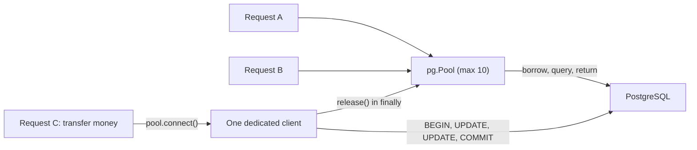

**Example: a transaction with `pg` (raw driver).**

```javascript
import pg from 'pg';
const pool = new pg.Pool({ connectionString: config.DATABASE_URL, max: 10, connectionTimeoutMillis: 2000 });

export async function transfer(fromId, toId, amount) {
  const client = await pool.connect();                // one connection for the whole transaction
  try {
    await client.query('BEGIN');
    const { rows } = await client.query(
      'UPDATE accounts SET balance = balance - $1 WHERE id = $2 AND balance >= $1 RETURNING id',
      [amount, fromId]);                              // parameters: no SQL injection
    if (rows.length === 0) throw new Error('insufficient funds');
    await client.query('UPDATE accounts SET balance = balance + $1 WHERE id = $2', [amount, toId]);
    await client.query('COMMIT');
  } catch (err) {
    await client.query('ROLLBACK');
    throw err;
  } finally {
    client.release();                                 // forget this and the pool slowly runs dry
  }
}
```

**ORMs and query builders (versions as of November 2026):**
| Tool | Style | Good | Watch out |
|---|---|---|---|
| raw `pg` (8.x) | Plain SQL | Full control, fastest, nothing hidden | You write mapping and migrations yourself |
| Knex (3.x) | Query builder | Mature, many DBs, simple migrations | Weak TypeScript types |
| Drizzle (0.45 stable, 1.0 in RC) | SQL-like TypeScript builder | Types from your schema, thin, SQL you can predict | Younger; API still moving towards 1.0 |
| Prisma (7.x) | Schema file + generated client | Great DX, types, Prisma Migrate | Its own query layer; complex SQL needs `$queryRaw`; v7 needs a driver adapter |
| TypeORM (1.x) | Entities + decorators, like JPA | Familiar to Java devs, works with NestJS | Many old issues; lazy relations and decorators add magic |
| MikroORM | Unit of work + identity map | Closest to Hibernate ideas | Smaller community |

Prisma 7 (November 2025) moved from a Rust query engine to a TypeScript client that talks to the DB through a driver adapter (for example `@prisma/adapter-pg`). TypeORM reached 1.0 in May 2026.

**Example: N+1 and the fix (Prisma style).**

```javascript
// N+1: 1 query for orders, then 1 per order
const orders = await prisma.order.findMany({ take: 50 });
for (const o of orders) o.items = await prisma.item.findMany({ where: { orderId: o.id } });

// Fix: let the ORM load the relation in one or two queries
const withItems = await prisma.order.findMany({ take: 50, include: { items: true } });
```

**Good and bad:**
| Good | Bad |
|---|---|
| A small pool per process is enough; Node does not block on queries | Pods × pool size can exceed the DB's `max_connections` |
| Typed builders (Drizzle, Prisma, Kysely) catch column typos at compile time | ORMs hide N+1 and slow SQL; log queries in development |
| Explicit transactions are easy to read | No `@Transactional`: easy to forget the same client, or `release()` |

**Say this in the interview:**

> "In Node I use one connection pool per process, small, like 10, because one process does not block on queries. I watch the total: pods times pool size must stay under the database limit, or I add PgBouncer. Transactions must use one client from the pool, with BEGIN, COMMIT or ROLLBACK, and release in finally. For tools: raw pg or Drizzle when I want SQL control, Prisma for developer speed, TypeORM when a NestJS team wants JPA-style entities. I watch for N+1 by logging queries, and I change the schema only with versioned migrations."

**They may ask next:**
- **How do you share a transaction across functions?** Pass `tx` as an argument (Prisma `$transaction(async (tx) => ...)`, Drizzle `db.transaction(async (tx) => ...)`), or keep it in `AsyncLocalStorage`.
- **How do you do zero-downtime migrations?** Expand and contract: add the new column, deploy code that writes both, backfill, switch reads, then drop the old column later. Never rename in one step.
- **ORM or raw SQL?** ORM for simple CRUD and team speed; raw SQL (or a builder) for reports, bulk updates and tuned queries. Many teams use both.
- **MongoDB from Node?** The official `mongodb` driver or Mongoose (schemas on top). See [mongodb.md](mongodb.md).

---

## Caching and Redis from Node

**In one line:** Small in-memory LRU for hot data, Redis for shared data, cache-aside with a TTL on every key, and a stampede guard.

All Redis details (data types, eviction, cluster, locks, persistence) are in [redis.md](redis.md). This section is only the Node side.

**Story:** A tea stall. The most asked items (tea, biscuits) sit on the counter: that is the in-process cache, fastest but only this stall sees it. The shared store room behind three stalls is Redis: a few steps away, but everyone sees the same stock. The warehouse in another town is the database.

**How it works:**
1. **Clients:** `ioredis` (6.x) and the official `redis` package (node-redis, 6.x). Both are promise-based and support Cluster and Sentinel. Create **one client per process** and reuse it; do not connect per request.
2. **Cache-aside:** read Redis; on a miss, read the DB, then `SET key value EX 300`. On update, write the DB, then **delete** the key.
3. **Always set a TTL.** It limits stale data and memory. Add a little random jitter so many keys do not expire at the same second.
4. **Stampede (thundering herd):** a hot key expires and 1,000 requests hit the DB at once. In one process, share one in-flight promise per key (see the example). Across pods, use a short Redis lock or early refresh.
5. **Two levels:** `lru-cache` in memory (microseconds) in front of Redis (about 1 ms in the same data centre). Each pod has its own memory copy, so keep the memory TTL short.
6. **Serialization:** `JSON.stringify` of big objects blocks the loop. Cache small, ready-to-send values.
7. **Failure:** if Redis is down, fall back to the DB with a timeout. Do not take the whole API down because the cache is down. Set `commandTimeout` and a reconnect strategy.
8. Other Redis uses from Node: sessions, rate limit counters, BullMQ queues, Socket.IO adapter, idempotency keys, distributed locks.

**Diagram: cache-aside with a stampede guard.**

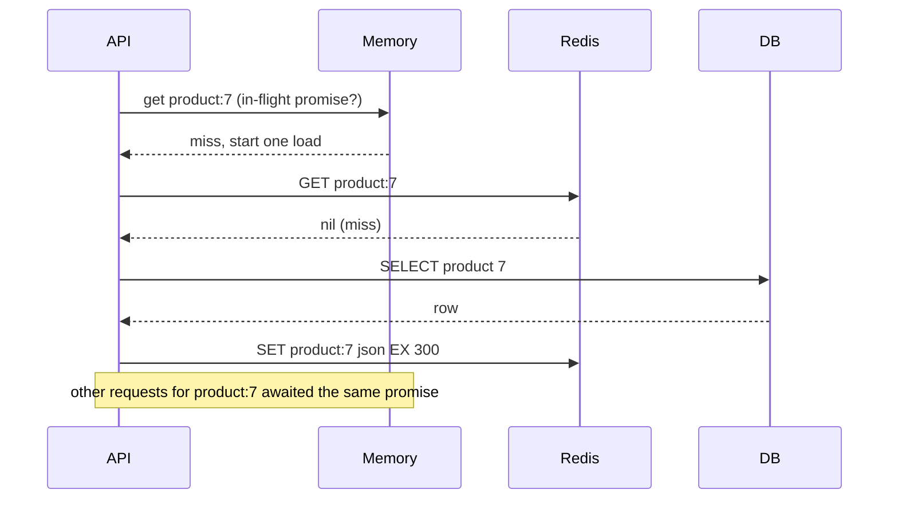

**Example: cache-aside with ioredis and request coalescing.**

```javascript
import Redis from 'ioredis';
const redis = new Redis(config.REDIS_URL, { commandTimeout: 200, maxRetriesPerRequest: 1 });
const inFlight = new Map();                         // key -> promise (this process only)

export async function getProduct(id) {
  const key = `product:${id}`;
  if (inFlight.has(key)) return inFlight.get(key);  // 1,000 callers share one DB load
  const p = (async () => {
    const cached = await redis.get(key).catch(() => null); // Redis down? fall back to DB
    if (cached) return JSON.parse(cached);
    const product = await db.findProduct(id);
    const ttl = 300 + Math.floor(Math.random() * 30); // jitter: keys do not expire together
    await redis.set(key, JSON.stringify(product), 'EX', ttl).catch(() => {});
    return product;
  })().finally(() => inFlight.delete(key));
  inFlight.set(key, p);
  return p;
}

export async function updateProduct(id, data) {
  await db.updateProduct(id, data);
  await redis.del(`product:${id}`);                 // delete, do not update: fewer races
}
```

**Good and bad:**
| Good | Bad |
|---|---|
| Redis is shared by all pods, survives deploys | Stale data until TTL or delete; DB and cache can disagree |
| In-memory LRU is very fast | Each pod has its own copy; invalidation is hard; counts toward heap |
| Promise sharing stops stampedes in one process | Across 20 pods you still get 20 DB loads; use a lock or early refresh if that is too many |

**Say this in the interview:**

> "From Node I use one Redis client per process, ioredis or node-redis, with short command timeouts. The default pattern is cache-aside: read Redis, on a miss read the database and set the key with a TTL plus some jitter. On writes I update the database and delete the key. For hot keys I share one in-flight promise per key, so a thousand requests cause one database read. If Redis is down I fall back to the database, because the cache must never take the API down."

**They may ask next:**
- **Why delete instead of update the cache on write?** Two writers can update the cache in the wrong order and leave old data. Deleting means the next read loads fresh data. See [redis.md](redis.md).
- **Where do you not cache?** Data that must be exact right now: balances, stock at checkout. Read those from the database.
- **How do you cache HTTP responses?** `Cache-Control` and `ETag` headers for clients and CDNs; Redis for server-side results.

---

## Files and uploads

**In one line:** Stream big files and uploads straight to object storage (or use presigned URLs); never hold a whole file in memory.

**Story:** A courier office receiving a truck of boxes. A bad clerk unloads every box onto his own desk first, then carries them to the warehouse. The desk breaks at box 50. A good clerk puts a conveyor belt from the truck straight to the warehouse. Boxes move one by one, and the desk stays empty. Even better: tell the truck driver to drive straight to the warehouse (presigned URL).

**How it works:**
1. **`node:fs/promises`:** `readFile`, `writeFile`, `readdir`, `stat`, `mkdir({ recursive: true })`, `rm`. Async, runs on the libuv pool. Good for small files (config, templates).
2. **Big files:** `fs.createReadStream` / `createWriteStream` with `pipeline()`. Memory stays at about the stream buffer size. See [Streams and backpressure](#streams-and-backpressure).
3. **Never `readFileSync` in a request.** It blocks every user.
4. **Multipart uploads** (`multipart/form-data`, how browsers send files):
   - **busboy** (1.x): low-level streaming parser. You get each file as a stream.
   - **multer** (2.x, for Express): built on busboy. `memoryStorage()` keeps the whole file in RAM (dangerous for big files); `diskStorage()` writes to a temp file. Multer 2 fixed denial-of-service bugs in 1.x; upgrade old apps.
   - **`@fastify/multipart`** for Fastify, with a stream API.
5. **Stream to S3:** `@aws-sdk/lib-storage` `Upload` takes a stream and does an **S3 multipart upload** in parts (5 MB minimum part size), a few parts at a time.
6. **Presigned URLs (best for big files):** the API checks the user and returns a short-lived signed URL. The browser uploads directly to S3. Node never touches the bytes. Then S3 sends an event (or the client calls the API) to confirm.
7. **Always set limits:** max file size, max number of files, allowed content types. Check the real type from the first bytes (magic numbers), not only the file name.
8. **Security:** never use the user's file name as a path (`../../etc/passwd`). Generate your own key (`uploads/<uuid>`). Scan files if users share them.

**Diagram: two ways to upload a 2 GB video.**

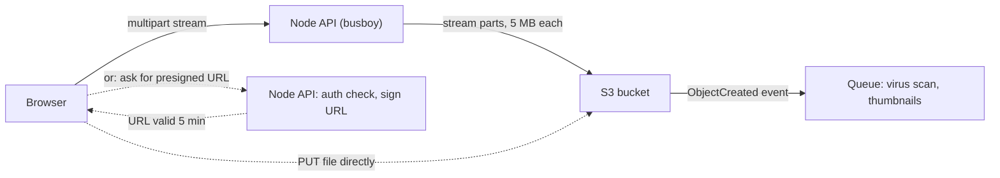

**Example: stream an upload to S3 with busboy (Express, AWS SDK v3).**

```javascript
import busboy from 'busboy';
import { randomUUID } from 'node:crypto';
import { S3Client } from '@aws-sdk/client-s3';
import { Upload } from '@aws-sdk/lib-storage';

const s3 = new S3Client({});
app.post('/uploads', authenticate(key), (req, res, next) => {
  const bb = busboy({ headers: req.headers, limits: { fileSize: 500 * 1024 * 1024, files: 1 } });
  bb.on('file', (_field, stream, info) => {
    if (!['video/mp4', 'image/png'].includes(info.mimeType)) { stream.resume(); return res.status(415).end(); }
    const key = `uploads/${randomUUID()}`;               // our name, never the user's file name
    const upload = new Upload({                          // S3 multipart upload, part by part
      client: s3, params: { Bucket: 'shop-media', Key: key, Body: stream, ContentType: info.mimeType },
      queueSize: 4, partSize: 8 * 1024 * 1024,           // max about 4 x 8 MB in memory
    });
    stream.on('limit', () => upload.abort());            // file too big: stop and clean up
    upload.done().then(() => res.status(201).json({ key }), next);
  });
  req.pipe(bb);                                          // request body flows into the parser
});
```

Memory stays near `queueSize × partSize` (about 32 MB here) for any file size.

**Good and bad:**
| Good | Bad |
|---|---|
| Streaming keeps memory flat for any file size | Error handling mid-stream is harder (partial uploads, aborts) |
| Presigned URLs take upload bandwidth and CPU off Node | Needs a second step to confirm and process the file |
| `multer.diskStorage` is simple for small apps | `multer.memoryStorage` with big files: one upload can use GBs of RAM |

**Say this in the interview:**

> "For small files I use fs/promises. For big files I stream, so memory stays flat. For uploads I parse multipart with busboy, or multer with disk storage. I stream each file straight to S3 with the AWS SDK's Upload class, which uploads part by part. For really large files I prefer presigned URLs: the API only checks permissions and signs a URL, and the browser uploads directly to S3. I always set size and type limits and generate my own object keys."

**They may ask next:**
- **How do you resume a failed big upload?** S3 multipart upload: the client uploads parts with presigned URLs per part, retries failed parts, then calls complete. Clean up unfinished uploads with a bucket lifecycle rule.
- **How do you serve a private file?** A presigned GET URL with a short expiry, or stream it through Node with an auth check (`pipeline(s3Body, res)`).
- **Why not store files in the database?** Large blobs make backups, replication and caching slow. Store files in object storage and keep the key and metadata in the DB.

---

## Background jobs and queues

**In one line:** Put slow or retryable work on a queue, process it in separate workers with retries, and make every job idempotent.

**Story:** A restaurant order slip. The waiter does not cook. He writes a slip, pins it on the kitchen rail, and goes back to customers. Cooks take slips one by one. If the gas runs out, the slip goes back on the rail with a note "try again in 5 minutes". If a slip falls and is picked up twice, the cook checks the order number so the same dish is not cooked twice.

**How it works:**
1. **Why a queue:** the HTTP request returns fast (`202 Accepted`), and slow work happens later. Spikes are smoothed. Failures get retried.
2. **BullMQ** (6.x) is the common Node job queue. It stores jobs in **Redis**. Producers call `queue.add()`. Workers (`new Worker(queue, fn, { concurrency })`) process them.
3. **Retries:** `attempts: 5, backoff: { type: 'exponential', delay: 1000 }`. After the last attempt, the job stays in the **failed** set (a dead-letter list). Alert on it.
4. **Idempotency:** a job can run twice (worker crashed after doing the work but before marking it done). Give jobs a stable `jobId` (BullMQ ignores a duplicate id while the job exists), and check "already done?" in the DB before side effects. See [microservices.md](microservices.md#idempotency).
5. **Scheduled and repeating jobs:** `delay` for "in 10 minutes". For cron-like jobs, BullMQ uses **Job Schedulers** (`queue.upsertJobScheduler(id, { pattern: '0 3 * * *' }, template)`). BullMQ 6 removed the old "repeatable jobs" API, so old code must migrate.
6. **Concurrency:** I/O jobs can use `concurrency: 20` per worker. CPU jobs should use sandboxed processors (a separate process) or worker threads.
7. **Run workers as separate deployments** from the API, so you scale them and restart them independently. Stop them gracefully: `await worker.close()` waits for running jobs.
8. **Kafka from Node** for events between services (not a job queue):
   - **KafkaJS** (2.2.4) was the most popular pure-JS client, but has had **no release since February 2023**. Treat it as unmaintained.
   - **`@confluentinc/kafka-javascript`** (1.x, GA since late 2024): Confluent's official client, built on librdkafka (native C), with a KafkaJS-style API for easy migration. A good default for new code.
   - **`@platformatic/kafka`**: a newer pure-JS client.
   - Consumer rules are the same as in Java: consumer groups, commit after processing, handle duplicates. See [kafka.md](kafka.md).

**Diagram: a job's life in BullMQ.**

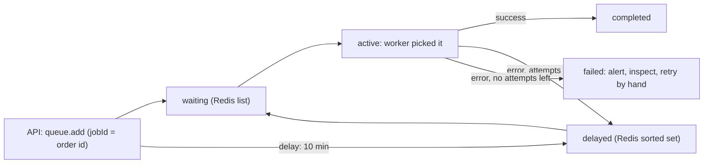

**Diagram: states of one job.**

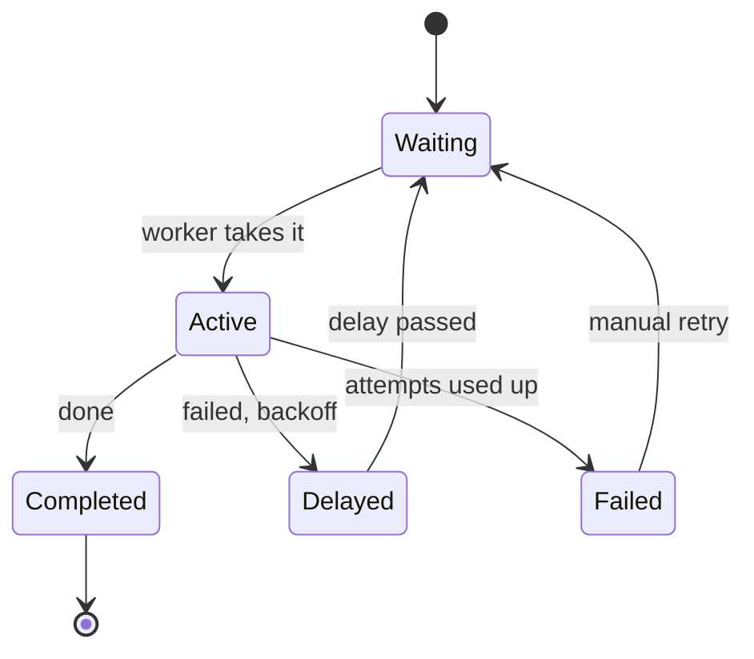

**Example: BullMQ producer and worker.**

```javascript
import { Queue, Worker } from 'bullmq';
const connection = { host: 'localhost', port: 6379 };

const emails = new Queue('emails', { connection });
// In the API handler: return 202 right after this
await emails.add('order-confirmation', { orderId: 'ord_1' }, {
  jobId: 'order-confirmation:ord_1',              // same id again = no duplicate job
  attempts: 5, backoff: { type: 'exponential', delay: 1000 }, // 1 s, 2 s, 4 s, 8 s
  removeOnComplete: 1000,                         // keep Redis small
});
await emails.upsertJobScheduler('daily-report', { pattern: '0 3 * * *' }, { name: 'report', data: {} });

// In a separate worker deployment
const worker = new Worker('emails', async (job) => {
  if (await db.emailAlreadySent(job.data.orderId)) return 'skipped'; // idempotent
  await mailer.send(job.data.orderId);
  await db.markEmailSent(job.data.orderId);
}, { connection, concurrency: 10 });
worker.on('failed', (job, err) => logger.warn({ jobId: job?.id, err }, 'job failed'));
process.once('SIGTERM', async () => { await worker.close(); process.exit(0); }); // finish active jobs
```

**Queue choices:**
| Tool | Good for | Not good for |
|---|---|---|
| BullMQ (Redis) | Jobs inside one product: emails, PDFs, webhooks, retries, delays, cron | Long-term event history, replay by many teams |
| Kafka | Events between many services, replay, high volume, ordering per key | Per-job delays and retries (you build them) |
| RabbitMQ / SQS | Work queues with routing (RabbitMQ) or zero ops (SQS) | Replay of old messages |

**Good and bad:**
| Good | Bad |
|---|---|
| API stays fast; work is retried automatically | Eventual: the user sees "processing" first |
| Workers scale separately from the API | Jobs can run twice: everything must be idempotent |
| Failed set gives you a dead-letter list for free | Redis memory and persistence now matter (use AOF, `noeviction` for BullMQ) |

**Say this in the interview:**

> "Anything slow or retryable leaves the request path. In Node I usually use BullMQ on Redis: the API adds a job and returns 202, and a separate worker deployment processes it with retries and exponential backoff. Failed jobs stay in a failed list that we alert on. Because a job can run twice, I give it a stable job id and check in the database before side effects. For cron I use BullMQ job schedulers. For events between services I use Kafka; in Node I pick Confluent's JavaScript client today, because KafkaJS has not been released since 2023."

**They may ask next:**
- **How do you avoid a job running on every pod for cron?** Use the queue's scheduler (one job per time slot in Redis), not `setInterval` in every pod. Or a Kubernetes CronJob.
- **What Redis settings does BullMQ need?** `maxmemory-policy noeviction` (evicting job keys breaks queues) and persistence turned on. See [redis.md](redis.md).
- **How do you send an event and save to the DB safely?** Transactional outbox: write the event to an outbox table in the same DB transaction, then publish it. See [microservices.md](microservices.md#transactional-outbox-pattern).
- **How do you design a job scheduler at scale?** See [system design: job scheduler](system-design/job-scheduler.md).

---

## Real-time: WebSockets and Server-Sent Events

**In one line:** SSE for server-to-client updates, WebSockets for two-way traffic, and Redis pub/sub so messages reach users on every pod.

The general comparison (polling vs long polling vs WebSockets vs SSE) is in [system-design.md](system-design.md#long-polling-vs-websockets-vs-server-sent-events).

**Story:** A cricket stadium.
- **SSE** is the stadium loudspeaker: it talks, you listen. Cheap and simple.
- **WebSocket** is a walkie-talkie: both sides talk any time.
- **Many pods** are many stands with their own loudspeaker. When a wicket falls, the control room (Redis pub/sub) tells **every** stand's speaker, not only one.

**How it works:**
1. **SSE:** a normal HTTP response with `Content-Type: text/event-stream` that never ends. The server writes `data: ...\n\n` blocks. The browser's `EventSource` reconnects by itself and sends `Last-Event-ID`. One direction only. Works through most proxies. No extra library needed in Node.
2. **WebSocket:** starts as HTTP, then *upgrades* to a two-way TCP channel. In Node: **`ws`** (8.x, low-level, fast) or **Socket.IO** (4.x: rooms, auto-reconnect, acknowledgements, fallback to HTTP long-polling; it has its own protocol, so you need its client).
3. **Node is good at this:** each open connection is a small object, not a thread. One process can hold tens of thousands of idle connections if memory and file descriptor limits allow (`ulimit -n`).
4. **Heartbeats:** send ping/pong every 20-30 s. It detects dead clients and keeps load balancers from closing idle connections.
5. **Scaling to many pods:**
   - A user on pod 1 sends a message to a room. Users of that room on pod 2 must get it.
   - **Socket.IO Redis adapter** (`@socket.io/redis-adapter`, Redis pub/sub) or the **Redis Streams adapter** (survives short Redis disconnects) forwards messages between pods.
   - With plain `ws`, you publish to Redis pub/sub (or NATS, Kafka) yourself and each pod sends to its local sockets.
   - **Sticky sessions** are needed for Socket.IO when HTTP long-polling is on (several HTTP requests must hit the same pod). With WebSocket-only transport you can skip them.
6. **Auth:** check the token during the HTTP upgrade (or the first message). Re-check permissions when joining a room.
7. **Backpressure:** a slow client fills `socket.bufferedAmount`. Drop or disconnect slow clients instead of buffering forever.
8. **Deploys:** every deploy disconnects everyone. Clients must reconnect with jittered backoff, or 100,000 clients reconnect in the same second.

**Diagram: WebSockets across pods.**

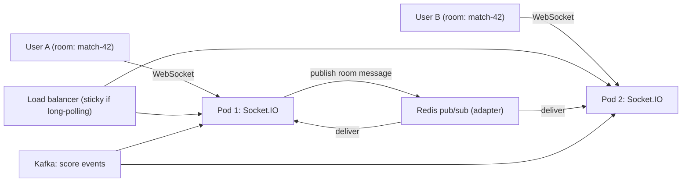

**Example 1: SSE with only `node:http` (run with Node 24).**

```javascript
const http = require('node:http');

http.createServer((req, res) => {
  if (req.url !== '/orders/7/status') return res.writeHead(404).end();
  res.writeHead(200, {
    'Content-Type': 'text/event-stream',          // this makes it SSE
    'Cache-Control': 'no-cache',
    Connection: 'keep-alive',
  });
  const steps = ['PAID', 'PACKED', 'SHIPPED'];
  let i = 0;
  const timer = setInterval(() => {
    res.write(`id: ${i}\nevent: status\ndata: ${JSON.stringify({ status: steps[i] })}\n\n`); // blank line ends one event
    if (++i === steps.length) { clearInterval(timer); res.end(); }
  }, 100);
  req.on('close', () => clearInterval(timer));     // client left: stop work, no leak
}).listen(3703);
```

Real output from `fetch` reading the stream: three events, `id: 0 ... PAID`, `id: 1 ... PACKED`, `id: 2 ... SHIPPED`.

**Example 2: WebSocket server with `ws`, broadcast and heartbeat (run with Node 24, ws 8).**

```javascript
import { WebSocketServer, WebSocket } from 'ws';

const wss = new WebSocketServer({ port: 3704 });
wss.on('connection', (socket) => {
  socket.isAlive = true;
  socket.on('pong', () => { socket.isAlive = true; });  // heartbeat answer
  socket.on('message', (data) => {
    for (const client of wss.clients) {                 // broadcast to everyone on THIS pod only
      if (client.readyState === WebSocket.OPEN) client.send(`echo: ${data}`);
    }
  });
});
setInterval(() => {                                     // drop dead connections every 30 s
  for (const s of wss.clients) { if (!s.isAlive) s.terminate(); else { s.isAlive = false; s.ping(); } }
}, 30_000).unref();
```

A test client sent `hello` and got `echo: hello`. With more pods, publish to Redis instead of looping over local clients only.

**SSE vs WebSocket:**
| | SSE | WebSocket |
|---|---|---|
| Direction | Server to client | Both ways |
| Protocol | Plain HTTP; works with HTTP/2 | Upgrade to `ws://` / `wss://` |
| Reconnect | Built into `EventSource` | You (or Socket.IO) build it |
| Data | Text (UTF-8) | Text and binary |
| Good for | Notifications, order status, live dashboards, LLM token streaming | Chat, games, collaborative editing |

**Good and bad:**
| Good | Bad |
|---|---|
| Node holds many idle connections cheaply | Long-lived connections make deploys and graceful shutdown harder |
| SSE needs no library and passes most proxies | With HTTP/1.1, browsers allow only about 6 connections per domain (HTTP/2 fixes this) |
| Socket.IO gives rooms, acks and reconnect | Socket.IO clients must use the Socket.IO protocol; not plain WebSocket |

**Say this in the interview:**

> "If only the server pushes, like order status or notifications, I use Server-Sent Events: plain HTTP, built-in reconnect, no library. For two-way traffic like chat I use WebSockets, with ws or Socket.IO. Node is a good fit because each connection is a small object, not a thread. To scale to many pods, I add the Socket.IO Redis adapter or publish to Redis myself, so a message reaches users on every pod. I add heartbeats, check auth on connect, and make clients reconnect with jitter after deploys."

**They may ask next:**
- **Why sticky sessions?** Socket.IO's long-polling sends several HTTP requests for one session; they must reach the same pod. WebSocket-only connections stay on one pod anyway.
- **How many connections per pod?** Measure. Limits are memory per socket, file descriptors, and CPU for broadcasts. Tens of thousands per pod is common for mostly idle connections.
- **How do you close them on shutdown?** Stop accepting, send a close frame (code 1001 "going away"), let clients reconnect elsewhere, then exit. See [Graceful shutdown](#graceful-shutdown).
- **Design a chat app?** See [system design: WhatsApp](system-design/whatsapp.md).

---

## Logging and observability in Node

**In one line:** JSON logs with pino, a request id via AsyncLocalStorage, and OpenTelemetry auto-instrumentation to join logs and traces.

The general ideas (three pillars, log levels, ELK vs Loki, Prometheus, tracing, alerts) are in [production-ready.md](production-ready.md#the-three-pillars-logs-metrics-traces-plus-profiles), [Logging done right](production-ready.md#logging-done-right) and [Distributed tracing with OpenTelemetry](production-ready.md#distributed-tracing-with-opentelemetry). Spring's version is in [spring-ecosystem.md](spring-ecosystem.md#observability-with-actuator-micrometer-and-opentelemetry).

**Story:** A parcel with a tracking number. Every hub that touches the parcel writes a line: "hub, time, tracking number, what happened". When a customer complains, you search one number and see the whole journey. The tracking number is the request id / trace id. The neat one-line entries are structured logs.

**How it works:**
1. **pino** (10.x) writes one JSON object per line, very fast. Fastify uses it by default. Pretty printing (`pino-pretty`) only in development.
2. **Structured fields, not string building:** `logger.info({ orderId, amountPaise }, 'order paid')`. Then you can search `orderId = "ord_1"`.
3. **Log to stdout.** The platform (Kubernetes + Fluent Bit, Vector, the OTel Collector) ships the logs. The app does not manage files.
4. **Correlation id with `AsyncLocalStorage`:** store `{ requestId, userId }` at the start of each request. pino's `mixin` reads it and adds it to every log line, even deep inside services. This is Node's MDC. Accept an incoming `x-request-id` or `traceparent` header, and send it on outgoing calls.
5. **Redact secrets:** pino `redact: ['req.headers.authorization', '*.password']`.
6. **OpenTelemetry auto-instrumentation:** start Node with `--import @opentelemetry/auto-instrumentations-node/register`. It patches `http`, `undici`/`fetch`, Express, Fastify, `pg`, `ioredis`, Kafka clients and more. You get traces with no code change. Configure with `OTEL_SERVICE_NAME`, `OTEL_EXPORTER_OTLP_ENDPOINT`.
7. **Trace id in logs:** the pino instrumentation adds `trace_id` and `span_id` to log lines, so you can jump from a log to its trace.
8. **Node-specific metrics:** event loop lag (p99), event loop utilization, heap used, GC pauses, active handles, libuv pool queue (indirectly via latency). `prom-client` default metrics or OTel runtime metrics give most of these.

**Diagram: one request, three signals.**

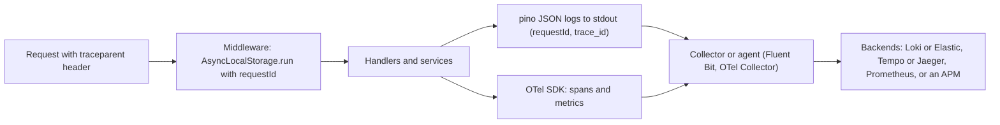

**Example: request id in every log line (run with Node 24, pino 10).**

```javascript
import { AsyncLocalStorage } from 'node:async_hooks';
import { randomUUID } from 'node:crypto';
import http from 'node:http';
import pino from 'pino';

const als = new AsyncLocalStorage();
const logger = pino({
  mixin: () => als.getStore() ?? {},            // adds requestId to every log line
  redact: ['req.headers.authorization'],        // never log tokens
});

async function loadOrder(id) {                  // deep inside: no req object passed in
  await new Promise((r) => setTimeout(r, 10));
  logger.info({ orderId: id }, 'order loaded');
}

http.createServer((req, res) => {
  const requestId = req.headers['x-request-id'] ?? randomUUID(); // reuse the caller's id
  als.run({ requestId }, async () => {          // everything awaited inside sees this store
    await loadOrder(42);
    res.setHeader('x-request-id', requestId).end('ok');
  });
}).listen(3702);
```

Real log line after a call with `x-request-id: req-abc`:

```text
{"level":30,"time":1794839920312,"pid":33344,"hostname":"...","requestId":"req-abc","orderId":42,"msg":"order loaded"}
```

**Example: turn on OpenTelemetry without code changes.**

```bash
npm i @opentelemetry/api @opentelemetry/auto-instrumentations-node
export OTEL_SERVICE_NAME=order-api
export OTEL_EXPORTER_OTLP_ENDPOINT=http://otel-collector:4318
export OTEL_TRACES_EXPORTER=otlp OTEL_METRICS_EXPORTER=otlp
node --import @opentelemetry/auto-instrumentations-node/register dist/server.js  # loads before the app
```

**Good and bad:**
| Good | Bad |
|---|---|
| JSON logs are searchable by any field | `console.log` of objects is slow and unstructured; avoid it in services |
| AsyncLocalStorage gives MDC-like context with no extra parameters | Logging huge objects blocks the event loop; log ids, not whole payloads |
| OTel auto-instrumentation gives traces in minutes | Auto-instrumentation adds some overhead and many spans; sample in production |

**Say this in the interview:**

> "In Node I log JSON to stdout with pino, with fields like orderId instead of string messages, and I redact tokens. A middleware stores the request id in AsyncLocalStorage, and pino's mixin adds it to every log line, which is Node's version of MDC. For tracing I start the app with the OpenTelemetry auto-instrumentation register hook. Then HTTP, Express, pg, Redis and Kafka calls become spans, and logs carry the trace id. On top of the usual RED metrics I watch event loop lag and heap, because they are the Node-specific warning signs."

**They may ask next:**
- **Why not `console.log`?** It is not structured, has no levels, and writes synchronously to a terminal or file. pino is async-friendly and much faster.
- **How does the trace id reach the next service?** OTel adds the W3C `traceparent` header to outgoing HTTP and Kafka calls. The next service continues the same trace.
- **What do you alert on?** Error rate, p99 latency, event loop lag p99 above about 100 ms, restarts and OOMKills. See [production-ready.md](production-ready.md#alerts-slos-and-on-call).

---

## Microservices with Node

**In one line:** Node services use REST, gRPC and brokers like Java ones; Node is best as a BFF that calls many services in parallel.

The patterns (sync vs async, saga, outbox, timeouts, retries, circuit breakers) are the same as in Java. See [microservices.md](microservices.md#sync-vs-async-communication) and [API gateway and BFF](microservices.md#api-gateway-and-bff).

**Story:** A wedding planner. The family talks only to the planner. The planner calls the caterer, the decorator and the photographer **at the same time**, collects their answers, and gives the family one simple plan. The planner does not cook or take photos. That is a BFF (backend for frontend).

**How it works:**
1. **REST** between services: built-in `fetch` (undici) with keep-alive, a timeout (`AbortSignal.timeout`) and limited retries. For high traffic, an undici `Agent` or `Pool` gives more control over connections.
2. **gRPC:** `@grpc/grpc-js` (pure JS, 1.x) with `@grpc/proto-loader`, or generated TypeScript code (`ts-proto`, `protobuf-es` with Connect). HTTP/2, binary Protobuf, strict contracts, streaming, and **deadlines** that pass down the call chain.
3. **Events:** Kafka (`@confluentinc/kafka-javascript`), RabbitMQ (`amqplib`), NATS (`nats`), or cloud queues (SQS, Pub/Sub). Same rules: idempotent consumers, outbox for publishing.
4. **NestJS microservices** (`@nestjs/microservices`): one programming model with *transports* (TCP, Redis, NATS, MQTT, gRPC, RabbitMQ, Kafka). `@MessagePattern` for request-reply and `@EventPattern` for events. Handy, but it hides the broker; check what it does on errors and retries.
5. **Resilience:** circuit breaker with `opossum`, retries with jitter (see the [coding problem](#nodejs-coding-problems-with-answers)), bulkheads by limiting concurrency per downstream (`p-limit` or the async pool).
6. **Why Node is a good BFF:**
   - Fan-out is just `Promise.all` over a few `fetch` calls. No thread per call.
   - The frontend team writes it in the same language (TypeScript), often with shared types.
   - It can do server-side rendering and GraphQL (Apollo Server, Mercurius, GraphQL Yoga) close to the UI.
7. **Where Node is weaker:** heavy CPU (big reports, crypto at scale), long transactions in a complex domain. Keep those in Java/Spring or Go services. See [Node vs Java/Spring](#node-vs-javaspring-how-to-choose).

**Diagram: a Node BFF fanning out.**

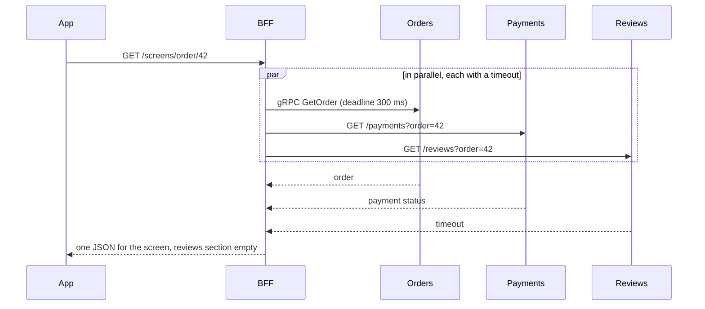

**Example: BFF fan-out with timeouts and a soft dependency.**

```javascript
const get = (url, ms) =>
  fetch(url, { signal: AbortSignal.timeout(ms) }).then((r) => {
    if (!r.ok) throw new Error(`${url} -> ${r.status}`);
    return r.json();
  });

export async function orderScreen(orderId) {
  const [order, payment, reviews] = await Promise.allSettled([
    get(`${ORDERS}/orders/${orderId}`, 300),      // must have
    get(`${PAYMENTS}/payments?order=${orderId}`, 300),
    get(`${REVIEWS}/reviews?order=${orderId}`, 200), // nice to have
  ]);
  if (order.status === 'rejected') throw order.reason; // no order: the screen makes no sense
  return {
    order: order.value,
    paymentStatus: payment.status === 'fulfilled' ? payment.value.status : 'UNKNOWN',
    reviews: reviews.status === 'fulfilled' ? reviews.value : [],   // degrade, do not fail
  };
}
```

**REST vs gRPC vs events from Node:**
| | REST + JSON | gRPC | Events (Kafka, NATS, RabbitMQ) |
|---|---|---|---|
| Node library | `fetch` / undici | `@grpc/grpc-js` | `@confluentinc/kafka-javascript`, `nats`, `amqplib` |
| Contract | OpenAPI | `.proto` file | Schema registry (Avro, Protobuf, JSON Schema) |
| Good for | Public APIs, browsers, simple calls | Internal, high-traffic, streaming, strict types | Decoupling, fan-out to many consumers |
| Watch out | Over-fetching, no deadlines by default | Browsers need gRPC-Web or Connect | Duplicates, ordering, eventual consistency |

**Good and bad:**
| Good | Bad |
|---|---|
| Parallel calls are cheap in Node | Easy to create long chains of sync calls; each adds failure risk |
| Shared TypeScript types between UI and BFF | A BFF that grows business logic becomes a second monolith |
| NestJS gives one model for many transports | Transport abstraction hides broker details you must still understand |

**Say this in the interview:**

> "Node services use the same patterns as Java services: REST or gRPC for requests, Kafka or another broker for events, with timeouts, limited retries and circuit breakers. Node is my favourite for a BFF. It fans out to several services in parallel with Promise.allSettled, gives each call a timeout, and degrades when a soft dependency fails. For gRPC I use grpc-js with deadlines. NestJS microservices give one model over many transports, but I keep business logic in the domain services, not in the BFF."

**They may ask next:**
- **`Promise.all` or `Promise.allSettled` in a BFF?** `allSettled` when some parts are optional, so one slow service does not fail the whole screen. `all` when every part is required.
- **GraphQL or REST for a BFF?** GraphQL lets each screen ask for exactly what it needs. It adds caching and N+1 challenges (use DataLoader to batch). REST per screen is simpler for small teams.
- **How do you do a circuit breaker in Node?** `opossum` wraps a function: after many failures it opens and fails fast, then tries again after a cool-down. See [microservices.md](microservices.md#circuit-breaker).

---

## Scaling Node.js

**In one line:** Scale Node by running many small, stateless processes behind a load balancer, and protect shared resources like the database.

**Story:** One waiter is fast, but one waiter can only be in one place. To serve a wedding of 1,000 guests, you hire 20 waiters with the same menu. Any waiter can serve any table, because orders are written on a shared board, not in one waiter's head. That shared board is Redis or the database.

**How it works:**
1. **One process uses about one CPU core for JS.** On a 4-core VM, run 4 processes (cluster or PM2).
2. **On Kubernetes**, run one Node process per pod, with a CPU request of about 1 core. Add replicas with the HorizontalPodAutoscaler.
3. **Stateless:** no user session or upload kept only in process memory. Use Redis, the database or object storage. See [system-design.md](system-design.md#stateless-services).
4. **Load balancer** in front spreads requests. See [system-design.md](system-design.md#load-balancing).
5. **WebSockets** are long-lived. Use sticky sessions or a pub/sub layer (for example Socket.IO's Redis adapter) so a message reaches users on other pods.

**Diagram:**

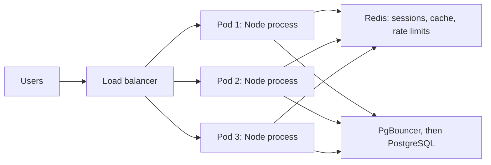

**Example: the connection pool math.**
- 20 pods, each with a DB pool of 10 connections = **200 connections**.
- PostgreSQL's default `max_connections` is **100**. Pods fail to connect during a scale-up.
- Fixes: smaller pools per pod (Node needs fewer, since one process does not block on queries), or a pooler like PgBouncer. Same idea as HikariCP in [spring-ecosystem.md](spring-ecosystem.md#connection-pooling-with-hikaricp).

**PM2/cluster vs Kubernetes replicas:**
| | PM2 or cluster on a VM | Kubernetes replicas |
|---|---|---|
| Restarts crashed processes | PM2 / your cluster code | Kubernetes |
| Uses all cores | Yes, N processes | Yes, N pods |
| Health checks and rolling deploys | Limited | Built in |
| Metrics per process | Harder (one container, many processes) | Easy, one process per pod |
| Use when | Plain VMs, small setups | You already run Kubernetes |

**Other scaling tools:**
- **Caching:** a small in-process LRU cache (for example `lru-cache`) for hot, read-only data. Redis for shared data. Remember each pod has its own in-process copy. See [system-design.md](system-design.md#caching).
- **Rate limiting:** an in-memory limiter counts per pod. With 10 pods, the real limit is 10x higher. Keep the counter in Redis, or rate limit at the gateway. See [system-design.md](system-design.md#rate-limiting-algorithms).
- **Keep-alive behind a load balancer:** Node's `server.keepAliveTimeout` default is **5 seconds**. Many load balancers keep idle connections for 60 seconds. The LB may reuse a socket that Node just closed, and the user sees a 502. Set Node's keep-alive timeout higher than the LB's idle timeout.
- **Move slow work out:** emails, PDFs, reports go to a queue (Kafka, RabbitMQ, BullMQ on Redis). See [kafka.md](kafka.md).

**Good and bad:**
| Good | Bad |
|---|---|
| Small processes start fast and scale out quickly | Every pod multiplies DB connections |
| Stateless pods are easy to replace | In-memory caches and limits are per pod |
| One process per pod gives clear metrics | Cluster inside a pod hides restarts from Kubernetes |

**Say this in the interview:**

> "Node uses one core per process for JavaScript, so I scale out. I run one process per pod and more replicas behind a load balancer. The service is stateless; sessions, cache and rate limit counters live in Redis. I watch the shared parts, mainly the database: 20 pods times a pool of 10 is already 200 connections. CPU-heavy or slow jobs go to a queue and worker services."

**They may ask next:**
- **Should I use cluster inside a container?** Usually no. Run one process per container and let Kubernetes scale. Cluster makes sense on plain VMs.
- **What do you autoscale on?** CPU is a good start. Event loop lag or request latency is better for Node, because a blocked loop may not show high average CPU.
- **How do you scale WebSockets?** Sticky sessions plus Redis pub/sub between pods. Watch file descriptor and memory limits per pod.

---

## Memory leaks and performance

**In one line:** A memory leak is memory your app keeps reachable by mistake; find it by comparing heap snapshots over time.

**Story:** A hotel locker room gives a key to every guest. Guests leave but nobody takes the keys back. Lockers stay "in use". After a month, no lockers are free, and the hotel turns new guests away. The garbage collector is the cleaner who only empties lockers with no key holder.

**How it works (GC basics):**
1. V8 stores JS objects in the *heap*.
2. **New space (young generation):** new objects. Cleaned often with a fast copy step (*scavenge*). Most objects die young.
3. **Old space (old generation):** objects that survived. Cleaned less often with *mark-sweep-compact* (find live objects from the roots, free the rest).
4. The GC frees only **unreachable** objects. If a global `Map` still points to an object, it is live forever. That is a leak.
5. When the heap reaches its limit, Node crashes: `FATAL ERROR: ... JavaScript heap out of memory`.
6. **`--max-old-space-size=<MB>`** sets the old space limit. In a container, set it to about 75% of the memory limit, so there is room for buffers and native memory. Newer releases also have `--max-old-space-size-percentage`.

**Common leaks:**
| Leak | Example | Fix |
|---|---|---|
| Global cache with no limit | `const cache = new Map()` that only grows | LRU with a max size and TTL |
| Event listeners | `emitter.on('data', ...)` added per request, never removed | `once`, `off`, or `AbortSignal` to remove; watch the `MaxListenersExceededWarning` |
| Closures | A long-lived callback holds a big request object | Keep only the fields you need |
| Timers | `setInterval` per user, never cleared | `clearInterval` on cleanup |
| Unbounded queues | Pushing to an array faster than you process | Backpressure, max length |
| Per-request data in module scope | `let currentUser` at the top of a file | `AsyncLocalStorage` or function arguments |

**Example: a leaking server (run with Node 24).**

```javascript
const http = require('node:http');

const cache = new Map();                          // global, no limit, no expiry
http.createServer((req, res) => {
  const id = Math.random().toString(36);
  cache.set(id, { url: req.url, data: new Array(1000).fill(id) }); // ~8 KB, never removed
  res.end('ok');
}).listen(3400);

setInterval(() => {
  const mb = (process.memoryUsage().heapUsed / 1e6).toFixed(0);
  console.log(`entries=${cache.size} heapUsed=${mb} MB`);
}, 1000).unref();
```

After 6,000 requests it printed `entries=6000 heapUsed=61 MB`. It never goes down. At 100 requests per second, that is about 1 GB in 20 minutes.

**Diagram: diagnose a leak.**

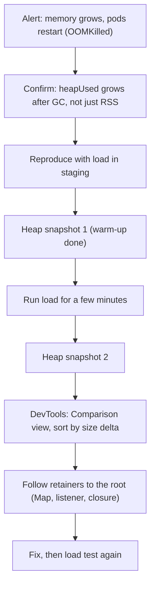

**Steps to diagnose a leak:**
1. **Check the graph.** RSS (total process memory) and `heapUsed` over hours. A leak is a saw-tooth that keeps climbing after each GC.
2. **Reproduce** with load (autocannon, k6) in staging. Use the same Node version and flags.
3. **Take heap snapshots:**
   - Local: `node --inspect app.js`, open `chrome://inspect`, Memory tab, "Take heap snapshot".
   - Server: `node --heapsnapshot-signal=SIGUSR2 app.js`, then `kill -USR2 <pid>`. Or call `v8.writeHeapSnapshot()` from an admin endpoint.
   - Before a crash: `--heapsnapshot-near-heap-limit=2` writes snapshots when the heap is close to the limit.
4. **Compare** two snapshots in DevTools (Comparison view). Sort by "Size Delta".
5. **Follow the retainers** of the growing objects. They lead to the `Map`, listener or closure that keeps them alive.
6. **Fix and verify** with the same load test.

Warning: a heap snapshot pauses the process and can need as much memory as the heap again. Take it from one pod that is out of the load balancer.

**Performance tips:**
- CPU profile first, then optimize. Do not guess.
- Avoid sync APIs in request paths.
- Reuse HTTP connections (keep-alive agents; Node 19+ enables keep-alive in the global agent by default).
- Use Fastify's response schemas or avoid huge `JSON.stringify` calls.
- Cache hot data, paginate big queries, and fix N+1 queries (see [spring-ecosystem.md](spring-ecosystem.md#the-n1-problem-and-how-to-fix-it), same idea).

**Say this in the interview:**

> "A leak in Node is almost always something still reachable: an unbounded Map, listeners added per request, or timers never cleared. First I confirm the heap grows after GC, not just RSS. Then I reproduce with load and take two heap snapshots. I compare them in DevTools and follow the retainers to the root. In containers I set max-old-space-size to about 75% of the memory limit."

**They may ask next:**
- **RSS vs heapUsed?** RSS is all memory of the process. `heapUsed` is JS objects only. Buffers live outside the heap (`external`, `arrayBuffers`).
- **Can a leak be outside JS?** Yes: native addons, many open file descriptors, or Buffers. Then heap snapshots look fine but RSS grows.
- **What does `WeakMap` help with?** Its keys do not keep objects alive. Good for attaching data to objects you do not own.

---

## Graceful shutdown

**In one line:** On SIGTERM, stop new requests, finish running ones, close DB and Kafka, then exit before the platform kills you.

**Story:** A shop closes at 9 PM. At 8:55 the guard turns the sign to "Closed" so no new customers come in. Customers already inside finish shopping and pay. Then the staff locks the cash box and switches off the lights. Nobody is thrown out with a half-paid bill.

**How it works:**
1. Kubernetes sends **SIGTERM** to the container and starts removing the pod from Service endpoints. These happen at the same time.
2. Mark the app "not ready" (readiness returns 503). Wait a few seconds so load balancers stop sending traffic.
3. Call `server.close()`. It stops accepting new connections. Its callback runs when in-flight requests finish.
4. Close idle keep-alive connections so `close()` does not wait for them.
5. Stop consumers (Kafka, queues), so they commit offsets and stop taking new messages. Then close DB pools and producers.
6. Exit with code 0.
7. If you are not done after **`terminationGracePeriodSeconds`** (default **30 s**), Kubernetes sends **SIGKILL**. Your own hard timeout should fire earlier.

**Diagram:**

```mermaid
sequenceDiagram
    participant Kubernetes
    participant App
    participant LoadBalancer
    participant Database
    Kubernetes->>App: SIGTERM
    Kubernetes->>LoadBalancer: remove pod from endpoints
    App->>App: readiness returns 503, wait a few seconds
    App->>App: server.close(), no new connections
    App->>App: finish in-flight requests
    App->>Database: close pool, disconnect Kafka
    App->>Kubernetes: exit code 0
    Note over Kubernetes,App: still running after 30 s? SIGKILL
```

**Example (run with Node 24).**

```javascript
const http = require('node:http');
const { setTimeout: sleep } = require('node:timers/promises');

let shuttingDown = false;
const server = http.createServer(async (req, res) => {
  if (req.url === '/ready') {                       // Kubernetes readiness probe
    res.statusCode = shuttingDown ? 503 : 200;
    return res.end();
  }
  await sleep(2000);                                // a slow request (2 s)
  res.end('order saved\n');
});
server.listen(3200);

async function shutdown(signal) {
  console.log(`${signal}: readiness now 503`);
  shuttingDown = true;
  setTimeout(() => process.exit(1), 25_000).unref(); // hard stop before the 30 s SIGKILL
  await sleep(Number(process.env.DRAIN_DELAY_MS ?? 5000)); // let the LB remove us
  server.close(async () => {                        // runs when in-flight requests finish
    console.log('in-flight requests done');
    // await consumer.disconnect(); await pool.end(); // close Kafka and DB last
    process.exit(0);
  });
  server.closeIdleConnections();                    // drop idle keep-alive sockets
}
process.once('SIGTERM', shutdown);
process.once('SIGINT', shutdown);
```

Real test: start a 2-second request, send SIGTERM 0.3 s later. Output: `SIGTERM: readiness now 503`, a readiness check returned `503`, the request still got `order saved`, then `in-flight requests done` and exit code 0.

**Common mistakes:**
- **`CMD npm start` in Docker.** npm may not forward SIGTERM to Node. Use `CMD ["node", "dist/main.js"]` (exec form). If Node runs as PID 1, it gets the signal directly; use `--init` or `tini` if you spawn child processes.
- **No hard timeout.** One stuck request keeps the pod alive until SIGKILL.
- **Closing the DB first.** In-flight requests then fail. Close the DB **last**.
- **Long-lived connections.** WebSockets and SSE never end on their own. Send a close message and end them.

**Good and bad:**
| Good | Bad |
|---|---|
| No failed requests during deploys | Deploys take a few seconds longer |
| Kafka offsets committed cleanly, fewer duplicates | Needs testing; easy to get the order wrong |
| Same idea as Spring Boot's `server.shutdown=graceful` | Delay too long: rolling deploys get slow |

**Say this in the interview:**

> "On SIGTERM I first fail readiness and wait a few seconds so the load balancer stops sending traffic. Then server.close stops new connections and waits for in-flight requests. Then I disconnect Kafka consumers and close the DB pool, last. I keep a hard timeout below Kubernetes' terminationGracePeriodSeconds, which is 30 seconds by default, so we exit on our own terms."

**They may ask next:**
- **Why wait before `server.close()`?** Removing the pod from endpoints takes a moment. Requests can still arrive. A short wait (or a `preStop` sleep hook) avoids errors.
- **SIGTERM vs SIGKILL?** SIGTERM is a polite request; you can handle it. SIGKILL cannot be caught; the process just dies.
- **What about background jobs?** Stop taking new jobs, finish or checkpoint the current one, then exit.

---

## Deploying Node: PM2, Docker and Kubernetes

**In one line:** PM2 on a plain VM; on Kubernetes, one `node` process per small, non-root container, with probes and graceful shutdown.

The full Dockerfile walk-through is in [docker-kubernetes.md](docker-kubernetes.md) (sections "A Dockerfile for Node.js", "Liveness, readiness and startup probes" and "Graceful shutdown in Kubernetes"). Node's shutdown code is in [Graceful shutdown](#graceful-shutdown).

**Story:** Two ways to run food stalls. On your own land (a VM), you hire a manager (PM2) who opens one counter per helper and replaces a helper who faints. In a food court (Kubernetes), the food court management does that for you. You just bring one standard counter (a container) and they decide how many copies to open.

**How it works:**
1. **PM2 (7.x) on a VM:** `pm2 start dist/server.js -i max` runs one process per core in cluster mode, restarts on crash, rotates logs, and `pm2 reload` restarts processes one by one with no downtime. `pm2 startup` survives server reboots.
2. **Containers:** one Node process per container. Kubernetes restarts it, scales it and balances traffic. No PM2 or cluster inside the container (it would hide crashes from Kubernetes).
3. **Docker image rules:**
   - **Multi-stage build:** build stage has dev dependencies and TypeScript; final stage has only `dist/` and production `node_modules`.
   - **`npm ci`** (exact lockfile versions), `--omit=dev` for the runtime stage.
   - **`ENV NODE_ENV=production`.**
   - **`USER node`:** the official image has a non-root `node` user.
   - **`CMD ["node", "dist/server.js"]`** in exec form, not `npm start`, so SIGTERM reaches Node.
   - **Base image:** `node:24-slim` (Debian) is the safe default. Alpine is smaller but uses musl, so some native modules need rebuilds. Distroless is smallest, with no shell.
   - **`.dockerignore`** for `node_modules`, `.env`, `.git`.
4. **Memory:** set `--max-old-space-size` to about 75% of the container memory limit, so V8 collects garbage before the kernel kills the pod (`OOMKilled`).
5. **Probes:**
   - **Liveness** `/live`: "is the process stuck?" Keep it trivial; do **not** check the DB here, or a DB outage restarts every pod.
   - **Readiness** `/ready`: "can I take traffic?" Return 503 during start-up and shutdown, and when critical dependencies are down.
   - **Startup probe:** for slow starts (migrations, cache warm-up), so liveness does not kill the pod too early.
6. **Graceful shutdown:** handle SIGTERM, fail readiness, wait, `server.close()`, close DB and consumers. Add a `preStop` sleep of a few seconds. Fit everything in `terminationGracePeriodSeconds` (30 s default).
7. **Resources:** request about 1 CPU per pod (one JS thread), and a memory limit with headroom. Autoscale on CPU or, better, latency or event loop lag.

**Diagram: a rolling deploy of a Node pod.**

```mermaid
sequenceDiagram
    participant K8s
    participant NewPod
    participant OldPod
    participant LB
    K8s->>NewPod: start container (node dist/server.js)
    K8s->>NewPod: startup probe, then readiness /ready
    NewPod-->>K8s: 200 ready
    K8s->>LB: add NewPod
    K8s->>OldPod: preStop sleep, then SIGTERM
    K8s->>LB: remove OldPod
    OldPod->>OldPod: readiness 503, server.close(), finish requests
    OldPod->>OldPod: close DB pool and consumers
    OldPod-->>K8s: exit 0 (before 30 s, else SIGKILL)
```

**Example: the Node parts of a Deployment.**

```yaml
containers:
  - name: order-api
    image: registry.example.com/order-api:1.4.2       # immutable tag, not :latest
    env:
      - { name: NODE_OPTIONS, value: "--max-old-space-size=384" } # about 75% of 512Mi
    resources:
      requests: { cpu: "500m", memory: "512Mi" }
      limits: { memory: "512Mi" }                    # no CPU limit avoids throttling the one JS thread
    startupProbe:   { httpGet: { path: /live, port: 3000 }, failureThreshold: 30, periodSeconds: 2 }
    livenessProbe:  { httpGet: { path: /live, port: 3000 }, periodSeconds: 10 }
    readinessProbe: { httpGet: { path: /ready, port: 3000 }, periodSeconds: 5 }
    lifecycle:
      preStop: { sleep: { seconds: 5 } }             # let the LB stop sending traffic first
terminationGracePeriodSeconds: 30
```

The `sleep` preStop action is built into Kubernetes (beta and on by default since 1.30, stable now). On older clusters use `exec: { command: ["sleep", "5"] }`, which needs a `sleep` binary in the image.

**PM2 vs containers:**
| | PM2 on a VM | Containers on Kubernetes |
|---|---|---|
| Use all cores | `-i max` (cluster mode) | More pods |
| Restart on crash | PM2 | Kubernetes |
| Zero-downtime reload | `pm2 reload` | Rolling update with readiness |
| Logs | PM2 log files (rotate them) | stdout, collected by the platform |
| Best for | Small setups, one or two servers | Teams already on Kubernetes or a container platform |

**Good and bad:**
| Good | Bad |
|---|---|
| Small images start in about a second; scale out fast | Wrong `CMD` (npm start) loses SIGTERM: requests fail on every deploy |
| One process per container gives clear metrics and restarts | Heavy liveness checks (DB) cause restart storms |
| PM2 is simple on VMs | PM2 or cluster inside a container hides crashes and confuses metrics |

**Say this in the interview:**

> "On a VM I run Node with PM2 in cluster mode, one process per core, with pm2 reload for zero-downtime deploys. In containers I run one node process per container. The image is multi-stage, built with npm ci, with NODE_ENV production. It runs as the non-root node user, with CMD node in exec form so SIGTERM arrives. I set max-old-space-size to about 75% of the memory limit. Liveness stays trivial, readiness turns 503 during shutdown, and a preStop sleep plus graceful shutdown means no failed requests during rolling deploys."

**They may ask next:**
- **Why no CPU limit?** Node's main thread is one thread; CPU throttling under a limit causes latency spikes and event loop lag. Many teams set a CPU request and only a memory limit. Measure in your cluster.
- **How do you run DB migrations on deploy?** A separate Kubernetes Job or a pipeline step before the rollout, not in every pod's start-up (many pods would race).
- **Serverless (Lambda) for Node?** Good for spiky, event-driven work. Watch cold starts, DB connection storms (use a proxy like RDS Proxy), and the time limit.

---

## Testing Node services

**In one line:** Unit tests with fakes, API tests against the real server on a random port, and Testcontainers for real databases.

Tools, mocking, MSW and CI tips are in [js-testing.md](js-testing.md) (see "Node.js API tests: node:test, Vitest, Supertest and Testcontainers"). This is the short Node backend view.

**Story:** Testing a new car. You test the brakes alone on a bench (unit test). Then you drive the whole car on a closed track (API test). Then you drive it on a real road with real traffic (integration test with a real database). Each catches different problems.

**How it works:**
1. **Runner:** built-in `node --test` (stable, with mocks, fake timers, coverage), or **Vitest** (fast, Jest-compatible API, great with TypeScript and ESM). Jest is still common in older code.
2. **Design for tests:** pass dependencies in (DB repository, HTTP clients) instead of importing singletons. Then tests pass fakes.
3. **HTTP tests:** start the app on port `0` (any free port) and call it with `fetch`, or use **Supertest** with Express. Fastify has `app.inject()` (no network at all).
4. **Real dependencies:** **Testcontainers** for Node starts PostgreSQL, Redis or Kafka in Docker for the test run. Mocks of SQL hide real bugs (constraints, transactions, JSON columns).
5. **Outgoing HTTP:** mock at the network level (MSW, or undici's `MockAgent`) instead of mocking your own client functions.
6. **Fake timers** for retries, TTLs and backoff, so tests do not sleep.
7. **Contract tests** (Pact) between a Node BFF and its backends catch breaking API changes.

**Diagram: what each level catches.**

```mermaid
flowchart TD
    U["Unit: services with fakes (ms each, many)"] --> A["API: real server on port 0, fake outside services"]
    A --> I["Integration: Testcontainers Postgres, Redis, Kafka"]
    I --> C["Contract: Pact between BFF and backends"]
    C --> E["Few end-to-end tests in staging"]
```

**Example: API test with only built-ins (run with Node 24: `node --test`).**

```javascript
import { test, before, after, mock } from 'node:test';
import assert from 'node:assert/strict';
import http from 'node:http';

function createApp({ paymentClient }) {               // dependencies passed in: easy to fake
  return http.createServer(async (req, res) => {
    const status = await paymentClient.status(req.url.split('/').pop());
    res.writeHead(200, { 'content-type': 'application/json' }).end(JSON.stringify({ status }));
  });
}

const paymentClient = { status: mock.fn(async () => 'PAID') }; // fake the outside service
let server, base;
before(async () => {
  server = createApp({ paymentClient }).listen(0);      // port 0: any free port
  await new Promise((r) => server.once('listening', r));
  base = `http://localhost:${server.address().port}`;
});
after(() => server.close());

test('GET /orders/:id returns the payment status', async () => {
  const res = await fetch(`${base}/orders/42`);
  assert.equal(res.status, 200);
  assert.deepEqual(await res.json(), { status: 'PAID' });
  assert.equal(paymentClient.status.mock.calls[0].arguments[0], '42'); // called with the id
});
```

Real result: `✔ GET /orders/:id returns the payment status`, 1 pass, 0 fail.

**Good and bad:**
| Good | Bad |
|---|---|
| Built-in runner: no dependencies, fast start | Fewer plugins and reporters than Vitest/Jest |
| Testcontainers tests real SQL, Redis and Kafka behaviour | Needs Docker in CI; slower than unit tests |
| Port 0 avoids port clashes in parallel test runs | Forgetting `server.close()` keeps the test process alive |

**Say this in the interview:**

> "I pass dependencies into services so unit tests can use fakes. For the HTTP layer I start the real app on port zero and call it with fetch or Supertest, or use Fastify's inject. For the database, Redis and Kafka I use Testcontainers, because mocked SQL hides real bugs. I mock outgoing HTTP at the network level with MSW or undici's MockAgent, and use fake timers for retries. The runner is node:test for small services or Vitest for bigger TypeScript projects."

**They may ask next:**
- **How do you test code that uses `Date.now()` or `setTimeout`?** Fake timers: `mock.timers.enable()` in `node:test`, `vi.useFakeTimers()` in Vitest.
- **How do you keep integration tests fast?** One container per test run (not per test), transactions rolled back after each test, or truncate tables between tests.
- **How do you find open handles that keep tests hanging?** Close servers, pools and Redis clients in `after()`. `node --test --test-force-exit` is a last resort.

---

## Security in Node

**In one line:** The biggest Node risks are npm dependencies, unvalidated input, and JS-specific bugs like prototype pollution and ReDoS.

**Story:** You build a house with bricks from 1,000 different suppliers. You checked 10 of them. If one supplier sends a bad brick, the wall can fall. A typical Node app has hundreds of packages, most of them indirect (dependencies of dependencies).

**How it works (main risks):**
1. **Supply chain attacks:** an attacker takes over a maintainer account and publishes a bad version. Real examples from September 2025: phishing led to bad releases of `chalk` and `debug`. Then the **Shai-Hulud** worm stole npm tokens and used them to publish bad versions of more packages, spreading by itself.
2. **Install scripts:** `postinstall` scripts run code on your machine and CI during `npm install`.
3. **Input:** missing validation, SQL/NoSQL injection, command injection via `exec`.
4. **Prototype pollution:** an attacker sets `__proto__` keys, which change `Object.prototype` for **every** object.
5. **ReDoS:** a bad regex freezes the event loop (see [What blocks the event loop](#what-blocks-the-event-loop)).
6. **Secrets:** API keys in code, logs or images.

**Example: prototype pollution (run with Node 24).**

```javascript
function merge(target, source) {               // naive deep merge (common in old code)
  for (const key in source) {
    if (typeof source[key] === 'object') {
      target[key] ??= {};
      merge(target[key], source[key]);
    } else {
      target[key] = source[key];
    }
  }
  return target;
}

const body = JSON.parse('{"__proto__": {"isAdmin": true}}'); // attacker's request body
merge({}, body);

const user = {};                                  // a brand new, empty object
console.log('isAdmin?', user.isAdmin);            // true: every object is now "admin"
```

Real output: `isAdmin? true`. Fixes: validate input with a schema that rejects unknown keys, skip `__proto__`, `constructor` and `prototype` keys, use `Object.create(null)` or `Map` for user-keyed data.

**Checklist:**
| Area | What to do |
|---|---|
| Lockfile | Commit `package-lock.json`. Use `npm ci` in CI (installs exactly the lockfile). |
| Audit | `npm audit` in CI; Dependabot or Renovate for updates. |
| New versions | Wait a few days before installing fresh releases. npm 11.10+ has `min-release-age` (days); pnpm has `minimumReleaseAge`. |
| Install scripts | `npm ci --ignore-scripts` where possible; allow only the ones you need. |
| Publishing | Use npm trusted publishing (OIDC from CI) and 2FA, not long-lived tokens. |
| HTTP headers | `helmet` for Express (Fastify has `@fastify/helmet`). |
| Input | Validate everything (Zod, JSON Schema). Limit body size. |
| Commands | `execFile`/`spawn` with an argument array. Never `exec` with user input. |
| Secrets | Env vars or a secret manager. Never commit `.env`. Redact in logs. |
| Runtime | Run as non-root. Stay on a supported LTS version. |

**Node permission model:**
- Start Node with `--permission`. Then file system, child processes, workers, native addons and more are **denied** unless allowed. From Node 25, network access is denied too.
- Allow with flags like `--allow-fs-read=/srv/app`, `--allow-fs-write=/tmp/out`, `--allow-child-process`, and (Node 25+) `--allow-net`.
- A denied call throws `ERR_ACCESS_DENIED`. `--permission-audit` (Node 25.8+) only logs.
- **Status:** added in Node 20, **stable since 22.13.0 and 23.5.0**.
- **Limit:** the docs call it a "seat belt" for trusted code. It is **not** a security boundary against malicious code. Symlinks and already-open file descriptors can get around it. Use containers and OS limits too.

```bash
# Node 26 (on Node 24, leave out --allow-net: network is not covered there)
node --permission --allow-fs-read=/srv/app --allow-fs-write=/tmp/out --allow-net index.js
```

**Good and bad:**
| Good | Bad |
|---|---|
| Huge npm ecosystem: a package for everything | Every package is code you trust blindly |
| Lockfiles and `npm ci` give repeatable builds | `npm audit` shows many low-value warnings; teams start ignoring it |
| Permission model limits damage from bugs | It is not a sandbox for malicious code |

**Say this in the interview:**

> "In Node the main risk is the supply chain. I commit the lockfile, install with npm ci, and run npm audit and Renovate. I also avoid fresh releases for a few days. At the edge I validate all input with a schema, limit body size and use helmet. I watch for Node-specific bugs: prototype pollution from unsafe merges and ReDoS from bad regexes. Secrets come from env vars or a secret manager, and the app runs as non-root on a supported LTS."

**They may ask next:**
- **`npm install` vs `npm ci`?** `npm install` may update the lockfile. `npm ci` deletes `node_modules` and installs exactly what the lockfile says. Use `npm ci` in CI and Docker.
- **How to block ReDoS?** Avoid nested quantifiers and limit input length. Test regexes with a checker. Run untrusted patterns in a worker with a timeout.
- **What does helmet do?** It sets safe HTTP headers: Content-Security-Policy, HSTS, `X-Content-Type-Options` and others.

---

## Modern Node (20 to 24+)

**In one line:** Modern Node has fetch, a test runner, watch mode, .env loading, TypeScript stripping and permissions built in, so you need fewer packages.

**Story:** An old phone needed a separate torch, a separate camera and a separate music player. A new phone has all of them inside. Node 18 needed `node-fetch`, `jest`, `nodemon` and `dotenv`. Node 24 has its own version of each.

### LTS schedule (as of November 2026)

LTS means *long-term support*: about 30 months of fixes. Production should run an LTS version.

| Version | Codename | Status in November 2026 | End of life |
|---|---|---|---|
| Node 20 | Iron | **End of life** (since 30 April 2026) | 2026-04-30 |
| Node 22 | Jod | Maintenance LTS (security fixes only) | 2027-04-30 |
| Node 24 | Krypton | Maintenance LTS (since 20 October 2026) | 2028-04-30 |
| Node 26 | Lithium | **Active LTS** (since 28 October 2026) | 2029-04-30 |

- **New schedule:** Node 26 is the last release under the old "two majors a year, only even numbers get LTS" model. From **Node 27 (April 2027)** there is one major per year, released in April, and **every** major becomes LTS in October. Version numbers then follow the year (27 in 2027).
- **Advice in late 2026:** new services on Node 24 or 26. Plan the move off Node 22 before April 2027.

### Built-in features

| Feature | Command or API | Status |
|---|---|---|
| `fetch`, `AbortSignal.timeout` | `await fetch(url, { signal })` | Stable since Node 21 (based on undici) |
| Test runner | `node --test`, `import { test } from 'node:test'` | Stable since Node 20 |
| Watch mode | `node --watch app.js` | Stable since 22.0 and 20.13 |
| `.env` loading | `node --env-file=.env app.js`, `process.loadEnvFile()` | Added 20.6; no longer experimental since 24.10 and 22.21 |
| TypeScript type stripping | `node app.ts` | On by default since 23.6 and 22.18; **stable since 25.2 and 24.12** |
| Permission model | `node --permission ...` | Stable since 23.5 and 22.13 |
| `require()` of ES modules | `require('./esm-lib.mjs')` | On by default since 22.12 and 20.19; stable since 25.4 |
| Temporal (dates and times) | `Temporal.Now.instant()` | On by default in Node 26 |

**Example: test runner and `.env` + TypeScript (run with Node 24).**

```javascript
// sum.test.mjs  ->  run: node --test
import { test } from 'node:test';
import assert from 'node:assert/strict';

const total = (items) => items.reduce((s, i) => s + i.price * i.qty, 0);

test('total adds price times quantity', () => {
  assert.equal(total([{ price: 10, qty: 2 }, { price: 5, qty: 1 }]), 25);
});
```

```typescript
// env.ts  ->  run: node --env-file=.env env.ts   (no build step, no warning on Node 24)
type Config = { dbUrl: string; port: number };
const config: Config = { dbUrl: process.env.DB_URL ?? '', port: Number(process.env.PORT) };
console.log(config);   // { dbUrl: 'postgres://localhost/shop', port: 3000 }
```

Both ran on Node 24.14: the test passed, and the TypeScript file printed the config from `.env`.

### TypeScript type stripping: the limits

- Node only **removes** type annotations. It does **not** type-check. Still run `tsc --noEmit` in CI.
- Syntax that needs generated JS fails: `enum`, `namespace` with runtime code, parameter properties (`constructor(private x)`), and decorators.
- `tsconfig.json` is ignored. `paths` aliases do not work; use `#` subpath imports.
- Write `import type { X }` for type-only imports, and include the `.ts` extension in imports.
- TypeScript's `erasableSyntaxOnly` option (TS 5.8+) warns you about syntax Node cannot strip.
- `--experimental-transform-types` (for enums and so on) was **removed in Node 26**.

### ESM vs CommonJS

- **CommonJS:** `require()` and `module.exports`. The old Node default.
- **ES modules (ESM):** `import`/`export`. The JavaScript standard. Use `"type": "module"` in `package.json` or the `.mjs` extension.
- ESM allows top-level `await`. `__dirname` is replaced by `import.meta.dirname` and `import.meta.filename`.
- `require(esm)` now works (for modules without top-level `await`), which ends most "ESM-only package" pain.
- For new projects, use ESM.

**Good and bad:**
| Good | Bad |
|---|---|
| Fewer dependencies: smaller supply chain risk | Built-in test runner has fewer extras than Vitest or Jest |
| Run `.ts` files directly for scripts and simple services | Type stripping has no type checking and no decorators |
| One LTS per year from Node 27: easier planning | Teams on Node 20 are now unsupported |

**Say this in the interview:**

> "In November 2026, Node 26 is the active LTS. Node 24 and 22 are in maintenance, and Node 20 is end of life. Modern Node has fetch, a test runner, watch mode, .env loading and a permission model built in, so I need fewer packages. It can run TypeScript files directly by stripping types, but it does not type-check, so CI still runs tsc. From Node 27, there is one major release a year and every one becomes LTS."

**They may ask next:**
- **Does `node app.ts` replace `tsc`?** No. It only strips types. You still need `tsc --noEmit` to find type errors, and a build for decorators (NestJS).
- **Can I drop `dotenv`?** For loading a file, yes: `--env-file` or `process.loadEnvFile()`. Real environment variables win over the file.
- **Which version for a new service today?** Node 24 or 26 (both LTS). Check that your libraries support it.

---

## Node vs Java/Spring: how to choose

**In one line:** Pick Node for I/O-heavy edges like BFFs and real-time, and Java/Spring for heavy domains, transactions and CPU work.

**Story:** A scooter and a truck. In city traffic with many short trips, the scooter wins. It is light and quick. To move furniture across the country, the truck wins. It is heavier, but built for the load. Most companies own both.

**How it works (the real differences):**
1. **Concurrency model:** Node uses one event loop per process. Spring MVC uses one thread per request; with virtual threads (Java 21+) that thread is cheap. Spring WebFlux is event-loop based, like Node.
2. **CPU work:** the JVM uses all cores in one process and has a mature JIT. Node needs workers or more processes.
3. **Typing:** Java is statically typed at compile time and at runtime. TypeScript checks only at compile time; at runtime it is plain JS.
4. **Ecosystem:** Spring has deep, stable modules for transactions, security, batch and messaging. npm has more packages, but quality and lifetime vary.
5. **Start-up and memory:** Node starts in milliseconds with a small heap. The JVM starts slower and uses more memory, but GraalVM native images and CRaC narrow this.

**Comparison:**
| | Node.js | Java / Spring Boot |
|---|---|---|
| Team skills | Same language as the React/Next.js frontend | Strong for backend teams, long-lived services |
| I/O-heavy APIs | Excellent | Excellent with virtual threads or WebFlux |
| CPU-heavy work | Weak in the main thread; needs workers | Strong: multi-core, mature JIT |
| Transactions and complex domain | Possible, fewer standard tools (no `@Transactional`) | Very strong (JPA, `@Transactional`, Spring Batch) |
| Typing | TypeScript, compile time only | Static types, checked at runtime too |
| Ecosystem | Huge, uneven quality, supply chain risk | Smaller, curated, very stable |
| Start-up and memory | Fast start, small footprint | Slower start, bigger footprint (native image helps) |
| Real-time (WebSockets, SSE) | Very natural | Good (WebFlux, virtual threads), more setup |
| Observability | OpenTelemetry, APM agents | Actuator, Micrometer, OpenTelemetry ([link](spring-ecosystem.md#observability-with-actuator-micrometer-and-opentelemetry)) |

**Diagram: a common split.**

```mermaid
flowchart LR
    W["Web app (Next.js)"] --> BFF["Node BFF: shapes data for the UI"]
    M["Mobile app"] --> BFF2["Node BFF for mobile"]
    BFF --> O["Order service (Spring Boot)"]
    BFF --> P["Payment service (Spring Boot)"]
    BFF2 --> O
    BFF --> N["Notification service (Node, WebSockets)"]
    O --> K["Kafka"]
    K --> N
```

**The nuance:**
- "Node for BFF and real-time, Java for heavy domain and transactions" is a good default, not a law.
- Virtual threads removed Node's biggest old advantage: Java can now hold many waiting requests with simple blocking code.
- Node still wins on shared language with the frontend, fast start, and small services owned by full-stack teams.
- Java still wins on long-lived, complex, transactional systems, and CPU-heavy work.
- Do not mix stacks without a reason. Each extra stack costs hiring, tooling, security patching and on-call knowledge.

**Say this in the interview:**

> "I choose by workload and team. Node is great for I/O-heavy edges: BFFs, API aggregation, real-time features, and teams that already write TypeScript on the frontend. Java and Spring are my pick for complex domains with transactions, heavy CPU work and long-lived core services. Virtual threads made Java just as good at many waiting requests, so the I/O argument alone is no longer enough."

**They may ask next:**
- **Is Node faster than Java?** For simple I/O APIs they are close. For CPU work, the JVM is usually faster. Measure your real workload.
- **Spring WebFlux vs Node?** Same event loop idea. WebFlux runs several event loop threads (one per core) in one JVM; Node runs one per process.
- **Would you write a payment ledger in Node?** I can. But I prefer Java/Spring for strong transactions, mature libraries and runtime typing.

---

## Node.js coding problems (with answers)

**In one line:** Twelve live-coding problems from senior Node interviews, each answer run on Node 24 with real output.

**Story:** A driving test is not a theory exam. The examiner sits next to you and says "park here". These problems are the "park here" of Node interviews. They check that you really understand promises, streams, events and the event loop, not only the words.

**How to use this section:**
- Try each problem yourself for 15 minutes first. Then compare.
- Say your plan out loud before typing: inputs, outputs, edge cases, what can fail.
- Mention production versions (the npm library you would really use) at the end. Interviewers like that.

**Diagram: what each problem tests.**

```mermaid
flowchart LR
    EV["Events: EventEmitter, pub/sub"] --> CORE["Core Node skills"]
    PR["Promises: promisify, retry, pool, timeout"] --> CORE
    ST["Streams: CSV to JSON lines"] --> CORE
    MW["HTTP: middleware runner, rate limiter"] --> CORE
    DS["Data structures: LRU with TTL"] --> CORE
    OPS["Operations: graceful shutdown, worker threads"] --> CORE
```

### 1. Implement an EventEmitter with on, once, off and emit

**Asked as:** "Write your own EventEmitter. `once` listeners must run only one time. `off` must also remove a `once` listener."

```javascript
class MyEmitter {
  #listeners = new Map();                       // event name -> array of functions

  on(event, fn) {
    if (!this.#listeners.has(event)) this.#listeners.set(event, []);
    this.#listeners.get(event).push(fn);
    return this;                                // allow chaining
  }
  off(event, fn) {
    const list = this.#listeners.get(event) ?? [];
    this.#listeners.set(event, list.filter((l) => l !== fn && l.original !== fn));
    return this;
  }
  once(event, fn) {
    const wrapper = (...args) => { this.off(event, wrapper); fn(...args); };
    wrapper.original = fn;                      // so off(event, fn) also removes it
    return this.on(event, wrapper);
  }
  emit(event, ...args) {
    const list = this.#listeners.get(event);
    if (event === 'error' && !list?.length) throw args[0]; // same rule as Node
    if (!list?.length) return false;
    for (const fn of [...list]) fn(...args);    // copy: once() changes the list while we loop
    return true;
  }
}
```

Usage:

```javascript
const e = new MyEmitter();
const log = (x) => console.log('on:', x);
e.on('order', log).once('order', (x) => console.log('once:', x));
e.emit('order', 1); e.emit('order', 2); e.off('order', log);
console.log('after off, had listeners?', e.emit('order', 3));
```

Real output:

```text
on: 1
once: 1
on: 2
after off, had listeners? false
```

**Key points:**
- Copy the listener list before looping. `once` removes itself during the loop; without the copy you skip a listener.
- Keep the original function on the wrapper (`wrapper.original`), so `off(event, fn)` works for `once` listeners. Node does the same.
- Throw on `'error'` with no listener, like Node. Listeners run synchronously.

### 2. Implement promisify

**Asked as:** "Turn an error-first callback function into one that returns a promise."

```javascript
function promisify(fn) {
  return function (...args) {
    return new Promise((resolve, reject) => {
      fn.call(this, ...args, (err, value) => {   // add our callback as the last argument
        if (err) reject(err);                    // Node rule: error first
        else resolve(value);
      });
    });
  };
}

// An old callback-style function
function readConfig(name, cb) {
  setTimeout(() => (name ? cb(null, { name, port: 3000 }) : cb(new Error('no name'))), 10);
}

const readConfigAsync = promisify(readConfig);
(async () => {
  console.log(await readConfigAsync('orders'));
  try { await readConfigAsync(''); } catch (err) { console.log('rejected:', err.message); }
})();
```

Real output:

```text
{ name: 'orders', port: 3000 }
rejected: no name
```

**Key points:**
- Error-first rule: `cb(err, value)`. Reject on `err`, resolve on value.
- `fn.call(this, ...)` keeps `this`, so methods still work.
- In real code use `util.promisify`, or the built-in promise APIs (`fs/promises`, `timers/promises`, `stream/promises`).

### 3. Retry with exponential backoff and jitter

**Asked as:** "Retry a flaky async call up to N times. Wait longer each time. Do not retry errors that will never succeed."

```javascript
const { setTimeout: sleep } = require('node:timers/promises');

async function retry(fn, { retries = 4, baseMs = 100, maxMs = 2000, isRetryable = () => true } = {}) {
  for (let attempt = 0; ; attempt++) {
    try {
      return await fn(attempt);
    } catch (err) {
      if (attempt >= retries || !isRetryable(err)) throw err;  // give up
      const cap = Math.min(maxMs, baseMs * 2 ** attempt);       // 100, 200, 400, 800...
      const wait = Math.random() * cap;                         // "full jitter"
      console.log(`attempt ${attempt} failed (${err.message}), waiting ${Math.round(wait)} ms`);
      await sleep(wait);
    }
  }
}

let calls = 0;
const flaky = async () => {                    // fails twice, then works
  if (++calls < 3) throw Object.assign(new Error('503'), { status: 503 });
  return 'ok';
};
retry(flaky, { isRetryable: (e) => e.status >= 500 }) // never retry a 400
  .then((r) => console.log('result:', r, 'after', calls, 'calls'));
```

Real output (wait times are random):

```text
attempt 0 failed (503), waiting 84 ms
attempt 1 failed (503), waiting 43 ms
result: ok after 3 calls
```

**Key points:**
- **Full jitter** (random between 0 and the cap) stops all clients retrying at the same moment.
- Retry only retryable errors: 5xx, timeouts, connection resets. Never 400 or 401.
- Only retry idempotent operations, or use an idempotency key. More in [microservices.md](microservices.md#retry-with-exponential-backoff-and-jitter).
- Follow-up: add an `AbortSignal` so a caller can cancel the whole retry loop.

### 4. Concurrency-limited async pool

**Asked as:** "Call an API for 10,000 user ids, but never more than 3 calls at the same time. Keep results in input order."

```javascript
const { setTimeout: sleep } = require('node:timers/promises');

async function mapWithLimit(items, limit, fn) {
  const results = new Array(items.length);
  let next = 0;
  async function worker() {
    while (next < items.length) {
      const i = next++;                         // safe: JS is single-threaded between awaits
      results[i] = await fn(items[i], i);       // keep the input order in the output
    }
  }
  const workers = Array.from({ length: Math.min(limit, items.length) }, worker);
  await Promise.all(workers);                   // first error rejects (like Promise.all)
  return results;
}

let running = 0, maxRunning = 0;
const fetchUser = async (id) => {
  running++; maxRunning = Math.max(maxRunning, running);
  await sleep(50);                              // pretend: an HTTP call
  running--;
  return `user-${id}`;
};

const t = Date.now();
mapWithLimit([1, 2, 3, 4, 5, 6, 7, 8, 9, 10], 3, fetchUser).then((r) => {
  console.log(r.join(','));
  console.log('max in flight:', maxRunning, 'took ~', Math.round((Date.now() - t) / 50) * 50, 'ms');
});
```

Real output:

```text
user-1,user-2,user-3,user-4,user-5,user-6,user-7,user-8,user-9,user-10
max in flight: 3 took ~ 200 ms
```

**Key points:**
- `limit` workers pull the next index from a shared counter. `next++` is safe because JS runs one piece of code at a time between `await`s.
- 10 items, 3 at a time, 50 ms each = 4 rounds = about 200 ms.
- `Promise.all(items.map(fn))` with 10,000 items starts 10,000 calls at once and can overload the other service or your sockets.
- Production: `p-limit` or `p-map` with a `concurrency` option.

### 5. Token bucket rate limiter middleware

**Asked as:** "Write an Express-style middleware that allows bursts of 5 requests, then 1 request per second per client. Return 429 when the limit is hit."

```javascript
const http = require('node:http');

function tokenBucket({ capacity, refillPerSec }) {
  const buckets = new Map();                   // key (ip or user id) -> { tokens, last }
  return (req, res, next) => {
    const key = req.socket.remoteAddress;
    const now = Date.now();
    const b = buckets.get(key) ?? { tokens: capacity, last: now };
    b.tokens = Math.min(capacity, b.tokens + ((now - b.last) / 1000) * refillPerSec); // refill
    b.last = now;
    buckets.set(key, b);
    if (b.tokens < 1) {
      res.writeHead(429, { 'Retry-After': Math.ceil((1 - b.tokens) / refillPerSec) });
      return res.end('too many requests\n');
    }
    b.tokens -= 1;                               // spend one token
    next();
  };
}

const limit = tokenBucket({ capacity: 5, refillPerSec: 1 }); // burst 5, then 1 per second
const server = http.createServer((req, res) => limit(req, res, () => res.end('ok\n')));
server.listen(3701, async () => {
  const codes = [];
  for (let i = 0; i < 7; i++) codes.push((await fetch('http://localhost:3701/')).status);
  console.log(codes.join(' '));               // 5 x 200, then 429
  server.close();
});
```

Real output:

```text
200 200 200 200 200 429 429
```

**Key points:**
- Refill lazily on each request from the elapsed time. No timers needed.
- Send `Retry-After` with the 429.
- This map lives in one process: with 10 pods the real limit is 10x. For production, keep the bucket in Redis (a Lua script makes the read-and-update atomic), or use `rate-limiter-flexible`. See [redis.md](redis.md).
- The map also needs cleanup of old keys, or it is a memory leak.

### 6. LRU cache with TTL

**Asked as:** "Build a cache with a max size. When full, remove the least recently used entry. Entries also expire after a TTL."

```javascript
class LruCache {
  #map = new Map();                             // a Map remembers insertion order
  constructor({ max, ttlMs }) { this.max = max; this.ttlMs = ttlMs; }

  get(key) {
    const hit = this.#map.get(key);
    if (!hit) return undefined;
    if (Date.now() > hit.expiresAt) { this.#map.delete(key); return undefined; } // expired
    this.#map.delete(key);                      // move to the "newest" end
    this.#map.set(key, hit);
    return hit.value;
  }
  set(key, value) {
    this.#map.delete(key);
    this.#map.set(key, { value, expiresAt: Date.now() + this.ttlMs });
    if (this.#map.size > this.max) {
      const oldest = this.#map.keys().next().value; // first key = least recently used
      this.#map.delete(oldest);
    }
  }
  get size() { return this.#map.size; }
}

const cache = new LruCache({ max: 2, ttlMs: 100 });
cache.set('a', 1); cache.set('b', 2);
cache.get('a');                                 // a is now newest
cache.set('c', 3);                              // evicts b (least recently used)
console.log('a', cache.get('a'), 'b', cache.get('b'), 'c', cache.get('c'));
setTimeout(() => console.log('after 150 ms, a =', cache.get('a')), 150);
```

Real output:

```text
a 1 b undefined c 3
after 150 ms, a = undefined
```

**Key points:**
- A JS `Map` keeps insertion order. Delete and re-insert on `get` moves a key to the newest end. The first key is the oldest. All operations are O(1).
- Expired entries are removed lazily on `get`. A real cache also sweeps from time to time, or memory holds dead entries.
- Production: the `lru-cache` package (`max`, `ttl`, `maxSize` options).

### 7. Stream transform: CSV to JSON lines with backpressure

**Asked as:** "Convert a huge CSV (bigger than memory) into newline-delimited JSON. Chunks can split a line anywhere."

```javascript
import { Readable, Transform } from 'node:stream';
import { pipeline } from 'node:stream/promises';

function csvToJsonLines() {
  let header = null, rest = '';
  function handle(stream, line) {
    if (!line.trim()) return;
    const cells = line.split(',');             // simple CSV: no quoted commas
    if (!header) { header = cells; return; }
    const row = Object.fromEntries(header.map((h, i) => [h, cells[i]]));
    stream.push(JSON.stringify(row) + '\n');
  }
  return new Transform({
    transform(chunk, _enc, done) {
      const lines = (rest + chunk).split('\n');
      rest = lines.pop();                      // last piece may be half a line: keep it
      for (const line of lines) handle(this, line);
      done();                                  // ask for the next chunk only now
    },
    flush(done) { handle(this, rest); done(); }, // the last line has no '\n'
  });
}

// Chunks split in odd places on purpose, like real network data
const input = Readable.from(['id,name,amo', 'unt\n1,Asha,10\n2,Ravi', ',20\n3,Meera,30']);
await pipeline(input, csvToJsonLines(), process.stdout); // backpressure + errors handled
```

Real output:

```text
{"id":"1","name":"Asha","amount":"10"}
{"id":"2","name":"Ravi","amount":"20"}
{"id":"3","name":"Meera","amount":"30"}
```

**Key points:**
- Keep the last half line in `rest` and glue it to the next chunk. Handle it in `flush` at the end.
- `pipeline` handles backpressure: `done()` is only called when the downstream can take more, and errors destroy all streams.
- Real CSV has quotes and commas inside fields: use `csv-parse` or `papaparse` in production.
- For a file: `pipeline(fs.createReadStream('in.csv'), csvToJsonLines(), fs.createWriteStream('out.ndjson'))`.

### 8. Graceful shutdown handler

**Asked as:** "Write a reusable shutdown helper. Modules register cleanup steps. On SIGTERM, run them in reverse order with a hard timeout."

```javascript
function createShutdown({ timeoutMs = 10_000, log = console.log } = {}) {
  const tasks = [];                            // cleanup steps, in start-up order
  let started = false;

  async function run(signal) {
    if (started) return;                       // second Ctrl+C: ignore
    started = true;
    log(`${signal} received, shutting down`);
    setTimeout(() => { log('timeout, forcing exit'); process.exit(1); }, timeoutMs).unref();
    let code = 0;
    for (const { name, fn } of [...tasks].reverse()) { // close in reverse order
      try { await fn(); log(`closed ${name}`); }
      catch (err) { code = 1; log(`failed to close ${name}: ${err.message}`); }
    }
    process.exit(code);
  }
  for (const s of ['SIGTERM', 'SIGINT']) process.on(s, () => run(s));
  return { register: (name, fn) => tasks.push({ name, fn }) };
}

const shutdown = createShutdown({ timeoutMs: 3000 });
shutdown.register('db pool', async () => {});          // opened first, closed last
shutdown.register('kafka consumer', async () => {});
shutdown.register('http server', async () => {});      // opened last, closed first
setTimeout(() => process.kill(process.pid, 'SIGTERM'), 50); // simulate Kubernetes
setInterval(() => {}, 1000);                           // keep the process alive
```

Real output (exit code 0):

```text
SIGTERM received, shutting down
closed http server
closed kafka consumer
closed db pool
```

**Key points:**
- Reverse order: close what you opened last first. The HTTP server stops before the DB pool it needs.
- Hard timeout with `.unref()` (so the timer itself does not keep the process alive).
- Guard against a second signal. One failing step must not stop the others.
- The full HTTP version with readiness is in [Graceful shutdown](#graceful-shutdown).

### 9. Request timeout with AbortController

**Asked as:** "Wrap any async call with a timeout. The slow work must really stop, not only be ignored. Also support a cancel from the caller."

```javascript
const { setTimeout: sleep } = require('node:timers/promises');

async function withTimeout(fn, ms, parentSignal) {
  const timeout = AbortSignal.timeout(ms);
  const signal = parentSignal ? AbortSignal.any([parentSignal, timeout]) : timeout;
  try {
    return await fn(signal);                   // fn must pass the signal down (fetch, db, sleep)
  } catch (err) {
    if (timeout.aborted) throw Object.assign(new Error(`timed out after ${ms} ms`), { code: 'ETIMEDOUT' });
    throw err;                                 // a real error or a user cancel
  }
}

const slowCall = (signal) => sleep(500, 'data', { signal }); // stops early when aborted
const fastCall = (signal) => sleep(20, 'data', { signal });

(async () => {
  console.log('fast:', await withTimeout(fastCall, 100));
  const t = Date.now();
  try { await withTimeout(slowCall, 100); }
  catch (err) { console.log('slow:', err.message, err.code, `after ~${Math.round((Date.now() - t) / 10) * 10} ms`); }

  const user = new AbortController();          // e.g. the client closed the connection
  setTimeout(() => user.abort(), 30);
  try { await withTimeout(slowCall, 100, user.signal); }
  catch (err) { console.log('cancelled:', err.name); }
})();
```

Real output:

```text
fast: data
slow: timed out after 100 ms ETIMEDOUT after ~100 ms
cancelled: AbortError
```

**Key points:**
- `Promise.race` with a timer only **ignores** the slow call; the work keeps running. Passing a signal lets `fetch`, `timers/promises`, many DB drivers and streams **stop** the work.
- `AbortSignal.any([a, b])` combines the user cancel (client disconnected) with the timeout.
- Tell timeout apart from cancel by checking `timeout.aborted`.

### 10. Simple in-memory pub/sub

**Asked as:** "Build a pub/sub with topics. Subscribing returns an unsubscribe function. A failing subscriber must not affect others or the publisher."

```javascript
class PubSub {
  #topics = new Map();                         // topic -> Set of handlers

  subscribe(topic, handler) {
    if (!this.#topics.has(topic)) this.#topics.set(topic, new Set());
    this.#topics.get(topic).add(handler);
    return () => this.#topics.get(topic)?.delete(handler); // call to unsubscribe
  }
  publish(topic, message) {
    const handlers = this.#topics.get(topic) ?? new Set();
    for (const h of handlers) {
      queueMicrotask(async () => {             // async: publisher never waits for subscribers
        try { await h(structuredClone(message)); } // copy: a subscriber cannot change others' data
        catch (err) { console.log(`handler failed on ${topic}: ${err.message}`); } // one bad handler does not stop others
      });
    }
    return handlers.size;                      // how many got it
  }
}

const bus = new PubSub();
const stop = bus.subscribe('order.created', (m) => console.log('email service got', m.id));
bus.subscribe('order.created', () => { throw new Error('boom'); });
bus.subscribe('order.created', (m) => console.log('stock service got', m.id));
console.log('delivered to', bus.publish('order.created', { id: 'ord_1' }));
stop();
setTimeout(() => console.log('delivered to', bus.publish('order.created', { id: 'ord_2' })), 10);
```

Real output:

```text
delivered to 3
email service got ord_1
handler failed on order.created: boom
stock service got ord_1
delivered to 2
handler failed on order.created: boom
stock service got ord_2
```

**Key points:**
- Different from EventEmitter: delivery is **async** (microtask), so the publisher is never blocked, and each handler is isolated with its own `try/catch`.
- `structuredClone` gives each subscriber its own copy of the message.
- In-memory only: lost on restart and not shared across pods. Across pods use Redis pub/sub, NATS or Kafka.
- Follow-ups: wildcard topics (`order.*`), at-least-once delivery, backpressure for slow subscribers.

### 11. Parallel file processing with worker_threads

**Asked as:** "Hash many large files using all CPU cores without blocking the main event loop."

```javascript
const { Worker, isMainThread, parentPort, workerData } = require('node:worker_threads');
const fs = require('node:fs');
const os = require('node:os');
const crypto = require('node:crypto');

if (isMainThread) {
  const files = Array.from({ length: 8 }, (_, i) => {   // demo: make 8 files of 5 MB
    const p = `${os.tmpdir()}/part-${i}.bin`;
    fs.writeFileSync(p, crypto.randomBytes(5e6));
    return p;
  });
  const n = Math.min(4, os.availableParallelism());      // one worker per core, max 4
  const chunks = Array.from({ length: n }, (_, w) => files.filter((_, i) => i % n === w));
  const t = Date.now();
  Promise.all(chunks.map((list) => new Promise((resolve, reject) => {
    const w = new Worker(__filename, { workerData: list }); // each worker gets a slice
    w.once('message', resolve).once('error', reject);
  }))).then((parts) => {
    console.log(`${parts.flat().length} files hashed by ${n} workers in ${Date.now() - t} ms`);
    console.log(parts.flat()[0]);
  });
} else {
  const out = workerData.map((p) => {                  // CPU work runs off the main thread
    let h = fs.readFileSync(p);
    for (let i = 0; i < 50; i++) h = crypto.createHash('sha256').update(h).digest(); // heavy on purpose
    return { file: p.split('/').pop(), sha: h.toString('hex').slice(0, 12) };
  });
  parentPort.postMessage(out);
}
```

Real output (fast laptop):

```text
8 files hashed by 4 workers in 19 ms
{ file: 'part-0.bin', sha: '104e9d5edc97' }
```

**Key points:**
- Split work into one slice per worker. Each worker has its own event loop, so `readFileSync` there blocks only that worker.
- Send back small results, not big buffers (messages are copied). For big data, pass file paths or transfer an `ArrayBuffer`.
- Real apps keep a pool of long-lived workers (Piscina) instead of starting new ones per task. See [Worker threads](#worker-threads-child-processes-and-cluster).

### 12. A minimal middleware runner (compose)

**Asked as:** "Write `compose(middlewares)` like Koa: each middleware gets `(ctx, next)`, can run code before and after `next()`, and can stop the chain."

```javascript
function compose(middlewares) {
  return function run(ctx) {
    let lastIndex = -1;
    function dispatch(i) {
      if (i <= lastIndex) return Promise.reject(new Error('next() called twice'));
      lastIndex = i;
      const fn = middlewares[i];
      if (!fn) return Promise.resolve();       // past the last one: done
      try {
        return Promise.resolve(fn(ctx, () => dispatch(i + 1))); // next = run the following one
      } catch (err) {
        return Promise.reject(err);            // sync throw becomes a rejection
      }
    }
    return dispatch(0);
  };
}
```

Usage:

```javascript
const app = compose([
  async (ctx, next) => {                       // error handler: wraps everything below
    try { await next(); } catch (err) { ctx.status = 500; ctx.body = err.message; }
  },
  async (ctx, next) => {                       // timer: code before and after next()
    const t = performance.now(); await next();
    ctx.log.push(`took ${Math.round(performance.now() - t)} ms`);
  },
  async (ctx, next) => { if (!ctx.user) { ctx.status = 401; return; } await next(); }, // auth: stops the chain
  async (ctx) => { ctx.status = 200; ctx.body = `hello ${ctx.user}`; },
]);

for (const user of ['asha', null]) {
  const ctx = { user, log: [] };
  app(ctx).then(() => console.log(ctx.status, ctx.body ?? '', ctx.log.join()));
}
```

Real output:

```text
401  took 0 ms
200 hello asha took 0 ms
```

**Key points:**
- `next` is just `dispatch(i + 1)`. Awaiting it gives the "onion": code before `next()` runs on the way in, code after runs on the way out.
- Wrap sync throws into rejections, so the error middleware at the top catches everything.
- Guard against calling `next()` twice; it would run the rest of the chain again.
- Express 5 works the same way but with `(req, res, next)` and a separate 4-argument error middleware.

**Good and bad (in a live coding round):**
| Good | Bad |
|---|---|
| Say the plan and edge cases before typing | Silent typing for 20 minutes |
| Small, runnable code, then improve | Trying to write the production library at once |
| Name the real library at the end (`p-limit`, `lru-cache`, `opossum`) | Claiming you would always write it yourself |

**Say this in the interview:**

> "For a coding round in Node, I first say the plan and the edge cases, then write the smallest working version and run it. I always think about the event loop: what is synchronous, what can block, what happens on error, and how work is cancelled with AbortSignal. Then I mention the production library I would use, like p-limit for pools or lru-cache, and what changes with many pods, like moving a rate limiter's counters to Redis."

**They may ask next:**
- **How would you test these?** `node:test` with fake timers for retry, TTL and rate limits, so tests run in milliseconds.
- **What changes when this runs on 20 pods?** Anything in memory (rate limits, caches, pub/sub) is per pod. Move shared state to Redis or a broker.
- **Which one is most common?** The async pool, retry with backoff, and the EventEmitter. Practise those three until you can write them in ten minutes.

---

## Interview questions

**1. What is the event loop?**
A loop in libuv that runs callbacks on the single JS thread when they are ready. It goes through phases: timers, pending callbacks, poll (I/O), check (`setImmediate`), close. Between each callback it empties the nextTick and promise queues. See [The Node event loop phases](#the-node-event-loop-phases).

**2. Why is Node good for I/O?**
The main thread never waits for I/O. Sockets are watched by the OS (epoll, kqueue), and files go to the libuv pool. One process can hold thousands of connections with little memory. See [How Node.js works](#how-nodejs-works).

**3. What blocks Node?**
Anything that keeps the main thread busy: CPU loops, sync APIs like `readFileSync` or `pbkdf2Sync`, huge `JSON.parse`, and regex backtracking (ReDoS). Detect it with event loop lag metrics and CPU profiles. See [What blocks the event loop](#what-blocks-the-event-loop).

**4. What are worker threads?**
Extra threads, each with its own V8 instance, event loop and heap, in the same process. They talk with `postMessage`. Use them, through a pool, for CPU-heavy JS. See [Worker threads, child processes and cluster](#worker-threads-child-processes-and-cluster).

**5. Process vs thread?**
A process has its own memory, so a crash stays inside it. Threads share one process and can share memory: cheaper, less isolated. In Node: cluster and child processes are processes; worker threads are threads.

**6. What are promise microtasks?**
`.then` callbacks, code after `await`, and `queueMicrotask` go into the microtask queue. Node empties it after every callback, before the next timer or I/O callback. `process.nextTick` runs even earlier in CommonJS. See [The ordering puzzle](#the-ordering-puzzle-run-with-node-24).

**7. How does async/await work?**
An `async` function always returns a promise. `await` pauses that function and frees the thread. The rest of the function runs later as a microtask. Errors become normal `try/catch` again. See [Async error handling](#async-error-handling).

**8. What are streams?**
Objects that move data in chunks: Readable, Writable, Duplex and Transform. Memory stays flat for any data size. Connect them with `pipeline()`. See [Streams and backpressure](#streams-and-backpressure).

**9. What is backpressure?**
The consumer slowing the producer. `write()` returns `false` when the buffer passes `highWaterMark`; the producer waits for `'drain'`. `pipeline()` does this for you. Without it, memory grows until a crash.

**10. How do you scale Node?**
Many stateless processes behind a load balancer: one process per pod on Kubernetes, or cluster/PM2 on a VM. State goes to Redis or the DB. Watch total DB connections and per-pod rate limits. See [Scaling Node.js](#scaling-nodejs).

**11. How do you find a memory leak?**
Confirm heap grows after GC. Reproduce with load. Take two heap snapshots (`--inspect` or `--heapsnapshot-signal`), compare in DevTools, follow retainers. Usual causes: unbounded caches, listeners, timers, closures. See [Memory leaks and performance](#memory-leaks-and-performance).

**12. How do you shut down gracefully?**
On SIGTERM: fail readiness, wait a few seconds, `server.close()`, finish in-flight requests, stop consumers, close DB last, exit 0. Keep a hard timeout under the 30 s grace period. See [Graceful shutdown](#graceful-shutdown).

**13. `setImmediate` vs `setTimeout(fn, 0)`?**
`setImmediate` runs in the check phase. `setTimeout(0)` runs in the timers phase, at least 1 ms later. At the top level their order is random. Inside an I/O callback, `setImmediate` always wins.

**14. What is `process.nextTick` for?**
To run something right after the current function, before promises and before the loop continues. Typical use: emit an event after the caller attached listeners. Recursive nextTick starves I/O.

**15. What is the libuv thread pool?**
4 threads by default (`UV_THREADPOOL_SIZE`, max 1024). It runs file system calls, `dns.lookup`, some crypto and zlib. Network sockets do not use it.

**16. Cluster vs Kubernetes replicas?**
Cluster forks N processes that share a port on one machine. On Kubernetes, prefer one process per pod and more replicas. Kubernetes then handles restarts, health checks and metrics per process.

**17. What happens on an unhandled promise rejection?**
Since Node 15, the process crashes with exit code 1. Log it in an `unhandledRejection` handler and shut down. Do not keep running.

**18. Operational vs programmer errors?**
Operational: expected failures (timeout, bad input, 404). Handle with retries, fallbacks and clear responses. Programmer: bugs. Log, crash, restart, and fix the code.

**19. How do you add a timeout to `fetch`?**
`fetch(url, { signal: AbortSignal.timeout(800) })`. It throws an error named `TimeoutError`. `fetch` has no timeout by default.

**20. Express vs Fastify vs NestJS?**
Express: minimal, everyone knows it. Fastify: faster, JSON Schema validation built in. NestJS: modules, DI and decorators like Spring, good for big teams. See [Building APIs](#building-apis-express-fastify-nestjs).

**21. How is NestJS like Spring?**
`@Controller` ~ `@RestController`, `@Injectable` ~ `@Service`, `@Module` ~ `@Configuration`. Guards ~ security filters, interceptors ~ AOP, exception filters ~ `@ControllerAdvice`. Constructor injection works the same way.

**22. What is the Java MDC equivalent in Node?**
`AsyncLocalStorage`. It keeps a value (request id, user id) across all `await`s of one request. Thread-locals do not work because many requests share one thread.

**23. What is prototype pollution?**
An attacker sends `__proto__` keys. An unsafe merge writes them to `Object.prototype`, so every object gets the new property (for example `isAdmin: true`). Fix with schema validation and by blocking those keys.

**24. How do you protect against npm supply chain attacks?**
Commit the lockfile, use `npm ci`, run `npm audit` and Renovate, delay fresh versions (`min-release-age`), limit install scripts, and publish with trusted publishing. See [Security in Node](#security-in-node).

**25. Which Node versions are LTS in November 2026?**
Node 26 is Active LTS. Node 24 and Node 22 are Maintenance LTS. Node 20 reached end of life on 30 April 2026. From Node 27, there is one major per year and each becomes LTS. See [Modern Node](#modern-node-20-to-24).

**26. Can Node run TypeScript directly?**
Yes, `node app.ts` strips types (stable since 25.2 / 24.12). It does not type-check and does not support enums or decorators. Run `tsc --noEmit` in CI.

**27. Why does a Node pod behind a load balancer sometimes return 502?**
Often keep-alive: Node closes idle sockets after 5 s, but the load balancer keeps them for 60 s and reuses a closed one. Set `server.keepAliveTimeout` higher than the LB idle timeout.

**28. Node event loop vs Java virtual threads?**
Node: one thread, you write async code with `await`. Virtual threads: many cheap threads, you write blocking code and the JVM parks it during I/O. Both handle many waiting requests. Java also uses all cores in one process. See [java-concurrency.md](java-concurrency.md#era-6-virtual-threads-java-21).

**29. When would you not choose Node?**
For CPU-heavy work in the request path, complex transactional domains, or when the team is mostly Java. See [Node vs Java/Spring](#node-vs-javaspring-how-to-choose).

**30. What uses the libuv thread pool, and what does not?**
The pool runs async `fs`, `dns.lookup`, async crypto (`pbkdf2`, `scrypt`, `randomBytes`) and `zlib`. Network sockets do not use it; they use epoll, kqueue or IOCP. Slow hashing can make file reads and DNS slow, because they share 4 threads. See [Inside Node](#inside-node-v8-libuv-bindings-and-the-thread-pool).

**31. Is `EventEmitter.emit` synchronous?**
Yes. All listeners run in order before `emit` returns. An `'error'` event with no listener crashes the process. More than 10 listeners on one event prints a leak warning. See [EventEmitter in depth](#eventemitter-in-depth).

**32. How does `require` find and cache a module?**
Core module first, then a relative path (with `.js`, `.json`, `.node`, folder index), then `node_modules` folders up the tree, honouring `package.json` `exports`. The file runs once and `module.exports` is cached by full path. See [Modules](#modules-commonjs-es-modules-and-packagejson).

**33. What is the `exports` field in package.json?**
It lists the public entry points of a package, with conditions like `import` and `require`. Any path not listed fails with `ERR_PACKAGE_PATH_NOT_EXPORTED`. The `imports` field adds private `#` aliases.

**34. How do you validate config in a Node service?**
Read env vars once in a config module, validate with Zod, convert types, and exit with a clear error if anything is missing. Secrets come from a secret manager, never from git or the image. See [Configuration and secrets](#configuration-and-secrets).

**35. Sessions or JWT for a Node API?**
Sessions in Redis with an HttpOnly cookie for a web app on one domain: instant logout. Short-lived JWT access tokens plus rotating refresh tokens for mobile and many services. Hash passwords with argon2id or bcrypt. See [Authentication and authorization](#authentication-and-authorization-in-node-apis).

**36. How do you run a transaction with `pg`?**
Get one client with `pool.connect()`, run `BEGIN`, the queries and `COMMIT` on that client, `ROLLBACK` on error, and `release()` in `finally`. `pool.query()` may use a different connection each time. See [Databases from Node](#databases-from-node).

**37. Prisma, Drizzle, TypeORM or raw SQL?**
Raw `pg` or Drizzle for SQL control, Prisma for developer speed and migrations, TypeORM for JPA-style entities with NestJS. Whatever you pick, log queries and watch for N+1.

**38. How do you upload a 2 GB file through Node?**
Stream it: parse multipart with busboy and pipe each file into an S3 multipart upload. Better: give the browser a presigned URL and let it upload straight to S3. Never buffer the whole file. See [Files and uploads](#files-and-uploads).

**39. BullMQ or Kafka?**
BullMQ (on Redis) for jobs inside one product: retries, delays, cron, a failed list. Kafka for events between many services with replay. Jobs must be idempotent in both. For Kafka from Node, prefer Confluent's client; KafkaJS has had no release since 2023. See [Background jobs and queues](#background-jobs-and-queues).

**40. How do you scale WebSockets across pods?**
Each pod holds its own sockets. Use the Socket.IO Redis adapter (or your own Redis pub/sub) so a room message reaches all pods. Sticky sessions only if long-polling is on. Add heartbeats and jittered reconnects. See [Real-time](#real-time-websockets-and-server-sent-events).

**41. How do you get a request id into every log line?**
A middleware stores it in `AsyncLocalStorage`, and pino's `mixin` adds it to each log. OpenTelemetry auto-instrumentation adds `trace_id` too. See [Logging and observability](#logging-and-observability-in-node).

**42. What makes a good Node Docker image?**
Multi-stage build, `npm ci`, only production deps, `NODE_ENV=production`, `USER node`, `CMD ["node", "dist/server.js"]` in exec form, and `--max-old-space-size` near 75% of the memory limit. See [Deploying Node](#deploying-node-pm2-docker-and-kubernetes).

**43. Why is Node a good BFF?**
Fan-out is cheap: `Promise.allSettled` over a few `fetch` calls, each with a timeout, with no thread per call. The frontend team shares the language and types. See [Microservices with Node](#microservices-with-node).
