# OOP, SOLID, design patterns and clean code

[← Back to README](../README.md) · [Java answers](java.md) · [Java streams](java-streams.md) · [System design](system-design.md)

This page covers the "how do you write good code" round of a senior Java interview. It starts with OOP basics, then SOLID, then design patterns, then clean code. It ends with low-level design (LLD) questions like "design a vending machine".

All code is Java 21 or newer. It uses records, sealed interfaces and pattern matching where they make the code shorter. Some lines use `_` (unnamed variables), which is final from Java 22. The older 2019 answers live in [Object oriented programming basics](java.md#object-oriented-programming-basics) and [Advanced object oriented concepts](java.md#advanced-object-oriented-concepts).

Contents:

- [OOP basics](#oop-basics): class vs object, the 4 pillars, polymorphism, abstract class vs interface, composition, immutability, equals and hashCode, coupling, Law of Demeter
- [SOLID principles](#solid-principles): one section per letter, with bad and good code
- [Other design principles](#other-design-principles): DRY, KISS, YAGNI, fail fast, tell don't ask
- [Design patterns](#design-patterns): the map, then all 23 GoF patterns in three groups: [creational](#creational-patterns), [structural](#structural-patterns) and [behavioural](#behavioural-patterns)
- [Clean code](#clean-code): naming, functions, errors, null, code smells, refactoring, reviews
- [Low-level design (LLD) interviews](#low-level-design-lld-interviews): a method and a worked vending machine
- [Questions from the README list](#questions-from-the-readme-list)
- [Interview questions](#interview-questions)

---

## OOP basics

**In one line:** Object oriented programming (OOP) puts data and the code that changes it together in one unit, called an object.

**Story:** Think of a bank branch. Each counter (cashier, loans, locker) has its own papers and its own rules. You do not walk behind the counter and change the papers yourself. You ask the clerk. Each counter is an object. The rules for "what a cashier counter looks like" are the class.

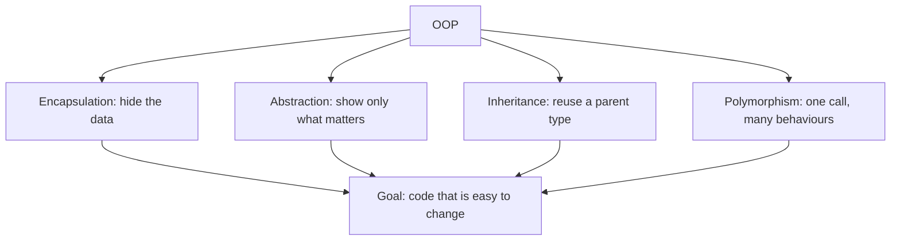

**Say this in the interview:**

> "OOP groups data and behaviour into objects. The four pillars are encapsulation, abstraction, inheritance and polymorphism. In real projects I care most about encapsulation and polymorphism. I use inheritance carefully and prefer composition."

### Class vs object

**In one line:** A class is the plan. An object is one real thing built from that plan.

**Story:** A cookie cutter is the class. Each cookie is an object. All cookies have the same shape, but each one can have different toppings (different field values).

- A class lives in your code (and is loaded once by the JVM).
- An object lives in heap memory. You make it with `new`.
- One class, many objects. Each object has its own copy of instance fields.
- `static` fields belong to the class, so all objects share them.

```java
public class Account {
    private static int count = 0;      // shared by all accounts
    private final String id;           // each object has its own
    private long balancePaise;

    public Account(String id) { this.id = id; count++; }
}

Account a = new Account("A-1");        // object 1 on the heap
Account b = new Account("A-2");        // object 2 on the heap
```

**Say this in the interview:**

> "A class is a template. An object is an instance of that template in heap memory, with its own state. Static members belong to the class, not to any one object."

### Encapsulation

**In one line:** Keep the data private and let others change it only through methods that check the rules.

**Story:** An ATM does not let you open the cash box. You ask it for ₹2,000. It checks your PIN and balance, then gives the cash. The cash box is private. The ATM screen is the public method.

**Example:**

```java
// Bad: anyone can set any balance
public class Wallet {
    public long balance;
}
wallet.balance = -500;                 // no rule stops this

// Good: the object protects its own rules
public class Wallet {
    private long balancePaise;

    public void withdraw(long amountPaise) {
        if (amountPaise <= 0) throw new IllegalArgumentException("amount must be > 0");
        if (amountPaise > balancePaise) throw new InsufficientFundsException(amountPaise);
        balancePaise -= amountPaise;   // the only place the balance goes down
    }

    public long balancePaise() { return balancePaise; }
}
```

**Good and bad:**

| Good | Bad |
|---|---|
| Private fields, methods named after business actions (`withdraw`) | Public fields, or a getter and setter for every field |
| Rules live inside the object | Rules are copied in every service that touches the object |

A class with only getters and setters and no rules is called an *anemic model*. It is not wrong for DTOs (simple data carriers). It is a smell for core business objects.

**Say this in the interview:**

> "Encapsulation means the object owns its data and its rules. Fields are private. Callers use methods like withdraw, not setBalance. So a rule like 'balance cannot go negative' lives in one place."

### Abstraction

**In one line:** Show what something does and hide how it does it.

**Story:** You drive a car with a steering wheel, brake and accelerator. You do not need to know how fuel injection works. The pedals are the abstraction.

In Java, abstraction is usually an interface or an abstract class.

```java
public interface PaymentGateway {
    PaymentResult charge(String orderId, long amountPaise);   // what, not how
}

// The caller only knows the interface
public class CheckoutService {
    private final PaymentGateway gateway;
    public CheckoutService(PaymentGateway gateway) { this.gateway = gateway; }

    public PaymentResult pay(Order order) {
        return gateway.charge(order.id(), order.totalPaise());  // card, UPI or a fake in tests
    }
}
```

Encapsulation vs abstraction, in one breath:

- **Encapsulation** hides the *data* (private fields).
- **Abstraction** hides the *complexity* (the steps behind a simple method or interface).

**Say this in the interview:**

> "Abstraction is about exposing a simple contract, like a PaymentGateway interface with one charge method. The caller does not care if it is a card gateway or a fake in a test. Encapsulation hides data; abstraction hides complexity."

### Inheritance

**In one line:** A child class gets the fields and methods of a parent class and can change some of them.

**Story:** A Royal Enfield Bullet and a Classic 350 share the same engine family. The company reuses the base design and changes a few parts. That is inheritance.

**How it works:**

1. `class Dog extends Animal`: Dog *is an* Animal.
2. Java allows one parent class (single inheritance of classes).
3. A class can implement many interfaces.
4. Constructors are not inherited. The child calls `super(...)`.
5. `private` members are not visible to the child. `final` methods cannot be overridden. `final` classes cannot be extended.

```java
public abstract class Notification {
    protected final String to;
    protected Notification(String to) { this.to = to; }
    public abstract void send(String message);
}

public class SmsNotification extends Notification {
    public SmsNotification(String to) { super(to); }
    @Override
    public void send(String message) { /* call the SMS provider */ }
}
```

**Good and bad:**

| Good | Bad |
|---|---|
| A real "is-a" relation that will not change | Inheriting only to reuse a few methods |
| Shallow trees (1 or 2 levels) | Deep trees (5 levels): one change in the top class breaks many children |

Inheritance makes the child depend on the parent's inside details. See [composition over inheritance](#composition-over-inheritance).

**Say this in the interview:**

> "Inheritance gives code reuse through an is-a relation. Java allows one parent class but many interfaces. I keep hierarchies shallow, because a change in the parent can break every child. For reuse I usually prefer composition."

### Polymorphism

**In one line:** The same method call does different things depending on the object or the arguments.

**Story:** You say "play" to a cricket player, a guitarist and a child. Each one does something different. You used one word; each object decided what it means.

There are two kinds:

| | Compile-time (static) polymorphism | Runtime (dynamic) polymorphism |
|---|---|---|
| Java feature | Method **overloading** | Method **overriding** |
| Who picks the method | The compiler, by the declared types of the arguments | The JVM, by the real class of the object |
| Same name? | Yes, different parameter lists | Yes, same signature in parent and child |
| Example | `print(int)` and `print(String)` | `Animal a = new Dog(); a.sound();` calls Dog's version |

**Diagram:** how the JVM picks the overridden method.

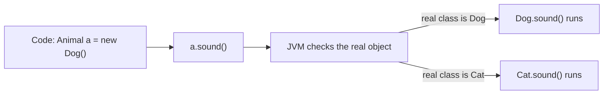

**Overloading rules:**

- Same method name, different parameter list (number, type or order).
- Return type alone is not enough. `int f()` and `long f()` do not compile together.
- The compiler picks the most specific match. Order: exact type, then widening (`int` to `long`), then boxing (`int` to `Integer`), then varargs.
- `print(null)` with `print(String)` and `print(Object)` picks `String`, because it is more specific.

**Overriding rules:**

- Same name and same parameter types as the parent method.
- Return type: same, or a subtype (a *covariant* return type).
- Access: same or wider. You cannot make a `public` method `protected`.
- Checked exceptions: same, narrower, or none. Not broader.
- `private`, `static` and `final` methods cannot be overridden. A `static` method with the same signature *hides* the parent one; the call is decided by the declared type.
- Fields are never polymorphic. `a.name` uses the declared type.
- Always add `@Override`. The compiler then catches typos like `equals(Order o)`.

```java
class Printer {
    void print(int x)    { System.out.println("int " + x); }
    void print(long x)   { System.out.println("long " + x); }
    void print(Object x) { System.out.println("object " + x); }
}
new Printer().print(5);    // int 5   (exact match)
new Printer().print(5L);   // long 5
new Printer().print("hi"); // object hi

abstract class Animal { abstract String sound(); }
class Dog extends Animal { @Override String sound() { return "Woof"; } }
class Cat extends Animal { @Override String sound() { return "Meow"; } }

List<Animal> zoo = List.of(new Dog(), new Cat());
zoo.forEach(a -> System.out.println(a.sound()));  // Woof, Meow: decided at runtime
```

Modern Java adds a third style: **pattern matching** over a sealed type. The logic lives in one `switch`, and the compiler checks that every type is handled. See [abstract class vs interface](#abstract-class-vs-interface).

**Say this in the interview:**

> "Overloading is compile-time polymorphism: same name, different parameters, the compiler picks. Overriding is runtime polymorphism: the JVM calls the method of the real object, through dynamic dispatch. Static methods and fields are not polymorphic."

**They may ask next:**

- **Can you overload `main`?** Yes. The JVM only calls the `main(String[])` one.
- **Can you override a static method?** No. You can hide it. The call is resolved by the declared type.
- **Is overriding slow?** No. The JIT (just-in-time compiler) inlines calls when only one or two classes are seen at a call site.

### Abstract class vs interface

**In one line:** An interface says what a type can do. An abstract class is a half-built class that shares code and state with its children.

**Story:** An interface is a job description: "must drive, must speak Hindi". Anyone can apply. An abstract class is a family business: you join the family, get its shop and tools, and you can join only one family.

| | Interface | Abstract class |
|---|---|---|
| Fields | Only `public static final` constants | Any fields, with state |
| Constructors | No | Yes |
| Methods | Abstract, `default` (Java 8), `static` (Java 8), `private` (Java 9) | Any |
| How many can a class use? | Many (`implements A, B`) | One (`extends`) |
| Use it for | A capability or contract (`Comparable`, `PaymentGateway`) | Shared code and state for close relatives |

**Default methods** let you add a method to an interface without breaking old classes. If two interfaces give the same default method, the class must choose:

```java
interface Camera { default String click() { return "camera"; } }
interface Phone  { default String click() { return "phone"; } }

class SmartPhone implements Camera, Phone {
    @Override
    public String click() { return Camera.super.click(); }  // must override: diamond conflict
}
```

**Sealed interfaces** (final in Java 17) list exactly which classes may implement them. Together with records and `switch` pattern matching (Java 21), the compiler knows all the cases:

```java
public sealed interface Shape permits Circle, Square, Rect {}
public record Circle(double r) implements Shape {}
public record Square(double side) implements Shape {}
public record Rect(double w, double h) implements Shape {}

static double area(Shape s) {
    return switch (s) {                       // no default needed: the list is closed
        case Circle c -> Math.PI * c.r() * c.r();
        case Square q -> q.side() * q.side();
        case Rect(double w, double h) -> w * h;   // record pattern
    };
}
```

If someone adds `Triangle` to the `permits` list, every such `switch` stops compiling until it handles `Triangle`. That is a safety net.

**When to use which:**

- Default choice: an interface.
- Abstract class: when children share real state or a fixed algorithm (see [template method](#template-method)).
- Sealed interface + records: when the set of types is fixed and known, like payment results or order states.

**Say this in the interview:**

> "An interface is a contract; a class can implement many. An abstract class can hold state and constructors, but a class can extend only one. Since Java 8 interfaces have default and static methods, and since Java 9 private methods. For a closed set of types I use a sealed interface with records, so the compiler checks my switch statements."

### Composition over inheritance

**In one line:** Build a class by holding other objects ("has-a"), instead of extending a class ("is-a"), when you only want to reuse behaviour.

**Story:** You want a car with music. You do not make the car a child of a radio. You fit a radio inside the car. If a better radio comes, you swap it.

**The classic broken example** (from the book *Effective Java*). We want a `HashSet` that counts how many items were ever added.

```java
class CountingSet<E> extends HashSet<E> {
    int added = 0;

    @Override public boolean add(E e) { added++; return super.add(e); }

    @Override public boolean addAll(Collection<? extends E> c) {
        added += c.size();
        return super.addAll(c);      // HashSet's addAll (from AbstractCollection) calls add() for each item!
    }
}

var set = new CountingSet<String>();
set.addAll(List.of("a", "b", "c"));
System.out.println(set.added);       // 6, not 3
```

The child depended on a hidden detail of the parent: `addAll` calls `add`. A future JDK could change that detail and break the child again. This is called the *fragile base class* problem.

**The fix:** wrap the set instead of extending it.

```java
class CountingSet<E> {
    private final Set<E> inner = new HashSet<>();  // has-a, not is-a
    private int added = 0;

    public boolean add(E e) { added++; return inner.add(e); }

    public boolean addAll(Collection<? extends E> c) {
        added += c.size();
        return inner.addAll(c);    // inner calls its own add(), not ours
    }

    public int added() { return added; }
}
```

If callers need a full `Set`, implement `Set<E>` and forward every method to `inner`. This is the [decorator](#decorator) pattern.

**Diagram:**

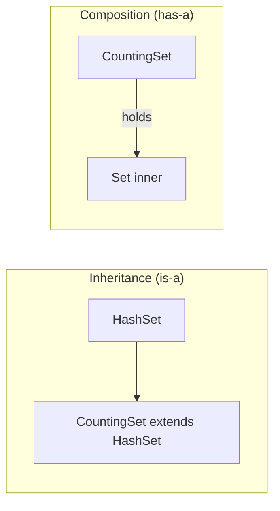

**Good and bad:**

| Composition | Inheritance |
|---|---|
| Swap parts at runtime (inject a different object) | Fixed at compile time |
| Depends only on the public API of the part | Depends on the parent's inside details |
| Easy to test with a fake part | Hard to test the child alone |

Use inheritance when the "is-a" is real and stable, and the parent is designed for it (documented hooks, like `AbstractList`).

**Say this in the interview:**

> "Inheritance couples the child to the parent's internals. The classic example is a counting HashSet where addAll calls add and counts twice. With composition, I hold the set as a field and forward calls. It is safer, easier to test, and I can swap the part. Spring dependency injection is composition at scale."

### Association, aggregation and composition

**In one line:** Three ways objects relate; they differ in who owns whom and who lives how long.

**Story:**

- **Association:** a teacher and a student know each other. Neither owns the other.
- **Aggregation:** a cricket team has players. If the team breaks up, the players still exist and join other teams.
- **Composition:** a house has rooms. If the house is demolished, the rooms are gone too.

| Kind | Relation | Lifetime | Java example |
|---|---|---|---|
| Association | "uses" or "knows" | Independent | `OrderService` calls a `Clock` passed into a method |
| Aggregation | "has-a", shared | Parts live on their own | `Team` holds a `List<Player>` given from outside |
| Composition | "owns-a", exclusive | Parts die with the owner | `Order` creates and holds its own `List<OrderLine>` |

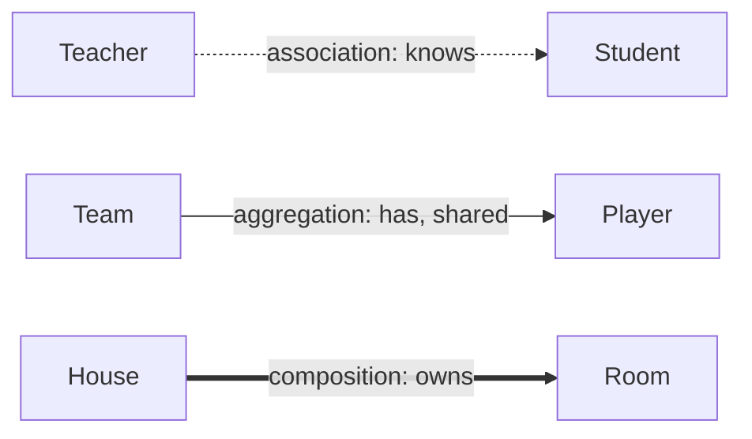

In JPA, composition maps to `@OneToMany(cascade = ALL, orphanRemoval = true)`: delete the order and its lines go too. See [Hibernate and JPA](hibernate-jpa.md).

**Say this in the interview:**

> "Association means two objects know each other. Aggregation is a has-a where parts can live alone, like a team and players. Composition is strong ownership, like an order and its order lines: the lines die with the order."

### Immutability

**In one line:** An immutable object cannot change after it is built; to "change" it, you make a new one.

**Story:** A printed train ticket. If you want a different date, you do not scratch the old one. You get a new ticket. Many people can look at the old ticket at once; nobody can spoil it.

**Why it helps:**

- **Thread safe** with no locks. Many threads can read it.
- **Safe as a `HashMap` key.** The hash code never changes.
- **Easy to reason about.** No one can change it behind your back.
- Easy to cache and share.

**How to make one (classic way):** `final` class, `private final` fields, no setters, and *defensive copies* of mutable inputs and outputs.

**Modern way: records.** A record gives you `private final` fields, a constructor, accessors, `equals`, `hashCode` and `toString`. But a record is only *shallowly* immutable. A `List` field can still be changed by whoever holds that list.

```java
public record Order(String id, List<String> items, Instant createdAt) {
    public Order {                                   // compact constructor
        Objects.requireNonNull(id, "id");
        items = List.copyOf(items);                  // defensive copy: caller's list can change, ours cannot
    }

    public Order withItem(String item) {             // "change" = return a new object
        var copy = new ArrayList<>(items);
        copy.add(item);
        return new Order(id, copy, createdAt);
    }
}

var list = new ArrayList<>(List.of("tea"));
var o = new Order("O-1", list, Instant.now());
list.add("samosa");          // does not affect o
o.items().add("x");          // UnsupportedOperationException: List.copyOf is unmodifiable
```

Notes:

- `List.copyOf`, `Set.copyOf` and `Map.copyOf` return unmodifiable copies and reject `null` elements.
- `Collections.unmodifiableList(list)` is only a *view*. If someone changes `list`, the view changes too.
- `String`, `Integer`, `LocalDate`, `Instant` and `BigDecimal` are immutable. Old `java.util.Date` is not.

**Say this in the interview:**

> "Immutable objects are thread safe and safe as map keys. Today I use records with a compact constructor that validates and makes defensive copies with List.copyOf. Records are only shallowly immutable, so the copy matters. To change a value I return a new object, like a wither method."

### equals and hashCode contract

**In one line:** If two objects are equal by `equals`, they must have the same `hashCode`; otherwise `HashMap` and `HashSet` break.

**Story:** A library keeps books on shelves by the first letter of the title (the hash code). To find a book, the librarian goes to the right shelf, then compares titles (equals). If two copies of the same book were put on different shelves, the librarian would say "not found".

**The `equals` contract:**

1. **Reflexive:** `a.equals(a)` is true.
2. **Symmetric:** if `a.equals(b)` then `b.equals(a)`.
3. **Transitive:** if `a` equals `b` and `b` equals `c`, then `a` equals `c`.
4. **Consistent:** same answer every time, if nothing changed.
5. `a.equals(null)` is false.

**The `hashCode` contract:**

- Equal objects must return the same hash code.
- Unequal objects *may* share a hash code (a *collision*). It only slows things down.

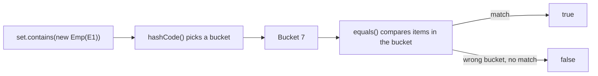

**The classic bug:** override `equals` but not `hashCode`.

```java
class Emp {
    final String id;
    Emp(String id) { this.id = id; }

    @Override public boolean equals(Object o) {
        return o instanceof Emp e && id.equals(e.id);   // pattern matching instanceof
    }
    // hashCode() missing: Object's version gives different numbers for equal objects
}

Set<Emp> set = new HashSet<>();
set.add(new Emp("E1"));
set.contains(new Emp("E1"));   // usually false: different bucket

// Fix: add hashCode, or just use a record
@Override public int hashCode() { return id.hashCode(); }
record Employee(String id) {}  // equals and hashCode generated from all components
```

More traps:

- **Mutable keys.** Put an object in a `HashSet`, then change a field used in `hashCode`. Now `contains` cannot find it. Use immutable keys.
- **`instanceof` vs `getClass()`.** `instanceof` lets a subclass equal its parent, which can break symmetry if the subclass adds fields. Make the class `final`, or use `getClass()`.
- **JPA entities.** Do not base `equals` on a database id that is `null` before save. See [Hibernate and JPA](hibernate-jpa.md).
- `equals(Order o)` without `@Override` is an *overload*, not an override. Collections never call it.

**Say this in the interview:**

> "Equal objects must have equal hash codes, because HashMap first uses the hash to pick a bucket and then equals to compare. If I override equals without hashCode, a HashSet can hold duplicates or fail to find an item. I prefer records or immutable keys, and I never use mutable fields in hashCode."

### Coupling and cohesion

**In one line:** Coupling is how much one class depends on others (keep it low). Cohesion is how well the parts of one class belong together (keep it high).

**Story:** In a good kitchen, the tandoor team only does tandoor work (high cohesion). They take orders through a slip, not by walking into the billing room (low coupling). If billing changes its software, tandoor work goes on.

| | Low coupling, high cohesion (good) | High coupling, low cohesion (bad) |
|---|---|---|
| A change | Touches one class | Ripples into ten classes |
| Tests | One class with a fake or two | Need the whole app running |
| Class names | `InvoicePdfRenderer`, `TaxCalculator` | `CommonUtils`, `OrderManagerHelper` |

**How to lower coupling:**

- Depend on interfaces, not concrete classes.
- Inject dependencies through the constructor. Do not `new` them inside.
- Talk across modules with events or messages (see [observer](#observer)).
- Do not share database tables between services (see [microservices](microservices.md)).

**How to raise cohesion:**

- Split a class when its methods use different groups of fields.
- Group by feature (`order/`, `payment/`), not only by layer (`controllers/`, `services/`).

**Say this in the interview:**

> "I aim for low coupling and high cohesion. Low coupling means a change in one class does not ripple into others; I get it with interfaces, constructor injection and events. High cohesion means each class has one focused job. A class called Utils or Manager is usually a sign of low cohesion."

### Law of Demeter

**In one line:** Talk only to your close friends; do not reach through one object to grab another object's parts.

**Story:** At a shop you give money to the cashier. You do not reach into the cashier's pocket, take out his wallet and put money inside. That is what `a.getB().getC().doX()` does.

```java
// Bad: a "train wreck". OrderService knows the whole object graph.
String city = order.getCustomer().getAddress().getCity();

// Good: ask the object you have for what you need
String city = order.shippingCity();

// inside Order
public String shippingCity() { return customer.shippingCity(); }
```

**The rule:** a method may call methods on:

- itself (`this`),
- its own fields,
- its parameters,
- objects it creates.

**Not a violation:** fluent APIs that return the same kind of object, like builders or streams: `list.stream().filter(...).map(...).toList()`. Plain data records (DTOs) are also fine to read.

**Say this in the interview:**

> "Law of Demeter says: don't talk to strangers. A chain like order.getCustomer().getAddress().getCity() couples my code to three classes. I add a method like order.shippingCity() instead. Fluent APIs like streams and builders are not violations."

---

## SOLID principles

**In one line:** SOLID is five rules that keep classes small, easy to extend and easy to test.

**Story:** A good restaurant kitchen: each cook has one job (S). A new dish adds a new recipe card, not a new kitchen (O). Any trained cook can take another cook's station (L). The waiter's order pad has only the fields a waiter needs (I). The head chef asks for "a fryer", not "the fryer bought in 2019 from shop X" (D).

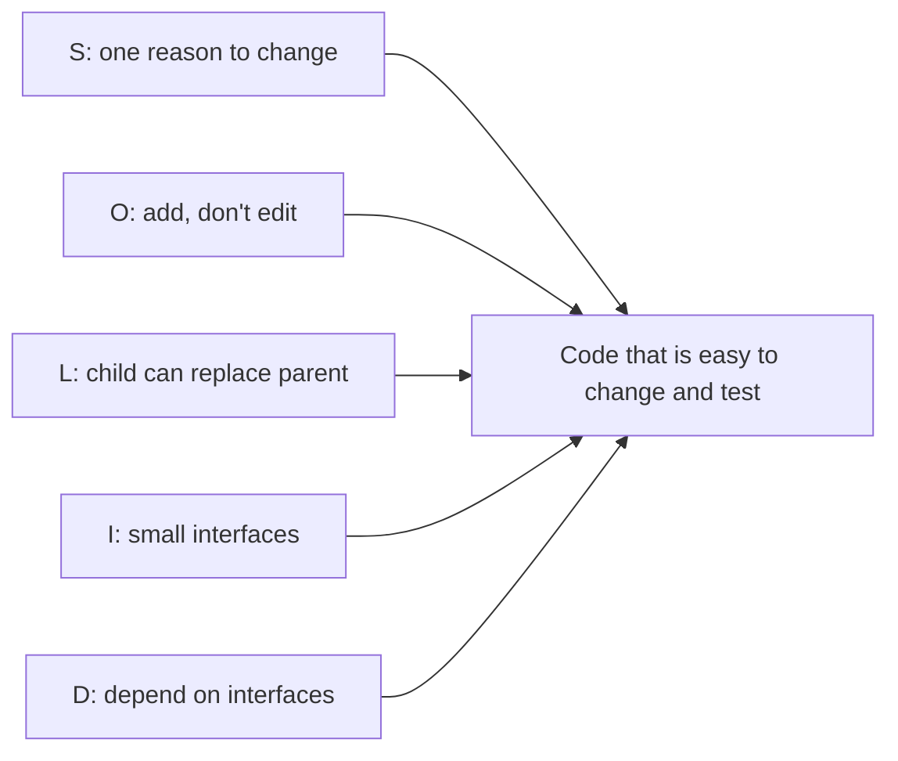

| Letter | Name | Short rule |
|---|---|---|
| S | Single responsibility | A class has one reason to change |
| O | Open/closed | Add new behaviour by adding code, not by editing working code |
| L | Liskov substitution | A child class must work anywhere the parent works |
| I | Interface segregation | Many small interfaces beat one fat interface |
| D | Dependency inversion | High-level code depends on interfaces, not on low-level details |

**Say this in the interview:**

> "SOLID is five rules for classes that are easy to change. Single responsibility, open/closed, Liskov substitution, interface segregation and dependency inversion. They are guidelines, not laws. I apply them where change is likely, and I avoid adding interfaces nobody needs."

### S: Single responsibility principle

**In one line:** A class should have only one reason to change, which means it serves one group of people (one "actor").

**Story:** A tailor who also cooks and drives the delivery van. If the menu changes, the tailor's day changes. If the van breaks, tailoring stops. Give each job to a different person.

**Bad:** one class does pricing, saving, PDF and email. Four teams can ask for four different changes here.

```java
@Service
public class InvoiceService {
    public void process(Invoice inv) {
        BigDecimal total = inv.items().stream()                  // pricing rules (finance team)
            .map(Item::price).reduce(BigDecimal.ZERO, BigDecimal::add)
            .multiply(new BigDecimal("1.18"));                   // GST hard-coded here
        jdbc.update("insert into invoice(id, total) values (?, ?)", inv.id(), total);  // storage
        String pdf = "<h1>Invoice " + inv.id() + "</h1>" + total;  // layout (design team)
        mailer.send(inv.email(), "Your invoice", pdf);            // email (marketing team)
    }
}
```

**Good:** one class per reason to change. The service only coordinates.

```java
@Service
public class InvoiceService {
    private final PriceCalculator calculator;   // pricing and tax
    private final InvoiceRepository repo;       // storage
    private final InvoiceRenderer renderer;     // PDF layout
    private final Notifier notifier;            // sending

    public InvoiceService(PriceCalculator c, InvoiceRepository r, InvoiceRenderer rd, Notifier n) {
        this.calculator = c; this.repo = r; this.renderer = rd; this.notifier = n;
    }

    public void process(Invoice inv) {
        Money total = calculator.total(inv);
        repo.save(inv, total);
        notifier.send(inv.email(), renderer.render(inv, total));
    }
}
```

**Do not overdo it.** Twenty one-method classes for a small feature is also hard to read. Split when the parts change for different reasons.

**Say this in the interview:**

> "Single responsibility means one reason to change. I think of it as one actor: finance owns tax rules, design owns the PDF layout. If both live in one class, a layout change can break tax. So I split them and let a thin service coordinate."

### O: Open/closed principle

**In one line:** Code should be open for extension but closed for modification: add a new case by adding a new class, not by editing a working `if/else`.

**Story:** A phone charger with a USB-C port. New devices plug in. Nobody opens the charger and rewires it for each new phone.

**Bad:** every new payment method means editing this method and re-testing all old ones.

```java
public BigDecimal fee(String method, BigDecimal amount) {
    if (method.equals("CARD")) {
        return amount.multiply(new BigDecimal("0.02"));
    } else if (method.equals("UPI")) {
        return BigDecimal.ZERO;
    } else if (method.equals("WALLET")) {
        return amount.multiply(new BigDecimal("0.01"));
    }
    throw new IllegalArgumentException("Unknown method " + method);  // new method = edit here
}
```

**Good:** each method is its own class. Spring finds all of them.

```java
public interface FeeRule {
    String method();
    BigDecimal fee(BigDecimal amount);
}

@Component class CardFee implements FeeRule {
    public String method() { return "CARD"; }
    public BigDecimal fee(BigDecimal a) { return a.multiply(new BigDecimal("0.02")); }
}

@Component class UpiFee implements FeeRule {
    public String method() { return "UPI"; }
    public BigDecimal fee(BigDecimal a) { return BigDecimal.ZERO; }
}
// New "NETBANKING"? Add one new class. Old classes and the caller do not change.
```

The caller builds a `Map` from the list of rules. See the full code in [strategy](#strategy).

**Senior nuance:** a sealed interface with a `switch` is the opposite trade-off. Adding a new *type* means editing every `switch` (the compiler finds them). Adding a new *operation* is easy. Pick strategy classes when new types come often (payment methods). Pick sealed + switch when the types are fixed (order states).

**Say this in the interview:**

> "Open/closed means I can add behaviour without editing tested code. The usual tool is polymorphism: an interface, one class per variant, and Spring injects all of them. I don't make everything pluggable on day one; I refactor to this when the second or third variant shows up."

### L: Liskov substitution principle

**In one line:** If code works with a parent type, it must keep working when you pass any child type.

**Story:** You rent "a car". The company gives you an electric car. It still has a steering wheel, brakes and seats; you can drive it. If they gave you a toy car that looks the same but cannot move, the promise "this is a car" is broken.

**Bad:** the classic rectangle and square.

```java
class Rectangle {
    protected int w, h;
    void setWidth(int w)  { this.w = w; }
    void setHeight(int h) { this.h = h; }
    int area() { return w * h; }
}

class Square extends Rectangle {          // "a square is a rectangle" in maths...
    @Override void setWidth(int w)  { this.w = w; this.h = w; }
    @Override void setHeight(int h) { this.w = h; this.h = h; }
}

void resize(Rectangle r) {
    r.setWidth(5);
    r.setHeight(4);
    assert r.area() == 20;                // ...but this fails for Square: area is 16
}
```

**Good:** do not force the "is-a". Make shapes immutable and give them a common contract that both can keep.

```java
public sealed interface Shape permits Rect, Square {
    int area();
}
public record Rect(int w, int h) implements Shape {
    public int area() { return w * h; }
}
public record Square(int side) implements Shape {
    public int area() { return side * side; }
}
// No setters, so no broken promise. Each shape keeps its own rules.
```

**Rules a child must follow:**

- Do not ask for more (no stronger checks on inputs).
- Do not give less (no weaker results).
- Do not throw new kinds of exceptions the caller does not expect.
- Keep the parent's promises (*invariants*).

**Real example in the JDK:** `List.of(...)` returns a `List`, but `add` throws `UnsupportedOperationException`. Callers who assume "a List can grow" get surprised. That is why you should know where a list came from.

**Smell:** `if (shape instanceof Square)` inside code that takes a `Shape`. Or a child method that throws `UnsupportedOperationException`.

**Say this in the interview:**

> "Liskov says a subtype must be usable anywhere the parent is used, without surprises. The classic break is Square extends Rectangle: setting width and height separately gives the wrong area. Signs of a violation are instanceof checks on the parent type, or a child that throws UnsupportedOperationException."

### I: Interface segregation principle

**In one line:** Do not force a class to implement methods it does not need; split fat interfaces into small ones.

**Story:** A restaurant gives every staff member the same 40-button remote: kitchen, billing, music, AC. The cleaner only needs "lights". Give each person a small remote.

**Bad:**

```java
public interface OfficeMachine {
    void print(Document d);
    void scan(Document d);
    void fax(Document d);
}

public class BasicPrinter implements OfficeMachine {
    public void print(Document d) { /* prints */ }
    public void scan(Document d) { throw new UnsupportedOperationException(); }  // forced
    public void fax(Document d)  { throw new UnsupportedOperationException(); }  // forced
}
```

**Good:**

```java
public interface Printer { void print(Document d); }
public interface Scanner { void scan(Document d); }
public interface Fax     { void fax(Document d); }

public class BasicPrinter implements Printer {
    public void print(Document d) { /* prints */ }
}

public class OfficeAllInOne implements Printer, Scanner, Fax {
    public void print(Document d) { /* ... */ }
    public void scan(Document d)  { /* ... */ }
    public void fax(Document d)   { /* ... */ }
}

// A caller asks only for what it uses
public ReportJob(Printer printer) { this.printer = printer; }
```

**In Spring Data:** since Spring Data 3, `PagingAndSortingRepository` no longer extends `CrudRepository`. You can pick `ListCrudRepository`, `ListPagingAndSortingRepository`, or plain `Repository` and declare only the methods you need. A read-only service does not need `deleteAll()`.

**Say this in the interview:**

> "Interface segregation means clients should not depend on methods they don't use. A fat interface forces dummy methods that throw UnsupportedOperationException, which also breaks Liskov. I split by client need: Printer, Scanner, Fax. Spring Data's small repository interfaces are a good real example."

### D: Dependency inversion principle

**In one line:** Business code should depend on an interface it owns; the database or API code implements that interface.

**Story:** A wall socket. Your laptop needs "a socket with this shape", not "power from the coal plant in Nagpur". The power company can change; your laptop does not care.

**Bad:** the service creates its own low-level dependency.

```java
public class OrderService {
    private final MySqlOrderRepository repo = new MySqlOrderRepository();  // hard-wired
    private final SmtpMailer mailer = new SmtpMailer("smtp.company.com");   // hard-wired

    public void place(Order o) {
        repo.insert(o);                                   // cannot test without MySQL
        mailer.sendMail(o.email(), "Order placed");       // cannot test without SMTP
    }
}
```

**Good:** the service owns the interfaces. Details plug in from outside.

```java
// In the "order" (business) package
public interface OrderRepository { void save(Order o); }
public interface Notifier { void notify(String to, String msg); }

@Service
public class OrderService {
    private final OrderRepository repo;
    private final Notifier notifier;

    public OrderService(OrderRepository repo, Notifier notifier) {  // constructor injection
        this.repo = repo;
        this.notifier = notifier;
    }

    public void place(Order o) {
        repo.save(o);
        notifier.notify(o.email(), "Order placed");
    }
}
// In the "infra" package: JpaOrderRepository implements OrderRepository, EmailNotifier implements Notifier
```

**Diagram:** the arrow from infra points *up* to the business interface. That is the "inversion".

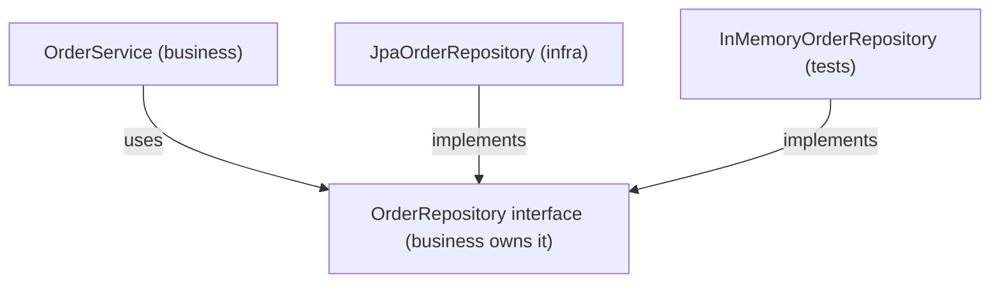

**Three words people mix up:**

- **Dependency inversion (DIP):** a design rule. Depend on abstractions; the high-level module owns them.
- **Inversion of control (IoC):** the framework calls your code and manages object life (Spring creates your beans).
- **Dependency injection (DI):** a technique. Someone passes the dependencies in (constructor, setter). Spring does DI, which makes DIP easy.

This is also the idea behind *hexagonal architecture* (ports and adapters): business code in the middle, adapters for DB, HTTP and Kafka around it.

**Say this in the interview:**

> "Dependency inversion means high-level business code depends on interfaces, and low-level code like JPA or SMTP implements them. The business layer owns the interface, so the dependency arrow points inward. Spring's constructor injection is how I do it in practice, and it lets me pass a fake in unit tests."

### How Spring helps with SOLID

**In one line:** Spring's dependency injection, bean collections and proxies make SOLID the easy path.

| Principle | How Spring helps |
|---|---|
| S | Small `@Service`, `@Repository`, `@Component` beans, each with one job. Cross-cutting work (transactions, security, logging) moves to aspects. |
| O | Inject `List<FeeRule>` or `Map<String, FeeRule>`; a new `@Component` adds a variant. `@ConditionalOnProperty` switches beans by config. |
| L | Proxies (for `@Transactional`, `@Cacheable`) stand in for your bean. They only work because a proxy can replace the real object. |
| I | Small Spring Data repository interfaces. Depend on `ApplicationEventPublisher`, not the whole `ApplicationContext`. |
| D | Constructor injection of interfaces. `@Primary` and `@Qualifier` choose the implementation. Tests pass fakes or use `@MockitoBean`. |

Tips:

- Use constructor injection. Fields can be `final`, and the class works without Spring in unit tests.
- More than about 5 constructor parameters is a smell that the class does too much (S).
- Spring injects a `Map<String, T>` keyed by bean name. For stable keys, inject a `List<T>` and build the map from a method like `type()`.

**Say this in the interview:**

> "Spring is built for SOLID. Constructor injection gives dependency inversion. Injecting a list of strategy beans gives open/closed. AOP keeps transactions and security out of my classes, which helps single responsibility. And Spring's proxies rely on Liskov: the proxy must behave like the real bean."

---

## Other design principles

**In one line:** A few short rules that help you decide what *not* to build and where code should live.

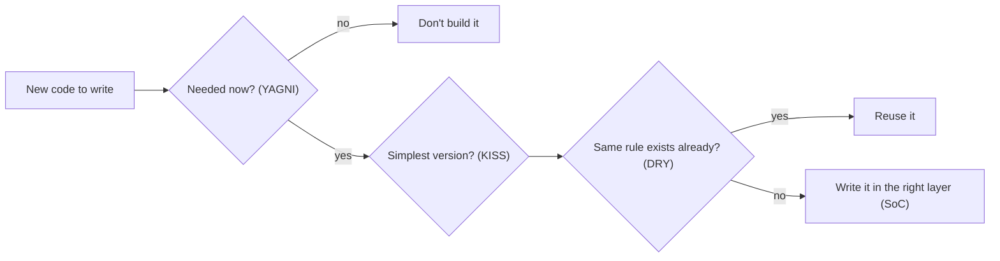

**Say this in the interview:**

> "Beyond SOLID I lean on YAGNI, KISS and DRY. Build only what is needed now, in the simplest way, and keep each business rule in one place. I also fail fast at the boundaries, and I prefer tell-don't-ask so the rules stay inside objects."

### DRY: Don't repeat yourself

**In one line:** Every piece of *knowledge* (a business rule) should live in one place.

**Story:** A shop has the GST rate written on three price boards. The rate changes. Someone updates two boards. Customers now see two prices.

- DRY is about **knowledge**, not text. Two lines that look the same but change for different reasons are not real duplication.
- **Rule of three:** the first time, write it. The second time, notice it. The third time, extract it.
- The wrong shared abstraction is worse than a little copy. A shared method with 6 boolean flags is a smell.
- Across microservices, some duplication (a DTO in each service) is better than a shared library that couples every deploy.

**Say this in the interview:**

> "DRY means one rule, one place. It is about knowledge, not similar-looking code. I extract after the third copy, and I prefer some duplication over the wrong abstraction, especially across microservices."

### KISS: Keep it simple

**In one line:** Choose the simplest design that solves today's problem well.

**Story:** To cross a small stream you put down a plank, not a suspension bridge.

- A plain `if` is fine when there are two cases. You do not need a strategy framework.
- One service and one database before microservices, caches and Kafka.
- Simple code is easier to debug at 2 a.m.

**Say this in the interview:**

> "KISS means the simplest thing that works. I add patterns, caches or new services only when a real need appears, like the third payment method or a measured slow query."

### YAGNI: You aren't gonna need it

**In one line:** Do not build features or extension points for a future that may never come.

**Story:** Building a 5-floor foundation for a house when you have money and need for one floor. Maybe you never build floor two.

- Bad: a `PluginManager` and a config DSL "in case we add more channels later".
- Good: make the code easy to change later: tests, small classes, clear names. Then change it when the need is real.
- YAGNI is not "skip tests" or "skip security". It is about *features* and *flexibility*.

**Say this in the interview:**

> "YAGNI: don't build for imagined requirements. Each extra abstraction costs reading time and bugs. I keep code easy to change instead, and I add the flexibility when the requirement actually shows up."

### Separation of concerns

**In one line:** Different jobs live in different parts of the code, so one change touches one part.

- **Layers:** controller (HTTP), service (business rules), repository (database).
- **Frontend:** markup, style and logic; or UI components vs data-fetching hooks.
- **Cross-cutting concerns** (security, logging, transactions) go into filters and aspects, not into each method.
- A controller with SQL inside, or an entity that sends emails, mixes concerns.

**Say this in the interview:**

> "Separation of concerns means each part has one kind of job. In Spring: controllers for HTTP, services for rules, repositories for data, and aspects or filters for cross-cutting things like security and transactions."

### Fail fast

**In one line:** Check inputs early and stop with a clear error, instead of carrying bad data deep into the system.

**Story:** A railway ticket checker at the gate stops the person without a ticket. Better than finding them at the next station.

```java
public record Transfer(String from, String to, BigDecimal amount) {
    public Transfer {
        Objects.requireNonNull(from, "from");
        Objects.requireNonNull(to, "to");
        if (amount.signum() <= 0) throw new IllegalArgumentException("amount must be > 0");
        if (from.equals(to)) throw new IllegalArgumentException("same account");
    }
}
// Bad data cannot even become an object. Every later method can trust it.
```

- Validate at the boundary: `@Valid` on request DTOs (see [Bean Validation](spring-ecosystem.md#bean-validation-valid)).
- Fail at startup for bad config (`@ConfigurationProperties` with `@Validated`), not at the first request.
- Java 25 lets you run checks *before* `super(...)` in a constructor (flexible constructor bodies, JEP 513).
- Fail fast is not "crash the whole app". It means "reject this one bad input early with a clear message".

**Say this in the interview:**

> "Fail fast means validate early and loudly. I validate request DTOs with Bean Validation, validate config at startup, and put checks in record constructors so an invalid object cannot exist. The error then points at the real cause, not at a NullPointerException three layers down."

### Tell, don't ask

**In one line:** Tell an object to do the work; do not ask for its data and do the work outside.

```java
// Ask (bad): the rule lives in the caller, and every caller copies it
if (account.getBalance().compareTo(amount) >= 0) {
    account.setBalance(account.getBalance().subtract(amount));
}

// Tell (good): the rule lives in Account
account.withdraw(amount);
```

This keeps [encapsulation](#encapsulation) and the [Law of Demeter](#law-of-demeter).

**Say this in the interview:**

> "Tell, don't ask: I call account.withdraw(amount) instead of reading the balance and setting it from outside. The rule stays inside the object, so it cannot be skipped or copied wrong."

### Program to an interface

**In one line:** Declare variables, fields and parameters with the interface type, not the concrete class.

```java
List<String> names = new ArrayList<>();         // good: can switch to another List later
ArrayList<String> names2 = new ArrayList<>();   // only if you need ArrayList-only methods

public OrderService(PaymentGateway gateway) {}  // good: card, UPI or fake
public OrderService(CardGatewayClient client) {} // tied to one vendor SDK
```

- It makes swapping and testing easy.
- It does not mean "create an interface for every class". A class with one implementation and no test fake may not need one.

**Say this in the interview:**

> "Program to an interface means my code depends on List, not ArrayList, and on PaymentGateway, not one vendor's client. But I don't create an interface for every single class; I add one when there are two implementations or a real seam for testing."

---


## Design patterns

**In one line:** A design pattern is a named, tested solution to a common design problem, so a team can say "use a strategy here" and everyone understands.

**Story:** Builders do not invent a new staircase for each house. They pick "spiral" or "straight" and change the size. Patterns are the same: known shapes you adjust to your code.

The book *Design Patterns* (1994, the "Gang of Four" or GoF) named 23 of them, in three groups:

- **Creational:** how objects are made.
- **Structural:** how objects are joined together.
- **Behavioural:** how objects share work and talk.

This page covers all 23, grouped the same way, plus where you already use each one in the JDK and Spring.

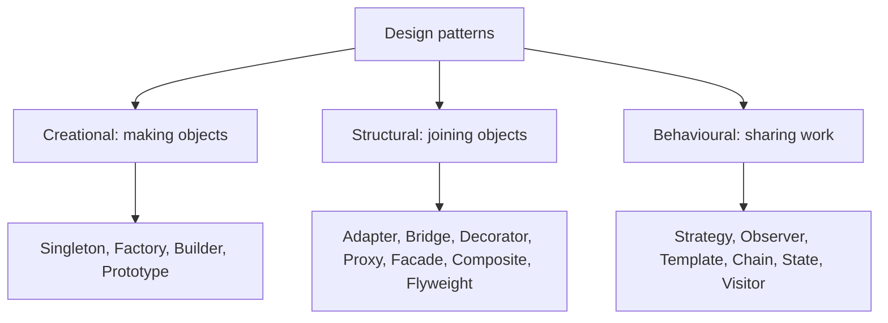

**Say this in the interview:**

> "Patterns are a shared vocabulary for common design problems. I use them when the problem shows up, not to decorate code. The ones I use most in Spring apps are strategy, template method, builder, proxy through AOP, observer through events, and chain of responsibility through filters."

### The pattern map

**In one line:** One table to remember what each pattern is for and where you already use it.

| Pattern | Group | Use it when | Seen in JDK / Spring |
|---|---|---|---|
| [Singleton](#singleton) | Creational | You need exactly one shared instance | `Runtime.getRuntime()`, Spring singleton beans |
| [Factory method](#factory-method) | Creational | The caller should not pick the concrete class | `List.of`, `Calendar.getInstance`, `@Bean` methods, `FactoryBean` |
| [Abstract factory](#abstract-factory) | Creational | You make families of related objects | `DocumentBuilderFactory`, JDBC `Connection` making `Statement`s |
| [Builder](#builder) | Creational | Many optional fields; readable creation | `StringBuilder`, `HttpRequest.newBuilder()`, `UriComponentsBuilder`, Lombok `@Builder` |
| [Prototype](#prototype) | Creational | Copy an existing object instead of building from scratch | `clone()`, copy constructors, Spring `prototype` scope (loosely) |
| [Adapter](#adapter) | Structural | Make an old or third-party API fit your interface | `InputStreamReader`, `Arrays.asList`, Spring MVC `HandlerAdapter` |
| [Decorator](#decorator) | Structural | Add behaviour by wrapping, stackable | `BufferedInputStream`, `Collections.unmodifiableList`, `HttpServletRequestWrapper` |
| [Proxy](#proxy) | Structural | Control access to an object (lazy, security, transactions) | `java.lang.reflect.Proxy`, Spring AOP, `@Transactional`, JPA lazy loading |
| [Facade](#facade) | Structural | One simple entry to a complex subsystem | SLF4J, `JdbcTemplate`, `RestClient` |
| [Composite](#composite) | Structural | Treat a group and a single item the same (trees) | UI component trees, `CompositeCacheManager`, Micrometer `CompositeMeterRegistry` |
| [Bridge](#bridge) | Structural | Two dimensions that vary on their own | JDBC API vs drivers, SLF4J API vs Logback |
| [Flyweight](#flyweight) | Structural | Many small objects share common data to save memory | `Integer.valueOf` cache (-128 to 127), string pool |
| [Strategy](#strategy) | Behavioural | Swap an algorithm at runtime; kill `if/else` chains | `Comparator`, injected `List<Strategy>` beans |
| [Observer](#observer) | Behavioural | Many listeners react to one event | Spring `ApplicationEvent` and `@EventListener`, `Flow` API |
| [Template method](#template-method) | Behavioural | Fixed steps, one or two steps vary | `JdbcTemplate`, `AbstractList`, `HttpServlet.service` |
| [Chain of responsibility](#chain-of-responsibility) | Behavioural | A request passes through a line of handlers | Servlet `Filter`, Spring Security filter chain, `HandlerInterceptor` |
| [Command](#command) | Behavioural | Turn a request into an object (queue, undo, retry) | `Runnable`, `Callable`, Kafka command messages |
| [State](#state) | Behavioural | Behaviour depends on the current state | Order status, Spring Statemachine |
| [Interpreter](#interpreter) | Behavioural | Evaluate a small rule language as a tree | `java.util.regex.Pattern`, Spring Expression Language (SpEL) |
| [Iterator](#iterator) | Behavioural | Walk a collection without knowing its inside | `Iterator`, `Iterable`, for-each loop |
| [Mediator](#mediator) | Behavioural | Many objects talk through one middle object | `DispatcherServlet`, chat room, air traffic control |
| [Memento](#memento) | Behavioural | Save and restore an object's state (undo) | Editor undo, saved game, snapshots |
| [Visitor](#visitor) | Behavioural | Add operations over a fixed set of types | `FileVisitor`, compilers; today often sealed + `switch` |

**Say this in the interview:**

> "I group patterns into creational, structural and behavioural. And I can point to each one in code I use daily. Builder is in HttpRequest, decorator in java.io and proxy in Spring AOP. Template method is in JdbcTemplate, chain of responsibility in servlet filters, and observer in Spring events."

---

## Creational patterns

**In one line:** Creational patterns control *how objects are made*, so callers do not depend on concrete classes or long constructors.

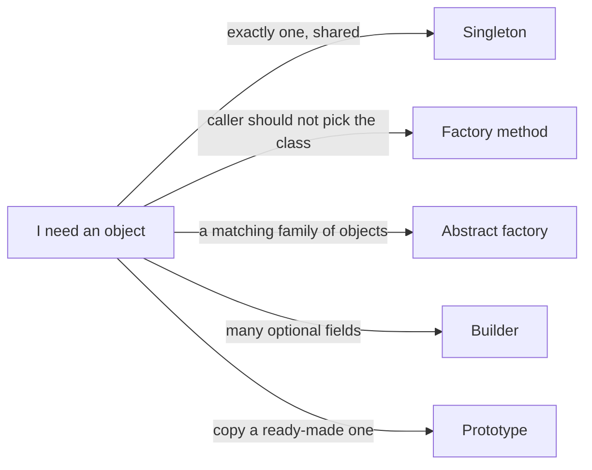

**Say this in the interview:**

> "Creational patterns hide how objects are created. In a Spring app the container does most of this for me: beans are singletons, @Bean methods are factories, and profiles pick families. I still write builders for objects with many optional fields."

### Singleton

**In one line:** A class that has exactly one instance, with one global way to get it.

**Story:** A country has one Prime Minister at a time. Everyone who needs "the PM" reaches the same person.

**Option 1: enum (the simplest and safest).** The JVM makes enum constants once. It is safe against reflection and serialization tricks.

```java
public enum IdGenerator {
    INSTANCE;                                    // created once by the JVM

    private final AtomicLong next = new AtomicLong();
    public long nextId() { return next.incrementAndGet(); }
}

long id = IdGenerator.INSTANCE.nextId();
```

**Option 2: holder idiom (lazy, thread safe, no locks).** The inner class loads only on the first `get()`. Class loading in the JVM is thread safe.

```java
public final class AppConfig {
    private AppConfig() { /* load files */ }

    private static class Holder {
        static final AppConfig INSTANCE = new AppConfig();  // runs on first use of Holder
    }

    public static AppConfig get() { return Holder.INSTANCE; }
}
```

**Option 3: double-checked locking (DCL).** Interviewers love this one because of `volatile`.

```java
public final class Registry {
    private static volatile Registry instance;   // volatile is required

    private Registry() {}

    public static Registry get() {
        Registry r = instance;                   // fast path: no lock once created
        if (r == null) {
            synchronized (Registry.class) {
                r = instance;
                if (r == null) {                 // check again inside the lock
                    instance = r = new Registry();
                }
            }
        }
        return r;
    }
}
```

**Why `volatile`?** `new Registry()` is three steps: get memory, run the constructor, store the reference. The CPU or JIT may reorder them. Without `volatile`, another thread can see a non-null reference to an object whose constructor has not finished. `volatile` adds a *happens-before* edge (a memory-order promise), so this cannot happen. See [volatile and happens-before](java-concurrency.md#volatile-and-happens-before).

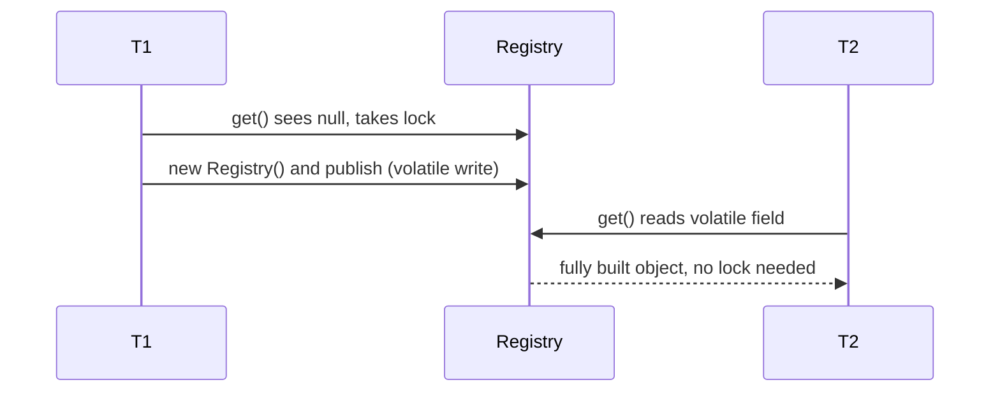

**Problems with singletons:**

- Hidden global state. Any class can call `Registry.get()`, so dependencies are invisible.
- Hard to test. You cannot pass a fake.
- Mutable state in a singleton needs thread safety.

**Spring singleton beans are different:**

- Spring's default scope is `singleton`: **one instance per bean definition per application context**, not per JVM.
- The class itself is a normal class. You can still `new` it in a test.
- Spring injects it, so the dependency is visible in the constructor. This keeps the good part (one shared object) without the bad part (global access).
- Why singleton by default? Most beans (services, repositories) are *stateless*. One instance is cheap and safe to share across request threads.
- **Trap:** a mutable field in a singleton bean (like `private List<Order> cache = new ArrayList<>()`) is shared by all request threads. That is a race condition.

Side note: JDK 25 added a preview API for lazy one-time values (`StableValue`, JEP 502). JDK 26 renamed it `LazyConstant` (JEP 526), and JDK 27 still has it as a preview (JEP 531). It is not final yet.

**Say this in the interview:**

> "For a plain Java singleton I use an enum, or the holder idiom if I need lazy loading. Double-checked locking needs volatile, because without it another thread can see a half-built object. In Spring I don't write singletons at all: beans are singletons per application context, injected through the constructor, and kept stateless so they're thread safe."

**They may ask next:**

- **How can a singleton break?** Reflection calling the private constructor, serialization creating a new copy, or two class loaders. An enum is safe from the first two.
- **Is a Spring singleton bean thread safe?** Only if it has no mutable shared state. Spring does not add locking.
- **How do you inject a prototype bean into a singleton?** Use `ObjectProvider<T>` and call `getObject()` each time, or `@Lookup`.

### Factory method

**In one line:** A factory method hides `new`: the caller asks for "a notifier for SMS" and a method decides which class to create.

**Story:** At a juice shop you say "one mango shake". You do not go into the kitchen and pick the blender. The counter (the factory) handles it.

**How it works:**

1. The caller depends only on an interface (`Notifier`).
2. A method (static, or overridden in a subclass) picks the concrete class.
3. A new class means changing the factory, not every caller.

**Version 1: simple (static) factory with a sealed interface and an exhaustive `switch`.**

```java
public enum Channel { EMAIL, SMS, PUSH }

public sealed interface Notifier permits EmailNotifier, SmsNotifier, PushNotifier {
    void send(String to, String msg);
}
public record EmailNotifier() implements Notifier { public void send(String to, String m) { /* SMTP */ } }
public record SmsNotifier()   implements Notifier { public void send(String to, String m) { /* SMS API */ } }
public record PushNotifier()  implements Notifier { public void send(String to, String m) { /* push service */ } }

public final class Notifiers {
    public static Notifier forChannel(Channel ch) {
        return switch (ch) {                      // compiler error if a new Channel is not handled
            case EMAIL -> new EmailNotifier();
            case SMS   -> new SmsNotifier();
            case PUSH  -> new PushNotifier();
        };
    }
}
```

**Version 2: the GoF factory method.** A parent class fixes the steps and leaves one "create" method to subclasses.

```java
public abstract class ReportJob {
    public final void run(LocalDate day) {
        Exporter exporter = createExporter();       // the factory method
        exporter.write(load(day));
    }
    protected abstract Exporter createExporter();   // each subclass picks the class
    private List<Sale> load(LocalDate day) { /* query */ return List.of(); }
}

public class CsvReportJob extends ReportJob {
    protected Exporter createExporter() { return new CsvExporter(); }
}
public class PdfReportJob extends ReportJob {
    protected Exporter createExporter() { return new PdfExporter(); }
}
```

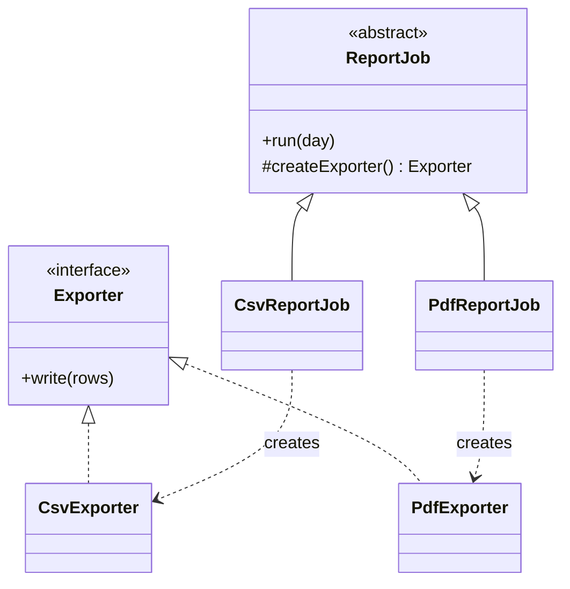

**Static factory methods** are the everyday form: `List.of()`, `Optional.of()`, `LocalDate.of()`, `Executors.newFixedThreadPool()`, `Calendar.getInstance()`. Compared to constructors they can have clear names, return a cached object, and return a subtype.

**In Spring:** the `ApplicationContext` (a `BeanFactory`) is one big factory. Every `@Bean` method is a factory method. `FactoryBean<T>` lets a bean produce another object.

**Say this in the interview:**

> "A factory method hides object creation so callers depend only on an interface. The everyday form is a static factory like List.of or LocalDate.of. The GoF form is an abstract create method that subclasses override. In Spring, @Bean methods are factory methods, so I rarely write factory classes by hand."

### Abstract factory

**In one line:** An abstract factory creates a whole *family* of related objects that must match, like "all cloud parts" or "all local parts".

**Story:** You buy furniture from one showroom's "teak" line: table, chairs and cupboard all match. You do not mix one teak chair with a plastic table by mistake. The showroom line is the abstract factory.

**How it works:**

1. One interface with one create method per product (`blobStore()`, `queue()`).
2. One factory class per family (`CloudInfra`, `LocalInfra`).
3. The app picks the factory once, at startup. Everything it makes then matches.

```java
public interface BlobStore { void put(String key, byte[] data); }
public interface MessageQueue { void send(String topic, String msg); }

public interface InfraFactory {                     // one factory = one matching family
    BlobStore blobStore();
    MessageQueue queue();
}
public final class CloudInfra implements InfraFactory {
    public BlobStore blobStore() { return new ObjectStorageBlobStore(); }
    public MessageQueue queue()  { return new CloudQueue(); }
}
public final class LocalInfra implements InfraFactory {
    public BlobStore blobStore() { return new DiskBlobStore(Path.of("/tmp/blobs")); }
    public MessageQueue queue()  { return new InMemoryQueue(); }
}

// Spring: choose the family once, by profile
@Bean @Profile("local")  InfraFactory localInfra() { return new LocalInfra(); }
@Bean @Profile("!local") InfraFactory cloudInfra() { return new CloudInfra(); }
```

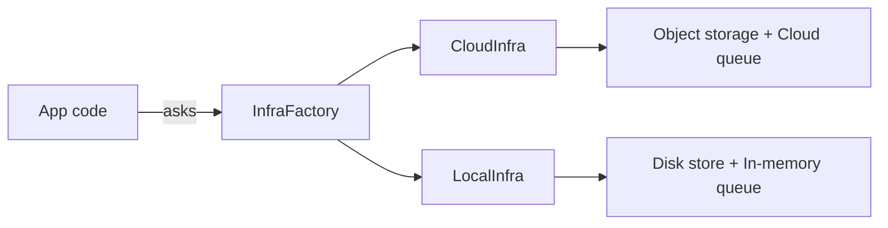

| | Factory method | Abstract factory |
|---|---|---|
| Creates | One product | A family of related products |
| Shape | One method (often overridden) | An interface with many create methods |
| Example | `List.of()`, `createExporter()` | `DocumentBuilderFactory`, a JDBC `Connection` making matching `Statement`s |

**In the JDK and Spring:** `DocumentBuilderFactory.newInstance()` and `XPathFactory` return a matching family of XML parts. A JDBC `Connection` from one driver creates `Statement` and `PreparedStatement` objects from that same driver. In Spring apps, `@Profile` or `@ConditionalOnProperty` beans usually do this job.

**Say this in the interview:**

> "Abstract factory gives me a family of objects that must work together, like cloud storage and a cloud queue, or local versions of both for dev. I pick the factory once and the rest of the code just calls it. In Spring, profiles or conditional beans usually play this role."

### Builder

**In one line:** A builder creates an object step by step with named methods, which is clearer than a constructor with ten parameters.

**Story:** Ordering a pizza: size large, extra cheese, no onion, thin crust. You say each choice by name. Nobody says "new Pizza(12, true, false, null, 2, true)".

**The problem it solves:** *telescoping constructors* (many overloads) and unreadable calls like `new User("A", null, null, true, false)`.

```java
public record HttpCall(String url, String method, Duration timeout, Map<String, String> headers) {

    public static Builder builder(String url) { return new Builder(url); }

    public static final class Builder {
        private final String url;                              // required: in the constructor
        private String method = "GET";                         // optional: has a default
        private Duration timeout = Duration.ofSeconds(2);
        private final Map<String, String> headers = new HashMap<>();

        private Builder(String url) { this.url = url; }
        public Builder method(String m) { this.method = m; return this; }
        public Builder timeout(Duration t) { this.timeout = t; return this; }
        public Builder header(String k, String v) { headers.put(k, v); return this; }

        public HttpCall build() {                              // validate once, here
            if (timeout.isNegative()) throw new IllegalArgumentException("timeout");
            return new HttpCall(url, method, timeout, Map.copyOf(headers));
        }
    }
}

var call = HttpCall.builder("https://api.example.com/orders")
    .method("POST").header("Idempotency-Key", "k-42").build();
```

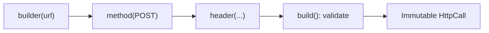

**With Lombok:** `@Builder` generates this code. It also works on records (since Lombok 1.18.20). `@Builder(toBuilder = true)` adds a copy-and-change method.

**In the JDK and Spring:** `StringBuilder`, `HttpRequest.newBuilder()`, `Stream.builder()`, `UriComponentsBuilder`, `RestClient.builder()`, `ResponseEntity.status(...).body(...)`.

**Good and bad:**

| Good | Bad |
|---|---|
| Required fields in `builder(...)`, optional ones as methods | All fields optional, so `build()` makes broken objects |
| Validate in `build()` | Builder for a 2-field record (just use the constructor) |

**Say this in the interview:**

> "Builder replaces long constructors with named steps. Required fields go into the builder's constructor, optional ones get defaults, and build() validates and returns an immutable object. With records I either write a small nested builder or use Lombok's @Builder."

### Prototype

**In one line:** Make a new object by copying an existing one, instead of building it from scratch.

**Story:** A wedding invitation. You design one card, then photocopy it and change only the guest name.

**How it works:**

1. Keep a ready, fully set-up object (the *prototype*).
2. To make a new one, copy it and change only what differs.
3. Useful when building from scratch is slow (loading config, parsing a big template) or when you do not know the concrete class.

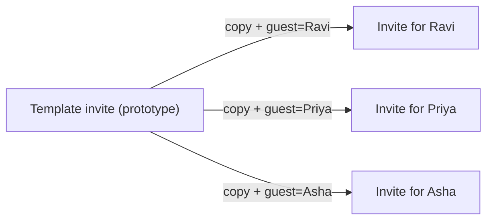

- Java's `Cloneable` and `clone()` are hard to get right (shallow copy by default, no constructor runs, checked exception). *Effective Java* advises against them.
- Prefer a **copy constructor** (`new ArrayList<>(other)`), a static `copyOf`, or `toBuilder()`.
- With records, "copy and change one field" is a small *wither*: `order.withStatus(PAID)`.
- **Spring `prototype` scope** is not exactly the GoF pattern. Spring builds a fresh bean from the bean definition each time you ask. It does not copy an existing object.

```java
public record Invite(String event, LocalDate date, String venue, String guest) {
    public Invite forGuest(String name) { return new Invite(event, date, venue, name); }  // copy, change one field
}
var template = new Invite("Wedding", LocalDate.of(2026, 12, 5), "Jaipur", "");
var forRavi = template.forGuest("Ravi");
```

**Say this in the interview:**

> "Prototype creates objects by copying a template. I avoid clone() because of shallow copies and odd rules; I use copy constructors, copyOf or record withers. Spring's prototype scope means a new bean per request for it, which is related but not a copy."

---

## Structural patterns

**In one line:** Structural patterns show how to *join objects together*: wrap them, hide them, or build trees out of them.

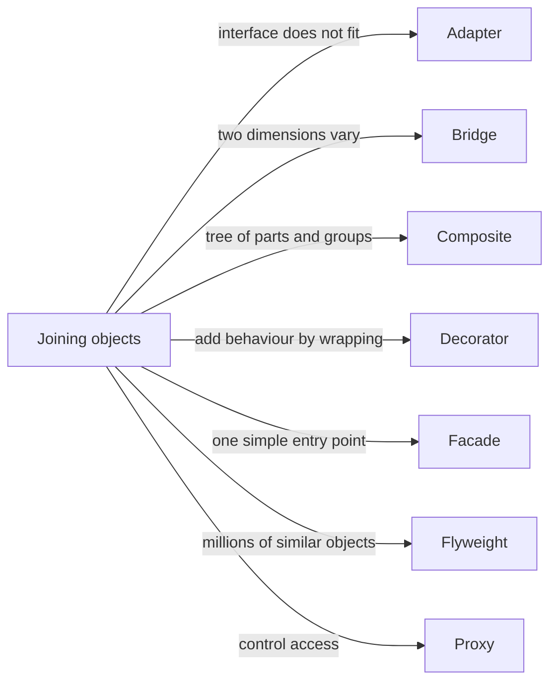

**Say this in the interview:**

> "Structural patterns are about wrapping and joining. Adapter, decorator and proxy all wrap an object; the difference is intent: fix an interface, add behaviour, or control access. Facade simplifies, composite builds trees, bridge splits two dimensions, and flyweight shares data to save memory."

### Adapter

**In one line:** An adapter wraps a class with the wrong interface so it fits the interface your code expects.

**Story:** Your Indian charger does not fit a UK socket. A travel adapter sits in the middle. Nothing changes in the charger or the socket.

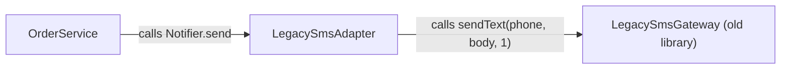

```java
public interface Notifier { void send(String to, String msg); }          // what our code wants

public class LegacySmsGateway {                                           // old library, cannot change
    public int sendText(String phone, String body, int priority) { /* ... */ return 0; }
}

public class LegacySmsAdapter implements Notifier {
    private final LegacySmsGateway gateway;
    public LegacySmsAdapter(LegacySmsGateway gateway) { this.gateway = gateway; }

    @Override
    public void send(String to, String msg) {
        int code = gateway.sendText(to, msg, 1);                          // translate the call
        if (code != 0) throw new NotificationFailedException("SMS failed, code " + code);  // translate errors
    }
}
```

**In the JDK and Spring:** `InputStreamReader` adapts a byte stream to a character stream. `Arrays.asList` adapts an array to a `List`. Spring MVC's `HandlerAdapter` lets `DispatcherServlet` call any kind of handler the same way.

**Say this in the interview:**

> "An adapter converts one interface into another so old or third-party code fits my design. I use it at the edges, around vendor SDKs, so the vendor's types don't leak into my business code. It's also where I translate their error codes into my exceptions."

### Bridge

**In one line:** Bridge splits one class tree into two (the "what" and the "how") and joins them with a field, so both can grow on their own.

**Story:** A TV remote and a TV. Sony, LG and Samsung make TVs. Basic and smart remotes exist. You do not need a "Sony basic remote", "Sony smart remote", "LG basic remote"... Any remote talks to any TV through one standard signal. The signal is the bridge.

**How it works:**

1. **Abstraction side:** what the user sees (`Notification`: OTP, order shipped).
2. **Implementation side:** how it is done (`Channel`: email, SMS).
3. The abstraction *holds* an implementation in a field. That field is the bridge.
4. 3 notification types × 4 channels = 7 classes, not 12.

```java
public interface Channel { void deliver(String to, String text); }        // the "how" side
public final class EmailChannel implements Channel { public void deliver(String to, String t) { /* SMTP */ } }
public final class SmsChannel   implements Channel { public void deliver(String to, String t) { /* SMS API */ } }

public abstract class Notification {                                       // the "what" side
    protected final Channel channel;                                       // the bridge
    protected Notification(Channel channel) { this.channel = channel; }
    public abstract void send(String to);
}
public final class OtpNotification extends Notification {
    private final String otp;
    public OtpNotification(Channel c, String otp) { super(c); this.otp = otp; }
    public void send(String to) { channel.deliver(to, "Your OTP is " + otp + ". Valid for 5 minutes."); }
}
public final class ShippedNotification extends Notification {
    private final String orderId;
    public ShippedNotification(Channel c, String orderId) { super(c); this.orderId = orderId; }
    public void send(String to) { channel.deliver(to, "Order " + orderId + " is on the way."); }
}

new OtpNotification(new SmsChannel(), "4821").send("+919800000000");
```

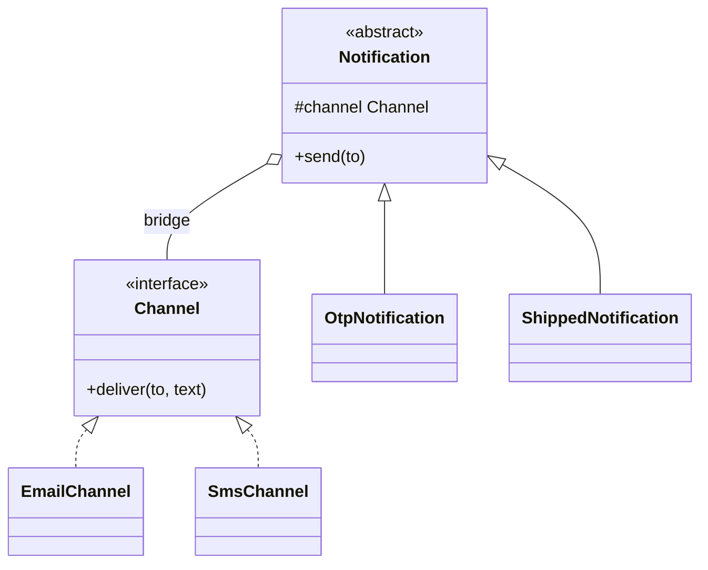

**In the JDK and Spring:** JDBC. Your code uses the JDBC API (`Connection`, `Statement`); each database ships a driver that does the real work. SLF4J's API with Logback or Log4j 2 behind it is the same idea.

**Bridge vs adapter vs strategy:**

- **Adapter** fixes a mismatch *after* the fact (an old API that does not fit).
- **Bridge** is planned *up front* so two dimensions can vary.
- **Strategy** swaps one algorithm. Bridge is about two whole class trees.

**Say this in the interview:**

> "Bridge separates an abstraction from its implementation so both can vary without a class explosion. Notification types on one side, delivery channels on the other, joined by a field. JDBC is the classic example: one API, many drivers."

### Composite

**In one line:** Composite lets you treat a single item and a group of items the same way, which makes trees easy.

**Story:** A restaurant menu. A "Thali" contains dal, rice and roti. A "Family combo" contains two thalis and a dessert. To get a price you ask any item for `price()`, single or group.

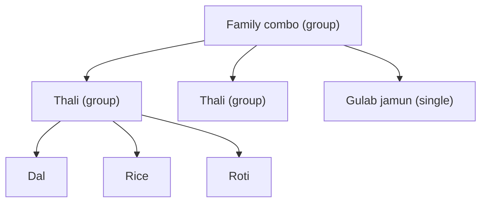

```java
public sealed interface MenuItem permits Dish, Combo {
    BigDecimal price();
}

public record Dish(String name, BigDecimal price) implements MenuItem {}   // leaf: accessor is price()

public record Combo(String name, List<MenuItem> items, BigDecimal discount) implements MenuItem {
    public Combo { items = List.copyOf(items); }

    public BigDecimal price() {
        return items.stream()
            .map(MenuItem::price)                       // works for Dish and Combo alike
            .reduce(BigDecimal.ZERO, BigDecimal::add)
            .subtract(discount);
    }
}
```

**Where you see it:** file systems (file and folder), UI component trees (React, Swing), org charts, permission groups, Spring's `CompositeCacheManager`, Micrometer's `CompositeMeterRegistry`.

**Say this in the interview:**

> "Composite models a tree where groups and single items share one interface, so the caller doesn't care which it has. A combo meal and a single dish both answer price(). With a sealed interface and records it's a few lines."

### Decorator

**In one line:** A decorator wraps an object that has the same interface and adds behaviour before or after the call; you can stack many.

**Story:** A plain cup of chai. Add ginger: still chai. Add elaichi: still chai. Each add-on wraps the cup and adds a little. You choose the add-ons at order time.

**In `java.io`, every stream is a decorator:**

```java
try (var in = new BufferedReader(                 // adds buffering and readLine()
        new InputStreamReader(                    // adapter: bytes to chars
            new GZIPInputStream(                  // adds unzip
                new FileInputStream("orders.csv.gz")),
            StandardCharsets.UTF_8))) {
    in.lines().forEach(System.out::println);
}
```

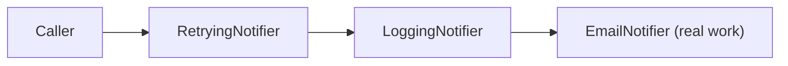

**Your own decorator:**

```java
public class RetryingNotifier implements Notifier {
    private final Notifier inner;                 // same interface as us
    private final int attempts;

    public RetryingNotifier(Notifier inner, int attempts) { this.inner = inner; this.attempts = attempts; }

    @Override
    public void send(String to, String msg) {
        for (int i = 1; ; i++) {
            try { inner.send(to, msg); return; }  // add behaviour around the call
            catch (RuntimeException e) { if (i == attempts) throw e; }
        }
    }
}

Notifier n = new RetryingNotifier(new LoggingNotifier(new EmailNotifier()), 3);
```

In real code, use a library such as Resilience4j for retries with backoff (see [retry](microservices.md#retry-with-exponential-backoff-and-jitter)). Other decorators: `Collections.unmodifiableList`, `Collections.synchronizedMap`, `HttpServletRequestWrapper`, Spring's `ContentCachingRequestWrapper`.

**Decorator vs inheritance:** with subclasses you would need `RetryingLoggingEmailNotifier`, `LoggingSmsNotifier`... one class per mix. Decorators mix at runtime.

**Say this in the interview:**

> "A decorator implements the same interface as the object it wraps and adds behaviour around the call. Java I/O is the textbook example: BufferedReader wraps InputStreamReader wraps FileInputStream. It's composition instead of a class explosion of subclasses."

### Facade

**In one line:** A facade gives one simple method in front of many complex parts.

**Story:** A travel agent. You say "Goa trip, 3 nights". The agent books the flight, hotel, cab and insurance. You talk to one person.

```mermaid
flowchart LR
    C["Controller"] --> F["CheckoutFacade.placeOrder()"]
    F --> I["InventoryService"]
    F --> P["PaymentService"]
    F --> S["ShippingService"]
    F --> N["NotificationService"]
```

```java
@Service
public class CheckoutFacade {
    private final InventoryService inventory;
    private final PaymentService payments;
    private final ShippingService shipping;
    // constructor omitted

    public OrderConfirmation placeOrder(Cart cart, PaymentInfo pay) {
        inventory.reserve(cart.items());
        PaymentReceipt receipt = payments.charge(cart.total(), pay);
        String trackingId = shipping.schedule(cart);
        return new OrderConfirmation(receipt.id(), trackingId);
    }
}
```

**In real life:** SLF4J is a facade over logging libraries. `JdbcTemplate` is a facade over raw JDBC. An API gateway or a BFF (backend for frontend) is a facade at the service level (see [API gateway and BFF](microservices.md#api-gateway-and-bff)).

**Watch out:** a facade should only coordinate. If business rules pile up inside it, it becomes a "god class".

**Say this in the interview:**

> "A facade hides a complex subsystem behind one simple API, like a checkout method that calls inventory, payment and shipping. SLF4J is a facade over logging frameworks. I keep facades thin; the rules stay in the services behind them."

### Flyweight

**In one line:** Flyweight saves memory by sharing the common, unchanging part of many small objects.

**Story:** A cinema has 10,000 seats. Each seat does not carry its own copy of "Recliner, ₹450, recliner icon". There are only two seat *types*. Each seat keeps just its row and number and points to its shared type.

**How it works:**

1. Split the data. **Intrinsic** state is shared and never changes (seat type, price, icon). **Extrinsic** state is per object (row, number).
2. Keep the shared objects in a cache (a factory with a map).
3. Shared objects **must be immutable**, or one change would affect every seat.

```java
public record SeatType(String name, int pricePaise, String icon) {}       // intrinsic: shared, immutable

public final class SeatTypes {
    private static final Map<String, SeatType> CACHE = new ConcurrentHashMap<>();
    public static SeatType of(String name, int pricePaise, String icon) {
        return CACHE.computeIfAbsent(name, n -> new SeatType(n, pricePaise, icon));  // one object per type
    }
}

public record Seat(char row, int number, SeatType type) {}                // extrinsic: per seat

List<Seat> hall = new ArrayList<>();
for (char row = 'A'; row <= 'T'; row++) {
    for (int n = 1; n <= 500; n++) {
        SeatType t = row < 'E' ? SeatTypes.of("RECLINER", 45_000, "recliner.svg")
                               : SeatTypes.of("REGULAR", 25_000, "regular.svg");
        hall.add(new Seat(row, n, t));
    }
}
// 10,000 Seat objects, but only 2 SeatType objects
```

```mermaid
flowchart LR
    S1["Seat A1"] --> R["SeatType RECLINER (shared)"]
    S2["Seat A2"] --> R
    S3["Seat D500"] --> R
    S4["Seat E1"] --> G["SeatType REGULAR (shared)"]
    S5["Seat T500"] --> G
```

**In the JDK:** `Integer.valueOf()` returns cached objects for -128 to 127 (also `Short`, `Long`, `Byte`, and `Character` up to 127). That is why `Integer a = 127, b = 127; a == b` is `true` but the same with `128` is usually `false`. Always compare boxed numbers with `equals`. The string pool (string literals, `intern()`) is also a flyweight.

**When to use it:** only when you have a very large number of objects and a memory problem you measured. Otherwise it adds complexity for nothing.

**Say this in the interview:**

> "Flyweight shares the immutable common part of many objects and keeps only the per-object part separate. The Integer cache from -128 to 127 and the string pool are JDK examples. It's why comparing Integers with == works for small values and fails for larger ones."

### Proxy

**In one line:** A proxy stands in front of a real object with the same interface and controls access to it: lazy loading, security, caching, transactions, remote calls.

**Story:** A celebrity's manager. You call the manager, not the star. The manager checks your request, books a time, and only then passes it on. To you, the manager answers "for" the star.

**Decorator vs proxy:** the code shape is the same. The intent differs. A decorator *adds features* and the client usually builds the stack. A proxy *controls access* and is usually created for you by a framework.

**Spring AOP and `@Transactional`:** Spring wraps your bean in a proxy. Callers get the proxy, not your object.

```mermaid
sequenceDiagram
    participant Controller
    participant Proxy
    participant TxManager
    participant OrderService
    Controller->>Proxy: placeOrder()
    Proxy->>TxManager: begin transaction
    Proxy->>OrderService: placeOrder() (your code)
    OrderService-->>Proxy: return or throw
    Proxy->>TxManager: commit, or rollback on RuntimeException
    Proxy-->>Controller: result
```

**Two kinds of proxy:**

- **JDK dynamic proxy:** implements the same *interfaces*. Built with `java.lang.reflect.Proxy`.
- **CGLIB proxy:** a generated *subclass* of your class. Spring Boot uses class-based proxies by default. So a `final` class cannot be proxied, and a `final` method is not intercepted (the annotation on it silently does nothing).

**A JDK dynamic proxy in 12 lines:**

```java
public interface PriceService { BigDecimal price(String sku); }

PriceService real = sku -> new BigDecimal("99.00");

PriceService timed = (PriceService) Proxy.newProxyInstance(
    PriceService.class.getClassLoader(),
    new Class<?>[] { PriceService.class },
    (proxy, method, args) -> {
        long start = System.nanoTime();
        try { return method.invoke(real, args); }                 // call the real object
        finally { System.out.println(method.getName() + " took " + (System.nanoTime() - start) + " ns"); }
    });

timed.price("SKU-1");   // prints "price took ... ns"
```

**The famous trap: self-invocation.** If a method in `OrderService` calls `this.saveAudit()`, the call does not go through the proxy. So `@Transactional` or `@Async` on `saveAudit()` is ignored. Fix: move the method to another bean. See [@Transactional deep dive](spring-ecosystem.md#transactional-deep-dive) and [debugging proxies](spring-debugging.md#debugging-proxies-and-aop).

Other proxies: Hibernate lazy-loaded entities, Spring Data repository interfaces (no class written by you), `@FeignClient` and HTTP interface clients.

**Say this in the interview:**

> "A proxy has the same interface as the real object and controls access to it. Spring AOP uses proxies for @Transactional, @Cacheable and @Async: JDK dynamic proxies for interfaces or CGLIB subclasses, which Boot uses by default. Because it's a wrapper, a call from inside the same class skips the proxy, so the annotation does nothing."

---

## Behavioural patterns

**In one line:** Behavioural patterns decide *which object does which job* and how objects talk to each other.

```mermaid
flowchart LR
    Q["Sharing work"] -->|"line of handlers"| CH["Chain of responsibility"]
    Q -->|"request as an object"| CM["Command"]
    Q -->|"small rule language"| IN["Interpreter"]
    Q -->|"walk a collection"| IT["Iterator"]
    Q -->|"talk through a hub"| ME["Mediator"]
    Q -->|"save and restore"| MM["Memento"]
    Q -->|"react to events"| OB["Observer"]
    Q -->|"behaviour by state"| ST["State"]
    Q -->|"swap an algorithm"| SG["Strategy"]
    Q -->|"fixed steps, one varies"| TM["Template method"]
    Q -->|"new operations, fixed types"| VI["Visitor"]
```

**Say this in the interview:**

> "Behavioural patterns spread responsibility between objects. The ones I use weekly are strategy to remove if/else chains, observer through Spring events, template method through JdbcTemplate and friends, and chain of responsibility through filters. State and command come up in workflows and undo."

### Chain of responsibility

**In one line:** A request passes through a line of handlers; each one can handle it, change it, pass it on, or stop it.

**Story:** Airport entry: ID check, then security scan, then boarding pass check. Any counter can stop you. Each counter does one job and passes you to the next.

```mermaid
flowchart LR
    REQ["HTTP request"] --> F1["RequestIdFilter"]
    F1 --> F2["CorsFilter"]
    F2 --> F3["Spring Security filters"]
    F3 -->|"not logged in"| X["401, chain stops"]
    F3 -->|"ok"| DS["DispatcherServlet"]
    DS --> CTRL["Controller"]
```

**A servlet filter is one link in the chain:**

```java
@Component
public class RequestIdFilter extends OncePerRequestFilter {
    @Override
    protected void doFilterInternal(HttpServletRequest req, HttpServletResponse res, FilterChain chain)
            throws ServletException, IOException {
        String id = Optional.ofNullable(req.getHeader("X-Request-Id"))
            .orElse(UUID.randomUUID().toString());
        MDC.put("requestId", id);                 // every log line now has the id
        try {
            chain.doFilter(req, res);             // pass to the next link; skip this to stop the chain
        } finally {
            MDC.remove("requestId");
        }
    }
}
```

Where you see it: servlet filters, Spring Security's `SecurityFilterChain` (see [how Spring Security works](spring-ecosystem.md#how-spring-security-works-filter-chain)), `HandlerInterceptor`, OkHttp and `RestClient` interceptors, expense approval (manager, then director, then CFO).

**Say this in the interview:**

> "Chain of responsibility passes a request along a list of handlers, and each decides to act, pass it on or stop. Servlet filters and the Spring Security filter chain are exactly this. Authentication, CSRF and authorization filters run in order. Any of them can end the request with a 401 or 403."

### Command

**In one line:** Wrap a request in an object, so you can queue it, log it, retry it or undo it.

**Story:** In a restaurant the waiter writes your order on a slip. The slip goes into a queue. Any cook can pick it up. If you cancel, they tear up the slip.

```mermaid
flowchart LR
    U["User action"] --> CMD["AddItem command object"]
    CMD --> EX["Editor.run()"]
    EX --> CART["Cart changes"]
    EX --> H["History stack (for undo)"]
```

```java
public sealed interface CartCommand permits AddItem, RemoveItem {
    void apply(Cart cart);
    void undo(Cart cart);
}
public record AddItem(String sku) implements CartCommand {
    public void apply(Cart c) { c.add(sku); }
    public void undo(Cart c)  { c.remove(sku); }
}
public record RemoveItem(String sku) implements CartCommand {
    public void apply(Cart c) { c.remove(sku); }
    public void undo(Cart c)  { c.add(sku); }
}

public class CartEditor {
    private final Deque<CartCommand> history = new ArrayDeque<>();
    public void run(CartCommand cmd, Cart cart) { cmd.apply(cart); history.push(cmd); }
    public void undo(Cart cart) { if (!history.isEmpty()) history.pop().undo(cart); }
}
```

Everyday commands: `Runnable` and `Callable` given to an `ExecutorService`, a scheduled job, and a Kafka message like `ReserveStock`. CQRS command objects are commands too (CQRS means separate models for writes and reads).

**Say this in the interview:**

> "Command turns a request into an object with everything needed to run it. That lets me queue it, retry it, log it or undo it. A Runnable submitted to an executor is the simplest command; a Kafka message like ReserveStock is a distributed one."

### Interpreter

**In one line:** Interpreter turns each rule of a small language into a class, builds a tree from an expression, and evaluates the tree.

**Story:** A shop rule card says "10% off if (city is Pune AND plan is GOLD) OR first order". The cashier reads it piece by piece: check city, check plan, combine with AND, then OR. Each piece is a small rule; together they form a tree.

**How it works:**

1. One type per grammar rule: `Eq`, `And`, `Or`, `Not`.
2. An expression becomes a tree of these objects.
3. `eval` walks the tree. Leaves give answers; inner nodes combine them.

```java
public sealed interface Rule permits Eq, And, Or, Not {}
public record Eq(String field, String value) implements Rule {}
public record And(Rule left, Rule right) implements Rule {}
public record Or(Rule left, Rule right) implements Rule {}
public record Not(Rule inner) implements Rule {}

static boolean eval(Rule r, Map<String, String> user) {
    return switch (r) {
        case Eq(String f, String v) -> v.equals(user.get(f));
        case And(Rule a, Rule b)    -> eval(a, user) && eval(b, user);
        case Or(Rule a, Rule b)     -> eval(a, user) || eval(b, user);
        case Not(Rule x)            -> !eval(x, user);
    };
}

// Feature flag rule: country == IN AND NOT (plan == FREE)
Rule beta = new And(new Eq("country", "IN"), new Not(new Eq("plan", "FREE")));
eval(beta, Map.of("country", "IN", "plan", "PRO"));   // true
```

```mermaid
flowchart TD
    A["And"] --> E1["Eq country = IN"]
    A --> N["Not"]
    N --> E2["Eq plan = FREE"]
```

**In the JDK and Spring:** `java.util.regex.Pattern` compiles a regex into a tree of nodes and runs it. Spring Expression Language (SpEL) parses and evaluates strings like `@PreAuthorize("hasRole('ADMIN') and #id == principal.id")` and `@Value("#{...}")`.

**When not to use it:** for a real language or complex rules, use a parser generator, SpEL or a rules engine. Hand-written interpreters are fine for tiny rule sets.

**Say this in the interview:**

> "Interpreter models each grammar rule as a type and evaluates an expression tree. With sealed records and a recursive switch it's a few lines, which is nice for feature-flag or discount rules. SpEL in Spring and the regex engine in the JDK are interpreters. For anything big I'd use an existing engine."

### Iterator

**In one line:** An iterator walks through a collection one item at a time without showing how the collection is stored.

**Story:** A TV remote's "next channel" button. You do not care if channels are stored by number or by satellite.

**How it works:**

1. The collection gives out an iterator object.
2. The caller only uses `hasNext()` and `next()`.
3. An array list, a linked list and a tree all look the same from outside.

```mermaid
flowchart LR
    C["for-each loop"] -->|"hasNext() / next()"| IT["Iterator"]
    IT --> AL["ArrayList: index in an array"]
    IT --> LL["LinkedList: follow next pointers"]
    IT --> TS["TreeSet: walk the tree in order"]
```

- Any class that implements `Iterable<T>` works in a for-each loop.
- `ArrayList` and `HashMap` iterators are **fail-fast**: changing the collection during the loop (not through the iterator) throws `ConcurrentModificationException`.
- Remove safely with `iterator.remove()` or `list.removeIf(...)`.
- `ConcurrentHashMap` iterators are *weakly consistent*: no exception, may or may not show new changes.

```java
record Range(int from, int to) implements Iterable<Integer> {
    public Iterator<Integer> iterator() {
        return new Iterator<>() {
            int next = from;
            public boolean hasNext() { return next < to; }
            public Integer next() { if (!hasNext()) throw new NoSuchElementException(); return next++; }
        };
    }
}
for (int i : new Range(1, 4)) System.out.print(i);   // 123
```

**Say this in the interview:**

> "Iterator hides how a collection is stored and gives hasNext and next. Implementing Iterable makes a class work in for-each. ArrayList's iterator is fail-fast and throws ConcurrentModificationException if the list changes during the loop; I use removeIf or iterator.remove instead."

### Mediator

**In one line:** Objects talk to one middle object (the mediator) instead of to each other, so they stay independent.

**Story:** Air traffic control. Fifty planes do not radio each other ("I am landing, you wait"). Each plane talks only to the tower. The tower decides the order.

**How it works:**

1. Each participant knows only the mediator.
2. The mediator holds the coordination logic: who gets what, in which order.
3. Many-to-many links (n × n) become one-to-many (n).

```mermaid
flowchart LR
    A["Asha"] --> M["GroupChat (mediator)"]
    B["Ravi"] --> M
    C["Priya"] --> M
    M --> A
    M --> B
    M --> C
```

```java
public interface ChatRoom {
    void join(Member m);
    void send(String from, String text);
}

public record Member(String name, ChatRoom room) {
    public void say(String text) { room.send(name, text); }                  // talks only to the mediator
    public void receive(String from, String text) { System.out.println(name + " <- " + from + ": " + text); }
}

public class GroupChat implements ChatRoom {
    private final List<Member> members = new CopyOnWriteArrayList<>();
    public void join(Member m) { members.add(m); }

    public void send(String from, String text) {
        for (Member m : members) {
            if (!m.name().equals(from)) m.receive(from, text);                // the mediator decides who gets it
        }
    }
}

var room = new GroupChat();
var asha = new Member("Asha", room);
var ravi = new Member("Ravi", room);
room.join(asha); room.join(ravi);
asha.say("Standup in 5 min");   // Ravi <- Asha: Standup in 5 min
```

**In the JDK and Spring:** Spring MVC's `DispatcherServlet` sits in the middle of handler mappings, handler adapters and view resolvers. They do not call each other. In microservices, an **orchestration saga** is a mediator: one orchestrator tells order, payment and stock services what to do (see [saga pattern](microservices.md#saga-pattern)).

**Mediator vs observer:** an observer bus just broadcasts. A mediator has *logic* about who does what next.

**Risk:** the mediator can grow into a god class. Keep it about coordination only.

**Say this in the interview:**

> "Mediator replaces many-to-many links with a hub. Components only know the mediator, which holds the coordination logic, like air traffic control. DispatcherServlet and an orchestration saga are real examples. The risk is a fat mediator, so I keep business rules out of it."

### Memento

**In one line:** Memento saves a snapshot of an object's state so you can restore it later, without exposing the object's insides.

**Story:** A video game's save point. You save before the boss fight. If you lose, you load the save. The save file is the memento; you do not edit its bytes by hand.

**How it works:**

1. **Originator:** the object with state (`Editor`). It creates and restores snapshots.
2. **Memento:** an immutable snapshot. Outsiders cannot read inside it.
3. **Caretaker:** keeps the snapshots (an undo stack). It never looks inside them.

```java
public final class Editor {
    public interface Memento {}                                     // opaque to outsiders
    private record Snapshot(String text, int cursor) implements Memento {}

    private StringBuilder text = new StringBuilder();
    private int cursor;

    public void type(String s) { text.insert(cursor, s); cursor += s.length(); }
    public Memento save() { return new Snapshot(text.toString(), cursor); }

    public void restore(Memento m) {
        if (m instanceof Snapshot(String t, int c)) {               // only Editor can open it
            text = new StringBuilder(t);
            cursor = c;
        }
    }
    public String text() { return text.toString(); }
}

var editor = new Editor();
Deque<Editor.Memento> undo = new ArrayDeque<>();                    // the caretaker
undo.push(editor.save());
editor.type("Hello");
undo.push(editor.save());
editor.type(" world");
editor.restore(undo.pop());                                         // text is "Hello" again
```

```mermaid
sequenceDiagram
    participant Caretaker
    participant Editor
    Caretaker->>Editor: save()
    Editor-->>Caretaker: Memento (sealed snapshot)
    Caretaker->>Editor: type(" world")
    Caretaker->>Editor: restore(memento)
    Editor-->>Caretaker: state is back
```

**Where you see it:** JDBC `Savepoint` and Spring's `TransactionStatus.createSavepoint()` (roll back part of a transaction). Spring Batch saves step progress in an `ExecutionContext` so a failed job can restart where it stopped. Event sourcing stores snapshots so it does not replay every event.

**Memento vs command for undo:** a memento stores the whole state (simple, more memory). A [command](#command) stores how to reverse one action (less memory, more code).

**Say this in the interview:**

> "Memento captures an object's state in an opaque, immutable snapshot that a caretaker can store and hand back for restore. It's the base of undo and save points. Database savepoints and Spring Batch's restartable execution context are real-world versions."

### Observer

**In one line:** One object publishes an event; many listeners react, and the publisher does not know who they are.

**Story:** A YouTube channel uploads a video. Subscribers get a notification. The creator does not phone each one; new subscribers can join any time.

```mermaid
flowchart LR
    OS["OrderService"] -->|"publish OrderPlaced"| BUS["Spring ApplicationEventPublisher"]
    BUS --> EM["EmailListener"]
    BUS --> LO["LoyaltyPointsListener"]
    BUS --> AN["AnalyticsListener"]
```

**Spring events:**

```java
public record OrderPlaced(String orderId, String email) {}   // any object can be an event

@Service
public class OrderService {
    private final ApplicationEventPublisher events;
    public OrderService(ApplicationEventPublisher events) { this.events = events; }

    @Transactional
    public void place(Order o) {
        // save the order ...
        events.publishEvent(new OrderPlaced(o.id(), o.email()));  // no idea who listens
    }
}

@Component
class EmailListener {
    @TransactionalEventListener              // default phase: AFTER_COMMIT
    void on(OrderPlaced e) { /* send email only if the order really saved */ }
}
```

Facts to know:

- `@EventListener` runs **synchronously, in the same thread**, by default. A slow listener slows the publisher. Add `@Async` to run it on another thread.
- `@TransactionalEventListener` waits for the transaction. With the default `AFTER_COMMIT`, no email goes out for a rolled-back order.
- Events stay **inside one JVM**. If the app crashes after commit, an in-memory event is lost. For other services, or for "must not lose", use the [transactional outbox](microservices.md#transactional-outbox-pattern) and [Kafka](kafka.md).
- Spring Modulith builds on this for events between modules (see [Spring Modulith](spring-ecosystem.md#spring-modulith)).
- `java.util.Observer` is deprecated since Java 9. Use listeners, Spring events or the `java.util.concurrent.Flow` API.

**Say this in the interview:**

> "Observer decouples a publisher from its listeners. In Spring I publish an event with ApplicationEventPublisher and handle it with @EventListener or @TransactionalEventListener after commit. These are in-process and synchronous by default, so for cross-service or guaranteed delivery I use an outbox and Kafka."

### State

**In one line:** An object changes its behaviour when its state changes, and only allowed moves between states are possible.

**Story:** A train ticket: booked, then waitlisted or confirmed, then travelled or cancelled. You cannot cancel a ticket after the journey. The current state decides what you may do.

```mermaid
stateDiagram-v2
    [*] --> CREATED
    CREATED --> PAID: payment ok
    CREATED --> CANCELLED: user cancels
    PAID --> SHIPPED: packed and handed over
    PAID --> CANCELLED: refund
    SHIPPED --> DELIVERED: customer receives
    DELIVERED --> [*]
    CANCELLED --> [*]
```

**Simple version: an enum that knows its allowed moves.**

```java
public enum OrderStatus {
    CREATED, PAID, SHIPPED, DELIVERED, CANCELLED;

    public boolean canMoveTo(OrderStatus next) {
        return switch (this) {
            case CREATED   -> next == PAID || next == CANCELLED;
            case PAID      -> next == SHIPPED || next == CANCELLED;
            case SHIPPED   -> next == DELIVERED;
            case DELIVERED, CANCELLED -> false;          // final states
        };
    }
}

public class Order {
    private OrderStatus status = OrderStatus.CREATED;

    public void moveTo(OrderStatus next) {
        if (!status.canMoveTo(next)) throw new IllegalStateException(status + " -> " + next);
        status = next;
    }
}
```

**Richer version: a sealed interface, where each state carries its own data.**

```java
public sealed interface OrderState permits Created, Paid, Shipped, Cancelled {}
public record Created() implements OrderState {}
public record Paid(String paymentId) implements OrderState {}
public record Shipped(String paymentId, String trackingNo) implements OrderState {}
public record Cancelled(String reason) implements OrderState {}

static OrderState ship(OrderState s, String trackingNo) {
    return switch (s) {
        case Paid p -> new Shipped(p.paymentId(), trackingNo);   // only Paid can ship
        case Created _, Shipped _, Cancelled _ ->                // Java 22+: unnamed patterns
            throw new IllegalStateException("cannot ship from " + s);
    };
}
```

A `Shipped` state cannot exist without a tracking number. The type system enforces it.

**The classic GoF version** gives each state its own class with methods like `pay()`, `ship()`, `cancel()`. It fits when each state has a lot of behaviour. Our [vending machine](#worked-example-a-vending-machine) shows the modern style.

**In production:** two requests may move the same order at once. Guard it in the database: `UPDATE orders SET status = 'SHIPPED' WHERE id = ? AND status = 'PAID'`, then check that 1 row changed. Or use optimistic locking with `@Version`.

**Say this in the interview:**

> "State pattern puts the allowed transitions in one place. For simple flows I use an enum with canMoveTo. When each state carries different data I use a sealed interface of records and switch on it, so the compiler checks every state. In the database I guard the transition with a conditional update or a version column."

### Strategy

**In one line:** Strategy puts each version of an algorithm in its own class behind one interface. You pick one at runtime instead of writing a long `if/else`.

**Story:** Google Maps asks "car, bike, walk or train?" The destination is the same; the route-finding strategy changes.

```mermaid
flowchart LR
    REQ["pay(order)"] --> SVC["PaymentService"]
    SVC -->|"lookup by order.method()"| MAP["Map of strategies"]
    MAP --> CARD["CardPayment"]
    MAP --> UPI["UpiPayment"]
    MAP --> NB["NetBankingPayment"]
```

**Replace `if/else` with a map of Spring beans:**

```java
public interface PaymentStrategy {
    PaymentMethod method();                     // stable key, not the bean name
    Receipt pay(Order order);
}

@Component class CardPayment implements PaymentStrategy {
    public PaymentMethod method() { return PaymentMethod.CARD; }
    public Receipt pay(Order o) { /* call the card gateway */ return Receipt.ok(o.id()); }
}

@Service
public class PaymentService {
    private final Map<PaymentMethod, PaymentStrategy> strategies;

    public PaymentService(List<PaymentStrategy> all) {      // Spring injects every implementation
        this.strategies = all.stream().collect(
            Collectors.toUnmodifiableMap(PaymentStrategy::method, s -> s));  // duplicate key fails at startup
    }

    public Receipt pay(Order order) {
        PaymentStrategy s = strategies.get(order.method());
        if (s == null) throw new UnsupportedPaymentException(order.method());
        return s.pay(order);
    }
}
```

- Adding `WalletPayment` = one new `@Component`. `PaymentService` does not change ([open/closed](#o-openclosed-principle)).
- Spring can also inject `Map<String, PaymentStrategy>` directly, keyed by **bean name**. That ties your logic to class names, so the `method()` key is safer.
- Each strategy is easy to unit test alone.
- **Small strategies can be lambdas:** `Comparator<Order> byTotal = Comparator.comparing(Order::total);` is a strategy passed to `sort`.

**When not to use it:** two fixed cases that never change. A plain `if` or a `switch` on a sealed type is simpler.

**Say this in the interview:**

> "Strategy puts each algorithm behind one interface. In Spring I make each one a bean, inject a List of them, and build a map keyed by a method like method(). The if/else chain disappears, and a new variant is just a new class. Comparator is the JDK's everyday strategy."

### Template method

**In one line:** A parent defines the fixed steps of an algorithm; children (or callbacks) fill in only the steps that change.

**Story:** Every chai is made the same way: boil water, add tea, add milk, add sugar, strain. Only "add flavour" changes: ginger, elaichi or masala. The recipe is the template.

```mermaid
flowchart LR
    A["open connection"] --> B["prepare statement"]
    B --> C["run query"]
    C --> D["map each row (YOUR code)"]
    D --> E["close everything"]
    E --> F["translate SQLException"]
```

**Classic version with an abstract class:**

```java
public abstract class ReportExporter {
    public final void export(LocalDate day) {          // final: steps cannot be reordered
        List<Sale> rows = fetch(day);
        String body = format(rows);                     // the step that varies
        write("report-" + day + extension(), body);
    }
    protected abstract String format(List<Sale> rows);
    protected abstract String extension();
    private List<Sale> fetch(LocalDate day) { /* query */ return List.of(); }
    private void write(String file, String body) { /* save to disk */ }
}

public class CsvExporter extends ReportExporter {
    protected String format(List<Sale> rows) { /* build CSV */ return ""; }
    protected String extension() { return ".csv"; }
}
```

**Modern version with a callback (how `JdbcTemplate` does it):**

```java
List<User> users = jdbcTemplate.query(
    "select id, name from users where active = ?",
    (rs, rowNum) -> new User(rs.getLong("id"), rs.getString("name")),   // only your step
    true);
// JdbcTemplate opens, prepares, runs, closes and translates exceptions for you.
```

Also: `RestTemplate`, `TransactionTemplate`, `KafkaTemplate`, `HttpServlet.service()` calling your `doGet()`, and `AbstractList` (you write `get` and `size`, it gives you the rest).

**Say this in the interview:**

> "Template method fixes the skeleton of an algorithm and lets subclasses or callbacks fill the varying steps. JdbcTemplate is the Spring example: it handles connections, statements, cleanup and exception translation, and I only pass a RowMapper lambda. Today I prefer the callback style over inheritance."

### Visitor

**In one line:** Visitor lets you add new operations over a fixed set of types without changing those types.

**Story:** A tax officer visits a market. At the sweet shop he applies one tax rule, at the book shop another. Next month a health inspector visits the same shops with different checks. The shops stay the same; the visitors change.

**How it works (classic GoF):**

1. Each type has `accept(visitor)`, which calls `visitor.visitBook(this)`.
2. Each operation (GST, shipping cost) is one visitor class.
3. This is *double dispatch*: the method chosen depends on both the item type and the visitor type.

```java
public interface ItemVisitor<R> { R visitBook(Book b); R visitFood(Food f); }
public interface Item { <R> R accept(ItemVisitor<R> v); }

public record Book(BigDecimal price) implements Item {
    public <R> R accept(ItemVisitor<R> v) { return v.visitBook(this); }
}
public record Food(BigDecimal price) implements Item {
    public <R> R accept(ItemVisitor<R> v) { return v.visitFood(this); }
}

public class TaxVisitor implements ItemVisitor<BigDecimal> {             // one operation = one visitor
    public BigDecimal visitBook(Book b) { return BigDecimal.ZERO; }      // example rates only
    public BigDecimal visitFood(Food f) { return f.price().multiply(new BigDecimal("0.05")); }
}

BigDecimal tax = item.accept(new TaxVisitor());
```

**Modern Java (21+):** a sealed interface and a pattern-matching `switch` give the same safety with far less code. The compiler still forces you to handle every type.

```java
public sealed interface Item permits Book, Food {}
public record Book(BigDecimal price) implements Item {}
public record Food(BigDecimal price) implements Item {}

static BigDecimal tax(Item item) {
    return switch (item) {
        case Book b -> BigDecimal.ZERO;
        case Food f -> f.price().multiply(new BigDecimal("0.05"));
    };
}
```

```mermaid
classDiagram
    class Item {
        <<interface>>
        +accept(visitor)
    }
    class ItemVisitor {
        <<interface>>
        +visitBook(b)
        +visitFood(f)
    }
    Item <|.. Book
    Item <|.. Food
    ItemVisitor <|.. TaxVisitor
    ItemVisitor <|.. ShippingVisitor
```

**In the JDK and Spring:** `Files.walkFileTree(path, FileVisitor)`, the annotation-processing `ElementVisitor`, bytecode tools like ASM's `ClassVisitor`, and Spring's `BeanDefinitionVisitor`.

**Trade-off:** easy to add operations, hard to add types (every visitor must change). Use it when the type set is stable.

**Say this in the interview:**

> "Visitor adds operations to a stable set of types through double dispatch: accept calls the right visit method. Files.walkFileTree is the JDK example. In Java 21 I usually get the same result with a sealed interface and an exhaustive switch, which is simpler and still checked by the compiler."

---

## Clean code

**In one line:** Clean code is code another person can read, change and test quickly, without fear.

**Story:** A good kitchen is clean not to look nice, but so the next cook can find the salt in two seconds. Code is read about ten times more than it is written.

```mermaid
flowchart LR
    N["Clear names"] --> R["Easy to read"]
    F["Small functions"] --> R
    E["Clear error handling"] --> S["Safe to change"]
    T["Tests"] --> S
    R --> GOAL["Fast, safe changes"]
    S --> GOAL
```

**Say this in the interview:**

> "For me clean code means the next person can change it safely. Clear names, small functions at one level of abstraction, explicit error handling, no surprise nulls, and tests that let me refactor without fear. I care more about consistency within a team than about any single rule."

### Naming

**In one line:** A good name tells you what a thing is for, so you do not need a comment.

**Story:** A spice box with labels "haldi", "jeera", "mirch" vs boxes labelled "box1", "box2". Same spices; one kitchen is much faster.

| Bad | Good | Why |
|---|---|---|
| `int d;` | `int daysSinceLastLogin;` | Says what and which unit |
| `List<User> list` | `List<User> activeUsers` | Says which users |
| `boolean flag` | `boolean isEmailVerified` | Booleans read as yes/no questions |
| `process()`, `handle()` | `chargeCard()`, `reserveStock()` | Verbs that say the real action |
| `OrderManager`, `DataHelper`, `CommonUtils` | `OrderPricer`, `InvoicePdfRenderer` | Vague words hide many jobs |
| `getUser()` that calls an API and saves to DB | `fetchAndCacheUser()` | No hidden side effects |

Rules of thumb:

- Classes are nouns (`Invoice`). Methods are verbs (`calculateTax`).
- Use one word per idea across the codebase. Do not mix `fetch`, `get`, `retrieve` and `load` for the same thing.
- Name length matches scope: `i` is fine in a 3-line loop; a field needs a full name.
- Use the business's words (*ubiquitous language*): if the business says "settlement", do not call it "payout" in code.
- Add units to numbers: `timeoutMs`, `amountPaise`, or better, use `Duration` and `Money` types.

**Say this in the interview:**

> "A good name removes the need for a comment. I use verbs for methods, nouns for classes, is or has for booleans, units in numeric names, and the same business words the product team uses. Names like Manager, Helper or Utils are a sign the class does too much."

### Small functions and one level of abstraction

**In one line:** A function should do one thing, and all its lines should be at the same level of detail.

**Story:** A wedding planner's checklist says "book hall, book caterer, send invites". It does not say "book hall, then find the caterer's phone number in the third drawer, dial 9...". Details go into sub-lists.

```java
// Bad: high-level steps mixed with low-level string and SQL work
public void register(String raw) {
    String[] p = raw.split(",");
    if (p.length != 3 || !p[1].contains("@")) throw new IllegalArgumentException(raw);
    jdbc.update("insert into users(name, email, city) values (?, ?, ?)", p[0].trim(), p[1].trim(), p[2].trim());
    mailer.send(p[1].trim(), "Welcome!");
}

// Good: reads like the checklist; details live one level down
public void register(String raw) {
    NewUser user = NewUser.parse(raw);     // parsing and validation
    users.save(user);                       // storage
    welcomeMailer.sendTo(user);             // email
}
```

- Aim for functions that fit on one screen (often under 20 lines). It is a guide, not a law.
- 0 to 3 parameters is easy to read. More usually means a missing object.
- A function either *does* something (command) or *answers* something (query), not both. This is called *command-query separation*.
- Use *extract method* in your IDE to get there.

**Say this in the interview:**

> "I keep functions short and at one level of abstraction, so the top-level method reads like a list of steps. Details go into well-named helper methods or classes. And a function either changes state or returns an answer, not both."

### Comments: why, not what

**In one line:** Code says *what* happens; comments should say *why*, when the why is not obvious.

```java
// Bad: repeats the code
i++;                                   // increment i

// Bad: a comment hiding a bad name
int t = 30;                            // timeout in seconds

// Good: the name explains itself
Duration paymentTimeout = Duration.ofSeconds(30);

// Good: explains WHY, which code cannot say
// The bank's API rejects amounts with more than 2 decimals, even for INR.
amount = amount.setScale(2, RoundingMode.HALF_EVEN);
```

- **Keep:** why a strange choice was made, links to tickets or RFCs, warnings ("not thread safe"), Javadoc on public APIs.
- **Delete:** commented-out code (git remembers it), comments that repeat the code, old comments that now lie.
- `TODO` comments need a ticket number, or they live forever.

**Say this in the interview:**

> "I write comments for the why: a business rule, a workaround for a library bug, a link to a ticket. If a comment explains what the code does, I try to rename or extract a method instead. Commented-out code gets deleted; git keeps history."

### Error handling: exceptions vs Optional vs result types

**In one line:** Use exceptions for things that should not happen, `Optional` for "maybe no value", and a result type when failure is a normal business outcome.

**Story:** At a bank counter: "no account with this number" is a normal answer (`Optional`). "Your loan is rejected, here is why" is a normal business result (result type). "The bank's server is on fire" is an exception.

| Tool | Use for | Example |
|---|---|---|
| Unchecked exception | Bugs and failures the caller cannot fix right here | `IllegalArgumentException`, `OrderNotFoundException` mapped to 404 |
| Checked exception | Rare today; caller *must* handle it | `IOException` in file code |
| `Optional<T>` | A return value that may be absent | `Optional<User> findByEmail(String email)` |
| Result type (sealed) | Expected failures with details the caller must branch on | Validation, loan approval, payment declined |

**A small result type with a sealed interface:**

```java
public sealed interface Result<T> permits Ok, Err {}
public record Ok<T>(T value) implements Result<T> {}
public record Err<T>(String code, String message) implements Result<T> {}

Result<Loan> decision = loanService.apply(request);

String reply = switch (decision) {                   // compiler forces both cases
    case Ok<Loan>(Loan loan) -> "Approved: " + loan.id();
    case Err<Loan>(String code, String msg) -> "Rejected (" + code + "): " + msg;
};
```

**Rules:**

- Never swallow: `catch (Exception e) {}` hides bugs. At least log it, or rethrow.
- Wrap with the cause: `throw new PaymentFailedException("order " + id, e);` keeps the stack trace.
- Do not use exceptions for normal flow (like "user not found" in a loop of 10,000 lookups). They are slow and confusing.
- Catch at the right level. In Spring, map exceptions to HTTP in one place with `@RestControllerAdvice` and `ProblemDetail` (see [global error handling](spring-ecosystem.md#global-error-handling-with-restcontrolleradvice-and-problemdetail)).
- Spring prefers unchecked exceptions. It turns `SQLException` into `DataAccessException`.
- `Optional` is for return types. Not for fields, parameters or collections (return an empty list instead). See [Optional](java-streams.md#optional).
- Remember: `@Transactional` rolls back on unchecked exceptions by default, not on checked ones.

**Say this in the interview:**

> "Exceptions are for unexpected failures, Optional is for a missing value, and a sealed Result type is for expected business failures the caller must handle. I never swallow exceptions, I keep the cause when wrapping, and in Spring I map exceptions to HTTP responses in one RestControllerAdvice."

### Avoid null

**In one line:** `null` means "nothing" but looks like "something", so it causes `NullPointerException`s far from the real cause; design it out.

**Story:** A form where "no middle name" is left empty, but the system reads empty as "data not loaded yet". Two meanings, one value.

- Return empty collections, never `null` lists: `return List.of();`
- Return `Optional<T>` from finders.
- Check at the boundary: `Objects.requireNonNull(x, "x")` in constructors.
- Use a *null object* when "do nothing" is a valid behaviour: `NoOpNotifier` instead of `if (notifier != null)`.
- Use null-safety annotations. Spring Framework 7 marks its APIs with JSpecify annotations (`@NullMarked`, `@Nullable`), and tools like NullAway can check them at build time.
- *Helpful NullPointerExceptions* (on by default since Java 15) tell you exactly which part was null: `Cannot invoke "Address.city()" because the return value of "Customer.address()" is null`.

```java
// Bad
public List<Order> ordersFor(String userId) {
    if (!users.exists(userId)) return null;      // every caller must remember to check
    return repo.findByUser(userId);
}

// Good
public List<Order> ordersFor(String userId) {
    return users.exists(userId) ? repo.findByUser(userId) : List.of();
}
```

**Say this in the interview:**

> "I avoid returning null. Collections come back empty, finders return Optional, and constructors reject null with requireNonNull. For 'do nothing' I use a null object. In newer Spring code I also use JSpecify annotations so tools catch null bugs at build time."

### Magic numbers, guard clauses, flags and long parameter lists

**In one line:** Four small habits that make methods much easier to read.

**Magic numbers:** a raw number in code with no name.

```java
if (order.total().compareTo(new BigDecimal("499")) > 0) shipping = BigDecimal.ZERO;   // why 499?

private static final BigDecimal FREE_SHIPPING_ABOVE = new BigDecimal("499");          // named
if (order.total().compareTo(FREE_SHIPPING_ABOVE) > 0) shipping = BigDecimal.ZERO;
```

If the value changes by business decision, put it in config (`@ConfigurationProperties`), not in a constant.

**Guard clauses:** check the "no" cases first and return early, instead of deep nesting ("arrow code").

```java
// Bad: arrow code
BigDecimal discount(Customer c, Order o) {
    if (c != null) {
        if (c.isActive()) {
            if (o.total().compareTo(MIN_ORDER) >= 0) {
                return o.total().multiply(LOYALTY_RATE);
            }
        }
    }
    return BigDecimal.ZERO;
}

// Good: guard clauses
BigDecimal discount(Customer c, Order o) {
    if (c == null || !c.isActive()) return BigDecimal.ZERO;
    if (o.total().compareTo(MIN_ORDER) < 0) return BigDecimal.ZERO;
    return o.total().multiply(LOYALTY_RATE);
}
```

**Boolean flags as parameters:** `render(invoice, true)`. True what? The method does two things.

```java
render(invoice, true);                 // bad: reader must open the method
renderDraft(invoice);                  // good: two clear methods
render(invoice, Watermark.DRAFT);      // or an enum, if there may be more options
```

**Long parameter lists:** 5+ parameters, especially of the same type, invite mistakes like swapped arguments.

```java
// Bad: easy to swap email and phone
createUser("Asha", "Rao", "9876543210", "asha@x.com", "Pune", true, false);

// Good: a parameter object (a record), or a builder
public record NewUser(String firstName, String lastName, String email, String phone, String city) {}
createUser(new NewUser("Asha", "Rao", "asha@x.com", "9876543210", "Pune"), Role.ADMIN);
```

**Say this in the interview:**

> "I name magic numbers or move them to config. I use guard clauses to avoid nesting. I split methods that take a boolean flag, and I replace long parameter lists with a record or a builder. They're small habits, but they remove most of the 'what does this mean' questions in review."

### Code smells and their refactorings

**In one line:** A *code smell* is a sign that something may be wrong in the design; each one has a known fix (a *refactoring*).

| Smell | What it looks like | Refactoring |
|---|---|---|
| Long method | 100+ lines, many comments as section headers | Extract method |
| Large class / god class | `OrderService` with 3,000 lines and 25 dependencies | Extract class, split by responsibility |
| Long parameter list | `create(a, b, c, d, e, f, g)` | Introduce parameter object (record), builder |
| Duplicate code | Same rule in three services | Extract method or class; one source of truth |
| Feature envy | A method uses another class's data more than its own | Move method to that class |
| Data clumps | `street, city, pin` always passed together | Extract a value object (`Address` record) |
| Primitive obsession | `String email`, `long amount` everywhere | Value types: `Email`, `Money` records |
| Switch on type everywhere | Same `if (type == ...)` in many places | Polymorphism or strategy; or one sealed `switch` |
| Shotgun surgery | One change needs edits in 10 files | Move related code together |
| Divergent change | One class changes for many unrelated reasons | Split the class (single responsibility) |
| Message chains | `a.getB().getC().getD()` | Hide delegate (Law of Demeter) |
| Speculative generality | Interfaces and hooks nobody uses | Delete them (YAGNI) |
| Dead code | Unused methods, flags always false | Delete |
| Refused bequest | Child overrides parent methods to throw | Replace inheritance with composition |
| Mutable shared state | Static or singleton fields changed by many threads | Immutability, or confine the state |

**Say this in the interview:**

> "A smell is a hint, not a bug. The common ones I look for are long methods, god classes, primitive obsession, feature envy and the same switch on type in many places. Each has a standard refactoring: extract method or class, introduce a value object, move method, or replace conditionals with polymorphism."

### Refactoring safely

**In one line:** Refactoring changes the structure without changing behaviour, so you need tests first and small steps.

**Story:** Rewiring a house while people live in it. You switch off one room at a time and test each switch before the next room.

```mermaid
flowchart LR
    T["Write or check tests (green)"] --> S["One small change"]
    S --> R["Run tests"]
    R -->|"green"| C["Commit"]
    R -->|"red"| U["Undo, smaller step"]
    C --> S
    U --> S
```

**Steps:**

1. **Cover it first.** No tests? Write *characterization tests*: tests that record what the code does today, even if it looks wrong.
2. **Small steps.** Rename, extract, move: one at a time. Run tests after each.
3. **Use the IDE's automated refactorings.** They are safer than manual edits.
4. **Commit often.** Easy to go back.
5. **Separate refactoring from behaviour change.** One PR refactors (no behaviour change), the next PR adds the feature. Reviews get easier.
6. **Big rewrites:** use the *strangler fig* approach. Build the new path next to the old one, move traffic slowly (feature flags), then delete the old code.
7. **Boy scout rule:** leave the code a little cleaner than you found it, in the area you are touching anyway.

**Say this in the interview:**

> "Refactoring means changing structure without changing behaviour. I make sure tests cover the code first, adding characterization tests for legacy code, then go in small IDE-driven steps and commit after each green run. I keep refactoring PRs separate from feature PRs, and for big rewrites I use a strangler approach behind feature flags."

### Writing testable code

**In one line:** Code is testable when you can pass in its dependencies and control time, randomness and I/O from the test.

**Story:** A car you can test on a stand, with the wheels off the road, is easy to check. A car with the engine welded to the road is not.

**What makes code hard to test:**

- `new` of collaborators inside business methods.
- Static calls to `Instant.now()`, `UUID.randomUUID()`, `Math.random()`.
- Singletons and static mutable state.
- Business logic inside controllers or SQL.
- Huge classes with 15 dependencies.

**Inject time with `Clock`:**

```java
@Service
public class CouponService {
    private final Clock clock;                       // inject time instead of calling Instant.now()
    public CouponService(Clock clock) { this.clock = clock; }

    public boolean isExpired(Coupon c) {
        return Instant.now(clock).isAfter(c.expiresAt());
    }
}

@Bean Clock clock() { return Clock.systemUTC(); }    // production

// Test: no Spring needed, time is fixed
var service = new CouponService(Clock.fixed(Instant.parse("2026-11-16T10:00:00Z"), ZoneOffset.UTC));
assertTrue(service.isExpired(new Coupon("DIWALI", Instant.parse("2026-11-01T00:00:00Z"))));
```

**Habits:**

- Constructor injection everywhere.
- Keep business rules in plain classes or records. Do I/O at the edges. This idea is called "functional core, imperative shell".
- Unit test the core with plain JUnit. Test the edges with Spring test slices and Testcontainers (see [testing Spring Boot apps](spring-ecosystem.md#testing-spring-boot-apps)).
- If a test needs ten mocks, the class has too many jobs.

**Say this in the interview:**

> "Testable code takes its dependencies through the constructor and doesn't reach for static time, random or I/O. I inject a Clock, keep business rules in plain classes, and push I/O to the edges. If a unit test needs many mocks, that tells me the class does too much."

### Code review checklist for seniors

**In one line:** A senior review checks correctness, design, safety and operability first, and style last.

**Story:** A senior doctor reviewing a junior's case does not start with handwriting. They check the diagnosis, the dose and the risk first.

```mermaid
flowchart TD
    A["Does it do the right thing? (requirements, edge cases)"] --> B["Is it safe? (security, data, concurrency)"]
    B --> C["Will it run well? (performance, failures, observability)"]
    C --> D["Is it easy to change? (design, tests, names)"]
    D --> E["Style nits (automate them)"]
```

| Area | Questions to ask |
|---|---|
| Correctness | Does it match the requirement? Nulls, empty lists, time zones, rounding, duplicates? |
| Tests | Do tests cover the new behaviour and the failure paths? Would they fail if the code were wrong? |
| Design | One responsibility per class? Right layer? New coupling between modules? |
| Errors | Exceptions swallowed? Right HTTP status? Retries idempotent? |
| Security | Input validated? Authorization checked (not just authentication)? Secrets or personal data in logs? SQL built with string concatenation? |
| Data | DB migration backward compatible? Index for the new query? Transactions in the right place? |
| Performance | N+1 queries? DB or HTTP calls inside loops? Pagination for big lists? Timeouts on remote calls? |
| Concurrency | Mutable fields in singleton beans? Race on check-then-act? |
| Compatibility | API, event or schema change safe for old clients and consumers? |
| Operability | Logs with context, metrics, feature flag, rollback plan? |
| Readability | Clear names, no dead code, comments explain why |

**How to give a review:**

- Ask questions instead of giving orders: "What happens if this list is empty?"
- Label small things as `nit:` so the author knows they are optional.
- Block only for real problems: bugs, security, data loss.
- Praise good parts too.
- Ask for small PRs. Reviews of 1,000+ line PRs catch little.
- Let tools do formatting and simple checks (formatter, static analysis, CI).

**Say this in the interview:**

> "In a review I check correctness and edge cases first, then security, data and concurrency, then performance like N+1 queries and missing timeouts, then design and tests. Formatting is for tools. I phrase comments as questions, mark nits clearly, and block only for real risks."

---

## Low-level design (LLD) interviews

**In one line:** In an LLD round you design classes, interfaces and their relations for a small system, like a parking lot, and write the core code.

**Story:** HLD (high-level design) is the city map: roads, power station, water tank. LLD is the floor plan of one house: rooms, doors and which switch controls which light. See [LLD vs HLD rounds](system-design.md#lld-vs-hld-rounds).

**Say this in the interview:**

> "In an LLD round I first clarify requirements and list the entities and their relations. Then I define interfaces, pick a pattern only where it fits, and write clean core code. I talk while I design and keep it extensible where the interviewer is likely to push."

### How to approach an LLD question

**In one line:** Requirements, then entities, then relationships, then interfaces, then patterns, then code.

```mermaid
flowchart LR
    R["Clarify requirements (5 min)"] --> E["Entities: the nouns"]
    E --> REL["Relationships: has-a, is-a"]
    REL --> I["Interfaces: the verbs"]
    I --> P["Patterns where they fit"]
    P --> C["Code the core classes"]
    C --> X["Extend: concurrency, edge cases, tests"]
```

**Steps, with a 45-minute budget:**

1. **Requirements (5 min).** Ask: which features are in scope? One machine or many? Payment types? Admin features? Write 4 to 6 bullet points.
2. **Entities (5 min).** Underline the nouns: machine, product, slot, coin, payment.
3. **Relationships (5 min).** Machine *has* slots (composition). Slot *holds* a product. Machine *has a* current state.
4. **Interfaces (5 min).** Underline the verbs: insert money, select product, dispense, refund. These become methods.
5. **Patterns (2 min).** Only where they help. State for the machine; strategy for payment.
6. **Code (15 to 20 min).** Core classes only. Use enums, records, clear names. Skip getters and boilerplate.
7. **Extend (5 min).** Thread safety, failure cases, how to add a feature, how to test.

**Common mistakes:** jumping into code, drawing 30 classes, forcing 6 patterns, ignoring concurrency (two people booking the same seat), forgetting edge cases (sold out, exact change).

**Say this in the interview:**

> "I start by fixing scope with a few questions, then list nouns as entities and verbs as methods, then relations. I add a pattern only when it removes a real problem, like state for a vending machine. Then I code the core and discuss concurrency and extensions."

### Worked example: a vending machine

**In one line:** A vending machine is a classic State pattern question: what it does with a button press depends on its current state.

**Requirements we agree on:**

- Accepts coins of ₹1, ₹2, ₹5, ₹10.
- User inserts coins, selects a product, gets the product and change.
- User can cancel and get the money back.
- Sold out and not-enough-money cases.
- Admin can restock; machine can be out of service.

**Entities and relations:**

```mermaid
flowchart LR
    VM["VendingMachine"] -->|"has a"| ST["MachineState"]
    VM -->|"owns"| INV["Inventory"]
    INV -->|"has many"| SL["Slot (code, product, count)"]
    SL -->|"holds"| PR["Product (code, name, price)"]
    VM -->|"accepts"| CO["Coin (enum)"]
    VM -->|"returns"| SA["Sale (product, change)"]
```

**States:**

```mermaid
stateDiagram-v2
    [*] --> Idle
    Idle --> HasMoney: insert coin
    HasMoney --> HasMoney: insert more coins
    HasMoney --> Idle: select product (dispense + change)
    HasMoney --> Idle: cancel (refund)
    Idle --> OutOfService: admin or fault
    OutOfService --> Idle: fixed
```

**Code: the data types.** Money is in paise (`int`) so there are no floating-point errors.

```java
public enum Coin {
    ONE(100), TWO(200), FIVE(500), TEN(1000);
    private final int paise;
    Coin(int paise) { this.paise = paise; }
    public int paise() { return paise; }
}

public record Product(String code, String name, int pricePaise) {}
public record Sale(Product product, int changePaise) {}

public sealed interface MachineState permits Idle, HasMoney, OutOfService {}
public record Idle() implements MachineState {}
public record HasMoney(int balancePaise) implements MachineState {}
public record OutOfService(String reason) implements MachineState {}

public interface Inventory {
    Optional<Product> find(String code);
    boolean inStock(String code);
    void takeOne(String code);
}
```

**Code: the machine.** Each action switches on the current state. The compiler checks that every state is handled.

```java
public class VendingMachine {
    private final Inventory inventory;
    private MachineState state = new Idle();

    public VendingMachine(Inventory inventory) { this.inventory = inventory; }

    public synchronized void insert(Coin coin) {
        state = switch (state) {
            case Idle _ -> new HasMoney(coin.paise());               // Java 22+: unnamed pattern
            case HasMoney(int balance) -> new HasMoney(balance + coin.paise());
            case OutOfService s -> throw new IllegalStateException("Out of service: " + s.reason());
        };
    }

    public synchronized Sale select(String code) {
        if (!(state instanceof HasMoney(int balance))) throw new IllegalStateException("Insert coins first");
        Product p = inventory.find(code).orElseThrow(() -> new IllegalArgumentException("No product " + code));
        if (!inventory.inStock(code)) throw new IllegalStateException("Sold out: " + code);  // money stays in
        if (balance < p.pricePaise()) throw new IllegalStateException("Need " + (p.pricePaise() - balance) + " paise more");
        inventory.takeOne(code);
        state = new Idle();
        return new Sale(p, balance - p.pricePaise());       // product + change
    }

    public synchronized int cancel() {
        int refund = (state instanceof HasMoney(int balance)) ? balance : 0;
        if (refund > 0) state = new Idle();
        return refund;
    }
}
```

**Why this design:**

- **State is data**, and every action uses an exhaustive `switch` or pattern check. An illegal move (select with no money) fails fast.
- `synchronized` is enough: one physical machine serves one person at a time.
- On "sold out" or "not enough money", the balance stays, so the user can pick something else or cancel.
- **Classic GoF alternative:** an interface `State { insert(); select(); cancel(); }` with classes `IdleState`, `HasMoneyState`. Each class holds its own logic. Good when states have lots of behaviour. Mention both.

**Extensions the interviewer may push:**

- **Card or UPI payment:** add a `PaymentStrategy` ([strategy](#strategy)); coins become one strategy.
- **Return change with fewest coins:** a greedy algorithm over coin counts; fail if the machine lacks change, and refund instead.
- **Low-stock alert:** publish an event when a slot count drops below 2 ([observer](#observer)).
- **Many machines with a central server:** that becomes an HLD question.
- **Testing:** a fake `Inventory` (in-memory map) makes every state transition easy to unit test.

**Say this in the interview:**

> "I modelled the vending machine as a state machine: Idle, HasMoney and OutOfService. Each action switches on the current state, so illegal moves fail fast and the compiler checks every state. Inventory is an interface so I can test with an in-memory fake, and payment or low-stock alerts plug in as strategy and observer."

### Common LLD questions

**In one line:** Most LLD questions are a few known shapes; know the main classes and the one pattern that fits.

| Question | Core classes | Pattern that fits | The tricky part |
|---|---|---|---|
| Parking lot | `ParkingLot`, `Floor`, `Spot`, `Vehicle`, `Ticket`, `FeeCalculator` | Strategy (spot choice, pricing), Factory | Two cars taking the same spot at once |
| Elevator | `Elevator`, `Request`, `Controller`, `Direction` | State, Strategy (scheduling) | Which elevator answers a call |
| Vending machine | See [above](#worked-example-a-vending-machine) | State | Change and sold-out cases |
| Splitwise | `User`, `Group`, `Expense`, `Split`, `BalanceSheet` | Strategy (equal, exact, percent split) | Simplify debts; rounding of paise |
| Movie ticket booking | `Show`, `Seat`, `Booking`, `SeatLock` | State (seat), Observer | Seat hold with timeout; double booking |
| LRU cache | `LRUCache`, doubly linked list + `HashMap` | (Data structure) | O(1) get and put; thread safety |
| Rate limiter | `RateLimiter`, `TokenBucket` | Strategy (algorithm) | Concurrency, refill math |
| Logger framework | `Logger`, `Appender`, `Level`, `Formatter` | Chain of responsibility, Singleton | Async logging without losing lines |
| Snake and ladder / Tic-tac-toe | `Board`, `Player`, `Dice`, `Game` | State (turn), Strategy (player) | Win check; clean game loop |
| Chess | `Board`, `Piece` (sealed), `Move`, `Game` | Strategy per piece, Command (undo) | Check and checkmate rules |
| In-memory key-value store with TTL | `Store`, `Entry`, `Expirer` | Decorator (TTL, stats) | Expiry without scanning everything |
| Pub-sub / message queue | `Topic`, `Publisher`, `Subscriber`, `Offset` | Observer | Ordering and slow consumers |
| File system | `Node` (sealed), `File`, `Directory` | Composite | Size of a folder; path lookup |
| Coupon or discount engine | `Rule`, `Coupon`, `Cart`, `RuleEngine` | Strategy, Chain of responsibility | Rules stacking order |
| Notification service | `Notifier`, `Channel`, `Template` | Strategy, Factory, Decorator (retry) | Retries and user preferences |

For the big-picture (HLD) versions, see [system design](system-design.md), for example [rate limiter](system-design/rate-limiter.md) and [BookMyShow](system-design/bookmyshow-ticket-booking.md). Full object oriented case studies (library, ATM, chess, hotel and more) are in [LLD case studies](lld-case-studies.md).

**Say this in the interview:**

> "Most LLD questions map to a few patterns. State fits machines like elevators and vending machines. Strategy fits pricing and splitting, composite fits trees like file systems, and observer fits notifications. The real test is usually concurrency, like two users booking the same seat, so I always say how I'd lock or use a conditional update."

---

## Questions from the README list

Short answers to the older question list in the README. Each links to the deeper section above when there is one.

### Object

An object is one real thing in memory, made from a class, with its own state (field values) and behaviour (methods). Two objects of the same class can hold different data.

```java
Account a = new Account("A-1");   // object 1, own balance
Account b = new Account("A-2");   // object 2, own balance
a.deposit(500);                   // changes only a
```

More: [Class vs object](#class-vs-object)

### Class

A class is the blueprint: it lists the fields and methods every object of that type will have. It is loaded once by the JVM; you create many objects from it with `new`. Since Java 16, a `record` is a short class for plain immutable data.

```java
public class Account {
    private long balancePaise;                          // state
    public void deposit(long p) { balancePaise += p; }  // behaviour
}
public record Point(int x, int y) {}                    // a compact data class
```

More: [Class vs object](#class-vs-object)

### Inheritance

Inheritance lets a child class reuse and extend a parent class (`extends`); the child *is a* kind of the parent. Java allows one parent class but many interfaces. Keep trees shallow and prefer composition for plain reuse.

```java
class Vehicle { int wheels() { return 4; } }
class Bike extends Vehicle {
    @Override int wheels() { return 2; }   // changes the parent's behaviour
}
```

More: [Inheritance](#inheritance), [Composition over inheritance](#composition-over-inheritance)

### Polymorphism

Polymorphism means one call, many behaviours. Overloading is decided at compile time by argument types; overriding is decided at runtime by the real object's class.

```java
Vehicle v = new Bike();
v.wheels();                       // 2: runtime picks Bike's method (overriding)
Math.max(1, 2); Math.max(1.5, 2); // compile time picks int or double version (overloading)
```

More: [Polymorphism](#polymorphism)

### Abstraction

Abstraction shows *what* an object does and hides *how*. In Java you express it with interfaces and abstract classes, so callers depend on a simple contract.

```java
public interface PaymentGateway { PaymentResult charge(String orderId, long amountPaise); }
// Callers use charge(); card, UPI or a test fake all fit behind it.
```

More: [Abstraction](#abstraction), [Abstract class vs interface](#abstract-class-vs-interface)

### Encapsulation

Encapsulation keeps fields private and changes them only through methods that enforce the rules. It stops invalid states like a negative balance.

```java
public class Wallet {
    private long balancePaise;
    public void withdraw(long p) {
        if (p > balancePaise) throw new IllegalStateException("Not enough balance");
        balancePaise -= p;          // the only way the balance goes down
    }
}
```

More: [Encapsulation](#encapsulation)

### Object-Oriented design:

Object-oriented design (OOD) is deciding which classes you need, what each one is responsible for, and how they connect. The five words below (coupling, cohesion, association, aggregation, composition) describe *how good* and *what kind* those connections are. Aim for low coupling, high cohesion and composition over deep inheritance.

More: [OOP basics](#oop-basics), [LLD interviews](#low-level-design-lld-interviews)

### Coupling

Coupling is how much one class depends on another; low coupling is good because changes do not ripple. Depend on interfaces and inject them, instead of creating concrete classes inside.

```java
class OrderService {                              // tight: tied to one class
    private final MySqlOrderRepo repo = new MySqlOrderRepo();
}
class OrderService2 {                             // loose: any OrderRepository works
    private final OrderRepository repo;
    OrderService2(OrderRepository repo) { this.repo = repo; }
}
```

More: [Coupling and cohesion](#coupling-and-cohesion)

### Cohesion

Cohesion is how closely the parts of one class belong together; high cohesion is good. A cohesive class has one focused job, and most methods use most of its fields.

```java
class TaxCalculator { BigDecimal gst(BigDecimal amt) { /* ... */ return amt; } }   // high: one job
class CommonUtils {                                                                   // low: unrelated jobs
    static String formatDate(LocalDate d) { return d.toString(); }
    static void sendEmail(String to) { }
}
```

More: [Coupling and cohesion](#coupling-and-cohesion)

### Association

Association is a "knows" or "uses" link between two independent objects; neither owns the other. Example: a doctor and a patient; each exists without the other.

```java
class Doctor {
    void treat(Patient p) { /* uses p, does not own it */ }
}
```

More: [Association, aggregation and composition](#association-aggregation-and-composition)

### Aggregation

Aggregation is a weak "has-a": the whole holds parts, but the parts can live without it. Example: a team has players; if the team is closed, players still exist.

```java
class Team {
    private final List<Player> players;                  // given from outside
    Team(List<Player> players) { this.players = List.copyOf(players); }
}
```

More: [Association, aggregation and composition](#association-aggregation-and-composition)

### Composition

Composition is a strong "has-a": the whole creates and owns its parts, and the parts die with it. Example: an order and its order lines.

```java
class Order {
    private final List<OrderLine> lines = new ArrayList<>();   // created and owned here
    void addLine(String sku, int qty) { lines.add(new OrderLine(sku, qty)); }
}
```

In JPA this is `@OneToMany(cascade = CascadeType.ALL, orphanRemoval = true)`. More: [Association, aggregation and composition](#association-aggregation-and-composition)

### Characteristics of good OOD

A good object-oriented design is easy to change, test and understand. Signs to look for:
- **Low coupling, high cohesion:** each class has one job and few dependencies.
- **Encapsulation:** rules live inside objects; no public mutable fields.
- **Small, focused interfaces** and dependency on abstractions (SOLID).
- **Composition over inheritance**, with shallow hierarchies.
- **Immutability** where possible (records), and clear names from the business.
- **Testable:** dependencies come through the constructor.

More: [SOLID principles](#solid-principles), [Clean code](#clean-code)

### SOLID

SOLID is five design rules: Single responsibility, Open/closed, Liskov substitution, Interface segregation and Dependency inversion. Together they keep classes small, replaceable and easy to test. They are guidelines; apply them where change is likely.

More: [SOLID principles](#solid-principles)

### Single Responsibility

A class should have one reason to change, meaning it serves one actor (one group of people asking for changes). Split pricing, storage, PDF and email into separate classes and let a thin service coordinate them.

More: [S: Single responsibility principle](#s-single-responsibility-principle)

### Open/Closed

Code should be open for extension and closed for modification: add a new variant by adding a class, not by editing an `if/else`. In Spring, inject a `List` of strategy beans and add a new `@Component` for each new case.

More: [O: Open/closed principle](#o-openclosed-principle)

### Liskov Substitution

A child type must work anywhere its parent works, with no surprises. Square extending a mutable Rectangle breaks it; so does a child method that throws `UnsupportedOperationException`.

More: [L: Liskov substitution principle](#l-liskov-substitution-principle)

### Interface Segregation

Clients should not be forced to depend on methods they do not use. Split a fat `OfficeMachine` into `Printer`, `Scanner` and `Fax`. Spring Data's small repository interfaces follow this.

More: [I: Interface segregation principle](#i-interface-segregation-principle)

### Dependency Inversion

High-level business code depends on interfaces it owns; low-level code (JPA, SMTP, HTTP clients) implements them. Spring's constructor injection is the usual way to wire this.

More: [D: Dependency inversion principle](#d-dependency-inversion-principle)

### YAGNI “You Aren’t Gonna Need It”

Do not build features or extension points until there is a real need. Every unused abstraction costs reading time and bugs. Keep code easy to change instead, and add flexibility when the need shows up.

More: [YAGNI](#yagni-you-arent-gonna-need-it)

### KISS “Keep It Simple, Stupid”

Pick the simplest design that solves today's problem. A plain `if` for two cases, one service before microservices, no cache until you measure a slow query.

More: [KISS](#kiss-keep-it-simple)

### DRY "Dont Repeat Yourself"

Each piece of business knowledge should live in one place. DRY is about rules, not similar-looking lines; extract after the third copy, and prefer a little duplication over the wrong shared abstraction.

More: [DRY](#dry-dont-repeat-yourself)

### General rules

Follow team conventions, keep it simple, and leave code cleaner than you found it (boy scout rule). Find the root cause of a bug instead of patching symptoms. Be consistent: the same idea gets the same name and the same structure everywhere.

More: [Clean code](#clean-code)

### Names rules

Use names that say what and why: `daysSinceLastLogin`, not `d`. Classes are nouns, methods are verbs, booleans read as questions (`isActive`). Use the business's words, add units (`timeoutMs`), and avoid vague words like `Manager`, `Helper`, `Utils`.

More: [Naming](#naming)

### Functions rules

Functions should be small, do one thing, and stay at one level of abstraction. Prefer 0 to 3 parameters, no boolean flag parameters, and no hidden side effects. A function either changes state or returns an answer, not both.

More: [Small functions and one level of abstraction](#small-functions-and-one-level-of-abstraction)

### Comment rules

Comments explain *why*, not *what*. Prefer a better name or an extracted method over a comment. Delete commented-out code and outdated comments; keep Javadoc on public APIs and warnings like "not thread safe".

More: [Comments: why, not what](#comments-why-not-what)

### Formatting / Source code structure

Let a formatter and CI decide layout so reviews focus on logic. Keep related code close: a method's helpers just below it, fields at the top, and the newspaper order (high-level first, details lower). Group packages by feature (`order/`, `payment/`) rather than only by layer.

More: [Coupling and cohesion](#coupling-and-cohesion)

### Classes and Objects

Keep classes small and focused (single responsibility) with private fields and few dependencies. If the constructor needs many parameters, or the name ends in `Manager`, the class probably does too much. Prefer composition over inheritance.

More: [SOLID principles](#solid-principles), [Composition over inheritance](#composition-over-inheritance)

### Objects/Data structures/POJO

Objects hide data and expose behaviour (`account.withdraw()`); data structures expose data and have no behaviour (a DTO). Both are fine, but do not mix them into half-objects with public setters and business logic. Use records for DTOs and value objects; keep rules inside domain objects.

```java
public record OrderDto(String id, BigDecimal total) {}       // data structure: just data
public class Account { public void withdraw(BigDecimal a) { /* rules */ } }  // object: behaviour
```

More: [Encapsulation](#encapsulation), [Immutability](#immutability)

### Exceptions/ Error Handling

Use unchecked exceptions for unexpected failures, `Optional` for a value that may be missing, and a result type for expected business failures. Never swallow exceptions, keep the cause when wrapping, and map errors to HTTP in one `@RestControllerAdvice`.

More: [Error handling](#error-handling-exceptions-vs-optional-vs-result-types)

### Tests rules

Tests should be fast, independent, repeatable, self-checking and written close to the code (the F.I.R.S.T. rules). One behaviour per test, clear names like `rejectsWithdrawalAboveBalance`, and no hidden time or randomness (inject a `Clock`). Test code deserves the same care as production code.

More: [Writing testable code](#writing-testable-code)

### Design rules

Keep configurable data at high levels, prefer polymorphism over repeated `if/else` or `switch` on type, and depend on abstractions. Avoid over-configuration and premature patterns (YAGNI). Use dependency injection and keep the Law of Demeter.

More: [SOLID principles](#solid-principles), [Law of Demeter](#law-of-demeter)

### Understandability tips

Be consistent, use explanatory variables for complex conditions, prefer value objects over primitives, and avoid negative conditions (`if (!isNotValid)`). Use guard clauses instead of deep nesting, and name magic numbers.

```java
boolean isEligible = user.isActive() && order.total().compareTo(MIN_ORDER) >= 0;  // explanatory variable
if (isEligible) applyDiscount(order);
```

More: [Magic numbers, guard clauses, flags and long parameter lists](#magic-numbers-guard-clauses-flags-and-long-parameter-lists)

### Refactor

Refactoring changes the structure of code without changing what it does. Cover the code with tests first, change in small steps, run tests after each step, and keep refactoring PRs separate from feature PRs.

More: [Refactoring safely](#refactoring-safely)

### Code smells

A code smell is a hint of a design problem. Common ones: long methods, god classes, long parameter lists, duplicate rules, feature envy, primitive obsession, and the same `switch` on type in many places. Each has a standard refactoring, like extract method or introduce a value object.

More: [Code smells and their refactorings](#code-smells-and-their-refactorings)

### Creational patterns provide object creation mechanisms that increase flexibility and reuse of existing code.

Creational patterns hide how objects are made, so callers depend on interfaces, not concrete classes. The five GoF ones are factory method, abstract factory, builder, prototype and singleton. In Spring the container does much of this work for you.

More: [Creational patterns](#creational-patterns)

### Factory Method

A factory method decides which concrete class to create, so the caller only sees an interface. Everyday examples: `List.of()`, `LocalDate.of()`, and every Spring `@Bean` method.

More: [Factory method](#factory-method)

### Abstract Factory Method

An abstract factory creates a family of related objects that must match, like a cloud blob store with a cloud queue, or local versions of both. In Spring, `@Profile` beans usually play this role.

More: [Abstract factory](#abstract-factory)

### Builder

A builder creates an object step by step with named methods, which beats a constructor with many parameters. It validates in `build()` and returns an immutable object. Examples: `HttpRequest.newBuilder()`, Lombok `@Builder`.

More: [Builder](#builder)

### Prototype

Prototype makes a new object by copying an existing one and changing a few fields. In Java, prefer copy constructors, `copyOf` or record "wither" methods over `clone()`.

More: [Prototype](#prototype)

### Singleton

A singleton has exactly one instance. Use an enum or the holder idiom; double-checked locking needs `volatile`. In Spring, beans are singletons per application context, so keep them stateless.

More: [Singleton](#singleton)

### Structural patterns explain how to assemble objects and classes into larger structures, while keeping the structures flexible and efficient.

Structural patterns are about wrapping and joining objects. Adapter fixes an interface, decorator adds behaviour and proxy controls access. Facade simplifies, composite builds trees, bridge splits two dimensions, and flyweight shares data.

More: [Structural patterns](#structural-patterns)

### Adapter

An adapter wraps a class with the wrong interface so it fits the one your code expects, like a travel plug adapter. Example: `InputStreamReader` turns a byte stream into a character stream.

More: [Adapter](#adapter)

### Bridge

Bridge splits "what" from "how" into two class trees joined by a field, so both can vary without a class explosion. Example: JDBC API on one side, database drivers on the other.

More: [Bridge](#bridge)

### Composite

Composite treats a single item and a group of items the same way, which makes trees simple. Example: a combo meal and a single dish both answer `price()`; files and folders both answer `size()`.

More: [Composite](#composite)

### Decorator

A decorator wraps an object with the same interface and adds behaviour before or after calls; wrappers can be stacked. Example: `new BufferedReader(new InputStreamReader(in))`.

More: [Decorator](#decorator)

### Facade

A facade gives one simple entry point to a complex subsystem. Example: a `CheckoutFacade.placeOrder()` that calls inventory, payment and shipping; SLF4J over logging libraries.

More: [Facade](#facade)

### Flyweight

Flyweight shares the immutable common part of many small objects to save memory. Example: the `Integer.valueOf` cache for -128 to 127, and the string pool.

More: [Flyweight](#flyweight)

### Proxy

A proxy stands in front of a real object and controls access to it. Spring AOP wraps beans in proxies for `@Transactional`, `@Cacheable` and `@Async`; calls from inside the same class skip the proxy.

More: [Proxy](#proxy)

### Behavioral patterns take care of effective communication and the assignment of responsibilities between objects.

Behavioural patterns decide which object does which job and how objects talk. The ones used most in Spring apps are strategy, observer (events), template method (`JdbcTemplate`) and chain of responsibility (filters).

More: [Behavioural patterns](#behavioural-patterns)

### Chain Of Responsibility

A request passes through a line of handlers; each can handle it, pass it on, or stop it. Example: servlet filters and the Spring Security filter chain.

More: [Chain of responsibility](#chain-of-responsibility)

### Command

Command wraps a request in an object so you can queue, retry, log or undo it. Example: a `Runnable` given to an `ExecutorService`, or a Kafka command message.

More: [Command](#command)

### Iterator

An iterator walks a collection with `hasNext()` and `next()` without showing how it is stored. Implementing `Iterable` makes a class work in a for-each loop.

More: [Iterator](#iterator)

### Mediator

Mediator makes objects talk through one hub instead of to each other, like air traffic control. Examples: Spring's `DispatcherServlet` and an orchestration saga.

More: [Mediator](#mediator)

### Memento

Memento saves an object's state in an opaque snapshot so it can be restored later, as in undo or a save point. Examples: JDBC savepoints and Spring Batch's restartable execution context.

More: [Memento](#memento)

### Observer

Observer lets many listeners react to an event without the publisher knowing them. In Spring: `ApplicationEventPublisher` with `@EventListener` or `@TransactionalEventListener`.

More: [Observer](#observer)

### State

State changes an object's behaviour based on its current state and allows only valid moves. Example: order status CREATED, PAID, SHIPPED; model it with an enum or a sealed interface of records.

More: [State](#state)

### Strategy

Strategy puts each algorithm behind one interface and picks one at runtime, replacing long `if/else` chains. In Spring, inject a `List` of strategy beans and build a map by key.

More: [Strategy](#strategy)

### Template Method

Template method fixes the steps of an algorithm and lets subclasses or callbacks fill the varying steps. Example: `JdbcTemplate` handles connections and cleanup; you pass a `RowMapper`.

More: [Template method](#template-method)

### Visitor

Visitor adds new operations over a fixed set of types using double dispatch (`accept` calls `visitX`). In Java 21+, a sealed interface with a pattern-matching `switch` often replaces it.

More: [Visitor](#visitor)

---

## Interview questions

**1. What are the four pillars of OOP?**
Encapsulation (hide data behind methods), abstraction (show what, hide how), inheritance (reuse a parent type) and polymorphism (one call, many behaviours). See [OOP basics](#oop-basics).

**2. Overloading vs overriding?**
Overloading: same name, different parameters, chosen by the compiler. Overriding: same signature in a subclass, chosen at runtime by the real object. Static and private methods cannot be overridden. See [Polymorphism](#polymorphism).

**3. Abstract class vs interface in Java 21?**
Interfaces are contracts with default, static and private methods but no state; a class can implement many. Abstract classes can hold state and constructors; a class extends one. Sealed interfaces close the list of implementers. See [Abstract class vs interface](#abstract-class-vs-interface).

**4. Why prefer composition over inheritance?**
Inheritance ties the child to the parent's internals; the counting `HashSet` that counts `addAll` twice is the classic bug. Composition depends only on public APIs, is easy to test and can be swapped. See [Composition over inheritance](#composition-over-inheritance).

**5. Association vs aggregation vs composition?**
Association: objects know each other. Aggregation: has-a, parts live on their own (team and players). Composition: owns-a, parts die with the whole (order and lines). See [Association, aggregation and composition](#association-aggregation-and-composition).

**6. How do you make a class immutable?**
Final class or record, private final fields, no setters, validation in the constructor, and defensive copies with `List.copyOf`. Records are only shallowly immutable. See [Immutability](#immutability).

**7. What is the equals and hashCode contract?**
Equal objects must have equal hash codes. If you override `equals` without `hashCode`, `HashSet` and `HashMap` break. Do not use mutable fields in `hashCode`. See [equals and hashCode contract](#equals-and-hashcode-contract).

**8. What is the Law of Demeter?**
Talk only to your direct collaborators. Replace `order.getCustomer().getAddress().getCity()` with `order.shippingCity()`. Fluent APIs are fine. See [Law of Demeter](#law-of-demeter).

**9. Explain SOLID with one example each.**
S: split pricing from emailing. O: a new payment method is a new class. L: Square must not break Rectangle's promises. I: Printer, Scanner, Fax instead of one fat interface. D: services depend on repository interfaces. See [SOLID principles](#solid-principles).

**10. Give a real Liskov violation.**
`List.of()` returns a `List` whose `add` throws `UnsupportedOperationException`. Also Square extends Rectangle. A sign is `instanceof` checks on the parent type. See [L: Liskov substitution principle](#l-liskov-substitution-principle).

**11. Is dependency injection the same as dependency inversion?**
No. Dependency inversion is a design rule: business code owns interfaces, details implement them. Dependency injection is a technique to pass dependencies in. Spring's DI makes DIP easy. See [D: Dependency inversion principle](#d-dependency-inversion-principle).

**12. DRY vs the wrong abstraction?**
DRY is about one place for each rule, not about identical-looking code. A shared method with many flags is worse than a little duplication. Extract after the third real copy. See [DRY](#dry-dont-repeat-yourself).

**13. How do you write a thread-safe singleton?**
Use an enum or the holder idiom. With double-checked locking, the field must be `volatile`, or another thread can see a half-built object. See [Singleton](#singleton).

**14. Are Spring singleton beans thread safe?**
Only if they are stateless. Spring creates one instance per context and shares it across request threads, without locking. Mutable fields cause race conditions. See [Singleton](#singleton).

**15. Factory method vs abstract factory?**
Factory method creates one product and hides the concrete class. Abstract factory creates a matching family (cloud store + cloud queue). In Spring, `@Bean` methods and profiles cover both. See [Factory method](#factory-method) and [Abstract factory](#abstract-factory).

**16. When do you use a builder?**
When an object has many optional fields. Required fields go in the builder's constructor, `build()` validates and returns an immutable object. Lombok `@Builder` works on records. See [Builder](#builder).

**17. Decorator vs proxy?**
Same shape, different intent. A decorator adds behaviour and the client stacks it (`BufferedReader`). A proxy controls access and the framework usually creates it (`@Transactional`). See [Proxy](#proxy).

**18. Why does @Transactional not work on a method called from the same class?**
Spring adds transactions through a proxy around the bean. `this.method()` skips the proxy, so no transaction starts. Move the method to another bean. See [Proxy](#proxy).

**19. How do you replace a big if/else with Strategy in Spring?**
Make each branch a `@Component` implementing one interface with a key method like `method()`. Inject `List<Strategy>`, build a map by key, and look it up. A new case is a new class. See [Strategy](#strategy).

**20. Where does Spring use the observer pattern?**
`ApplicationEventPublisher` with `@EventListener` and `@TransactionalEventListener`. Listeners run in the same thread by default; events stay inside one JVM. Use outbox and Kafka across services. See [Observer](#observer).

**21. Where do you see template method in Spring?**
`JdbcTemplate`, `RestTemplate`, `TransactionTemplate`, `KafkaTemplate`. They run the fixed steps; you pass a callback for the part that varies. See [Template method](#template-method).

**22. Where do you see chain of responsibility?**
Servlet filters, the Spring Security filter chain and `HandlerInterceptor`s. Each link can act, pass on, or stop the request. See [Chain of responsibility](#chain-of-responsibility).

**23. How would you model order status?**
State pattern: an enum with `canMoveTo`, or a sealed interface of records when states carry data. Guard transitions in the DB with a conditional update or `@Version`. See [State](#state).

**24. Visitor vs sealed interface with switch?**
Both add operations over a fixed set of types, checked by the compiler. Visitor uses `accept` and double dispatch; Java 21 pattern matching does it with much less code. See [Visitor](#visitor).

**25. How do you handle errors: exceptions, Optional or Result?**
Exceptions for unexpected failures, `Optional` for missing values, a sealed Result for expected business failures. Never swallow; map to HTTP in one `@RestControllerAdvice`. See [Error handling](#error-handling-exceptions-vs-optional-vs-result-types).

**26. Name five code smells and their fixes.**
Long method (extract method), god class (extract class), long parameter list (parameter object), primitive obsession (value object), feature envy (move method). See [Code smells](#code-smells-and-their-refactorings).

**27. How do you refactor legacy code with no tests?**
Write characterization tests first, then change in small IDE-driven steps, running tests and committing each time. Keep refactoring separate from features; use a strangler approach for big rewrites. See [Refactoring safely](#refactoring-safely).

**28. What makes code testable?**
Constructor injection, no static time or randomness (inject `Clock`), business rules in plain classes, I/O at the edges. Many mocks in one test means the class does too much. See [Writing testable code](#writing-testable-code).

**29. What do you check first in a code review?**
Correctness and edge cases, then security, data safety and concurrency, then performance (N+1, missing timeouts), then design and tests. Formatting is for tools. See [Code review checklist](#code-review-checklist-for-seniors).

**30. How do you approach an LLD question like a parking lot?**
Clarify requirements, list entities (nouns) and methods (verbs), and draw relations. Add a pattern only where it fits and code the core. Then discuss concurrency, like two cars taking one spot. See [How to approach an LLD question](#how-to-approach-an-lld-question) and [LLD case studies](lld-case-studies.md).
