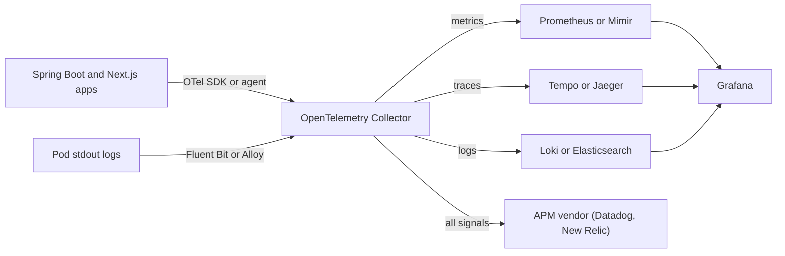
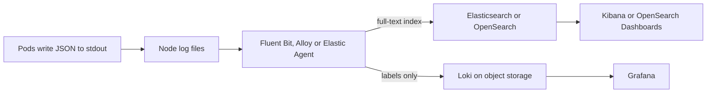
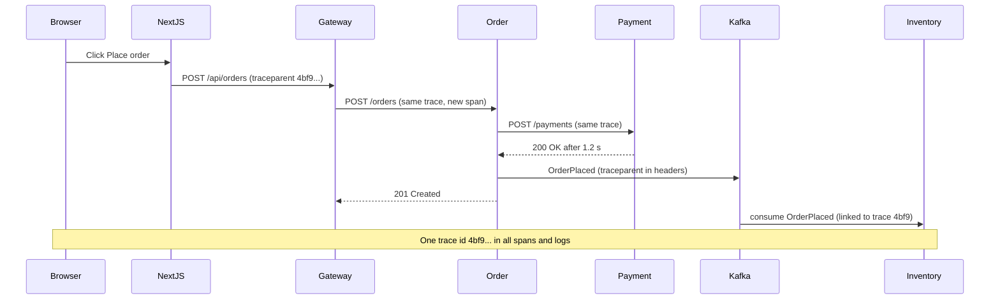
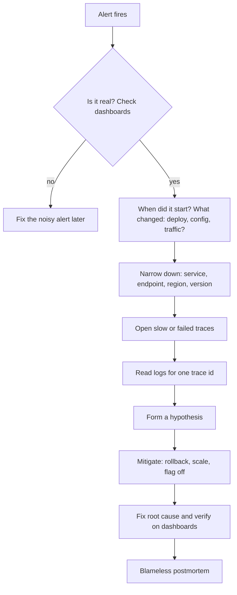
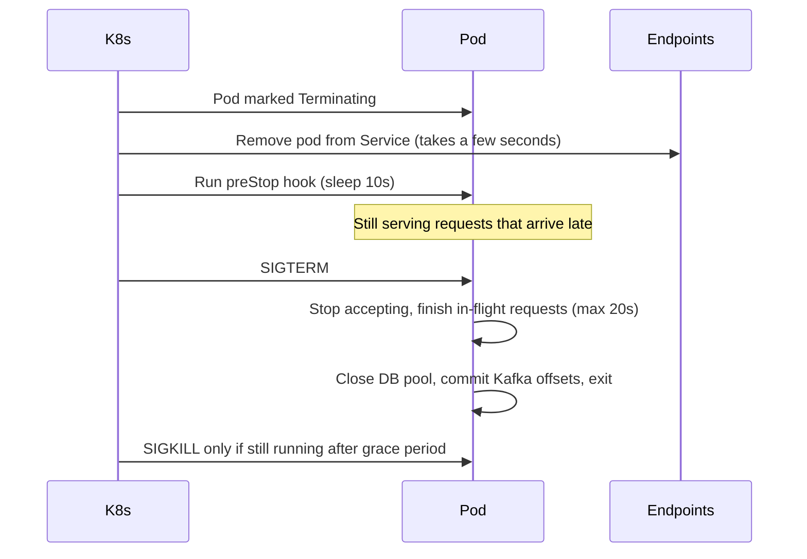
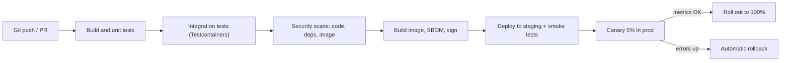

# Production-ready apps: backend and frontend

[← Back to README](../README.md)

This page is about running an app for real users, not just building it.
It covers logs, metrics, traces, APM tools (New Relic, Datadog and others), Grafana, ELK, product analytics, alerts, and step-by-step debugging of real incidents.
The running example is a shop: a Spring Boot backend and a Next.js frontend on Kubernetes.

**The example system used on this page:**

- **Frontend:** Next.js / React app (`web`), served from Kubernetes behind a CDN.
- **Backend:** Spring Boot microservices: `order-service`, `payment-service`, `inventory-service`, behind an API gateway.
- **Data:** PostgreSQL (one database per service), Redis (cache), Kafka (events like `OrderPlaced`).
- **Platform:** Kubernetes (namespace `shop`), OpenTelemetry Collector, Prometheus, Grafana, a log platform.

Spring-specific config (Actuator, Micrometer, the `traceparent` setup) is in [spring-ecosystem.md](spring-ecosystem.md#observability-with-actuator-micrometer-and-opentelemetry). How Spring works inside (proxies, bean errors, `@Transactional` surprises) is in [spring-debugging.md](spring-debugging.md). This page does not repeat them.

**Contents:**

- [What "production-ready" means](#what-production-ready-means)
- [The three pillars: logs, metrics, traces (plus profiles)](#the-three-pillars-logs-metrics-traces-plus-profiles)
- [Logging done right](#logging-done-right)
- [Log platforms: ELK, OpenSearch and Loki](#log-platforms-elk-opensearch-and-loki)
- [Metrics with Prometheus and Grafana](#metrics-with-prometheus-and-grafana)
- [Distributed tracing with OpenTelemetry](#distributed-tracing-with-opentelemetry)
- [APM tools: New Relic, Datadog and others](#apm-tools-new-relic-datadog-and-others)
- [Frontend monitoring](#frontend-monitoring)
- [Product analytics](#product-analytics)
- [Alerts, SLOs and on-call](#alerts-slos-and-on-call)
- [Debugging a production incident: step by step](#debugging-a-production-incident-step-by-step)
- [Health checks, graceful shutdown and Kubernetes basics](#health-checks-graceful-shutdown-and-kubernetes-basics)
- [Deploying safely](#deploying-safely)
- [Security checklist for production](#security-checklist-for-production)
- [Data, backups and disaster recovery](#data-backups-and-disaster-recovery)
- [Performance and load testing](#performance-and-load-testing)
- [Cost awareness](#cost-awareness)
- [Production readiness review (one-page checklist)](#production-readiness-review-one-page-checklist)
- [Interview questions](#interview-questions)

---

## What "production-ready" means

**In one line:** An app is production-ready when real users can depend on it, and when something breaks, your team finds out first, knows why, and can fix it fast.

**Story:** Cooking at home vs opening a restaurant.
- At home, if the dal burns, you cook again. Nobody else is hurt.
- A restaurant needs more than good food. It needs a fire extinguisher, a clean kitchen license, a cash counter that adds correctly, staff for every shift, and a plan for when the gas runs out.
- The manager watches the hall: "Table 7 has waited 25 minutes. Why?"
- Your code working on your laptop is cooking at home. Production-ready is the restaurant.

**How it works:** Production-ready is a checklist, not a feeling. Group it like this:

| Area | What it means | Day 1 (must have) | Later (when you grow) |
|---|---|---|---|
| **Reliability** | The app keeps working when parts fail | Timeouts on every remote call, retries with backoff, health probes, 2+ replicas | Circuit breakers, bulkheads, multi-region |
| **Observability** | You can see what the app is doing from outside | JSON logs with trace id, RED metrics, basic dashboards, error alerts | Tracing for all services, SLOs, profiling |
| **Security** | Only the right people get the right data | TLS, OAuth2/OIDC login, secrets in a secrets manager, dependency scanning | WAF rules, mTLS between services, pen tests |
| **Performance** | Fast enough under real traffic | Known p95 latency, DB indexes, connection pool sized | Load tests in CI, capacity planning, caching layers |
| **Deploy and rollback** | Shipping is safe and boring | CI/CD, one-command rollback, DB migrations in pipeline | Canary with auto rollback, feature flags everywhere |
| **Data** | Data is never lost and can be restored | Automatic backups, point-in-time recovery on | Tested restore drills, cross-region copies |
| **Operations** | People know what to do at 3 AM | On-call rotation, runbook per alert, status page | Game days (practice failures), postmortem culture |

Links for the reliability patterns: [timeouts](microservices.md#timeouts), [circuit breaker](microservices.md#circuit-breaker), [retry with backoff](microservices.md#retry-with-exponential-backoff-and-jitter).

**Good and bad:**
| Good | Bad |
|---|---|
| A short day-1 list you actually finish | A 200-item list nobody reads |
| Every alert has an owner and a runbook | "We will add monitoring after launch" |
| Rollback tested before go-live | First rollback attempt happens during an outage |

**Say this in the interview:**

> "For me, production-ready means three things. Users can depend on it: timeouts, retries, health checks, more than one replica. We can see inside it: JSON logs with trace ids, RED metrics, traces and alerts. And we can change it safely: CI/CD, canary releases, one-click rollback and tested backups."

**They may ask next:**
- **What is the minimum for day 1?** Health probes, 2+ replicas, timeouts, JSON logs, error-rate and latency alerts, backups, a rollback button.
- **Who owns production?** The team that builds the service also runs it ("you build it, you run it"). A platform team gives shared tools.

---

## The three pillars: logs, metrics, traces (plus profiles)

**In one line:** Metrics tell you **that** something is wrong, traces tell you **where**, logs tell you **why**, and profiles tell you **which line of code** is burning CPU or memory.

**Story:** A hospital.
- **Metrics** are the monitor beside the bed: heart rate 140, BP 90/60. Numbers over time. Cheap to keep.
- **Traces** are the patient's path: reception (2 min) → X-ray (40 min, slow!) → doctor (5 min).
- **Logs** are the doctor's notes: "Patient says chest pain started after lunch."
- **Profiles** are a body scan: they show exactly which organ is working too hard.

**What each one answers:**

| Signal | What it is | Question it answers | Example |
|---|---|---|---|
| **Metrics** | Numbers over time, grouped by a few labels | "Is it broken? How bad? Since when?" | Error rate on `POST /orders` went from 0.1% to 8% at 10:02 |
| **Traces** | The timeline of one request across services | "Which service or call is slow or failing?" | `payment-service → bank API` span took 4.8 s |
| **Logs** | Text events with details | "What exactly happened in this request?" | `Payment declined: card expired, orderId=981` |
| **Profiles** | Where CPU time and memory go, by function | "Which code is hot?" | 60% CPU in `JsonMapper.serialize` |

**How they link together:** the **trace id**.
1. The first service creates a trace id (a random 32-character id) for each request.
2. It travels to every service in the `traceparent` HTTP header and in Kafka message headers.
3. Every log line includes the trace id.
4. Metrics can carry **exemplars**: a sample trace id stored next to a data point. You click a spike in Grafana and jump to a real slow trace.
5. So the path is: dashboard spike → exemplar trace → logs for that trace id.

**Profiles** (continuous profiling) are the newest signal. Tools: Grafana Pyroscope, Datadog Continuous Profiler, Elastic Universal Profiling, async-profiler and JFR (Java Flight Recorder) for Java. OpenTelemetry added a profiles signal, but it is still **alpha** (public alpha in March 2026). Do not depend on it for critical systems yet.

**The telemetry path:** how data leaves the app.



- **OpenTelemetry (OTel)** is an open standard for telemetry (logs, metrics, traces). It has an API, SDKs for each language, and a wire protocol called **OTLP**.
- The **SDK or agent** runs inside your app and creates the data.
- The **Collector** is a separate process. It receives data, filters it, removes secrets, samples it, and sends it to one or many backends.
- Because the app only talks OTLP to the Collector, you can change the backend without touching app code.

**Good and bad:**
| Good | Bad |
|---|---|
| One trace id joins all three signals | Three separate tools with no links: you copy-paste timestamps |
| Collector in the middle: change vendor by changing config | App sends straight to a vendor with a vendor-only agent: hard to move |
| Metrics for alerts (cheap, fast) | Alerting on log searches (slow, costly, breaks when text changes) |

**Say this in the interview:**

> "Metrics tell me something is wrong, traces tell me where, logs tell me why. I link them with the trace id: it is in every log line and in exemplars on metrics. Apps send data with OpenTelemetry to a Collector, and the Collector sends it to Prometheus, Tempo and Loki, or to a vendor like Datadog."

**They may ask next:**
- **Why not just logs?** Logs are expensive at volume and slow to aggregate. "Error rate over the last hour" is one cheap metric query but a huge log scan.
- **What is an exemplar?** A sample trace id attached to a metric data point, so you can jump from a latency spike to one real slow request.

---

## Logging done right

**In one line:** Write logs as structured JSON, at the right level, with the trace id in every line, and never with secrets or personal data.

**Story:** A railway station announcement log.
- A good entry: "10:05, Train 12951, Platform 3, delayed 20 minutes, reason: signal fault." Anyone can search it.
- A bad entry: "train late lol." Nobody can search or count it.
- Structured logs are the good entry. Each fact is a named field.

**How it works:**

1. **JSON, not free text.** Each field has a name: `level`, `message`, `service`, `traceId`, `orderId`. The log platform can filter and count by field.
2. **Log to stdout.** In Kubernetes, the app writes to the console. A log agent (Fluent Bit, Grafana Alloy, Filebeat) on each node reads the files and ships them. The app does not know where logs go.
3. **Use levels with a clear meaning:**

| Level | When to use | Example | On in production? |
|---|---|---|---|
| `ERROR` | Something failed and needs a human or a retry | `Payment failed after 3 retries` | Yes |
| `WARN` | Something odd, app still works | `Inventory slow (1.8 s), using cached stock` | Yes |
| `INFO` | Important business events, one per action | `Order 981 placed, total 1499 INR` | Yes |
| `DEBUG` | Details for developers | `Calling bank API with 3 items` | No (turn on for one logger when needed) |
| `TRACE` | Very fine details | Every loop step | Never |

4. **Correlation ids.** The trace id comes from OpenTelemetry. Spring Boot (3.2+) puts `traceId` and `spanId` in the logging **MDC** (Mapped Diagnostic Context: a per-thread map that the logger adds to every line). You can add your own keys, like `orderId`.
5. **Never log secrets or PII** (personally identifiable information): passwords, tokens, card numbers, full phone numbers, Aadhaar or PAN numbers, full addresses. Mask them (`card=****4242`). Also remove them in the Collector or log agent as a second safety net.
6. **One event, one line.** A stack trace should be one JSON event, not 80 separate lines.
7. **Sample noisy logs.** If a health check logs 50 lines a second, drop it. For repeated identical errors, keep the first few per minute and count the rest.
8. **Retention and cost.** Keep hot, searchable logs for 7–14 days. Move older logs to cheap object storage (for example S3) for 90 days or more, if audit rules need it. Logs are often the biggest observability bill.

**Example (Spring Boot):** structured logging is built in since Boot 3.4 (`ecs`, `logstash`, `gelf` formats). Full config is in [spring-ecosystem.md](spring-ecosystem.md#observability-with-actuator-micrometer-and-opentelemetry).

```properties
# JSON lines on stdout
logging.structured.format.console=ecs
logging.structured.ecs.service.name=order-service
logging.level.root=INFO
# can change at runtime via /actuator/loggers
logging.level.com.shop.payment=INFO
```

Add business keys to the MDC for one request, and always clean up:

```java
public Order placeOrder(PlaceOrder cmd) {
    MDC.put("orderId", cmd.orderId());          // appears in every log line below
    try {
        log.info("Placing order, items={}", cmd.items().size());
        return orderService.place(cmd);
    } catch (PaymentException e) {
        log.error("Payment failed for order", e); // pass the exception: one event with stack trace
        throw e;
    } finally {
        MDC.remove("orderId");                  // threads are reused: always remove
    }
}
```

**Example (Node.js with pino):** pino is a fast JSON logger for Node.

```js
import pino from 'pino';

const log = pino({
  level: process.env.LOG_LEVEL ?? 'info',
  base: { service: 'web-bff' },                  // added to every line
  timestamp: pino.stdTimeFunctions.isoTime,
  redact: ['req.headers.authorization', '*.password', '*.cardNumber'], // never ship secrets
});

log.info({ orderId: '981', traceId }, 'Order placed');
log.error({ err, orderId: '981' }, 'Payment call failed'); // err is serialized with stack
```

**Frontend: no `console.log` in production.**
- Users can open DevTools and read it. It can leak tokens or user data.
- Nobody collects it. A browser console is not a log platform.
- Remove it at build time with a lint rule (`no-console`), and send real errors to an error tracker (see [Frontend monitoring](#frontend-monitoring)).

**Good and bad:**
| Good | Bad |
|---|---|
| `{"level":"ERROR","traceId":"4bf9...","orderId":"981","message":"Payment failed"}` | `ERROR!!! something broke` |
| One INFO line per business action | Logging every method entry and exit |
| Change a logger to DEBUG for 10 minutes with `/actuator/loggers` | Redeploying the app to change a log level |
| Masking tokens and card numbers | `log.info("request={}", request)` that dumps headers with the `Authorization` token |

**Say this in the interview:**

> "I log JSON to stdout, and a node agent ships it. Every line has service name, level and trace id, so I can pull all logs of one request across services. INFO is for business events, ERROR is for failures that need action, DEBUG is off and I turn it on for one logger at runtime. I never log tokens or personal data, and I mask again in the pipeline."

**They may ask next:**
- **How do you find all logs for one user request across 5 services?** Search by trace id in Loki or Kibana.
- **Logs are too expensive. What do you do?** Drop DEBUG, drop health-check noise, sample repeated errors, shorten hot retention, move old logs to object storage, turn high-volume logs into metrics.
- **How does the trace id get into async code or Kafka consumers?** Spring's Kafka and executor instrumentation copies the context. Plain `new Thread()` loses it. See [java-concurrency.md](java-concurrency.md).

---

## Log platforms: ELK, OpenSearch and Loki

**In one line:** ELK and OpenSearch index every word, so search is fast but storage costs more. Loki indexes only a few labels, so it is cheaper but scans text to search.

**Story:** Two libraries.
- **ELK library:** a librarian writes an index card for every word in every book. Finding any word is instant. But the card cabinet is huge and costly.
- **Loki library:** books are sorted on shelves only by subject and year (labels). To find a word, you pick the right shelf, then flip pages fast. Very little cabinet space.

**How it works:**

**ELK / EFK stack:**
1. **Elasticsearch** stores logs and builds an **inverted index** (a map from each word to the logs that contain it).
2. **Logstash** or **Fluent Bit** / Filebeat / Elastic Agent collect and transform logs. "EFK" means Fluentd or Fluent Bit replaces Logstash. Fluent Bit is small and common on Kubernetes nodes.
3. **Kibana** is the UI: search, dashboards, alerts.
4. Since 2024, Elasticsearch can again be used under an open source license (AGPL) as one option, next to Elastic's own licenses.

**OpenSearch:**
- A fork (copy that became its own project) of Elasticsearch 7.10, started by AWS in 2021.
- Since 2024 it is run by the OpenSearch Software Foundation under the Linux Foundation. Apache 2.0 license.
- UI is **OpenSearch Dashboards** (fork of Kibana). It supports DQL (Dashboards Query Language, very close to Kibana's KQL), PPL and SQL.
- Common on AWS as "Amazon OpenSearch Service".

**Grafana Loki:**
1. Loki stores log lines in compressed chunks in object storage (S3, GCS).
2. It indexes only **labels**, like `namespace`, `app`, `pod`, `level`. Not the text.
3. Queries use **LogQL**: first pick streams by labels, then filter or parse the text.
4. The UI is Grafana, next to your metrics and traces.
5. Logs are shipped by **Grafana Alloy** (Grafana's OpenTelemetry-based collector). The old agent, Promtail, reached end of life on 2 March 2026.



**Comparison:**

| | ELK (Elasticsearch) | OpenSearch | Grafana Loki |
|---|---|---|---|
| Index | Full text, every field | Full text, every field | Labels only |
| Storage cost | High (index can be as big as the data) | High | Low (compressed chunks on object storage) |
| Search speed for random text | Very fast | Very fast | Slower on big time ranges (scans) |
| Query language | KQL, Lucene, ES\|QL | DQL, Lucene, PPL, SQL | LogQL |
| UI | Kibana | OpenSearch Dashboards | Grafana |
| Best for | Heavy search, security analytics, log analytics | Same, with Apache 2.0 license or on AWS | Cheap logs next to Prometheus and Tempo |
| Main trap | Cluster tuning (shards, heap, mappings) | Same | Too many label values (high cardinality) |

**Example: find errors of one trace.**

Kibana (KQL), with Spring Boot's `ecs` JSON format:

```text
service.name : "order-service" and log.level : "ERROR" and traceId : "4bf92f3577b34da6a3ce929d0e0e4736"
```

Loki (LogQL). Pick streams by labels, parse JSON, then filter. The `json` parser turns dots into underscores (`log.level` becomes `log_level`):

```text
{namespace="shop", app="order-service"} | json | log_level="ERROR" | traceId="4bf92f3577b34da6a3ce929d0e0e4736"
```

LogQL can also count, like a metric. Errors per minute per app:

```text
sum by (app) (count_over_time({namespace="shop"} | json | log_level="ERROR" [1m]))
```

**Good and bad:**
| Good | Bad |
|---|---|
| Loki labels: `namespace`, `app`, `level`, `env` (few values) | Loki label `traceId` or `userId` (millions of values: Loki slows down and costs more) |
| ELK index template with fixed field types | Letting every app invent fields: "mapping explosion" (too many fields in the index) |
| Hot (fast disk) for 7 days, then cheap storage | All logs on fast disks for a year |

**Say this in the interview:**

> "ELK and OpenSearch index all text, so search is fast but storage is expensive. Loki indexes only labels like app and namespace and keeps logs compressed on object storage, so it is much cheaper, and it sits in Grafana next to metrics and traces. I keep labels low-cardinality and put trace id inside the log line, not as a label."

**They may ask next:**
- **Why not put trace id as a Loki label?** Each unique label value makes a new stream. Millions of streams slow Loki. Filter it from the JSON instead.
- **When would you choose ELK over Loki?** When the team needs fast free-text search over big time ranges, for example security or support teams searching any word.

---

## Metrics with Prometheus and Grafana

**In one line:** Prometheus pulls numbers from every app every 15–30 seconds and stores them as time series; Grafana draws dashboards; alerts fire on rules over those numbers.

**Story:** A school attendance register.
- The teacher (Prometheus) walks to each class (app) every morning and asks "how many present?" That is the **pull model**.
- She writes the number with a date. Over months, you see a trend.
- She does not write each child's life story (that would be logs). Just numbers.

**How it works:**
1. Each app exposes `/metrics` (Spring: `/actuator/prometheus`; Node: `prom-client`).
2. Prometheus **scrapes** (pulls) it on a schedule. On Kubernetes it finds pods by service discovery.
3. Data is stored as **time series**: metric name + labels → values over time.
   Example: `http_server_requests_seconds_count{uri="/orders", status="500"}`.
4. **Grafana** queries Prometheus with **PromQL** and draws panels.
5. **Alertmanager** receives alerts from Prometheus rules and routes them to Slack or a pager.
6. For long retention and many clusters, teams add Grafana Mimir, Thanos or VictoriaMetrics. Prometheus 3 can also receive OTLP metrics pushed by apps.

**Metric types:**

| Type | Goes | Example | Use with |
|---|---|---|---|
| **Counter** | Only up (resets on restart) | `orders_placed_total` | `rate()` to get "per second" |
| **Gauge** | Up and down | `hikaricp_connections_active`, queue size | Read directly, `max`, `avg` |
| **Histogram** | Counts values into buckets | Request duration buckets: ≤50 ms, ≤100 ms, ≤250 ms... | `histogram_quantile()` for p95, p99 |
| **Summary** | Percentiles calculated in the app | p99 computed in each pod | Cannot add percentiles across pods. Prefer histograms |

**Two methods to choose what to measure:**
- **RED** (for services, request-driven): **R**ate (requests/second), **E**rrors (failed %), **D**uration (latency p50/p95/p99).
- **USE** (for resources like CPU, disk, DB pool): **U**tilization (% busy), **S**aturation (queue waiting), **E**rrors.
- Google's "four golden signals" are almost the same: latency, traffic, errors, saturation.

**Key metrics for our shop:**

| Area | Metric (Prometheus name) | Why |
|---|---|---|
| HTTP API (Spring) | `http_server_requests_seconds_count`, `_bucket` | RED per endpoint |
| JVM | `jvm_memory_used_bytes{area="heap"}`, `jvm_gc_pause_seconds`, `jvm_threads_live_threads` | Memory leaks, GC pauses |
| DB pool | `hikaricp_connections_active`, `hikaricp_connections_pending` | Pending > 0 for long = pool too small or slow queries |
| Kafka consumer | Consumer lag (from kafka-exporter `kafka_consumergroup_lag` or the client's `records_lag_max`) | Is the consumer keeping up? |
| Node.js | `nodejs_eventloop_lag_seconds`, `process_resident_memory_bytes` | Event loop blocked, memory |
| Container | `container_cpu_cfs_throttled_periods_total`, `container_memory_working_set_bytes` | CPU throttling, close to OOM |
| Kubernetes | `kube_pod_container_status_restarts_total` | Crash loops |
| Business | `orders_placed_total`, `payments_failed_total` | Real user impact; a drop to zero is an alert |

**Example: PromQL.**

Error rate (% of 5xx) for `order-service` over 5 minutes:

```text
sum(rate(http_server_requests_seconds_count{app="order-service", status=~"5.."}[5m]))
/
sum(rate(http_server_requests_seconds_count{app="order-service"}[5m]))
```

p95 latency per endpoint, from histogram buckets:

```text
histogram_quantile(0.95,
  sum by (le, uri) (rate(http_server_requests_seconds_bucket{app="order-service"}[5m])))
```

In Spring, buckets exist only when you turn them on: `management.metrics.distribution.percentiles-histogram.http.server.requests=true`.

**A good service dashboard (top to bottom):**
1. Traffic: requests/second, by endpoint.
2. Errors: 5xx % and 4xx %, by endpoint.
3. Latency: p50, p95, p99.
4. Saturation: CPU, memory, DB pool pending, thread pool queue, Kafka lag.
5. Dependencies: latency and errors of calls to Payment, DB, Redis.
6. Deploy markers: a vertical line at each deploy (Grafana annotations).
7. Business: orders per minute.

**The cardinality trap:**
- **Cardinality** = number of unique time series. Each new label value makes a new series.
- `uri="/orders/{id}"` is fine (a template). `uri="/orders/981"` is not (one series per order).
- Never use user id, order id, email or full URL as a label. 1 million users = 1 million series = Prometheus runs out of memory.
- Spring uses URI templates by default. A raw `RestTemplate` URL built with string concatenation can break this.

**Good and bad:**
| Good | Bad |
|---|---|
| Histograms, then `histogram_quantile` across all pods | Averaging p99 values from each pod (math is wrong) |
| `rate()` on counters | Graphing the raw counter (it only goes up) |
| Labels with few values: `status`, `method`, `uri` template | Labels with `userId`, `orderId` |
| Business metrics next to tech metrics | Only CPU graphs: you miss "orders dropped to zero" |

**Say this in the interview:**

> "Prometheus scrapes each app and stores time series; Grafana shows them; Alertmanager routes alerts. For services I use RED: rate, errors, duration. For resources I use USE. I compute p95 from histograms with histogram_quantile, never by averaging percentiles. And I keep labels low-cardinality: no user ids or order ids."

**They may ask next:**
- **Pull vs push?** Pull: Prometheus controls timing and knows when a target is down. Push (OTLP, Pushgateway) suits short jobs and serverless.
- **Why is average latency a bad metric?** One 10 s request hides among 999 fast ones. p99 shows the slow tail users feel.
- **What is `rate()`?** Per-second increase of a counter over a window. It handles counter resets on restart.

---

## Distributed tracing with OpenTelemetry

**In one line:** A trace is the full story of one request across all services. It is made of spans (one per step), joined by a trace id that travels in headers.

**Story:** Tracking a courier parcel.
- One tracking number (trace id) for the whole trip.
- Each stop is a scan: "Mumbai hub 10:00–10:40", "Pune hub 14:00–14:20" (spans with start and end time).
- If the parcel is late, you see which hub kept it longest.

**How it works:**
1. **Span:** one unit of work with a name, start, duration, status and attributes. Example: `POST /orders`, `SELECT orders`, `kafka.send OrderPlaced`.
2. **Trace:** a tree of spans sharing one trace id. Each span knows its parent span.
3. **Context propagation:** the trace id and parent span id travel between services.
   - HTTP: the W3C `traceparent` header. Format: `version-traceid-parentspanid-flags`.
     Example: `traceparent: 00-4bf92f3577b34da6a3ce929d0e0e4736-00f067aa0ba902b7-01` (the last `01` means "sampled").
   - Kafka: the same `traceparent` goes into **message headers**. The consumer starts a span linked to the producer.
4. **Export:** each service sends spans (OTLP) to the Collector. The Collector sends them to a backend: **Jaeger**, **Grafana Tempo**, **Zipkin** or an APM vendor.
5. **Backends:**
   - **Jaeger**: CNCF project. Jaeger v2 (Nov 2024) is built on the OpenTelemetry Collector. Jaeger v1 reached end of life at the end of 2025.
   - **Tempo**: Grafana's trace store. Stores traces in object storage. Query language TraceQL.
   - **Zipkin**: the oldest. Simple, still used.

**Trace through our shop:**



**Sampling:** you cannot keep every trace at high traffic. It costs too much.

| | Head sampling | Tail sampling |
|---|---|---|
| Decided | At the start of the request (first service) | After the whole trace finishes (in the Collector) |
| Rule example | Keep 10% of traces at random | Keep all traces with errors, all slower than 2 s, and 5% of the rest |
| Good | Simple, cheap, in the SDK | Keeps the interesting traces |
| Bad | May drop the one failing request you need | Collector must hold spans in memory; all spans of a trace must reach the same Collector (use the load-balancing exporter by trace id) |

Use `parentbased` samplers: a service follows the decision of the caller (the `01` flag), so you never get half a trace.

**Java agent vs Micrometer Tracing:**

| | OpenTelemetry Java agent | Micrometer Tracing (Spring) |
|---|---|---|
| Setup | `-javaagent:opentelemetry-javaagent.jar` + env vars. No code change | Starter dependencies + properties (Boot 4: `spring-boot-starter-opentelemetry`) |
| Coverage | Very wide: JDBC, Kafka, Redis, HTTP clients, many libraries | Spring-managed components (RestClient, WebClient, KafkaTemplate, JDBC via observation) |
| Risks | Bytecode changes at runtime, slower startup, may break on upgrades, no native image | Only what Spring instruments; `new` clients outside Spring miss headers |
| Good for | Many old services, polyglot teams, vendor agents built on it | New Spring Boot 3/4 apps, native images |

Details for the Spring setup: [spring-ecosystem.md](spring-ecosystem.md#observability-with-actuator-micrometer-and-opentelemetry).

**Example: Java agent with environment variables (Kubernetes):**

```yaml
env:
  - name: JAVA_TOOL_OPTIONS
    value: "-javaagent:/otel/opentelemetry-javaagent.jar"
  - name: OTEL_SERVICE_NAME
    value: "payment-service"
  - name: OTEL_EXPORTER_OTLP_ENDPOINT
    value: "http://otel-collector:4318"        # Collector, not the vendor directly
  - name: OTEL_TRACES_SAMPLER
    value: "parentbased_traceidratio"          # follow caller's decision
  - name: OTEL_TRACES_SAMPLER_ARG
    value: "0.1"                               # 10% of new traces
  - name: OTEL_RESOURCE_ATTRIBUTES
    value: "deployment.environment=prod,service.version=1.42.0"
```

**Example: Next.js server side** (`instrumentation.ts` at the project root, see [nextjs.md](nextjs.md)):

```ts
import { registerOTel } from '@vercel/otel';

export function register() {
  registerOTel({
    serviceName: 'web',                        // spans for routes and fetch() calls
    instrumentationConfig: {
      fetch: { propagateContextUrls: [/api\.shop\.internal/] }, // send traceparent to our gateway
    },
  });
}
```

By default `@vercel/otel` sends `traceparent` only to Vercel deployment URLs. For your own gateway you must list it, or the trace breaks at the frontend.

**Example: Collector with tail sampling (shortened):**

```yaml
processors:
  memory_limiter: { check_interval: 1s, limit_percentage: 80 }
  tail_sampling:
    decision_wait: 10s                       # wait for all spans of a trace
    policies:
      - { name: errors, type: status_code, status_code: { status_codes: [ERROR] } }
      - { name: slow, type: latency, latency: { threshold_ms: 2000 } }
      - { name: rest, type: probabilistic, probabilistic: { sampling_percentage: 5 } }
  batch: {}
service:
  pipelines:
    traces:
      receivers: [otlp]
      processors: [memory_limiter, tail_sampling, batch]
      exporters: [otlphttp/tempo]
```

**Good and bad:**
| Good | Bad |
|---|---|
| Collector between apps and backend | Each app talks to the vendor directly with its own keys |
| Same `service.name` in traces, metrics and logs | `order-svc` in traces, `orders` in logs: links break |
| Keep all error traces (tail sampling) | 1% random sampling: the bug you need is never there |
| Span attributes like `order.id` (fine on spans) | Order id as a metric label (cardinality explosion) |

**Say this in the interview:**

> "Each request gets a trace id. It travels in the W3C traceparent header over HTTP and in Kafka headers, so the consumer span joins the same trace. Services export spans with OTLP to an OpenTelemetry Collector, which sends them to Tempo or Jaeger. I use parent-based head sampling in the apps and tail sampling in the Collector to keep all errors and slow traces."

**They may ask next:**
- **A trace breaks between two services. Why?** A client was created with `new` and skipped instrumentation, a proxy dropped the header, or an async hop lost the context.
- **How does tracing work across Kafka?** The producer writes `traceparent` in record headers; the consumer reads it and starts a linked span.
- **What is a span link?** A pointer from one span to another trace, used when one consumer batch handles messages from many traces.

---

## APM tools: New Relic, Datadog and others

**In one line:** An APM (Application Performance Monitoring) tool is a ready-made product. It collects metrics, traces, logs and errors from your apps and shows them in one place.

**Story:** Building your own CCTV system vs hiring a security company.
- Do it yourself (OpenTelemetry + Prometheus + Grafana + Loki + Tempo): you buy cameras, wire them, run the recorder. Cheaper in money, costs your time.
- Security company (Datadog, New Relic, Dynatrace): they install everything and watch screens for you. Easy, but you pay every month and moving away is hard.

**What an APM gives you:**
- **Service map:** a live picture of which service calls which, with error and latency on each arrow.
- **Transaction traces:** the slowest requests per endpoint, broken into spans (DB, HTTP, cache).
- **Error tracking:** errors grouped by type and stack trace, with first-seen and last-seen times.
- **Database query analysis:** slowest and most-called SQL, with query plans in some tools.
- **Profiling:** which methods use CPU and memory, always on, low overhead.
- **Alerts and anomaly detection:** "latency is unusual for a Monday 10 AM".
- **Deploy tracking:** compare error rate before and after version 1.42.

**The main tools (no prices; they change often):**

| Tool | How it collects | Strong points | Notes |
|---|---|---|---|
| **Datadog** | Datadog Agent + language tracers; accepts OTLP | Very wide product: APM, logs, RUM, Continuous Profiler, Database Monitoring, Data Streams Monitoring (Kafka lag and pipelines), Synthetics | Cost grows fast with hosts, logs and custom metrics |
| **New Relic** | Language agents (Java, Node...), Browser agent; native OTLP endpoint | APM, Errors Inbox, Browser and session replay, Synthetics, NRQL query language | Usage-based model; plan data volume |
| **Dynatrace** | OneAgent: installs once per host, instruments automatically | Strong automatic discovery, topology map (Smartscape), AI root-cause analysis (Davis) | Common in large enterprises |
| **Elastic Observability** | Elastic APM agents or EDOT (Elastic Distributions of OpenTelemetry, GA since 9.0) | Logs and APM in the same Elasticsearch, Kibana UI, Universal Profiling | Good if you already run ELK |
| **Grafana Cloud / LGTM stack** | OpenTelemetry, Alloy, Prometheus | Loki (logs), Grafana, Tempo (traces), Mimir (metrics), Pyroscope (profiles), Faro (frontend) | Open source parts can be self-hosted |
| **Others** | Mostly OpenTelemetry | Honeycomb (fast trace analysis), SigNoz (open source, OTel-native), Sentry (errors and frontend), AWS X-Ray / CloudWatch, Azure Monitor | Pick by team skills and cloud |

**Agent-based vs OpenTelemetry-based:**

| | Vendor agent | OpenTelemetry SDK/agent |
|---|---|---|
| Setup | Very easy, rich features on day 1 | A bit more work (Collector, config) |
| Extra features | Vendor-specific extras (code-level profiling, deep DB views) | Standard data, some vendor extras missing |
| Moving vendor | Re-instrument every service | Change the Collector exporter |
| Mixed backends | One vendor | Send the same data to two places (for example, Tempo and Datadog during a migration) |

**Vendor lock-in and how OTel helps:**
- Lock-in comes from three places: the **agent** in your code, the **query language** in your dashboards (NRQL, Datadog queries), and **alerts**.
- OpenTelemetry removes the first one. Your code only knows OTel APIs. The Collector decides where data goes.
- Dashboards and alerts still need rework when you move. Keep them as code (Terraform, Grafana JSON) to make this easier.

**How to choose:**
1. Small team, no platform engineers, needs results this week → a SaaS APM.
2. Big data volume, cost-sensitive, strong platform team → OpenTelemetry + Grafana stack (self-hosted or Grafana Cloud).
3. Already on ELK for logs → Elastic APM / EDOT.
4. In all cases → instrument with OpenTelemetry where you can, so you keep the option to move.

**Good and bad:**
| Good | Bad |
|---|---|
| OTel instrumentation, vendor as the backend | Vendor-only SDK calls spread across business code |
| Decide data volume up front (sampling, log levels) | Turning everything on, then a surprise bill |
| One tool the whole team knows | Five tools, each half set up |

**Say this in the interview:**

> "An APM like Datadog or New Relic gives service maps, slow-transaction traces, error grouping, DB query views and profiling out of the box. The alternative is OpenTelemetry with Prometheus, Grafana, Loki and Tempo: more work, more control, usually cheaper at scale. Either way, I instrument with OpenTelemetry and send through a Collector, so changing vendor is a config change, not a code change."

**They may ask next:**
- **Datadog vs Grafana stack in one sentence?** Datadog is faster to start and has more in one place. The Grafana stack gives more control and lower cost at high volume, but you run it.
- **Can you use OpenTelemetry with Datadog or New Relic?** Yes. Both accept OTLP data, directly or through the Collector.

---

## Frontend monitoring

**In one line:** The backend can be perfect while users still see a blank page. So you also measure the browser: JavaScript errors, real page speed, and session replays.

**Story:** A restaurant owner sitting in the kitchen sees every dish leave on time. But in the hall, the AC is broken and customers walk out. You must sit in the hall too. The browser is the hall.

**How it works:**

**1. Error tracking (Sentry, Datadog RUM, New Relic Browser, Grafana Faro):**
- An SDK catches unhandled errors and promise rejections in the browser, and server errors in Next.js.
- Errors are grouped by stack trace, with browser, OS, URL, release version and user id (if allowed).
- **Source maps are a must.** Production JS is minified: `a.b is not a function at main.3f9c.js:1:48213`. Source maps turn it back into `cart.total is not a function at CartSummary.tsx:42`.
- Upload source maps to the tool during the build. **Do not serve them publicly** if your code is private.
- Tag every event with the **release** (Git SHA). Then you see "this error started in release 1.42".

**2. Real User Monitoring (RUM):**
- Measures real page loads and clicks from real users, on real phones and networks.
- Tools: Datadog RUM, New Relic Browser, Sentry (performance), Grafana Faro, Elastic RUM.
- Lab tools like Lighthouse test one fast laptop. RUM shows the user on a cheap phone on 4G.

**3. Core Web Vitals from real users** (more in [frontend-ui.md](frontend-ui.md)):

| Metric | Measures | Good |
|---|---|---|
| **LCP** (Largest Contentful Paint) | When the main content shows | ≤ 2.5 s |
| **INP** (Interaction to Next Paint) | How fast the page reacts to taps and clicks | ≤ 200 ms |
| **CLS** (Cumulative Layout Shift) | How much the layout jumps | ≤ 0.1 |

Use the 75th percentile (p75) of real users, split by mobile and desktop.

```js
import { onLCP, onINP, onCLS } from 'web-vitals';

function send(metric) {
  const body = JSON.stringify({
    name: metric.name, value: metric.value, rating: metric.rating, // "good" | "needs-improvement" | "poor"
    page: location.pathname, release: window.__RELEASE__,
  });
  navigator.sendBeacon('/api/vitals', body); // survives page close, unlike fetch
}
onLCP(send); onINP(send); onCLS(send);
```

In Next.js you can also use the `useReportWebVitals` hook.

**4. Session replay:**
- Records DOM changes (not a video) so you can "watch" what a user did before an error.
- **Privacy first:** mask all text and inputs by default. Sentry's replay masks all text and blocks media by default. Never record payment fields or passwords.
- Record a sample (for example 1% of sessions, 100% of sessions with an error).
- Tell users in your privacy policy. Follow consent rules (see [Product analytics](#product-analytics)).

**5. Synthetic checks:**
- A robot runs a script every few minutes from several cities: open home page, search, add to cart, check out with a test card.
- Finds problems when no real users are online (3 AM) and checks third parties (payment page, CDN).
- Tools: Playwright scripts, Datadog Synthetics, New Relic Synthetics, Checkly, Grafana Synthetic Monitoring.

**6. Link frontend and backend:** send `traceparent` from the browser to your API (allowed origins only). Then a slow click in RUM opens the backend trace.

**Good and bad:**
| Good | Bad |
|---|---|
| Source maps uploaded per release | Minified stack traces nobody can read |
| p75 Web Vitals split by device and page | One average number for the whole site |
| Replay with all text masked | Replay that records card numbers |
| Ignoring known noise (browser extensions, bots) | 10,000 alerts for `ResizeObserver loop` warnings |

**Say this in the interview:**

> "On the frontend I use an error tracker like Sentry with source maps uploaded at build time and errors tagged by release. I collect Core Web Vitals from real users with the web-vitals library and watch p75 for LCP, INP and CLS. For hard bugs, session replay with all text masked. And synthetic checks run the checkout flow every few minutes."

**They may ask next:**
- **Why are source maps needed?** Production code is minified; without them a stack trace has no real file names or line numbers.
- **RUM vs synthetic?** RUM is real users, real devices, but only when users are online. Synthetic is a robot with a fixed script, always running, good for uptime and catching breaks early.

---

## Product analytics

**In one line:** Product analytics answers "what do users do?" (which buttons, which funnel step they drop at), while monitoring answers "is the system healthy?".

**Story:** A shop owner counts how many people enter, how many pick up a basket, and how many pay. If 1,000 enter and only 20 pay, something is wrong at the counter. That is a **funnel**.

**Tools:**

| Tool | Type | Strong points | Notes |
|---|---|---|---|
| **Google Analytics 4 (GA4)** | SaaS | Marketing and traffic sources, ads integration | Needs Consent Mode in the EU; no built-in A/B testing |
| **Mixpanel** | SaaS | Event funnels, retention, cohorts | Product-team favourite |
| **Amplitude** | SaaS | Deep behaviour analysis, Amplitude Experiment for A/B tests | Common in larger product orgs |
| **PostHog** | SaaS or self-hosted (open source) | Analytics, session replay, feature flags and experiments in one tool | Self-host to keep data in your own servers; the official self-host option is meant for small scale with limited support |

**Event naming plan (`object_action`):**
- Use one style everywhere: lowercase, `object_action`, past tense.
- `product_viewed`, `cart_item_added`, `checkout_started`, `order_completed`, `payment_failed`.
- Properties: `product_id`, `price`, `currency`, `source_page`. No names, emails or phone numbers.

**Tracking plan:** a shared doc or spreadsheet that lists each event, when it fires, its properties, and its owner. Review it in PRs like code. Without it, you get `AddToCart`, `add_to_cart` and `cartAdd` for the same thing.

**Consent and law:**
- **GDPR** (EU): analytics cookies need opt-in consent. Users can ask to delete data.
- **India's DPDP Act, 2023:** the DPDP Rules were notified on 14 November 2025. Most duties (notice, consent, breach reporting, children's data) apply 18 months later, around May 2027. Plan for clear consent, purpose limits and deletion now.
- Load analytics scripts only after consent. Store the consent choice. Respect "reject".

**Client-side vs server-side tracking:**

| | Client-side (browser SDK) | Server-side (your backend sends events) |
|---|---|---|
| Good for | Clicks, page views, scroll | Money events: `order_completed`, `payment_failed` |
| Accuracy | Ad blockers and privacy settings drop some events | Not blocked, matches your database |
| Privacy | Third-party script in the browser | You control exactly what leaves |

Rule: track UI behaviour on the client, and track business truth (orders, payments) on the server.

**Feature flags and experiments (A/B tests):**
- A **feature flag** turns code on or off at runtime without a deploy. Tools: LaunchDarkly, Unleash, Flagsmith, PostHog; **OpenFeature** is a CNCF standard API so you can switch flag vendor.
- An **A/B test** shows version A to 50% and version B to 50%, then compares a metric (conversion rate).
- Decide the metric and sample size **before** starting. Do not stop the test the first day it "looks good".
- Clean up old flags. Each flag is an `if` that someone must understand later.

**Good and bad:**
| Good | Bad |
|---|---|
| Tracking plan reviewed in PRs | Each developer invents event names |
| `order_completed` sent from the server | Revenue counted from browser events (ad blockers lose data) |
| Analytics loads after consent | Tracking before the cookie banner is answered |

**Say this in the interview:**

> "Monitoring tells me the system is healthy; analytics tells me what users do. I keep a tracking plan with object_action event names like cart_item_added, send money events from the server, and load browser analytics only after consent. For new features I use flags and A/B tests with the success metric decided first."

**They may ask next:**
- **Why server-side for orders?** Ad blockers and closed tabs drop browser events; the server sees every real order.
- **Feature flag vs config?** A flag can change per user or percentage at runtime; config is usually the same for everyone and changes with a deploy.

---

## Alerts, SLOs and on-call

**In one line:** Decide how reliable the service must be (SLO) and measure it (SLI). Page a human only when users are hurting or the error budget burns fast.

**Story:** A bus company promises "99% of buses leave within 5 minutes of schedule".
- How late each bus left is what they **measure** (SLI).
- "99% on time" is the **target** (SLO).
- If they break it, they refund ticket money. That is the **contract** (SLA).
- 1% of buses may be late without breaking the promise. That 1% is the **error budget**. Spend it on road works, new routes, risky changes.

**How it works:**

| Term | Simple meaning | Example for `POST /orders` |
|---|---|---|
| **SLI** (Service Level Indicator) | A measurement of good events / all events | % of requests that succeed in under 500 ms |
| **SLO** (Service Level Objective) | Your internal target for the SLI over a window | 99.9% over 30 days |
| **SLA** (Service Level Agreement) | A promise to customers with a penalty | 99.5% monthly, or service credits |
| **Error budget** | 100% − SLO | 0.1% of requests may fail |

**Numbers:**
- 99.9% over 30 days = 0.1% of 43,200 minutes = **43.2 minutes** of full downtime per month.
- With 1 million requests a month, 99.9% allows **1,000 bad requests**.
- 99.99% allows only 4.3 minutes a month. Each extra 9 costs a lot more engineering.
- Set the SLA lower than the SLO, so you have a safety gap.

**Alert on symptoms, not causes:**
- **Symptom:** users see errors or slowness. "5xx rate > 2% for 5 minutes". Page someone.
- **Cause:** "CPU 90%", "one pod restarted". Often harmless. Show it on a dashboard or send a ticket, do not page at 3 AM.

**Burn-rate alerts** (from the Google SRE Workbook):
- **Burn rate** = how fast you use the error budget. Burn rate 1 = budget lasts exactly 30 days.
- Burn rate 14.4 for 1 hour = 2% of the monthly budget gone in 1 hour. At that speed it is all gone in about 2 days. **Page.**
- Burn rate 6 for 6 hours = 5% gone. **Page.**
- Burn rate 1 for 3 days = 10% gone. **Ticket**, fix in work hours.
- Use two windows (long + short, for example 1 hour and 5 minutes). The short window makes the alert stop quickly after recovery.

```yaml
# Prometheus rule: fast burn, SLO 99.9% (error budget 0.001)
- alert: OrderApiFastBurn
  expr: |
    (sum(rate(http_server_requests_seconds_count{app="order-service",status=~"5.."}[1h]))
      / sum(rate(http_server_requests_seconds_count{app="order-service"}[1h]))) > (14.4 * 0.001)
    and
    (sum(rate(http_server_requests_seconds_count{app="order-service",status=~"5.."}[5m]))
      / sum(rate(http_server_requests_seconds_count{app="order-service"}[5m]))) > (14.4 * 0.001)
  labels: { severity: page }
  annotations:
    summary: "Order API burning error budget 14x too fast"
    runbook_url: "https://wiki.shop/runbooks/order-api-errors"   # every alert has a runbook
```

**Avoiding alert fatigue** (too many alerts, so people ignore them):
- Every page must be **urgent, real and actionable**. If nobody needs to act, it is not a page.
- Delete or downgrade alerts that fire and get no action. Review alerts every month.
- Group related alerts (Alertmanager grouping) so one outage sends one page, not 50.
- Use `for: 5m` so short blips do not page.
- Track "pages per on-call week". More than 2–3 pages a night means the alerts need work.

**Runbooks:** one page per alert. What it means, dashboards to open, first checks, how to mitigate (rollback, scale, flag off), who to call.

**On-call:**
- A rotation (for example one week each), a primary and a secondary.
- An escalation policy: if primary does not acknowledge in 5 minutes, page secondary, then the team lead.
- Tools: PagerDuty, incident.io, Grafana IRM, Jira Service Management. (Atlassian stopped selling Opsgenie in June 2025 and shuts it down in April 2027; it moves users to Jira Service Management.)
- After a rough week, give the on-call person time off. Burned-out people make mistakes.

**Good and bad:**
| Good | Bad |
|---|---|
| Page on SLO burn rate and user-facing errors | Page on CPU > 80% |
| One runbook link in every alert | "Figure it out" at 3 AM |
| Error budget left → ship faster; budget gone → focus on reliability | 100% reliability target (nothing can ever ship) |

**Say this in the interview:**

> "My SLI is good requests divided by all requests. My SLO is 99.9% over 30 days: about 43 minutes of downtime, or 1,000 bad requests per million. I page on symptoms, using multi-window burn-rate alerts: 14.4x over an hour pages immediately, slow burns become tickets. Every alert has a runbook, and we delete alerts that nobody acts on."

**They may ask next:**
- **SLO vs SLA?** SLO is our internal target; SLA is the external promise with a penalty, and it is set lower than the SLO.
- **What do you do when the error budget is gone?** Slow down feature releases and spend the time on reliability work, as the team agreed in advance.

---

## Debugging a production incident: step by step

**In one line:** First limit the damage (mitigate), then find the root cause. Go from wide to narrow: dashboards → service → endpoint → one trace → its logs.

**Story:** A doctor in the emergency room.
- First, stop the bleeding (mitigate). Do not start a long study while the patient is losing blood.
- Then ask "what changed?": new food, new medicine, a fall? (deploy, config, traffic).
- Then tests, from general to specific: pulse and BP (dashboards), then X-ray of one area (traces), then blood report (logs).
- Afterwards, write down what happened so the next doctor knows (postmortem).

**The general method:**



**The first 15 minutes:**
1. **Acknowledge** the page. Open an incident channel. Say "I am looking".
2. **Impact:** how many users, which feature, since when? Check the SLO dashboard and business metrics (orders per minute).
3. **What changed?** Look at deploy markers, config changes, feature flag changes, traffic graph, cloud provider status page.
4. **Mitigate first if a change lines up:** rollback the deploy, turn the flag off, scale out. You can find the exact bug later.
5. **Communicate** every 15–30 minutes: what we know, what we are doing, next update time. Update the status page if users are affected.
6. If it is big, split roles: an **incident commander** (coordinates), an **investigator**, a **communicator**.

**Useful commands (Kubernetes):**

```bash
kubectl -n shop get pods -o wide                         # status, restarts, which node
kubectl -n shop describe pod order-7c9f-abc              # events: OOMKilled, probe failures, image pull errors
kubectl -n shop logs order-7c9f-abc --since=15m          # current logs
kubectl -n shop logs order-7c9f-abc --previous           # logs of the crashed container
kubectl -n shop top pods                                 # CPU and memory now
kubectl -n shop get events --sort-by=.lastTimestamp      # recent cluster events
kubectl -n shop rollout history deployment/order-service # which versions were deployed
kubectl -n shop rollout undo deployment/order-service    # rollback to the previous version
```

**Postmortem (blameless):** a short doc after every real incident.
- Timeline, impact (users, minutes, money), root cause, what went well, what went badly.
- **Action items** with owners and dates: "add alert on pool pending", "add index".
- Blameless means we ask "why did the system allow this?", not "who did it?". People share facts only when they feel safe.

**Say this in the interview:**

> "In the first minutes I confirm impact on the dashboards, then ask what changed: deploys, config, flags, traffic. If a deploy lines up, I roll back first and investigate after. Then I narrow down: which service, endpoint and version, then slow or failed traces, then the logs for one trace id. I keep updates going in the incident channel, and we write a blameless postmortem with owned action items."

### Slow API (p99 latency jumped)

**In one line:** Find which endpoint is slow, then use traces to find which span (DB, downstream call, lock, GC) takes the time.

**Symptoms:** p99 of `POST /orders` went from 300 ms to 4 s. p50 is almost normal. Some users time out.

**What to look at:**
1. Grafana: p99 by `uri` and by pod. One endpoint or all? One pod or all?
   - One pod only → noisy node, GC problem, or bad pod. Restart or cordon it.
   - All endpoints → shared resource: DB, pool, CPU throttling, GC.
2. Traces: filter `service=order-service duration>2s`. Which span is long?
3. If the long span is a downstream call: check that service's dashboard. Is a [timeout](microservices.md#timeouts) set? Is a [circuit breaker](microservices.md#circuit-breaker) open?
4. If the long span is a DB query: see [Database is slow](#database-is-slow-slow-queries-locks-pool-exhausted).
5. If there is a gap with **no span** at all: the request waited for something not traced: DB pool, thread pool, lock, GC pause.
6. JVM checks: `jvm_gc_pause_seconds` (long pauses?), HikariCP `hikaricp_connections_pending` (waiting for a connection?), container CPU throttling.
7. Thread dump if threads look stuck: `jcmd 1 Thread.print`. See [java-concurrency.md](java-concurrency.md).

**Likely causes:** slow downstream without timeout, N+1 queries ([the N+1 problem](spring-ecosystem.md#the-n1-problem-and-how-to-fix-it)), missing index after data grew, pool too small, CPU throttling from a low limit, cache miss storm (Redis down or keys expired at the same time), long GC pauses.

**Fix:** depends on the span: add an index, fix N+1, set timeouts, raise pool or limits, add jitter to cache expiry.

**Prevent:** latency SLO alerts, timeouts on every client, load tests before release, slow-query log on.

**Say this in the interview:**

> "I check if the slowness is one endpoint or all, and one pod or all. Then I open slow traces and find the longest span. A gap with no span usually means waiting for a pool, a lock or GC. Then I check pool pending connections, GC pauses and CPU throttling."

### 5xx error spike after a deploy

**In one line:** If errors start right after a deploy, roll back first, then compare versions to find out why.

**Symptoms:** 5xx rate jumps from 0.1% to 12% at 14:05. Deploy marker at 14:03.

**What to look at:**
1. Grafana: split error rate by `version` label. Only the new version failing? Then it is the deploy.
2. Error tracker / logs: top new exception since 14:03. `{app="order-service"} | json | log_level="ERROR"`.
3. `kubectl describe pod`: are new pods failing readiness? CrashLoopBackOff?
4. What else changed in the same deploy: DB migration, config map, secret, dependency version, feature flag?

**Likely causes:** a bug in new code, a missing env var or secret, a DB migration that renamed a column old pods still use, a changed API contract with another service, a new dependency version.

**Fix:** `kubectl rollout undo` (or roll back in Argo CD), or turn the feature flag off. Then reproduce in staging and fix.

**Prevent:** canary release with automatic rollback on error rate (see [Deploying safely](#deploying-safely)), contract tests, expand-and-contract migrations, config validated at startup (fail fast).

**Say this in the interview:**

> "If the error spike lines up with a deploy, I roll back first. Users matter more than my curiosity. Then I compare errors by version, check config and migrations that went with the deploy, and fix it in staging. To prevent it, canary releases that roll back by themselves when the error rate rises."

### Memory leak / OOMKilled pods

**In one line:** Find out whether the JVM heap is full (Java `OutOfMemoryError`) or the container went over its memory limit (Kubernetes `OOMKilled`), because the fixes are different.

**Symptoms:** pods restart every few hours. `kubectl describe pod` shows `Last State: Terminated, Reason: OOMKilled, Exit Code: 137`. Memory graph is a saw: grows slowly, drops at restart.

**What to look at:**
1. Two different problems:

| | `java.lang.OutOfMemoryError: Java heap space` | `OOMKilled` (exit code 137) |
|---|---|---|
| Who kills | The JVM itself | The Linux kernel, because the container passed its memory limit |
| Where you see it | App logs | `kubectl describe pod` |
| Usual cause | Heap leak or heap too small | Heap + non-heap (metaspace, thread stacks, direct buffers) bigger than the limit |

2. Heap graph after GC: `jvm_memory_used_bytes{area="heap"}`. If the "floor" after each GC rises over hours, it is a **leak**.
3. Heap dump: start the JVM with `-XX:+HeapDumpOnOutOfMemoryError -XX:HeapDumpPath=/dumps`, or take one by hand:
   ```bash
   kubectl -n shop exec order-7c9f-abc -- jcmd 1 GC.class_histogram | head -20  # biggest object types now
   kubectl -n shop exec order-7c9f-abc -- jcmd 1 GC.heap_dump /dumps/heap.hprof # full dump; pauses the app
   ```
   Open the `.hprof` in Eclipse MAT or IntelliJ. Look at "dominator tree": which object holds the most memory?
   A heap dump contains passwords and user data. Treat it as secret, delete after use.
4. Non-heap: start with `-XX:NativeMemoryTracking=summary`, then `jcmd 1 VM.native_memory summary`.
5. Container sizing: use `-XX:MaxRAMPercentage=75` (not a fixed `-Xmx` that may be bigger than the limit). Leave 25% for non-heap.
6. If the image has no JDK tools (distroless), use `kubectl debug` with an ephemeral container that has a JDK.
7. Node.js: `process_resident_memory_bytes` and heap used; take a heap snapshot with `--heapsnapshot-signal=SIGUSR2` or the inspector. See [nodejs.md](nodejs.md).

**Likely causes:** unbounded cache (a `static Map` that only grows), ThreadLocal not cleared, listeners never removed, loading a whole table into memory, too many threads, `-Xmx` larger than the container limit.

**Fix:** bound caches (Caffeine with max size and TTL), page through big queries, clean up ThreadLocals and MDC, fix sizing.

**Prevent:** alert when memory working set > 90% of limit, load test for hours (soak test), heap dump on OOM turned on.

**Say this in the interview:**

> "First I check whether it is a Java heap OutOfMemoryError or a Kubernetes OOMKill with exit code 137. For a heap leak I look at heap-after-GC rising over time, then take a heap dump with jcmd and check the dominator tree in Eclipse MAT. For OOMKilled I check that heap plus non-heap fits in the limit, using MaxRAMPercentage around 75%."

### High CPU

**In one line:** Find whether CPU is used by your code, by garbage collection, or is being throttled by Kubernetes limits, then profile to find the hot method.

**Symptoms:** CPU near 100%, latency up, HPA (autoscaler) adds pods but it does not help.

**What to look at:**
1. `kubectl top pods`, and `container_cpu_cfs_throttled_periods_total`. **Throttling** means the container hit its CPU limit and is paused for the rest of each 100 ms period. Latency goes up even if average CPU looks fine.
2. GC: if `jvm_gc_pause_seconds` and GC CPU are high, it is a memory problem showing as CPU.
3. Hot threads: `top -H -p <pid>` inside the container (if available), then a thread dump `jcmd 1 Thread.print`. Match the busy thread id (convert to hex) with `nid=` in the dump.
4. Profile with **async-profiler** or **JFR** (Java Flight Recorder, built into the JDK):
   ```bash
   kubectl -n shop exec order-7c9f-abc -- jcmd 1 JFR.start duration=60s filename=/tmp/cpu.jfr
   kubectl -n shop cp order-7c9f-abc:/tmp/cpu.jfr ./cpu.jfr   # open in JDK Mission Control
   ```
   Or use always-on profiling (Pyroscope, Datadog Profiler) and compare before and after.
5. Node.js: event loop lag up? Profile with `node --cpu-prof` or the inspector. One CPU-heavy request (big JSON, sync crypto) blocks every other request.

**Likely causes:** a busy loop or retry loop with no backoff, a heavy regex on big input, JSON (de)serialization of huge payloads, logging too much, GC thrashing, CPU limit too low, a traffic spike or a bot.

**Fix:** fix the hot code, add backoff, cache results, raise limits or remove CPU limits (keep requests), block abusive traffic with rate limits.

**Prevent:** CPU throttling alert, profiling in staging load tests, rate limits at the gateway.

**Say this in the interview:**

> "I check three things: is it our code, is it GC, or is Kubernetes throttling us because of the CPU limit. Then I profile with JFR or async-profiler, or look at continuous profiling, to find the hot method. In Node, high CPU often shows as event loop lag, so I look for sync work in a request."

### Database is slow (slow queries, locks, pool exhausted)

**In one line:** Check three things in order: is the app waiting for a connection (pool), is a query slow (plan), or is a query waiting for another (locks).

**Symptoms:** many endpoints slow at once. Logs show `HikariPool-1 - Connection is not available, request timed out after 30000ms`. DB CPU high or many active sessions.

**What to look at:**
1. **Pool:** `hikaricp_connections_pending` > 0 for minutes and `active` = max. Requests queue for a connection. Usually a symptom: queries are slow, so connections are held longer. See [HikariCP](spring-ecosystem.md#connection-pooling-with-hikaricp).
2. **Slow queries (PostgreSQL):**
   - Turn on the slow query log: `log_min_duration_statement = 500` (log queries over 500 ms).
   - Top queries by total time with the `pg_stat_statements` extension:
     ```sql
     SELECT query, calls, mean_exec_time, total_exec_time
     FROM pg_stat_statements ORDER BY total_exec_time DESC LIMIT 10;
     ```
   - Look at the plan. `EXPLAIN ANALYZE` really runs the query, so wrap writes in a transaction you roll back:
     ```sql
     EXPLAIN (ANALYZE, BUFFERS)
     SELECT * FROM orders WHERE customer_id = 42 ORDER BY created_at DESC LIMIT 20;
     -- "Seq Scan on orders" over 5M rows = missing index on (customer_id, created_at)
     ```
3. **Locks:** who is blocking whom?
   ```sql
   SELECT pid, pg_blocking_pids(pid) AS blocked_by, state, wait_event_type, now() - query_start AS age, query
   FROM pg_stat_activity WHERE wait_event_type = 'Lock';
   ```
   Long `idle in transaction` sessions hold locks. Often a long `@Transactional` method that calls a slow HTTP API inside the transaction.
4. Did a migration just run? `ALTER TABLE` can take a strong lock and block every query on that table.

**Likely causes:**
- A missing index after the data grew, or N+1 queries.
- A big report query running on the primary.
- A long transaction holding locks, or a migration lock.
- Pool too small for the traffic, or too big for the DB (20 pods × 50 connections = 1,000 connections).
- Table bloat (dead rows that `VACUUM` has not cleaned).

**Fix:** add the index (`CREATE INDEX CONCURRENTLY` in PostgreSQL, so writes are not blocked), fix N+1, move reports to a read replica, keep transactions short (no remote calls inside), kill the blocking session if needed (`pg_terminate_backend(pid)`), right-size the pool.

**Prevent:** slow-query log and `pg_stat_statements` always on, alert on pool pending, review query plans for new queries, test migrations on a production-size copy. More in [databases.md](databases.md).

**Say this in the interview:**

> "I check the pool first: if pending connections are high, the app is waiting for the DB. Then pg_stat_statements for the top queries by total time, and EXPLAIN ANALYZE for the worst one, usually a sequential scan that needs an index. Then pg_stat_activity with pg_blocking_pids for lock waits, often a long transaction that calls a remote API inside it."

### Kafka consumer lag growing

**In one line:** Lag is how many messages wait for a consumer group. If it keeps growing, the consumer is too slow, stuck on one message, or busy rebalancing.

**Symptoms:** `inventory-service` lag grows from 0 to 500,000. Stock updates are minutes late. Users can buy items that are out of stock.

**What to look at:**
1. Lag per partition:
   ```bash
   kafka-consumer-groups.sh --bootstrap-server kafka:9092 --describe --group inventory-service
   # GROUP  TOPIC   PARTITION  CURRENT-OFFSET  LOG-END-OFFSET  LAG     CONSUMER-ID ...
   # inv..  orders  0          1200450         1200460         10      consumer-1 ...
   # inv..  orders  3          880120          1380120         500000  consumer-2 ...   <- one hot partition
   ```
2. Lag on **all** partitions → consumer too slow or traffic spike. Lag on **one** partition → a hot key (skewed partitioning) or a poison message (one bad message retried forever).
3. `CURRENT-OFFSET` not moving at all → stuck. Check consumer logs for the same error repeating.
4. Rebalances: logs with "rebalance" or `max.poll.interval.ms` exceeded (default 5 minutes). If processing a batch takes longer, the broker kicks the consumer out, the group rebalances, and nothing is processed during it.
5. Consumer processing time per message (a timer metric) and the slowest span in consumer traces (DB? HTTP call?).

**Likely causes:** slow DB writes per message, a downstream HTTP call per message, poison message with endless retry, too few consumers (or more consumers than partitions: extras sit idle), hot partition key, long GC pauses, frequent rebalances.

**Fix:** scale consumers up to the partition count, process in batches, send poison messages to a dead-letter topic after N retries, lower `max.poll.records` or speed up processing, change the key to spread load. More in [kafka.md](kafka.md).

**Prevent:** alert on lag in time ("messages are 5 minutes behind"), not only in count; dead-letter topics; autoscale consumers on lag (for example KEDA); load test with production-like key spread.

**Say this in the interview:**

> "I run kafka-consumer-groups describe to see lag per partition. Lag on all partitions means the consumer is too slow, so I scale up to the partition count or batch the work. Lag on one partition means a hot key or a poison message, so I add a dead-letter topic. I also look for rebalance loops caused by max.poll.interval.ms."

### Frontend errors only for some users

**In one line:** When only some users break, split the errors by every dimension you have (browser, release, region, flag, account) until one group stands out.

**Symptoms:** support tickets say "checkout button does nothing". Your own laptop works. Error tracker shows a new error for about 3% of sessions.

**What to look at:**
1. In Sentry / RUM, group the error by: browser and version, OS, device, release, country, page, feature flag variant, logged-in vs guest.
2. Check source-mapped stack trace: which file and line?
3. Session replay of one affected user: what did they click before the error?
4. Network: failed requests from the browser (CORS errors, 4xx from a new API version, blocked third-party script).
5. Is the error starting right after a deploy?

**Likely causes:**
- **Old tab after a deploy:** the user's open page asks for a JS chunk from the old build, which the new deploy deleted → `ChunkLoadError`. Keep old assets on the CDN for some days, or reload the page on this error.
- A browser API missing in older Safari or old Android WebView.
- Browser extensions or ad blockers changing the page.
- A feature flag or A/B variant only some users get.
- A region-specific CDN or a third-party script (payment, chat widget) failing in one country.
- Bad data for some accounts (a `null` field the code never expected).

**Fix:** keep old static assets, add polyfills or update the `browserslist` target, guard against `null`, roll back the flag variant.

**Prevent:** source maps per release, release tags on errors, a browser support matrix tested in CI (Playwright on Chromium, Firefox and WebKit), synthetic checks from several regions.

**Say this in the interview:**

> "I split the errors by browser, release, region, flag variant and account type until one group stands out. A classic one is a ChunkLoadError from users on an old tab after a deploy, so we keep old assets on the CDN. Session replay and source-mapped stack traces usually show the exact line."

---

## Health checks, graceful shutdown and Kubernetes basics

**In one line:** Tell Kubernetes when a pod is alive, ready and started; give it the right CPU and memory; and shut down without dropping requests.

**Story:** A restaurant waiter.
- **Liveness:** "Is the waiter awake?" If not, replace him.
- **Readiness:** "Can he take a new table now?" If busy setting up, do not send customers yet. Do not fire him.
- **Startup:** "He is still changing into uniform." Give him time before asking the other questions.
- **Graceful shutdown:** at the end of the shift, he finishes serving his current tables but takes no new ones.

**Probes:**

| Probe | Question | On failure | Do not |
|---|---|---|---|
| **Liveness** | Is the process stuck? | Kubernetes restarts the container | Check the DB here (DB down → all pods restart in a loop) |
| **Readiness** | Can it serve traffic now? | Removed from the Service, no restart | Make it so strict that one slow dependency removes all pods |
| **Startup** | Has it finished starting? | Other probes wait; restart if it never starts | Use a long `initialDelaySeconds` on liveness instead |

Spring's probe endpoints and config: [spring-ecosystem.md](spring-ecosystem.md#observability-with-actuator-micrometer-and-opentelemetry).

**Resources:**
- **Requests:** what the scheduler reserves for the pod. Set them from real usage (p95 of the last weeks).
- **Limits:** the hard cap. Over the memory limit = OOMKilled. Over the CPU limit = throttled.
- Common practice: always set memory request = limit; set a CPU request, and many teams skip the CPU limit to avoid throttling.
- **HPA** (Horizontal Pod Autoscaler): adds or removes pods based on CPU, memory or custom metrics (requests per second, Kafka lag). Set `minReplicas: 2` or more.
- **PodDisruptionBudget (PDB):** "never take down more than 1 pod of order-service at once" during node upgrades.

```yaml
apiVersion: policy/v1
kind: PodDisruptionBudget
metadata: { name: order-service }
spec:
  minAvailable: 2                         # node drains must keep 2 pods running
  selector: { matchLabels: { app: order-service } }
```

**Graceful shutdown:**



1. Removing the pod from load balancers and sending SIGTERM happen **at the same time**. A short `preStop` sleep lets routing catch up, so no request hits a closing pod.
2. **Spring Boot:** graceful shutdown is on by default since 3.4. Set the wait: `spring.lifecycle.timeout-per-shutdown-phase=20s`.
3. `terminationGracePeriodSeconds` (default 30 s) counts from the start of `preStop`. It must be bigger than preStop + shutdown time (10 + 20 → set 40).
4. **Node.js:** handle SIGTERM yourself:

```js
process.on('SIGTERM', () => {
  log.info('SIGTERM received, draining');
  server.close(async () => {          // stop new connections, wait for in-flight requests
    await db.end();                   // close the pool
    process.exit(0);
  });
  setTimeout(() => process.exit(1), 20_000).unref(); // hard stop if something hangs
});
```

Run Node as PID 1 carefully: use `node server.js` directly in the Dockerfile `CMD` (exec form), not `npm start`, so SIGTERM reaches Node.

**Good and bad:**
| Good | Bad |
|---|---|
| Liveness checks only "process not stuck" | Liveness that calls the DB |
| 2+ replicas, PDB, HPA | 1 replica: every deploy or node upgrade is downtime |
| preStop sleep + graceful shutdown | Pod gets SIGTERM and drops 50 in-flight requests |
| `-XX:MaxRAMPercentage=75` | `-Xmx` equal to the container limit |

**Say this in the interview:**

> "Liveness only checks that the process is not stuck, readiness checks it can take traffic, and a startup probe protects slow starts. I set memory requests equal to limits and right-size CPU from real data, with at least two replicas, an HPA and a PodDisruptionBudget. For shutdown: a short preStop sleep, then graceful shutdown in Spring or a SIGTERM handler in Node, inside the grace period."

**They may ask next:**
- **Why the preStop sleep?** Endpoint removal and SIGTERM happen in parallel; without the sleep, some requests still arrive at a pod that has stopped listening.
- **Why not put the DB in liveness?** A DB outage would make Kubernetes restart every pod again and again, turning a DB problem into a full app outage.

---

## Deploying safely

**In one line:** Every change goes through the same automatic pipeline (build, test, scan, deploy a little, watch metrics, then deploy all), and rolling back is one click.

**Story:** A new dish in a restaurant. You do not change the whole menu at once. First, the chef tastes it (tests). Then one table gets it free (canary). If they like it, all tables get it. If not, take it off the menu (rollback).

**CI/CD pipeline:**



**Stages:**
1. **Tests:** unit, integration with real DB/Kafka in containers, contract tests between services, a few end-to-end tests (Playwright) for key flows.
2. **Security scans:**
   - SAST (scan your code): CodeQL, Semgrep, SonarQube.
   - SCA (scan dependencies for known CVEs): Dependabot, Renovate, Snyk, OWASP Dependency-Check.
   - Image scan: Trivy, Grype. Secret scan: gitleaks.
3. **Container image best practices:**
   - Small base image (distroless, Alpine, or a slim JDK/JRE image). Fewer packages = fewer CVEs.
   - Run as a non-root user. Read-only root filesystem where possible.
   - Pin versions (image digest), no `latest` tag.
   - Build with layers that cache well (Jib or Spring Boot buildpacks for Java; multi-stage Docker builds for Node).
   - Produce an **SBOM** (Software Bill of Materials: list of everything inside) with Syft or CycloneDX, and sign images (cosign).
4. **Release strategies:**

| Strategy | How | Good | Bad |
|---|---|---|---|
| **Rolling** | Replace pods a few at a time (Kubernetes default) | Simple, no extra cost | Old and new versions run together; slow rollback |
| **Blue-green** | Run full new stack (green), switch traffic at once | Instant switch and rollback | Double resources during switch |
| **Canary** | Send 5% → 25% → 100% to the new version, check metrics at each step | Small blast radius, data-driven | Needs good metrics and tooling |

   Tools for automatic canary analysis: Argo Rollouts, Flagger (with Prometheus queries: "error rate < 1% and p99 < 500 ms, else roll back"). GitOps tools (Argo CD, Flux) deploy what is in Git.
5. **Feature flags:** deploy code dark (turned off), then release to 1% of users. Deploy ≠ release.
6. **Database migrations with expand-and-contract:** old and new app versions run at the same time, so the schema must work with both.
   - **Expand:** add the new column `full_name` (nullable). Deploy code that writes both old and new columns.
   - **Migrate:** backfill old rows in small batches.
   - **Switch:** deploy code that reads the new column.
   - **Contract:** in a later release, drop the old column.
   - Never rename or drop a column in the same release as the code change. See [Flyway or Liquibase](spring-ecosystem.md#database-migrations-with-flyway-or-liquibase).
7. **Config and secrets:**
   - Config per environment in Git (ConfigMaps, Helm values). Validate config at startup and fail fast.
   - Secrets in a secrets manager: HashiCorp Vault, AWS Secrets Manager, GCP Secret Manager, Azure Key Vault. Sync into Kubernetes with External Secrets Operator or the CSI driver.
   - Kubernetes Secrets are only base64 encoded by default. Turn on encryption at rest and limit who can read them.
   - Never put secrets in Git, images, or `NEXT_PUBLIC_*` env vars (those are sent to the browser).

**Say this in the interview:**

> "Every change goes through one pipeline: tests, code and dependency scans, an image scan, a signed image, then staging. In production I use canary releases with automatic analysis on error rate and latency, so a bad version rolls back by itself. Features ship dark behind flags, and database changes follow expand-and-contract so old and new versions work at the same time."

**They may ask next:**
- **How do you roll back a DB migration?** Usually you don't; you roll forward. Expand-and-contract keeps the old code working, so rolling back the app is safe.
- **Canary vs blue-green?** Canary moves traffic slowly and checks metrics; blue-green switches all at once but lets you switch back instantly.

---

## Security checklist for production

**In one line:** Lock every door: login, access to data, the network, your dependencies, and a record of who did what (audit logs).

**OWASP Top 10 (2025 edition)** in one table:

| # | Risk | Simple meaning | Main defence |
|---|---|---|---|
| A01 | Broken Access Control | User A can see user B's order | Check ownership on every request, deny by default |
| A02 | Security Misconfiguration | Open Actuator, debug mode, default passwords | Hardened config, scans, no admin endpoints public |
| A03 | Software Supply Chain Failures | Bad or hijacked dependency, build system attack | Dependency and image scans, pinned versions, signed builds |
| A04 | Cryptographic Failures | Plain-text passwords, weak TLS | TLS 1.2+, bcrypt/argon2 for passwords, encryption at rest |
| A05 | Injection | SQL, command or script injection | Parameterized queries, output encoding, CSP |
| A06 | Insecure Design | Missing limits in the design itself | Threat modelling, rate limits, abuse cases |
| A07 | Authentication Failures | Weak login, stolen sessions | OIDC, MFA, short-lived tokens, lockout |
| A08 | Software or Data Integrity Failures | Unsigned updates, unsafe deserialization | Signed artifacts, no Java deserialization of untrusted data |
| A09 | Security Logging and Alerting Failures | Attack happens, nobody notices | Audit logs, alerts on login failures and access denied spikes |
| A10 | Mishandling of Exceptional Conditions | Errors that fail open or leak details | Fail closed, generic error messages, no stack traces to users |

**Checklist:**
- **Auth:** OAuth2 / OpenID Connect with a real identity provider (Keycloak, Auth0, Okta, Cognito, Entra ID). Services validate JWTs as resource servers. Details in [spring-ecosystem.md](spring-ecosystem.md#jwt-and-oauth2-resource-server).
- **Frontend:** tokens in `HttpOnly`, `Secure`, `SameSite` cookies (or a BFF), not in `localStorage`. CSP header, HSTS, no secrets in client bundles.
- **Secrets:** in a secrets manager, rotated, never in Git or logs.
- **TLS everywhere:** at the edge, and between services too (a service mesh like Istio or Linkerd can add mTLS: both sides prove who they are).
- **Dependency scanning** in every build, plus automatic update PRs.
- **Rate limiting** at the gateway (per user and per IP), to stop abuse and protect capacity.
- **WAF** (Web Application Firewall) in front: blocks common attacks and bad bots. Cloud WAF or CDN WAF.
- **Audit logs:** who did what, when, from where (admin actions, refunds, permission changes). Store separately, append-only, longer retention.
- **Backups encrypted** and access to them limited.
- **Least privilege:** each service has its own DB user with only the rights it needs; Kubernetes RBAC; cloud IAM roles per service.

**Say this in the interview:**

> "I start from the OWASP Top 10: access checks on every request, parameterized queries, no exposed admin endpoints, and dependency scanning for supply chain risks. Login is OAuth2 or OIDC with short-lived tokens. Secrets live in a secrets manager and TLS is everywhere. Rate limits and a WAF sit at the edge, and audit logs record sensitive actions."

---

## Data, backups and disaster recovery

**In one line:** A backup only counts if you have restored it once. Decide how much data you can lose (RPO) and how long you can be down (RTO), then design for that.

**Story:** Photos on your phone. Auto-upload to the cloud every night means you can lose at most one day of photos (RPO = 24 h). If the phone breaks, getting a new phone and downloading everything takes half a day (RTO = 12 h). And you should once try downloading the photos, to be sure the backup works.

**How it works:**
- **RPO** (Recovery Point Objective): max data loss in time. "We can lose at most 5 minutes of orders."
- **RTO** (Recovery Time Objective): max downtime. "Back online within 1 hour."
- **Point-in-time recovery (PITR):** full backup + continuous log of changes (PostgreSQL WAL, the write-ahead log). You can restore to "10:41:59, one second before someone ran `DELETE` without `WHERE`". Managed databases (RDS, Cloud SQL, Azure) offer it; turn it on.
- **Multi-AZ:** a standby copy in another data center (availability zone) in the same region. Automatic failover in about a minute. Protects from a zone failure, **not** from a bad `DELETE` (the standby copies it too).
- **Cross-region backups:** copies in another region for a full region outage.
- **3-2-1 rule:** 3 copies, 2 different storage types, 1 off-site. Keep some backups that cannot be deleted (immutable), against ransomware.
- **Restore drills:** restore to a test environment every month or quarter. Measure the real time. That is your real RTO.
- **Kafka:** replication factor 3, `min.insync.replicas=2`, producer `acks=all`. For region DR, MirrorMaker 2 or a managed replication feature.
- **Redis:** if it is only a cache, you can rebuild it. If it stores data you need, turn on persistence (AOF/RDB) and replicas.

| Need | Typical setup |
|---|---|
| RPO minutes, RTO 1 hour | Multi-AZ DB + PITR + tested restore |
| RPO near 0, RTO minutes | Synchronous replica + automatic failover; maybe multi-region |
| RPO 24 h, RTO 1 day | Nightly backups (fine for internal tools) |

**Say this in the interview:**

> "I first agree RPO and RTO with the business. For our order DB: multi-AZ for zone failures, point-in-time recovery for human mistakes, and encrypted cross-region backups for region loss. We run a restore drill every quarter. A backup you never restored is only a hope."

---

## Performance and load testing

**In one line:** Before real users arrive, send fake traffic that looks like real traffic, find the point where the system breaks, and know why it breaks there.

**Story:** Before a cricket final, the stadium runs a crowd drill: open all gates, send in 50,000 volunteers, see where queues form. Better to find the narrow gate before the match.

**Types of tests:**

| Test | What | Finds |
|---|---|---|
| **Load** | Expected peak traffic for 30–60 min | Does it meet the SLO at peak? |
| **Stress** | Increase until it breaks | The breaking point and what breaks first |
| **Spike** | Jump from 100 to 5,000 users in seconds | Autoscaling speed, cold caches, pool limits |
| **Soak** | Normal load for 8–24 hours | Memory leaks, connection leaks, disk filling |

**Tools:** k6 (JavaScript scripts, Grafana k6 1.0 since May 2025), Gatling (Java/Scala/Kotlin DSL), JMeter (GUI, very common in enterprises), Locust (Python).

**Example (k6):**

```js
import http from 'k6/http';
import { check, sleep } from 'k6';

export const options = {
  stages: [
    { duration: '2m', target: 200 },   // ramp up to 200 virtual users
    { duration: '10m', target: 200 },  // hold at expected peak
    { duration: '2m', target: 0 },
  ],
  thresholds: {
    http_req_failed: ['rate<0.01'],     // fail the test if more than 1% errors
    http_req_duration: ['p(95)<500'],   // fail if p95 is 500 ms or more
  },
};

export default function () {
  const res = http.get('https://staging.shop.example/api/products?page=1');
  check(res, { 'status is 200': (r) => r.status === 200 });
  sleep(1);                              // think time, like a real user
}
```

**What to test and how:**
- Test the real user journeys with real-sized data (5 million orders, not 50).
- Use a production-like environment. Watch the same Grafana dashboards during the test.
- Find the **first bottleneck**: DB CPU, pool, a downstream service, CPU throttling. Fix it, test again, find the next one.
- Thresholds in CI fail the build when latency gets worse.

**Capacity planning:** expected peak RPS × safety margin (for example 2×) ÷ RPS one pod can handle at the SLO = pods needed. Example: peak 1,200 RPS × 2 = 2,400; one pod handles 300 RPS → 8 pods, plus DB connections to match (8 × 10 = 80). Back-of-envelope math: [system-design.md](system-design.md#capacity-estimation).

**Say this in the interview:**

> "I run load tests at expected peak, stress tests to find the breaking point, and soak tests for leaks, with k6 or Gatling against a production-like environment. I watch the same dashboards as in production to find the first bottleneck. Then capacity is peak RPS times a safety margin divided by what one pod can handle at the SLO."

---

## Cost awareness

**In one line:** Production costs money every minute; size things from real usage, scale with traffic, and control the volume of logs, metrics and traces.

**Story:** An electricity bill. You do not stop using lights, but you switch off fans in empty rooms and use LED bulbs.

**Main levers:**
- **Right-sizing:** compare requested CPU and memory with real usage. Many pods request 2 CPUs and use 0.2. The Vertical Pod Autoscaler in recommendation mode, or cost tools like OpenCost or Kubecost, show this.
- **Autoscaling:** HPA for pods, cluster autoscaler or Karpenter for nodes. Scale down at night.
- **Cheaper compute:** spot or preemptible nodes for stateless services and batch jobs (they can be taken away with short notice), ARM nodes where your images support it.
- **Log volume:** usually the biggest observability cost. Drop DEBUG and health-check logs, sample repeated errors, shorter hot retention.
- **Metrics:** cost follows the number of time series. Remove unused metrics and high-cardinality labels.
- **Traces:** sample. Keep errors and slow traces, a small % of the rest.
- **Retention tiers:** hot (fast, 7 days) → warm → cold object storage (cheap, months) → delete.
- **Data transfer:** traffic between zones and regions, and out to the internet, often costs extra. Keep chatty services close.
- **Tag everything** by team and service, so each team sees its own bill.

**Say this in the interview:**

> "I right-size requests from real usage, autoscale pods and nodes, and use spot nodes for stateless work. For observability I control volume: no DEBUG in production, low-cardinality metrics, sampled traces, and short hot retention with cheap cold storage. And every resource is tagged by team so cost has an owner."

---

## Production readiness review (one-page checklist)

Copy this into your PR or launch ticket. Each line should be "yes" or have a written reason.

**Backend (each service):**
- [ ] Timeouts on every outgoing call; retries only for safe (idempotent) calls, with backoff
- [ ] Circuit breaker on critical dependencies
- [ ] Liveness, readiness and startup probes; liveness does not check the DB
- [ ] At least 2 replicas, HPA, PodDisruptionBudget
- [ ] CPU and memory requests from real data; memory limit set; JVM `MaxRAMPercentage` set
- [ ] Graceful shutdown tested (no errors during a rolling deploy)
- [ ] JSON logs with service name, trace id; no secrets or PII in logs
- [ ] RED metrics + JVM + pool + Kafka lag on a Grafana dashboard
- [ ] Traces exported through the OpenTelemetry Collector; trace crosses HTTP and Kafka
- [ ] SLO defined; burn-rate alerts; every alert has a runbook
- [ ] Owner team and on-call rotation known
- [ ] DB migrations are backward compatible (expand-and-contract)
- [ ] Indexes checked with `EXPLAIN ANALYZE` on production-size data
- [ ] Kafka: dead-letter topic, idempotent consumer, lag alert
- [ ] Backups on, PITR on, restore tested
- [ ] Secrets in a secrets manager; Actuator locked down
- [ ] Dependency and image scans pass; image runs as non-root
- [ ] Load test at 2× expected peak passed

**Frontend:**
- [ ] Error tracker with source maps uploaded (not public) and release tags
- [ ] Core Web Vitals from real users (p75 LCP, INP, CLS) on a dashboard
- [ ] No `console.log` in the production bundle; no secrets in `NEXT_PUBLIC_*`
- [ ] Error boundaries and friendly error pages (no stack traces shown)
- [ ] Old static assets kept after deploy (no `ChunkLoadError` for open tabs)
- [ ] Security headers: CSP, HSTS; cookies `HttpOnly`, `Secure`, `SameSite`
- [ ] Analytics follows the tracking plan and loads only after consent
- [ ] Session replay masks all text and inputs
- [ ] Synthetic check for login and checkout every few minutes
- [ ] Browser support matrix tested (Chromium, Firefox, WebKit)

**Release:**
- [ ] CI/CD with tests and scans; canary or blue-green with auto rollback
- [ ] Rollback steps written and tried once
- [ ] Feature flags for risky features
- [ ] Status page and incident channel ready

---

## Interview questions

**1. How would you debug a slow API in production?**
Check the dashboard: which endpoint, which pods, since when, and what changed. Open slow traces and find the longest span. Then check DB queries, pool pending, GC pauses and CPU throttling. See [Slow API](#slow-api-p99-latency-jumped).

**2. Logs vs metrics vs traces?**
Metrics are cheap numbers over time and tell you something is wrong. Traces show one request across services and tell you where. Logs give details and tell you why. The trace id links them. See [The three pillars](#the-three-pillars-logs-metrics-traces-plus-profiles).

**3. What would you put on a service dashboard?**
Requests per second, error %, p50/p95/p99 latency per endpoint, saturation (CPU, memory, pool, lag), dependency health, deploy markers and one business metric like orders per minute. See [Metrics](#metrics-with-prometheus-and-grafana).

**4. How do you set alerts without alert fatigue?**
Page only on user-facing symptoms, using SLO burn-rate alerts. Causes like CPU go to dashboards or tickets. Every alert has a runbook, and we delete alerts nobody acts on. See [Alerts](#alerts-slos-and-on-call).

**5. New Relic/Datadog vs OpenTelemetry + Grafana?**
SaaS APMs are fast to start and have many features together. OTel + Grafana gives control and lower cost at scale, but you run it. I instrument with OTel either way to avoid lock-in. See [APM tools](#apm-tools-new-relic-datadog-and-others).

**6. What happens in your first 15 minutes of an incident?**
Acknowledge, open a channel, measure impact, check what changed, mitigate first (rollback, flag off, scale), and post regular updates. Root cause comes after users are safe. See [Debugging](#debugging-a-production-incident-step-by-step).

**7. What is structured logging and why use it?**
Logs as JSON with named fields. You can filter and count by field (service, level, trace id) instead of guessing with text search. See [Logging done right](#logging-done-right).

**8. ELK vs Loki?**
ELK indexes all text: fast search, costly storage. Loki indexes only labels: cheaper, sits in Grafana, but slower for random text over long ranges. See [Log platforms](#log-platforms-elk-opensearch-and-loki).

**9. What is high cardinality and why does it matter?**
Too many unique label values, like user id as a label. Each value creates a new time series, which uses memory and money. Keep ids in logs and traces, not metric labels.

**10. How is p95 latency calculated in Prometheus?**
From histogram buckets with `histogram_quantile(0.95, sum by (le) (rate(..._bucket[5m])))`. Never average per-pod percentiles.

**11. How does a trace id travel across services and Kafka?**
In the W3C `traceparent` header for HTTP, and in record headers for Kafka. The consumer reads it and continues or links the trace. See [Tracing](#distributed-tracing-with-opentelemetry).

**12. Head vs tail sampling?**
Head decides at the start (cheap, random). Tail decides after the trace ends in the Collector, so it can keep all errors and slow traces.

**13. What is the OpenTelemetry Collector for?**
It receives telemetry from apps, processes it (batch, sample, remove secrets) and exports to one or more backends. Changing vendor becomes a config change.

**14. SLI vs SLO vs SLA, with numbers?**
SLI: % of requests that succeed fast. SLO: 99.9% over 30 days (43 minutes or 1,000 bad per million). SLA: the external promise with a penalty, set lower, like 99.5%.

**15. What is a burn-rate alert?**
An alert on how fast the error budget is used. 14.4x for 1 hour uses 2% of a monthly budget and pages. Slow burns create tickets.

**16. A pod shows OOMKilled. What do you check?**
Exit code 137 means the container passed its memory limit. Check heap vs non-heap, `MaxRAMPercentage`, and heap-after-GC trend for a leak; take a heap dump. See [Memory leak](#memory-leak--oomkilled-pods).

**17. CPU is high but average usage looks fine. Why is latency bad?**
Probably CPU throttling from the container limit. Check `container_cpu_cfs_throttled_periods_total`. See [High CPU](#high-cpu).

**18. "Connection is not available, request timed out" from HikariCP. What now?**
The pool is empty because connections are held too long. Find slow queries (`pg_stat_statements`), locks (`pg_blocking_pids`) and long transactions. See [Database is slow](#database-is-slow-slow-queries-locks-pool-exhausted).

**19. Kafka consumer lag keeps growing. What do you do?**
Describe the consumer group: lag on all partitions means a slow consumer (scale or batch); lag on one partition means a hot key or a poison message (dead-letter topic). Check for rebalance loops. See [Kafka lag](#kafka-consumer-lag-growing).

**20. Errors only for some frontend users. How do you find the cause?**
Split errors by browser, release, region, flag variant and account type. Use source maps and session replay. Common cause: `ChunkLoadError` on old tabs after a deploy. See [Frontend errors](#frontend-errors-only-for-some-users).

**21. Why do you need source maps in production monitoring?**
Minified stack traces are unreadable. Source maps, uploaded privately per release, map them back to real files and lines.

**22. Liveness vs readiness?**
Liveness failure restarts the container. Readiness failure only stops traffic. Never check the DB in liveness. See [Health checks](#health-checks-graceful-shutdown-and-kubernetes-basics).

**23. How do you deploy without downtime?**
Rolling or canary deploys, readiness probes, a preStop sleep, graceful shutdown, at least 2 replicas, a PodDisruptionBudget, and backward-compatible DB migrations.

**24. Canary vs blue-green vs rolling?**
Rolling replaces pods gradually. Blue-green switches all traffic at once with instant rollback. Canary sends a small % first and checks metrics. See [Deploying safely](#deploying-safely).

**25. How do you change a DB column without downtime?**
Expand-and-contract: add the new column, write to both, backfill, switch reads, and drop the old column in a later release.

**26. RPO vs RTO?**
RPO is how much data you can lose (time). RTO is how long you can be down. PITR helps RPO; tested restores and failover help RTO. See [Backups](#data-backups-and-disaster-recovery).

**27. Client-side vs server-side analytics?**
Client-side for UI behaviour; server-side for money events like orders, because ad blockers and closed tabs drop browser events. See [Product analytics](#product-analytics).

**28. How do you keep observability costs under control?**
No DEBUG logs in production, sampled traces, low-cardinality metrics, short hot retention with cold storage, and per-team cost tags. See [Cost awareness](#cost-awareness).
