# React for senior engineers

[← Back to README](../README.md)

Senior React interviews rarely ask "what is useMemo?". They ask you to **design, build, debug and maintain** a big React app.
Part 1 covers how React works, hooks and performance. Part 2 covers architecture, design systems, state, data fetching, testing and the scenario questions interviewers love.
Related: [JavaScript](javascript.md) · [TypeScript](typescript.md) · [CSS and Tailwind](css-tailwind.md) · [Frontend UI](frontend-ui.md) · [Next.js](nextjs.md)

**Part 1: How React works**

- [How React renders](#how-react-renders)
- [What causes a re-render](#what-causes-a-re-render)
- [Hooks in depth](#hooks-in-depth)
- [Performance: measure first](#performance-measure-first)
- [React.memo, useMemo and useCallback: when they help](#reactmemo-usememo-and-usecallback-when-they-help)
- [Debugging: 50,000 users and slow typing](#debugging-50000-users-and-slow-typing)
- [Concurrent React: transitions and Suspense](#concurrent-react-transitions-and-suspense)
- [React 19 features](#react-19-features)
- [Error boundaries and error handling](#error-boundaries-and-error-handling)
- [Context API in depth](#context-api-in-depth)
- [Refs, portals and the DOM](#refs-portals-and-the-dom)
- [Class components and lifecycle (for old codebases)](#class-components-and-lifecycle-for-old-codebases)
- [SSR, hydration and React Server Components (React side)](#ssr-hydration-and-react-server-components-react-side)
- [React questions: fundamentals and hooks](#react-questions-fundamentals-and-hooks)

**Part 2: Architecture and the senior interview**

- [How senior React interviews are run](#how-senior-react-interviews-are-run)
- [Talking about your biggest React project](#talking-about-your-biggest-react-project)
- [Structuring a large React app](#structuring-a-large-react-app)
- [Shared UI and design systems](#shared-ui-and-design-systems)
- [Component patterns](#component-patterns)
- [State management: which state goes where](#state-management-which-state-goes-where)
- [Data fetching in a large app](#data-fetching-in-a-large-app)
- [Routing and code splitting](#routing-and-code-splitting)
- [Forms](#forms)
- [Testing a React app](#testing-a-react-app)
- [Security in React apps](#security-in-react-apps)
- [Accessibility in React](#accessibility-in-react)
- [Keeping a big codebase healthy](#keeping-a-big-codebase-healthy)
- [You inherit a 500k-line React app: your first 90 days](#you-inherit-a-500k-line-react-app-your-first-90-days)
- [Machine coding round (React)](#machine-coding-round-react)
- [React questions: architecture, state and testing](#react-questions-architecture-state-and-testing)

## How React renders

**In one line:** React builds a new picture of the UI, compares it with the old one, and changes only what is different on the page.

**Story:** Think of a restaurant order slip.
- The waiter keeps the last order slip of table 5.
- The family changes their mind: "one more tea, no sugar in the coffee".
- The waiter writes a new slip and compares it with the old one.
- He tells the kitchen only the two changes. He does not cancel and re-order the whole meal.

The slip is the *virtual DOM*. Comparing slips is *reconciliation*. Telling the kitchen is the *commit*.

**How it works:**
1. **Trigger.** Something asks for an update: the first `root.render()`, or a `setState` call.
2. **Render phase.** React calls your component functions. They return JSX. JSX becomes plain JavaScript objects called *React elements*. This tree of objects is what people call the *virtual DOM* (a cheap copy of the UI in memory).
3. **Reconciliation.** React compares the new tree with the old tree. This comparing is also called *diffing*. It finds what really changed.
4. **Commit phase.** React applies only those changes to the real DOM (the page the browser shows). It also sets refs.
5. **Paint.** The browser draws the new pixels.
6. **Effects.** `useLayoutEffect` runs before paint. `useEffect` runs after paint.

Rules that follow from this:
- Render must be **pure**. Same props and state in, same JSX out. No API calls, no changing outside variables.
- Render can be thrown away or done twice. Commit happens once.
- Since React 18, React can **pause** a render to handle something more urgent (see [Concurrent React](#concurrent-react-transitions-and-suspense)). Commit is never paused.

**Diagram:**

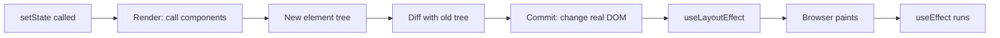

**How the diff decides (the two simple rules):**
- **Different type means new subtree.** If `<div>` becomes `<section>`, or `<UserCard>` becomes `<AdminCard>`, React throws away the old part and its state. It builds a new one.
- **Same type means update.** React keeps the DOM node and the component state. It only changes the props that differ.
- In lists, React matches old and new children by **key**.

**Keys, and why index keys break:**

A key tells React "this row is the same item as before". With `key={index}`, the key belongs to the *position*, not to the item.

```tsx
// Bad: key is the position. Add a todo at the top and every key shifts.
{todos.map((todo, i) => <TodoRow key={i} todo={todo} />)}

// Good: key is a stable id from the data.
{todos.map(todo => <TodoRow key={todo.id} todo={todo} />)}

function TodoRow({ todo }: { todo: { id: string; title: string } }) {
  const [note, setNote] = useState(""); // state is attached to the key, not to the todo
  return <li>{todo.title} <input value={note} onChange={e => setNote(e.target.value)} /></li>;
}
```

What goes wrong with index keys when you insert at the top:
- Old row 0 ("Buy milk") had the note "2 litres".
- A new todo "Pay rent" is added at index 0. It gets key `0`.
- React thinks key `0` is the same row. "Pay rent" now shows the note "2 litres".
- Inputs, focus, animations and checkbox state all go to the wrong row.

Index keys are fine only when the list never reorders, never filters, and rows have no state. Do not use `Math.random()` as a key. It makes a new key every render, so React remounts every row.

**Batching:**
- React groups several `setState` calls in one event into **one** render. This is *batching*.
- Since React 18 (with `createRoot`), batching works everywhere: in clicks, `setTimeout`, promises and native events. Before 18 it worked only inside React event handlers.
- State is a **snapshot** per render, so this surprises people:

```tsx
function Counter() {
  const [count, setCount] = useState(0);
  function addThree() {
    setCount(count + 1); // count is 0 here
    setCount(count + 1); // still 0
    setCount(count + 1); // still 0, result is 1
  }
  function addThreeRight() {
    setCount(c => c + 1); // updater gets the latest value
    setCount(c => c + 1);
    setCount(c => c + 1); // result is 3, still one render
  }
  return <button onClick={addThreeRight}>{count}</button>;
}
```

- If you really need the DOM updated right now (rare, for example before measuring scroll), use `flushSync` from `react-dom`.

**StrictMode double render (development only):**
- `<StrictMode>` makes React call component bodies and initializer functions (like the one in `useState(() => ...)`) **twice** in development.
- It also runs every effect as mount, then cleanup, then mount again. In React 19 it does the same for ref callbacks.
- Why: to find impure render code and missing cleanup early. If double render breaks your app, your render was not pure.
- In production nothing runs twice.
- "My API is called twice in dev" is this feature. Fix the effect with cleanup, or use a data library. Do not remove `StrictMode`.

**How React matches a list (the diff with keys):**
1. React makes a map of the old children: key → old fiber.
2. For each new child, it looks up the same key.
3. Same key and same type: React **keeps** the DOM node and the state. It only updates props. If the position changed, it moves the DOM node.
4. No old child with that key: React **creates** a new one.
5. Old children nobody asked for: React **deletes** them, and their state is gone.

Here "Pay rent" is added at the top of a list that has "Milk" and "Eggs":

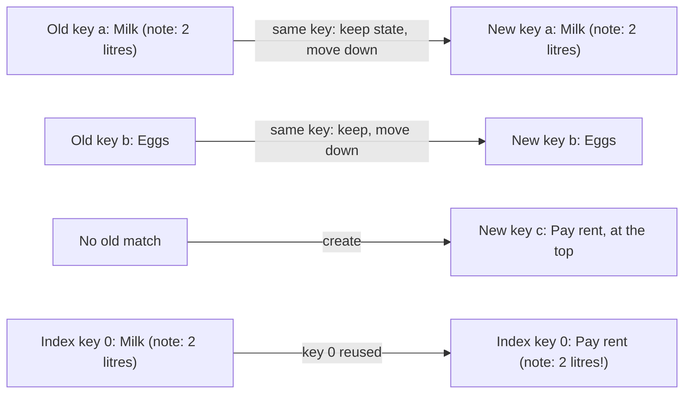

The top three rows use ids. The last row shows the index-key bug: the note stays with position 0, so it jumps to the wrong todo.

**Fiber: how React splits the work:**
- A *fiber* is a small JavaScript object for one component or one DOM element. It holds the type, key, props, the hook list (state) and links to its parent, first child and next sibling.
- React keeps **two trees**. The *current* tree is what is on screen. The *work-in-progress* tree is the next version being built. At commit, React swaps them. Game developers call this *double buffering*.
- Because work is cut into small pieces (one fiber at a time), React can **stop between pieces**. It cannot stop in the middle of your component function.
- Each update gets a *lane* (a priority). A click or a key press is urgent. A transition is not. Urgent lanes are rendered first.
- In concurrent mode (transitions, Suspense), React gives the main thread back to the browser about every 5 ms. The browser can then handle a key press. Normal urgent updates are not paused.
- If a newer update arrives, React can throw away the half-built tree and start again. That is why render must be pure.

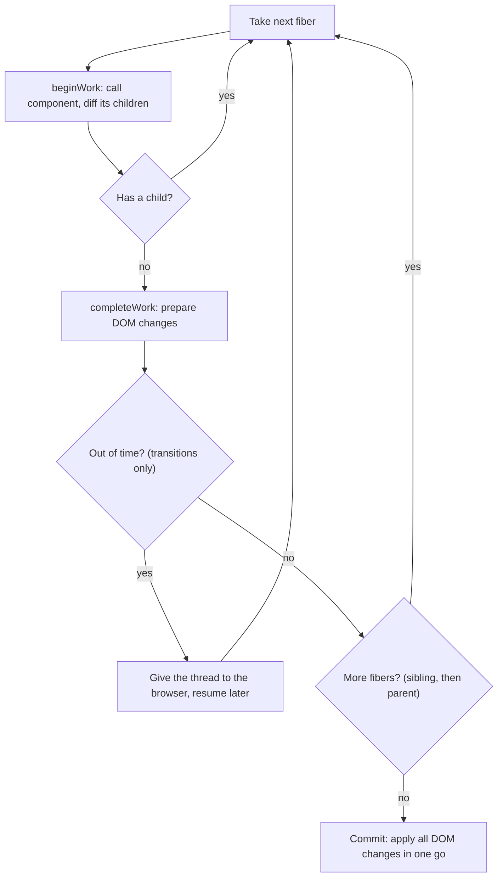

**Render phase vs commit phase:**

| | Render phase | Commit phase |
|---|---|---|
| What happens | Call components, diff, build the work-in-progress tree | Change the DOM, set refs, run layout effects |
| Can it pause or be thrown away? | Yes (in concurrent rendering) | No, it runs in one go |
| Can it run twice? | Yes (StrictMode, interrupted transitions) | No |
| Side effects allowed? | No, must be pure | Yes, this is where they belong |
| Class methods | `render`, `getDerivedStateFromProps`, `shouldComponentUpdate` | `componentDidMount`, `componentDidUpdate`, `getSnapshotBeforeUpdate` |
| Hooks | Component body, `useMemo`, `useState` initializer | `useLayoutEffect` (sync), then `useEffect` (after paint) |

The user never sees a half-updated page, because commit is never split.

**Good and bad:**

| Good | Bad |
|---|---|
| Stable ids as keys | `key={index}` on lists that change, `key={Math.random()}` |
| Pure render functions | API calls or `Date.now()` writes during render |
| Updater function when next state depends on the previous one | `setCount(count + 1)` three times and expecting +3 |
| Keep `StrictMode` on and fix what it shows | Removing `StrictMode` to "fix" double fetches |

**Say this in the interview:**

> "React works in two phases. In the render phase it calls my components and builds a new element tree. It diffs that tree with the old one using type and key. In the commit phase it applies only the differences to the real DOM, then runs effects. Render must be pure because React can repeat or throw it away. That is also why StrictMode renders twice in development."

**They may ask next:**
- **Is the virtual DOM faster than the real DOM?** Not by itself. It is extra work. It is a way to write UI as a function of state and still touch the DOM only where needed.
- **What happens if a component changes type at the same position?** React unmounts the old subtree, so its state is lost, and mounts a new one.
- **How can I reset a component's state on purpose?** Give it a different `key`. React treats it as a new component.
- **What is Fiber?** React's internal engine since React 16. Each component gets a fiber object. React walks the fibers one by one, so it can pause between them, give priority to urgent updates and throw away unfinished work.
- **Why does React keep two trees?** So it can build the next UI in the background without touching the screen. When the new tree is ready, commit swaps it in at once.
- **Is reconciliation O(n³)?** A perfect tree diff is about O(n³). React uses two shortcuts (same type means update, keys for lists), so its diff is about O(n).

## What causes a re-render

**In one line:** A component re-renders when its state changes, its parent renders, its context changes, or its external store changes.

**Story:** A school notice board.
- A class teacher changes the class timetable (state change). Every student in that class reads it again (children re-render).
- The principal changes a school-wide notice (context). Every class that follows that notice reads it again.
- The city announces a holiday on the radio (external store). Everyone who listens to that radio reacts.
- Reading the notice again does not mean the notice changed. Most of the time nothing new is written on the wall (no DOM update).

**How it works:**
1. **State update.** `setState` or `dispatch` with a new value. If the new value is the same (checked with `Object.is`), React can skip the render.
2. **Parent render.** When a parent renders, **all its children render too**, by default. It does not matter if their props changed.
3. **Context change.** Every component that calls `useContext(X)` (or `use(X)`) re-renders when the `value` of the nearest provider changes by `Object.is`. `React.memo` does not stop this.
4. **External store.** Libraries like Redux and Zustand use `useSyncExternalStore`. When the store changes and your selected value changes, the component re-renders.
5. **Props change by reference.** Props alone do not trigger a render. The parent render does. But for a child wrapped in `React.memo`, a new object or function prop (new reference) makes the memo check fail, so it renders.

**"Re-render does not mean DOM update":**
- A re-render is React calling your function and diffing the result.
- If the output is the same, the commit changes nothing in the DOM.
- So a re-render is usually cheap. It becomes a problem only when the component is expensive or there are thousands of them.

**Diagram:**

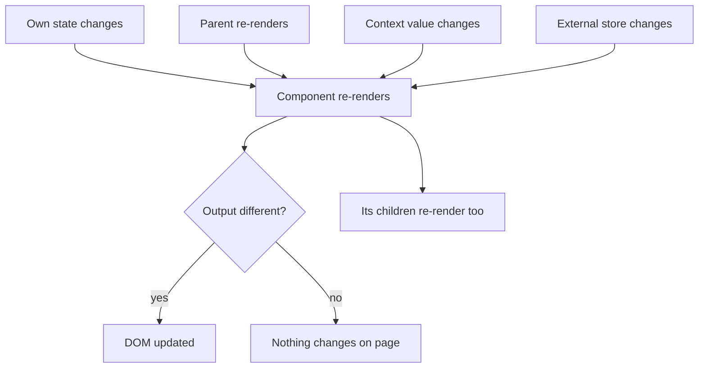

**Example:** a context that re-renders everyone by mistake.

```tsx
// Bad: a new object every render, so every consumer re-renders on any App render
function App() {
  const [user, setUser] = useState<User | null>(null);
  return <UserContext value={{ user, setUser }}><Page /></UserContext>;
}

// Better: same object until user changes
function App() {
  const [user, setUser] = useState<User | null>(null);
  const value = useMemo(() => ({ user, setUser }), [user]); // stable reference
  return <UserContext value={value}><Page /></UserContext>; // React 19: <Context> is the provider
}
```

Other common fixes:
- Split one big context into small ones (for example `ThemeContext` and `UserContext`).
- Put fast-changing values (mouse position, form text) in local state or a store with selectors, not in context.

**Good and bad:**

| Good | Bad |
|---|---|
| Keep state as close as possible to where it is used | All state at the top of the app, so every keystroke renders the whole page |
| Small contexts with stable values | One giant context with a new object each render |
| Store selectors: `useStore(s => s.cartCount)` | Subscribing to the whole store |
| Accept that most re-renders are cheap | Wrapping everything in `memo` "just in case" |

**Say this in the interview:**

> "Four things cause a re-render: a state update, a parent render, a context value change, and an external store update through useSyncExternalStore. Props changing alone is not a trigger, but new object or function props break React.memo. A re-render is not a DOM update. React diffs the result and often changes nothing. I only care about re-renders when the profiler shows they are slow."

**They may ask next:**
- **Does a child re-render if its props did not change?** Yes, if the parent rendered and the child is not wrapped in `memo`.
- **Why does `setState` with the same object not re-render, but a mutated object also does not re-render?** React compares with `Object.is`. A mutated object is still the same reference, so React thinks nothing changed. Always create a new object.
- **What is `useSyncExternalStore`?** A hook to read from a store outside React safely during concurrent rendering. It takes `subscribe` and `getSnapshot` functions.

## Hooks in depth

Hooks are functions that let a function component keep state, run side effects and reuse logic. Two rules: call them only at the top level of a component or custom hook, and only from React functions. The reason is in the [questions section](#react-questions-fundamentals-and-hooks).

### useState and useReducer

**In one line:** `useState` keeps one value between renders; `useReducer` keeps state that changes through named actions, with the logic in one pure function.

**Story:** `useState` is a light switch. You flip it directly. `useReducer` is a bank counter. You do not change your balance yourself. You hand in a slip ("deposit 500"), and the clerk applies the bank's rules.

**How it works:**
1. `const [value, setValue] = useState(initial)`. React stores the value outside your function, in the component's slot.
2. Each render sees a **snapshot**. Calling `setValue` does not change `value` in the current render. It schedules a new render.
3. Use an **updater** when the next value depends on the old one: `setCount(c => c + 1)`.
4. Use a **lazy initializer** for expensive first values: `useState(() => readFromStorage())`. The function runs only once.
5. Never mutate. `user.name = "A"; setUser(user)` does nothing, because the reference is the same.
6. `useReducer(reducer, initialState)` returns `[state, dispatch]`. The reducer is `(state, action) => newState`. It must be pure.

**Example:**

```tsx
type State = { items: Item[]; status: "idle" | "saving" | "error" };
type Action =
  | { type: "added"; item: Item }
  | { type: "saveStarted" }
  | { type: "saveFailed" };

function cartReducer(state: State, action: Action): State {
  switch (action.type) {
    case "added": return { ...state, items: [...state.items, action.item] }; // new array, no mutation
    case "saveStarted": return { ...state, status: "saving" };
    case "saveFailed": return { ...state, status: "error" };
  }
}

function Cart() {
  const [state, dispatch] = useReducer(cartReducer, { items: [], status: "idle" });
  return <button onClick={() => dispatch({ type: "added", item: newItem() })}>Add</button>;
}
```

**When to use which:**

| useState | useReducer |
|---|---|
| One or two independent values | Several values that change together |
| Simple updates (toggle, text) | Many kinds of updates ("added", "removed", "reset") |
| Logic is one line | Logic needs unit tests without rendering |

**Say this in the interview:**

> "useState is for simple independent values. When several fields change together, or there are many kinds of updates, I move to useReducer. The reducer is a pure function, so I can unit test it alone. In both cases state is a snapshot per render, so I use the updater form when the next value depends on the previous one."

**They may ask next:**
- **Is `useReducer` the same as Redux?** Same idea (actions and a reducer), but local to one component. No global store, no middleware, no devtools.
- **Why does `console.log(state)` after `setState` show the old value?** State is a snapshot. The new value appears in the next render.

### useEffect: syncing with outside systems

**In one line:** `useEffect` keeps your component in sync with something outside React, like a network connection, a browser API or a third-party widget.

**Story:** You rent a room in a hotel. When you check in (mount), you switch on the AC. When you change to another room (dependency change), you switch off the old AC and switch on the new one. When you check out (unmount), you switch it off. The cleanup is as important as the setup.

**How it works:**
1. `useEffect(setup, deps)`. React runs `setup` **after** the commit and paint.
2. `setup` can return a **cleanup** function.
3. When a value in `deps` changes, React runs the old cleanup, then the new setup.
4. On unmount, React runs the cleanup.
5. Every reactive value used inside (props, state, functions made in the component) must be in `deps`. The lint rule `react-hooks/exhaustive-deps` checks this.

**The owner's sample: what is wrong here?**

```tsx
function Profile({ userId }: { userId: string }) {
  const [user, setUser] = useState<User | null>(null);
  useEffect(() => {
    fetchUser(userId).then(setUser);
  }, []); // runs only once
  return <h1>{user?.name}</h1>;
}
```

Problems:
1. **Missing dependency.** `userId` is used but not in `[]`. If the user goes from profile 1 to profile 2, React keeps showing user 1. The lint rule warns about this.
2. **Race condition (stale response).** Add `userId` to deps and a new bug appears. The request for user 1 is slow, the request for user 2 is fast. User 2 arrives first, then user 1 overwrites it. The page shows the wrong person.
3. **No cleanup.** If the component unmounts, the request keeps running and still calls `setUser`. The network work is wasted.
4. **No loading or error state.** A failed request shows an empty title forever.
5. **Double fetch in development.** `StrictMode` runs the effect twice. Without cleanup you send two requests.
6. **No cache and no sharing.** Two components that need the same user send two requests. Coming back to the page fetches again.

**Diagram:** the race condition.

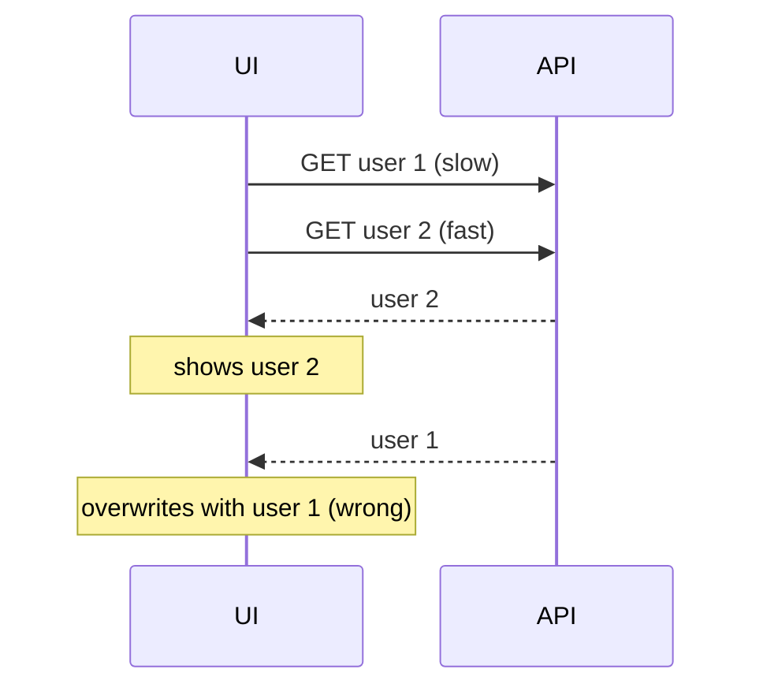

**Fixed version:**

```tsx
function Profile({ userId }: { userId: string }) {
  const [user, setUser] = useState<User | null>(null);
  const [error, setError] = useState<Error | null>(null);

  useEffect(() => {
    const controller = new AbortController();
    let ignore = false; // set to true when this effect is cleaned up
    setUser(null);
    setError(null);
    fetch(`/api/users/${userId}`, { signal: controller.signal })
      .then(res => { if (!res.ok) throw new Error(`HTTP ${res.status}`); return res.json(); })
      .then(data => { if (!ignore) setUser(data); }) // drop stale responses
      .catch(err => { if (!ignore && err.name !== "AbortError") setError(err); });
    return () => { ignore = true; controller.abort(); }; // cleanup: cancel and ignore
  }, [userId]); // re-run when userId changes

  if (error) return <p>Could not load user.</p>;
  if (!user) return <p>Loading…</p>;
  return <h1>{user.name}</h1>;
}
```

- `AbortController` cancels the old HTTP request. It saves network and server work.
- The `ignore` flag is a second guard. Some libraries cannot be aborted, and a response can arrive just before the abort.

**Why a data library is better:** this is 20 lines for one request, and it still has no cache, no retry and no sharing. In a real app use TanStack Query, SWR, RTK Query, or your framework's loader or Server Components.

```tsx
function Profile({ userId }: { userId: string }) {
  const { data: user, isPending, error } = useQuery({
    queryKey: ["user", userId], // cache key: same key means shared, de-duplicated request
    queryFn: ({ signal }) => fetch(`/api/users/${userId}`, { signal }).then(r => r.json()),
  });
  if (error) return <p>Could not load user.</p>;
  if (isPending) return <p>Loading…</p>;
  return <h1>{user.name}</h1>;
}
```

More in [Data fetching](#data-fetching-in-a-large-app).

**Good and bad:**

| Good | Bad |
|---|---|
| Every used value in deps; trust the lint rule | `// eslint-disable-next-line` to hide a missing dependency |
| Cleanup for every subscription, timer, listener and request | Setup without cleanup |
| Data library for server data | Hand-written fetch effects in every component |

**Say this in the interview:**

> "That effect has three bugs. userId is missing from the dependencies, so the profile never changes. If I add it, I get a race condition where an old slow response overwrites a new one. And there is no cleanup. I fix it with userId in deps, an AbortController and an ignore flag in the cleanup. In a real app I would not hand-write this. I would use TanStack Query or the framework's data loading, which gives caching, de-duplication and retries."

**They may ask next:**
- **Why not make the effect function `async`?** An effect must return nothing or a cleanup function. An async function returns a promise. Define an async function inside and call it.
- **Why did the request run twice in development?** `StrictMode` mounts, cleans up and mounts again to check your cleanup. It does not happen in production.
- **`useEffect` with no deps array vs `[]`?** No array: runs after every render. `[]`: runs after the first mount only (and twice in dev StrictMode).

### When NOT to use useEffect

**In one line:** If no outside system is involved, you probably do not need an effect.

**Story:** You do not phone your neighbour to tell him what you just told your wife. You tell her directly. Effects are for talking to the outside world (the neighbour), not for passing messages inside your own house.

**How it works:** for each case, ask "is this caused by rendering, or by a user action?" and "is there an outside system?"

| You want to... | Do not | Do instead |
|---|---|---|
| Compute a value from props or state | Effect that sets more state | Calculate it during render |
| Cache an expensive calculation | Effect plus state | `useMemo` |
| React to a button click | Effect watching a flag | Put the logic in the event handler |
| Update B when A changes, then C when B changes | Chain of effects | Compute all of it in one event handler |
| Reset state when a prop (like `userId`) changes | Effect that clears state | Pass `key={userId}` |
| Tell the parent about a change | Effect that calls `onChange` | Call `onChange` in the same handler |
| Fetch data | Hand-written fetch effect | Data library or framework |

**Examples, before and after:**

```tsx
// 1. Derived value. Before: extra state, extra render, a moment of wrong data.
const [fullName, setFullName] = useState("");
useEffect(() => setFullName(`${first} ${last}`), [first, last]);
// After: just calculate it.
const fullName = `${first} ${last}`;

// 2. Event logic. Before: POST runs because a flag changed.
useEffect(() => { if (submitted) post("/api/orders", order); }, [submitted, order]);
// After: POST runs because the user clicked.
function handleSubmit() { post("/api/orders", order); }

// 3. Reset all state when the user changes. Before: effect clears each field.
useEffect(() => { setComment(""); setRating(0); }, [userId]);
// After: a new key makes React mount a fresh component.
<ProfileForm key={userId} userId={userId} />
```

```tsx
// 4. Notify the parent. Before: render, then effect, then parent renders again.
function Toggle({ onChange }: { onChange: (on: boolean) => void }) {
  const [on, setOn] = useState(false);
  useEffect(() => { onChange(on); }, [on, onChange]); // bad: extra pass, runs on mount too
  return <button onClick={() => setOn(!on)}>{on ? "On" : "Off"}</button>;
}
// After: update both in the same event.
function Toggle({ onChange }: { onChange: (on: boolean) => void }) {
  const [on, setOn] = useState(false);
  function toggle() { const next = !on; setOn(next); onChange(next); } // one render
  return <button onClick={toggle}>{on ? "On" : "Off"}</button>;
}
```

**Effect chains:** a "card game" where effect 1 sets `goldCount` when `card` changes, effect 2 sets `round` when `goldCount` changes, and so on. Each step is a new render. It is slow and hard to follow. Compute the next card, gold and round together in the click handler.

**When an effect is right:**
- Subscribing to `window` events, WebSocket, `IntersectionObserver`.
- Connecting a non-React widget (a map, a chart library).
- Sending an analytics "page viewed" event because the page was shown.
- Syncing with `document.title` (or use React 19 `<title>`).

**Say this in the interview:**

> "Effects are an escape hatch for syncing with outside systems. I do not use them for derived values, which I calculate during render, or for user actions, which belong in event handlers. I avoid chains of effects, and I reset state with a key instead of an effect. Fewer effects means fewer extra renders and fewer bugs."

**They may ask next:**
- **How do you handle an expensive derived value?** Calculate it during render and wrap it in `useMemo` only if the profiler shows it is slow.
- **How do you adjust only part of the state when a prop changes?** Usually you can store an id instead and derive the rest. As a last resort, React allows setting state during render with a guard (`if (prev !== items) { setPrev(items); setSelection(null); }`).

### Stale closures

**In one line:** A stale closure is a function that still sees old state or props from the render in which it was created.

**Story:** You take a photo of the scoreboard at the start of a cricket match. Two hours later you look at the photo and say "the score is 0". The photo is not wrong. It is old. A closure is that photo.

**How it works:**
1. A *closure* is a function that remembers the variables around it when it was created.
2. Every render creates new variables (`count` in render 1 is a different constant from `count` in render 2).
3. If a timer, listener or callback was created in render 1 and never replaced, it keeps reading render 1's values.
4. The usual cause is an effect with missing dependencies.

**Plain JavaScript first** (checked with Node 24):

```js
// Each "render" gets its own count constant, like React does.
function render(count) {
  return () => console.log("tick sees", count); // remembers this render's count
}
const firstTick = render(0); // interval created in the first render
render(1);
render(2);                   // later renders make new functions
firstTick();                 // tick sees 0   <- stale
```

**React example:**

```tsx
function Timer() {
  const [count, setCount] = useState(0);
  useEffect(() => {
    const id = setInterval(() => {
      setCount(count + 1); // count is always 0 here, from the first render
    }, 1000);
    return () => clearInterval(id);
  }, []); // the interval is never re-created
  return <p>{count}</p>; // shows 1 forever
}
```

**Fixes (pick the simplest):**

```tsx
// Fix 1: functional update. No need to read count at all.
setCount(c => c + 1);

// Fix 2: correct deps. The interval is re-created each time count changes.
useEffect(() => {
  const id = setInterval(() => setCount(count + 1), 1000);
  return () => clearInterval(id);
}, [count]);

// Fix 3: a ref that always holds the latest value.
const countRef = useRef(count);
countRef.current = count; // ok in simple cases; better to update it in an effect
// inside the interval: console.log(countRef.current)
```

**Fix 4: `useEffectEvent`** (stable since React 19.2, October 2025). Use it when an effect must *read* the latest value but must *not re-run* when that value changes.

```tsx
function ChatRoom({ roomId, theme }: { roomId: string; theme: string }) {
  const onConnected = useEffectEvent(() => {
    showToast("Connected!", theme); // always reads the latest theme
  });
  useEffect(() => {
    const conn = createConnection(roomId);
    conn.on("connected", onConnected);
    conn.connect();
    return () => conn.disconnect();
  }, [roomId]); // theme change does not reconnect; onConnected is not a dependency
}
```

Rules for `useEffectEvent`:
- Call the returned function only from inside effects (or other effect events). Not during render.
- Do not pass it to child components or other hooks.
- Do not use it just to silence the lint rule. Only for logic that is really an "event" fired from an effect.
- Use `eslint-plugin-react-hooks` version 6 or newer, which understands it.

**Good and bad:**

| Good | Bad |
|---|---|
| Functional updates for counters and toggles | Empty deps to "run once" while reading state |
| `useEffectEvent` for "read latest, do not re-subscribe" | Disabling the lint rule |
| Refs for values that should not cause renders | Reading `ref.current` in render to show UI |

**Say this in the interview:**

> "A stale closure is a callback that still sees values from an old render. The classic case is setInterval in an effect with empty deps: it always sees count as 0. I fix it with a functional update, correct dependencies, a ref, or useEffectEvent in React 19.2 when the effect must read the latest value without re-running."

**They may ask next:**
- **Can stale closures happen outside effects?** Yes. A `useCallback` with missing deps, or a handler stored in a ref or an outside library, can see old values.
- **Does the React Compiler fix stale closures?** No. It memoizes based on correct dependencies. It does not change what a closure sees.

### useRef, useMemo, useCallback, custom hooks

**In one line:** `useRef` keeps a value without causing renders, `useMemo`/`useCallback` cache a value or function, and custom hooks share logic.

**Story:** `useRef` is your pocket notebook. You can write in it any time, and nobody is told. `useState` is the class notice board. When you change it, everyone reads it again (re-render). `useMemo` is keeping yesterday's answer sheet: if the question is the same, you do not solve it again.

**How it works:**

| Hook | Returns | Causes re-render on change? | Typical use |
|---|---|---|---|
| `useRef(init)` | `{ current }`, same object every render | No | DOM node, timer id, previous value, latest callback |
| `useMemo(fn, deps)` | Result of `fn` | It is a cache, not state | Expensive calculation, stable object for memo child or deps |
| `useCallback(fn, deps)` | `fn` itself | It is a cache | Stable function for a `memo` child or effect deps |

- `useCallback(fn, deps)` is the same as `useMemo(() => fn, deps)`.
- Do not read or write `ref.current` during render (except a one-time lazy setup). The UI will not update and the compiler cannot reason about it.
- `useMemo` is a performance hint. React may throw the cache away. Your code must still work without it.
- **Custom hooks** share *logic*, not *state*. Two components calling `useDebouncedValue` each get their own state. The name must start with `use` so the lint rules check it.

**Example:** a custom hook with a ref and cleanup.

```tsx
export function useDebouncedValue<T>(value: T, delayMs = 300): T {
  const [debounced, setDebounced] = useState(value);
  useEffect(() => {
    const id = setTimeout(() => setDebounced(value), delayMs);
    return () => clearTimeout(id); // cancel if value changes before delay ends
  }, [value, delayMs]);
  return debounced;
}

function SearchBox() {
  const inputRef = useRef<HTMLInputElement>(null); // DOM ref, no re-render
  const [text, setText] = useState("");
  const query = useDebouncedValue(text, 300);       // API is called with this, not every key
  const { data } = useQuery({ queryKey: ["search", query], queryFn: () => search(query) });
  return <input ref={inputRef} value={text} onChange={e => setText(e.target.value)} />;
}
```

**Good and bad:**

| Good | Bad |
|---|---|
| Refs for timer ids, DOM nodes, latest callback | Refs to store data shown on screen |
| Custom hook per concern: `useOnlineStatus`, `useDebouncedValue` | One `useEverything` hook that returns 15 things |
| `useCallback` when the function goes to a `memo` child or effect deps | `useCallback` on every handler "for performance" |

**Say this in the interview:**

> "useRef holds a mutable value that survives renders and does not cause one, like a timer id or a DOM node. useMemo caches a calculated value and useCallback caches a function. I use them when a memo child or an effect dependency needs a stable reference, or when the profiler shows a slow calculation. Custom hooks let me share logic like debouncing, but each caller gets its own state."

**They may ask next:**
- **How do you keep the previous value of a prop?** Store it in a ref inside an effect, or keep it in state and compare during render.
- **Can a custom hook share state between components?** Not by itself. For shared state, use context, a store, or a server cache like TanStack Query.

## Performance: measure first

**In one line:** Find the real slow part with tools before you change any code, then fix only that.

**Story:** A patient says "my stomach hurts". A good doctor does not give surgery first. He checks temperature, does a blood test, then treats the real cause. `useMemo` everywhere is surgery without a test.

**How it works:** the owner's sample question is "a page becomes slow when typing into a search box. How would you investigate?" A senior answer is a process, not a hook name.

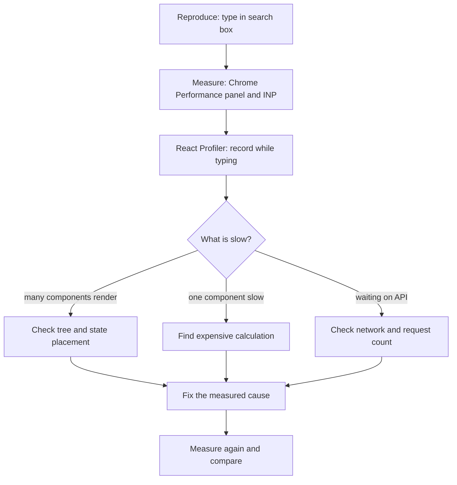

Steps in words:
1. **Reproduce** on a realistic machine. Use CPU throttling (4x or 6x slower) in Chrome DevTools. Use real data sizes.
2. **Measure.** Chrome Performance panel: record while typing. Look for long tasks (over 50 ms) on the main thread. Check *INP* (Interaction to Next Paint, a Core Web Vital: the delay from a key press to the next frame). Good INP is 200 ms or less.
3. **React DevTools Profiler.** Record while typing. The *flamegraph* shows which components rendered and how long each took. The *ranked* view lists the slowest first. Turn on "Record why each component rendered while profiling".
4. **Find unnecessary renders.** Does the whole page render on each key press? Does a big table render even though only the input changed? Turn on "Highlight updates when components render" to see it live.
5. **Understand the component tree.** Where does the search state live? If it lives in the page root, the whole page renders on every key.
6. **Expensive calculations.** Is there a filter, sort or format over thousands of items during each render?
7. **State placement.** Can the state move down into the search box component? Can the slow part be passed as `children` so it does not re-render?
8. **Network.** Is there one API call per key press? Are responses arriving out of order? Is the server slow?
9. **Fix only what was measured.** Then measure again with the same steps and compare numbers.

**Tools:**

| Tool | What it tells you |
|---|---|
| React DevTools Profiler | Which components rendered, why, and how long |
| React DevTools "Highlight updates" | Live outline of every re-render |
| Chrome Performance panel | Long tasks, scripting vs layout vs paint time. From React 19.2 it has React tracks (Scheduler and Components) in development and profiling builds |
| Lighthouse and the `web-vitals` library | INP, LCP (main content load time), CLS (layout jumps), from lab tests and real users |
| `why-did-you-render` (optional) | Logs re-renders caused by equal but new props. Check it supports your React version |
| React Scan (optional) | Draws boxes on components that re-render. Quick visual check |

Tips:
- Development mode is much slower than production. For real numbers, profile a production build with profiling enabled (`react-dom/profiling`), or confirm in production with real-user monitoring.
- Measure in milliseconds. "It feels faster" is not proof.

**Good and bad:**

| Good | Bad |
|---|---|
| Profile, find the cause, fix it, profile again | Add `useMemo` and `memo` everywhere first |
| Test on a slow CPU with real data size | Test on a new MacBook with 20 rows |
| Track INP in production | Only look at dev mode numbers |

**Say this in the interview:**

> "I would not start with useMemo. First I reproduce it with CPU throttling and record in the Chrome Performance panel to see long tasks and INP. Then I use the React Profiler to see which components render on each key press and why. Then I check where the search state lives, whether there is an expensive calculation, and whether every key fires an API call. I fix only the measured cause and measure again."

**They may ask next:**
- **What is a long task?** Any main-thread work over 50 ms. During it the browser cannot respond to input.
- **What if the profiler shows React is fast but the page is still slow?** Look at the Performance panel for layout, paint, big CSS, third-party scripts, or garbage collection.

## React.memo, useMemo and useCallback: when they help

**In one line:** Memoization skips work when inputs are the same, but it has a cost, so it helps only for expensive work with stable inputs.

**Story:** A tailor keeps your measurements on a card. Next time, if your size is the same, he skips measuring. That saves time for a full suit. For a handkerchief, finding your card takes longer than measuring again.

**How it works:**
- `React.memo(Component)` skips a child's render when every prop is equal to last time. This is a *shallow compare*: each prop is checked with `Object.is`, one level deep.
- It **helps** when:
  1. The child is expensive to render (big list, chart, heavy table), and
  2. The parent re-renders often, and
  3. The child's props really stay the same.
- It **does not help** when:
  - A prop is a new object, array or function each render (`style={{}}`, `onClick={() => ...}`, `items={list.filter(...)}`).
  - The child gets `children` JSX. JSX creates new objects every render, so the props always differ.
  - The child reads a context that changed. Context bypasses `memo`.
  - The child is cheap. The compare costs about the same as the render.
- `useMemo` and `useCallback` exist mostly to make those props stable.

**Can useMemo make the app slower? Yes.**
- Every render, React still compares the dependency array.
- The first render does extra work: run the function and store the result.
- The cached value stays in memory.
- For cheap work (`a + b`, `items.length`, a filter of 50 items), this costs more than it saves.
- Wrong dependencies give **stale data bugs**, which are worse than slow code.
- It adds code noise and makes reviews harder.
- react.dev's rule of thumb: measure the calculation with `console.time`. If it takes about 1 ms or more on a slow device, memoizing can make sense.

**Fix the structure first. These often remove the need for memo:**

```tsx
// Before: typing in the box re-renders <SlowChart /> on every key.
function Page() {
  const [text, setText] = useState("");
  return <><input value={text} onChange={e => setText(e.target.value)} /><SlowChart /></>;
}

// After, option 1: move state down. Only SearchInput re-renders.
function Page() {
  return <><SearchInput /><SlowChart /></>;
}

// After, option 2: lift content up. children was created by the parent, so it is not re-rendered.
function Layout({ children }: { children: React.ReactNode }) {
  const [text, setText] = useState("");
  return <><input value={text} onChange={e => setText(e.target.value)} />{children}</>;
}
// <Layout><SlowChart /></Layout>
```

**When memo is right, make props stable too:**

```tsx
const Row = memo(function Row({ user, onSelect }: { user: User; onSelect: (id: string) => void }) {
  return <li onClick={() => onSelect(user.id)}>{user.name}</li>;
});

function Users({ users }: { users: User[] }) {
  const [selected, setSelected] = useState<string | null>(null);
  const onSelect = useCallback((id: string) => setSelected(id), []); // same function every render
  return <ul>{users.map(u => <Row key={u.id} user={u} onSelect={onSelect} />)}</ul>;
}
```

**React Compiler:**
- **Status:** React Compiler 1.0 is stable since October 7, 2025. The npm package `babel-plugin-react-compiler` is at 1.0.0 (checked Nov 2026).
- **What it is:** a build-time tool (mainly a Babel plugin, also used by Vite, Metro, Rsbuild and Next.js). It reads your components and adds memoization for you, at a finer level than you would by hand.
- **What it changes:**
  - Most manual `memo`, `useMemo` and `useCallback` become unnecessary in new code.
  - It even handles cases that are hard by hand, like `() => handleClick(item)` inside a list.
  - Keep `useMemo`/`useCallback` as an escape hatch, for example a value used as an effect dependency.
  - Keep existing manual memoization in old code. Removing it can change the output, so test before you remove it.
- **What it needs:** code that follows the *Rules of React* (pure render, no mutation of props or state, hooks at top level). It skips components that break the rules. The lint rules in `eslint-plugin-react-hooks` v6+ (the `recommended` preset) report those problems.
- **Opt out:** the `"use no memo"` directive at the top of a component or file.
- **Versions:** works best with React 19. React 17 and 18 are supported with an extra runtime package.
- **Next.js 16:** compiler support is stable, but **not on by default**. You enable it with `reactCompiler: true`.
- **What it does not fix:** slow algorithms, rendering 50,000 DOM nodes, too many API calls, large bundles. You still need virtualization and good state design.

**Good and bad:**

| Good | Bad |
|---|---|
| Move state down or pass `children` before reaching for memo | `memo` on every component |
| `memo` + stable props for expensive, often re-rendered children | `memo` on a child that gets a new inline object every render |
| Let the React Compiler memoize new code | Removing old `useMemo` calls without tests after turning on the compiler |
| `useMemo` for calculations that measure 1 ms or more | `useMemo(() => a + b, [a, b])` |

**Say this in the interview:**

> "React.memo helps only when a child is expensive, the parent re-renders often, and the props really stay the same. Inline objects, inline functions and children JSX break it. useMemo can make things slower, because it costs a compare and memory every render, and wrong deps cause stale bugs. I first try moving state down or passing children. In new projects I turn on the React Compiler, which is stable since October 2025, and it does most of the memoization for me."

**They may ask next:**
- **Does `memo` do a deep compare?** No. Shallow, one level, with `Object.is`. You can pass a custom compare function, but it is easy to get wrong.
- **With the compiler on, should I still know these hooks?** Yes. You debug compiled code, read old code, and some cases still need manual control.

## Debugging: 50,000 users and slow typing

**In one line:** Profile first; usually the fix is to render fewer rows (virtualization) and to make the list update less urgent than the input.

**Story:** A shop owner rewrites the whole price list of 50,000 items each time a customer says one letter. The customer only sees one page of the list at a time. Write only the visible page, and let the customer keep talking while you write.

**The code (from the owner's sample):**

```jsx
function UserList({ users }) {
  const [search, setSearch] = useState("");
  const filteredUsers = users.filter(user =>
    user.name.toLowerCase().includes(search.toLowerCase()));
  return (<>
    <input value={search} onChange={e => setSearch(e.target.value)} />
    {filteredUsers.map(user => <UserRow key={user.id} user={user} />)}
  </>);
}
```

**What happens on each key press:**
1. `setSearch` triggers a render of `UserList`.
2. The filter runs over 50,000 users. It calls `toLowerCase` 50,000 times. Often 5–20 ms on a slow phone.
3. React renders up to 50,000 `UserRow` components and diffs them. This is usually the **biggest** cost: often hundreds of ms.
4. The DOM holds up to 50,000 rows. Layout and paint get slow, and memory is high.
5. The input is controlled, so the typed letter appears only after all of this. Typing lags.

**Step 1: profile, do not guess.**
- React Profiler: record typing "ann". How long does `UserList` take? How many `UserRow` renders?
- Performance panel: is the long task in scripting (React render, filter) or in layout and paint (too many DOM nodes)?
- Quick experiment: comment out the rows and render only the count. If typing becomes fast, the rows are the problem, not the filter.

**Step 2: pick the option that matches the finding.**

| Option | What it fixes | When it fits | Trade-off |
|---|---|---|---|
| `useDeferredValue` or `useTransition` | Input stays responsive; the list updates in the background and can be interrupted | Render is slow but the data is on the client | Does not reduce total work. The list lags a little |
| Debounce (for example 250 ms) | Fewer filters and fewer API calls | Search hits the server, or filtering is expensive | Results feel delayed even on fast devices |
| Virtualization (react-window v2, TanStack Virtual) | Renders only about 20–30 visible rows instead of 50,000 | Long lists. Almost always needed here | Fixed or measured row heights; Ctrl+F in the browser cannot find hidden rows; extra accessibility care |
| `React.memo` on rows + stable props | Rows that did not change skip rendering | Rows are expensive and many stay the same | Useless if props are new objects each time. Less needed with the React Compiler |
| Pre-compute lowercase names once | Cheaper filter | Filter itself shows up in the profile | Small memory cost |
| Server-side filtering + pagination | The browser never holds 50,000 users | Data is big or grows; needs auth or fresh data | Network latency, loading states, an API to build |
| Web Worker | Moves heavy work off the main thread | Truly heavy work: fuzzy search, ranking, over 100k items | Copying data to the worker costs time; more code |

**Step 3: improved code (client-side data).**

```tsx
import { memo, useDeferredValue, useMemo, useState } from "react";
import { List, type RowComponentProps } from "react-window"; // v2 API
type User = { id: string; name: string };
export function UserList({ users }: { users: User[] }) {
  const [search, setSearch] = useState("");
  const deferredSearch = useDeferredValue(search); // input updates now, list a bit later
  const lowered = useMemo(() => users.map(u => ({ user: u, key: u.name.toLowerCase() })), [users]); // lowercase once
  const filtered = useMemo(() => {
    const q = deferredSearch.trim().toLowerCase();
    return q ? lowered.filter(x => x.key.includes(q)).map(x => x.user) : users;
  }, [lowered, users, deferredSearch]);
  const isStale = search !== deferredSearch;
  return (<>
    <input value={search} onChange={e => setSearch(e.target.value)} aria-label="Search users" />
    <div style={{ height: 600, opacity: isStale ? 0.6 : 1 }}>
      <List rowComponent={UserRow} rowCount={filtered.length} rowHeight={40} rowProps={{ users: filtered }} />
    </div>
  </>);
}

const UserRow = memo(function UserRow({ index, style, ariaAttributes, users }: RowComponentProps<{ users: User[] }>) {
  return <div style={style} {...ariaAttributes}>{users[index].name}</div>; // only visible rows render
});
```

What changed:
- **Virtualization:** about 15 rows are in the DOM, not 50,000. This is the biggest win.
- **`useDeferredValue`:** the letter appears in the input at once. React renders the list with the new text in the background, and drops that work if you type again.
- **`useMemo` on filter:** the filter does not re-run when the component renders for another reason.
- **Lowercase once:** the filter does less work per key.
- **Dimmed list while stale:** the user sees that results are updating.

**If the data is large or grows:** do not send 50,000 users to the browser. Debounce the text (about 250–300 ms) and call `GET /api/users?q=ann&page=0&size=50`. Use TanStack Query with `placeholderData: keepPreviousData` so old results stay while new ones load. Paginate or use infinite scroll with virtualization. See [Data fetching](#data-fetching-in-a-large-app).

**How do you decide which optimization is needed?**

| Profiler shows | First fix |
|---|---|
| Thousands of row renders, long commit, many DOM nodes | Virtualization |
| Input lags, but each render is "only" 50–100 ms | `useDeferredValue` or `useTransition` |
| Filter or sort function itself is slow | Pre-compute, `useMemo`, better algorithm; Web Worker if still slow |
| Rows re-render with the same data | `React.memo` + stable props, or React Compiler |
| One API call per key press, responses out of order | Debounce + data library that cancels old requests |
| Payload is many MB, first load slow | Server-side filtering and pagination |

**Say this in the interview:**

> "First I profile. I expect most of the cost is rendering 50,000 rows, not the filter, and I can prove that by rendering only the count. So the first fix is virtualization. Then I use useDeferredValue so the input stays responsive while the list catches up. If the filter itself shows up, I pre-compute lowercase names and memoize. If the data keeps growing, I move filtering to the server with debounce and pagination. I pick by what the profiler shows and measure again after each change."

**They may ask next:**
- **Debounce or `useDeferredValue`?** Debounce waits a fixed time and saves API calls. `useDeferredValue` starts at once, adapts to device speed, and is interruptible, but saves no network calls. For a server search, debounce. For a client filter, deferred value.
- **What breaks with virtualization?** Browser find (Ctrl+F), scroll restoration, variable row heights, screen readers (use `aria-setsize`/`aria-posinset`, which react-window v2 passes as `ariaAttributes`).

## Concurrent React: transitions and Suspense

**In one line:** Concurrent React lets urgent updates like typing interrupt slow rendering, and Suspense shows a fallback while part of the UI waits.

**Story:** A bank has one cashier. A customer is counting a big bag of coins (slow, not urgent). Someone comes with a quick urgent question. A good cashier pauses the coins, answers the question, then continues counting. If the coin customer changes his mind, the cashier drops the old count and starts the new one.

**How it works:**
1. Normal `setState` is **urgent**. React renders it at once and does not stop.
2. A **transition** marks an update as **non-urgent**. React renders it in the background and can pause or drop it if an urgent update comes.
3. During a transition, React keeps showing the **old UI** instead of a loading spinner. `isPending` tells you it is working.
4. **`useTransition`** when you own the `setState` call.
5. **`useDeferredValue`** when you only receive the value (for example a prop or the input text). React renders with the old value first, then tries the new value in the background.
6. Transitions do not make the work smaller. They make the page responsive while the work happens.
7. Do not put the input's own state in a transition. The input must update urgently, or typing feels broken.

```tsx
function Tabs() {
  const [tab, setTab] = useState("home");
  const [isPending, startTransition] = useTransition();
  function select(next: string) {
    startTransition(() => setTab(next)); // slow tab render can be interrupted by another click
  }
  return (<>
    <TabButtons onSelect={select} dim={isPending} />
    <Suspense fallback={<Spinner />}>
      {tab === "reports" ? <Reports /> : <Home />} {/* Reports may suspend while loading */}
    </Suspense>
  </>);
}
```

**Suspense:**
- `<Suspense fallback={...}>` shows the fallback while a child is not ready.
- A child "suspends" when it waits for:
  - lazy code (`React.lazy`),
  - data read with `use(promise)`,
  - a Suspense-enabled library (`useSuspenseQuery` in TanStack Query),
  - a framework (Next.js Server Components).
- Plain `useEffect` + `fetch` does **not** trigger Suspense.
- Put boundaries where a loading state makes sense to the user: one per widget or section, not one per tiny component.
- Nested boundaries reveal parts step by step: page shell first, then sidebar, then the slow table.
- If the update that suspended was a transition, React keeps the old content visible instead of falling back to the spinner again.

**Streaming SSR:**
- On the server, React sends the HTML shell first. Each Suspense boundary that is still loading sends its fallback.
- When a boundary's data is ready, the server sends its HTML in the same response. A small script puts it in place.
- *Hydration* means React attaches event handlers to the server HTML so it becomes interactive.
- *Selective hydration:* React makes parts interactive in the order the user needs them. A part the user clicks gets hydrated first.
- In Next.js this comes with Server Components and `loading.tsx`. See [Next.js architecture and Server Components](nextjs.md#nextjs-architecture-and-server-components).

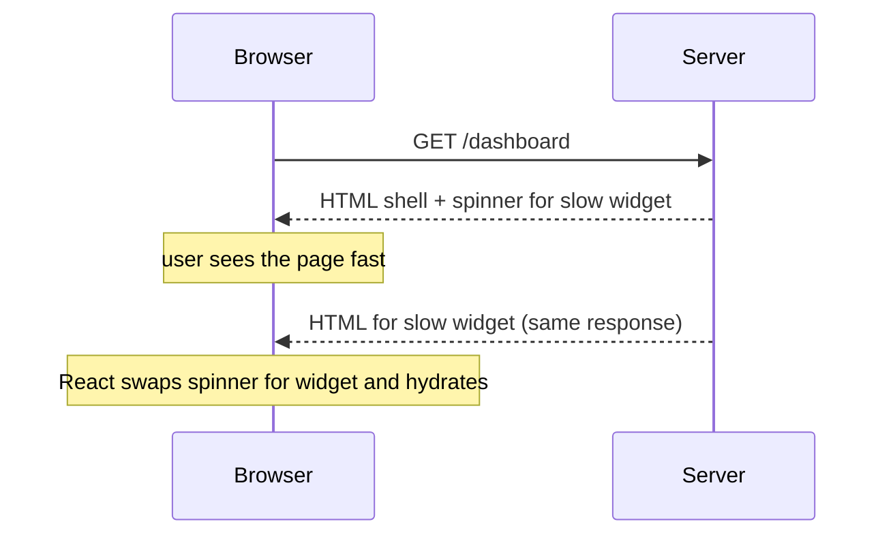

**Good and bad:**

| Good | Bad |
|---|---|
| Transition for navigation, tab switch, filters | Wrapping the input value update in a transition |
| Suspense boundaries at meaningful sections | One boundary around the whole app (whole page flashes a spinner) |
| `useDeferredValue` for slow lists driven by input | Expecting transitions to reduce CPU work |

**Say this in the interview:**

> "Concurrent rendering lets React pause non-urgent work. I mark slow updates like tab switches with useTransition, or use useDeferredValue when I only get the value. The input stays fast and the heavy part catches up. Suspense shows a fallback while a part waits for code or data, and on the server it lets React stream HTML part by part. In Next.js that comes with Server Components."

**They may ask next:**
- **Can I put an async function in `startTransition`?** Yes, since React 19. It is called an Action. `isPending` stays true until it finishes.
- **What does `useDeferredValue(value, initialValue)` do?** Since React 19, the optional second argument is used for the first render, which helps with SSR.

## React 19 features

**In one line:** React 19 added Actions for async work, new hooks for forms and optimistic UI, and removed boilerplate like `forwardRef`.

**Story:** Before, every restaurant waiter carried his own notebook to track "order sent, waiting, failed, retry". React 19 gives every waiter the same printed order form with those boxes already on it.

**Versions (checked on react.dev and npm, Nov 2026):**

| Version | Date | Main additions |
|---|---|---|
| 19.0 | Dec 2024 | Actions, `useActionState`, `useOptimistic`, `useFormStatus`, `use`, ref as prop, `<Context>` as provider, document metadata, Server Components and Server Functions stable |
| 19.1 | Mar 2025 | Owner Stacks (development: shows which component created the broken one), Suspense fixes |
| 19.2 | Oct 2025 | `<Activity>`, `useEffectEvent`, `cacheSignal` (Server Components only), React Performance tracks in Chrome DevTools, Partial Pre-rendering APIs, `useId` prefix changed to `_r_` |
| 19.3 | Sep 2026 | `<ViewTransition>` and Fragment refs become stable, `addTransitionType`, `browser()` from `react-dom`, Trusted Types support |

Latest on npm is 19.3.1. Features you see in react.dev "Canary" or "Experimental" docs are **not** stable. Use them only through a framework that pins the version.

**The main features:**

- **Actions.** A function passed to `startTransition`, or to `<form action={fn}>`, can be `async`. React tracks pending state, errors and form reset for you.
- **`useActionState(action, initialState)`** returns `[state, formAction, isPending]`. Good for forms that return a result or error message.
- **`useFormStatus()`** (from `react-dom`) lets a child, like a submit button, read whether its parent `<form>` is submitting. No prop drilling.
- **`useOptimistic(state, updateFn)`** shows the expected result at once (for example a "liked" heart) and rolls back automatically if the action fails.
- **`use(resource)`** reads a promise (suspends until resolved) or a context. Unlike other hooks, it can be called inside `if`. The promise must be stable: create it in a Server Component, a cache or a library, not fresh inside the render.
- **ref as a prop.** Function components receive `ref` like any prop. `forwardRef` is no longer needed and will be deprecated later. Ref callbacks can return a cleanup function.
- **`<Context value={...}>`** works as the provider. `<Context.Provider>` still works.
- **Document metadata.** `<title>`, `<meta>` and `<link>` inside any component are moved into `<head>`. Stylesheets with `precedence` and async scripts are de-duplicated. `preload`, `preinit`, `preconnect` APIs help load resources early.
- **Server Components and Server Functions** (functions marked `"use server"`, earlier called Server Actions) are stable for frameworks like Next.js. See [nextjs.md](nextjs.md#nextjs-architecture-and-server-components).
- **Better errors.** One clear hydration mismatch message with a diff. Root options `onCaughtError`, `onUncaughtError`, `onRecoverableError`.
- **`<Activity mode="visible" | "hidden">`** (19.2) hides a part of the UI but keeps its state. Effects are cleaned up while hidden, and updates wait until React is idle. Use it for tabs, or to pre-render the next page. Before, you had to choose: unmount (state lost) or keep it rendered (slow).
- **`useEffectEvent`** (19.2): see [Stale closures](#stale-closures).
- **`<ViewTransition>`** (stable in 19.3) animates elements when they enter, leave or change, using the browser View Transition API. It animates only for transitions, Suspense reveals and deferred values, not urgent updates.

**Example:** a form with `useActionState` and `useFormStatus`.

```tsx
import { useActionState } from "react";
import { useFormStatus } from "react-dom";

async function saveName(prev: { error?: string }, formData: FormData) {
  const name = String(formData.get("name") ?? "");
  if (name.length < 2) return { error: "Name is too short" };
  const res = await fetch("/api/profile", { method: "PUT", body: JSON.stringify({ name }) });
  return res.ok ? {} : { error: "Could not save" };
}

function SubmitButton() {
  const { pending } = useFormStatus(); // reads the parent <form>, no props
  return <button disabled={pending}>{pending ? "Saving…" : "Save"}</button>;
}

export function ProfileForm() {
  const [state, formAction] = useActionState(saveName, {});
  return (
    <form action={formAction}> {/* React runs the action in a transition */}
      <input name="name" />
      <SubmitButton />
      {state.error && <p role="alert">{state.error}</p>}
    </form>
  );
}
```

**Good and bad:**

| Good | Bad |
|---|---|
| `useActionState` for form result and errors | Three `useState` calls for pending, error and data in every form |
| `useOptimistic` for likes, toggles, chat messages | Optimistic UI without a rollback on error |
| `ref` as a normal prop in new components | Adding new `forwardRef` wrappers |
| Stable features in production | Canary or experimental APIs without a framework |

**Say this in the interview:**

> "React 19 is about Actions: async functions in transitions and form actions, with pending state and errors handled for me. On top of that come useActionState for form results, useFormStatus for submit buttons, useOptimistic for instant feedback, and use for reading promises and context. It also removed boilerplate: ref is a normal prop and Context is its own provider. 19.2 added Activity and useEffectEvent, and 19.3 made ViewTransition stable."

**They may ask next:**
- **`useActionState` vs TanStack Query `useMutation`?** `useActionState` is built in and works with progressive enhancement and Server Functions. `useMutation` gives cache invalidation, retries and devtools for client-side apps. Many apps use both.
- **Did React 19 remove anything?** Yes: `propTypes` and `defaultProps` on function components (use TypeScript and default parameters), string refs, legacy context, `ReactDOM.render` and `hydrate` (use `createRoot` and `hydrateRoot`).

## Error boundaries and error handling

**In one line:** An error boundary is a component that catches errors thrown while rendering its children and shows a fallback UI instead of a blank page.

**Story:** A building has fuse boxes on every floor. If a heater on floor 3 shorts, only floor 3 goes dark. Without fuses per floor, the whole building loses power. Error boundaries are fuse boxes for parts of your UI.

**How it works:**
1. Without a boundary, an error during render unmounts the **whole app**. The user sees a white screen.
2. A boundary catches errors in render, lifecycle methods and constructors of the components **below** it.
3. It is still a **class component** with `static getDerivedStateFromError` (to show fallback) and `componentDidCatch` (to log). There is no built-in hook for it.
4. Most teams use the `react-error-boundary` library (v6), which gives `<ErrorBoundary>`, `resetKeys` and the `useErrorBoundary` hook.
5. Boundaries do **not** catch:
   - Errors in event handlers (use `try/catch` there).
   - Async code: `setTimeout`, promise callbacks outside render.
   - Server-side rendering errors.
   - Errors thrown in the boundary itself.
6. To send an async error to a boundary, use `showBoundary(error)` from `useErrorBoundary`, or let a data library throw it (TanStack Query `throwOnError`, or `useSuspenseQuery`).

**Diagram:** where to put boundaries.

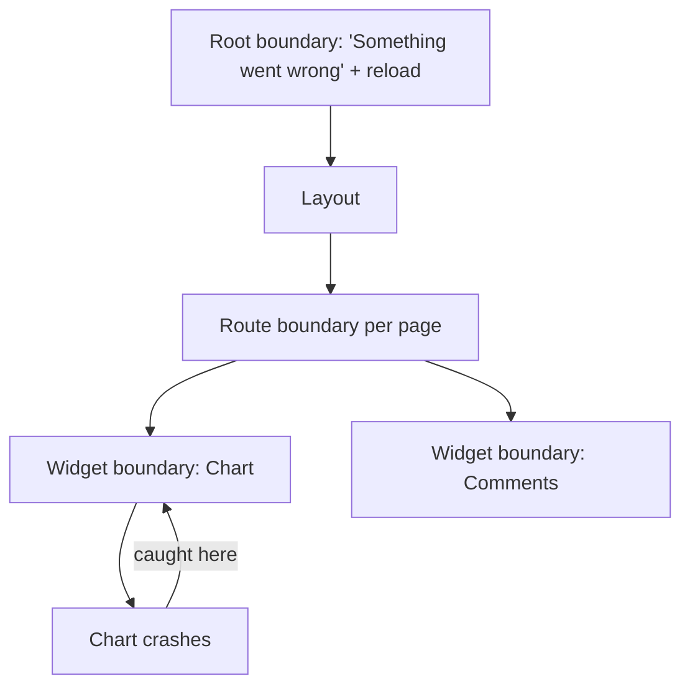

**Example:**

```tsx
class ErrorBoundary extends React.Component<
  { fallback: React.ReactNode; children: React.ReactNode }, { hasError: boolean }> {
  state = { hasError: false };
  static getDerivedStateFromError() {
    return { hasError: true }; // next render shows the fallback
  }
  componentDidCatch(error: Error, info: React.ErrorInfo) {
    reportError(error, info.componentStack); // send to Sentry or similar
  }
  render() {
    return this.state.hasError ? this.props.fallback : this.props.children;
  }
}

// With react-error-boundary: reset when the route changes
<ErrorBoundary FallbackComponent={WidgetError} resetKeys={[pathname]}>
  <SalesChart />
</ErrorBoundary>
```

**Error handling plan for a real app:**
- **Root boundary:** last safety net, with a "Reload" button.
- **Route boundary:** one page fails, the menu still works. In Next.js, `error.tsx` is a route boundary.
- **Widget boundaries:** around third-party widgets, charts, and anything risky.
- **Event handlers and Actions:** `try/catch`, show a message, keep the form data. With `useActionState`, return the error as state.
- **Network errors:** handle in the data layer (retry, show "try again"), not with boundaries only.
- **Logging:** `componentDidCatch` or the React 19 root option `onCaughtError` / `onUncaughtError` sends errors with the component stack to a tool like Sentry.
- **Reset:** give the user a "Try again" button that resets the boundary, and use `resetKeys` so moving to another page clears the error.

**Good and bad:**

| Good | Bad |
|---|---|
| Boundaries at root, route and risky widget level | Only one boundary at the top (one chart breaks the whole page) |
| Log errors with component stack | Swallowing errors silently |
| Friendly fallback with a retry | Showing the stack trace to users |
| `try/catch` in handlers and actions | Expecting boundaries to catch `onClick` errors |

**Say this in the interview:**

> "An error boundary catches render errors in its subtree and shows a fallback, so one broken widget does not white-screen the app. It is still a class component, so I usually use react-error-boundary. I place one at the root, one per route and around risky widgets. Boundaries do not catch event handler or async errors, so I use try/catch there or forward the error with showBoundary. All errors go to Sentry with the component stack."

**They may ask next:**
- **How do you recover from an error?** Reset the boundary: a "Try again" button calls `resetErrorBoundary`, or `resetKeys` changes. Also invalidate the failed query so data is fetched again.
- **What happens to errors in React 19 by default?** Uncaught errors go to `window.reportError`. Caught errors are logged with `console.error`. Errors are no longer thrown twice, so logs are cleaner.

## Context API in depth

**In one line:** Context passes a value deep down the tree without props, and every component that reads it re-renders when that value changes.

**Story:** A school has a loudspeaker in every class.
- The principal makes an announcement. Every class with a speaker hears it, even if the news is only about the football team.
- Nobody can say "only tell me about exams". Every listener hears every announcement.
- A smart school puts in separate speakers: one for exams, one for sports. Now the sports news does not disturb the exam hall.

Context is the loudspeaker. Splitting contexts is putting in separate speakers.

**How it works:**
1. `const ThemeContext = createContext("light")` creates the context. The argument is the **default value**. It is used only when there is **no provider** above.
2. A provider gives the value to its subtree: `<ThemeContext value="dark">` (React 19). `<ThemeContext.Provider>` still works.
3. A component reads it with `useContext(ThemeContext)`, or `use(ThemeContext)`. `use` can be called inside an `if`.
4. React finds the **nearest** provider above the component. A nested provider overrides an outer one for its subtree.
5. When the provider's `value` changes (checked with `Object.is`), React re-renders **every** component that reads this context.
6. `React.memo` does **not** stop this. A memo child that reads the context still re-renders.
7. There are **no selectors**. A component cannot say "re-render me only when `user.name` changes".
8. Context works through portals, because portals stay in the React tree.

**Diagram:**

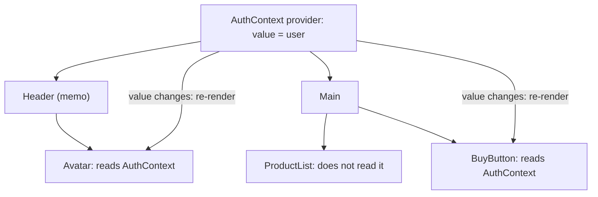

Header is skipped (memo, same props), ProductList is skipped, but Avatar and BuyButton re-render because they read the context.

**When to use Context:**
- Values many components need and that change **rarely**: theme, locale, current user, feature flags.
- *Dependency injection* (giving a service to components without importing it directly): the API client, an analytics object, a router.
- The shared state **inside** a compound component, such as `<Tabs>` and its parts. See [Component patterns](#component-patterns).

**When not to use it:**
- Values that change many times a second: mouse position, text being typed, scroll.
- Server data. Use TanStack Query. See [Data fetching](#data-fetching-in-a-large-app).
- Big global client state that many components read in small pieces. Use a store with selectors.

**Example 1: the safe custom hook pattern.**

```tsx
import { createContext, useContext, useMemo, useState } from "react";
type User = { id: string; name: string };
type Auth = { user: User | null; login: (u: User) => void; logout: () => void };
const AuthContext = createContext<Auth | null>(null);   // null = "no provider above"

export function AuthProvider({ children }: { children: React.ReactNode }) {
  const [user, setUser] = useState<User | null>(null);
  const value = useMemo(() => ({ user, login: setUser, logout: () => setUser(null) }), [user]); // same object until user changes
  return <AuthContext value={value}>{children}</AuthContext>;
}

export function useAuth() {
  const ctx = useContext(AuthContext);
  if (!ctx) throw new Error("useAuth must be used inside <AuthProvider>"); // loud error, not a silent default
  return ctx;
}
```

- The `null` default plus the `throw` turns "I forgot the provider" into a clear error instead of a silent bug.
- `useMemo` keeps the same object until `user` changes. Without it, every render of `AuthProvider` re-renders all readers. The React Compiler can add this memo for you.

**Example 2: split state and dispatch.**

```tsx
import { createContext, useContext, useReducer } from "react";
type Todo = { id: string; text: string; done: boolean };
type Action = { type: "toggled"; id: string };
const todosReducer = (todos: Todo[], a: Action) => todos.map(t => (t.id === a.id ? { ...t, done: !t.done } : t));

const TodosContext = createContext<Todo[]>([]);
const TodosDispatchContext = createContext<React.Dispatch<Action>>(() => {});

export function TodosProvider({ initial, children }: { initial: Todo[]; children: React.ReactNode }) {
  const [todos, dispatch] = useReducer(todosReducer, initial);
  return (
    <TodosContext value={todos}>
      {/* dispatch never changes, so components that only dispatch never re-render */}
      <TodosDispatchContext value={dispatch}>{children}</TodosDispatchContext>
    </TodosContext>
  );
}
export const useTodos = () => useContext(TodosContext);
export const useTodosDispatch = () => useContext(TodosDispatchContext);
```

- Components that only change data (an "Add" button) read the dispatch context. They do not re-render when the list changes.
- You can also split by topic: `ThemeContext`, `UserContext`, `CartContext`. A theme change no longer re-renders the cart.

**Example 3: selectors with a store inside context.**

Context cannot select. But if the context holds a **store object that never changes**, components can subscribe to only the part they need. This is how Redux and Zustand work inside.

```tsx
import { createContext, useContext, useState, useSyncExternalStore } from "react";
type Cart = { items: { id: string; qty: number }[]; coupon: string | null };

function createStore<T>(initial: T) {
  let state = initial;
  const listeners = new Set<() => void>();
  return {
    get: () => state,
    set: (fn: (s: T) => T) => { state = fn(state); listeners.forEach(l => l()); },
    subscribe: (cb: () => void) => { listeners.add(cb); return () => { listeners.delete(cb); }; },
  };
}
type Store = ReturnType<typeof createStore<Cart>>;
const CartStoreContext = createContext<Store | null>(null);

export function CartProvider({ children }: { children: React.ReactNode }) {
  const [store] = useState(() => createStore<Cart>({ items: [], coupon: null })); // created once, never changes
  return <CartStoreContext value={store}>{children}</CartStoreContext>;
}

export function useCart<S>(selector: (c: Cart) => S): S {
  const store = useContext(CartStoreContext);
  if (!store) throw new Error("useCart needs <CartProvider>");
  return useSyncExternalStore(store.subscribe, () => selector(store.get())); // re-render only if S changes
}
// const count = useCart(c => c.items.length);  // a coupon change does not re-render this
```

- The context value (the store) never changes, so context itself never causes a re-render.
- `useSyncExternalStore` re-renders a component only when **its** selected value changes.
- The selector must return a primitive or an existing object. A new object each time (`c => ({ n: c.items.length })`) causes an endless loop.
- In a real app, use Zustand (a very small library that does exactly this) or the small library `use-context-selector`.

**Ways to fix "context re-renders too much", in order:**
1. Memoize the value (`useMemo`), or let the React Compiler do it.
2. Split contexts by topic and by how often they change.
3. Split state and dispatch.
4. Move the provider lower, so fewer components are under it.
5. Move fast-changing data to a store with selectors.

**Context vs Zustand vs Redux:**

| | Context | Zustand | Redux Toolkit |
|---|---|---|---|
| What it is | A way to pass a value down | A small store with selectors | A store with actions, reducers and middleware |
| Re-renders | All readers, on every value change | Only components whose selected value changed | Only components whose selected value changed |
| Provider needed | Yes | No | Yes |
| DevTools | React DevTools only | Redux DevTools through middleware | Excellent, with time travel |
| Best for | Theme, user, locale, services, compound components | Some shared client state: cart, UI settings | Big teams that want strict patterns |

More on choosing: [State management: which state goes where](#state-management-which-state-goes-where).

**Good and bad:**

| Good | Bad |
|---|---|
| `createContext(null)` + a hook that throws without a provider | A fake default that hides a missing provider |
| Small contexts split by topic and change rate | One `AppContext` with user, theme, cart and notifications |
| Stable value with `useMemo` | `value={{ user, setUser }}` written inline |
| Store with selectors for fast-changing shared state | Typing text or mouse position in context |
| Provider as low as possible | Every provider at the root "just in case" |

**Say this in the interview:**

> "Context is a way to pass a value down without props. It is not a state manager. Every component that reads it re-renders when the value changes, and React.memo does not stop that. So I use it for things that change rarely, like theme, user and services. When it re-renders too much, I memoize the value, split contexts, or split state from dispatch. For fast-changing shared state I use a store with selectors, like Zustand."

**They may ask next:**
- **What is the default value for?** It is used only when there is no provider above. It is handy for tests and for libraries. In apps I prefer `null` and a hook that throws.
- **Can I use Context in Server Components?** Server Components cannot read context. Put the provider in a Client Component (`"use client"`) and wrap the children with it. (Since React 19.3 a Server Component can also render a context from a `"use client"` file directly as the provider, without a wrapper component.)
- **`useContext` vs `use(Context)`?** Same result. `use` can be called inside conditions and loops. `useContext` cannot.
- **How do you test a component that needs context?** Render it inside the real provider with test values, or make a small `renderWithProviders` helper.

## Refs, portals and the DOM

**In one line:** A ref gives you direct access to a DOM node. A portal draws a component in another place in the DOM, but keeps it in the same React tree.

**Story:** A hotel guest gets a room key. With the key she can open her room directly, without asking the front desk each time. That is a ref.
The hotel restaurant also has tables outside on the street. The tables are physically outside the building. But your order still goes to the same kitchen and the same bill. That is a portal: placed somewhere else, still part of the same restaurant.

**How it works (refs):**
1. `const inputRef = useRef<HTMLInputElement>(null)` makes a box. `<input ref={inputRef} />` asks React to put the DOM node in it.
2. React sets `inputRef.current` during the **commit**. It sets it back to `null` when the node is removed.
3. So read refs in **effects and event handlers**, not during render. During the first render `current` is still `null`.
4. Common uses: focus an input, scroll to an item, measure size, play a video, connect a non-React library (a chart, a map).
5. **React 19: `ref` is a normal prop** for function components. `function Input({ ref }) { return <input ref={ref} /> }`. `forwardRef` still works, but react.dev says it is no longer needed and "will be deprecated in a future release".
6. **Ref callbacks** (`ref={node => ...}`) run when the node is attached. In React 19 they can return a **cleanup** function, like an effect.
7. **`useImperativeHandle(ref, () => api)`** lets a component give its parent a small API (`focus`, `clear`) instead of the whole DOM node.

**Example 1: ref as a prop + `useImperativeHandle`.**

```tsx
import { useImperativeHandle, useRef } from "react";
type SearchHandle = { focus: () => void; clear: () => void };

function SearchInput({ ref }: { ref?: React.Ref<SearchHandle> }) {   // React 19: ref is a normal prop
  const inputRef = useRef<HTMLInputElement>(null);
  useImperativeHandle(ref, () => ({                                   // expose 2 methods, not the DOM node
    focus: () => inputRef.current?.focus(),
    clear: () => { if (inputRef.current) inputRef.current.value = ""; },
  }), []);
  return <input ref={inputRef} aria-label="Search" />;
}

export function Toolbar() {
  const searchRef = useRef<SearchHandle>(null);
  return (
    <>
      <SearchInput ref={searchRef} />
      <button onClick={() => searchRef.current?.focus()}>Find</button>
      <button onClick={() => searchRef.current?.clear()}>Clear</button>
    </>
  );
}
```

**Example 2: a ref callback with cleanup (measure a box).**

```tsx
import { useCallback, useState } from "react";

export function MeasuredBox({ children }: { children: React.ReactNode }) {
  const [width, setWidth] = useState(0);
  const measureRef = useCallback((node: HTMLDivElement | null) => { // stable function: runs on attach only
    if (!node) return;
    const observer = new ResizeObserver(() => setWidth(node.offsetWidth));
    observer.observe(node);
    return () => observer.disconnect();                             // React 19: cleanup when node is removed
  }, []);
  return <div ref={measureRef}>{children} <small>{width}px wide</small></div>;
}
```

- `useCallback` keeps the same function, so React does not detach and attach the ref on every render.

**Example 3: many refs in a list.** Do not call `useRef` in a loop (that breaks the rules of hooks). Keep a `Map` in one ref.

```tsx
import { useRef } from "react";

export function ScrollToItem({ items }: { items: { id: string; name: string }[] }) {
  const nodes = useRef(new Map<string, HTMLLIElement>());           // one ref holds many nodes
  const scrollTo = (id: string) => nodes.current.get(id)?.scrollIntoView({ behavior: "smooth" });
  return (
    <>
      <button onClick={() => scrollTo(items[items.length - 1].id)}>Go to last</button>
      <ul>
        {items.map(item => (
          <li key={item.id} ref={node => {
            if (node) nodes.current.set(item.id, node);
            return () => { nodes.current.delete(item.id); };       // React 19 ref cleanup
          }}>{item.name}</li>
        ))}
      </ul>
    </>
  );
}
```

**How it works (portals):**
1. `createPortal(children, domNode)` renders `children` into `domNode`, often `document.body`.
2. Use it for modals, tooltips, dropdown menus and toasts. A parent with `overflow: hidden` or a low `z-index` can no longer cut them off.
3. In the **React tree**, the portal is still a child of the component that rendered it. So:
   - Context from parents works inside the portal.
   - **Events bubble through the React tree, not the DOM tree.** A click inside a modal fires the `onClick` of the React parent, even though in the DOM the modal sits under `<body>`.
4. On the server there is no `document`. Render the portal only in the browser, or let a library handle it.

**Diagram:** where the modal lives vs where its events go.

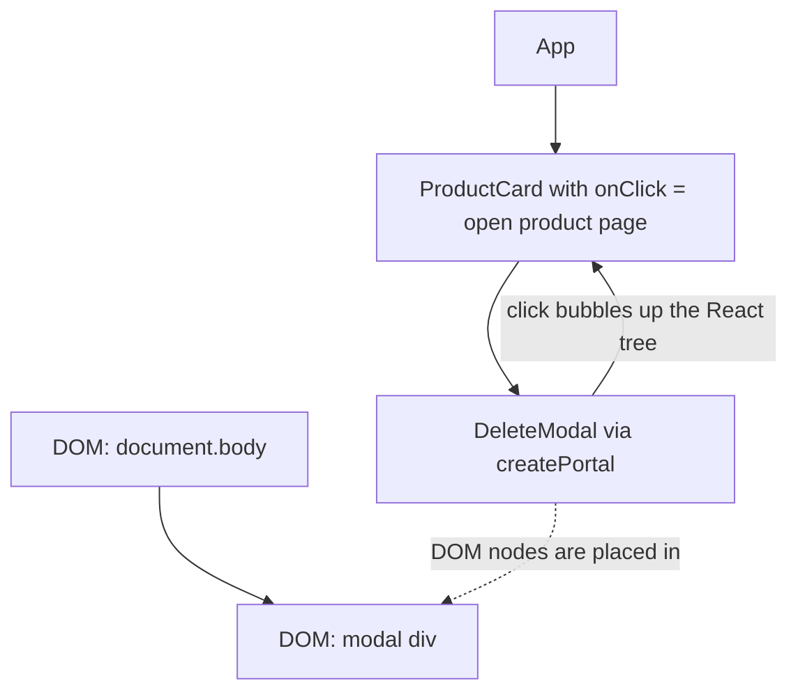

The bug this causes: you click "Cancel" in the modal, and the card's `onClick` also runs and opens the product page. Fix: call `e.stopPropagation()` at the modal root, or render the modal outside the card.

**Focus management (the part people forget):**
- **Opening a modal:** move focus into it (the first field or the dialog itself).
- **While open:** keep Tab inside it (a *focus trap*). Escape closes it.
- **Closing:** put focus back on the button that opened it.
- **After deleting a row:** move focus to the next row or the list heading, not to `<body>`.
- **After a route change:** move focus to the new page `<h1>` so screen reader users know the page changed.
- The native `<dialog>` element with `showModal()` gives you a top layer, a focus trap, Escape and an inert background for free. Libraries like Radix and React Aria do the same for custom widgets.
- A full modal with focus trap is in the [machine coding round](#3-accessible-modal-portal-focus-trap-escape). The checklist is in [Frontend UI: accessible modal](frontend-ui.md#accessible-modal-dialog-checklist).

**Good and bad:**

| Good | Bad |
|---|---|
| Refs for focus, scroll, measure, third-party widgets | Refs to hold data you show on screen (the screen will not update) |
| `ref` as a prop in new React 19 code | New `forwardRef` wrappers |
| `useImperativeHandle` with 2–3 small methods | Exposing the whole DOM node so parents poke at it |
| Portal for modals, tooltips, toasts | Fighting `z-index` and `overflow` with CSS hacks |
| Return focus to the opener after closing | Focus lost on `<body>` after a dialog closes |

**Say this in the interview:**

> "A ref is a box that survives renders without causing them. React fills it with the DOM node during commit, so I read it in effects or handlers. In React 19 ref is a normal prop, so I don't need forwardRef any more. A portal renders a modal or tooltip into document.body, so parent overflow and z-index can't cut it. It still lives in the React tree, so context works and events bubble to React parents. For modals I always manage focus: move it in, trap it, and give it back on close."

**They may ask next:**
- **Why not just use `document.querySelector`?** It breaks when the component renders twice on a page, it can find the wrong node, and it runs outside React's timing. A ref points to exactly this component's node.
- **When do I need `useLayoutEffect` with refs?** When you measure a node and then change the layout (for example, position a tooltip). `useLayoutEffect` runs before paint, so there is no flicker.
- **Do events from a portal reach native `document` listeners?** Native listeners follow the DOM path (modal, then body, then document), not the React path. If you mix native listeners and React handlers, test the order.
- **Is `forwardRef` removed?** No. It still works in React 19. It is just not needed for new code.

## Class components and lifecycle (for old codebases)

**In one line:** Before hooks (React 16.8, 2019), stateful components were classes with lifecycle methods. You still meet them in old code, and error boundaries still need one.

**Story:** Renting a flat has fixed moments with fixed forms.
- Moving in (mount): sign the agreement, connect electricity.
- Living there (update): when the rent changes, sign an update form.
- Moving out (unmount): disconnect electricity, return the keys.
A class component has one method for each moment. Hooks instead say: "keep electricity connected to *this* flat", and React handles the moments.

**How it works:**
1. A class extends `React.Component`. State lives in `this.state`. You change it with `this.setState(...)`.
2. `this.setState({ a: 1 })` **merges** with the old state (shallow). `useState` setters **replace** the value.
3. `render()` returns JSX. It must be pure, like a function component.
4. Lifecycle methods run at fixed moments (see the diagram).
5. `this` must be bound for handlers. Use arrow class fields: `handleClick = () => {...}`.
6. `PureComponent` skips render when props and state are shallow-equal. It is the class version of `React.memo`.
7. Old methods `componentWillMount`, `componentWillReceiveProps` and `componentWillUpdate` are renamed `UNSAFE_...`. They run during render, so they can run many times in concurrent React. Do not use them in new code.

**Diagram:** the lifecycle.

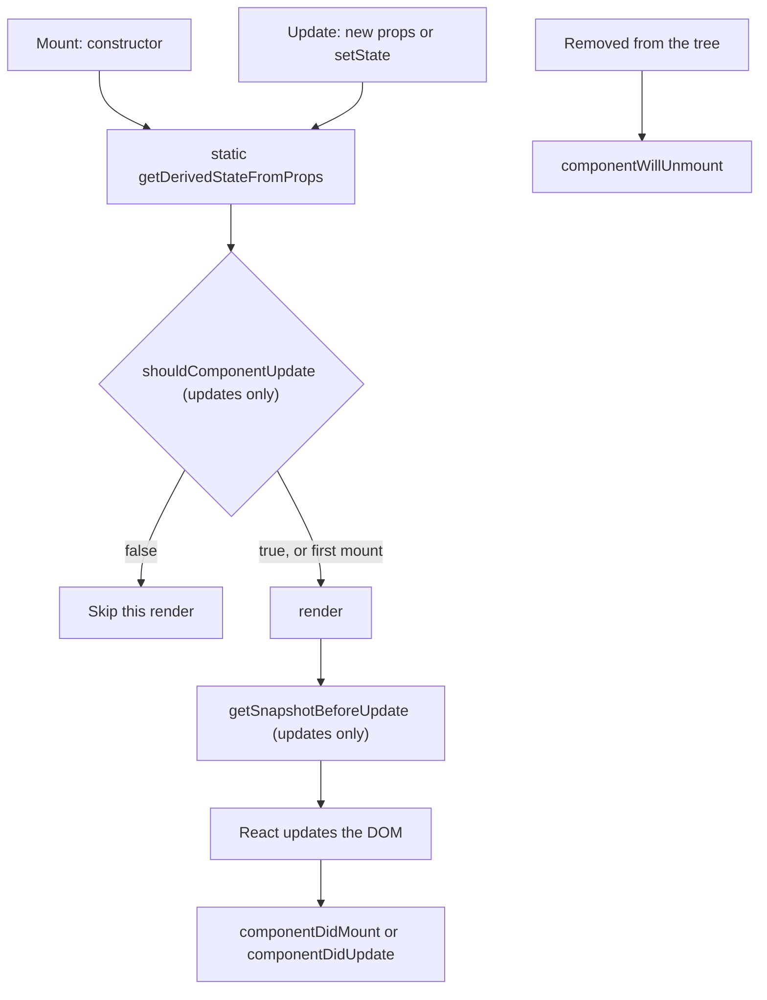

`constructor`, `getDerivedStateFromProps`, `shouldComponentUpdate` and `render` are in the **render phase** (must be pure). The rest are in the **commit phase**. See [How React renders](#how-react-renders).

**Mapping classes to hooks:**

| Class | Hooks | Note |
|---|---|---|
| `this.state` + `setState` | `useState` / `useReducer` | Hooks replace, classes merge |
| `componentDidMount` | `useEffect(fn, [])` | Better: think "sync with X", not "on mount" |
| `componentDidUpdate(prevProps)` | `useEffect(fn, [dep])` | No manual `prev !== current` checks |
| `componentWillUnmount` | Cleanup returned from `useEffect` | Setup and cleanup sit together |
| `shouldComponentUpdate` / `PureComponent` | `React.memo` | Or let the React Compiler memoize |
| `getDerivedStateFromProps` | Calculate during render, or reset with `key` | Usually not needed at all |
| `getSnapshotBeforeUpdate` | No exact hook | `useLayoutEffect` + a ref covers most cases (keep scroll position) |
| `getDerivedStateFromError` / `componentDidCatch` | **No hook** | Still class-only, see below |
| `this.myField` (instance value) | `useRef` | Changing it does not re-render |
| `createRef()` | `useRef(null)` | |

**Example:** the same chat room, class and hooks.

```tsx
import { Component, useEffect, useState } from "react";

type Props = { roomId: string };
type State = { online: number };

export class ChatRoomOld extends Component<Props, State> {
  state: State = { online: 0 };
  componentDidMount() { chat.connect(this.props.roomId); this.setState({ online: chat.count() }); }
  componentDidUpdate(prev: Props) {
    if (prev.roomId !== this.props.roomId) {                  // easy to forget this check
      chat.disconnect(prev.roomId);
      chat.connect(this.props.roomId);
    }
  }
  componentWillUnmount() { chat.disconnect(this.props.roomId); }
  render() { return <p>{this.state.online} online in {this.props.roomId}</p>; }
}

// The same thing with hooks: setup and cleanup sit together, deps replace the if-check
export function ChatRoom({ roomId }: Props) {
  const [online, setOnline] = useState(0);
  useEffect(() => {
    chat.connect(roomId);
    setOnline(chat.count());
    return () => chat.disconnect(roomId);
  }, [roomId]);
  return <p>{online} online in {roomId}</p>;
}
```

The class splits one idea (connect to a room) over three methods. The hook keeps it in one place. That is the main reason hooks won.

**Why error boundaries are still classes:**
- React needs `static getDerivedStateFromError` (show fallback) and `componentDidCatch` (log). There is no hook for these in React 19.
- Most teams write one class once, or use `react-error-boundary`. See [Error boundaries](#error-boundaries-and-error-handling).

**Migrating an old class component (step by step):**
1. Do not rewrite working classes just for style. Change them when you touch them anyway.
2. Write or check a behavior test first (React Testing Library). It must pass before and after.
3. Move state to `useState`. Split one big `this.state` into a few states or a reducer.
4. Turn each pair of mount/update/unmount code into one `useEffect` with the right dependencies.
5. Replace HOCs like `connect()` or `withRouter` with hooks (`useSelector`, `useNavigate`).
6. Run the test again. Compare with the React Profiler if the component is hot.

**Good and bad:**

| Good | Bad |
|---|---|
| Function components for all new code | New classes "because the old file has them" |
| Migrate a class when you change it, with a test | A big-bang rewrite of 300 classes |
| One error boundary class (or the library) | Trying to build an error boundary with hooks |
| Arrow class fields for handlers | `this.handleClick.bind(this)` in every render |

**Say this in the interview:**

> "Class components have lifecycle methods for mount, update and unmount. Hooks replaced them because related logic was split across those methods, reusing it needed HOCs or render props, and `this` confused people. I map componentDidMount, DidUpdate and WillUnmount to one useEffect with cleanup and the right dependencies. I still keep a class for error boundaries, because getDerivedStateFromError has no hook. In old codebases I migrate classes step by step, when I touch them, with a test first."

**They may ask next:**
- **Is `componentDidMount` the same as `useEffect(fn, [])`?** Not exactly. `componentDidMount` runs before the browser paints, like `useLayoutEffect`. `useEffect` runs after paint.
- **What does `setState` in a class do with two calls in a row?** It batches them. Use the updater form `this.setState(s => ({ n: s.n + 1 }))` when the next state depends on the old one.
- **Are classes deprecated?** No. They are still supported. New features like hooks and the React Compiler are built for function components.

## SSR, hydration and React Server Components (React side)

**In one line:** With SSR the server sends ready HTML, so the user sees the page fast. Hydration makes that HTML interactive. Server Components run only on the server and ship no JavaScript.

**Story:** A furniture shop delivers a fully set-up showroom to your home. You can see and use the sofa at once (HTML from the server).
Then the electrician comes and wires the lamps and switches (hydration). Until he is done, the switches look real but do nothing.
If the electrician's plan says "lamp on the left wall" but the lamp stands on the right, he complains and redoes that wall (a hydration mismatch).

**How it works:**
1. **Server render.** React runs your components on the server and produces HTML.
   - `renderToPipeableStream` (Node.js streams) or `renderToReadableStream` (Web streams, also used in edge runtimes).
   - `prerender` (from `react-dom/static`) for static pages at build time.
2. **Browser shows the HTML.** The user sees content before any JavaScript runs. Good for LCP (*Largest Contentful Paint*, how fast the main content appears) and SEO.
3. **JavaScript loads.** The same components are downloaded.
4. **Hydration.** `hydrateRoot(container, <App />)` renders the app again in the browser. React does **not** create new DOM. It walks the existing HTML, checks it matches, and attaches event handlers.
5. **Mismatch.** If the browser's first render differs from the server HTML, React logs a hydration error (React 19 shows one message with a diff). It throws away the server HTML for that part and renders it again on the client. That is slower, and the user can see a flash.
6. **Streaming + Suspense.** The server sends the shell first and fills in each `<Suspense>` part when its data is ready. *Selective hydration* makes the part the user clicks interactive first. See [Concurrent React](#concurrent-react-transitions-and-suspense).

**Diagram:** SSR with hydration.

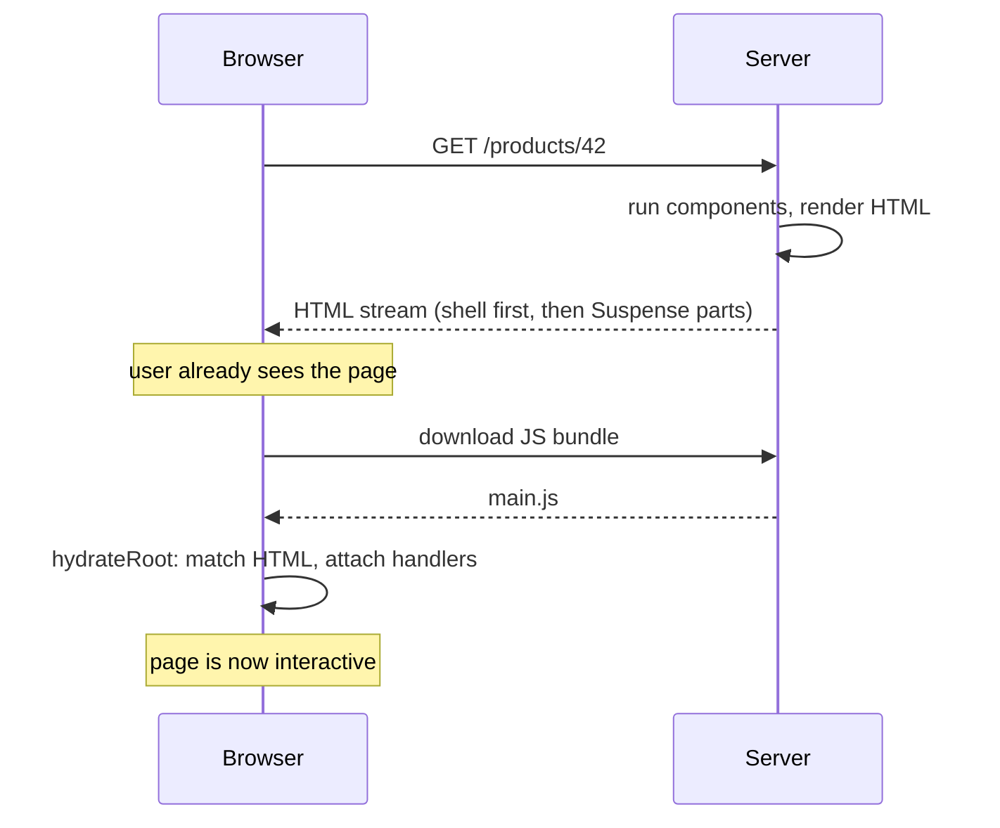

**Common causes of hydration mismatch:**
- `Date.now()`, `new Date()`, `Math.random()` in render.
- Reading `window`, `localStorage` or `navigator` during render (the server has none of them).
- Locale or time zone differences: `toLocaleString()` on a server in UTC and a browser in India.
- Invalid HTML nesting, like `<div>` inside `<p>`, or `<a>` inside `<a>`. The browser "fixes" the HTML, so the DOM no longer matches.
- Browser extensions that change the DOM before React hydrates (password managers, translators).
- Data that changed between server render and client render, when the client fetches again instead of using the server data.

**Example: a mismatch and two fixes.**

```tsx
import { useEffect, useState, useSyncExternalStore } from "react";

// Bad: the server and the browser print different times -> hydration mismatch
export function ClockBad() {
  return <span>{new Date().toLocaleTimeString()}</span>;
}

// Fix 1: render a placeholder first, fill the browser-only value after hydration
export function Clock() {
  const [time, setTime] = useState<string | null>(null);
  useEffect(() => {
    const tick = () => setTime(new Date().toLocaleTimeString());
    tick();                                                    // effects run only in the browser
    const id = setInterval(tick, 1000);
    return () => clearInterval(id);
  }, []);
  return <span>{time ?? "--:--:--"}</span>;
}

// Fix 2: a hook that is false on the server and during hydration, true after
const noSubscribe = () => () => {};
export function useIsClient() {
  return useSyncExternalStore(noSubscribe, () => true, () => false); // 3rd arg = server snapshot
}
```

Other fixes:
- `suppressHydrationWarning` on **one** element whose text must differ (a timestamp). It works one level deep only. Do not use it to hide real bugs.
- `useId` for ids, so server and client produce the same ids.
- Send the server's data to the client (frameworks do this for you) instead of fetching again.
- Format dates with a fixed time zone, or render them only on the client.

**React Server Components (RSC), the React side:**
- A **Server Component** runs only on the server (at build time or per request). It can be `async` and read the database directly. Its code is **not** sent to the browser.
- A **Client Component** is marked with `"use client"` at the top of its file. It can use state, effects and browser APIs. It is server-rendered to HTML too, then hydrated.
- `"use client"` marks a **boundary**. Everything imported below it is client code.
- Props from a Server Component to a Client Component must be **serializable**: strings, numbers, plain objects, arrays, Dates, promises, JSX. Not normal functions or class instances.
- A Server Component can pass other Server Components as `children` into a Client Component. So a client `<Tabs>` can show server-rendered content.
- **Server Functions** (`"use server"`) are functions the client can call. They run on the server. Treat each one as a **public API endpoint**: check auth and validate input.
- The server sends the result as the *RSC payload* (a compact description of the UI tree), not as JSON data you design yourself.
- RSC needs a framework or bundler that supports it. Next.js App Router is the most used one. React Router also has RSC support (still marked unstable in v8).

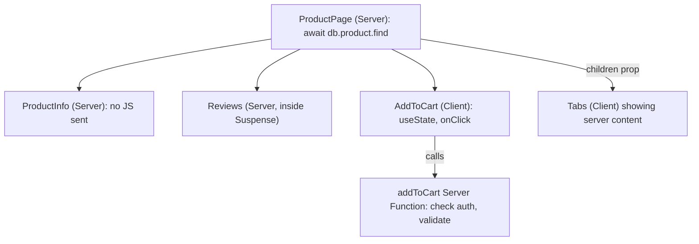

```tsx
// ProductPage.tsx - a Server Component (the default in Next.js App Router)
export default async function ProductPage({ id }: { id: string }) {
  const product = await db.product.find(id);   // runs on the server: no API route, no client JS
  return (
    <>
      <h1>{product.name}</h1>
      <AddToCart productId={product.id} />      {/* only this part ships JavaScript */}
    </>
  );
}

// AddToCart.tsx
"use client";                                   // first line of the file: client boundary
export function AddToCart({ productId }: { productId: string }) {
  const [added, setAdded] = useState(false);
  return <button onClick={() => { addToCart(productId); setAdded(true); }}>{added ? "Added" : "Add to cart"}</button>;
}
```

Framework details (caching, `loading.tsx`, Server Actions in forms) are in [Next.js architecture and Server Components](nextjs.md#nextjs-architecture-and-server-components).

**Good and bad:**

| Good | Bad |
|---|---|
| Same output on server and first client render | `Date.now()` or `localStorage` read during render |
| Browser-only values in `useEffect` or `useSyncExternalStore` | `typeof window !== "undefined"` branches that change the JSX |
| Valid HTML nesting | `<div>` inside `<p>` |
| `"use client"` only on small interactive leaves | `"use client"` at the top of the whole app |
| Auth and validation inside every Server Function | Trusting that only your UI calls it |
| Keep React and the RSC packages patched | Ignoring security releases |

**Say this in the interview:**

> "With SSR the server sends HTML, so the user sees content early. Then hydrateRoot renders the same tree in the browser and attaches events without rebuilding the DOM. If the first client render differs from the server HTML, I get a hydration mismatch, usually from dates, random values, window access or bad HTML nesting. I fix it by making the first render the same and moving browser-only values into an effect. Server Components go further: they run only on the server, so their code never ships, and I mark only the interactive parts with use client."

**They may ask next:**
- **SSR vs Server Components?** SSR turns components into HTML on the server, but all their JavaScript still ships for hydration. Server Components never ship their code. Client Components are still SSR-ed and hydrated.
- **Can a Client Component import a Server Component?** Not directly. It can receive one as `children` or another prop from a Server Component parent.
- **Was there a big RSC security issue?** Yes. In December 2025 a critical bug (CVE-2025-55182, called "React2Shell") let attackers run code on servers using React Server Components. Fixed versions were released fast. The lesson: patch quickly and watch security advisories.
- **What is the cost of hydration?** The browser must download and run the JavaScript for every client component. Big pages can feel "frozen" before hydration finishes. Server Components, streaming and selective hydration reduce this.

## React questions: fundamentals and hooks

Short answers for quick revision. Each links to the longer section.

**1. Why do lists need keys, and why not the index?**
Keys tell React which item is which between renders. Index keys follow the position, so after an insert, delete or sort, state and input values move to the wrong row. Use a stable id from the data. → [How React renders](#how-react-renders)

**2. What is the virtual DOM?**
A tree of plain JavaScript objects that describes the UI. React builds a new one each render, compares it with the old one, and updates only the changed DOM nodes. → [How React renders](#how-react-renders)

**3. What is the difference between render and commit?**
Render calls components and computes what changed. It must be pure and can be repeated. Commit applies the changes to the real DOM, once. → [How React renders](#how-react-renders)

**4. What is batching?**
React groups many state updates from one event into one render. Since React 18 it works in timeouts and promises too. → [How React renders](#how-react-renders)

**5. What causes a re-render?**
Own state change, parent render, context value change, external store change. Props by themselves are not a trigger. → [What causes a re-render](#what-causes-a-re-render)

**6. Controlled vs uncontrolled inputs?**
Controlled: React state holds the value (`value` + `onChange`). Good for validation and live formatting. Uncontrolled: the DOM holds the value (`defaultValue`, read with a ref or `FormData`). Simpler and faster for big forms. React 19 form actions work well with uncontrolled inputs. Libraries like React Hook Form are mostly uncontrolled for speed. → [Component patterns](#controlled-vs-uncontrolled-components)

**7. What is lifting state up?**
When two siblings need the same data, move the state to their closest common parent and pass it down as props. Lift only as high as needed. Too high means too many re-renders. → [What causes a re-render](#what-causes-a-re-render)

**8. What is prop drilling, and how do you avoid it?**
Passing props through many layers that do not use them. Fixes, in order:
- Composition: pass `children` or components as props.
- Context for values that rarely change (theme, user).
- A store (Zustand, Redux) for shared client state.
- A server cache (TanStack Query) for API data.

**9. What are refs, and what happened to `forwardRef`?**
A ref is a box (`useRef`) that keeps a value without causing renders, often a DOM node. Before React 19 you needed `forwardRef` to pass a ref to a child component. In React 19, `ref` is a normal prop: `function Input({ ref, ...props })`. → [useRef](#useref-usememo-usecallback-custom-hooks)

**10. What is `useImperativeHandle`?**
It lets a component expose a small custom API through its ref, like `{ focus, scrollToTop }`, instead of the whole DOM node. Use it rarely. Props are better in most cases. → [Refs, portals and the DOM](#refs-portals-and-the-dom)

**11. What is a portal?**
`createPortal(children, domNode)` renders children into another DOM node, like `document.body`. Use it for modals, tooltips and toasts so CSS `overflow` or `z-index` of parents does not cut them. Events still bubble through the **React** tree, not the DOM tree. → [Refs, portals and the DOM](#refs-portals-and-the-dom)

**12. What are fragments?**
`<>...</>` or `<Fragment key={...}>` group children without adding an extra DOM element. Use the long form when you need a key in a list. Since React 19.3, a Fragment can also take a `ref` to work with its children as a group.

**13. What are synthetic events?**
React wraps browser events in a `SyntheticEvent` with the same API in all browsers. Since React 17, listeners are attached to the root container, not `document`. Event pooling was removed in React 17, so you can read the event in async code.

**14. Class vs function components?**
Function components with hooks are the standard. They are shorter, easier to reuse logic in (custom hooks) and work with the React Compiler and new features. Classes are still supported. Error boundaries still need a class. → [Class components and lifecycle](#class-components-and-lifecycle-for-old-codebases)

**15. How do class lifecycle methods map to hooks?**
- `componentDidMount` → `useEffect(fn, [])`.
- `componentDidUpdate` → `useEffect(fn, [deps])`.
- `componentWillUnmount` → the cleanup function returned from `useEffect`.
- `shouldComponentUpdate` → `React.memo`.
- `getDerivedStateFromProps` → calculate during render, or reset with `key`.
- Think "sync with this value", not "run at this moment". → [useEffect](#useeffect-syncing-with-outside-systems)

**16. What are the rules of hooks?**
Call hooks only at the top level of a function component or a custom hook. Never inside conditions, loops, nested functions or after an early `return`. The lint plugin `eslint-plugin-react-hooks` checks this. (`use` is the one exception: it can be inside `if`.)

**17. Why can't hooks be inside conditions?**
React does not know hooks by name. It stores them in a list per component and matches them by **call order**. If a hook is skipped in one render, every hook after it reads the wrong slot, and state gets mixed up.

**18. `useLayoutEffect` vs `useEffect`?**
`useLayoutEffect` runs after the DOM changes but **before** the browser paints. Use it to measure the DOM and fix position (tooltips) without a flicker. It blocks painting, so keep it small. `useEffect` runs after paint and is the default. On the server neither runs.

**19. What is a hydration error?**
The server HTML and the first client render are different. Common causes:
- `Date.now()` or `Math.random()` in render.
- Reading `window` or `localStorage` during render.
- Invalid HTML nesting (`<div>` inside `<p>`).
- Browser extensions changing the DOM.

Fix: same output on both sides; read browser-only values in `useEffect`; use `useId` for ids. React 19 shows one clear diff message. → [SSR and hydration](#ssr-hydration-and-react-server-components-react-side)

**20. What does StrictMode do?**
In development only, it double-calls render functions and runs effects mount, cleanup, mount. It finds impure code and missing cleanup. It does nothing in production. → [How React renders](#how-react-renders)

**21. What is a stale closure?**
A function that still sees state or props from an old render, like `setInterval` inside an effect with `[]`. Fix with a functional update, correct deps, a ref, or `useEffectEvent`. → [Stale closures](#stale-closures)

**22. When should you not use `useEffect`?**
For derived values, user events, effect chains, resetting state (use `key`) and notifying parents. Effects are for syncing with outside systems. → [When NOT to use useEffect](#when-not-to-use-useeffect)

**23. What is `useSyncExternalStore`?**
A hook to subscribe to a store outside React (Redux, Zustand, browser APIs like `navigator.onLine`) safely during concurrent rendering. You give it `subscribe` and `getSnapshot`. `getSnapshot` must return the same value if nothing changed. → [What causes a re-render](#what-causes-a-re-render)

**24. What is `useId` for?**
It makes a unique id that is the same on server and client. Use it for `htmlFor` / `aria-describedby` pairs. Do not use it for list keys.

**25. When does `React.memo` help?**
When a child is expensive, the parent re-renders often, and the props stay the same by reference. Not when props are inline objects or functions, or when the child is cheap. → [React.memo, useMemo and useCallback](#reactmemo-usememo-and-usecallback-when-they-help)

**26. Can `useMemo` make an app slower?**
Yes. It adds a dependency compare every render, extra memory and code noise. For cheap calculations it costs more than it saves. Measure first. → [React.memo, useMemo and useCallback](#reactmemo-usememo-and-usecallback-when-they-help)

**27. `useTransition` vs `useDeferredValue`?**
Both mark work as non-urgent. Use `useTransition` when you call the `setState` yourself. Use `useDeferredValue` when you only receive a value, like a prop or the search text. → [Concurrent React](#concurrent-react-transitions-and-suspense)

**28. What is `React.lazy`?**
It loads a component's code only when it is first rendered (code splitting). Wrap it in `<Suspense>` for the loading state. Split by route first, then by heavy widgets like editors and charts. → [Routing and code splitting](#routing-and-code-splitting)

**29. What does an error boundary not catch?**
Errors in event handlers, async code, server rendering, and in the boundary itself. → [Error boundaries](#error-boundaries-and-error-handling)

**30. Server Components vs Client Components?**
Server Components run only on the server and send no JavaScript for themselves. Client Components (`"use client"`) run in the browser and can use state and effects. → [nextjs.md](nextjs.md#nextjs-architecture-and-server-components)

**31. What is Fiber?**
React's internal engine. Each component has a fiber object. React walks fibers one at a time, so it can pause between them, run urgent updates first and throw away unfinished work. Commit is never paused. → [How React renders](#how-react-renders)

**32. When should you use Context, and when not?**
For values many components need that change rarely: theme, user, locale, services. Not for fast-changing values or server data. Every reader re-renders on each change, and `memo` does not stop it. → [Context API in depth](#context-api-in-depth)

**33. How do you stop Context from re-rendering everything?**
Memoize the value, split contexts by topic, split state from dispatch, move the provider lower, or use a store with selectors (`useSyncExternalStore`, Zustand). → [Context API in depth](#context-api-in-depth)

**34. Do portals change how events bubble?**
Events bubble through the React tree, not the DOM tree. A click inside a modal portal reaches the `onClick` of its React parent, even though the modal's DOM is under `<body>`. → [Refs, portals and the DOM](#refs-portals-and-the-dom)

**35. How do you manage focus in a React app?**
Move focus into modals and trap it there. Return it to the opener on close. Focus the new heading after a route change. After a delete, move it to the next item. → [Refs, portals and the DOM](#refs-portals-and-the-dom)

**36. Why were hooks introduced?**
In classes, one feature was split across several lifecycle methods, sharing logic needed HOCs or render props, and `this` was confusing. Hooks keep related logic together and share it with custom hooks. → [Class components and lifecycle](#class-components-and-lifecycle-for-old-codebases)

**37. Why is `getDerivedStateFromError` still class-only?**
React has no hook for catching render errors. Error boundaries must be classes with `getDerivedStateFromError` and `componentDidCatch`. Most teams use `react-error-boundary`. → [Class components and lifecycle](#class-components-and-lifecycle-for-old-codebases)

**38. What is hydration, and what happens on a mismatch?**
Hydration attaches React to server HTML without rebuilding the DOM. If the first client render differs, React logs an error and re-renders that part on the client, which is slower and can flash. → [SSR, hydration and React Server Components](#ssr-hydration-and-react-server-components-react-side)

**39. SSR vs React Server Components?**
SSR turns components into HTML, but their JavaScript still ships for hydration. Server Components run only on the server and never ship their code. Only `"use client"` parts hydrate. → [SSR, hydration and React Server Components](#ssr-hydration-and-react-server-components-react-side)

**40. What does `suppressHydrationWarning` do?**
It hides the mismatch warning for the text of one element, one level deep, like a timestamp. Use it rarely. Fix the real cause in most cases.

## How senior React interviews are run

**In one line:** A senior React interview checks if you can design, debug and maintain a big React app. It does not ask what `useMemo` means.

**Story:** Think of hiring a head chef.
You don't ask "What is a knife?". You ask "How do you run a kitchen with 20 cooks and 200 dishes?"
Then you watch how they think when you push: "And when two cooks need the same pan?"
A senior React interview works the same way.

**What interviewers look for:**
- Can you explain a real, complex app you worked on, not only the screens you built?
- Do you think about **structure**: feature boundaries, shared components, who owns what?
- Do you put each piece of **state** in the right place?
- Do you **measure** before you optimize?
- Do you test **behavior**, not implementation?
- Can you improve an old, messy app **step by step**, without a big rewrite?

**The 60-minute shape (a common format):**

| Part | Minutes | Typical question | What they really check |
|---|---|---|---|
| Biggest React project | 5 | "Tell me about the most complex React app you worked on." | Real ownership, scale, decisions |
| App architecture | 15 | "200+ screens, 20 developers. How do you structure it?" and "5 teams need the same Button and Modal." | Feature boundaries, design system |
| State management | 10 | "When do you use local state, Context, Redux, URL, server state?" | Right state in the right place |
| Rendering and performance | 10 | "Typing in a search box is slow. How do you investigate?" | Measure first, then fix |
| Hooks | 5 | "What is wrong with this `useEffect`?" | Dependencies, stale closures |
| Debugging | 5 | "50,000 users and typing is slow." | Profiling, virtualization, server-side filtering |
| Architecture scenario | 5 | "5 teams. How do you prevent a mess after 2 years?" | Rules, ownership, CI checks |
| React and API | (inside above) | "How do you design data fetching for a large app?" | Server state, cache, invalidation |
| Testing | 3 | "Would you test implementation details?" | Behavior-first testing |
| Killer question | rest | "You inherit a 500k-line app. First 90 days?" | Calm, measured, step-by-step plan |

Rendering, hooks, performance and the debugging task are in part 1: [How React renders](#how-react-renders), [What causes a re-render](#what-causes-a-re-render), [Performance: measure first](#performance-measure-first), [Debugging: 50,000 users and slow typing](#debugging-50000-users-and-slow-typing).

**How they score you (example weights from one interviewer guide):**

| Area | Weight |
|---|---|
| React fundamentals | 15 |
| Hooks and rendering | 15 |
| Performance | 15 |
| Application architecture | 20 |
| State management | 10 |
| Design-system architecture | 10 |
| API and data fetching | 5 |
| Testing | 5 |
| Debugging | 5 |

- Architecture, performance and debugging carry the most weight together.
- **Level bands:** 70–80 = good senior. 80–90 = strong senior or tech lead. 90+ = exceptional.

**They pick 8–10 questions and drill down.** One short answer is never the end. Each answer opens the next question.

**Diagram:** a typical drill-down when you say "We use Redux".

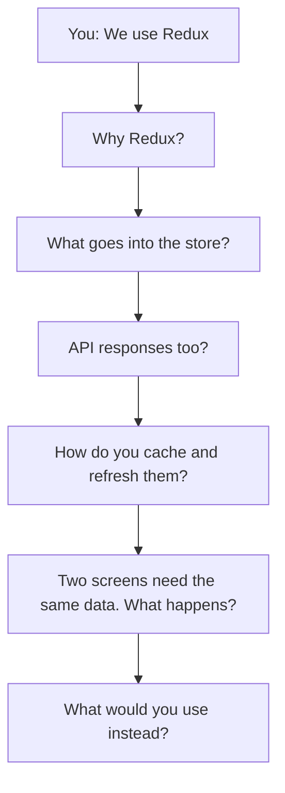

A good path: "Redux holds client state like the cart draft. API data lives in TanStack Query. It caches by key, so two screens share one request." See [State management](#state-management-which-state-goes-where) and [Data fetching](#data-fetching-in-a-large-app).

**Good and bad:**

| Green flags | Red flags |
|---|---|
| Talks about teams, ownership and boundaries | Only describes JSX and screens they built |
| "First I measured with the React Profiler" | "I would add `useMemo` everywhere" |
| Puts server data in a server-state cache | Puts every API response into Redux |
| Gives numbers: 20 devs, 180 screens, INP from 450 ms to 150 ms | "It was big and fast" |
| Says "it depends" and then says on what | Has one answer for everything |
| Plans small steps and safe refactors | "I would rewrite it" |
| Says what they would redesign today | Says nothing went wrong |

**Say this in the interview:**

> I see a senior React role as more than writing components.
> It is about structure, state placement, data fetching, performance and keeping 20 developers productive.
> I always measure before I optimize, and I improve old code step by step.

**They may ask next:**
- **"What would you look for if you were the interviewer?"** Real ownership, measured decisions, and honest talk about trade-offs and mistakes.
- **"How do you prepare for drill-down questions?"** For every tool I name, I prepare "why", "what are the limits" and "what would I use instead".

---

## Talking about your biggest React project

**In one line:** Describe your biggest app like an architect: team, scale, structure, state and data. Add one hard problem and one thing you would redesign.

**Story:** If someone asks about the house you built, you don't list the paint colors.
You say how many floors, who did the plumbing, what broke, and what you would build differently.
Interviewers want the same about your app.

**How to answer (fill-in template):** keep it to about 2 minutes, then let them drill.

| Point | Fill in | Example |
|---|---|---|
| What the app does | One line, who uses it | B2B e-commerce admin for 3,000 sellers |
| Team size | Devs and teams | 18 frontend devs in 4 teams |
| Scale | Screens, lines of code, users | ~220 screens, ~350k lines, 40k daily users |
| Structure | How code is split | Feature folders in a monorepo, shared UI package |
| Ownership | Who owns what, your role | I led the Orders team and the design-system guild |
| State | Where state lives | Server state in TanStack Query, filters in the URL, small Zustand store |
| Data fetching | How APIs are called | Typed API client, query hooks per feature |
| Shared components | How you avoid duplicates | Design system on Radix, Storybook, visual tests |
| Biggest performance problem | Problem, how you measured, fix, result | Orders table typing lag, INP 480 ms → 140 ms |
| What you'd redesign | One honest thing | Move to feature boundaries earlier, add lint rules on day one |

**Example (sample spoken answer):**

> "The most complex app I worked on was the admin panel of a B2B e-commerce platform.
> About 3,000 sellers used it every day to manage products, orders, stock and payouts.
> We had 18 frontend developers in 4 teams and around 220 screens.
>
> The code was a pnpm monorepo with Turborepo. Each business area was a feature folder: orders, catalog, billing, reports. We also had a shared UI package. Each team owned its features through CODEOWNERS. I led the Orders team and also ran the design-system guild.
>
> For state, we kept server data in TanStack Query, so caching and refetching were in one place. Filters and pagination lived in the URL, so users could share links. We had one small Zustand store for UI things like the sidebar and the bulk-edit selection.
>
> Our biggest performance problem was the orders table. Sellers with 20,000 orders had a 2-second lag when typing in the search box. I recorded it with the React Profiler. Every keystroke re-rendered all rows and re-ran a heavy filter. We moved filtering to the server with a debounced query, virtualized the table and memoized the row component. INP went from about 480 ms to 140 ms.
>
> If I designed it again, I would add import boundary lint rules on day one. We spent months untangling features that imported each other's internals."

**Good and bad:**

| Good | Bad |
|---|---|
| Real numbers: devs, screens, ms | "It was a big app" |
| You explain *why* a decision was made | Only "we used X" |
| One problem with measure → fix → result | A list of 10 problems, no details |
| An honest redesign point | "Everything was perfect" |
| Clear "I" vs "we" | Taking credit for the whole team, or saying only "we" |

**Say this in the interview:**

> I'll describe it in layers: the team and scale, the code structure, state, data fetching and shared components.
> Then I'll go deeper into the hardest performance problem and what I would change today.

**They may ask next (prepare these):**
- **"Who made the architecture decisions?"** Say how: an RFC or ADR, a weekly frontend sync, a tech lead who approves. Say which ones you made.
- **"How did a new developer find their way?"** Feature folders, a conventions doc, Storybook, a starter template for new features.
- **"How did you test it?"** Integration tests with React Testing Library and MSW, plus E2E for checkout and payouts. See [Testing](#testing-a-react-app).
- **"What was the hardest bug?"** Pick one with a clear cause, such as a race condition between two requests.
- **"How did you handle shared components between teams?"** See [Shared UI and design systems](#shared-ui-and-design-systems).
- **"How did you deploy?"** CI on every pull request, preview deployments, feature flags for risky changes.

---

## Structuring a large React app

**In one line:** Group code by business feature, keep a shared layer at the bottom, and let dependencies flow only one way.

**Story:** Think of a big shopping mall.
Each shop (feature) has its own staff and its own back room. Shops don't walk into each other's back rooms.
All shops use the same lifts, toilets and parking (shared layer). The lifts don't depend on any one shop.
If a shop wants something from another shop, it goes to the front counter (public API).

**The question:** "200+ screens, 20 developers, many teams, shared UI. How do you structure it?"

**How it works:**
1. **Feature (domain) folders.** `features/users`, `features/billing`, `features/reports`. Everything for one feature lives together: components, hooks, API calls, types, tests.
2. **A shared layer.** `shared/ui` (Button, Modal, Table), `shared/lib` (API client, date and money formatting), `shared/hooks` (`useDebounce`).
3. **An app layer.** Router, providers, layout. Route files are thin. They only put features together.
4. **Dependency direction rule:**
   - `app` → `features` → `shared`. Arrows only go down.
   - `shared` never imports from `features`.
   - A feature does not import another feature's internals. It may use the other feature's **public API** (its `index.ts`) if really needed.
5. **Public API per feature.** Each feature has one `index.ts`. Other code imports only from there.
6. **Enforce it with lint rules.** Rules on paper are forgotten. See [Keeping a big codebase healthy](#keeping-a-big-codebase-healthy).

**Example (folder tree):**

```text
src/
  app/                  # app shell: providers, router, layout
  routes/               # thin route files, they compose features
  features/
    users/
      api/              # API calls + query hooks for users
      components/       # UserTable, UserForm
      hooks/
      model/            # types, Zod schemas, small local stores
      index.ts          # public API: the only entry point
    billing/
    reports/
  shared/
    ui/                 # Button, Modal, Table (design system)
    lib/                # apiClient, formatMoney, formatDate
    hooks/              # useDebounce, useMediaQuery
    config/             # env, feature flags
```

**Example (public API file):**

```ts
// src/features/billing/index.ts - the ONLY file other code may import
export { InvoiceList } from "./components/InvoiceList";
export { useInvoices } from "./api/useInvoices";
export type { Invoice } from "./model/types";
// ./lib/taxRules.ts is NOT exported: it is private to billing
```

**Diagram (allowed dependencies):**

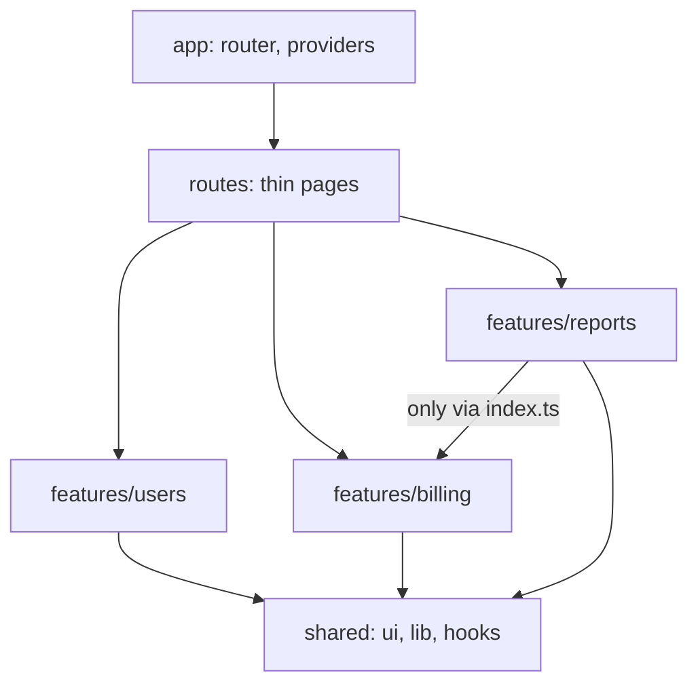

Arrows only point down. `shared` has no arrow back up to features. Cycles are not allowed.

**Why not one giant `components/` folder?**
- After 2 years it has 900 files. Nobody knows what is used or who owns it.
- Changing one "shared" component breaks 3 teams you didn't know about.
- You can't delete a feature cleanly. Its code is spread over `components/`, `hooks/`, `services/`, `utils/`.
- Type-based folders (`components/`, `hooks/`, `services/`) are fine for small apps. They don't scale to 20 developers.

**Barrel files (`index.ts`): a warning.**
- One small barrel per feature is good. It is the front door.
- Don't put barrels in every folder. Deep barrel chains slow down dev servers and tests. They also make circular imports easy.

**When the app gets bigger: monorepo.**
- A *monorepo* is one Git repo with many packages. Tools: **Nx** or **Turborepo** with pnpm workspaces.
- Example: `apps/admin`, `apps/shop`, `packages/ui`, `packages/api-client`, `packages/eslint-config`.
- Benefits: one place to change shared code, cached builds, run only affected tests.
- Nx can also enforce module boundaries with tags, such as "scope:billing may only use scope:shared".

**Micro-frontends: only when teams truly need independent deploys.**
- A *micro-frontend* is a part of the UI that one team builds and deploys alone. It is loaded into a host app at runtime.
- The common tool is **Module Federation** (Webpack, Rspack, and plugins for Vite). It shares one copy of React between parts.
- Choose it when: many teams (often 5+) must release on their own schedule, or you migrate an old app piece by piece.
- Costs: more infrastructure, version mismatches (two React versions), shared state is hard, UX can drift, bundles get bigger.
- Most apps with 20 developers do better with a **modular monolith**: one app, strong boundaries, one deploy.

**Good and bad:**

| Good | Bad |
|---|---|
| Feature folders with clear owners | One giant `components/` folder |
| `shared` never imports `features` | `shared/ui/Table` imports `features/billing` types |
| Other features use `billing/index.ts` | `import { calcTax } from "../billing/lib/taxRules"` |
| Lint rules enforce boundaries | Rules only in a wiki page |
| Modular monolith first | Micro-frontends for a 6-person team |

**Say this in the interview:**

> I structure by business feature, not by file type. Each feature owns its components, hooks, API calls and types, and exposes one public `index.ts`.
> Dependencies go one way: app to features to shared. Shared never imports features, and features don't reach into each other's internals.
> I enforce this with lint rules and CODEOWNERS. I only consider micro-frontends when teams truly need independent deploys.

**They may ask next:**
- **"Why this structure?"** Ownership is clear, features can be deleted or moved, and changes stay local to one team.
- **"Where do shared hooks go?"** In `shared/hooks` only if they have no business logic, like `useDebounce`. Business hooks stay in their feature.
- **"Two features need the same logic. What do you do?"** If it is generic, move it to `shared`. If it is business logic, one feature owns it and exports it from its public API.
- **"Monorepo or many repos?"** Monorepo for one product with shared UI. Atomic changes across packages are much easier.

---

## Shared UI and design systems

**In one line:** A design system is one shared set of tokens, accessible components and docs. 5 teams build the Button once, not 15 times.

**Story:** Think of a hotel chain.
Every hotel uses the same towels, the same room key system, the same signs. Guests feel at home everywhere.
A central team designs the standard. Each hotel can choose the room layout, but not invent its own key system.
A design system is that central standard for your UI.

**The question:** "5 teams need the same Button, Modal, Table, DatePicker and Form. How do you design and maintain this?"

**How it works:**
1. **Design tokens.** Named values for colors, spacing, fonts, radius and shadows, such as `--color-primary` or `--space-2`. Designers and developers use the same names. Theming (dark mode, brands) = swapping token values.
2. **Headless primitives.** *Headless* means "behavior and accessibility, but no styles". Use **Radix UI** or **React Aria**. They handle focus trap, keyboard keys, ARIA attributes and screen readers. These are hard to get right yourself.
3. **Styled components on top.** Your `shared/ui` wraps the primitives with your tokens and styles.
4. **Good component API design:**
   - **Composition:** pass children instead of 20 props.
   - **Compound components:** parts that work together, such as `<Tabs>`, `<Tabs.List>`, `<Tabs.Panel>`.
   - **Slots:** named places for content, such as `icon`, `actions` or `footer`.
   - **`asChild`:** a Radix pattern. The component gives its behavior to your child element instead of adding its own tag. Example: a `DialogTrigger` that uses your `Button`.
   - **Variants, not booleans:** `variant="danger" size="sm"` instead of `isRed isSmall isOutlined`.
5. **Accessibility built in.** Keyboard support, focus states, labels and color contrast are in the component. Teams get them for free.
6. **Storybook.** A catalog where every component and state is shown and documented. It is also the test base.
7. **Visual regression tests.** Take screenshots of each story and compare them on every pull request. Tools: **Chromatic** (made by the Storybook team) or **Playwright** `toHaveScreenshot()`.
8. **Versioning.** Publish as a package with *semver*: patch = bug fix, minor = new feature, major = breaking change. Keep a changelog (for example with Changesets).
9. **Deprecations and codemods.** Mark old props as deprecated for one or two minor versions, with a console warning. Give a *codemod* (a script that rewrites code automatically) for big changes.
10. **Docs.** Usage rules, do and don't examples, and "which component should I use?"

**Diagram (layers):**

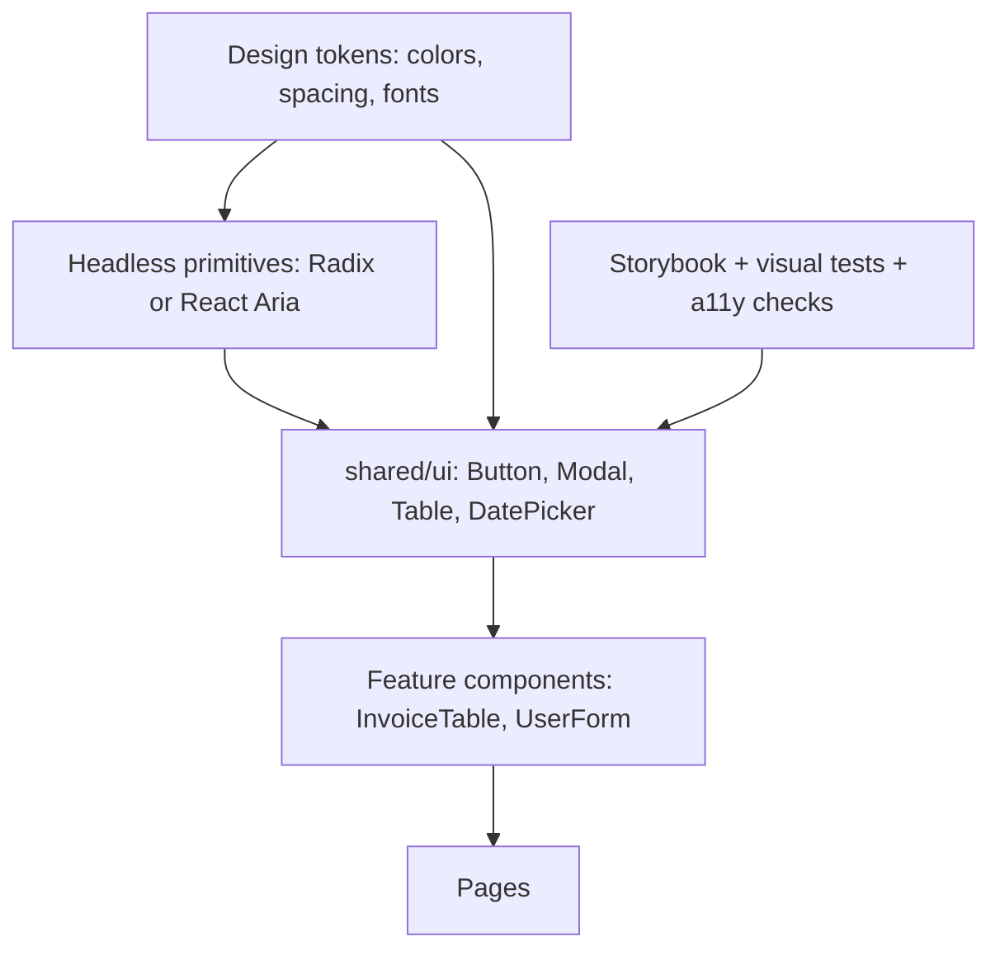

**Example (tokens):**

```css
:root {
  --color-primary: #2563eb;
  --color-danger: #dc2626;
  --space-2: 8px;
  --radius-md: 6px;
}
[data-theme="dark"] {
  --color-primary: #60a5fa; /* only token values change for dark mode */
}
.btn { background: var(--color-primary); padding: var(--space-2); border-radius: var(--radius-md); }
```

**Example (wrapping a headless Dialog, with `asChild`):**

```tsx
// shared/ui/dialog.tsx - our styled wrapper on top of Radix
import * as RadixDialog from "@radix-ui/react-dialog";

export const Dialog = RadixDialog.Root;
export const DialogTrigger = RadixDialog.Trigger;

export function DialogContent({ title, children }: { title: string; children: React.ReactNode }) {
  return (
    <RadixDialog.Portal>
      <RadixDialog.Overlay className="dialog-overlay" />
      {/* Radix gives focus trap, Esc to close and ARIA roles */}
      <RadixDialog.Content className="dialog-content">
        <RadixDialog.Title>{title}</RadixDialog.Title>
        {children}
      </RadixDialog.Content>
    </RadixDialog.Portal>
  );
}

// Usage in a feature. asChild: the trigger renders OUR Button, no extra <button>
<Dialog>
  <DialogTrigger asChild><Button variant="danger">Delete</Button></DialogTrigger>
  <DialogContent title="Delete this user?">...</DialogContent>
</Dialog>
```

**What goes in the shared library, and what doesn't:**

| Put in the library | Keep in the feature |
|---|---|
| Generic building blocks: Button, Input, Modal, Table, DatePicker, Toast, Tabs | `InvoiceTable` with billing columns and rules |
| Form field wrappers: label, hint, error message | The checkout form with its validation |
| Layout parts: Stack, Grid, PageHeader | A "seller dashboard" layout used once |
| Tokens, icons, typography | Business logic and API calls |
| Components used (or soon used) by 2–3 teams | A component one team needs today |

- Rule of thumb: **"used by three teams"** before it goes into the library.
- Avoid **overly generic** components. A `<SuperTable>` with 60 props is harder to use than composing `<Table>` parts.

**How to prevent 15 slightly different versions of the same component:**
- Make the right thing easy. The shared Button must be **better** than writing your own: accessible, documented, in Storybook.
- Composition and slots, so teams can extend instead of copy.
- A lint rule bans raw `<button>` or direct imports of Radix or MUI in feature code. Teams must use `shared/ui`.
- The design-system team (or a guild with one person per team) reviews `shared/ui` changes through CODEOWNERS.
- A clear process to ask for a new variant: issue → small RFC → added to the library.
- Regular audits: search for duplicates (`grep "Modal"`), merge them, give a codemod.

**Good and bad:**

| Good | Bad |
|---|---|
| Tokens shared with designers | Hex colors copied into 400 files |
| Radix or React Aria under the hood | Home-made modal without focus trap |
| `variant="danger"` | `isRed isBig isOutlined isRounded` |
| Semver, changelog, deprecation warnings | Breaking changes in a patch release |
| Visual tests on every PR | "Looks fine on my screen" |

**Say this in the interview:**

> I'd build the design system in layers. Design tokens at the bottom, then headless primitives like Radix or React Aria for accessibility.
> Our own styled components sit on top.
> Components use composition, compound parts and variants, not dozens of boolean props.
> Every component lives in Storybook with visual regression tests, and we ship it as a versioned package with deprecations and codemods.
> Only generic, reused pieces go into the library. Business components stay in their feature.

**They may ask next:**
- **"Build it yourself or use MUI / shadcn/ui?"** Small team: start from shadcn/ui or a headless library and own the code. Big company with a brand: own design system on headless primitives. Building accessibility from zero is too costly.
- **"How do you roll out a breaking change?"** Deprecate first, warn in the console, give a codemod, then remove in the next major version.
- **"How do teams get a new feature in the library fast?"** They build it in their feature first. Once a second team needs it, we move it into the library.
- **"How do you test accessibility?"** Storybook a11y addon or axe in tests. Plus keyboard-only checks for each component.

---

## Component patterns

**In one line:** Component patterns are proven ways to split and reuse UI. The main ones today are composition, compound components, custom hooks and headless components.

**Story:** Think of a modular kitchen.
- The carpenter builds standard boxes (components). You choose what goes inside each box (children and slots).
- Some parts only work together: a drawer, its rail and its handle (compound components).
- The gas pipe and wiring are the same in every house. Only the cabinet colour changes (headless components: same behavior, your own style).

**The patterns at a glance:**

| Pattern | One line | Still common in 2026? |
|---|---|---|
| Controlled / uncontrolled | Who owns the value: the parent or the component | Yes, everywhere |
| Composition and `children` | Pass UI in, instead of passing data through | Yes, the default |
| Compound components | Parts that share hidden state: `<Tabs>`, `<Tabs.Tab>` | Yes, in design systems |
| Render props | Pass a function that returns UI | Some: lists, virtual lists, old libraries |
| Higher-order components (HOCs) | A function that wraps a component | Rare, mostly old code |
| Custom hooks | Share logic as a function | Yes, the main reuse pattern |
| Headless components | Behavior and accessibility, no styles | Yes: Radix, React Aria, TanStack Table |

**Diagram:** which pattern to reach for.

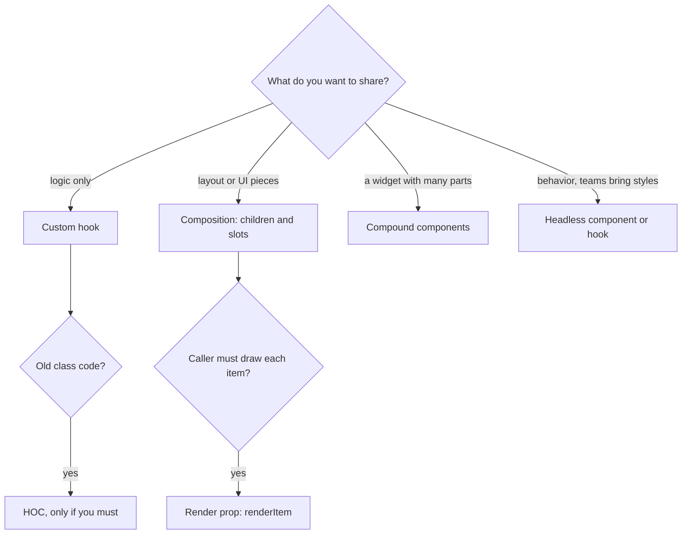

### Controlled vs uncontrolled components

**In one line:** A controlled component gets its value from props and reports changes; an uncontrolled one keeps its own value and you read it when needed.

**How it works:**
- **Controlled:** `<input value={name} onChange={e => setName(e.target.value)} />`. React state is the *single source of truth*. Good for live validation, formatting, and inputs that depend on each other.
- **Uncontrolled:** `<input defaultValue="Ann" name="name" />`. The DOM keeps the value. Read it with a ref or `FormData` on submit. Less code, fewer renders. React 19 form actions and React Hook Form use this style.
- **Never switch** between them. `value={undefined}` and later `value="x"` makes React warn "changing an uncontrolled input to be controlled". Use `value={name ?? ""}`.
- Good shared components support **both**, like the native `<input>` does.

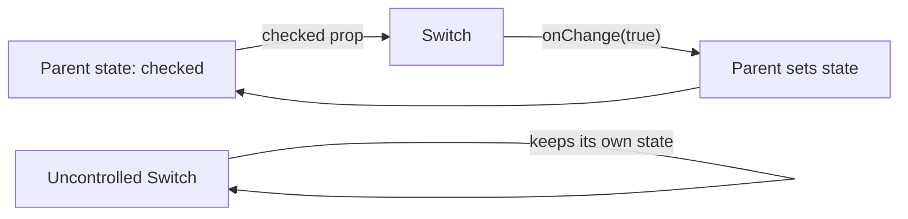

```tsx
import { useState } from "react";

// Works both ways: pass `checked` (controlled) or only `defaultChecked` (uncontrolled)
type Props = { checked?: boolean; defaultChecked?: boolean; onChange?: (v: boolean) => void; label: string };

export function Switch({ checked, defaultChecked = false, onChange, label }: Props) {
  const [inner, setInner] = useState(defaultChecked);
  const isControlled = checked !== undefined;
  const value = isControlled ? checked : inner;            // parent wins when it controls
  function toggle() {
    if (!isControlled) setInner(!value);
    onChange?.(!value);                                    // always tell the parent
  }
  return <button role="switch" aria-checked={value} onClick={toggle}>{label}</button>;
}
// <Switch label="Wi-Fi" defaultChecked />                       uncontrolled
// <Switch label="Wi-Fi" checked={on} onChange={setOn} />         controlled
```

### Composition and children

**In one line:** Build bigger components by passing finished pieces of UI in (`children`, slots), instead of passing data through many layers.

- This is the first fix for *prop drilling* (passing props through components that do not use them).
- A *slot* is a named prop that takes JSX: `header`, `sidebar`, `actions`, `footer`.
- The middle components stop knowing about `user`. They just place what they get.
- Bonus: if the parent re-renders but `children` is the same element, React can skip work inside it.

```tsx
type User = { name: string; avatarUrl: string };
const Avatar = ({ user }: { user: User }) => ;

// Bad: Page -> Layout -> Header -> Avatar, and Layout and Header only pass `user` along
// Good: build the Avatar where the data is, and pass the finished element down as a slot
function Layout({ header, sidebar, children }: { header: React.ReactNode; sidebar?: React.ReactNode; children: React.ReactNode }) {
  return (
    <div className="layout">
      <header>{header}</header>
      {sidebar && <aside>{sidebar}</aside>}
      <main>{children}</main>
    </div>
  );
}

export function Page({ user }: { user: User }) {
  return (
    <Layout header={<Avatar user={user} />} sidebar={<nav>Menu</nav>}>
      <p>Welcome back, {user.name}</p>
    </Layout>
  );
}
```

### Compound components

**In one line:** A group of components that work together and share state through a hidden context, like `<select>` and `<option>`.

- The parent (`<Tabs>`) owns the state and puts it in a context.
- The parts (`<Tabs.List>`, `<Tabs.Tab>`, `<Tabs.Panel>`) read it. The user of the component never wires them up.
- The caller decides the **order and layout** of the parts. No `tabs={[...]}` config array with 15 options.
- Used by Radix, React Aria, Headless UI and most design systems.
- A full, tested Tabs is in the [machine coding round](#4-tabs-compound-components).

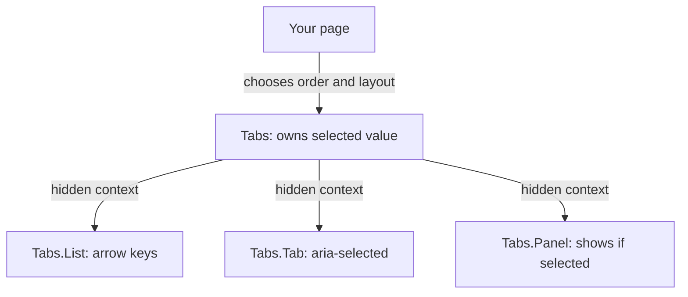

```tsx
<Tabs defaultValue="profile">
  <Tabs.List label="Account">
    <Tabs.Tab value="profile">Profile</Tabs.Tab>
    <Tabs.Tab value="billing">Billing</Tabs.Tab>
  </Tabs.List>
  <Tabs.Panel value="profile"><ProfileForm /></Tabs.Panel>
  <Tabs.Panel value="billing"><Invoices /></Tabs.Panel>
</Tabs>
```

### Render props

**In one line:** A component takes a function prop and calls it to draw part of its UI. The component owns the logic, the caller owns the look.

- Classic examples: `<MouseTracker render={pos => ...}>`, `<Formik>{form => ...}</Formik>`, `renderItem` in lists.
- Before hooks, this was the main way to share stateful logic. Most of these are now custom hooks.
- Still a good fit when a component must let the caller draw **each item**: `renderRow`, `renderOption`.
- Downside: nesting several render props creates a "pyramid" that is hard to read.

```tsx
import { useEffect, useState } from "react";

type Pos = { x: number; y: number };
// Render prop: the component owns the logic, the caller decides what to draw
export function MouseTracker({ render }: { render: (pos: Pos) => React.ReactNode }) {
  const [pos, setPos] = useState<Pos>({ x: 0, y: 0 });
  useEffect(() => {
    const onMove = (e: MouseEvent) => setPos({ x: e.clientX, y: e.clientY });
    window.addEventListener("mousemove", onMove);
    return () => window.removeEventListener("mousemove", onMove);
  }, []);
  return <>{render(pos)}</>;
}
// <MouseTracker render={({ x, y }) => <Tooltip left={x} top={y} />} />

// The same logic as a custom hook: no wrapper component, easy to combine
export function useMousePosition(): Pos {
  const [pos, setPos] = useState<Pos>({ x: 0, y: 0 });
  useEffect(() => {
    const onMove = (e: MouseEvent) => setPos({ x: e.clientX, y: e.clientY });
    window.addEventListener("mousemove", onMove);
    return () => window.removeEventListener("mousemove", onMove);
  }, []);
  return pos;
}
```

### Higher-order components (HOCs)

**In one line:** An HOC is a function that takes a component and returns a new component with extra props or behavior.

- Old examples: Redux `connect()`, `withRouter` (removed in React Router v6), `withStyles`. `React.memo` is technically an HOC too.
- **Why hooks replaced most HOCs:**
  - *Wrapper hell*: `withA(withB(withC(Page)))` adds many layers in DevTools.
  - Hidden props: you cannot see where `user` came from.
  - Prop name clashes: two HOCs both inject `data`.
  - Hard to type in TypeScript.
- Still fine for: wrapping many routes with the same guard, or adding a cross-cutting thing like an error boundary.

```tsx
type User = { name: string; role: "admin" | "user" };

// HOC: a function that takes a component and returns a new component
export function withAuth<P extends object>(Wrapped: React.ComponentType<P & { user: User }>) {
  function WithAuth(props: P) {
    const user = useCurrentUser();
    if (!user) return <LoginPage />;
    return <Wrapped {...props} user={user} />;            // injects a `user` prop
  }
  WithAuth.displayName = `withAuth(${Wrapped.displayName ?? Wrapped.name})`; // readable in DevTools
  return WithAuth;
}
// const AdminPage = withAuth(withTheme(withRouter(Page)));  // wrapper hell: who added which prop?

// Hook version: the dependency is visible right where it is used
export function RequireAuth({ children }: { children: React.ReactNode }) {
  const user = useCurrentUser();
  return user ? children : <LoginPage />;
}
```

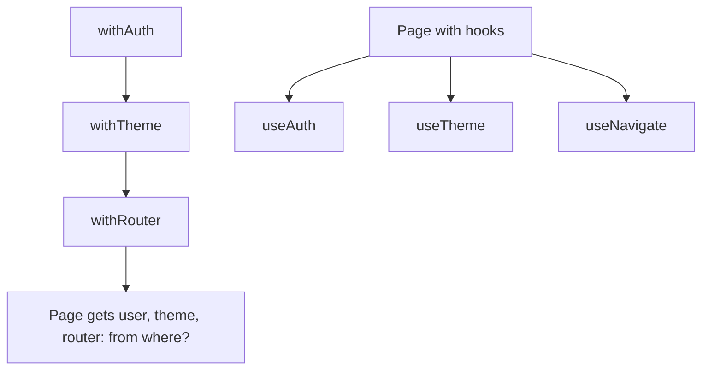

### Custom hooks: the main reuse pattern

**In one line:** A custom hook is a function starting with `use` that calls other hooks, so components can share logic without changing the component tree.

- Each caller gets **its own** state. Hooks share logic, not data. To share data, use context or a store.
- Good custom hooks do one job: `useDebounce`, `useOnlineStatus`, `useMediaQuery`, `useUser(id)`.
- Return a small, clear API: a value, a tuple, or an object with a few fields.
- Put business hooks in their feature folder, generic ones in `shared/hooks`. See [Structuring a large React app](#structuring-a-large-react-app).
- Test them with `renderHook` from React Testing Library.
- Examples: [useDebounce and useFetch](#14-usefetch-and-usedebounce-custom-hooks), and [useRef, useMemo, useCallback, custom hooks](#useref-usememo-usecallback-custom-hooks).

### Headless components

**In one line:** A headless component (or hook) gives behavior, keyboard support and ARIA attributes, but no styles, so each team can make it look their own way.

- Examples: Radix UI and React Aria (components), TanStack Table and Downshift (hooks), Headless UI.
- Common API style: *prop getters* (`getButtonProps()`) that return the right `aria-*`, `id` and handlers.
- This is the base layer of a good design system. See [Shared UI and design systems](#shared-ui-and-design-systems).

```tsx
import { useId, useState } from "react";

// Headless hook: behavior + ARIA, zero styles. "Prop getters" hand out the right props.
export function useDisclosure(initial = false) {
  const [open, setOpen] = useState(initial);
  const id = useId();
  return {
    open,
    toggle: () => setOpen(o => !o),
    getButtonProps: () => ({ "aria-expanded": open, "aria-controls": id, onClick: () => setOpen(o => !o) }),
    getPanelProps: () => ({ id, hidden: !open }),
  };
}

// Each team styles it its own way; behavior and accessibility stay the same
export function FaqItem({ q, a }: { q: string; a: string }) {
  const d = useDisclosure();
  return (
    <div className="faq">
      <button className="faq-q" {...d.getButtonProps()}>{q}</button>
      <p className="faq-a" {...d.getPanelProps()}>{a}</p>
    </div>
  );
}
```

### Choosing a pattern

**Good and bad:**

| Good | Bad |
|---|---|
| Custom hooks for shared logic | HOC chains for logic in new code |
| Composition before context to fix prop drilling | Context for everything |
| Compound components for multi-part widgets | One component with 40 props and a config array |
| Components that support controlled and uncontrolled use | A component that switches between both by accident |
| Headless library for complex widgets | Writing your own combobox and focus trap from zero |

**Say this in the interview:**

> "My default is composition: small components, children and slots. Shared logic goes into custom hooks, which replaced most HOCs and render props because they don't add wrapper layers and the data source is visible. For widgets with several parts, like Tabs, I use compound components with a hidden context. For design systems I build on headless primitives like Radix or React Aria, so behavior and accessibility are solved once. Shared inputs support both controlled and uncontrolled use, like native inputs."

**They may ask next:**
- **When is a render prop still better than a hook?** When the caller must draw each item inside your layout, like `renderRow` in a virtual list. A hook cannot place UI inside your component.
- **How do compound components share state?** Through a context created by the parent. The parts read it with `use` or `useContext`. A hook that throws gives a clear error if a part is used outside its parent.
- **What is the `asChild` pattern?** A Radix idea: the component gives its behavior and props to your child element instead of rendering its own tag. See [Shared UI and design systems](#shared-ui-and-design-systems).
- **How do you avoid a "god component" with 40 props?** Split it into compound parts and slots. Use `variant` props instead of many booleans.

---

## State management: which state goes where

**In one line:** Each kind of state has its own home. Keep it local first. Server data goes in a server cache, shareable filters in the URL, and only real global client state in a store.

**Story:** Think of where you keep things at home.
Your toothbrush stays in your bathroom (local state). The family calendar is on the fridge for everyone (Context or a global store).
Your bank balance is not written on the fridge. It lives at the bank, and you check it when needed (server state).
Your home address is written on letters, so anyone can find you (URL state).

**The types of state:**

| State type | Example | Where it lives |
|---|---|---|
| Local UI state | Is this dropdown open? Input text | `useState` / `useReducer` in the component |
| Lifted state | Two sibling components share a selected tab | `useState` in the nearest common parent |
| Context | Current user, theme, locale | React Context, values that change rarely |
| URL state | `/products?sort=price&category=shoes&page=2` | Search params in the router |
| Server state | Users list, orders, product details | TanStack Query (or RTK Query, SWR) |
| Global client state | Cart before checkout, editor state, multi-step wizard | Zustand, Redux Toolkit or Jotai |
| Form state | Field values, errors, touched, dirty | React Hook Form |

**Diagram (how to choose):**

```mermaid
flowchart TD
    Q1{"Does it come from the server?"} -->|"yes"| SV["Server state: TanStack Query"]
    Q1 -->|"no"| Q2{"Should it survive refresh or be shared by link?"}
    Q2 -->|"yes"| URL["URL search params"]
    Q2 -->|"no"| Q3{"Is it form input?"}
    Q3 -->|"yes"| FORM["React Hook Form"]
    Q3 -->|"no"| Q4{"Used by one component or a small subtree?"}
    Q4 -->|"yes"| LOCAL["useState, lift to the nearest parent"]
    Q4 -->|"no"| Q5{"How often does it change?"}
    Q5 -->|"rarely: user, theme"| CTX["Context"]
    Q5 -->|"often: cart, editor"| STORE["Zustand or Redux Toolkit"]
```

**Example (URL state for filters):**

```tsx
import { useSearchParams } from "react-router";

function ProductFilters() {
  const [params, setParams] = useSearchParams();
  const sort = params.get("sort") ?? "price"; // read from the URL, not useState

  return (
    <select
      value={sort}
      onChange={(e) => setParams((p) => { p.set("sort", e.target.value); return p; })}
    >
      <option value="price">Price</option>
      <option value="rating">Rating</option>
    </select>
  );
}
// Back button, refresh and "share this link" now just work.
```

**Example (small global store with Zustand):**

```ts
import { create } from "zustand";

type CartState = { items: CartItem[]; add: (item: CartItem) => void };

export const useCart = create<CartState>((set) => ({
  items: [],
  add: (item) => set((s) => ({ items: [...s.items, item] })),
}));

// Select only what you need: this component re-renders only when the count changes
const count = useCart((s) => s.items.length);
```

**Redux Toolkit vs Zustand vs Jotai (simple view):**

| | Redux Toolkit | Zustand | Jotai |
|---|---|---|---|
| Idea | One store, actions, reducers (slices) | One small hook-based store | Many small "atoms" of state |
| Boilerplate | Medium (much less than old Redux) | Very little | Very little |
| DevTools, time travel | Excellent | Yes, through middleware | Yes, basic |
| Server data | RTK Query built in | Use TanStack Query | Use TanStack Query |
| Best for | Big teams that want strict patterns, existing Redux apps | Most apps that need a little global state | Many small independent pieces, like an editor |
| Provider needed | Yes | No | Optional |

- Context is not a state manager. It is a way to pass a value down. Fine for values that rarely change.

**Why putting all API responses into Redux is a bad idea:**
- **You rebuild a cache by hand.** Loading flags, error flags, "is this data old?", refetch on window focus, retry. TanStack Query gives all this for free.
- **Invalidation is hard.** After you update a user, which slices hold that user? You must find and update each one.
- **Duplicated state.** The same user sits in `usersSlice`, `ordersSlice` and `teamSlice`. The copies drift apart.
- **No deduplication.** Two components dispatch `fetchUser(42)` and you send two requests.
- **No garbage collection.** Data for pages the user left stays in memory forever.
- **Race conditions.** A slow old response can overwrite a newer one.
- Fair answer: if the team is already on Redux, use **RTK Query**. It is a real server-state cache inside Redux.

**Context performance pitfalls:**
- When a Context value changes, **every** component that reads that Context re-renders.
- A new object on every render (`value={{ user, setUser }}`) means a new value every time, so all consumers re-render.
- One big `AppContext` with user, theme, cart and notifications: a new notification re-renders the whole app.

**Fixes:**
- **Split contexts** by how often they change: `UserContext`, `ThemeContext`, `CartContext`.
- Put state and setters in separate contexts. Components that only call `setX` won't re-render.
- Memoize the value with `useMemo`, or let the React Compiler do it.
- If a value changes often and many components read it, use Zustand with selectors instead.

**Example (split contexts, React 19 syntax):**

```tsx
const ThemeContext = createContext<"light" | "dark">("light");
const UserContext = createContext<User | null>(null);

function AppProviders({ user, children }: { user: User | null; children: React.ReactNode }) {
  const [theme] = useState<"light" | "dark">("light");
  return (
    // React 19: render <Context> directly, no .Provider needed
    <ThemeContext value={theme}>
      <UserContext value={user}>{children}</UserContext>
    </ThemeContext>
  );
}
// A theme change no longer re-renders components that only read the user.
```

**Good and bad:**

| Good | Bad |
|---|---|
| Local first, lift only when needed | Everything global "just in case" |
| Filters and page number in the URL | Filters in Redux, lost on refresh |
| API data in TanStack Query | API data copied into Redux and Context |
| Split contexts by change rate | One giant `AppContext` |
| Derive values while rendering | Store `fullName` next to `firstName` and `lastName` |

**Say this in the interview:**

> I sort state by type. Local UI state stays in the component. Shareable things like filters and page numbers go in the URL.
> Server data goes into a server-state cache like TanStack Query, because it handles caching, deduplication and invalidation.
> Only true global client state, like a cart or an editor, goes into Zustand or Redux Toolkit.
> Context is for values that change rarely, and I split it so one change doesn't re-render the whole app.

**They may ask next:**
- **"Can I derive this instead of storing it?"** Yes, usually. Calculate `total` from `items` while rendering. Stored copies get out of sync.
- **"Where does the logged-in user live?"** Fetch it with TanStack Query (`["me"]`). Put it in Context only if many components need it and you want a simple hook.
- **"When is `useReducer` better than `useState`?"** When several values change together, or the next state depends on clear actions, like a wizard.

---

## Data fetching in a large app

**In one line:** Treat server data as a cache. Use one typed API client, query hooks per feature and stable query keys. Let TanStack Query handle caching, deduplication and invalidation.

**Story:** Think of a library in an office.
When someone needs a book, the librarian checks the shelf first. If two people ask for the same book at the same time, she orders it once.
When a new edition arrives, she removes the old one so nobody reads outdated pages.
TanStack Query is that librarian. The API is the publisher.

**Why not just `useEffect` + `fetch`?**
- No cache. Each component fetches again.
- No deduplication. Two components = two requests.
- Race conditions when the user types fast.
- You write loading, error and retry logic again in every component.
- Part 1 explains effects: [useEffect: syncing with outside systems](#useeffect-syncing-with-outside-systems).

**How it works (TanStack Query v5):**
1. **One API client** in `shared/lib/apiClient.ts`. It handles the base URL, auth headers or cookies, JSON and errors in one place.
2. **Query hooks per feature**, in `features/users/api/`. Components call `useUser(id)`. They never call `fetch` directly.
3. **Query keys** are arrays that name the data: `["users", "detail", 42]`. Same key = same cache entry.
4. **Caching.** Data is stored by key. When a component asks again, it gets cached data at once.
5. **`staleTime` vs `gcTime`** (see the table below).
6. **Invalidation.** After a change (mutation), mark related keys as old: `invalidateQueries({ queryKey: ["users"] })`. Active screens refetch.
7. **Deduplication.** Two components ask for the same key at the same time → one request.
8. **States.** `isPending` (no data yet), `isError`, empty data, and success. Design all four.

| Setting | Meaning | Default | Example |
|---|---|---|---|
| `staleTime` | How long data counts as **fresh**. Fresh data is not refetched. | `0` (stale at once) | `60_000`: user profile is fresh for 1 minute |
| `gcTime` | How long **unused** data stays in memory after the last component using it unmounts. | 5 minutes | Go back to a page within 5 minutes → instant |

- In v4 `gcTime` was called `cacheTime`. In v5 `isLoading` for "no data yet" became `isPending`.
- Stale data is still shown. It is refetched in the background on mount, window focus or reconnect.

**Example (API client + query hooks for one feature):**

```ts
// features/users/api/users.ts
import { queryOptions, useQuery } from "@tanstack/react-query";
import { apiClient } from "@/shared/lib/apiClient";

export const userKeys = {
  all: ["users"] as const,
  list: (filters: UserFilters) => ["users", "list", filters] as const,
  detail: (id: string) => ["users", "detail", id] as const,
};

export const userQuery = (id: string) =>
  queryOptions({
    queryKey: userKeys.detail(id),              // same key = same cache entry
    queryFn: () => apiClient.get<User>(`/users/${id}`),
    staleTime: 60_000,                          // fresh for 1 minute, no refetch
  });

export const useUser = (id: string) => useQuery(userQuery(id));
```

**What happens if two components request the same user?** The `Header` and the `ProfilePage` both call `useUser("42")`.

```mermaid
sequenceDiagram
    participant Header
    participant Profile
    participant Cache
    participant API
    Header->>Cache: useUser 42
    Cache->>API: GET /users/42
    Profile->>Cache: useUser 42
    Note over Cache: same key and request in flight, no second call
    API-->>Cache: user 42
    Cache-->>Header: data
    Cache-->>Profile: data
    Note over Cache: fresh for staleTime, kept for gcTime after unmount
```

**Example (the idea behind deduplication, plain JS):**

```js
// dedupe.mjs - run with: node dedupe.mjs
const inFlight = new Map();
let calls = 0;

async function fetchUserFromApi(id) {
  calls++;
  await new Promise((r) => setTimeout(r, 50)); // pretend network
  return { id, name: "Asha" };
}

function getUser(id) {
  const key = `user:${id}`;
  if (!inFlight.has(key)) {
    // first caller starts the request, later callers reuse the same promise
    inFlight.set(key, fetchUserFromApi(id).finally(() => inFlight.delete(key)));
  }
  return inFlight.get(key);
}

const [a, b] = await Promise.all([getUser(42), getUser(42)]);
console.log(a === b, calls); // true 1
```

**Example (loading, error and empty states):**

```tsx
function OrdersPage({ filters }: { filters: OrderFilters }) {
  const { data, isPending, isError, error, refetch } = useOrders(filters);

  if (isPending) return <OrdersSkeleton />;            // no data yet
  if (isError) return <ErrorState message={error.message} onRetry={refetch} />;
  if (data.items.length === 0) return <EmptyState title="No orders yet" />;
  return <OrdersTable orders={data.items} />;
}
```

- Use a skeleton (grey placeholder shapes), not a spinner, for big areas. The page does not jump.
- The empty state tells the user what to do next ("Create your first order").
- An error boundary catches render errors. Query errors can also go to the nearest boundary with `throwOnError`.

**Example (invalidation after a mutation):**

```ts
export function useUpdateUser() {
  const qc = useQueryClient();
  return useMutation({
    mutationFn: (u: User) => apiClient.put<User>(`/users/${u.id}`, u),
    onSuccess: (saved) => {
      qc.setQueryData(userKeys.detail(saved.id), saved);   // update detail at once
      qc.invalidateQueries({ queryKey: userKeys.all });     // lists refetch in background
    },
  });
}
```

**Optimistic updates with rollback:**
*Optimistic* means "show the result before the server says yes". It makes the app feel instant. If the server says no, you roll back.

```ts
export function useToggleTodo() {
  const qc = useQueryClient();
  return useMutation({
    mutationFn: (todo: Todo) => apiClient.patch(`/todos/${todo.id}`, { done: !todo.done }),
    onMutate: async (todo) => {
      await qc.cancelQueries({ queryKey: ["todos"] });     // stop a refetch overwriting us
      const previous = qc.getQueryData<Todo[]>(["todos"]); // snapshot for rollback
      qc.setQueryData<Todo[]>(["todos"], (old = []) =>
        old.map((t) => (t.id === todo.id ? { ...t, done: !t.done } : t)));
      return { previous };
    },
    onError: (_err, _todo, result) => {
      qc.setQueryData(["todos"], result?.previous);        // rollback + show a toast
    },
    onSettled: () => qc.invalidateQueries({ queryKey: ["todos"] }), // sync with server truth
  });
}
```

- The third argument of `onError` is what `onMutate` returned. Recent v5 docs name it `onMutateResult`. They also pass a 4th `context` argument with `client`.
- A simpler way: show the pending item from `mutation.variables` while `isPending` is true. No cache editing needed.
- React 19 also has `useOptimistic` for forms and actions.
- Use optimistic updates for likes, toggles and reordering. Avoid them for payments or anything the server often rejects.

**Pagination and infinite lists:**

```ts
const orders = useInfiniteQuery({
  queryKey: ["orders", "infinite", status],
  queryFn: ({ pageParam }) => apiClient.get<OrderPage>(`/orders?status=${status}&cursor=${pageParam ?? ""}`),
  initialPageParam: null as string | null,                     // required in v5
  getNextPageParam: (lastPage) => lastPage.nextCursor ?? undefined, // undefined = no more pages
});
// orders.data.pages is an array of pages; call orders.fetchNextPage() on scroll
```

- For page numbers, put the page in the query key: `["orders", { page: 2 }]`.
- Use `placeholderData: keepPreviousData` so the old page stays visible while the next one loads.
- Prefer *cursor* pagination (a "start after this item" token) for big, changing lists. Offsets skip or repeat rows when new rows arrive.

**Prefetching:** load data before the user needs it.
- On hover over a link: `onMouseEnter={() => qc.prefetchQuery(userQuery(id))}`.
- In a route loader: `await qc.ensureQueryData(userQuery(id))`. The page opens with data ready.

**Server Components and Next.js:**
- With Next.js App Router, much data fetching moves to the server in Server Components. The browser gets ready HTML.
- TanStack Query is still useful in Client Components: live updates, infinite scroll, optimistic updates.
- You can prefetch on the server and *hydrate* the cache in the browser (pass the data, so the browser does not fetch it again).
- Details: [Next.js architecture and Server Components](../docs/nextjs.md#nextjs-architecture-and-server-components).

**Good and bad:**

| Good | Bad |
|---|---|
| One API client, query hooks per feature | `fetch` inside 300 components |
| Query key factory per feature | Hand-written key strings that don't match |
| Invalidate related keys after mutations | Manually refetch 5 things after a save |
| Design pending, error, empty and success | Only the happy path |
| Optimistic update with rollback | Optimistic update that never rolls back |

**Say this in the interview:**

> I treat server data as a cache, not as app state. API calls go through one typed client, and each feature exposes query hooks like `useUser(id)`.
> TanStack Query caches by key, so two components asking for the same user share one request.
> After a mutation I invalidate the related keys, and for fast actions I do optimistic updates with rollback.
> I always design the loading, error and empty states, not just the happy path.

**They may ask next:**
- **"Where do API calls live?"** In `features/<name>/api/`, using the shared `apiClient`. Components only use hooks.
- **"How do you handle auth errors (401)?"** In the API client: try a token refresh once, else redirect to login. Not in every component.
- **"How do you show server validation errors?"** Map the backend error (for example a Spring `ProblemDetail`) to form fields. See [Global error handling with ProblemDetail](../docs/spring-ecosystem.md#global-error-handling-with-restcontrolleradvice-and-problemdetail).
- **"How do you avoid race conditions in search?"** Put the search text in the query key. TanStack Query ignores old responses for old keys and can cancel them with the `signal`.
- **"Real-time data?"** WebSocket or server-sent events, then `setQueryData` or `invalidateQueries` when a message arrives.

---

## Routing and code splitting

**In one line:** A router maps the URL to screens and their data, and code splitting downloads each screen's code only when the user needs it.

**Story:** A big mall has 200 shops. At the gate you get a small map of the ground floor, not a 200-page book about every shop.
When you walk to the food court, someone hands you the food court menu. A smart guide sees you walking that way and gets the menu ready before you arrive (prefetching).

**How it works (routing):**
1. **React Router** is the most used router. The current major is **v8** (June 2026). Package: `react-router` (the old `react-router-dom` package was removed in v8; DOM parts are in `react-router/dom`). v8 needs React 19.2.7+ and Node 22.22+ for its tools.
   - It has three modes: **declarative** (`<BrowserRouter>` and `<Routes>`, just routing), **data** (`createBrowserRouter` with loaders and actions) and **framework** (the old Remix: file routes, SSR, type generation).
   - React Router v6 is end of life.
2. **TanStack Router** is the main other choice for client apps. It has fully typed routes, typed and validated search params, loaders with caching, and preloading.
3. **Next.js App Router** uses folders as routes and Server Components. See [nextjs.md](nextjs.md#nextjs-architecture-and-server-components).
4. **Nested routes and layouts.** A parent route renders a layout and an `<Outlet />`. The child route renders inside it. The layout does not remount when you move between children.
5. **Loaders** fetch data **before** the screen renders, in parallel for all nested routes. This avoids *waterfalls* (parent fetches, renders, then child starts fetching).
6. **The URL is state.** Filters, sort, page and the selected tab belong in search params. See [State management](#state-management-which-state-goes-where).

**How it works (code splitting):**
1. `import("./Reports")` (a *dynamic import*) tells the bundler (Vite, Rollup, webpack) to put that module in a separate file called a *chunk*.
2. `React.lazy(() => import("./Reports"))` turns it into a component. The first render *suspends* until the chunk arrives. `<Suspense fallback>` shows a loader.
3. **Split by route first.** Each page is a natural chunk. Users rarely visit all pages.
4. **Then split heavy widgets:** rich text editors, charts, maps, PDF viewers, admin-only tools.
5. Do not split tiny components. Each chunk is an extra request.
6. **Prefetch** the next chunk before the click:
   - On hover or focus of a link ("intent"). React Router framework mode: `<Link prefetch="intent">` (also `"render"`, `"viewport"`, `"none"`). TanStack Router: `defaultPreload: "intent"`.
   - Call the `import()` yourself on `onMouseEnter`. The browser caches the module, so the later `lazy` load is instant.
7. **Check the result** with a bundle analyzer (for example `rollup-plugin-visualizer` for Vite). Set a size budget in CI.

**Diagram:** route-based splitting with prefetch.

```mermaid
sequenceDiagram
    participant User
    participant App
    participant CDN
    User->>App: open /
    App->>CDN: main.js (shell + home route)
    User->>App: hover "Reports" link
    App->>CDN: prefetch reports chunk and its data
    User->>App: click "Reports"
    App-->>User: render at once (chunk already here)
```

**Example 1: React Router v8, data mode, with a lazy route.**

```tsx
import { createBrowserRouter, Outlet, Link } from "react-router";
import { RouterProvider } from "react-router/dom";

function RootLayout() {
  return <><nav><Link to="/">Home</Link> <Link to="/reports">Reports</Link></nav><Outlet /></>; // child route renders here
}

const router = createBrowserRouter([
  {
    path: "/", Component: RootLayout,
    children: [
      { index: true, Component: Home },
      { path: "reports", lazy: () => import("./reports-route") },               // code + loader load on first visit
      { path: "users/:id", loader: ({ params }) => fetchUser(params.id!), Component: UserPage }, // data before render
      { path: "*", Component: NotFound },
    ],
  },
]);

export default function App() {
  return <RouterProvider router={router} />;
}
```

- `lazy` returns the route module. Its exports (`Component`, `loader`, `ErrorBoundary`) are added to the route on first visit.
- In framework mode, every route file is split automatically.

**Example 2: lazy load a heavy editor and start the download on hover.**

```tsx
import { lazy, Suspense, useState } from "react";

const loadEditor = () => import("./RichEditor");                         // same promise is cached by the bundler
const RichEditor = lazy(() => loadEditor().then(m => ({ default: m.RichEditor }))); // named export -> default

export function Post({ body }: { body: string }) {
  const [editing, setEditing] = useState(false);
  return (
    <article>
      {!editing && <p>{body}</p>}
      <button onMouseEnter={loadEditor} onFocus={loadEditor} onClick={() => setEditing(true)}>
        Edit {/* hover or focus starts the download, so the click feels instant */}
      </button>
      <Suspense fallback={<p>Loading editor…</p>}>
        {editing && <RichEditor initial={body} />}
      </Suspense>
    </article>
  );
}
```

**Things that go wrong:**
- **`lazy()` inside a component.** It creates a new component type every render, so React remounts it and state is lost. Always call `lazy` at the top level of a module.
- **Chunk load error after a deploy.** A user has the old app open. You deploy, the old chunk files are deleted, and the next `import()` fails with a 404. Fixes: keep old assets for a few days, and in the route error boundary offer "A new version is available, reload".
- **Spinner flashes everywhere.** Put Suspense boundaries at meaningful places (route, panel). Use transitions for navigation so the old page stays visible while the new one loads.
- **Waterfalls.** A lazy component that starts fetching only after its code arrives. Start code and data together (route loaders, or prefetch both).
- **Protected routes.** Check auth in the loader (or a middleware in React Router v8) and redirect before render. Hiding a menu link is not security. The API must check too.

**Good and bad:**

| Good | Bad |
|---|---|
| Route-based splitting first | One 3 MB bundle for 200 screens |
| Prefetch on hover or focus | Waiting for the click to start the download |
| Loaders fetch in parallel before render | Each nested component fetching in `useEffect` |
| Filters and page in search params | Filters in component state, lost on refresh |
| `lazy` at module top level | `lazy` inside a component body |
| Bundle budget checked in CI | Nobody notices the bundle doubled |

**Say this in the interview:**

> "I use React Router, now version 8, or TanStack Router when I want typed routes and search params. Routes are nested, so layouts stay mounted, and loaders fetch data in parallel before render to avoid waterfalls. I split code by route first with lazy and Suspense, then split heavy widgets like editors and charts. I prefetch on hover or focus, so clicks feel instant. And I plan for chunk load errors after a deploy with an error boundary that offers a reload."

**They may ask next:**
- **What is the difference between `lazy` + Suspense and route `lazy`?** `React.lazy` splits a component. Route `lazy` splits the whole route module, including its loader, so code and data can load together.
- **How do you restore scroll position?** React Router has `<ScrollRestoration />` in data and framework mode. For virtual lists, save the scroll offset yourself.
- **How do you measure if splitting helped?** Compare JavaScript size per route in the bundle analyzer, and LCP and INP in real user monitoring. See [Frontend UI: code splitting](frontend-ui.md#code-splitting).
- **Hash router or browser router?** Browser router (real paths) for almost everything. It needs the server to return `index.html` for unknown paths. Hash router only when you cannot change the server, like some static hosting.

---

## Forms

**In one line:** Use React Hook Form for speed and Zod for one schema that validates and types the data. Always validate again on the server.

**Story:** Think of a bank form at the counter.
You fill it in alone. The clerk does not watch every letter you write (uncontrolled). She checks it when you hand it in (submit).
Then the back office checks it again, because a form can still have mistakes (server validation).

**How it works:**
1. **Controlled input:** React state holds the value (`value` + `onChange`). Every key press re-renders the component.
2. **Uncontrolled input:** the browser (DOM) holds the value. React reads it when needed. Fewer re-renders.
3. **React Hook Form (RHF)** uses uncontrolled inputs with `register`. A form with 50 fields does not re-render the whole form on each key press.
4. **Zod** describes the data once. You get validation **and** the TypeScript type from the same schema.
5. **`zodResolver`** connects Zod to RHF.
6. **Server validation** is still required. The client check is for user experience. The server check is for safety. Show server errors next to the right field with `setError`.

**Example (React Hook Form + Zod):**

```tsx
import { useForm } from "react-hook-form";
import { zodResolver } from "@hookform/resolvers/zod";
import { z } from "zod";

const schema = z.object({
  email: z.email("Enter a valid email"),           // Zod 4 style
  age: z.number().int().min(18, "Must be 18 or older"),
});
type FormValues = z.infer<typeof schema>;          // type comes from the schema

export function SignupForm() {
  const { register, handleSubmit, setError, formState: { errors, isSubmitting } } =
    useForm<FormValues>({ resolver: zodResolver(schema), mode: "onBlur" });

  const onSubmit = async (values: FormValues) => {
    const res = await api.signup(values);
    if (res.fieldErrors?.email) setError("email", { message: res.fieldErrors.email }); // server says no
  };

  return (
    <form onSubmit={handleSubmit(onSubmit)} noValidate>
      <input {...register("email")} aria-invalid={!!errors.email} />
      {errors.email && <p role="alert">{errors.email.message}</p>}
      <input type="number" {...register("age", { valueAsNumber: true })} />
      <button disabled={isSubmitting}>Sign up</button>
    </form>
  );
}
```

- Zod 4 works with `@hookform/resolvers` 5.1 or newer.
- For custom inputs like a DatePicker, use RHF's `Controller`. It wraps a controlled component.
- The same Zod schema can run on a Node or Next.js server. A Spring backend validates with Bean Validation.

**React 19 form Actions:**
- In React 19 a `<form>` can take a function in `action`. React handles the pending state and reset.
- `useActionState` gives you the result, the action and an `isPending` flag. `useFormStatus` lets a child button know the form is submitting.
- Great with Next.js Server Actions. For big client-side forms with many rules, RHF is still the common choice.

```tsx
async function saveName(prev: { error: string | null }, formData: FormData) {
  const ok = await api.updateName(String(formData.get("name")));
  return ok ? { error: null } : { error: "Could not save" };
}

function NameForm() {
  const [state, formAction, isPending] = useActionState(saveName, { error: null });
  return (
    <form action={formAction}>
      <input name="name" required />
      <button disabled={isPending}>Save</button>
      {state.error && <p role="alert">{state.error}</p>}
    </form>
  );
}
```

**Good and bad:**

| Good | Bad |
|---|---|
| One Zod schema for types and rules | Rules in 3 places that disagree |
| Uncontrolled inputs for big forms | `useState` per field in a 60-field form |
| Server errors shown on the field | "Something went wrong" for a duplicate email |
| `<label>`, `aria-invalid`, `role="alert"` | Errors shown only in red color |
| Validate on blur or submit | Error shown after the first letter typed |

**Say this in the interview:**

> For forms I use React Hook Form with Zod. React Hook Form uses uncontrolled inputs, so big forms don't re-render on every key press.
> One Zod schema gives both validation and TypeScript types. I always validate again on the server and show server errors on the right field.
> For simple forms, especially with Next.js Server Actions, React 19 form actions with `useActionState` are enough.

**They may ask next:**
- **"Controlled or uncontrolled?"** Uncontrolled for most fields, for speed. Controlled when the UI must react to every key, like live formatting.
- **"Multi-step wizard?"** One RHF form with one schema per step, or a small Zustand store for the draft. Save the draft so a refresh does not lose it.
- **"Why validate on the server too?"** Anyone can skip the browser and call the API directly.

---

## Testing a React app

**In one line:** Test what the user sees and does. Write mostly integration tests (React Testing Library + MSW), some unit tests and a few E2E tests for critical journeys.

**Story:** Think of checking a new car.
You don't open the engine to check each screw (implementation details). You start it, drive it, brake and turn (behavior).
A few full road trips (E2E) prove the whole car works. Checking the brake pads alone is a unit test.

**How it works:**
1. **Static checks:** TypeScript and ESLint catch many bugs before any test runs.
2. **Unit tests (Vitest):** pure functions, custom hooks and utils. Example: `formatMoney`, `calculateDiscount`, a reducer.
3. **Integration tests (Vitest + React Testing Library + MSW):** render a real component with its children, mock only the network. Click, type, check what appears. **Most tests live here.**
4. **E2E tests (Playwright):** a real browser and a real (test) backend. Only for critical journeys: login, checkout, payment. Maybe 5–20 tests.
5. **Visual tests:** screenshots of Storybook stories for the design system.

**Test pyramid vs test trophy (in simple words):**
- **Pyramid:** many unit tests, fewer integration tests, very few E2E tests.
- **Trophy** (Kent C. Dodds): static checks at the bottom, then **mostly integration tests**, then some unit and a few E2E. For React apps, integration tests give the most confidence per minute.

**Diagram:**

```mermaid
flowchart TD
    E2E["E2E with Playwright: 5 to 20 critical journeys"] --> INT["Integration: RTL + MSW, most tests"]
    INT --> UNIT["Unit with Vitest: pure logic, hooks"]
    UNIT --> ST["Static: TypeScript + ESLint"]
```

From the bottom up: cheap and fast, then slower but closer to real users.

**Key tools:**
- **Vitest:** a fast test runner that uses your Vite config. Same API as Jest.
- **React Testing Library (RTL):** renders components and finds elements the way users do: by role, label and text.
- **`user-event`:** simulates real typing and clicking.
- **MSW (Mock Service Worker):** catches HTTP requests and returns fake responses. Your real API client and TanStack Query run unchanged.
- **Playwright:** drives Chrome, Firefox and WebKit. It has auto-waiting and trace files for debugging failures.

**Example (integration test with RTL + MSW):**

```tsx
import { http, HttpResponse } from "msw";
import { setupServer } from "msw/node";

const server = setupServer(
  http.get("https://api.test/users/42", () => HttpResponse.json({ id: "42", name: "Asha" })),
);
beforeAll(() => server.listen());
afterEach(() => server.resetHandlers());
afterAll(() => server.close());

test("shows the user and an error when saving fails", async () => {
  const user = userEvent.setup();
  renderWithProviders(<UserProfile id="42" />); // real QueryClient, retry: false

  expect(await screen.findByRole("heading", { name: "Asha" })).toBeInTheDocument();

  server.use(http.put("https://api.test/users/42", () => new HttpResponse(null, { status: 500 })));
  await user.click(screen.getByRole("button", { name: /save/i }));

  expect(await screen.findByRole("alert")).toHaveTextContent(/could not save/i); // what the user sees
});
```

**Example (E2E with Playwright):**

```ts
import { test, expect } from "@playwright/test";

test("customer can place an order", async ({ page }) => {
  await page.goto("/products/red-shoes");
  await page.getByRole("button", { name: "Add to cart" }).click();
  await page.getByRole("link", { name: /cart/i }).click();
  await page.getByRole("button", { name: "Checkout" }).click();
  await expect(page.getByText("Order confirmed")).toBeVisible(); // auto-waits
});
```

**What NOT to test:**
- Internal state values (`expect(state.isOpen).toBe(true)`). Test that the dialog is visible.
- Which hook or function was called inside a component.
- CSS class names, or snapshots of the whole HTML tree. They break on every small change.
- Third-party libraries (Radix, TanStack Query). They have their own tests.
- Every tiny presentational component. Cover them through their parent.

**Good and bad:**

| Good | Bad |
|---|---|
| `getByRole("button", { name: "Save" })` | `container.querySelector(".btn-primary")` |
| Mock the network with MSW | Mock your own hooks and API module |
| One E2E test per money-making journey | 400 slow, flaky E2E tests |
| Tests survive a refactor | Tests fail when you rename a variable |
| Test error and empty states too | Only the happy path |

**Say this in the interview:**

> I test behavior, not implementation. Most of my tests are integration tests with React Testing Library and MSW.
> I render the real component, mock only the network, and check what the user sees.
> Unit tests cover pure logic and custom hooks. Playwright E2E tests cover only the critical journeys like login and checkout.
> If a refactor breaks a test but not the app, the test was checking implementation details.

**They may ask next:**
- **"Would you test implementation details?"** No. Users don't see state or hook calls. Those tests break on refactors and miss real bugs.
- **"How do you test a custom hook?"** `renderHook` from RTL for generic hooks. Business hooks are better tested through a component that uses them.
- **"What coverage target?"** No magic number. I care that critical journeys and tricky logic are covered. Around 70–80% line coverage is common, but I don't chase 100%.
- **"Flaky E2E tests?"** Use role-based locators and auto-waiting, no fixed `sleep`. Seed test data per test. Quarantine and fix flaky tests fast.

---

## Security in React apps

**In one line:** React escapes text by default. Most React security bugs come through the escape hatches: raw HTML, unsafe URLs, tokens that scripts can read, and old packages.

**Story:** A bank cashier reads any note you hand her as plain text. If the note says "open the safe", she just reads the words out loud. She never follows them. That is how JSX treats text.
But if her manager says "trust this note fully and do what it says" (`dangerouslySetInnerHTML`), a fake note can now open the safe.

**How it works:**
1. **JSX escapes text.** `<p>{comment}</p>` with `comment = ""` shows those characters as text. No script runs.
2. **`dangerouslySetInnerHTML`** puts raw HTML in the page. Any `<script>`, `onerror=` or `javascript:` link inside it can run. If the HTML comes from users or a CMS, **sanitize** it with DOMPurify first. For Markdown, use a renderer that does not allow raw HTML.
3. **URLs in `href` and `src`.** `<a href={user.website}>` with `javascript:alert(document.cookie)` runs code on click. React 19 blocks `javascript:` URLs (older versions only warned). Still check URLs yourself with an **allow-list** of protocols. React does not check `data:` URLs or open redirects.
4. **Spreading untrusted objects.** `<div {...propsFromApi} />` could inject `dangerouslySetInnerHTML` or event handlers. Pick the fields you need.
5. **Direct DOM access.** `ref.current.innerHTML = x`, `eval`, `new Function`, and `document.write` skip React's escaping.
6. **SSR state in a script tag.** `<script>window.__DATA__ = ${JSON.stringify(data)}</script>` breaks if the data contains `</script>`. Escape `<` as `\u003c`, or let the framework do it.
7. **Tokens.** A token in `localStorage` can be stolen by any XSS. Prefer an `httpOnly`, `Secure`, `SameSite` cookie set by the server, plus CSRF protection. Details: [Frontend UI: storing tokens](frontend-ui.md#storing-tokens-httponly-cookie-vs-localstorage).
8. **CSP** (*Content Security Policy*, a header that tells the browser which scripts may run) is your second wall. Use nonces (`script-src 'nonce-...' 'strict-dynamic'`) and avoid `'unsafe-inline'`. React 19.3 also supports *Trusted Types* (a browser feature that blocks unsafe raw HTML writes). See [Frontend UI: CSP](frontend-ui.md#csp-content-security-policy).
9. **Secrets in the bundle.** Everything in client code is public. `VITE_*` and `NEXT_PUBLIC_*` variables end up in the JavaScript. Never put API secrets there.
10. **Server Functions and loaders are public endpoints.** Anyone can call them with any input. Check auth and validate input on the server, every time.
11. **Dependencies.** Lock files, `npm audit` or Dependabot, and fast patching. In December 2025 a critical bug in React Server Components (CVE-2025-55182) allowed remote code execution on servers. Teams that patched in hours were safe. See [Frontend UI: dependency risk](frontend-ui.md#dependency-and-supply-chain-risk).

**Diagram:** where untrusted data is safe and where it is not.

```mermaid
flowchart TD
    IN["Untrusted data: user input, API, CMS, URL"] --> T["JSX text: {comment}"]
    IN --> H["dangerouslySetInnerHTML"]
    IN --> U["href or src attribute"]
    IN --> SP["Spread props {...obj}"]
    T -->|"escaped by React"| OK["Safe"]
    H -->|"DOMPurify.sanitize first"| OK
    H -->|"raw"| BAD["XSS: script runs"]
    U -->|"allow-list http, https, mailto"| OK
    U -->|"javascript: or data:"| BAD
    SP -->|"pick known fields"| OK
```

**Example:** safe HTML and safe links.

```tsx
import DOMPurify from "dompurify";
import { useMemo } from "react";

export function SafeHtml({ html }: { html: string }) {
  const clean = useMemo(() => DOMPurify.sanitize(html), [html]);  // drops <script>, onerror=, javascript: links
  return <div dangerouslySetInnerHTML={{ __html: clean }} />;
}

export function safeUrl(raw: string): string {
  try {
    const url = new URL(raw, window.location.origin);
    return ["http:", "https:", "mailto:"].includes(url.protocol) ? url.href : "#"; // allow-list, not block-list
  } catch {
    return "#";
  }
}

export function ProfileLink({ website }: { website: string }) {
  return <a href={safeUrl(website)} target="_blank" rel="noopener noreferrer">Website</a>;
}
```

- DOMPurify needs a DOM. On the server, use `isomorphic-dompurify` or sanitize when you save the content.
- `rel="noopener noreferrer"` stops the new tab from controlling your page through `window.opener`.

**Good and bad:**

| Good | Bad |
|---|---|
| Plain JSX text for user content | `dangerouslySetInnerHTML` with raw user HTML |
| DOMPurify for HTML you must render | Your own regex "sanitizer" |
| URL protocol allow-list | Trusting `href={user.website}` |
| `httpOnly` cookie for the session | Long-lived token in `localStorage` |
| Strict CSP with nonces | `script-src 'unsafe-inline' *` |
| Auth and validation in every Server Function | "Only our UI calls this, so it is safe" |
| Patch React, Next.js and libraries fast | Months-old lock file nobody updates |

**Say this in the interview:**

> "React escapes everything I render as text, so XSS mostly comes through escape hatches. I avoid dangerouslySetInnerHTML, and when I must use it I sanitize with DOMPurify. I check user URLs against an allow-list, because javascript: links can run code. I keep session tokens in httpOnly cookies, not localStorage, and add a strict CSP as a second wall. On the server side I treat Server Functions and loaders as public APIs, and I patch dependencies fast."

**They may ask next:**
- **Does React prevent all XSS?** No. It escapes text. It cannot protect raw HTML you insert, `href` values (except blocking `javascript:` in React 19), direct DOM writes or third-party scripts.
- **Is a JWT in memory safer than in `localStorage`?** A bit. It is gone on refresh and harder to read, but XSS can still use it while the page is open. An `httpOnly` cookie cannot be read by scripts at all.
- **What about CSRF with cookies?** Use `SameSite=Lax` or `Strict` cookies plus a CSRF token for state-changing requests. See [Frontend UI: CSRF](frontend-ui.md#csrf-cross-site-request-forgery).
- **How do you find these bugs?** ESLint rules (`react/no-danger`, `react/jsx-no-script-url`), code review of every `dangerouslySetInnerHTML`, CSP violation reports, and dependency scanning in CI.

---

## Accessibility in React

**In one line:** Accessibility (a11y) means everyone can use the app, including keyboard and screen reader users. In React it is mostly good HTML, managed focus, correct ARIA and automated checks in tests.

**Story:** A building with only stairs works for most people. It does not work for a wheelchair user, a parent with a pram or a delivery person with a trolley. A ramp helps all of them. Good accessibility is the ramp: needed by some, useful for everyone.

**How it works:**
1. **Semantic HTML first.** `<button>` for actions, `<a href>` for navigation, `<label>` for inputs, headings in order. A `<div onClick>` has no keyboard support and no role.
2. **JSX names.** `htmlFor` instead of `for`, `className` instead of `class`. ARIA attributes stay in kebab-case: `aria-label`, `aria-expanded`.
3. **Labels and ids.** Use `useId` to link a label, hint and error to an input. It is the same on server and client.
4. **Focus management.** SPAs change the page without a reload, so the browser does not move focus for you:
   - Route change: focus the new `<h1>` or a skip target.
   - Modal: move focus in, trap it, return it on close.
   - After delete or "load more": move focus somewhere sensible.
5. **Announce async changes.** Use `role="status"` (polite) or `role="alert"` (urgent) for "Saved", "3 results", errors.
6. **ARIA only when HTML has no element for it.** The first rule of ARIA: do not use ARIA if a native element works. Wrong ARIA is worse than none.
7. **Use headless libraries** (Radix, React Aria) for combobox, menu, dialog, date picker. Their keyboard and screen reader support is hard to build yourself.
8. **Test it:**
   - `eslint-plugin-jsx-a11y` in the editor.
   - React Testing Library `getByRole("button", { name: "Save" })`. If you cannot find it by role and name, a screen reader cannot either.
   - `jest-axe` or `vitest-axe` in component tests, `@axe-core/playwright` in E2E tests, Storybook a11y addon.
   - Automated tools find only part of the problems. Do a keyboard-only pass and a quick screen reader check (VoiceOver, NVDA) on key flows.

More detail (WCAG, contrast, screen readers, the European Accessibility Act): [Frontend UI: accessibility](frontend-ui.md#accessibility-a11y) and [keyboard navigation and focus](frontend-ui.md#keyboard-navigation-and-focus).

**Diagram:** pick the element before reaching for ARIA.

```mermaid
flowchart TD
    Q{"What does it do?"} -->|"runs an action"| B["button"]
    Q -->|"goes to another page"| A["a with href, router Link"]
    Q -->|"takes input"| I["input, select, textarea with a label"]
    Q -->|"complex widget: combobox, menu, dialog"| H["Headless library: Radix, React Aria"]
    H --> T["Test: keyboard, getByRole, axe"]
    B --> T
    A --> T
    I --> T
```

**Example:** an accessible field and an axe test.

```tsx
import { useId } from "react";

export function EmailField({ error }: { error?: string }) {
  const id = useId();                                          // same id on server and client
  const errorId = `${id}-error`;
  return (
    <div>
      <label htmlFor={id}>Email</label>
      <input id={id} name="email" type="email" autoComplete="email"
        aria-invalid={error ? true : undefined} aria-describedby={error ? errorId : undefined} />
      {error && <p id={errorId} role="alert">{error}</p>}       {/* read out when it appears */}
    </div>
  );
}
```

```tsx
import { axe, toHaveNoViolations } from "jest-axe";
expect.extend(toHaveNoViolations);

test("email field has no a11y violations", async () => {
  const { container } = render(<EmailField error="Enter a valid email" />);
  expect(await axe(container)).toHaveNoViolations();         // fails on missing labels, bad ARIA, etc.
  expect(screen.getByRole("textbox", { name: "Email" })).toHaveAccessibleDescription("Enter a valid email");
});
```

**Good and bad:**

| Good | Bad |
|---|---|
| `<button onClick>` | `<div onClick>` without role, tabIndex and key handling |
| `useId` to connect label, hint and error | Hard-coded ids that clash when the component renders twice |
| Focus moved on route change and modal close | Focus lost on `<body>` |
| `getByRole` queries in tests | `getByTestId` everywhere |
| Headless library for complex widgets | Home-made combobox without keyboard support |

**Say this in the interview:**

> "I start with semantic HTML, so buttons are buttons and every input has a label linked with useId. In a single-page app I manage focus myself: on route change, in modals and after deletes. I add ARIA only when HTML has no element for the job, and I use Radix or React Aria for complex widgets. I test with getByRole queries, axe in component and E2E tests, plus a quick keyboard and screen reader pass on key flows."

**They may ask next:**
- **Why is `<div onClick>` bad?** It cannot be reached with Tab, does not react to Enter or Space, and a screen reader does not call it a button.
- **What does `aria-live` do?** It tells screen readers to read out changes in that region. `role="status"` is polite, `role="alert"` interrupts.
- **How do you make a custom component work with a label?** Pass `id` and `aria-*` props through to the real input, or accept `aria-labelledby`.

---

## Keeping a big codebase healthy

**In one line:** Make the good path automatic: strict types, boundary lint rules, clear owners and CI checks. Add written decisions and small, steady refactoring.

**Story:** Think of a big apartment building with 5 families sharing it.
Without rules, after 2 years the stairs are full of shoes and nobody fixes the lift.
With a few clear rules, a caretaker for each floor, and a monthly check, the building stays nice.
Your codebase is the building. Lint rules, CODEOWNERS and CI are the rules, caretakers and checks.

**The question:** "Dashboard, Users, Billing, Reports, Admin. 5 teams, shared components. How do you prevent a mess after 2 years?"

**How it works:**
1. **TypeScript strict mode.** `"strict": true` and `noUncheckedIndexedAccess`. No new `any` (lint rule). API types are generated from OpenAPI so the frontend matches the Spring backend.
2. **ESLint rules**, including:
   - React hooks rules (dependencies, rules of hooks).
   - **Import boundaries:** with `eslint-plugin-boundaries`, Nx `enforce-module-boundaries`, or ESLint's built-in `no-restricted-imports`.
   - Ban direct imports of Radix or MUI in features: use `shared/ui`.
3. **Prettier** (or Biome) for formatting. No style debates in code review.
4. **CODEOWNERS.** Each folder has an owning team. Changes to `billing/` need a Billing reviewer.
5. **CI checks on every pull request:** type check, lint, tests, build, bundle-size budget.
6. **ADRs (Architecture Decision Records).** A short file per big decision: context, decision, consequences. New people learn *why*.
7. **Conventions doc.** Folder layout, naming, how to add a feature, how to fetch data. Plus a generator (Nx or Plop) for new features.
8. **Bundle-size budgets.** CI fails if the main bundle grows past a limit. Tools: `size-limit`, bundler reports.
9. **Dependency updates.** Renovate or Dependabot every week, small upgrades often. A big jump every 3 years is painful.
10. **Incremental refactoring.** Leave each file a bit better (boy scout rule). Reserve about 10–20% of each sprint for tech debt.
11. **Avoid circular dependencies.** Check them in CI (for example with `madge --circular` or the boundaries plugin).

**Diagram (CI pipeline):**

```mermaid
flowchart LR
    PR["Pull request"] --> TC["Type check"]
    TC --> LINT["Lint and import boundaries"]
    LINT --> TEST["Unit and integration tests"]
    TEST --> BUILD["Build and bundle budget"]
    BUILD --> E2E["E2E smoke and visual tests"]
    E2E --> REV["Review by CODEOWNERS"]
    REV --> MERGE["Merge"]
```

**Example (import boundaries with ESLint's built-in rule, flat config):**

```js
// eslint.config.js
export default [
  {
    files: ["src/features/**"],
    rules: {
      "no-restricted-imports": ["error", { patterns: [{
        group: ["@/features/*/*"], // deep import into another feature's internals
        message: "Import from the feature's public API: @/features/<name>",
      }] }],
    },
  },
  {
    files: ["src/shared/**"],
    rules: {
      "no-restricted-imports": ["error", { patterns: [{
        group: ["@/features/*", "@/features/**"],
        message: "shared must never depend on features",
      }] }],
    },
  },
];
```

**Example (CODEOWNERS and a bundle budget):**

```text
# .github/CODEOWNERS
/src/features/billing/   @acme/billing-team
/src/features/reports/   @acme/reports-team
/src/shared/ui/          @acme/design-system
```

```json
{ "size-limit": [{ "path": "dist/assets/index-*.js", "limit": "180 kB" }] }
```

**Good and bad:**

| Good | Bad |
|---|---|
| Rules checked by CI | Rules only in a wiki |
| Every folder has an owner | "Everyone owns it", so nobody does |
| ADR explains why we chose Zustand | Nobody remembers why there are 3 state libraries |
| Weekly small dependency updates | React 16 → 19 jump in one go |
| Bundle budget fails the PR | Bundle grew from 300 kB to 2 MB unnoticed |

**Say this in the interview:**

> I make the rules automatic. TypeScript strict, ESLint with import boundary rules, Prettier, and CI that runs type checks, tests, build and a bundle-size budget on every pull request.
> CODEOWNERS gives each feature a clear owner, and ADRs record why we made big decisions.
> We update dependencies in small weekly steps and refactor a little every sprint. A big planned cleanup usually never happens.

**They may ask next:**
- **"How do you prevent 15 versions of a component?"** An easy shared library, a lint rule against raw primitives, clear owners and regular audits. See [Shared UI and design systems](#shared-ui-and-design-systems).
- **"How do you introduce a new rule into an old codebase?"** Make it an error for new code and a warning for old code. Fix old warnings over time.
- **"How do you keep 5 teams aligned?"** A frontend guild that meets every 2 weeks, ADRs, and a shared tech radar (adopt, trial, hold).

---

## You inherit a 500k-line React app: your first 90 days

**In one line:** Listen and measure first, add safety nets (CI and tests), then fix the biggest pains step by step. Never do a big-bang rewrite.

**Story:** A new doctor joins a busy hospital.
She doesn't knock down the building on day one. She reads the patient charts, measures what is going wrong, and treats the sickest patients first.
She replaces old equipment one room at a time while the hospital stays open.

**The question:** "A 5-year-old React app, 500k lines, poor performance, inconsistent components, 20 developers, few tests. No rewrite allowed. What do you do in your first 90 days?"

**How it works (30/60/90 plan):**

| Phase | Goal | Actions | Output |
|---|---|---|---|
| Days 1–30: Understand and measure | Learn before changing | Talk to devs, product and support. Map features, owners and the dependency graph. Measure Core Web Vitals (LCP, INP, CLS) from real users, error rates (Sentry), bundle size, build and CI time. Find the top 5 user journeys. Count duplicate components. | A short "state of the frontend" report with numbers and top 5 problems |
| Days 31–60: Safety nets and quick wins | Make change safe | CI with type check, lint, build. E2E tests for the top 5 journeys. Lint rules as "warn". Fix 2–3 quick wins: lazy-load heavy routes, remove a 400 kB library, virtualize the slowest table. Write the first ADRs and conventions. | Green CI, first wins with before/after numbers |
| Days 61–90: Structure and plan | Start long-term change | Agree on target structure (feature folders, boundaries). Start design-system consolidation: pick one Button, Modal, Table. Migrate one feature fully as a reference. Set bundle budgets. Agree on 10–20% time per sprint for tech debt. | A 6–12 month roadmap, one migrated feature, a dashboard |

**Measure first:**
- **Users:** Core Web Vitals from real users (RUM = real user monitoring). Good targets: LCP ≤ 2.5 s, INP ≤ 200 ms, CLS ≤ 0.1.
- **Code:** bundle size per route, number of circular dependencies, `any` count, test coverage of critical journeys.
- **Team:** build time, CI time, how long a PR waits, how often production breaks.
- Profile the slowest screens with the React Profiler and Chrome DevTools. See [Performance: measure first](#performance-measure-first).

**No big-bang rewrite. Use the strangler pattern.**
- The *strangler fig* is a plant that grows around an old tree until it replaces it. In code: new code grows around the old code, route by route, until the old code is gone.
- New features go into the new structure from day one.
- Old screens are migrated one at a time, the busiest first, behind feature flags.
- Old and new code share the same design system, so the user sees one product.
- The app works and ships every week the whole time.

**Diagram (strangler pattern for the frontend):**

```mermaid
flowchart LR
    U["User"] --> R["Router"]
    R -->|"migrated routes"| NEW["New feature modules"]
    R -->|"not migrated yet"| OLD["Old code"]
    NEW --> DS["Shared design system"]
    OLD --> DS
    FF["Feature flags"] --> R
```

**Quick wins (usually found in old apps):**
- Lazy-load routes with `React.lazy` and code splitting. Often cuts the first bundle by 30–50%.
- Replace heavy libraries: moment.js → `date-fns` or `Intl`, full lodash → single imports.
- Virtualize long lists and tables.
- Move server data from Redux and `useEffect` into TanStack Query, one feature at a time.
- Add error boundaries and Sentry so you see real crashes.

**How to report progress to management:**
- A one-page update every month, with numbers, not opinions.
- Show trends: "INP on the orders page: 480 ms → 190 ms", "Checkout errors: −60%", "CI time: 25 → 11 minutes", "Duplicate modals: 14 → 3".
- Link tech work to business results: faster pages → more conversions, fewer bugs → fewer support tickets.
- Show the risk you removed: "Checkout now has E2E tests on every PR".

**Good and bad:**

| Good | Bad |
|---|---|
| Listen and measure first | "I'd rewrite it in the new framework" |
| E2E safety net before refactoring | Refactor with no tests |
| One reference feature migrated well | 30 half-migrated features |
| Numbers in every status update | "Things are getting better" |
| Plan agreed with the 20 developers | Plan pushed on the team |

**Say this in the interview:**

> In the first month I'd listen and measure. I'd talk to the team, map the architecture and get real numbers for speed, errors and bundle size.
> In the second month I'd add safety nets: CI checks and E2E tests for the critical journeys.
> I'd also ship a few quick wins with clear before and after numbers.
> In the third month I'd agree on the target structure, migrate one feature as an example and start merging duplicate components.
> I would not rewrite it. I'd use the strangler pattern, so we improve it route by route while we keep shipping.

**They may ask next:**
- **"Why not rewrite?"** Rewrites take 2–3 times longer than planned and freeze features. The old app keeps changing meanwhile. Old code also holds years of bug fixes nobody wrote down.
- **"The team resists change. What do you do?"** Fix their daily pains first (slow CI, flaky tests). Involve them in the plan through RFCs. Show wins with numbers.
- **"Which first: performance or consistency?"** The thing that hurts users or revenue most, based on the measurements.

---

## Machine coding round (React)

**In one line:** You build a small, working React feature in 60–90 minutes. The interviewer watches how you plan state, handle edge cases and keep the code clean.

**Story:** A cooking test for a new chef. Nobody asks for a ten-course dinner. They ask for one perfect omelette in 20 minutes.
They watch: does he ask "how many eggs, any allergies?" first? Does he prepare everything before turning on the gas? Does he clean as he goes? Does it taste right, and does he handle the egg with a broken shell?

**How the round works:**

| Minutes | What you do | What they check |
|---|---|---|
| 0–5 | Ask questions. Repeat the requirements in your words. Agree on scope and nice-to-haves. | You don't build the wrong thing |
| 5–10 | Design the **state** first: what is stored, what is derived, where it lives. Sketch the component tree. | State design is the senior signal |
| 10–45 | Build the happy path. Small components. Run it often. | Working code, clean structure |
| 45–60 | Edge cases: empty, loading, error, fast clicks, race conditions, cleanup. | Real-world thinking |
| 60–75 | Accessibility (keyboard, labels, focus) and performance (debounce, memo, virtualization) | Senior polish |
| Last 5–10 | Explain trade-offs and what you would add with more time. Tests you would write. | Communication |

**Questions to ask before coding:**
- Where does the data come from? A real API, a mock, or a local array?
- How big can it get? 10 items or 100,000? (This decides virtualization and server-side work.)
- Which keyboard and screen reader support is expected?
- Can I use libraries (TanStack Query, Radix), or plain React only? Usually plain React.
- TypeScript or JavaScript? Styling matters or not?

**Rules that make you look senior:**
- **Store the minimum, derive the rest.** Filtered lists, counts and "is valid" are calculated during render, not stored.
- **Every effect has a cleanup:** timers, listeners, observers, `AbortController`.
- **Updater functions** when the next state depends on the old one: `setCount(c => c + 1)`.
- **Stable keys** from data, not the index (unless the list is fixed).
- **Name things well,** keep components small, and talk while you type.
- **Accessibility is a feature:** real `<button>`s, labels, `aria-*`, keyboard support.
- If you run out of time, **say** what is missing and how you would add it.

**Diagram:** the order to work in.

```mermaid
flowchart LR
    A["Clarify requirements"] --> B["Design state: stored vs derived"]
    B --> C["Component tree"]
    C --> D["Happy path working"]
    D --> E["Edge cases and cleanup"]
    E --> F["Accessibility"]
    F --> G["Performance"]
    G --> H["Explain trade-offs and tests"]
```

**Say this in the interview:**

> "Before I code, I'll confirm the requirements and the data size. Then I'll design the state: what I must store, what I can derive, and where it lives. I'll get the happy path working first, then handle loading, error, empty and race conditions, and clean up every timer and listener. At the end I'll add keyboard support and labels, and tell you what I'd test and improve with more time."

**They may ask next:**
- **Why state first?** Most bugs in these rounds come from duplicated or badly placed state. With the right state, the UI is just a function of it.
- **Should I use a library?** Ask. If allowed, say what you would use in production (TanStack Query, Radix) but show you can build the core yourself.

The 14 problems below are the ones asked most often. Every solution was type-checked with TypeScript (strict mode) against React 19.3 and run with React Testing Library tests, also under StrictMode.

### 1. Autocomplete with debounce and cancel

**Requirements:** A search input that shows suggestions from `/api/search?q=`. Wait until the user stops typing. Never show old results for a newer query. Arrow keys move the highlight, Enter selects, Escape closes. Screen reader friendly.

**State design:**
- Stored: `query`, `items`, `active` (highlighted index), `status`, `open`.
- Derived: `q` (trimmed query), `show` (is the list visible).
- Not stored: the timer and the `AbortController`. They live inside the effect and its cleanup.

```mermaid
sequenceDiagram
    participant User
    participant Effect
    participant API
    User->>Effect: types "re"
    Note over Effect: start 300 ms timer
    User->>Effect: types "rea" (cleanup: clear timer)
    Note over Effect: new 300 ms timer
    Effect->>API: GET ?q=rea (signal A)
    User->>Effect: types "reac" (cleanup: abort A)
    Effect->>API: GET ?q=reac (signal B)
    API-->>Effect: results for "reac" only
```

```tsx
import { useEffect, useId, useState } from "react";

type Item = { id: string; label: string };
export function Autocomplete({ onSelect }: { onSelect: (item: Item) => void }) {
  const [query, setQuery] = useState("");
  const [items, setItems] = useState<Item[]>([]);
  const [active, setActive] = useState(-1);                 // highlighted row, -1 = none
  const [status, setStatus] = useState<"idle" | "loading" | "error">("idle");
  const [open, setOpen] = useState(false);
  const listId = useId();
  const q = query.trim();
  const show = open && q !== "" && items.length > 0;
  useEffect(() => {
    if (!q) return;
    const controller = new AbortController();
    const timer = setTimeout(async () => {                   // debounce: wait 300 ms after the last key
      setStatus("loading");
      try {
        const res = await fetch(`/api/search?q=${encodeURIComponent(q)}`, { signal: controller.signal });
        if (!res.ok) throw new Error(`HTTP ${res.status}`);
        setItems(await res.json()); setActive(-1); setStatus("idle");
      } catch (e) { if ((e as Error).name !== "AbortError") setStatus("error"); } // abort = newer query won
    }, 300);
    return () => { clearTimeout(timer); controller.abort(); }; // next key press cancels both
  }, [q]);
  function choose(item: Item) { onSelect(item); setQuery(item.label); setOpen(false); }
  function onKeyDown(e: React.KeyboardEvent) {
    if (e.key === "ArrowDown") { e.preventDefault(); setOpen(true); setActive(i => Math.min(i + 1, items.length - 1)); }
    else if (e.key === "ArrowUp") { e.preventDefault(); setActive(i => Math.max(i - 1, 0)); }
    else if (e.key === "Enter" && show && active >= 0) { e.preventDefault(); choose(items[active]); }
    else if (e.key === "Escape") setOpen(false);
  }
  return (
    <div>
      <input role="combobox" aria-expanded={show} aria-controls={listId} aria-autocomplete="list"
        aria-activedescendant={show && active >= 0 ? `${listId}-${active}` : undefined}
        value={query} onKeyDown={onKeyDown} onBlur={() => setOpen(false)}
        onChange={e => { setQuery(e.target.value); setOpen(true); }} />
      {q && status !== "idle" && <span role="status">{status === "loading" ? "Loading…" : "Search failed"}</span>}
      {show && (
        <ul id={listId} role="listbox">
          {items.map((item, i) => (
            <li key={item.id} id={`${listId}-${i}`} role="option" aria-selected={i === active}
              onMouseDown={e => e.preventDefault()} onClick={() => choose(item)}>{item.label}</li>
          ))}
        </ul>
      )}
    </div>
  );
}
```

**Edge cases and follow-ups:**
- **Race condition:** the cleanup aborts the old request, so an old slow response can never overwrite a newer one.
- **Click vs blur:** `onMouseDown` + `preventDefault` stops the input from losing focus before the click lands.
- **Cache** results in a `Map` in a ref (`query → items`) so going back to "rea" is instant.
- **Minimum length:** only search after 2 characters. **Highlight** the matching text with `<mark>`.
- **Selecting** sets the query, which fires one more search. Skip it with a "just selected" ref if it matters.
- In production use TanStack Query with the query in the key. Full system design: [Frontend UI: autocomplete](frontend-ui.md#frontend-system-design-autocomplete--typeahead).

### 2. Infinite scroll with IntersectionObserver

**Requirements:** Show posts from a cursor-based API. Load the next page when the user nears the bottom. Show loading, error with retry, and "end of list". No duplicate requests.

**State design:**
- Stored: `posts`, `cursor`, `hasMore`, `loading`, `error`.
- A ref `busyRef` blocks double loading. State is not updated until the next render, but a ref changes at once.
- A *sentinel*: an empty `div` after the list. When it becomes visible, load more.

```mermaid
flowchart TD
    S["Sentinel div becomes visible"] --> Q{"busy or no more pages?"}
    Q -->|"yes"| N["Do nothing"]
    Q -->|"no"| F["Fetch the next page with the cursor"]
    F -->|"ok"| A["Append posts, save next cursor"]
    F -->|"error"| E["Show Retry button"]
    A --> O["New observer: fires again if sentinel still visible"]
```

```tsx
import { useCallback, useEffect, useRef, useState } from "react";

type Post = { id: string; title: string };
type Page = { items: Post[]; nextCursor: string | null };
export function InfiniteFeed({ fetchPage }: { fetchPage: (cursor: string | null) => Promise<Page> }) {
  const [posts, setPosts] = useState<Post[]>([]);
  const [cursor, setCursor] = useState<string | null>(null);
  const [hasMore, setHasMore] = useState(true);
  const [loading, setLoading] = useState(false);
  const [error, setError] = useState(false);
  const sentinelRef = useRef<HTMLDivElement>(null);
  const busyRef = useRef(false);                       // sync guard: a ref changes at once, state does not

  const loadMore = useCallback(async () => {
    if (busyRef.current || !hasMore) return;
    busyRef.current = true; setLoading(true); setError(false);
    try {
      const page = await fetchPage(cursor);
      setPosts(p => [...p, ...page.items]);
      setCursor(page.nextCursor);
      setHasMore(page.nextCursor !== null);
    } catch { setError(true); }
    finally { busyRef.current = false; setLoading(false); }
  }, [cursor, hasMore, fetchPage]);

  useEffect(() => {
    const node = sentinelRef.current;
    if (!node) return;
    const observer = new IntersectionObserver(
      entries => { if (entries[0].isIntersecting) loadMore(); },
      { rootMargin: "300px" },                         // start loading 300px before the bottom
    );
    observer.observe(node);
    return () => observer.disconnect();                // a new observer each time loadMore changes
  }, [loadMore]);

  return (
    <div>
      <ul>{posts.map(p => <li key={p.id}>{p.title}</li>)}</ul>
      {loading && <p role="status">Loading…</p>}
      {error && <button onClick={loadMore}>Could not load. Retry</button>}
      {hasMore ? <div ref={sentinelRef} style={{ height: 1 }} /> : <p>You reached the end.</p>}
    </div>
  );
}
```

**Edge cases and follow-ups:**
- **Short first page:** if the sentinel is still on screen after loading, the new observer fires again and fills the screen.
- **`fetchPage` must be stable** (wrap it in `useCallback` in the parent), or the observer is rebuilt every render.
- **Duplicates** if the server list shifts: use cursors, not page numbers, and de-duplicate by `id`.
- **Thousands of items:** combine with virtualization (problem 13).
- **Accessibility:** infinite scroll traps keyboard users above the footer. Offer a "Load more" button too.
- **Back button:** keep the data in a cache (TanStack Query `useInfiniteQuery`) and restore the scroll position.

### 3. Accessible modal (portal, focus trap, Escape)

**Requirements:** A dialog with a title. It renders above everything. Focus moves inside on open, Tab stays inside, Escape and the backdrop close it, focus goes back to the opener. The page behind does not scroll.

**State design:**
- The parent owns `open`. The modal is controlled.
- No extra state inside: refs for the dialog node, `useId` for `aria-labelledby`.
- `useEffectEvent` (React 19.2) reads the latest `onClose` without re-running the effect. Otherwise an inline `onClose` from the parent would re-run the effect on every render and jump the focus.

```mermaid
stateDiagram-v2
    [*] --> Closed
    Closed --> Open: click opener
    Open --> Open: Tab or Shift+Tab (stays inside)
    Open --> Closed: Escape, backdrop click, Close button
    Closed --> [*]
    note right of Closed: focus returns to the opener
```

```tsx
import { useEffect, useEffectEvent, useId, useRef } from "react";
import { createPortal } from "react-dom";

const FOCUSABLE = 'a[href], button:not([disabled]), input:not([disabled]), select, textarea, [tabindex]:not([tabindex="-1"])';
type Props = { open: boolean; onClose: () => void; title: string; children: React.ReactNode };
export function Modal({ open, onClose, title, children }: Props) {
  const dialogRef = useRef<HTMLDivElement>(null);
  const titleId = useId();
  const close = useEffectEvent(onClose);               // latest onClose, without re-running the effect

  useEffect(() => {
    if (!open) return;
    const opener = document.activeElement as HTMLElement | null; // remember who opened us
    const dialog = dialogRef.current!;
    (dialog.querySelector<HTMLElement>(FOCUSABLE) ?? dialog).focus(); // move focus inside
    document.body.style.overflow = "hidden";           // page behind does not scroll
    function onKeyDown(e: KeyboardEvent) {
      if (e.key === "Escape") return close();
      if (e.key !== "Tab") return;
      const nodes = dialog.querySelectorAll<HTMLElement>(FOCUSABLE);
      if (nodes.length === 0) return e.preventDefault();
      const first = nodes[0], last = nodes[nodes.length - 1];
      if (e.shiftKey && document.activeElement === first) { e.preventDefault(); last.focus(); }
      else if (!e.shiftKey && document.activeElement === last) { e.preventDefault(); first.focus(); }
    }
    document.addEventListener("keydown", onKeyDown);
    return () => {
      document.removeEventListener("keydown", onKeyDown);
      document.body.style.overflow = "";
      opener?.focus();                                 // focus goes back to the button
    };
  }, [open]);

  if (!open) return null;
  return createPortal(
    <div className="backdrop" onClick={onClose}>
      <div ref={dialogRef} role="dialog" aria-modal="true" aria-labelledby={titleId} tabIndex={-1}
        onClick={e => e.stopPropagation()}>
        <h2 id={titleId}>{title}</h2>
        {children}
        <button onClick={onClose}>Close</button>
      </div>
    </div>,
    document.body,                                     // escapes parent overflow and z-index
  );
}
```

**Edge cases and follow-ups:**
- **Background:** screen readers can still reach the page behind. Add `inert` to the app root while open, or use the native `<dialog>` with `showModal()`, which does this for you.
- **Nested modals:** keep a stack, only the top one handles Escape.
- **Backdrop drag:** pressing inside and releasing on the backdrop closes it. Track `mousedown` target if that matters.
- **SSR:** `document.body` does not exist on the server. Render only when `open` (as here) or after mount.
- **Production:** use Radix Dialog or React Aria. Checklist: [Frontend UI: accessible modal](frontend-ui.md#accessible-modal-dialog-checklist).

### 4. Tabs (compound components)

**Requirements:** `<Tabs>`, `<Tabs.List>`, `<Tabs.Tab>`, `<Tabs.Panel>`. One tab selected. Arrow keys move between tabs. Correct ARIA roles.

**State design:**
- One value: the selected tab, owned by `<Tabs>` and shared through a context.
- Ids come from `useId`, so two Tabs on one page do not clash.
- *Roving tabindex:* only the selected tab has `tabIndex=0`. Tab key enters the list once, arrows move inside it.

```tsx
import { createContext, use, useId, useState } from "react";

type TabsState = { value: string; setValue: (v: string) => void; baseId: string };
const TabsContext = createContext<TabsState | null>(null);
function useTabs() {
  const ctx = use(TabsContext);
  if (!ctx) throw new Error("Tabs parts must be used inside <Tabs>");
  return ctx;
}
type Kids = { children: React.ReactNode };

export function Tabs({ defaultValue, children }: Kids & { defaultValue: string }) {
  const [value, setValue] = useState(defaultValue);
  const baseId = useId();
  return <TabsContext value={{ value, setValue, baseId }}>{children}</TabsContext>;
}

function List({ label, children }: Kids & { label: string }) {
  function onKeyDown(e: React.KeyboardEvent<HTMLDivElement>) {
    const tabs = [...e.currentTarget.querySelectorAll<HTMLButtonElement>('[role="tab"]')];
    const i = tabs.indexOf(document.activeElement as HTMLButtonElement);
    const step = e.key === "ArrowRight" ? 1 : e.key === "ArrowLeft" ? -1 : 0;
    if (i < 0 || step === 0) return;
    const next = tabs[(i + step + tabs.length) % tabs.length]; // wrap around at both ends
    next.focus();
    next.click();                                      // arrow keys move and select
  }
  return <div role="tablist" aria-label={label} onKeyDown={onKeyDown}>{children}</div>;
}

function Tab({ value, children }: Kids & { value: string }) {
  const { value: selected, setValue, baseId } = useTabs();
  const isSelected = value === selected;
  return (
    <button role="tab" id={`${baseId}-tab-${value}`} aria-controls={`${baseId}-panel-${value}`}
      aria-selected={isSelected} tabIndex={isSelected ? 0 : -1} onClick={() => setValue(value)}>
      {children}
    </button>
  );
}

function Panel({ value, children }: Kids & { value: string }) {
  const { value: selected, baseId } = useTabs();
  if (value !== selected) return null;                 // only the active panel is rendered
  return <div role="tabpanel" id={`${baseId}-panel-${value}`} aria-labelledby={`${baseId}-tab-${value}`}>{children}</div>;
}

Tabs.List = List; Tabs.Tab = Tab; Tabs.Panel = Panel;  // <Tabs.List>, <Tabs.Tab>, <Tabs.Panel>
```

**Edge cases and follow-ups:**
- **Controlled mode:** accept `value` and `onValueChange` too (see [Component patterns](#controlled-vs-uncontrolled-components)).
- **Keep panel state:** render all panels with `hidden` instead of `return null`, or use React 19.2 `<Activity mode="hidden">`.
- **Home and End keys,** vertical orientation (up and down arrows), disabled tabs.
- **URL sync:** put the tab in a search param so a refresh keeps it.
- **Context value** is a new object each render. Fine here. For big trees, `useMemo` it.

### 5. Accordion

**Requirements:** A list of sections. Click a header to open or close. Mode 1: only one open at a time. Mode 2 (`multiple`): many open. Keyboard and screen reader friendly.

**State design:**
- A `Set` of open ids. It works for both modes. Single mode just starts the new set empty.
- Always create a **new** `Set` in the updater. Changing the old one does not trigger a render (same reference).

```tsx
import { useId, useState } from "react";

type Item = { id: string; title: string; content: React.ReactNode };
export function Accordion({ items, multiple = false }: { items: Item[]; multiple?: boolean }) {
  const [openIds, setOpenIds] = useState<Set<string>>(() => new Set());
  const baseId = useId();

  function toggle(id: string) {
    setOpenIds(prev => {
      const next = new Set<string>(multiple ? prev : []); // single mode: start empty, so others close
      if (prev.has(id)) next.delete(id); else next.add(id);
      return next;                                     // a new Set, so React sees the change
    });
  }

  return (
    <div>
      {items.map(item => {
        const isOpen = openIds.has(item.id);
        const panelId = `${baseId}-${item.id}-panel`, buttonId = `${baseId}-${item.id}-button`;
        return (
          <section key={item.id}>
            <h3>
              <button id={buttonId} aria-expanded={isOpen} aria-controls={panelId} onClick={() => toggle(item.id)}>
                {item.title} <span aria-hidden="true">{isOpen ? "−" : "+"}</span>
              </button>
            </h3>
            <div id={panelId} role="region" aria-labelledby={buttonId} hidden={!isOpen}>
              {item.content}
            </div>
          </section>
        );
      })}
    </div>
  );
}
```

**Edge cases and follow-ups:**
- The header is a real `<button>` inside a heading, so Enter and Space work for free.
- `hidden` keeps the content in the DOM (form state survives). Unmount it instead if the content is heavy.
- **Animation:** animate `grid-template-rows: 0fr → 1fr`, or use `<details>`/`<summary>` for a no-JS version.
- **Default open:** take `defaultOpenIds` and use it in the lazy initializer.

### 6. Star rating

**Requirements:** 5 stars. Hover previews, click sets. Works with keyboard (arrows). Screen readers announce "3 of 5 stars". The parent owns the value.

**State design:**
- Controlled: `value` and `onChange` come from the parent.
- Local `hover` only for the preview. `shown = hover || value` is derived.
- ARIA: a `radiogroup` of `radio` buttons. Roving tabindex on the selected star.

```tsx
import { useState } from "react";

type Props = { value: number; onChange: (v: number) => void; max?: number };
export function StarRating({ value, onChange, max = 5 }: Props) {
  const [hover, setHover] = useState(0);
  const shown = hover || value;                        // hover preview wins over the saved value
  const stars = Array.from({ length: max }, (_, i) => i + 1);

  function onKeyDown(e: React.KeyboardEvent<HTMLButtonElement>, star: number) {
    const step = e.key === "ArrowRight" || e.key === "ArrowUp" ? 1
      : e.key === "ArrowLeft" || e.key === "ArrowDown" ? -1 : 0;
    if (step === 0) return;
    e.preventDefault();
    const next = Math.min(max, Math.max(1, star + step));
    onChange(next);
    (e.currentTarget.parentElement?.children[next - 1] as HTMLElement | undefined)?.focus();
  }

  return (
    <div role="radiogroup" aria-label="Rating" onMouseLeave={() => setHover(0)}>
      {stars.map(star => (
        <button key={star} type="button" role="radio" aria-checked={star === value}
          aria-label={`${star} of ${max} stars`} tabIndex={star === (value || 1) ? 0 : -1}
          onMouseEnter={() => setHover(star)} onFocus={() => setHover(0)}
          onClick={() => onChange(star)} onKeyDown={e => onKeyDown(e, star)}>
          <span aria-hidden="true">{star <= shown ? "★" : "☆"}</span>
        </button>
      ))}
    </div>
  );
}
```

**Edge cases and follow-ups:**
- **Half stars:** use 10 steps of 0.5 and draw half-filled icons with CSS clip.
- **Read-only mode** for showing average ratings: render `<span aria-label="4.5 of 5">` instead of buttons.
- **Clear the rating:** add a "Clear" button, or let a second click on the same star set 0.
- **Touch:** hover does not exist on phones, so the click must be enough.

### 7. Pagination

**Requirements:** Previous / Next, page numbers with "…" for long ranges, current page marked, works for 1 to 1,000 pages.

**State design:**
- The parent owns `page` (best in the URL: `?page=4`). The component is controlled.
- The page list is a **pure function** `getPageItems`. Easy to unit test without React.

```tsx
const range = (from: number, to: number) => Array.from({ length: to - from + 1 }, (_, i) => from + i);

// Pure function: easy to unit test. siblings = pages shown on each side of the current page.
export function getPageItems(page: number, total: number, siblings = 1): (number | "...")[] {
  const slots = siblings * 2 + 5;                      // first + last + current + siblings + 2 dots
  if (total <= slots) return range(1, total);
  const left = Math.max(page - siblings, 1);
  const right = Math.min(page + siblings, total);
  const showLeftDots = left > 3;                       // dots only if they hide 2+ pages
  const showRightDots = right < total - 2;
  if (!showLeftDots) return [...range(1, 3 + 2 * siblings), "...", total];
  if (!showRightDots) return [1, "...", ...range(total - 2 - 2 * siblings, total)];
  return [1, "...", ...range(left, right), "...", total];
}

type Props = { page: number; total: number; onChange: (page: number) => void };
export function Pagination({ page, total, onChange }: Props) {
  if (total <= 1) return null;
  return (
    <nav aria-label="Pagination">
      <button disabled={page === 1} onClick={() => onChange(page - 1)}>Previous</button>
      {getPageItems(page, total).map((item, i) =>
        item === "..." ? (
          <span key={`dots-${i}`} aria-hidden="true">…</span>
        ) : (
          <button key={item} aria-current={item === page ? "page" : undefined} onClick={() => onChange(item)}>
            {item}
          </button>
        ),
      )}
      <button disabled={page === total} onClick={() => onChange(page + 1)}>Next</button>
    </nav>
  );
}
```

The pure function was tested for every page of 1–30 total pages. The current page and the last page are always shown. The list never has more than 7 items.

**Edge cases and follow-ups:**
- `total` changes (a filter reduces results) and `page > total`: clamp the page in the parent.
- Keys: `"..."` appears twice, so it gets an index-based key. That is fine here, because those spans have no state.
- **Server side:** `GET /orders?page=4&size=20` returns the items and the total count. For very large or fast-changing data, use cursor pagination ("next" only).
- **Accessibility:** `<nav aria-label>`, `aria-current="page"`, and move focus to the results heading after a page change.

### 8. Todo list with useReducer and filters

**Requirements:** Add, toggle, delete, "clear done". Filters: all, active, done. Show "N left".

**State design:**
- `todos` in a reducer: many kinds of updates with clear names.
- `filter` and the input `text` in `useState`.
- **Derived, not stored:** the visible list and the "left" count.
- The reducer stays **pure**: the id is made in the event handler (`crypto.randomUUID()`), not in the reducer. StrictMode calls reducers twice in development, so randomness inside would give two different ids.

```mermaid
flowchart LR
    UI["Event: Add, Toggle, Delete"] -->|"dispatch action"| R["todosReducer (pure)"]
    R -->|"new array"| ST["todos state"]
    ST --> DV["Derived: visible list, items left"]
    F["filter state"] --> DV
    DV --> UI2["Render list"]
```

```tsx
import { useReducer, useState } from "react";

type Todo = { id: string; text: string; done: boolean };
type Filter = "all" | "active" | "done";
type Action = { type: "added"; id: string; text: string } | { type: "toggled" | "deleted"; id: string }
  | { type: "clearedDone" };

export function todosReducer(todos: Todo[], action: Action): Todo[] {
  switch (action.type) {
    case "added": return [...todos, { id: action.id, text: action.text, done: false }];
    case "toggled": return todos.map(t => (t.id === action.id ? { ...t, done: !t.done } : t));
    case "deleted": return todos.filter(t => t.id !== action.id);
    case "clearedDone": return todos.filter(t => !t.done);
  }
}
export function TodoApp() {
  const [todos, dispatch] = useReducer(todosReducer, []);
  const [filter, setFilter] = useState<Filter>("all");
  const [text, setText] = useState("");
  const visible = todos.filter(t => filter === "all" || (filter === "done") === t.done); // derived
  const left = todos.filter(t => !t.done).length;
  function add(e: React.FormEvent<HTMLFormElement>) {
    e.preventDefault();
    const clean = text.trim();
    if (!clean) return;
    dispatch({ type: "added", id: crypto.randomUUID(), text: clean }); // id made here: reducer stays pure
    setText("");
  }
  return (
    <section>
      <form onSubmit={add}>
        <input aria-label="New todo" value={text} onChange={e => setText(e.target.value)} />
        <button>Add</button>
      </form>
      <ul>
        {visible.map(t => (
          <li key={t.id}>
            <label><input type="checkbox" checked={t.done} onChange={() => dispatch({ type: "toggled", id: t.id })} /> {t.text}</label>
            <button aria-label={`Delete ${t.text}`} onClick={() => dispatch({ type: "deleted", id: t.id })}>×</button>
          </li>
        ))}
      </ul>
      <p>{left} left</p>
      {(["all", "active", "done"] as const).map(f => (
        <button key={f} aria-pressed={filter === f} onClick={() => setFilter(f)}>{f}</button>
      ))}
      <button onClick={() => dispatch({ type: "clearedDone" })}>Clear done</button>
    </section>
  );
}
```

**Edge cases and follow-ups:**
- Empty or spaces-only text is ignored. Trim before saving.
- **Persist:** save to `localStorage` in an effect, and read it in the lazy initializer `useReducer(reducer, undefined, load)`.
- **Edit in place:** a `editingId` state; Enter saves, Escape cancels.
- **Test the reducer alone:** it is a pure function, no rendering needed.
- **Big lists:** memoize the row component and pass `dispatch` (it is stable) instead of new callbacks.

### 9. Nested file explorer (recursive tree)

**Requirements:** Show folders and files from a nested JSON. Folders open and close. Folders first, then A to Z. Bonus: add a file to a folder.

**State design:**
- The tree comes in as data. The UI state is only a `Set` of expanded folder ids.
- `TreeItem` renders itself for children: **recursion**. `level` drives the indent and `aria-level`.
- Updates deep in the tree are **immutable**: copy only the path from the root to the changed folder. Unchanged branches keep the same reference, so `memo` can skip them.

```mermaid
flowchart TD
    R["src (open)"] --> A["components (open)"]
    R --> B["main.tsx"]
    A --> C["Button.tsx"]
    A --> D["icons (closed)"]
    D -.->|"not rendered until opened"| E["arrow.svg"]
```

```tsx
import { useState } from "react";

export type FileNode = { id: string; name: string; children?: FileNode[] }; // children = it is a folder
type ItemProps = { node: FileNode; level: number; expanded: Set<string>; toggle: (id: string) => void };

const sortNodes = (nodes: FileNode[]) =>                // folders first, then A to Z
  [...nodes].sort((a, b) => Number(!!b.children) - Number(!!a.children) || a.name.localeCompare(b.name));

export function FileExplorer({ tree }: { tree: FileNode[] }) {
  const [expanded, setExpanded] = useState<Set<string>>(() => new Set());
  function toggle(id: string) {
    setExpanded(prev => {
      const next = new Set(prev);
      if (next.has(id)) next.delete(id); else next.add(id);
      return next;
    });
  }
  return (
    <ul role="tree" aria-label="Files">
      {sortNodes(tree).map(n => <TreeItem key={n.id} node={n} level={1} expanded={expanded} toggle={toggle} />)}
    </ul>
  );
}

function TreeItem({ node, level, expanded, toggle }: ItemProps) {
  const isFolder = Array.isArray(node.children);
  const isOpen = isFolder && expanded.has(node.id);
  return (
    <li role="treeitem" aria-level={level} aria-expanded={isFolder ? isOpen : undefined}>
      <button onClick={() => isFolder && toggle(node.id)} style={{ paddingLeft: level * 12 }}>
        {isFolder ? (isOpen ? "▾ " : "▸ ") : ""}{node.name}
      </button>
      {isOpen && (
        <ul role="group">
          {sortNodes(node.children!).map(child => (    // the component renders itself: recursion
            <TreeItem key={child.id} node={child} level={level + 1} expanded={expanded} toggle={toggle} />
          ))}
        </ul>
      )}
    </li>
  );
}

// Immutable update deep in the tree: copy only the path to the changed folder.
export function addChild(nodes: FileNode[], parentId: string, child: FileNode): FileNode[] {
  return nodes.map(n =>
    n.id === parentId ? { ...n, children: [...(n.children ?? []), child] }
    : n.children ? { ...n, children: addChild(n.children, parentId, child) } : n);
}
```

**Edge cases and follow-ups:**
- **Big trees (10,000+ nodes):** store them flat (`byId` map + `childIds`) and render a flattened, virtualized list of visible rows.
- **Lazy folders:** fetch children when a folder opens the first time.
- **Keyboard:** arrow up and down move, right opens, left closes (the WAI-ARIA tree pattern). Use roving tabindex.
- **Rename, delete, move:** small pure helpers like `addChild`, each tested alone.
- **Deep recursion** is fine for UI trees. A file tree is rarely more than 20 levels deep.

### 10. OTP input

**Requirements:** 6 boxes, digits only. Typing moves to the next box. Backspace clears and moves back. Paste of "123456" fills all boxes. Call `onComplete` when all are filled. SMS autofill on phones.

**State design:**
- One array `digits` of 6 strings. Derived: the full code `digits.join("")`.
- An array of refs to move focus. One `useRef` holding an array (not 6 `useRef` calls in a loop).
- Index keys are fine here: the boxes never reorder.

```tsx
import { useRef, useState } from "react";

type Props = { length?: number; onComplete: (code: string) => void };
export function OtpInput({ length = 6, onComplete }: Props) {
  const [digits, setDigits] = useState<string[]>(() => Array(length).fill(""));
  const refs = useRef<(HTMLInputElement | null)[]>([]);

  function update(next: string[], focusIndex: number) {
    setDigits(next);
    refs.current[Math.max(0, Math.min(focusIndex, length - 1))]?.focus();
    if (next.every(d => d !== "")) onComplete(next.join("")); // all boxes filled
  }
  function onChange(i: number, value: string) {
    const typed = value.replace(/\D/g, "").slice(0, length - i); // digits only; paste fills many boxes
    if (!typed) return;
    const next = [...digits];
    typed.split("").forEach((d, k) => { next[i + k] = d; });
    update(next, i + typed.length);
  }
  function onKeyDown(i: number, e: React.KeyboardEvent<HTMLInputElement>) {
    if (e.key === "Backspace") {
      e.preventDefault();
      const next = [...digits];
      if (next[i]) { next[i] = ""; update(next, i); }
      else if (i > 0) { next[i - 1] = ""; update(next, i - 1); } // empty box: go back and clear
    }
    if (e.key === "ArrowLeft" && i > 0) refs.current[i - 1]?.focus();
    if (e.key === "ArrowRight" && i < length - 1) refs.current[i + 1]?.focus();
  }
  return (
    <div role="group" aria-label="One-time code">
      {digits.map((d, i) => (
        <input key={i} ref={el => { refs.current[i] = el; }} value={d}
          inputMode="numeric" autoComplete={i === 0 ? "one-time-code" : "off"} maxLength={length}
          aria-label={`Digit ${i + 1} of ${length}`} onFocus={e => e.target.select()}
          onChange={e => onChange(i, e.target.value)} onKeyDown={e => onKeyDown(i, e)} />
      ))}
    </div>
  );
}
```

**Edge cases and follow-ups:**
- **Paste and autofill:** the first box gets many digits at once. `onChange` spreads them over the next boxes.
- `autoComplete="one-time-code"` lets iOS and Android fill the SMS code. `inputMode="numeric"` shows the number keypad.
- `select()` on focus means typing replaces the digit instead of making it "35".
- **Accessibility:** each box has a label ("Digit 2 of 6"). Some teams use one hidden real input with six visual boxes, so screen readers read one field.
- **Resend timer** and "wrong code" error: see the countdown in problem 11.

### 11. Countdown timer and stopwatch

**Requirements:** Countdown: start, pause, reset, call `onDone` at zero. Stopwatch: start, pause and continue. Accurate even if the tab is slow.

**State design:**
- Store **clock times** in refs (`endAt`, `startedAt`), not "seconds left minus 1". Intervals are not exact: browsers slow down timers in background tabs, so counting ticks drifts.
- On each tick, calculate from `Date.now()`. The display is always correct when the user comes back.
- `running` in state. The effect depends on it, so pause and unmount always clear the interval.
- `useEffectEvent` for `onDone`, so a new `onDone` from the parent does not restart the timer.

```tsx
import { useEffect, useEffectEvent, useRef, useState } from "react";

const fmt = (ms: number) => {
  const s = Math.ceil(ms / 1000);
  return `${String(Math.floor(s / 60)).padStart(2, "0")}:${String(s % 60).padStart(2, "0")}`;
};

export function Countdown({ seconds, onDone }: { seconds: number; onDone: () => void }) {
  const [left, setLeft] = useState(seconds * 1000);    // ms left, shown on screen
  const [running, setRunning] = useState(false);
  const endAt = useRef(0);                             // clock time when we reach zero
  const done = useEffectEvent(onDone);

  useEffect(() => {
    if (!running) return;
    const id = setInterval(() => {
      const rest = Math.max(0, endAt.current - Date.now()); // read the clock: no drift from slow ticks
      setLeft(rest);
      if (rest === 0) { clearInterval(id); setRunning(false); done(); }
    }, 250);
    return () => clearInterval(id);                    // pause or unmount stops the interval
  }, [running]);

  function start() { endAt.current = Date.now() + left; setRunning(true); }
  function reset() { setRunning(false); setLeft(seconds * 1000); }
  return (
    <div>
      <p role="timer" aria-live="off">{fmt(left)}</p>
      {running ? <button onClick={() => setRunning(false)}>Pause</button>
        : <button onClick={start} disabled={left === 0}>Start</button>}
      <button onClick={reset}>Reset</button>
    </div>
  );
}

export function Stopwatch() {
  const [elapsed, setElapsed] = useState(0);
  const [running, setRunning] = useState(false);
  const startedAt = useRef(0);
  useEffect(() => {
    if (!running) return;
    const id = setInterval(() => setElapsed(Date.now() - startedAt.current), 100);
    return () => clearInterval(id);
  }, [running]);
  function start() { startedAt.current = Date.now() - elapsed; setRunning(true); } // keep time already counted
  return <button onClick={running ? () => setRunning(false) : start}>{(elapsed / 1000).toFixed(1)}s</button>;
}
```

**Edge cases and follow-ups:**
- **Cleanup:** without `clearInterval` in the cleanup, every start would add another interval, and the timer would speed up.
- **Stale closure:** a `setInterval` that reads `left` from state would see the old value. Reading the clock and refs avoids that. See [Stale closures](#stale-closures).
- **Laps** for the stopwatch: push `elapsed` into an array.
- **Screen readers:** do not announce every second (`aria-live="off"`). Announce only "Time is up".
- **Server time:** for auctions or exams, get the end time from the server. The user's clock can be wrong.

### 12. Multi-step form with progress bar

**Requirements:** 3 steps (Account, Plan, Review). Validate each step before going on. Back keeps the data. Progress bar. Submit with loading and error states.

**State design:**
- One `data` object for all steps, so Back never loses input.
- `step` index. Derived: `last`, the progress value, the step title.
- `error` and `saving` for feedback.
- Move focus to the step heading after Next or Back, so screen reader users hear the new step. A `moved` ref skips this on first page load.

```mermaid
stateDiagram-v2
    [*] --> Account
    Account --> Plan: Next (valid)
    Account --> Account: Next (invalid, show error)
    Plan --> Review: Next
    Plan --> Account: Back
    Review --> Plan: Back
    Review --> Saving: Submit
    Saving --> Done: ok
    Saving --> Review: error, show message
    Done --> [*]
```

```tsx
import { useEffect, useRef, useState } from "react";

type Data = { name: string; email: string; plan: "free" | "pro" };
const STEPS = ["Account", "Plan", "Review"] as const;

export function SignupWizard({ onSubmit }: { onSubmit: (d: Data) => Promise<void> }) {
  const [step, setStep] = useState(0);
  const [data, setData] = useState<Data>({ name: "", email: "", plan: "free" }); // one object for all steps
  const [error, setError] = useState("");
  const [saving, setSaving] = useState(false);
  const headingRef = useRef<HTMLHeadingElement>(null);
  const moved = useRef(false);                         // focus only after the user moved, not on page load
  useEffect(() => { if (moved.current) headingRef.current?.focus(); }, [step]);

  const set = (patch: Partial<Data>) => setData(d => ({ ...d, ...patch }));
  const go = (to: number) => { moved.current = true; setError(""); setStep(to); };
  function validate() {
    if (step === 0 && !data.name.trim()) return "Name is required";
    if (step === 0 && !/^\S+@\S+\.\S+$/.test(data.email)) return "Enter a valid email";
    return "";
  }
  async function next(e: React.FormEvent<HTMLFormElement>) {
    e.preventDefault();
    const msg = validate();
    if (msg) return setError(msg);                     // stay on this step
    if (step < STEPS.length - 1) return go(step + 1);
    setSaving(true);
    try { await onSubmit(data); } catch { setError("Could not save. Try again."); } finally { setSaving(false); }
  }
  const last = step === STEPS.length - 1;
  return (
    <form onSubmit={next} noValidate>
      <progress value={step + 1} max={STEPS.length} aria-label={`Step ${step + 1} of ${STEPS.length}`} />
      <h2 ref={headingRef} tabIndex={-1}>{STEPS[step]}</h2>
      {step === 0 && <>
        <label>Name <input value={data.name} onChange={e => set({ name: e.target.value })} /></label>
        <label>Email <input type="email" value={data.email} onChange={e => set({ email: e.target.value })} /></label>
      </>}
      {step === 1 && (["free", "pro"] as const).map(p => (
        <label key={p}><input type="radio" name="plan" checked={data.plan === p} onChange={() => set({ plan: p })} /> {p}</label>
      ))}
      {step === 2 && <p>{data.name} ({data.email}), plan: {data.plan}</p>}
      {error && <p role="alert">{error}</p>}
      {step > 0 && <button type="button" onClick={() => go(step - 1)}>Back</button>}
      <button disabled={saving}>{last ? (saving ? "Saving…" : "Submit") : "Next"}</button>
    </form>
  );
}
```

**Edge cases and follow-ups:**
- **Double submit:** the button is disabled while saving.
- **Keep a draft:** save `data` and `step` to `sessionStorage`, or put `step` in the URL so the browser Back button works.
- **Real app:** React Hook Form with one Zod schema per step, and the server validates again. See [Forms](#forms).
- **Custom progress bar:** a `div` with `role="progressbar"`, `aria-valuenow`, `aria-valuemin`, `aria-valuemax`.

### 13. Virtualized list

**Requirements:** Show 50,000 rows smoothly. Only the rows on screen (plus a few extra) are in the DOM.

**How it works:**
1. An outer box with a fixed height and `overflow: auto`. This is the *viewport*.
2. An inner box as tall as **all** rows (`count × rowHeight`). This keeps the scrollbar right.
3. On scroll, calculate which rows are visible: `start = floor(scrollTop / rowHeight)`, `end = ceil((scrollTop + height) / rowHeight)`.
4. Add an *overscan* (a few extra rows above and below) so fast scrolling does not show blank gaps.
5. Render only those rows, each with `position: absolute` and `top = index × rowHeight`.

```mermaid
flowchart TD
    ALL["50,000 rows of data"] --> CALC["First and last visible row from scrollTop"]
    CALC --> OV["Add 5 overscan rows each side"]
    OV --> DOM["About 20 rows in the DOM"]
    SCR["User scrolls"] -->|"new scrollTop"| CALC
    DOM --> SPACER["Tall inner div keeps the scrollbar size"]
```

```tsx
import { useState } from "react";

type Props<T> = {
  items: T[]; rowHeight: number; height: number;      // fixed row height keeps the maths simple
  getKey: (item: T) => string | number;
  renderRow: (item: T, index: number) => React.ReactNode;
};

export function visibleRange(scrollTop: number, height: number, rowHeight: number, count: number, overscan = 5) {
  const start = Math.max(0, Math.floor(scrollTop / rowHeight) - overscan);
  const end = Math.min(count, Math.ceil((scrollTop + height) / rowHeight) + overscan); // end is exclusive
  return { start, end };
}

export function VirtualList<T>({ items, rowHeight, height, getKey, renderRow }: Props<T>) {
  const [scrollTop, setScrollTop] = useState(0);
  const { start, end } = visibleRange(scrollTop, height, rowHeight, items.length);
  return (
    <div style={{ height, overflowY: "auto" }} role="list" aria-rowcount={items.length}
      onScroll={e => setScrollTop(e.currentTarget.scrollTop)}>
      <div style={{ height: items.length * rowHeight, position: "relative" }}>
        {items.slice(start, end).map((item, i) => (
          <div key={getKey(item)} role="listitem" aria-posinset={start + i + 1} aria-setsize={items.length}
            style={{ position: "absolute", top: (start + i) * rowHeight, height: rowHeight, left: 0, right: 0 }}>
            {renderRow(item, start + i)}
          </div>
        ))}
      </div>
    </div>
  );
}
```

With a 400 px viewport and 40 px rows, the test renders 15 rows out of 50,000.

**Edge cases and follow-ups:**
- **Variable row heights:** measure rows after render and store heights; in production use TanStack Virtual or react-window v2, which can measure rows for you.
- **Keys:** use the item id, so row state does not jump during scroll.
- **Scroll events** fire often. Here the math is cheap. For heavy rows, `memo` the row component.
- **What breaks:** browser find (Ctrl+F) cannot see hidden rows, and screen readers need `aria-setsize` and `aria-posinset`. See [Debugging: 50,000 users and slow typing](#debugging-50000-users-and-slow-typing).

### 14. useFetch and useDebounce custom hooks

**Requirements:** `useDebounce(value, ms)` returns the value only after it stops changing. `useFetch(url)` returns `data`, `error`, `loading` and `refetch`. An old response must never overwrite a newer one.

**State design:**
- `useDebounce`: one state and a timer cleared in the cleanup.
- `useFetch`: store the result **together with the key of the request** that produced it (`url#version`). Then `loading` is derived: "the result I have is not for the key I want". No `setState` at the start of the effect.
- Two guards against races: `AbortController` cancels the network call, and the `ignore` flag drops any late result.
- While a new URL loads, the old `data` stays on screen (like `keepPreviousData` in TanStack Query). The old error does not.

```mermaid
sequenceDiagram
    participant Hook
    participant API
    Hook->>API: GET /users?q=a (key 1)
    Note over Hook: url changes to q=ab
    Hook->>Hook: cleanup: ignore = true, abort key 1
    Hook->>API: GET /users?q=ab (key 2)
    API-->>Hook: response for key 2: saved
    API-->>Hook: late response for key 1: ignored
```

```ts
import { useCallback, useEffect, useState } from "react";

export function useDebounce<T>(value: T, delayMs = 300): T {
  const [debounced, setDebounced] = useState(value);
  useEffect(() => {
    const id = setTimeout(() => setDebounced(value), delayMs);
    return () => clearTimeout(id);                     // value changed again: restart the wait
  }, [value, delayMs]);
  return debounced;
}

type Result<T> = { key: string; data?: T; error?: Error };

export function useFetch<T>(url: string | null) {
  const [version, setVersion] = useState(0);           // bump it to refetch the same url
  const [result, setResult] = useState<Result<T> | null>(null);
  const key = `${url}#${version}`;                      // which request the screen wants now

  useEffect(() => {
    if (!url) return;
    const controller = new AbortController();
    let ignore = false;                                 // set in cleanup: this request is old now
    fetch(url, { signal: controller.signal })
      .then(res => { if (!res.ok) throw new Error(`HTTP ${res.status}`); return res.json() as Promise<T>; })
      .then(data => { if (!ignore) setResult({ key, data }); })
      .catch((err: Error) => { if (!ignore && err.name !== "AbortError") setResult({ key, error: err }); });
    return () => { ignore = true; controller.abort(); }; // old response can never overwrite a new one
  }, [url, key]);

  const refetch = useCallback(() => setVersion(v => v + 1), []);
  const loading = url !== null && result?.key !== key; // derived: no setState inside the effect body
  return { data: result?.data, error: result?.key === key ? result.error : undefined, loading, refetch };
}
```

Usage together:

```tsx
function UserSearch() {
  const [text, setText] = useState("");
  const q = useDebounce(text.trim(), 300);
  const { data, error, loading } = useFetch<User[]>(q ? `/api/users?q=${encodeURIComponent(q)}` : null);
  return (
    <>
      <input aria-label="Search users" value={text} onChange={e => setText(e.target.value)} />
      {loading && <p role="status">Searching…</p>}
      {error && <p role="alert">{error.message}</p>}
      <ul>{data?.map(u => <li key={u.id}>{u.name}</li>)}</ul>
    </>
  );
}
```

**Edge cases and follow-ups:**
- **Passing `null`** skips the request (no query yet). This is the "conditional fetch" trick, since hooks cannot be inside `if`.
- **StrictMode:** the effect runs, cleans up, and runs again in development. The first request is aborted. Only one result is used.
- **What this hook does not do:** cache, de-duplication, retries, refetch on window focus. That is why real apps use TanStack Query. Say this in the interview.
- **Test it** with `renderHook` and a fake `fetch` that resolves in the wrong order. The test for this solution resolves "b" before "a" and checks that "b" stays.
- More: [useEffect race conditions](#useeffect-syncing-with-outside-systems) and [Data fetching in a large app](#data-fetching-in-a-large-app).

---

## React questions: architecture, state and testing

Short answers. Each one links to the full section.

**Interview and project**

- **What does a senior React interview check?** Design, debugging and maintenance of big apps, not definitions. Architecture, performance and debugging count most. See [How senior React interviews are run](#how-senior-react-interviews-are-run).
- **Tell me about the most complex React app you worked on.** Team, scale, structure, ownership, state, data fetching, shared UI, one hard performance problem, one thing to redesign. See [Talking about your biggest React project](#talking-about-your-biggest-react-project).
- **Explain your current project with data flow architecture, file structure,...? (2019 list)** Feature folders with a shared layer. Data flows from the API client into query hooks and the cache, then into components. UI state stays local, filters in the URL. See [Talking about your biggest React project](#talking-about-your-biggest-react-project) and [Structuring a large React app](#structuring-a-large-react-app).
- **What actions have you personally taken on recent projects to increase maintainability of your code? (2019 list)** TypeScript strict, feature boundaries with lint rules, a shared design system, integration tests with MSW, CODEOWNERS, ADRs and small steady refactors. See [Keeping a big codebase healthy](#keeping-a-big-codebase-healthy).

**Architecture**

- **How would you structure an app with 200+ screens and 20 developers?** Feature folders, a shared layer, an app layer, one-way dependencies and a public `index.ts` per feature. See [Structuring a large React app](#structuring-a-large-react-app).
- **Why this structure?** Clear ownership, local changes, and features you can move or delete. A giant `components/` folder has no owner and breaks other teams.
- **Can one feature import from another?** Only through its public API (`index.ts`), and rarely. Never into its internals. Shared code never imports features.
- **When would you choose micro-frontends?** When several teams truly need independent deploys, or during a slow migration. Otherwise a modular monolith is simpler. See [Structuring a large React app](#structuring-a-large-react-app).
- **Monorepo tools?** Nx or Turborepo with pnpm workspaces. Cached builds and "test only what changed".

**Design system**

- **How do you design a shared UI system for 5 teams?** Tokens, headless primitives (Radix or React Aria), styled components, Storybook, visual tests, semver and codemods. See [Shared UI and design systems](#shared-ui-and-design-systems).
- **What should go in the shared library?** Generic, reused building blocks: Button, Modal, Table, DatePicker, form fields, tokens. Business components stay in features.
- **How do you prevent 15 versions of a component?** Make the shared one the easiest choice. Ban raw primitives with lint. Give the library owners and audit for duplicates. See [Keeping a big codebase healthy](#keeping-a-big-codebase-healthy).
- **What is `asChild`?** A Radix pattern. The component passes its behavior and props to your child element instead of rendering its own tag.
- **What are compound components?** Parts that work together through shared context, like `<Tabs>`, `<Tabs.List>` and `<Tabs.Panel>`. They avoid huge prop lists.

**State**

- **Redux vs Zustand vs Context?** Context passes rarely-changing values down. Zustand is a small store for some global client state. Redux Toolkit suits big teams that want strict patterns. See [State management](#state-management-which-state-goes-where).
- **When do you use URL state?** For anything a user should share, bookmark or keep after refresh: filters, sort, page, selected tab.
- **Why is putting API responses into Redux a bad idea?** You rebuild caching, deduplication, invalidation and refetching by hand, and copies drift apart. Use TanStack Query or RTK Query.
- **Why can Context be slow?** Every consumer re-renders when the value changes. Split contexts and keep values stable.

**Data fetching**

- **Where do API calls live?** In `features/<name>/api/`, built on one shared API client. Components only call hooks like `useUser(id)`. See [Data fetching in a large app](#data-fetching-in-a-large-app).
- **What happens if two components request the same user?** Same query key → one request. Both components get the same cached data.
- **What is the difference between `staleTime` and `gcTime`?** `staleTime` = how long data counts as fresh (no refetch). `gcTime` = how long unused data stays in memory.
- **How do you keep data fresh after a change?** Invalidate related query keys after the mutation. Active screens refetch in the background.
- **How do you handle optimistic updates?** Cancel running queries, save a snapshot, update the cache, roll back on error, invalidate when done.
- **Do you still need TanStack Query with Server Components?** Less, but yes for live data, infinite scroll and optimistic updates in Client Components. See [Next.js architecture and Server Components](../docs/nextjs.md#nextjs-architecture-and-server-components).

**Forms**

- **How do you build big forms?** React Hook Form with uncontrolled inputs and a Zod schema. See [Forms](#forms).
- **Is client validation enough?** No. The server must validate again. Show its errors on the right field.
- **What are React 19 form Actions?** A function passed to `<form action>`. `useActionState` gives the result and a pending flag.

**Testing**

- **How do you split tests?** Unit for pure logic, integration (RTL + MSW) for most UI, E2E (Playwright) for critical journeys. See [Testing a React app](#testing-a-react-app).
- **Would you test implementation details?** No. Test what the user sees and does. Those tests survive refactors.
- **Why MSW instead of mocking your API module?** Your real API client, cache and error handling run in the test. Only the network is fake.

**Leadership**

- **You inherit a 500k-line app. First 90 days?** Measure, add safety nets and quick wins, then agree on the target structure and migrate step by step. No rewrite. See [You inherit a 500k-line React app: your first 90 days](#you-inherit-a-500k-line-react-app-your-first-90-days).
- **How do you report frontend progress to management?** A monthly one-pager with trends: Core Web Vitals, error rates, CI time, duplicate components, tied to business results.
- **How do you prevent a mess after 2 years with 5 teams?** Feature boundaries, a design system, TypeScript strict, lint rules, CODEOWNERS, CI checks, ADRs and steady refactoring.

**Patterns, routing, security and machine coding**

- **Controlled vs uncontrolled component?** Controlled: the parent owns the value through props. Uncontrolled: the component (or the DOM) keeps it. Good shared components support both. See [Component patterns](#component-patterns).
- **HOCs vs render props vs hooks?** All three share logic. Hooks replaced most HOCs and render props: no wrapper layers, no hidden props, easy to type. Render props are still useful for `renderItem`. See [Component patterns](#component-patterns).
- **What is a headless component?** Behavior, keyboard support and ARIA without styles, like Radix or React Aria. Teams add their own look. See [Component patterns](#headless-components).
- **How do you split a big bundle?** By route first with `lazy` and Suspense or route `lazy`, then heavy widgets. Prefetch on hover. Check with a bundle analyzer. See [Routing and code splitting](#routing-and-code-splitting).
- **Which router would you pick in 2026?** React Router v8 for most apps (declarative, data or framework mode). TanStack Router for fully typed routes and search params. Next.js App Router with Server Components. See [Routing and code splitting](#routing-and-code-splitting).
- **What happens to users when you deploy new chunks?** Old chunk files can 404. Keep old assets for a while and show "new version, reload" from the route error boundary.
- **How can XSS happen in React?** Through `dangerouslySetInnerHTML`, unsafe `href` URLs, spreading untrusted props, direct DOM writes or third-party scripts. Sanitize with DOMPurify and allow-list URL protocols. See [Security in React apps](#security-in-react-apps).
- **Where do you keep the auth token?** In an `httpOnly`, `Secure`, `SameSite` cookie set by the server, not in `localStorage`. Add CSRF protection and a strict CSP. See [Security in React apps](#security-in-react-apps).
- **How do you test accessibility?** `getByRole` queries, axe in component and E2E tests, `eslint-plugin-jsx-a11y`, plus a keyboard and screen reader pass. See [Accessibility in React](#accessibility-in-react).
- **How do you approach a machine coding round?** Clarify, design state (stored vs derived), build the happy path, then edge cases, cleanup, accessibility and performance. Explain trade-offs at the end. See [Machine coding round](#machine-coding-round-react).
- **How do you avoid race conditions in a search box?** Debounce, cancel the old request with `AbortController` in the effect cleanup, and ignore late responses. See [Autocomplete](#1-autocomplete-with-debounce-and-cancel) and [useFetch](#14-usefetch-and-usedebounce-custom-hooks).
