# Redis for backend engineers

[← Back to README](../README.md)

Redis shows up in almost every senior backend interview: caching, locks, rate limits, leaderboards and "what if Redis goes down?".
This page explains Redis in simple words, with stories, diagrams and small Java and `redis-cli` examples.
Spring-specific basics are already in [Spring Data for Redis](spring-ecosystem.md#spring-data-for-redis-mongodb-and-elasticsearch) and [Caching with Spring Cache](spring-ecosystem.md#caching-with-spring-cache). This page links to them and does not repeat them.

**Contents:**

- [The big picture: where Redis sits](#the-big-picture-where-redis-sits)
- [What Redis is and why it is fast](#what-redis-is-and-why-it-is-fast)
- [Data types and a real use for each](#data-types-and-a-real-use-for-each)
- [Keys, TTL and expiry](#keys-ttl-and-expiry)
- [Memory limit and eviction policies](#memory-limit-and-eviction-policies)
- [Caching patterns](#caching-patterns)
- [Cache problems: stampede, penetration, avalanche, hot key, big key](#cache-problems-stampede-penetration-avalanche-hot-key-big-key)
- [Keeping the cache and the database consistent](#keeping-the-cache-and-the-database-consistent)
- [Distributed locks](#distributed-locks)
- [Rate limiting with Redis](#rate-limiting-with-redis)
- [Sessions, OTPs and idempotency keys](#sessions-otps-and-idempotency-keys)
- [Pub/Sub vs Streams vs Kafka](#pubsub-vs-streams-vs-kafka)
- [Pipelining, transactions and Lua scripts](#pipelining-transactions-and-lua-scripts)
- [Persistence: RDB vs AOF](#persistence-rdb-vs-aof)
- [Replication and Sentinel](#replication-and-sentinel)
- [Redis Cluster](#redis-cluster)
- [Redis vs Memcached](#redis-vs-memcached)
- [Licensing, forks and managed services](#licensing-forks-and-managed-services)
- [Using Redis from Java and Spring Boot](#using-redis-from-java-and-spring-boot)
- [Production checklist](#production-checklist)
- [Interview questions](#interview-questions)

---

## The big picture: where Redis sits

**In one line:** Redis sits next to your app servers as a very fast shared memory that every instance can use.

**Story:** Think of a big office with 20 clerks (your app pods).
Each clerk has a small drawer (local memory). But some things must be shared: the visitor register, the single key to the store room, the daily token counter.
So the office keeps one **notice board in the middle of the hall**. Every clerk can read and write it in a second.
Redis is that notice board. The heavy files still live in the record room (the database).

**How it works (the jobs Redis does in a typical system):**
1. **Cache:** keep copies of hot DB rows so most reads never touch the DB.
2. **Shared state:** sessions, OTPs, shopping carts, feature flags.
3. **Coordination:** distributed locks, rate limit counters, idempotency keys.
4. **Special data:** leaderboards, unique counts, "users near me".
5. **Light messaging:** Pub/Sub and Streams (for heavy event flows, Kafka is usually better).

**Diagram:**

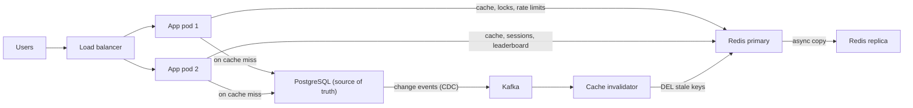

**Good and bad:**

| Good | Bad |
|---|---|
| One shared, very fast store for all pods | One more system to run, watch and secure |
| Takes most read load off the DB | Data lives in RAM, which is costly |
| Simple atomic tools: `INCR`, `SET NX`, Lua | Easy to misuse as a main database without thinking about durability |

**Say this in the interview:**

> Redis is a shared in-memory store that sits next to my app pods.
> I use it for caching, sessions, locks, rate limits and leaderboards.
> The database stays the source of truth. If Redis loses data, I can rebuild it from the DB.

**They may ask next:**
- **Can Redis be your main database?** It can, with AOF persistence and replicas. Most teams still keep money and orders in a SQL DB and use Redis for speed.
- **What if Redis goes down?** The app should still work, only slower. Use timeouts, a [circuit breaker](microservices.md#circuit-breaker), and protect the DB from the sudden load.

---

## What Redis is and why it is fast

**In one line:** Redis is an in-memory key-value store. It runs commands one at a time on one main thread, so each command is fast and atomic.

**Story:** A railway ticket window with one very fast clerk.
He has every ticket in a drawer right in front of him (RAM), not in a store room (disk).
He serves one person at a time, so two people can never get the same seat.
Since Redis 6, he has helpers who take forms from the queue and hand back tickets (I/O threads). But only the clerk writes in the ticket book.
Because each job takes microseconds, the line moves very fast. The one rule: nobody may ask him to "count all tickets ever sold" while others wait.

**How it works:**
1. **Data is in RAM.** Reading RAM takes about 100 nanoseconds. A disk read takes thousands of times longer.
2. **One main thread runs commands.** No locks between threads, no context switches. Every single command is **atomic** (it runs fully, with nothing in between).
3. **Event loop.** Redis uses the OS feature `epoll` (Linux) or `kqueue` (macOS). One thread watches thousands of client sockets and handles whichever one is ready. Like a waiter who serves the table that raises a hand.
4. **I/O threads (Redis 6+).** Reading from sockets and writing replies can use extra threads (`io-threads` setting). Command execution stays on the main thread.
5. **Simple data structures** built for memory: hash tables, skip lists, compact "listpack" encodings for small objects.
6. **Simple protocol (RESP).** Text-like and cheap to parse.

**Real numbers:**
- One Redis node often handles 100,000+ simple commands per second.
- A `GET` inside the server takes microseconds. With the network in the same zone, the app sees about 0.2–1 ms.
- The DB read for the same data is often 5–50 ms.

**Diagram:**

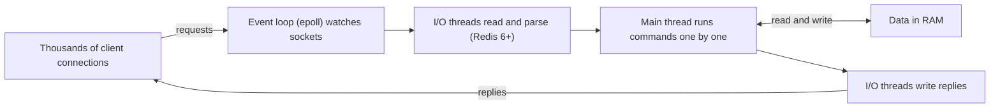

**The catch: one slow command blocks everyone.**
- `KEYS *` on 50 million keys can freeze Redis for seconds.
- `HGETALL` on a hash with 2 million fields, or `DEL` of a huge list, does the same.
- A long Lua script blocks too.

**Example:**

```bash
redis-cli SET greeting "namaste"     # OK
redis-cli GET greeting               # "namaste"
redis-cli INCR page:home:views       # 1, atomic even with 100 pods calling it
redis-cli --latency                  # live round-trip latency from this machine
```

**Good and bad:**

| Good | Bad |
|---|---|
| Sub-millisecond reads and writes | Data size limited by RAM (and RAM costs money) |
| Every command is atomic, no race inside one command | One slow command blocks every client |
| Rich data types, not only strings | One core does the main work; scale out with Cluster for more |

**Say this in the interview:**

> Redis keeps data in RAM and runs commands on one main thread with an event loop.
> So there are no locks, and each command is atomic.
> Since Redis 6, I/O threads help with network reads and writes, but commands still run one at a time.
> The trade-off is that one slow command, like `KEYS *`, blocks every client.

**They may ask next:**
- **If it is single-threaded, how does it scale?** Commands are tiny, so one core does a lot. For more, shard with [Redis Cluster](#redis-cluster) or add read replicas.
- **Is Redis fully single-threaded?** No. Background threads handle things like freeing big keys (`UNLINK`), closing files and, since 6, network I/O. Only command execution is single-threaded.

---

## Data types and a real use for each

**In one line:** A Redis value is not only a string. It can be a Hash, List, Set, Sorted Set, Stream and more, and each type solves one kind of problem well.

**Story:** A kitchen has different containers.
A jar for sugar (String). A spice box with labelled slots (Hash). A queue of orders on a spike (List).
A guest list with no duplicates (Set). A scoreboard for the cricket match (Sorted Set).
Using the right container makes the work easy. Using a jar for everything makes it messy.

**Diagram (which type should I pick?):**

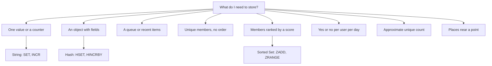

**The main types, with a real use:**

| Type | What it is | Real use | Key commands |
|---|---|---|---|
| **String** | Bytes, up to 512 MB. Can hold a number | Cache a JSON product, OTP, page view counter | `SET`, `GET`, `INCR`, `SET ... EX` |
| **Hash** | Small map of field → value | User profile, shopping cart (`productId → qty`) | `HSET`, `HGET`, `HINCRBY`, `HGETALL` |
| **List** | Ordered list, fast at both ends | Simple job queue, "last 50 notifications" | `LPUSH`, `RPOP`, `BLMOVE`, `LTRIM` |
| **Set** | Unique members, no order | Tags, "who liked this post", mutual friends | `SADD`, `SISMEMBER`, `SINTER` |
| **Sorted Set (ZSet)** | Unique members, each with a score, kept sorted | Leaderboard, sliding window rate limit, delayed jobs | `ZADD`, `ZINCRBY`, `ZRANGE ... REV`, `ZRANK` |
| **Bitmap** | A String used as an array of bits | Daily active users, attendance, feature on/off per user id | `SETBIT`, `GETBIT`, `BITCOUNT` |
| **HyperLogLog** | Tiny structure that estimates unique counts | Unique visitors per page per day | `PFADD`, `PFCOUNT`, `PFMERGE` |
| **Stream** | Append-only log with consumer groups | Order events, activity feed, small event bus | `XADD`, `XREADGROUP`, `XACK` |
| **Geo** | Locations stored inside a Sorted Set | "Restaurants within 3 km", nearby drivers | `GEOADD`, `GEOSEARCH` |
| **JSON** | Native JSON documents, update one field | Product documents, nested settings | `JSON.SET`, `JSON.GET` |

### Sorted Set: a live leaderboard

**Story:** IPL fantasy cricket. 10 million players. After every ball, scores change. Everyone wants to see the top 10 and "my rank".
A SQL `ORDER BY score LIMIT 10` on 10 million rows, thousands of times a second, hurts. A Sorted Set keeps the order all the time.

```bash
ZADD game:ipl:leaderboard 120 "user:7"          # add or update a score
ZINCRBY game:ipl:leaderboard 6 "user:7"         # a six: +6, O(log N)
ZRANGE game:ipl:leaderboard 0 9 REV WITHSCORES  # top 10, highest first
ZREVRANK game:ipl:leaderboard "user:7"          # my rank (0 = first)
```

- Inside, a Sorted Set is a skip list plus a hash table. Add, update and rank are all O(log N).
- Ties: members with the same score are sorted by name. For "first to reach wins", use a score like `points * 10^10 + (MAX_TS - timestamp)`.

### Bitmap: daily active users

- One bit per user id. 100 million users = 100 million bits = about 12.5 MB per day.
- `SETBIT dau:2026-11-16 4521 1` when user 4521 opens the app.
- `BITCOUNT dau:2026-11-16` gives today's active users.
- `BITOP AND` of 7 days gives "active every day this week".
- Works best when user ids are numbers that are close together. Random UUIDs do not fit.

### HyperLogLog: unique visitors

- Counts unique items using at most 12 KB per key, whatever the count.
- The answer is approximate: standard error is about 0.81%.
- `PFADD visitors:page:42:2026-11-16 "user:9"`, then `PFCOUNT ...`.
- Use when "about 1.2 million unique visitors" is good enough. Do not use for billing.

### Streams, Geo, JSON and vectors (briefly)

- **Streams:** a Kafka-like log inside Redis. See [Pub/Sub vs Streams vs Kafka](#pubsub-vs-streams-vs-kafka).
- **Geo:** `GEOADD drivers 77.59 12.97 "driver:12"`, then `GEOSEARCH drivers FROMLONLAT 77.6 12.97 BYRADIUS 3 km ASC COUNT 10`. Good for "nearby drivers" in [Uber-style designs](system-design/uber-ride-hailing.md).
- **JSON:** store a document and update one field (`JSON.NUMINCRBY product:42 $.stock -1`). Part of Redis 8 Open Source. In Valkey it is an add-on module.
- **Vectors:** Redis can store embeddings (lists of numbers that describe meaning) and find the nearest ones. Useful as a small vector store for RAG. See [ai-rag.md](ai-rag.md).

**Good and bad:**

| Good | Bad |
|---|---|
| Pick a type, and Redis does the hard work (sorting, counting) | A wrong type wastes memory, for example a 1 MB JSON string updated field by field |
| Small hashes, lists and sets use a compact encoding (very little memory) | Huge collections become "big keys" that block Redis |

**Say this in the interview:**

> I pick the Redis type by the question I need to answer.
> Hash for objects, Sorted Set for leaderboards and sliding windows, Set for uniqueness, and HyperLogLog for approximate unique counts in 12 KB.
> Bitmaps are great for daily active users when ids are numbers.
> Streams are a small log with consumer groups, but Kafka is better for large event pipelines.

**They may ask next:**
- **Hash vs storing JSON in a String?** Hash lets you read or update one field (`HINCRBY cart:7 sku:1 1`). A JSON String must be read, changed and written back whole.
- **How do you build "top 10 this week"?** One Sorted Set per day, then `ZUNIONSTORE` the last 7 days into a weekly key with a TTL.

---

## Keys, TTL and expiry

**In one line:** A TTL (time to live) makes a key delete itself after some time, so old data cleans itself up.

**Story:** Milk packets in a shop have an expiry date.
The shopkeeper does not check every packet every minute. He throws one away when a customer picks it up and sees the date (lazy).
Every few hours he also checks a few random packets on the shelf (active).
Redis does both.

**How it works:**
1. `SET otp:98xxxx 4821 EX 300` sets the value and a 300-second TTL together. Use this instead of `SET` then `EXPIRE` (two steps can fail halfway).
2. `TTL key` returns seconds left. `-1` means no TTL. `-2` means the key does not exist.
3. **Lazy expiry:** when you read an expired key, Redis deletes it and returns nothing.
4. **Active expiry:** about 10 times a second, Redis samples keys that have a TTL and deletes expired ones. So memory is freed even if nobody reads them.
5. A plain `SET` on an existing key **removes its TTL**. Use `SET ... KEEPTTL` to keep it.
6. `PERSIST key` removes the TTL. `EXPIRE key 60 NX` (Redis 7+) sets a TTL only if the key has none.
7. Redis 7.4 added TTLs on single **hash fields** (`HEXPIRE`). Older versions can expire only whole keys.

**Diagram (life of a key):**

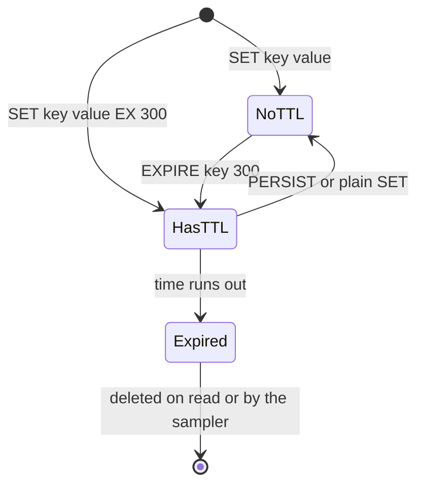

**Key naming rules:**
- Use colons: `service:entity:id:field`, for example `shop:product:42` or `rl:user:7:2026111610`.
- Keep keys short but readable. 10 million keys × 50 extra bytes = 500 MB wasted.
- Add a version when the value shape changes: `v2:shop:product:42`.
- Add the tenant id in multi-tenant apps, so one customer never sees another's data.

**Example:**

```bash
SET session:abc123 '{"userId":7}' EX 1800   # 30-minute session
TTL session:abc123                          # 1799
SET session:abc123 '{"userId":7,"cart":2}' KEEPTTL   # update, keep the timer
EXPIRE stats:today 86400 NX                 # only if no TTL yet (Redis 7+)
```

**Good and bad:**

| Good | Bad |
|---|---|
| TTL on every cache key, as a safety net | Cache keys with no TTL that live forever |
| `SET ... EX` in one command | `SET` then `EXPIRE` in two calls |
| Random jitter on TTLs (see [avalanche](#cache-problems-stampede-penetration-avalanche-hot-key-big-key)) | Same TTL for a million keys loaded together |

**Say this in the interview:**

> I put a TTL on every cache key and set it in the same command with `SET ... EX`.
> Redis deletes expired keys lazily on read and also with a background sampler, so memory is freed.
> I add small random jitter to TTLs so many keys do not expire at the same second.

**They may ask next:**
- **Does an expired key use memory until deleted?** For a short time, yes. The active sampler cleans most of them within seconds.
- **Do replicas expire keys?** Replicas wait for the primary to send a `DEL`. But they already return "not found" for logically expired keys on read.

---

## Memory limit and eviction policies

**In one line:** `maxmemory` sets how much RAM Redis may use, and the eviction policy decides what to throw out when it is full.

**Story:** A small fridge in a hostel room.
When it is full and you bring a new bottle, you must decide what goes out.
The item nobody touched for weeks (LRU)? The item used least often (LFU)? Only items with an expiry date (volatile)? Or you refuse the new bottle (noeviction).

**How it works:**
1. Set `maxmemory` (for example 75% of the machine's RAM). Leave room for forks during persistence and for fragmentation.
2. When a write needs memory and Redis is full, it applies `maxmemory-policy`.
3. Redis does not track exact LRU for every key. It samples a few keys (`maxmemory-samples`, default 5) and evicts the best candidate. It is close enough and cheap.

| Policy | What it evicts | Use when |
|---|---|---|
| `noeviction` (default) | Nothing. Writes fail with an OOM error | Redis holds data you must not lose (queues, locks, sessions) |
| `allkeys-lru` | Least recently used key, any key | Pure cache. Safe common choice |
| `allkeys-lfu` | Least frequently used key, any key | Cache with a stable set of popular keys |
| `volatile-lru` | Least recently used key **that has a TTL** | Mixed: cache keys have TTL, important keys do not |
| `volatile-lfu` | Least frequently used key with a TTL | Same as above, frequency based |
| `volatile-ttl` | Key with the shortest TTL left | Rare |
| `allkeys-lrm` / `volatile-lrm` (Redis 8.6+) | Least recently **modified** key (reads do not count) | Read-heavy cache where you want to drop data nobody updates |
| `allkeys-random` / `volatile-random` | Random key | Rare |

**Diagram:**

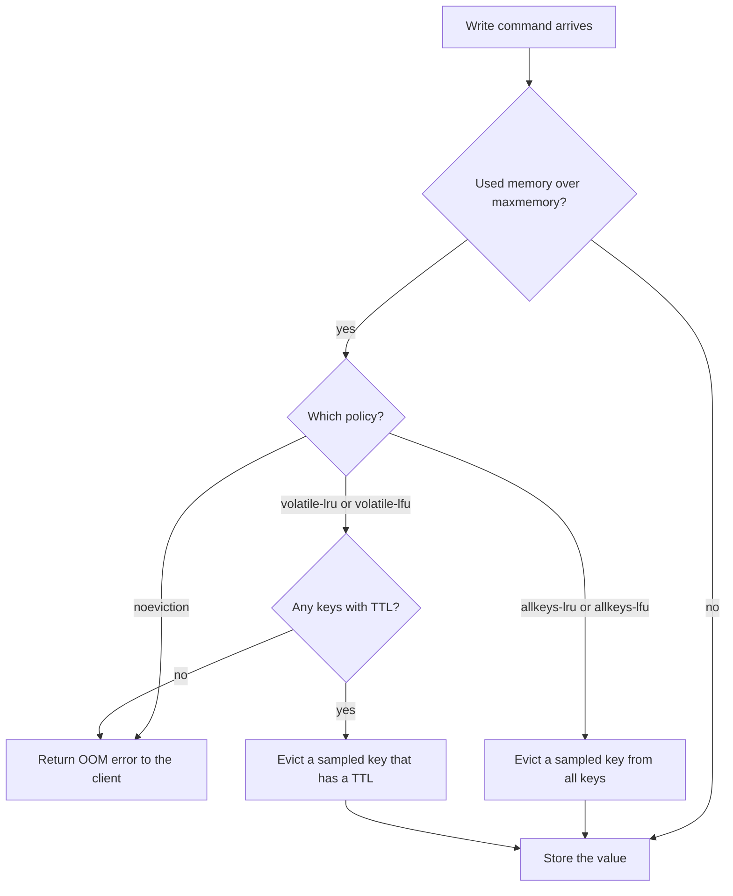

**Example:**

```conf
maxmemory 6gb                    # on an 8 GB machine: leave room for fork and OS
maxmemory-policy allkeys-lfu     # pure cache with popular keys
```

**Good and bad:**

| Good | Bad |
|---|---|
| Separate Redis for cache (`allkeys-lru`) and for data (`noeviction`) | One Redis for both, with `allkeys-lru`: your locks and sessions get evicted |
| Alert at 80% memory | Finding out from OOM errors in the app logs |
| `volatile-*` only when keys you can lose have a TTL | `volatile-lru` when no key has a TTL: it acts like `noeviction` |

**Say this in the interview:**

> For a pure cache I use `allkeys-lru` or `allkeys-lfu`, with `maxmemory` around 70–75% of RAM.
> For data I cannot lose, like sessions or queues, I use `noeviction` on a separate instance.
> Redis LRU is approximate. It samples a few keys, which is cheap and good enough.

**They may ask next:**
- **LRU vs LFU?** LRU throws out what was not used recently. One full scan of old keys can push out popular ones. LFU keeps keys that are used often, so it handles that better.
- **What is the default `maxmemory` policy?** `noeviction`. Many managed services pick a different default, so always check.

---

## Caching patterns

**In one line:** A caching pattern decides who loads the cache and when writes reach the database: cache-aside, read-through, write-through or write-behind.

A short recap of cache-aside, TTL and hit ratio is in [system design: caching](system-design.md#caching). The Spring annotations are in [Caching with Spring Cache](spring-ecosystem.md#caching-with-spring-cache). This section compares all four patterns.

**Story:** A restaurant and its spice shelf next to the stove.
- **Cache-aside:** the cook checks the shelf. If empty, she walks to the store room herself and refills it.
- **Read-through:** a helper owns the shelf. The cook only asks the helper. The helper fetches from the store room on a miss.
- **Write-through:** new stock goes to the shelf and the store room register at the same time.
- **Write-behind:** new stock goes on the shelf now. The helper updates the register at the end of the day. Fast, but if the helper loses the notes, the register is wrong.

**How they compare:**

| Pattern | Read path | Write path | Good for | Risk |
|---|---|---|---|---|
| **Cache-aside** (lazy loading) | App reads cache; on miss, app reads DB and fills cache | App writes DB, then **deletes** the key | Most apps. What `@Cacheable` does | First read after a change is slow; small race window |
| **Read-through** | App asks the cache library; the library loads from DB on miss | Usually combined with write-through | Cleaner app code (Caffeine `LoadingCache`, Redisson read-through maps) | Cache layer must know how to read the DB |
| **Write-through** | Read from cache | Write cache **and** DB in the same call | Data read right after a write | Every write is slower; cache fills with data nobody reads |
| **Write-behind** (write-back) | Read from cache | Write cache now, DB later in batches | Very high write rates: view counts, likes, game scores | Data loss if the cache dies before the flush |

**Diagram (cache-aside, read and write):**

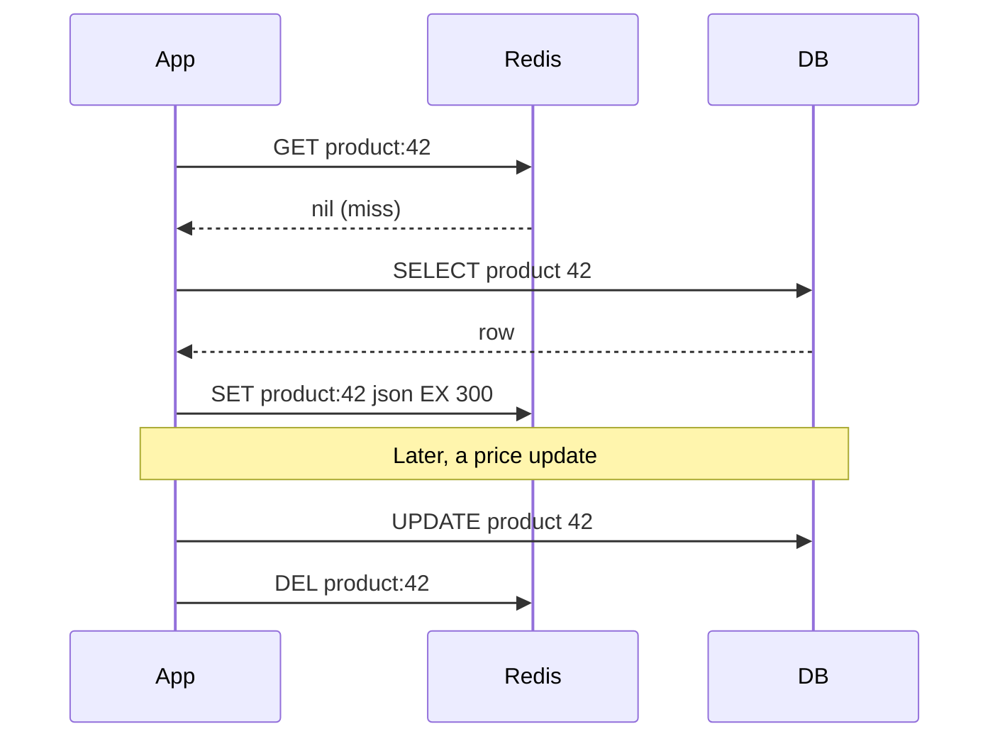

**Diagram (write-through vs write-behind):**

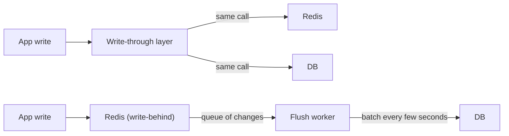

**Example (cache-aside by hand with `StringRedisTemplate`):**

```java
public Product get(long id) {
    String key = "v1:product:" + id;
    String json = redis.opsForValue().get(key);
    if (json != null) return mapper.readValue(json, Product.class);       // hit
    Product p = repo.findById(id).orElseThrow();                          // miss: go to DB
    Duration ttl = Duration.ofSeconds(300 + ThreadLocalRandom.current().nextInt(60)); // jitter
    redis.opsForValue().set(key, mapper.writeValueAsString(p), ttl);
    return p;
}

@Transactional
public void updatePrice(long id, BigDecimal price) {
    repo.updatePrice(id, price);
    // delete AFTER commit, so no reader reloads the old row
    TransactionSynchronizationManager.registerSynchronization(new TransactionSynchronization() {
        @Override public void afterCommit() { redis.delete("v1:product:" + id); }
    });
}
```

(`mapper` is a Jackson `ObjectMapper`. With Jackson 3 its methods throw unchecked exceptions; with Jackson 2, wrap them.)

**Good and bad:**

| Good | Bad |
|---|---|
| Cache-aside as the default; it fails safe (miss → DB) | Write-behind for orders or payments |
| Delete the key after the DB commit | Delete before the commit: a reader may reload the old value |
| TTL on everything, as a safety net | Trusting that every code path remembers to evict |

**Say this in the interview:**

> My default is cache-aside: read Redis, on a miss read the DB and set the key with a TTL.
> On writes I update the DB and delete the key after the transaction commits.
> Write-through keeps the cache warm but makes writes slower.
> Write-behind is only for data I can afford to lose, like view counts.

**They may ask next:**
- **Why delete instead of update the cache on write?** Two writers can update the cache in the wrong order and leave an old value. Delete is idempotent (doing it twice is fine), and the next read loads fresh data.
- **How do you warm a cold cache after a deploy?** Pre-load the top N keys from logs or analytics before sending traffic, or ramp traffic slowly.

---

## Cache problems: stampede, penetration, avalanche, hot key, big key

**In one line:** Most Redis cache incidents come from five problems: stampede, penetration, avalanche, hot key and big key.

**Story:** A wedding buffet.
- **Stampede:** the biryani tray empties, and 200 guests all run to the kitchen together.
- **Penetration:** guests keep asking for pizza, which was never on the menu. Each time the waiter checks the kitchen anyway.
- **Avalanche:** every tray was filled at 8 PM, so every tray empties at 9 PM.
- **Hot key:** everyone wants the one gulab jamun counter.
- **Big key:** one giant pot so heavy that the server blocks the whole line while lifting it.

**The five problems:**

| Problem | What happens | Fixes |
|---|---|---|
| **Stampede** (thundering herd) | A hot key expires. 5,000 requests miss at once and all hit the DB | Only one request reloads (lock with `SET NX`); serve stale data while one refreshes; refresh before expiry |
| **Penetration** | Requests for ids that do not exist always miss, so every one hits the DB. Often an attack: `/product/-1`, random ids | Cache "not found" for 30–60 s; a [Bloom filter](system-design.md#bloom-filter) of valid ids; validate input |
| **Avalanche** | Many keys expire at the same moment, or Redis restarts empty. The DB gets a flood | Jitter on TTL (300 s ± 60 s); warm up before traffic; replicas; a circuit breaker and rate limit in front of the DB |
| **Hot key** | One key gets 100,000+ reads/s. One Redis node or one shard melts | A short local cache (Caffeine, 1–5 s); copies `key#1..key#N` read at random; read replicas |
| **Big key** | A key of many MB, or a collection with millions of members. Reads, deletes and migration block Redis | Split it (`cart:7:part:0..9`); paginate with `HSCAN`; delete with `UNLINK`; find with `redis-cli --bigkeys` |

**Diagram (stampede fix: one loader, others wait or get stale):**

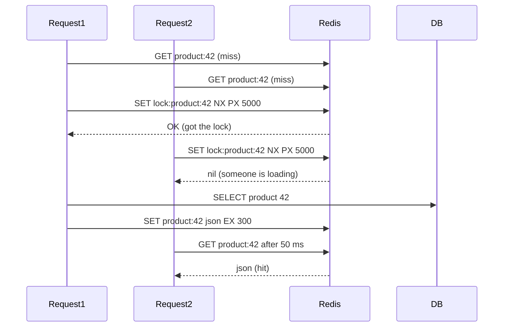

**More on each fix:**
- **Lock per key:** `SET lock:k 1 NX PX 5000`. The winner loads. Losers sleep 20–50 ms and read again, or return the last known value.
- **Inside one JVM:** `@Cacheable(sync = true)` or Caffeine's loading cache makes only one thread per pod load a key. With 50 pods you still get 50 loads, which is often fine.
- **Logical expiry (stale-while-revalidate):** store `{"value": ..., "refreshAt": ...}` with a long real TTL. If `refreshAt` has passed, return the old value now and refresh it in the background. Users never wait.
- **Early refresh:** refresh a key a little before it expires, with a small random chance that grows near expiry. Only a few requests do the refresh.
- **Bloom filter:** a small bit array that answers "surely not present" or "maybe present". 10 million ids at 1% false positives need about 12 MB. If it says "not present", skip Redis and the DB.
- **Finding hot keys:** `redis-cli --hotkeys` (needs an LFU policy), client-side metrics, or `MONITOR` for a few seconds only (it is expensive).
- **Client-side caching (Redis 6+):** Redis can tell clients when a key they cached locally has changed (`CLIENT TRACKING`). Good for hot keys that change rarely.

**Example (penetration: cache "not found"):**

```java
String json = redis.opsForValue().get(key);
if ("NULL".equals(json)) return Optional.empty();              // known missing, skip DB
if (json != null) return Optional.of(read(json));
Optional<Product> p = repo.findById(id);
redis.opsForValue().set(key, p.map(this::write).orElse("NULL"),
        p.isPresent() ? Duration.ofMinutes(5) : Duration.ofSeconds(30)); // short TTL for "missing"
return p;
```

**Good and bad:**

| Good | Bad |
|---|---|
| Jitter on TTLs | 1 million keys loaded by a batch job, all with `EX 3600` |
| Small local cache in front of a hot key | Every pod hammering one Redis key 100,000 times a second |
| `UNLINK` big keys (frees memory in the background) | `DEL` on a 2 GB hash in the middle of the day |
| Cache negative results for a short time | Cache negative results for an hour (new products stay "missing") |

**Say this in the interview:**

> For a stampede I let one request reload a key using a `SET NX` lock, and others wait briefly or get the stale value.
> For penetration I cache "not found" for 30 seconds or use a Bloom filter.
> For an avalanche I add jitter to TTLs and protect the DB with a circuit breaker.
> For hot keys I add a few seconds of local cache, and I split big keys and delete them with `UNLINK`.

**They may ask next:**
- **What size is a "big key"?** No fixed rule. Many teams flag Strings over about 1 MB and collections over about 10,000 members. Check with `MEMORY USAGE key`.
- **Why is a big key bad in a cluster?** Its slot cannot be split, so one shard gets all the memory and traffic. Moving the slot to rebalance is slow too.

---

## Keeping the cache and the database consistent

**In one line:** You cannot update Redis and the database in one atomic step. So pick a pattern that keeps the stale window small: delete after commit, delayed double delete, or CDC.

**Story:** A school notice board shows the exam date. The office register is the truth.
When the date changes, the clerk updates the register and tears off the old notice.
If a student copies the old date from his notebook and pins it back just after, the board is wrong again.
So the clerk checks the board again after 5 minutes (delayed double delete). Or the register itself rings a bell on every change, and a peon fixes the board (CDC).

**How it works:**
1. **Update DB, then delete the key (after commit).** Best simple default. Delete, not update.
2. **The rare race:** a reader misses, reads the **old** row, and is slow. Meanwhile a writer updates the DB and deletes the key. Then the slow reader writes the old row into Redis. Now the cache is wrong until the TTL ends.
3. **Delayed double delete:** delete after commit, and again 500 ms–1 s later (scheduled task or delayed message). It catches most slow readers.
4. **CDC (change data capture):** a tool like Debezium reads the DB's change log (binlog in MySQL, WAL in PostgreSQL) and publishes each change to Kafka. A small service deletes the matching Redis keys. It never misses a change, even when app code forgets or a pod crashes after commit.
5. **Version check:** store a `version` with the cached value. Write to the cache only if the new version is higher (a small Lua script). Old writes lose.
6. **TTL is the last safety net.** Even if all else fails, stale data lives at most one TTL.

**Diagram (the race):**

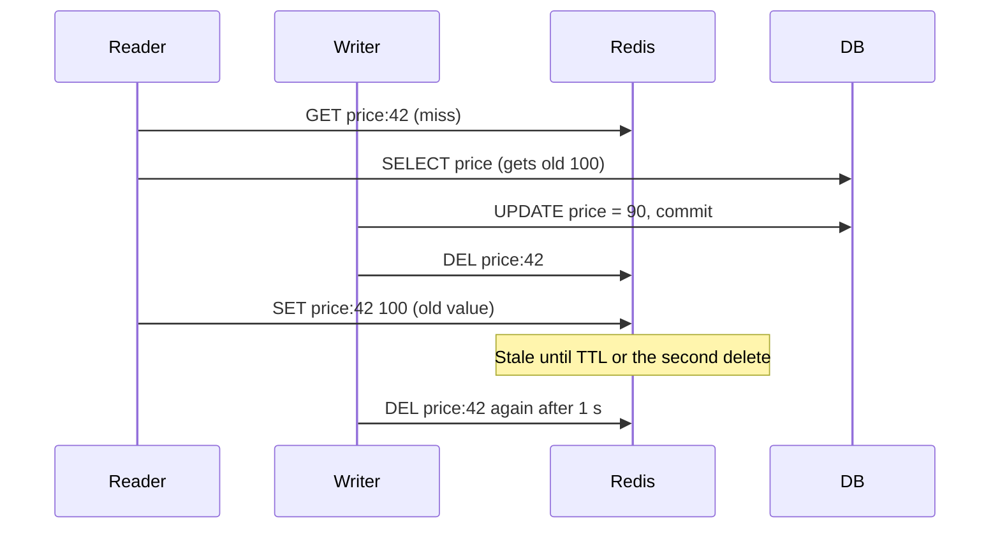

**Diagram (CDC-based invalidation):**

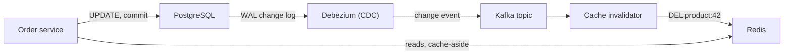

**Which one to choose:**

| Need | Pattern |
|---|---|
| Normal product pages, profiles | Delete after commit + TTL |
| Seconds of staleness hurt | Add delayed double delete |
| Many services write the same table, or code paths forget to evict | CDC invalidation |
| Money, stock count at checkout | Do not trust the cache. Read the DB (or a Redis value that **is** the source, updated atomically) |

The outbox pattern gives the same "never miss an event" guarantee from inside the app. See [transactional outbox](microservices.md#transactional-outbox-pattern).

**Good and bad:**

| Good | Bad |
|---|---|
| Delete after commit | Delete before the DB update, then a reader reloads the old row |
| CDC when many writers touch the data | Each of 6 services evicting by hand, and one forgets |
| A short TTL on data that changes often | Thinking any pattern gives perfect consistency |

**Say this in the interview:**

> Cache and DB can never be updated atomically together, so I aim for "stale for at most a short time".
> I update the DB, then delete the key after commit, and keep a TTL as a safety net.
> If the stale window matters, I add a delayed second delete or use CDC with Debezium and Kafka to delete keys from the DB change log.
> For money or stock at checkout, I read the database.

**They may ask next:**
- **What if the `DEL` fails?** Retry it, or push it to a queue for retry. CDC solves this because Kafka keeps the event until it is processed.
- **Why not update the cache inside the DB transaction?** Redis is not part of the DB transaction. If the DB rolls back, the cache already has a value that never existed.

---

## Distributed locks

**In one line:** A Redis lock is a key created with `SET key token NX PX ttl`. Whoever creates it holds the lock, and only the holder (same token) may delete it.

**Story:** A shared meeting room with one key at the reception.
You take the key and write your name in the register (the token). The key has a timer: after 30 minutes the reception takes it back, so a person who went home does not block the room forever.
When you return the key, the receptionist checks the name. You cannot return someone else's key.
But what if you fell asleep in the room, the timer gave the key to someone else, and you woke up and kept working? That is the problem fencing tokens solve.

**How it works:**
1. **Acquire:** `SET lock:order:42 <uuid> NX PX 30000`. `NX` means "only if it does not exist". `PX` sets the expiry in milliseconds. One atomic command.
2. **Work.** Keep the work shorter than the TTL, or extend the TTL while working (Redisson's "watchdog" does this).
3. **Release safely with Lua:** delete only if the value is still my token. A plain `DEL` might delete a lock that expired and was taken by someone else.
4. **Fencing token:** when you get the lock, also get a number that always grows (`INCR fence:order:42`). Send it with every write. The database rejects writes with a token lower than the last one it saw.

**Diagram (why you need fencing):**

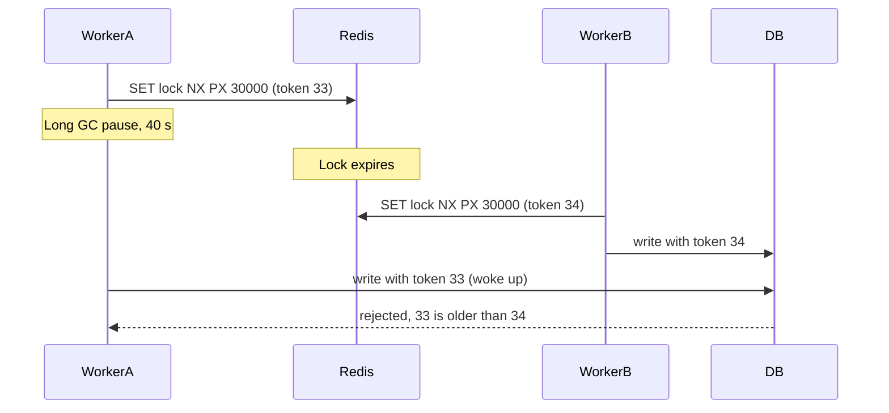

**Example (plain Spring Data Redis):**

```java
private static final RedisScript<Long> UNLOCK = RedisScript.of("""
        if redis.call('GET', KEYS[1]) == ARGV[1] then
          return redis.call('DEL', KEYS[1])
        end
        return 0
        """, Long.class);

void runOnce(String key, Runnable work) {
    String token = UUID.randomUUID().toString();                 // my name in the register
    Boolean ok = redis.opsForValue()
            .setIfAbsent(key, token, Duration.ofSeconds(30));   // SET key token NX PX 30000
    if (!Boolean.TRUE.equals(ok)) return;                         // someone else holds it
    try {
        work.run();
    } finally {
        redis.execute(UNLOCK, List.of(key), token);              // delete only my own lock
    }
}
```

**Example (Redisson, common in Java):**

```java
RLock lock = redisson.getLock("lock:report:daily");
if (lock.tryLock(0, TimeUnit.SECONDS)) {   // no lease time given: watchdog renews every 10 s
    try {
        buildReport();
    } finally {
        lock.unlock();                     // only the owner thread can unlock
    }
}
```

- Without a lease time, Redisson sets a 30-second lock and a "watchdog" extends it while the JVM is alive. If the pod dies, the lock expires in 30 s.
- Redisson also has fair locks, read-write locks, semaphores and rate limiters.

**Redlock and the debate:**
- **Redlock** is an algorithm by Redis's creator. Take the lock on a majority of 5 independent Redis primaries (3 of 5), within a time limit. It survives one Redis node crashing.
- **Martin Kleppmann's critique (2016):** a GC pause, a network delay or a clock jump can let two clients believe they hold the lock. A lock with a timeout cannot be fully safe without fencing tokens. Redlock does not give you one.
- **The reply:** Redis's creator argued that Redlock is fine under its stated time assumptions.
- **Practical takeaway for interviews:**
  - Lock for **efficiency** (avoid doing the same job twice; a rare double run is OK): a single Redis `SET NX PX` is enough.
  - Lock for **correctness** (a double run corrupts data or moves money twice): a lock alone is not enough.
    Use fencing tokens checked by the storage, a DB row lock or version column ([locking in SQL](databases.md#optimistic-vs-pessimistic-locking)), or a consensus system like ZooKeeper or etcd.

**Good and bad:**

| Good | Bad |
|---|---|
| Unique token per holder, released with a Lua check | `DEL lock` from anyone |
| TTL on every lock | `SETNX` then `EXPIRE` in two calls: a crash in between leaves a lock forever |
| Fencing token or DB version check for correctness | Assuming a Redis lock alone protects payments |
| ShedLock for "run this scheduled job on one pod" | Writing your own lock library for that ([ShedLock](spring-ecosystem.md#scheduling-and-background-jobs)) |

**Say this in the interview:**

> I take a Redis lock with `SET key token NX PX ttl`, and release it with a Lua script that deletes only if the token is mine.
> In Java I usually use Redisson, which renews the lock with a watchdog.
> Any lock with a timeout can be lost during a long GC pause, so for correctness I add a fencing token that the database checks.
> Redlock is debated; for efficiency locks one Redis is enough, and for correctness I lean on the database or etcd.

**They may ask next:**
- **What TTL should a lock have?** Longer than the normal job time with margin, for example 3× the p99 duration. Or a short TTL with a watchdog that renews it.
- **What if Redis fails over and the replica did not get the lock key?** Replication is async, so two clients can hold the lock. This is another reason to use fencing for correctness.

---

## Rate limiting with Redis

**In one line:** Store a counter or a log of request times per user in Redis, so every API pod shares the same limit.

The full design is in the [rate limiter case study](system-design/rate-limiter.md) and [rate limiting algorithms](system-design.md#rate-limiting-algorithms). They cover where the limiter sits, fail open vs fail closed, and the token bucket Lua script. Here are the Redis parts only.

**Story:** A temple allows 100 people per 10 minutes into the inner hall.
- **Fixed window:** a clicker resets at 10:00, 10:10, 10:20. Simple, but 100 people at 10:09 and 100 more at 10:10 means 200 in two minutes.
- **Sliding window:** the guard keeps a list of entry times and counts only the last 10 minutes. Fair, but the list takes space.
- **Token bucket:** tokens drop into a bucket at a steady rate. Each person takes one. Short bursts are fine if tokens saved up.

**How it works in Redis:**

| Algorithm | Redis tool | Memory per user | Accuracy |
|---|---|---|---|
| Fixed window | `INCR` + `EXPIRE` on `rl:user:7:<minute>` | One counter | Can allow 2× at window edges |
| Sliding window log | Sorted Set: score = timestamp | One entry per request | Exact |
| Sliding window counter | Two fixed counters, weighted | Two counters | Close to exact |
| Token bucket | Hash `{tokens, ts}` + Lua | Two fields | Exact, allows bursts |

**Diagram (sliding window with a Sorted Set):**

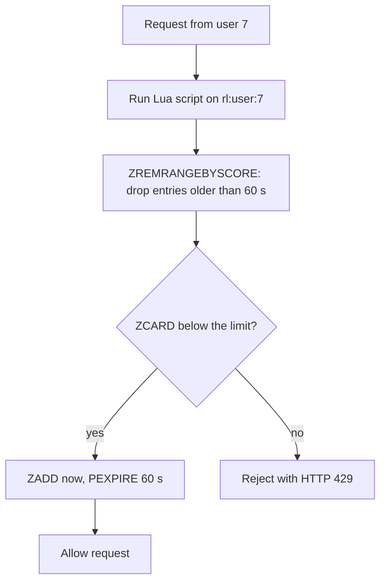

**Example (fixed window, two commands in one transaction):**

```bash
MULTI
INCR rl:user:7:202611161030          # count in this minute
EXPIRE rl:user:7:202611161030 60 NX  # set TTL only the first time (Redis 7+)
EXEC                                  # if INCR result > 100, reject
```

**Example (sliding window log, Lua, so the steps cannot interleave):**

```lua
-- KEYS[1] = rl:user:7, ARGV[1] = window ms, ARGV[2] = limit, ARGV[3] = unique request id
local t = redis.call('TIME')
local now = t[1] * 1000 + math.floor(t[2] / 1000)             -- Redis clock in ms
local window = tonumber(ARGV[1])
redis.call('ZREMRANGEBYSCORE', KEYS[1], 0, now - window)       -- forget old requests
if redis.call('ZCARD', KEYS[1]) < tonumber(ARGV[2]) then
  redis.call('ZADD', KEYS[1], now, ARGV[3])                    -- member must be unique
  redis.call('PEXPIRE', KEYS[1], window)
  return 1                                                     -- allowed
end
return 0                                                       -- rejected
```

**Good and bad:**

| Good | Bad |
|---|---|
| One Lua script or `MULTI` per check | `GET`, compare in Java, then `INCR`: two pods both pass |
| Redis `TIME` inside the script | Each pod's own clock |
| Decide "fail open" (allow) if Redis is down, for most APIs | Every API returns 500 because Redis is slow |
| Sliding log only for small limits | Sliding log for 10,000 requests/min per user: big Sorted Sets |

**Say this in the interview:**

> I keep rate limit state in Redis so all pods share it.
> Fixed window is one `INCR` with a TTL. A sliding window uses a Sorted Set of timestamps, and token bucket is a hash updated by a Lua script.
> The check must be atomic, so I use Lua or `MULTI`, and I use the Redis clock.
> If Redis is down, most APIs fail open, but login and OTP endpoints fail closed.

**They may ask next:**
- **Why a unique member in the Sorted Set?** Two requests in the same millisecond with the same member would count as one.
- **How do you rate limit in Redis Cluster?** Keep each user's keys in one slot with a hash tag, like `rl:{user:7}:min`. See [Redis Cluster](#redis-cluster).

---

## Sessions, OTPs and idempotency keys

**In one line:** Redis is a natural home for small, short-lived shared data: login sessions, OTPs, carts and "have I already processed this request?" keys.

**Story:** A cloakroom at a wedding hall. You hand over your bag and get a token. Any staff member can read the token and find your bag. At night, unclaimed bags are cleared.
That is a session store: the browser keeps only a token (cookie), and Redis keeps the data with a TTL.

**How it works:**
- **Sessions:** Spring Session stores the HTTP session in Redis, so any pod can serve any user. Details: [Spring Session](spring-ecosystem.md#spring-session).
- **OTP:** `SET otp:login:98xxxx 4821 EX 300`. Count wrong tries with `INCR otp:tries:98xxxx` + TTL; block after 5.
- **Idempotency key:** the client sends `Idempotency-Key: abc`. The server does `SET idem:abc PROCESSING NX EX 86400`. If it already exists, return the saved response instead of charging twice. More in [Idempotency](microservices.md#idempotency).
- **JWT deny list:** on logout, `SET jwt:deny:<jti> 1 EX <seconds until the token expires>`.
- **Cart:** a Hash `cart:user:7` with `sku → qty`, and a TTL of 30 days refreshed on each change.

**Diagram (idempotent payment request):**

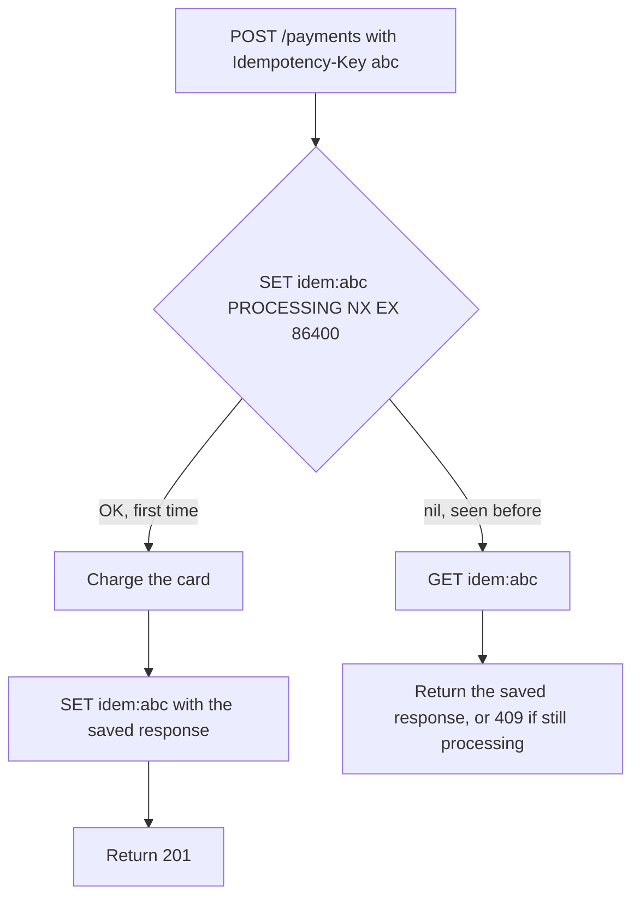

**Good and bad:**

| Good | Bad |
|---|---|
| Sessions in a Redis instance with `noeviction` and replicas | Sessions in a cache Redis with `allkeys-lru`: users get logged out at peak time |
| TTL on every session and OTP | OTP keys that never expire |
| Idempotency key in Redis **plus** a unique constraint in the DB | Trusting only Redis for "never charge twice" |

**Say this in the interview:**

> I keep sessions, OTPs and idempotency keys in Redis with a TTL, so any pod can handle any request.
> Sessions go in an instance with `noeviction`, not in the cache instance.
> For payments, the idempotency key in Redis is a fast first check, and a unique key in the database is the final guard.

**They may ask next:**
- **Sessions in Redis or JWT?** For browser apps, a session id in an HttpOnly cookie with Redis is simple and easy to revoke. For APIs between services, stateless JWTs avoid a Redis call per request.
- **What if Redis loses sessions?** Users log in again. Annoying but safe. With replicas and AOF this is rare.

---

## Pub/Sub vs Streams vs Kafka

**In one line:** Redis Pub/Sub is a live radio (miss it and it is gone). Redis Streams is a small stored log with consumer groups. Kafka is a big, durable log on disk for serious event pipelines.

**Story:**
- **Pub/Sub** is an announcement on the railway station speaker. If you were in the washroom, you missed it. Nothing is recorded.
- **Streams** is the station's notice book. Every announcement is written down. Each team of porters reads it and ticks what they handled. But the book is small and kept in the station master's drawer (RAM).
- **Kafka** is the railway's central record office. Huge books on disk, copied to three buildings, kept for days. Any department can read from any page, any time.

**How each one works:**

| | Redis Pub/Sub | Redis Streams | Kafka |
|---|---|---|---|
| Stored? | No. Only delivered to clients connected now | Yes, in RAM (and RDB/AOF) | Yes, on disk, replicated |
| Delivery | Push, at most once | Pull with consumer groups, at least once (needs `XACK`) | Pull with consumer groups, at least once (or exactly-once inside Kafka) |
| Replay old messages | No | Yes, by id, until trimmed | Yes, by offset, for days or forever |
| Scale | Fan-out to connected clients | Limited by one key on one node | Partitions over many brokers |
| Typical use | Cache invalidation to all pods, live chat typing signals, WebSocket fan-out | Small job queues, activity feeds, a few thousand events/s | Order events, CDC, analytics, event-driven microservices |

**Diagram (Streams with a consumer group):**

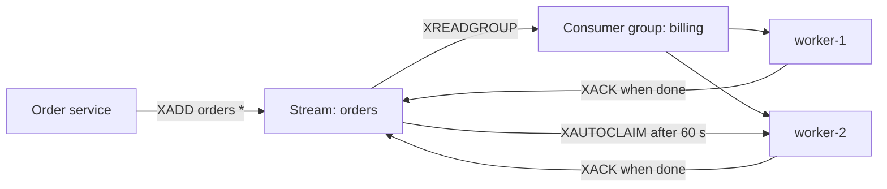

- Each message goes to **one** worker in the group. Another group gets its own copy.
- A message read but not acked stays in the *pending entries list* (PEL). If worker-1 dies, `XAUTOCLAIM` lets worker-2 take it over.
- Trim old entries with `XADD orders MAXLEN ~ 1000000 * ...`, or memory grows forever.

**Example:**

```bash
XADD orders * orderId 42 amount 999                    # returns id like 1763270000000-0
XGROUP CREATE orders billing $ MKSTREAM                # group starts at new messages
XREADGROUP GROUP billing worker-1 COUNT 10 BLOCK 5000 STREAMS orders >
XACK orders billing 1763270000000-0                    # done, remove from pending
XAUTOCLAIM orders billing worker-2 60000 0-0 COUNT 10  # take over messages idle 60 s
SUBSCRIBE cache-invalidation                           # Pub/Sub: live only
PUBLISH cache-invalidation "product:42"
```

**Good and bad:**

| Good | Bad |
|---|---|
| Pub/Sub to tell all pods "evict product:42 from your local cache" | Pub/Sub for orders: a restarting pod loses messages |
| Streams for a small queue when you already run Redis | Streams with no `MAXLEN`: memory fills up |
| Kafka for business events many teams read, replay and keep | Kafka for a tiny internal job queue in a small app (heavy to run) |

**Say this in the interview:**

> Redis Pub/Sub is fire-and-forget: only connected subscribers get the message, and nothing is stored.
> Streams store messages and add consumer groups with acks, so they work as a small reliable queue, limited by RAM.
> Kafka keeps events on disk with replication, partitions and long retention, so it is the choice for event-driven microservices.
> I use Pub/Sub for cache invalidation signals and Kafka for business events. More on Kafka in [kafka.md](kafka.md).

**They may ask next:**
- **Is Redis Pub/Sub push or pull?** Push. Redis sends the message to subscribers as soon as it is published. Kafka consumers pull when ready.
- **Pub/Sub in Redis Cluster?** Classic `PUBLISH` goes to every node in the cluster, which costs bandwidth. Redis 7 added *sharded* Pub/Sub (`SPUBLISH`, `SSUBSCRIBE`), which stays inside one shard.

---

## Pipelining, transactions and Lua scripts

**In one line:** Pipelining saves network round trips. `MULTI`/`EXEC` runs a group of commands with nothing in between. Lua scripts run logic inside Redis atomically.

**Story:** Shopping at a kirana store.
- **Without pipelining:** you ask for one item, wait, ask for the next, wait. 20 items = 20 waits.
- **Pipelining:** you hand over a list of 20 items at once. Same work for the shopkeeper, far less waiting.
- **Transaction (`MULTI`/`EXEC`):** "Pack these 3 items together, and do not serve anyone else in between."
- **Lua script:** you give the shopkeeper a small card: "If rice is under 5 kg, give me sugar instead." He follows it right there.

**How they compare:**

| | Pipelining | `MULTI` / `EXEC` | Lua script / Function |
|---|---|---|---|
| Saves round trips | Yes | Yes (when pipelined) | Yes |
| Atomic (nothing runs in between) | No | Yes | Yes |
| Can use a result to decide the next step | No | No (commands are queued) | Yes |
| Rollback on error | No | **No** | No (writes done before the error stay) |

**Diagram (why pipelining helps):**

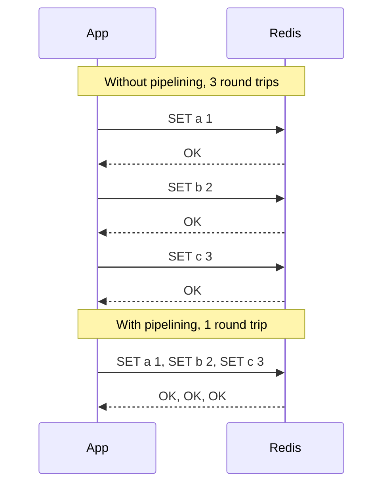

With 1 ms network time, 10,000 single `SET`s take about 10 s. Pipelined in batches of 1,000, they take well under 1 s.

### Transactions and `WATCH`

- `MULTI` starts queuing. `EXEC` runs all queued commands together. `DISCARD` drops them.
- A syntax error while queuing aborts the whole transaction (`EXECABORT`).
- A runtime error (for example `INCR` on a list) fails only that command. **The others still run.** There is no rollback.
- `WATCH key` adds optimistic locking: if the key changes before `EXEC`, `EXEC` returns nil and nothing runs. You retry.

```bash
WATCH stock:42
GET stock:42        # 5, decide in the app
MULTI
DECR stock:42
EXEC                # nil if someone changed stock:42 after WATCH: retry
```

### Lua scripts and Functions

- `EVAL script numkeys key... arg...` runs a Lua script. The whole script is atomic.
- `EVALSHA sha1` runs a script already cached by Redis, to avoid sending the text each time.
- Pass every key in `KEYS`, never build key names inside the script. Redis Cluster needs them to route the call, and all keys must be in one slot.
- A long script blocks everyone. After 5 s (`busy-reply-threshold`) Redis answers other clients with `BUSY`. `SCRIPT KILL` works only if the script has not written anything yet.
- **Functions (Redis 7+):** `FUNCTION LOAD` a named library once, then `FCALL name`. Functions are saved with the data and copied to replicas, so they survive restarts. Scripts loaded with `SCRIPT LOAD` are only a cache.

**Example (sell only if stock is enough, in one step):**

```lua
-- KEYS[1] = stock:42, ARGV[1] = quantity
local stock = tonumber(redis.call('GET', KEYS[1]) or '0')
local qty = tonumber(ARGV[1])
if stock >= qty then
  return redis.call('DECRBY', KEYS[1], qty)   -- new stock
end
return -1                                     -- not enough, nothing changed
```

This is the core trick in [flash sale designs](system-design/flash-sale.md): Redis gates the rush, and the DB records the real order.

**Good and bad:**

| Good | Bad |
|---|---|
| Pipeline bulk loads and many small reads | One network call per command in a loop of 10,000 |
| Lua for "check then write" logic | `GET` in Java, decide, then `SET`: a race between pods |
| Short scripts (microseconds) | Lua that loops over 1 million items |
| Expecting no rollback, and designing for it | Treating `MULTI` like a SQL transaction |

**Say this in the interview:**

> Pipelining sends many commands in one round trip, but it is not atomic.
> `MULTI`/`EXEC` runs a group without anything in between, but there is no rollback, and `WATCH` adds optimistic locking.
> When I need "read, decide, write" atomically, I use a Lua script, and I keep it short because it blocks Redis while it runs.

**They may ask next:**
- **Is a transaction in Redis ACID?** Atomic and isolated, yes. Consistent only in the Redis sense. Durable only as much as your persistence setting. No rollback.
- **Pipeline in a cluster?** Clients like Lettuce split a pipeline by node. Commands to different slots go to different nodes, so it is not one atomic unit.

---

## Persistence: RDB vs AOF

**In one line:** RDB saves a snapshot of all data every few minutes; AOF logs every write; most production setups use both.

**Story:** Writing a long exam answer.
- **RDB** is taking a photo of your answer sheet every 10 minutes. If the paper burns, you lose up to 10 minutes of writing. Photos are small and quick to restore.
- **AOF** is a diary where you note every sentence as you write it. You lose at most the last second. The diary is bigger and slower to read back, so now and then you rewrite it short ("rewrite").

**How it works:**
1. **RDB snapshot:** Redis calls `fork()`. The child process writes all data to `dump.rdb`. The parent keeps serving. Thanks to *copy-on-write*, the two share memory pages until the parent changes one.
2. **AOF (append-only file):** every write command is appended to a file. `appendfsync` decides how often it is flushed to disk:
   - `always`: every write, safest, slowest.
   - `everysec` (default): lose up to about 1 second of writes. The usual choice.
   - `no`: the OS decides, about every 30 seconds.
3. **AOF rewrite:** the file grows, so Redis rewrites it in the background to the shortest form. Since Redis 7, AOF is a set of files (a base file plus incremental files).
4. **Hybrid (default when AOF is on):** the rewritten base file is in RDB format, followed by recent commands. Fast to load and little data loss.
5. On restart, if AOF is on, Redis loads the AOF (it is more complete).

**Diagram:**

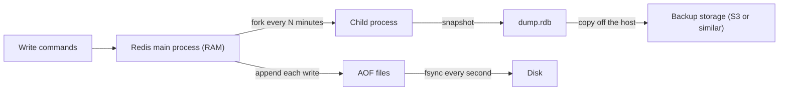

**Example:**

```conf
save 3600 1 300 100 60 10000   # RDB: after 1 h if 1 change, 5 min if 100, 1 min if 10000
appendonly yes                 # turn on AOF
appendfsync everysec           # lose at most ~1 s of writes
aof-use-rdb-preamble yes       # hybrid: RDB base + recent commands
```

| | RDB | AOF |
|---|---|---|
| Data loss on crash | Minutes (since the last snapshot) | About 1 s with `everysec` |
| File size | Small, compact | Bigger |
| Restart speed | Fast | Slower (replays commands) |
| Backups | Easy: copy one file | Possible, but RDB is simpler |
| Cost | Fork can pause big instances and needs spare RAM | Constant disk writes |

**Good and bad:**

| Good | Bad |
|---|---|
| Both RDB and AOF for data you care about | No persistence on a Redis that holds sessions or queues |
| Leave 25–50% RAM free for fork copy-on-write | Running at 95% RAM, then the fork during `BGSAVE` triggers OOM |
| Copy RDB files off the machine and test restores | Backups stored on the same disk as Redis |
| No persistence for a pure cache (faster, rebuilds from DB) | Thinking AOF makes Redis as durable as PostgreSQL |

**Say this in the interview:**

> RDB takes periodic snapshots using fork and copy-on-write, so it is compact and fast to restore, but I can lose minutes of data.
> AOF logs every write and with `everysec` loses at most about a second.
> For important data I enable both and keep spare memory for the fork. For a pure cache I often turn persistence off.

**They may ask next:**
- **Why can `BGSAVE` cause latency?** `fork()` copies the page table of a large process, which can take tens of milliseconds or more. Then every page the parent writes is copied, using extra RAM.
- **How do you move data to a new server?** Copy the RDB file and start Redis with it. Or make the new server a replica, let it sync, and promote it.

---

## Replication and Sentinel

**In one line:** Replicas keep async copies of the primary for reads and failover. Sentinel watches the primary and promotes a replica when it dies.

**Story:** A school with one head teacher (primary) who writes the timetable, and two assistants (replicas) who copy it.
Three watchmen (Sentinels) keep checking if the head teacher is in her office.
If at least two watchmen agree she is gone, they make one assistant the new head and tell everyone where to find her.
Anything she wrote just before leaving and nobody copied yet is lost.

**How it works:**
1. A replica connects, gets a full snapshot (RDB) first, then a live stream of every write.
2. After a short disconnect, it does a **partial resync** from a buffer (`repl-backlog-size`), not a full copy.
3. Replication is **asynchronous**. The primary replies to the client before replicas have the write.
4. `WAIT 1 100` blocks until 1 replica has the write, or 100 ms pass. It reduces loss but is still not a full guarantee.
5. **Sentinel:** run at least 3 Sentinel processes on different machines.
   - They ping the primary. If a *quorum* (for example 2 of 3) agree it is down, one Sentinel leads the failover.
   - It promotes the best replica and points the other replicas to it.
   - Clients ask Sentinel "who is the primary?" instead of using a fixed address.

**Diagram:**

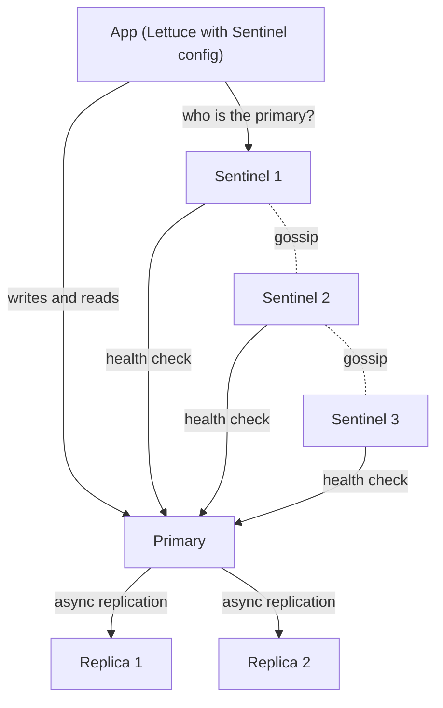

**Example (Spring Boot with Sentinel):**

```yaml
spring:
  data:
    redis:
      sentinel:
        master: mymaster                          # name the Sentinels use
        nodes: 10.0.1.5:26379,10.0.2.5:26379,10.0.3.5:26379
      timeout: 500ms
```

**Good and bad:**

| Good | Bad |
|---|---|
| 3 Sentinels in 3 zones | 2 Sentinels: no majority when one is lost |
| Replicas in other zones | Primary and replica on the same machine |
| `min-replicas-to-write 1` to stop writes when the primary is cut off | Expecting zero data loss on failover |
| Reading from replicas only for data that can be a bit old | Read-your-own-write flows on a replica |

**Say this in the interview:**

> Redis replicas copy the primary asynchronously, so a failover can lose the last few writes.
> Sentinel runs as 3 or more processes. When a quorum agrees the primary is down, they promote a replica.
> Clients ask Sentinel for the current primary.
> Sentinel is for one primary with replicas. When data or writes outgrow one node, I use Redis Cluster.

**They may ask next:**
- **What is split brain here?** The old primary is cut off but still takes writes. After it rejoins as a replica, those writes are thrown away. `min-replicas-to-write` limits this.
- **Do replicas help write throughput?** No. All writes go to the primary. Replicas help reads and failover.

---

## Redis Cluster

**In one line:** Redis Cluster splits keys across many primaries using 16,384 hash slots, with built-in failover. So you can grow beyond one machine.

**Story:** A big post office with 16,384 pigeonholes.
Every letter goes to a pigeonhole by a fixed rule on its address (CRC16 of the key, mod 16,384).
Three clerks share the pigeonholes: clerk A has 0–5460, B has 5461–10922, C has 10923–16383.
If you ask the wrong clerk, he says "not mine, go to clerk B" (MOVED).
If a pigeonhole is being carried from A to B right now, A says "just this once, ask B" (ASK).

**How it works:**
1. `slot = CRC16(key) mod 16384`. Each primary owns a range of slots. Minimum 3 primaries, usually each with 1 replica.
2. **Smart clients** (Lettuce, Jedis, Redisson) keep a slot → node map and send each command to the right node directly.
3. **MOVED:** the slot now lives elsewhere for good. The client updates its map and retries.
4. **ASK:** the slot is being migrated. The client sends `ASKING` and retries on the new node for this one command, but keeps its map.
5. **Hash tags:** only the part inside `{}` is hashed. `cart:{user:7}` and `orders:{user:7}` land in the same slot.
6. **Multi-key commands** (`MGET`, `MULTI`, Lua) work only when all keys are in one slot. Otherwise: `CROSSSLOT` error.
7. Nodes talk on a *cluster bus* (port + 10000) with gossip. If a primary fails, its replica is promoted. No Sentinel needed.
8. Only database 0 exists in Redis Cluster. `SELECT 1` does not work. (Valkey 9.0 added numbered databases in cluster mode.)

**Diagram (routing and MOVED):**

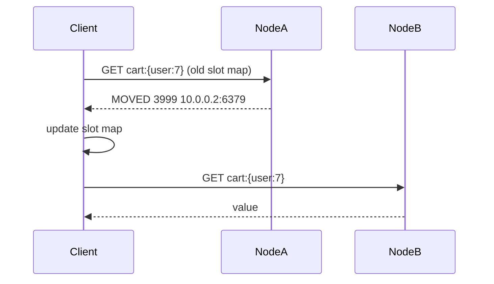

**Diagram (layout):**

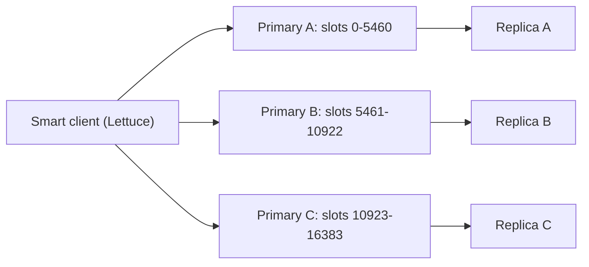

**Example:**

```bash
CLUSTER KEYSLOT "cart:{user:7}"     # same slot as...
CLUSTER KEYSLOT "orders:{user:7}"   # ...this one, because only "user:7" is hashed
MGET a b                            # CROSSSLOT error if a and b are in different slots
redis-cli --cluster check 10.0.0.1:6379
```

**Why 16,384 slots?** Nodes send their slot ownership as a bitmap in every gossip message. 16,384 bits is 2 KB, small enough. And clusters rarely go above about 1,000 primaries.

**Cluster vs Sentinel:**

| | Sentinel | Cluster |
|---|---|---|
| Data size | Fits on one machine | More than one machine |
| Write scale | One primary | Many primaries |
| Multi-key ops | Any keys | Same slot only (use hash tags) |
| Failover | Sentinel processes | Built in |

**Good and bad:**

| Good | Bad |
|---|---|
| Hash tags for keys used together (`{user:7}`) | One hash tag for everything (`{app}`): all data in one slot |
| Client with topology refresh turned on | A client that ignores MOVED and keeps failing |
| Plan for no cross-slot transactions | Porting a single-node app that uses `MULTI` on random keys |

**Say this in the interview:**

> Redis Cluster splits keys into 16,384 hash slots with CRC16, and each primary owns a range, with replicas for failover.
> Smart clients route each key to the right node; MOVED means the slot moved for good, ASK means it is moving right now.
> Multi-key commands need all keys in one slot, so I use hash tags like `{user:7}`, but carefully, so one slot does not get hot.

**They may ask next:**
- **Is it consistent hashing?** Similar idea, but with fixed slots instead of a ring. Moving slots between nodes is like moving ranges on a [consistent hashing](system-design.md#consistent-hashing) ring.
- **Can Cluster lose writes?** Yes. Replication is async, so a write acked by a primary that dies before replicating is lost.

---

## Redis vs Memcached

**In one line:** Memcached is a simple, multi-threaded string cache; Redis is a data-structure server with persistence, replication and scripting.

**Story:** Memcached is a big steel almirah with many identical drawers. Quick to open, holds anything flat, nothing else.
Redis is a modular kitchen: drawers, spice racks, a fridge with a timer, and a notebook of what you put in. More useful, a bit more to manage.

**How they compare:**

| | Redis (and Valkey) | Memcached |
|---|---|---|
| Values | Strings, Hash, List, Set, Sorted Set, Stream, Geo, JSON... | Strings (bytes) only, 1 MB per item by default |
| Threads | One main thread for commands, I/O threads | Fully multi-threaded |
| Persistence | RDB, AOF | None |
| Replication and failover | Built in (replicas, Sentinel, Cluster) | None built in; the client shards keys |
| Atomic logic | `INCR`, Lua, transactions | `incr`, `cas` only |
| Pub/Sub, Streams | Yes | No |
| Eviction | Many policies | LRU |

**Diagram (choosing):**

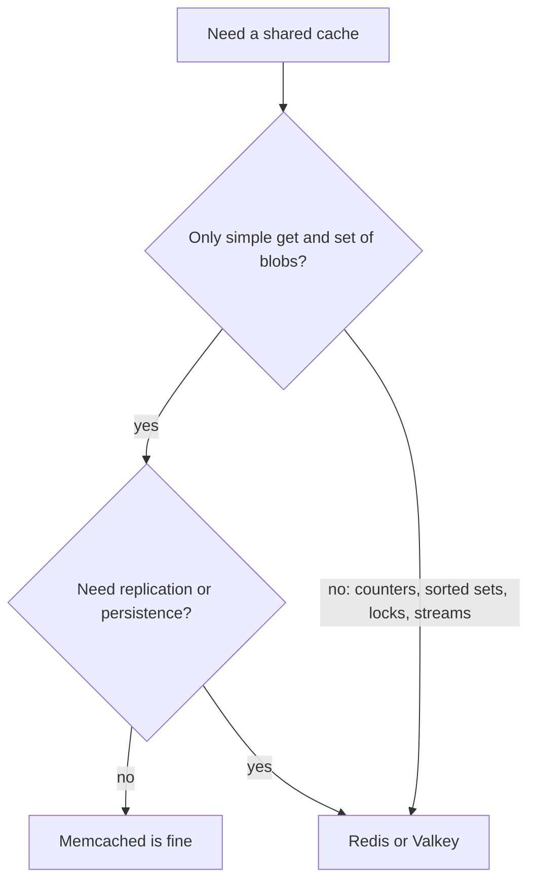

**Good and bad:**

| Good | Bad |
|---|---|
| Redis when you need data types, locks, rate limits or failover | Running both Redis and Memcached "just because" |
| Memcached for a huge, simple, multi-core HTML or object cache | Memcached when you need data to survive restarts |

**Say this in the interview:**

> Memcached is a simple multi-threaded key-value cache with no persistence or replication.
> Redis has rich data types, persistence, replication, Lua and Pub/Sub, so it covers caching plus locks, leaderboards and rate limits.
> I pick Redis by default. Memcached still fits a plain, very large object cache.

**They may ask next:**
- **Is Memcached faster?** For plain get/set on one big multi-core server, it can be, because it uses all cores. Redis scales out with Cluster instead.
- **Other Redis-compatible servers?** Valkey, Dragonfly and KeyDB speak the same protocol. Check feature support before switching.

---

## Licensing, forks and managed services

**In one line:** Redis changed its license in 2024, and the community forked it as Valkey. Redis 8 added an open source license option again. For app developers, little changes.

**Story:** A popular recipe book was free for everyone.
In 2024 the publisher said: "Big restaurant chains must now make a deal with us."
Some cooks copied the last free edition and started their own book (Valkey).
In 2025 the publisher added a free licence option again, with conditions. Home cooks were never really affected.

**What happened (facts, kept neutral):**
- **Redis 7.2 and older:** BSD-3-Clause (a permissive open source license).
- **Redis 7.4 (2024):** dual license **RSALv2 or SSPLv1**. These are *source-available*: you can read and use the code. But the OSI does not approve them as open source, and they limit offering Redis as a managed service.
- **Valkey (2024):** a fork of Redis 7.2.4 under the Linux Foundation, still BSD. Backed by several cloud companies. Many managed services now offer it.
- **Redis 8 (2025):** a third option, **AGPLv3**, which the OSI approves. Redis 8 also bundles JSON, search/query, time series and probabilistic types in "Redis Open Source".

**Managed options (names only):**
- **AWS:** ElastiCache (Valkey, Redis OSS, Memcached), MemoryDB (Redis/Valkey-compatible with durable storage).
- **Google Cloud:** Memorystore (for Redis, Redis Cluster and Valkey).
- **Azure:** Azure Managed Redis. The older Azure Cache for Redis is being retired (Enterprise tiers in 2027, Basic/Standard/Premium in 2028), so new projects use Azure Managed Redis.
- **Redis Ltd:** Redis Cloud and Redis Software.

**Diagram (timeline):**

```mermaid
flowchart LR
    A["Redis up to 7.2: BSD"] --> B["Redis 7.4 (2024): RSALv2 or SSPLv1"]
    B --> C["Redis 8 (2025): adds AGPLv3 option"]
    A -->|"fork of 7.2.4"| V["Valkey (Linux Foundation): BSD"]
```

**What it means for you:**
- Using Redis through a managed service or a client library (Lettuce, Jedis): usually nothing changes.
- Shipping or hosting a modified Redis server for others: ask your legal team which license applies.
- Valkey and Redis are compatible for common commands today. Newer features can differ, so test before you switch.

**Say this in the interview:**

> Redis moved from BSD to a source-available dual license in 7.4, which led to the Valkey fork under the Linux Foundation.
> Redis 8 added AGPLv3 as an option.
> For a normal app team using a managed service and a client library, the commands are the same.
> Licenses matter mostly for companies that host Redis for others.

**They may ask next:**
- **Would you pick Redis or Valkey for a new project?** Whatever the managed provider supports well and the team can operate. For basic caching, locks and rate limits, both work.

---

## Using Redis from Java and Spring Boot

**In one line:** Spring Boot uses the Lettuce client by default; set timeouts, use String keys and JSON values, and avoid JDK serialization.

The basics (`StringRedisTemplate`, `@RedisHash`, an OTP example) are in [Spring Data for Redis](spring-ecosystem.md#spring-data-for-redis-mongodb-and-elasticsearch). This section covers client choice, config and the traps.

**Story:** Two kinds of delivery boys.
- **Jedis** is one boy per order. He goes, waits at the door, comes back. For 50 parallel orders you need 50 boys (a pool).
- **Lettuce** is one boy on a fast bike with a big bag. He drops many orders on each trip and never waits at a door. One boy serves the whole shop.

**Clients:**

| | Lettuce | Jedis | Redisson |
|---|---|---|---|
| Style | Non-blocking (Netty), sync, async and reactive APIs | Simple, blocking | High-level objects: locks, maps, queues |
| Connections | One thread-safe connection shared by all threads | One connection per thread, so a pool | Its own pool |
| Spring Boot | Default | Supported (exclude Lettuce, add Jedis) | Separate starter |
| Best for | Most apps, WebFlux, Cluster with topology refresh | Simple apps, teams used to it | Distributed locks and data structures |

**Diagram:**

```mermaid
flowchart LR
    S["Your service code"] --> SC["Spring Cache (@Cacheable)"]
    S --> RT["StringRedisTemplate / RedisTemplate"]
    S --> RS["Redisson (locks)"]
    SC --> L["Lettuce: one shared Netty connection"]
    RT --> L
    L -->|"RESP over TCP, TLS"| R["Redis / Valkey"]
    RS -->|"own connections"| R
```

**Example (`application.yml`):**

```yaml
spring:
  data:
    redis:
      host: redis.internal
      port: 6379
      username: orders-app          # Redis 6+ ACL user
      password: ${REDIS_PASSWORD}
      ssl:
        enabled: true
      timeout: 500ms                # command timeout; the Lettuce default is 60 s
      connect-timeout: 1s
      lettuce:
        cluster:
          refresh:
            adaptive: true          # react fast to MOVED and failover (Cluster only)
            period: 30s
  cache:
    redis:
      time-to-live: 10m
```

**Example (`RedisTemplate` with readable keys and JSON values):**

```java
@Bean
RedisTemplate<String, Object> redisTemplate(RedisConnectionFactory cf) {
    var t = new RedisTemplate<String, Object>();
    t.setConnectionFactory(cf);
    t.setKeySerializer(RedisSerializer.string());      // "product:42", not \xac\xed\x00\x05...
    t.setHashKeySerializer(RedisSerializer.string());
    t.setValueSerializer(RedisSerializer.json());       // JSON, not JDK serialization
    t.setHashValueSerializer(RedisSerializer.json());
    return t;
}
```

**Serialization traps:**
- **JDK serialization (the `RedisTemplate` default):** keys look like `\xac\xed\x00\x05t\x00\x0bproduct:42`. You cannot find them in `redis-cli`. Values break when the class changes. Avoid it.
- **Renamed or moved classes:** JSON with type info (`"@class": "com.shop.Product"`) breaks after a refactor. Put a version in the key prefix (`v2:`) and let old keys expire.
- **Do not cache JPA entities.** Lazy fields fail after the session closes. Cache DTOs or records. See [hibernate-jpa.md](hibernate-jpa.md).
- **Spring Data Redis 4 (Spring Boot 4):** Jackson 3 is the main JSON library. `GenericJacksonJsonRedisSerializer` replaces `GenericJackson2JsonRedisSerializer`, and it does not turn on default typing by default. The JSON can differ from Jackson 2, so plan a cache flush or a new key prefix when you upgrade.
- **Dates and money:** make sure your mapper handles `java.time` types. Store money as a string or `BigDecimal`, never as a `double`.

**Good and bad:**

| Good | Bad |
|---|---|
| Command timeout of 200–500 ms | The 60 s default: a slow Redis freezes all request threads |
| A circuit breaker and DB fallback around cache calls | A Redis outage becomes a full site outage |
| String keys, JSON values, a version prefix | JDK serialization |
| Lettuce shared connection | A Jedis pool sized smaller than your thread count |

**Say this in the interview:**

> Spring Boot uses Lettuce, which shares one non-blocking, thread-safe connection, so no pool is needed for normal commands.
> I always set a short command timeout, because the default is 60 seconds.
> I use String keys and JSON values with a version prefix, never JDK serialization, and I cache DTOs, not JPA entities.
> For locks I add Redisson.

**They may ask next:**
- **When does Lettuce need a pool?** For blocking commands (`BLPOP`), or `MULTI`/`WATCH` transactions, which need a dedicated connection.
- **How do you make the cache optional?** Implement Spring's `CacheErrorHandler` to log and continue on Redis errors, so a cache failure becomes a DB read. Add [timeouts](microservices.md#timeouts) and a [circuit breaker](microservices.md#circuit-breaker).

---

## Production checklist

**In one line:** Most Redis outages come from a few habits: blocking commands, no timeouts, no memory alerts, big keys and an open network port.

**Story:** Running a busy railway canteen.
You do not let anyone count every plate during lunch rush (`KEYS *`). You know how full the storeroom is before it overflows (memory alerts). You write down every order that took too long (slowlog). And you lock the back door (security).

**The checklist:**

| Area | Do this |
|---|---|
| Commands | Never `KEYS *` in production. Use `SCAN 0 MATCH user:* COUNT 1000` (cursor based, small steps). Block `KEYS`, `FLUSHALL`, `DEBUG` with ACL rules |
| Big and hot keys | Run `redis-cli --bigkeys` / `--memkeys` regularly. Delete big keys with `UNLINK`. Paginate with `HSCAN`, `SSCAN`, `ZSCAN` |
| Timeouts | Client command timeout 200–500 ms, connect timeout ~1 s, circuit breaker, DB fallback with a rate limit |
| Memory | Set `maxmemory` and a policy. Alert at 80%. Watch `evicted_keys` and `mem_fragmentation_ratio` (above ~1.5 is a warning) |
| Slow commands | `SLOWLOG GET 20` (logs commands slower than 10 ms by default). `LATENCY DOCTOR` for a summary |
| Persistence | Choose RDB/AOF on purpose. Leave RAM for fork. Copy backups off the host and test a restore |
| HA | Replicas in other zones. Sentinel (3+) or Cluster. Practice a failover |
| Security | Private network only, never internet facing. ACL users (Redis 6+) with least privilege. TLS. `protected-mode yes` |
| OS (self-hosted) | Disable Transparent Huge Pages. Set `vm.overcommit_memory=1` so `fork()` does not fail |
| Monitoring | Hit ratio = `keyspace_hits / (keyspace_hits + keyspace_misses)`, ops/s, latency, connected and blocked clients, replication lag. Use a Prometheus exporter; see [production-ready.md](production-ready.md) |
| Separation | One instance for cache, another for sessions, queues and locks |
| Kubernetes | Prefer a managed service. If self-hosting, a StatefulSet with persistent volumes and anti-affinity. See [docker-kubernetes.md](docker-kubernetes.md) |

**Diagram ("Redis is slow" debugging path):**

```mermaid
flowchart TD
    A["Alert: Redis latency high"] --> B["SLOWLOG GET 20"]
    B -->|"KEYS, HGETALL, big DEL"| C["Fix the command, use SCAN or UNLINK"]
    B -->|"nothing slow"| D["INFO: CPU, memory, evicted_keys"]
    D -->|"memory near max"| E["Evictions or swap: raise memory or cut data"]
    D -->|"fork in progress"| F["BGSAVE or AOF rewrite: move to replica or add RAM"]
    D -->|"looks normal"| G["Check network and client pool, hot key with --hotkeys"]
```

**Example:**

```bash
redis-cli --scan --pattern 'session:*' | head       # safe, uses SCAN under the hood
redis-cli SLOWLOG GET 10
redis-cli INFO memory | grep -E 'used_memory_human|maxmemory_human|mem_fragmentation_ratio'
redis-cli INFO stats  | grep -E 'keyspace_hits|keyspace_misses|evicted_keys'
redis-cli MEMORY USAGE product:42
redis-cli --bigkeys
```

**Good and bad:**

| Good | Bad |
|---|---|
| `SCAN` with a pattern | `KEYS *` on a live server |
| Alerts on memory, evictions and latency | Finding out from customer complaints |
| ACL users per app, TLS, private subnet | Redis on `0.0.0.0:6379` with no password (bots find it in minutes) |

**Say this in the interview:**

> In production I never run `KEYS *`; I use `SCAN`.
> Every client has a short timeout and a fallback, and I alert on memory, evictions, latency and replication lag.
> I check `SLOWLOG` and big keys regularly, keep Redis on a private network with ACLs and TLS, and keep cache and important data on separate instances.

**They may ask next:**
- **Does `SCAN` return each key exactly once?** No. It can return a key more than once, and keys added during the scan may or may not appear. The app must handle duplicates.
- **How do you find what uses memory?** `INFO memory`, `MEMORY USAGE key`, `redis-cli --memkeys`, and an offline RDB analysis tool.

---

## Questions from the README list

Short answers to the older question list in the README. Each links to the deeper section above when there is one.

### Configuration

Redis reads its settings from `redis.conf` at start, and you can change most of them live with `CONFIG SET`.
The settings that matter most: `maxmemory`, `maxmemory-policy`, `save`, `appendonly`, `bind`, `protected-mode`, ACL users and `io-threads`.
`CONFIG REWRITE` saves live changes back to the file. Managed services expose the same settings as "parameter groups".

```conf
bind 10.0.1.5                  # private IP only
maxmemory 6gb
maxmemory-policy allkeys-lru
appendonly yes
```

More: [Memory limit and eviction policies](#memory-limit-and-eviction-policies)

### Data types

Redis values can be String, Hash, List, Set, Sorted Set, Bitmap, HyperLogLog, Stream, Geo and (in Redis 8) JSON.
Pick the type by the question you need to answer, for example a Sorted Set for "top 10".
More: [Data types and a real use for each](#data-types-and-a-real-use-for-each)

### Key-Value Pair Commands

The basic String commands are `SET`, `GET`, `MSET`, `MGET`, `INCR`, `DECR`, `INCRBY`, `APPEND` and `STRLEN`.
Useful options: `SET key value EX 60 NX` (set only if missing, with a TTL), `SET ... GET` (return the old value), `GETDEL` and `GETEX`.

```bash
SET user:7:name "Asha" EX 3600
MGET user:7:name user:8:name
INCRBY wallet:7:points 50
```

### SCAN & MATCH

`SCAN` walks through keys in small steps with a cursor, so it never blocks Redis like `KEYS *` does.
Start with cursor `0` and stop when Redis returns cursor `0` again. `MATCH` filters by pattern, and `COUNT` is only a hint for step size.
`MATCH` is applied after fetching, so some pages can be empty. Keys can repeat, so handle duplicates.

```bash
SCAN 0 MATCH session:* COUNT 1000    # returns next cursor + a few keys
```

More: [Production checklist](#production-checklist)

### Client & Config Commands

`CLIENT LIST` shows connected clients, `CLIENT KILL` drops one, and `CLIENT SETNAME` labels a connection so you know which app it is.
`CONFIG GET maxmemory`, `CONFIG SET maxmemory-policy allkeys-lru` and `CONFIG REWRITE` read, change and save settings.
In production, limit `CONFIG` and `CLIENT KILL` to admin ACL users.

### Keys

Common key commands: `EXISTS`, `DEL`, `UNLINK`, `EXPIRE`, `TTL`, `TYPE`, `RENAME` and `SCAN`.
Name keys with colons, like `shop:product:42`, keep them short, and add a version prefix when the value shape changes.
More: [Keys, TTL and expiry](#keys-ttl-and-expiry)

### Strings

A String holds any bytes up to 512 MB: text, JSON, a number or an image.
If it holds a number, `INCR` and `INCRBY` change it atomically, which makes counters easy.
Use it for cached JSON, OTPs, counters and simple flags.

### Hashes

A Hash is a small map of field → value inside one key, like a user profile or a cart.
`HSET user:7 name Asha city Pune`, `HGET user:7 city`, `HINCRBY cart:7 sku:1 1`.
Small hashes use a compact encoding and very little memory. Avoid `HGETALL` on hashes with millions of fields; use `HSCAN`.

### Lists

A List is an ordered list of strings, fast to add or remove at both ends.
Use it for simple queues (`LPUSH` + `BRPOP`) and "latest N items" (`LPUSH` + `LTRIM 0 49`).
Reading by index in the middle of a long list is slow (O(N)).

### Sets

A Set holds unique strings with no order.
Use it for tags, "users who liked this post" and mutual friends (`SINTER friends:7 friends:8`).
`SISMEMBER` checks membership in O(1).

### Sorted Sets

A Sorted Set holds unique members, each with a score, always kept in score order.
Use it for leaderboards, sliding window rate limits and delayed jobs (score = run time).
More: [Sorted Set: a live leaderboard](#sorted-set-a-live-leaderboard)

### HyperLogLog

HyperLogLog estimates how many unique items you added, using at most 12 KB per key, with about 0.81% error.
`PFADD visitors:today user:9`, then `PFCOUNT visitors:today`.
More: [HyperLogLog: unique visitors](#hyperloglog-unique-visitors)

### Publish Subscribe

`PUBLISH channel msg` sends a message to every client that is subscribed right now (`SUBSCRIBE channel`).
Nothing is stored, so offline subscribers miss it. Use Streams or Kafka when messages must not be lost.
More: [Pub/Sub vs Streams vs Kafka](#pubsub-vs-streams-vs-kafka)

### Transactions

`MULTI` queues commands and `EXEC` runs them all together with nothing in between.
There is no rollback: if one command fails at runtime, the others still run. `WATCH` adds optimistic locking.
More: [Transactions and WATCH](#transactions-and-watch)

### Scripting

Redis runs Lua scripts with `EVAL`, and the whole script is atomic.
Use it for "read, decide, write" logic, like "decrement stock only if enough". Redis 7 adds Functions (`FUNCTION LOAD`, `FCALL`), which are stored with the data.
More: [Lua scripts and Functions](#lua-scripts-and-functions)

### Connections

Clients talk to Redis over TCP (port 6379) using the RESP protocol.
Useful commands: `AUTH`, `PING`, `HELLO 3` (switch to RESP3) and `SELECT n` (choose database 0–15; not in Redis Cluster, though Valkey 9.0+ allows it).
The default limit is 10,000 clients (`maxclients`). In Java, Lettuce shares one connection across threads.
More: [Using Redis from Java and Spring Boot](#using-redis-from-java-and-spring-boot)

### Server

Server commands help you inspect and manage Redis: `INFO`, `DBSIZE`, `ROLE`, `SLOWLOG`, `MEMORY STATS`, `LASTSAVE`, `SHUTDOWN`.
`MONITOR` prints every command live, but it is expensive, so use it only for a few seconds and never on a busy server.

### Backup

Run `BGSAVE` (or rely on the `save` schedule) and copy `dump.rdb` to storage off the machine, like S3.
The RDB file is safe to copy while Redis runs, because Redis writes a temp file and renames it.
Managed services offer automatic snapshots. Test a restore now and then.
More: [Persistence: RDB vs AOF](#persistence-rdb-vs-aof)

### Security

Keep Redis on a private network and never expose port 6379 to the internet.
Use ACL users (Redis 6+) with only the commands and key patterns each app needs, turn on TLS, and keep `protected-mode yes`.
Block dangerous commands like `FLUSHALL`, `KEYS`, `CONFIG` and `DEBUG` for app users.

```bash
ACL SETUSER orders-app on >secret ~orders:* +@read +@write -@dangerous
```

### Pipelining

Pipelining sends many commands without waiting for each reply, then reads all replies together.
It saves network round trips (10,000 commands can go from about 10 s to under 1 s), but it is not atomic.
More: [Pipelining, transactions and Lua scripts](#pipelining-transactions-and-lua-scripts)

### Partitioning

Partitioning means splitting keys across many Redis servers so data and load can grow beyond one machine.
Old ways: the client picks the server by hashing the key, or a proxy (like Twemproxy) does it.
Today: use Redis Cluster, which splits keys into 16,384 hash slots and handles failover.
More: [Redis Cluster](#redis-cluster)

### Data Persistence

Redis keeps data in RAM but can save it to disk in two ways: RDB snapshots and the AOF log.
A pure cache often runs with no persistence. Sessions, queues or main data need AOF, often plus RDB.
More: [Persistence: RDB vs AOF](#persistence-rdb-vs-aof)

### RDB & Snapshotting

RDB saves a point-in-time copy of all data to `dump.rdb`.
Redis forks a child process to write it, while the parent keeps serving. Rules like `save 300 100` mean "snapshot if 100 keys changed in 5 minutes".
You can lose the writes since the last snapshot.

### AOF - Append Only File

AOF appends every write command to a file, and Redis replays it on restart.
With `appendfsync everysec` (the default) you lose at most about one second of writes. Redis rewrites the file in the background to keep it small.

### RDB & AOF in Action

With both on, Redis writes snapshots for backups and the AOF for low data loss.
On restart Redis loads the AOF, because it is more complete. The AOF base file is in RDB format (hybrid), so loading is fast.
More: [Persistence: RDB vs AOF](#persistence-rdb-vs-aof)

### Redis Cluster

Redis Cluster spreads keys over several primaries using 16,384 hash slots, with replicas and automatic failover.
Clients follow `MOVED` and `ASK` replies to find the right node. Multi-key commands need all keys in one slot, so use hash tags like `{user:7}`.
More: [Redis Cluster](#redis-cluster)

### What Is Redis?

Redis is an in-memory key-value data store, used as a cache, a session store, a lock service, a leaderboard and a light message broker.
It keeps data in RAM, so reads and writes take well under a millisecond, and it can save data to disk.
More: [What Redis is and why it is fast](#what-redis-is-and-why-it-is-fast)

### What Is Main Feature Of Redis?

Its main feature is speed with rich data types: data lives in RAM, and values can be lists, sets, sorted sets, hashes and more, not just strings.
Every command is atomic because commands run one at a time.

### What Is Limitations Of Redis?

- Data size is limited by RAM, and RAM is costly.
- One slow command blocks all clients, because commands run on one main thread.
- Replication is async, so a failover can lose the last writes.
- No joins or SQL-style queries by default, and transactions have no rollback.
- In Cluster, multi-key commands work only within one hash slot.

### What Is Advantages Of Using Redis?

Sub-millisecond speed, simple atomic commands (`INCR`, `SET NX`), useful data types, TTLs, replication and clustering.
It takes most read load off the database and gives all app pods one shared place for sessions, locks and counters.

### List The Data Structures Supported By Redis?

String, Hash, List, Set, Sorted Set, Bitmap (bits inside a String), Bitfield, HyperLogLog, Geo (inside a Sorted Set), Stream.
Redis 8 also includes JSON, time series, probabilistic types (Bloom filter and others) and vector sets.
More: [Data types and a real use for each](#data-types-and-a-real-use-for-each)

### List Out The Operation Keys Of Redis?

These are the commands that work on any key:
`DEL` / `UNLINK` (delete), `EXISTS`, `TYPE`, `EXPIRE` / `PEXPIRE` / `PERSIST`, `TTL`, `RENAME`, `COPY`, `SCAN`, `OBJECT ENCODING` and `MEMORY USAGE`.
`KEYS pattern` exists too, but only for development.

### What Is Redis-cli?

`redis-cli` is the command-line client for Redis. You type commands and see replies.
It also has helper modes: `--latency`, `--bigkeys`, `--memkeys`, `--hotkeys`, `--scan`, `--pipe` (bulk load) and `--cluster` (manage a cluster).

```bash
redis-cli -h redis.internal -p 6379 --user app --askpass PING
```

### Explain Repl?

REPL means Read-Eval-Print Loop: a prompt that reads a command, runs it, prints the result and waits for the next one.
`redis-cli` in interactive mode is a REPL. If the interviewer means "replication", see [Replication and Sentinel](#replication-and-sentinel).

### What The Basic Features Are Of Redis Which Makes It Awesome Compared To Memcache?

Redis has data types (hashes, lists, sorted sets, streams), persistence (RDB, AOF), replication, Sentinel and Cluster, Lua scripting, transactions and Pub/Sub.
Memcached stores only plain strings and has none of these. Memcached is multi-threaded, so it can be good for a very large, simple cache.
More: [Redis vs Memcached](#redis-vs-memcached)

### We All Know That Reds Is Fast, But Is It Also Durable?

It can be, but less than a disk-first database.
With AOF and `appendfsync everysec`, you lose at most about a second of writes on a crash. With `always`, almost nothing, but it is slower.
Async replication can still lose writes during a failover.
More: [Persistence: RDB vs AOF](#persistence-rdb-vs-aof)

### What Are The Main Features Of Redis?

- In-memory speed, with optional persistence.
- Rich data types and atomic commands.
- TTL on keys and eviction policies.
- Replication, Sentinel and Cluster for high availability and scale.
- Lua scripts, transactions, Pub/Sub and Streams.

### What Are The Things You Must Have To Take Care While Using Redis?

- Set `maxmemory`, an eviction policy and memory alerts.
- Put a TTL on cache keys and add jitter.
- Never run `KEYS *`; avoid big keys and long Lua scripts.
- Set short client timeouts and a fallback when Redis is down.
- Secure it: private network, ACLs, TLS.

More: [Production checklist](#production-checklist)

### What Is The Difference Between Overriding A Value By Using Set Vs Append?

`SET` replaces the whole value and also removes any TTL (unless you add `KEEPTTL`).
`APPEND` adds bytes to the end of the existing string and keeps the TTL. If the key is missing, it creates it.

```bash
SET msg "Hello"        # "Hello"
APPEND msg " World"    # returns 11, value is "Hello World"
SET msg "Hi"           # "Hi", the old value is gone
```

### What Do You Mean By Data Modeling In Redis?

It means designing keys and types around how you will read the data, because Redis has no joins or ad hoc queries.
You often store the same data in more than one shape: a Hash for the object, a Sorted Set as an index by date, a Set for tags.
Start from the questions: "show top 10", "find by email", then design one key per question.

### Why Redis Is Different As Compared To Other Key-value Stores?

Most key-value stores treat the value as an opaque blob. Redis understands the value: it can push to a list, increment a field or rank a member inside the server.
It also runs in memory, executes each command atomically and offers persistence, replication and clustering.

### How Do I Move A Redis Database From One Server To Another?

Easiest with no downtime: make the new server a replica (`REPLICAOF old-host 6379`) and wait until it is in sync.
Then switch the app and run `REPLICAOF NO ONE` on the new server.
Offline way: `BGSAVE` on the old server, copy `dump.rdb` to the new one, start Redis there.
Managed services usually have snapshot and restore, or online migration tools.

### How to start stop restart Redis?

Start: `redis-server /etc/redis/redis.conf`. Stop cleanly: `redis-cli SHUTDOWN` (saves first if persistence is on).
As a Linux service: `sudo systemctl restart redis-server` (the service name depends on the distro). Locally: `docker run -d -p 6379:6379 redis:8`.
Today most teams use a managed service or Kubernetes, where restarts are rolling and handled by the platform.

### How To Get All Keys From Redis?

`KEYS *` works but blocks Redis while it scans everything. Use it only on a small dev instance.
In production use `SCAN` in a loop, or `redis-cli --scan --pattern 'user:*'`.
More: [SCAN & MATCH](#scan--match)

### How To Get Array Data From Redis?

Redis has no "array" type. Use a List and read it with `LRANGE key 0 -1` (all items) or `LRANGE key 0 9` (first 10).
For several String keys at once, use `MGET`. For an array inside JSON (Redis 8), use `JSON.GET key $.items`.

### How To Set Multiple Values (array) In Redis?

For a List: `RPUSH colors red green blue`. For several String keys: `MSET k1 v1 k2 v2`.
For object fields: `HSET user:7 name Asha city Pune`. For a Set: `SADD tags java spring redis`.
Each of these is one atomic command.

### How To Get Set Value From Redis?

`SMEMBERS key` returns all members (fine for small sets). For big sets, use `SSCAN key 0`.
To check one value: `SISMEMBER key member`. To check many at once: `SMISMEMBER key a b c`.

### How To Check Redis Is Running?

`redis-cli PING` returns `PONG` if Redis is up. `redis-cli INFO server` shows version and uptime.
In Spring Boot, the Actuator `/actuator/health` endpoint includes a Redis check. In Kubernetes, use `redis-cli ping` as a probe.

### How To Remove All Database?

`FLUSHALL` deletes every key in every database. `FLUSHALL ASYNC` frees memory in the background.
It is dangerous: block it for app users with ACLs, and never run it on production without a backup.

### How To Delete Current Database?

`FLUSHDB` deletes all keys in the currently selected database only (`SELECT n` picks the database). `FLUSHDB ASYNC` does it in the background.

### What Do You Mean By "redis Is Binary Safe"?

Redis treats keys and String values as raw bytes, not as text ending at a special character.
So you can store any data: UTF-8 text, JSON, protobuf, a compressed blob or a small image, up to 512 MB.

### How Does Redis Differ From Mongodb? Is There A Use Case When For Redis If Using Mongodb?

MongoDB is a disk-based document database with rich queries, indexes and large data sizes. Redis is an in-memory store optimised for speed and simple access by key.
Yes, they work well together: MongoDB stays the source of truth, and Redis caches hot documents and holds sessions, rate limits, locks and leaderboards.
More: [mongodb.md](mongodb.md)

### How to persist or take snapshot of Redis data?

Snapshot now: `BGSAVE` (in the background). Automatic snapshots: `save 3600 1 300 100` rules. Write log: `appendonly yes`.
Check the last snapshot time with `LASTSAVE`.
More: [Persistence: RDB vs AOF](#persistence-rdb-vs-aof)

### Explain Redis use cases

Redis is used wherever many app instances need fast, shared, often short-lived data:

- Caching DB results and API responses.
- Sessions, OTPs, idempotency keys.
- Rate limiting and distributed locks.
- Leaderboards, counters, unique visitor counts, "nearby" search.
- Simple queues and cache invalidation signals.

More: [The big picture: where Redis sits](#the-big-picture-where-redis-sits)

### How we will use redis to oauth token and authentication

- Store login sessions in Redis (Spring Session) so any pod can serve the user.
- Cache token introspection results with a TTL no longer than the token's expiry.
- Keep a deny list of logged-out JWT ids: `SET jwt:deny:<jti> 1 EX <seconds left>`.
- Store refresh tokens (hashed, never plain) with a TTL, and rate limit login and OTP attempts.

More: [Sessions, OTPs and idempotency keys](#sessions-otps-and-idempotency-keys)

### Explain some important redis commands

- Strings: `SET key val EX 60 NX`, `GET`, `INCR`.
- Hash: `HSET`, `HGET`, `HINCRBY`. List: `LPUSH`, `BRPOP`, `LRANGE`.
- Sorted Set: `ZADD`, `ZRANGE ... REV`, `ZRANK`.
- Keys: `EXPIRE`, `TTL`, `UNLINK`, `SCAN`.
- Ops: `INFO`, `SLOWLOG GET`, `MEMORY USAGE`.

### Explain sharding and partitioning in redis

Sharding splits keys across several Redis primaries so each holds part of the data.
Redis Cluster does it with 16,384 hash slots (`CRC16(key) mod 16384`); each primary owns a range, and slots can move between nodes.
Hash tags (`{user:7}`) keep related keys on the same shard.
More: [Redis Cluster](#redis-cluster)

### Can we use Redis for pub sub messaging

Yes. `PUBLISH` and `SUBSCRIBE` deliver messages instantly to connected subscribers.
But messages are not stored, so a subscriber that is down misses them. For reliable messaging use Redis Streams or Kafka.
More: [Pub/Sub vs Streams vs Kafka](#pubsub-vs-streams-vs-kafka)

### How to secure redis

Private network only, ACL users with least privilege (Redis 6+), TLS, `protected-mode yes`, and dangerous commands blocked.
Rotate passwords through a secrets manager, and do not run Redis as root.
More: [Security](#security)

### Explain Pipelining in Redis

The client sends a batch of commands in one go and reads all the replies afterwards, instead of waiting after each one.
It cuts network round trips, which is the main cost for small commands. It is not a transaction: other clients' commands can run in between.
More: [Pipelining, transactions and Lua scripts](#pipelining-transactions-and-lua-scripts)

### Can we add or write scripts in redis

Yes, in Lua. `EVAL "return redis.call('GET', KEYS[1])" 1 mykey` runs a script atomically on the server.
Keep scripts short, because Redis runs nothing else while a script runs. Since Redis 7, Functions let you load named scripts that survive restarts.
More: [Lua scripts and Functions](#lua-scripts-and-functions)

### How we maintain transactions in Redis

With `MULTI` ... `EXEC`: commands are queued and then run together, with nothing in between.
Add `WATCH key` for optimistic locking: if the key changes before `EXEC`, nothing runs and you retry. There is no rollback.
For conditional logic, a Lua script is often simpler.
More: [Transactions and WATCH](#transactions-and-watch)

### Can we use redis as primary database

Yes, for some data: with AOF, replicas and backups, Redis can be the main store for sessions, carts, leaderboards or feature flags.
For money, orders and data that needs complex queries, use a disk-based database and keep Redis as the fast layer.
Remember that failover can lose the last writes, and all data must fit in RAM.

### Can we save blob data in redis

Yes, Strings are binary safe up to 512 MB, so you can store files.
But it is a bad idea for big files: they use costly RAM and become big keys that block Redis.
Store files in blob storage (like S3), and keep only the URL and metadata in Redis. Small items like 20 KB thumbnails are fine.

### What is maximun allowed key size.

A key (and a String value) can be up to 512 MB.
In practice keep keys under about 100 bytes: long keys waste memory across millions of keys and slow comparisons.

### How can we create auto expire keys and explain it?

Set a TTL: `SET otp:7 4821 EX 300`, or `EXPIRE key 300` on an existing key.
Redis deletes expired keys in two ways. Lazily, when someone reads them. And with a background job that samples keys with a TTL about 10 times a second.
More: [Keys, TTL and expiry](#keys-ttl-and-expiry)

### Explain some blocking operations on list

`BLPOP` / `BRPOP` wait until a list has an item or a timeout passes. Workers use them to wait for jobs without busy polling.
`BLMOVE` pops from one list and pushes to another in one step. Use it for a reliable queue: move the job to a "processing" list, and remove it when done.
`BLMPOP` (Redis 7) pops from the first non-empty list of several.
A blocking call holds its connection, so use a dedicated connection, not the shared Lettuce one.

### How Automatic creation and removal of keys happens?

You never "create" a List, Set, Hash or Sorted Set first. The first `LPUSH`, `SADD` or `HSET` creates the key.
When the last element is removed, Redis deletes the key automatically.
Reading a missing key acts like reading an empty one: `LLEN` returns 0, `SMEMBERS` returns an empty set.

### Can we create Lexicographical scores?

Yes. If all members of a Sorted Set have the same score, they are ordered by their bytes (alphabetically), and you can query ranges with `BYLEX`.
This is a simple way to build autocomplete.

```bash
ZADD words 0 apple 0 apricot 0 banana
ZRANGE words "[ap" "(aq" BYLEX       # apple, apricot
```

### Explain HyperLogLogs

A HyperLogLog counts unique items approximately, using at most 12 KB per key, whether you add a thousand or a billion items.
The error is about 0.81%. `PFADD` adds, `PFCOUNT` counts, `PFMERGE` combines (for example 7 daily keys into a weekly count).
You cannot list the items back. Use it for analytics, not billing.
More: [HyperLogLog: unique visitors](#hyperloglog-unique-visitors)

### Can we iterate the key space of a large collection incrementally?

Yes. `SCAN` walks all keys, and `HSCAN`, `SSCAN` and `ZSCAN` walk the members of one big Hash, Set or Sorted Set.
Each call returns a cursor and a small batch. Items may repeat, and changes during the scan may or may not be seen.
More: [SCAN & MATCH](#scan--match)

### How can we insert huge data at once (pre-existing data)

Use mass insertion: write the commands in Redis protocol format to a file, then run `cat data.txt | redis-cli --pipe`.
From Java, pipeline commands in batches of about 1,000. For a full copy of another Redis, load its RDB file or use replication.
Do it off-peak and watch memory.

### Explain Some Tricks for ram/memory optimization

- Keep small objects in Hashes; small Hashes use a compact "listpack" encoding (up to 128 fields of 64 bytes by default).
- Use short keys and store numbers as integers.
- Pick special types: Bitmap or HyperLogLog instead of big Sets.
- Compress big JSON values, or store fewer fields.
- Put TTLs on everything temporary; split big keys; turn on `activedefrag` if fragmentation is high.

### How can we use Redis as LRU cache

Set a memory limit and an LRU policy. Turn off persistence if the data can be rebuilt.

```conf
maxmemory 4gb
maxmemory-policy allkeys-lru     # or allkeys-lfu
save ""                          # no snapshots for a pure cache
```

More: [Memory limit and eviction policies](#memory-limit-and-eviction-policies)

### How can we use Redis in distributed systems

As the shared state between many app instances: cache, sessions, distributed locks, rate limits, idempotency keys, unique id counters (`INCR`) and Pub/Sub signals.
Remember that Redis replication is async and locks can expire, so use fencing tokens or the database for correctness-critical steps.
More: [Distributed locks](#distributed-locks)

### How can we create secondary indexes with redis

Redis looks up only by key, so you build indexes yourself:
- Equality: a Set per value, `SADD idx:city:pune user:7`.
- Range: a Sorted Set with the value as score, `ZADD idx:age 31 user:7`, then `ZRANGE idx:age 25 35 BYSCORE`.
- Update the data and its index together in `MULTI` or a Lua script.

Redis 8's query engine (`FT.CREATE`) can build and maintain indexes for you.

### Redis pub-sub is mostly like a fire and forget system where all the messages you produced will be delivered to all the consumers at once and the data is kept no where. You have limitation in memory with respect to redis. Also number of producers and consumers can affect the performance in Redis.

Correct for Redis Pub/Sub: messages go to subscribers connected right now, and nothing is stored.
The cost grows with subscribers, because Redis copies each message to each one. A slow subscriber's buffer grows until Redis disconnects it.
Redis Streams fix the "kept nowhere" part: they store messages and support consumer groups and acks.
More: [Pub/Sub vs Streams vs Kafka](#pubsub-vs-streams-vs-kafka)

### Kafka on other hand is a high throughput, distributed log that can be used like a queue. Here any number of users can produce and consumers can consume at any time they want. It also provides persistence for the messages sent through the queue.

Correct. Kafka stores messages on disk in partitions, replicated across brokers, and keeps them for a set time or size.
Each consumer group tracks its own position (offset), so consumers can read late, re-read or join later.
More: [kafka.md](kafka.md)

### One main difference is that Redis Pub/Sub is push based while Kafka Pub/Sub is pull based. That means messages published to Redis will be automatically delivered to subscribers instantly, while in Kafka Data/messages are never pushed out to consumers, the consumer will ask for messages when the consumer is ready to handle the message.

Correct. Pull lets each Kafka consumer go at its own speed, which gives natural back-pressure (a slow consumer just falls behind, it is not flooded).
Redis Streams are also pull based (`XREADGROUP`), so the push/pull difference is only about Redis Pub/Sub.

### If you want fire and forget kind of system, where all the messages that you produce are delivered instantly to consumers.

Yes, Redis Pub/Sub fits: for example "evict product:42 from your local cache" sent to all pods, or live typing signals in a chat.
If a pod misses one message, the TTL on its local cache still limits the damage.

### If speed is most concerned.

Redis Pub/Sub has very low latency (often under a millisecond inside one zone).
Kafka is also fast, a few milliseconds end to end, and handles far more data. So choose by durability needs first, then speed.

### If you can live up with data loss.

Yes. Redis Pub/Sub drops messages for disconnected subscribers. Use it only when a lost message does no real harm.

### If you don't want your system to hold the message that has been sent.

Yes, Redis Pub/Sub keeps nothing after delivery. That also means no replay, no audit trail and no way to debug "what was sent".

### Amount of data that is gonna be dealt is not huge.

Right. Redis holds data in RAM (Streams) or not at all (Pub/Sub), so it fits small volumes.
For millions of events per minute kept for days, Kafka is the better fit.

### If you want reliability.

Use Kafka (or Redis Streams for small volumes). Kafka replicates each partition across brokers, and consumers commit offsets only after processing.
More: [kafka.md](kafka.md)

### If you want your system to have a copy of messages that has been sent even after consumption.

Use Kafka. Messages stay for the retention period (for example 7 days) whether or not they were read, so new services can replay history.

### If you can't live up with data loss.

Use Kafka with `acks=all`, a replication factor of 3 and `min.insync.replicas=2`, and commit offsets after processing.
Also make consumers idempotent, because "at least once" means duplicates can happen.

### If Speed is not a big concern.

This premise is not quite right: Kafka is fast. It handles hundreds of thousands of messages per second with a few milliseconds of latency.
The real trade-off is that Kafka is heavier to run and adds a little latency compared with in-memory Pub/Sub.

### If data size is huge

Use Kafka. It stores data on disk across many brokers and partitions, so volume is limited by disk, not RAM.

---

## Interview questions

**1. Why is Redis fast if it is single-threaded?**
Data is in RAM, commands are tiny, and one thread with an event loop avoids locks and context switches. Since Redis 6, I/O threads help with the network. See [Why it is fast](#what-redis-is-and-why-it-is-fast).

**2. What happens if you run `KEYS *` on a production Redis with 50 million keys?**
It scans every key on the main thread and blocks all clients, maybe for seconds. Use `SCAN` with a cursor. See [Production checklist](#production-checklist).

**3. Which data type would you use for a leaderboard, and why?**
A Sorted Set. `ZINCRBY` updates a score and `ZRANGE ... REV` reads the top N, both in O(log N). See [Sorted Set](#sorted-set-a-live-leaderboard).

**4. How would you count daily unique visitors for 500 pages cheaply?**
One HyperLogLog per page per day: at most 12 KB each, about 0.81% error. Use a Bitmap if user ids are dense numbers and you need exact counts. See [Data types](#data-types-and-a-real-use-for-each).

**5. How does Redis expire keys?**
Lazily, when a key is read, and actively, with a sampler that runs about 10 times a second. A plain `SET` removes the TTL unless you use `KEEPTTL`. See [TTL](#keys-ttl-and-expiry).

**6. Which eviction policy for a pure cache, and which for sessions?**
`allkeys-lru` or `allkeys-lfu` for a cache. `noeviction` on a separate instance for sessions, queues and locks. See [Eviction](#memory-limit-and-eviction-policies).

**7. Explain cache-aside vs write-through vs write-behind.**
Cache-aside: the app loads on a miss and deletes on write. Write-through: write cache and DB together. Write-behind: write cache now, DB later, with loss risk. See [Caching patterns](#caching-patterns).

**8. On update, do you update the cache or delete the key? DB first or cache first?**
Update the DB first, then delete the key after commit. Deleting is safe against out-of-order writers, and the next read loads fresh data. See [Consistency](#keeping-the-cache-and-the-database-consistent).

**9. A hot product key expires during a sale and the DB falls over. What happened and how do you fix it?**
A cache stampede. Let one request reload with a `SET NX` lock, serve stale data to the rest, and refresh hot keys before they expire. See [Cache problems](#cache-problems-stampede-penetration-avalanche-hot-key-big-key).

**10. Bots request random product ids that do not exist. What do you do?**
That is cache penetration. Cache "not found" for 30–60 s, add a Bloom filter of valid ids, validate input and rate limit.

**11. What is a cache avalanche?**
Many keys expire together, or Redis restarts empty, and the DB is flooded. Add TTL jitter, warm the cache, and protect the DB with a circuit breaker.

**12. One key gets 200,000 reads per second. How do you handle it?**
A 1–5 second local cache in each pod, or copies of the key (`key#1..key#10`) read at random, or read replicas. Find hot keys with `redis-cli --hotkeys`.

**13. How can the cache still be stale even if you delete after the DB update?**
A slow reader can load the old row before the update and write it to Redis after the delete. Fix with a delayed second delete, CDC, version checks and a TTL. See [the race](#keeping-the-cache-and-the-database-consistent).

**14. How do you implement a distributed lock in Redis correctly?**
`SET key uniqueToken NX PX ttl` to acquire, and a Lua script that deletes only if the value is still my token. Add a fencing token for correctness. See [Distributed locks](#distributed-locks).

**15. Why is `SETNX` followed by `EXPIRE` wrong?**
They are two commands. If the app crashes between them, the lock never expires. `SET ... NX PX` does both atomically.

**16. What is Redlock and what is the criticism?**
Taking a lock on a majority of 5 independent Redis nodes. Kleppmann argued that GC pauses and clock jumps can still give two holders, and only fencing tokens make it safe. Use DB locks or etcd for correctness.

**17. What does Redisson's watchdog do?**
If you lock without a lease time, Redisson sets a 30-second lock and keeps extending it while your JVM is alive. If the pod dies, the lock expires.

**18. How would you build a rate limiter with Redis?**
Fixed window: `INCR` plus a TTL. Sliding window: a Sorted Set of timestamps. Token bucket: a Hash updated by a Lua script. Always atomic, using the Redis clock. See [Rate limiting](#rate-limiting-with-redis).

**19. Redis Pub/Sub vs Streams vs Kafka?**
Pub/Sub is live and not stored. Streams are stored in RAM with consumer groups and acks. Kafka is a replicated disk log with long retention and replay. See [Pub/Sub vs Streams vs Kafka](#pubsub-vs-streams-vs-kafka).

**20. Does a Redis transaction roll back on error?**
No. `MULTI`/`EXEC` runs commands with nothing in between, but a failed command does not undo the others. `WATCH` gives optimistic locking. See [Transactions](#transactions-and-watch).

**21. When do you use a Lua script instead of `MULTI`?**
When the next step depends on a value you read, like "decrement stock only if enough". Lua runs read, decide and write atomically. Keep it short.

**22. Pipelining vs transaction?**
Pipelining saves round trips but is not atomic. A transaction is atomic. You can pipeline a transaction to get both.

**23. RDB vs AOF?**
RDB is a periodic snapshot (small, fast restart, minutes of loss). AOF logs every write (about 1 s of loss with `everysec`). Use both for important data. See [Persistence](#persistence-rdb-vs-aof).

**24. Why can Redis lose acknowledged writes during failover?**
Replication is asynchronous. The primary acks the client before replicas have the write. `WAIT` and `min-replicas-to-write` reduce, but do not remove, the risk.

**25. Sentinel vs Cluster?**
Sentinel gives failover for one primary and its replicas. Cluster shards data across many primaries with 16,384 slots and has failover built in. See [Replication and Sentinel](#replication-and-sentinel).

**26. What are MOVED and ASK in Redis Cluster?**
MOVED: the slot has moved for good, so update the slot map. ASK: the slot is migrating, so try the other node once with `ASKING`. See [Redis Cluster](#redis-cluster).

**27. How do you run a multi-key Lua script in Redis Cluster?**
All keys must be in the same slot. Use a hash tag like `{order:42}` in each key name, and pass keys through `KEYS`.

**28. Lettuce or Jedis, and what timeout do you set?**
Lettuce, the Spring Boot default: non-blocking and one shared thread-safe connection. Set a 200–500 ms command timeout, because the default is 60 s. See [Java and Spring Boot](#using-redis-from-java-and-spring-boot).

**29. Why are my Redis keys full of `\xac\xed\x00\x05` characters?**
`RedisTemplate` uses JDK serialization by default. Set `RedisSerializer.string()` for keys and a JSON serializer for values.

**30. Redis vs Valkey: what changed with the license?**
Redis 7.4 moved to RSALv2/SSPLv1, the Linux Foundation forked 7.2.4 as Valkey (BSD), and Redis 8 added AGPLv3. App teams using a client library or managed service see little change. See [Licensing](#licensing-forks-and-managed-services).
