# Senior and staff engineering: leadership, process and tools

[← Back to README](../README.md)

At 10+ years, interviews test more than code. They ask how you lead, decide, plan, review, handle incidents and drive big changes.
This page covers those senior and staff behaviours, with a sample answer for each from a Java/Spring + React engineer. Part 2 covers the tools seniors are asked about: Git, CI/CD, Linux debugging and Agile.
The STAR method and the layoff answer are in the README: [Behavioral questions](../README.md#behavioral-questions). This page does not repeat them.

**A rule for every sample answer here:** these are shapes, not scripts. Use your own real projects and real numbers. Interviewers dig 3–4 levels deep, and invented stories fall apart fast.

**Contents:**

**Part 1: Senior and staff behaviours**
- [What changes from senior to staff](#what-changes-from-senior-to-staff)
- [Writing design docs and RFCs](#writing-design-docs-and-rfcs)
- [Making technical decisions and trade-offs](#making-technical-decisions-and-trade-offs)
- [Managing tech debt](#managing-tech-debt)
- [Estimation and planning](#estimation-and-planning)
- [Leading an incident and blameless postmortems](#leading-an-incident-and-blameless-postmortems)
- [Mentoring and code review culture](#mentoring-and-code-review-culture)
- [Cross-team influence and handling disagreement](#cross-team-influence-and-handling-disagreement)
- [Working with product and stakeholders](#working-with-product-and-stakeholders)
- [Hiring and interviewing others](#hiring-and-interviewing-others)
- [Driving a large migration](#driving-a-large-migration)
- [Ownership, on-call and operational excellence](#ownership-on-call-and-operational-excellence)
- [Staff-level behavioral questions with sample answers](#staff-level-behavioral-questions-with-sample-answers)

**Part 2: Engineering tools seniors are asked about**
- [Git in depth](#git-in-depth)
- [CI/CD pipelines and GitHub Actions](#cicd-pipelines-and-github-actions)
- [Software supply chain security](#software-supply-chain-security)
- [DORA metrics](#dora-metrics)
- [Linux and debugging on a server](#linux-and-debugging-on-a-server)
- [Walkthrough: the API is slow on one box](#walkthrough-the-api-is-slow-on-one-box)
- [Agile and Scrum, honestly](#agile-and-scrum-honestly)
- [Interview questions](#interview-questions)

---

**PART 1: SENIOR AND STAFF BEHAVIOURS**

## What changes from senior to staff

**In one line:** A senior engineer delivers a hard project well; a staff engineer makes many teams deliver better, often on problems nobody has defined yet, and without being anyone's boss.

**Story:** A cricket team.
- A **senior** player is the best batsman in the side. Give him a tough chase and he wins it.
- A **staff** player also helps set the field and talks to the bowlers.
- He spots that the pitch will turn after lunch. He tells the selectors which young player is ready.
- He is not the captain (the manager). But the captain listens to him, because he is usually right.

**How it works:** three things grow: scope, ambiguity and influence.

| | Mid | Senior | Staff |
|---|---|---|---|
| **Scope** | A task or a story | A feature or one service | A system across 2–5 teams, or a whole area (for example "checkout") |
| **Ambiguity** | Clear ticket | Clear goal, unclear how | Unclear problem: "checkout feels unreliable" |
| **Time horizon** | This sprint | This quarter | 6–18 months |
| **Influence** | Own code | Own team | Other teams, without authority |
| **Success looks like** | Code merged | Feature shipped and working in production | Fewer incidents across the area, faster teams, a direction everyone follows |
| **Writes** | Code, PR descriptions | Design docs | Strategy docs, RFCs that others build on |

- **Influence without authority** means people follow you because of trust, clear writing and a track record, not because you are their boss.
- Will Larson's book *Staff Engineer* describes four common staff shapes: **Tech Lead** (leads one team's direction), **Architect** (owns a technical area), **Solver** (goes deep on the hardest problem of the moment), **Right Hand** (extends a senior leader's reach). Know which one you are aiming for.
- Staff engineers still write code. But they pick code that unblocks others: a shared library, a prototype, a migration tool.

**Diagram:**

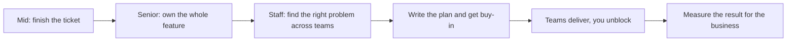

**Good and bad:**

| Good (staff signals) | Bad (stuck-at-senior signals) |
|---|---|
| "I noticed 3 teams building retries differently, so I wrote a shared starter and an RFC" | "I wrote the most PRs on the team" |
| Talks about outcomes: incidents, lead time, revenue | Talks only about tech used |
| Makes other engineers better | Is the hero who fixes everything alone |
| Says "I don't know yet, here is how I will find out" | Pretends to know everything |

**Say this in the interview:**

> "As a senior I owned features end to end. As a staff engineer my job is wider: I find the problems that hurt several teams, write down a plan, and get people to agree without being their manager. I still code, but I pick the work that unblocks others. I measure success by what changed for the business, like fewer incidents or faster delivery, not by how many PRs I merged."

**They may ask next:**
- **How do you find staff-level problems?** Read incident reports, sit in other teams' planning, look at what slows everyone (CI time, flaky tests, shared databases), and ask managers what keeps them awake.
- **Do staff engineers manage people?** No. It is a parallel track to management. You lead through ideas and trust.

---

## Writing design docs and RFCs

**In one line:** A design doc (or RFC, "request for comments") is a short written plan that explains the problem, the options and your choice, so people can find problems while change is still cheap.

**Story:** Building a house. You draw the plan on paper first and show it to the family, the architect and the plumber. Moving a wall on paper costs an eraser. Moving it after the concrete is set costs lakhs.

**How it works:**
1. **Decide if you need one.** Rule of thumb: write one if the work takes more than 2 weeks, touches other teams, changes a public API or data model, or is hard to undo.
2. **Talk before you write.** Have 1:1 chats with the main people (the other tech leads, the DBA, security). Ask what worries them. No one should be surprised by the doc.
3. **Write a short draft.** 2–6 pages. Diagrams help more than text.
4. **Review.** Share async first (comments for 3–5 days). Then a 45-minute meeting only for open points.
5. **Decide and record.** Write the decision at the top. Turn big choices into ADRs (see the next section).
6. **Keep it alive.** If the plan changes during build, update the doc.

**Example:** an outline that works.

```markdown
# RFC-042: Move order events from DB polling to Kafka
Status: In review | Author: Ankit | Reviewers: payments lead, platform, SRE
## 1. Problem (with numbers)    # "Polling adds 30 s delay; DB CPU at 70% from polling"
## 2. Goals and non-goals       # non-goals stop scope creep
## 3. Proposed design           # diagram + main flows
## 4. Alternatives considered   # at least 2, with why not
## 5. Risks and failure modes   # what if Kafka is down? duplicates?
## 6. Rollout and rollback plan # flags, phases, how to undo
## 7. Cost and effort           # people-weeks, infra cost change
## 8. Open questions
## 9. Decision log              # date, who decided, what
```

**How to get buy-in:**
- **Pre-wire:** talk to each key person before the meeting. Meetings should confirm, not surprise.
- **Lead with the problem, not your answer.** If people agree the problem is real, half the work is done.
- **Show real alternatives.** If "do nothing" is not in the list, readers assume you hid it.
- **Name a decider.** "Comments by Friday; the payments tech lead decides". Otherwise reviews never end.
- **Write the non-goals.** "We are not changing the payment API" removes half the fear.

**Diagram:** the RFC lifecycle.

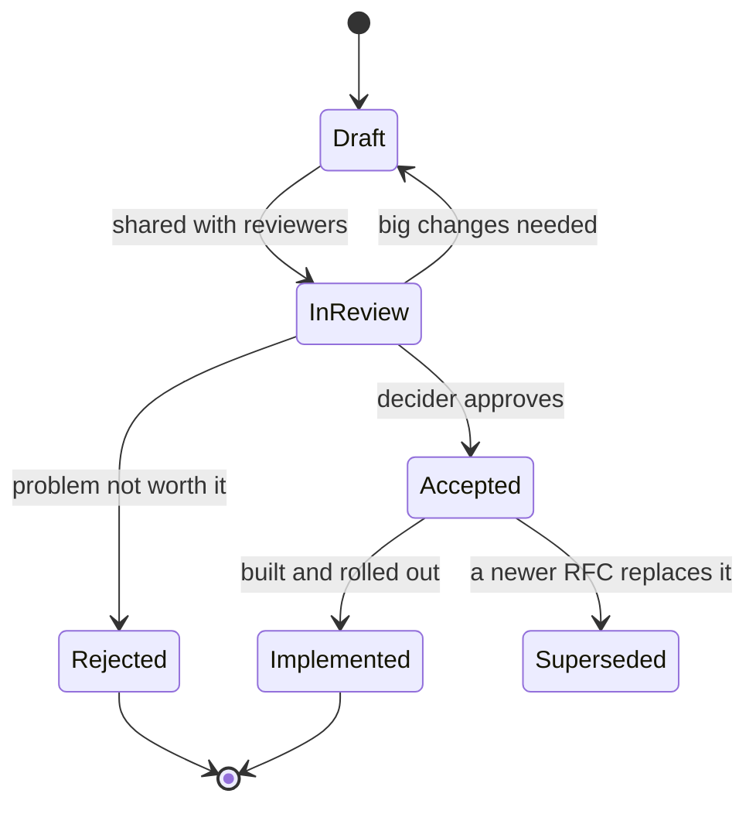

**Good and bad:**

| Good | Bad |
|---|---|
| 4 pages with 2 diagrams | 30 pages nobody finishes |
| "Alternatives: A, B, do nothing" | Only one option, written to look decided |
| Rollback plan written before build | "We'll figure out rollback later" |
| A named decider and a date | Endless comment threads |

**Say this in the interview:**

> "I write a design doc for anything over two weeks, anything that touches other teams, or anything hard to undo. It starts with the problem in numbers, then goals and non-goals, the design, at least two alternatives, risks, and a rollout and rollback plan. Before I share it, I talk to the key people one by one, so the review meeting has no surprises. I name a decider and a deadline so it doesn't drag on."

**They may ask next:**
- **What if reviewers keep adding comments for weeks?** Set a deadline, split "must fix" from "nice to have", and let the named decider close it.
- **Design doc vs RFC?** Same idea. Some companies say "RFC" when the doc is open to the whole engineering org for comments.

---

## Making technical decisions and trade-offs

**In one line:** Match the effort to the cost of being wrong: decide fast on easy-to-undo choices, go slow on hard-to-undo ones, and write the reason down in an ADR.

**Story:** Buying clothes vs buying a flat. A shirt you can return in 7 days: just try it. A flat you live with for 20 years: visit 10 times, check the papers, ask your father.

**How it works:**
1. **One-way vs two-way doors.** Jeff Bezos (Amazon, 2015 shareholder letter) split decisions into two types. A *two-way door* can be reversed: walk back through it. A *one-way door* cannot.
   - Two-way: a library inside one service, a Grafana dashboard, a feature behind a flag. Decide in a day.
   - One-way: database choice, public API shape, event schema other teams consume, data deletion. Write a doc, get review.
2. **Write the options with honest trade-offs.** Cost, risk, time to build, time to run, team skills.
3. **Decide with the people closest to the problem.** Not by vote, not by the loudest person.
4. **Record it in an ADR** (Architecture Decision Record, an idea from Michael Nygard, 2011). One short file per decision, stored in the repo next to the code.

**Example:** an ADR file, `docs/adr/0007-use-postgres-for-orders.md`.

```markdown
# 7. Use PostgreSQL for the order service
Status: Accepted (2026-03-10)    # later: "Superseded by ADR 12"
## Context
Orders need transactions across order + order_items. ~50 writes/s, 2 TB in 3 years.
Team knows PostgreSQL. MongoDB was suggested for flexible order attributes.
## Decision
PostgreSQL 17 with a JSONB column for flexible attributes.
## Consequences
+ ACID transactions, team skills, one less database to run.
- Sharding later will be manual work (Citus or app-level) if we pass ~10 TB.
```

**Build vs buy:**

| Question | Points to build | Points to buy (or open source) |
|---|---|---|
| Is it our core business? | Yes: our pricing engine | No: login, email sending, feature flags |
| Does a good product exist? | No | Yes, and others like us use it |
| Total cost over 3 years? | Build + run + on-call + upgrades is lower | Licence is lower than 1–2 engineers' time |
| Lock-in risk? | We need full control | There is an open standard or easy exit (for example OpenFeature for flags) |

- Most people forget the **run cost** of building: on-call, security patches, upgrades. A "2-week build" often costs 1 engineer for years.

**Good and bad:**

| Good | Bad |
|---|---|
| Fast on two-way doors, careful on one-way doors | Same 6-week process for every choice |
| ADRs in the repo, short | Decisions lost in Slack threads |
| "We chose X; we gave up Y" | Pretends there is no downside |
| Revisits the decision when facts change | "We decided this in 2019, don't touch it" |

**Say this in the interview:**

> "First I ask if the decision is easy to undo. If it is, like a library inside one service, I decide quickly and move on. If it is hard to undo, like a database or a public event schema, I write the options and trade-offs and get review. I record the decision and the reason in an ADR in the repo. For build vs buy, I count the full cost over three years, including on-call and upgrades, not just the build."

**They may ask next:**
- **How do you decide when the team is split 50/50?** If both options are fine and reversible, the owner picks and we move on. If not, I run a small time-boxed spike to get data.
- **Can you give an example of a wrong decision you reversed?** See [biggest technical mistake](#tell-me-about-your-biggest-technical-mistake).

---

## Managing tech debt

**In one line:** Tech debt is the extra cost every future change pays for old shortcuts. Measure it, explain it in business terms, and pay it down steadily, not with a big rewrite.

**Story:** A home loan. Borrowing to buy a house early can be smart. But you must pay the EMI (monthly instalment). If you ignore it, interest grows until all your salary goes to interest. In code, the "interest" is slower features, more bugs and more incidents.

**How it works:**
1. **Not all debt is bad.** Martin Fowler's debt quadrant: *deliberate and prudent* ("we ship now and refactor next sprint") is fine. *Reckless* debt ("no time for tests") is not.
2. **Measure it.** Pick numbers people care about:
   - Lead time for changes in that area ("a price rule change takes 8 days here, 1 day elsewhere").
   - Incidents and bugs linked to the module.
   - Hotspots: files that change the most *and* are the most complex. Git history shows this: `git log --format= --name-only | sort | uniq -c | sort -rn | head`.
   - CI time, flaky test rate, number of versions behind (Spring Boot, Java, React, Next.js).
   - End-of-life risk: "Spring Boot 2.7 gets no free security fixes".
3. **Keep a debt register.** A simple list: item, pain, cost per month, fix effort, owner.
4. **Sell it in product language.** Not "the code is ugly". Say "this module caused 4 of the last 6 incidents" or "fixing this makes every pricing feature 3 days faster".
5. **Pay it down steadily:**
   - **The 20% rule:** many teams agree on 15–20% of every sprint for debt and maintenance. Agree it with the product manager up front, so you don't negotiate every sprint.
   - **Boy Scout rule:** leave the code a little cleaner each time you touch it.
   - **Tie debt to features:** "the new discount feature touches pricing, so we refactor pricing as part of it".
   - **Big items get their own project** with an RFC and milestones.
6. **No big-bang rewrites.** Use the **strangler pattern**: build new next to old, move traffic piece by piece. See [strangler fig migration](microservices.md#strangler-fig-migration-from-a-monolith) and the frontend version in [your first 90 days on a 500k-line React app](react.md#you-inherit-a-500k-line-react-app-your-first-90-days).

**Diagram:**

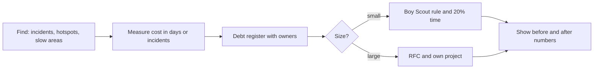

**Good and bad:**

| Good | Bad |
|---|---|
| "This module caused 4 of 6 incidents" | "The code is ugly" |
| 20% every sprint, agreed up front | Asking for a "refactoring sprint" once a year |
| Strangler, one route at a time | Big-bang rewrite that freezes features for 9 months |
| Debt tied to upcoming features | Refactoring code nobody will touch again |

**Say this in the interview:**

> "I treat tech debt like a loan: some is fine, but I track the interest. I measure it with numbers product cares about: lead time in that area, incidents linked to it, and versions we are behind. I agree 15 to 20 percent of each sprint for debt with the product manager up front. Small items go into that time; big ones get an RFC. For old systems I never do a big-bang rewrite. I use the strangler pattern."

**They may ask next:**
- **Product says no time for debt. What do you do?** Show the cost in their words ("each pricing change takes 3 extra days"), start with the debt that blocks their next feature, and show the result.
- **How do you stop new debt?** Lint and architecture tests in CI ([ArchUnit](spring-testing.md#archunit-tests-for-your-architecture)), a definition of done with tests, and design reviews for big changes.

---

## Estimation and planning

**In one line:** Break the work into small pieces, give ranges with a confidence level instead of one number, ship in thin slices, and re-plan openly when facts change.

**Story:** Driving from Delhi to Jaipur. You say "5 to 7 hours", not "5 hours 12 minutes". Before you leave, you don't know the traffic, so the range is wide. After Gurgaon, you know more and the range gets smaller. Engineers call this the *cone of uncertainty*.

**How it works:**
1. **Break it down** until each piece is 1–3 days. Anything bigger hides surprises.
2. **List the unknowns.** "We have never called the bank's new API." Do a short *spike* (time-boxed research, say 2 days) for the biggest unknown first.
3. **Give ranges with confidence.** "4 to 6 weeks, 80% confident. If the bank API needs certification, add 2 weeks."
4. **Add the hidden work.** Code review, testing, deploys, docs, on-call, meetings, holidays. A common mistake is estimating only coding time.
5. **Slice vertically.** Each slice works end to end (UI → API → DB) and can ship. Not "week 1 database, week 2 API, week 3 UI".
6. **Set milestones** that show something real: "M1: one order type works end to end in staging behind a flag".
7. **Track and tell early.** If week 2 shows you are slow, say it in week 2, not in the last week.

**Dealing with a fixed deadline:** time, scope and quality form a triangle. If the date is fixed, scope must flex.
- Ask what is really fixed. Often the date is real (a sale, a legal deadline) but the scope is not.
- Offer options: "By 1 Nov we can ship card payments only. UPI follows 2 weeks later."
- Never cut tests or monitoring silently. If quality drops, say it out loud and add it to the debt register.

**Diagram:**

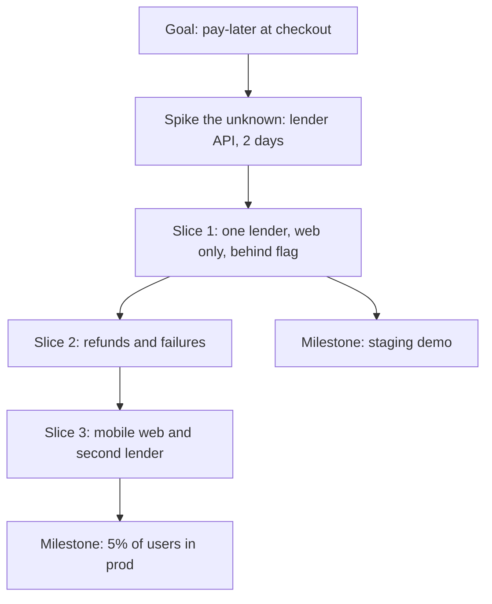

**Example:** a three-point estimate for one piece.
- Best case 3 days, likely 5 days, worst case 10 days.
- PERT average = (3 + 4×5 + 10) / 6 = **5.5 days**.
- Say "about 5–6 days, could be 10 if the lender sandbox is down".

**Good and bad:**

| Good | Bad |
|---|---|
| "4–6 weeks, 80% confident, risk is X" | "3 weeks" (one number, no risk) |
| Thin vertical slices that ship | Layers that only work at the very end |
| Spike the biggest unknown first | Find the hard part in the last week |
| Bad news early with options | Silent until the deadline |

**Say this in the interview:**

> "I break the work into pieces of one to three days and spike the biggest unknown first. I give a range with a confidence level, like four to six weeks at 80 percent, and I name the main risk. I plan in thin vertical slices that each ship behind a flag, with milestones that show working software. When the date is fixed, I flex scope, and I share bad news early with options."

**They may ask next:**
- **Story points or hours?** Points measure relative size for one team's planning. For stakeholders I give dates as ranges. Points are not comparable across teams.
- **Your manager wants a single number.** I give the 80% number and explain what would make it slip.

---

## Leading an incident and blameless postmortems

**In one line:** In an incident, one person coordinates (the incident commander), others fix and others communicate; first stop the damage, then find the cause, then learn from it in a blameless postmortem.

**Story:** A fire in a big hotel kitchen. One person shouts the orders (incident commander). Some people fight the fire (operations). One person tells the guests what is happening and keeps them calm (communications). Nobody asks "who left the gas on?" during the fire. Afterwards, the manager asks "why could the gas be left on, and how do we stop it next time?"

The technical side (dashboards, traces, `kubectl` commands, slow API, memory leak, Kafka lag) is in [Debugging a production incident](production-ready.md#debugging-a-production-incident-step-by-step). This section is about **leading**.

**How it works:**

**Roles** (from Google's SRE book, "Managing Incidents"):

| Role | Job | Not their job |
|---|---|---|
| **Incident commander (IC)** | Owns the incident, assigns work, decides (for example "roll back now") | Typing fixes |
| **Operations lead and team** | Debug and apply fixes; the only people changing the system | Talking to customers |
| **Communications lead** | Status page, updates to support and leaders every 15–30 min | Debugging |
| **Planning lead** | Longer-term work: files bugs, arranges handoffs, tracks temporary changes to undo later | Typing fixes |
| **Scribe** (not a named role in the SRE book, but common; often the IC or comms lead) | Writes the timeline as it happens | — |

**Severity levels** (example, each company has its own):

| Level | Meaning | Example | Response |
|---|---|---|---|
| SEV1 | Many users can't use a key feature, or money/data at risk | Checkout down | Page now, all hands, status page |
| SEV2 | Key feature degraded or part of users hit | Payments 10% failing | Page on-call, IC named |
| SEV3 | Minor, workaround exists | Admin report slow | Ticket, fix in work hours |

**Communication template** (every 15–30 minutes, even if nothing changed):

```text
[SEV2] Payments failing for ~10% of card users. Started 14:02 IST.
Impact: ~300 failed checkouts so far. UPI works.
Now: rolled back payment-service v4.18 at 14:20, error rate dropping.
Next: confirm recovery, then find root cause. Next update 14:45.
IC: Ankit | Comms: Priya | Channel: #inc-2026-11-03-payments
```

**Blameless postmortem** (within 3–5 working days):
1. **Timeline** in UTC or one time zone: detection, each action, mitigation, recovery.
2. **Impact** in numbers: users, failed orders, minutes, money, SLO budget used.
3. **Root cause and contributing factors.** Usually more than one.
4. **What went well, what went badly, where we got lucky.**
5. **Action items** with owner and due date. Few and real: 3 done actions beat 15 forgotten ones.
6. **Blameless** means "why did the system allow this?", not "who did it?". If people fear blame, they hide facts, and you learn nothing.

**Example:** 5 whys for "payments failed after a deploy".
1. Why did payments fail? The new version sent a wrong currency code to the bank.
2. Why wrong? A config key was renamed, and prod still had the old key, so a default was used.
3. Why was a default used? The config class had a silent default instead of failing at startup.
4. Why didn't tests catch it? Staging had the new key set by hand.
5. Why did staging differ from prod? Config is edited by hand per environment.
- **Actions:** validate config at startup with `@Validated` (fail fast); config in Git for all environments; canary with automatic rollback on payment error rate.
- Note: "5" is a guide. Stop when you reach something you can fix in the system, not a person.

**Diagram:**

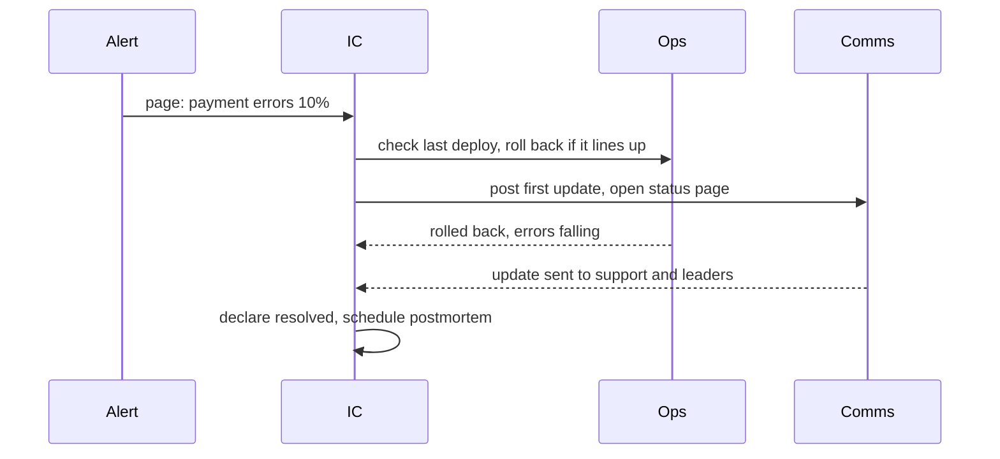

**Good and bad:**

| Good | Bad |
|---|---|
| Mitigate first (rollback, flag off), debug later | 1 hour finding the exact bug while users suffer |
| One IC, clear roles | 12 people in a call all typing commands |
| Updates on a timer, even "no news" | Leaders asking "any update?" every 2 minutes |
| Blameless, system-focused | "Ravi deployed it, Ravi caused it" |

**Say this in the interview:**

> "When I lead an incident, I name roles first: I'm the incident commander, one or two people investigate, one person handles communication. We mitigate before we debug: if a deploy lines up, we roll back. Updates go out every 15 to 30 minutes with impact, current action and next update time. Afterwards we write a blameless postmortem with a timeline, impact in numbers and a few action items with owners."

**They may ask next:**
- **When do you declare an incident?** Early. Declaring and closing a small one costs little; declaring late costs a lot.
- **How do you make sure action items get done?** Track them in the normal backlog with owners and dates, and review open items in a weekly ops meeting.

---

## Mentoring and code review culture

**In one line:** Mentoring means helping people grow by asking questions and giving them real stretch work; good code review is fast, kind, and focuses on things that matter more than style.

**Story:** Teaching someone to drive. You don't grab the wheel every time they make a mistake. You sit next to them, give a harder road each week, and only step in when there is real danger.

**How it works (mentoring):**
1. **Know their goal.** "Lead a feature", "learn Kafka", "get promoted to senior".
2. **Give stretch work with a safety net.** Let them own a small design doc; you review it before others do.
3. **Ask, don't tell.** "What happens if the payment call times out here?" teaches more than "add a timeout".
4. **Pair** on hard things: debugging a production issue, writing the first RFC.
5. **Give credit in public, feedback in private.**
6. **Make yourself less needed.** Success is when they don't need you for that topic anymore.

**How it works (code review):**

| Comment on (in this order) | Let tools handle |
|---|---|
| Correctness: bugs, edge cases, concurrency, transactions | Formatting (Spotless, Prettier) |
| Design: is this the right place? Will it be easy to change? | Import order, naming style (Checkstyle, ESLint) |
| Security: input validation, authz checks, secrets | Simple bugs a linter or Sonar finds |
| Tests: do they test behaviour, not only lines? | |
| Operability: logs, metrics, timeouts, feature flag | |

- **Tone:** comment on the code, not the person. "This loop runs one query per order (N+1)" not "you wrote it wrong". Ask questions when unsure.
- **Label the weight.** For example, the *Conventional Comments* style: `nit:` (small, optional), `suggestion:`, `question:`, `issue (blocking):`. The author then knows what must change.
- **Turnaround:** Google's public code review guide says one business day is the maximum time to respond. Many teams aim for a first response within a few hours.
- **Small PRs:** under ~400 changed lines get far better reviews. Big PRs get "LGTM" without real reading.
- **AI-generated code** gets the same review, plus extra checks. See [reviewing AI-generated code](ai-coding-assistants.md#reviewing-ai-generated-code).

**Example:** the same review comment, two ways.

```text
Bad:  "Why would you do this? This is wrong."
Good: "issue (blocking): this calls inventory-service inside the @Transactional
       method, so a slow call holds a DB connection. Could we call it before
       the transaction starts? Happy to pair on it."
```

**Good and bad:**

| Good | Bad |
|---|---|
| First response within hours, max one day | PRs waiting 4 days |
| Blocking vs nit is clear | 40 comments, all looking equally important |
| Approve with small nits ("fix before merge, no re-review needed") | A third round for a variable name |
| Seniors' PRs get reviewed by juniors too | Only seniors may review |

**Say this in the interview:**

> "In reviews I look first at correctness, design, security, tests and operability. Formatting is the tools' job. I label comments as blocking or nit, write about the code not the person, and reply within a day, usually within hours. For mentoring, I give people stretch work with a safety net, ask questions instead of giving answers, and measure success by how little they need me later."

**They may ask next:**
- **How do you review a 2,000-line PR?** Ask to split it. If not possible, review the design first in a call, then go file by file.
- **How do you handle a senior who ignores review comments?** Talk 1:1, find out why. Maybe the comments were unclear or not important. Agree on team review rules together.

---

## Cross-team influence and handling disagreement

**In one line:** Influence comes from trust, data and understanding the other team's goals; when you disagree, argue with facts, then once a decision is made, commit to it fully.

**Story:** Two neighbours sharing a wall. You want to repair it this month; your neighbour wants to wait. Shouting doesn't work. You show the crack getting bigger with photos, you ask what worries him (cost), and you offer to share the cost. If he still says "wait 3 months", you agree, mark the date, and keep checking the crack.

**How it works:**
1. **Understand their goals first.** The other team has its own deadlines and OKRs (goals for the quarter). Ask: "What would make this easy for you?"
2. **Bring data, not opinions.** "Your service's p99 is 2 s and it makes our checkout fail 0.5% of the time" is stronger than "your service is slow".
3. **Make it easy to say yes.** Offer to write the PR, the RFC, or the migration script.
4. **Find allies.** Others who feel the same pain.
5. **Disagree and commit.** (An Amazon leadership principle: "Have backbone; disagree and commit".) Argue openly before the decision. After it, support it fully, even if you lost. Don't say "I told you so" later.
6. **Escalate the right way:**
   - Only after you tried directly and you are stuck.
   - **Escalate together:** "We disagree on X. Here are both views. Can you help us decide?" Not behind their back.
   - Write both options fairly, so the leader can decide in 10 minutes.

**Diagram:**

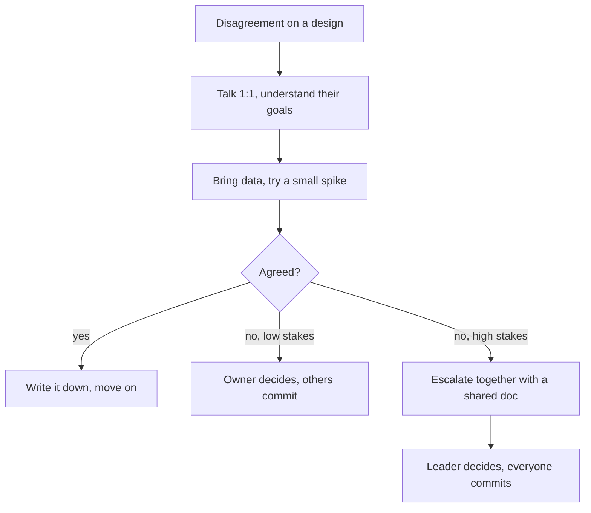

**Good and bad:**

| Good | Bad |
|---|---|
| "Here are both options, we need you to pick" | Going to the other team's boss alone |
| Offer to do part of the work | "Your team must fix this" |
| Commit fully after the decision | Slow-walking a decision you lost |
| Disagree in the meeting | Agree in the meeting, complain after |

**Say this in the interview:**

> "When I need another team to change something, I first learn their goals, then bring data about the pain, and I offer to do part of the work. If we still disagree, the owner decides on low-stakes choices. For high-stakes ones we escalate together, with one doc showing both views. Once a decision is made, I commit fully, even if it wasn't my choice."

**They may ask next:**
- **What if the decision turns out wrong later?** Bring new data and raise it again calmly. Committing doesn't mean never revisiting.
- **What if it's an ethical or safety issue?** Then "commit" doesn't apply. Escalate clearly and quickly.

---

## Working with product and stakeholders

**In one line:** Be a partner, not a ticket-taker: understand the business goal, explain technical costs in business words, offer options, and say "no" by saying "not now, and here's why".

**Story:** A good tailor. The customer asks for a suit by tomorrow. A bad tailor says "yes" and delivers a bad suit. Another bad tailor says "impossible". A good tailor says: "A full suit needs a week. By tomorrow I can alter your old one so it fits well for the function."

**How it works:**
1. **Ask "why?"** behind each request. The real need is often smaller. "Real-time dashboard" may really mean "refresh every 5 minutes".
2. **Explain cost in their words:** days, risk, money, users affected. Not "we need to refactor the repository layer".
3. **Say no with options:** "Yes, if we drop X" or "Yes, by date Y" or "Here is a cheaper version that gets 80% of the value".
4. **Bring your own ideas.** Engineers often see opportunities product can't: "We already have this data; a 'reorder' button is 3 days of work".
5. **Share bad news early.**

**Prioritisation frameworks (briefly):**

| Framework | How | Good for |
|---|---|---|
| **Impact vs effort** (2×2) | Plot items; do high impact, low effort first | Quick team sessions |
| **RICE** (from Intercom) | Reach × Impact × Confidence ÷ Effort | Comparing many product ideas with numbers |
| **MoSCoW** | Must, Should, Could, Won't (this time) | Cutting scope for a fixed date |
| **Cost of delay / WSJF** | Value lost per week of waiting ÷ job size | Ordering big items; used in SAFe |
| **Eisenhower** | Urgent vs important | Your own week |

- These are tools for a conversation, not a formula that decides for you.

**Good and bad:**

| Good | Bad |
|---|---|
| "Not this sprint; if we drop X, yes" | "Yes" to everything, then miss dates |
| Cost in days and risk | Cost in technical jargon |
| Engineers suggest product ideas | Engineers only take tickets |
| Shared priority list, one order | Five "top priorities" |

**Say this in the interview:**

> "I try to understand the goal behind each request, because the real need is often smaller. I explain technical cost in days, risk and users affected. When I have to say no, I say 'not now' with options: drop some scope, move the date, or a cheaper version. To prioritise I use simple tools like impact versus effort or RICE, but mainly to start the conversation."

**They may ask next:**
- **Two stakeholders want opposite things?** Put both in one room or one doc with the trade-off clearly written, and let the person who owns the goal decide.
- **Product keeps adding scope mid-sprint?** Make the trade visible: "We can add it; what comes out?"

---

## Hiring and interviewing others

**In one line:** A good interviewer tests real skills with a clear rubric, is kind to the candidate, and writes evidence ("they did X"), not feelings ("good vibe").

**Story:** A cricket selector. He doesn't pick players by how they talk in the dressing room. He watches them bat on a real pitch, writes down what he saw, and compares with a fixed list of what the team needs.

**How it works:**
1. **Know the rubric before the interview.** For example: problem solving, code quality, system design, communication, ownership. Each with clear levels.
2. **Use realistic questions.** "Design a rate limiter for our API" beats puzzles.
3. **Make the candidate comfortable.** Nervous people perform worse, and you learn less.
4. **Dig deeper.** "What happens when Redis is down?" "How would you test this?"
5. **Write evidence right after:** "Found the N+1 bug in 5 minutes; did not think about timeouts until asked."
6. **Decide independently,** then discuss. Write your feedback before you read others' feedback to avoid bias.
7. **Watch for bias:** "not a culture fit" often means "not like me". Ask what exactly.

**What seniors and staff look for in a senior candidate:**
- Talks about **trade-offs**, not one right answer.
- Asks clarifying questions before designing.
- Says "I" for their own work and "we" for the team's, honestly.
- Knows what can go wrong in production: timeouts, retries, data loss.
- Has real stories with numbers and lessons.
- Can explain simply. If they can't explain it simply, they may not understand it.

For how candidates are judged in each round: [system design round](system-design.md#how-interviewers-run-the-system-design-round), [senior React interviews](react.md#how-senior-react-interviews-are-run), [AI in interviews](ai-coding-assistants.md#how-to-talk-about-ai-in-interviews).

**Good and bad:**

| Good | Bad |
|---|---|
| Same questions and rubric for all | "I just ask what comes to mind" |
| Notes with evidence | "Strong hire, good energy" |
| Hints when stuck, then note it | Watching the candidate struggle in silence |

**Say this in the interview:**

> "When I interview, I use a clear rubric and realistic problems, like designing a feature close to our product. I make the candidate comfortable, because nervous people show less. I write evidence right after, like what they found and what they missed, and I submit my feedback before reading others' to avoid bias. For seniors I look for trade-off thinking, production awareness and clear explanations."

**They may ask next:**
- **Have you ever disagreed with a hiring decision?** Answer with evidence from your notes and what the panel decided.
- **How do you keep interviews fair?** Same questions, a rubric, independent feedback, a mixed panel.

---

## Driving a large migration

**In one line:** A big migration needs a clear reason, a step-by-step plan you can undo, tools for the boring work, progress metrics, and a firm date to turn off the old thing.

**Story:** Moving a big family to a new house while the children still go to school every day. You move one room at a time. Kitchen last, because people must eat. You keep the old keys until everything works. And you set a date to give the old house back, or you will pay two rents forever.

**Examples seniors are asked about:**
- **Spring Boot 2 → 3 → 4:** Java 17 baseline, `javax` → `jakarta`, Spring Security changes, then Boot 4 with Spring Framework 7 and Jackson 3. Details: [Spring Boot 2 to 3 to 4](spring.md#spring-boot-2-to-3-to-4-what-changed).
- **Monolith → services:** strangler fig, one bounded part at a time. [Strangler fig](microservices.md#strangler-fig-migration-from-a-monolith).
- **Next.js Pages Router → App Router:** both routers run in one app, so move route by route. [App Router vs Pages Router](nextjs.md#app-router-vs-pages-router).

**How it works:**
1. **Why, in numbers.** "Boot 2.7 has no free security fixes; 3 CVEs open; Java 8 blocks virtual threads." Get sponsor buy-in with an RFC.
2. **Inventory.** List every service, library and owner. A spreadsheet or dashboard: 40 services, 12 shared libraries, which ones block others.
3. **Order by dependency and risk.** Shared libraries and parent POMs first. Then one low-risk pilot service. Payments last.
4. **Automate the boring part.** OpenRewrite recipes change imports, properties and APIs across many repos. Codemods do the same for React and Next.js.
5. **Pilot and write a playbook.** Migrate one service fully. Write down every problem you hit. Other teams follow the playbook.
6. **Roll out safely.** Canary each service, watch error rate, latency, GC and memory. Keep rollback ready. For data moves: dual writes or CDC, then compare, then switch reads.
7. **Track progress publicly.** "27 of 40 services on Boot 3.5". Teams like seeing their name go green.
8. **Finish.** Set a date to delete the old path. The last 10% takes the longest; plan for it.

**Diagram:**

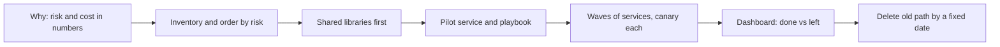

**Metrics to show:**
- Services migrated / total, by team.
- Incidents caused by the migration (target: zero SEV1).
- Before/after: startup time, memory, p99 latency, CVE count, build time.
- For frontend: Core Web Vitals and bundle size per migrated route.

**Good and bad:**

| Good | Bad |
|---|---|
| Pilot + playbook, then waves | Every team figures it out alone |
| OpenRewrite / codemods do 70–80% | Hand-editing 40 repos |
| Public dashboard | Nobody knows how far along we are |
| Fixed date to delete old code | Two systems forever |

**Say this in the interview:**

> "I start with the reason in numbers and an RFC. Then I build an inventory and order the work by dependency and risk: shared libraries first, then one pilot service, and the riskiest services last. I automate the boring changes with OpenRewrite and write a playbook from the pilot. Each service goes out with a canary and a rollback plan. A public dashboard shows progress, and we set a firm date to remove the old path."

**They may ask next:**
- **A team refuses to migrate.** Find what blocks them, offer help or pair, make the old path harder (no new features there), and agree a date with their manager.
- **How do you migrate data with zero downtime?** Expand-and-contract, or dual writes/CDC with a comparison step before switching reads. See [deploying safely](production-ready.md#deploying-safely).

---

## Ownership, on-call and operational excellence

**In one line:** Ownership means you care about your code after it ships: you watch it, you get paged for it, and you keep making it easier and calmer to run.

**Story:** A restaurant owner vs a hired cook. The cook goes home at 10 PM. The owner checks the fridge temperature at night, fixes the leaking tap before it floods, and asks why table 7 complained.

**How it works:**
1. **You build it, you run it.** The team that writes the service is on call for it.
2. **Healthy on-call:** a rotation of at least 5–6 people, a primary and secondary, a runbook for every alert, and a handover note at the end of each week.
3. **Measure on-call pain:** pages per week, pages at night, time to acknowledge, repeat alerts. Fix the top noisy alert every week.
4. **Operational excellence habits:**
   - SLOs for key user journeys, and error budget rules agreed with product.
   - A production readiness review before launch. See the [one-page checklist](production-ready.md#production-readiness-review-one-page-checklist).
   - Game days: break things on purpose in staging (kill a pod, slow the DB) and practise.
   - Postmortem action items actually done.
5. **Ownership beyond your code:** if you see a broken alert, a flaky test or an outdated runbook, fix it or raise it. Don't step over it.

Alerts, SLOs, burn-rate and on-call tools are covered in [Alerts, SLOs and on-call](production-ready.md#alerts-slos-and-on-call).

**Good and bad:**

| Good | Bad |
|---|---|
| Fewer than 2 pages a night on average | Pages every night, everyone tired |
| Each alert has a runbook and an owner | "Ask Suresh, he knows" |
| Time off after a heavy on-call week | Heroics praised, burnout ignored |
| Top noisy alert fixed every week | Muting alerts instead of fixing them |

**Say this in the interview:**

> "For me ownership means caring after the release: dashboards, alerts and being on call for what my team builds. I keep on-call healthy by tracking pages per week and fixing the noisiest alert every week, and every alert has a runbook. Before launch we do a readiness review, and we practise failures in game days. If I see something broken outside my area, I fix it or raise it."

**They may ask next:**
- **How did you reduce on-call load?** Give numbers: "from 25 pages a week to 4 by deleting 30 noisy alerts and adding timeouts".
- **Should seniors be on call?** Yes. It keeps design decisions honest.

---

## Staff-level behavioral questions with sample answers

**In one line:** Staff behavioral answers show scope beyond your team, decisions under uncertainty, and how you made others better, told in STAR with numbers and an honest lesson.

**Story:** A doctor's case file. A good one says what the patient had, what was done, why, and how the patient is now. A great one also says what the doctor would do differently next time.

**How it works:**
- Use STAR from the README: [Behavioral questions](../README.md#behavioral-questions).
- For staff level, make sure the **Action** part shows: influence across teams, a written plan, trade-offs, and growing others.
- End with a **lesson**. Staff interviewers love "what I'd do differently".
- Expect follow-ups: "What did the other team say?", "What would you do if they said no?", "What was your part exactly?"

The answers below are **sample shapes** for a Java/Spring + React engineer. Replace them with your own true stories and numbers.

**Say this in the interview:**

> "I'll tell this as situation, task, action and result. The short version is: [one line]. Then the details, with numbers, and at the end what I learned and would do differently."

### Tell me about a time you influenced without authority

**Say this in the interview:**

> **S:** Our 4 checkout teams each called the payment service with different timeouts and retry rules. Retries caused duplicate charges twice in one quarter.
> **T:** I wasn't any of their leads, but I owned the payment client library.
> **A:** I collected data from both incidents and wrote a 3-page RFC. I proposed one Spring Boot starter with timeouts, retries with backoff, and idempotency keys. I met each tech lead 1:1 before the review, and I added their concerns as options. I migrated the first service myself as a reference PR.
> **R:** All 4 teams adopted it within 2 months. Duplicate charges went to zero over the next 6 months. I learned that the 1:1 talks did more than the doc itself.

### Tell me about your biggest technical mistake

**Say this in the interview:**

> **S:** I added a Redis cache in front of product prices to cut DB load.
> **T:** I designed and shipped it.
> **A:** I set a 1-hour TTL and no invalidation, because I thought prices rarely changed. During a sale, marketing changed 2,000 prices, and some users saw old prices for an hour. I owned it in the incident channel, flushed the keys, and then added event-based invalidation from the price-change Kafka topic, with a 5-minute TTL as a backup.
> **R:** About 150 orders needed manual price fixes. Since then, before caching anything, I ask "who changes this data, and how fast must users see it?" and I write that down in the design doc.

### Tell me about a project that failed

**Say this in the interview:**

> **S:** We planned a rewrite of our admin portal from AngularJS to React in one go.
> **T:** I was the tech lead, and we estimated 4 months.
> **A:** After 5 months we had 60% of screens done, and the old app kept getting new features we had to copy. I stopped the project, told leadership honestly, and proposed a strangler approach: new routes in React inside the old shell, one screen at a time.
> **R:** The rewrite as planned failed, but the strangler plan finished in 7 more months while features kept shipping. My lesson: no big-bang rewrites, and check progress against the plan every 2 weeks, not at the end.

### Tell me about a time you disagreed with your manager

**Say this in the interview:**

> **S:** My manager wanted to split our order monolith into 8 microservices in one quarter.
> **T:** I thought the risk was too high for a 6-person team.
> **A:** I asked for 30 minutes and brought data: our deploys took 40 minutes, but only 2 modules changed often. I proposed extracting just those 2 first, behind the gateway. My manager still wanted more. We agreed on 2 now and a review after. I committed fully to that plan.
> **R:** The 2 services shipped in 10 weeks, and deploy time for them fell to 8 minutes. At the review, we chose to stop there for that year. I learned to disagree with data and a smaller option, not just "no".

### Tell me about a time you simplified a complex system

**Say this in the interview:**

> **S:** Our notification flow went through 3 services, 2 queues and a cron job. Nobody could explain it, and 1–2% of emails were lost.
> **T:** I took ownership after an incident.
> **A:** I drew the real flow from traces, found two services only passed messages along, and wrote an RFC to merge them into one Spring Boot service using the transactional outbox pattern. I deleted the cron job.
> **R:** Lost emails went from about 1.5% to near zero, and the code shrank by around 6,000 lines. New joiners understood it in a day instead of a week.

### Tell me about a time you improved team productivity

**Say this in the interview:**

> **S:** Our CI took 38 minutes, and about 1 in 5 builds failed due to flaky tests. Developers batched changes into huge PRs.
> **T:** Not assigned; I took it on with my manager's support, using our 20% time.
> **A:** I measured where the time went. I added Maven and npm caching, split tests to run in parallel, reused one Testcontainers database for all integration tests, and quarantined the top 10 flaky tests with owners to fix them.
> **R:** CI went to 11 minutes and flaky failures to under 3%. PR size dropped, and our deploys went from weekly to daily. I shared the setup so 3 other teams copied it.

### Tell me about a time you handled an underperformer

**Say this in the interview:**

> **S:** A mid-level engineer on my team missed estimates and his PRs often came back 3–4 times.
> **T:** As tech lead, I wanted to help before it became a manager problem.
> **A:** In a 1:1 I asked what was hard. He was new to Spring and afraid to ask questions. I paired with him twice a week, split his tasks smaller, and gave him a checklist for PRs. I also kept my manager informed with facts, not opinions.
> **R:** In 2 months his PRs mostly passed in 1–2 rounds, and he later owned a full feature. My lesson: first ask why, because the cause is often fear or unclear tasks, not effort.

### Tell me about a time you raised the quality bar

**Say this in the interview:**

> **S:** Our React app had no E2E tests, and each release broke something in checkout.
> **T:** I wanted fewer production bugs without slowing the team.
> **A:** I proposed a small rule: every bug fix comes with a test. I added Playwright tests for the top 5 user journeys, running on every PR, and an ArchUnit test on the backend to stop controllers calling repositories directly. I made it easy with templates and a short demo.
> **R:** Checkout bugs in production fell from about 6 a quarter to 1. The team kept the habit after I moved teams, which told me it had become their rule, not mine.

### Tell me about a time you delivered under ambiguity

**Say this in the interview:**

> **S:** Leadership said "we need to support B2B customers" with no spec and a 3-month window.
> **T:** I was asked to lead the technical side.
> **A:** I spent the first week talking to sales and 3 pilot customers. I found the must-haves were invoices, bulk orders and approval flows. I wrote a one-page plan with 3 slices, and made the riskiest one, approval flows, first behind a flag. We demoed to the pilot customers every 2 weeks.
> **R:** We shipped the first slice in 5 weeks and all three by month 3. Two pilot customers signed. I learned to turn ambiguity into questions and small bets quickly.

### Tell me about a time you made a hard trade-off

**Say this in the interview:**

> **S:** Before a big sale, we had to choose between finishing a new search feature and fixing database connection pool limits found in load tests.
> **T:** I had to recommend one to product.
> **A:** I showed the numbers: at 3x normal traffic, checkout would fail at around 8% due to pool exhaustion. I proposed delaying search by 2 weeks. I explained the cost of each option in revenue terms.
> **R:** Product agreed. Sale traffic peaked at 3.4x and checkout errors stayed under 0.2%. Search shipped 2 weeks later. The trade-off was easy to accept because I made the cost visible.

### Tell me about a time you led a major incident

**Say this in the interview:**

> **S:** On a Friday evening, Kafka consumer lag for order events grew to 2 million messages; orders were not confirmed.
> **T:** I was on call and took the incident commander role.
> **A:** I named an investigator and a comms person. We saw a new release made each message call an external API synchronously. I decided to roll back first. Lag cleared in 40 minutes. In the postmortem, we added a lag alert with a runbook and a load test for consumers.
> **R:** No orders were lost, and customers got confirmations within an hour. The new alert caught a similar issue 2 months later within 5 minutes.

### Tell me about a time you mentored someone to grow

**Say this in the interview:**

> **S:** A junior frontend developer wanted to learn backend.
> **T:** I offered to mentor her for a quarter.
> **A:** We set a goal: own one small Spring Boot endpoint end to end. I gave her a real ticket, reviewed her design before code, and paired on the first integration test with Testcontainers. Later she wrote a small design doc, and I only commented.
> **R:** By the end of the quarter she owned the endpoint, including on-call. A year later she was a full-stack engineer on the team. I learned to give real work early, with a safety net.

### Tell me about a time you pushed back on a requirement

**Say this in the interview:**

> **S:** Product wanted live order tracking with updates every second for all users.
> **T:** I owned the backend design.
> **A:** I asked what users really needed. Data showed status changes only every few minutes. I showed that 1-second polling for 200k users would be 200k requests per second, and proposed server-sent events only on status change.
> **R:** Product agreed. We built it in 3 weeks instead of an estimated 2 months, and the server load was tiny. Pushing back with a better option, not just a "no", made it easy.

### Tell me about a time you went beyond your role

**Say this in the interview:**

> **S:** I noticed our team's Docker images had 40+ high CVEs, and nobody owned the base images.
> **T:** It wasn't my job, but it was a security risk.
> **A:** I made a shared base image on a slim JRE, added a Trivy scan to CI that failed on critical issues, and wrote a short guide. I presented it at the engineering demo.
> **R:** Critical CVEs went from 40+ to 0 in a month across 12 services. The platform team later took over the base image as an official one.

### How do you use AI tools in your work, and how do you keep quality high?

**Say this in the interview:**

> **S:** Our team started using AI coding assistants in 2025.
> **T:** I helped set team rules for using them.
> **A:** We wrote a project instruction file, asked for tests first, and kept small PRs. AI-written code got the same review, plus checks for invented APIs and packages.
> **R:** We moved faster on tests and boilerplate, without more production bugs. More detail: [How to talk about AI in interviews](ai-coding-assistants.md#how-to-talk-about-ai-in-interviews).

---

**PART 2: ENGINEERING TOOLS SENIORS ARE ASKED ABOUT**

## Git in depth

**In one line:** Git stores your project as a chain of snapshots (commits). Merge, rebase and squash join two chains; reflog undoes mistakes; bisect finds bugs fast.

**Story:** A family photo album. Every commit is a photo with a note on the back: who, when, and which photo came before it. A branch is just a bookmark pointing at one photo. Merging, rebasing and squashing are different ways to put two people's photos into one album.

**How it works (the basics seniors must explain):**
- A **commit** is a full snapshot plus a pointer to its parent(s). Its id (SHA) is a hash of the content, so changing history makes new ids.
- A **branch** is a movable label on one commit. `HEAD` is "where I am now".
- **Never rewrite shared history.** Rebasing or force-pushing a branch others use breaks their copies. If you must force-push your own branch, use `git push --force-with-lease` (it refuses if someone else pushed meanwhile).

### Merge vs rebase vs squash

**In one line:** Merge keeps both histories and adds a join commit; rebase replays your commits on top of the latest main for a straight line; squash turns all your branch commits into one.

**Diagram:** the starting point. `main` moved on (C) after you branched for your feature (D, E).

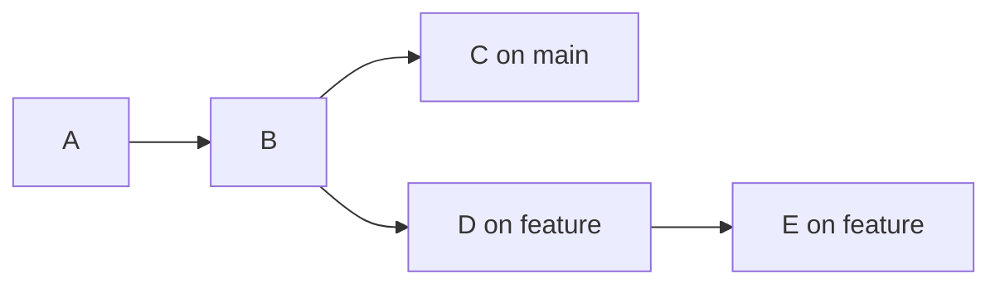

**Merge:** a new merge commit M has two parents. True history is kept.

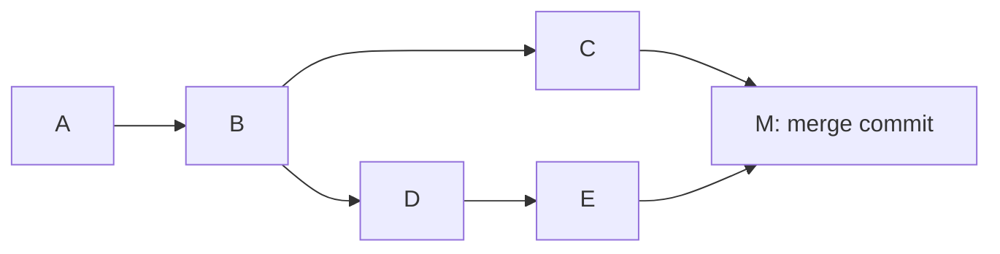

**Rebase:** D and E are copied on top of C as new commits D' and E' (new SHAs). Straight line, no merge commit.

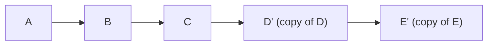

**Squash merge:** D and E become one commit S on main. Clean main, but the small steps are gone from main.

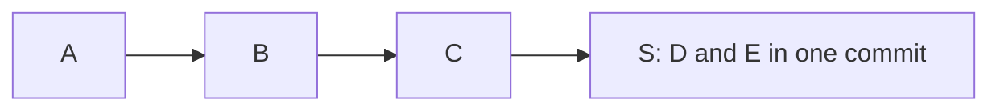

| | Merge | Rebase | Squash merge |
|---|---|---|---|
| History on main | Real, with branches | Straight line, each commit kept | Straight line, one commit per PR |
| Rewrites commits? | No | Yes (new SHAs) | Yes (one new commit) |
| Safe on shared branches? | Yes | No | Done at merge time, so yes |
| `git bisect` and revert | Harder to read | Good, small commits | Easy: revert one PR = one commit |
| Typical use | Long-lived release branches | Update your own feature branch | Default for PRs in many teams |

**Example:**

```bash
git switch feature/pay-later
git fetch origin
git rebase origin/main              # replay my commits on the latest main
git push --force-with-lease         # safe force-push of MY branch only
# on GitHub: "Squash and merge" -> one commit per PR on main
```

**Say this in the interview:**

> "Merge keeps the true history and adds a merge commit. Rebase replays my commits on top of main, so history is a straight line, but it creates new commit ids, so I only rebase my own branches. Squash merge turns a PR into one commit on main, which makes revert and bisect simple. My usual setup: rebase my branch on main, then squash-merge the PR."

### Interactive rebase, cherry-pick and reflog

**In one line:** Interactive rebase cleans up your commits before review, cherry-pick copies one commit to another branch, and reflog is Git's diary for getting back "lost" work.

**How it works:**
- **Interactive rebase** (`git rebase -i HEAD~5`) opens a list of your last 5 commits. For each, you choose: `pick` (keep), `reword` (change message), `edit` (stop to change it), `squash` / `fixup` (join with the one above), `drop` (remove). You can also reorder lines.
- **Fixup flow:** `git commit --fixup=<sha>` marks a commit as a fix for an older one. `git rebase -i --autosquash origin/main` joins them automatically.
- **Cherry-pick** (`git cherry-pick <sha>`) copies one commit onto your current branch. Use it for a hotfix: fix on `main`, cherry-pick to `release/4.18`. Add `-x` to note the original commit id in the message.
- **Reflog** (`git reflog`) lists every place `HEAD` has been: commits, resets, rebases, checkouts. Even after a bad `reset --hard`, the old commit stays for a while. By default, Git cleans reflog entries after about 90 days, or 30 days for commits no branch points to.

**Example:** recover from a bad reset.

```bash
git reset --hard HEAD~3        # oops: 3 commits "gone"
git reflog                     # find the line before the reset
# 9421047 HEAD@{0}: reset: moving to HEAD~3
# 44a8fd4 HEAD@{1}: commit: add pay-later validation
git reset --hard HEAD@{1}      # back to where we were
git branch rescue 44a8fd4      # or keep it safe on a new branch
```

**Say this in the interview:**

> "Before review I use interactive rebase to squash fixup commits and write clear messages. For hotfixes I fix on main and cherry-pick to the release branch with -x. If I break my branch with a reset or a bad rebase, git reflog shows where HEAD was, and I reset back to that entry. Almost nothing committed is truly lost for a few weeks."

### git bisect: find the commit that broke it

**In one line:** `git bisect` does a binary search over history: you mark one good and one bad commit, and Git finds the first bad commit in about log2(N) steps.

**Story:** Finding which of 100 sweets in a box has too much salt. You don't taste all 100. You taste the middle one, then the middle of the bad half, and so on. 7 tastes are enough.

**How it works:**
1. `git bisect start`, then mark `bad` (now) and `good` (the last release that worked).
2. Git checks out the middle commit. You test and mark it good or bad.
3. Repeat. 1,000 commits need only about 10 steps.
4. Better: give it a script. Exit code 0 = good, 1–127 = bad (except 125), 125 = "can't test, skip".

**Example:**

```bash
git bisect start
git bisect bad HEAD
git bisect good v4.17.0                       # last release that worked
git bisect run ./mvnw -q -Dtest=PriceCalculatorTest test   # Git runs this at each step
# ... "a1b2c3d is the first bad commit"
git bisect reset                              # back to where you started
```

**Say this in the interview:**

> "When something worked in the last release and is broken now, I use git bisect. I mark the release as good and HEAD as bad, and give it a test command with git bisect run. It does a binary search, so even 1,000 commits take about 10 steps. Squash-merged PRs make this even better, because the result points to one PR."

### Branching strategies and feature flags

**In one line:** In trunk-based development everyone merges small changes to main daily and hides unfinished work behind flags; GitFlow uses long-lived branches for slow, versioned releases.

**Story:** Two ways to write a group report. Trunk-based: everyone adds a paragraph to one shared doc every day; unfinished parts are greyed out. GitFlow: everyone writes their own chapter for weeks, then a big painful day of joining it all.

**How it works:**

| | Trunk-based | GitFlow |
|---|---|---|
| Branches | `main` + short-lived branches (hours to 1–2 days) | `main`, `develop`, `feature/*`, `release/*`, `hotfix/*` |
| Merge pain | Small and often | Big merges, many conflicts |
| Unfinished work | Behind feature flags | On long branches |
| Fits | Web apps and services with CI/CD, deploy daily | Installed software, mobile apps, many supported versions |
| DORA view | Linked with better delivery performance | Slower lead time |

- The author of GitFlow (Vincent Driessen, 2010) later added a note that teams doing continuous delivery should use a simpler flow.
- **GitHub flow** is the simple middle: `main` + short feature branches + PRs + deploy from main.
- **Feature flags** let you separate **deploy** (code is in prod) from **release** (users see it). Use OpenFeature (a vendor-neutral flag API) with a provider like Unleash, flagd or LaunchDarkly. More in [deployment patterns](microservices.md#deployment-patterns).
- **Clean up flags.** Old flags are tech debt: give each one an owner and an expiry date.

**Diagram:**

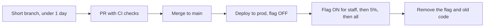

**Say this in the interview:**

> "For services I prefer trunk-based development: short branches merged to main every day or two, with CI on every PR. Unfinished work ships turned off behind a feature flag, so deploy and release are separate. GitFlow fits products with slow, versioned releases, like mobile apps. Flags need owners and expiry dates, or they become debt."

### Conflicts, signed commits and monorepo vs polyrepo

**In one line:** Resolve conflicts by understanding both changes, sign commits so others can trust the author, and pick monorepo or polyrepo by how teams share code.

**Resolving conflicts:**
1. Keep branches short and rebase often; small conflicts are easy.
2. Read both sides. Ask "what was each person trying to do?" The right answer often combines both.
3. Use `git config merge.conflictStyle zdiff3` to also see the original "base" version. It shows what each side changed.
4. After resolving, **build and run tests**. A clean merge can still be broken code.
5. For repeated conflicts in long rebases, `git rerere` ("reuse recorded resolution") remembers how you fixed the same conflict before.
6. Lockfiles (`package-lock.json`, `pnpm-lock.yaml`): don't hand-merge. Take one side and re-run the install.

**Signed commits:**
- Anyone can set `user.name` to your name. Signing proves the commit came from your key.
- Since Git 2.34 you can sign with an SSH key, not just GPG:

```bash
git config --global gpg.format ssh
git config --global user.signingkey ~/.ssh/id_ed25519.pub
git config --global commit.gpgsign true      # sign every commit
```

- GitHub shows a "Verified" badge, and branch rules can require signed commits on `main`.

**Monorepo vs polyrepo:**

| | Monorepo (one repo, many projects) | Polyrepo (one repo per service) |
|---|---|---|
| Shared code change | One PR changes the library and all users | Release library, then bump in every repo |
| Tooling needed | Smart build tools: Nx, Turborepo, Bazel, Gradle builds that only test what changed | Simple per repo |
| Ownership | `CODEOWNERS` per folder | Repo permissions |
| Risk | Slow CI without affected-only builds | Version drift, "which repo has it?" |
| Fits | Frontend + shared UI packages, tight teams | Many independent teams and services |

**Say this in the interview:**

> "For conflicts I read both sides and combine the intent, then I always run the tests, because a clean merge can still be broken. I sign commits with an SSH key so GitHub can verify them. For repos: a monorepo makes shared changes easy but needs tools like Nx or Bazel to only build what changed. Polyrepo is simpler per team but versions drift."

---

## CI/CD pipelines and GitHub Actions

**In one line:** CI (continuous integration) builds and tests every change automatically; CD (continuous delivery or deployment) ships the tested artifact to production the same safe way every time.

**Story:** A biscuit factory. Every batch goes through the same line: mix, bake, quality check, pack, ship. Nobody bakes at home and carries it to the shop. If the quality check fails, the batch stops on the line, not in the customer's mouth.

**How it works:**
- **Continuous integration:** every push and PR runs build + tests. Main must always be green.
- **Continuous delivery:** every green build *could* go to prod with one click.
- **Continuous deployment:** every green build *does* go to prod automatically (with canary checks).
- **Build once, deploy many.** The same image (same digest) goes to staging and prod. Only config changes per environment.

**Diagram:**

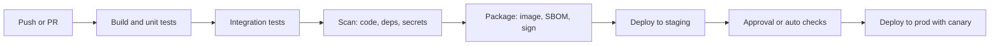

**Example:** GitHub Actions for a Spring Boot service (versions current in Nov 2026; let Dependabot update them).

```yaml
name: ci
on:
  pull_request:
  push:
    branches: [main]
permissions:
  contents: read                    # least privilege for the token
jobs:
  build:
    runs-on: ubuntu-latest
    steps:
      - uses: actions/checkout@v7
      - uses: actions/setup-java@v6
        with:
          distribution: temurin
          java-version: '25'
          cache: maven              # caches ~/.m2 by pom.xml hash
      - run: ./mvnw -B verify       # compile, unit and integration tests
      - uses: actions/upload-artifact@v7
        with:
          name: app-jar
          path: target/*.jar
  deploy-staging:
    needs: build                    # runs only if build passed
    if: github.ref == 'refs/heads/main'
    runs-on: ubuntu-latest
    environment: staging            # env secrets + protection rules
    steps:
      - uses: actions/download-artifact@v8
        with: { name: app-jar }
      - run: echo "deploy the jar or image here (Helm, Argo CD...)"
```

**Key ideas in that file:**
- **Triggers** (`on`): PRs and pushes to `main`.
- **Jobs** run in parallel unless `needs` links them.
- **Caching:** `setup-java` with `cache: maven` (or `actions/cache` for other tools) saves minutes per build. The cache key changes when `pom.xml` changes.
- **Artifacts:** `upload-artifact` passes the built jar to later jobs, and keeps test reports for debugging. Caches are for speed; artifacts are for outputs.
- **Environments:** `environment: staging` gives the job that environment's secrets. For `production`, add protection rules: required reviewers (approval), wait timers, and only the `main` branch can deploy.
- **Permissions:** give the `GITHUB_TOKEN` only what it needs. Deploy to clouds with **OIDC** (short-lived tokens, `id-token: write`) instead of long-lived cloud keys stored as secrets.
- Other CI tools work the same way: GitLab CI, Jenkins, CircleCI, Azure Pipelines, Buildkite.

**Deployment strategies (recap):** rolling, blue-green, canary and feature flags are covered in [deployment patterns](microservices.md#deployment-patterns), [rolling updates, blue-green and canary in Kubernetes](docker-kubernetes.md#rolling-updates-rollback-blue-green-and-canary) and [deploying safely](production-ready.md#deploying-safely). GitOps tools (Argo CD, Flux) deploy whatever is in a Git repo: [GitOps](docker-kubernetes.md#gitops-with-argo-cd-and-flux).

**Speeding up CI** (seniors get asked this):
- Cache dependencies and build outputs (Maven, Gradle build cache, npm/pnpm store, Docker layer cache).
- Run only what changed (affected-only builds in monorepos).
- Split tests across parallel jobs (sharding). See [tests in CI](js-testing.md#tests-in-ci-sharding-retries-and-artifacts).
- Reuse containers in integration tests; fix or quarantine flaky tests ([flaky tests](spring-testing.md#flaky-tests-causes-and-fixes)).
- Target: PR checks under 10–15 minutes.

**Good and bad:**

| Good | Bad |
|---|---|
| Build once, same image to every environment | Rebuild for prod "to be safe" |
| OIDC to the cloud, short-lived tokens | Cloud admin keys in repo secrets |
| Required checks before merge | "CI is red, merge anyway" |
| Approval gate for prod (if needed) | Manual SSH deploys |

**Say this in the interview:**

> "My pipeline runs on every PR: build, unit and integration tests, code, dependency and secret scans. On main it builds one image, makes an SBOM and signs it, then the same image goes to staging and prod. In GitHub Actions I cache Maven, pass outputs as artifacts, use environments with approval rules for prod, and deploy to the cloud with OIDC instead of stored keys. Then prod rollout is a canary with automatic rollback."

**They may ask next:**
- **Cache vs artifact?** Cache speeds up builds and may be missing; artifact is a real output you need later, like a jar or test report.
- **How do you handle DB migrations in CD?** Flyway or Liquibase runs as part of deploy, with expand-and-contract so old and new code both work.

---

## Software supply chain security

**In one line:** Supply chain security means checking everything that goes into your build (libraries, CI actions, base images), and being able to prove what you shipped.

**Story:** A restaurant checks its suppliers, not only its own cooking. Where did the vegetables come from? Are the spices sealed? Every package has a label listing what is inside (SBOM) and a seal (signature) that shows nobody opened it on the way.

**How it works:**
1. **Know what's inside: SBOM** (Software Bill of Materials). A list of every library and version in your app or image. Two common formats: **CycloneDX** and **SPDX**. Tools: Syft, the CycloneDX Maven/Gradle plugins. Spring Boot 3.3+ can expose the SBOM on an Actuator endpoint (`/actuator/sbom`).
2. **Scan dependencies** for known CVEs (public security bugs): Dependabot, Renovate (for updates), OWASP Dependency-Check, Snyk, OSV-Scanner, and Trivy or Grype for images.
3. **Scan for secrets:** gitleaks, GitHub secret scanning with push protection.
4. **Sign and attest what you build:**
   - **Sigstore cosign** signs container images. Keyless signing uses a short-lived certificate tied to the CI identity.
   - **Provenance** says where and how an artifact was built. **SLSA** (Supply-chain Levels for Software Artifacts) defines build levels. GitHub's `actions/attest` creates signed provenance attestations.
   - Verify at deploy time: the cluster (for example with an admission policy such as Kyverno) only runs signed images.
5. **Lock down CI:**
   - Pin third-party actions to a full commit SHA, not a moving tag. (In March 2025, the popular `tj-actions/changed-files` action was compromised and leaked secrets from many repos' CI logs.)
   - Least-privilege `permissions`, OIDC instead of stored keys.
6. **Lock down dependencies:** lockfiles committed, a private registry/proxy (Nexus, Artifactory), and a short wait before taking brand-new package versions. npm had self-spreading malware attacks in 2025, and AI tools sometimes invent package names that attackers then register. See [hallucinated packages](ai-coding-assistants.md#hallucinated-packages-slopsquatting).

More on images: [image security](docker-kubernetes.md#image-security). More on the production side: [security checklist](production-ready.md#security-checklist-for-production).

**Diagram:**

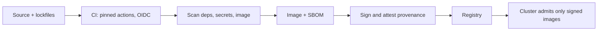

**Good and bad:**

| Good | Bad |
|---|---|
| Actions pinned to commit SHA | `uses: some/action@main` |
| SBOM for every release | "Which services use log4j?" takes a week |
| Renovate/Dependabot PRs merged weekly | Updates once a year in a panic |
| Only signed images run in prod | Anything in the registry can run |

**Say this in the interview:**

> "I treat everything that goes into the build as untrusted until checked. We commit lockfiles, scan dependencies and images for CVEs, and scan for secrets. Every release has an SBOM, so when the next log4j happens we know in minutes which services are affected. Images are signed with cosign and carry provenance, and the cluster only runs signed images. In CI, third-party actions are pinned to a commit SHA and we use OIDC instead of stored keys."

---

## DORA metrics

**In one line:** DORA metrics measure how well a team delivers software: how fast changes reach production (throughput) and how often they break things (instability).

**Story:** A delivery company tracks a few things. How long does a parcel take from booking to door? How many trips a day? How often is a parcel damaged, and how fast is it replaced? Good companies are both fast and careful. DORA's research found the same for software: speed and stability go together.

**How it works:** DORA (DevOps Research and Assessment, now a Google Cloud research team, site dora.dev) currently lists **five** metrics in two groups:

| Group | Metric | Meaning |
|---|---|---|
| Throughput | **Change lead time** | Time from a commit to that change running in production |
| Throughput | **Deployment frequency** | How often you deploy to production |
| Throughput | **Failed deployment recovery time** | How long it takes to recover when a deployment fails and needs immediate action |
| Instability | **Change fail rate** | Share of deployments that need immediate action after (rollback, hotfix) |
| Instability | **Deployment rework rate** | Share of deployments that are unplanned, done because of a production incident |

- Older material talks about "the four key metrics" and calls recovery "MTTR" (mean time to restore). Rework rate is the newer fifth one. Know both names.
- **Use them for the team, not to rank people.** Once a number becomes a target, people game it (Goodhart's law).
- Capabilities linked to good scores include trunk-based development, test automation, loosely coupled architecture and fast code review.

**Example:** a team's numbers before and after a CI clean-up.

| Metric | Before | After |
|---|---|---|
| Change lead time | ~6 days | ~1 day |
| Deployment frequency | Weekly | Several times a day |
| Change fail rate | ~20% | ~8% |
| Failed deployment recovery time | ~3 hours | ~20 minutes (one-click rollback) |

**Say this in the interview:**

> "DORA metrics measure delivery. Throughput is change lead time, deployment frequency and failed deployment recovery time. Instability is change fail rate and the newer deployment rework rate. DORA's research shows fast teams are usually also stable, because small, frequent changes are easier to test and roll back. I use them to find bottlenecks for the team, never to rank individuals."

**They may ask next:**
- **How do you measure lead time?** From commit (or PR merge) time to deploy time, using Git and the deploy tool's events.
- **Lead time is long. Where do you look?** PR wait time, CI duration, manual approvals, batching releases.

---

## Linux and debugging on a server

**In one line:** Start from the symptom, use a few standard commands to check CPU, memory, disk, network and the JVM, and change one thing at a time.

**Story:** A car mechanic. He doesn't open the engine first. He checks the fuel gauge, the tyre pressure, listens to the engine, and reads the dashboard lights. Simple checks first, then the deep tools.

**How it works:** Brendan Gregg (a well-known performance engineer, formerly at Netflix) published a "first 60 seconds" checklist. It runs: `uptime`, `dmesg | tail`, `vmstat 1`, `mpstat -P ALL 1`, `pidstat 1`, `iostat -xz 1`, `free -m`, `sar -n DEV 1`, `sar -n TCP,ETCP 1`, `top`. Many of these come from the `sysstat` package.

**Symptom → command:**

| Symptom | Command | What to look for |
|---|---|---|
| Box feels slow | `uptime` | Load average vs number of CPUs (load 16 on 4 CPUs = queueing) |
| High CPU | `top` (press `1` for each CPU), `htop` | Which process; `%st` (steal) high = noisy neighbour VM; `%wa` high = waiting for disk |
| Which Java thread uses CPU? | `top -H -p <pid>` | Thread id; convert to hex (`printf '%x' 12345`) and find `nid=0x3039` in the thread dump |
| Memory | `free -h`, `vmstat 1` | `available` column; `si`/`so` > 0 = swapping (very slow) |
| Process list | `ps aux --sort=-%mem \| head` | Biggest processes, zombie (`Z`) processes |
| Disk full | `df -h`, `df -i`, `du -sh /var/log/* \| sort -h` | 100% used, or out of inodes (too many small files) |
| Disk slow | `iostat -xz 1` | `%util` near 100, high `await` (ms per IO) |
| Disk full but no big files | `lsof +L1` | Deleted files still held open by a process (restart it or rotate logs properly) |
| Too many open files | `lsof -p <pid> \| wc -l`, `cat /proc/<pid>/limits` | Count vs "Max open files" limit |
| Who uses port 8080? | `ss -tlnp` (or `lsof -i :8080`) | Listening sockets and their process |
| Connection problems | `ss -s`, `ss -tan state time-wait \| wc -l` | Many TIME-WAIT or CLOSE-WAIT (app not closing connections) |
| Is the API slow or the network? | `curl -o /dev/null -s -w "dns=%{time_namelookup} connect=%{time_connect} tls=%{time_appconnect} ttfb=%{time_starttransfer} total=%{time_total}\n" https://api/health` | Which phase is slow: DNS, connect, TLS, or the server |
| DNS problems | `dig +short orders.internal`, `dig @10.0.0.2 orders.internal` | Wrong IP, slow answer, different answers per DNS server |
| What is on the wire? | `tcpdump -i any -nn port 5432 -c 200 -w pg.pcap` | Retransmits, resets; open the file in Wireshark |
| Service logs (systemd) | `journalctl -u order-service --since "15 min ago" -f` | Errors, restarts |
| Killed by the kernel? | `dmesg -T \| grep -i -E "oom\|killed"`, `journalctl -k` | OOM killer messages |
| Process stuck, no logs | `strace -f -p <pid> -e trace=network` (or `strace -c -p <pid>`) | Blocked syscalls. Warning: strace slows the process a lot; short use only |
| JVM threads | `jcmd <pid> Thread.print` (or `jstack <pid>`) | BLOCKED threads, all threads waiting on the same lock or pool |
| JVM memory and GC | `jcmd <pid> GC.heap_info`, `jstat -gcutil <pid> 1000` | Old gen near 100%, full GCs every few seconds |
| JVM native memory | `jcmd <pid> VM.native_memory summary` | Needs `-XX:NativeMemoryTracking=summary` at startup |
| CPU profile of the JVM | `jcmd <pid> JFR.start duration=60s filename=/tmp/app.jfr` | Open in JDK Mission Control; or use async-profiler for a flame graph |

- In Kubernetes, many images are "distroless" and have no shell or tools. Use `kubectl debug` with a tools image, or `kubectl exec` into a sidecar. See [debugging containers](docker-kubernetes.md#debugging-containers) and the [Kubernetes troubleshooting runbook](docker-kubernetes.md#troubleshooting-runbook).
- Thread dumps, heap dumps and JFR in depth: [spring-debugging.md](spring-debugging.md#remote-debugging-and-production-debugging) and [Java concurrency diagnosis tools](java-concurrency.md#diagnosis-tools).
- **Heap dumps contain user data** (passwords, tokens, personal data). Treat them as secrets.

**Say this in the interview:**

> "I go from symptom to command. For CPU I use top and check steal and IO wait; for memory, free and vmstat for swapping; for disk, df, du, iostat and lsof for deleted files still open. For network I use ss, curl with timing, dig and, if needed, tcpdump. For Java I use jcmd for thread dumps, heap info and JFR, and top -H to find the hot thread. I change one thing at a time and write down what I saw."

---

## Walkthrough: the API is slow on one box

**In one line:** If only one instance is slow, suspect that box, not the shared code. Take it out of traffic first, then compare it with a healthy box.

**Story:** One cashier line in a supermarket is very slow, the others are fine. The product and prices are the same everywhere, so the problem is that counter: a broken scanner, a slow printer, or a new cashier. First, open the line next to it and send people there. Then look at the broken counter calmly.

**The situation:** `order-service` runs on 6 VMs behind a load balancer. p99 latency is 300 ms on five of them and 4 s on `order-03`. Error rate is a bit higher on that box only.

**Diagram:**

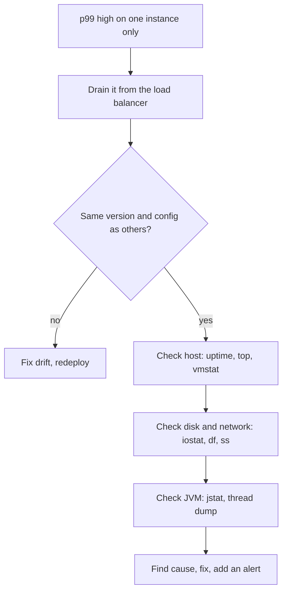

**Steps:**
1. **Confirm it's one box.** Per-instance graphs in Grafana: only `order-03` is slow. Not one endpoint, not one customer.
2. **Mitigate first:** remove `order-03` from the load balancer (or delete the pod; Kubernetes makes a new one). Users are fine now. Keep the box for investigation if you can.
3. **Is it really the same?** Compare version, JVM flags, config and env vars with a healthy box. "Config drift" (one box set up differently) is a common cause.
4. **Host checks:**
   - `uptime`: load 9 on a 4-CPU box.
   - `top`: Java at only 40% CPU, but `%wa` (IO wait) is 35%. The CPU is waiting for the disk.
   - `vmstat 1`: the `b` column (processes blocked on IO) is high. No swapping.
5. **Disk:**
   - `iostat -xz 1`: the disk is at `%util` 99%, `await` 180 ms.
   - `pidstat -d 1`: a backup agent is writing a lot. A cron job on this box started a full backup at 10:00, when the slowness began.
6. **Why does disk slow the API?** Thread dump: `jcmd <pid> Thread.print`. Many request threads are waiting inside the logging library's file appender (`FileOutputStream.writeBytes`). Our app writes logs synchronously to a local file, so every request waits for the slow disk.
7. **Fix now:** stop the backup job, return the box to traffic, watch p99 drop to 300 ms.
8. **Fix for good:**
   - Move backups off the app boxes (or schedule them at night with IO limits).
   - Log to stdout or use an async appender, so slow disks don't block requests.
   - Add alerts on disk `await` and per-instance p99 vs the fleet.
   - Write a short postmortem.

**Other common "one box" causes:**

| Cause | How you spot it |
|---|---|
| CPU steal (noisy neighbour VM) | `top` shows high `%st` |
| Memory leak, box up longer | `jstat -gcutil`: old gen near 100%, frequent full GC |
| Disk full from logs | `df -h` at 100% |
| Bad DNS or `/etc/hosts` on that box | `dig` and `curl -w` show slow DNS |
| Different version or config | Version label or `/actuator/info` differs |
| Uneven traffic (sticky sessions, hot key) | Requests per second on that box much higher |
| Network card errors | `ip -s link` shows errors or drops; tcpdump shows retransmits |

**Say this in the interview:**

> "If only one box is slow, the code is not the main suspect, because all boxes run the same code. I first take that box out of traffic so users are fine. Then I compare it with a healthy box. I check version and config first. Then CPU, IO wait and steal with top and vmstat, disk with iostat and df, and the JVM with jstat and a thread dump. In one real case, a backup job saturated the disk and our synchronous file logging made every request wait. We moved logs to stdout and added a per-instance latency alert."

---

## Agile and Scrum, honestly

**In one line:** Agile means delivering in small pieces and adjusting from feedback. Scrum and Kanban are two ways to do it. Seniors make the process useful, not longer.

**Story:** Cooking for a wedding. You don't cook all 30 dishes and serve them at the end. You make a small batch, let the family taste it, and adjust the salt. Scrum is cooking in fixed rounds (every 2 weeks). Kanban is a continuous line where a new dish starts whenever a stove is free.

**How it works (Scrum, per the 2020 Scrum Guide):**
- **Roles** (the guide calls them accountabilities): Product Owner (what and why, owns the backlog), Scrum Master (helps the team improve the process), Developers (how).
- **Events:**

| Event | Length (for 2-week sprint) | Purpose | What a senior actually does |
|---|---|---|---|
| **Sprint** | 1–4 weeks, usually 2 | Deliver a usable increment | Keeps scope realistic, protects focus |
| **Sprint planning** | Up to ~4 hours | Pick the goal and the work | Breaks big items down, flags risks and dependencies, pushes back on overload |
| **Daily scrum** | 15 minutes | Check progress to the sprint goal | Keeps it short; takes deep problems "offline" after; unblocks others |
| **Sprint review** | Up to ~2 hours | Show working software, get feedback | Demos real features, not slides |
| **Retrospective** | Up to ~1.5 hours | Improve how the team works | Brings data (CI time, bugs), makes sure 1–2 actions get done |

- **Backlog refinement** is not an official event but almost every team does it: clarify and size upcoming stories.

**Kanban vs Scrum:**

| | Scrum | Kanban |
|---|---|---|
| Rhythm | Fixed sprints | Continuous flow |
| Main control | Sprint goal and commitment | WIP limits (max items in each column) |
| Measure | Velocity (team-only use) | Cycle time and throughput |
| Fits | Feature teams with planned work | Platform, support, ops teams with many interruptions |

- Many teams mix them ("Scrumban").
- **WIP limit** (work in progress) is the key Kanban idea: finishing beats starting. If "In review" is full, help review before you start something new.

**Honest truths seniors can say:**
- Ceremonies are tools. If the daily stand-up is 40 minutes of status reports for the manager, fix it.
- Velocity is for the team's own planning. Comparing velocity across teams is meaningless, because points are relative.
- "Agile" without automated tests and CI is just short deadlines.
- Seniors improve the system: smaller stories, clear definition of done, fewer meetings, faster reviews.

**Diagram:**

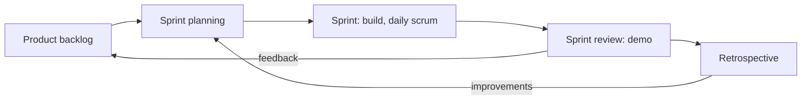

**Good and bad:**

| Good | Bad |
|---|---|
| 15-minute stand-up focused on the sprint goal | Status report to the manager |
| Retro with 1–2 actions that get done | Same complaints every retro |
| WIP limits, finish before starting | 12 items "in progress" for 5 people |
| Definition of done includes tests and monitoring | "Done" means "merged" |

**Say this in the interview:**

> "Agile for me means small pieces, real feedback and adjusting. In Scrum I help in planning by splitting work and naming risks, keep stand-ups short, demo working software, and make sure retro actions really happen. For teams with lots of interruptions, like platform or support, Kanban with WIP limits works better. I don't compare velocity across teams. And without CI and tests, agile is just short deadlines."

**They may ask next:**
- **What do you do if the sprint goal is at risk mid-sprint?** Say it at stand-up, agree with the Product Owner what to drop, keep the goal if possible.
- **SAFe?** A framework for scaling agile across many teams with program-level planning. Know the name; many engineers find it heavy.

---

## Interview questions

**1. How is a staff engineer different from a senior?**
Bigger scope (many teams), more ambiguity (unclear problems) and influence without authority. Success is measured by business results across teams. See [more](#what-changes-from-senior-to-staff).

**2. When do you write a design doc, and what goes in it?**
For work over ~2 weeks, cross-team, or hard to undo. Problem in numbers, goals and non-goals, design, alternatives, risks, rollout and rollback. See [more](#writing-design-docs-and-rfcs).

**3. What is an ADR?**
A short file in the repo recording one decision: context, decision, consequences. It stops "why did we do this?" debates later. See [more](#making-technical-decisions-and-trade-offs).

**4. One-way vs two-way door decisions?**
Two-way doors can be reversed, so decide fast. One-way doors (DB choice, public API) need careful review. See [more](#making-technical-decisions-and-trade-offs).

**5. Build vs buy: how do you decide?**
Build only what is core to the business. Count the 3-year cost, including on-call and upgrades. Watch lock-in. See [more](#making-technical-decisions-and-trade-offs).

**6. How do you convince product to invest in tech debt?**
Show cost in their language: incidents, days per feature. Agree 15–20% per sprint and tie debt to upcoming features. See [more](#managing-tech-debt).

**7. Why not rewrite the legacy system?**
Rewrites take longer than planned and freeze features. Use the strangler pattern and migrate piece by piece. See [more](#managing-tech-debt).

**8. How do you estimate a large project?**
Break into 1–3 day pieces, spike the unknowns, give a range with confidence, plan thin vertical slices. See [more](#estimation-and-planning).

**9. The deadline is fixed and you're behind. What do you do?**
Say it early, flex scope with options (MoSCoW), never silently cut tests or monitoring. See [more](#estimation-and-planning).

**10. What roles exist in an incident?**
Incident commander, operations (the investigators), communications lead and planning lead (the four roles in Google's SRE book), plus a scribe for the timeline in many teams. See [more](#leading-an-incident-and-blameless-postmortems).

**11. What makes a postmortem blameless?**
It asks why the system allowed the mistake, not who made it. People share facts only when they feel safe. See [more](#leading-an-incident-and-blameless-postmortems).

**12. What do you comment on in code review?**
Correctness, design, security, tests and operability. Formatting is for tools. Label blocking vs nit. See [more](#mentoring-and-code-review-culture).

**13. What does "disagree and commit" mean?**
Argue with data before the decision; once made, support it fully. Revisit only with new data. See [more](#cross-team-influence-and-handling-disagreement).

**14. How do you escalate well?**
After trying directly, escalate together with a shared doc showing both views, so the leader can decide fast. See [more](#cross-team-influence-and-handling-disagreement).

**15. How do you say no to a product manager?**
"Not now" with options: less scope, later date, or a cheaper version. Explain cost in days and risk. See [more](#working-with-product-and-stakeholders).

**16. How would you plan a Spring Boot 2 to 3 migration across 40 services?**
Inventory, shared libraries first, pilot plus playbook, OpenRewrite, canary per service, public dashboard, date to delete the old path. See [more](#driving-a-large-migration).

**17. How do you keep on-call healthy?**
Runbook per alert, track pages per week, fix the noisiest alert weekly, time off after hard weeks. See [more](#ownership-on-call-and-operational-excellence).

**18. Merge vs rebase vs squash?**
Merge keeps true history; rebase gives a straight line but new commit ids (own branches only); squash makes one commit per PR. See [more](#merge-vs-rebase-vs-squash).

**19. You ran `git reset --hard` by mistake. How do you recover?**
`git reflog` shows where HEAD was; `git reset --hard HEAD@{1}` or create a branch at that commit. See [more](#interactive-rebase-cherry-pick-and-reflog).

**20. How do you find which commit introduced a bug?**
`git bisect` with a good and bad commit, ideally `git bisect run` with a test. About 10 steps for 1,000 commits. See [more](#git-bisect-find-the-commit-that-broke-it).

**21. Trunk-based development or GitFlow?**
Trunk-based with feature flags for services deployed often; GitFlow for slow, versioned releases like mobile apps. See [more](#branching-strategies-and-feature-flags).

**22. What are the DORA metrics?**
Change lead time, deployment frequency, failed deployment recovery time, change fail rate and deployment rework rate. See [more](#dora-metrics).

**23. What is an SBOM and why do you need one?**
A list of every component in your build. When a new CVE appears, you know in minutes which services are affected. See [more](#software-supply-chain-security).

**24. The API is slow on only one server. How do you debug?**
Drain the box, compare config and version, then check CPU steal, IO wait, disk, connections and the JVM with a thread dump. See [more](#walkthrough-the-api-is-slow-on-one-box).

**25. Scrum vs Kanban?**
Scrum uses fixed sprints and a sprint goal; Kanban uses continuous flow with WIP limits. Kanban fits interrupt-heavy teams. See [more](#agile-and-scrum-honestly).
