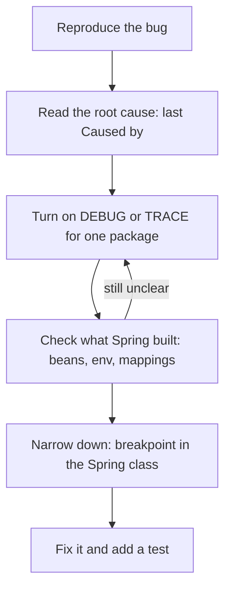
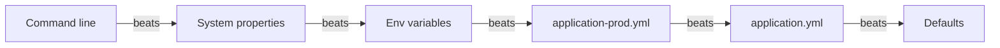
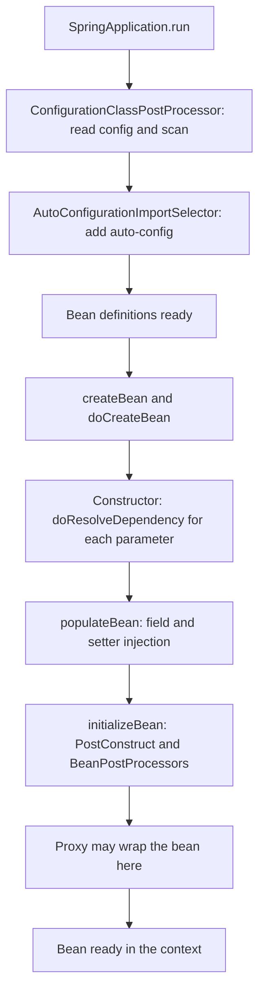
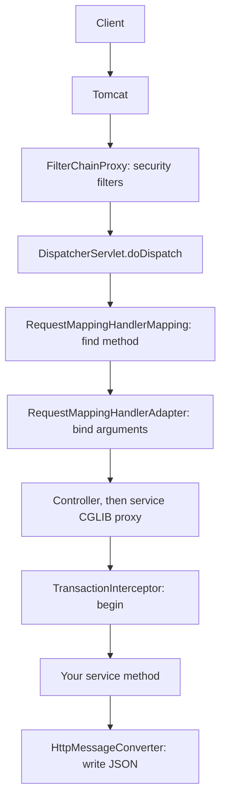
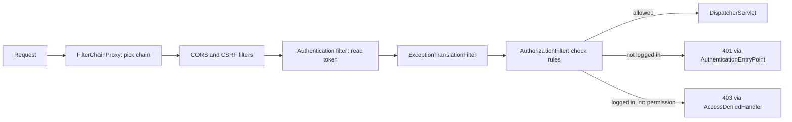
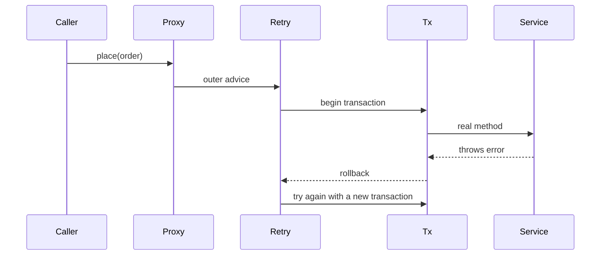
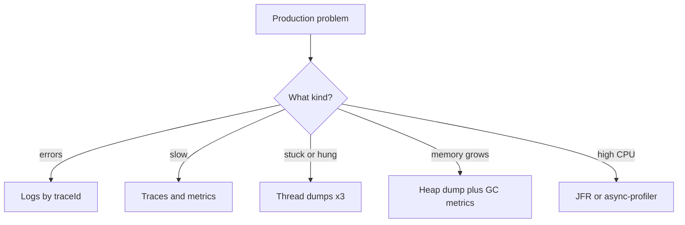
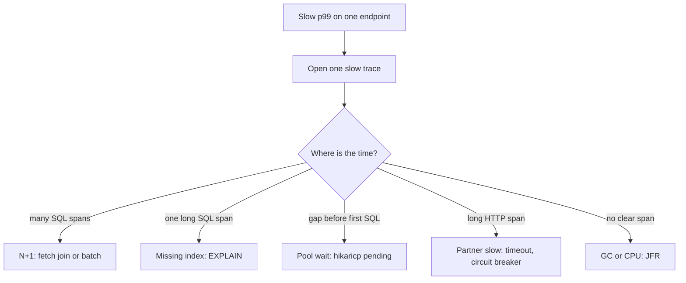

# Debugging Spring Boot from the inside

[← Back to README](../README.md)

Spring does a lot of work for you: it creates beans, wraps them in proxies, reads config, and routes requests.
When something breaks, the bug is often inside that hidden work, not in your own code.
This file shows how to see what Spring is really doing, on your laptop and in production (Spring Boot 3.x and 4.x, Java 21 and 25).

**Contents**

- [A debugging mindset for Spring](#a-debugging-mindset-for-spring)
- [Reading Spring startup errors](#reading-spring-startup-errors)
- [Why is my bean (not) there?](#why-is-my-bean-not-there)
- [Where did this property value come from?](#where-did-this-property-value-come-from)
- [Setting breakpoints inside Spring itself](#setting-breakpoints-inside-spring-itself)
- [Debugging web requests](#debugging-web-requests)
- [Debugging Spring Security](#debugging-spring-security)
- [Debugging @Transactional and JPA](#debugging-transactional-and-jpa)
- [Debugging proxies and AOP](#debugging-proxies-and-aop)
- [Changing log levels at runtime](#changing-log-levels-at-runtime)
- [Remote debugging and production debugging](#remote-debugging-and-production-debugging)
- [Debugging slow Spring apps](#debugging-slow-spring-apps)
- [Testing to find bugs faster](#testing-to-find-bugs-faster)
- [Debugging checklist (one page)](#debugging-checklist-one-page)
- [Interview questions](#interview-questions)

Related: [Spring core and Boot](spring.md) · [Spring ecosystem](spring-ecosystem.md) · [Java concurrency](java-concurrency.md) · [Production-ready apps](production-ready.md)

---

## A debugging mindset for Spring

**In one line:** Most Spring bugs are "no bean", "wrong bean", "proxy not applied" or "wrong config"; check what Spring built before you guess.

**Story:** Think of Spring as a big factory with many machines.
- One machine reads the order sheets (your config files).
- One machine builds the parts (beans).
- One machine wraps some parts in a protective cover (proxies for transactions, security, caching).
- One machine sends each customer to the right counter (request routing).

When a product comes out wrong, you do not shout at the whole factory.
You walk to each machine and check its output.
Spring gives you a "window" into each machine: logs, Actuator endpoints and breakpoints.

**The four families of Spring bugs:**

| Family | What you see | First tool |
|---|---|---|
| **No bean** | `NoSuchBeanDefinitionException`, app fails to start | Conditions report (`--debug`) |
| **Wrong bean** | Two beans of one type, the "other" one is used | `/actuator/beans`, `@Qualifier` |
| **Proxy not applied** | `@Transactional`, `@Cacheable`, `@Async` silently do nothing | Transaction TRACE logs, `AopUtils.isAopProxy` |
| **Config not what you think** | Wrong URL, wrong timeout, wrong profile | `/actuator/env`, `/actuator/configprops` |

**How it works (the general flow):**
1. **Reproduce** the bug. Ideally in a test or on your laptop.
2. **Read the first exception.** Spring wraps errors many times. The real reason is the last `Caused by:` at the bottom.
3. **Turn on the right log.** Not everything at DEBUG. Only the package that owns the problem (web, security, transaction, SQL).
4. **Check what Spring actually built.** Which beans exist, which config won, which URL mappings exist.
5. **Narrow it down.** Put a breakpoint in the Spring class that makes the decision.
6. **Fix it and keep a test** so the bug never comes back.

**Diagram:**



**Good and bad:**

| Good | Bad |
|---|---|
| Read the bottom `Caused by:` first | Read only the top line and google it |
| Turn on DEBUG for one package | `logging.level.root=DEBUG` and drown in 50,000 lines |
| Ask Spring what it built (`/actuator/beans`, `/actuator/env`) | Assume your `application.yml` is what is running |
| Write a failing test first | Restart the app 30 times with small changes |

**Say this in the interview:**

> I treat Spring as a factory with several machines: config, bean creation, proxies and request routing.
> Most bugs fall into four groups: no bean, wrong bean, proxy not applied, or config not what I think.
> I read the root cause at the bottom of the stack trace, turn on logs for one package, and check what Spring really built with Actuator.
> Only then do I put breakpoints inside Spring classes.

**They may ask next:**
- **Why is the root cause at the bottom?** Each layer catches the error and wraps it in its own exception. The first error that happened is the innermost one, printed last.
- **What do you do before debugging?** Make the bug happen again on purpose. A bug you cannot reproduce is a bug you cannot prove fixed.

---

## Reading Spring startup errors

**In one line:** When the app does not start, read the "APPLICATION FAILED TO START" block and the last `Caused by:` line.

**Story:** A car does not start. The dashboard shows ten warning lights.
Nine of them are only because the battery is dead. The battery light is the real one.
A Spring stack trace is the same: many wrapper errors, one real cause.

**How to read a long stack trace:**
1. Scroll **up** from the end of the log until you see `***************************` and `APPLICATION FAILED TO START`. This is a *failure analyzer* report: Spring Boot's own plain-English help for common errors. It has a **Description** and an **Action**.
2. If there is no such block, find the **last** `Caused by:` line. That is the root cause.
3. Look at the bean names in the chain. `Error creating bean with name 'orderController'` → `'orderService'` → `'paymentClient'`. The last bean in the chain is the broken one.
4. Look for **your own package** (`com.mycompany...`) in the stack frames. That line is often where to start.
5. If the log says `Error starting ApplicationContext. To display the condition evaluation report re-run your application with 'debug' enabled.`, do that. See [Why is my bean (not) there?](#why-is-my-bean-not-there).

**Example:** a failure analyzer report.

```text
***************************
APPLICATION FAILED TO START
***************************

Description:

Parameter 0 of constructor in com.shop.order.OrderService required a bean
of type 'com.shop.payment.PaymentClient' that could not be found.

Action:

Consider defining a bean of type 'com.shop.payment.PaymentClient' in your configuration.
```

### Common startup errors and fixes

| Error | What it means | Usual fix |
|---|---|---|
| `NoSuchBeanDefinitionException` / "required a bean of type X that could not be found" | Nobody created a bean of that type | Add `@Component`/`@Service`, fix the package (scan rules), activate the right profile, or add the missing starter |
| `NoUniqueBeanDefinitionException` / "required a single bean, but 2 were found" | Two beans match one injection point | Mark one `@Primary`, or use `@Qualifier("name")` at the injection point |
| "The dependencies of some of the beans in the application context form a cycle" | A needs B, B needs A | Break the cycle (see below). Circular references are **forbidden by default since Boot 2.6** |
| `BeanCurrentlyInCreationException` | Spring found the cycle while creating a bean | Same as above |
| `UnsatisfiedDependencyException` | A wrapper: one dependency of a bean failed | Read its `Caused by:`. The real error is inside |
| "Web server failed to start. Port 8080 was already in use." | Another process uses the port | Stop the other process (`lsof -i :8080`) or set `server.port` |
| "Failed to configure a DataSource: 'url' attribute is not specified and no embedded datasource could be configured." | JDBC/JPA starter is on the classpath, but no DB URL | Set `spring.datasource.url`, activate the profile that has it, or remove the JDBC starter |
| "Failed to bind properties under 'app.timeout'" | A property value has the wrong format | Fix the value, for example `30s` for a `Duration` |
| `ClassNotFoundException`, `NoClassDefFoundError`, `NoSuchMethodError` | Two libraries need different versions of a third one | Find the conflict with the dependency tree (below) |

### Breaking a circular dependency

**Story:** Two people at a door. Each says "after you". Nobody goes in.

```text
The dependencies of some of the beans in the application context form a cycle:

┌─────┐
|  orderService defined in file [.../OrderService.class]
↑     ↓
|  paymentService defined in file [.../PaymentService.class]
└─────┘
```

Fixes, best first:
1. **Move the shared logic** into a third bean that both use. This is the real fix. A cycle usually means a design problem.
2. **Publish an event** instead of calling back (`ApplicationEventPublisher`).
3. **Inject lazily:** `@Lazy` on one constructor parameter, or `ObjectProvider<PaymentService>`. Spring injects a small proxy and creates the real bean later.
4. **Last resort:** `spring.main.allow-circular-references=true`. Spring's own message calls this a last resort.

### Version conflicts (`NoSuchMethodError`)

**In one line:** The code was compiled against version A of a library, but version B was loaded at runtime.

Spring Boot shows a special report: "An attempt was made to call a method that does not exist", with the jar it was loaded from.

```bash
# Maven: who brings in jackson-databind, and which version wins?
mvn dependency:tree -Dincludes=com.fasterxml.jackson.core

# Gradle: same question
./gradlew dependencyInsight --dependency jackson-databind --configuration runtimeClasspath
./gradlew dependencies --configuration runtimeClasspath
```

Fixes:
- Let the **Spring Boot BOM** (bill of materials: the list of tested versions) choose versions. Remove hard-coded versions you do not need.
- Do not mix Spring Boot 3 libraries with Spring Boot 4 libraries. For example, an old starter compiled for Boot 3 may call a class that moved in Boot 4.
- In Boot 4, Jackson 3 is the default (package `tools.jackson`). An old library that still uses Jackson 2 (package `com.fasterxml.jackson`) may break.

**Good and bad:**

| Good | Bad |
|---|---|
| Read Description and Action in the failure report | Copy the first line of the stack trace into a search engine |
| Fix the design of a cycle | Turn on `allow-circular-references` and forget it |
| Use the Boot BOM for versions | Pin 15 library versions by hand in `pom.xml` |

**Say this in the interview:**

> When the app fails to start, I look for the "APPLICATION FAILED TO START" block. Spring Boot failure analyzers explain common problems in plain words with an action.
> If it is not there, I read the last "Caused by". For a missing bean I check scan packages, profiles and conditions.
> For two beans I use @Primary or @Qualifier. Circular references are forbidden since Boot 2.6, so I break the cycle in the design.
> For NoSuchMethodError I run mvn dependency:tree to find the version conflict.

**They may ask next:**
- **Why did Boot forbid circular references?** They hide bad design and can inject a half-built bean. Constructor injection makes cycles fail fast, which is good.
- **What is a FailureAnalyzer?** A Spring Boot class that turns a known exception into a friendly Description and Action. You can write your own and register it in `META-INF/spring.factories`.
- **Bean overriding?** If two bean definitions have the same name, startup fails by default since Boot 2.1. `spring.main.allow-bean-definition-overriding=true` allows it, but it hides mistakes.

---

## Why is my bean (not) there?

**In one line:** Spring Boot decides each auto-configured bean with conditions; the conditions evaluation report tells you which condition said yes or no.

**Story:** A wedding caterer has rules: "If guests > 100, bring a second cook." "If it rains, bring a tent."
After the wedding you ask: "Why was there no tent?" The caterer shows the notebook: "Rain: no."
The conditions report is that notebook.

### The conditions evaluation report

**How to turn it on:**
- Start with `java -jar app.jar --debug`, or set `debug=true` in `application.properties`.
- This does **not** put all logs at DEBUG. It only turns on some core loggers and prints the report.
- In a running app, use Actuator: `GET /actuator/conditions`.

**What it shows:**
- **Positive matches:** auto-configurations that were applied, and why.
- **Negative matches:** auto-configurations that were skipped, and the condition that failed.
- **Exclusions:** what you excluded by hand.
- **Unconditional classes:** always applied.

**Example:**

```text
============================
CONDITIONS EVALUATION REPORT
============================

Positive matches:
-----------------
   DataSourceAutoConfiguration matched:
      - @ConditionalOnClass found required classes 'javax.sql.DataSource' (OnClassCondition)

Negative matches:
-----------------
   RedisAutoConfiguration:
      Did not match:
         - @ConditionalOnClass did not find required class
           'org.springframework.data.redis.core.RedisOperations' (OnClassCondition)
```

Here the Redis beans are missing because the Redis starter is not on the classpath.

### @ConditionalOn... explained

| Condition | Bean is created only if... | Typical surprise |
|---|---|---|
| `@ConditionalOnClass` | a class is on the classpath | You forgot the starter dependency |
| `@ConditionalOnMissingBean` | you did **not** define your own bean of that type | You defined one, so Boot backed off and its defaults are gone |
| `@ConditionalOnBean` | another bean already exists | Order matters. Works reliably only in auto-configuration classes |
| `@ConditionalOnProperty` | a property has a value | `app.feature.enabled` is missing or has a typo |
| `@ConditionalOnWebApplication` | the app is a web app | No web starter, so no web beans |
| `@Profile("prod")` | a profile is active | The profile was never activated |

**`@ConditionalOnMissingBean` is the most common surprise.**
Example: you define your own `ObjectMapper` bean. Boot's auto-configured mapper backs off.
Now Boot's Jackson settings (`spring.jackson.*`) do not apply to your mapper.

### Component scanning rules

- `@SpringBootApplication` scans **its own package and all sub-packages**. Nothing else.
- Main class in `com.shop.app`, service in `com.shop.payment` → the service is **not found**.
- Fix: move the main class up to `com.shop`, or add `@SpringBootApplication(scanBasePackages = "com.shop")`.
- JPA repositories and entities follow the same rule. Outside the package you need `@EnableJpaRepositories` and `@EntityScan`.

### Profiles

- Check the startup log line: `The following 1 profile is active: "prod"`, or `No active profile set, falling back to 1 default profile: "default"`.
- A bean with `@Profile("dev")` is not created in `prod`.
- Activate with `SPRING_PROFILES_ACTIVE=prod` (env var) or `--spring.profiles.active=prod`.

### /actuator/beans

- `GET /actuator/beans` lists every bean: name, type, scope, and its dependencies.
- Use it to answer "is my bean there?" and "which class is it really?" in a running app.
- You can search the JSON: `curl -s localhost:8080/actuator/beans | jq '.. | .orderService? // empty'`.

### Slow startup: ApplicationStartup and /actuator/startup

**In one line:** Spring can record how long each startup step took, so you can find the slow bean.

```java
public static void main(String[] args) {
    SpringApplication app = new SpringApplication(ShopApplication.class);
    app.setApplicationStartup(new BufferingApplicationStartup(2048)); // keep up to 2048 steps in memory
    app.run(args);
}
```

- Then call `GET /actuator/startup`. Each step has a name (like `spring.beans.instantiate`), the bean name, and the duration.
- Sort by duration. A bean that takes 8 seconds usually calls a remote system in its constructor or `@PostConstruct`.
- `FlightRecorderApplicationStartup` sends the same steps to JFR (Java Flight Recorder) instead.

**Good and bad:**

| Good | Bad |
|---|---|
| Run with `--debug` once when a bean is missing | Add random `@ComponentScan` lines until it works |
| Keep the main class in the root package | Put the main class in a sub-package |
| Remember that your own bean turns off Boot's default | Define your own `ObjectMapper` and wonder why `spring.jackson.*` stopped working |

**Say this in the interview:**

> Auto-configuration is a set of @Configuration classes guarded by @ConditionalOn annotations.
> To see why a bean is or is not there, I run with --debug or call /actuator/conditions. It lists positive and negative matches with the reason.
> Usual causes: a missing starter, my own bean making Boot back off, a property typo, a missing profile, or a main class in the wrong package.
> For slow startup I use BufferingApplicationStartup and /actuator/startup.

**They may ask next:**
- **Where does Boot find the auto-configuration list?** In `META-INF/spring/org.springframework.boot.autoconfigure.AutoConfiguration.imports` inside each jar. `AutoConfigurationImportSelector` reads these files.
- **How do you exclude one?** `@SpringBootApplication(exclude = DataSourceAutoConfiguration.class)` or `spring.autoconfigure.exclude=...`.
- **What does `spring.main.lazy-initialization=true` do to debugging?** Beans are created on first use. Startup is faster, but a broken bean fails on the first request, not at startup.

---

## Where did this property value come from?

**In one line:** Spring reads properties from many sources in a fixed order, and the highest source wins; `/actuator/env` shows which source won.

**Story:** Your mother, father and grandmother all tell you what time to come home.
The house rule is: grandmother wins over father, father wins over mother.
If you come home at the wrong time, you ask: "Who told me this time?"
`/actuator/env` answers "who told me".

**How it works (simplified order, highest wins):**
1. Test properties (`@TestPropertySource`, `@SpringBootTest(properties=...)`, `@DynamicPropertySource`).
2. **Command-line arguments** (`--server.port=9090`).
3. `SPRING_APPLICATION_JSON` (properties as one JSON string).
4. **Java system properties** (`-Dserver.port=9090`).
5. **OS environment variables** (`SERVER_PORT=9090`). This is what Kubernetes and Docker set.
6. **Config files**, in this order (highest first):
   - profile file outside the jar (`config/application-prod.yml`)
   - normal file outside the jar
   - profile file inside the jar (`application-prod.yml`)
   - normal file inside the jar (`application.yml`)
7. `@PropertySource` on a `@Configuration` class.
8. Default properties (`SpringApplication.setDefaultProperties`).

Simple rule: **outside beats inside, profile beats normal, env var beats file, command line beats env var.**

**Diagram:**



### /actuator/env and /actuator/configprops

- `GET /actuator/env` lists **all property sources in order** and the values in each.
- `GET /actuator/env/server.port` shows the **final value** and every source that set it. The first one wins.
- `GET /actuator/configprops` shows each `@ConfigurationProperties` bean and the values bound to it, with their origin (for example `class path resource [application.yml] - 12:5`).
- Since Boot 3.0, values are hidden as `******` by default. Control it with `management.endpoint.env.show-values` (`never` is default, `when-authorized`, `always`). Same for `configprops`.

```bash
curl -s localhost:8080/actuator/env/spring.datasource.url | jq
# "property": { "source": "systemEnvironment", "value": "******" }   <- the env var won
```

### @ConfigurationProperties binding errors

```java
@ConfigurationProperties(prefix = "payment")
@Validated                                    // check values at startup, fail fast
record PaymentProperties(
        @NotBlank String baseUrl,
        Duration timeout,                     // "2s", "500ms" or "PT2S" all work
        int maxRetries) {}
```

- A bad value fails at startup: `Failed to bind properties under 'payment.timeout' to java.time.Duration`. The report shows the value and the file it came from.
- A typo in the key (`payment.time-out` vs `payment.timeout`) does **not** fail. The value just stays `null`. Add `@Validated` and `@NotNull` to catch this.
- Add `spring-boot-configuration-processor` so the IDE warns about unknown keys while you type.

### Relaxed binding

Spring accepts many spellings for one property. All of these bind to `maxPoolSize`:

| Where | Spelling |
|---|---|
| `application.yml` (recommended) | `spring.datasource.hikari.maximum-pool-size` (kebab case) |
| Env var | `SPRING_DATASOURCE_HIKARI_MAXIMUMPOOLSIZE` (upper case, dots become `_`, dashes removed) |
| List item in env var | `MY_APP_SERVERS_0_HOST` for `my-app.servers[0].host` |

### Env vars in Kubernetes

- Values often come from a ConfigMap or Secret as env vars. Check them inside the pod: `kubectl exec <pod> -- env | grep SPRING`.
- **Trap:** Kubernetes adds env vars for every Service in the namespace (*service links*). A Service called `server` creates `SERVER_PORT=tcp://10.0.0.5:8080`. Spring reads it as `server.port`, and startup fails. Fix: rename the Service, or set `enableServiceLinks: false` in the pod spec.
- A changed ConfigMap does not change env vars in a running pod. You need a restart.

**Good and bad:**

| Good | Bad |
|---|---|
| Use `@ConfigurationProperties` + `@Validated` | Use 40 `@Value("${...}")` with no checks |
| Check `/actuator/env/<key>` to see the winner | Read `application.yml` and assume that is the value |
| Keep `show-values` at `never` or `when-authorized` | `show-values=always` on a public endpoint (leaks passwords) |

**Say this in the interview:**

> Spring Boot has a fixed property order. Command line beats system properties, which beat env vars, which beat config files. Profile files beat normal files, and files outside the jar beat files inside.
> To see which value really won, I call /actuator/env with the key. It shows every source and the winner.
> I bind config with @ConfigurationProperties and @Validated, so a wrong value fails at startup and not at 2 a.m.

**They may ask next:**
- **Why is my env var ignored?** Usually a spelling issue (dashes must be removed) or a higher source (command line, system property) overrides it.
- **`@Value` vs `@ConfigurationProperties`?** `@Value` is one value with no validation. `@ConfigurationProperties` groups values, supports relaxed binding and validation, and shows in `/actuator/configprops`.

---

## Setting breakpoints inside Spring itself

**In one line:** When logs are not enough, put a breakpoint in the Spring class that makes the decision, and watch it decide.

**Story:** A train is late. The station display only says "delayed".
You walk to the signal box and watch the operator. Now you see exactly which switch is wrong.
Breakpoints in Spring classes are the signal box.

### IDE tips

- **Download sources.** In IntelliJ, open a Spring class and click "Download Sources". Maven: `mvn dependency:sources`. Now the code is readable and line numbers match.
- **Step into library code.** "Step Into" (F7) may skip library code. "Force Step Into" (Alt+Shift+F7) always goes in. Check your *stepping filters* (classes the debugger skips) in the debugger settings.
- **Conditional breakpoints.** Spring creates 500 beans. Right-click the breakpoint and add a condition: `beanName.equals("orderService")`. Now it stops only for your bean.
- **Exception breakpoints.** Stop when an exception is **thrown**, not when it is printed. Add a Java exception breakpoint for `NoSuchBeanDefinitionException` or `LazyInitializationException`.
- **Log without stopping.** A breakpoint with "Suspend" off and "Evaluate and log" on prints a value each time. It is like adding a log line without a restart.
- **Evaluate expression.** While stopped, run code like `mbd.getResourceDescription()` to see where a bean was defined.
- **Frames view.** Read the call stack from bottom to top. It shows the full path from Tomcat to your method.

### The most useful Spring classes for breakpoints

| Class and method | Stop here to learn... |
|---|---|
| `DispatcherServlet#doDispatch` | Every MVC request. Which handler was chosen, and which exception happened |
| `DispatcherServlet#getHandler` | Which `HandlerMapping` matched the URL (or none: 404) |
| `AbstractHandlerMethodMapping#lookupHandlerMethod` | Why a URL matched or did not match a controller method |
| `RequestMappingHandlerAdapter#invokeHandlerMethod` | Argument binding and the call into your controller |
| `InvocableHandlerMethod#doInvoke` | The exact arguments passed to your controller method |
| `AbstractAutowireCapableBeanFactory#createBean` / `#doCreateBean` | Creation of one bean (use a condition on `beanName`) |
| `AbstractAutowireCapableBeanFactory#initializeBean` | `@PostConstruct` and `BeanPostProcessor`s. Proxies are created here |
| `DefaultListableBeanFactory#doResolveDependency` | Which candidate bean was picked for an injection point |
| `ConfigurationClassPostProcessor#processConfigBeanDefinitions` | Reading `@Configuration`, `@ComponentScan`, `@Import` |
| `AutoConfigurationImportSelector#getAutoConfigurationEntry` | The list of auto-configurations before and after filters |
| `TransactionAspectSupport#invokeWithinTransaction` | Whether a transaction starts, and with which settings |
| `CglibAopProxy.DynamicAdvisedInterceptor#intercept` | A call through a class-based (CGLIB) proxy |
| `JdkDynamicAopProxy#invoke` | A call through an interface-based (JDK) proxy |
| `FilterChainProxy#doFilterInternal` | Which security filter chain matched the request |
| `ExceptionTranslationFilter#doFilter` | Why Spring Security sent 401 or 403 |

All names above were checked against the Spring Framework, Spring Boot and Spring Security source on GitHub (main branches, 2026).

### How Spring creates a bean

**Diagram:**



### A request's path through Spring

**Diagram:**



**Example:** finding why the wrong `PaymentClient` is injected.
1. Breakpoint in `DefaultListableBeanFactory#doResolveDependency`.
2. Condition: `descriptor.getDependencyType().getSimpleName().equals("PaymentClient")`.
3. Step over `findAutowireCandidates`. The map shows **all** candidates.
4. Step over `determineAutowireCandidate`. You see which one wins (`@Primary`, then `@Priority`, then name match).

**Good and bad:**

| Good | Bad |
|---|---|
| Conditional breakpoint on `beanName` | Plain breakpoint in `createBean` (stops 500 times) |
| Exception breakpoint on the real exception | Breakpoint in your `catch` block, after the context is lost |
| Read the Frames view bottom to top | Step line by line through Tomcat code |

**Say this in the interview:**

> When logs are not enough, I download Spring sources and set breakpoints in the class that makes the decision.
> For requests, that is DispatcherServlet.doDispatch. For bean creation, it is AbstractAutowireCapableBeanFactory.doCreateBean with a condition on the bean name. For injection, it is DefaultListableBeanFactory.doResolveDependency.
> For transactions I stop in TransactionAspectSupport.invokeWithinTransaction. If it never stops there, my call did not go through the proxy.

**They may ask next:**
- **How do you debug a bean that fails in `@PostConstruct`?** Exception breakpoint on the thrown exception, or a breakpoint in `initializeBean` with a `beanName` condition.
- **Why does a breakpoint in my `@Transactional` method show `$$SpringCGLIB$$` frames above it?** Those frames are the proxy. That is good: it means the call went through the proxy.

---

## Debugging web requests

**In one line:** Check which URLs Spring knows (`/actuator/mappings`), turn on web DEBUG logs, and map the HTTP status to its usual cause.

**Story:** A letter comes back "returned to sender".
The stamp tells you why: wrong address (404), wrong door (405), wrong language (415), or the letter was unreadable (400).
Each HTTP status code is a different stamp.

### See every URL Spring knows

- `GET /actuator/mappings` lists every mapped URL, its HTTP method, `consumes`/`produces`, and the controller method.
- Your URL is not in the list? Then the controller was not scanned, or the path is different.
- Check for a prefix like `server.servlet.context-path=/api`.

### Turn on web logs

```properties
# "web" is a Spring Boot log group: org.springframework.web, org.springframework.http and more
logging.level.web=DEBUG
# also log headers and parameters (they can contain secrets, so dev only)
spring.mvc.log-request-details=true
```

With this you see lines like `GET "/orders/42", parameters={}`, `Mapped to com.shop.OrderController#get(Long)`, and `Completed 200 OK`.
For errors you see `Resolved [org.springframework.web.HttpMediaTypeNotSupportedException: ...]`.

### Request and response body logging

```java
@Bean
CommonsRequestLoggingFilter requestLoggingFilter() {
    var filter = new CommonsRequestLoggingFilter();
    filter.setIncludeQueryString(true);
    filter.setIncludePayload(true);          // logs the request body
    filter.setMaxPayloadLength(2_000);       // never log huge bodies
    filter.setIncludeHeaders(false);         // headers have tokens: keep off
    return filter;
}
// and: logging.level.org.springframework.web.filter.CommonsRequestLoggingFilter=DEBUG
```

- It logs the request only (not the response). For both, in a test use `MockMvc ... .andDo(print())`.
- In production, prefer tracing and access logs. Do not log bodies with personal data or passwords.

### 404 vs 405 vs 415 vs 400

| Status | Spring exception | Usual cause |
|---|---|---|
| **404** Not Found | `NoResourceFoundException` ("No static resource orders/42") | URL matches no controller, so Spring tried static files. Check path, context path, scan package |
| **405** Method Not Allowed | `HttpRequestMethodNotSupportedException` | URL exists but for another method: you sent `POST`, the method is `@GetMapping` |
| **415** Unsupported Media Type | `HttpMediaTypeNotSupportedException` | Missing or wrong `Content-Type`, for example `text/plain` instead of `application/json` |
| **406** Not Acceptable | `HttpMediaTypeNotAcceptableException` | Client `Accept` header asks for a format the method cannot produce |
| **400** Bad Request | `HttpMessageNotReadableException` | Broken JSON, or a JSON field has the wrong type |
| **400** Bad Request | `MethodArgumentNotValidException` | `@Valid` failed (for example `@NotBlank` on a field) |
| **400** Bad Request | `MethodArgumentTypeMismatchException` / `MissingServletRequestParameterException` | `/orders/abc` for a `Long` id, or a required `?page=` is missing |

**Tip:** since Spring Framework 6.1 (Boot 3.2), an unknown URL gives `NoResourceFoundException`. Seeing "No static resource" for an API path means **no controller matched**.

### Jackson (JSON) errors

- `HttpMessageNotReadableException: JSON parse error: Cannot deserialize value of type 'java.time.LocalDate' from String "16-11-2026"` → the date format is wrong. ISO format is `2026-11-16`.
- "Cannot construct instance ... no Creators" → Jackson cannot create the object. Use a record, or add a no-argument constructor.
- Unknown JSON fields are **ignored** by Spring Boot's default `ObjectMapper`. So a typo in a field name gives `null`, not an error.
- **Infinite recursion** on JPA entities with two-way relations (`Order` ↔ `Customer`). Fix: return DTOs (simple data objects), not entities.
- Spring Boot 4 uses **Jackson 3** by default (package `tools.jackson`). Old custom serializers written for Jackson 2 need an update.

### CORS failures

- The browser shows "blocked by CORS policy", but the same call works in curl or Postman. Curl does not check CORS. Only browsers do.
- Look at the `OPTIONS` *preflight* request (the browser's "may I?" question before the real call) in the browser network tab. If it gets 401 or 403, Spring Security blocked it before CORS ran.
- Turn on `logging.level.org.springframework.web.cors=DEBUG`.
- Details and fixes: [CORS and CSRF](spring-ecosystem.md#cors-and-csrf).

**Good and bad:**

| Good | Bad |
|---|---|
| Check `/actuator/mappings` first for a 404 | Change the URL in the client 10 times |
| `logging.level.web=DEBUG` on one dev machine | Log full request bodies in production |
| Return DTOs from controllers | Return JPA entities and fight JSON loops |

**Say this in the interview:**

> For a broken endpoint I first check /actuator/mappings to see if Spring knows the URL.
> Then I turn on logging.level.web=DEBUG. It shows the handler that was picked and the exception Spring resolved.
> 404 means no handler matched, 405 means wrong method, 415 means wrong Content-Type, and 400 is usually bad JSON or failed validation.
> For CORS I check the OPTIONS preflight in the browser, because curl never shows CORS errors.

**They may ask next:**
- **How do you return a clear error body?** A `@RestControllerAdvice` that returns `ProblemDetail`. See [global error handling](spring-ecosystem.md#global-error-handling-with-restcontrolleradvice-and-problemdetail).
- **Why do I get a 401 instead of my real 400 or 500?** The error is forwarded to `/error`. If Spring Security protects `/error`, you get 401. Permit `/error` in the security config.

---

## Debugging Spring Security

**In one line:** Turn on `TRACE` for `org.springframework.security`, and the log tells you which filter ran and why the request was rejected.

**Story:** You cannot enter an office building. There are six guards in a row.
Asking "why can't I enter?" at the front door does not help.
You need each guard to say "I checked you, you passed" or "I stopped you here".
TRACE logging makes every guard speak.

**How it works:**
1. `FilterChainProxy` picks the first `SecurityFilterChain` that matches the URL.
2. The filters run in order (CORS, CSRF, token or login, ..., `ExceptionTranslationFilter`, `AuthorizationFilter`).
3. If a filter throws, `ExceptionTranslationFilter` turns the error into **401** (not logged in, via `AuthenticationEntryPoint`) or **403** (logged in but not allowed, via `AccessDeniedHandler`).
4. Background: [How Spring Security works (filter chain)](spring-ecosystem.md#how-spring-security-works-filter-chain).

**Diagram:**



**Example:** turn on the logs.

```properties
logging.level.org.springframework.security=TRACE
```

Shortened output for a denied request:

```text
DEBUG FilterChainProxy        : Securing POST /api/orders
TRACE FilterChainProxy        : Invoking CorsFilter (3/12)
TRACE FilterChainProxy        : Invoking CsrfFilter (4/12)
...
TRACE FilterChainProxy        : Invoking AuthorizationFilter (12/12)
TRACE ExceptionTranslationFilter : Sending AnonymousAuthenticationToken [...] to
      authentication entry point since access is denied
```

Read it like this: the user was **anonymous** (no valid token), so the answer is 401.
If no line says `Securing ...` but you see `No security for ...`, then no chain matched or the URL is ignored.

### 401 vs 403: common causes

| You get | Common cause | Check |
|---|---|---|
| 401 | No token, expired token, wrong issuer or audience | Log line from the JWT provider; decode the token at a JWT debugger in your own tools |
| 401 | Error page `/error` is protected, so the real error is hidden | Permit `/error` |
| 403 | `POST`/`PUT` from a browser with CSRF on and no CSRF token | Look for `CsrfFilter` in the log; see [CSRF](spring-ecosystem.md#cors-and-csrf) |
| 403 | Role name mismatch: `hasRole("ADMIN")` needs authority `ROLE_ADMIN`, but the JWT gives `SCOPE_admin` | Print `authentication.getAuthorities()` |
| 403 | `@PreAuthorize` rule is false | TRACE log from `AuthorizationManager` classes |

### Other tools

- **Filter order:** at startup, Spring Security logs the filters of each chain at DEBUG level (`Will secure <matcher> with filters: [...]`). Or set a breakpoint in `FilterChainProxy#doFilterInternal`.
- **`@EnableWebSecurity(debug = true)`:** prints the request and the list of filters for every request. Very noisy. Never in production.
- **Current user in code:** `SecurityContextHolder.getContext().getAuthentication()`. Check its authorities in the debugger.

### Test with @WithMockUser

```java
@WebMvcTest(OrderController.class)
@Import(SecurityConfig.class)
class OrderSecurityTest {
    @Autowired MockMvc mvc;

    @Test
    @WithMockUser(roles = "USER")                     // logged in, but not ADMIN
    void userCannotDelete() throws Exception {
        mvc.perform(delete("/api/orders/1").with(csrf()))
           .andExpect(status().isForbidden());       // 403
    }

    @Test
    void anonymousGets401() throws Exception {        // no user at all
        mvc.perform(get("/api/orders/1")).andExpect(status().isUnauthorized());
    }
}
```

For JWT APIs, use `.with(jwt().authorities(new SimpleGrantedAuthority("SCOPE_orders.read")))` from `spring-security-test`.

**Good and bad:**

| Good | Bad |
|---|---|
| TRACE logs for `org.springframework.security` on dev | `permitAll()` "just to test" and forget to remove it |
| A test for each rule (401, 403, 200) | Testing security only by clicking in the browser |
| Print the authorities when a role check fails | Guessing between `ROLE_ADMIN`, `ADMIN` and `SCOPE_admin` |

**Say this in the interview:**

> For security problems I set org.springframework.security to TRACE. The log shows "Securing" with the URL, each filter as it runs, and why access was denied.
> 401 means Spring does not know who you are: missing or invalid token. 403 means it knows you, but you lack the authority, or the CSRF token is missing.
> I lock each rule with a MockMvc test using @WithMockUser or the jwt() helper.

**They may ask next:**
- **Why does `hasRole("ADMIN")` fail with a valid JWT?** `hasRole` adds the `ROLE_` prefix. JWT scopes become `SCOPE_...`. Use `hasAuthority("SCOPE_admin")` or map the claims with a `JwtAuthenticationConverter`.
- **Why is the user `null` inside an `@Async` method?** The `SecurityContext` is a `ThreadLocal` and does not move to the new thread by default.

---

## Debugging @Transactional and JPA

**In one line:** First prove a transaction really started (TRACE logs), then look at the real SQL and the connection pool.

**Story:** You give a bank teller a form to transfer money. Later the money is not moved.
Did the teller even open a folder for your form? Or did you hand the form to the clerk directly, skipping the teller?
The transaction logs answer that question.

### Why the transaction did not start

| Cause | Why | Fix |
|---|---|---|
| **Self-invocation:** `this.save()` from the same class | The call does not go through the proxy | Move the method to another bean, or inject the proxy |
| `private` method | A proxy cannot override it | Make it `public` (or `protected`/package-private with CGLIB, Spring 6.0+) |
| `final` method or `final` class | CGLIB cannot override it | Remove `final` (Kotlin: use the `spring` compiler plugin) |
| Object created with `new` | Spring does not know the object, so there is no proxy | Let Spring inject it |
| Checked exception thrown | Default rollback is only for `RuntimeException` and `Error` | `rollbackFor = Exception.class` |
| Exception caught and swallowed | The proxy never sees it, so it commits | Re-throw, or call `setRollbackOnly()` |

Full explanation: [@Transactional deep dive](spring-ecosystem.md#transactional-deep-dive).

### Prove it with logs

```properties
# prints "Getting transaction for [com.shop.OrderService.place]" and "Completing transaction for [...]"
logging.level.org.springframework.transaction.interceptor=TRACE
# prints "Creating new transaction with name [...]: PROPAGATION_REQUIRED,ISOLATION_DEFAULT"
logging.level.org.springframework.orm.jpa.JpaTransactionManager=DEBUG
```

- If your method runs but there is **no** "Getting transaction for" line, the proxy was skipped.
- You can also check in code: `TransactionSynchronizationManager.isActualTransactionActive()` returns `true` inside a real transaction.
- With `JpaTransactionManager` at DEBUG you also see "Participating in existing transaction", "Suspending current transaction" (for `REQUIRES_NEW`) and "Initiating transaction rollback".

### Show the SQL

| Option | What it does | Use it? |
|---|---|---|
| `spring.jpa.show-sql=true` | Prints SQL to `System.out`, not through the logger | Quick local check only. No parameters, no log levels |
| `logging.level.org.hibernate.SQL=DEBUG` | SQL through the logger | Yes |
| `logging.level.org.hibernate.orm.jdbc.bind=TRACE` | The values bound to `?` (Hibernate 6 and 7) | Dev only. Values can contain personal data |
| `logging.level.org.hibernate.orm.jdbc.extract=TRACE` | Values read from result sets | Rarely. Very noisy |
| `spring.jpa.properties.hibernate.format_sql=true` | Pretty-prints SQL on many lines | Local only |

- Hibernate 5 used `org.hibernate.type.descriptor.sql` for bind values. That name does not work in Hibernate 6 and 7 (Boot 3 and 4).
- `logging.level.sql=DEBUG` is a Spring Boot log group. It includes `org.hibernate.SQL` and `org.springframework.jdbc.core`.
- Slow query log: `spring.jpa.properties.hibernate.log_slow_query=200` logs queries slower than 200 ms to the `org.hibernate.SQL_SLOW` logger.

### Hibernate statistics

```properties
spring.jpa.properties.hibernate.generate_statistics=true
```

- Hibernate then logs a "Session Metrics" summary per session: how many JDBC statements ran and how long they took.
- One request that runs 101 statements is a red flag.
- Turn it on in dev and in tests. It has a small cost, so think before using it in production.

### Detecting N+1

- **N+1:** one query loads 100 orders, then 100 more queries load each order's customer.
- Symptom in the SQL log: the same `select ... from customer where id=?` repeated many times.
- Fix with a fetch join, `@EntityGraph`, or batch fetching. See [The N+1 problem and how to fix it](spring-ecosystem.md#the-n1-problem-and-how-to-fix-it).
- Catch it in tests: count statements with Hibernate `Statistics.getPrepareStatementCount()` and fail the test if it is above a limit.

### LazyInitializationException

```text
org.hibernate.LazyInitializationException: could not initialize proxy [com.shop.Customer#7] - no Session
```

- A lazy field was read **after** the transaction and session closed. Often in a controller or a JSON serializer.
- Fix: load what you need inside the service transaction (fetch join, `@EntityGraph`), and return a DTO.
- Spring Boot turns on `spring.jpa.open-in-view` by default and logs a warning at startup. It keeps the session open during the whole web request. It hides this error but holds a DB connection longer. Many teams set it to `false`.

### Connection pool waits (HikariCP)

```text
HikariPool-1 - Connection is not available, request timed out after 30000ms
(total=10, active=10, idle=0, waiting=37)
```

- All 10 connections are busy and 37 threads wait. Causes: slow queries, long transactions, `REQUIRES_NEW` inside a transaction, or a leak (a connection never returned).
- **Metrics:** `hikaricp.connections.active`, `hikaricp.connections.pending` (threads waiting), `hikaricp.connections.acquire` (time to get a connection), `hikaricp.connections.timeout`.
- **Leak detection:** `spring.datasource.hikari.leak-detection-threshold=20000`. If a connection is held more than 20 s, Hikari logs a warning with the stack trace of the code that took it.
- More: [Connection pooling with HikariCP](spring-ecosystem.md#connection-pooling-with-hikaricp).

**Good and bad:**

| Good | Bad |
|---|---|
| `org.hibernate.SQL=DEBUG` + `orm.jdbc.bind=TRACE` in dev | `show-sql=true` in production |
| Count SQL statements in tests | Find N+1 in production under load |
| Keep remote calls outside `@Transactional` methods | Call a slow HTTP API while holding a DB connection |

**Say this in the interview:**

> If @Transactional seems ignored, I set org.springframework.transaction.interceptor to TRACE. No "Getting transaction for" line means the proxy was skipped.
> Usual causes: self-invocation, a private or final method, or an object made with new.
> For SQL I use org.hibernate.SQL at DEBUG and org.hibernate.orm.jdbc.bind at TRACE, not show-sql.
> I find N+1 by repeated selects in the log or Hibernate statistics, and pool problems with the hikaricp.connections.pending metric and leak detection.

**They may ask next:**
- **Why does `UnexpectedRollbackException` happen?** An inner `REQUIRED` method threw and marked the shared transaction rollback-only. The outer method caught it and tried to commit.
- **How do you see the SQL with values in production safely?** Usually you do not. Use tracing (each query is a span with timing) and the slow query log, without parameter values.

---

## Debugging proxies and AOP

**In one line:** Transactions, caching, security and async all wrap your bean in a proxy; check the proxy exists and your call goes through it.

**Story:** A celebrity has a manager. You must call the manager, who checks the calendar, then passes the call on.
If you call the celebrity's private number directly, the manager never knows. No calendar check.
The proxy is the manager. `this.method()` is the private number.

**How it works:**
1. A `BeanPostProcessor` (an auto-proxy creator) looks at each new bean.
2. If any *advice* (extra behavior, like a transaction) applies, it returns a proxy instead of the bean.
3. Spring Boot uses **CGLIB** proxies by default: a generated subclass of your class.
4. Other beans get the proxy. Calls go: caller → proxy → advice chain → your real object.

### Is my bean a proxy?

```java
@Component
class ProxyCheck implements ApplicationRunner {
    private final OrderService orders;
    ProxyCheck(OrderService orders) { this.orders = orders; }

    @Override
    public void run(ApplicationArguments args) {
        System.out.println(orders.getClass());                 // ...OrderService$$SpringCGLIB$$0
        System.out.println(AopUtils.isAopProxy(orders));       // true
        System.out.println(AopUtils.isCglibProxy(orders));     // true
        System.out.println(AopUtils.getTargetClass(orders));   // the real class: OrderService
    }
}
```

- Since Spring Framework 6, CGLIB class names contain `$$SpringCGLIB$$`. Older versions showed `$$EnhancerBySpringCGLIB$$`.
- In the debugger, a proxy field like `CGLIB$CALLBACK_0` holds the interceptor. Its `advised` field lists the advisors.

### When advice does not apply

| Symptom | Cause |
|---|---|
| `@Transactional`, `@Cacheable`, `@Async` do nothing | Self-invocation (`this.method()`) |
| Advice works on some methods only | Method is `private` or `final` |
| `NullPointerException` on an injected field, only in one method | That method is `final`. It runs on the proxy object, whose fields are empty |
| `@Async` runs on the same thread | `@EnableAsync` is missing, or self-invocation |
| Startup error "Cannot subclass final class" | The class is `final` and needs a CGLIB proxy |
| Aspect never runs | Aspect class is not a bean (`@Component` missing), or the pointcut expression does not match |

### Ordering of aspects

- Several advices can wrap one method: security, transaction, cache, retry, your own `@Aspect`.
- Order them with `@Order` on the aspect, or `@EnableTransactionManagement(order = ...)`. Lower number = outer layer.
- **Classic bug:** retry inside the transaction. The retry repeats work inside one broken transaction. Retry must be **outside** the transaction, so each attempt gets a new transaction.
- To see the real order, stop in `CglibAopProxy.DynamicAdvisedInterceptor#intercept` and look at the `chain` list.

**Diagram:**



**Good and bad:**

| Good | Bad |
|---|---|
| Print `getClass()` to check for `$$SpringCGLIB$$` | Assume an annotation works because it compiles |
| Split self-calls into two beans | Inject the bean into itself to "fix" self-invocation |
| Set the aspect order on purpose | Rely on the default order for retry and transaction |

**Say this in the interview:**

> Transactions, caching, security and async in Spring are proxies. To debug them, I first check that the bean is a proxy: getClass shows $$SpringCGLIB$$, or AopUtils.isAopProxy returns true.
> Then I check that the call goes through the proxy: no self-invocation, no private or final methods.
> If several aspects apply, I check their order. Retry must be outside the transaction.

**They may ask next:**
- **JDK proxy vs CGLIB?** A JDK proxy implements your interfaces only. CGLIB subclasses your class. Spring Boot uses CGLIB by default (`spring.aop.proxy-target-class=true`).
- **Can AspectJ weaving fix self-invocation?** Yes. Load-time or compile-time weaving changes the class bytecode, so `this.method()` is also advised. It adds build complexity, so few teams use it.

---

## Changing log levels at runtime

**In one line:** With Actuator `/actuator/loggers` you can turn DEBUG on for one package in a running app, without a restart, and turn it off again.

**Story:** A doctor does not cut the patient open to check the heart. She puts a stethoscope on for one minute, then takes it off.
`/actuator/loggers` is the stethoscope: on for a few minutes, then off.

**How it works:**
1. Expose the endpoint: `management.endpoints.web.exposure.include=health,info,loggers`.
2. `GET /actuator/loggers/org.springframework.web` shows the current level.
3. `POST` a new level. It applies at once, in this pod only.
4. Set it back to `null` (the configured default) when done.

**Example:**

```bash
# turn on DEBUG for Spring MVC in one pod
curl -X POST localhost:8080/actuator/loggers/org.springframework.web \
     -H 'Content-Type: application/json' \
     -d '{"configuredLevel":"DEBUG"}'

# reset it to the level from the config file
curl -X POST localhost:8080/actuator/loggers/org.springframework.web \
     -H 'Content-Type: application/json' \
     -d '{"configuredLevel":null}'
```

- The change is lost on restart. With 10 pods, you change one pod at a time (or use a tool that calls all of them).
- Protect this endpoint. Anyone who can call it can fill your disk with TRACE logs.

### Logback and Log4j2 config

- Spring Boot uses **Logback** by default. Put your config in `logback-spring.xml` (not `logback.xml`). The `-spring` name lets you use `<springProfile name="prod">` blocks.
- For Log4j2, exclude `spring-boot-starter-logging` and add `spring-boot-starter-log4j2`. Config file: `log4j2-spring.xml`.
- Simple cases need no XML: `logging.level.com.shop=DEBUG` in `application.yml`.

### Structured JSON logs

```properties
# Spring Boot 3.4+: JSON logs without extra libraries. Formats: ecs, logstash, gelf
logging.structured.format.console=ecs
```

- Each log line becomes one JSON object. Log tools (Elasticsearch, Loki, Datadog, Splunk) can search by field.
- MDC values are added as JSON fields automatically.

### MDC for request ids

- *MDC* (Mapped Diagnostic Context) is a per-thread map. Every log line on that thread can print its values.
- With Micrometer Tracing on the classpath, Spring Boot puts `traceId` and `spanId` into the MDC for each request.
- Search logs by `traceId` to see one request across all services.
- MDC is a `ThreadLocal`. It does not move to `@Async` threads or `CompletableFuture` by itself. Use context propagation (Micrometer `ContextSnapshot`, or a `TaskDecorator`).
- More: [Observability with Actuator, Micrometer and OpenTelemetry](spring-ecosystem.md#observability-with-actuator-micrometer-and-opentelemetry) and [Production-ready apps](production-ready.md).

**Good and bad:**

| Good | Bad |
|---|---|
| DEBUG on one package for 10 minutes | DEBUG on `root` in production |
| JSON logs with `traceId` | Plain text logs you search with `grep` across 30 pods |
| Secure `/actuator/loggers` | Expose all Actuator endpoints to the internet |

**Say this in the interview:**

> In production I do not restart to get more logs. I POST to /actuator/loggers/<package> with configuredLevel DEBUG, look at the problem, then reset it to null.
> Logs are JSON with the traceId from Micrometer Tracing in the MDC, so I can follow one request across services.
> The loggers endpoint is behind authentication, because it can be abused to flood the logs.

**They may ask next:**
- **Why `logback-spring.xml` and not `logback.xml`?** Spring Boot loads the `-spring` file itself, so you can use Spring profiles and properties inside it.
- **What is a log group?** A name for several loggers. `web` and `sql` are built in. You can define your own: `logging.group.payments=com.shop.payment,com.stripe`.

---

## Remote debugging and production debugging

**In one line:** Use a remote debugger only in dev or test; in production use logs, metrics, traces, dumps and JFR, because a breakpoint pauses real users.

**Story:** A doctor can open a patient on the operating table (a debugger in a test environment).
For a patient walking around the city (production), she uses an X-ray, a blood test and a heart monitor.
She does not stop the patient's heart to look at it.

### Remote debugging a container

```dockerfile
# dev/test only: open the debug port 5005, do not wait for the debugger (suspend=n)
ENV JAVA_TOOL_OPTIONS="-agentlib:jdwp=transport=dt_socket,server=y,suspend=n,address=*:5005"
```

```bash
# Kubernetes: open a tunnel from your laptop to the pod's port 5005
kubectl port-forward pod/orders-7d9f8c-x2k4q 5005:5005

# then in IntelliJ: Run > Edit Configurations > Remote JVM Debug > localhost:5005
```

- *JDWP* (Java Debug Wire Protocol) is how the debugger talks to the JVM.
- `suspend=y` makes the app wait for the debugger before starting. Use it to debug startup.
- `address=*:5005` listens on all network interfaces (Java 9+). Never open this port to the internet: anyone connected can run code in your JVM.
- Locally: `./gradlew bootRun --debug-jvm`, or Maven `-Dspring-boot.run.jvmArguments="-agentlib:jdwp=..."`.

### Why NOT to attach a debugger to production

- A breakpoint **pauses threads**. Real user requests hang. Health checks time out, and Kubernetes may restart the pod.
- "Suspend: All" freezes the whole JVM.
- You see one request on one pod. The bug may happen on another pod.
- It is a security risk, and many companies forbid it.

### What to use instead

| Tool | What it shows | How |
|---|---|---|
| Logs | What happened, with `traceId` | Structured logs, `/actuator/loggers` for more detail |
| Metrics | How much and how fast (rates, p99 latency) | `/actuator/metrics`, Prometheus, Grafana |
| Traces | Where the time went in one request, across services | OpenTelemetry / Micrometer Tracing |
| Thread dump | What every thread is doing right now | `jcmd <pid> Thread.print` or `GET /actuator/threaddump` |
| Heap dump | What objects fill the memory | `jcmd <pid> GC.heap_dump /tmp/heap.hprof` or `GET /actuator/heapdump` |
| JFR | CPU, allocations, locks, GC, I/O over time, low cost | `jcmd <pid> JFR.start duration=60s filename=/tmp/app.jfr` |
| async-profiler | CPU or allocation flame graph | `asprof -d 30 -e cpu -f /tmp/flame.html <pid>` |
| SBOM | Exact library versions running | `GET /actuator/sbom` (Boot 3.3+) |

**Example:** the production toolbox from inside a pod.

```bash
kubectl exec -it orders-7d9f8c-x2k4q -- jcmd 1 Thread.print > threads-1.txt  # Java is often PID 1
kubectl exec -it orders-7d9f8c-x2k4q -- jcmd 1 JFR.start duration=60s filename=/tmp/app.jfr
kubectl cp orders-7d9f8c-x2k4q:/tmp/app.jfr ./app.jfr      # open in JDK Mission Control
# distroless image without jcmd? attach a debug container with a JDK:
kubectl debug -it orders-7d9f8c-x2k4q --image=eclipse-temurin:25-jdk --target=app
```

### Thread dumps

- Take **3 dumps, 5–10 seconds apart**. A thread stuck at the same line in all 3 is your problem.
- Look for many threads `WAITING` in `HikariPool.getConnection` (pool exhausted), or `BLOCKED` on one lock (contention or deadlock).
- With virtual threads (Java 21+), use `jcmd <pid> Thread.dump_to_file -format=json /tmp/threads.json`.
- More: [Diagnosis tools](java-concurrency.md#diagnosis-tools) and [Thread dumps for virtual threads](java-concurrency.md#thread-dumps-for-virtual-threads).

### Heap dumps: secure them!

- A heap dump contains **everything in memory**: passwords, tokens, customer data.
- In Boot 4, `/actuator/heapdump` access is `none` by default. Turn it on only if you need it, behind authentication, on an internal port (`management.server.port=9090`).
- Better: `-XX:+HeapDumpOnOutOfMemoryError -XX:HeapDumpPath=/dumps` writes a dump automatically when the JVM runs out of memory.
- Open it in Eclipse MAT. Look at the "dominator tree": which objects keep the most memory alive.
- A heap dump pauses the JVM for seconds (longer for big heaps). Take the pod out of traffic first if you can.

### JFR (Java Flight Recorder)

- Built into the JDK. Overhead is usually about 1% with the default settings.
- Records CPU samples, allocations, locks, GC pauses, socket and file I/O.
- Start at launch: `-XX:StartFlightRecording=duration=0,filename=/tmp/app.jfr,dumponexit=true`. Or later with `jcmd`.
- Open the `.jfr` file in JDK Mission Control, or print it with `jfr print`.

**Diagram:**



**Good and bad:**

| Good | Bad |
|---|---|
| Debugger in dev or a test environment | Breakpoint on a production pod |
| `kubectl port-forward` to reach the debug port | Exposing port 5005 in a LoadBalancer Service |
| Heap dump on OOM, stored safely | Public `/actuator/heapdump` |
| 3 thread dumps over 15 seconds | One thread dump and a guess |

**Say this in the interview:**

> For dev or test pods I add the JDWP agent with suspend=n and use kubectl port-forward on 5005. I never attach a debugger to production, because a breakpoint pauses real user threads.
> In production I use logs with traceId, metrics, and traces first. For a hung app I take three thread dumps with jcmd. For memory growth I take a heap dump. For CPU I use JFR or async-profiler.
> Heap dumps contain secrets, so /actuator/heapdump is off or locked down.

**They may ask next:**
- **App freezes for 2 seconds sometimes. What do you check?** GC pause metrics (`jvm.gc.pause`) and JFR GC events first. Then thread dumps for lock contention.
- **How do you debug a pod that crashes at startup?** `kubectl logs --previous` for the last crash log. Then run the same image locally with the same env vars, and `suspend=y` if needed.

---

## Debugging slow Spring apps

**In one line:** Measure first: find the slow endpoint, trace one slow request, and see where the time goes (database, pool, partners, GC).

**Story:** A restaurant gets complaints: "food is slow".
The owner does not hire 5 new cooks right away. He times each step: order taking, cooking, waiting for a free plate, serving.
He finds there are only 10 plates, and the dishwasher is slow. The fix is more plates, not more cooks.

**How it works (step by step):**
1. **Find the slow endpoint.** Metric `http.server.requests`, grouped by `uri`. Look at **p99** (the slowest 1% of requests), not the average.
2. **Trace one slow request.** A trace shows spans (timed steps): controller, each SQL query, each HTTP call.
3. **Check DB queries.** Many small queries (N+1)? One slow query (missing index)?
4. **Check pool waits.** `hikaricp.connections.pending` > 0 and high `hikaricp.connections.acquire` time means threads wait for a connection.
5. **Check external calls.** No timeout means one slow partner service can block all your threads. See [Timeouts](microservices.md#timeouts) and [Circuit breaker](microservices.md#circuit-breaker).
6. **Check GC.** `jvm.gc.pause` and heap after GC. A heap that is always full means long GC pauses.
7. **Check thread pools.** Tomcat busy threads (`tomcat.threads.busy`, needs `server.tomcat.mbeanregistry.enabled=true`), `executor.*` metrics for `@Async` pools. See [Thread pool exhaustion](java-concurrency.md#thread-pool-exhaustion).

```bash
# p99 latency for one endpoint from Actuator (Prometheus/Grafana is better)
curl -s 'localhost:8080/actuator/metrics/http.server.requests?tag=uri:/orders/{id}' | jq
```

**Diagram:**



### Worked example

**Symptom:** after Friday's release, `GET /orders` p99 went from 150 ms to 4 seconds. Errors also started: `Connection is not available, request timed out after 30000ms`.

1. **Metrics:** only `/orders` is slow. Other endpoints are fine at low traffic, but slow at peak.
2. **Trace:** one request has **51 SQL spans**: one `select from orders` and 50 `select from customer where id=?`. Each takes 4 ms, so about 200 ms of SQL.
3. **But why 4 seconds?** The trace shows a 3.5-second **gap before the first SQL span**. The request was waiting for a connection.
4. **Pool metrics:** `hikaricp.connections.active` = 10 (the max), `pending` = 40 at peak.
5. **Root cause:** the release added `order.getCustomer().getName()` to the response DTO. That is a lazy field, so N+1. Each request now holds a connection 10 times longer. The pool of 10 runs out, and everyone waits.
6. **Fix:** `@EntityGraph(attributePaths = "customer")` on the repository method. Now 1 query, about 8 ms.
7. **Result:** p99 back to 140 ms. A test now asserts this endpoint runs at most 2 SQL statements.

**Lesson:** the pool was not too small. Each request held its connection too long. Making the pool bigger would only move the problem to the database.

**Good and bad:**

| Good | Bad |
|---|---|
| Look at p99 per endpoint | Look at the average for the whole app |
| Find the gap in the trace | Add more pods first |
| Fix the query, then size the pool | Raise the pool from 10 to 100 |

**Say this in the interview:**

> I start from metrics: http.server.requests per endpoint, p99. Then I open one slow trace and see where the time goes.
> Many SQL spans mean N+1. One long span means a missing index. A gap before the first query means waiting for a DB connection, which I confirm with hikaricp.connections.pending.
> A long HTTP span means a slow partner, so I check timeouts and circuit breakers. If nothing shows in the trace, I look at GC and CPU with JFR.

**They may ask next:**
- **Why p99 and not the average?** The average hides the slow users. If 1% of 1 million requests take 4 seconds, 10,000 users had a bad experience.
- **High latency but low CPU?** Threads are waiting: for a DB connection, a lock, or a remote call. Take a thread dump.

---

## Testing to find bugs faster

**In one line:** Reproduce the bug in the smallest Spring test that can show it, so each try takes seconds instead of a full app restart.

**Story:** A mechanic does not drive 100 km every time to find a noise.
He puts the car on a test stand and runs only the wheel that makes the noise.
Test slices are the test stand.

**How it works:**

| Test | What it loads | Speed | Use to debug |
|---|---|---|---|
| Plain unit test | No Spring | Milliseconds | Business logic |
| `@WebMvcTest` | Controllers, filters, Jackson, security | ~1–2 s | 400/404/415, JSON, security rules |
| `@DataJpaTest` | JPA, repositories, an embedded or test DB | ~2–5 s | Queries, N+1, mappings |
| `@JsonTest` | Jackson only | Fast | Serialization bugs |
| `@SpringBootTest` | The whole app | Slow (10+ s) | Wiring, config, transactions across beans |

More: [Test slices](spring-ecosystem.md#test-slices-webmvctest-datajpatest).

### @MockitoBean

- `@MockitoBean` (Spring Framework 6.2+) replaces a bean in the test context with a Mockito mock.
- `@MockBean` from Spring Boot was deprecated in Boot 3.4 and removed in Boot 4.
- Each different set of mocked beans creates a **new** application context. Many combinations make the test suite slow.
- More: [Mocking beans with @MockitoBean](spring-ecosystem.md#mocking-beans-with-mockitobean).

### Testcontainers: reproduce prod issues locally

- H2 (an in-memory database) does not behave like PostgreSQL. Locks, SQL syntax and JSON types differ. A bug in production may not happen on H2.
- Testcontainers starts a real PostgreSQL, Kafka or Redis in Docker for the test.
- With `@ServiceConnection`, Spring Boot reads the container's URL and password automatically.

```java
@SpringBootTest
@Testcontainers
class OrderRepositoryIT {
    @Container
    @ServiceConnection                                  // Boot sets spring.datasource.* for us
    static PostgreSQLContainer db = new PostgreSQLContainer("postgres:17");   // Testcontainers 2.x style

    @Autowired OrderRepository orders;

    @Test
    void reproducesProdDeadlock() {
        // same Postgres version as production, so the bug shows up here too
    }
}
```

More: [Testcontainers and @ServiceConnection](spring-ecosystem.md#testcontainers-and-serviceconnection).

### Logging in tests

```java
@DataJpaTest(properties = {
    "logging.level.org.hibernate.SQL=DEBUG",               // see every query this test runs
    "spring.jpa.properties.hibernate.generate_statistics=true"
})
class OrderQueryTest { /* ... */ }
```

- `MockMvc`: `.andDo(print())` prints the full request and response.
- `@ExtendWith(OutputCaptureExtension.class)` gives you a `CapturedOutput` parameter. You can assert that a log line was written.
- Put debug log levels in `src/test/resources/application-test.yml`, not in the main config.

**Good and bad:**

| Good | Bad |
|---|---|
| Write a failing test that shows the bug, then fix | Fix by trial and error in a running app |
| `@WebMvcTest` for a 415 error | `@SpringBootTest` for everything |
| Testcontainers with the same DB version as prod | H2 in tests, PostgreSQL in prod, "works on my machine" |

**Say this in the interview:**

> When I find a bug, I first write the smallest test that shows it. For web bugs I use @WebMvcTest, for query bugs @DataJpaTest with SQL logging on.
> I use Testcontainers with @ServiceConnection to run the same database version as production, because H2 hides many real bugs.
> For mocks I use @MockitoBean, since @MockBean is removed in Boot 4.

**They may ask next:**
- **Why are my Spring tests slow?** Each different context configuration (different mocks, profiles, properties) creates a new context. Keep the configurations few so Spring can reuse cached contexts.
- **How do you test that N+1 is fixed?** Enable Hibernate statistics and assert the prepared statement count.

---

## Debugging checklist (one page)

| Symptom | First thing to check | Tool |
|---|---|---|
| **App won't start** | The "APPLICATION FAILED TO START" block, then the last `Caused by:` | Startup log, `--debug` |
| **Bean missing** | Scan package, profile, missing starter, `@ConditionalOnMissingBean` back-off | `--debug` conditions report, `/actuator/conditions`, `/actuator/beans` |
| **Two beans found** | Which candidates exist | Failure report, `@Primary` / `@Qualifier` |
| **Wrong property value** | Which source won | `/actuator/env/<key>`, `/actuator/configprops` |
| **404** | Is the URL mapped? Context path? | `/actuator/mappings`, `logging.level.web=DEBUG` |
| **400 / 415** | JSON format, `Content-Type`, `@Valid` errors | `logging.level.web=DEBUG`, `.andDo(print())` |
| **401 / 403** | Token valid? Authorities? CSRF? `/error` permitted? | `logging.level.org.springframework.security=TRACE` |
| **Data not saved** | Did a transaction start? Was the exception checked or swallowed? | `org.springframework.transaction.interceptor=TRACE`, `org.hibernate.SQL=DEBUG` |
| **Annotation ignored** (`@Async`, `@Cacheable`) | Is the bean a proxy? Self-invocation? `final`? | `getClass()`, `AopUtils.isAopProxy` |
| **Slow endpoint** | p99 per URI, then one trace | `http.server.requests`, tracing, Hibernate statistics |
| **Connection timeout** (Hikari) | Pool full? Long transactions? Leak? | `hikaricp.connections.pending`, `leak-detection-threshold`, thread dump |
| **Memory growth** | Heap after GC keeps rising | `jvm.memory.used`, heap dump + Eclipse MAT |
| **High CPU** | Which code is hot? GC? | JFR, async-profiler, `jvm.gc.pause` |
| **App hangs** | What are the threads doing? | 3 thread dumps (`jcmd Thread.print`, `/actuator/threaddump`) |
| **`NoSuchMethodError`** | Version conflict | `mvn dependency:tree`, `gradle dependencyInsight`, `/actuator/sbom` |

**Say this in the interview:**

> My order is: read the root cause, turn on logs for one package, ask Actuator what Spring really built, then breakpoints.
> In production I never pause the JVM. I use metrics, traces, logs with traceId, thread dumps, heap dumps and JFR.

---

## Interview questions

**1. How do you find the real cause in a long Spring stack trace?**
Look for the "APPLICATION FAILED TO START" block with Description and Action.
If there is none, read the **last** `Caused by:`. The top lines are only wrappers.
[More](#reading-spring-startup-errors)

**2. What is a FailureAnalyzer?**
A Spring Boot class that turns a known startup exception into a plain-English Description and Action.
Examples: port in use, missing bean, DataSource not configured.
[More](#reading-spring-startup-errors)

**3. Why do circular dependencies fail in Spring Boot?**
Since Boot 2.6 they are forbidden by default.
Fix the design: move shared logic to a third bean, use events, or inject with `@Lazy`.
`spring.main.allow-circular-references=true` is a last resort.
[More](#breaking-a-circular-dependency)

**4. Two beans of the same type exist. How do you pick one?**
`@Primary` on the default one, or `@Qualifier("name")` at the injection point.
To see the choice, stop in `DefaultListableBeanFactory#doResolveDependency`.
[More](#common-startup-errors-and-fixes)

**5. How do you debug a `NoSuchMethodError` after upgrading a library?**
It is a version conflict. Run `mvn dependency:tree -Dincludes=...` or `gradle dependencyInsight`.
Let the Spring Boot BOM manage versions. Do not mix Boot 3 and Boot 4 libraries.
[More](#version-conflicts-nosuchmethoderror)

**6. A bean is missing. What do you check?**
Run with `--debug` or call `/actuator/conditions`. Negative matches show which condition failed.
Also check the scan package, the active profile, and whether my own bean made Boot back off.
[More](#why-is-my-bean-not-there)

**7. What does `@ConditionalOnMissingBean` do, and why can it surprise you?**
Boot creates its bean only if you did not define one.
If you define your own `ObjectMapper`, Boot's mapper and its `spring.jackson.*` settings are gone.
[More](#conditionalon-explained)

**8. How do you find a slow bean at startup?**
Set `BufferingApplicationStartup` on `SpringApplication` and call `/actuator/startup`.
Sort the steps by duration. Usually a bean calls a remote system during creation.
[More](#slow-startup-applicationstartup-and-actuatorstartup)

**9. A property has the wrong value in production. How do you find out why?**
Call `/actuator/env/<key>`. It lists every source that set the key and the winner.
Usually an env var or command-line argument overrides the file.
[More](#where-did-this-property-value-come-from)

**10. What is the property source order in Spring Boot?**
Command line > system properties > env vars > profile files > normal files > defaults.
Files outside the jar beat files inside the jar.
[More](#where-did-this-property-value-come-from)

**11. Why are `/actuator/env` values shown as `******`?**
Since Boot 3.0, `show-values` is `never` by default, to protect secrets.
Use `when-authorized` with a role if you need real values.
[More](#actuatorenv-and-actuatorconfigprops)

**12. Which Spring classes do you put breakpoints in?**
`DispatcherServlet#doDispatch` for requests, `AbstractAutowireCapableBeanFactory#doCreateBean` for bean creation, `DefaultListableBeanFactory#doResolveDependency` for injection.
`TransactionAspectSupport#invokeWithinTransaction` for transactions, `FilterChainProxy` for security.
[More](#the-most-useful-spring-classes-for-breakpoints)

**13. Your API returns 415. What does it mean?**
`HttpMediaTypeNotSupportedException`: the `Content-Type` header is missing or wrong.
Send `Content-Type: application/json`.
[More](#404-vs-405-vs-415-vs-400)

**14. Your API returns 404, but the controller exists. Why?**
The controller was not scanned, the path or context path is different, or the method is different.
Check `/actuator/mappings`. "No static resource" in the log means no controller matched.
[More](#debugging-web-requests)

**15. How do you debug a 403 from Spring Security?**
Set `org.springframework.security` to TRACE. It shows each filter and the denial reason.
Common causes: missing CSRF token on POST, or `hasRole` vs `SCOPE_` authority mismatch.
[More](#debugging-spring-security)

**16. What is the difference between 401 and 403?**
401: Spring does not know who you are (no or bad token).
403: Spring knows you, but you are not allowed.
`ExceptionTranslationFilter` decides which one to send.
[More](#401-vs-403-common-causes)

**17. How do you prove a `@Transactional` method really ran in a transaction?**
Set `org.springframework.transaction.interceptor` to TRACE and look for "Getting transaction for [...]".
Or call `TransactionSynchronizationManager.isActualTransactionActive()`.
[More](#prove-it-with-logs)

**18. Why is `@Transactional` ignored?**
Self-invocation (`this.method()`), a `private` or `final` method, or an object created with `new`.
The call does not go through the proxy.
[More](#why-the-transaction-did-not-start)

**19. How do you see SQL with parameter values in Spring Boot 3 or 4?**
`logging.level.org.hibernate.SQL=DEBUG` and `logging.level.org.hibernate.orm.jdbc.bind=TRACE`.
Not `show-sql`: it writes to stdout and has no values.
[More](#show-the-sql)

**20. What causes `LazyInitializationException`?**
A lazy relation was read after the session closed, often in the controller or JSON writer.
Fetch it inside the transaction (fetch join, `@EntityGraph`) and return a DTO.
[More](#lazyinitializationexception)

**21. "Connection is not available, request timed out". What do you check?**
`hikaricp.connections.pending` and `active`, long transactions, slow queries, and leaks.
Turn on `leak-detection-threshold`. Fix slow work before making the pool bigger.
[More](#connection-pool-waits-hikaricp)

**22. How do you check if a bean is a proxy?**
`bean.getClass()` shows `$$SpringCGLIB$$`, or `AopUtils.isAopProxy(bean)` returns true.
`AopUtils.getTargetClass(bean)` gives the real class.
[More](#is-my-bean-a-proxy)

**23. How do you change a log level without a restart?**
POST `{"configuredLevel":"DEBUG"}` to `/actuator/loggers/<package>`. Reset with `null`.
It applies to that one instance until restart.
[More](#changing-log-levels-at-runtime)

**24. How do you remote debug an app in Kubernetes?**
Add `-agentlib:jdwp=transport=dt_socket,server=y,suspend=n,address=*:5005` via `JAVA_TOOL_OPTIONS`.
Run `kubectl port-forward pod/<name> 5005:5005` and attach the IDE. Dev and test only.
[More](#remote-debugging-a-container)

**25. Why not attach a debugger to production?**
A breakpoint pauses real user threads. Health checks fail, and pods restart.
Use logs, metrics, traces, thread dumps, heap dumps and JFR instead.
[More](#why-not-to-attach-a-debugger-to-production)

**26. Why must `/actuator/heapdump` be secured?**
A heap dump holds everything in memory: passwords, tokens and customer data.
In Boot 4 its access is `none` by default. Keep it off or behind auth on an internal port.
[More](#heap-dumps-secure-them)

**27. An endpoint became slow after a release. How do you find out why?**
p99 from `http.server.requests` per URI, then one slow trace.
Many SQL spans = N+1. A gap before the first query = pool wait. Long HTTP span = slow partner.
[More](#debugging-slow-spring-apps)

**28. How do tests help debugging Spring bugs?**
A small slice test (`@WebMvcTest`, `@DataJpaTest`) reproduces the bug in seconds.
Testcontainers runs the same database as production, so the bug shows up locally.
[More](#testing-to-find-bugs-faster)
