# Spring ecosystem: the libraries companies use

[← Back to README](../README.md) · [Spring core, Boot and Reactive](spring.md)

Spring Boot is only the start. Real projects add security, data access, cloud tools, messaging, monitoring and testing.
This file explains the Spring libraries you will meet at work, and what interviewers ask about them.

| How often you will see it | Libraries |
|---|---|
| **Almost every company** | [Spring Security](#spring-security) · [Spring Data JPA](#spring-data) · [@Transactional](#transactional-deep-dive) · [Validation and errors](#validation-and-error-handling) · [Testing](#testing-spring-boot-apps) · [Flyway / Liquibase](#database-migrations-with-flyway-or-liquibase) · [HikariCP](#connection-pooling-with-hikaricp) · [Observability](#observability-with-actuator-micrometer-and-opentelemetry) · [Spring Kafka](#messaging-with-spring-kafka-and-spring-amqp) · [Spring Cloud](#spring-cloud) |
| **Common** | [Spring Cache](#caching-with-spring-cache) · [Redis, MongoDB, Elasticsearch](#spring-data-for-redis-mongodb-and-elasticsearch) · [Scheduling](#scheduling-and-background-jobs) · [Spring Batch](#spring-batch) · [RabbitMQ (AMQP)](#messaging-with-spring-kafka-and-spring-amqp) · [OpenAPI docs](#api-documentation-with-springdoc-openapi) · [Spring Cloud Stream](#spring-cloud-stream) |
| **Growing in 2026** | [Spring AI](#spring-ai) · [Spring Modulith](#spring-modulith) · [Spring GraphQL](#spring-graphql) · [Native images and faster startup](#faster-startup-native-images-aot-cds-and-crac) |
| **Less common** | [Spring Session](#spring-session) · [Other libraries](#other-libraries-companies-use-with-spring) |

Interview questions: [part 1](#spring-ecosystem-interview-questions-part-1) (security, data, testing) and [part 2](#spring-ecosystem-interview-questions-part-2) (cloud, messaging, batch, AI).

## Spring Security

**Used by companies for:** login pages, protecting REST APIs with JWT tokens, single sign-on (SSO) with Okta or Keycloak, and rules like "only admins can refund".

### How Spring Security works (filter chain)

**In one line:** Every HTTP request passes a chain of security filters before it reaches your controller.

**Story:** Think of a big office building with guards.
- Guard 1 checks your ID card. Who are you?
- Guard 2 checks if your card opens floor 5. Are you allowed?
- Guard 3 checks your bag for anything dangerous.

If any guard says no, you never reach the office desk (your controller).
The guards stand in a fixed order. You can add, remove or re-order guards.

**How it works:**
1. Tomcat (the web server) runs normal servlet *filters*. A filter is code that runs before the request reaches your app.
2. Spring Boot adds one filter called `DelegatingFilterProxy`. It is a bridge. Tomcat knows it, and it hands the work to a Spring bean.
3. That bean is `FilterChainProxy`. It holds one or more `SecurityFilterChain`s.
4. `FilterChainProxy` picks the **first** chain whose URL pattern matches, for example `/api/**`.
5. The request runs through the filters of that chain, in order. For example: CORS, CSRF, reading the token, error handling, and the access check.
6. After a successful login, the user is stored in the `SecurityContext`. It lives in a `ThreadLocal` (a variable that belongs to one thread). Any code in that request can read it with `SecurityContextHolder`.
7. The last filter, `AuthorizationFilter`, checks your rules. If OK, the request goes to `DispatcherServlet` and then your controller.

**Diagram:**

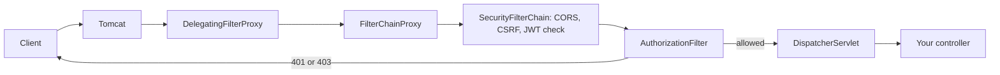

**Example:** Spring Security 6 and 7 style. You write a `SecurityFilterChain` bean with the *lambda DSL* (each part is configured inside a small lambda).

```java
@Configuration
@EnableWebSecurity
class SecurityConfig {

    @Bean
    SecurityFilterChain api(HttpSecurity http) throws Exception {
        http
            .securityMatcher("/api/**")                              // this chain is only for /api/**
            .authorizeHttpRequests(auth -> auth
                .requestMatchers("/api/public/**").permitAll()
                .requestMatchers(HttpMethod.DELETE, "/api/**").hasRole("ADMIN")
                .anyRequest().authenticated())                       // everything else needs login
            .oauth2ResourceServer(o -> o.jwt(Customizer.withDefaults()))
            .sessionManagement(s -> s.sessionCreationPolicy(SessionCreationPolicy.STATELESS))
            .csrf(csrf -> csrf.disable());                           // only OK for token APIs, see CSRF
        return http.build();
    }
}
```

**What changed across versions:**

| Version | Change |
|---|---|
| Spring Security 5.7 | `WebSecurityConfigurerAdapter` deprecated. Use a `SecurityFilterChain` bean |
| Spring Security 6 (Boot 3) | `WebSecurityConfigurerAdapter` removed. `antMatchers` replaced by `requestMatchers` |
| Spring Security 7 (Boot 4) | `.and()` chaining removed, so lambda DSL only. `authorizeRequests` removed, use `authorizeHttpRequests`. Built-in multi-factor login (MFA). Spring Authorization Server is now part of Spring Security |

**Good and bad:**

| Good | Bad |
|---|---|
| One `SecurityFilterChain` bean per area (`/api/**`, `/admin/**`) with `@Order` | Copy-pasting an old `WebSecurityConfigurerAdapter` from a 2019 blog |
| `anyRequest().authenticated()` as the last rule (deny by default) | `anyRequest().permitAll()` and hoping you listed every private URL |
| Turn on `TRACE` logs for `org.springframework.security` while debugging | Guessing why you get 403 |

**Say this in the interview:**
> Spring Security is a chain of servlet filters. Tomcat calls DelegatingFilterProxy, which hands the request to FilterChainProxy. That picks the matching SecurityFilterChain and runs its filters in order: CORS, CSRF, authentication, then authorization. The logged-in user is stored in the SecurityContext, which is a ThreadLocal. Since Spring Security 6 we configure it with a SecurityFilterChain bean and the lambda DSL. In version 7, the old `.and()` style is gone.

**They may ask next:**
- **What is Spring Security?** A Spring project for authentication (who are you), authorization (what can you do), and protection against attacks like CSRF. It works as a chain of filters.
- **How do you get the current user?** Add `@AuthenticationPrincipal` to a controller parameter, or call `SecurityContextHolder.getContext().getAuthentication()`.
- **How do you add your own filter?** `http.addFilterBefore(myFilter, UsernamePasswordAuthenticationFilter.class)`. Extend `OncePerRequestFilter` so it runs once per request.
- **Does the SecurityContext go to `@Async` threads?** Not by default, because it is a ThreadLocal. Wrap the executor with `DelegatingSecurityContextAsyncTaskExecutor`.
- **Can I have two filter chains?** Yes. For example one for `/api/**` (JWT) and one for the web pages (form login). Order them with `@Order`.

### Authentication vs authorization

**In one line:** Authentication asks "who are you?". Authorization asks "what are you allowed to do?".

**Story:** At the airport, the officer checks your passport. That is **authentication**: you proved who you are.
At the gate, your boarding pass says economy class. You cannot sit in business class. That is **authorization**: what you are allowed to do.

**How it works in Spring Security:**
1. A filter reads the login data (username and password, or a token).
2. It gives it to the `AuthenticationManager`. This asks one or more `AuthenticationProvider`s to check it.
3. For a username and password, `DaoAuthenticationProvider` loads the user with your `UserDetailsService`. It compares the password with the `PasswordEncoder`.
4. The result is an `Authentication` object. It holds the *principal* (the user) and *authorities* (permissions like `ROLE_ADMIN` or `SCOPE_orders.read`).
5. Later, an `AuthorizationManager` checks URL rules or `@PreAuthorize` rules against those authorities.

| | Authentication | Authorization |
|---|---|---|
| Question | Who are you? | What can you do? |
| Happens | First | After authentication |
| Spring parts | `AuthenticationManager`, `UserDetailsService`, JWT decoder | `authorizeHttpRequests`, `@PreAuthorize` |
| Fails with | **401 Unauthorized** (really means "not logged in") | **403 Forbidden** (logged in, but not allowed) |

**Example:**

```java
@Bean
UserDetailsService users(UserRepository repo) {
    return username -> repo.findByEmail(username)
        .map(u -> User.withUsername(u.email())
            .password(u.passwordHash())          // already a BCrypt hash, never plain text
            .roles(u.role())                     // "ADMIN" becomes authority "ROLE_ADMIN"
            .build())
        .orElseThrow(() -> new UsernameNotFoundException(username));
}
```

**Say this in the interview:**
> Authentication proves who the user is. Authorization decides what that user can do. In Spring, authentication produces an Authentication object with the user and their authorities. Authorization rules check those authorities. A missing or bad login gives 401, and a logged-in user without permission gets 403.

**They may ask next:**
- **Role vs authority?** A role is an authority with the prefix `ROLE_`. `hasRole("ADMIN")` checks for `ROLE_ADMIN`. `hasAuthority("orders.read")` checks the exact text.
- **What is a `UserDetailsService`?** An interface with one method: load a user by username. You connect it to your users table.
- **Where does the user live during the request?** In the `SecurityContext`, inside `SecurityContextHolder`.

### JWT and OAuth2 resource server

**In one line:** A JWT is a signed token that says who the user is. The API checks the signature and trusts the token without a database call.

**Story:** At a music festival, staff check your ticket once at the main gate. Then they put a wristband with a hologram on your hand.
Inside, every food stall and stage checks only the wristband. They do not call the ticket office.
The hologram cannot be faked. But if someone steals your wristband, they can use it until the festival ends. That is why wristbands are valid for one day only.

**JWT structure:** three parts, joined with dots: `header.payload.signature`. Each part is Base64URL text (a simple encoding, not encryption).

```text
// header
{ "alg": "RS256", "kid": "key-2026-11" }
// payload (called "claims")
{ "sub": "user-42", "scope": "orders.read", "iss": "https://auth.example.com",
  "aud": "orders-api", "exp": 1794816000 }
```

- `sub` = the user. `iss` = who created the token. `aud` = which API it is for. `exp` = expiry time.
- **The payload is not secret.** Anyone can decode it. Never put a password or card number in it.
- **Signature:** The auth server signs the token with its **private key** (RS256 = RSA with SHA-256). The API checks it with the **public key**. The API downloads public keys from a *JWKS* URL (JSON Web Key Set, a list of public keys).

**Why it is stateless:** The API does not store a session. Any of your 20 API instances can check the token alone. No shared session store is needed, so scaling is easy.

**Expiry and refresh tokens:**
- **Access token:** short life, 5 to 15 minutes. Sent with every request.
- **Refresh token:** long life (hours or days). Sent only to the auth server to get a new access token. Store it safely.
- **Refresh token rotation:** each refresh gives a new refresh token. If an old one is used again, the auth server knows it was stolen.

**The revocation problem:** You cannot "cancel" a JWT before it expires. The API never asks anyone. Fixes:
1. Keep access tokens short (5 to 15 minutes). This is the main fix.
2. Keep a *deny list* in Redis of token IDs (`jti` claim) that were logged out. Check it on each request. This adds back a small lookup.
3. For high-risk APIs, use *opaque tokens* with *introspection*. The API asks the auth server "is this token still valid?" on each call. Slower, but you can revoke instantly.

**Diagram:**

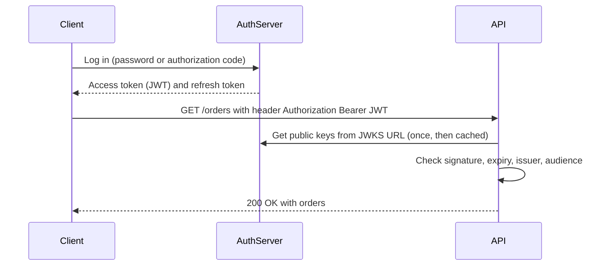

**Example:** your API as an OAuth2 *resource server* (an API that accepts tokens).

```properties
# Boot 4 starter: spring-boot-starter-security-oauth2-resource-server
# (Boot 3 name: spring-boot-starter-oauth2-resource-server, now deprecated)
spring.security.oauth2.resourceserver.jwt.issuer-uri=https://auth.example.com
spring.security.oauth2.resourceserver.jwt.audiences=orders-api
```

```java
@GetMapping("/me/orders")
List<Order> myOrders(@AuthenticationPrincipal Jwt jwt) {
    return orderService.findByUser(jwt.getSubject());   // "sub" claim = user id
}
```

- Spring reads `issuer-uri`, finds the JWKS URL, and checks every token.
- The `scope` claim becomes authorities like `SCOPE_orders.read`.
- Keycloak puts roles in its own claim. Map them with a `JwtAuthenticationConverter` bean.

**Good and bad:**

| Good | Bad |
|---|---|
| Access token 5 to 15 minutes, plus refresh token | Access token valid for 30 days |
| Check `iss`, `aud` and `exp` | Accept any signed token from any issuer |
| Asymmetric keys (RS256 or ES256): only the auth server can sign | One shared secret (HS256) copied into 15 services |
| For browser apps, keep tokens on the server (BFF pattern) | Tokens in `localStorage`, where any injected script can read them |

**Say this in the interview:**
> A JWT has a header, a payload with claims, and a signature. The auth server signs it with a private key. My API checks it with the public key from the JWKS URL. So the API is stateless and needs no session store. In Spring Boot, I add the OAuth2 resource server starter and set the issuer URI. The weak point is revocation. I keep access tokens short, use refresh tokens with rotation, and add a deny list only if the business needs instant logout.

**They may ask next:**
- **JWT vs session cookie?** A session stores user data on the server, and the cookie holds only an ID. A JWT carries the data itself. Sessions are easy to revoke. JWTs are easy to scale.
- **Where should a browser app keep tokens?** Safest is the BFF pattern: a small backend keeps the tokens, and the browser gets only an `httpOnly` cookie. See [API gateway and BFF](microservices.md#api-gateway-and-bff).
- **What if the signing key leaks?** Rotate keys. JWKS can hold the old and new key at the same time, chosen by the `kid` header. Then remove the old key.
- **Who checks the token in microservices?** Often the API gateway checks it first. Each service still checks it again (defense in depth, meaning more than one wall).

### OAuth2 login, OIDC and Spring Authorization Server

**In one line:** OAuth2 lets an app get a token to call APIs. OIDC adds "who the user is" on top. An authorization server gives out the tokens.

**Story:** You check in at a hotel. You show your passport at the reception (the authorization server).
Reception gives you a key card. It opens only room 305 and the gym. Those are your *scopes* (allowed actions).
You never give your passport to the gym. The gym just trusts the card.
"Log in with Google" is the same idea. Your app trusts Google's reception desk.

**Words to know:**
- **Client:** your app that wants the token.
- **Authorization server:** gives tokens. Keycloak, Okta, Auth0, Google, or Spring Authorization Server.
- **Resource server:** the API that accepts tokens.
- **OIDC (OpenID Connect):** a layer on OAuth2 for login. It adds an **ID token**, a JWT about the user (name, email). The **access token** is for calling APIs.

**Authorization code + PKCE flow (for users):**
1. Your app makes a random secret called `code_verifier`. It keeps it. It sends only its hash, the `code_challenge`.
2. The browser goes to the auth server's login page.
3. The user logs in and agrees to the scopes.
4. The auth server sends the browser back to your app with a short-lived `code`.
5. Your app sends the `code` and the `code_verifier` to the token endpoint.
6. The auth server hashes the verifier. If it matches the challenge, it returns the tokens.

PKCE (Proof Key for Code Exchange, said "pixy") stops code theft. A thief who steals the `code` does not have the verifier.
Current OAuth security advice (RFC 9700) says: use PKCE for all clients, and do not use the old *implicit* and *password* grants.

**Diagram:**

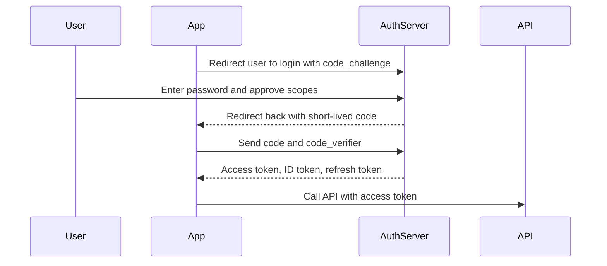

**Client credentials (service to service):** No user is involved. The billing service sends its `client_id` and `client_secret` to the auth server. It gets an access token. Then it calls the order service with that token.

**Example:** "Log in with Google" for a web app, and client credentials for a service.

```properties
# Boot 4 starter: spring-boot-starter-security-oauth2-client
spring.security.oauth2.client.registration.google.client-id=${GOOGLE_CLIENT_ID}
spring.security.oauth2.client.registration.google.client-secret=${GOOGLE_CLIENT_SECRET}
spring.security.oauth2.client.registration.google.scope=openid,email

# service-to-service: no user, just the service's own identity
spring.security.oauth2.client.registration.billing.authorization-grant-type=client_credentials
spring.security.oauth2.client.registration.billing.client-id=billing-service
spring.security.oauth2.client.provider.billing.token-uri=https://auth.example.com/oauth2/token
```

```java
http.oauth2Login(Customizer.withDefaults());   // adds the full login redirect flow
```

For outgoing calls, `OAuth2ClientHttpRequestInterceptor` on a `RestClient` gets and adds the token for you.

**Which authorization server?**

| Option | What it is | Good for |
|---|---|---|
| Keycloak | Free, open source server. You run it yourself. Has an admin UI | Teams that want control and no license cost |
| Okta / Auth0 | Paid cloud service | Teams that do not want to run a login server |
| Cloud provider (Cognito, Entra ID) | Paid cloud service from AWS or Microsoft | Teams already on that cloud |
| Spring Authorization Server | A library. You build your own server in Spring code. Part of Spring Security 7 | Special needs: custom token claims, full control, embedded in your platform |

**Good and bad:**

| Good | Bad |
|---|---|
| Use a ready auth server (Keycloak, Okta) | Write your own token and login logic from zero |
| Authorization code + PKCE for browser and mobile apps | Implicit flow, or the app collects the user's Google password |
| Client credentials with small scopes for services | One "super token" that every service shares |

**Say this in the interview:**
> For user login I use the authorization code flow with PKCE. The app sends a hash of a secret, gets a short code back, and then trades the code plus the secret for tokens. OIDC adds an ID token so the app knows who the user is. For service-to-service calls I use client credentials. I usually pick Keycloak or Okta. Spring Authorization Server is good when we need full control and want to write it in Spring.

**They may ask next:**
- **OAuth2 vs OIDC?** OAuth2 is about access (can this app call this API?). OIDC is about identity (who is this user?).
- **Access token vs ID token?** The access token goes to the API. The ID token is for the client app to read user details. Never send the ID token to an API as a pass.
- **What is a scope?** A named permission inside a token, like `orders.read`. Spring turns it into the authority `SCOPE_orders.read`.

### Method security (@PreAuthorize)

**In one line:** Put security rules on service methods, not only on URLs.

**Story:** In a bank, the guard at the door lets all employees in. That is the URL rule.
But only the manager's key opens the vault. That is the method rule.
Even if someone finds a side door to the vault room, the vault still checks the key.

**How it works:**
1. Add `@EnableMethodSecurity` to a config class. It replaces the old `@EnableGlobalMethodSecurity`.
2. Spring wraps the bean in a *proxy* (a wrapper object that runs code before and after your method).
3. Before the method runs, the proxy checks the `@PreAuthorize` rule. If false, it throws `AccessDeniedException`, which becomes 403.
4. Rules use SpEL (Spring Expression Language, small expressions inside strings).

**Example:**

```java
@Service
class OrderService {

    @PreAuthorize("hasRole('ADMIN')")
    public void refund(long orderId) { /* ... */ }

    @PreAuthorize("#userId == authentication.name")         // users see only their own orders
    public List<Order> ordersOf(String userId) { return repo.findByUserId(userId); }

    @PostAuthorize("returnObject.ownerId == authentication.name")  // check the result
    public Order get(long id) { return repo.findById(id).orElseThrow(); }

    @PreAuthorize("@orderRules.canEdit(#id, authentication)")       // call your own bean
    public void edit(long id, EditRequest req) { /* ... */ }
}
```

**Good and bad:**

| Good | Bad |
|---|---|
| Ownership checks ("is this my order?") at the service layer | Only URL rules, so `/orders/123` shows anyone's order (this bug is called IDOR) |
| Complex rules in a small bean, called with `@bean.method()` | Long SpEL strings that nobody can test |

**Say this in the interview:**
> I protect URLs in the filter chain, and I protect business actions with `@PreAuthorize` on service methods. It works through a proxy, like `@Transactional`. I use it for ownership checks, such as "a user can see only their own orders". For complex rules I call a small Spring bean from the expression.

**They may ask next:**
- **`@Secured` vs `@RolesAllowed` vs `@PreAuthorize`?** `@Secured` is old Spring, roles only. `@RolesAllowed` is the Jakarta standard, roles only. `@PreAuthorize` supports full expressions. Use `@PreAuthorize`.
- **Does it work on a private method or a self-call?** No. Same proxy problem as `@Transactional`. See [self-invocation](#transactional-deep-dive).

### CORS and CSRF

**In one line:** CORS decides which other websites may read your API from a browser. CSRF protection stops other websites from sending requests with your user's cookies.

**CSRF story:** You are logged in to your bank in one tab.
In another tab, you open a bad website. It has a hidden form that posts "send 10,000 rupees to me" to your bank.
Your browser adds your bank cookie automatically. The bank thinks it is you.
The fix is a **CSRF token**: a secret value that only the real bank page knows. The bad site cannot read it, so its request fails.

**CORS story:** The browser is a careful guard. A page from `shop.com` wants to read data from `api.bank.com`.
For non-simple requests, the guard first asks `api.bank.com`: "Do you allow `shop.com`?" This first call is the *preflight*, an `OPTIONS` request.
If the API says no, the browser blocks the response.

**How they differ:**

| | CORS | CSRF |
|---|---|---|
| Protects against | Other sites reading your API's data in the browser | Other sites making the browser act as the user |
| Who enforces it | The browser, using headers your API sends | Your server, by checking a token |
| Postman or curl | Not affected. CORS is a browser rule only | Not the threat. The threat is a browser with cookies |
| In Spring | `http.cors(...)` and a `CorsConfigurationSource` bean | On by default. `http.csrf(...)` |

**When can you disable CSRF?** When your API is stateless and the token travels in the `Authorization` header, not in a cookie.
A bad site cannot make the browser add that header.
If you log in with a session cookie, or put the JWT in a cookie, **keep CSRF on**.
`SameSite` cookies also help. This cookie setting stops the browser from sending the cookie on cross-site requests. It is an extra wall, not a full fix.

**Example:**

```java
@Bean
CorsConfigurationSource corsConfigurationSource() {
    var config = new CorsConfiguration();
    config.setAllowedOrigins(List.of("https://shop.example.com"));   // exact origins, not "*"
    config.setAllowedMethods(List.of("GET", "POST", "PUT", "DELETE"));
    config.setAllowedHeaders(List.of("Authorization", "Content-Type"));
    config.setAllowCredentials(true);
    var source = new UrlBasedCorsConfigurationSource();
    source.registerCorsConfiguration("/api/**", config);
    return source;
}
// in the SecurityFilterChain: http.cors(Customizer.withDefaults());
```

**Good and bad:**

| Good | Bad |
|---|---|
| List exact allowed origins | `allowedOrigins("*")` together with cookies |
| Disable CSRF only for header-token APIs | Disable CSRF "because the 403 was annoying" on a cookie login app |
| CORS config inside Spring Security | CORS only in `WebMvcConfigurer`: preflight can be blocked by security first |

**Say this in the interview:**
> CORS is a browser rule. My API tells the browser which other origins may read its responses. CSRF is an attack where a bad site uses the user's cookies to send a request. Spring Security turns CSRF protection on by default. I disable it only for stateless APIs where the token is in the Authorization header, because a bad site cannot add that header.

**They may ask next:**
- **Is CORS a security feature for my server?** No. It protects users in browsers. Your server must still check the login on every request.
- **What is a preflight?** An `OPTIONS` call the browser sends before a non-simple request, for example one with an `Authorization` header or JSON body.

### Passwords and secrets

**In one line:** Store only a slow, salted hash of each password. Keep secrets like DB passwords and API keys out of code and git.

**Story:** An office stores your fingerprint pattern, not your actual finger.
It can check that you are you. But a thief who steals the pattern list cannot easily become you.
A password hash is the same idea.

**How it works:**
1. A *hash* is a one-way function. You cannot get the password back from it.
2. A *salt* is a random value added per user. Two users with the password "india123" get different hashes.
3. **Slow is good.** BCrypt is slow on purpose (cost 10 means 2^10 rounds). A login takes about 100 ms. But a thief needs years to guess billions of passwords.
4. **Argon2** is also slow and uses a lot of memory. This makes GPU attacks harder.
5. **Never** use plain MD5 or SHA-256 for passwords. A GPU can try billions of them per second.

**Example:**

```java
@Bean
PasswordEncoder passwordEncoder() {
    // stores "{bcrypt}$2a$10$..." so you can change the algorithm later
    return PasswordEncoderFactories.createDelegatingPasswordEncoder();
}

// on sign-up
String hash = passwordEncoder.encode(rawPassword);       // save only this
// on login, Spring does this for you
boolean ok = passwordEncoder.matches(rawPassword, hash);
```

For Argon2, use `Argon2PasswordEncoder.defaultsForSpringSecurity_v5_8()`. It needs the Bouncy Castle library.

**Secrets (DB passwords, API keys):**
- Put them in environment variables, Kubernetes Secrets, HashiCorp Vault, or AWS Secrets Manager.
- In `application.yml`, write only a placeholder: `password: ${DB_PASSWORD}`.
- Rotate (change) secrets on a schedule.
- Scan commits with a tool like gitleaks.
- If a secret reaches git, **rotate it at once**. Deleting the commit is not enough. Forks and clones still have it.

**Good and bad:**

| Good | Bad |
|---|---|
| `DelegatingPasswordEncoder` with BCrypt or Argon2 | Plain text, MD5, or SHA-256 without salt |
| `${DB_PASSWORD}` from the environment or Vault | `password: admin123` in `application.yml` in git |
| Same error for "wrong user" and "wrong password" | "User not found" tells attackers which emails exist |

**Say this in the interview:**
> I never store plain passwords. I use Spring's DelegatingPasswordEncoder, which uses BCrypt by default and adds a salt per user. BCrypt is slow on purpose, so guessing is very expensive. Secrets like DB passwords come from environment variables or Vault, never from git. If a secret leaks, we rotate it at once.

**They may ask next:**
- **Hashing vs encryption?** Hashing is one-way, for passwords. Encryption is two-way with a key, for data you must read again, like a card token.
- **How do you move users from MD5 to BCrypt?** Keep both in `DelegatingPasswordEncoder`. When a user logs in, check with MD5, then save the new BCrypt hash. Spring supports this with `UserDetailsPasswordService`.

## Spring Data

**Used by companies for:** almost every Spring service that stores data. Orders in PostgreSQL with JPA, sessions and cache in Redis, product catalogs in MongoDB, and search in Elasticsearch.

### Spring Data JPA basics

**In one line:** You write a Java interface, and Spring Data writes the database code for you.

**Story:** You go to a library and tell the librarian: "Give me all books by Premchand, newest first."
You do not walk the shelves yourself. The librarian knows how to find them.
JPA is the rule book that all librarians follow. Hibernate is the actual librarian. Spring Data is the front desk that turns your sentence into work for the librarian.

**Words to know:**
- **JPA (Jakarta Persistence):** the standard Java API to map classes to tables. Boot 4 uses Jakarta Persistence 3.2.
- **Hibernate:** the most used JPA implementation. Boot 4 uses Hibernate 7.
- **Spring Data JPA:** creates repository classes from your interfaces.
- **Entity:** a class mapped to a table, marked with `@Entity`.
- **EntityManager:** the JPA object that loads and saves entities. In Hibernate it is called a `Session`.

**How it works:**
1. You write `interface OrderRepository extends JpaRepository<Order, Long>`.
2. At startup, Spring Data creates a class for it (a proxy).
3. Methods like `save`, `findById`, `findAll` and `deleteById` are ready.
4. For your own methods, Spring Data reads the **method name** and builds the query. This is a *derived query*.
5. For harder queries, you write JPQL (SQL-like, but on entities) or native SQL with `@Query`.

**Example:**

```java
public interface OrderRepository extends JpaRepository<Order, Long>,
                                         JpaSpecificationExecutor<Order> {

    List<Order> findByCustomerIdAndStatus(long customerId, Status status);  // derived from the name

    @Query("select o from Order o where o.total > :min")                    // JPQL on entities
    List<Order> findBig(BigDecimal min);

    @Query(value = "select * from orders where created_at > now() - interval '1 day'",
           nativeQuery = true)                                              // plain SQL
    List<Order> createdLastDay();

    List<OrderSummary> findByCustomerId(long customerId);   // projection: only 2 columns are read

    Page<Order> findByStatus(Status status, Pageable pageable);
}

record OrderSummary(Long id, BigDecimal total) {}
```

```java
// page 0, 20 rows, newest first
Page<Order> page = repo.findByStatus(Status.NEW,
        PageRequest.of(0, 20, Sort.by("createdAt").descending()));
```

- **Projection:** return a small record or interface, not the full entity. Less data, faster.
- **Page vs Slice:** `Page` runs an extra `count(*)` query to know the total. `Slice` only knows "is there a next page". Use `Slice` for "load more" screens.
- **Deep pages are slow.** `OFFSET 100000` still reads 100,000 rows. Use *keyset pagination* ("give me rows after id 98765"). Spring Data supports it with `ScrollPosition` and `Window`.
- **Specifications / Querydsl:** build queries from many optional filters (a search screen) in type-safe Java code, instead of 20 `if`s in a query string.

**Entity lifecycle states:**

| State | Meaning | Example |
|---|---|---|
| Transient (new) | A plain Java object. Hibernate does not know it | `new Order()` |
| Managed | Tracked by the persistence context. Changes are saved at commit automatically | After `persist()` or `find()` inside a transaction |
| Detached | Was managed, but the persistence context is closed. Changes are not tracked | An entity returned from a finished `@Transactional` method |
| Removed | Marked for delete. Deleted at commit | After `remove()` |

**First-level cache = persistence context.** Inside one transaction, the `EntityManager` keeps every loaded entity in a map by ID.
Call `findById(5)` twice and only one SQL runs. It is always on. It lives only for one transaction (or one request).
It also powers *dirty checking*: at commit, Hibernate compares each managed entity with its first copy. Then it writes `UPDATE`s for changed ones. You do not call `save()` for managed entities.

**Second-level cache:** an optional cache shared by all sessions in one app instance, or in a cluster with a shared provider.
You turn it on per entity with `@Cache` (Hibernate) or `@Cacheable` (JPA), and a provider like Ehcache through JCache.
It is good for data that is read a lot and changes rarely, like countries or product categories.
It is bad for data that changes often, or that other apps also write to the DB, because the cache becomes stale.
The *query cache* is a separate option. It stores the IDs returned by a query.

**Good and bad:**

| Good | Bad |
|---|---|
| Derived queries for simple filters | Method names like `findByAAndBAndCOrDAndEOrderByF` (use `@Query`) |
| Projections for list screens | Loading 50-column entities to show 3 fields |
| `spring.jpa.hibernate.ddl-auto=validate` in production | `ddl-auto=update` in production: Hibernate changes your tables |

**Say this in the interview:**
> Spring Data JPA gives me repository interfaces. Simple queries come from method names, and harder ones use `@Query` with JPQL or native SQL. I use projections and paging for list screens. Under it, Hibernate keeps a persistence context, which is the first-level cache. It also does dirty checking, so changes to managed entities are saved at commit. The second-level cache is optional. I use it only for data that is read often and changes rarely.

**They may ask next:**
- **`CrudRepository` vs `PagingAndSortingRepository` vs `JpaRepository`?** `CrudRepository` gives basic save, find and delete. `PagingAndSortingRepository` adds paging and sorting. `JpaRepository` has both, plus JPA extras like `flush()` and batch deletes.
- **What does `save()` do?** If the entity is new, it calls `persist()`. If not, it calls `merge()`. `merge()` copies a detached object into a managed one.
- **`persist` vs `merge` vs Hibernate `save`?** `persist` makes a new object managed. `merge` returns a managed copy of a detached object. Hibernate 7 removed the old `save()`, `update()` and `saveOrUpdate()`.
- **`get()` vs `load()` in Hibernate?** `get()` hits the DB and returns null if missing. `load()` returned a lazy proxy and failed later if missing. Hibernate 7 removed `load()`: use `getReference()`. `get()` is deprecated: use `find()`.
- **Why must an entity have a no-args constructor and not be `final`?** Hibernate creates objects by reflection with that constructor. For lazy loading, it creates a *proxy*, which is a subclass of your entity. A `final` class cannot have a subclass.
- **Is `EntityManager` thread-safe?** No. But Spring injects a shared proxy. It gives each transaction its own real `EntityManager`, so it is safe to inject. `EntityManagerFactory` (Hibernate `SessionFactory`) is thread-safe and created once.
- **What is cascading?** Passing an action from parent to child. `cascade = CascadeType.ALL` on `Order.items` saves and deletes the items with the order. Do not cascade from child to parent.
- **How do you map one-to-many?** `@ManyToOne` on the child (`OrderItem.order`). This side owns the foreign key. Add `@OneToMany(mappedBy = "order")` on the parent.
- **How do you see the SQL?** `logging.level.org.hibernate.SQL=DEBUG`. Add `logging.level.org.hibernate.orm.jdbc.bind=TRACE` to see the parameter values.
- **When do you use `JdbcClient` or `JdbcTemplate` instead of JPA?** For reports, bulk updates and complex SQL. A `RowMapper` turns each result row into an object.

### The N+1 problem and how to fix it

**In one line:** You run 1 query to load a list, then N more queries to load each item's children.

**Story:** You ask a shop helper for 50 orders and their items.
The helper brings the list of 50 orders. Then the helper walks to the store room 50 times, once per order, to bring its items.
That is 51 trips. One smart trip with a big trolley would be enough.

**Example:**

```java
@Entity
class Order {
    @Id Long id;
    @OneToMany(mappedBy = "order")       // LAZY by default
    List<OrderItem> items;
}

List<Order> orders = orderRepo.findAll();               // 1 query: select * from orders
for (Order o : orders) {
    total += o.getItems().size();                        // N queries: one per order!
}
```

The log shows `select * from order_item where order_id = ?` 50 times.
With 1,000 orders and 2 ms per query, that is 2 seconds of waiting, just in DB round trips.

**Fixes:**

| Fix | How | When to use |
|---|---|---|
| `JOIN FETCH` | `@Query("select o from Order o join fetch o.items where o.status = :s")` | You know you need the children in this query |
| `@EntityGraph` | `@EntityGraph(attributePaths = "items")` on a repository method | Same as join fetch, without writing JPQL |
| Batch fetching | `spring.jpa.properties.hibernate.default_batch_fetch_size=50` | Many places, quick global fix. Loads children 50 parents at a time with `IN (...)`: 1 + N/50 queries |
| DTO projection | `select new com.shop.OrderRow(o.id, count(i)) from Order o join o.items i group by o.id` | List screens and reports. Read only what you need |

```java
@EntityGraph(attributePaths = "items")                  // one query with a join
List<Order> findByStatus(Status status);
```

**Careful:** `JOIN FETCH` on a collection plus paging does not mix.
Hibernate cannot page joined rows correctly. So it loads **all rows** and pages in memory, with a warning in the log.
For paging, first load one page of order IDs. Then fetch those orders with their items. Or use batch fetching.

**LAZY vs EAGER:**
- **LAZY:** load the children only when the code touches them.
- **EAGER:** always load them with the parent.
- JPA defaults: `@ManyToOne` and `@OneToOne` are **EAGER**. `@OneToMany` and `@ManyToMany` are **LAZY**.
- Best practice: make everything LAZY (`@ManyToOne(fetch = FetchType.LAZY)`). Fetch what you need per query.
- EAGER does not fix N+1. It often causes N+1 on every query, even when you do not need the data.

**LazyInitializationException:** You touch a LAZY field after the persistence context is closed.
For example, the controller or the JSON writer reads `order.getItems()` after the `@Transactional` service method has returned.
Good fixes: fetch it in the query (join fetch or entity graph), or return a DTO from the service.
Bad fixes: make it EAGER, turn on open-in-view, or set `hibernate.enable_lazy_load_no_trans`.

**Open-in-view (OSIV):**
- Spring Boot sets `spring.jpa.open-in-view=true` by default. It prints a warning at startup about this.
- It keeps the persistence context open for the **whole web request**, including the controller and JSON writing.
- So lazy loading "just works" in the controller. That sounds nice, but:
  - It hides N+1 queries, which now run while writing JSON.
  - It can hold a DB connection for the whole request, including slow remote calls. Under load, the pool runs out.
- Set `spring.jpa.open-in-view=false` in every new project. Load what you need inside the service.

**Say this in the interview:**
> N+1 means one query for the parents and one more query per parent for the children. I find it in the SQL logs or with a query-count check in tests. I fix it with join fetch or an entity graph when I need the children. I use batch fetching as a global safety net, and DTO projections for list screens. I keep all relations LAZY, and I turn off open-in-view, because it hides these queries and holds DB connections too long.

**They may ask next:**
- **What is a Hibernate proxy?** A generated subclass of your entity that stands in for it. It loads the real data from the DB on the first method call. This is how LAZY works for single objects.
- **How do you catch N+1 before production?** Turn on SQL logs in tests. Or count queries in a test with a library like datasource-proxy, and fail if the count is too high.
- **Does N+1 happen in Spring Data JDBC or MongoDB?** It can happen with any tool that loads related data one by one. It is just most common with JPA lazy loading.

### @Transactional deep dive

**In one line:** `@Transactional` makes a method run in one database transaction: all changes are saved together, or none are.

**Story:** A bank has a teller and a clerk.
When you go to the teller, she opens a "transaction folder". The clerk does the work. Then the teller stamps it "done" (commit) or tears it up (rollback).
But if the clerk walks to a colleague's desk directly, skipping the teller, nobody opens a folder.
The teller is Spring's **proxy**. The clerk is your real bean.

**How the proxy works:**
1. At startup, Spring sees `@Transactional` and creates a *proxy* around your bean. Spring Boot uses CGLIB proxies by default (a generated subclass of your class).
2. Other beans get the proxy injected, not your real object.
3. A call comes in. The proxy asks the transaction manager (`JpaTransactionManager`) to start a transaction. It takes a DB connection and binds it to the current thread.
4. The proxy calls your real method.
5. If the method returns normally, the proxy commits. If it throws a `RuntimeException`, it rolls back.
6. The connection goes back to the pool.

**Diagram:**

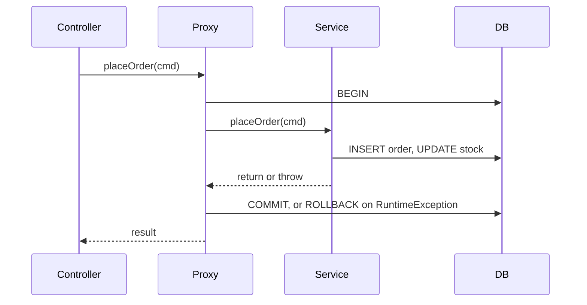

**Propagation (what happens if a transaction is already running):**

| Propagation | If a transaction exists | If none exists | Use for |
|---|---|---|---|
| `REQUIRED` (default) | Join it | Start a new one | Almost everything |
| `REQUIRES_NEW` | Pause it, start a new separate one | Start a new one | Audit log that must be saved even if the main work fails |
| `NESTED` | Create a *savepoint* (a bookmark to roll back to) inside it | Start a new one | Partial rollback. Works with JDBC; limited support with JPA |
| `SUPPORTS` | Join it | Run without one | Read methods that do not care |
| `MANDATORY` | Join it | Throw an exception | Methods that must be called inside a transaction |
| `NOT_SUPPORTED` | Pause it, run without one | Run without one | Long work that should not hold a transaction |
| `NEVER` | Throw an exception | Run without one | Rare |

**`REQUIRES_NEW` warning:** the new transaction needs a **second DB connection** while the first one waits.
With a pool of 10 and 10 busy requests, every request waits for an 11th connection. Nobody can finish. This is a pool deadlock.

**Rollback rules:**
- By default, **`RuntimeException` and `Error` roll back**. **Checked exceptions commit!**
- So `throws IOException` from a `@Transactional` method still commits the changes made before it.
- Fix per method: `@Transactional(rollbackFor = Exception.class)`.
- Fix for the whole app (Spring 6.2+): `@EnableTransactionManagement(rollbackOn = RollbackOn.ALL_EXCEPTIONS)`.
- If you catch an exception and swallow it, the proxy never sees it. It commits.
- `UnexpectedRollbackException`: an inner `REQUIRED` method threw. That marked the shared transaction "rollback-only". The outer method caught the error and tried to commit. Spring rolls back and tells you.

**`readOnly = true`:**
- A hint for read methods.
- Hibernate skips dirty checking and does not keep snapshot copies, so it saves memory and CPU.
- Some setups send read-only transactions to a read replica, using a routing data source.
- A common pattern: `@Transactional(readOnly = true)` on the class, and plain `@Transactional` on write methods.

**Example:**

```java
@Service
@Transactional(readOnly = true)                   // default for all methods: read-only
class OrderService {

    private final OrderRepository orders;
    private final AuditService audit;              // another bean, so its proxy is used

    @Transactional                                 // write method: normal transaction
    public Order place(PlaceOrder cmd) {
        Order order = orders.save(Order.from(cmd));
        audit.log("ORDER_PLACED", order.getId());  // REQUIRES_NEW inside AuditService
        return order;
    }
}

@Service
class AuditService {
    @Transactional(propagation = Propagation.REQUIRES_NEW)   // saved even if place() rolls back
    public void log(String type, long id) { /* insert audit row */ }
}
```

**The self-invocation problem:**

```java
@Service
class ReportService {
    public void runAll() {
        this.saveReport();          // "this" is the real object, not the proxy: NO transaction
    }
    @Transactional
    public void saveReport() { /* ... */ }
}
```

The call skips the proxy, so `@Transactional` is ignored. There is no error and no warning.
Fixes, best first:
1. Move `saveReport()` to another bean and inject that bean.
2. Use `TransactionTemplate` in code: `tx.execute(status -> ...)`.
3. Inject the bean into itself with `@Lazy` and call `self.saveReport()`. It works, but it looks strange.
4. Use AspectJ weaving mode (changes the bytecode, so no proxy is needed). Rarely worth it.

**Private and final methods:** a proxy is a subclass. It cannot override `private` or `final` methods, so `@Transactional` on them is **silently ignored**.
Since Spring 6, `protected` and package-private methods work with class-based proxies. `public` is still the safe choice.

**`@Transactional` on tests:** Spring starts a transaction for each test method and **rolls it back** at the end. The DB stays clean.
But be careful:
- Your code may never *flush* (send SQL to the DB), so constraint errors do not show up.
- `LazyInitializationException` cannot happen, because the test keeps the transaction open.
- With `@SpringBootTest(webEnvironment = RANDOM_PORT)`, the server runs in another thread. The test transaction does not cover it, and nothing rolls back.

**Never call Kafka or HTTP inside a DB transaction:**
- **Send, then rollback:** the message is out, but the order is not in the DB. A "ghost" event.
- **Commit, then the send fails:** the order is saved, but no event is sent. A lost event.
- **Slow HTTP call:** the DB connection is held for seconds while you wait.
- Fix: the [transactional outbox pattern](microservices.md#transactional-outbox-pattern). Save the event in an outbox table in the same transaction, and publish it after.
- For in-app side effects, `@TransactionalEventListener(phase = AFTER_COMMIT)` runs code only after a successful commit. It is not safe for events that must never be lost.

**Good and bad:**

| Good | Bad |
|---|---|
| `@Transactional` on service methods | On controllers, or on every repository call |
| Short transactions: read, change, commit | HTTP calls, Kafka sends, or file uploads inside the transaction |
| `rollbackFor = Exception.class` or `ALL_EXCEPTIONS` | Expecting checked exceptions to roll back |
| Call transactional methods from another bean | `this.method()` and wondering why nothing rolled back |

**Say this in the interview:**
> `@Transactional` works through a proxy. The proxy starts the transaction, calls my method, and commits or rolls back. Because of that, self-calls and private methods get no transaction. The default propagation is REQUIRED, which joins the current transaction. REQUIRES_NEW starts a separate one, for example for audit logs, but it uses a second connection. By default only runtime exceptions roll back, so I set rollbackFor for checked ones. I never call Kafka or other services inside a transaction. I use the outbox pattern instead.

**They may ask next:**
- **How do you enable transactions in Spring Boot?** Spring Boot turns it on automatically when you have a data starter. Just add `@Transactional`. In plain Spring, add `@EnableTransactionManagement`.
- **Spring `@Transactional` vs `jakarta.transaction.Transactional`?** Both work. Spring's version has more options: `readOnly`, `propagation`, `isolation`, `timeout`.
- **How do you set isolation level?** `@Transactional(isolation = Isolation.REPEATABLE_READ)`. See [transactions and isolation levels](databases.md#transactions-and-isolation-levels).
- **Can a transaction cover two microservices?** Not with `@Transactional`. Use a [saga](microservices.md#saga-pattern) with compensating steps.
- **Does the transaction pass to an `@Async` method?** No. It is bound to the thread. The new thread has no transaction.

### Spring Data for Redis, MongoDB and Elasticsearch

**In one line:** The same repository idea works for many databases, not only SQL.

**Story:** One family, many shops. Spring Data is the family name. Spring Data JPA, Spring Data Redis, Spring Data MongoDB and Spring Data Elasticsearch are the shops. Each sells different goods, but the counter looks the same: a repository interface.

| Store | Used for | Main Spring tools |
|---|---|---|
| Redis | Cache, sessions, OTPs, rate limits, short-lived data. Data in memory, very fast | `StringRedisTemplate`, `RedisTemplate`, `@RedisHash` repositories |
| MongoDB | Documents with flexible shape: product catalogs, user profiles, event logs | `MongoRepository`, `MongoTemplate`, `@Document` |
| Elasticsearch | Full-text search, filters, autocomplete, log search | `ElasticsearchRepository`, `ElasticsearchOperations`, `@Document(indexName = ...)` |

**Example: Redis (OTP valid for 5 minutes):**

```java
@Service
class OtpService {
    private final StringRedisTemplate redis;
    OtpService(StringRedisTemplate redis) { this.redis = redis; }

    void save(String phone, String otp) {
        redis.opsForValue().set("otp:" + phone, otp, Duration.ofMinutes(5));  // TTL: auto delete
    }
    boolean check(String phone, String otp) {
        return otp.equals(redis.opsForValue().get("otp:" + phone));
    }
}
```

**Example: MongoDB:**

```java
@Document("products")
record Product(@Id String id, String name, String category, Map<String, String> attributes) {}

interface ProductRepository extends MongoRepository<Product, String> {
    List<Product> findByCategory(String category);                 // derived query, same as JPA
}
```

**Example: Elasticsearch:**

```java
@Document(indexName = "products")
record ProductDoc(@Id String id, String name, String description) {}

interface ProductSearchRepository extends ElasticsearchRepository<ProductDoc, String> {
    List<ProductDoc> findByNameContaining(String text);             // full-text style search
}
```

**Say this in the interview:**
> Spring Data gives the same repository style for JPA, Redis, MongoDB and Elasticsearch. I use Redis for cache and short-lived data with a TTL. I use MongoDB for flexible documents like a product catalog. I use Elasticsearch for full-text search. Usually the SQL database stays the source of truth, and we copy data into Elasticsearch with events.

**They may ask next:**
- **`RedisTemplate` vs `StringRedisTemplate`?** `StringRedisTemplate` stores plain strings, easy to read in `redis-cli`. `RedisTemplate` can store objects with a serializer like JSON.
- **`MongoRepository` vs `MongoTemplate`?** Repository for simple queries. Template for updates of single fields, aggregations and complex queries.

### Database migrations with Flyway or Liquibase

**In one line:** Keep every database change as a numbered script in git, and let a tool run each one exactly once.

**Story:** A building has a renovation logbook. Every change gets a number: "1. build wall", "2. add window".
Each change is done once, in order. Nobody erases an old line. If a change was wrong, you add a new line to fix it.

**How it works (Flyway):**
1. Put SQL files in `src/main/resources/db/migration`: `V1__create_orders.sql`, `V2__add_status.sql`.
2. At startup, Flyway reads its table `flyway_schema_history` to see which versions already ran.
3. It runs only the new files, in order. It saves each file's *checksum* (a fingerprint of the file content).
4. If someone **edits** an already applied file, the checksum changes, and startup fails. This is on purpose.
5. Flyway takes a lock, so only one app instance runs migrations at a time.

**Spring Boot 4 note:** add `spring-boot-starter-flyway` or `spring-boot-starter-liquibase`. Only adding `flyway-core` is not enough any more.

**Liquibase** does the same job. Changes are *changesets* in XML, YAML or SQL. It also has built-in rollback scripts.

**Zero-downtime changes: "expand and contract".** During a rolling deploy, old and new app versions run at the same time. Both must work with the same schema.
Example: rename `name` to `full_name`.
1. **Expand:** add the new column `full_name`. It can be null.
2. Deploy code that writes to **both** columns and still reads `name`.
3. **Backfill:** copy old data in small batches (for example 1,000 rows at a time).
4. Deploy code that reads `full_name`.
5. **Contract:** stop writing `name`. In a later release, drop it.

**Diagram:**

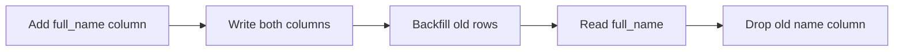

**Good and bad:**

| Good | Bad |
|---|---|
| A new file for every change, even a fix | Editing `V3__...sql` after it ran in production |
| `ddl-auto=validate` so Hibernate only checks the schema | `ddl-auto=update` in production |
| Expand and contract for renames and type changes | Rename a column in one release while old pods still use it |
| Build big indexes in a non-blocking way (PostgreSQL: `CREATE INDEX CONCURRENTLY`) | A plain index on a 500 GB table that locks writes for an hour |

**Say this in the interview:**
> I keep schema changes in Flyway scripts in git. Each runs once, in order, and Flyway stores a checksum, so applied scripts are never edited. If something is wrong, I add a new script. For zero downtime I use expand and contract. I add the new column, write to both, backfill, switch reads, and drop the old column in a later release. This works because old and new versions run together during a rolling deploy.

**They may ask next:**
- **Flyway vs Liquibase?** Flyway is simpler: plain SQL files, numbered. Liquibase supports XML and YAML changesets, many databases from one file, and rollback scripts.
- **Run migrations at app startup or as a separate step?** Startup is simple and fine for small teams. Big teams often run it as a separate step in the deploy pipeline or a Kubernetes job. Then a failed migration does not crash all pods.

### Connection pooling with HikariCP

**In one line:** A connection pool keeps a few DB connections open and lends them to requests, because opening a new one is slow.

**Story:** A restaurant has 10 tables. Building a new table for each guest would take too long.
So the tables stay ready. A guest sits, eats, and leaves, and the table is cleaned for the next guest.
If all 10 tables are busy, guest 11 waits at the door. After 30 seconds the waiter says "sorry, no table" (a timeout error).

**How it works:**
1. Opening a DB connection takes time: network, TLS, login. Often 20 to 100 ms.
2. At startup, the pool opens some connections and keeps them.
3. A transaction *borrows* a connection, uses it, and *returns* it.
4. If none is free, the thread waits up to `connectionTimeout` (default **30 seconds**). Then it fails.

**Spring Boot default:** HikariCP. Default `maximum-pool-size` is **10**.

**How to size it (keep it small!):**
- A DB server with 4 CPU cores can only run a few queries at the same time. More connections mostly add waiting and context switching.
- HikariCP's simple formula: `connections = (DB CPU cores × 2) + number of disks`. A 4-core DB gives about 10.
- Check with real numbers: 500 requests per second × 10 ms of DB time each = 5 connections busy on average. A pool of 10 gives room for spikes.
- **Multiply by instances!** 30 pods × 10 = 300 connections. PostgreSQL's default `max_connections` is 100. So the DB refuses connections.
- With many services, put a proxy pooler like PgBouncer in front of PostgreSQL.

```properties
spring.datasource.hikari.maximum-pool-size=10
spring.datasource.hikari.minimum-idle=10
# fail fast after 3 seconds, not 30
spring.datasource.hikari.connection-timeout=3000
# log a warning if a connection is held for more than 20 seconds
spring.datasource.hikari.leak-detection-threshold=20000
# 30 minutes, a bit less than the DB or firewall limit
spring.datasource.hikari.max-lifetime=1800000
```

**Symptoms of pool exhaustion:**
- Error: `SQLTransientConnectionException: HikariPool-1 - Connection is not available, request timed out after 30000ms`.
- All requests become slow at the same time, even simple ones.
- Metric `hikaricp.connections.pending` is above 0 for a long time. `hikaricp.connections.active` stays at the max.
- Thread dumps show many threads waiting in `HikariPool.getConnection`.

**Common causes:** slow queries, long transactions, HTTP calls inside transactions, open-in-view, `REQUIRES_NEW` (2 connections per request), and JDBC code that does not close connections (a *leak*).

**Virtual threads note:** with virtual threads you can have 10,000 requests in flight. They still share 10 connections. The pool becomes the gate. This is good: it protects the database.

**Good and bad:**

| Good | Bad |
|---|---|
| Small pool, sized from DB cores and real load | `maximum-pool-size=200` "to be safe" |
| Count total connections across all pods | Forget that autoscaling to 50 pods multiplies connections |
| Short `connection-timeout` and alerts on pending connections | Users wait 30 seconds before every error |

**Say this in the interview:**
> Spring Boot uses HikariCP, with a default max of 10 connections. I keep pools small, because the database can only run a few queries in parallel per CPU core. I always multiply by the number of pods and compare with the DB's max connections. When the pool runs out, all requests slow down and I see "connection is not available" timeouts. The cause is usually long transactions, HTTP calls inside transactions, or open-in-view. I fix the cause before making the pool bigger.

**They may ask next:**
- **What is a connection leak?** Code borrows a connection and never returns it. Usually manual JDBC without try-with-resources. `leak-detection-threshold` logs the stack trace of the guilty code.

## Validation and error handling

**Used by companies for:** rejecting bad input early with a clear 400 message. Every API returns the same error JSON, so mobile and web apps can show good messages.

### Bean Validation (@Valid)

**In one line:** Put rules like `@NotBlank` on your request class, add `@Valid`, and Spring rejects bad input before your code runs.

**Story:** At a passport office, a clerk at the first window checks your form: name filled, photo attached, date in the right format.
If something is missing, you are sent back at once. The officer inside never sees an incomplete form.
`@Valid` is that first window.

**How it works:**
1. Add `spring-boot-starter-validation`. The web starter does not include it. Hibernate Validator is the implementation of the Jakarta Validation standard.
2. Put constraint annotations on the fields of your request class.
3. Add `@Valid` before `@RequestBody`.
4. If a rule fails, Spring throws `MethodArgumentNotValidException`. The client gets **400 Bad Request**.
5. For `@PathVariable` and `@RequestParam` rules, Spring 6.1+ validates them too. It throws `HandlerMethodValidationException`.

**Example:**

```java
record CreateOrderRequest(
    @NotBlank String customerId,
    @NotEmpty List<@Valid Item> items,          // @Valid also checks each item inside the list
    @Email String email) {

    record Item(@NotBlank String sku, @Positive @Max(100) int quantity) {}
}

@RestController
@RequestMapping("/orders")
class OrderController {
    @PostMapping
    ResponseEntity<OrderResponse> create(@Valid @RequestBody CreateOrderRequest req) {  // checked before this line
        return ResponseEntity.status(201).body(service.create(req));
    }

    @GetMapping("/{id}")
    OrderResponse get(@PathVariable @Positive long id) { return service.get(id); }
}
```

**Good and bad:**

| Good | Bad |
|---|---|
| Format rules on the request DTO (not null, size, email) | 30 lines of `if (req.getName() == null)` in the controller |
| Business rules in the service ("is the item in stock?") | Database lookups inside validation annotations |
| `@Valid` on nested objects and list items | Expecting nested objects to be checked without `@Valid` |

**Say this in the interview:**
> I add constraint annotations like `@NotBlank` and `@Positive` to the request record, and `@Valid` on the controller parameter. If the input is wrong, Spring throws MethodArgumentNotValidException before my code runs. A global handler turns it into a 400 with the field errors. Validation checks the format. Business rules, like stock checks, stay in the service.

**They may ask next:**
- **`@Valid` vs `@Validated`?** `@Valid` is the Jakarta standard and works on nested objects. `@Validated` is Spring's. It supports *validation groups* (different rules for create and update) and method validation on any Spring bean.
- **How do you write a custom rule?** Create an annotation with `@Constraint(validatedBy = ...)` and a class that implements `ConstraintValidator`.
- **What is `BindingResult`?** A parameter right after the `@Valid` object. It holds the errors, so you can handle them in the method instead of getting an exception. Mostly used in old server-side form pages.

### Global error handling with @RestControllerAdvice and ProblemDetail

**In one line:** Handle all exceptions in one class, and return the same standard error JSON from every API.

**Story:** A big hospital has one complaint desk.
Whatever went wrong, on any floor, the patient goes to that desk and fills the same complaint form.
Patients always know where to go and what the form looks like.
`@RestControllerAdvice` is the complaint desk. `ProblemDetail` is the form.

**How it works:**
1. Create a class with `@RestControllerAdvice`. Spring applies it to all controllers.
2. Add `@ExceptionHandler` methods, one per exception type.
3. Return a `ProblemDetail`. It follows **RFC 9457** ("Problem Details for HTTP APIs", 2023). It replaced the older RFC 7807.
4. The response has content type `application/problem+json` and standard fields: `type`, `title`, `status`, `detail`, `instance`. You can add your own fields, like `errors` or `traceId`.
5. Set `spring.mvc.problemdetails.enabled=true` so Spring's own errors (404, 405, bad JSON) also use this format.

**Example:**

```java
@RestControllerAdvice
class GlobalErrors {

    @ExceptionHandler(OrderNotFoundException.class)
    ProblemDetail notFound(OrderNotFoundException ex) {
        ProblemDetail pd = ProblemDetail.forStatusAndDetail(HttpStatus.NOT_FOUND, ex.getMessage());
        pd.setTitle("Order not found");
        return pd;
    }

    @ExceptionHandler(MethodArgumentNotValidException.class)
    ProblemDetail invalid(MethodArgumentNotValidException ex) {
        ProblemDetail pd = ProblemDetail.forStatus(HttpStatus.BAD_REQUEST);
        pd.setTitle("Invalid request");
        pd.setProperty("errors", ex.getBindingResult().getFieldErrors().stream()
            .map(e -> e.getField() + ": " + e.getDefaultMessage()).toList());  // extra field
        return pd;
    }
}
```

The client gets:

```json
{
  "type": "about:blank",
  "title": "Invalid request",
  "status": 400,
  "instance": "/orders",
  "errors": ["items[0].quantity: must be greater than 0"]
}
```

**Good and bad:**

| Good | Bad |
|---|---|
| One error format for all services | Each team invents its own error JSON |
| Right status codes: 400, 401, 403, 404, 409, 422, 500 | 200 OK with `"success": false` in the body |
| A `traceId` field so support can find the logs | Stack traces and SQL errors sent to the client |
| One catch-all handler for `Exception` that logs and returns 500 | Unknown errors leak framework details |

**Say this in the interview:**
> I use one `@RestControllerAdvice` class with `@ExceptionHandler` methods. They return Spring's `ProblemDetail`, which follows RFC 9457. So every API returns the same JSON with type, title, status and detail, plus extra fields like validation errors and a trace ID. I never send stack traces to clients. I log them on the server.

**They may ask next:**
- **`@ControllerAdvice` vs `@RestControllerAdvice`?** `@RestControllerAdvice` = `@ControllerAdvice` + `@ResponseBody`. The return value is written as JSON.
- **What is `ResponseEntityExceptionHandler`?** A base class that already handles all of Spring MVC's own exceptions with ProblemDetail. Extend it to change how those look.
- **Can I throw an exception that already has a status?** Yes. Extend `ErrorResponseException`, or throw `ResponseStatusException(HttpStatus.CONFLICT, "...")`.

## Caching with Spring Cache

**Used by companies for:** product pages, prices, user profiles, configuration and results of slow external APIs. Anything read often and changed rarely.

**In one line:** Add `@Cacheable` to a method, and Spring returns the saved result instead of running the method again.

**Story:** A tea stall owner gets asked "how much is masala chai?" 200 times a day.
He does not check the price book each time. He remembers it.
When the price changes, he forgets the old one and remembers the new one.
If he never forgets, he will charge the old price forever. That is why caches need a TTL (time to live).

**How it works:**
1. Add `@EnableCaching` and a cache library.
2. Spring wraps the bean in a proxy, like `@Transactional`.
3. On a call to a `@Cacheable` method, the proxy builds a key from the arguments. It looks in the cache.
4. Hit: return the cached value, and the method does not run. Miss: run the method, store the result, and return it.

| Annotation | What it does |
|---|---|
| `@Cacheable` | Read from cache. On a miss, run the method and store the result |
| `@CachePut` | Always run the method, and store the new result (after an update) |
| `@CacheEvict` | Remove an entry (after a delete or change). `allEntries = true` clears the whole cache |

**Which cache library:**

| | Caffeine | Redis |
|---|---|---|
| Where | Inside each app instance (in memory) | Separate server, shared by all instances |
| Speed | Nanoseconds | About 1 ms (one network call) |
| Problem | 10 pods = 10 different copies, which can disagree | One more system to run and watch |
| Good for | Small, rarely changing data: config, countries | Shared data: product details, sessions |

**Example:**

```java
@Service
class ProductService {

    @Cacheable(cacheNames = "products", key = "#id", unless = "#result == null")
    public Product get(long id) { return repo.findById(id).orElse(null); }   // slow DB call

    @CachePut(cacheNames = "products", key = "#product.id")
    public Product update(Product product) { return repo.save(product); }

    @CacheEvict(cacheNames = "products", key = "#id")
    public void delete(long id) { repo.deleteById(id); }
}
```

```properties
# Redis cache: every entry expires after 10 minutes
spring.cache.redis.time-to-live=10m
# or Caffeine (local): limit size and expiry
spring.cache.caffeine.spec=maximumSize=10000,expireAfterWrite=10m
```

**Key design:**
- The key must include **every input** that changes the result: `product:42:lang=hi:currency=INR`.
- In multi-tenant apps (one app serving many customers), add the tenant ID. Otherwise one customer can see another customer's data.
- Add a version prefix (`v2:product:42`) when the cached class changes, so old shapes are not read.
- Use `@Cacheable(sync = true)` for hot keys. When a key expires, only one thread loads it while the others wait. This stops a *cache stampede* (hundreds of requests hitting the DB at once).

**Self-invocation breaks caching too.** `this.get(id)` inside the same class skips the proxy. The cache is never used. Same fixes as [`@Transactional`](#transactional-deep-dive).

**Good and bad:**

| Good | Bad |
|---|---|
| TTL on every cache | No TTL: stale prices forever |
| Evict or update the cache on writes | Update the DB and forget the cache |
| Cache DTOs or simple records | Cache JPA entities with lazy fields (they break when read later) |
| Measure the hit ratio | Cache everything and hope it helps |

**Say this in the interview:**
> I use Spring Cache with `@Cacheable`, `@CachePut` and `@CacheEvict`. Caffeine is my choice for small local data, and Redis for data shared by all instances. Every cache has a TTL, and the key includes every input, including the tenant. It works through a proxy, so self-calls skip the cache, just like `@Transactional`. For hot keys I use `sync = true` to avoid a stampede. More on cache patterns in [caching](system-design.md#caching).

**They may ask next:**
- **Cache-aside vs write-through?** Cache-aside: the app reads the cache, and on a miss loads from the DB. This is what `@Cacheable` does. Write-through: every write goes to the cache and the DB together.
- **How do you keep 10 Caffeine caches in sync?** Short TTL, or send an "evict" message to all instances through Redis pub/sub or Kafka. Or move that data to Redis.

## Scheduling and background jobs

**Used by companies for:** nightly reports, sending reminder emails, cleaning old data, retrying failed payments, and publishing outbox events.

**In one line:** `@Scheduled` runs a method on a timer, and `@Async` runs a method in a background thread.

**Story:** A housing society has a rule: "Water tank cleaning every Sunday at 6 AM."
If the society has 3 watchmen, and each one reads the rule, the tank gets cleaned 3 times.
You need one watchman to take the key from the key box. The others see the key is gone and do nothing.
ShedLock is that key box.

**How it works:**
1. Add `@EnableScheduling` to a config class.
2. Add `@Scheduled` on a method with no arguments.
3. `fixedRate = 60000`: start every 60 seconds, counted from the last start.
4. `fixedDelay = 60000`: wait 60 seconds after the last run **ends**.
5. `cron = "0 0 2 * * *"`: every day at 2:00 AM. Spring cron has 6 fields, starting with seconds. Set `zone` too.
6. Spring Boot's scheduler uses **one thread** by default. One slow job delays all other jobs. Raise it with `spring.task.scheduling.pool.size`.

**The cluster problem:** `@Scheduled` runs in **every instance**. With 5 pods, the nightly email goes out 5 times.

**Fixes:**

| Option | How it works | Good for |
|---|---|---|
| ShedLock | Before running, take a lock row in the DB (or Redis). Others skip this run | Simple jobs in an existing Spring app |
| Quartz in cluster mode | Jobs and triggers live in DB tables. Only one node fires each trigger. Handles missed runs | Many jobs, jobs created at runtime, must not miss a run |
| Kubernetes CronJob | Kubernetes starts a separate pod on a schedule | Heavy batch jobs, separate from the web app |

**Diagram:**

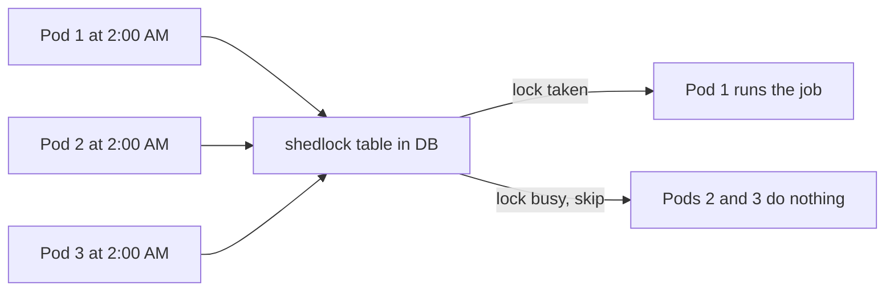

**Example: ShedLock:**

```java
@Configuration
@EnableScheduling
@EnableSchedulerLock(defaultLockAtMostFor = "10m")
class SchedulingConfig {
    @Bean
    LockProvider lockProvider(DataSource ds) {
        return new JdbcTemplateLockProvider(ds);       // lock rows in the "shedlock" table
    }
}

@Component
class ReportJob {
    @Scheduled(cron = "0 0 2 * * *", zone = "Asia/Kolkata")
    @SchedulerLock(name = "dailyReport", lockAtMostFor = "30m", lockAtLeastFor = "1m")  // only one pod runs it
    public void dailyReport() { reportService.sendDaily(); }
}
```

- `lockAtMostFor`: if the pod dies while running, the lock frees itself after 30 minutes.
- `lockAtLeastFor`: keep the lock at least 1 minute, so a pod with a slightly different clock does not run it again.

**`@Async`:**
1. Add `@EnableAsync`. Put `@Async` on a public method of a Spring bean.
2. The call returns at once. The work runs in another thread.
3. Return `void` or `CompletableFuture<T>`.
4. Spring Boot gives a default executor (`applicationTaskExecutor`). It is a thread pool with 8 core threads and an **unbounded queue**. With virtual threads turned on, it uses virtual threads instead.
5. For important work, define your **own executor** with a bounded queue and a clear thread name.

```java
@Bean(name = "emailExecutor")
ThreadPoolTaskExecutor emailExecutor() {
    var ex = new ThreadPoolTaskExecutor();
    ex.setCorePoolSize(4);
    ex.setMaxPoolSize(8);
    ex.setQueueCapacity(500);                  // bounded: no endless memory growth
    ex.setThreadNamePrefix("email-");
    return ex;
}

@Async("emailExecutor")                         // runs in an "email-" thread
public CompletableFuture<Void> sendWelcome(String email) {
    mailClient.send(email, "Welcome!");
    return CompletableFuture.completedFuture(null);
}
```

**`@Async` traps:**
- Same proxy rules: no self-calls, no private methods.
- Exceptions from `void` methods are lost unless you set an `AsyncUncaughtExceptionHandler`.
- The transaction, `SecurityContext` and logging MDC (per-request log fields like trace ID) do not pass to the new thread by default.
- If the app restarts, queued work in memory is **lost**. For work that must not be lost, use a DB table or Kafka.

More on thread pools in [Java concurrency](java-concurrency.md).

**Good and bad:**

| Good | Bad |
|---|---|
| ShedLock or Quartz cluster mode when you have more than one pod | `@Scheduled` on 5 pods sending 5 emails |
| Own executor with a bounded queue for `@Async` | Unbounded queue that grows until OutOfMemoryError |
| Jobs that are safe to run twice (idempotent) | Jobs that charge a card each time they run |
| Kafka or a DB job table for work that must survive restarts | `@Async` for payment processing |

**Say this in the interview:**
> `@Scheduled` runs on every instance, so in a cluster I add ShedLock. It takes a lock row in the database, so only one pod runs each job. For many jobs, or jobs that must never be missed, I use Quartz in cluster mode or a Kubernetes CronJob. I still make jobs idempotent, in case one runs twice. For `@Async` I define my own thread pool with a bounded queue. I remember that the transaction and security context do not pass to the new thread.

**They may ask next:**
- **`fixedRate` vs `fixedDelay`?** `fixedRate` starts on a fixed clock: 2:00, 2:01, 2:02. If one run is slow, the next starts right after it ends. Runs of the same method do not overlap. `fixedDelay` waits for the last run to finish, then waits the full delay.
- **Why do my two scheduled jobs run late?** The default scheduler has one thread. A slow job blocks the others. Increase the pool size or move the slow work to an executor.

## Testing Spring Boot apps

**Used by companies for:** catching bugs before release and safe refactoring. Also for checking the app with a real database and Kafka in CI (the build pipeline).

**The test pyramid, simply:**

| Level | What | How many | Speed |
|---|---|---|---|
| Unit tests | One class, plain JUnit + Mockito, no Spring | Many (hundreds) | Milliseconds |
| Slice tests | One layer with Spring: `@WebMvcTest`, `@DataJpaTest` | Some | About 1 second each |
| Integration tests | Full app with `@SpringBootTest` + Testcontainers | Fewer | Seconds |
| End-to-end tests | Real deployed system, like a user would use it | Very few | Minutes |

Like a pyramid: wide and cheap at the bottom, narrow and expensive at the top.

### Test slices (@WebMvcTest, @DataJpaTest)

**In one line:** A test slice starts only one layer of the app, so the test is fast and focused.

**Story:** A car factory does not test a new brake by building the whole car and driving it on the highway.
It puts only the brake on a test machine.
A slice test is that machine: only the web layer, or only the database layer.

**How it works:**
- **`@WebMvcTest(OrderController.class)`** loads controllers, `@RestControllerAdvice`, filters, Spring Security and JSON setup. It does **not** load services or repositories. You replace them with `@MockitoBean`.
- **`@DataJpaTest`** loads entities, repositories, `EntityManager` and Flyway. Each test runs in a transaction that **rolls back** at the end.
- By default, `@DataJpaTest` uses an in-memory DB (like H2) if one is on the classpath. In Boot 3.4 and later, it does **not** replace a Testcontainers database that comes from `@ServiceConnection` (the default is `Replace.NON_TEST`).
- Other slices: `@WebFluxTest`, `@JsonTest`, `@RestClientTest`, `@DataMongoTest`, `@DataRedisTest`.
- **Boot 4 note:** test support is split into modules too. Add test starters like `spring-boot-starter-webmvc-test` and `spring-boot-starter-data-jpa-test`. Packages changed, for example `org.springframework.boot.webmvc.test.autoconfigure.WebMvcTest`.

**Example: web slice with `MockMvcTester`:**

```java
@WebMvcTest(OrderController.class)
class OrderControllerTest {

    @Autowired MockMvcTester mvc;                 // AssertJ-style MockMvc (Spring 6.2+)
    @MockitoBean OrderService service;            // fake service inside the Spring context

    @Test
    @WithMockUser                                 // security is on in @WebMvcTest
    void returns404WhenOrderIsMissing() {
        given(service.get(99)).willThrow(new OrderNotFoundException(99));

        assertThat(mvc.get().uri("/orders/99"))
            .hasStatus(HttpStatus.NOT_FOUND)
            .bodyJson().extractingPath("$.title").isEqualTo("Order not found");
    }
}
```

**Example: JPA slice:**

```java
@DataJpaTest
class OrderRepositoryTest {

    @Autowired OrderRepository repo;
    @Autowired TestEntityManager em;

    @Test
    void findsOnlyNewOrders() {
        em.persist(new Order(1L, Status.NEW));
        em.persist(new Order(1L, Status.SHIPPED));
        em.flush();                                   // send SQL now, so DB constraints run

        assertThat(repo.findByCustomerIdAndStatus(1L, Status.NEW)).hasSize(1);
    }
}
```

**Good and bad:**

| Good | Bad |
|---|---|
| `@WebMvcTest` for status codes, JSON shape, validation and security rules | `@SpringBootTest` for every small controller test |
| `@DataJpaTest` against the same DB type as production (Testcontainers) | H2 tests pass, but a PostgreSQL-only query fails in production |
| Plain unit tests for business logic | Starting Spring just to test a `calculateDiscount()` method |

**Say this in the interview:**
> I keep most tests as plain unit tests with JUnit and Mockito. For the web layer I use `@WebMvcTest`, which loads only controllers, advice and security, and I mock the services with `@MockitoBean`. For repositories I use `@DataJpaTest`, which rolls back after each test. I run it on a real PostgreSQL with Testcontainers, not H2. A few `@SpringBootTest` tests check the whole flow.

**They may ask next:**
- **What is MockMvc?** It calls your controllers through the full Spring MVC flow, without starting a real server. It is fast. `MockMvcTester` (Spring 6.2+) is the AssertJ-style version.
- **What is `@SpringBootTest`?** It starts the whole application context. With `webEnvironment = RANDOM_PORT`, it also starts a real server on a random port. You get the port with `@LocalServerPort`.
- **Boot 4 change:** `@SpringBootTest` no longer sets up MockMvc, `TestRestTemplate` or `WebTestClient` by itself. Add `@AutoConfigureMockMvc`, `@AutoConfigureTestRestTemplate`, or `@AutoConfigureRestTestClient`.

### Testcontainers and @ServiceConnection

**In one line:** Testcontainers starts a real database (or Kafka, Redis) in Docker for your tests. `@ServiceConnection` connects Spring Boot to it automatically.

**Story:** A pilot can practise in a toy cockpit (H2). But before flying passengers, the pilot trains in a full flight simulator that behaves exactly like the real plane.
Testcontainers is the flight simulator. It is real PostgreSQL, not a copy that behaves a bit differently.

**How it works:**
1. Add `spring-boot-testcontainers` and a Testcontainers module, like `testcontainers-postgresql`. Boot 4 uses Testcontainers 2.
2. Declare a container as a `static` field with `@Container`.
3. Before Spring starts, Testcontainers starts the Docker container on a random port.
4. `@ServiceConnection` (Boot 3.1+) reads the container's host, port and password. It sets the connection for Spring. No `spring.datasource.url` needed.
5. Before Boot 3.1, people did the same by hand with `@DynamicPropertySource`.
6. Spring caches the test context. Tests with the same setup reuse the same app and container, which keeps them fast.

**Example:**

```java
@SpringBootTest
@AutoConfigureMockMvc                                   // Boot 4: needed for MockMvc
@Testcontainers
class OrderFlowIT {

    @Container
    @ServiceConnection                                  // Boot sets the datasource from the container
    static PostgreSQLContainer postgres = new PostgreSQLContainer("postgres:17");

    @Autowired MockMvcTester mvc;

    @Test
    @WithMockUser                                       // /api/** chain: stateless, CSRF off
    void createsOrder() {
        assertThat(mvc.post().uri("/api/orders")
                .contentType(MediaType.APPLICATION_JSON)
                .content("""
                    {"customerId":"c1","items":[{"sku":"TEA-1","quantity":2}]}"""))
            .hasStatus(HttpStatus.CREATED);
    }
}
```

**Good and bad:**

| Good | Bad |
|---|---|
| Same DB and version as production (`postgres:17`) | `latest` image tag: tests change when the image changes |
| Share containers through a base class or `@TestConfiguration`, so they start once | A new container for every test class: CI takes 20 minutes |
| `@ServiceConnection` | Hard-coded `localhost:5432` that needs a DB on every laptop |

**Say this in the interview:**
> I use Testcontainers so integration tests run against real PostgreSQL, Kafka or Redis in Docker. With Spring Boot 3.1 and later, `@ServiceConnection` wires the connection details automatically, so I do not need `@DynamicPropertySource`. I pin the same image version as production, and I share containers between tests so the build stays fast. The only need is Docker on the machine and in CI.

**They may ask next:**
- **Why not H2?** H2 is not PostgreSQL. JSON columns, `ON CONFLICT`, special indexes and some SQL functions behave differently. Tests pass, and production fails.
- **Can I use Testcontainers when running the app locally?** Yes. Boot can start the app with containers from a test configuration (`SpringApplication.from(App::main).with(ContainersConfig.class)`). Docker Compose support is another option.
- **How do you test Kafka?** The same way: a Kafka container with `@ServiceConnection`. See [Kafka](kafka.md).

### Mocking beans with @MockitoBean

**In one line:** `@MockitoBean` replaces a real bean in the Spring context with a Mockito mock (a fake object you control).

**Story:** In a film, a stunt double replaces the star for dangerous scenes. The rest of the crew works as normal.
`@MockitoBean` is the stunt double for one bean, like a payment client. The rest of the app is real.

**How it works:**
1. **Mockito** is a library to make fake objects. `when(...).thenReturn(...)` sets what they return. `verify(...)` checks they were called.
2. In a plain unit test, use `@Mock` and `@InjectMocks` with no Spring at all. This is the fastest.
3. In a Spring test, `@MockitoBean` puts the mock **inside** the application context, replacing the real bean.
4. `@MockitoSpyBean` wraps the real bean, so you can check calls while the real code runs.

**History:**

| Version | Change |
|---|---|
| Spring Framework 6.2 / Boot 3.4 | `@MockitoBean` and `@MockitoSpyBean` added in Spring Framework. Boot's `@MockBean` and `@SpyBean` deprecated |
| Spring Boot 4.0 | `@MockBean` and `@SpyBean` **removed** |

Package: `org.springframework.test.context.bean.override.mockito.MockitoBean`.
`@MockitoBean` is put on fields of the test class. It is not allowed in `@Configuration` classes.

**Example:**

```java
@SpringBootTest
class CheckoutServiceTest {

    @Autowired CheckoutService checkout;
    @MockitoBean PaymentClient payments;              // replaces the real HTTP client bean

    @Test
    void marksOrderFailedWhenPaymentIsDeclined() {
        when(payments.charge(any())).thenReturn(PaymentResult.DECLINED);

        Order order = checkout.placeOrder(sampleCart());

        assertThat(order.status()).isEqualTo(Status.PAYMENT_FAILED);
        verify(payments, times(1)).charge(any());      // called exactly once, no retry storm
    }
}
```

**Which test client?**

| Tool | Use for |
|---|---|
| `MockMvc` / `MockMvcTester` | Spring MVC controllers, no real server. `MockMvcTester` is the AssertJ style (Spring 6.2+) |
| `WebTestClient` | WebFlux apps, or calling a real running server |
| `RestTestClient` | New in Spring Framework 7. Same idea for MVC apps and real servers |
| `TestRestTemplate` | Older style for real-server tests. In Boot 4 it needs `@AutoConfigureTestRestTemplate` |

**Good and bad:**

| Good | Bad |
|---|---|
| Mock only the edges: payment client, email sender | Mock the repository, the service and the mapper. Then the test checks nothing real |
| Same set of `@MockitoBean`s across tests | A different mock set in every test class. Each one creates a new Spring context, so the build gets slow |
| `@Mock` in plain unit tests | `@SpringBootTest` + `@MockitoBean` to test one class |

**Say this in the interview:**
> In plain unit tests I use Mockito's `@Mock`, without Spring. In Spring tests I use `@MockitoBean` to replace one bean, like a payment client, with a mock. It came in Spring Framework 6.2. Boot deprecated `@MockBean` in 3.4 and removed it in Boot 4. I mock only the edges of the system, and I keep the same mocks across tests so Spring can reuse the context.

**They may ask next:**
- **`@MockBean` vs `@MockitoBean`?** Same idea. `@MockBean` was Spring Boot's. `@MockitoBean` is Spring Framework's. `@MockBean` is gone in Boot 4.
- **`@Mock` vs `@MockitoBean`?** `@Mock` creates a mock with no Spring. `@MockitoBean` creates a mock and puts it inside the Spring context.
- **How does Spring make testing easy?** Constructor injection lets you pass mocks by hand. Slices start only one layer. The test context is cached and reused. MockMvc tests controllers without a server.
- **What is JSONAssert?** A library to compare JSON strings, ignoring field order. Spring uses it for JSON checks in tests.

## Spring ecosystem interview questions (part 1)

**What is Spring Security?**
A Spring project that adds authentication, authorization and protection against attacks like CSRF. It runs as a chain of servlet filters before your controllers. See [filter chain](#how-spring-security-works-filter-chain).

**What is the difference between authentication and authorization?**
Authentication checks who you are. Authorization checks what you can do. A failed login gives 401, and a missing permission gives 403. See [authentication vs authorization](#authentication-vs-authorization).

**How does JWT authentication work in Spring?**
The client sends `Authorization: Bearer <token>`. The resource server checks the signature with the auth server's public key (from JWKS), and checks expiry, issuer and audience. Then it puts the user in the SecurityContext. No session is stored. See [JWT](#jwt-and-oauth2-resource-server).

**How do you log out a user with JWT?**
You cannot cancel a JWT before it expires. Keep access tokens short (5 to 15 minutes) and revoke the refresh token. For instant logout, add a deny list of token IDs in Redis. See [JWT](#jwt-and-oauth2-resource-server).

**What is the authorization code flow with PKCE?**
The app sends a hash of a secret, the user logs in, and the app gets a short code. It trades the code plus the secret for tokens. A stolen code is useless without the secret. See [OAuth2](#oauth2-login-oidc-and-spring-authorization-server).

**Which OAuth2 flow do you use between two services?**
Client credentials. The service logs in with its own client ID and secret, and gets a token with small scopes. No user is involved. See [OAuth2](#oauth2-login-oidc-and-spring-authorization-server).

**How do you allow only the owner to see an order?**
Use `@PreAuthorize` on the service method, for example `#userId == authentication.name`, or call a small rules bean. URL rules alone are not enough. See [method security](#method-security-preauthorize).

**When can you disable CSRF?**
For stateless APIs where the token is sent in the `Authorization` header. A bad site cannot add that header. If you use cookies for login, keep CSRF on. See [CORS and CSRF](#cors-and-csrf).

**How do you store passwords?**
As a BCrypt or Argon2 hash with a salt, through Spring's `PasswordEncoder`. Never plain text or plain SHA-256. See [passwords](#passwords-and-secrets).

**What is Spring Data JPA?**
A layer on top of JPA and Hibernate. You write repository interfaces, and Spring creates the code. Queries come from method names or `@Query`. See [Spring Data JPA basics](#spring-data-jpa-basics).

**What is the persistence context?**
The set of entities the `EntityManager` is tracking in the current transaction. It works as the first-level cache. It also does dirty checking, which saves changes at commit. See [Spring Data JPA basics](#spring-data-jpa-basics).

**First-level vs second-level cache in Hibernate?**
First-level is per transaction, always on, and lives in the persistence context. Second-level is shared across transactions, optional, and needs a provider like Ehcache. Use it only for data that rarely changes. See [Spring Data JPA basics](#spring-data-jpa-basics).

**What is the N+1 problem?**
One query loads N parents, then N more queries load each parent's children. Fix it with `JOIN FETCH`, `@EntityGraph`, batch fetching, or DTO projections. See [N+1](#the-n1-problem-and-how-to-fix-it).

**LAZY vs EAGER loading?**
LAZY loads related data when you first touch it. EAGER always loads it. Make everything LAZY and fetch what each query needs. See [N+1](#the-n1-problem-and-how-to-fix-it).

**What is `LazyInitializationException`?**
You touched a LAZY field after the transaction closed, for example in the controller. Fetch the data inside the service, or return a DTO. See [N+1](#the-n1-problem-and-how-to-fix-it).

**What is open-in-view? Should you turn it off?**
It keeps the persistence context open for the whole web request, so lazy loading works in controllers. It is on by default. Turn it off: it hides N+1 queries and holds DB connections too long. See [N+1](#the-n1-problem-and-how-to-fix-it).

**How does `@Transactional` work?**
Spring wraps the bean in a proxy. The proxy starts a transaction, calls your method, then commits, or rolls back on a runtime exception. See [@Transactional](#transactional-deep-dive).

**Why does `@Transactional` not work on a private method or a self-call?**
The transaction is added by a proxy, and only calls that go through the proxy get it. A private method cannot be overridden by the proxy, and `this.method()` skips the proxy. Move the method to another bean. See [@Transactional](#transactional-deep-dive).

**REQUIRED vs REQUIRES_NEW?**
REQUIRED joins the current transaction, or starts one if none exists. REQUIRES_NEW pauses the current one and starts a separate transaction that commits on its own. It needs a second DB connection. See [@Transactional](#transactional-deep-dive).

**Does a checked exception roll back the transaction?**
No, by default only runtime exceptions and errors roll back. Use `rollbackFor = Exception.class`, or `rollbackOn = ALL_EXCEPTIONS` (Spring 6.2+). See [@Transactional](#transactional-deep-dive).

**Why not send a Kafka message inside a `@Transactional` method?**
The DB commit and the Kafka send are not atomic. You can get ghost events or lost events. Use the [outbox pattern](microservices.md#transactional-outbox-pattern).

**Why should you never edit an applied Flyway migration?**
Flyway stores a checksum of each applied script. If the file changes, the app fails at startup. Also, other environments already ran the old version. Add a new script instead. See [migrations](#database-migrations-with-flyway-or-liquibase).

**How do you size a HikariCP pool?**
Start small: about `DB cores × 2`, often 10. Check it with load: requests per second × DB time per request. Multiply by the number of pods, and keep the total under the DB's max connections. See [HikariCP](#connection-pooling-with-hikaricp).

**How do you validate a request body?**
Add constraints like `@NotBlank` to the DTO and `@Valid` to the controller parameter. Errors become a 400 response through a global handler. See [Bean Validation](#bean-validation-valid).

**What is `ProblemDetail`?**
Spring's class for the standard error format from RFC 9457. It has `type`, `title`, `status`, `detail` and `instance`, and you can add your own fields. See [error handling](#global-error-handling-with-restcontrolleradvice-and-problemdetail).

**Why is my `@Cacheable` method always running?**
Usually a self-call (`this.method()`) skips the proxy. Or `@EnableCaching` is missing, or the key changes every time. See [caching](#caching-with-spring-cache).

**How do you run a scheduled job only once in a cluster?**
`@Scheduled` runs on every pod. Add ShedLock, so only the pod that gets the DB lock runs the job. Or use Quartz in cluster mode, or a Kubernetes CronJob. See [scheduling](#scheduling-and-background-jobs).

**`@WebMvcTest` vs `@SpringBootTest`?**
`@WebMvcTest` loads only the web layer and is fast. Services are mocked. `@SpringBootTest` loads the whole app, for integration tests. See [test slices](#test-slices-webmvctest-datajpatest).

**`@MockBean` vs `@MockitoBean`?**
Both put a Mockito mock in the Spring context. `@MockitoBean` is from Spring Framework 6.2. Boot's `@MockBean` was deprecated in 3.4 and removed in Boot 4. See [@MockitoBean](#mocking-beans-with-mockitobean).

**Why Testcontainers instead of H2?**
Tests run on the same database as production, so SQL differences are caught early. `@ServiceConnection` wires it with no extra config. See [Testcontainers](#testcontainers-and-serviceconnection).

## Spring Cloud

**Used by companies for:** running many small services together: one front door, shared config, finding other services, and calling them safely.

**In one line:** Spring Cloud is a set of Spring projects that solve the common problems of microservices: routing, config, service discovery, HTTP clients and messaging.

**Story:** Think of a big shopping mall.
- There is one **main gate** with security. This is the gateway.
- There is one **notice board** with rules for all shops. This is the config server.
- There is a **mall directory** that tells you where each shop is. This is service discovery.
- Shops order stock from a **delivery company**. They do not care if it is a truck or a train. This is Spring Cloud Stream.

Each shop (service) can focus on selling. The mall gives the shared things.

**How it works:**
1. Spring Cloud is a **release train**. Many projects are released together under one version, like `2025.1`.
2. Each train works with a matching Spring Boot version. Always check the table before you upgrade.
3. You import one BOM (bill of materials, a list of tested versions). Then you add starters without version numbers.

| Spring Boot | Spring Cloud release train |
|---|---|
| 3.4 | 2024.0 (Moorgate) |
| 3.5 | 2025.0 (Northfields) |
| 4.0 and 4.1 | 2025.1 (Oakwood). Use 2025.1.1 or newer with Boot 4.0.1+. 2025.1.2 adds Boot 4.1 support |

(Checked on spring.io, Nov 2026. A new train for Boot 4.2 may come soon. Check the [Spring Cloud project page](https://spring.io/projects/spring-cloud) before you say a version number.)

```xml
<dependencyManagement>
  <dependencies>
    <dependency>
      <groupId>org.springframework.cloud</groupId>
      <artifactId>spring-cloud-dependencies</artifactId>
      <version>2025.1.2</version> <!-- or the newest 2025.1.x; matches Boot 4.0 / 4.1 -->
      <type>pom</type>
      <scope>import</scope>
    </dependency>
  </dependencies>
</dependencyManagement>
```

**Old Netflix tools and what we use today:**

Many old tutorials (2015 to 2019) use the Netflix stack. Interviewers still ask about it. Know the new names.

| Old tool | What it did | Today's replacement |
|---|---|---|
| Zuul 1 | API gateway | **Spring Cloud Gateway** |
| Hystrix | Circuit breaker | **Resilience4j** (often through Spring Cloud CircuitBreaker) |
| Ribbon | Client-side load balancer | **Spring Cloud LoadBalancer** |
| Eureka | Service registry | Still supported. On Kubernetes, often **Kubernetes Services** instead |
| Archaius | Dynamic config | **Spring Cloud Config**, or Kubernetes ConfigMaps |
| Hystrix Dashboard / Turbine | Live charts of calls | **Micrometer + Prometheus + Grafana** |
| Feign (Netflix) | Declarative HTTP client | **OpenFeign** (feature-complete) then **HTTP interface clients** |
| Spring Cloud Sleuth (not Netflix, but old) | Tracing | **Micrometer Tracing** and OpenTelemetry |

A shorter version of this table is in [API gateway and BFF](microservices.md#api-gateway-and-bff).

**Diagram:**

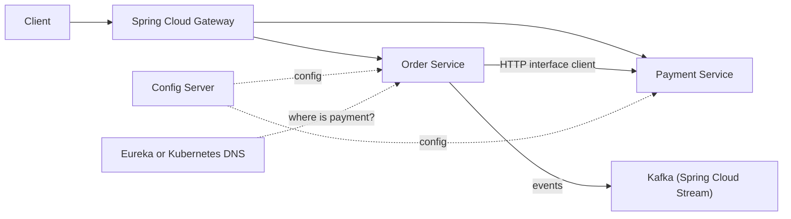

**Say this in the interview:**
> "Spring Cloud is a set of projects for microservice problems. Gateway is the front door. Config gives shared settings. LoadBalancer and discovery find services. Stream does messaging. The old Netflix tools like Zuul, Hystrix and Ribbon are retired. Today I use Spring Cloud Gateway, Resilience4j and Spring Cloud LoadBalancer. On Kubernetes I often skip Eureka and Config Server because the platform gives service DNS and ConfigMaps."

**They may ask next:**
- **Is Spring Cloud needed for microservices?** No. It helps, but on Kubernetes many teams use only Gateway and Resilience4j. The platform does discovery and config.
- **How do you pick the Spring Cloud version?** From the compatibility table on spring.io. The train must match your Boot version.

### Spring Cloud Gateway

**In one line:** Spring Cloud Gateway is an API gateway written in Spring. It matches each request to a route and runs filters before and after sending it to a service.

**Story:** An airport.
- At the entry, security checks your ID. That is an **auth filter**.
- The display board says "Flight AI-101 goes to Gate 12". That is a **route**.
- The rule "if your flight number is AI-101" is a **predicate** (a yes/no check).
- On the way, staff put a tag on your bag and stamp your pass. Those are **filters** (they change the request or response).

**How it works:**
1. A **route** has an id, a target `uri`, a list of **predicates** and a list of **filters**.
2. **Predicates** decide if the route matches. Examples: `Path=/api/orders/**`, `Method=GET`, `Header=X-Client, mobile`, `Weight=group, 10` (send 10% of traffic, used for canary releases).
3. **Filters** change the request or response. Examples: `StripPrefix`, `AddRequestHeader`, `Retry`, `CircuitBreaker`, `RequestRateLimiter`, `TokenRelay`.
4. **Global filters** run for every route. For example: add a request id, log the call.
5. `uri: lb://order-service` means "ask Spring Cloud LoadBalancer for a live instance". `uri: http://order-service:8080` means "use this address" (normal on Kubernetes).

**Diagram:**

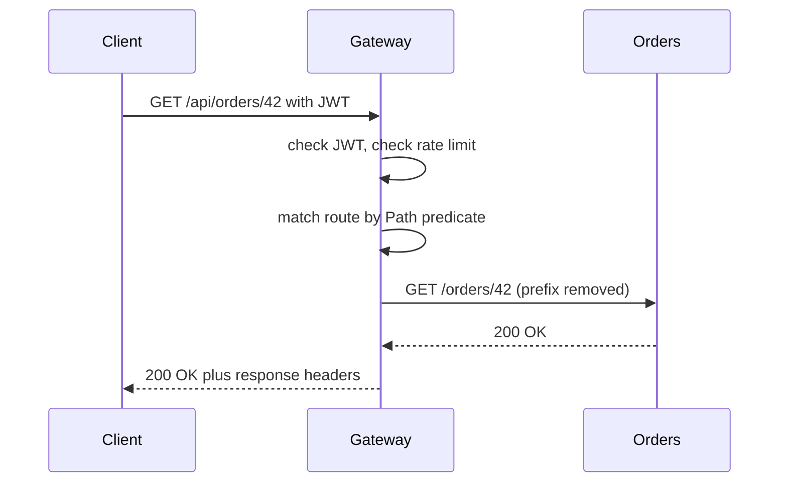

**Two versions of the gateway:**

| | Gateway Server WebFlux | Gateway Server MVC |
|---|---|---|
| Built on | Spring WebFlux and Netty (reactive, non-blocking) | Spring MVC and Tomcat (servlet, blocking) |
| Starter | `spring-cloud-starter-gateway-server-webflux` | `spring-cloud-starter-gateway-server-webmvc` |
| Property prefix (2025.0+) | `spring.cloud.gateway.server.webflux.*` | `spring.cloud.gateway.server.webmvc.*` |
| Rate limiting | Built-in Redis rate limiter | Bucket4j-based `RateLimiter` filter |
| Pick it when | The original, most features, many long-lived connections | Your team knows only MVC. Works well with virtual threads |

Before 2025.0 the prefix was `spring.cloud.gateway.*` (WebFlux) and `spring.cloud.gateway.mvc.*` (MVC). After an upgrade, check that your routes still load. For WebFlux vs MVC in general, see [Spring MVC vs WebFlux](spring.md#spring-mvc-vs-webflux).

**Example 1: routes with the new prefix (WebFlux gateway).** A canary release plus a per-user rate limit.

```yaml
spring:
  cloud:
    gateway:
      server:
        webflux:
          routes:
            - id: orders-v2
              uri: http://order-service-v2:8080
              predicates:
                - Path=/api/orders/**
                - Weight=orders, 10                  # 10% of users try the new version
            - id: orders-v1
              uri: http://order-service:8080
              predicates:
                - Path=/api/orders/**
                - Weight=orders, 90
              filters:
                - StripPrefix=1                      # /api/orders/42 -> /orders/42
                - name: RequestRateLimiter
                  args:
                    redis-rate-limiter.replenishRate: 10   # 10 requests per second
                    redis-rate-limiter.burstCapacity: 20   # short bursts up to 20
                    key-resolver: "#{@userKeyResolver}"    # limit per user
```

**Rate limiting with Redis:**
- It uses a **token bucket**. Each user has a bucket of 20 tokens. It refills 10 tokens per second. Each request takes one token. Empty bucket means HTTP 429 (Too Many Requests).
- The bucket lives in **Redis**, not in gateway memory. So 3 gateway pods share one limit per user.
- You need the reactive Redis starter: `spring-boot-starter-data-redis-reactive`.
- The **key resolver** decides "per what". Per user, per API key, or per IP address.

```java
@Bean
KeyResolver userKeyResolver() {
    return exchange -> exchange.getPrincipal()
            .map(Principal::getName)              // logged-in user name from the JWT
            .defaultIfEmpty("anonymous");         // one shared bucket for anonymous calls
}
```

What if Redis is down? By default the Redis limiter lets requests through (it "fails open"). The site stays up, but without limits for that time. (Check this for your version.)

**Example 2: auth at the gateway.** The gateway checks the JWT (JSON Web Token, a signed login token) once, at the door.

```java
@Bean
SecurityWebFilterChain gatewaySecurity(ServerHttpSecurity http) {
    return http
        .authorizeExchange(ex -> ex
            .pathMatchers("/actuator/health/**").permitAll()
            .anyExchange().authenticated())
        .oauth2ResourceServer(o -> o.jwt(Customizer.withDefaults())) // check signature and expiry
        .build();
}
```

```yaml
spring.security.oauth2.resourceserver.jwt.issuer-uri: https://auth.myshop.com
```

- Bad tokens get 401 at the gateway. Services never see them.
- The gateway forwards the `Authorization` header. Services should **still check** roles and scopes. Do not trust a call only because it came from inside the network.
- Sometimes the gateway itself does the login (OAuth2 client, the BFF style). Then the `TokenRelay` filter puts the user's access token on the call to the service.

**Good and bad:**
| Good | Bad |
|---|---|
| Routes, auth and rate limits in one place | One more network hop (a few ms) |
| Canary releases with the `Weight` predicate | Business logic slowly creeps into filters. Keep it thin |
| Runs on Spring, so the team already knows it | The gateway must be highly available. Run 2+ pods |
| Two flavours: WebFlux or MVC | Property prefix changed in 2025.0. Old configs silently stop working |

**When to use / when not to use:**
- Use it when you have several services behind one public domain and a Java team.
- On Kubernetes, an Ingress controller or a cloud gateway (AWS API Gateway, Kong, Envoy) may already do routing. Then use Spring Cloud Gateway only if you need Java logic in filters.

**Say this in the interview:**
> "Spring Cloud Gateway is our front door. Each route has predicates to match the request and filters to change it. I check the JWT at the gateway and use the Redis rate limiter per user, so all gateway pods share the same limit. Since Spring Cloud 2025.0 there are two flavours, WebFlux and MVC, and the properties moved to `spring.cloud.gateway.server.webflux`. I keep business logic out of the gateway."

**They may ask next:**
- **Why a gateway when we already have a load balancer?** A load balancer only spreads traffic. A gateway also does routing by path, auth, rate limits, header changes and canary splits.
- **Where do you put the circuit breaker?** Both. The gateway has a `CircuitBreaker` filter with a fallback URI. Services also need their own for service-to-service calls. See [Circuit breaker](microservices.md#circuit-breaker).
- **How do you rate limit per tenant?** Write a `KeyResolver` that reads the tenant id from the JWT. Give each plan its own route or limit.

### Spring Cloud Config and secrets

**In one line:** Spring Cloud Config Server gives all services their settings from one place, usually a Git repo. Secrets go in a vault, not in Git.

**Story:** A bank with 200 branches.
- Head office keeps one **rule book**: interest rates, opening hours. Branches read it every morning.
- Change the rate once at head office. All branches follow.
- The **locker keys** are not in the rule book. They are in a safe. Only the manager can open it. That safe is your secrets vault.

**How it works:**
1. Config Server reads a Git repo. Files are named by app and profile: `application.yml` (shared by all), `order-service.yml`, `order-service-prod.yml`.
2. Each service asks the server at startup: "I am `order-service`, profile `prod`. Give me my config."
3. Git gives you history, code review and easy rollback of config changes.
4. Values are read **at startup**. To change them without a restart:
   - Put `@RefreshScope` on a bean, or use `@ConfigurationProperties` (these are re-bound on refresh).
   - Call `POST /actuator/refresh` on the service. The bean is rebuilt with the new value on its next use.
5. With 50 pods, you do not want 50 refresh calls. **Spring Cloud Bus** sends one refresh message to all pods over Kafka or RabbitMQ (`POST /actuator/busrefresh`).

**Diagram:**

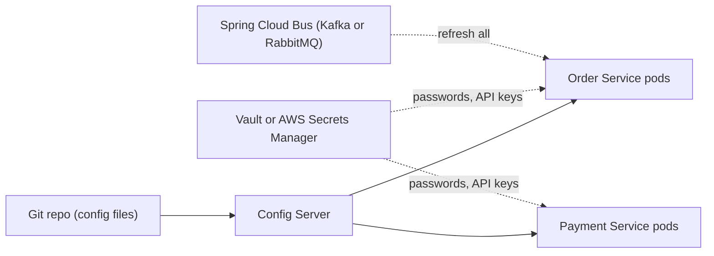

**Example:**

```java
@SpringBootApplication
@EnableConfigServer // this app becomes the config server
public class ConfigServerApp {
    public static void main(String[] args) { SpringApplication.run(ConfigServerApp.class, args); }
}
```

```yaml
# config server
spring.cloud.config.server.git.uri: https://github.com/myshop/config-repo
# each client service
spring.config.import: "optional:configserver:http://config-server:8888"
```

```java
@RestController
@RefreshScope // rebuilt after /actuator/refresh, so it sees the new value
class FeatureController {
    @Value("${feature.new-checkout:false}")
    private boolean newCheckout;

    @GetMapping("/features/new-checkout")
    boolean newCheckout() { return newCheckout; }
}
```

**Not everything can be refreshed.** The server port, the DB connection pool size, and Kafka consumer settings are read once. For those, do a rolling restart. Many teams always do a rolling restart. It is simple and safe.

**On Kubernetes:**
- Teams often skip Config Server. They use **ConfigMaps** (plain settings) and **Secrets** (passwords).
- Give them to the pod as environment variables or as mounted files.
- Spring Boot reads mounted files with `spring.config.import=optional:configtree:/etc/config/`. Each file name becomes a property name.
- Environment variables do not change in a running pod. So a ConfigMap change usually means a rolling restart (Helm or Argo CD can do this for you).
- Spring Cloud Kubernetes can watch ConfigMaps and reload. Most teams do not need it.

**Secrets:**

| Option | How Spring reads it | Note |
|---|---|---|
| HashiCorp Vault | Spring Cloud Vault: `spring.config.import=vault://` | Can create **dynamic DB passwords** that expire after hours |
| AWS Secrets Manager | Spring Cloud AWS: `spring.config.import=aws-secretsmanager:prod/order-db` | Supports automatic password rotation |
| Azure Key Vault / GCP Secret Manager | Spring Cloud Azure / Spring Cloud GCP | Same idea |
| Kubernetes Secret | Env var or `configtree` file | Only base64 encoded, **not encrypted** by default. Turn on encryption at rest and limit who can read them |

Many companies use the **External Secrets Operator**. It copies secrets from Vault or AWS into Kubernetes Secrets. The app just reads a normal file or env var.

**Good and bad:**
| Good | Bad |
|---|---|
| One place to change config for all services | Config Server down at startup means services cannot start (use `optional:` and run 2+ instances) |
| Git history: who changed what, and when | Live refresh can leave pods with different values for a short time |
| Secrets in a vault are audited and can rotate | One more server to run |

**Say this in the interview:**
> "Config lives outside the jar. With Spring Cloud Config, a Git repo is the source and services import it at startup. I can refresh with `@RefreshScope` and Spring Cloud Bus, but for big changes I prefer a rolling restart. On Kubernetes I usually use ConfigMaps and Secrets instead. Passwords never go into Git. They come from Vault or AWS Secrets Manager."

**They may ask next:**
- **How do you refresh config without a restart?** `@RefreshScope` or `@ConfigurationProperties`, then `/actuator/refresh`. For many pods, Spring Cloud Bus with `/actuator/busrefresh`.
- **Are Kubernetes Secrets safe?** Not by default. They are base64, which anyone can decode. Turn on encryption at rest, use RBAC (role-based access), or sync from a real vault.
- **How do you rotate a DB password with no downtime?** Allow two valid passwords for a short time. Update the secret, roll the pods, then remove the old password. Vault dynamic credentials do this for you.

### Service discovery and load balancing

**In one line:** Service discovery answers "where are the live copies of payment-service?". Load balancing picks one of them for each call.

**Story:** Calling a company.
- **Client-side load balancing:** you have a phone book with 3 numbers for the sales team. You pick one yourself. If one does not answer, you try the next.
- **Server-side load balancing:** you call one main number. The receptionist forwards your call to a free person. You never see their numbers.

**How it works:**

*With Eureka (client-side):*
1. Each service instance **registers** with the Eureka server at startup: name, IP, port.
2. It sends a **heartbeat** every 30 seconds. No heartbeat for 90 seconds means it is removed (default values).
3. The caller downloads the list and keeps a copy. It refreshes every 30 seconds.
4. **Spring Cloud LoadBalancer** in the caller picks one instance. The default is round robin (one after another).

*On Kubernetes (server-side):*
1. A Kubernetes **Service** gives a stable DNS name, like `http://payment-service`.
2. Kubernetes keeps the list of **ready** pods behind that name. The readiness probe decides who is ready.
3. kube-proxy (or the network plugin) spreads connections across those pods.
4. Your code just calls `http://payment-service:8080`. No Eureka, no extra library.

**Diagram:**

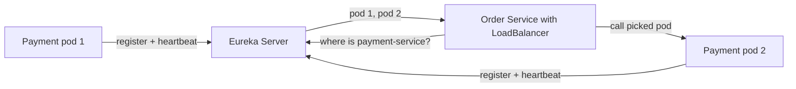

**Example: client-side load balancing with Spring Cloud LoadBalancer.**

```java
@Configuration
class ClientConfig {
    @Bean
    @LoadBalanced // "payment-service" below is a service name, not a host name
    RestClient.Builder loadBalancedBuilder() {
        return RestClient.builder();
    }
}

@Service
class PaymentCaller {
    private final RestClient client;
    PaymentCaller(RestClient.Builder builder) {
        this.client = builder.baseUrl("http://payment-service").build();
    }
    PaymentStatus pay(PaymentRequest req) {
        return client.post().uri("/payments").body(req).retrieve().body(PaymentStatus.class);
    }
}
```

```yaml
eureka.client.service-url.defaultZone: http://eureka:8761/eureka/
```

**Eureka vs Kubernetes:**

| | Eureka + LoadBalancer | Kubernetes Service |
|---|---|---|
| Who keeps the list | Eureka server | Kubernetes control plane |
| Who picks the instance | The caller (client-side) | kube-proxy / network (server-side) |
| Extra servers to run | Yes, Eureka (run 2+ for safety) | No |
| Works outside Kubernetes | Yes (VMs, mixed setups) | No |
| Language | Mostly Java clients | Any language |

**One catch on Kubernetes:** a Service balances **connections**, not requests. HTTP/2 and gRPC keep one connection open for a long time. So one pod can get all the traffic. Fix it with client-side load balancing, a headless Service, or a service mesh (Istio, Linkerd).

**When to use / when not to use:**
- On Kubernetes: you usually do **not** need Eureka. Use Service names.
- Use Eureka (or Consul) on VMs, or when apps run both inside and outside Kubernetes.

**Say this in the interview:**
> "Discovery tells me where the instances are. Load balancing picks one. With Eureka, services register and send heartbeats, and Spring Cloud LoadBalancer in the caller picks an instance. On Kubernetes I don't need Eureka. I call the Service DNS name and Kubernetes routes to ready pods. I only watch out for long-lived HTTP/2 or gRPC connections, which need client-side balancing or a mesh."

**They may ask next:**
- **What replaced Ribbon?** Spring Cloud LoadBalancer. Ribbon was removed in Spring Cloud 2020.0.
- **What happens if Eureka goes down?** Clients keep their cached list and keep working for a while. New instances cannot register until it is back.
- **Client-side or server-side load balancing?** Server-side is simpler and works for any language. Client-side gives more control (retries, zone choice), but every client must have the library.

### OpenFeign vs HTTP interface clients

**In one line:** Both let you write a Java interface for a remote REST API, and Spring creates the HTTP code for you. OpenFeign is the older library. HTTP interface clients are built into Spring Framework.

**Story:** Ordering food.
- You could phone the restaurant and explain your order every time. That is writing `RestClient` code by hand.
- Or you use a **menu card with numbers**. You say "number 12". Someone else does the talking. That is a declarative client: the interface is the menu card.
- OpenFeign is a menu card from an outside company. HTTP interfaces are the restaurant's own menu card.

**Status (checked Nov 2026):**
- **Spring Cloud OpenFeign is feature-complete.** It gets bug fixes and small community changes only. The project page asks new projects to use Spring's HTTP Service Clients.
- **HTTP interfaces** (`@HttpExchange`) came in Spring Framework 6 (Boot 3). They run on `RestClient` (blocking) or `WebClient` (reactive).
- **Boot 4 adds "HTTP Service Clients":** auto-configuration, `@ImportHttpServices`, and properties per group (base URL, timeouts, headers).

**Example 1: OpenFeign (common in existing code).**

```java
@SpringBootApplication
@EnableFeignClients
class OrderApp { }

@FeignClient(name = "inventory-service") // name is looked up via discovery / LoadBalancer
interface InventoryClient {
    @GetMapping("/stock/{sku}")
    Stock stock(@PathVariable String sku);
}
```

**Example 2: HTTP interface client with Boot 4.**

```java
@HttpExchange("/stock")
interface InventoryClient {
    @GetExchange("/{sku}")
    Stock stock(@PathVariable String sku);
}

@Configuration
@ImportHttpServices(group = "inventory", types = InventoryClient.class) // Spring builds the client
class HttpClientsConfig { }
```

```yaml
spring:
  http:
    serviceclient:
      inventory:                         # the group name from @ImportHttpServices
        base-url: http://inventory-service:8080
        connect-timeout: 1s
        read-timeout: 2s                 # always set a timeout
```

Then inject `InventoryClient` anywhere and call `stock("SKU-1")`.

In Boot 3 you build it yourself with `HttpServiceProxyFactory.builderFor(RestClientAdapter.create(restClient)).build().createClient(InventoryClient.class)`.

**Comparison:**

| | OpenFeign | HTTP interface clients |
|---|---|---|
| Part of | Spring Cloud | Spring Framework (no Spring Cloud needed) |
| Status | Feature-complete, bug fixes only | Active, new features in Boot 4 |
| Annotations | Spring MVC ones (`@GetMapping`) | `@HttpExchange`, `@GetExchange`, `@PostExchange` |
| Reactive | No (blocking) | Yes, can return `Mono` / `Flux` with `WebClient` |
| Config in Boot 4 | `spring.cloud.openfeign.*` | `spring.http.serviceclient.<group>.*` |

**Good and bad:**
| Good | Bad |
|---|---|
| Interface is easy to read and to mock in tests | Hides the network: people forget timeouts and retries |
| HTTP interfaces have no extra library | Moving from Feign changes annotations and error handling |
| One interface can be shared as a client SDK | Sharing client jars couples teams. Keep them small |

**Say this in the interview:**
> "Both are declarative HTTP clients: I write an interface and Spring makes the calls. OpenFeign is feature-complete now, so for new code I use HTTP interface clients with `@HttpExchange`. In Boot 4 they are auto-configured with `@ImportHttpServices`, and I set base URL and timeouts in properties. I keep OpenFeign in old services until there is a reason to migrate."

**They may ask next:**
- **How do you add retries and a circuit breaker?** Resilience4j around the call, or `@Retryable` from Spring Framework 7. See [Retry with backoff](microservices.md#retry-with-exponential-backoff-and-jitter) and [Timeouts](microservices.md#timeouts).
- **How do you handle a 404 from the remote service?** Add a status handler on the `RestClient` (for example, map 404 to `Optional.empty()` or your own exception). With Feign, use an `ErrorDecoder`.

### Spring Cloud Stream

**In one line:** Spring Cloud Stream lets you write message code as simple Java functions. A **binder** connects them to Kafka, RabbitMQ or another broker.

**Story:** A post office.
- You write a letter and drop it in the box.
- The post office decides: truck, train or plane. You do not care.
- The **binder** is the post office. The same letter (code) can go by Kafka or by RabbitMQ.

**How it works:**
1. You write plain beans:
   - `Supplier<T>`: produces messages (Spring polls it, every 1 second by default).
   - `Function<In, Out>`: reads a message and sends a new one.
   - `Consumer<T>`: reads messages only.
2. Spring makes **bindings** with names like `createShipment-in-0` (input) and `createShipment-out-0` (output).
3. In properties you map each binding to a topic or queue, and set a consumer **group**.
4. The binder dependency decides the broker: `spring-cloud-stream-binder-kafka` or `spring-cloud-stream-binder-rabbit`.
5. To send from a REST call (not a function), use `StreamBridge.send("orders-out", event)`.

**Example:**

```java
@Configuration
class ShippingFunctions {
    @Bean
    Function<OrderPlaced, ShipmentRequested> createShipment() {
        return order -> new ShipmentRequested(order.orderId(), order.address()); // in -> out
    }

    @Bean
    Consumer<ShipmentRequested> notifyCourier(CourierClient courier) {
        return courier::book; // read only
    }
}
```

```yaml
spring:
  cloud:
    function:
      definition: createShipment;notifyCourier
    stream:
      bindings:
        createShipment-in-0:  { destination: orders, group: shipping }
        createShipment-out-0: { destination: shipments }
        notifyCourier-in-0:   { destination: shipments, group: courier }
```

**Spring Cloud Stream vs plain Spring Kafka:**

| Use Spring Cloud Stream when | Use plain Spring Kafka when |
|---|---|
| You may change brokers, or use both Kafka and RabbitMQ | You use only Kafka, and will stay on it |
| Simple pipelines: read, change, send | You need Kafka features: transactions, manual offsets, seek, headers, batch listeners |
| You like config over code | Your team wants to see exactly what happens |

Many teams start with Stream and later move to Spring Kafka for more control. Both are fine. Pick one style per company.

**Good and bad:**
| Good | Bad |
|---|---|
| Very little code: just functions | Extra layer: harder to debug and tune |
| Same code for Kafka and RabbitMQ | Broker features hide behind binder properties |
| Easy to unit test functions | Binding names like `-in-0` confuse new people |

**Say this in the interview:**
> "Spring Cloud Stream lets me write message handlers as `Function` or `Consumer` beans, and the binder connects them to Kafka or RabbitMQ. Topics and groups go in properties. I use it for simple pipelines. If we are all-in on Kafka and need fine control like transactions or manual offsets, I use Spring Kafka directly."

**They may ask next:**
- **How do you handle a failing message?** Retries with backoff, then a dead letter queue. Both binders support this with properties (for Kafka, `enableDlq`).
- **How do you keep order per customer?** Set a partition key (for example `customerId`). See [Kafka message ordering](kafka.md#kafka-message-ordering).

## Observability with Actuator, Micrometer and OpenTelemetry

**Used by companies for:** finding out fast that something is broken in production, and why: health checks for Kubernetes, dashboards, alerts and request tracing.

**In one line:** Actuator shows the health of your app, Micrometer collects numbers (metrics), and Micrometer Tracing with OpenTelemetry follows one request across many services.

**Story:** A car dashboard.
- The **warning lights** tell you something is wrong (engine, oil). That is **health checks**.
- The **speedometer and fuel gauge** show numbers all the time. That is **metrics**.
- The **trip log** writes down events: "10:05 stopped for fuel". That is **logs**.
- The **GPS history** shows the full route of one trip, street by street. That is a **trace**.

You need all of them. The light tells you "something is wrong". The numbers tell you "how bad". The trip log and GPS tell you "where and why".

**The three pillars:**

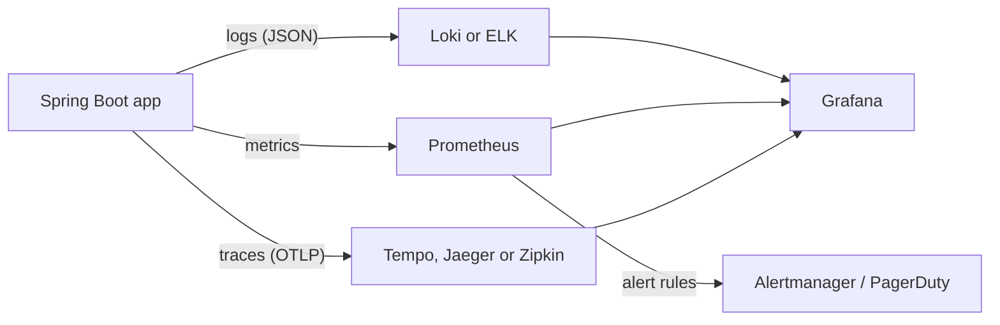

**Actuator endpoints you should know:**

| Endpoint | What it shows | Expose publicly? |
|---|---|---|
| `/actuator/health` | UP or DOWN, plus checks (DB, disk, Redis) | Yes, but hide details |
| `/actuator/health/liveness` | "Is the app alive?" for Kubernetes | Inside the cluster |
| `/actuator/health/readiness` | "Can it take traffic now?" for Kubernetes | Inside the cluster |
| `/actuator/info` | App version, Git commit | Yes |
| `/actuator/metrics` | List of metrics and their values | No |
| `/actuator/prometheus` | All metrics in Prometheus format | Only to Prometheus |
| `/actuator/loggers` | Read and **change log level at runtime** | No (admin only) |
| `/actuator/env`, `/configprops` | Config values (can leak secrets) | **Never** |
| `/actuator/heapdump`, `/threaddump` | Memory and thread dumps | **Never** (heap dump can contain passwords) |

**Securing Actuator:**

```yaml
management:
  server:
    port: 9090                       # separate port, not open to the internet
  endpoints:
    web:
      exposure:
        include: health,info,prometheus   # expose only what you need
  endpoint:
    health:
      show-details: when-authorized  # details only for logged-in admins
```

Also add a Spring Security rule: `/actuator/health/**` and `/actuator/info` are open, everything else under `/actuator/**` needs an admin role.

**Liveness vs readiness (Kubernetes probes):**

| | Liveness | Readiness |
|---|---|---|
| Question | "Are you stuck or dead?" | "Can you serve requests right now?" |
| If it fails | Kubernetes **restarts** the pod | Kubernetes **stops sending traffic**, but does not restart |
| Example | Deadlock, app hangs | Still warming the cache, or shutting down |
| Put the DB check here? | **No** | Maybe, with care |

Why no DB check in liveness? If the DB is down, every pod fails liveness. Kubernetes restarts all of them again and again. The DB is still down, and now your app is down too.

Spring Boot turns on these probes by itself when it runs on Kubernetes. Elsewhere set `management.endpoint.health.probes.enabled=true`.

```yaml
# Kubernetes deployment (part)
livenessProbe:
  httpGet: { path: /actuator/health/liveness, port: 9090 }
  periodSeconds: 10
readinessProbe:
  httpGet: { path: /actuator/health/readiness, port: 9090 }
  periodSeconds: 5
startupProbe:                      # gives a slow app time to start
  httpGet: { path: /actuator/health/liveness, port: 9090 }
  failureThreshold: 30
  periodSeconds: 2
```

**Metrics with Micrometer:**

Micrometer is like SLF4J, but for metrics. You write code once. It can send to Prometheus, Datadog, New Relic, CloudWatch or OTLP.

Three basic types:
- **Counter:** only goes up. "Orders placed: 10,512."
- **Timer:** how long something takes, and how many times. "Payment call: p99 = 800 ms."
- **Gauge:** a value right now, up or down. "Queue size: 37."

```java
@Service
class CheckoutService {
    private final Counter ordersPlaced;
    private final Timer paymentTimer;

    CheckoutService(MeterRegistry registry, OrderQueue queue) {
        this.ordersPlaced = Counter.builder("orders.placed")
                .tag("channel", "web")                  // tags: few values only
                .register(registry);
        this.paymentTimer = Timer.builder("payment.call").register(registry);
        Gauge.builder("orders.queue.size", queue, OrderQueue::size)
                .register(registry);                    // read when Prometheus scrapes
    }

    void checkout(Order order) {
        paymentTimer.record(() -> paymentClient.charge(order)); // measures time
        ordersPlaced.increment();
    }
}
```

- **Do not put user id or order id in a tag.** Each new value creates a new time series. 1 million users means 1 million series. Prometheus will run out of memory. This is called **high cardinality**.
- Spring already gives you many metrics for free: HTTP requests, JVM memory, GC, DB pool, Kafka consumers.
- `@Observed` on a method (Micrometer Observation API) gives you a timer **and** a trace span with one annotation.

**Prometheus and Grafana:**
- Prometheus **pulls** (scrapes) `/actuator/prometheus` every 15 seconds and stores the numbers. Add `micrometer-registry-prometheus`.
- Grafana draws dashboards from Prometheus.
- Alert on what users feel. The **RED** method: **R**ate (requests per second), **E**rrors (error %), **D**uration (p95, p99 latency).

**Tracing: follow one request across services:**

1. The first service creates a **trace id** (one id for the whole request).
2. Each step gets a **span id** (one id per piece of work, like one HTTP call).
3. The trace id travels in an HTTP header called `traceparent` (the W3C standard). It also travels in Kafka headers.
4. Every service sends its spans to a tracing backend. You search by trace id and see the full timeline.

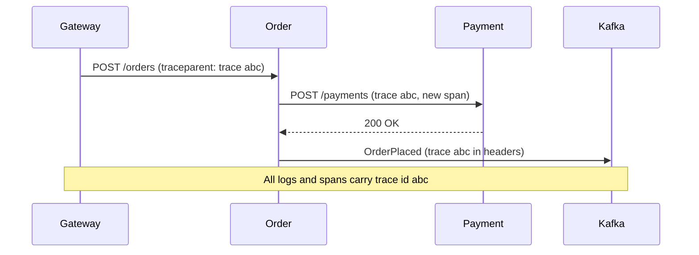

**How to set it up in Spring Boot:**
- **Micrometer Tracing** is the tracing API. It replaced Spring Cloud Sleuth in Boot 3.
- Add a bridge (`micrometer-tracing-bridge-otel` for OpenTelemetry) and an exporter.
- **Boot 4** has a new starter: `spring-boot-starter-opentelemetry`. It brings the OpenTelemetry API, the OTLP metrics registry and the tracing bridge. OTLP is the OpenTelemetry protocol. Most tools (Grafana, Datadog, Honeycomb, New Relic) accept it.
- Use the `RestClient.Builder`, `WebClient.Builder` and `KafkaTemplate` that Spring gives you. A client you build with `new` does not pass the trace header.
- Since Boot 3.2, the trace id and span id are added to every log line by itself.
- Not every request needs a trace. `management.tracing.sampling.probability=0.1` keeps 10% (this is the default).

```yaml
# Boot 4 with spring-boot-starter-opentelemetry
management:
  tracing:
    sampling:
      probability: 0.1                     # keep 10% of traces
  opentelemetry:
    tracing:
      export:
        otlp:
          endpoint: http://otel-collector:4318/v1/traces
  otlp:
    metrics:
      export:
        url: http://otel-collector:4318/v1/metrics
```

Another option is the **OpenTelemetry Java agent** (`-javaagent:opentelemetry-javaagent.jar`). It needs no code. But it changes bytecode at runtime, can break on library upgrades, and does not work with native images. The Spring team suggests the starter.

**Structured logging (Boot 3.4+):**
- Logs as JSON are easy to search in Loki, Elasticsearch or CloudWatch.
- Boot 3.4 added built-in JSON formats: `ecs` (Elastic), `logstash` and `gelf`.

```properties
logging.structured.format.console=ecs
```

One log line then looks like this (shortened):

```json
{"@timestamp":"2026-11-16T10:05:01Z","log.level":"ERROR","message":"Payment failed","service.name":"order-service","traceId":"abc123","spanId":"9f1e"}
```

Now you can search "all ERROR logs with traceId abc123" across 5 services.

**Good and bad:**
| Good | Bad |
|---|---|
| Health probes let Kubernetes heal and route by itself | Exposed Actuator endpoints can leak secrets |
| One trace id links logs, metrics and spans | Tracing every request costs money and storage. Use sampling |
| Micrometer is vendor-neutral: change backend, not code | High-cardinality tags can kill Prometheus |
| JSON logs are easy to search | JSON logs are harder to read by eye on a laptop. Use plain text locally |

**Say this in the interview:**
> "I use Actuator for health, with separate liveness and readiness probes for Kubernetes. I never put the DB check in liveness. Micrometer gives me counters, timers and gauges, scraped by Prometheus and shown in Grafana, and I alert on rate, errors and latency. For tracing I use Micrometer Tracing with OpenTelemetry. The trace id goes in the `traceparent` header and into every JSON log line, so I can follow one request across all services."

**They may ask next:**
- **How do you trace a request across 5 services?** Micrometer Tracing with the OpenTelemetry bridge. Spring-built clients pass the `traceparent` header. Each service exports spans by OTLP to Tempo or Jaeger. Search by trace id.
- **Your p99 latency doubled. What do you check?** Grafana: which endpoint? Then traces for slow requests: which span is slow? Then DB pool metrics, GC pauses, and the downstream service.
- **Logs, metrics or traces: which first?** Metrics and alerts tell you **that** something is wrong. Traces tell you **where**. Logs tell you **why**.

## Messaging with Spring Kafka and Spring AMQP

**Used by companies for:** sending events between services without waiting: order placed, payment done, send email, update search index.

**In one line:** Spring Kafka (`KafkaTemplate`, `@KafkaListener`) and Spring AMQP for RabbitMQ (`RabbitTemplate`, `@RabbitListener`) let you send and receive messages with very little code.

**Story:**
- **Kafka is like a newspaper archive.** Every edition is kept for days. Many readers read at their own speed. A new reader can start from last week.
- **RabbitMQ is like a post office.** Letters are sorted into boxes by address. A letter is gone once someone picks it up.

For Kafka basics, partitions and delivery guarantees, see [Kafka basics in simple words](kafka.md#kafka-basics-in-simple-words) and [Kafka delivery guarantees](kafka.md#kafka-delivery-guarantees). Here we focus on the Spring code.

**Spring Kafka example:**

```java
@Service
class OrderEvents {
    private final KafkaTemplate<String, OrderPlaced> kafka;
    OrderEvents(KafkaTemplate<String, OrderPlaced> kafka) { this.kafka = kafka; }

    void publish(OrderPlaced event) {
        kafka.send("orders", event.orderId(), event)   // key = orderId keeps order per order
             .whenComplete((result, ex) -> {
                 if (ex != null) log.error("Send failed for {}", event.orderId(), ex);
             });
    }
}

@Component
class ShippingListener {
    @KafkaListener(topics = "orders", groupId = "shipping")
    void onOrder(OrderPlaced event) {
        shipping.create(event);   // if this throws, the error handler retries
    }
}
```

- `send` returns a `CompletableFuture`. Check the result. A "fire and forget" send can lose messages silently.
- Error handling: Spring Kafka's `DefaultErrorHandler` retries with backoff, then can send to a dead letter topic (DLT). For non-blocking retries use `@RetryableTopic`. Details and code are in [Handling duplicate events](kafka.md#handling-duplicate-events).
- To save to the DB and publish safely together, use the [Transactional outbox pattern](microservices.md#transactional-outbox-pattern).

**Spring AMQP (RabbitMQ) example:**

```java
@Configuration
class RabbitConfig {
    @Bean Queue emailQueue() {
        return QueueBuilder.durable("email")
                .deadLetterExchange("email.dlx")   // failed messages go here
                .build();
    }
    @Bean TopicExchange notifications() { return new TopicExchange("notifications"); }
    @Bean Binding emailBinding(Queue emailQueue, TopicExchange notifications) {
        return BindingBuilder.bind(emailQueue).to(notifications).with("email.*");
    }
}

// sending
rabbitTemplate.convertAndSend("notifications", "email.welcome", new WelcomeEmail(userId));

// receiving
@RabbitListener(queues = "email")
void send(WelcomeEmail msg) { mailer.sendWelcome(msg.userId()); }
```

- In RabbitMQ you send to an **exchange** with a **routing key**. The exchange copies the message to matching **queues**.
- Exchange types: **direct** (exact key), **topic** (patterns like `email.*`), **fanout** (to all queues).
- With Boot 4 you get Spring Kafka 4 and Spring AMQP 4.

**Kafka or RabbitMQ?**

| Need | Pick |
|---|---|
| Event stream that many services read, replay old events | Kafka |
| Very high volume (100k+ messages per second), keep for days | Kafka |
| Simple job queue: "send this email", "resize this image" | RabbitMQ |
| Smart routing by key, per-message TTL, priorities | RabbitMQ |
| Strict order per key | Kafka (per partition) |

**Say this in the interview:**
> "With Spring Kafka I send with `KafkaTemplate`, using the business id as the key to keep order, and I check the send result. I read with `@KafkaListener` and use `DefaultErrorHandler` or `@RetryableTopic` with a dead letter topic. With RabbitMQ I use `RabbitTemplate` to an exchange and `@RabbitListener` on a queue with a dead letter exchange. I pick Kafka for event streams and replay, and RabbitMQ for simple task queues and routing."

**They may ask next:**
- **How do you make the consumer safe for duplicates?** Make it idempotent. See [Idempotency](microservices.md#idempotency).
- **How many listener threads?** `concurrency` on `@KafkaListener`, but never more than the number of partitions. Extra threads sit idle.

## Spring Batch

**Used by companies for:** large jobs that run on a schedule: end-of-day bank statements, billing, data import and export, nightly reports, data migration.

**In one line:** Spring Batch processes large amounts of data in small chunks, saves progress, and can restart from where it failed.

**Story:** A bank prints end-of-day statements.
- There are 2 million accounts. The job runs at night.
- For each account: read it, calculate interest, write a statement.
- At account 1,200,000 the database goes down.
- A good system restarts from account 1,200,000. It does **not** start again from 1, and it does **not** send 1.2 million customers a second statement.

That is what Spring Batch gives you.

**How it works:**
1. A **Job** is the whole work ("statementJob"). It has one or more **Steps**.
2. A **chunk step** has three parts:
   - **ItemReader:** reads one item (from DB, CSV, Kafka).
   - **ItemProcessor:** changes or filters it (calculate interest).
   - **ItemWriter:** writes a list of items together (to DB, file).
3. Chunk size 1000 means: read and process 1000 items, write them, **commit**. Then the next 1000.
4. After each commit, progress is saved in the **JobRepository** (batch tables in the DB).
5. If the job fails, you run it again with the **same parameters**. It starts from the last committed chunk.
6. A **JobInstance** = job name + parameters (for example `date=2026-11-15`). If that instance already finished, Spring Batch will not run it again. This stops double statements.
7. A **tasklet step** is for one simple task, like "delete temp files".

**Diagram:**

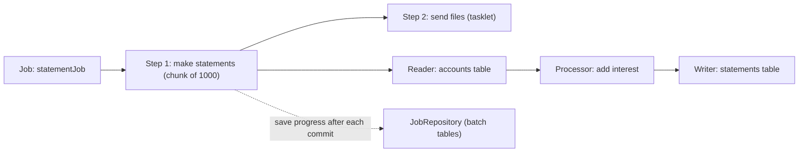

**Example (Boot 3 / Batch 5 style, still the most common in tutorials):**

```java
@Configuration
class StatementJobConfig {
    @Bean
    Job statementJob(JobRepository repo, Step makeStatements) {
        return new JobBuilder("statementJob", repo).start(makeStatements).build();
    }

    @Bean
    Step makeStatements(JobRepository repo, PlatformTransactionManager tx,
                        ItemReader<Account> reader, ItemWriter<Statement> writer) {
        return new StepBuilder("makeStatements", repo)
                .<Account, Statement>chunk(1000, tx)       // commit every 1000 accounts
                .reader(reader)
                .processor(account -> account.isClosed() ? null : Statement.of(account)) // null = skip item
                .writer(writer)
                .faultTolerant()
                .skip(BadDataException.class).skipLimit(10) // allow 10 bad rows, then fail
                .build();
    }
}
```

**Spring Batch 6 with Boot 4 (checked Nov 2026):**
- `JobOperator` now does the job of `JobLauncher` too. You need fewer beans.
- A new chunk step (`ChunkOrientedStepBuilder`). Retry now uses Spring Framework 7 retry, and skip uses `SkipPolicy`. Check the migration guide when you upgrade.
- `JobOperator.recover(...)` recovers a failed job execution. Before, people fixed the batch tables with manual SQL.
- Graceful shutdown: a stopping job leaves the repository in a state that can restart.
- **The default job repository keeps no history.** To restart after a crash you need a real store. In Boot 4 add the JDBC batch starter (`spring-boot-starter-batch-jdbc`). Boot 4.1 also supports MongoDB.

**Scaling a big job:**
- **Multi-threaded step:** chunks run on several threads. Simple. But the reader must be thread-safe, and restart is harder.
- **Partitioning:** a manager step splits the data, for example account ids 1 to 200,000, 200,001 to 400,000, and so on. Each **partition** runs as its own worker step. Workers run on threads (local) or on other machines (remote partitioning over messaging). Each partition restarts on its own.
- Example: 2 million accounts at 500 per second takes about 67 minutes. With 10 partitions, about 7 minutes (if the DB can handle it).

**Spring Batch or `@Scheduled`?**

| Use `@Scheduled` | Use Spring Batch |
|---|---|
| Small, quick task: clear a cache, send 50 reminders | Millions of rows |
| OK to just run again from the start | Must restart from where it failed |
| No need for history | Need a record: when it ran, how many rows, what failed |
| One method is enough | Read, process, write with skip and retry rules |

If `@Scheduled` runs on 3 pods, it runs 3 times. Use **ShedLock** so only one pod runs it.

**How do you start a batch job?** A Kubernetes **CronJob** that starts the Boot app (it runs the job and exits) is common. Or a scheduler (Quartz, a `@Scheduled` method, or a workflow tool) calls `JobOperator`.

**Good and bad:**
| Good | Bad |
|---|---|
| Restart from the last commit | Many classes and tables for a small job |
| Built-in skip, retry and history | Batch tables must be cleaned up over time |
| Partitioning for large data | Hard to debug if chunk size and transactions are wrong |

**Say this in the interview:**
> "Spring Batch is for big, restartable jobs like end-of-day statements. A job has steps; a chunk step reads, processes and writes, and commits every N items. Progress is saved in the JobRepository, so after a failure it restarts from the last commit, and the same job parameters cannot run twice. For scale I use partitioning by id range. For a small task I just use `@Scheduled` with ShedLock."

**They may ask next:**
- **What chunk size?** Start with 100 to 1000. Too small means many commits (slow). Too big means a long transaction and big rollbacks. Measure.
- **What if the processor calls a slow API?** Batch the calls, add a timeout, or use `AsyncItemProcessor` to run them in parallel.
- **How do you avoid reading changed data during the job?** Read a snapshot: filter by a cut-off time, or copy the data to a staging table first.

## Spring Modulith

**Used by companies for:** building a **modular monolith**: one deployable app with clear walls between business modules, so it can be split into microservices later if needed.

**In one line:** Spring Modulith treats each top-level package as a module. A test checks that modules respect each other's walls. Modules talk through events.

**Story:** A house with rooms.
- The kitchen, bedroom and office are in one house (one app).
- Each room has walls and a door. The cook does not walk into the bedroom and open the cupboard. He knocks on the door (public API) or leaves a note (an event).
- If one day the office must move to a new building (a microservice), it is easy. It was already a separate room.

For the general idea of monolith vs microservices, see [Monolith vs microservices](microservices.md#monolith-vs-microservices).

**How it works:**
1. **Modules = packages.** Each direct sub-package of your main package is a module: `com.shop.order`, `com.shop.inventory`, `com.shop.shipping`.
2. Classes in the module's top package are its **public API**. Sub-packages like `com.shop.order.internal` are **hidden** from other modules.
3. A test calls `ApplicationModules.of(ShopApp.class).verify()`. It fails if a module uses another module's internal classes, or if modules depend on each other in a circle.
4. Modules talk with **application events**. Order publishes `OrderPlaced`. Inventory and Shipping listen. Order does not know who listens.
5. `@ApplicationModuleListener` = run **after the transaction commits**, **async**, in a **new transaction**.
6. **Event publication registry:** when an event is published, Modulith saves it in a DB table in the same transaction. When the listener finishes, it marks it done. If the app crashes, unfinished events can be sent again on restart. This works like an [outbox](microservices.md#transactional-outbox-pattern).
7. With `@Externalized("orders")` on the event, Modulith can also send it to Kafka or RabbitMQ.
8. `@ApplicationModuleTest` starts only one module in a test. Faster tests.
9. It can also generate module diagrams for documentation.

**Diagram:**

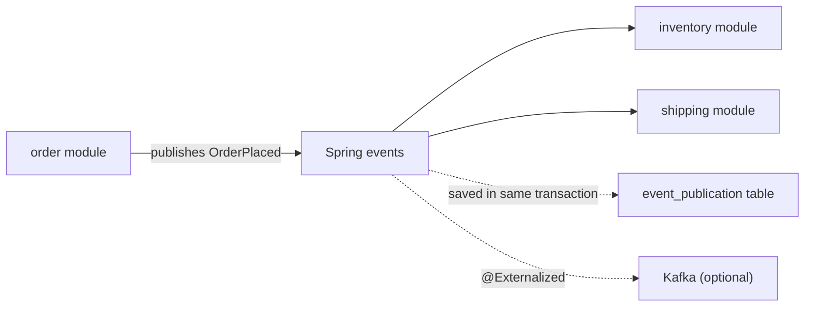

**Example:**

```java
// com.shop.order (public API of the order module)
public record OrderPlaced(long orderId, List<Long> productIds) { }

@Service
class OrderService {
    private final ApplicationEventPublisher events;
    OrderService(ApplicationEventPublisher events) { this.events = events; }

    @Transactional
    public void place(Order order) {
        orders.save(order);
        events.publishEvent(new OrderPlaced(order.id(), order.productIds())); // saved with the order
    }
}
// com.shop.inventory
@Component
class StockListener {
    @ApplicationModuleListener // after commit, async, new transaction
    void on(OrderPlaced event) { stock.reserve(event.productIds()); }
}

// test: fails the build on bad access between modules
@Test void modulesAreOk() { ApplicationModules.of(ShopApp.class).verify(); }
```

**Version (checked Nov 2026):** Spring Modulith 2.0 came out with Boot 4 (Nov 2025). The event registry was reworked in 2.0. Add a starter like `spring-modulith-starter-jpa` or `spring-modulith-starter-jdbc` to store events.

**Good and bad:**
| Good | Bad |
|---|---|
| One app: easy to deploy, debug and run transactions | Still one deploy: one bad module can crash all |
| Walls are checked by a test, not by hope | Teams must agree on module boundaries early |
| Events keep modules loosely coupled | Async events mean eventual consistency inside one app |
| Easy path to microservices later | Scaling is for the whole app, not one module |

**When to use / when not to use:**
- Use for new products, small to medium teams (under ~50 engineers), and unclear domain boundaries.
- Not enough when parts need very different scaling, different languages, or separate release cycles.

**Say this in the interview:**
> "A modular monolith is one deployable app split into modules with strict walls. Spring Modulith uses packages as modules, and a `verify()` test fails the build if one module touches another's internals. Modules talk with events using `@ApplicationModuleListener`. The event publication registry saves events in the DB like an outbox, so nothing is lost on a crash. Later, a module can become a microservice with less pain."

**They may ask next:**
- **Why not start with microservices?** Microservices add network calls, distributed transactions and more ops work. Start modular, split when a real need appears (scale, team size).
- **What happens if a listener fails?** The publication stays "incomplete" in the table. You can resubmit it on restart or with a scheduled job.

## Spring AI

**Used by companies for:** adding AI features to Java apps: support chatbots, summarizing documents, search over company documents, pulling fields out of emails or invoices.

**In one line:** Spring AI is a Spring library that talks to many AI models (OpenAI, Anthropic, Ollama and others). You use one simple Java API, in the normal Spring style.

**Story:** A translator at a business meeting.
- You speak only Java. The AI models each speak their own API language.
- The translator (Spring AI) sits in the middle. You talk to the translator in the same way every time.
- Want to change from OpenAI to Anthropic, or to a local model? Change the translator's settings, not your whole code.

**Versions (checked Nov 2026):**
- **Spring AI 2.0** went GA in June 2026. It needs Spring Boot 4.0 or 4.1. 2.0.x is the current stable line. 2.1 is in preview.
- **Spring AI 1.x** (1.0 GA in May 2025) is for Spring Boot 3.
- 1.x to 2.0 has breaking changes (Jackson 3, new option builders, tool calling moved into an advisor).

**Main parts:**

| Part | What it does |
|---|---|
| `ChatClient` | Main API: send a prompt, get text or a Java object back |
| Prompt template | A prompt with `{placeholders}` filled at runtime |
| Structured output | Turn the answer into a Java record |
| Tool calling | Let the model ask your app to run a Java method (for example "get order status") |
| Advisors | Add behaviour around a call: memory, RAG, logging, checks |
| Chat memory | Remember earlier messages in a conversation |
| `VectorStore` | Store and search documents by meaning (for RAG) |
| MCP | A standard way to share tools between AI apps |

**Example 1: a simple ChatClient.**

```java
@RestController
class SupportController {
    private final ChatClient chat;

    SupportController(ChatClient.Builder builder) {
        this.chat = builder
                .defaultSystem("You are a support assistant for an online shop. Answer in max 3 sentences.")
                .build();
    }

    @GetMapping("/support/ask")
    String ask(@RequestParam String question) {
        return chat.prompt().user(question).call().content(); // send, wait, get text
    }
}
```

```yaml
spring.ai.anthropic.api-key: ${ANTHROPIC_API_KEY}   # never hard-code keys
```

**Example 2: prompt template and structured output to a record.**

```java
record ReviewSummary(String sentiment, List<String> problems, boolean needsReply) { }

ReviewSummary summary = chat.prompt()
        .user(u -> u.text("Summarize this product review in {lang}: {review}")
                    .param("lang", "English")
                    .param("review", reviewText))
        .call()
        .entity(ReviewSummary.class); // Spring AI asks for JSON and maps it to the record
```

Models sometimes return bad JSON. In 2.0, `StructuredOutputValidationAdvisor` can check the JSON and ask the model to try again.

**Example 3: tool calling.**

```java
class OrderTools {
    @Tool(description = "Get the status of an order by its id")
    String orderStatus(@ToolParam(description = "order id, like ORD-123") String orderId) {
        return orderService.status(orderId); // your normal Java code
    }
}

String answer = chat.prompt()
        .user("Where is my order ORD-123?")
        .tools(new OrderTools())   // the model may call orderStatus(...)
        .call()
        .content();
```

How it works: the model does **not** run your code. It replies "please call `orderStatus` with `ORD-123`". Spring AI calls the method, sends the result back, and the model writes the final answer.

Be careful with tools that **change** data (cancel order, refund). Check the user's rights in the Java method. Ask the user to confirm big actions.

**RAG (Retrieval Augmented Generation):**

The model does not know your company's documents. RAG means: first **find** the right pieces of your documents, then **add** them to the prompt.

- An **embedding** is a list of numbers that stands for the meaning of a text. Similar meanings give similar numbers.
- A **vector database** stores these numbers and finds the closest ones fast. Examples: PGVector (PostgreSQL), Redis, Elasticsearch, MongoDB Atlas.

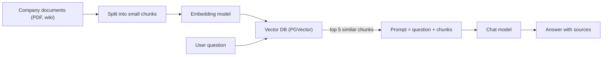

```java
// once: load documents (often a batch job)
vectorStore.add(new TokenTextSplitter().apply(new TikaDocumentReader(pdf).get()));

// every question
String answer = chat.prompt()
        .advisors(QuestionAnswerAdvisor.builder(vectorStore).build()) // search, then add chunks to prompt
        .user(question)
        .call()
        .content();
```

For more control, Spring AI also has `RetrievalAugmentationAdvisor` (module `spring-ai-rag`). By default it tells the model not to answer when no matching document is found. That reduces made-up answers.

**Chat memory:**
- The model forgets everything between calls. Every call is new.
- `MessageChatMemoryAdvisor` adds the earlier messages of the same conversation id to each call.
- Store memory in a DB (for example the JDBC chat memory repository). Keep only the last N messages, because every message costs tokens.

**MCP (Model Context Protocol):**
- MCP is an open standard to connect AI apps to tools and data. Think of it as a **USB port for AI tools**.
- Spring AI has MCP **client** starters (use tools from other MCP servers) and MCP **server** starters (share your Java tools).
- In 2.0 you can write a server tool with `@McpTool`. The default transport is Streamable HTTP.

**Providers:** OpenAI, Anthropic, Amazon Bedrock, Google GenAI, Mistral AI, DeepSeek, Ollama (runs models on your own machine), and any OpenAI-compatible endpoint. Each is a separate starter.

**Interview angle: "How would you add an AI feature safely?"**

| Risk | What I do |
|---|---|
| **Cost** | Tokens cost money. 10,000 questions a day x 3,000 tokens = 30 million tokens a day. At an example price of $3 per million, that is $90 a day. Set max tokens, use a smaller model for easy tasks, cache common answers, show cost on a dashboard |
| **Latency** | Calls take 1 to 20 seconds. Stream the answer (`.stream().content()` gives a `Flux`), set timeouts, never call the model inside a DB transaction |
| **Failures** | Provider down or rate-limited (HTTP 429). Retry a little with backoff, then a fallback ("Our assistant is busy, here is the FAQ") |
| **Wrong answers** | Use RAG with sources, structured output, and a test set of real questions to check quality before each release |
| **Prompt injection** | A user (or a document) writes "ignore your rules". Treat model output as untrusted input. Tools check permissions in Java, not in the prompt |
| **Private data** | Do not send passwords, card numbers or personal data you do not need. Mask it first. Check the provider's data rules, or use a local model (Ollama) for sensitive data |
| **Visibility** | Spring AI sends Micrometer metrics and traces (token usage, time per call). Log prompts carefully, without personal data |

**Good and bad:**
| Good | Bad |
|---|---|
| One API for many models | Models change fast. Keep upgrades small and test often |
| Spring style: starters, properties, beans, advisors | Easy to start, hard to make answers reliable |
| Tools, RAG and memory are built in | Costs and latency are new production problems for Java teams |

**Say this in the interview:**
> "Spring AI gives one Java API, `ChatClient`, for many models like OpenAI, Anthropic and Ollama. I use prompt templates, map answers to records with structured output, and let the model call Java methods with `@Tool`. For company data I use RAG: documents go into a vector store, and `QuestionAnswerAdvisor` adds the best chunks to the prompt. In production I set timeouts and token limits, add a fallback, never send private data I don't need, and treat model output as untrusted."

**They may ask next:**
- **What is RAG?** Retrieval Augmented Generation. Find the right document chunks by meaning in a vector DB, add them to the prompt, and the model answers from them. It is cheaper and faster to update than training a model.
- **RAG or fine-tuning?** RAG for facts that change (policies, product data). Fine-tuning for style or a special format. Most business apps need only RAG.
- **How do you test an AI feature?** A fixed set of questions with expected answers or rules. Run it in CI. Check format with structured output, and check facts against sources.

## Spring GraphQL

**Used by companies for:** APIs where web and mobile screens need different shapes of data, often with nested data (orders with items with products).

**In one line:** With GraphQL the client asks for exactly the fields it needs in one request. Spring for GraphQL maps those fields to your Java methods.

**Story:** A fixed thali vs a buffet.
- **REST** is a fixed thali. Each endpoint gives you a full plate. Sometimes too much food, sometimes you must order a second plate (a second call).
- **GraphQL** is a buffet. You pick exactly what you want on one plate, in one trip.

**How it works:**
1. You write a schema file: `src/main/resources/graphql/schema.graphqls`.
2. `@QueryMapping` connects a top-level query to a method.
3. `@SchemaMapping` connects a nested field (like `Order.customer`) to a method.
4. All calls go to one URL: `POST /graphql`.

**The N+1 problem:** a query asks for 50 orders and the customer of each. Without care, Spring calls `customer(order)` 50 times. That is 1 query for orders + 50 calls for customers = 51 calls. **`@BatchMapping`** gets all 50 orders at once, so you load all customers in **one** call.

**Example:**

```graphql
type Query { recentOrders(limit: Int): [Order] }
type Order { id: ID!, total: Float, customer: Customer }
type Customer { id: ID!, name: String }
```

```java
@Controller
class OrderGraphqlController {
    @QueryMapping
    List<Order> recentOrders(@Argument int limit) { return orderRepo.findRecent(limit); }

    @BatchMapping // one call for all orders, not one per order
    Map<Order, Customer> customer(List<Order> orders) {
        Map<Long, Customer> byId = customerClient.findByIds(orders.stream().map(Order::customerId).toList());
        return orders.stream().collect(Collectors.toMap(o -> o, o -> byId.get(o.customerId())));
    }
}
```

**GraphQL or REST?**

| Pick GraphQL | Pick REST |
|---|---|
| Many client types need different fields | Simple CRUD API |
| Deep, nested data in one screen | You want HTTP caching by URL (CDN) |
| Fast-changing front end | Public API for many outside users |
| | File upload and download |

**Watch out:** limit query depth and complexity, or one big query can overload your service. Errors come back with HTTP 200 and an `errors` field, so monitoring needs care. Boot 4 comes with Spring for GraphQL 2.0.

**Say this in the interview:**
> "GraphQL lets the client ask for exactly the fields it needs in one request. In Spring for GraphQL I use `@QueryMapping` for queries and `@SchemaMapping` for nested fields. To avoid the N+1 problem I use `@BatchMapping`, which loads all children in one call. I pick GraphQL when many screens need different data shapes, and REST for simple or public APIs."

**They may ask next:**
- **How do you secure it?** Normal Spring Security on `/graphql`, plus `@PreAuthorize` on methods, plus query depth and complexity limits.
- **How do you version a GraphQL API?** Usually you do not. Add new fields, mark old ones `@deprecated`, and remove them after clients move.

## Spring Session

**Used by companies for:** keeping users logged in when the app runs on many servers, mostly for server-rendered web apps and BFFs.

**In one line:** Spring Session stores the HTTP session in a shared store like Redis or a database, so any server can serve any user.

**Story:** A restaurant with many waiters.
- **Sticky sessions:** you always get the same waiter, because only he remembers your order. If he goes home, your order is lost.
- **Shared store:** every order is written in one central book. Any waiter can serve you.

**How it works:**
1. Without Spring Session, the session lives in the memory of one server. If that pod restarts, the user is logged out.
2. **Sticky sessions** (the load balancer sends a user always to the same pod) help, but scaling down or a crash still loses sessions.
3. With Spring Session, the session data goes to **Redis** or **JDBC**. The browser only keeps a `SESSION` cookie with the id.
4. Your code does not change. You still use `HttpSession` or Spring Security as before.

**Example:** add `spring-session-data-redis` and Redis settings. Then:

```properties
spring.session.timeout=30m
spring.data.redis.host=redis
```

**Boot 4 note:** Boot 4 uses Spring Session 4.0 and supports Redis and JDBC. Support for Hazelcast and MongoDB sessions moved to those vendors. The Redis session properties moved from `spring.session.redis.*` to `spring.session.data.redis.*`.

**Good and bad:**
| Good | Bad |
|---|---|
| Any pod can serve any user. Restarts do not log users out | Redis becomes a must-have dependency. Run it highly available |
| No sticky sessions needed | Every request reads the session from Redis (about 1 ms) |
| Can list and end a user's sessions ("log out all devices") | Keep session data small. No big objects |

**Say this in the interview:**
> "With many pods, in-memory sessions break when a pod dies, and sticky sessions only hide the problem. Spring Session moves the session to Redis or a database, and the browser only keeps the session id cookie. For pure REST APIs I prefer stateless JWT tokens and no session at all."

## API documentation with springdoc-openapi

**Used by companies for:** giving other teams and partners up-to-date API docs and a "try it" page.

**In one line:** springdoc-openapi reads your Spring controllers and creates an OpenAPI document and a Swagger UI page automatically.

**Story:** A restaurant menu that is printed from the kitchen's real recipe book. When the kitchen changes a dish, the menu changes too. Nobody forgets to update it.

**How it works:**
1. Add `springdoc-openapi-starter-webmvc-ui` (or the `webflux` one). Use **springdoc 3.x for Boot 4** and 2.x for Boot 3.
2. Open `/swagger-ui.html` for the page and `/v3/api-docs` for the JSON.
3. Add details with annotations: `@Operation(summary = "...")`, `@Schema(example = "...")`, `@ApiResponse`.
4. Bean Validation annotations (`@NotNull`, `@Size`) show up in the docs too.

```java
@Operation(summary = "Get one order by id")
@ApiResponse(responseCode = "404", description = "Order not found")
@GetMapping("/orders/{id}")
OrderDto get(@PathVariable long id) { return service.find(id); }
```

```properties
# often turned off in production
springdoc.swagger-ui.enabled=false
```

**Code-first or contract-first?**

| Code-first (springdoc) | Contract-first (OpenAPI Generator) |
|---|---|
| Write code, docs are made from it | Write the `openapi.yaml` first, generate interfaces and DTOs |
| Fast for internal APIs | Good for public or partner APIs, and when front end and back end start together |
| Docs always match the code | The contract is reviewed before any code |
| Risk: you change the API by accident | Risk: generated code can be ugly |

Many teams also run an OpenAPI diff check in CI. It fails the build on a breaking change (a removed field, a new required field).

**Say this in the interview:**
> "I use springdoc-openapi to generate OpenAPI docs and Swagger UI from the controllers, version 3 for Boot 4. For internal APIs, code-first is fast. For public or partner APIs I prefer contract-first: we agree on the OpenAPI file, then generate code. A CI check catches breaking changes."

## Faster startup: native images, AOT, CDS and CRaC

**Used by companies for:** serverless functions, scale-to-zero services, CLIs, and saving memory when running hundreds of small services.

**In one line:** These tools make a Spring app start faster and use less memory. They do work at build time, or reuse a saved state.

**Story:** Making tea for guests.
- **Normal JVM:** boil water, add tea leaves, wait. It takes a few minutes every time.
- **CDS / AOT cache:** you keep the cups, tea and sugar ready on a tray. Faster, same tea.
- **Native image:** you made the tea in the morning and kept it in a flask. Pour in 1 second. But you cannot change the recipe now.
- **CRaC:** you pause a fully made tea "in time" and un-pause it later, still hot.

**The options:**

| Option | What it does | Startup (rough, small app) | Catch |
|---|---|---|---|
| Normal JVM | Loads and compiles at runtime | 2 to 5 s | Slow start, more memory |
| CDS / JVM AOT cache | Saves loaded classes (and more) in a file from a training run | About 30 to 50% faster | Same JDK and same classpath needed |
| GraalVM native image | Compiles the app to a machine binary at build time | Under 0.1 to 0.3 s, much less memory | Long build (minutes), limits on reflection |
| CRaC | Takes a snapshot of a warmed-up running JVM, restores it | Tens of ms | Linux only, special JDK, secrets may be in the snapshot |

(These numbers are rough. Always measure your own app.)

**How it works:**

*Spring AOT (ahead-of-time processing):*
1. At build time, Spring runs your configuration and works out all beans.
2. It writes Java code for those beans and **hints** (a list of classes used by reflection).
3. Native images need this. The JVM can use it too (`-Dspring.aot.enabled=true`).
4. The catch: the bean setup is fixed at build time. A `@Profile` or `@ConditionalOnProperty` that changes beans at runtime will not work as expected.

*GraalVM native image:*
1. Build: `./mvnw -Pnative native:compile` (a binary) or `./mvnw -Pnative spring-boot:build-image` (a container).
2. It uses a "closed world": only code it can see at build time is included. Reflection, dynamic proxies and resources need hints. Spring and most big libraries ship them.
3. Boot 4 needs GraalVM 25 or newer for native images.
4. Peak speed after warm-up is often a bit lower than the JVM's JIT (the just-in-time compiler that optimizes hot code).

*CDS and the JVM AOT cache:*
1. CDS (Class Data Sharing) saves parsed classes in a file. Boot has supported it since 3.3.
2. Java 24 added the **AOT cache** ([JEP 483](https://openjdk.org/jeps/483), Ahead-of-Time Class Loading and Linking). It also saves loaded and linked classes. Java 25 made it easier to create (JEP 514) and adds method profiles (JEP 515).
3. You do a **training run**: start the app, Spring exits right after startup, the JVM writes the cache.
4. Spring recommends the AOT cache over CDS on Java 24+.

```bash
java -Djarmode=tools -jar app.jar extract --destination app       # unpack the jar first
java -XX:AOTCacheOutput=app.aot -Dspring.context.exit=onRefresh -jar app/app.jar  # training run (Java 25)
java -XX:AOTCache=app.aot -jar app/app.jar                          # fast start
```

*CRaC (Coordinated Restore at Checkpoint):* one line: take a snapshot of a running, warmed-up JVM and restore it in milliseconds. Spring supports it since Framework 6.1 / Boot 3.2. It needs a CRaC JDK (like Azul Zulu or BellSoft Liberica) on Linux.

**When it matters:**
- **Serverless** (AWS Lambda, Cloud Run): you pay per ms, and cold starts hurt users.
- **Scale to zero:** a service with no traffic at night must start fast on the first request.
- **Many small services:** 200 services x 300 MB less memory = 60 GB saved.
- It does **not** matter much for a big service that starts once a week and runs on many pods.

**Good and bad:**
| Good | Bad |
|---|---|
| Native: very fast start, low memory, small container | Native: build takes minutes, more testing needed |
| AOT cache: no code change, normal JVM | AOT cache: training run in the build, same JDK needed |
| CRaC: fastest restore with JIT-warm code | CRaC: Linux only, careful with secrets and open connections |

**Say this in the interview:**
> "For fast startup I have three tools. The JVM AOT cache from Java 24 and 25 needs no code change and gives a good speed-up with a training run. A GraalVM native image starts in milliseconds and uses little memory, but the build is slow and reflection needs hints, which Spring AOT generates. I use native images for serverless or scale-to-zero services. For normal long-running services, the JVM is fine."

## Other libraries companies use with Spring

**Used by companies for:** the everyday jobs around a Spring app: mapping, JSON, DB changes, tests, locks and caching.

| Library | What it does | Interview line |
|---|---|---|
| **Lombok** | Generates getters, setters, constructors, builders at compile time | "I use `@Getter`, `@Builder`, `@RequiredArgsConstructor`, but not `@Data` on JPA entities, because its `equals`/`hashCode` can break with lazy loading. For DTOs I prefer Java records." |
| **MapStruct** | Generates mapping code between entities and DTOs at compile time | "No reflection, fast, and a compile error if a field is missing. Better than writing mappers by hand." |
| **Jackson** | JSON to Java and back | "Boot 4 uses **Jackson 3** by default. The package is now `tools.jackson`, and you configure a `JsonMapper`. Jackson 2 still works through a deprecated module." |
| **Resilience4j** | Circuit breaker, retry, rate limiter, bulkhead | "It replaced Hystrix. I use it with annotations and config per remote call." See [Circuit breaker](microservices.md#circuit-breaker) |
| **Testcontainers** | Real Postgres, Kafka, Redis in Docker for tests | "With `@ServiceConnection`, Boot connects to the container without manual properties. Tests match production." |
| **Flyway / Liquibase** | Versioned DB schema changes | "Every schema change is a script in Git. It runs at startup or in the pipeline. Never change a script that already ran." |
| **ShedLock** | Makes sure a `@Scheduled` job runs on only one pod | "With 3 pods, the job would run 3 times. ShedLock takes a lock in the DB or Redis first." |
| **Caffeine** | Fast in-memory cache inside one JVM | "Spring Cache with Caffeine for small, hot data. Set a max size and an expiry time." |
| **Redisson** | Redis client with distributed locks, queues, rate limiters | "For a distributed lock with a timeout and auto-renewal. Locks still need a fencing check for safety." |
| **Debezium** | Change data capture: reads the DB log and sends changes to Kafka | "I use it with the outbox table, so events are sent without dual writes." See [Transactional outbox](microservices.md#transactional-outbox-pattern) |
| **Temporal** | Durable workflow engine: long-running steps that survive crashes | "For long sagas with timers and retries, Temporal keeps the state, so I don't build my own state machine." See [Saga pattern](microservices.md#saga-pattern) |
| **WireMock** | Fake HTTP server for tests | "I stub the payment API to test timeouts, 500 errors and slow answers." |
| **ArchUnit** | Architecture rules as unit tests | "A test fails if a controller calls a repository directly, or if packages have cycles." |
| **Spring Statemachine** | State machine framework (states, events, transitions) | "It is in maintenance mode now. For simple order states I use an enum with allowed transitions. For long flows, Temporal." |
| **Spring Integration** | Enterprise integration patterns: channels, routers, file and FTP adapters | "Useful for file drops, FTP and legacy systems. For service events I use Kafka directly." |

## Spring ecosystem interview questions (part 2)

**Q1. Why do we need an API gateway when we already have a load balancer?**
A load balancer only spreads traffic across servers. A gateway also routes by path, checks JWTs, rate limits per user, changes headers, and splits traffic for canary releases. Often you use both: cloud load balancer in front, gateway behind it.
→ [Spring Cloud Gateway](#spring-cloud-gateway)

**Q2. How do you rate limit at the gateway across many gateway pods?**
Use the `RequestRateLimiter` filter with Redis. The token bucket lives in Redis, so all pods share one limit. A `KeyResolver` decides the key: user, API key or IP.
→ [Spring Cloud Gateway](#spring-cloud-gateway)

**Q3. What replaced Zuul, Hystrix and Ribbon?**
Spring Cloud Gateway, Resilience4j and Spring Cloud LoadBalancer. Eureka is still supported.
→ [Spring Cloud](#spring-cloud)

**Q4. Do you need Eureka on Kubernetes?**
Usually no. Kubernetes Services give a stable DNS name and send traffic to ready pods. Eureka still helps on VMs or in mixed setups. Watch out for long-lived HTTP/2 or gRPC connections; they need client-side balancing or a mesh.
→ [Service discovery and load balancing](#service-discovery-and-load-balancing)

**Q5. Client-side vs server-side load balancing?**
Client-side: the caller gets the list and picks an instance (Spring Cloud LoadBalancer). Server-side: the caller calls one address and a proxy picks (Kubernetes Service, AWS ALB). Server-side is simpler. Client-side gives more control.
→ [Service discovery and load balancing](#service-discovery-and-load-balancing)

**Q6. How do you refresh config without a restart?**
Use `@RefreshScope` or `@ConfigurationProperties`, then call `/actuator/refresh`. For many pods, use Spring Cloud Bus and `/actuator/busrefresh`. Things like pool sizes need a rolling restart anyway.
→ [Spring Cloud Config and secrets](#spring-cloud-config-and-secrets)

**Q7. Where do you keep secrets?**
Not in Git and not in the jar. Use Vault or AWS Secrets Manager (read by Spring Cloud Vault or Spring Cloud AWS), or Kubernetes Secrets with encryption at rest. The External Secrets Operator can sync them.
→ [Spring Cloud Config and secrets](#spring-cloud-config-and-secrets)

**Q8. OpenFeign or HTTP interface clients?**
For new code, HTTP interface clients (`@HttpExchange`). They are part of Spring Framework, and Boot 4 auto-configures them with `@ImportHttpServices`. OpenFeign is feature-complete and gets only bug fixes. Keep it in old services until you have a reason to move.
→ [OpenFeign vs HTTP interface clients](#openfeign-vs-http-interface-clients)

**Q9. When would you use Spring Cloud Stream instead of Spring Kafka?**
When you want simple function-style code and may use Kafka and RabbitMQ. If you only use Kafka and need transactions, manual offsets or seek, use Spring Kafka.
→ [Spring Cloud Stream](#spring-cloud-stream)

**Q10. Liveness vs readiness probe?**
Liveness failing means "restart me". Readiness failing means "don't send me traffic right now". Never put a DB check in liveness, or a DB outage restarts every pod in a loop.
→ [Observability](#observability-with-actuator-micrometer-and-opentelemetry)

**Q11. Counter vs timer vs gauge?**
Counter only goes up (orders placed). Timer measures how long and how often (payment call time). Gauge is a value right now that goes up and down (queue size).
→ [Observability](#observability-with-actuator-micrometer-and-opentelemetry)

**Q12. What is high cardinality and why does it matter?**
A tag with many different values, like user id. Each value makes a new time series. Millions of series can crash Prometheus. Use tags with few values: status, region, endpoint.
→ [Observability](#observability-with-actuator-micrometer-and-opentelemetry)

**Q13. How do you trace a request across 5 services?**
Micrometer Tracing with the OpenTelemetry bridge (or the Boot 4 `spring-boot-starter-opentelemetry`). The trace id travels in the `traceparent` header and Kafka headers. Spans go by OTLP to Tempo or Jaeger. Trace ids are in every log line, so you can jump from a trace to its logs.
→ [Observability](#observability-with-actuator-micrometer-and-opentelemetry)

**Q14. How do you get JSON logs in Spring Boot?**
Since Boot 3.4: `logging.structured.format.console=ecs` (or `logstash`, `gelf`). No extra library needed.
→ [Observability](#observability-with-actuator-micrometer-and-opentelemetry)

**Q15. Kafka or RabbitMQ?**
Kafka for event streams that many services read and may replay, and for very high volume. RabbitMQ for task queues, smart routing and per-message rules.
→ [Messaging](#messaging-with-spring-kafka-and-spring-amqp)

**Q16. What happens if a `@KafkaListener` throws an exception?**
The `DefaultErrorHandler` retries with backoff. After the last try it can send the record to a dead letter topic. With `@RetryableTopic`, retries happen on separate topics so the main partition is not blocked.
→ [Messaging](#messaging-with-spring-kafka-and-spring-amqp)

**Q17. Spring Batch vs `@Scheduled`?**
`@Scheduled` for small tasks that can simply run again. Spring Batch for millions of rows, chunk commits, restart from failure, skip/retry rules and run history. With many pods, add ShedLock to `@Scheduled`.
→ [Spring Batch](#spring-batch)

**Q18. How does Spring Batch restart from where it failed?**
After each chunk commit, it saves progress in the JobRepository tables. Run the job again with the same parameters, and it continues from the last commit. A finished job instance with the same parameters will not run twice.
→ [Spring Batch](#spring-batch)

**Q19. How do you make a Spring Batch job faster?**
Tune the chunk size, then use partitioning: split data by id range and run partitions in parallel threads or on other machines. Make sure the DB can take the extra load.
→ [Spring Batch](#spring-batch)

**Q20. What is a modular monolith and how does Spring Modulith help?**
One deployable app with strict module walls. Spring Modulith treats packages as modules, fails a test on bad access, and lets modules talk with events. The event publication registry saves events in the DB like an outbox.
→ [Spring Modulith](#spring-modulith)

**Q21. How would you add an LLM feature with Spring AI?**
Use `ChatClient` with a clear system prompt, structured output to records, and `@Tool` for app data. Add RAG for company documents. Then add timeouts, token limits, a fallback, cost and latency metrics, masking of personal data, and a test set of questions.
→ [Spring AI](#spring-ai)

**Q22. What is RAG?**
Retrieval Augmented Generation. Split documents into chunks, store their embeddings in a vector DB, find the closest chunks for each question, and put them into the prompt. The model answers from your data, with sources.
→ [Spring AI](#spring-ai)

**Q23. How does tool calling work?**
The model does not run code. It asks "call `orderStatus` with ORD-123". Spring AI runs your Java method and sends the result back. Check permissions inside the method.
→ [Spring AI](#spring-ai)

**Q24. What is MCP?**
Model Context Protocol, an open standard to connect AI apps to tools and data, like a USB port for AI tools. Spring AI has MCP client and server starters, and `@McpTool` in 2.0.
→ [Spring AI](#spring-ai)

**Q25. What is the N+1 problem in GraphQL and how do you fix it?**
Loading a list of 50 orders and then the customer for each one makes 51 calls. `@BatchMapping` loads all 50 customers in one call.
→ [Spring GraphQL](#spring-graphql)

**Q26. Sticky sessions or Spring Session?**
Sticky sessions lose the session when a pod dies. Spring Session stores it in Redis or a DB so any pod can serve the user. For REST APIs, stateless tokens are often better.
→ [Spring Session](#spring-session)

**Q27. Code-first or contract-first API docs?**
Code-first (springdoc) is fast for internal APIs. Contract-first (write `openapi.yaml`, generate code) is better for public and partner APIs. Add a CI check for breaking changes.
→ [API documentation with springdoc-openapi](#api-documentation-with-springdoc-openapi)

**Q28. When would you use a native image?**
Serverless, scale-to-zero, CLIs, or many small services where memory costs money. Not worth it for big long-running services. Try the JVM AOT cache first; it needs no code change.
→ [Faster startup](#faster-startup-native-images-aot-cds-and-crac)

**Q29. Why not use `@Data` on a JPA entity?**
Lombok's `@Data` makes `equals`, `hashCode` and `toString` from all fields. That can load lazy relations, cause infinite loops, and break entities in a `HashSet`. Use `@Getter` and write `equals` on the id.
→ [Other libraries](#other-libraries-companies-use-with-spring)

**Q30. What changes with Jackson in Boot 4?**
Boot 4 uses Jackson 3. The package is `tools.jackson` and the main class is `JsonMapper`. Jackson 2 still works through a deprecated module, so you can migrate step by step.
→ [Other libraries](#other-libraries-companies-use-with-spring)
