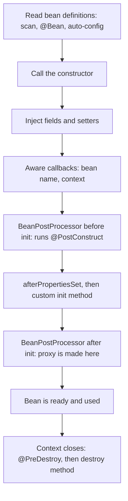
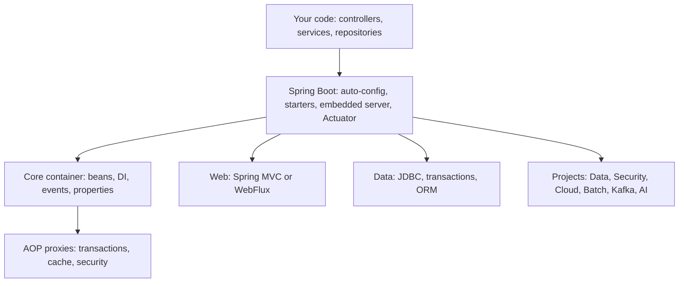
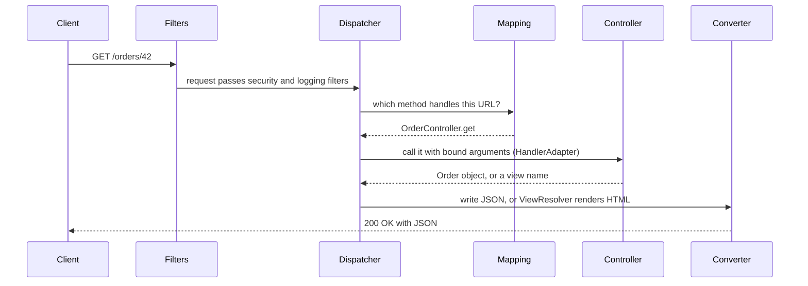
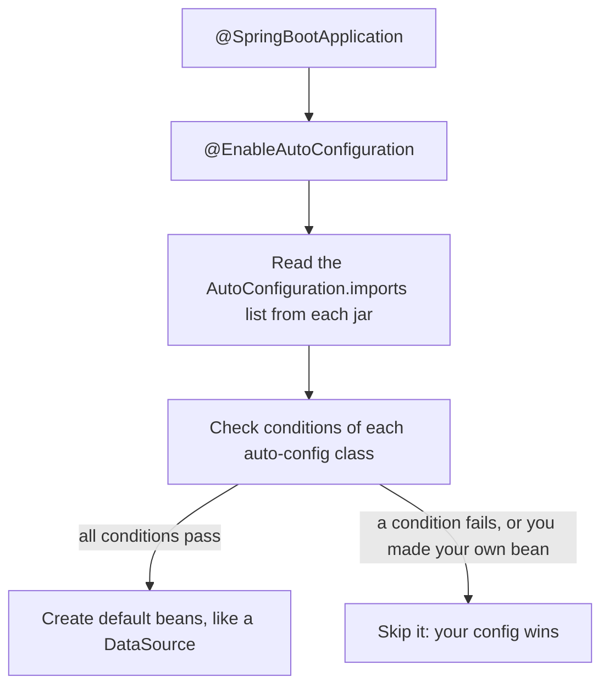
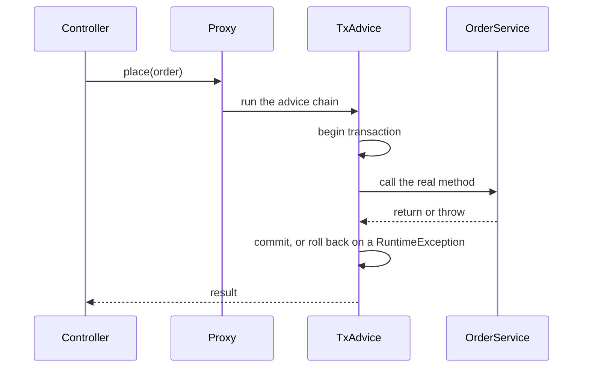

# Spring questions, answered

[← Back to README](../README.md)

Short answers to the older Spring question lists in the README, updated for Spring Framework 7 and Spring Boot 4 (Boot 3 where it is different).
The deep topics live in [spring.md](spring.md) and [spring-ecosystem.md](spring-ecosystem.md). Each answer links there when there is more to read.

**Contents:**
- [Spring Core](#spring-core)
- [Spring Web MVC](#spring-web-mvc)
- [Spring Boot](#spring-boot) (also has the Spring Data questions)
- [Spring AOP](#spring-aop)
- [Spring 5](#spring-5)

---

## Spring Core

Short answers to the Spring Core list in the README. Each links to the deeper section when there is one.

### What Is Spring Framework?

Spring is a Java framework that creates your objects and connects them for you.
It also gives ready parts for web apps, database access, transactions, security and testing.
The current version is Spring Framework 7 (November 2025). It needs Java 17 or newer.
Most teams use it through Spring Boot, which sets it up for you.
More: [IoC and dependency injection](spring.md#ioc-and-dependency-injection)

### What Are the Benefits of Using Spring?

- **Loose coupling:** classes get their dependencies from outside, so you can swap them or mock them in tests.
- **Less boring code:** `@Transactional`, `JdbcClient` and Spring Data remove a lot of repeated code.
- **One model for everything:** web, data, messaging and security work the same way.
- **Big ecosystem:** Boot, Security, Data, Cloud, Batch, Kafka, AI.
- **The cost:** some "magic". You must understand proxies and auto-configuration to debug well.

### What Spring Sub-Projects Do You Know? Describe Them Briefly.

- **Spring Boot:** runs Spring apps with auto-configuration, starters and an embedded server.
- **Spring Data:** writes repository code for JPA, JDBC, MongoDB, Redis, Elasticsearch and more.
- **Spring Security:** login (authentication) and permissions (authorization), JWT and OAuth2.
- **Spring Cloud:** tools for microservices: Gateway, Config, OpenFeign, service discovery.
- **Spring Batch:** big jobs that read, process and write millions of records in chunks.
- **Spring for Apache Kafka / Spring AMQP:** send and receive messages.
- **Spring AI, Spring Modulith, Spring GraphQL, Spring Session, Spring Authorization Server.**

More: [Spring ecosystem](spring-ecosystem.md)

### What Is Dependency Injection?

Dependency injection (DI) means an object gets the objects it needs from outside. It does not create them itself.
Story: a chef does not go to the market. The manager gives the chef vegetables every morning.
In Spring, the container is the manager. It passes the dependencies into your constructor.

```java
@Service
class OrderService {
    private final OrderRepository repo;
    OrderService(OrderRepository repo) { this.repo = repo; } // Spring passes the repository in
}
```

More: [IoC and dependency injection](spring.md#ioc-and-dependency-injection)

### How Can We Inject Beans in Spring?

There are three ways: constructor, setter and field injection.
You can also inject into the parameters of a `@Bean` method.

```java
OrderService(OrderRepository repo) { ... }                    // constructor (best)
@Autowired void setAudit(AuditClient audit) { ... }           // setter (optional things)
@Autowired private Clock clock;                               // field (avoid)
@Bean RestClient restClient(RestClient.Builder b) { ... }     // @Bean method parameter
```

### Which Is the Best Way of Injecting Beans and Why

Constructor injection is the best. The Spring team recommends it too.
- Fields can be `final`, so nobody changes them later.
- All required dependencies are visible in one place.
- In a unit test you just call `new OrderService(fakeRepo)`. No Spring needed.
- With one constructor, you do not even need `@Autowired` (since Spring 4.3).

Use setter injection only for optional dependencies. Avoid field injection, except in test classes.

### What Is the Difference Between Beanfactory and Applicationcontext?

`BeanFactory` is the basic container. It creates beans only when you ask for them (lazy).
`ApplicationContext` extends `BeanFactory` and adds much more:
- creates all singletons at startup, so errors show early;
- events, messages for many languages (`MessageSource`), resource loading;
- `Environment` with profiles and properties;
- registers `BeanPostProcessor`s for you (needed for `@Autowired`, `@Transactional`).

Always use `ApplicationContext`. Spring Boot creates one for you.
More: [ApplicationContext and BeanFactory](spring.md#applicationcontext-and-beanfactory)

### What Is a Spring Bean?

A bean is an object that the Spring container creates, connects and manages.
You define beans with `@Component` (found by scanning) or with a `@Bean` method in a `@Configuration` class.
If you create an object with `new`, it is not a bean. Spring does not inject into it or wrap it in a proxy.

### What Is the Default Bean Scope in Spring Framework?

The default scope is **singleton**: one object per bean definition, per Spring container.
Every class that asks for that bean gets the same object.
More: [Bean scopes](spring.md#bean-scopes-singleton-prototype-and-web-scopes)

### How to Define the Scope of a Bean?

Put `@Scope` on the class or on the `@Bean` method. There are also short forms like `@RequestScope`.

```java
@Component
@Scope(ConfigurableBeanFactory.SCOPE_PROTOTYPE)   // a new object every time
class PdfBuilder { }

@Component
@RequestScope                                      // one object per HTTP request
class RequestInfo { }
```

Old XML way: `<bean id="pdf" class="..." scope="prototype"/>`.

### Are Singleton Beans Thread-Safe?

No. Spring does not add any locking. One singleton object serves all request threads at the same time.
A singleton is safe when it is **stateless**: it only holds `final` dependencies, and keeps data in local variables.
It is not safe if it has a changing field, like `private int count`. Two threads can update it at once.
Fix: keep state in local variables, use `AtomicLong` or `ConcurrentHashMap`, or move the state to a database or cache.
More: [Java concurrency](java-concurrency.md)

### What Does the Spring Bean Lifecycle Look Like?

Spring creates the object, injects dependencies, runs init callbacks, may wrap it in a proxy, and later runs destroy callbacks.



- Use `@PostConstruct` and `@PreDestroy` in normal code.
- Spring does **not** call destroy callbacks for prototype beans.

More: [Bean lifecycle](spring.md#bean-lifecycle), [How Spring creates a bean](spring-debugging.md#how-spring-creates-a-bean)

### What Is the Spring Java-Based Configuration?

You configure beans in a Java class instead of an XML file.
The class has `@Configuration`, and each method with `@Bean` returns one bean.
It is type-safe: the compiler and your IDE check it, and refactoring works.

```java
@Configuration
class ClientConfig {
    @Bean
    RestClient paymentClient(RestClient.Builder builder) {
        return builder.baseUrl("https://pay.example.com").build(); // one bean, built in code
    }
}
```

More: [@Configuration and @Bean](spring.md#configuration-and-bean)

### Can We Have Multiple Spring Configuration Files in One Project?

Yes. Most apps have many `@Configuration` classes, for example one for security and one for clients.
Component scanning finds them, or you add them with `@Import(SecurityConfig.class)`.
Old XML apps used `<import resource="db.xml"/>`. To mix XML into Java config, use `@ImportResource`.
For properties, you can have `application.yml` plus `application-prod.yml`, and pull in more with `spring.config.import`.

### What Is Spring Security?

Spring Security is the Spring project for **authentication** (who are you?) and **authorization** (what can you do?).
It works as a chain of servlet filters that run before your controller.
You configure it with a `SecurityFilterChain` bean. It supports form login, JWT, OAuth2 and method security (`@PreAuthorize`).
More: [How Spring Security works (filter chain)](spring-ecosystem.md#how-spring-security-works-filter-chain)

### What Is Spring Boot?

Spring Boot is a tool on top of Spring that sets up your app for you.
It gives auto-configuration, starters (dependency bundles), an embedded web server, and production features (Actuator).
You run the app with `java -jar app.jar`. The current line is Boot 4 (on Spring Framework 7).
More: [What is Spring Boot? (Boot section)](#what-is-spring-boot-1)

### Name Some of the Design Patterns Used in the Spring Framework?

| Pattern | Where in Spring |
|---|---|
| Singleton | Default bean scope (one per container) |
| Factory | `BeanFactory`, `FactoryBean`, `@Bean` methods |
| Proxy | AOP, `@Transactional`, `@Cacheable`, `@Async` |
| Template method | `JdbcTemplate`, `TransactionTemplate`, `KafkaTemplate` |
| Front controller | `DispatcherServlet` |
| Observer | `ApplicationEvent` and `@EventListener` |
| Adapter | `HandlerAdapter` in Spring MVC |
| Chain of responsibility | Security filter chain, `HandlerInterceptor`s |
| Builder | `RestClient.builder()`, `UriComponentsBuilder` |
| Strategy | `PasswordEncoder`, `ResourceLoader`, many pluggable interfaces |

### How Does the Scope Prototype Work?

Spring creates a new object each time the bean is requested.
**Trap:** if you inject a prototype into a singleton, injection happens only once. So you get only one object.
Fix: ask for a fresh one each time with `ObjectProvider`.

```java
@Service
class ReportService {
    private final ObjectProvider<PdfBuilder> builders;
    ReportService(ObjectProvider<PdfBuilder> builders) { this.builders = builders; }

    byte[] make() { return builders.getObject().build(); } // new PdfBuilder on each call
}
```

Spring does not call `@PreDestroy` on prototype beans. You must clean them up yourself.

### What is Loose Coupling?

Loose coupling means a class depends on an interface, not on one fixed class.
Then you can swap the real class without changing the code that uses it.
Example: `OrderService` needs a `PaymentGateway` interface. In production it gets the real gateway. In a test it gets a fake.
DI makes this easy, because the container decides which class to pass in.

### What is a Dependency?

A dependency is another object that your class needs to do its job.
`OrderService` needs an `OrderRepository` to save orders. So the repository is a dependency of the service.

### What is IOC (Inversion of Control)?

Inversion of Control (IoC) means the framework controls object creation and the flow, not your code.
Normally your code calls `new`. With IoC, the container creates objects and calls your code when needed.
"Don't call us, we'll call you." Dependency injection is the most common way to do IoC.
More: [IoC and dependency injection](spring.md#ioc-and-dependency-injection)

### Can you give few examples of Dependency Injection?

- A repository injected into a service.
- A `RestClient` injected into a payment client class.
- A `Clock` injected into a service, so tests can fix the time.
- A config value injected with `@Value` or a `@ConfigurationProperties` record.

```java
@Service
class InvoiceService {
    private final Clock clock;                                // test passes Clock.fixed(...)
    InvoiceService(Clock clock) { this.clock = clock; }
    LocalDate dueDate() { return LocalDate.now(clock).plusDays(30); }
}
```

### What is Auto Wiring?

Autowiring means Spring finds the matching bean and injects it for you. You do not wire it by hand.
It matches mainly by type. Use `@Autowired`, or just have one constructor (then no annotation is needed).
More: [Choosing a bean: @Autowired, @Qualifier, @Primary](spring.md#choosing-a-bean-autowired-qualifier-primary)

### What are the important roles of an IOC Container?

1. Find bean definitions (scanning, `@Bean` methods, auto-configuration).
2. Create beans in the right order.
3. Inject dependencies.
4. Manage scope (singleton, prototype, request).
5. Run lifecycle callbacks, and wrap beans in proxies (for transactions, caching, security).
6. Publish events.
7. Destroy beans at shutdown.

### What are Bean Factory and Application Context?

Both are Spring IoC containers: they hold and create your beans.
`BeanFactory` is the basic root interface. `ApplicationContext` is the full container you use every day.
More: [What Is the Difference Between Beanfactory and Applicationcontext?](#what-is-the-difference-between-beanfactory-and-applicationcontext)

### Can you compare Bean Factory with Application Context?

| | BeanFactory | ApplicationContext |
|---|---|---|
| Singleton creation | Lazy (on first use) | Eager (at startup) |
| `@Autowired`, `@Transactional` | Only if you register post-processors by hand | Works out of the box |
| Events, i18n messages | No | Yes |
| Profiles and properties (`Environment`) | No | Yes |
| Used today | Inside Spring only | Always |

### How do you create an application context with Spring?

- **Spring Boot:** `SpringApplication.run(ShopApp.class, args)`. Boot picks the right context type.
- **Plain Spring:** `new AnnotationConfigApplicationContext(AppConfig.class)`.
- **Tests:** `@SpringBootTest` or `@ContextConfiguration` creates it for you.
- **Old XML apps:** `new ClassPathXmlApplicationContext("beans.xml")`.

### How does Spring know where to search for Components or Beans?

- **Component scan:** Spring looks in the packages you give it. Boot scans the package of your `@SpringBootApplication` class and all sub-packages.
- **`@Bean` methods** inside `@Configuration` classes.
- **`@Import`** of other config classes.
- **Auto-configuration:** Boot reads a list of auto-configuration classes from each jar.

More: [Component scanning rules](spring-debugging.md#component-scanning-rules)

### What is a Component Scan?

At startup, Spring reads the classes in some packages. It registers each class marked with `@Component` (or `@Service`, `@Repository`, `@Controller`, `@Configuration`) as a bean.
You choose the packages. Classes outside them are not found.

### How do you define a component scan in XML and Java Configurations?

```xml
<!-- old XML way -->
<context:component-scan base-package="com.shop"/>
```

```java
@Configuration
@ComponentScan("com.shop")           // Java config way
class AppConfig { }
```

Today: Java config, and in Boot you usually do not write it at all (next answer).

### How is it done with Spring Boot?

`@SpringBootApplication` already includes `@ComponentScan`. It scans the package of the main class and all sub-packages.
So put the main class in the root package, like `com.shop`.
A common bug: a class in `com.other` is not found. Fix it by moving the class, or with `@SpringBootApplication(scanBasePackages = {"com.shop", "com.other"})`.

### What does @Component signify?

`@Component` marks a class as a Spring bean. Component scanning finds it and Spring creates it.
The default bean name is the class name with a small first letter: `OrderService` becomes `orderService`.

### What does @Autowired signify?

`@Autowired` asks Spring to inject a matching bean. You can put it on a constructor, setter, field or method.
If there is only one constructor, you do not need it.
For an optional dependency, use `@Autowired(required = false)`, `Optional<T>`, or `ObjectProvider<T>`.

### What’s the difference Between @Controller, @Component, @Repository, and @Service Annotations in Spring?

All four make a class a bean. `@Service`, `@Repository` and `@Controller` are special kinds of `@Component`.
- `@Component`: a general bean.
- `@Service`: business logic. It adds no behavior; it only shows intent.
- `@Repository`: data access. Spring turns database exceptions into Spring's `DataAccessException`.
- `@Controller`: Spring MVC finds its request-handling methods. `@RestController` = `@Controller` + `@ResponseBody` (return JSON).

More: [Stereotype annotations](spring.md#stereotype-annotations-component-service-repository-controller)

### What is the default scope of a bean?

Singleton: one object per bean definition in the container.
More: [What Is the Default Bean Scope in Spring Framework?](#what-is-the-default-bean-scope-in-spring-framework)

### Are Spring beans thread safe?

No, not by themselves. A singleton is shared by all threads. It is safe only if it has no changing state.
More: [Are Singleton Beans Thread-Safe?](#are-singleton-beans-thread-safe)

### What are the other scopes available?

- `singleton` (default): one per container.
- `prototype`: a new object each time.
- `request`: one per HTTP request (web apps).
- `session`: one per HTTP session.
- `application`: one per `ServletContext`.
- `websocket`: one per WebSocket session.

You can also add custom scopes. Spring Cloud's `@RefreshScope` is one example.
More: [Bean scopes](spring.md#bean-scopes-singleton-prototype-and-web-scopes)

### How is Spring’s singleton bean different from Gang of Four Singleton Pattern?

- **Gang of Four singleton:** one object per class loader. The class itself forces it with a private constructor and a static field. Hard to test or mock.
- **Spring singleton:** one object per bean definition, per container. The class is a normal class.
- You can have two Spring beans of the same class with different names (for example two `DataSource` beans).
- Tests can create a fresh object with `new` or a fresh context.

### What are the different types of dependency injections?

Constructor injection, setter injection and field injection.
There is also *method injection* (`@Lookup`), where Spring overrides a method to return a new bean each time. It is rare today; `ObjectProvider` is simpler.
More: [How Can We Inject Beans in Spring?](#how-can-we-inject-beans-in-spring)

### What is setter injection?

Spring first creates the object, then calls a setter method to pass the dependency.
Use it for optional dependencies that have a default.

```java
private AuditClient audit = AuditClient.NO_OP;     // default if no bean exists

@Autowired(required = false)
void setAudit(AuditClient audit) { this.audit = audit; }
```

### What is constructor injection?

Spring passes all dependencies into the constructor when it creates the object.
Fields can be `final`, and the object is never half-built.

```java
@Service
class OrderService {
    private final OrderRepository repo;
    private final PaymentClient payments;

    OrderService(OrderRepository repo, PaymentClient payments) {  // no @Autowired needed
        this.repo = repo;
        this.payments = payments;
    }
}
```

### How do you choose between setter and constructor injections?

- **Constructor:** for required dependencies. This is almost everything.
- **Setter:** for optional dependencies, or the rare case where you must change it later.
- If a constructor has 7 or more parameters, the class probably does too much. Split it.
- Constructor injection also shows circular dependencies at startup. That is good: you find a design problem early.

More: [Circular dependencies](spring.md#circular-dependencies)

### What are the different options available to create Application Contexts for Spring?

- `AnnotationConfigApplicationContext`: Java config, non-web.
- `AnnotationConfigWebApplicationContext`: Java config for a classic WAR web app.
- `GenericApplicationContext`: register beans in code (`registerBean`). Spring 7 also adds `BeanRegistrar` for this.
- `ClassPathXmlApplicationContext`, `FileSystemXmlApplicationContext`: old XML apps.
- **Spring Boot:** `SpringApplication` picks a servlet, reactive or plain context from the classpath. Override with `spring.main.web-application-type`.

### What is the difference between XML and Java Configurations for Spring?

XML config lives in a separate `.xml` file. Class names are strings, so typos show only at runtime.
Java config is normal Java code. The compiler checks it, the IDE can refactor it, and you can add logic.

```xml
<bean id="orderService" class="com.shop.OrderService">
    <constructor-arg ref="orderRepository"/>
</bean>
```

```java
@Bean
OrderService orderService(OrderRepository repo) { return new OrderService(repo); }
```

### How do you choose between XML and Java Configurations for Spring?

Today: Java config plus annotations, with Spring Boot auto-configuration. New projects do not use XML.
XML is still supported in Spring 7, but you see it only in old apps.
When you migrate an old app, load the old XML with `@ImportResource("classpath:legacy.xml")`. Then move it to Java step by step.

### How does Spring do Autowiring?

1. A `BeanPostProcessor` (`AutowiredAnnotationBeanPostProcessor`) finds all injection points.
2. For each one, Spring finds all beans of the needed **type**.
3. If more than one matches, it narrows with `@Qualifier`, then `@Primary` / `@Fallback`, then the **name** of the field or parameter.
4. Zero matches: `NoSuchBeanDefinitionException`. Still more than one: `NoUniqueBeanDefinitionException`.

More: [Choosing a bean](spring.md#choosing-a-bean-autowired-qualifier-primary), [A debugging example](spring-debugging.md#a-requests-path-through-spring)

### What are the different kinds of matching used by Spring for Autowiring?

- **By type:** the default.
- **By qualifier:** `@Qualifier("stripe")` picks one bean by its qualifier or name.
- **By name:** the fallback. If the parameter is named `stripeClient`, the bean `stripeClient` wins. Since Spring 6.1 this needs the `-parameters` compiler flag (`spring-boot-starter-parent` and Boot's Gradle plugin set it).
- **By generic type:** `Repository<Order>` and `Repository<User>` are different matches.
- **Collections:** `List<PaymentClient>` gets all matching beans.

Old XML had modes: `no`, `byName`, `byType`, `constructor`.

### How do you debug problems with Spring Framework?

1. Read the **last** "Caused by" in the startup error. It is usually the real cause.
2. Run with `--debug` to see the conditions report (why auto-configuration did or did not run).
3. Use Actuator: `/actuator/beans`, `/actuator/conditions`, `/actuator/env`, `/actuator/mappings`.
4. Turn on DEBUG logs for one package, like `logging.level.org.springframework.web=DEBUG`.
5. Put breakpoints in Spring classes, like `DispatcherServlet#doDispatch`.

More: [Debugging Spring Boot from the inside](spring-debugging.md), [Debugging checklist](spring-debugging.md#debugging-checklist-one-page)

### How do you solve NoUniqueBeanDefinitionException?

It means two or more beans match one injection point, and Spring cannot pick.
Fix it in one of these ways:
- mark one bean `@Primary` (the default choice);
- use `@Qualifier("name")` at the injection point;
- name the parameter like the bean (`stripeClient`);
- inject all of them as `List<T>` or `Map<String, T>`;
- remove the extra bean if it was a mistake.

### How do you solve NoSuchBeanDefinitionException?

It means no bean of the needed type exists. Common causes:
- the class has no `@Component` / `@Service`, or is outside the scanned packages;
- a `@Profile` or `@ConditionalOn...` turned it off;
- a starter is missing, so the auto-configuration did not run;
- you ask for a class, but the bean is a JDK proxy that only implements the interface.

Run with `--debug` and read the conditions report.
More: [Why is my bean (not) there?](spring-debugging.md#why-is-my-bean-not-there)

### What is @Primary?

`@Primary` marks the default bean when several beans of the same type exist.
A `@Qualifier` at the injection point still wins over it.
Spring 6.2 added the opposite: `@Fallback` marks a bean to use only when there is no other.

```java
@Bean @Primary
DataSource mainDataSource() { ... }     // injected by default

@Bean
DataSource reportsDataSource() { ... }  // only with @Qualifier("reportsDataSource")
```

### What is @Qualifier?

`@Qualifier` picks one exact bean at the injection point, by its qualifier value or bean name.

```java
PaymentService(@Qualifier("razorpayClient") PaymentClient client) { ... }
```

You can also make your own annotation (for example `@Fast`) that carries `@Qualifier`. It is type-safe and easy to read.
More: [Choosing a bean](spring.md#choosing-a-bean-autowired-qualifier-primary)

### What is CDI (Contexts and Dependency Injection)?

CDI is the Jakarta EE standard for dependency injection.
It uses annotations like `@Inject`, `@Named` and `@ApplicationScoped`.
Jakarta EE servers (with Weld) and Quarkus use CDI. Spring has its own container, not CDI.

### Does Spring Support CDI?

Partly. Spring supports the small JSR-330 standard (`jakarta.inject`): `@Inject` works like `@Autowired`, and `@Named` works like `@Component` or `@Qualifier`.
Add the `jakarta.inject-api` dependency to use them. Since Spring 6, use the `jakarta.inject` package, not `javax.inject`.
Spring does not run full CDI: no CDI scopes, CDI events or CDI interceptors.

### Would you recommed to use CDI or Spring Annotations?

In a Spring app, use Spring annotations, or no annotation at all (one constructor).
JSR-330 annotations have fewer features. For example, `@Inject` has no `required = false`.
They help only if you truly need code that runs in both Spring and a CDI container. That is rare.
Whatever you pick, use one style in the whole project.

### What are the major features in different versions of Spring?

| Version | Year | Big features |
|---|---|---|
| 2.5 | 2007 | `@Autowired`, `@Component` scanning |
| 3.0 / 3.1 | 2009 / 2011 | Java config (`@Configuration`), SpEL, REST in MVC, profiles, cache abstraction |
| 4.0 | 2013 | Java 8 support, WebSocket, `@RestController`, `@Conditional` |
| 5.0 | 2017 | Java 8 baseline, WebFlux (reactive), Kotlin support |
| 6.0 | 2022 | Java 17, `jakarta.*`, AOT and native images, Micrometer Observation |
| 6.1 / 6.2 | 2023 / 2024 | `RestClient`, `JdbcClient`, virtual threads; `@Fallback`, `@MockitoBean` |
| 7.0 | 2025 | Jakarta EE 11, JSpecify null-safety, API versioning, `@Retryable`, Jackson 3 |

More: [Spring Boot 2 to 3 to 4](spring.md#spring-boot-2-to-3-to-4-what-changed)

### What are new features in Spring Framework 4.0?

- Java 8 support: lambdas, `java.time`, `Optional`.
- Java EE 7 support.
- New WebSocket and STOMP messaging module.
- `@RestController`.
- `@Conditional`, which later became the base of Spring Boot auto-configuration.
- Generic types as qualifiers, and a Groovy bean DSL.
- Spring 4.3 added `@GetMapping` and friends, and constructor injection without `@Autowired`.

Today this is history. Spring 4 is long out of support.

### What are new features in Spring Framework 5.0?

- Java 8 baseline, and it runs on Java 9.
- **Spring WebFlux:** a reactive web stack with Project Reactor (`Mono`, `Flux`), and `WebClient`.
- Kotlin support and functional bean registration.
- JUnit 5 support in the Spring test framework.
- Null-safety annotations (`@Nullable`) on Spring APIs.

Today: Spring 5 support has ended. Use Spring 7 (Boot 4) or at least 6 (Boot 3).
More: [Spring 5](#spring-5)

### What are important Spring Modules?

- **Core container:** `spring-core`, `spring-beans`, `spring-context`, `spring-expression` (SpEL).
- **AOP:** `spring-aop`, `spring-aspects`.
- **Data access:** `spring-jdbc`, `spring-tx` (transactions), `spring-orm`, `spring-r2dbc`.
- **Web:** `spring-web`, `spring-webmvc`, `spring-webflux`, `spring-websocket`.
- **Messaging:** `spring-messaging`, `spring-jms`.
- **Test:** `spring-test` (MockMvc, `WebTestClient`, `RestTestClient` in Spring 7).

### What are important Spring Projects?

Spring Boot, Spring Data, Spring Security, Spring Cloud, Spring Batch, Spring for Apache Kafka, Spring AI, Spring Modulith, Spring Session, Spring GraphQL.
More: [What Spring Sub-Projects Do You Know?](#what-spring-sub-projects-do-you-know-describe-them-briefly)

### What is the simplest way of ensuring that we are using single version of all Spring related dependencies?

Use a **BOM** (bill of materials: one file that lists tested versions).
With Boot, use `spring-boot-starter-parent` or import `spring-boot-dependencies`. Then write dependencies without versions.
Without Boot, import `spring-framework-bom`. For Spring Cloud, also import `spring-cloud-dependencies`.

```xml
<dependencyManagement><dependencies><dependency>
    <groupId>org.springframework.boot</groupId>
    <artifactId>spring-boot-dependencies</artifactId>
    <version>${spring-boot.version}</version>
    <type>pom</type><scope>import</scope>   <!-- all versions come from here -->
</dependency></dependencies></dependencyManagement>
```

### Name some of the design patterns used in Spring Framework?

Singleton (scopes), Factory (`BeanFactory`), Proxy (AOP, `@Transactional`), Template method (`JdbcTemplate`), Front controller (`DispatcherServlet`), Observer (events), Adapter (`HandlerAdapter`).
More: [the full table above](#name-some-of-the-design-patterns-used-in-the-spring-framework)

### What do you think about Spring Framework?

Give an honest, balanced opinion. For example:
> "Spring is mature and has an answer for almost every problem: web, data, security, messaging. Boot makes a new service run in minutes. The cost is some magic. You must understand proxies and auto-configuration to debug it. Startup time and memory used to be weak points. AOT, CDS and native images help with that now. For most business backends in Java, it is still my first choice."

### Why is Spring Popular?

- It solves real problems: DI, transactions, web, security, data.
- Spring Boot makes setup fast. One dependency and the app runs.
- It is free, open source, and has kept moving for 20+ years.
- Huge community: most Java questions already have an answer.
- It works well with modern needs: containers, Kubernetes, observability, virtual threads, native images.
- Most Java job ads ask for it, so teams can hire.

### Can you give a big picture of the Spring Framework?



- The **core container** creates and connects beans. Everything else is built on it.
- **AOP** adds behavior like transactions around your methods.
- **Spring Boot** sets all of it up for you, and the projects add features for each need.

---

## Spring Web MVC

Short answers to the Spring Web MVC list in the README. Each links to the deeper section when there is one.

### How to Get Servletcontext and Servletconfig Objects in a Spring Bean?

- **`ServletContext`:** inject it in the constructor in a web app. Or implement `ServletContextAware`.
- **`ServletConfig`:** implement `ServletConfigAware`. It is set only when a `DispatcherServlet` created the context (classic WAR setup).
- In Spring Boot you rarely need either. Use `application.yml` properties instead.
- For per-request data, add `HttpServletRequest` as a controller method parameter.

```java
@Component
class UploadPaths {
    private final String root;
    UploadPaths(ServletContext ctx) { this.root = ctx.getContextPath(); } // injected like any bean
}
```

### What Is a Controller in Spring Mvc?

A controller is a class that handles HTTP requests. Mark it with `@Controller` (returns HTML views) or `@RestController` (returns JSON).
Each method is mapped to a URL with `@GetMapping`, `@PostMapping` and so on.
Keep controllers thin: read the input, call a service, return the result.

### How Does the @Requestmapping Annotation Work?

1. At startup, `RequestMappingHandlerMapping` reads every `@RequestMapping` (and `@GetMapping`, etc.).
2. It builds a table: path + HTTP method + params + headers + content type (and API version in Spring 7).
3. For each request, `DispatcherServlet` asks this table for the best match.
4. No path matches: 404. Path matches but not the method: 405. Wrong content type: 415.

Since Spring 6, `/orders/` (trailing slash) no longer matches `/orders` by default.
More: [404 vs 405 vs 415 vs 400](spring-debugging.md#404-vs-405-vs-415-vs-400)

### What is Model 1 architecture?

Model 1 is an old Java web style (late 1990s). The browser calls a JSP page directly.
The JSP has everything: HTML, Java logic and database calls. It is hard to change and test.
Today: history only. Nobody builds apps this way.

### What is Model 2 architecture?

Model 2 is MVC for Java web apps. A servlet (the **controller**) gets the request.
It calls Java classes (the **model**) for logic and data. Then it forwards to a JSP (the **view**) to show HTML.
Logic and display are separate, so the code is cleaner.

### What is Model 2 Front Controller architecture?

It is Model 2 with **one** servlet in front of all requests: the *front controller*.
It sends each request to the right handler. Security, logging and error handling live in one place.
Spring's `DispatcherServlet` is a front controller.

### Can you show an example controller method in Spring MVC?

```java
@RestController
@RequestMapping("/orders")
class OrderController {
    private final OrderService service;
    OrderController(OrderService service) { this.service = service; }

    @GetMapping("/{id}")
    OrderDto get(@PathVariable long id) { return service.find(id); }         // returns JSON

    @PostMapping
    ResponseEntity<OrderDto> create(@Valid @RequestBody NewOrder body) {      // validated body
        OrderDto saved = service.create(body);
        return ResponseEntity.created(URI.create("/orders/" + saved.id())).body(saved);
    }
}
```

### Can you explain a simple flow in Spring MVC?



If the controller throws, `DispatcherServlet` asks the exception resolvers (`@ControllerAdvice`) for the response.
More: [DispatcherServlet: life of a request](spring.md#dispatcherservlet-life-of-a-request)

### What is a ViewResolver?

A `ViewResolver` turns a view name into a real page.
The controller returns `"orders"`. The resolver finds `templates/orders.html` (Thymeleaf) or `/WEB-INF/views/orders.jsp` (JSP).
Boot sets it up when you add a template engine starter. REST APIs do not use it: they write JSON with message converters.

### What is Model?

`Model` is a map of data that the controller gives to the view.

```java
@GetMapping("/orders")
String list(Model model) {
    model.addAttribute("orders", service.findAll());  // the template reads ${orders}
    return "orders";                                  // view name
}
```

### What is ModelAndView?

`ModelAndView` holds the view name and the model data together, in one return value.
It is an older style. Today you return a `String` view name and take a `Model` parameter.
For REST APIs you return the object itself, or a `ResponseEntity`.

### What is a RequestMapping?

A request mapping connects a URL (plus HTTP method, headers and so on) to a controller method.
You write it with `@RequestMapping`, or the short forms `@GetMapping`, `@PostMapping`, `@PutMapping`, `@PatchMapping`, `@DeleteMapping`.
More: [How Does the @Requestmapping Annotation Work?](#how-does-the-requestmapping-annotation-work)

### What is Dispatcher Servlet?

`DispatcherServlet` is the front controller of Spring MVC. One servlet receives all requests.
It finds the handler method, calls it, handles exceptions, and writes the response (JSON or a view).
More: [DispatcherServlet: life of a request](spring.md#dispatcherservlet-life-of-a-request)

### How do you set up Dispatcher Servlet?

- **Spring Boot:** nothing to do. Auto-configuration registers it on `/`. Change the path with `spring.mvc.servlet.path`.
- **Classic WAR, Java config:** extend `AbstractAnnotationConfigDispatcherServletInitializer`.
- **Very old apps:** a `<servlet>` and `<servlet-mapping>` in `web.xml`.

```java
class WebInit extends AbstractAnnotationConfigDispatcherServletInitializer {
    protected Class<?>[] getRootConfigClasses() { return new Class<?>[] { AppConfig.class }; }
    protected Class<?>[] getServletConfigClasses() { return new Class<?>[] { WebConfig.class }; }
    protected String[] getServletMappings() { return new String[] { "/" }; } // all requests
}
```

### What is a form backing object?

It is a Java object that holds the fields of an HTML form. It is also called a *command object*.
Spring copies the request parameters into its fields. This is called *data binding*.
In a REST API, the same idea is the request body class, usually a `record`.

### How is validation done using Spring MVC?

1. Add `spring-boot-starter-validation` (Jakarta Bean Validation, with Hibernate Validator).
2. Put rules on fields: `@NotBlank`, `@Email`, `@Positive`, `@Size`.
3. Put `@Valid` on the controller parameter.
4. If it fails, Spring throws `MethodArgumentNotValidException`, which becomes a 400 response.

Handle errors in one `@RestControllerAdvice` that returns `ProblemDetail` JSON.
More: [Bean Validation (@Valid)](spring-ecosystem.md#bean-validation-valid), [Global error handling](spring-ecosystem.md#global-error-handling-with-restcontrolleradvice-and-problemdetail)

### What is BindingResult?

`BindingResult` holds the binding and validation errors for one object.
Put it right **after** the `@Valid` parameter. Then Spring does not throw; you check `hasErrors()` yourself.
It is used in HTML form apps, to show the form again with messages. In REST APIs, let the global error handler return a 400 instead.

### How do you map validation results to your view?

Return the same form view when there are errors. The template reads the errors from `BindingResult`.

```java
@PostMapping("/signup")
String signup(@Valid @ModelAttribute SignupForm form, BindingResult result) {
    if (result.hasErrors()) return "signup";      // show the form again with errors
    service.register(form);
    return "redirect:/welcome";
}
```

In Thymeleaf: `<span th:errors="*{email}"></span>`. In JSP: `<form:errors path="email"/>`.

### What are Spring Form Tags?

A JSP tag library that binds HTML forms to a form backing object.
Examples: `<form:form modelAttribute="order">`, `<form:input path="email"/>`, `<form:errors path="email"/>`.
They still exist in `spring-webmvc`, but JSP is rare now (Boot does not support JSP in an executable jar).
Today: Thymeleaf for server pages, or a React / Next.js front end calling a REST API.

### What is a Path Variable?

A path variable is a value inside the URL path. `@PathVariable` reads it.
`GET /orders/42` → `@GetMapping("/orders/{id}")` with `@PathVariable long id` gives `42`.
Compare: `@RequestParam` reads query values like `/orders?status=NEW`.

### What is a Model Attribute?

`@ModelAttribute` has two uses:
- **On a parameter:** bind request parameters into an object (a form backing object).
- **On a method:** the method runs before every handler in the controller and adds common data to the model, like a list of countries for a dropdown.

### What is a Session Attribute?

`@SessionAttributes("cart")` on a controller keeps that model attribute in the HTTP session across requests. It is used for multi-step forms. Call `SessionStatus.setComplete()` at the end.
`@SessionAttribute("user")` on a parameter reads a value that is already in the session.
Today: most APIs are stateless (JWT). If you need sessions across many servers, store them in Redis with Spring Session.

### What is a init binder?

An `@InitBinder` method customizes data binding for one controller (or all, inside `@ControllerAdvice`).
Use it to add formatters, or to limit which fields can be bound. Limiting fields stops attackers from setting fields like `isAdmin`.

```java
@InitBinder
void initBinder(WebDataBinder binder) {
    binder.setAllowedFields("name", "email");                 // ignore every other field
    binder.addCustomFormatter(new DateFormatter("dd-MM-yyyy"));
}
```

### How do you set default date format with Spring?

- **Request params and forms:** `@DateTimeFormat(iso = DateTimeFormat.ISO.DATE)` on a field, or globally `spring.mvc.format.date=yyyy-MM-dd`.
- **JSON:** Boot writes `java.time` values as ISO-8601 strings (`2026-11-16`) by default. For one field, use `@JsonFormat(pattern = "dd-MM-yyyy")`.
- Best practice: use ISO-8601 everywhere, and `Instant` or `OffsetDateTime` with a time zone for timestamps.

```properties
spring.mvc.format.date=yyyy-MM-dd
spring.mvc.format.date-time=iso
```

### Why is Spring MVC so popular?

- A simple model: annotate a method, return an object, get JSON.
- Mature, with huge documentation and community.
- Works with Spring Security, validation, Actuator and MockMvc tests.
- Blocking code is easy to read and debug. With virtual threads (Boot 3.2+), it also handles many concurrent requests.
- So most teams pick MVC, not WebFlux. More: [Spring MVC vs WebFlux](spring.md#spring-mvc-vs-webflux)

---

## Spring Boot

Short answers to the Spring Boot list in the README (it also includes the Spring Data questions). Each links to the deeper section when there is one.

### What is Spring Boot?

Spring Boot makes Spring apps quick to start and ready for production.
- **Auto-configuration:** it creates common beans for you, based on the jars on the classpath.
- **Starters:** one dependency brings a tested set of libraries.
- **Embedded server:** Tomcat is inside the jar, so `java -jar app.jar` runs the app.
- **Actuator:** health, metrics and info endpoints.

Boot 4 (November 2025) runs on Spring Framework 7 and Java 17+.
More: [Spring Boot 2 to 3 to 4](spring.md#spring-boot-2-to-3-to-4-what-changed)

### What are the important Goals of Spring Boot?

- Get a new Spring app running very fast.
- Be opinionated (good defaults), but step back as soon as you configure something yourself.
- Give production features out of the box: embedded server, metrics, health checks, external config.
- No code generation and no XML.

### What are the important Features of Spring Boot?

- Auto-configuration and starters.
- Embedded Tomcat or Jetty, and an executable "fat" jar.
- External config: properties, YAML, env vars, profiles.
- Actuator, Micrometer metrics and tracing.
- Test support: `@SpringBootTest`, test slices, Testcontainers with `@ServiceConnection`.
- Docker Compose support for local dev, container images with buildpacks, native images with GraalVM.

### Compare Spring Boot vs Spring?

| | Spring Framework | Spring Boot |
|---|---|---|
| What it is | The core: DI, AOP, MVC, transactions | A layer that sets up Spring for you |
| Setup | You configure every bean | Auto-configuration with defaults |
| Server | Deploy a WAR to an external server | Embedded server in a runnable jar |
| Dependency versions | You pick each version | One tested set (BOM) |
| Production features | Add them yourself | Actuator built in |

Boot does not replace Spring. A Boot app **is** a Spring app.

### Compare Spring Boot vs Spring MVC?

They are different kinds of things.
Spring MVC is the web framework inside Spring Framework: controllers, `DispatcherServlet`, mappings.
Spring Boot is the tool that sets up Spring, including MVC.
`spring-boot-starter-webmvc` (Boot 4 name; it was `spring-boot-starter-web`) brings MVC, Jackson and embedded Tomcat, all configured.

### What is the importance of @SpringBootApplication?

It is three annotations in one:
- `@SpringBootConfiguration`: this class is a configuration class.
- `@EnableAutoConfiguration`: turn on auto-configuration.
- `@ComponentScan`: scan this package and its sub-packages.

So place this class in your root package.

```java
@SpringBootApplication
public class ShopApplication {
    public static void main(String[] args) { SpringApplication.run(ShopApplication.class, args); }
}
```

### What is Auto Configuration?

Boot looks at your classpath, properties and existing beans. Then it creates the beans you probably need.
For example: a JDBC driver and `spring.datasource.url` are present → Boot creates a `DataSource` (HikariCP pool).
Each auto-configuration class is guarded by `@Conditional...` checks. If you define your own bean, Boot backs off.



The list lives in `META-INF/spring/org.springframework.boot.autoconfigure.AutoConfiguration.imports`. Boot 4 splits it into one module jar per technology.
More: [Auto-configuration and @Conditional](spring.md#auto-configuration-and-conditional)

### How can we find more information about Auto Configuration?

- Start with `--debug` (or `debug=true`). Boot prints the **conditions evaluation report**: what matched and what did not, and why.
- Call `/actuator/conditions` on a running app.
- Read the source of the `...AutoConfiguration` class in your IDE.
- Turn one off with `@SpringBootApplication(exclude = DataSourceAutoConfiguration.class)` or `spring.autoconfigure.exclude`.

More: [The conditions evaluation report](spring-debugging.md#the-conditions-evaluation-report)

### What is an embedded server? Why is it important?

The web server (Tomcat, Jetty) is a library inside your app's jar. You start the app with `java -jar app.jar`.
Why it matters:
- No separate Tomcat to install and keep in sync.
- The same server version in dev, test and prod.
- Perfect for Docker and Kubernetes: one process per container.

### What is the default embedded server with Spring Boot?

Tomcat for Spring MVC apps (Tomcat 11 in Boot 4, Tomcat 10.1 in Boot 3).
For WebFlux apps, the default is Reactor Netty.

### What are the other embedded servers supported by Spring Boot?

- **Jetty** (Jetty 12.1 in Boot 4).
- **Reactor Netty** for reactive (WebFlux) apps.
- **Undertow** was supported up to Boot 3.x. Boot 4 removed it, because it did not support Servlet 6.1.

```xml
<dependency>
  <groupId>org.springframework.boot</groupId>
  <artifactId>spring-boot-starter-webmvc</artifactId>
  <exclusions><exclusion>
    <groupId>org.springframework.boot</groupId>
    <artifactId>spring-boot-starter-tomcat</artifactId>  <!-- remove Tomcat -->
  </exclusion></exclusions>
</dependency>
<dependency>
  <groupId>org.springframework.boot</groupId>
  <artifactId>spring-boot-starter-jetty</artifactId>     <!-- use Jetty -->
</dependency>
```

### What are Starter Projects?

A starter is one dependency that brings a tested set of libraries for one job, plus its auto-configuration.
Example: `spring-boot-starter-data-jpa` brings Hibernate, Spring Data JPA, HikariCP and transactions.
In Boot 4 each technology has its own starter and a matching test starter, like `spring-boot-starter-webmvc-test`.
More: [Starters, embedded server and executable jar](spring.md#starters-embedded-server-and-executable-jar)

### Can you give examples of important starter projects?

Boot 4 names:
- `spring-boot-starter-webmvc` (Boot 3: `spring-boot-starter-web`): REST APIs with Tomcat.
- `spring-boot-starter-webflux`: reactive web.
- `spring-boot-starter-data-jpa`, `spring-boot-starter-data-redis`, `spring-boot-starter-data-mongodb`.
- `spring-boot-starter-security`, `spring-boot-starter-security-oauth2-resource-server`.
- `spring-boot-starter-validation`, `spring-boot-starter-actuator`, `spring-boot-starter-cache`.
- `spring-boot-starter-kafka` (new in Boot 4; before, you added `spring-kafka` directly).
- `spring-boot-starter-opentelemetry`, `spring-boot-starter-test`.

### What is Starter Parent?

`spring-boot-starter-parent` is a Maven parent POM. Your `pom.xml` inherits from it.
It gives you the dependency versions and good default plugin settings.

```xml
<parent>
  <groupId>org.springframework.boot</groupId>
  <artifactId>spring-boot-starter-parent</artifactId>
  <version>4.0.0</version>          <!-- use the latest 4.x patch -->
</parent>
```

If your company already has its own parent POM, import the `spring-boot-dependencies` BOM instead.

### What are the different things that are defined in Starter Parent?

- **Dependency versions:** it inherits `spring-boot-dependencies`, so you write dependencies without versions.
- **Java version:** `java.version` property (17 by default in Boot 3 and 4). Override it to 21 or 25.
- **UTF-8** source encoding.
- **Compiler** set with `-parameters` (needed for name-based binding).
- **Resource filtering** for `application*.yml` / `.properties`, using `@...@` placeholders.
- **Plugin settings** for Surefire, Failsafe, the jar plugin, and `spring-boot-maven-plugin` (`repackage` makes the runnable jar).

### How does Spring Boot enforce common dependency management for all its Starter projects?

Boot publishes one BOM, `spring-boot-dependencies`. It lists a tested version for hundreds of libraries.
Starters declare their dependencies **without** versions. The BOM fills them in.
To change one version, override its property, for example `<jackson-bom.version>`.
In Gradle, the Boot plugin with `io.spring.dependency-management`, or `platform(...)`, does the same job.

### What is Spring Initializr?

[start.spring.io](https://start.spring.io) is a website that creates a new Spring Boot project for you.
You pick Maven or Gradle, Java or Kotlin, Boot and Java versions, and the starters. Then you download a zip.
IntelliJ and VS Code use the same service inside the IDE.

### What is application.properties?

The main config file of a Boot app, in `src/main/resources`. You can use `application.yml` instead.
Boot reads it at startup. Keys are `key=value`.

```properties
server.port=8081
spring.datasource.url=jdbc:postgresql://localhost:5432/shop
logging.level.com.shop=DEBUG
```

### What are some of the important things that can customized in application.properties?

- Server: `server.port`, `server.servlet.context-path`, `server.compression.enabled`.
- Database: `spring.datasource.*`, `spring.datasource.hikari.maximum-pool-size`, `spring.jpa.*`.
- Logs: `logging.level.*`, `logging.structured.format.console` (JSON logs, Boot 3.4+).
- Actuator: `management.endpoints.web.exposure.include`, `management.server.port`.
- Threads: `spring.threads.virtual.enabled=true` (Boot 3.2+).
- Profiles: `spring.profiles.active`. Your own app settings under your own prefix.

### How do you externalize configuration using Spring Boot?

Build one jar. Give it different config in each environment from outside.
Boot reads many *property sources* (places where values come from). Higher ones win, for example:
1. Command-line arguments (`--server.port=9090`).
2. Environment variables (`SERVER_PORT=9090`).
3. `application-{profile}.yml` files, then `application.yml`.

Also: config files outside the jar (`./config/`), and `spring.config.import` for Kubernetes secrets (`configtree:`), Spring Cloud Config or Vault.
More: [Where did this property value come from?](spring-debugging.md#where-did-this-property-value-come-from)

### How can you add custom application properties using Spring Boot?

Write them under your own prefix. Then bind them to a record with `@ConfigurationProperties`.

```yaml
shop:
  payment:
    base-url: https://pay.example.com
    timeout: 2s
```

```java
@ConfigurationProperties("shop.payment")
record PaymentProperties(URI baseUrl, Duration timeout) { }   // "2s" becomes a Duration

@SpringBootApplication
@ConfigurationPropertiesScan            // registers all @ConfigurationProperties classes
class ShopApplication { }
```

Add `spring-boot-configuration-processor` so your IDE can autocomplete your own keys.

### What is @ConfigurationProperties?

It binds a group of properties with one prefix to a typed Java object (often a record).
- Type-safe: `Duration`, `DataSize`, `URI`, lists and maps work.
- Relaxed binding: `base-url`, `baseUrl` and `SHOP_PAYMENT_BASEURL` all match.
- Add `@Validated` and rules like `@NotNull`, so the app fails at startup on bad config.

Use it instead of many `@Value` fields.
More: [How can you add custom application properties using Spring Boot?](#how-can-you-add-custom-application-properties-using-spring-boot), [Properties: @Value, @ConfigurationProperties and profiles](spring.md#properties-value-configurationproperties-and-profiles)

### What is a profile?

A profile is a name for a set of config and beans, like `dev`, `test` or `prod`.
Activate it with `spring.profiles.active=prod`, or the env var `SPRING_PROFILES_ACTIVE=prod`.
Then Boot loads `application-prod.yml` and beans marked `@Profile("prod")`.

### How do you define beans for a specific profile?

Put `@Profile` on a `@Component` class or on a `@Bean` method.

```java
@Bean
@Profile("dev")                         // only when the dev profile is active
PaymentClient fakePayments() { return new FakePaymentClient(); }

@Bean
@Profile("!dev")                        // every profile except dev
PaymentClient realPayments(RestClient.Builder b) { return new HttpPaymentClient(b); }
```

### How do you create application configuration for a specific profile?

Create `application-{profile}.yml`, for example `application-prod.yml`. It overrides `application.yml`.
Or use one file with `---` sections:

```yaml
server.port: 8080
---
spring.config.activate.on-profile: prod   # this block only for prod
server.port: 80
```

### How do you have different configuration for different environments?

- Use profiles for things that really differ (fake vs real client, log format).
- Use **environment variables** and secrets for values (URLs, passwords). Kubernetes gives them from ConfigMaps and Secrets.
- Keep one jar for every environment. Never rebuild per environment.
- Never put prod passwords in Git. Use Vault, a cloud secret manager, or Kubernetes Secrets.

More: [Spring Cloud Config and secrets](spring-ecosystem.md#spring-cloud-config-and-secrets)

### What is Spring Boot Actuator?

Actuator adds production endpoints to your app: `health`, `info`, `metrics`, `prometheus`, `env`, `beans`, `loggers`, `mappings`, `threaddump` and more.
By default only `/actuator/health` is exposed over HTTP. Expose others on purpose, and protect them.
Add it with `spring-boot-starter-actuator`.
More: [Observability with Actuator, Micrometer and OpenTelemetry](spring-ecosystem.md#observability-with-actuator-micrometer-and-opentelemetry)

### How do you monitor web services using Spring Boot Actuator?

- **Metrics:** Micrometer records `http.server.requests` for every endpoint (count, latency, status). Prometheus scrapes `/actuator/prometheus`, and Grafana shows dashboards and alerts.
- **Health:** `/actuator/health/liveness` and `/readiness` for Kubernetes probes (on by default in Boot 4).
- **Tracing:** Micrometer Tracing or the OpenTelemetry starter sends traces.
- Run Actuator on a separate port, and do not expose it to the internet.

```properties
management.endpoints.web.exposure.include=health,info,prometheus
management.server.port=9090
management.metrics.distribution.percentiles-histogram.http.server.requests=true
```

### How do you find more information about your application envrionment using Spring Boot?

- `/actuator/env`: every property and which source it came from.
- `/actuator/configprops`: all `@ConfigurationProperties` values.
- `/actuator/beans`, `/actuator/conditions`, `/actuator/mappings`.
- `/actuator/info`: build and Git info (add `build-info` and the git-commit-id plugin).
- Since Boot 3, values in `env` and `configprops` are hidden (`******`) by default. Turn on with `show-values`, only for trusted users.

More: [/actuator/env and /actuator/configprops](spring-debugging.md#actuatorenv-and-actuatorconfigprops)

### What is a CommandLineRunner?

An interface with one method, `run(String... args)`. Boot calls it once, after the context has started, before the app reports "ready".
Use it for small startup work: load seed data, warm a cache, print info.
`ApplicationRunner` is the same, but gives parsed arguments. If `run` throws, the app fails to start.

```java
@Bean
CommandLineRunner warmCache(ProductService products) {
    return args -> products.loadTopSellers();   // runs once at startup
}
```

### What Is Spring Jdbctemplate Class and How to Use It?

`JdbcTemplate` runs SQL without JDBC boilerplate. It opens and closes connections, and handles statements and result sets. It turns `SQLException` into Spring's `DataAccessException`.
Boot creates it for you when there is a `DataSource`. Since Spring 6.1, `JdbcClient` is a nicer fluent API on top.

```java
List<Order> orders = jdbcTemplate.query(
    "select id, total from orders where status = ?",
    (rs, row) -> new Order(rs.getLong("id"), rs.getBigDecimal("total")),  // RowMapper
    "NEW");

List<Order> same = jdbcClient.sql("select id, total from orders where status = :s")
    .param("s", "NEW").query(Order.class).list();                          // Spring 6.1+
```

### How Would You Enable Transactions in Spring and What Are Their Benefits?

In Boot, transactions are on already when you have a `DataSource` or JPA. You do not need `@EnableTransactionManagement`.
Put `@Transactional` on public service methods. Spring wraps the bean in a proxy that begins, commits or rolls back.
Benefits: all-or-nothing updates, no manual commit code, propagation rules, `readOnly` for reads.
Watch out: calls inside the same class skip the proxy. And checked exceptions do not roll back by default.
More: [@Transactional deep dive](spring-ecosystem.md#transactional-deep-dive), [Why the transaction did not start](spring-debugging.md#why-the-transaction-did-not-start)

### What Is Spring Dao?

"Spring DAO" is an old name for Spring's data access support. A DAO (data access object) is a class that hides database code.
It includes the templates (`JdbcTemplate`), DAO support classes, and one exception tree (`DataAccessException`) for every database.
`@Repository` turns database-specific exceptions into that tree.
Today: Spring Data repositories replace most hand-written DAOs.

### What is Spring Data?

Spring Data is a family of projects with one style of data access for many databases.
You write a repository interface. Spring Data creates the code.
Modules: JPA, JDBC, R2DBC, MongoDB, Redis, Elasticsearch, Cassandra, Neo4j and more.
More: [Spring Data](spring-ecosystem.md#spring-data)

### What is the need for Spring Data?

Without it, every DAO repeats the same code: save, find by id, find all, delete, paging.
Spring Data generates this code. It also builds queries from method names (`findByEmail`), and gives paging, sorting, auditing and projections.
You write less code and have fewer bugs.

### What is Spring Data JPA?

The Spring Data module for JPA. In Boot 4, it runs on Hibernate 7 and Jakarta Persistence 3.2.
You extend `JpaRepository<Order, Long>`, and get CRUD, paging and query methods from method names or `@Query`.
More: [Spring Data JPA basics](spring-ecosystem.md#spring-data-jpa-basics), [The N+1 problem](spring-ecosystem.md#the-n1-problem-and-how-to-fix-it)

### What is a CrudRepository?

A Spring Data interface with basic methods: `save`, `findById`, `findAll`, `count`, `existsById`, `deleteById`.
Since Spring Data 3 (Boot 3), `ListCrudRepository` returns `List` instead of `Iterable`.

```java
interface CustomerRepository extends ListCrudRepository<Customer, Long> {
    Optional<Customer> findByEmail(String email);    // query built from the method name
}
```

### What is a PagingAndSortingRepository?

It adds `findAll(Pageable)` and `findAll(Sort)`, so you can read data page by page.
Since Spring Data 3 (Boot 3), it **no longer extends** `CrudRepository`. Extend both, or just use `JpaRepository`, which has both.

```java
Page<Order> page = repo.findAll(PageRequest.of(0, 20, Sort.by("createdAt").descending()));
```

---

## Spring AOP

Short answers to the Spring AOP list in the README. Each links to the deeper section when there is one.

### What Is Aspect-Oriented Programming?

AOP lets you write code that applies to many methods (logging, transactions, security) in **one** place, the *aspect*. You do not copy it into every method.
Story: airport security checks every passenger. Each airline does not build its own security.
Spring AOP wraps your bean in a **proxy**. Callers talk to the proxy. It runs the extra code, then calls your real method.



More: [How Spring AOP works (proxies)](spring.md#how-spring-aop-works-proxies)

### What Are Aspect, Advice, Pointcut, and Joinpoint in Aop?

- **Join point:** a point where extra code can run. In Spring AOP, always a method call.
- **Pointcut:** a rule that picks join points, like "all public methods in `com.shop.service`".
- **Advice:** the extra code, and when it runs (before, after, around).
- **Aspect:** a class that groups pointcuts and advice.

```java
@Aspect
@Component
class TimingAspect {
    @Around("execution(public * com.shop.service..*(..))")          // pointcut
    Object time(ProceedingJoinPoint jp) throws Throwable {          // advice; jp = join point
        long start = System.nanoTime();
        try { return jp.proceed(); }
        finally { log.info("{} took {} ms", jp.getSignature(), (System.nanoTime() - start) / 1_000_000); }
    }
}
```

In Boot 4, add `spring-boot-starter-aspectj` for your own aspects (Boot 3 name: `spring-boot-starter-aop`).
More: [Advice types and pointcuts](spring.md#advice-types-and-pointcuts)

### What Is Weaving?

Weaving connects aspects to the target code. It can happen at different times:
- **Compile time:** the AspectJ compiler changes your classes while building.
- **Load time:** an agent changes classes when the JVM loads them.
- **Runtime:** Spring AOP creates a proxy object when the bean is created. Your class itself is not changed.

Spring AOP uses runtime weaving (proxies). AspectJ uses compile-time or load-time weaving.

### What are cross cutting concerns?

Needs that touch many parts of the app, not one business feature.
Examples: logging, security, transactions, caching, metrics, tracing, retry, auditing, error handling.
If you write them inside every method, the code is copied everywhere. AOP, filters and interceptors keep them in one place.

### How do you implement cross cutting concerns in a web application?

Pick the right layer:
- **Servlet filter:** every request, even before Spring MVC. Security, request ids (MDC), CORS.
- **`HandlerInterceptor`:** around controller calls, and it knows which handler was chosen.
- **`@RestControllerAdvice`:** error handling in one place.
- **AOP and annotations on services:** `@Transactional`, `@Cacheable`, `@PreAuthorize`, `@Retryable`, `@Observed`.

More: [Filters vs interceptors vs AOP](spring.md#filters-vs-interceptors-vs-aop)

### If you would want to log every request to a web application, what are the options you can think of?

- A `OncePerRequestFilter` that logs method, path, status and time, and puts a request id in MDC.
- Spring's `CommonsRequestLoggingFilter` (simple, logs at DEBUG).
- Tomcat access logs: `server.tomcat.accesslog.enabled=true`.
- A `HandlerInterceptor` (only requests that reach a controller).
- Logs at the gateway or ingress, plus distributed tracing.

Never log passwords, tokens or full bodies with personal data.
More: [MDC for request ids](spring-debugging.md#mdc-for-request-ids)

### If you would want to track performance of every request, what options can you think of?

- **Actuator + Micrometer:** `http.server.requests` is recorded for every endpoint already. Send it to Prometheus and Grafana, with p95/p99 latency.
- **Tracing** (Micrometer Tracing or OpenTelemetry): see time spent in each service and database call.
- **`@Observed`** on a method for a custom timer and span.
- A custom `@Around` aspect or a filter, only if the built-in metrics are not enough.
- An APM agent (an *Application Performance Monitoring* tool).

More: [Observability](spring-ecosystem.md#observability-with-actuator-micrometer-and-opentelemetry)

### What is an Aspect and Pointcut in AOP?

An **aspect** is a class (`@Aspect`) that holds the cross-cutting code.
A **pointcut** is the rule that says where that code runs, like `execution(* com.shop.service..*(..))`.
More: [What Are Aspect, Advice, Pointcut, and Joinpoint in Aop?](#what-are-aspect-advice-pointcut-and-joinpoint-in-aop)

### What are the different types of AOP advices?

| Advice | When it runs |
|---|---|
| `@Before` | Before the method |
| `@AfterReturning` | After the method returns normally |
| `@AfterThrowing` | After the method throws |
| `@After` | Always after, like `finally` |
| `@Around` | Wraps the call. You decide if and when to call `proceed()` |

`@Around` is the most powerful. If you forget `proceed()`, the real method never runs.
More: [Advice types and pointcuts](spring.md#advice-types-and-pointcuts)

### Compare Spring AOP vs AspectJ?

| | Spring AOP | AspectJ |
|---|---|---|
| How | Runtime proxies | Changes bytecode (compile or load time) |
| Join points | Method calls on Spring beans that go through the proxy | Methods, constructors, fields, any object |
| Self-invocation (`this.method()`) | Not advised | Advised |
| `final` / `private` methods | Not advised | Advised |
| Setup | Nothing extra | Special compiler or Java agent |

Spring AOP is enough for most apps. It even uses the AspectJ annotations (`@Aspect`, `@Around`).
More: [Spring AOP vs AspectJ](spring.md#spring-aop-vs-aspectj), [The self-invocation trap](spring.md#the-self-invocation-trap)

---

## Spring 5

Spring 5 came in 2017 and its open-source support ended in 2024. What changed since:
- **Spring 6 / Boot 3 (2022):** Java 17 baseline, `jakarta.*` packages, AOT and native images, Micrometer Observation.
- **Spring 7 / Boot 4 (2025):** Jakarta EE 11, JSpecify null-safety, API versioning, `@Retryable` in core, Jackson 3.

The reactive ideas from Spring 5 (WebFlux, `Mono`, `Flux`) are still current. More: [Spring Reactive interview questions](spring.md#spring-reactive-interview-questions)

### What Is Reactive Programming?

A style where you react to data as it arrives, without blocking a thread while you wait.
A few threads can serve many slow I/O calls. Backpressure lets a slow consumer tell a fast producer to slow down.
In Spring, Project Reactor gives the reactive types.
More: [What is reactive programming](spring.md#what-is-reactive-programming)

### What Is Spring Webflux?

WebFlux is Spring's reactive, non-blocking web framework. It came in Spring 5 next to Spring MVC.
It runs on Reactor Netty by default and returns `Mono` and `Flux`.
Use it for streaming and very high concurrency with non-blocking libraries. For normal CRUD apps, Spring MVC with virtual threads is simpler.
More: [Spring MVC vs WebFlux](spring.md#spring-mvc-vs-webflux), [Spring Reactive (WebFlux) in depth](spring.md#spring-reactive-webflux-in-depth)

### What Are the Mono and Flux Types?

Both are Reactor publishers (sources of data that send items when ready).
- `Mono<T>`: 0 or 1 item. Like an async `Optional`. Example: find one order.
- `Flux<T>`: 0 to many items, maybe endless. Example: a stream of price updates.

Nothing runs until someone subscribes.
More: [Mono and Flux](spring.md#mono-and-flux)

### What Is the Use of Webclient and Webtestclient?

- **`WebClient`:** a non-blocking HTTP client. Use it in WebFlux apps, or to call many APIs in parallel.
- **`WebTestClient`:** a test client for WebFlux endpoints. It can also call a real running server.
- In blocking (MVC) apps, use `RestClient` (Spring 6.1+). `RestTemplate` is deprecated in Spring 7.1.
- Spring 7 added `RestTestClient`, a test client in the same style for MVC apps.

More: [WebClient, RestClient and RestTemplate](spring.md#webclient-restclient-and-resttemplate), [Testing reactive code](spring.md#testing-reactive-code)

### What Are the Disadvantages of Using Reactive Streams?

- Harder to read, write and debug. Stack traces are long and unclear.
- One blocking call (like JDBC) on an event-loop thread can freeze the whole app.
- Every library on the path must be non-blocking (R2DBC, reactive drivers).
- `ThreadLocal` things (MDC logs, security context) need extra work.
- Since Java 21, virtual threads give most of the scale benefit with simple blocking code.

More: [When not to use reactive](spring.md#when-not-to-use-reactive)

### Is Spring 5 Compatible with Older Versions of Java?

Spring 5 needs **Java 8 or newer**. Java 6 and 7 are not supported (Spring 4 was the last for them).
Newer versions raised the floor: Spring 6 and 7 (Boot 3 and 4) need **Java 17+**. Java 21 or 25 is recommended.
Spring 5 is out of open-source support, so upgrade.

### How Ow Spring 5 Integrates with Jdk 9 Modularity?

Spring 5 jars are *automatic modules* (jars without `module-info.java`, but with a fixed module name). Each jar sets `Automatic-Module-Name` in its manifest, like `spring.core` and `spring.context`.
So you can put them on the module path and `requires spring.context;` in your own `module-info.java`.
This is still true in Spring 7: `spring-core-7.0.0.jar` has `Automatic-Module-Name: spring.core` and no `module-info`.
In practice, almost all Spring Boot apps run on the class path, not the module path.

### Can We Use Both Web Mvc and Webflux in the Same Application?

Yes, but not both as the server stack. If both starters are on the classpath, Boot picks Spring MVC.
A common mix: an MVC app that uses `WebClient` from WebFlux only as an HTTP client.
Force reactive with `spring.main.web-application-type=reactive`.
More: [Can we use Spring MVC and WebFlux in the same application?](spring.md#can-we-use-spring-mvc-and-webflux-in-the-same-application)
