# Testing Java and Spring Boot apps

[← Back to README](../README.md)

Tests let you change code on Friday evening and still sleep well.
This file shows how senior engineers test Java and Spring Boot apps in 2026.
Tools: JUnit 6, Mockito 5, AssertJ, Spring Boot 4 test slices, Testcontainers and friends.
Most examples also work on Spring Boot 3.4+. Boot 4 differences are marked.

**Contents**

- [The test pyramid, the testing trophy and what seniors actually do](#the-test-pyramid-the-testing-trophy-and-what-seniors-actually-do)
- [Unit, integration, end-to-end and contract tests](#unit-integration-end-to-end-and-contract-tests)
- [JUnit basics: lifecycle, @Nested and @DisplayName](#junit-basics-lifecycle-nested-and-displayname)
- [Parameterized tests](#parameterized-tests)
- [Assertions with AssertJ and assertThrows](#assertions-with-assertj-and-assertthrows)
- [Test doubles: dummy, stub, fake, mock and spy](#test-doubles-dummy-stub-fake-mock-and-spy)
- [Mockito essentials: when, verify and ArgumentCaptor](#mockito-essentials-when-verify-and-argumentcaptor)
- [Mockito rules: strict stubs, static and final mocks, what not to mock](#mockito-rules-strict-stubs-static-and-final-mocks-what-not-to-mock)
- [Testing a service class (full example)](#testing-a-service-class-full-example)
- [@SpringBootTest vs test slices: what each one loads](#springboottest-vs-test-slices-what-each-one-loads)
- [Web layer tests: @WebMvcTest, MockMvc and MockMvcTester](#web-layer-tests-webmvctest-mockmvc-and-mockmvctester)
- [Database tests with @DataJpaTest](#database-tests-with-datajpatest)
- [JSON and HTTP client tests: @JsonTest and @RestClientTest](#json-and-http-client-tests-jsontest-and-restclienttest)
- [Reactive tests: @WebFluxTest, WebTestClient and StepVerifier](#reactive-tests-webfluxtest-webtestclient-and-stepverifier)
- [@MockitoBean and @MockitoSpyBean](#mockitobean-and-mockitospybean)
- [Full integration tests with a real server](#full-integration-tests-with-a-real-server)
- [Testcontainers: PostgreSQL, Kafka and Redis](#testcontainers-postgresql-kafka-and-redis)
- [Testing Kafka consumers and producers](#testing-kafka-consumers-and-producers)
- [Testing Spring Security](#testing-spring-security)
- [Testing async code and @Scheduled jobs](#testing-async-code-and-scheduled-jobs)
- [Context caching: why Spring tests get slow](#context-caching-why-spring-tests-get-slow)
- [Test data builders](#test-data-builders)
- [Flaky tests: causes and fixes](#flaky-tests-causes-and-fixes)
- [Code coverage with JaCoCo](#code-coverage-with-jacoco)
- [Mutation testing with PIT](#mutation-testing-with-pit)
- [Contract testing: Spring Cloud Contract and Pact](#contract-testing-spring-cloud-contract-and-pact)
- [ArchUnit: tests for your architecture](#archunit-tests-for-your-architecture)
- [TDD, honestly](#tdd-honestly)
- [Performance tests](#performance-tests)
- [Boot 3 to Boot 4 test changes (cheat sheet)](#boot-3-to-boot-4-test-changes-cheat-sheet)
- [Questions from the README list](#questions-from-the-readme-list)
- [Interview questions](#interview-questions)

Related: [Spring ecosystem: testing section](spring-ecosystem.md#testing-spring-boot-apps) · [Debugging Spring Boot](spring-debugging.md#testing-to-find-bugs-faster) · [Reactive testing](spring.md#testing-reactive-code) · [Load testing](production-ready.md#performance-and-load-testing)

---

## The test pyramid, the testing trophy and what seniors actually do

**In one line:** Have many fast tests for logic, a good number of tests with real infrastructure, and only a few slow end-to-end tests.

**Story:** Think of a restaurant kitchen.
- The chef tastes each sauce many times a day. That is cheap and fast (unit tests).
- Once a day, the chef cooks a full dish on the real stove with real gas (integration tests).
- Once a month, the owner sits at a table as a customer and orders a full meal (end-to-end test).
- Nobody books a full customer meal to check if the salt is right.

**How it works:**
1. **Test pyramid** (Mike Cohn): many unit tests at the bottom, fewer integration tests, very few end-to-end (E2E) tests at the top.
2. **Testing trophy** (Kent C. Dodds, from the frontend world): static checks at the bottom, then unit, then a **big** integration layer, then a little E2E. The message: integration tests give the most confidence per minute.
3. **Honeycomb** (Spotify, for microservices): mostly integration tests at the service edge, few tests of tiny internal details.
4. All three agree on one thing: E2E tests are slow and flaky, so keep them few.

**Diagram:**

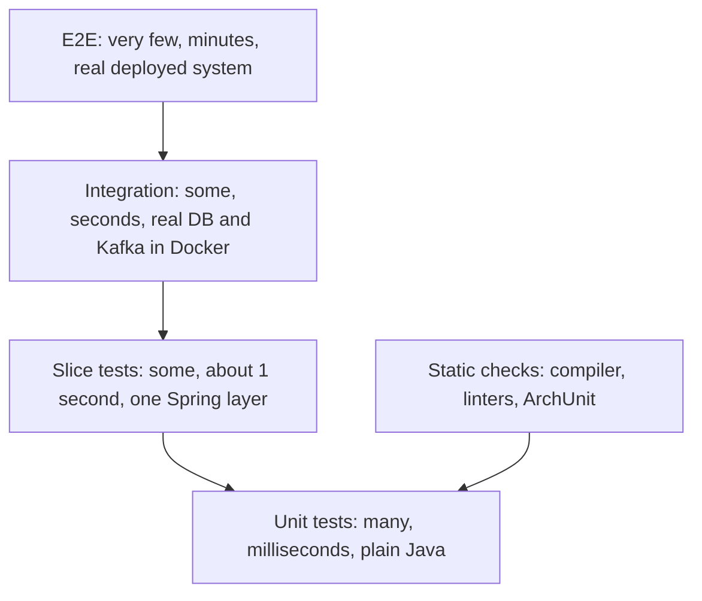

**What seniors actually do in a Spring Boot service:**

| Layer | Tool | Rough share | What it proves |
|---|---|---|---|
| Static | Compiler, Checkstyle/Error Prone, ArchUnit | Always on | Code follows rules |
| Unit | JUnit + Mockito + AssertJ, no Spring | 50–70% | Business rules, edge cases |
| Slice | `@WebMvcTest`, `@DataJpaTest`, `@JsonTest` | 15–25% | HTTP mapping, JSON, SQL queries |
| Integration | `@SpringBootTest` + Testcontainers | 10–20% | The parts work together: DB, Kafka, Redis |
| Contract | Spring Cloud Contract / Pact | Per API | Other teams' calls will not break |
| E2E | Playwright, Postman/Newman, smoke tests | A handful | The deployed system works for users |

The numbers are a guide, not a law. A CRUD service with little logic needs more integration tests and fewer unit tests.

**Good and bad:**

| Good | Bad |
|---|---|
| Unit tests for logic, Testcontainers for SQL and Kafka | 2,000 mocks that test nothing real ("ice cream cone" of E2E tests) |
| A few E2E smoke tests after each deploy | 300 Selenium tests that take 2 hours and fail randomly |
| Test behaviour (what it does) | Test private details (how it does it). Every refactor breaks tests |

**Say this in the interview:**
> I follow the pyramid idea, but I am practical. Business logic gets fast unit tests without Spring. SQL, Kafka and HTTP mapping get slice or integration tests against real containers, because mocks cannot catch a wrong query. I keep a handful of end-to-end smoke tests after deploy. My goal is confidence per minute of build time, not a coverage number.

**They may ask next:**
- **Pyramid or trophy?** Both say "few E2E". The trophy adds weight to integration tests. With Testcontainers, integration tests are cheap enough that I write more of them than the classic pyramid suggests.
- **How long should the build take?** Unit tests in seconds. The full suite on CI in under about 10 minutes. Slower than that, and people stop running it.

---

## Unit, integration, end-to-end and contract tests

**In one line:** The test type depends on how much is real: one class (unit), several parts (integration), the deployed system (E2E), or an API agreement (contract).

**Story:** A new car is tested at four levels.
- Each spark plug is tested alone on a bench (unit).
- The engine is run with the real gearbox (integration).
- A driver takes the full car on a real road (E2E).
- The tyre company and the car company agree on the wheel size on paper, and both check it (contract).

**How it works:**

| Type | What is real | What is fake | Speed | Breaks because of |
|---|---|---|---|---|
| **Unit** | One class | Its dependencies (mocks or fakes) | ms | Your logic |
| **Slice** | One Spring layer | Other layers (`@MockitoBean`) | ~1 s | Mapping, config, annotations |
| **Integration** | App + DB + Kafka (in Docker) | Other teams' services (WireMock) | seconds | Wiring, SQL, serialization |
| **E2E** | Everything, deployed | Nothing (or only payment sandbox) | minutes | Anything, including the network |
| **Contract** | Request/response shape | The other service | ms–s | An API change that breaks a consumer |

**Diagram: what is real in each test type**

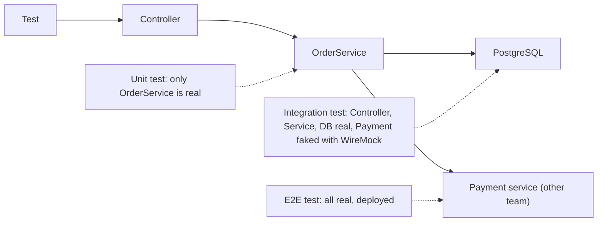

**Good and bad:**

| Good | Bad |
|---|---|
| Name tests by what is real: `*Test` for unit/slice, `*IT` for integration | Calling everything "unit test" |
| Run unit tests on every save, integration tests on every push | Only running tests on CI at night |
| Fake other teams' services at the HTTP level (WireMock) | Calling the real staging payment service from CI |

**Say this in the interview:**
> A unit test checks one class with its dependencies faked. An integration test checks that real parts work together, like my service with a real PostgreSQL in Docker. An end-to-end test runs against the deployed system like a user. A contract test checks the agreement between two services, so one team cannot break another by changing a field.

**They may ask next:**
- **Is `@WebMvcTest` a unit test?** It is a slice test. Spring starts, but only the web layer. It is between unit and integration.
- **How do you run unit and integration tests separately?** Maven Surefire runs `*Test`, Failsafe runs `*IT` in the `integration-test` phase. In Gradle, use a separate test task or JUnit tags (`@Tag("integration")`).

---

## JUnit basics: lifecycle, @Nested and @DisplayName

**In one line:** JUnit creates a **new test class instance for every test method** and runs setup and cleanup hooks around it.

**Story:** In a cricket net session, every batsman gets a fresh set of balls (a new instance).
The ground is prepared once in the morning (`@BeforeAll`).
The pitch is swept before each batsman (`@BeforeEach`).
If one batsman makes a mess, the next batsman still gets a clean pitch.

**Version facts (Nov 2026):**
- **JUnit 6** (6.0 released Sept 2025, 6.1 in May 2026) is the current major version. It needs **Java 17+**.
- Platform, Jupiter and Vintage now share **one version number** (before: Platform 1.x, Jupiter 5.x).
- The API is still `org.junit.jupiter.api.*`. Most JUnit 5 tests run unchanged.
- **Spring Framework 7 / Boot 4 use JUnit 6.** JUnit 4 support (`SpringRunner`) is deprecated in Spring 7.
- JUnit 6.1 adds `@DefaultTimeZone` and `@DefaultLocale`, useful for date and money tests.

**How it works (the order for one test class):**
1. `@BeforeAll` (static) runs once.
2. For each test: new instance, then `@BeforeEach`, then the `@Test` method, then `@AfterEach`.
3. `@AfterAll` (static) runs once at the end.
4. With `@TestInstance(PER_CLASS)`, one instance is shared and `@BeforeAll` need not be static. Use it rarely, because shared state causes order bugs.

**Diagram:**

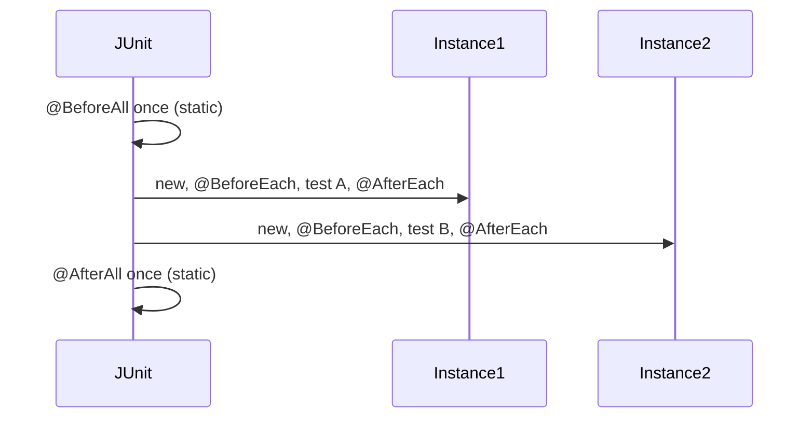

**Example: lifecycle, `@Nested` and `@DisplayName`**

```java
@DisplayName("Cart")
class CartTest {

    Cart cart = new Cart();                          // runs again for every test (new instance)

    @Nested
    @DisplayName("when empty")
    class WhenEmpty {
        @Test
        @DisplayName("total is zero")
        void totalIsZero() {
            assertThat(cart.total()).isEqualByComparingTo("0.00");
        }
    }

    @Nested
    @DisplayName("after adding 2 teas of 120")
    class WithTwoTeas {
        @BeforeEach                                  // runs after the outer setup
        void addTea() { cart.add(new Item("TEA-1", new BigDecimal("120.00")), 2); }

        @Test
        @DisplayName("total is 240")
        void totalIs240() {
            assertThat(cart.total()).isEqualByComparingTo("240.00");
        }
    }
}
```

The report reads like a sentence: *Cart → after adding 2 teas of 120 → total is 240*.

**Other annotations you will meet:**

| Annotation | Use |
|---|---|
| `@Disabled("JIRA-123")` | Skip a test. Always give a reason |
| `@Tag("integration")` | Group tests, run groups separately |
| `@Timeout(2)` | Fail if slower than 2 seconds |
| `@TempDir Path dir` | A fresh temp folder, deleted after the test |
| `@RepeatedTest(50)` | Run 50 times, good for hunting a flaky test |
| `@EnabledOnOs`, `@EnabledIfEnvironmentVariable` | Run only in some environments |
| `@ExtendWith(...)` | Plug in an extension: `MockitoExtension`, `SpringExtension` |

**Good and bad:**

| Good | Bad |
|---|---|
| One behaviour per test, clear name: `declinedPaymentMarksOrderFailed` | `test1`, `testOrder` |
| Arrange, act, assert, with a blank line between | 80-line tests that check 12 things |
| `@Nested` to group "given" situations | Tests that depend on running in a certain order |

**Say this in the interview:**
> JUnit creates a new instance of the test class for each test, so fields are fresh every time. `@BeforeEach` and `@AfterEach` run around each test, and static `@BeforeAll` and `@AfterAll` run once. I use `@Nested` with `@DisplayName` to group tests by situation, so the report reads like a spec. We are on JUnit 6 with Spring Boot 4, which needs Java 17 and keeps the same Jupiter API.

**They may ask next:**
- **JUnit 4 vs 5/6?** JUnit 4 used `@RunWith` and `@Before`. JUnit 5/6 use extensions (`@ExtendWith`) and `@BeforeEach`. JUnit 4 tests can still run through the Vintage engine during migration.
- **Why is `@BeforeAll` static?** Because it runs before any instance exists. With `PER_CLASS` it can be non-static.

---

## Parameterized tests

**In one line:** One test method, many input rows. Each row runs as its own test.

**Story:** A bank teller checks notes. You do not write a new rule for each note. You run the same check on ₹10, ₹100, ₹500 and a fake note, and write down the result for each.

**How it works:**
1. Replace `@Test` with `@ParameterizedTest`.
2. Add a source of arguments: `@ValueSource`, `@CsvSource`, `@MethodSource`, `@EnumSource`, `@NullAndEmptySource`.
3. Each row shows as a separate result, so you see exactly which input failed.
4. JUnit 5.13+ and 6 also have `@ParameterizedClass`, to run a whole class for each input.

**Example:**

```java
@ParameterizedTest(name = "{0} items -> {1}% discount")
@CsvSource({
    "1,  0",
    "5,  5",
    "10, 10",
    "50, 10"                                   // edge case: discount is capped at 10%
})
void discountByQuantity(int quantity, int expectedPercent) {
    assertThat(pricing.discountPercent(quantity)).isEqualTo(expectedPercent);
}

@ParameterizedTest
@NullAndEmptySource                            // null and ""
@ValueSource(strings = {" ", "\t"})
void rejectsBlankSku(String sku) {
    assertThatThrownBy(() -> new Item(sku, BigDecimal.ONE))
        .isInstanceOf(IllegalArgumentException.class);
}

@ParameterizedTest
@MethodSource("badEmails")                     // for objects that do not fit in CSV
void rejectsBadEmails(String email) {
    assertThat(validator.isValid(email)).isFalse();
}

static Stream<String> badEmails() { return Stream.of("a@", "@b.com", "a b@c.com"); }
```

**Good and bad:**

| Good | Bad |
|---|---|
| Boundary values: 0, 1, max, max+1 | Only the happy value 5 |
| A `name` pattern so the report is readable | A loop inside one `@Test`: first failure hides the rest |
| `@MethodSource` for complex objects | 40-column CSV nobody can read |

**Say this in the interview:**
> When the same rule must hold for many inputs, I use `@ParameterizedTest` with `@CsvSource` or `@MethodSource`. Each row is reported as its own test, so I see which input failed. I always add the boundaries: zero, one, the max, and just above the max.

**They may ask next:**
- **Difference from `@RepeatedTest`?** `@RepeatedTest` runs the same input many times. Parameterized runs different inputs.

---

## Assertions with AssertJ and assertThrows

**In one line:** AssertJ gives readable, chainable checks (`assertThat(x).isEqualTo(y)`) with clear failure messages; Spring Boot's test starter includes it.

**Story:** A bad shop receipt says "Error". A good receipt says "You paid ₹240, but the bill was ₹250, item MILK-2 is missing". AssertJ failure messages are the good receipt.

**How it works:**
- Start with `assertThat(actual)`, then press `.` in the IDE and pick a check.
- Collections: `hasSize`, `contains`, `containsExactly` (order matters), `extracting`.
- `BigDecimal`: use `isEqualByComparingTo`, because `240.0` and `240.00` are not `equals()`.
- Objects: `usingRecursiveComparison()` compares field by field, and can ignore `id` or `createdAt`.
- Exceptions: AssertJ `assertThatThrownBy`, or JUnit `assertThrows` which returns the exception.
- Soft assertions: check many things and report all failures, not only the first.

**Example:**

```java
assertThat(order.items())
    .hasSize(2)
    .extracting(Item::sku)
    .containsExactly("TEA-1", "MILK-2");               // order matters

assertThat(order.total()).isEqualByComparingTo("240.00");  // 240.0 equals 240.00 here

assertThat(customer).usingRecursiveComparison()
    .ignoringFields("id", "createdAt")                 // generated values
    .isEqualTo(expectedCustomer);

assertThatThrownBy(() -> service.cancel(99L))          // AssertJ style
    .isInstanceOf(OrderNotFoundException.class)
    .hasMessageContaining("99");

var ex = assertThrows(OrderNotFoundException.class,    // JUnit style, returns the exception
    () -> service.cancel(99L));
assertThat(ex.orderId()).isEqualTo(99L);

SoftAssertions.assertSoftly(soft -> {                  // reports ALL failures at once
    soft.assertThat(order.status()).isEqualTo(Status.NEW);
    soft.assertThat(order.items()).isNotEmpty();
});
```

**Good and bad:**

| Good | Bad |
|---|---|
| `assertThat(list).containsExactly(a, b)` | `assertTrue(list.size() == 2 && list.get(0).equals(a))`: failure says only "expected true" |
| `isEqualByComparingTo` for money | `assertEquals(new BigDecimal("240"), total)` fails on scale |
| Check the exception type **and** message or field | `assertThrows(Exception.class, ...)`: passes for a `NullPointerException` too |

**Say this in the interview:**
> I use AssertJ for almost all assertions because the failure messages are clear and the API is easy to find in the IDE. For exceptions I use `assertThatThrownBy` or JUnit's `assertThrows`, and I check the exact type and the message. For money I compare `BigDecimal` with `isEqualByComparingTo`, because `equals` also checks the scale.

**They may ask next:**
- **Hamcrest?** An older matcher library (`assertThat(x, is(5))`). Still used inside MockMvc `jsonPath` checks. AssertJ is more common in new code.

---

## Test doubles: dummy, stub, fake, mock and spy

**In one line:** A *test double* is any stand-in for a real dependency: a dummy, stub, fake, mock or spy, depending on what you need from it.

**Story:** In a film shoot:
- A **dummy** is a mannequin in the background. Nobody talks to it.
- A **stub** is an actor who says one fixed line.
- A **fake** is a cardboard house that looks real enough for the scene.
- A **mock** is an actor whose lines are checked by the director afterwards: "did you say it exactly once?"
- A **spy** is the real star with a hidden microphone. The star acts normally, and you can listen in.

**How it works:**

| Double | Does | Example |
|---|---|---|
| **Dummy** | Fills a parameter, never used | `null` or `mock(Logger.class)` |
| **Stub** | Returns canned answers | `when(rates.get("USD")).thenReturn(83.2)` |
| **Fake** | Simple working version | `InMemoryOrderRepository` with a `HashMap` |
| **Mock** | Records calls so you can verify them | `verify(email).send(any())` |
| **Spy** | Wraps the real object, real methods run | `spy(realCalculator)` |

In Mockito, one `mock()` object can act as a stub (with `when`) and a mock (with `verify`). People say "mock" for both.

**Diagram: the same call, real vs mocked**

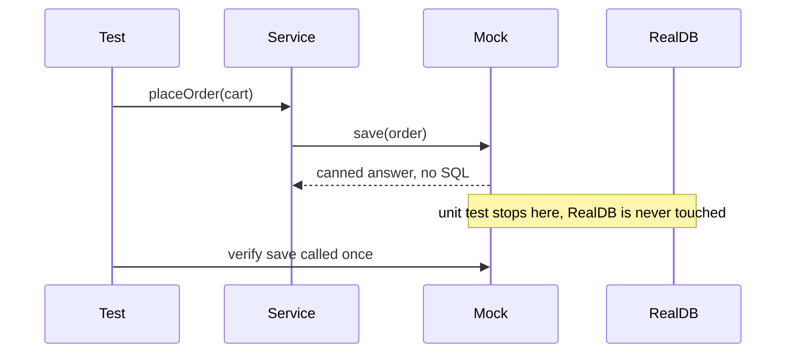

**Good and bad:**

| Good | Bad |
|---|---|
| Fakes for things with state (an in-memory repo) | 20 `when(...)` lines to simulate a repository |
| Mocks for side effects you must check: email sent, event published | Verifying every getter call. The test breaks on every refactor |
| Real objects for value types (`Money`, `Address`, records) | Mocking a record or a `List` |

**Say this in the interview:**
> Stubs give canned answers. Mocks also let me verify calls. Fakes are light working versions, like an in-memory repository. Spies wrap the real object. I stub queries and verify commands: I check that the email was sent, but I do not verify that a getter was called. Value objects are never mocked; I just create real ones.

**They may ask next:**
- **Classic vs mockist (London) style?** Classic: use real objects where cheap, check the final state. Mockist: mock every neighbour, check the calls. I lean classic, because mockist tests break on every refactor.

---

## Mockito essentials: when, verify and ArgumentCaptor

**In one line:** Mockito creates fake objects; you tell them what to return (`when`/`given`), and later check how they were called (`verify`/`then`).

**Story:** You hire a practice partner for a job interview.
You give them a script: "If I say hello, you say hi" (stubbing).
After practice, you ask: "Did I say thank you exactly once?" (verify).
You also record exactly what you said, to check the words later (ArgumentCaptor).

**How it works:**
1. `@ExtendWith(MockitoExtension.class)` turns on the Mockito annotations.
2. `@Mock` creates a mock. `@InjectMocks` creates the class under test and passes the mocks in (constructor first).
3. **Stub:** `when(mock.call(args)).thenReturn(value)`, or BDD style `given(...).willReturn(...)`.
4. **Throw:** `thenThrow(new TimeoutException())`. For `void` methods: `doThrow(...).when(mock).send(any())`.
5. **Verify:** `verify(mock).call(args)`, `verify(mock, times(2))`, `verify(mock, never())`, `verifyNoInteractions(mock)`.
6. **Capture:** `ArgumentCaptor` grabs the real argument so you can assert on it.
7. **Matchers:** `any()`, `eq()`, `argThat(...)`. If one argument uses a matcher, all arguments must.

**Example:**

```java
@ExtendWith(MockitoExtension.class)
class NotificationServiceTest {

    @Mock EmailClient email;
    @Mock CustomerRepository customers;
    @InjectMocks NotificationService service;          // gets both mocks via constructor
    @Captor ArgumentCaptor<Email> emailCaptor;

    @Test
    void sendsShippingEmailInCustomerLanguage() {
        given(customers.findById("c1"))                 // stub: a query
            .willReturn(Optional.of(new Customer("c1", "ravi@example.com", Locale.of("hi"))));

        service.orderShipped("c1", "ORD-42");

        then(email).should().send(emailCaptor.capture()); // verify: a command, and grab the argument
        Email sent = emailCaptor.getValue();
        assertThat(sent.to()).isEqualTo("ravi@example.com");
        assertThat(sent.template()).isEqualTo("shipped_hi");
    }

    @Test
    void doesNotSendWhenCustomerIsMissing() {
        given(customers.findById("c9")).willReturn(Optional.empty());

        service.orderShipped("c9", "ORD-43");

        then(email).shouldHaveNoInteractions();
    }
}
```

**Diagram: stub, act, verify**

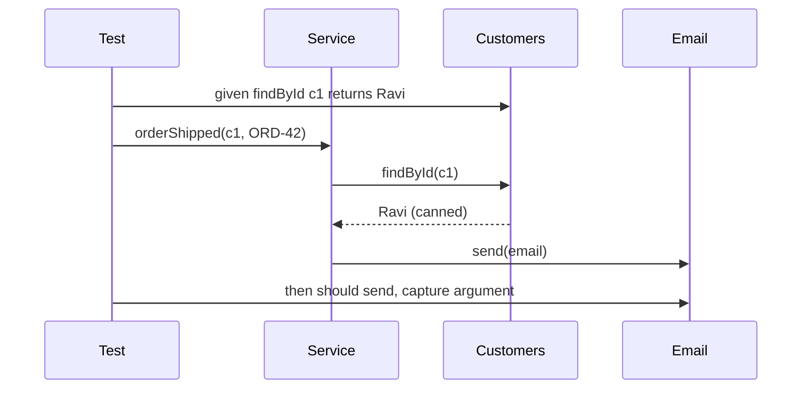

**Good and bad:**

| Good | Bad |
|---|---|
| `given/then` (BDD style) reads like the test story | Mixing styles in one file |
| Captor when the argument is built inside the method | Captor for everything; `eq(x)` is simpler when you know the value |
| `verify` only for side effects | `verify` for a stub you already used. If the result is right, the call happened |

**Say this in the interview:**
> I use `@Mock` and `@InjectMocks` with `MockitoExtension`, so no Spring is needed. I stub queries with `given().willReturn()` and verify commands with `then().should()`. When the method builds an object inside and passes it on, like an email, I use an `ArgumentCaptor` to check its fields. If a test needs ten stubs, the class probably does too much.

**They may ask next:**
- **`thenReturn` vs `thenAnswer`?** `thenReturn` gives a fixed value. `thenAnswer` runs code, for example to return the argument that was passed in: `willAnswer(inv -> inv.getArgument(0))`.
- **`verify` with `times(1)` vs default?** The same. `verify(mock)` means exactly once.
- **What is `InOrder`?** `inOrder(a, b)` checks that calls happened in a given order. Use it only when the order really matters, like "save before publish".

---

## Mockito rules: strict stubs, static and final mocks, what not to mock

**In one line:** Mockito 5 is strict by default, can mock final classes and static methods, but the best tests mock only your own boundaries.

**Story:** You practise driving in a simulator. If the simulator pretends the brakes are perfect, you learn wrong habits.
Mocking a library you do not own is like that: your mock says "it works like this", but the real library may not.

**How it works:**

**Strict stubs:**
- `MockitoExtension` uses *strict stubs* by default.
- An unused stub fails the test with `UnnecessaryStubbingException`. This keeps tests clean.
- A stub called with different arguments gives `PotentialStubbingProblem`. This catches wrong arguments early.
- If a stub is truly shared and sometimes unused, mark it `lenient().when(...)`. Do not turn strictness off for the whole class.

**Mockito 5 facts:**
- Mockito 5 uses the **inline mock maker** by default. It can mock `final` classes and methods, and static methods with `mockStatic`. No `mockito-inline` artifact is needed.
- It needs Java 11+.
- On Java 21+ you may see a warning about a "dynamically loaded agent". The fix: add Mockito as a `-javaagent` in your Maven Surefire or Gradle test config. The Mockito docs show how.
- Spring Boot 4 removed `MockitoTestExecutionListener`. If `@Mock` fields in a Spring test stop working, add `@ExtendWith(MockitoExtension.class)`.

**Mocking static methods (only for legacy code):**

```java
@Test
void usesLegacyTaxTable() {
    try (MockedStatic<LegacyTaxTable> table = mockStatic(LegacyTaxTable.class)) {  // scope: this block only
        table.when(() -> LegacyTaxTable.rateFor("KA")).thenReturn(new BigDecimal("0.18"));

        assertThat(calculator.taxFor("KA", new BigDecimal("100")))
            .isEqualByComparingTo("18.00");
    }                                                   // real static method is back for other tests
}
```

Better fix: wrap the static call in a small bean (`TaxTable` interface), and inject it. For time, inject a `java.time.Clock` instead of mocking `LocalDate.now()`.

**"Don't mock what you don't own":**
- Do not mock `RestClient`, `KafkaTemplate`, `JdbcTemplate` or `EntityManager` chains. Their behaviour is complex. Your mock will lie.
- Instead, wrap them in your own small class (`PaymentClient`). Mock **that** in service tests.
- Test the wrapper itself with a real-ish setup: `@RestClientTest`, WireMock or Testcontainers.

**Diagram:**

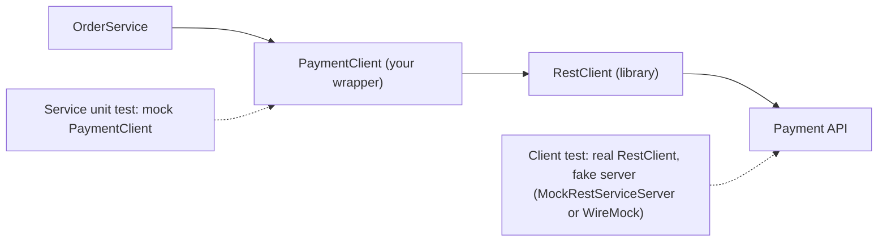

**Good and bad:**

| Good | Bad |
|---|---|
| Inject `Clock`, `UUID` supplier, random source | `mockStatic(LocalDateTime.class)` everywhere |
| Mock your own interface `PaymentClient` | `when(restClient.post().uri(any()).body(any()).retrieve())...` deep stub chains |
| `lenient()` on one shared stub | `@MockitoSettings(strictness = LENIENT)` on every class |

**Say this in the interview:**
> Mockito 5 can mock final classes and static methods out of the box, but I treat static mocking as a smell for legacy code only. I prefer to inject a `Clock` or a small wrapper. I do not mock libraries I don't own, like `RestClient` or `KafkaTemplate`. I wrap them in my own client, mock my client in service tests, and test the wrapper against a fake server or a container. Strict stubs stay on, so unused stubs fail the test.

**They may ask next:**
- **Why are deep stubs bad?** `RETURNS_DEEP_STUBS` lets you mock long chains. The test then mirrors the code line by line and breaks on any change.
- **Can Mockito mock a record?** Yes, records are final and Mockito 5 can mock final classes. But don't. Just create a real record.

---

## Testing a service class (full example)

**In one line:** Create the service with `new`, pass mocks and a fixed `Clock`, then test each business rule in its own test.

**Story:** To test a new cashier, the manager does not open the whole supermarket.
They sit the cashier at one counter with a fake card machine and a fixed clock.
Then they try three cases: card OK, card declined, empty basket.

**The service under test:**

```java
@Service
public class OrderService {
    private final OrderRepository orders;
    private final PaymentClient payments;
    private final ApplicationEventPublisher events;
    private final Clock clock;                             // injected, so tests can fix the time

    public OrderService(OrderRepository orders, PaymentClient payments,
                        ApplicationEventPublisher events, Clock clock) {
        this.orders = orders; this.payments = payments; this.events = events; this.clock = clock;
    }

    @Transactional
    public Order place(PlaceOrder cmd) {
        if (cmd.items().isEmpty()) throw new IllegalArgumentException("Cart is empty");
        Order order = Order.newOrder(cmd, Instant.now(clock));
        if (payments.charge(cmd.customerId(), order.total()) == PaymentResult.DECLINED) {
            return orders.save(order.markPaymentFailed());
        }
        Order saved = orders.save(order.markPaid());
        events.publishEvent(new OrderPlaced(saved.id(), saved.total()));
        return saved;
    }
}
```

**The tests:**

```java
@ExtendWith(MockitoExtension.class)
class OrderServiceTest {
    static final Instant NOW = Instant.parse("2026-11-16T10:00:00Z");

    @Mock OrderRepository orders;
    @Mock PaymentClient payments;
    @Mock ApplicationEventPublisher events;
    OrderService service;

    @BeforeEach
    void setUp() {                                           // plain constructor, no Spring
        service = new OrderService(orders, payments, events, Clock.fixed(NOW, ZoneOffset.UTC));
        lenient().when(orders.save(any())).thenAnswer(inv -> inv.getArgument(0)); // echo back
    }

    @Test
    void paidOrderIsSavedAndEventIsPublished() {
        given(payments.charge(eq("c1"), any())).willReturn(PaymentResult.OK);

        Order order = service.place(aCommand().customer("c1").item("TEA-1", 2).build());

        assertThat(order.status()).isEqualTo(Status.PAID);
        assertThat(order.createdAt()).isEqualTo(NOW);
        then(events).should().publishEvent(any(OrderPlaced.class));
    }
}
```

Two more tests in the same class, for the declined card and the guard clause:

```java
@Test
void declinedPaymentIsSavedAsFailedWithoutEvent() {
    given(payments.charge(any(), any())).willReturn(PaymentResult.DECLINED);

    assertThat(service.place(aCommand().build()).status()).isEqualTo(Status.PAYMENT_FAILED);
    then(events).shouldHaveNoInteractions();
}

@Test
void emptyCartIsRejectedBeforePaymentIsCalled() {
    assertThatThrownBy(() -> service.place(aCommand().noItems().build()))
        .isInstanceOf(IllegalArgumentException.class)
        .hasMessage("Cart is empty");
    then(payments).shouldHaveNoInteractions();             // never charge for an empty cart
}
```

`aCommand()` is a [test data builder](#test-data-builders). The `lenient()` stub is used by two tests and not by the third, so it is marked lenient.

**What this unit test does NOT prove** (and which test does):

| Not proven here | Proven by |
|---|---|
| `@Transactional` really rolls back on error | `@SpringBootTest` + Testcontainers |
| The SQL in `OrderRepository` is right | `@DataJpaTest` |
| `PaymentClient` sends the right JSON | `@RestClientTest` or WireMock |
| The event listener reacts | Integration test, or a unit test of the listener |

**Good and bad:**

| Good | Bad |
|---|---|
| Constructor injection: tests use `new` | Field `@Autowired`: tests need Spring or reflection |
| One rule per test | One giant test for all three cases |
| Fixed `Clock` | `Instant.now()` inside the service: time-based tests become flaky |

**Say this in the interview:**
> For a service class I don't start Spring. Thanks to constructor injection, I create it with `new` and pass Mockito mocks for the repository and the payment client, plus a fixed `Clock`. I write one test per business rule: happy path, declined payment, empty cart. I also know what this test cannot prove, like the SQL or the transaction, so those have their own slice or integration tests.

**They may ask next:**
- **Mock the repository or use a fake?** For one or two calls, a mock is fine. If many tests save and read back, an in-memory fake is simpler and less brittle.
- **How do you test a private method?** Through the public method that calls it. If it needs its own tests, it probably belongs in its own class.

---

## @SpringBootTest vs test slices: what each one loads

**In one line:** `@SpringBootTest` starts the whole application; a *slice* annotation starts only the beans for one layer, so it is faster and more focused.

Recap from [Spring ecosystem: test slices](spring-ecosystem.md#test-slices-webmvctest-datajpatest): `@WebMvcTest` loads the web layer and you mock services; `@DataJpaTest` loads JPA and rolls back each test. Here we go deeper.

**Story:** A hospital checks a new heart machine.
- **Slice test:** the machine is tested in the lab with a dummy patient.
- **`@SpringBootTest`:** the whole operating theatre runs with doctors, nurses and power, even if you only check one cable.
Both are useful. You do not need the whole theatre for every cable.

**Diagram: which slice covers which layer**

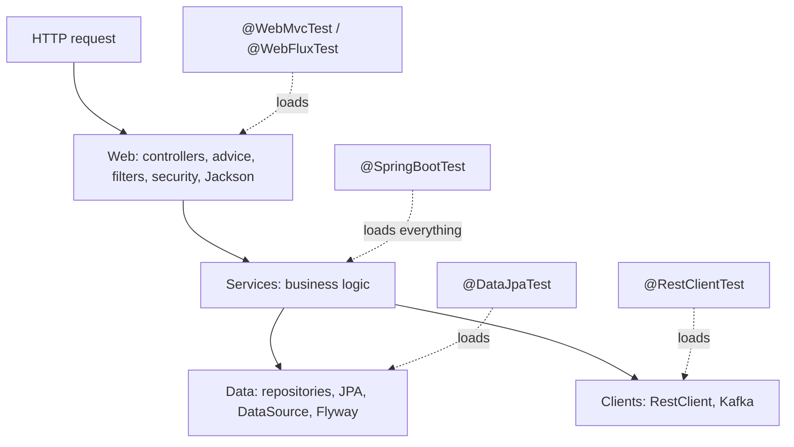

**What each one loads:**

| Annotation | Loads | Does NOT load | You add |
|---|---|---|---|
| `@SpringBootTest` | All beans, all auto-config | Nothing is skipped | Testcontainers, `@AutoConfigureMockMvc` (Boot 4) |
| `@WebMvcTest(X.class)` | Controller X, `@ControllerAdvice`, filters, `WebMvcConfigurer`, converters, Jackson, Security, `MockMvc` | `@Service`, `@Repository`, `@Component` | `@MockitoBean` for services, `@Import(SecurityConfig.class)` |
| `@WebFluxTest` | WebFlux controllers, `WebTestClient` | Services, repositories | `@MockitoBean` |
| `@DataJpaTest` | Entities, repositories, `EntityManager`, `DataSource`, Flyway/Liquibase, `TestEntityManager` | Web, services | A real DB container |
| `@JsonTest` | Jackson `ObjectMapper`/`JsonMapper`, your Jackson modules, `JacksonTester` | Almost everything else | Nothing |
| `@RestClientTest` | `RestClient.Builder`, `RestTemplateBuilder`, Jackson, `MockRestServiceServer` | Web, data | The client class |
| `@DataMongoTest`, `@DataRedisTest`, `@JdbcTest` | That store only | The rest | A container |

**Diagram: inside a `@WebMvcTest`**

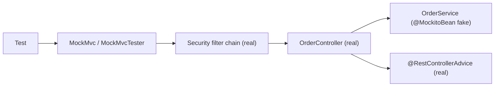

**Boot 4 notes:**
- Test support is split by technology. Add `spring-boot-starter-webmvc-test`, `spring-boot-starter-data-jpa-test`, `spring-boot-starter-security-test` and so on. They bring in `spring-boot-starter-test` for you.
- Packages moved, for example `org.springframework.boot.webmvc.test.autoconfigure.WebMvcTest`.
- `spring-boot-starter-test-classic` exists to help a slow migration.

**Good and bad:**

| Good | Bad |
|---|---|
| Slice for one layer's concerns | `@SpringBootTest` for a JSON field name check |
| `@SpringBootTest` for real end-to-end flows inside the service | A slice test with 8 `@MockitoBean`s: you are fighting the slice |
| `@Import` the one extra bean the slice needs | `@ComponentScan` in the test, which loads everything again |

**Say this in the interview:**
> `@SpringBootTest` loads the full application context. Slices like `@WebMvcTest`, `@DataJpaTest`, `@JsonTest` and `@RestClientTest` load only one layer. For example, `@WebMvcTest` loads controllers, advice, filters, Jackson and security, but no services, so I mock those with `@MockitoBean`. Slices are faster and their failures point to one layer. I use `@SpringBootTest` only for flows that cross layers.

**They may ask next:**
- **Why did my `@WebMvcTest` fail with "No qualifying bean of type OrderService"?** The slice does not load services. Add `@MockitoBean OrderService`.
- **Why does my custom `@Component` filter not run in `@WebMvcTest`?** `Filter` beans are included. But a filter that needs a service will fail to start; mock that service or `@Import` the filter's config.

---

## Web layer tests: @WebMvcTest, MockMvc and MockMvcTester

**In one line:** `MockMvc` sends a fake HTTP request through the real Spring MVC machinery (filters, controller, JSON, error handling) without opening a network port.

**Story:** A theatre does a full dress rehearsal: real actors, real costumes, real lights. But the seats are empty.
MockMvc is that rehearsal. Everything on stage is real, only the audience (the network) is missing.

**How it works:**
1. `@WebMvcTest(OrderController.class)` starts the web slice.
2. MockMvc builds a fake `HttpServletRequest` and passes it to the `DispatcherServlet`.
3. Filters (including Security), argument binding, `@Valid`, the controller, Jackson and `@RestControllerAdvice` all run for real.
4. You check status, headers and JSON.
5. **`MockMvcTester`** (Spring Framework 6.2+) is the AssertJ-style API. No checked exceptions, better messages. Use it for new code.

**Diagram: MockMvc vs a real server**

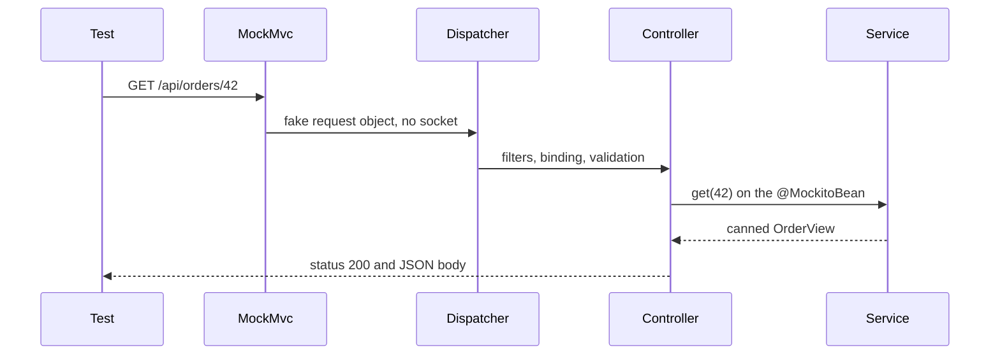

**Example: classic MockMvc**

```java
@WebMvcTest(OrderController.class)
class OrderControllerTest {

    @Autowired MockMvc mockMvc;
    @MockitoBean OrderService service;                     // controller's dependency, faked

    @Test
    @WithMockUser
    void returnsOrderAsJson() throws Exception {
        given(service.get(42L)).willReturn(new OrderView(42L, "NEW", new BigDecimal("240.00")));

        mockMvc.perform(get("/api/orders/42").accept(MediaType.APPLICATION_JSON))
            .andExpect(status().isOk())
            .andExpect(jsonPath("$.id").value(42))
            .andExpect(jsonPath("$.status").value("NEW"));
    }

    @Test
    @WithMockUser
    void rejectsEmptyCart() throws Exception {
        mockMvc.perform(post("/api/orders").with(csrf())      // CSRF is on unless your config turns it off
                .contentType(MediaType.APPLICATION_JSON)
                .content("""
                    {"customerId":"c1","items":[]}
                    """))
            .andExpect(status().isBadRequest());               // @Valid with @NotEmpty items
        then(service).shouldHaveNoInteractions();              // bad input never reaches the service
    }
}
```

**Example: the same with `MockMvcTester`**

```java
@Autowired MockMvcTester mvc;

@Test
@WithMockUser
void returnsOrderAsJson() {
    given(service.get(42L)).willReturn(new OrderView(42L, "NEW", new BigDecimal("240.00")));

    assertThat(mvc.get().uri("/api/orders/42"))
        .hasStatusOk()
        .bodyJson()
        .isLenientlyEqualTo("""
            {"id": 42, "status": "NEW"}
            """);                                          // extra fields allowed, field order ignored
}
```

**What to test in the web layer:**
- URL, HTTP method and status codes (200, 201, 400, 404, 409).
- JSON field names and formats (dates, money).
- Validation errors and the `ProblemDetail` body from your advice.
- Security rules (401, 403). See [Testing Spring Security](#testing-spring-security).
- **Not** business logic. That is in the service unit tests.

**Good and bad:**

| Good | Bad |
|---|---|
| One test per status code your API promises | Only the 200 case |
| `isLenientlyEqualTo` or `jsonPath` for the fields that matter | Comparing the full JSON string, including field order |
| Check the service was **not** called on bad input | Business rules tested through MockMvc |

**Say this in the interview:**
> MockMvc runs a request through the real DispatcherServlet, filters, validation, controller and Jackson, but with no real server or port. I use it with `@WebMvcTest` and mock the services with `@MockitoBean`. In new code I use `MockMvcTester`, the AssertJ version from Spring 6.2. I test status codes, JSON shape, validation and security there, not business rules.

**They may ask next:**
- **MockMvc vs a real HTTP call?** MockMvc skips the network, the servlet container and real error pages. It is fast. A real call (`RestTestClient`) also tests Tomcat, compression and real error handling.
- **Can MockMvc test a whole app?** Yes: `@SpringBootTest` + `@AutoConfigureMockMvc`. In Boot 4 you must add `@AutoConfigureMockMvc` yourself.

---

## Database tests with @DataJpaTest

**In one line:** `@DataJpaTest` starts only the JPA layer and rolls back each test, so you can test queries and mappings fast.

**Story:** Before a new library opens, someone checks that every book goes on the right shelf and the catalogue finds it.
They don't need the front desk or the café open. `@DataJpaTest` is that check: shelves and catalogue only.

**How it works:**
1. Loads entities, Spring Data repositories, `EntityManager`, `DataSource`, Flyway or Liquibase, and `TestEntityManager`.
2. Each test runs in a transaction that **rolls back** at the end. The DB stays clean.
3. If an embedded DB (H2) is on the classpath, it may replace your datasource. Since Boot 3.4 the default is `Replace.NON_TEST`: a database from Testcontainers `@ServiceConnection` is **not** replaced.
4. Use the same database as production (PostgreSQL in Docker). See [Testcontainers](#testcontainers-postgresql-kafka-and-redis).

**Example:**

```java
@DataJpaTest
@Import(PostgresContainerConfig.class)                 // real PostgreSQL, not H2
class OrderRepositoryTest {

    @Autowired OrderRepository repo;
    @Autowired TestEntityManager em;

    @Test
    void loadsNewOrdersWithItemsInOneQuery() {
        em.persist(anOrderEntity().status(NEW).build());
        em.persist(anOrderEntity().status(SHIPPED).build());
        em.flush();                                     // send INSERTs now, so constraints run
        em.clear();                                     // empty the cache: the next read really hits the DB

        List<OrderEntity> found = repo.findWithItemsByStatus(NEW);   // JOIN FETCH query

        assertThat(found).hasSize(1);
        assertThat(found.getFirst().getItems()).isNotEmpty();
    }
}
```

**The rollback trap:**
- The test runs in one transaction, so lazy loading always works inside the test.
- In production, the same code may throw `LazyInitializationException` after the transaction is closed.
- Without `flush()`, the INSERT may never be sent, so a unique constraint never fails in the test.
- Fix: `flush()` and `clear()` before reading. For flows that cross transactions, use `@SpringBootTest` without `@Transactional` on the test.

**Diagram:**

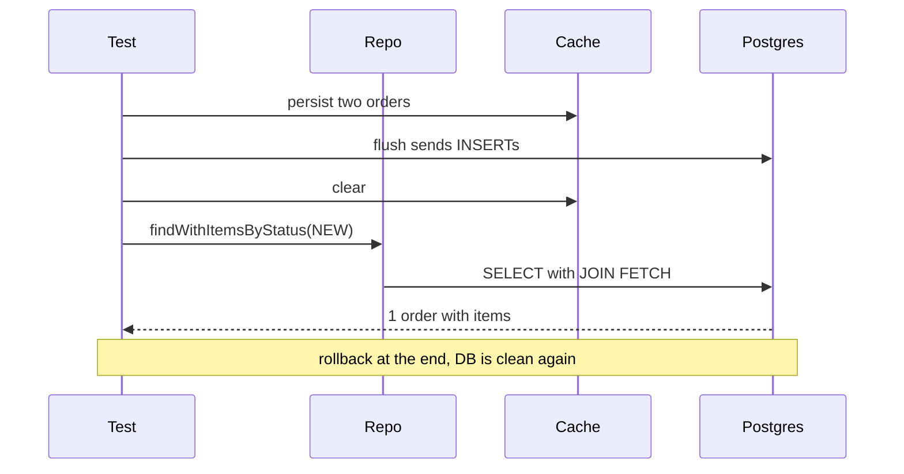

**Good and bad:**

| Good | Bad |
|---|---|
| Test custom queries, `@Query`, projections, N+1 fixes | Testing `save()` and `findById()` that Spring Data already tests |
| Same DB engine and version as production | H2 passes, PostgreSQL `jsonb` query fails in prod |
| `flush()` + `clear()` before asserting | Reading back from the first-level cache and calling it a DB test |
| Turn on SQL logs once to count queries | Ignoring that one call makes 51 SQL statements |

**Say this in the interview:**
> I use `@DataJpaTest` to test custom queries and entity mappings. It loads only JPA and rolls back after each test. I run it on the same PostgreSQL version as production with Testcontainers, never H2. I call `flush` and `clear` before reading back, otherwise I only test Hibernate's cache, and lazy loading problems stay hidden.

**They may ask next:**
- **How do you check for the N+1 problem in a test?** Count the SQL statements and assert the count. Hibernate statistics or a library like datasource-proxy can count them. See [the N+1 problem](spring-ecosystem.md#the-n1-problem-and-how-to-fix-it).
- **Do you test Flyway migrations?** Yes: every `@DataJpaTest` and `@SpringBootTest` runs them on a fresh container, so a broken migration fails the build.

---

## JSON and HTTP client tests: @JsonTest and @RestClientTest

**In one line:** `@JsonTest` checks your JSON mapping both ways; `@RestClientTest` checks your HTTP client against a fake server.

**Story:** A translator is tested in two ways.
First, can they translate one letter correctly, both ways (`@JsonTest`)?
Second, can they make a phone call to a foreign office and understand the answer, including "the office is closed" (`@RestClientTest`)?

### @JsonTest

```java
@JsonTest
class OrderViewJsonTest {

    @Autowired JacksonTester<OrderView> json;          // uses the app's real Jackson config

    @Test
    void writesFieldNamesThatClientsExpect() throws Exception {
        var view = new OrderView(42L, "NEW", new BigDecimal("240.00"));

        assertThat(json.write(view))
            .extractingJsonPathStringValue("$.status").isEqualTo("NEW");
    }

    @Test
    void ignoresUnknownFieldsFromNewerClients() throws Exception {
        String body = """
            {"id": 42, "status": "NEW", "total": 240.00, "newField": true}
            """;
        assertThat(json.parseObject(body).status()).isEqualTo("NEW");  // must not fail
    }
}
```

Use it for: date formats, `BigDecimal` as string or number, enum names, `@JsonProperty` renames, custom serializers, and backward compatibility.

### @RestClientTest

```java
@RestClientTest(PaymentClient.class)
class PaymentClientTest {

    @Autowired PaymentClient client;                   // built from the auto-configured RestClient.Builder
    @Autowired MockRestServiceServer server;            // fake remote server, no network

    @Test
    void mapsDeclinedResponse() {
        server.expect(requestTo(endsWith("/charges")))
              .andExpect(method(HttpMethod.POST))
              .andRespond(withSuccess("""
                  {"status":"DECLINED"}
                  """, MediaType.APPLICATION_JSON));

        assertThat(client.charge("c1", new BigDecimal("240.00"))).isEqualTo(PaymentResult.DECLINED);
        server.verify();                                // every expected call happened
    }

    @Test
    void serverErrorBecomesOurException() {
        server.expect(requestTo(endsWith("/charges"))).andRespond(withServerError());

        assertThatThrownBy(() -> client.charge("c1", BigDecimal.TEN))
            .isInstanceOf(PaymentUnavailableException.class);
    }
}
```

`MockRestServiceServer` works only when the client is built from Spring's `RestClient.Builder` or `RestTemplateBuilder`.
For real timeouts, slow responses and broken connections, use **WireMock** (a real fake HTTP server). It can also run as a Testcontainer.

**Diagram:**

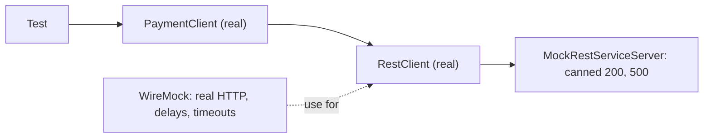

**Good and bad:**

| Good | Bad |
|---|---|
| Test 4xx, 5xx and timeouts, not only 200 | Only the happy path. The first real outage surprises you |
| JSON tests for public API contracts | Changing a field name and finding out from an angry mobile team |
| WireMock for timeout and retry tests | `Thread.sleep` in a mock to "simulate" slowness |

**Say this in the interview:**
> `@JsonTest` loads only Jackson, so I check field names, date and money formats, and that unknown fields don't break parsing. `@RestClientTest` gives me a `MockRestServiceServer`, so I can test my HTTP client's mapping of 200, 4xx and 5xx responses without a network. For timeouts and retries I use WireMock, because it is a real HTTP server.

**They may ask next:**
- **What about `@HttpExchange` interface clients?** Same idea. Build them from the `RestClient.Builder` and test with `MockRestServiceServer` or WireMock.

---

## Reactive tests: @WebFluxTest, WebTestClient and StepVerifier

**In one line:** Use `StepVerifier` to check what a `Mono` or `Flux` emits step by step, and `WebTestClient` with `@WebFluxTest` to test reactive endpoints.

Recap from [Testing reactive code](spring.md#testing-reactive-code): `StepVerifier` subscribes for you and checks each signal; virtual time makes long delays instant. Here is the senior detail.

**Story:** A train inspector stands on the platform with a list: "engine, then coach A, then coach B, then the guard's van."
If the van comes before coach B, or the train never ends, he reports it.

**How it works:**
- `StepVerifier.create(flux).expectNext(...).verifyComplete()`: checks values and the end signal.
- `expectError(Type.class)` or `expectErrorMatches(...)`: checks the error signal.
- `withVirtualTime(...)`: a 1-hour `delay` or `retryWhen` backoff finishes in milliseconds.
- `verify(Duration.ofSeconds(2))`: never hang forever. A missing `verify()` means **nothing ran**.
- `WebTestClient` works with `@WebFluxTest` (no server) or with a real server.

**Example: retry with backoff, no real waiting**

```java
@Test
void retriesThreeTimesThenGivesUp() {
    AtomicInteger calls = new AtomicInteger();
    Mono<String> flaky = Mono.defer(() -> {
        calls.incrementAndGet();
        return Mono.<String>error(new IOException("down"));
    });

    StepVerifier.withVirtualTime(() ->                 // build the Mono INSIDE the supplier
            flaky.retryWhen(Retry.backoff(3, Duration.ofSeconds(1))))
        .thenAwait(Duration.ofMinutes(1))              // fake clock jumps ahead
        .expectErrorMatches(e -> Exceptions.isRetryExhausted(e))
        .verify(Duration.ofSeconds(2));                // real-time safety limit

    assertThat(calls).hasValue(4);                     // 1 first try + 3 retries
}
```

**Good and bad:**

| Good | Bad |
|---|---|
| Always end with `verify...()` | Building the `StepVerifier` and forgetting `verify`: the test passes and checks nothing |
| Virtual time for delays | Real `Duration.ofSeconds(30)` waits in tests |
| `.block()` only in tests, never in app code | `block()` in a WebFlux handler |

**Say this in the interview:**
> For reactive code I use `StepVerifier`: it subscribes and checks each `onNext`, the error or the completion. For retries and delays I use virtual time, so a backoff of minutes runs in milliseconds. For endpoints I use `@WebFluxTest` with `WebTestClient` and mock the services with `@MockitoBean`.

**They may ask next:**
- **How do you test hot publishers?** Use `TestPublisher` to push signals by hand, or subscribe first and then emit.

---

## @MockitoBean and @MockitoSpyBean

**In one line:** `@MockitoBean` puts a Mockito mock **inside the Spring context** in place of a real bean; `@MockitoSpyBean` wraps the real bean instead.

Recap from [Mocking beans with @MockitoBean](spring-ecosystem.md#mocking-beans-with-mockitobean): it came in Spring Framework 6.2; Boot deprecated `@MockBean` in 3.4 and **removed** it in Boot 4.

**Story:** In a cricket match, a substitute fielder replaces an injured player. The rest of the team is the same.
`@MockitoBean` is the substitute: one bean is swapped, every other bean is real.

**How it works:**
1. Spring builds the context. Before creating beans, it sees `@MockitoBean PaymentClient`.
2. It registers a Mockito mock as that bean. Every bean that needs `PaymentClient` gets the mock.
3. After each test, the mock is **reset** (by default), so stubs don't leak into the next test.
4. `@MockitoSpyBean` creates the real bean and wraps it in a spy.
5. Spring Framework 7 also allows overriding non-singleton (prototype, scoped) beans.
6. `@MockitoBean` works on test class fields, or at type level with `types = {...}`. It is **not** allowed in `@Configuration` classes.

**Diagram:**

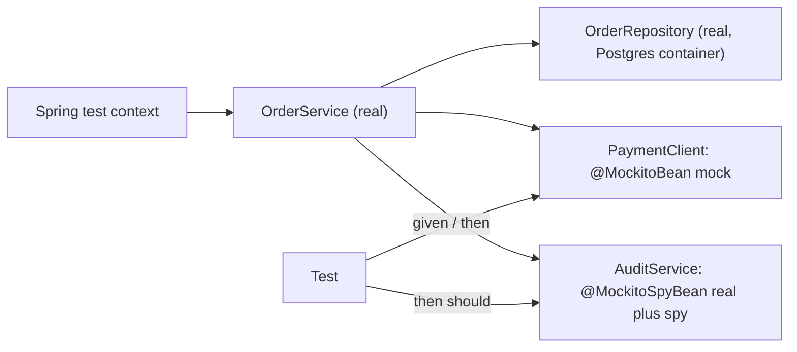

**Example:**

```java
@SpringBootTest
@Import(PostgresContainerConfig.class)
class CheckoutFlowIT {

    @Autowired OrderService orders;
    @MockitoBean PaymentClient payments;               // edge of the system: faked
    @MockitoSpyBean AuditService audit;                // real bean, but we can check calls

    @Test
    void declinedPaymentIsAudited() {
        given(payments.charge(any(), any())).willReturn(PaymentResult.DECLINED);

        orders.place(aCommand().build());

        then(audit).should().record(argThat(e -> e.type().equals("PAYMENT_DECLINED")));
    }
}
```

**`@Mock` vs `@MockitoBean`:**

| | `@Mock` | `@MockitoBean` |
|---|---|---|
| Needs Spring | No | Yes |
| Where the mock lives | Only in your test | Inside the Spring context |
| Speed | Milliseconds | Seconds (context start) |
| Use for | Unit tests | Slice and integration tests |

**Good and bad:**

| Good | Bad |
|---|---|
| Mock only the edges: payment, email, other teams' APIs | Mock the repository in `@SpringBootTest`: then why start the whole app? |
| One shared set of mocks for all integration tests | Every test class with its own mix: a new context each time, slow build |
| Spy rarely, for "was it called" on a real bean | Spy to stub half the methods of a real bean |

**Say this in the interview:**
> `@MockitoBean` replaces one bean in the Spring context with a Mockito mock, and Spring resets it after each test. `@MockitoSpyBean` keeps the real bean but lets me verify calls. They come from Spring Framework and replace Boot's `@MockBean`, which is removed in Boot 4. Each different set of mocked beans creates a new context, so I keep one shared set to keep tests fast.

**They may ask next:**
- **How do you share mocks across many test classes?** A custom meta-annotation with `@MockitoBean(types = {PaymentClient.class, EmailSender.class})`, or a common base class. See [context caching](#context-caching-why-spring-tests-get-slow).
- **`@TestBean`?** Another bean override: you supply the replacement bean from a static factory method, for example a fake instead of a mock.

---

## Full integration tests with a real server

**In one line:** `@SpringBootTest(webEnvironment = RANDOM_PORT)` starts the real app on a free port, and a test client sends real HTTP requests to it.

**Story:** After the dress rehearsal (MockMvc), the theatre does one show with a real audience.
Now the doors, the ticket check and the sound system are tested too.

**How it works:**
1. `webEnvironment` options: `MOCK` (default, no server; use MockMvc), `RANDOM_PORT` (real server on a free port), `DEFINED_PORT`, `NONE`.
2. With `RANDOM_PORT`, inject the port with `@LocalServerPort` if you need the number.
3. **Boot 4:** `@SpringBootTest` no longer gives you MockMvc, `TestRestTemplate` or `WebTestClient` by itself. Add `@AutoConfigureMockMvc`, `@AutoConfigureRestTestClient` (new `RestTestClient`), `@AutoConfigureWebTestClient`, or `@AutoConfigureTestRestTemplate`.
4. **Transactions:** with a real server, the request runs on another thread. A `@Transactional` test does **not** roll back what the server wrote. Clean the tables yourself.

**Diagram:**

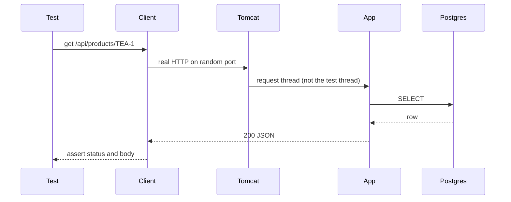

**Example (Boot 4):**

```java
@SpringBootTest(webEnvironment = WebEnvironment.RANDOM_PORT)
@AutoConfigureRestTestClient                            // Boot 4: not added by @SpringBootTest alone
@Import(PostgresContainerConfig.class)
class ProductApiIT {

    @Autowired RestTestClient client;                   // real HTTP to the random port
    @Autowired ProductRepository products;

    @BeforeEach
    void clean() { products.deleteAll(); }              // no automatic rollback with a real server

    @Test
    void returnsProductBySku() {
        products.save(new Product("TEA-1", "Masala tea", new BigDecimal("120.00")));

        client.get().uri("/api/products/{sku}", "TEA-1")
            .exchange()
            .expectStatus().isOk()
            .expectBody()
            .jsonPath("$.name").isEqualTo("Masala tea");
    }
}
```

**Good and bad:**

| Good | Bad |
|---|---|
| A few real-server tests for the main flows | Every endpoint tested twice: MockMvc and real server |
| Clean data in `@BeforeEach` | Tests that pass only in a certain order because of leftover rows |
| `RANDOM_PORT` | `DEFINED_PORT 8080`: two builds on one CI agent clash |

**Say this in the interview:**
> For a few main flows I start the full app with `@SpringBootTest` on a random port, with the database in Testcontainers. I call it with `RestTestClient` or `WebTestClient`, which is real HTTP. In Boot 4 I must add `@AutoConfigureRestTestClient` or `@AutoConfigureMockMvc` myself. Since the server runs on another thread, the test transaction does not roll back its writes, so I clean the tables before each test.

**They may ask next:**
- **`MOCK` vs `RANDOM_PORT`?** `MOCK` has no server; it is faster and `@Transactional` rollback works. `RANDOM_PORT` tests the real server and HTTP stack.

---

## Testcontainers: PostgreSQL, Kafka and Redis

**In one line:** Testcontainers starts real PostgreSQL, Kafka or Redis in Docker for your tests, and `@ServiceConnection` tells Spring Boot how to connect.

Recap from [Testcontainers and @ServiceConnection](spring-ecosystem.md#testcontainers-and-serviceconnection): a `@Container` field with `@ServiceConnection` replaces hand-written `@DynamicPropertySource`. Here: containers as beans, Kafka and Redis, and reuse.

**Story:** A cooking school can train students on a toy stove (H2), but the restaurant uses a real gas range.
Testcontainers brings a real gas range into the classroom for every lesson, and takes it away afterwards.

**How it works:**
1. Add `spring-boot-testcontainers` plus modules like `testcontainers-postgresql` and `testcontainers-kafka` (Testcontainers 2 names, used by Boot 4).
2. Declare containers as **`@Bean`s** in a `@TestConfiguration`. Spring starts them before other beans and stops them after other beans. This is the safest lifecycle with the context cache.
3. `@ServiceConnection` creates `ConnectionDetails` beans (JDBC URL, Kafka bootstrap servers, Redis host), which win over `application.yml`.
4. For a `GenericContainer` (like Redis), Boot cannot guess the type, so add `@ServiceConnection(name = "redis")`.
5. The same config can run the app locally: `SpringApplication.from(App::main).with(ContainersConfig.class).run(args)`.

**Example: one shared config**

```java
@TestConfiguration(proxyBeanMethods = false)
public class ContainersConfig {

    @Bean
    @ServiceConnection                                  // sets JDBC URL, user, password
    PostgreSQLContainer postgres() {
        return new PostgreSQLContainer("postgres:17");  // same version as production
    }

    @Bean
    @ServiceConnection                                  // sets spring.kafka bootstrap servers
    KafkaContainer kafka() {                            // org.testcontainers.kafka.KafkaContainer
        return new KafkaContainer("apache/kafka:4.4.0");
    }

    @Bean
    @ServiceConnection(name = "redis")                  // GenericContainer: tell Boot it is Redis
    GenericContainer<?> redis() {
        return new GenericContainer<>("redis:8").withExposedPorts(6379);
    }
}
```

Use it with `@SpringBootTest` + `@Import(ContainersConfig.class)`. For `@DataJpaTest`, import a smaller config with only PostgreSQL, so Kafka does not start for nothing.

**Diagram: what happens at startup**

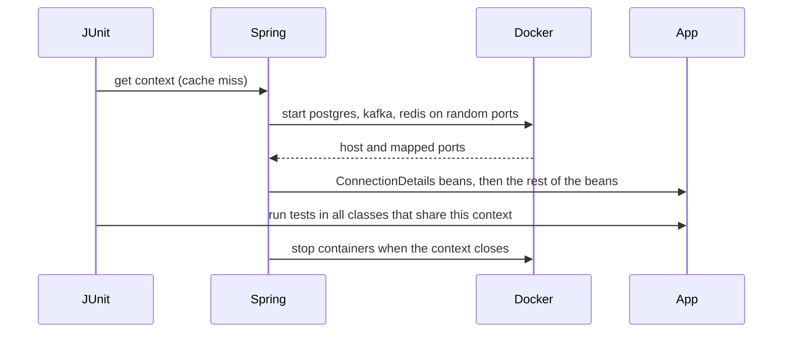

**Making it fast:**

| Trick | Effect |
|---|---|
| One shared `ContainersConfig` for all ITs | One context, containers start once per test run |
| Same config in every IT (see [context caching](#context-caching-why-spring-tests-get-slow)) | No second set of containers |
| Reuse on laptops: `.withReuse(true)` + `testcontainers.reuse.enable=true` in `~/.testcontainers.properties` | Container survives between runs, saves 5–10 s per run. Not for CI |
| Small images (`postgres:17-alpine`, `apache/kafka-native`) | Faster pull and start |
| Parallel test forks | Each fork has its own containers: watch CPU and memory on CI |

**Good and bad:**

| Good | Bad |
|---|---|
| Containers as beans, or a static singleton started once | A new container per test class: 20-minute builds |
| Pinned image tags | `postgres:latest`: tests change by themselves |
| `@ServiceConnection` | Hard-coded ports like `localhost:5432` |

**Say this in the interview:**
> I run integration tests against real PostgreSQL, Kafka and Redis with Testcontainers. I declare the containers as beans in one shared test configuration with `@ServiceConnection`, so Spring starts them first, connects automatically, and stops them last. Every integration test imports the same config, so the context and containers are reused. On my laptop I turn on container reuse to save startup time; on CI I start fresh.

**They may ask next:**
- **What does CI need?** Docker (or a compatible runtime) on the agent, or a remote Docker host like Testcontainers Cloud.
- **Testcontainers 2 changes?** Modules are renamed with a `testcontainers-` prefix and classes moved to per-module packages (like `org.testcontainers.postgresql.PostgreSQLContainer`). Check the release notes when you upgrade.

---

## Testing Kafka consumers and producers

**In one line:** Unit test the listener logic, then send one real message through a Kafka container and wait with Awaitility for the result.

**Story:** To test a new postman, you first check that he reads addresses correctly at the desk (unit test).
Then you post one real letter and wait at the house to see it arrive (integration test).
You do not stand there with a stopwatch for exactly 3 seconds; you wait until it comes, with a time limit.

**How it works:**
1. **Unit test the listener method:** call `listener.onPayment(event)` directly. No Kafka.
2. **Integration test:** Kafka container + `@SpringBootTest`. Send with `KafkaTemplate`, then `await()` until the DB row appears.
3. Set `spring.kafka.consumer.auto-offset-reset=earliest` in tests. Otherwise the consumer may join after your message and never see it.
4. **Test the failure path:** a bad message must go to the dead letter topic (DLT), not block the partition.
5. **Test duplicates:** send the same event twice, expect one row. See [handling duplicate events](kafka.md#handling-duplicate-events).
6. `@EmbeddedKafka` (from `spring-kafka-test`) runs Kafka inside the JVM. It is lighter, but a container is closer to production.

**Diagram:**

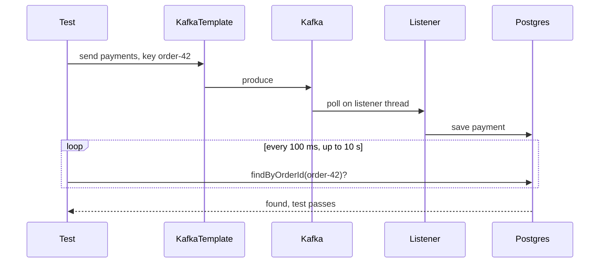

**Example:**

```java
@SpringBootTest(properties = "spring.kafka.consumer.auto-offset-reset=earliest")
@Import(ContainersConfig.class)
class PaymentListenerIT {

    @Autowired KafkaTemplate<String, String> kafka;
    @Autowired PaymentRepository payments;

    @Test
    void savesPaymentOnceEvenIfEventArrivesTwice() {
        String event = """
            {"eventId":"e-1","orderId":"order-42","amount":"240.00","status":"OK"}
            """;
        kafka.send("payments", "order-42", event);
        kafka.send("payments", "order-42", event);           // duplicate delivery

        await().atMost(Duration.ofSeconds(10))                // listener runs on another thread
               .untilAsserted(() ->
                   assertThat(payments.findAllByOrderId("order-42")).hasSize(1));
    }
}
```

Note: "has size 1" can pass before the duplicate is processed. A stronger test also waits until the consumer offset moves past both messages, or sends a third "marker" event and waits for it.

**Good and bad:**

| Good | Bad |
|---|---|
| `await().atMost(...)` with a clear condition | `Thread.sleep(5000)`: slow when fast, flaky when slow |
| Unique keys or topics per test | Tests that read each other's messages |
| Test DLT and duplicate handling | Only the happy message |

**Say this in the interview:**
> I unit test the listener method directly with a plain object, no Kafka. Then I have a few integration tests with a Kafka container. I send a real message with `KafkaTemplate`, and Awaitility waits until the result is in the database. I also test that a poison message goes to the dead letter topic and that a duplicate event is processed only once. I never use `Thread.sleep`.

**They may ask next:**
- **How do you test a producer?** Unit test: mock your own `EventPublisher` wrapper. Integration test: consume from the topic with a test consumer and assert on key, headers and value.

---

## Testing Spring Security

**In one line:** `spring-security-test` lets you fake the logged-in user (`@WithMockUser`, `jwt()`, `oidcLogin()`) so you can test 401, 403 and 200 without a real login.

**Story:** To test the security guard at an office gate, you don't hire real employees.
You print fake ID cards: one for a visitor, one for staff, one for a manager. Then you check that each card opens only the right doors.

**How it works:**
1. **Boot 4:** add `spring-boot-starter-security-test`. It brings `spring-security-test` plus Boot's glue that puts Spring Security into the MockMvc slices. Without it, `@WithMockUser` does not work properly with MockMvc.
2. `@WithMockUser(roles = "ADMIN")` puts a fake user in the `SecurityContext` before the test.
3. For OAuth2 resource servers, use the request post-processor `jwt()`, with scopes or claims. No real token or auth server is needed.
4. For state-changing calls (POST, PUT, DELETE) with CSRF on, add `.with(csrf())`.
5. In `@WebMvcTest`, add `@Import(SecurityConfig.class)` so **your** rules are tested, not just the defaults.
6. Method security (`@PreAuthorize`) is tested by calling the service with `@WithMockUser` in a Spring test. Expect `AccessDeniedException`.

**Diagram:**

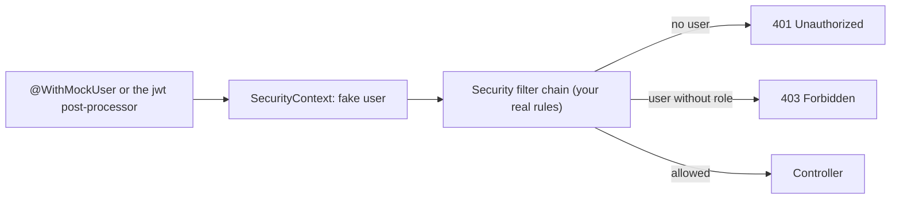

**Example:**

```java
@WebMvcTest(OrderController.class)
@Import(SecurityConfig.class)                           // test OUR rules
class OrderSecurityTest {

    @Autowired MockMvcTester mvc;
    @MockitoBean OrderService service;

    @Test
    void anonymousGets401() {
        assertThat(mvc.get().uri("/api/orders/1")).hasStatus(HttpStatus.UNAUTHORIZED);
    }

    @Test
    @WithMockUser(roles = "USER")
    void normalUserCannotDelete() {
        assertThat(mvc.delete().uri("/api/orders/1").with(csrf()))
            .hasStatus(HttpStatus.FORBIDDEN);
    }

    @Test
    void tokenWithReadScopeCanRead() {
        given(service.get(1L)).willReturn(new OrderView(1L, "NEW", BigDecimal.TEN));

        assertThat(mvc.get().uri("/api/orders/1")
                .with(jwt().authorities(new SimpleGrantedAuthority("SCOPE_orders.read"))))
            .hasStatusOk();
    }
}
```

More on debugging security in tests: [Test with @WithMockUser](spring-debugging.md#test-with-withmockuser).

**Good and bad:**

| Good | Bad |
|---|---|
| A test for each role and each "no" | Only testing that admin can do everything |
| `@Import` your real `SecurityConfig` | Disabling security in tests (`addFilters = false`) and never testing the rules |
| `jwt()` with the exact scopes | A real token copied from Postman into the test |

**Say this in the interview:**
> I test security rules in `@WebMvcTest` with my real `SecurityConfig` imported. `@WithMockUser` gives a fake user with roles, and for a resource server I use `jwt()` with the scopes I need. I write a test for every "no": anonymous gets 401, the wrong role gets 403. For `@PreAuthorize` on services, I call the service in a Spring test with `@WithMockUser` and expect `AccessDeniedException`.

**They may ask next:**
- **`@WithMockUser` vs `@WithUserDetails`?** `@WithMockUser` makes a simple fake user. `@WithUserDetails("ravi")` loads the user from your real `UserDetailsService`, with all its fields.

---

## Testing async code and @Scheduled jobs

**In one line:** Call scheduled job methods directly with a fixed `Clock`; for async code, wait with Awaitility instead of `Thread.sleep`.

Background on the jobs themselves: [Scheduling and background jobs](spring-ecosystem.md#scheduling-and-background-jobs).

**Story:** To test a night-shift watchman, you don't wait until 2 AM.
You set the clock on the wall to 2 AM and say "start your round" (call the method with a fixed clock).
To check a courier, you don't wait exactly 30 minutes; you check the door every minute, up to one hour (Awaitility).

**How it works:**
1. **The job logic:** call `job.run()` directly in a unit test, with a fixed `Clock`. Don't wait for the cron.
2. **The cron expression:** test it alone with `CronExpression.parse(...).next(...)`.
3. **Turn scheduling off in most tests,** so jobs don't fire in the middle of other tests. For example, put `@EnableScheduling` on a config with `@ConditionalOnProperty("app.scheduling.enabled")`.
4. **`@Async`, events, listeners:** use Awaitility: `await().atMost(5, SECONDS).untilAsserted(...)`. It polls every 100 ms by default.

**Example: job logic and cron**

```java
@Test
void deletesCartsOlderThanSevenDays() {
    Clock clock = Clock.fixed(Instant.parse("2026-11-16T10:00:00Z"), ZoneOffset.UTC);
    CartRepository carts = mock(CartRepository.class);

    new CartCleanupJob(carts, clock).run();             // call the method, no waiting for cron

    then(carts).should().deleteByUpdatedAtBefore(Instant.parse("2026-11-09T10:00:00Z"));
}

@Test
void reportRunsAt2amOnWeekdaysOnly() {
    var cron = CronExpression.parse("0 0 2 * * MON-FRI");

    assertThat(cron.next(LocalDateTime.parse("2026-11-14T10:00")))   // a Saturday
        .isEqualTo(LocalDateTime.parse("2026-11-16T02:00"));          // next Monday 2 AM
}
```

**Example: async with Awaitility**

```java
@Test
void sendsWelcomeEmailAsync() {
    signupService.register("ravi@example.com");         // the email is sent by an @Async method

    await().atMost(Duration.ofSeconds(5))
           .untilAsserted(() -> then(emailClient).should().send(any()));   // emailClient is a @MockitoBean
}
```

**Diagram: sleep vs await**

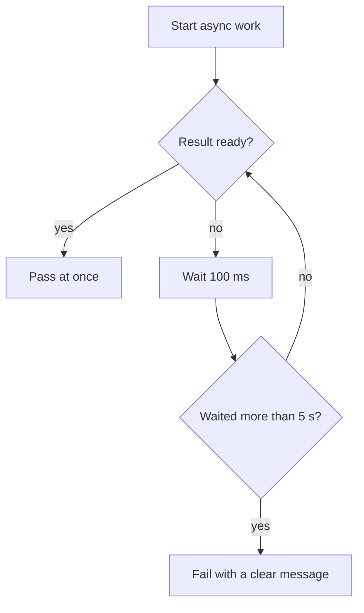

**Good and bad:**

| Good | Bad |
|---|---|
| Fixed `Clock` injected into the job | `LocalDate.now()` inside the job: the test breaks at midnight |
| Awaitility with a time limit | `Thread.sleep(3000)`: slow on a fast laptop, flaky on a slow CI |
| Scheduling off in most tests | A real job deletes test data in the middle of another test |

**Say this in the interview:**
> I don't test scheduled jobs by waiting for the cron. I call the job method directly with a fixed `Clock`, and I test the cron expression on its own with `CronExpression.next`. For `@Async` code and event listeners, I use Awaitility to poll until the result appears, with a time limit. `Thread.sleep` in tests is either slow or flaky, usually both.

**They may ask next:**
- **How to make `@Async` synchronous in tests?** Provide a `TaskExecutor` bean that runs tasks on the calling thread (`SyncTaskExecutor`) in the test config. Then no waiting is needed. But you no longer test real threading.

---

## Context caching: why Spring tests get slow

**In one line:** Spring caches and reuses test contexts; each slightly different test setup starts a **new** context, and that makes suites slow.

**Story:** A wedding caterer sets up one big kitchen and cooks for every function that wants the same menu.
If each family asks for "the same menu, but no onion", the caterer must build a new kitchen each time.
Different `@MockitoBean` sets, profiles or properties are those "no onion" requests.

**How it works:**
1. Each Spring test class gets a context from the **TestContext cache**.
2. The cache key includes: config classes, `@Import`, active profiles, properties (`@TestPropertySource`, `properties = ...`), `@MockitoBean`/`@MockitoSpyBean` set, `webEnvironment`, and context customizers.
3. Same key: reuse (milliseconds). Different key: start a new context (often 5–20 s, plus containers).
4. `@DirtiesContext` throws the context away. The next class pays the start cost again.
5. The cache holds up to 32 contexts by default (`spring.test.context.cache.maxSize`). Too many open contexts use memory, threads and DB connections.
6. Spring Framework 7 **pauses** unused cached contexts (stops scheduled jobs, listeners) and restarts them when needed.

**Diagram:**

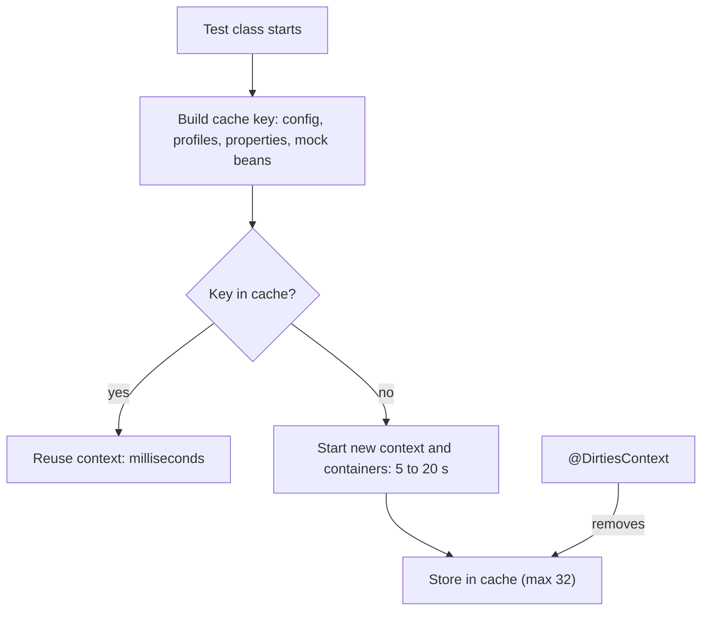

**How to see it:** set `logging.level.org.springframework.test.context.cache=DEBUG`. It logs hit and miss counts.

**Fix: one meta-annotation for all integration tests**

```java
@Target(ElementType.TYPE)
@Retention(RetentionPolicy.RUNTIME)
@SpringBootTest
@AutoConfigureMockMvc
@ActiveProfiles("test")
@Import(ContainersConfig.class)
@MockitoBean(types = {PaymentClient.class, EmailSender.class})  // same mocks everywhere = one context
public @interface IntegrationTest {
}

@IntegrationTest
class CheckoutIT {
    @Autowired PaymentClient payments;                  // this is the shared mock
    // ...
}
```

**Common causes and fixes:**

| Cause | Fix |
|---|---|
| Each class has its own `@MockitoBean` mix | Shared meta-annotation or base class with one mock set |
| `@DirtiesContext` "to be safe" | Clean data in `@BeforeEach`; reset state instead |
| `@TestPropertySource` with one different flag | Same properties everywhere; set the flag in code or a test bean |
| `@SpringBootTest` where a slice or unit test would do | Move logic tests down the pyramid |
| Different `@ActiveProfiles` per class | One `test` profile |

**Good and bad:**

| Good | Bad |
|---|---|
| 3–5 contexts for the whole suite | 60 contexts, each with its own containers |
| Check cache stats when the build is slow | Buying a bigger CI machine first |

**Say this in the interview:**
> Spring caches the test application context and reuses it when the configuration is the same. The cache key includes config classes, profiles, properties and the set of `@MockitoBean`s, so every different combination starts a new context. That is the usual reason a Spring suite is slow. I use one `@IntegrationTest` meta-annotation with a shared mock set and containers, avoid `@DirtiesContext`, and check the cache statistics in the debug log.

**They may ask next:**
- **When is `@DirtiesContext` really needed?** When a test changes a singleton's state that you can't reset, like a static cache inside a library. It should be rare.

---

## Test data builders

**In one line:** A test data builder creates valid objects with safe defaults, so each test only sets the fields that matter to it.

**Story:** A tailor keeps a standard shirt pattern. For a new customer, he changes only the sleeve length.
He doesn't draw a whole new shirt each time. The builder is the standard pattern.

**How it works:**
1. One builder class per important type: `anOrder()`, `aCustomer()`, `aCommand()`.
2. Every field has a sensible default, so `anOrder().build()` is always valid.
3. Tests override only what they test: `anOrder().status(SHIPPED).build()`.
4. When you add a required field, you change only the builder, not 200 tests.
5. Alternatives: an *Object Mother* (`Orders.shipped()`), or a library like Instancio for random but valid data.

**Example:**

```java
public final class OrderBuilder {
    private String customerId = "c1";                   // safe defaults
    private Status status = Status.NEW;
    private final List<Item> items =
        new ArrayList<>(List.of(new Item("TEA-1", new BigDecimal("120.00"))));

    public static OrderBuilder anOrder() { return new OrderBuilder(); }

    public OrderBuilder customer(String id) { this.customerId = id; return this; }
    public OrderBuilder status(Status s)    { this.status = s; return this; }
    public OrderBuilder noItems()           { this.items.clear(); return this; }

    public Order build() { return new Order(customerId, status, List.copyOf(items)); }
}

// In a test: say only what matters for THIS test
Order shipped = anOrder().status(Status.SHIPPED).build();
```

**Good and bad:**

| Good | Bad |
|---|---|
| Defaults that make a valid object | Copying a 15-line constructor call into every test |
| Names that read like English: `anOrder().shipped()` | A shared static `ORDER` object that tests change. Then tests affect each other |
| Unique IDs per test (`UUID`) when tests share a DB | Every test inserting customer `c1` and clashing |

**Say this in the interview:**
> I use test data builders with valid defaults, so each test sets only the fields it cares about. It makes tests short and shows the intent. When the model gets a new required field, I fix one builder instead of hundreds of tests. For integration tests, I give each test unique IDs so tests don't clash in the shared database.

**They may ask next:**
- **Random data (Instancio, Datafaker)?** Good for "any valid customer" cases. Always log the seed, so a failure can be repeated.

---

## Flaky tests: causes and fixes

**In one line:** A flaky test passes and fails on the same code; the cause is usually time, order, shared state, async waits or the environment.

**Story:** A smoke alarm that rings for no reason every few days is worse than no alarm. Soon nobody listens, even when there is a real fire.
A flaky test is that alarm. People start pressing "re-run", and real bugs pass.

**How it works (find the cause):**
1. Re-run the single test 50 times (`@RepeatedTest(50)`) to confirm.
2. Run it alone, then with the whole suite. If it only fails in the suite, it is shared state or order.
3. Run with a different time zone and locale.
4. Look at the CI logs for timing: did it fail near a timeout?
5. Quarantine (tag and skip) only with a ticket and an owner. Fix within days.

**Common causes and fixes:**

| Cause | Example | Fix |
|---|---|---|
| **Time** | `LocalDate.now()`, test fails at midnight or on 29 Feb | Inject `Clock` |
| **Time zone / locale** | Date format differs on CI (UTC) vs laptop (IST) | Fixed zone in tests; JUnit 6.1 `@DefaultTimeZone`, `@DefaultLocale` |
| **Async waits** | `Thread.sleep(500)` before assert | Awaitility with a condition |
| **Order** | Test B needs data left by test A | Each test sets up its own data |
| **Shared state** | Static cache, singleton bean state, DB rows | Reset in `@BeforeEach`; unique IDs |
| **Unordered results** | `HashSet`/`HashMap` order, SQL without `ORDER BY` | `containsExactlyInAnyOrder` or add `ORDER BY` |
| **Kafka offsets** | Consumer starts after the message | `auto-offset-reset=earliest`, unique topics or keys |
| **Network / real services** | Test calls a real sandbox API | WireMock or a container |
| **Ports** | Fixed port 8080 already used | `RANDOM_PORT` |
| **Parallel runs** | Two tests change the same row | Separate data, or `@ResourceLock` |

**Diagram:**

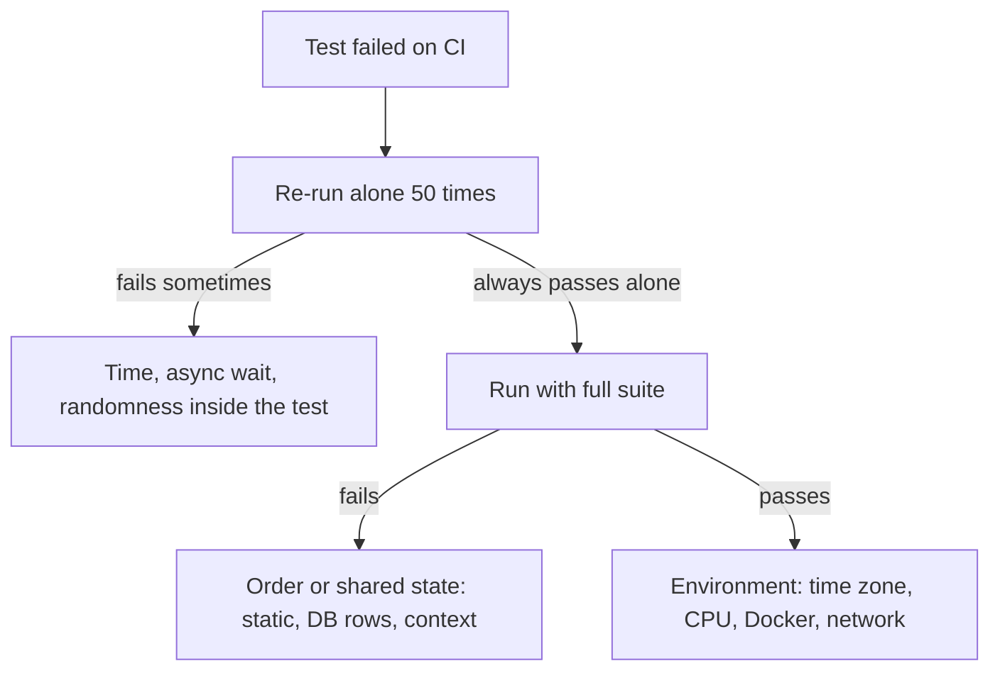

**Good and bad:**

| Good | Bad |
|---|---|
| Treat a flaky test as a bug with an owner | "Just re-run the pipeline" |
| Track flaky rate on CI dashboards | Automatic retries that hide real race conditions |

**Say this in the interview:**
> Flaky tests usually come from time, async waits, test order, shared state or the environment. My fixes are standard: inject a `Clock` and replace `Thread.sleep` with Awaitility. Each test creates its own data with unique IDs, and external services are faked. I treat a flaky test as a real bug, because a team that ignores red builds will also ignore a real failure. Sometimes the flaky test is showing a real race condition in the code.

**They may ask next:**
- **Are automatic retries OK?** As a short-term tool with tracking, yes. As a permanent fix, no. They hide race conditions.

---

## Code coverage with JaCoCo

**In one line:** JaCoCo shows which lines and branches your tests ran; it finds untested code, but a high number does not prove good tests.

**Story:** A security guard walks through every room in the building (100% coverage).
But he never checks if the windows are locked. He visited every room and checked nothing.
Coverage counts the visits, not the checks.

**How it works:**
1. JaCoCo adds a Java agent while tests run. It records which bytecode ran.
2. It reports **line** coverage and **branch** coverage (both sides of each `if`). Branch coverage is more useful.
3. You can fail the build below a limit, and show coverage on changed lines in pull requests (SonarQube and others).

**Example (Maven):**

```xml
<plugin>
  <groupId>org.jacoco</groupId>
  <artifactId>jacoco-maven-plugin</artifactId>
  <version>0.8.15</version>                       <!-- 0.8.14+ supports Java 25 -->
  <executions>
    <execution><goals><goal>prepare-agent</goal></goals></execution>   <!-- attach the agent -->
    <execution><id>report</id><phase>verify</phase><goals><goal>report</goal></goals></execution>
    <execution>
      <id>check</id><goals><goal>check</goal></goals>
      <configuration>
        <rules><rule>
          <element>BUNDLE</element>
          <limits><limit>
            <counter>BRANCH</counter>
            <value>COVEREDRATIO</value>
            <minimum>0.70</minimum>               <!-- a floor, not a target -->
          </limit></limits>
        </rule></rules>
      </configuration>
    </execution>
  </executions>
</plugin>
```

**Why 100% is a bad goal:**
- People write tests with no assertions just to touch lines.
- Getters, config classes and generated code get tests that add nothing.
- The last 10% costs more than the first 80%.
- It says nothing about missing cases: code you **never wrote** (a missing null check) has no line to cover.

**Good and bad:**

| Good | Bad |
|---|---|
| 70–80% branch coverage as a floor, high coverage for core domain logic | 100% as a team KPI |
| Look at **uncovered** code in the PR: "why is this branch untested?" | Exclude half the code from the report to hit the number |
| Combine with mutation testing for test quality | Trust coverage as proof of quality |

**Say this in the interview:**
> I use JaCoCo to find untested code, especially branches, and I set a floor like 70–80% so coverage doesn't silently drop. I don't chase 100%, because a test can run a line without checking anything. For test quality I use mutation testing on the core domain code. In reviews I ask about uncovered branches in the changed code.

**They may ask next:**
- **Line vs branch coverage?** Line: was the line run? Branch: was each side of each `if` and `switch` run? `if (a && b)` can be 100% line-covered with one test but only 50% branch-covered.

---

## Mutation testing with PIT

**In one line:** PIT puts small bugs ("mutants") in your code on purpose; if no test fails, your tests are not really checking that code.

**Story:** A teacher wants to know if the exam checker really reads the answers.
She changes a few correct answers to wrong ones on purpose. If the checker still gives full marks, the checker is not reading.
PIT is that teacher. Your tests are the checker.

**How it works:**
1. PIT (pitest) makes small changes to your code in memory. For example: `>` to `>=`, `+` to `-`, `return x` to `return null`, or a removed method call.
2. Each changed version is a **mutant**. PIT runs the tests that cover that line.
3. A test fails: the mutant is **killed** (good). All tests pass: the mutant **survived** (a gap).
4. **Mutation score** = killed / total. It measures test quality, not just coverage.
5. It is slow. Run it on core modules, or only on changed code in PRs, not on everything every build.

**Diagram:**

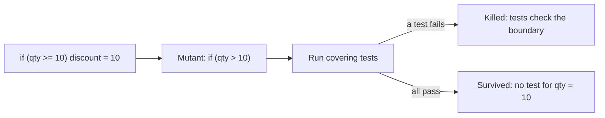

**Example:** run with `mvn org.pitest:pitest-maven:mutationCoverage` after adding the `pitest-maven` plugin and the `pitest-junit5-plugin` dependency (on JUnit 6, check that your plugin versions support it). The HTML report shows surviving mutants line by line.

**Good and bad:**

| Good | Bad |
|---|---|
| Run on domain logic (pricing, rules) | Run on the whole monolith on every commit |
| Use surviving mutants to find missing boundary tests | Chase a 100% mutation score; some mutants are equivalent (no visible change) |

**Say this in the interview:**
> Coverage shows which code ran; mutation testing shows whether the tests would notice a bug. PIT changes the code, like `>=` to `>`, and runs the tests. If they still pass, that mutant survived and I'm missing a test, usually a boundary case. It's slow, so I run it on core business modules or on changed code only.

**They may ask next:**
- **What is an equivalent mutant?** A change that doesn't change behaviour, so no test can kill it. Ignore those.

---

## Contract testing: Spring Cloud Contract and Pact

**In one line:** A contract test checks that a provider's API still matches what its consumers expect, without starting both services together.

**Story:** A tea stall and a milk supplier agree in writing: "500 ml packets, delivered by 6 AM."
The supplier checks his packets against the paper. The stall owner plans with the paper.
Nobody needs to stand together at 6 AM to check. The paper is the contract.

**How it works:**
- **Spring Cloud Contract (provider-driven, JVM-friendly):**
  1. The provider team writes contracts (YAML, Groovy or Kotlin DSL) in its repo.
  2. The build **generates tests** that run the contract against the provider (MockMvc or `WebTestClient`).
  3. It also publishes **stubs** (a WireMock jar). Consumers run them with Stub Runner.
- **Pact (consumer-driven, many languages):**
  1. The consumer test records what it expects into a pact file.
  2. Pact files are shared through a Pact Broker.
  3. The provider build replays them against the real provider.
  4. `can-i-deploy` checks the broker before a release.

**Diagram:**

```mermaid
sequenceDiagram
    participant Consumer
    participant Broker
    participant Provider
    Consumer->>Consumer: test against mock provider, write pact file
    Consumer->>Broker: publish pact
    Provider->>Broker: fetch pacts for my API
    Provider->>Provider: replay requests on real provider
    Provider->>Broker: publish result: pass or fail
    Consumer->>Broker: can-i-deploy?
```

**Example: a Spring Cloud Contract file**

```yaml
# provider repo: src/test/resources/contracts/getOrder.yml
request:
  method: GET
  url: /api/orders/42
response:
  status: 200
  headers:
    Content-Type: application/json
  body:
    id: 42
    status: "NEW"
```

**Good and bad:**

| Good | Bad |
|---|---|
| Contracts for APIs used by other teams | Contracts for every internal call inside one team |
| Check contracts in CI before deploy | Finding out in production that a field was renamed |
| Also for Kafka messages (both tools support messaging) | Shared E2E environment as the only check |

**Say this in the interview:**
> Contract tests replace many slow end-to-end tests between services. With Pact, the consumer writes down what it needs and the provider's build checks it. With Spring Cloud Contract, the provider writes the contract, gets generated tests, and publishes WireMock stubs for consumers. Either way, a breaking API change fails the provider's build, not production.

**They may ask next:**
- **Contract test vs OpenAPI?** OpenAPI describes the whole API. A contract test checks the parts a real consumer uses, and fails the build when they break.

---

## ArchUnit: tests for your architecture

**In one line:** ArchUnit turns architecture rules, like "controllers must not call repositories", into JUnit tests that run on every build.

**Story:** A housing society has a rule: "no shops on the ground floor." A rule on paper is forgotten.
A guard who checks every new tenant enforces it. ArchUnit is that guard for your package structure.

**How it works:**
1. ArchUnit reads your compiled classes and their dependencies.
2. You write rules in a fluent Java API.
3. A broken rule fails the build and lists every violation.
4. For existing code with many violations, a *freeze* mode records today's violations and fails only on new ones.
5. Spring Modulith has its own check for module boundaries: `ApplicationModules.of(App.class).verify()`.

**Example:**

```java
@AnalyzeClasses(packages = "com.shop", importOptions = ImportOption.DoNotIncludeTests.class)
class ArchitectureTest {

    @ArchTest
    static final ArchRule layers = layeredArchitecture().consideringAllDependencies()
        .layer("Web").definedBy("..web..")
        .layer("Service").definedBy("..service..")
        .layer("Repository").definedBy("..repository..")
        .whereLayer("Web").mayNotBeAccessedByAnyLayer()
        .whereLayer("Service").mayOnlyBeAccessedByLayers("Web")
        .whereLayer("Repository").mayOnlyBeAccessedByLayers("Service");   // no web -> repo shortcuts

    @ArchTest
    static final ArchRule domainIsFrameworkFree =
        noClasses().that().resideInAPackage("..domain..")
            .should().dependOnClassesThat().resideInAPackage("org.springframework..");

    @ArchTest
    static final ArchRule noFieldInjection = GeneralCodingRules.NO_CLASSES_SHOULD_USE_FIELD_INJECTION;
}
```

**Good and bad:**

| Good | Bad |
|---|---|
| 5–10 rules the team agreed on | 80 rules nobody understands |
| Freeze old violations, block new ones | Adding ArchUnit to legacy code and getting 3,000 failures |

**Say this in the interview:**
> I use ArchUnit to turn architecture rules into tests: layers, no Spring in the domain package, no field injection, no cycles between packages. It runs as a normal JUnit test, so a pull request that breaks a rule fails the build. In a modular monolith I use Spring Modulith's verify for module boundaries.

**They may ask next:**
- **Why not just code review?** Reviewers miss things and get tired. A test never forgets the rule.

---

## TDD, honestly

**In one line:** Test-driven development (TDD) means: failing test first, simplest code to pass, then clean up; great for logic and bug fixes.

**Story:** A carpenter marks where the cut should be before cutting (the test). Then he cuts (the code). Then he sands the edge (refactor).
But when he is trying out a new chair design, he first sketches freely. He marks and cuts carefully later.

**How it works (red, green, refactor):**
1. **Red:** write a small test for the next behaviour. It fails.
2. **Green:** write just enough code to pass.
3. **Refactor:** clean up names and duplication, tests stay green.
4. Repeat in small steps (minutes, not hours).

**Diagram:**

```mermaid
stateDiagram-v2
    [*] --> Red
    Red --> Green: write the simplest code
    Green --> Refactor: clean up
    Refactor --> Red: next small behaviour
```

**Where it works well, and where it doesn't:**

| Works well | Less useful |
|---|---|
| Business rules: pricing, discounts, state machines | Exploring a new library or API ("spike" first, then test) |
| Bug fixes: first a test that shows the bug | Thin glue code: a controller calling one service method |
| Algorithms and parsers | UI layout |

**Say this in the interview:**
> I use TDD for business logic and for every bug fix: first a failing test that shows the bug, then the fix. It keeps the design simple and gives me tests I trust. For exploration or thin glue code, I write the code first and add tests after. What matters to me is that tests exist and fail for the right reason, not the strict order.

**They may ask next:**
- **Does TDD slow you down?** At the start, a bit. It saves time in debugging and makes refactoring safe. Studies are mixed, so I don't sell it as magic.

---

## Performance tests

**In one line:** Performance tests send realistic traffic to a running system to measure latency, throughput and the breaking point.

This is covered in detail in [Performance and load testing](production-ready.md#performance-and-load-testing). Short version for a testing interview:

**Story:** You don't test a bridge's load limit by walking across it alone. You drive many trucks over it, slowly adding more, and measure where it bends.

**Tools you should know by name:**

| Tool | Script language | Notes |
|---|---|---|
| **Gatling** | Java, Kotlin, Scala DSL | Popular with JVM teams, nice HTML reports |
| **JMeter** | GUI + XML plans | Old and very common, many plugins |
| **k6** | JavaScript | Easy scripts, good for CI |
| **JMH** | Java | *Micro*-benchmarks of one method (not load tests) |

**Good and bad:**

| Good | Bad |
|---|---|
| Test in a production-like environment with production-like data | Load test on a laptop with an empty DB |
| Measure p95/p99 latency, not only average | "Average 50 ms, looks fine" while p99 is 4 seconds |
| JMH with warm-up for micro-benchmarks | `System.nanoTime()` around a loop in a unit test |

**Say this in the interview:**
> For load tests I use Gatling or k6 against a production-like environment. I watch p95 and p99 latency and the error rate as I raise the load. For one hot method I use JMH, which handles JIT warm-up correctly. I don't put performance checks in JUnit tests, because CI machines are too noisy.

**They may ask next:**
- **Load vs stress vs soak?** Load: expected peak. Stress: increase until it breaks. Soak: normal load for hours, to find leaks.

---

## Boot 3 to Boot 4 test changes (cheat sheet)

**In one line:** Boot 4 moves to JUnit 6, removes `@MockBean`, splits test starters, and makes you add MockMvc and test HTTP clients yourself.

**Story:** Moving to a new house: same furniture, but the kitchen drawers are in new places. You need a list of where things moved.

| Boot 3.x | Boot 4.x | What to do |
|---|---|---|
| `@MockBean`, `@SpyBean` (deprecated in 3.4) | Removed | Use `@MockitoBean`, `@MockitoSpyBean` |
| `MockitoTestExecutionListener` | Removed | Add `@ExtendWith(MockitoExtension.class)` if `@Mock` stops working |
| `spring-boot-starter-test` | Per-technology test starters | `spring-boot-starter-webmvc-test`, `-data-jpa-test`, `-security-test`... (`-test-classic` to migrate slowly) |
| `@SpringBootTest` gave MockMvc, `TestRestTemplate`, `WebTestClient` | Not any more | `@AutoConfigureMockMvc`, `@AutoConfigureRestTestClient`, `@AutoConfigureWebTestClient`, `@AutoConfigureTestRestTemplate` |
| `TestRestTemplate` | Moved package, needs `spring-boot-resttestclient` | Prefer `RestTestClient` |
| JUnit 5 | JUnit 6 (Java 17+) | Mostly no code change |
| `SpringRunner` (JUnit 4) | Deprecated | Move to JUnit Jupiter |
| Testcontainers 1.x | Testcontainers 2 | New artifact names (`testcontainers-postgresql`) and packages |
| `@WithMockUser` worked with `spring-security-test` | Needs `spring-boot-starter-security-test` | Add the starter |

**Say this in the interview:**
> The main Boot 4 test changes: `@MockBean` is gone, so we use `@MockitoBean`. Test starters are split by technology. `@SpringBootTest` no longer sets up MockMvc or test HTTP clients by itself, so we add `@AutoConfigureMockMvc` or `@AutoConfigureRestTestClient`. And it runs on JUnit 6 and Testcontainers 2.

---

## Questions from the README list

Short answers to the older question list in the README. Each links to the deeper section above when there is one.

### How does Spring Framework Make Unit Testing Easy?

Spring makes testing easy because your classes are plain Java objects that get their dependencies from outside.
- With constructor injection, a unit test just calls `new OrderService(mockRepo, mockClient)`. No Spring needed.
- For Spring-level tests, it gives test slices, a cached test context, `MockMvc`, `@MockitoBean`, `@TestPropertySource` and test profiles.
- Spring Boot adds `@SpringBootTest`, Testcontainers support with `@ServiceConnection`, and ready-made test starters.

More: [Testing a service class](#testing-a-service-class-full-example)

### What is Mockito?

Mockito is the most popular Java library for creating fake objects (mocks) in tests.
You tell a mock what to return (`when(...).thenReturn(...)`) and later check how it was called (`verify(...)`).
It lets you test one class without its real database, HTTP clients or email server.
Mockito 5 can also mock final classes and static methods.

More: [Mockito essentials](#mockito-essentials-when-verify-and-argumentcaptor)

### What is your favorite mocking framework?

Mockito, because it is the default in Spring Boot's test starter, the API is simple, and every Java developer knows it.
- I use its BDD style (`given`/`then`) with AssertJ.
- For HTTP I prefer WireMock, and for databases and Kafka I prefer real containers over mocks.
- Others exist: EasyMock, JMockit (old), MockK (for Kotlin).

More: [Mockito rules](#mockito-rules-strict-stubs-static-and-final-mocks-what-not-to-mock)

### How do you do mock data with Mockito?

You create a mock and stub its methods to return the data your test needs.

```java
@Mock CustomerRepository customers;

given(customers.findById("c1"))
    .willReturn(Optional.of(new Customer("c1", "ravi@example.com")));   // canned data
given(customers.findById("c9")).willReturn(Optional.empty());            // "not found" case
willThrow(new DataAccessResourceFailureException("db down")).given(customers).deleteById("c2");
```

Build the returned objects with [test data builders](#test-data-builders), so the data stays short and valid.

### What are the different mocking annotations that you worked with?

- **Mockito (no Spring):** `@Mock`, `@Spy`, `@InjectMocks`, `@Captor`, with `@ExtendWith(MockitoExtension.class)`.
- **Spring Framework 6.2+ (in the Spring context):** `@MockitoBean`, `@MockitoSpyBean`, and `@TestBean` (you provide the replacement).
- **Old Spring Boot:** `@MockBean`, `@SpyBean`. Deprecated in Boot 3.4, removed in Boot 4.
- **Security:** `@WithMockUser`, `@WithUserDetails` fake the logged-in user.

More: [@MockitoBean and @MockitoSpyBean](#mockitobean-and-mockitospybean)

### What is MockMvc?

MockMvc is a Spring test tool that sends fake HTTP requests through the real Spring MVC stack, without starting a server.
Filters, controller, validation and JSON all run for real.
It is fast and checks status, headers and JSON body.
`MockMvcTester` (Spring 6.2+) is the newer AssertJ-style version.

More: [Web layer tests](#web-layer-tests-webmvctest-mockmvc-and-mockmvctester)

### What is @WebMvcTest?

`@WebMvcTest` is a test slice that starts only the web layer: controllers, `@ControllerAdvice`, filters, Jackson, Spring Security and MockMvc.
It does not load services or repositories, so you replace them with `@MockitoBean`.
Use it to test URLs, status codes, JSON, validation and security rules.

More: [@SpringBootTest vs test slices](#springboottest-vs-test-slices-what-each-one-loads)

### What is @MockBean?

`@MockBean` was Spring Boot's annotation to put a Mockito mock into the Spring context, replacing a real bean.
It was deprecated in Boot 3.4 and **removed in Boot 4**.
Today: use `@MockitoBean` from Spring Framework. It works the same way on test fields.

More: [@MockitoBean and @MockitoSpyBean](#mockitobean-and-mockitospybean)

### How do you write a unit test with MockMVC?

Use `@WebMvcTest(YourController.class)`, mock the controller's services with `@MockitoBean`, then send a request and check the response.

```java
@Autowired MockMvcTester mvc;
@MockitoBean OrderService service;

@Test @WithMockUser
void returnsOrder() {
    given(service.get(42L)).willReturn(new OrderView(42L, "NEW", BigDecimal.TEN));
    assertThat(mvc.get().uri("/api/orders/42")).hasStatusOk()
        .bodyJson().extractingPath("$.status").isEqualTo("NEW");
}
```

Strictly, this is a slice test (Spring starts the web layer), not a pure unit test. More: [Web layer tests](#web-layer-tests-webmvctest-mockmvc-and-mockmvctester)

### What is JSONAssert?

JSONAssert is a small library that compares two JSON strings by meaning, not by text.
In *lenient* mode, field order and extra fields don't matter; in *strict* mode they do.
Spring uses it behind `content().json(...)` in MockMvc and in `JacksonTester` checks.

```java
JSONAssert.assertEquals("{\"id\":42}", actualJson, JSONCompareMode.LENIENT);   // extra fields OK
```

### How do you write an integration test with Spring Boot?

Start the full app with `@SpringBootTest`, use real infrastructure from Testcontainers, and call it through MockMvc or a real HTTP client.
1. `@SpringBootTest` (add `webEnvironment = RANDOM_PORT` for a real server).
2. `@Import(ContainersConfig.class)` with PostgreSQL, Kafka, Redis and `@ServiceConnection`.
3. Mock only external services (`@MockitoBean` or WireMock).
4. Use `@AutoConfigureMockMvc` or `@AutoConfigureRestTestClient` (needed in Boot 4).
5. Keep the setup the same across tests, so the context is cached.

More: [Full integration tests](#full-integration-tests-with-a-real-server), [Testcontainers](#testcontainers-postgresql-kafka-and-redis)

### What is @SpringBootTest?

`@SpringBootTest` starts the whole Spring Boot application context for a test, with all beans and auto-configuration.
By default it uses a mock web environment (no server). `webEnvironment = RANDOM_PORT` starts a real server.
It is slower than slices, so use it for flows that cross layers.

More: [@SpringBootTest vs test slices](#springboottest-vs-test-slices-what-each-one-loads)

### What is @LocalServerPort?

`@LocalServerPort` injects the port number the embedded server got when the test uses `webEnvironment = RANDOM_PORT`.

```java
@LocalServerPort int port;   // e.g. 54213, different on each run
```

You rarely need it today, because `RestTestClient`, `WebTestClient` and `TestRestTemplate` already know the port.

### What is TestRestTemplate?

`TestRestTemplate` is a test-friendly `RestTemplate` for calling a real running app in `@SpringBootTest(webEnvironment = RANDOM_PORT)`.
It uses relative URLs (`/api/orders/1`) and does not throw on 4xx/5xx, so you can assert on error responses.
In Boot 4 it needs `@AutoConfigureTestRestTemplate` and the `spring-boot-resttestclient` dependency.
Today: prefer `RestTestClient` (Spring Framework 7) or `WebTestClient`.

More: [Full integration tests](#full-integration-tests-with-a-real-server)

---

## Interview questions

**1. What is the test pyramid, and do you follow it strictly?**
Many fast unit tests, fewer integration tests, very few E2E tests.
I follow the idea, not the exact shape: with Testcontainers, integration tests are cheap, so I write more of them for SQL and Kafka.
See [the test pyramid](#the-test-pyramid-the-testing-trophy-and-what-seniors-actually-do).

**2. Unit test vs integration test?**
A unit test checks one class with fake dependencies, in milliseconds.
An integration test checks that real parts work together, like the service plus a real PostgreSQL.
See [test types](#unit-integration-end-to-end-and-contract-tests).

**3. Explain the JUnit lifecycle.**
New test class instance per test. `@BeforeEach` and `@AfterEach` around each test. Static `@BeforeAll` and `@AfterAll` once per class.
See [JUnit basics](#junit-basics-lifecycle-nested-and-displayname).

**4. What is new in JUnit 6?**
Java 17 baseline, one version number for Platform and Jupiter, JSpecify nullability, Kotlin suspend tests, FastCSV for `@CsvSource`.
The Jupiter API is the same. Spring Boot 4 uses it by default.

**5. When do you use `@ParameterizedTest`?**
When one rule must hold for many inputs, especially boundaries. Each row is its own test result.
See [parameterized tests](#parameterized-tests).

**6. Mock vs stub vs spy vs fake?**
Stub: canned answers. Mock: also verifies calls. Spy: real object with recording. Fake: a light working version, like an in-memory repo.
See [test doubles](#test-doubles-dummy-stub-fake-mock-and-spy).

**7. What does `ArgumentCaptor` do?**
It captures the real argument passed to a mock, so you can assert on its fields.
Useful when the method builds the object inside, like an email or an event.

**8. What are strict stubs?**
`MockitoExtension` fails a test that has unused stubs or stubs called with other arguments. It keeps tests honest. Use `lenient()` for the rare shared stub.
See [Mockito rules](#mockito-rules-strict-stubs-static-and-final-mocks-what-not-to-mock).

**9. What does "don't mock what you don't own" mean?**
Don't mock library APIs like `RestClient` or `KafkaTemplate`; your mock may behave differently from the real thing.
Wrap them in your own class, mock the wrapper, and test the wrapper against a fake server or a container.

**10. How do you test code that uses `LocalDateTime.now()`?**
Inject a `java.time.Clock` and use `Clock.fixed(...)` in tests. Avoid `mockStatic` on time classes.

**11. `@SpringBootTest` vs `@WebMvcTest`?**
`@SpringBootTest` loads the whole app. `@WebMvcTest` loads only the web layer, with services mocked by `@MockitoBean`. The slice is faster and more focused.
See [what each one loads](#springboottest-vs-test-slices-what-each-one-loads).

**12. MockMvc vs `MockMvcTester` vs `RestTestClient`?**
MockMvc: no server, classic `andExpect` style. `MockMvcTester`: same, but AssertJ style (Spring 6.2+). `RestTestClient`: Spring 7 client that can call a real server or bind to MockMvc.

**13. What does `@DataJpaTest` do, and what is the rollback trap?**
It loads only JPA and rolls back each test.
Because everything runs in one transaction, lazy loading and missing flushes can hide bugs. Call `flush()` and `clear()` before asserting.
See [@DataJpaTest](#database-tests-with-datajpatest).

**14. Why not use H2 for tests?**
H2 is not PostgreSQL. JSON types, `ON CONFLICT`, some functions and locking behave differently. Tests pass and production fails. Use Testcontainers with the same version.

**15. What is `@ServiceConnection`?**
A Spring Boot annotation on a Testcontainers container. Boot reads the container's host, port and password and creates the connection beans, so no `spring.datasource.url` is needed.
See [Testcontainers](#testcontainers-postgresql-kafka-and-redis).

**16. `@MockBean` vs `@MockitoBean`?**
Same idea: a mock inside the Spring context. `@MockitoBean` is Spring Framework's (6.2+). `@MockBean` was Boot's and is removed in Boot 4.

**17. Why is my Spring test suite slow?**
Usually too many different contexts. Each different set of `@MockitoBean`s, profiles or properties starts a new context. `@DirtiesContext` makes it worse.
Use one shared integration-test annotation. See [context caching](#context-caching-why-spring-tests-get-slow).

**18. How do you test a Kafka consumer?**
Unit test the listener method directly. Then one integration test with a Kafka container: send with `KafkaTemplate`, and Awaitility waits for the DB row. Also test the DLT and duplicates.
See [Testing Kafka](#testing-kafka-consumers-and-producers).

**19. How do you test security rules?**
`@WebMvcTest` with my real `SecurityConfig` imported. `@WithMockUser` or `jwt()` for the user. A test for every 401 and 403.
See [Testing Spring Security](#testing-spring-security).

**20. How do you test `@Async` or `@Scheduled` code?**
Call the scheduled method directly with a fixed `Clock`. For async results, use Awaitility with a time limit, never `Thread.sleep`.
See [async and scheduled](#testing-async-code-and-scheduled-jobs).

**21. How do you test reactive code?**
`StepVerifier` checks each signal of a `Mono` or `Flux`. Virtual time makes delays and retries instant. Always call `verify`.
See [reactive tests](#reactive-tests-webfluxtest-webtestclient-and-stepverifier).

**22. Your test fails once in ten runs on CI. What do you do?**
Re-run it alone many times, then with the suite. Check time, time zone, async waits, shared data and order.
Fix the cause; don't just add retries. See [flaky tests](#flaky-tests-causes-and-fixes).

**23. Is 100% code coverage a good goal?**
No. Coverage shows what ran, not what was checked. I keep a floor (70–80% branch) and use mutation testing on core logic.
See [JaCoCo](#code-coverage-with-jacoco) and [PIT](#mutation-testing-with-pit).

**24. What is contract testing and when do you need it?**
It checks that a provider's API still matches what consumers use, without running both together. Use it for APIs and events shared between teams (Pact or Spring Cloud Contract).
See [contract testing](#contract-testing-spring-cloud-contract-and-pact).

**25. How do you stop the architecture from decaying?**
ArchUnit rules as JUnit tests: layers, no Spring in the domain, no field injection. A broken rule fails the build.
See [ArchUnit](#archunit-tests-for-your-architecture).
