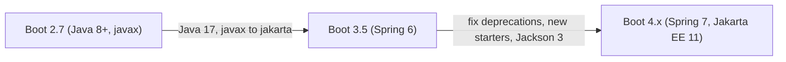
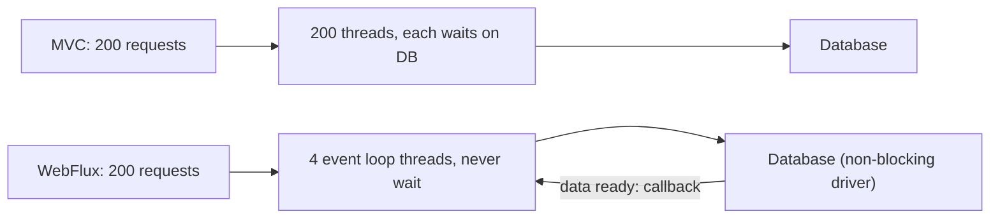
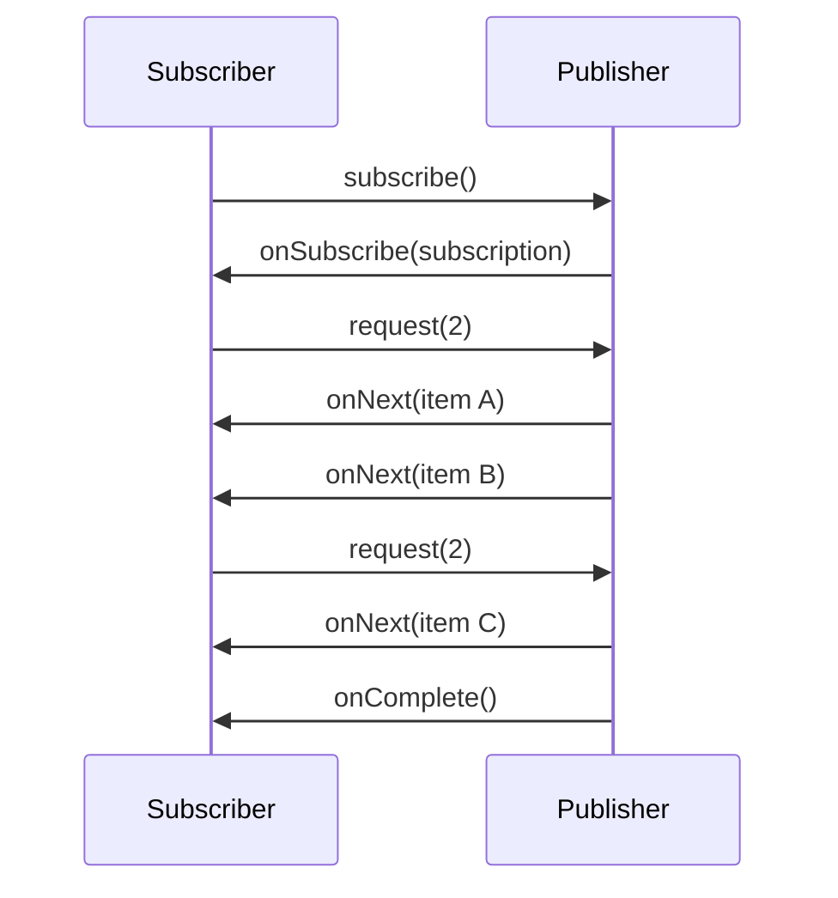
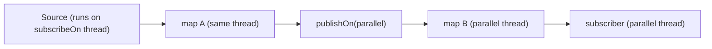
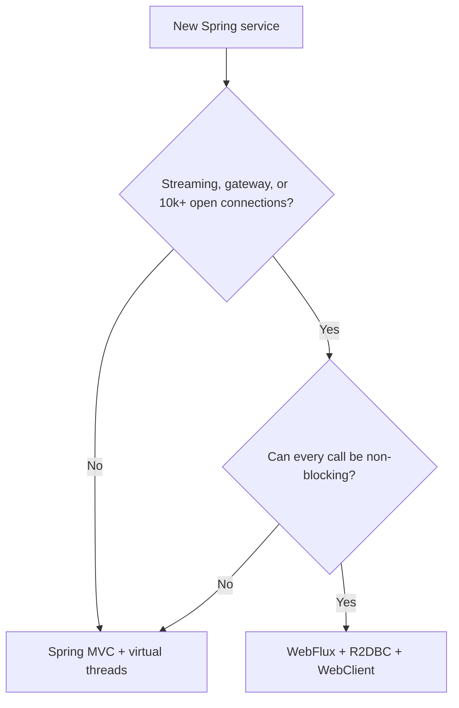

# Spring and Spring Boot

[← Back to README](../README.md)

## Spring Boot 2 to 3 to 4: what changed

**In one line:** Boot 3 moved to Java 17 and `jakarta.*`. Boot 4 (Spring Framework 7) adds small modules, null-safety, API versioning and Jackson 3.

**Story:** Think of moving to a new house.
Boot 2 to 3 was a big move to a new city. Every address changed (`javax` became `jakarta`), and you needed a new car (Java 17).
Boot 3 to 4 is a move to a new flat in the same city. Your address mostly stays. But the rooms are re-arranged (modular jars), and some old furniture is thrown out (removed deprecated APIs, Undertow, Jackson 2 as default).
Both moves are easier if you pack well first: upgrade to the last minor version (2.7, then 3.5) before the big jump.

**Version table:**

| Version | Released | Main changes | Why it matters |
|---|---|---|---|
| Boot 2.x | 2018-2023 | Spring Framework 5, Java 8+, `javax.*`, Spring Cloud Sleuth for tracing | Open-source support ended. Upgrade now |
| Boot 3.0 | Nov 2022 | Java 17 baseline, Spring Framework 6, Jakarta EE 9/10 (`jakarta.*`), GraalVM native images, Micrometer Observation + Micrometer Tracing (replaces Sleuth), HTTP interfaces (`@HttpExchange`), `ProblemDetail` errors | The biggest migration |
| Boot 3.1 | May 2023 | Docker Compose support, Testcontainers `@ServiceConnection` | Easier local dev and tests |
| Boot 3.2 | Nov 2023 | Virtual threads (`spring.threads.virtual.enabled`), `RestClient`, `JdbcClient` | Simple blocking code that scales |
| Boot 3.5 | May 2025 | Last 3.x line | Upgrade to this before going to 4 |
| Boot 4.0 | Nov 2025 | Spring Framework 7, Jakarta EE 11 (Servlet 6.1), Java 17 baseline (Java 25 recommended), modular jars, JSpecify null-safety, API versioning, HTTP service clients, Jackson 3, `@Retryable` in core, OpenTelemetry starter | New generation for the next years |
| Boot 4.1 | June 2026 | gRPC auto-configuration, SSRF protection for HTTP clients (stops attackers making your server call internal URLs), Kotlin 2.3 | Current stable minor |
| Boot 4.2 | Planned Nov 2026 | Release candidate in Oct 2026 | Check spring.io before you say it is out |

**Boot 3 changes, one by one:**
1. **Java 17 baseline.** Java 8 and 11 are not supported.
2. **`javax` to `jakarta`.** `javax.persistence.Entity` becomes `jakarta.persistence.Entity`. Same for servlet and validation.
3. **Native images with GraalVM.** Spring prepares the app at build time (*AOT*, ahead-of-time processing). The app starts in less than a second and uses less memory. Build is slower, and reflection needs hints.
4. **Observability.** Micrometer *Observation* is one API for metrics and traces. *Micrometer Tracing* replaces Spring Cloud Sleuth.
5. **HTTP interfaces.** Write a Java interface with `@GetExchange`. Spring creates the client for you.
6. **Spring Security 6.** `WebSecurityConfigurerAdapter` is gone. You define a `SecurityFilterChain` bean.

**Boot 4 changes, one by one:**
1. **Spring Framework 7 and Jakarta EE 11.** Servlet 6.1, JPA 3.2, Hibernate 7, Tomcat 11, Jetty 12.1.
2. **Java 17 is still the minimum.** Java 25 is recommended. GraalVM native needs version 25 or newer.
3. **Modular jars.** Boot's big auto-configure jar is split into small modules, one per technology. Starters are renamed too: `spring-boot-starter-web` is now `spring-boot-starter-webmvc`. Old names still work but are deprecated.
4. **JSpecify null-safety.** Spring APIs use standard `@Nullable` / `@NonNull` annotations from JSpecify. Tools and Kotlin can catch null bugs at build time.
5. **API versioning built in.** Add `version = "2"` on `@GetMapping`. Spring picks the right method from a header, query parameter, path or media type.
6. **HTTP service clients.** HTTP interfaces now get auto-configuration and properties (base URL, timeouts) out of the box.
7. **Jackson 3.** New package `tools.jackson`. Use a `JsonMapper` bean. Jackson 2 still works through a deprecated module.
8. **Resilience in core.** `@Retryable` and `@ConcurrencyLimit` are in Spring Framework now (turn on with `@EnableResilientMethods`). Spring Retry is no longer managed by Boot.
9. **OpenTelemetry starter.** `spring-boot-starter-opentelemetry` sends metrics and traces over OTLP (the OpenTelemetry protocol).
10. **Removed:** Undertow (not ready for Servlet 6.1), `@MockBean` / `@SpyBean` (use `@MockitoBean` / `@MockitoSpyBean`), all APIs deprecated in 3.x.

**Diagram:**



**Example:**

```java
// Boot 3+: HTTP interface. Boot 4 auto-configures it.
@HttpExchange("/orders")
interface OrderClient {
    @GetExchange("/{id}")
    Order get(@PathVariable long id);
}

// Boot 4 / Spring 7: API versioning on the controller
@RestController
@RequestMapping("/orders")
class OrderController {
    @GetMapping(path = "/{id}", version = "1")
    OrderV1 getV1(@PathVariable long id) { return service.v1(id); }

    @GetMapping(path = "/{id}", version = "2")       // same URL, different version
    OrderV2 getV2(@PathVariable long id) { return service.v2(id); }
}
```

```properties
# Boot 4: read the version from a request header
spring.mvc.apiversion.use.header=API-Version
```

```java
// Spring 7: retry without the Spring Retry library
@Retryable(maxRetries = 3, delay = 200)             // 3 retries after the first call; needs @EnableResilientMethods
public Payment charge(Order order) { return paymentClient.charge(order); }
```

**Migration checklist:**

Boot 2 to 3:
1. Upgrade to Boot 2.7 first. Fix all deprecation warnings.
2. Move to Java 17 (or 21).
3. Change `javax.*` to `jakarta.*`. OpenRewrite (a tool that changes code by recipes) does most of this for you.
4. Rewrite security config as a `SecurityFilterChain` bean. `antMatchers` becomes `requestMatchers`.
5. Replace Sleuth with Micrometer Tracing.
6. Add `spring-boot-properties-migrator` for one run. It tells you renamed properties (for example `spring.redis.*` to `spring.data.redis.*`). Remove it afterwards.
7. Check third-party libraries. Each one needs a Jakarta version.

Boot 3 to 4:
1. Upgrade to the latest Boot 3.5.x first. Fix all deprecation warnings (they are removed in 4).
2. Switch starters to new names (`spring-boot-starter-webmvc`). If too many errors, use `spring-boot-starter-classic` for a short time, then remove it.
3. Move Jackson code to Jackson 3 (`tools.jackson`), or use the `spring-boot-jackson2` module as a short-term bridge.
4. Replace `@MockBean` with `@MockitoBean`. Add `@AutoConfigureMockMvc` where tests need MockMvc.
5. Undertow users: move to Tomcat or Jetty.
6. Spring Retry users: move to core `@Retryable`, or add Spring Retry with your own version.
7. Upgrade Spring Cloud to the version that matches Boot 4. Check the compatibility table.
8. Run the full test suite, then a load test, then deploy one service first.

**Good and bad:**

| Good | Bad |
|---|---|
| Upgrade in steps: 2.7 → 3.5 → 4.x | Jump from 2.3 straight to 4.0 |
| Use OpenRewrite for `javax` → `jakarta` | Find-and-replace by hand in 500 files |
| Use `@MockitoBean` already in Boot 3.4+ | Wait for Boot 4 to break all tests at once |
| Read the official migration guide | Trust a blog post with no version numbers |

**When to use / when not to use:**
- New project today: start on Boot 4 with Java 21 or 25.
- Existing Boot 3.5 app with many old libraries: plan Boot 4 after your libraries support Jackson 3 and Jakarta EE 11.
- Native images: use for serverless or fast-scaling services. Skip for normal long-running services, where JVM mode is simpler.

**Say this in the interview:**
> "Boot 3 was the big change. It needs Java 17 and moved `javax` to `jakarta`. It brought Spring Framework 6, native images, and Micrometer Tracing instead of Sleuth. Boot 4 came in November 2025 on Spring Framework 7 and Jakarta EE 11. The baseline is still Java 17. It splits Boot into small modules. It adds JSpecify null-safety, built-in API versioning, HTTP service clients and Jackson 3. I always upgrade to the last minor first (2.7 or 3.5) and fix deprecations. Then I make the jump."

**They may ask next:**
- **Why did `javax` become `jakarta`?** Java EE moved to the Eclipse Foundation, and Oracle kept the `javax` name. So the packages were renamed.
- **What is AOT in Spring?** Spring does some startup work at build time, like finding beans and creating proxies. So a native image can start very fast.
- **What does JSpecify give me?** Standard null annotations. Your IDE, build tools (like NullAway) and Kotlin can warn you about nulls before runtime.
- **Is `RestTemplate` removed?** Not yet. The Spring team announced its end in 2025. It is marked deprecated in Spring Framework 7.1 and planned for removal in 8.0. Use `RestClient` for new code.

## Spring MVC vs WebFlux

**In one line:** Spring MVC gives each request its own thread that waits. WebFlux uses a few threads that never wait.

**Story:** A bank has two ways to serve customers.
**MVC bank:** 200 counters, one clerk each. A clerk serves one customer from start to end. If the clerk must wait 5 minutes for a manager signature, the clerk just waits. When all 200 clerks are busy, new customers stand in the queue.
**WebFlux bank:** only 4 smart clerks. A clerk takes your request, sends it to the back office, and gives you a token. The clerk serves the next person right away. When your paper is ready, any clerk calls your token.
The WebFlux bank serves many people with few clerks. But if one clerk falls asleep at the desk (a *blocking call*), a quarter of the bank stops.

**How it works:**
1. **Spring MVC:** *thread-per-request*. Tomcat gives each request a thread (200 by default). The code is normal, step by step. A database call blocks the thread until the result comes.
2. **WebFlux:** *event loop* (a few threads, usually one per CPU core, that never wait). It runs on Netty by default. Code returns a "promise" of data, not the data.
3. **Mono** = 0 or 1 item later (like one order). **Flux** = 0 to many items later (like a stream of orders).
4. **Backpressure:** the consumer says "send me only 10 items at a time". The producer does not flood a slow consumer. It is like a waiter who brings the next dish only when you finish the current one.
5. **With virtual threads (Java 21+):** MVC threads become cheap. A blocking call no longer wastes an OS thread. So MVC can handle thousands of waiting requests too, with simple code.

**Diagram:**



**Example:**

```java
// Spring MVC: simple blocking code (use with virtual threads)
@GetMapping("/orders/{id}")
Order get(@PathVariable long id) {
    return orderRepository.findById(id).orElseThrow();        // JPA: blocks, fine in MVC
}

// WebFlux: returns a Mono, needs non-blocking drivers (R2DBC = reactive JDBC, WebClient)
@GetMapping("/orders/{id}")
Mono<Order> get(@PathVariable long id) {
    return orderRepository.findById(id)                       // R2DBC: non-blocking
        .switchIfEmpty(Mono.error(new OrderNotFound(id)));
}

// Streaming: WebFlux shines here (Server-Sent Events)
@GetMapping(value = "/prices", produces = MediaType.TEXT_EVENT_STREAM_VALUE)
Flux<Price> prices() { return priceService.liveStream(); }
```

**Don't block inside WebFlux:**

```java
// BAD: JPA or Thread.sleep on the event loop freezes other requests
Mono<Order> bad = Mono.just(jpaRepository.findById(id).get());

// If you really must call blocking code, move it to a separate thread pool
Mono<Order> ok = Mono.fromCallable(() -> jpaRepository.findById(id).get())
                     .subscribeOn(Schedulers.boundedElastic());   // runs off the event loop
```

**When to choose which:**

| Situation | Choose |
|---|---|
| Normal CRUD service with JPA / JDBC | MVC (+ virtual threads) |
| Team knows only imperative Java | MVC |
| Streaming data to clients (SSE, WebSocket, live prices) | WebFlux |
| API gateway or proxy with many long-open connections | WebFlux |
| Whole stack is already reactive (R2DBC, reactive Kafka, WebClient) | WebFlux |
| Many slow downstream calls, simple code wanted | MVC + virtual threads |

**Good and bad:**

| Good | Bad |
|---|---|
| MVC + virtual threads for most I/O-bound apps | Pick WebFlux "because it is faster" without measuring |
| WebFlux with R2DBC and WebClient end to end | WebFlux with JPA calls inside `map()` |
| Use `RestClient` for HTTP calls in MVC | Call `.block()` inside a WebFlux handler |
| Use `StepVerifier` to test reactive code | Debug reactive stack traces with no tools |

**When to use / when not to use:**
- Use MVC as the default. It is easier to write, read, debug and test.
- Use WebFlux when you stream data, or have very many long-lived connections, or the whole chain is reactive.
- Don't mix: one blocking call in a WebFlux app can stall many users.

**Say this in the interview:**
> "Spring MVC is thread-per-request: simple blocking code, and the thread waits on I/O. WebFlux uses a small event loop that never blocks, with `Mono` for one item and `Flux` for many, and it supports backpressure. Since Java 21, MVC with virtual threads handles thousands of waiting requests with simple code, so I choose MVC for most services. I pick WebFlux for streaming or gateway-style apps, and then I make sure nothing blocks the event loop."

**They may ask next:**
- **Can I use `WebClient` in an MVC app?** Yes. But for new MVC code, `RestClient` is simpler and blocking-friendly.
- **Is WebFlux faster?** Not per request. It uses fewer threads under high load. With virtual threads, the gap for typical apps is small.
- **What happens if I block the event loop?** All requests on that thread stop. With 4 event loop threads, one slow call can slow a quarter of all traffic.
- **What is backpressure?** The consumer controls the speed. It asks for N items, and the producer sends only N.

## Spring Reactive (WebFlux) in depth

This section goes deeper than [Spring MVC vs WebFlux](#spring-mvc-vs-webflux). Read that first for thread-per-request vs event loop.
Here we cover how Reactor works inside: streams, operators, errors, threads, testing and debugging.
Versions in this section: Spring Boot 4.x, Spring Framework 7, Reactor Core 3.8.x (the "2025.0" release train).

**The story we use in this whole section: Raju, the smart waiter.**
- A busy restaurant has only **one smart waiter, Raju**. The kitchen is slow (like a database or another service).
- Raju takes an order, gives it to the kitchen, and **never stands and waits** at the kitchen door. He takes the next table's order.
- When a dish is ready, the kitchen rings a bell. Raju brings the dish to the right table.
- A table can say "bring only 2 dishes at a time, our table is small". Raju listens.
- If Raju ever sits down and waits for one dish, the whole restaurant stops. That is a *blocking call*.

### What is reactive programming

**In one line:** Reactive programming means you describe what to do **when data arrives**, instead of waiting for the data.

**Story:** Raju does not stand at the kitchen for 10 minutes. He tells the kitchen: "When the biryani is ready, ring the bell. I will bring it to table 5." He writes the plan once. The kitchen calls him when the data (the dish) is ready.

**How it works:**
1. You build a **pipeline** (a chain of steps): get order → add tax → save → send email.
2. Data flows through the pipeline as **events**: "next item", "error", "finished".
3. Nothing waits. When a step needs I/O (input/output, like a DB or HTTP call), the thread goes to do other work.
4. When the I/O is done, a callback continues the pipeline, maybe on another thread.
5. The consumer can control speed. This is *backpressure* (see [Backpressure](#backpressure)).

The **Reactive Manifesto** (2014) lists 4 qualities of reactive systems:
- *Responsive*: they answer fast.
- *Resilient*: they survive failures.
- *Elastic*: they grow and shrink with load.
- *Message-driven*: parts talk by async messages.

**Example:** Imperative vs reactive for the same job.

```java
// Imperative: each line waits for the one before
Order order = orderRepo.findById(id);           // thread waits here
Payment p = paymentClient.pay(order);           // thread waits here again
return p.status();

// Reactive: describe the steps, the thread never waits
return orderRepo.findById(id)                   // Mono<Order>, returns at once
        .flatMap(paymentClient::pay)            // runs when the order arrives
        .map(Payment::status);                  // runs when the payment arrives
```

**Good and bad:**

| Good | Bad |
|---|---|
| Few threads serve many slow connections | Code is harder to read and debug |
| Built-in backpressure and streaming | One blocking call breaks the model |
| Good fit for gateways and live data | Big learning curve for the team |

**Say this in the interview:**
> "Reactive programming is non-blocking and event-driven. I build a pipeline and say what to do when data comes, instead of waiting for it. In Java I use Project Reactor with `Mono` and `Flux`, and Spring WebFlux on top. It saves threads when there are many slow I/O calls, and it supports backpressure."

**They may ask next:**
- **Is reactive the same as async?** Async means "don't wait". Reactive is async plus streams of data plus backpressure.
- **Is reactive the same as parallel?** No. Reactive is about not waiting. It often runs one request on one thread at a time.

### Reactive Streams: Publisher, Subscriber, Subscription

**In one line:** Reactive Streams is a small standard of 4 Java interfaces. It lets a producer send data to a consumer without blocking, and with backpressure.

**Story:** A newspaper subscription.
You (the *Subscriber*) call the newspaper company (the *Publisher*). They give you a *Subscription* card.
On the card you write "send me 10 pages". They send 10 pages, one by one. Then you ask for 10 more.
When the news is finished, they send a note "that is all" (complete). If the printing press breaks, they send "sorry, error".
If you never call the company, no newspaper comes. **Nothing happens until you subscribe.**

**How it works:** The 4 interfaces (package `org.reactivestreams`):

| Interface | Role | Main methods |
|---|---|---|
| `Publisher<T>` | Produces data | `subscribe(Subscriber)` |
| `Subscriber<T>` | Consumes data | `onSubscribe`, `onNext`, `onError`, `onComplete` |
| `Subscription` | The link between them | `request(n)`, `cancel()` |
| `Processor<T,R>` | Both a Subscriber and a Publisher | (a middle step) |

1. Subscriber calls `publisher.subscribe(subscriber)`.
2. Publisher calls `onSubscribe(subscription)`.
3. Subscriber calls `subscription.request(n)`: "I can take n items".
4. Publisher calls `onNext(item)` at most n times.
5. At the end, the publisher calls `onComplete()` **or** `onError(e)`. Only one of them, and only once. After that, no more signals.
6. The subscriber can call `cancel()` at any time to stop.

**Java 9 Flow API:** Java 9 copied the same 4 interfaces into `java.util.concurrent.Flow` (`Flow.Publisher`, `Flow.Subscriber`, `Flow.Subscription`, `Flow.Processor`). Reactor can convert between them with `JdkFlowAdapter`.

**Diagram:**



**Example:** Nothing happens until you subscribe.

```java
Flux<String> names = Flux.just("Asha", "Ravi")
        .map(n -> {
            System.out.println("map " + n);   // NOT printed yet
            return n.toUpperCase();
        });
// Here, nothing has run. We only built the pipeline.

names.subscribe(n -> System.out.println("got " + n));  // now it runs
```

In WebFlux, **Spring subscribes for you**. You return a `Mono` or `Flux` from the controller, and the framework subscribes when it writes the HTTP response.

**Good and bad:**

| Good | Bad |
|---|---|
| Return the `Mono` / `Flux` and let Spring subscribe | Build a `Mono` and forget to return it (it never runs) |
| Use a library (Reactor, RxJava) | Write your own `Publisher` (the rules are hard) |

**Say this in the interview:**
> "Reactive Streams has four interfaces: Publisher, Subscriber, Subscription and Processor. The subscriber asks for N items with `request(n)`, and the publisher sends at most N `onNext` calls. It ends with `onComplete` or `onError`. Nothing runs until someone subscribes. In WebFlux, Spring subscribes when it writes the response."

**They may ask next:**
- **What is the Flow API?** The same 4 interfaces, inside the JDK since Java 9, in `java.util.concurrent.Flow`.
- **Can `onNext` come after `onComplete`?** No. `onComplete` and `onError` are final signals.
- **Who implements these interfaces?** Project Reactor (Spring's choice), RxJava, Akka Streams, Mutiny, and others. They can work together because they share the standard.

### Mono and Flux

**In one line:** `Mono<T>` is a promise of 0 or 1 item. `Flux<T>` is a stream of 0 to many items. Both are `Publisher`s from Project Reactor.

**Story:** At Raju's restaurant, `Mono` is one plate of biryani that will come later (or the kitchen says "sorry, no biryani today" = empty). `Flux` is a thali, where small dishes come one by one, and then the waiter says "that is all".

**How it works:**

| Want | Use |
|---|---|
| One user by id | `Mono<User>` |
| Save that returns nothing | `Mono<Void>` (only "done" or "error") |
| All orders of a user | `Flux<Order>` |
| Live price updates | `Flux<Price>` (may never complete) |

**Ways to create them:**

| Method | What it does | Note |
|---|---|---|
| `Mono.just(x)` | Wraps a value you already have | `x` is computed **now** (eager) |
| `Mono.empty()` | No item, just complete | Like "not found" |
| `Mono.error(e)` | Only an error | |
| `Mono.fromCallable(() -> ...)` | Runs the code **when subscribed** | Good for wrapping blocking code (with `subscribeOn`) |
| `Mono.defer(() -> mono)` | Creates a new Mono **for each subscriber** | Lazy. Fresh value every time |
| `Flux.just(a, b, c)` | Fixed items | |
| `Flux.fromIterable(list)` | From a `List` | |
| `Flux.range(1, 5)` | 1, 2, 3, 4, 5 | |
| `Flux.interval(Duration.ofSeconds(1))` | 0, 1, 2... every second | Never completes |

**Example:** `just` vs `defer`.

```java
Mono<Instant> eager = Mono.just(Instant.now());              // time taken ONCE, now
Mono<Instant> lazy  = Mono.defer(() -> Mono.just(Instant.now())); // time taken at each subscribe

// Common bug: the DB call runs even if nobody subscribes
Mono<User> bad  = Mono.just(blockingRepo.findUser(id));      // runs NOW, on this thread
Mono<User> good = Mono.fromCallable(() -> blockingRepo.findUser(id)); // runs on subscribe
```

**`block()`, and why not to use it in production:**

```java
User u = userMono.block();   // waits until the Mono gives a value
```

- `block()` turns reactive back into blocking. The thread waits.
- Inside a WebFlux handler, the thread is a Netty event loop thread. Reactor throws `IllegalStateException: block()/blockFirst()/blockLast() are blocking, which is not supported in thread reactor-http-nio-2`.
- Where `block()` is OK: in a `main` method, in a test, or in a batch job that is not reactive.
- In Spring MVC code you *can* call `webClient...block()`. But for new MVC code, `RestClient` is simpler.

**Good and bad:**

| Good | Bad |
|---|---|
| `Mono.fromCallable` or `defer` for lazy work | `Mono.just(callDatabase())`: runs now, not lazy |
| Return `Mono<Void>` for "done" | Return `Mono<Void>` and lose the error |
| Use `block()` only in tests or `main` | `block()` inside a WebFlux controller |

**Say this in the interview:**
> "`Mono` is 0 or 1 item, `Flux` is 0 to N items. Both are lazy publishers from Reactor. `Mono.just` takes a value that is already computed. `fromCallable` and `defer` run the code only when someone subscribes. I never call `block()` inside WebFlux, because it blocks the event loop. Reactor even throws an error if you do it on a Netty thread."

**They may ask next:**
- **Why not `Flux` for everything?** `Mono` tells the reader "only one result". It also has simpler operators like `zip` of two results.
- **What does `Mono<Void>` mean?** "I will tell you when I am done, or if I failed". Like a delete call.
- **`Mono.empty()` vs `Mono.just(null)`?** `Mono.just(null)` throws a `NullPointerException`. Reactive Streams does not allow null items. Use `Mono.empty()` or `Mono.justOrEmpty(x)`.

### Common operators

**In one line:** Operators are the steps of the pipeline. Each operator takes a `Mono`/`Flux` and returns a new one.

**Story:** Raju's order passes many hands. One person adds spices (`map`). One person sends a request to the bakery for bread and waits for the bell (`flatMap`). One person removes cold dishes (`filter`). One person puts two plates on one tray (`zip`).

**`map` vs `flatMap` vs `concatMap` vs `flatMapSequential`:**

| Operator | Function returns | Inner calls run | Order of results | Use when |
|---|---|---|---|---|
| `map` | a plain value | no inner call | same as input | Change each item, no I/O (`price * 1.18`) |
| `flatMap` | a `Mono` / `Flux` | many at the same time | **not kept** | Call a service for each item, order does not matter |
| `concatMap` | a `Mono` / `Flux` | one after another | kept | Order matters (steps of a payment) |
| `flatMapSequential` | a `Mono` / `Flux` | many at the same time | kept (it buffers) | Fast **and** in order |

**Example:**

```java
Flux<Long> ids = Flux.just(1L, 2L, 3L);

ids.map(id -> "order-" + id);                     // plain value, no I/O

ids.flatMap(id -> orderClient.get(id));           // 3 calls in parallel, results in any order
ids.flatMap(id -> orderClient.get(id), 8);        // at most 8 calls at the same time (concurrency)
ids.concatMap(id -> orderClient.get(id));         // one call at a time, order kept
ids.flatMapSequential(id -> orderClient.get(id)); // parallel calls, output in input order

// Common bug: map with I/O gives Flux<Mono<Order>>, and the calls never run
Flux<Mono<Order>> wrong = ids.map(id -> orderClient.get(id));
```

**Other operators you should know:**

| Operator | What it does | Small example |
|---|---|---|
| `filter` | Keep items that match | `.filter(o -> o.amount() > 100)` |
| `zip` | Wait for both, combine | `Mono.zip(userMono, ordersMono)` → `Tuple2` |
| `merge` | Mix two streams, items as they come | `Flux.merge(fastFeed, slowFeed)` |
| `concat` | First stream fully, then the second | `Flux.concat(cache, db)` |
| `switchIfEmpty` | If empty, use another publisher | `.switchIfEmpty(Mono.error(new NotFound()))` |
| `defaultIfEmpty` | If empty, use a fixed value | `.defaultIfEmpty(Price.ZERO)` |
| `collectList` | `Flux<T>` → `Mono<List<T>>` | Careful with huge streams (memory) |
| `buffer(n)` | Group items into lists of n | Save to DB in batches of 100 |
| `take(n)` | Only first n items, then cancel | `.take(10)` |
| `timeout` | Error if no item in time | `.timeout(Duration.ofSeconds(2))` |
| `delayElements` | Wait between items | Demos and tests; rate-limit a stream |
| `doOnNext` | Side effect, item unchanged | **Logging and metrics only** |

**Example:** Combine two calls in parallel with `zip`.

```java
Mono<OrderPage> page(long userId) {
    Mono<User> user = userClient.get(userId);
    Mono<List<Order>> orders = orderClient.byUser(userId).collectList();
    return Mono.zip(user, orders)                          // both calls run at the same time
            .map(t -> new OrderPage(t.getT1(), t.getT2()))
            .doOnNext(p -> log.info("page built for {}", userId)); // logging only
}
```

**Good and bad:**

| Good | Bad |
|---|---|
| `map` for pure changes, `flatMap` for I/O | `map` that calls a blocking DB |
| `flatMap(fn, concurrency)` to limit parallel calls | `flatMap` on 10,000 items with no limit (floods the other service) |
| `doOnNext` for logs | Business logic in `doOnNext` |
| `switchIfEmpty(Mono.error(...))` for "not found" | Return `null` from `map` (throws `NullPointerException`) |

**Say this in the interview:**
> "`map` changes each item without I/O. `flatMap` is for calls that return a `Mono` or `Flux`. It runs them at the same time and does not keep order. `concatMap` keeps order but runs one by one. `flatMapSequential` runs at the same time and still keeps order. I limit `flatMap` concurrency so I don't flood the downstream service."

**They may ask next:**
- **`zip` vs `merge`?** `zip` waits for one item from each and combines them. `merge` just mixes items as they arrive.
- **`concat` vs `merge`?** `concat` subscribes to the second source only after the first completes. `merge` subscribes to both at once.
- **What is the default concurrency of `flatMap`?** 256 inner subscriptions (`Queues.SMALL_BUFFER_SIZE`). Set your own number for remote calls.

### Error handling in reactive code

**In one line:** An error is a signal (`onError`) that travels down the pipeline. It **ends the stream**, unless you catch it with an error operator.

**Story:** The kitchen tells Raju "sorry, biryani is finished". Raju has choices. He can offer a fixed dish (fallback value). He can ask another kitchen (fallback call). He can say it in a polite way ("item not available" instead of "kitchen error"). Or he can ask the same kitchen again after a minute (retry).

**How it works:**

| Operator | What it does | Story |
|---|---|---|
| `onErrorReturn(value)` | Replace error with a fixed value | "Have dal instead" |
| `onErrorResume(e -> publisher)` | Switch to another publisher | "Ask the other kitchen" |
| `onErrorMap(e -> newError)` | Change the error type | "Item not available" |
| `retry(n)` | Subscribe again, n times | "Ask again now" |
| `retryWhen(Retry.backoff(...))` | Retry with growing wait | "Ask again in 1, 2, 4 minutes" |
| `timeout(d)` | Error if too slow | "If no dish in 10 minutes, stop" |
| `doOnError` | Log the error, keep it | "Write it in the book" |

Remember: `try/catch` around reactive code does **not** catch errors. The error happens later, on another thread. Use the operators.

**Example:**

```java
Mono<Price> price(String sku) {
    return priceClient.get(sku)
        .timeout(Duration.ofSeconds(2))                       // slow call = error
        .retryWhen(Retry.backoff(3, Duration.ofMillis(200))   // 3 retries: ~200ms, ~400ms, ~800ms
                .jitter(0.5)                                  // random spread, so clients don't retry together
                .filter(e -> !(e instanceof NotFoundException))) // don't retry a 404
        .onErrorMap(TimeoutException.class, e -> new PriceDownException(sku, e))
        .onErrorResume(PriceDownException.class, e -> cache.lastPrice(sku)) // fallback
        .doOnError(e -> log.warn("price failed for {}", sku, e));
}
```

**Errors in a `Flux` without stopping it:**
An error ends the whole `Flux`. If one item fails, the next items are lost. Handle the error **inside** the `flatMap`, per item:

```java
Flux<Result> results = orderIds
    .flatMap(id -> process(id)
        .onErrorResume(e -> {                       // only this item fails
            log.warn("order {} failed", id, e);
            return Mono.empty();                    // skip it, the Flux continues
        }));
```

There is also `onErrorContinue`, but the Reactor docs say it is tricky. It only works with some operators. Prefer `onErrorResume` inside `flatMap`.

**Good and bad:**

| Good | Bad |
|---|---|
| Retry only safe calls (GET, or calls with an idempotency key) | Retry a payment POST with no idempotency key (double charge) |
| `Retry.backoff` with jitter and a max | `retry()` with no limit (retries forever) |
| Catch per item inside `flatMap` | Let one bad item kill a stream of 1 million |
| `timeout` on every remote call | No timeout: one slow service holds connections forever |

**Say this in the interview:**
> "In Reactor an error is a terminal signal. It ends the stream. I use `onErrorResume` for a fallback, `onErrorMap` to change the type, and `retryWhen(Retry.backoff(...))` for retries with backoff and jitter. I always add a `timeout`. To keep a `Flux` alive when one item fails, I handle the error inside the `flatMap` for that item."

**They may ask next:**
- **How does retry work?** It subscribes again to the source. For a `WebClient` call, this sends the HTTP request again.
- **Can I use Spring 7 `@Retryable` on reactive methods?** Yes. The Spring Framework 7 docs say `@Retryable` also works on methods that return a reactive type. It uses Reactor retry inside.
- **Why doesn't try/catch work?** The code inside the lambda runs later, often on another thread, after your method has already returned.

### Backpressure

**In one line:** Backpressure means the **consumer controls the speed**. It asks for N items, and the producer sends only N.

**Story:** A table of 4 people tells Raju: "Our table is small. Bring 2 dishes at a time." The kitchen may have 10 dishes ready. Raju brings 2. When the table finishes them, they say "2 more". If Raju brought all 10, plates would fall on the floor. In software, plates on the floor = `OutOfMemoryError`.

**How it works:**
1. The subscriber calls `request(n)`. This is the "2 dishes at a time" message.
2. The publisher sends at most n `onNext` signals.
3. If the publisher cannot slow down (like live stock prices or mouse clicks), you must choose a strategy:

| Strategy | What it does | Story |
|---|---|---|
| `onBackpressureBuffer(max)` | Keep extra items in a queue, up to max | Keep extra dishes on a side table |
| `onBackpressureDrop()` | Throw away items the consumer cannot take | Throw away dishes nobody asked for |
| `onBackpressureLatest()` | Keep only the newest item | Keep only the freshest hot roti |
| `limitRate(n)` | Ask the source for n at a time (refills at 75%) | Order from the kitchen in small batches |

**Example:**

```java
Flux<Price> prices = priceFeed.live()          // hot source, cannot slow down
    .onBackpressureLatest()                    // slow client gets only the newest price
    .limitRate(100);                           // ask upstream for 100 at a time

Flux<Order> fromDb = orderRepo.findAll()       // R2DBC: DB rows come as the client asks
    .buffer(500)                               // groups of 500
    .concatMap(batch -> kafkaSender.send(batch)); // next batch only after this one is sent
```

**Where backpressure does NOT work end-to-end:**
- `request(n)` is a Java method call inside one JVM. It is **not sent over the network**.
- Over plain HTTP, WebFlux uses **TCP flow control** instead. If the client reads slowly, its TCP buffer fills. Netty stops writing. Then WebFlux stops asking the `Flux` for more items. So it works, but at the network buffer level, not item by item.
- Over a message queue (Kafka, RabbitMQ), the consumer pulls at its own speed. The broker holds the extra messages.
- **RSocket** is a protocol that sends `request(n)` over the network. It is the only common one with true end-to-end reactive backpressure.
- If you call `collectList()`, you collect everything in memory. Backpressure is gone for that step.

**Good and bad:**

| Good | Bad |
|---|---|
| Stream big results with `Flux` and R2DBC | `collectList()` on 5 million rows |
| Choose drop or latest for live data | Unbounded `onBackpressureBuffer()` (memory grows until crash) |
| `flatMap(fn, 8)` to limit parallel calls | Assume backpressure crosses HTTP to the other service |

**Say this in the interview:**
> "Backpressure lets the consumer control the speed using `request(n)`. When the source cannot slow down, like live prices, I choose a strategy: buffer with a limit, drop, or keep the latest. Inside one JVM it is exact. Over HTTP it falls back to TCP flow control. RSocket is the protocol that carries `request(n)` across the network."

**They may ask next:**
- **What happens with no strategy and a fast hot source?** Reactor throws an *overflow* error (`OverflowException`), and the stream ends.
- **What does `subscribe()` request by default?** `Long.MAX_VALUE`, which means "send everything" (unbounded).

### Cold vs hot publishers

**In one line:** A **cold** publisher starts fresh for each subscriber. A **hot** publisher is already running, and late subscribers miss old items.

**Story:**
- **Cold = Netflix movie.** Each viewer presses play and sees the movie from the start. Two viewers = two separate streams.
- **Hot = live TV cricket match.** It runs whether you watch or not. If you join in the 10th over, you missed the first 9 overs.

**How it works:**

| | Cold | Hot |
|---|---|---|
| Starts when | Someone subscribes | Already running |
| Each subscriber gets | All items, from the start | Only items after they join |
| Examples | `Flux.just`, `Mono.fromCallable`, a `WebClient` call, an R2DBC query | Live prices, a `Sinks.many()`, mouse clicks, a Kafka topic tail |

**Very common surprise:** a `WebClient` call is cold. **Subscribing twice sends two HTTP requests.**

**Turn cold into hot or shared:**

| Operator | What it does |
|---|---|
| `share()` | Many subscribers share one running source. Late subscribers miss old items |
| `cache()` | Remembers the result and replays it to every new subscriber |
| `cache(Duration)` | Same, but forgets after the time (simple in-memory cache) |
| `Sinks.many().multicast()...` | Push items from your own code to many subscribers (hot) |
| `Sinks.many().replay().latest()` | Hot, but each new subscriber first gets the last item |

**Example:**

```java
Mono<Rates> rates = rateClient.fetch()           // cold: each subscribe = new HTTP call
        .cache(Duration.ofMinutes(5));           // now: one call, result reused for 5 minutes

// Hot stream fed by our own code (e.g. from a Kafka listener)
Sinks.Many<Score> sink = Sinks.many().multicast().onBackpressureBuffer();
Flux<Score> liveScores = sink.asFlux();          // controllers return this to clients

void onNewScore(Score s) {
    sink.tryEmitNext(s);                          // push to everyone who is listening now
}
```

**Good and bad:**

| Good | Bad |
|---|---|
| `cache()` a config or token call that many requests need | Subscribe twice to a `WebClient` Mono by mistake (two calls) |
| `Sinks` to bridge a listener into a `Flux` | Old `EmitterProcessor` / `DirectProcessor` (removed; use `Sinks`) |

**Say this in the interview:**
> "Cold publishers start fresh for each subscriber, like a Netflix movie. A `WebClient` call is cold, so two subscribes mean two HTTP calls. Hot publishers are like live TV; late subscribers miss earlier items. I use `share()` to share one source, `cache()` to replay a result, and `Sinks` to push events from my code into a hot `Flux`."

**They may ask next:**
- **Is `Flux.interval` hot?** No, it is cold. Each subscriber gets its own timer starting from 0. Add `share()` to make it shared.

### Schedulers and threading

**In one line:** Reactor runs code on the thread that sends the signal. *Schedulers* (thread pools) let you move work to other threads.

**Story:** Raju (the event loop thread) must always be free to take orders. If a customer wants a cake from a far bakery (a blocking call), Raju does not walk there. He gives the job to a **delivery boy** from a separate team (the `boundedElastic` pool). When the cake comes, the work continues.

**How it works:**
1. **Netty event loop:** WebFlux runs on Netty. Netty has a few *event loop* threads (by default one per CPU core, at least 4), named like `reactor-http-nio-1`. They handle all requests.
2. By default, your operators run on the thread that delivered the data, often the event loop.
3. **`Schedulers.parallel()`:** one thread per CPU core. For **CPU work** (math, JSON, encryption). Never block here.
4. **`Schedulers.boundedElastic()`:** grows up to 10 × CPU cores threads (and a queue of 100,000 tasks). For **blocking** calls you cannot avoid.
5. **`subscribeOn(scheduler)`:** chooses where the **source starts**. Position in the chain does not matter. If you write it many times, the one closest to the source wins.
6. **`publishOn(scheduler)`:** switches the thread **for all steps below it**. Position matters.

**Diagram:**



**Example:**

```java
Flux.range(1, 3)
    .map(i -> i * 10)                          // runs on boundedElastic (from subscribeOn)
    .publishOn(Schedulers.parallel())          // switch: everything BELOW runs on parallel
    .map(i -> i + 1)                           // runs on parallel
    .subscribeOn(Schedulers.boundedElastic())  // source starts here; position does not matter
    .subscribe(i -> log.info("{} on {}", i, Thread.currentThread().getName()));
```

**How to call blocking code safely:**

```java
Mono<Report> report(long id) {
    return Mono.fromCallable(() -> legacyJdbcDao.loadReport(id)) // blocking JDBC, lazy
               .subscribeOn(Schedulers.boundedElastic());        // runs off the event loop
}
```

**Reactor and virtual threads:** On Java 21+, you can set the system property `reactor.schedulers.defaultBoundedElasticOnVirtualThreads=true`. Then `boundedElastic()` uses a new virtual thread for each task (Reactor 3.6+).

**BlockHound: catch blocking calls in tests.**
BlockHound is a small Java agent from the Reactor team. It throws an error when code blocks on a non-blocking thread (like the event loop).

```java
@BeforeAll
static void setUp() {
    BlockHound.install();     // now Thread.sleep or JDBC on the event loop throws BlockingOperationError
}
```

- On Java 13+ it needs the JVM flag `-XX:+AllowRedefinitionToAddDeleteMethods`.
- Use it in tests and in staging. Not in production.

**Good and bad:**

| Good | Bad |
|---|---|
| `fromCallable` + `subscribeOn(boundedElastic())` for blocking calls | Blocking JDBC call inside `map` on the event loop |
| `parallel()` for heavy CPU work | Blocking call on `parallel()` (only one thread per core) |
| BlockHound in tests | Find blocking calls in production at 2 a.m. |
| Many `publishOn` only when needed | `publishOn` after every step (thread switches cost time) |

**Say this in the interview:**
> "WebFlux runs on a few Netty event loop threads, about one per CPU core. `subscribeOn` decides where the source runs; `publishOn` switches the thread for the steps after it. `parallel` is for CPU work. `boundedElastic` is for blocking calls I cannot avoid. I wrap them with `Mono.fromCallable(...).subscribeOn(Schedulers.boundedElastic())`. I use BlockHound in tests to catch blocking calls on the event loop."

**They may ask next:**
- **Is `boundedElastic` a fix for using JPA everywhere?** No. It works for a few calls. If most calls are blocking, use Spring MVC with virtual threads instead.
- **Which thread runs my `map` by default?** The thread that sent the item. For an HTTP response, usually a Netty event loop thread.

### WebFlux controllers and functional endpoints

**In one line:** WebFlux has two ways to write endpoints: the usual `@RestController` returning `Mono`/`Flux`, or *functional endpoints* with `RouterFunction` and `HandlerFunction`.

**Story:** A restaurant can take orders in two ways. A printed menu card with fixed items (annotations: easy, everyone knows it). Or a waiter with a notebook who writes routes by hand (functional: more control, all in plain code).

**How it works:**
1. **Annotated controllers:** same `@GetMapping`, `@PostMapping` as Spring MVC. The method returns `Mono<T>` or `Flux<T>`.
2. **Functional endpoints:** a `RouterFunction` maps a URL to a handler. A handler is a function: `ServerRequest` → `Mono<ServerResponse>`.
3. Both run on the same WebFlux engine. Both can live in the same app.
4. Starter: `spring-boot-starter-webflux`. Netty is the default server.

**Example 1:** Annotated controller.

```java
@RestController
@RequestMapping("/orders")
class OrderController {
    private final OrderRepository repo;           // Spring Data R2DBC repository
    OrderController(OrderRepository repo) { this.repo = repo; }

    @GetMapping("/{id}")
    Mono<Order> get(@PathVariable long id) {
        return repo.findById(id)
                   .switchIfEmpty(Mono.error(new OrderNotFound(id))); // empty → 404 via advice
    }

    @PostMapping
    @ResponseStatus(HttpStatus.CREATED)
    Mono<Order> create(@Valid @RequestBody Mono<NewOrder> body) {      // body read without blocking
        return body.map(Order::from).flatMap(repo::save);
    }
}
```

**Example 2:** Functional endpoint.

```java
@Configuration
class OrderRoutes {
    @Bean
    RouterFunction<ServerResponse> routes(OrderHandler h) {
        return RouterFunctions.route()
                .GET("/v2/orders/{id}", h::get)
                .POST("/v2/orders", h::create)
                .build();
    }
}

@Component
class OrderHandler {
    private final OrderRepository repo;
    OrderHandler(OrderRepository repo) { this.repo = repo; }

    Mono<ServerResponse> get(ServerRequest req) {
        long id = Long.parseLong(req.pathVariable("id"));
        return repo.findById(id)
                .flatMap(o -> ServerResponse.ok().bodyValue(o))
                .switchIfEmpty(ServerResponse.notFound().build()); // 404 if empty
    }
    // create(...) is similar: req.bodyToMono(NewOrder.class) ...
}
```

**Global error handling:**
- For annotated controllers: `@RestControllerAdvice` with `@ExceptionHandler` works the same as in MVC. Return a `ProblemDetail` (standard error JSON, RFC 9457).
- For functional endpoints: add `.onError(...)` on the router, or rely on Spring Boot's global `ErrorWebExceptionHandler`.

```java
@RestControllerAdvice
class Errors {
    @ExceptionHandler(OrderNotFound.class)
    ProblemDetail notFound(OrderNotFound e) {
        return ProblemDetail.forStatusAndDetail(HttpStatus.NOT_FOUND, e.getMessage());
    }
}
```

**Filters:** In WebFlux you write a `WebFilter` (not a servlet `Filter`). It also returns `Mono<Void>`.

**Good and bad:**

| Good | Bad |
|---|---|
| Annotated controllers for normal teams | Mix both styles randomly in one service |
| Functional endpoints for small, code-only routing | Return `Order` (not `Mono<Order>`) after calling `block()` |
| `@RestControllerAdvice` + `ProblemDetail` | Catch errors in every controller method |

**Say this in the interview:**
> "WebFlux supports the normal `@RestController` style, where methods return `Mono` or `Flux`. It also supports functional endpoints with `RouterFunction` and handler functions. I use annotations for most services because the team knows them. For errors I use `@RestControllerAdvice` returning `ProblemDetail`. For functional routes I use `onError` or Boot's `ErrorWebExceptionHandler`."

**They may ask next:**
- **Can a WebFlux controller return a plain object?** Yes, but then it must be ready right away. Don't do blocking work to build it.
- **Does WebFlux run on Tomcat?** Yes, on Servlet containers that support non-blocking I/O. Netty is the default and the most common.

### WebClient, RestClient and RestTemplate

**In one line:** In 2026, use `RestClient` for blocking code (Spring MVC, virtual threads). Use `WebClient` for reactive code. Don't write new code with `RestTemplate`.

**Story:** Three ways to order from another restaurant:
- `RestTemplate` = an old landline phone. It still works, but the company has stopped making new ones.
- `RestClient` = a new mobile phone. You call and wait for the answer. Simple. With virtual threads, waiting is cheap.
- `WebClient` = WhatsApp. You send the message and continue your work. The reply comes later.

**How it works:**

| Client | Style | Use in 2026 | Status |
|---|---|---|---|
| `RestTemplate` | Blocking, old template API | Only old code | Works in Spring 7.0. Marked `@Deprecated(forRemoval)` in Spring Framework 7.1 (comes with Boot 4.2). Removal planned for 8.0 |
| `RestClient` | Blocking, fluent API (Spring 6.1+) | MVC apps, virtual threads, batch jobs | Recommended for blocking code |
| `WebClient` | Non-blocking, returns `Mono`/`Flux` | WebFlux apps, streaming, many parallel calls | Recommended for reactive code |
| HTTP interface (`@HttpExchange`) | Java interface, Spring writes the client | Clean typed clients, like Feign | Backed by `RestClient` or `WebClient` |

- **Spring Boot 4 HTTP service clients:** `@ImportHttpServices` registers your `@HttpExchange` interfaces as beans. You set the base URL and timeouts per *group* with properties `spring.http.serviceclient.<group>.*`.
- **Starters in Boot 4:** `spring-boot-starter-webflux` brings `WebClient` and Reactor Netty. Boot 4 also has a smaller `spring-boot-starter-webclient` if you only need the client.

**Example 1:** `WebClient` with timeouts and retries.

```java
@Bean
WebClient paymentWebClient(WebClient.Builder builder) {       // use Boot's builder (has metrics, codecs)
    HttpClient http = HttpClient.create()
        .option(ChannelOption.CONNECT_TIMEOUT_MILLIS, 2_000)  // connect timeout
        .responseTimeout(Duration.ofSeconds(3));              // wait max 3s for the response
    return builder.baseUrl("http://payment-service")
        .clientConnector(new ReactorClientHttpConnector(http))
        .build();
}

Mono<Payment> pay(PaymentRequest req) {
    return paymentWebClient.post().uri("/payments")
        .header("Idempotency-Key", req.id())                  // makes the retry safe
        .bodyValue(req)
        .retrieve()                                           // 4xx/5xx → WebClientResponseException
        .onStatus(HttpStatusCode::is4xxClientError, r -> Mono.error(new BadPayment()))
        .bodyToMono(Payment.class)
        .timeout(Duration.ofSeconds(5))                       // limit for EACH try (retry subscribes again above)
        .retryWhen(Retry.backoff(2, Duration.ofMillis(300)));
}
```

**`retrieve()` vs `exchangeToMono()`:**
- `retrieve()`: simple. Gives you the body. A 4xx/5xx becomes a `WebClientResponseException`. Use `onStatus` to change that. Use this 90% of the time.
- `exchangeToMono(response -> ...)`: full control. You see the status and headers and decide how to read the body. Spring releases the body if you don't read it, so there is no connection leak.
- The old `exchange()` method was deprecated in Spring 5.3. People forgot to read the body and leaked connections. Don't use it.

**Example 2:** `RestClient` in Spring MVC (simple and blocking).

```java
Payment pay(PaymentRequest req) {
    return restClient.post().uri("/payments")
        .body(req)
        .retrieve()
        .body(Payment.class);       // waits here; cheap on a virtual thread
}
```

**Example 3:** Boot 4 HTTP service client backed by `WebClient`.

```java
@HttpExchange("/payments")
interface PaymentApi {
    @PostExchange
    Mono<Payment> pay(@RequestBody PaymentRequest req);   // reactive return type
}

@SpringBootApplication
@ImportHttpServices(group = "payment", types = PaymentApi.class,
        clientType = HttpServiceGroup.ClientType.WEB_CLIENT)   // default is RestClient
class App { }
```

```properties
spring.http.serviceclient.payment.base-url=http://payment-service
spring.http.serviceclient.payment.read-timeout=3s
```

**Good and bad:**

| Good | Bad |
|---|---|
| Inject Boot's `WebClient.Builder` (metrics, tracing) | `WebClient.create()` everywhere (no tracing, no shared config) |
| Set connect and response timeouts | No timeout: one slow service holds all connections |
| One `WebClient` bean per remote service, reused | New `WebClient` per request |
| `RestClient` in MVC code | `webClient...block()` everywhere in a new MVC app |

**Say this in the interview:**
> "For blocking code, like Spring MVC with virtual threads, I use `RestClient`. For WebFlux I use `WebClient`, because it returns `Mono` and `Flux` and never blocks. `RestTemplate` still works but is legacy. Spring 7.1 deprecates it for removal in 8.0. In Boot 4 I like HTTP service clients: I write an `@HttpExchange` interface and set the base URL and timeouts by properties. I always set timeouts and retry only idempotent calls."

**They may ask next:**
- **Why is `WebClient` not deprecated with `RestTemplate`?** It is the reactive client. Nothing else does that job.
- **Can I use `WebClient` in MVC?** Yes, many teams did that before `RestClient`. But calling `block()` every time adds no benefit. Use `RestClient` for new code.

### Reactive database access (R2DBC)

**In one line:** JDBC and JPA block the thread. **R2DBC** (Reactive Relational Database Connectivity) is the non-blocking driver standard for SQL databases.

**Story:** JDBC is like a waiter who walks to the kitchen and stands there until the dish is ready. R2DBC is Raju: he gives the order slip and walks away. The kitchen rings when the dish is ready.

**How it works:**
1. JDBC API methods like `executeQuery()` return the data directly. So the thread must wait. JPA/Hibernate is built on JDBC, so it blocks too.
2. R2DBC is a different driver API. Queries return a `Publisher`. Drivers exist for PostgreSQL, MySQL, MariaDB, SQL Server, Oracle and H2.
3. **Spring Data R2DBC** gives you repositories, like Spring Data JPA, but returning `Mono`/`Flux`.
4. It is **not an ORM** (object-relational mapper, like Hibernate). No `@OneToMany`, no lazy loading, no dirty checking (auto-save of changed fields), no first-level cache. You write simple entities and join by hand.
5. Other reactive stores: `ReactiveMongoRepository` (MongoDB), `ReactiveRedisTemplate` (Redis), and reactive Cassandra.

**Example:** Spring Data R2DBC repository.

```java
@Table("orders")
record Order(@Id Long id, long customerId, BigDecimal amount, String status) { }

interface OrderRepository extends ReactiveCrudRepository<Order, Long> {
    Flux<Order> findByCustomerId(long customerId);          // derived query, returns a stream

    @Query("SELECT * FROM orders WHERE status = :status LIMIT :n")
    Flux<Order> findTop(String status, int n);
}
```

```properties
spring.r2dbc.url=r2dbc:postgresql://localhost:5432/shop
spring.r2dbc.username=shop
spring.r2dbc.password=secret
```

**Transactions:**
- `@Transactional` works on methods that return `Mono`/`Flux`. Spring uses a `ReactiveTransactionManager` (for R2DBC: `R2dbcTransactionManager`, auto-configured by Boot).
- The transaction is stored in the **Reactor Context**, not in a `ThreadLocal` (threads change in reactive code).
- For code-style transactions, use `TransactionalOperator`.
- If the subscriber cancels, the transaction rolls back.

```java
@Transactional                                              // works with Mono/Flux return types
Mono<Order> placeOrder(NewOrder n) {
    return orderRepo.save(Order.from(n))
            .flatMap(o -> stockRepo.reserve(o.id()).thenReturn(o)); // both in one transaction
}

// Same thing, written in code
Mono<Order> placeOrder2(NewOrder n) {
    return orderRepo.save(Order.from(n))
            .flatMap(o -> stockRepo.reserve(o.id()).thenReturn(o))
            .as(transactionalOperator::transactional);
}
```

**Good and bad:**

| Good | Bad |
|---|---|
| R2DBC + WebClient: the whole chain is non-blocking | JPA inside a WebFlux app on the event loop |
| Load child rows with a second query or a join | Expect `order.getItems()` lazy loading |
| Use Flyway or Liquibase (with a JDBC connection) for schema migrations | Mix JPA and R2DBC on the same tables with no plan |

**Say this in the interview:**
> "JDBC and JPA are blocking, so they don't fit WebFlux well. R2DBC is the reactive driver standard for SQL. Spring Data R2DBC gives repositories that return `Mono` and `Flux`. It is not an ORM, so no lazy loading and no relationships; I write joins myself. `@Transactional` works on reactive methods through a `ReactiveTransactionManager`, and the transaction lives in the Reactor Context."

**They may ask next:**
- **Can I use JPA with WebFlux?** Technically yes, by wrapping calls with `subscribeOn(boundedElastic())`. But you lose most of the benefit. If you need JPA, Spring MVC with virtual threads is the better choice.
- **What about Hibernate Reactive?** It is a reactive ORM from the Hibernate team, built on Vert.x (another reactive toolkit). Spring Data has no official integration. Most Spring teams use R2DBC.
- **Connection pool?** Use `r2dbc-pool`. Boot sets it up when it is on the classpath.

### Context propagation, logging and tracing

**In one line:** `ThreadLocal` does not work well in reactive code, because one request moves across many threads. Reactor has its own **Context** to carry data like user id and trace id.

**Story:** In a normal restaurant, the waiter remembers your table number in his head (a `ThreadLocal`). But at Raju's restaurant, different helpers carry your dish at different steps. Their heads don't share memory. So the table number must be **written on the order slip** that travels with the dish. That slip is the Reactor Context.

**How it works:**
1. `ThreadLocal` (and `MDC`, which uses it) is data stored on one thread.
2. In WebFlux, step 1 can run on `reactor-http-nio-1` and step 2 on `parallel-3`. Data from step 1's thread is not on step 2's thread.
3. **Reactor Context** is a small read-only map that travels with the subscription. You write it with `contextWrite(...)` and read it with `Mono.deferContextual(...)`.
4. Context flows **from the subscriber up to the source**. So `contextWrite` must be **below** (after) the code that reads it.
5. **Micrometer context-propagation** is a library that copies values between `ThreadLocal`s and the Reactor Context automatically. Reactor Core 3.5+ supports it.
6. In Spring Boot, set `spring.reactor.context-propagation=auto` (the default is `limited`). This turns on Reactor's automatic mode (`Hooks.enableAutomaticContextPropagation()`). Then Micrometer Tracing puts `traceId` and `spanId` into the MDC for your logs.

**Example:** Put a user id in the context and read it.

```java
Mono<String> greet() {
    return Mono.deferContextual(ctx ->                       // read from Reactor Context
                Mono.just("Hello " + ctx.get("userId")));
}

greet()
    .contextWrite(Context.of("userId", "u-42"))              // write: must be AFTER the reader
    .subscribe(System.out::println);                         // Hello u-42
```

```properties
# Boot: restore ThreadLocals (MDC, tracing) automatically on each operator
spring.reactor.context-propagation=auto
```

**Good and bad:**

| Good | Bad |
|---|---|
| Reactor Context for request data | Store user id in a `ThreadLocal` in a WebFlux app |
| `context-propagation=auto` + Micrometer Tracing for trace ids in logs | Copy MDC by hand in every `doOnNext` |
| Spring Security reactive uses `ReactiveSecurityContextHolder` (Context based) | Call `SecurityContextHolder.getContext()` in WebFlux (empty) |

**Say this in the interview:**
> "In WebFlux one request jumps between threads, so `ThreadLocal` and MDC lose their data. Reactor has a Context that travels with the subscription. I write it with `contextWrite` and read it with `deferContextual`. For logs and tracing, I use the Micrometer context-propagation library and set `spring.reactor.context-propagation=auto`, so trace ids appear in the MDC on every step."

**They may ask next:**
- **Why must `contextWrite` be at the bottom?** Context travels up from the subscriber at subscribe time. Only operators above `contextWrite` can see it.
- **How does Spring Security get the user in WebFlux?** `ReactiveSecurityContextHolder.getContext()`, which reads the Reactor Context.

### Testing reactive code

**In one line:** Use **`StepVerifier`** to test a `Mono`/`Flux` step by step, and **`WebTestClient`** to test WebFlux endpoints.

**Story:** A food inspector checks Raju's thali. "First dal, then rice, then sweet. Then the waiter says finished." If the sweet comes first, the test fails. `StepVerifier` is that inspector.

**How it works:**
1. `StepVerifier.create(flux)` subscribes for you.
2. You list what you expect: `expectNext(...)`, `expectError(...)`, `verifyComplete()`.
3. The test fails if the signals are different, or never come.
4. **Virtual time:** with `StepVerifier.withVirtualTime(...)`, a 1-hour delay finishes in milliseconds. The test moves a fake clock.
5. `WebTestClient` calls your endpoints (with or without a real server) and checks status and body. It works for WebFlux and also for MVC.

**Example 1:** `StepVerifier`.

```java
@Test
void doublesNumbers() {
    Flux<Integer> flux = Flux.just(1, 2, 3).map(i -> i * 2);

    StepVerifier.create(flux)
        .expectNext(2, 4, 6)
        .verifyComplete();                                 // also checks onComplete came
}

@Test
void slowFluxWithVirtualTime() {
    StepVerifier.withVirtualTime(() ->                     // create the Flux INSIDE the supplier
            Flux.interval(Duration.ofHours(1)).take(2))
        .expectSubscription()
        .thenAwait(Duration.ofHours(2))                    // fake clock: no real waiting
        .expectNext(0L, 1L)
        .verifyComplete();
}
```

**Example 2:** `WebTestClient` with `@WebFluxTest` (only the web layer).

```java
@WebFluxTest(OrderController.class)
class OrderControllerTest {
    @Autowired WebTestClient client;
    @MockitoBean OrderRepository repo;                     // Boot 3.4+ / 4: replaces @MockBean

    @Test
    void returnsOrder() {
        when(repo.findById(1L)).thenReturn(Mono.just(new Order(1L, 7, BigDecimal.TEN, "NEW")));

        client.get().uri("/orders/1").exchange()
              .expectStatus().isOk()
              .expectBody().jsonPath("$.status").isEqualTo("NEW");
    }
}
```

**Good and bad:**

| Good | Bad |
|---|---|
| `StepVerifier` checks every signal | `flux.blockLast()` in tests (misses errors and order) |
| Virtual time for delays and intervals | `Thread.sleep(60_000)` in a test |
| Testcontainers + R2DBC for repository tests | Mock the repository in the repository test |

**Say this in the interview:**
> "I test `Mono` and `Flux` with `StepVerifier`. I list the expected items and then `verifyComplete` or `expectError`. For delays I use virtual time, so a one-hour interval test runs in milliseconds. For endpoints I use `WebTestClient`, usually with `@WebFluxTest` and `@MockitoBean`, and Testcontainers for real database tests."

**They may ask next:**
- **Why create the Flux inside the supplier for virtual time?** The virtual clock must be installed before the operators are built. Otherwise they use the real clock.
- **What is `TestPublisher`?** A fake publisher from `reactor-test`. You push signals by hand to test your operators.

### Debugging reactive code

**In one line:** Reactive stack traces are long and show Reactor's code, not your code. Use `checkpoint()`, `log()` and the **ReactorDebugAgent** to find the real line.

**Story:** A dish comes back cold. In a normal kitchen, you ask the one cook who made it. In Raju's restaurant, 10 helpers touched the dish, on different shifts. You need a **note on the slip** at each step ("passed the tandoor at 8:05") to find who made the mistake.

**How it works:**

| Tool | What it does | Cost | Use in production? |
|---|---|---|---|
| `.log()` | Prints every signal (`onSubscribe`, `request`, `onNext`, `onError`) | High (lots of logs) | Only for a short time, on one pipeline |
| `.checkpoint("load-order")` | Adds your label to the stack trace when an error passes | Low (the `String` version is cheapest) | Yes |
| `ReactorDebugAgent.init()` (from `reactor-tools`) | Adds assembly info (where each operator was written) by changing bytecode at startup | Low at runtime | Yes. The Reactor docs call it "production-ready" |
| `Hooks.onOperatorDebug()` | Captures a stack trace for **every** operator | Very high | No. Only on a dev machine, as a last resort |

**Example:**

```java
public static void main(String[] args) {
    ReactorDebugAgent.init();                     // first line in main; needs reactor-tools dependency
    SpringApplication.run(App.class, args);
}

Mono<Order> load(long id) {
    return repo.findById(id)
        .checkpoint("order-by-id")                // label shows in the error stack trace
        .flatMap(this::enrich)
        .log("order.load");                       // prints all signals; remove after debugging
}
```

**Good and bad:**

| Good | Bad |
|---|---|
| `checkpoint("name")` at key steps | Read 200 lines of `FluxMapFuseable` stack trace |
| ReactorDebugAgent in production | `Hooks.onOperatorDebug()` in production |
| `.log()` for a short time | `.log()` left on in production (huge logs) |

**Say this in the interview:**
> "Reactive stack traces show Reactor internals, not where I built the pipeline. I add `checkpoint("label")` at important steps, and I use `log()` for a short time to see every signal. In production I use the ReactorDebugAgent from `reactor-tools`, because it is cheap. `Hooks.onOperatorDebug()` is too slow for production."

**They may ask next:**
- **What is "assembly time" vs "subscription time"?** Assembly is when you build the chain (write `.map(...)`). Subscription is when data really flows. Errors happen at subscription time, but you want to know the assembly line.

### Streaming and Server-Sent Events with WebFlux

**In one line:** WebFlux can keep an HTTP response open and push data as it happens, using **Server-Sent Events** (SSE).

**Story:** A cricket score app. The phone opens one connection. The server sends "4 runs", "wicket", "6 runs" as they happen. The phone never asks again. That is SSE: one-way, server to client, over normal HTTP.

**How it works:**
1. Return a `Flux` with `produces = MediaType.TEXT_EVENT_STREAM_VALUE` (`text/event-stream`).
2. Each item is written as an SSE event as soon as it is emitted.
3. Use `ServerSentEvent<T>` for an event id, a name and a retry time. The browser uses the id to continue after a reconnect.
4. When the client disconnects, WebFlux **cancels** the `Flux`. So the source stops too. No wasted work.
5. Send a small "heartbeat" every 15–30 seconds, so proxies and load balancers don't close an idle connection.
6. Need two-way messages (chat, games)? Use WebSocket. WebFlux supports it with a `WebSocketHandler`.

**Example:** Live prices.

```java
@GetMapping(value = "/prices/{sku}", produces = MediaType.TEXT_EVENT_STREAM_VALUE)
Flux<ServerSentEvent<Price>> prices(@PathVariable String sku) {
    Flux<ServerSentEvent<Price>> updates = priceStream.forSku(sku)   // hot Flux from Sinks or Kafka
        .map(p -> ServerSentEvent.builder(p)
                .id(String.valueOf(p.version()))                     // client can resume from here
                .event("price")
                .build());

    Flux<ServerSentEvent<Price>> heartbeat = Flux.interval(Duration.ofSeconds(20))
        .map(i -> ServerSentEvent.<Price>builder().comment("ping").build()); // keeps proxies happy

    return Flux.merge(updates, heartbeat);
}
```

Browser side: `new EventSource("/prices/ABC").addEventListener("price", e => show(e.data))`.

**Good and bad:**

| Good | Bad |
|---|---|
| SSE for one-way live updates (scores, prices, order status) | Client polling every 1 second |
| Heartbeat comments | Idle connections cut by the load balancer after 60 seconds |
| Limit the number of open streams per user | One stream per browser tab with no limit |

**Say this in the interview:**
> "WebFlux is very good at streaming. I return a `Flux` with `text/event-stream` and each item is pushed as a Server-Sent Event. When the client goes away, the `Flux` is cancelled. I add an event id so the browser can resume, and a heartbeat so proxies keep the connection. For two-way messages I use WebSocket."

**They may ask next:**
- **SSE vs WebSocket?** SSE is one-way, plain HTTP, and has auto-reconnect in the browser. WebSocket is two-way and needs its own protocol upgrade.
- **Can Spring MVC do SSE?** Yes, with `SseEmitter`. With virtual threads that is fine for a moderate number of clients. WebFlux is lighter for very many streams.

### When not to use reactive

**In one line:** Don't use reactive just because it is modern. Since Java 21, **Spring MVC + virtual threads** is enough for most apps.

**Story:** Raju is amazing on a Saturday night with 200 guests. But for a small café with 10 guests, a normal waiter is fine. Training Raju's style costs time, and if one helper "sits down and waits", the whole system breaks.

**Disadvantages of reactive:**
1. **Hard to read.** Business logic hides inside lambdas and `flatMap` chains.
2. **Hard to debug.** Stack traces show Reactor code. Breakpoints jump between threads.
3. **Everything must be non-blocking.** One JDBC call, one old SDK or one `Thread.sleep` on the event loop slows everyone.
4. **JDBC and JPA are blocking.** You need R2DBC and lose JPA features.
5. **ThreadLocal tools break.** MDC, old security code and some libraries need extra setup.
6. **Learning curve.** New team members need weeks to be productive and safe.
7. **Not faster per request.** It only saves threads and memory under high concurrency.

**When reactive still wins:**
- **Streaming:** SSE, WebSocket, live prices, chat, IoT data.
- **Huge number of slow, long-open connections:** tens of thousands of clients waiting on slow services.
- **API gateways and proxies:** like Spring Cloud Gateway (the WebFlux version). Little logic, lots of I/O.
- **Backpressure needs:** a fast producer and a slow consumer, and you must not run out of memory.
- **The whole stack is already reactive:** R2DBC, reactive Mongo or Redis, WebClient.

**Diagram:**



**Example:** Turn on virtual threads in Spring MVC (Boot 3.2+).

```properties
spring.threads.virtual.enabled=true   # each request runs on a cheap virtual thread
```

**Say this in the interview:**
> "Reactive code is harder to read, debug and test. The whole chain must be non-blocking, and JPA does not fit. Since Java 21, Spring MVC with virtual threads gives most of the scaling with simple code, so that is my default. I still choose WebFlux for streaming, gateways, very many long-open connections, or when I need backpressure."

**They may ask next:**
- **Do virtual threads make WebFlux useless?** No. They remove the main reason for most CRUD apps. WebFlux still gives streaming, backpressure and a rich operator library.
- **What breaks virtual threads?** Long CPU work, and *pinning* (the virtual thread is stuck on its OS thread). Java 24 fixed pinning for `synchronized`. See [virtual threads](java.md#virtual-threads).

### Can we use Spring MVC and WebFlux in the same application?

**In one line:** You can have both on the classpath, but **one app runs one web stack**. If both starters are present, Spring Boot picks **Spring MVC**.

**Story:** One restaurant can have only one style of service at the counter: normal waiters or Raju's style. But a normal waiter can still use WhatsApp (WebClient) to order from another shop.

**How it works:**
1. Both `spring-boot-starter-webmvc` (Boot 4 name; `spring-boot-starter-web` in Boot 3) and `spring-boot-starter-webflux` on the classpath → Boot starts a **servlet** app (Tomcat, MVC).
2. To force WebFlux, set `spring.main.web-application-type=reactive`.
3. Common and fine: an MVC app that uses `WebClient` for outgoing calls, or returns a `Flux` for streaming. MVC can return reactive types and adapts them.
4. Not possible: some endpoints on MVC and others on WebFlux's Netty engine **in the same app**. Split into two services if you really need both.

**Example:**

```properties
# Both starters present, but I want the reactive stack
spring.main.web-application-type=reactive
```

**Say this in the interview:**
> "Yes, both can be on the classpath, but the app runs only one web stack. Spring Boot picks MVC when both are present, unless I set `spring.main.web-application-type=reactive`. It is common to use `WebClient` inside an MVC app. But I can't serve some endpoints with MVC and others with WebFlux in one app."

**They may ask next:**
- **Can an MVC controller return `Mono`?** Yes. Spring MVC adapts it with async request processing. But the stack is still servlet-based.

### Spring Reactive interview questions

Short answers. Each one links to the section with the full story.

**What Is Reactive Programming?**
Programming with non-blocking, event-driven streams. You describe what to do when data arrives, and the thread never waits for I/O. The consumer controls the speed with backpressure. See [What is reactive programming](#what-is-reactive-programming).

**What Is Spring Webflux?**
Spring's reactive web framework, added in Spring 5. It runs on Netty (default) or Servlet containers with non-blocking I/O. Controllers return `Mono` and `Flux` from Project Reactor. It is the reactive version of Spring MVC. See [Spring MVC vs WebFlux](#spring-mvc-vs-webflux) and [WebFlux controllers and functional endpoints](#webflux-controllers-and-functional-endpoints).

**What Are the Mono and Flux Types?**
Both are Reactor publishers. `Mono` gives 0 or 1 item, `Flux` gives 0 to N items. Both end with complete or error, and do nothing until subscribed. See [Mono and Flux](#mono-and-flux).

**What Is the Use of Webclient and Webtestclient?**
`WebClient` is the non-blocking HTTP client for calling other services. It returns `Mono`/`Flux`. `WebTestClient` is the test client for calling your own endpoints in tests and checking status, headers and body. See [WebClient, RestClient and RestTemplate](#webclient-restclient-and-resttemplate) and [Testing reactive code](#testing-reactive-code).

**What Are the Disadvantages of Using Reactive Streams?**
Harder to read, debug and test. The whole chain must be non-blocking, and JPA/JDBC don't fit. `ThreadLocal` tools need extra setup. The team needs time to learn it. See [When not to use reactive](#when-not-to-use-reactive).

**Can We Use Both Web Mvc and Webflux in the Same Application?**
Both can be on the classpath, but the app runs one web stack. Boot picks MVC if both starters are present. Using `WebClient` inside an MVC app is fine. See [Can we use Spring MVC and WebFlux in the same application?](#can-we-use-spring-mvc-and-webflux-in-the-same-application).

**What are Reactive Extensions in Microservices?**
*Reactive Extensions* (ReactiveX, or Rx) is a library family for async streams with operators like `map`, `filter` and `flatMap`. Microsoft created Rx.NET. Netflix ported it to Java as **RxJava** to call many microservices in parallel without blocking. Those ideas led to the Reactive Streams standard, then Project Reactor, which Spring uses. In microservices, they help you combine many remote calls, add timeouts and retries, and stream events. See [Reactive Streams: Publisher, Subscriber, Subscription](#reactive-streams-publisher-subscriber-subscription).

**What happens if you call block() inside a WebFlux handler?**
On a Netty event loop thread, Reactor throws `IllegalStateException` ("block() ... is not supported in thread reactor-http-nio-N"). On other threads it blocks, and the thread can do nothing else. Return the `Mono` instead. See [Mono and Flux](#mono-and-flux).

**map vs flatMap?**
`map` changes each item with a plain function, no I/O. `flatMap` is for a function that returns a `Mono`/`Flux` (like a remote call). It runs them at the same time and does not keep order. See [Common operators](#common-operators).

**flatMap vs concatMap?**
`concatMap` runs inner calls one by one and keeps order. `flatMap` runs them at the same time and does not. `flatMapSequential` runs them at the same time and keeps order. See [Common operators](#common-operators).

**publishOn vs subscribeOn?**
`subscribeOn` chooses the thread where the source starts; its position does not matter. `publishOn` switches the thread for all operators after it. See [Schedulers and threading](#schedulers-and-threading).

**How do you call a blocking library from WebFlux?**
Wrap it: `Mono.fromCallable(() -> blockingCall()).subscribeOn(Schedulers.boundedElastic())`. This moves it off the event loop. If most calls are blocking, use Spring MVC instead. See [Schedulers and threading](#schedulers-and-threading).

**How does backpressure work in WebFlux over HTTP?**
`request(n)` does not travel over the network. WebFlux uses TCP flow control: a slow client fills its buffer, Netty stops writing, and WebFlux stops requesting items. RSocket carries `request(n)` across the network. See [Backpressure](#backpressure).

**Virtual threads vs WebFlux — which would you choose?**
For normal CRUD services with JPA: Spring MVC + virtual threads. Simple code, good scaling. For streaming, gateways, backpressure or a fully reactive stack: WebFlux. See [When not to use reactive](#when-not-to-use-reactive).

**How do you handle errors in a Flux without stopping it?**
An error ends the `Flux`. So handle it per item, inside the `flatMap`: `flatMap(id -> call(id).onErrorResume(e -> Mono.empty()))`. Avoid `onErrorContinue`; it only works with some operators. See [Error handling in reactive code](#error-handling-in-reactive-code).

**How to do retries with backoff in Reactor?**
`.retryWhen(Retry.backoff(3, Duration.ofMillis(200)).jitter(0.5).filter(this::isRetryable))`. Add a `timeout` before it. Retry only idempotent calls. Spring 7's `@Retryable` also works on reactive methods. See [Error handling in reactive code](#error-handling-in-reactive-code).

**Hot vs cold?**
Cold starts fresh for every subscriber, like a Netflix movie (a `WebClient` call). Hot is already running, like live TV; late subscribers miss items (`Sinks`, live prices). `share()` and `cache()` change the behavior. See [Cold vs hot publishers](#cold-vs-hot-publishers).

**How do you test a Flux?**
With `StepVerifier`: `StepVerifier.create(flux).expectNext(...).verifyComplete()`. Use `withVirtualTime` for delays. Use `WebTestClient` for endpoints. See [Testing reactive code](#testing-reactive-code).

**Why doesn't ThreadLocal/MDC work?**
One request moves across many threads in reactive code. A `ThreadLocal` set on one thread is missing on the next. Use the Reactor Context, and `spring.reactor.context-propagation=auto` with Micrometer for MDC and tracing. See [Context propagation, logging and tracing](#context-propagation-logging-and-tracing).

**Can you use JPA with WebFlux?**
Only by wrapping each call in `boundedElastic`, which loses most of the benefit. Use R2DBC with WebFlux, or use JPA with Spring MVC. See [Reactive database access (R2DBC)](#reactive-database-access-r2dbc).

**Does @Transactional work in WebFlux?**
Yes, on methods that return `Mono`/`Flux`, with a `ReactiveTransactionManager` like `R2dbcTransactionManager`. The transaction is kept in the Reactor Context. `TransactionalOperator` is the code-style option. See [Reactive database access (R2DBC)](#reactive-database-access-r2dbc).

**What is Netty's event loop?**
A small group of threads (by default one per CPU core, at least 4). Each thread runs a loop: take a ready I/O event, run its short handler, move to the next. It must never block. See [Schedulers and threading](#schedulers-and-threading) and [Spring MVC vs WebFlux](#spring-mvc-vs-webflux).

**What does Mono.defer do?**
It delays creating the `Mono` until subscribe time, and creates a new one for each subscriber. `Mono.just(x)` uses a value computed right now. See [Mono and Flux](#mono-and-flux).

**What happens if nobody subscribes?**
Nothing. No DB call, no HTTP call. A common bug is building a `Mono` (like a save) and not returning or chaining it. See [Reactive Streams: Publisher, Subscriber, Subscription](#reactive-streams-publisher-subscriber-subscription).

**Why does my WebClient call happen twice?**
A `WebClient` `Mono` is cold. Two subscribers (for example, two `zip` inputs using the same `Mono`, or a retry) send two requests. Use `cache()` if you want one call shared. See [Cold vs hot publishers](#cold-vs-hot-publishers).

**How does Spring Cloud Gateway use WebFlux?**
The classic gateway (`spring-cloud-starter-gateway-server-webflux` in recent versions) is built on WebFlux and Netty. Each route is a reactive pipeline of filters, and backend calls use a non-blocking client. So a few threads can proxy many thousands of connections. There is now also a Spring MVC version (`...-server-webmvc`) for teams that prefer servlets. See [When not to use reactive](#when-not-to-use-reactive).

**What is the difference between RestTemplate, RestClient and WebClient?**
`RestTemplate` is the old blocking client; Spring 7.1 deprecates it for removal. `RestClient` is the new blocking client with a fluent API. `WebClient` is the non-blocking reactive client. See [WebClient, RestClient and RestTemplate](#webclient-restclient-and-resttemplate).

**retrieve() vs exchangeToMono()?**
`retrieve()` gives you the body and turns 4xx/5xx into exceptions. `exchangeToMono()` gives you the full response so you decide based on status and headers. See [WebClient, RestClient and RestTemplate](#webclient-restclient-and-resttemplate).

**How do you stream data to a browser with WebFlux?**
Return a `Flux<ServerSentEvent<T>>` with `text/event-stream`. Add an event id and a heartbeat. Use WebSocket for two-way messages. See [Streaming and Server-Sent Events with WebFlux](#streaming-and-server-sent-events-with-webflux).

**How do you debug a reactive error?**
Add `checkpoint("label")` at key steps, use `log()` for a short time, and run the ReactorDebugAgent in production. Don't use `Hooks.onOperatorDebug()` in production. See [Debugging reactive code](#debugging-reactive-code).

**How do you find blocking calls in a WebFlux app?**
Run tests with BlockHound installed. It throws an error when a blocking call runs on a non-blocking thread. See [Schedulers and threading](#schedulers-and-threading).
