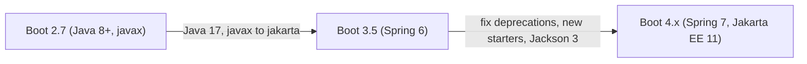
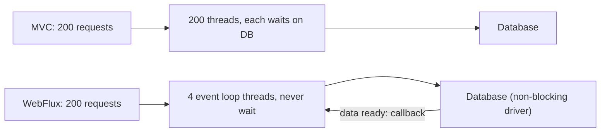

# Spring and Spring Boot

[← Back to README](../README.md)

## Spring Boot 2 to 3 to 4: what changed

**In one line:** Boot 3 moved to Java 17 and `jakarta.*`. Boot 4 (Spring Framework 7) adds small modules, null-safety, API versioning and Jackson 3.

**Story:** Think of moving to a new house.
Boot 2 to 3 was a big move to a new city. Every address changed (`javax` became `jakarta`), and you needed a new car (Java 17).
Boot 3 to 4 is a move to a new flat in the same city. Your address mostly stays. But the rooms are re-arranged (modular jars), and some old furniture is thrown out (removed deprecated APIs, Undertow, Jackson 2 as default).
Both moves are easier if you pack well first: upgrade to the last minor version (2.7, then 3.5) before the big jump.

**Version table:**

| Version | Released | Main changes | Why it matters |
|---|---|---|---|
| Boot 2.x | 2018-2023 | Spring Framework 5, Java 8+, `javax.*`, Spring Cloud Sleuth for tracing | Open-source support ended. Upgrade now |
| Boot 3.0 | Nov 2022 | Java 17 baseline, Spring Framework 6, Jakarta EE 9/10 (`jakarta.*`), GraalVM native images, Micrometer Observation + Micrometer Tracing (replaces Sleuth), HTTP interfaces (`@HttpExchange`), `ProblemDetail` errors | The biggest migration |
| Boot 3.1 | May 2023 | Docker Compose support, Testcontainers `@ServiceConnection` | Easier local dev and tests |
| Boot 3.2 | Nov 2023 | Virtual threads (`spring.threads.virtual.enabled`), `RestClient`, `JdbcClient` | Simple blocking code that scales |
| Boot 3.5 | May 2025 | Last 3.x line | Upgrade to this before going to 4 |
| Boot 4.0 | Nov 2025 | Spring Framework 7, Jakarta EE 11 (Servlet 6.1), Java 17 baseline (Java 25 recommended), modular jars, JSpecify null-safety, API versioning, HTTP service clients, Jackson 3, `@Retryable` in core, OpenTelemetry starter | New generation for the next years |
| Boot 4.1 | June 2026 | gRPC auto-configuration, SSRF protection for HTTP clients (stops attackers making your server call internal URLs), Kotlin 2.3 | Current stable minor |
| Boot 4.2 | Planned Nov 2026 | Release candidate in Oct 2026 | Check spring.io before you say it is out |

**Boot 3 changes, one by one:**
1. **Java 17 baseline.** Java 8 and 11 are not supported.
2. **`javax` to `jakarta`.** `javax.persistence.Entity` becomes `jakarta.persistence.Entity`. Same for servlet and validation.
3. **Native images with GraalVM.** Spring prepares the app at build time (*AOT*, ahead-of-time processing). The app starts in less than a second and uses less memory. Build is slower, and reflection needs hints.
4. **Observability.** Micrometer *Observation* is one API for metrics and traces. *Micrometer Tracing* replaces Spring Cloud Sleuth.
5. **HTTP interfaces.** Write a Java interface with `@GetExchange`. Spring creates the client for you.
6. **Spring Security 6.** `WebSecurityConfigurerAdapter` is gone. You define a `SecurityFilterChain` bean.

**Boot 4 changes, one by one:**
1. **Spring Framework 7 and Jakarta EE 11.** Servlet 6.1, JPA 3.2, Hibernate 7, Tomcat 11, Jetty 12.1.
2. **Java 17 is still the minimum.** Java 25 is recommended. GraalVM native needs version 25 or newer.
3. **Modular jars.** Boot's big auto-configure jar is split into small modules, one per technology. Starters are renamed too: `spring-boot-starter-web` is now `spring-boot-starter-webmvc`. Old names still work but are deprecated.
4. **JSpecify null-safety.** Spring APIs use standard `@Nullable` / `@NonNull` annotations from JSpecify. Tools and Kotlin can catch null bugs at build time.
5. **API versioning built in.** Add `version = "2"` on `@GetMapping`. Spring picks the right method from a header, query parameter, path or media type.
6. **HTTP service clients.** HTTP interfaces now get auto-configuration and properties (base URL, timeouts) out of the box.
7. **Jackson 3.** New package `tools.jackson`. Use a `JsonMapper` bean. Jackson 2 still works through a deprecated module.
8. **Resilience in core.** `@Retryable` and `@ConcurrencyLimit` are in Spring Framework now (turn on with `@EnableResilientMethods`). Spring Retry is no longer managed by Boot.
9. **OpenTelemetry starter.** `spring-boot-starter-opentelemetry` sends metrics and traces over OTLP (the OpenTelemetry protocol).
10. **Removed:** Undertow (not ready for Servlet 6.1), `@MockBean` / `@SpyBean` (use `@MockitoBean` / `@MockitoSpyBean`), all APIs deprecated in 3.x.

**Diagram:**



**Example:**

```java
// Boot 3+: HTTP interface. Boot 4 auto-configures it.
@HttpExchange("/orders")
interface OrderClient {
    @GetExchange("/{id}")
    Order get(@PathVariable long id);
}

// Boot 4 / Spring 7: API versioning on the controller
@RestController
@RequestMapping("/orders")
class OrderController {
    @GetMapping(path = "/{id}", version = "1")
    OrderV1 getV1(@PathVariable long id) { return service.v1(id); }

    @GetMapping(path = "/{id}", version = "2")       // same URL, different version
    OrderV2 getV2(@PathVariable long id) { return service.v2(id); }
}
```

```properties
# Boot 4: read the version from a request header
spring.mvc.apiversion.use.header=API-Version
```

```java
// Spring 7: retry without the Spring Retry library
@Retryable(maxAttempts = 3, delay = 200)            // 3 retries after the first call; needs @EnableResilientMethods
public Payment charge(Order order) { return paymentClient.charge(order); }
```

**Migration checklist:**

Boot 2 to 3:
1. Upgrade to Boot 2.7 first. Fix all deprecation warnings.
2. Move to Java 17 (or 21).
3. Change `javax.*` to `jakarta.*`. OpenRewrite (a tool that changes code by recipes) does most of this for you.
4. Rewrite security config as a `SecurityFilterChain` bean. `antMatchers` becomes `requestMatchers`.
5. Replace Sleuth with Micrometer Tracing.
6. Add `spring-boot-properties-migrator` for one run. It tells you renamed properties (for example `spring.redis.*` to `spring.data.redis.*`). Remove it afterwards.
7. Check third-party libraries. Each one needs a Jakarta version.

Boot 3 to 4:
1. Upgrade to the latest Boot 3.5.x first. Fix all deprecation warnings (they are removed in 4).
2. Switch starters to new names (`spring-boot-starter-webmvc`). If too many errors, use `spring-boot-starter-classic` for a short time, then remove it.
3. Move Jackson code to Jackson 3 (`tools.jackson`), or use the `spring-boot-jackson2` module as a short-term bridge.
4. Replace `@MockBean` with `@MockitoBean`. Add `@AutoConfigureMockMvc` where tests need MockMvc.
5. Undertow users: move to Tomcat or Jetty.
6. Spring Retry users: move to core `@Retryable`, or add Spring Retry with your own version.
7. Upgrade Spring Cloud to the version that matches Boot 4. Check the compatibility table.
8. Run the full test suite, then a load test, then deploy one service first.

**Good and bad:**

| Good | Bad |
|---|---|
| Upgrade in steps: 2.7 → 3.5 → 4.x | Jump from 2.3 straight to 4.0 |
| Use OpenRewrite for `javax` → `jakarta` | Find-and-replace by hand in 500 files |
| Use `@MockitoBean` already in Boot 3.4+ | Wait for Boot 4 to break all tests at once |
| Read the official migration guide | Trust a blog post with no version numbers |

**When to use / when not to use:**
- New project today: start on Boot 4 with Java 21 or 25.
- Existing Boot 3.5 app with many old libraries: plan Boot 4 after your libraries support Jackson 3 and Jakarta EE 11.
- Native images: use for serverless or fast-scaling services. Skip for normal long-running services, where JVM mode is simpler.

**Say this in the interview:**
> "Boot 3 was the big change. It needs Java 17 and moved `javax` to `jakarta`. It brought Spring Framework 6, native images, and Micrometer Tracing instead of Sleuth. Boot 4 came in November 2025 on Spring Framework 7 and Jakarta EE 11. The baseline is still Java 17. It splits Boot into small modules. It adds JSpecify null-safety, built-in API versioning, HTTP service clients and Jackson 3. I always upgrade to the last minor first (2.7 or 3.5) and fix deprecations. Then I make the jump."

**They may ask next:**
- **Why did `javax` become `jakarta`?** Java EE moved to the Eclipse Foundation, and Oracle kept the `javax` name. So the packages were renamed.
- **What is AOT in Spring?** Spring does some startup work at build time, like finding beans and creating proxies. So a native image can start very fast.
- **What does JSpecify give me?** Standard null annotations. Your IDE, build tools (like NullAway) and Kotlin can warn you about nulls before runtime.
- **Is `RestTemplate` removed?** Not yet. The Spring team announced its end in 2025. It is marked deprecated in Spring Framework 7.1 and planned for removal in 8.0. Use `RestClient` for new code.

## Spring MVC vs WebFlux

**In one line:** Spring MVC gives each request its own thread that waits. WebFlux uses a few threads that never wait.

**Story:** A bank has two ways to serve customers.
**MVC bank:** 200 counters, one clerk each. A clerk serves one customer from start to end. If the clerk must wait 5 minutes for a manager signature, the clerk just waits. When all 200 clerks are busy, new customers stand in the queue.
**WebFlux bank:** only 4 smart clerks. A clerk takes your request, sends it to the back office, and gives you a token. The clerk serves the next person right away. When your paper is ready, any clerk calls your token.
The WebFlux bank serves many people with few clerks. But if one clerk falls asleep at the desk (a *blocking call*), a quarter of the bank stops.

**How it works:**
1. **Spring MVC:** *thread-per-request*. Tomcat gives each request a thread (200 by default). The code is normal, step by step. A database call blocks the thread until the result comes.
2. **WebFlux:** *event loop* (a few threads, usually one per CPU core, that never wait). It runs on Netty by default. Code returns a "promise" of data, not the data.
3. **Mono** = 0 or 1 item later (like one order). **Flux** = 0 to many items later (like a stream of orders).
4. **Backpressure:** the consumer says "send me only 10 items at a time". The producer does not flood a slow consumer. It is like a waiter who brings the next dish only when you finish the current one.
5. **With virtual threads (Java 21+):** MVC threads become cheap. A blocking call no longer wastes an OS thread. So MVC can handle thousands of waiting requests too, with simple code.

**Diagram:**



**Example:**

```java
// Spring MVC: simple blocking code (use with virtual threads)
@GetMapping("/orders/{id}")
Order get(@PathVariable long id) {
    return orderRepository.findById(id).orElseThrow();        // JPA: blocks, fine in MVC
}

// WebFlux: returns a Mono, needs non-blocking drivers (R2DBC = reactive JDBC, WebClient)
@GetMapping("/orders/{id}")
Mono<Order> get(@PathVariable long id) {
    return orderRepository.findById(id)                       // R2DBC: non-blocking
        .switchIfEmpty(Mono.error(new OrderNotFound(id)));
}

// Streaming: WebFlux shines here (Server-Sent Events)
@GetMapping(value = "/prices", produces = MediaType.TEXT_EVENT_STREAM_VALUE)
Flux<Price> prices() { return priceService.liveStream(); }
```

**Don't block inside WebFlux:**

```java
// BAD: JPA or Thread.sleep on the event loop freezes other requests
Mono<Order> bad = Mono.just(jpaRepository.findById(id).get());

// If you really must call blocking code, move it to a separate thread pool
Mono<Order> ok = Mono.fromCallable(() -> jpaRepository.findById(id).get())
                     .subscribeOn(Schedulers.boundedElastic());   // runs off the event loop
```

**When to choose which:**

| Situation | Choose |
|---|---|
| Normal CRUD service with JPA / JDBC | MVC (+ virtual threads) |
| Team knows only imperative Java | MVC |
| Streaming data to clients (SSE, WebSocket, live prices) | WebFlux |
| API gateway or proxy with many long-open connections | WebFlux |
| Whole stack is already reactive (R2DBC, reactive Kafka, WebClient) | WebFlux |
| Many slow downstream calls, simple code wanted | MVC + virtual threads |

**Good and bad:**

| Good | Bad |
|---|---|
| MVC + virtual threads for most I/O-bound apps | Pick WebFlux "because it is faster" without measuring |
| WebFlux with R2DBC and WebClient end to end | WebFlux with JPA calls inside `map()` |
| Use `RestClient` for HTTP calls in MVC | Call `.block()` inside a WebFlux handler |
| Use `StepVerifier` to test reactive code | Debug reactive stack traces with no tools |

**When to use / when not to use:**
- Use MVC as the default. It is easier to write, read, debug and test.
- Use WebFlux when you stream data, or have very many long-lived connections, or the whole chain is reactive.
- Don't mix: one blocking call in a WebFlux app can stall many users.

**Say this in the interview:**
> "Spring MVC is thread-per-request: simple blocking code, and the thread waits on I/O. WebFlux uses a small event loop that never blocks, with `Mono` for one item and `Flux` for many, and it supports backpressure. Since Java 21, MVC with virtual threads handles thousands of waiting requests with simple code, so I choose MVC for most services. I pick WebFlux for streaming or gateway-style apps, and then I make sure nothing blocks the event loop."

**They may ask next:**
- **Can I use `WebClient` in an MVC app?** Yes. But for new MVC code, `RestClient` is simpler and blocking-friendly.
- **Is WebFlux faster?** Not per request. It uses fewer threads under high load. With virtual threads, the gap for typical apps is small.
- **What happens if I block the event loop?** All requests on that thread stop. With 4 event loop threads, one slow call can slow a quarter of all traffic.
- **What is backpressure?** The consumer controls the speed. It asks for N items, and the producer sends only N.
