# Spring and Spring Boot

[← Back to README](../README.md)

This page explains Spring from the inside: how beans are made, how Spring Boot starts, how proxies (AOP) work, and the path of one web request.
These are the most-asked Spring questions in interviews. Versions: Spring Framework 7 and Spring Boot 4. When Boot 3 is different, we say so.
Short on time? Read only "In one line" and "Say this in the interview". The diagrams are there to help, and you can skip them.

**Contents:**
- [Spring Core: IoC, beans and annotations](#spring-core-ioc-beans-and-annotations)
- [How Spring Boot works](#how-spring-boot-works)
- [Spring AOP](#spring-aop)
- [Spring MVC request flow](#spring-mvc-request-flow)
- [Spring Core interview questions](#spring-core-interview-questions)
- [Spring Boot 2 to 3 to 4: what changed](#spring-boot-2-to-3-to-4-what-changed)
- [Spring MVC vs WebFlux](#spring-mvc-vs-webflux)
- [Spring Reactive (WebFlux) in depth](#spring-reactive-webflux-in-depth)

Related pages: [Spring ecosystem](spring-ecosystem.md) (Security, Data, Cloud, testing) and [Debugging Spring Boot](spring-debugging.md).

## Spring Core: IoC, beans and annotations

Spring Core is the base of everything else. Spring MVC, Spring Data, Spring Security and Spring Boot are all built on it.
If you understand beans, scopes, the lifecycle and proxies, most "magic" in Spring stops being magic.

The big picture in one diagram:

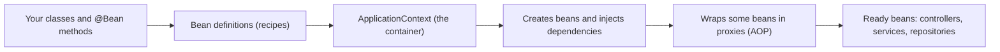

### IoC and dependency injection

**In one line:** Your class does not create its helpers. Spring creates them and hands them in. This is called Inversion of Control (IoC), and "handing them in" is dependency injection (DI).

**Story:** A cricket player does not buy his own bat, pads and ball before each match.
The team's kit manager gives them to him. The player only plays.
If the bat breaks, the kit manager gives a new one. The player does not change.
At practice, the kit manager can give a cheap plastic ball. That is like a test with a fake object.
Player = your class. Kit = its dependencies. Kit manager = the Spring container.

**How it works:**
1. You mark classes as beans with `@Component`, `@Service` and so on, or you write `@Bean` methods. A *bean* is just an object that Spring creates and manages.
2. At startup, Spring turns them into *bean definitions*. A bean definition is a recipe: which class, which scope, which dependencies.
3. Spring creates beans in the right order. Dependencies are created first.
4. Spring passes the dependencies in. There are three ways: constructor, setter or field.
5. Your class asks for a type, often an interface like `PaymentGateway`. Spring decides which real object to give.
6. "Inversion" means the control is flipped. You don't call `new`. The framework creates objects and calls your code.

**The three kinds of injection:**

| Kind | How | Good for | Problems |
|---|---|---|---|
| Constructor | Dependencies are constructor parameters | Required dependencies (almost all) | Many parameters look ugly, which is a useful warning |
| Setter | Spring calls `setX(...)` after `new` | Optional dependencies that have a default | Object can be used before the setter runs. Fields can't be `final` |
| Field | `@Autowired` on a private field | Quick demos, test classes | Hidden dependencies, no `final`, hard to test without Spring |

**Why constructor injection wins:**
- Fields can be `final`. The object never changes after it is built, so it is safe to share between threads.
- You can't create the object without its dependencies. No `NullPointerException` halfway through.
- Unit tests are simple: `new OrderService(fakeRepo, fakeClient)`. No Spring needed.
- A constructor with 8 parameters shouts "this class does too much". Field injection hides that.
- A circular dependency fails at startup, so you find the design problem early.
- If a class has only one constructor, you don't need `@Autowired` (since Spring 4.3).

**Diagram:** The container builds dependencies first, then the beans that need them.

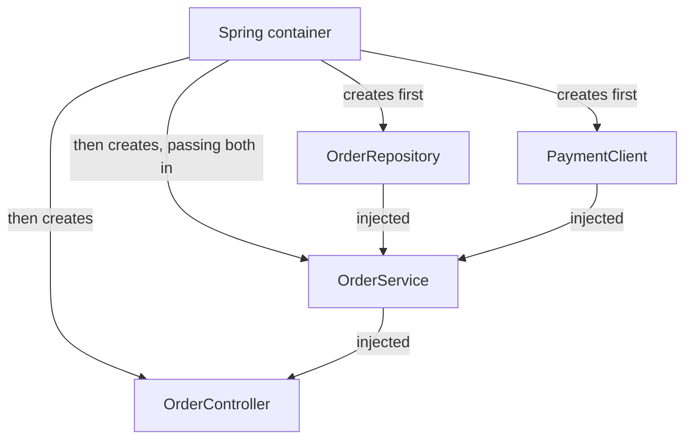

**Example:**

```java
@Service
public class OrderService {
    private final OrderRepository repo;            // final: set once, never changes
    private final PaymentClient payments;

    // One constructor, so no @Autowired needed
    public OrderService(OrderRepository repo, PaymentClient payments) {
        this.repo = repo;
        this.payments = payments;
    }
}

// Field injection: it works, but avoid it in production code
@Service
class OldOrderService {
    @Autowired private OrderRepository repo;       // can't be final, hidden from tests
}

// Unit test without Spring: just call the constructor
var service = new OrderService(new InMemoryOrderRepository(), mock(PaymentClient.class));
```

Many teams use Lombok's `@RequiredArgsConstructor` to generate the constructor for all `final` fields.

**Good and bad:**

| Good | Bad |
|---|---|
| Constructor injection with `final` fields | `@Autowired` on private fields everywhere |
| Depend on an interface (`PaymentGateway`) | Depend on a concrete class when you have many implementations |
| Small classes with 2 to 5 dependencies | One "God service" with 12 dependencies |
| `new MyService(fake)` in unit tests | Starting the whole Spring context for every small test |

**Say this in the interview:**
> "IoC means the framework creates objects and wires them, not my code. Dependency injection is how it does that: Spring passes dependencies into my class. I use constructor injection with final fields. It makes dependencies clear, keeps the object immutable, and lets me unit test with plain `new`."

**They may ask next:**
- **Are IoC and DI the same?** IoC is the general idea: the framework is in control. DI is one way to do IoC. Others are a service locator or callbacks.
- **When do you use setter injection?** For optional dependencies that have a sensible default, or for rare cases where you must change a dependency later.
- **Can you inject into a static field?** Not directly. Static fields belong to the class, not the bean. Avoid it.
- **Do you need `@Autowired` on a constructor?** Only when the class has more than one constructor. Then mark the one Spring should use.

### ApplicationContext and BeanFactory

**In one line:** `BeanFactory` is the basic container that creates and wires beans. `ApplicationContext` is a `BeanFactory` plus extras like events, properties and early creation. You almost always use `ApplicationContext`.

**Story:** `BeanFactory` is a small home kitchen. It cooks a dish only when you ask for it.
`ApplicationContext` is a full restaurant. It has the kitchen, plus a reception desk (events), a menu in many languages (messages), house rules (properties and profiles), and it pre-cooks popular dishes before opening (creates singletons at startup).
So if a dish can't be made, the restaurant finds out at opening time, not when a customer orders.

**How it works:**
1. `BeanFactory` gives you `getBean(...)`, creates beans when asked, and injects dependencies. The real class inside is `DefaultListableBeanFactory`.
2. `ApplicationContext` wraps that factory and adds:
   - Creates all singleton beans at startup. Errors show up at startup, not at the first request.
   - Events: `ApplicationEventPublisher` and `@EventListener`.
   - `Environment`: properties and profiles.
   - `MessageSource`: messages in many languages (*i18n*, internationalization).
   - Resource loading: `classpath:` and `file:` paths.
   - Finds and runs `BeanFactoryPostProcessor`s and `BeanPostProcessor`s automatically.
3. Spring Boot picks the context type for you. A servlet web app gets a servlet web server context. A WebFlux app gets a reactive one. A batch job gets a plain `AnnotationConfigApplicationContext`.
4. Two kinds of "post processors" (very common question):
   - **`BeanFactoryPostProcessor`** changes the **recipes** (bean definitions) before any bean is created. Example: `ConfigurationClassPostProcessor` reads your `@Configuration` classes and component scan.
   - **`BeanPostProcessor`** changes the **objects** after each bean is created. Example: the AOP proxy creator wraps beans for `@Transactional`.

**Diagram:** What `ApplicationContext` adds on top of `BeanFactory`.

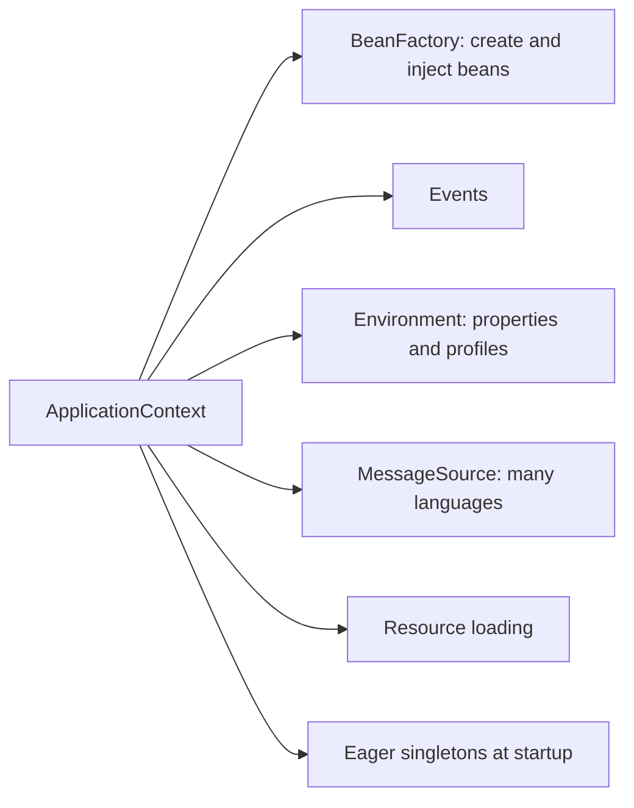

**Diagram:** Recipes first, then objects.


**Example:**

```java
@SpringBootApplication
public class ShopApp {
    public static void main(String[] args) {
        ConfigurableApplicationContext ctx = SpringApplication.run(ShopApp.class, args);
        OrderService s = ctx.getBean(OrderService.class);   // rare: prefer injection
        System.out.println(ctx.getBeanDefinitionCount() + " beans");
    }
}

// Plain Spring, no Boot. try-with-resources closes the context.
try (var ctx = new AnnotationConfigApplicationContext(AppConfig.class)) {
    ctx.getBean(OrderService.class).placeOrder(42L);
}   // close() runs @PreDestroy on singletons
```

**Good and bad:**

| Good | Bad |
|---|---|
| Let Spring inject beans | Call `ctx.getBean(...)` all over your code (service locator style) |
| Find wiring errors at startup | Make everything `@Lazy` and find errors at the first request |
| Use a `BeanPostProcessor` only for framework-like code | Put business logic in post processors |

**Say this in the interview:**
> "`BeanFactory` is the core container: it creates beans and injects dependencies, lazily. `ApplicationContext` extends it with eager singleton creation, events, the Environment, i18n and resource loading. In real apps I always use `ApplicationContext`, and Spring Boot creates the right type for me."

**They may ask next:**
- **Are singletons created at startup?** Yes, unless marked `@Lazy` or you set `spring.main.lazy-initialization=true`. Lazy startup is faster, but errors appear later.
- **`BeanFactoryPostProcessor` vs `BeanPostProcessor`?** The first edits bean definitions before creation. The second edits bean objects after creation.
- **Can there be more than one context?** Yes. Contexts can have a parent. Old Spring MVC apps had a root context and a web context. Spring Boot apps usually have one.

### Bean lifecycle

**In one line:** Spring creates the object, injects dependencies, runs your init code, maybe wraps it in a proxy, hands it out, and runs your cleanup code at shutdown.

**Story:** Think of a new employee joining a company.
- Offer letter signed: the person exists (constructor).
- Laptop and access card given (dependencies injected).
- Name tag printed, told which company they joined (Aware callbacks).
- HR checks papers (`BeanPostProcessor` before init).
- Induction training (`@PostConstruct`).
- Security gives an escort who walks with them everywhere (proxy created).
- Starts real work (ready).
- On the last day: exit interview, return the laptop (`@PreDestroy`).

**How it works:**
1. **Instantiate:** Spring calls the constructor. Constructor injection happens here.
2. **Populate properties:** setter and field injection (`@Autowired`, `@Value`).
3. **Aware callbacks:** `BeanNameAware`, `BeanClassLoaderAware`, `BeanFactoryAware`. The bean learns its name or its container. Rarely needed. (`ApplicationContextAware` and friends are called a moment later, by a built-in `BeanPostProcessor` at the start of step 4.)
4. **`BeanPostProcessor.postProcessBeforeInitialization`** runs for every post processor.
5. **Init callbacks, in this order:** `@PostConstruct`, then `InitializingBean.afterPropertiesSet()`, then a custom `initMethod` from `@Bean(initMethod = "...")`.
6. **`BeanPostProcessor.postProcessAfterInitialization`:** AOP proxies are created here. From now on, other beans get the **proxy**, not your object.
7. **Ready:** the singleton is stored and shared. When all singletons are ready, `SmartInitializingSingleton` beans are called, then the context fires `ContextRefreshedEvent`.
8. **Shutdown (context close):** `@PreDestroy`, then `DisposableBean.destroy()`, then a custom `destroyMethod`. For `@Bean`, Spring also finds a public `close()` or `shutdown()` method by itself.

Two traps:
- **Prototype beans get no destroy callbacks.** Spring creates them and forgets them. You clean them up.
- **`@PostConstruct` runs before the proxy exists.** A `@Transactional` method called from `@PostConstruct` runs without a transaction. Use `ApplicationReadyEvent` or an `ApplicationRunner` instead.

**Diagram:**

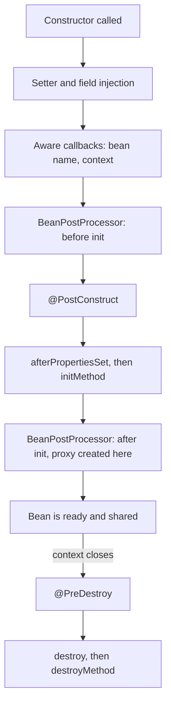

**Example:**

```java
@Component
class PriceCache implements BeanNameAware, InitializingBean, DisposableBean {
    private final PriceClient client;

    PriceCache(PriceClient client) {                         // step 1
        this.client = client;
        System.out.println("1 constructor");
    }
    @Override public void setBeanName(String name) {         // step 3
        System.out.println("3 aware: my name is " + name);
    }
    @PostConstruct void warmUp() {                           // step 5a (jakarta.annotation)
        System.out.println("5a @PostConstruct: load prices");
    }
    @Override public void afterPropertiesSet() {             // step 5b
        System.out.println("5b afterPropertiesSet");
    }
    @PreDestroy void flush() { System.out.println("8a @PreDestroy"); }
    @Override public void destroy() { System.out.println("8b destroy()"); }
}
```

A `BeanPostProcessor` sees every bean. If it returns a different object, every other bean gets that object:

```java
@Component
class AuditMarkerPostProcessor implements BeanPostProcessor {
    @Override
    public Object postProcessAfterInitialization(Object bean, String beanName) {
        // Spring's AOP does this: return a proxy that wraps "bean"
        return bean;
    }
}
```

**Good and bad:**

| Good | Bad |
|---|---|
| Use `@PostConstruct` for small, local setup (build a map, check config) | Call slow remote services in `@PostConstruct`. Startup hangs and health probes fail |
| Use `ApplicationRunner` or `ApplicationReadyEvent` for startup jobs | Expect `@Transactional` to work inside `@PostConstruct` |
| Use `@PreDestroy` to flush buffers and close clients | Rely on `@PreDestroy` for prototype beans |
| Prefer annotations over `InitializingBean` | Tie business classes to Spring interfaces without need |

**Say this in the interview:**
> "Spring calls the constructor, injects dependencies, runs Aware callbacks, then BeanPostProcessors before init. Then it runs `@PostConstruct`, `afterPropertiesSet` and the init method, in that order. After init, BeanPostProcessors may wrap the bean in a proxy, which is how `@Transactional` works. At shutdown it runs `@PreDestroy`, then `destroy()`. Prototype beans don't get destroy callbacks."

**They may ask next:**
- **Order of init callbacks?** `@PostConstruct`, then `afterPropertiesSet()`, then the custom init method.
- **Where are proxies created?** In `postProcessAfterInitialization` of a `BeanPostProcessor` (the auto-proxy creator). For circular references, Spring can create the proxy earlier.
- **Who runs `@PostConstruct`?** A built-in `BeanPostProcessor` (`CommonAnnotationBeanPostProcessor`), in the "before init" step.
- **How do I run code when the app is fully started?** `ApplicationRunner`, `CommandLineRunner` or `@EventListener(ApplicationReadyEvent.class)`.

### Bean scopes: singleton, prototype and web scopes

**In one line:** Scope says how many objects Spring makes for one bean and how long each one lives. The default is singleton: one object per container.

**Story:** Think of an office.
- The water cooler is shared by everyone all day. That is a **singleton**.
- Paper cups: everyone takes a new one each time. That is **prototype**.
- A visitor badge is valid for one visit only. That is **request** scope.
- Your locker is yours for the whole shift. That is **session** scope.
- The building's notice board is one for the whole building. That is **application** scope.
- A phone call line is yours until you hang up. That is **websocket** scope.

**How it works:**

| Scope | How many objects | Lives until | Use for |
|---|---|---|---|
| `singleton` (default) | One per container | Context closes | Services, repositories, controllers, clients |
| `prototype` | A new one every time it is injected or requested | You drop it. Spring forgets it | Objects with state for one task, like a builder |
| `request` | One per HTTP request | The request ends | Request data, like the current tenant |
| `session` | One per HTTP session | The session ends | Server-side shopping cart (rare in REST APIs) |
| `application` | One per `ServletContext` | The web app stops | Rare. Like a singleton shared by more than one context |
| `websocket` | One per WebSocket session | The socket closes | Per-connection chat state |

**Singleton is NOT thread-safe by itself.**
- Tomcat runs up to 200 request threads (the default). All of them call the **same** singleton object.
- Spring does no locking for you.
- A singleton is safe when it is **stateless**: only `final` fields that hold other beans or config.
- It is unsafe when it has a changing field, like `private int count` or `private List<Order> pending`.
- Fixes: keep data in local variables and method parameters, use thread-safe types (`AtomicLong`, `ConcurrentHashMap`), or keep state in the database or Redis. See [Java concurrency](java-concurrency.md).

**The prototype-inside-singleton problem:**
- A singleton is created once. So its dependencies are injected once.
- If you inject a prototype into a singleton, you get **one** prototype object forever. It is not "new each time".
- Fixes:
  1. **`ObjectProvider<T>`**: call `getObject()` each time you need a new one. Simple and clear. Best choice.
  2. **`@Lookup` method**: Spring overrides the method (with CGLIB, a tool that makes a subclass at runtime) to return a new bean each call.
  3. **Scoped proxy**: inject a proxy. The proxy finds the right real object on every method call. This is the normal fix for request and session beans. `@RequestScope` and `@SessionScope` use a proxy by default.
  4. `jakarta.inject.Provider<T>`: same idea as `ObjectProvider`, standard Java API.

**Spring singleton vs GoF singleton:**

| | GoF singleton (design pattern) | Spring singleton |
|---|---|---|
| How many | One per class loader (one per JVM, usually) | One per container, per bean definition |
| Who enforces it | The class: private constructor + static `getInstance()` | The container. The class is normal |
| Same class twice? | Impossible | Possible: two `@Bean` methods make two singletons of one class |
| Testing | Hard to replace | Easy: inject a fake |

**Diagram:** Singleton vs prototype.

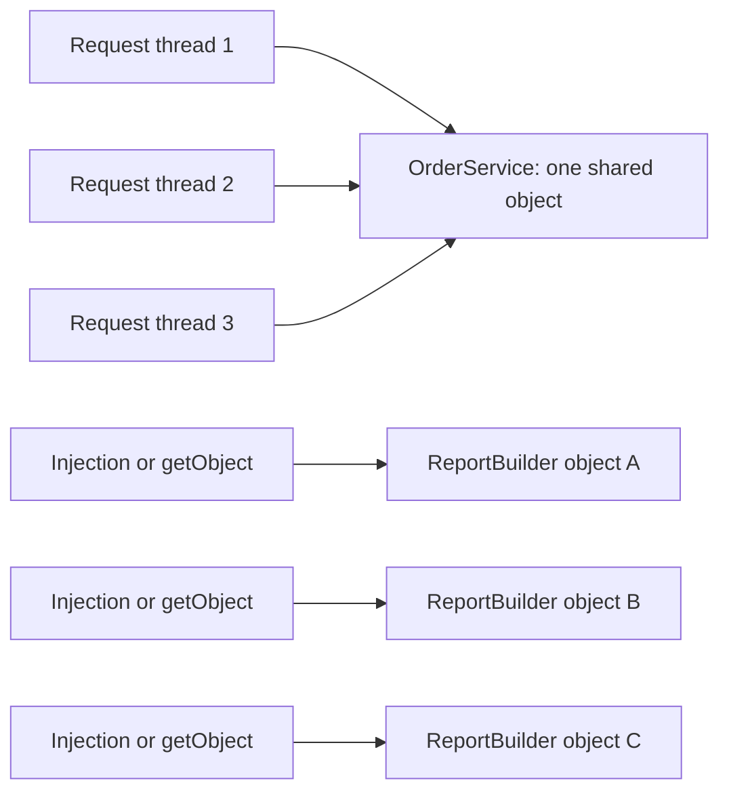

**Diagram:** A request-scoped bean inside a singleton, through a scoped proxy.

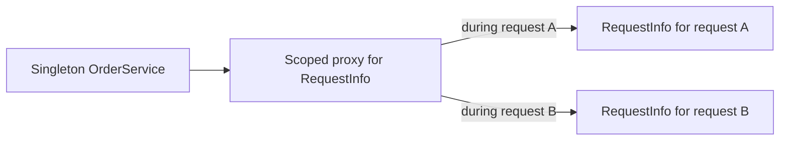

**Example:**

```java
@Component
@Scope(ConfigurableBeanFactory.SCOPE_PROTOTYPE)
class ReportBuilder {                                  // has state, so one per use
    private final List<String> lines = new ArrayList<>();
    void add(String line) { lines.add(line); }
    String build() { return String.join("\n", lines); }
}

@Service
class ReportService {                                  // singleton
    private final ObjectProvider<ReportBuilder> builders;
    ReportService(ObjectProvider<ReportBuilder> builders) { this.builders = builders; }

    String daily() {
        ReportBuilder b = builders.getObject();        // a NEW ReportBuilder on every call
        b.add("orders: 120");
        return b.build();
    }
}

@Component
@RequestScope                                          // one per HTTP request, proxy by default
class RequestInfo {
    private String tenantId;
    String getTenantId() { return tenantId; }
    void setTenantId(String id) { this.tenantId = id; }
}
```

The `@Lookup` way. Give the method a body, because component scanning ignores abstract classes:

```java
@Service
class ReportService2 {
    @Lookup
    ReportBuilder newBuilder() { return null; }        // Spring overrides this to return a new bean

    String daily() { return newBuilder().build(); }
}
```

A thread-safety bug in a singleton:

```java
@Service
class CounterService {
    private int count = 0;                             // BAD: shared by all request threads
    int next() { return ++count; }                     // two threads can get the same number

    private final AtomicInteger safe = new AtomicInteger();
    int nextSafe() { return safe.incrementAndGet(); }  // GOOD: atomic, thread-safe
}
```

**Good and bad:**

| Good | Bad |
|---|---|
| Stateless singletons with `final` fields | Changing fields in a singleton (counters, lists, `SimpleDateFormat`) |
| `ObjectProvider` for a new prototype each time | Injecting a prototype into a singleton and expecting a new one each call |
| `@RequestScope` for per-request data | Session scope in a stateless REST API that runs on many pods |
| Keep shared state in the DB or Redis | Keep user data in singleton fields |

**Say this in the interview:**
> "Singleton is the default: one object per container, shared by all threads. Spring does not make it thread-safe, so I keep singletons stateless. Prototype gives a new object on each injection, but inside a singleton it is injected only once, so I use `ObjectProvider` or `@Lookup` to get a fresh one. Web scopes like request and session are injected through a scoped proxy that finds the current object on each call."

**They may ask next:**
- **Is a Spring singleton thread-safe?** No. It is shared. It is safe only if it has no changing state.
- **Does Spring call `@PreDestroy` on prototypes?** No. Spring does not track them after creation.
- **What happens if you inject a request-scoped bean into a singleton without a proxy?** Startup fails: there is no active request at startup. `@RequestScope` adds the proxy for you.
- **How is a Spring singleton different from a GoF singleton?** GoF is one per class loader, forced by the class. Spring is one per bean definition in a container.

### Stereotype annotations: @Component, @Service, @Repository, @Controller

**In one line:** `@Component` marks a class as a bean. `@Service`, `@Repository` and `@Controller` are special `@Component`s that also show the layer, and some add behaviour.

**Story:** In a hospital, everyone is "staff". That is `@Component`.
But the uniform tells you the role quickly.
- The receptionist talks to visitors: `@Controller`.
- The doctor does the real work: `@Service`.
- The records clerk handles files. He also translates the records office's strange codes into normal hospital language: `@Repository` with exception translation.

**How it works:**
1. `@SpringBootApplication` includes `@ComponentScan`. It scans the package of your main class and all sub-packages.
2. The scanner reads class files and finds classes with `@Component`, or with any annotation that itself has `@Component` on it (a *meta-annotation*).
3. Each class found becomes a bean definition. The bean name is the class name with a small first letter: `orderService`.
4. **`@Service`**: no extra behaviour. It says "business logic lives here". It is handy in pointcuts too.
5. **`@Repository`**: adds **exception translation**. A post processor wraps the bean in a proxy. The proxy turns JDBC, JPA or database-vendor exceptions into Spring's `DataAccessException` family. Example: a unique key error becomes `DuplicateKeyException` or `DataIntegrityViolationException`. Your service code does not depend on the database vendor.
6. Spring Data repository interfaces (`extends JpaRepository`) get this automatically. They don't need `@Repository`.
7. **`@Controller`**: a web controller. Spring MVC finds `@RequestMapping` methods in it. Return values are view names by default.
8. **`@RestController` = `@Controller` + `@ResponseBody`**. The return value is written into the response body, usually as JSON.
9. `@Configuration`, `@ControllerAdvice` and `@RestControllerAdvice` are also `@Component`s.
10. A class outside the scanned packages is not found. You get "No qualifying bean of type...". Fix: move the class, or add `@ComponentScan(basePackages = ...)` or `@Import`.

**Diagram:** Which annotation "is a" `@Component`.

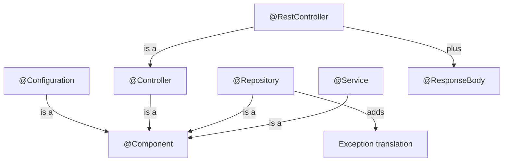

**Diagram:** How component scanning works.

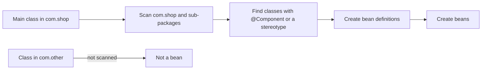

**Example:**

```java
@RestController                                     // = @Controller + @ResponseBody
@RequestMapping("/orders")
class OrderController {
    private final OrderService service;
    OrderController(OrderService service) { this.service = service; }

    @GetMapping("/{id}")
    OrderDto get(@PathVariable long id) { return service.find(id); }   // written as JSON
}

@Service
class OrderService {
    private final JdbcOrderDao dao;
    OrderService(JdbcOrderDao dao) { this.dao = dao; }
    OrderDto find(long id) { return dao.find(id).orElseThrow(); }
}

@Repository                                         // SQLException becomes DataAccessException
class JdbcOrderDao {
    private final JdbcClient jdbc;
    JdbcOrderDao(JdbcClient jdbc) { this.jdbc = jdbc; }

    Optional<OrderDto> find(long id) {
        return jdbc.sql("select id, total from orders where id = ?")
                   .param(id).query(OrderDto.class).optional();
    }
}
```

You can make your own stereotype:

```java
@Target(ElementType.TYPE)
@Retention(RetentionPolicy.RUNTIME)
@Service                                            // meta-annotation: so @UseCase classes are beans
public @interface UseCase {}
```

**Good and bad:**

| Good | Bad |
|---|---|
| Use the stereotype that matches the layer | `@Component` on everything, so you lose the meaning |
| Keep the main class in the root package | Main class in a sub-package, so other packages are not scanned |
| Let Spring Data repositories be interfaces | Add `@Repository` to Spring Data interfaces "just in case" (harmless, but noise) |
| `@RestController` for JSON APIs | `@Controller` and then forget `@ResponseBody` (you get a "view not found" error) |

**Say this in the interview:**
> "All of them are `@Component`, so component scanning registers them as beans. `@Service` is a marker for business logic. `@Repository` adds exception translation into Spring's `DataAccessException`. `@Controller` handles web requests, and `@RestController` adds `@ResponseBody`, so return values become JSON."

**They may ask next:**
- **Can I use `@Component` instead of `@Service`?** Yes, it works the same today. But `@Service` shows intent and is useful in pointcuts.
- **Two classes with the same simple name in different packages?** Both want the bean name `orderMapper`, so startup fails with `ConflictingBeanDefinitionException`. Give one an explicit name: `@Component("legacyOrderMapper")`.
- **Is scanning slow?** For big apps it adds startup time. Boot's AOT processing and native images do the scan at build time.

### @Configuration and @Bean

**In one line:** `@Bean` methods create beans in code. Put them in a `@Configuration` class, so that one `@Bean` method calling another still gets the same singleton.

**Story:** `@Component` is a chef who walks in and joins by himself. You can put a badge on his uniform because it is your uniform.
`@Bean` is a chef from an agency (a third-party library). You can't change his uniform. So you fill a form: "hire this person, with these settings".
The `@Configuration` class is the HR office. Even if two forms mention the same chef, HR hires him only once.

**How it works:**
1. Use `@Bean` when you can't add `@Component` to the class. Examples: `Clock`, `RestClient`, an AWS `S3Client`.
2. Use it also when creating the object needs logic, or when you need two beans of the same class with different settings.
3. The method name is the bean name. `@Primary`, `@Scope`, `@Lazy`, `@Profile` and conditions all work on `@Bean` methods.
4. **Full mode, `@Configuration` (default `proxyBeanMethods = true`):** Spring makes a CGLIB subclass of your config class. If one `@Bean` method calls another, the subclass catches the call. It returns the existing bean from the container.
5. **Lite mode, `@Configuration(proxyBeanMethods = false)` or `@Bean` inside a `@Component`:** no subclass. Calling another `@Bean` method is a plain Java call. It makes a **new object** that is not managed by Spring.
6. In lite mode, ask for other beans as **method parameters**. Spring Boot's own auto-configurations use `proxyBeanMethods = false`. It starts faster and works well with native images.
7. A full-mode `@Configuration` class can't be `final`, because CGLIB must subclass it.
8. Make `@Bean` methods `static` for `BeanFactoryPostProcessor` beans. They must exist before the config class itself.

**Diagram:**

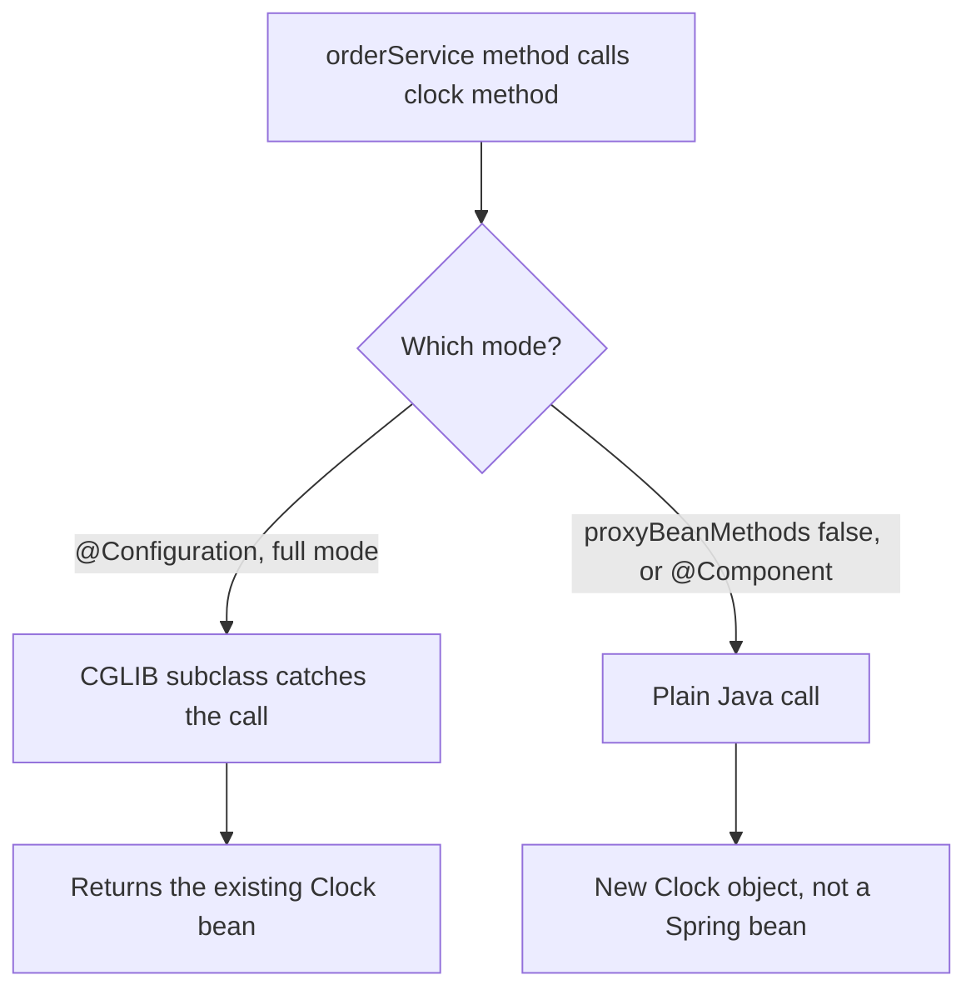

**Example:**

```java
@Configuration                                     // full mode: proxyBeanMethods = true
class AppConfig {

    @Bean
    Clock clock() { return Clock.systemUTC(); }    // third-party class: can't add @Component

    @Bean
    OrderService orderService() {
        return new OrderService(clock());          // CGLIB: returns the SAME Clock bean
    }
}

@Configuration(proxyBeanMethods = false)           // lite mode: faster, no CGLIB subclass
class HttpConfig {

    @Bean
    RestClient paymentClient(RestClient.Builder builder) {   // ask for beans as parameters
        return builder.baseUrl("https://payments.internal").build();
    }
}
```

**`@Component` vs `@Bean`:**

| `@Component` | `@Bean` |
|---|---|
| On your own class | On a method that returns an object |
| Found by component scanning | Declared in a configuration class |
| One bean per class | Many beans of one class are easy |
| Can't use it for library classes | The normal way for library classes |

**Good and bad:**

| Good | Bad |
|---|---|
| `@Bean` for third-party classes | `@Bean` for every one of your own classes |
| Inject other beans as method parameters | Call `@Bean` methods directly in lite mode |
| `proxyBeanMethods = false` when methods don't call each other | `final` on a full-mode `@Configuration` class |

**Say this in the interview:**
> "I use `@Component` for my own classes and `@Bean` methods for classes I can't annotate, like a `RestClient` or a `Clock`. In a full `@Configuration` class Spring creates a CGLIB subclass, so calling one `@Bean` method from another returns the same singleton. With `proxyBeanMethods = false`, that call creates a new object, so I take dependencies as method parameters instead."

**They may ask next:**
- **What is lite mode?** `@Bean` methods without the CGLIB subclass. Method calls between them are plain Java calls.
- **Why does Boot use `proxyBeanMethods = false`?** Faster startup, less memory and better for native images.
- **Can two `@Bean` methods return the same type?** Yes. Then you need `@Primary` or `@Qualifier` to choose. See the next section.

### Choosing a bean: @Autowired, @Qualifier, @Primary

**In one line:** Spring finds a dependency by **type**. If many beans match, `@Qualifier`, `@Primary` or the parameter name picks one. If nothing picks one, startup fails.

**Story:** You ask a hotel reception for "a taxi".
- One taxi waiting: you get it.
- Three taxis waiting: reception gives you the one marked "default" (`@Primary`). Or you say "the white one, number 42" (`@Qualifier`).
- Three taxis, no default, no number: reception says "Which one?" That is `NoUniqueBeanDefinitionException`.
- For a city tour you ask for "all taxis". That is injecting a `List`.

**How it works:**
1. Spring finds all beans whose type matches. Subclasses and interface implementations count.
2. **Exactly one:** inject it.
3. **None:** startup fails with `NoSuchBeanDefinitionException`. Unless the point is optional: `Optional<T>`, `ObjectProvider<T>`, `@Nullable` or `@Autowired(required = false)`.
4. **Many:** Spring narrows them down, in this order:
   - `@Qualifier("name")` at the injection point.
   - The `@Primary` bean. (Spring 6.2+ also has `@Fallback`: use this bean only if no other one fits.)
   - A bean whose name equals the parameter or field name. This needs the `-parameters` compiler flag (since Spring 6.1). `spring-boot-starter-parent` and Boot's Gradle plugin set it for you.
   - The highest `@Priority`. (Before Spring 6.2, `@Priority` was checked before the name.)
5. **Still many:** startup fails with `NoUniqueBeanDefinitionException`.

**Injecting many beans:**
- `List<PaymentGateway>`: all beans of that type, sorted by `@Order`.
- `Map<String, PaymentGateway>`: key = bean name, value = bean. Great for the *strategy pattern* (pick a behaviour at runtime).
- `ObjectProvider<T>`: get it later, only if present, or stream all of them.

**Diagram:** How Spring picks one bean.

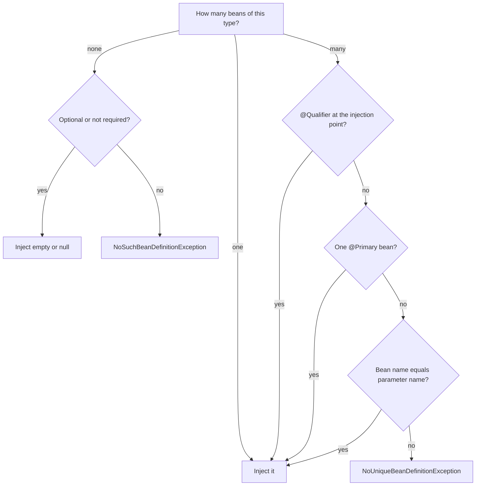

**Example:** `@Primary` and `@Qualifier`.

```java
@Configuration(proxyBeanMethods = false)
class DataSourceConfig {
    @Bean @Primary                                         // the default DataSource
    DataSource mainDb() { return DataSourceBuilder.create().url("jdbc:postgresql://main/shop").build(); }

    @Bean
    DataSource reportsDb() { return DataSourceBuilder.create().url("jdbc:postgresql://replica/shop").build(); }
}

@Service
class ReportService {
    private final DataSource ds;
    ReportService(@Qualifier("reportsDb") DataSource ds) { this.ds = ds; }   // picks the replica
}
```

**Example:** a strategy map. Adding a new payment type is a new class, with no `if-else`.

```java
interface PaymentGateway { Receipt pay(Order order); }

@Component("card") class CardGateway implements PaymentGateway { public Receipt pay(Order o) { /* ... */ return null; } }
@Component("upi")  class UpiGateway  implements PaymentGateway { public Receipt pay(Order o) { /* ... */ return null; } }

@Service
class PaymentService {
    private final Map<String, PaymentGateway> gateways;    // {"card": CardGateway, "upi": UpiGateway}

    PaymentService(Map<String, PaymentGateway> gateways) { this.gateways = gateways; }

    Receipt pay(Order order) {
        PaymentGateway g = gateways.get(order.method());    // "card" or "upi"
        if (g == null) throw new IllegalArgumentException("Unknown method: " + order.method());
        return g.pay(order);
    }
}
```

**Good and bad:**

| Good | Bad |
|---|---|
| `@Primary` on the bean most code wants | Many `@Primary` beans of one type (still ambiguous) |
| `@Qualifier` for the few special cases | Relying on parameter names without knowing it (renaming breaks wiring) |
| `Map<String, T>` for strategies | Long `if-else` or `switch` that picks implementations |
| `ObjectProvider` for optional beans | `@Autowired(required = false)` on fields everywhere |

**Say this in the interview:**
> "Spring autowires by type. If there are many candidates, it checks `@Qualifier`, then `@Primary`, then the parameter name, then `@Priority`. If it still can't choose, startup fails with `NoUniqueBeanDefinitionException`. I can also inject a `List` or a `Map` of all implementations, which I use for the strategy pattern."

**They may ask next:**
- **`@Autowired` vs `@Inject` vs `@Resource`?** `@Inject` is the standard Java version of `@Autowired`. `@Resource` matches by **name** first, then type.
- **How do I make a custom qualifier?** Create an annotation with `@Qualifier` on it, like `@Replica`, and put it on the bean and the injection point.
- **What is `@Fallback`?** Spring 6.2+. A bean that is used only when no other candidate exists. Good for default implementations in libraries.

### Properties: @Value, @ConfigurationProperties and profiles

**In one line:** Settings live outside the code. `@Value` reads one value. `@ConfigurationProperties` binds a group of values into a typed object. Profiles switch settings for each environment.

**Story:** A restaurant chain uses one recipe book (your code) in every branch.
Each branch has a small card on the kitchen wall: "Chennai: more spice. Delhi: less oil." These are properties.
The card for today's branch is picked when the shop opens. That is the profile.
If the manager phones in a special order today, it beats the card. That is a command-line argument.

**How it works:**
1. Spring's `Environment` holds an ordered list of *property sources*. If the same key is in two places, the higher one wins.
2. Spring Boot order, from strongest to weakest (simplified):
   - Test properties (`@TestPropertySource`, `@DynamicPropertySource`)
   - Command-line arguments: `--server.port=9090`
   - `SPRING_APPLICATION_JSON`
   - Java system properties: `-Dserver.port=9090`
   - OS environment variables: `SERVER_PORT=9090`
   - `application-{profile}.yml` outside the jar, then `application.yml` outside the jar
   - `application-{profile}.yml` inside the jar, then `application.yml` inside the jar
   - `@PropertySource` files, then default properties
3. **Relaxed binding:** `SERVER_PORT`, `server.port` and `server-port` all reach the same setting. Use kebab-case in files: `max-items`.
4. **`@Value("${shop.currency:INR}")`**: one value, with a default after the colon. It also supports SpEL (Spring Expression Language), like `#{...}`.
5. **`@ConfigurationProperties(prefix = "shop")`**: binds all `shop.*` keys into one object. Records work well. Since Boot 3, a record with one constructor needs no `@ConstructorBinding`.
6. Turn it on with `@ConfigurationPropertiesScan` or `@EnableConfigurationProperties(ShopProperties.class)`.
7. **Validation:** add `@Validated` and Jakarta Validation annotations like `@NotBlank`. A bad value stops the app at startup. That is good: fail fast. Put `@Valid` on nested objects so they are checked too.
8. **Profiles:** `spring.profiles.active=prod` (or env var `SPRING_PROFILES_ACTIVE=prod`). Boot then loads `application-prod.yml` on top of `application.yml`.
9. `@Profile("prod")` or `@Profile("!prod")` turns a bean on or off. Profile groups bundle profiles: `spring.profiles.group.prod=aws,metrics`.
10. Secrets don't belong in YAML files in git. Use env vars, Kubernetes secrets or a vault. See [Spring Cloud Config and secrets](spring-ecosystem.md#spring-cloud-config-and-secrets).

**Diagram:** Who wins when the same key is set in many places.

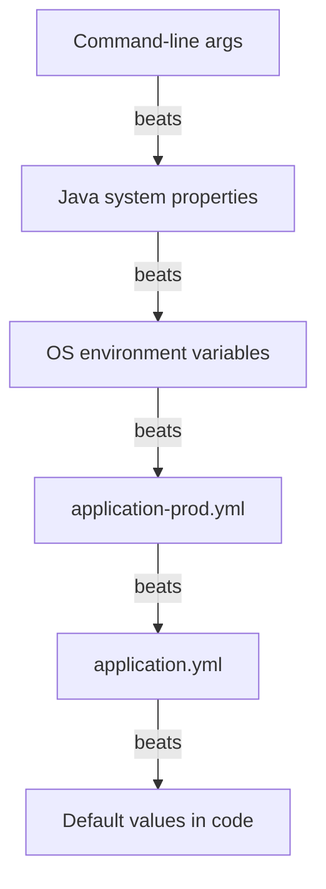

**Diagram:** Binding a group of keys to one typed object.

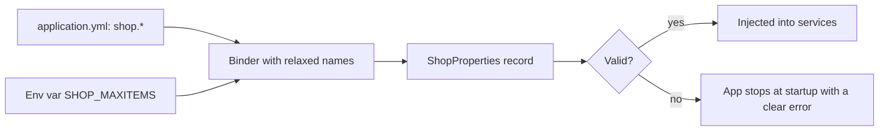

**Example:**

```yaml
shop:
  currency: INR
  max-items: 50
  payment:
    timeout: 3s                  # Duration: 3s, 500ms, 1m
    base-url: https://pay.internal
---
spring.config.activate.on-profile: prod
shop.max-items: 100              # only when the "prod" profile is active
```

```java
@ConfigurationProperties(prefix = "shop")
@Validated
public record ShopProperties(
        @NotBlank String currency,
        @Min(1) @Max(500) int maxItems,            // max-items in YAML -> maxItems
        @Valid @NotNull Payment payment) {

    public record Payment(@NotNull Duration timeout, @NotNull URI baseUrl) {}
}

@SpringBootApplication
@ConfigurationPropertiesScan                       // finds ShopProperties
public class ShopApp { }

@Service
class CheckoutService {
    CheckoutService(ShopProperties props,
                    @Value("${shop.currency:INR}") String currency) { }   // one value, with a default
}

@Configuration(proxyBeanMethods = false)
@Profile("local")                                  // only when the "local" profile is active
class FakePaymentConfig { }
```

**`@Value` vs `@ConfigurationProperties`:**

| | `@Value` | `@ConfigurationProperties` |
|---|---|---|
| Best for | One or two values | A group of related settings |
| Type safety | A string key, typos found at runtime | A typed object, IDE auto-complete |
| Validation | No | Yes, with `@Validated` |
| Relaxed binding | Limited | Full |
| SpEL expressions | Yes | No |

**Good and bad:**

| Good | Bad |
|---|---|
| A record with `@ConfigurationProperties` and `@Validated` | 30 `@Value` fields spread over 10 classes |
| Defaults in `application.yml`, overrides with env vars | Different jar builds for each environment |
| Profiles for environments (`local`, `prod`) | Profiles for features (`if profile == "discount-on"`) |
| Secrets from env vars or a vault | Passwords in `application.yml` in git |

**Say this in the interview:**
> "Spring Boot builds one Environment from many property sources. Command-line args beat system properties, which beat env vars, which beat the YAML files. For groups of settings I use a record with `@ConfigurationProperties` and `@Validated`, so a bad value fails at startup. I use `@Value` only for single values, and profiles to switch settings per environment."

**They may ask next:**
- **How do I see where a value came from?** `/actuator/env` shows each property and its source. See [Where did this property value come from?](spring-debugging.md#where-did-this-property-value-come-from).
- **How do env var names map to keys?** Upper case, dots become underscores, dashes are removed: `shop.max-items` becomes `SHOP_MAXITEMS`. See [Relaxed binding](spring-debugging.md#relaxed-binding).
- **Can properties change without a restart?** Not by default. Spring Cloud's `@RefreshScope` can rebuild beans after a config change. Many teams just restart pods.

### Circular dependencies

**In one line:** Bean A needs B, and B needs A. With constructor injection Spring can't create either one. Spring Boot 2.6 and later stop the app by default, even with field injection.

**Story:** Two friends at a narrow gate.
Ravi says, "I'll go in only after Sunil goes in." Sunil says, "I'll go in only after Ravi."
Nobody moves.
The fix is not to push one of them through. The fix is to change the rule.

**How it works:**
1. **Constructor injection:** to build A, Spring needs B. To build B, it needs A. Startup fails with `BeanCurrentlyInCreationException`.
2. Boot prints a clear message: "The dependencies of some of the beans in the application context form a cycle", with a small drawing of the cycle.
3. **Field or setter injection:** older Spring solved this with an "early reference". It gave B a half-built A. It worked, but B could use A before A was ready, and proxies made it confusing.
4. **Spring Boot 2.6** set `spring.main.allow-circular-references=false` by default. A cycle is a design smell, so Boot fails fast.
5. Fixes, best first:
   - **Redesign:** move the shared logic into a third bean C. Both A and B use C.
   - **Merge:** if A and B always change together, maybe they are one class.
   - **Events:** A publishes an event and B listens. There is no direct link back.
   - **Pass data, not beans:** give B the value it needs as a method parameter.
   - **`@Lazy` on one constructor parameter:** Spring injects a proxy now and creates the real bean on the first call. A last resort.
   - `spring.main.allow-circular-references=true`: only to buy time during a migration.

**Diagram:** The cycle, and the fix with a third bean.

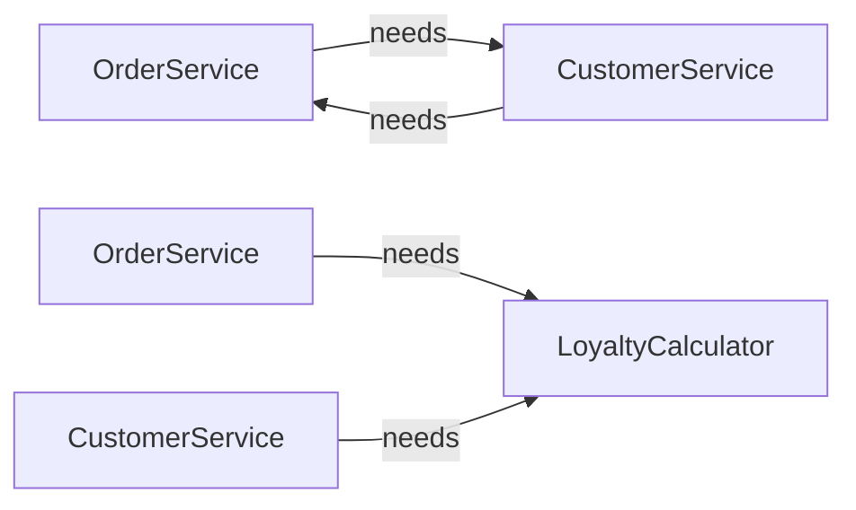

**Example:**

```java
// BAD: a cycle. Startup fails.
@Service class OrderService {
    OrderService(CustomerService customers) { }
}
@Service class CustomerService {
    CustomerService(OrderService orders) { }           // needs OrderService back
}

// FIX: move the shared part into a third bean
@Service class LoyaltyCalculator { int points(long customerId) { return 10; } }
@Service class OrderService2    { OrderService2(LoyaltyCalculator loyalty) { } }
@Service class CustomerService2 { CustomerService2(LoyaltyCalculator loyalty) { } }

// LAST RESORT: a lazy proxy breaks the cycle at startup
@Service class CustomerService3 {
    CustomerService3(@Lazy OrderService orders) { }    // proxy now, real bean on the first call
}
```

**Good and bad:**

| Good | Bad |
|---|---|
| Treat the startup error as a design hint | Turn on `allow-circular-references` and forget it |
| Extract a third bean, or use events | Switch to field injection to "fix" it |
| `@Lazy` with a comment saying why | `@Lazy` everywhere |

**Say this in the interview:**
> "A circular dependency means A needs B and B needs A. With constructor injection Spring can't build either, and since Boot 2.6 cycles are not allowed by default at all. I fix the design: move the shared logic to a third bean, or use an event. `@Lazy` on one parameter is my last resort."

**They may ask next:**
- **How did Spring solve cycles before?** With a "three-level cache" of singletons. It handed out an early reference to a half-built bean. That only works for field and setter injection.
- **Why not just use `@Lazy`?** It hides the design problem. The cycle still exists at runtime.
- **More help:** see [Breaking a circular dependency](spring-debugging.md#breaking-a-circular-dependency).

### Application events

**In one line:** One bean publishes an event, and other beans listen. The publisher does not know who listens, so the beans stay loosely coupled.

**Story:** A school bell rings.
Teachers start the class. The canteen closes. The guard opens the gate.
The bell does not know who is listening. A new club can start listening to the bell without changing the bell.

**How it works:**
1. **Publish:** `applicationEventPublisher.publishEvent(new OrderPlaced(id))`. Any object can be an event. A record is perfect.
2. **Listen:** put `@EventListener` on a method of a bean. The parameter type decides which events it gets.
3. **By default, listeners are synchronous.** They run on the same thread, inside the same transaction. If a listener throws, the publisher gets the exception.
4. **`@Async`** (with `@EnableAsync`) runs the listener on another thread. The publisher does not wait. Exceptions do not reach the publisher.
5. **`@TransactionalEventListener`** runs the listener at a point of the publisher's transaction:
   - `AFTER_COMMIT` (default): only if the data was really saved. Good for emails and messages.
   - `AFTER_ROLLBACK`, `AFTER_COMPLETION` (after commit or rollback), `BEFORE_COMMIT`.
   - If no transaction is running, the listener is skipped. Set `fallbackExecution = true` to run it anyway.
6. In `AFTER_COMMIT`, the old transaction is finished. To write to the database in the listener, use `@Transactional(propagation = REQUIRES_NEW)`. Since Spring 6.1, only `REQUIRES_NEW` or `NOT_SUPPORTED` are allowed there.
7. `@Order` sets the order of listeners. `condition = "#event.amount > 1000"` filters events with SpEL.
8. Spring Boot publishes its own events, like `ApplicationStartedEvent` and `ApplicationReadyEvent`. Spring itself publishes `ContextRefreshedEvent` and `ContextClosedEvent`.
9. Events live only in memory. If the app crashes after the commit but before the listener runs, the event is lost. For events you must not lose, use the [Transactional outbox pattern](microservices.md#transactional-outbox-pattern) or [Spring Modulith](spring-ecosystem.md#spring-modulith)'s event registry.

**Diagram:**

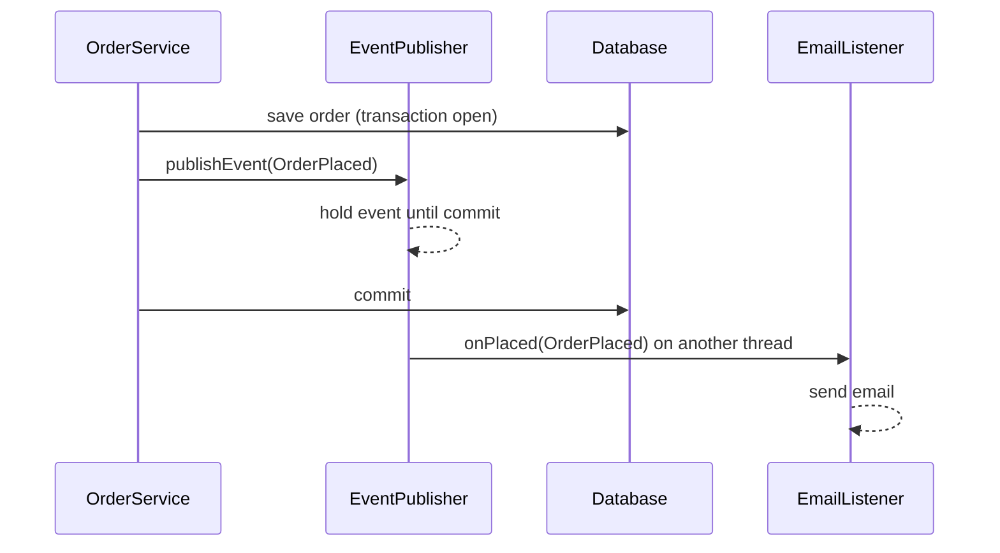

**Example:**

```java
public record OrderPlaced(long orderId, String email) {}

@Service
class OrderService {
    private final OrderRepository repo;
    private final ApplicationEventPublisher events;
    OrderService(OrderRepository repo, ApplicationEventPublisher events) {
        this.repo = repo;
        this.events = events;
    }

    @Transactional
    public void place(Order order) {
        repo.save(order);
        events.publishEvent(new OrderPlaced(order.getId(), order.getEmail()));
    }
}

@Component
class OrderEmailListener {
    @Async                                             // needs @EnableAsync
    @TransactionalEventListener                        // AFTER_COMMIT by default
    void onPlaced(OrderPlaced e) { /* send email only if the order was really saved */ }

    @EventListener(ApplicationReadyEvent.class)
    void ready() { /* the app is fully started */ }
}
```

**Good and bad:**

| Good | Bad |
|---|---|
| `@TransactionalEventListener` for emails and messages | Sending an email inside the transaction, then the transaction rolls back |
| Events to decouple modules inside one app | Events as a hidden way to call a method you could call directly |
| Outbox for events that must not be lost | Trusting in-memory events for payments |
| `@Async` for slow listeners | A slow synchronous listener that slows every request |

**Say this in the interview:**
> "I publish an event with `ApplicationEventPublisher` and handle it with `@EventListener`. By default it is synchronous and in the same transaction. For side effects like emails I use `@TransactionalEventListener`, which runs after commit by default, often with `@Async`. These events are in memory only, so for must-not-lose events I use the outbox pattern."

**They may ask next:**
- **Does `@EventListener` run in a new thread?** No. Same thread, unless you add `@Async`.
- **What if the listener throws?** A synchronous listener's exception goes back to the publisher and can roll back its transaction. An async one does not.
- **Spring events vs Kafka?** Spring events stay inside one JVM. Kafka goes between services and keeps messages on disk. See [Kafka](kafka.md).

### Spring annotations cheat sheet

One table for quick revision. Most are explained above or in [Spring ecosystem](spring-ecosystem.md).

| Annotation | What it does | Where used |
|---|---|---|
| `@Component` | Marks a class as a bean found by scanning | Core: class |
| `@Service` | A `@Component` for business logic | Core: class |
| `@Repository` | A `@Component` plus database exception translation | Core: class |
| `@Controller` | Web controller that returns views | Web: class |
| `@RestController` | `@Controller` + `@ResponseBody`: returns JSON | Web: class |
| `@Configuration` | Class with `@Bean` methods. CGLIB keeps them singletons | Core: class |
| `@Bean` | Method whose return value becomes a bean | Core: method in a config class |
| `@Autowired` | Inject a dependency. Optional on a single constructor | Core: constructor, field, setter |
| `@Qualifier` | Pick one bean by name or qualifier | Core: injection point, bean |
| `@Primary` / `@Fallback` | Default bean when many match / use only if nothing else fits (6.2+) | Core: class or `@Bean` |
| `@Lazy` | Create on first use, or inject a lazy proxy | Core: class, `@Bean`, injection point |
| `@Scope` | Set scope: singleton, prototype, request... | Core: class or `@Bean` |
| `@RequestScope` / `@SessionScope` | Web scopes, with a scoped proxy | Web: class |
| `@Lookup` | Method that returns a new prototype bean on each call | Core: method |
| `@Value` | Inject one property or SpEL result | Core: field, parameter |
| `@Profile` | Bean only when a profile is active | Core: class or `@Bean` |
| `@Conditional` | Bean only when a `Condition` matches | Core: class or `@Bean` |
| `@Import` / `@ComponentScan` | Add config classes / choose packages to scan | Core: config class |
| `@PropertySource` | Add a `.properties` file to the Environment | Core: config class |
| `@Order` | Order in lists, filters, aspects, listeners | Core: class |
| `@PostConstruct` / `@PreDestroy` | Init and cleanup callbacks (`jakarta.annotation`) | Core: method |
| `@EventListener` | Handle an application event | Core: method |
| `@TransactionalEventListener` | Handle an event at a transaction phase (after commit) | Tx: method |
| `@SpringBootApplication` | `@SpringBootConfiguration` + `@EnableAutoConfiguration` + `@ComponentScan` | Boot: main class |
| `@ConfigurationProperties` | Bind `prefix.*` keys to a typed object | Boot: class or record |
| `@ConfigurationPropertiesScan` | Find `@ConfigurationProperties` classes | Boot: main class |
| `@AutoConfiguration` | Marks an auto-configuration class | Boot: library code |
| `@ConditionalOnClass` / `@ConditionalOnMissingBean` / `@ConditionalOnProperty` | Auto-config conditions | Boot: config class or `@Bean` |
| `@RequestMapping` / `@GetMapping` / `@PostMapping`... | Map a URL and HTTP method to a method | Web: class or method |
| `@PathVariable` / `@RequestParam` / `@RequestHeader` | Read a part of the URL, query string or header | Web: parameter |
| `@RequestBody` / `@ResponseBody` | Read JSON body into an object / write return value as body | Web: parameter / method |
| `@ResponseStatus` | Set the HTTP status of a method or exception | Web: method, exception class |
| `@ExceptionHandler` | Turn an exception into a response | Web: method |
| `@RestControllerAdvice` / `@ControllerAdvice` | Global exception handlers and binders for all controllers | Web: class |
| `@CrossOrigin` | Allow CORS for a controller | Web: class or method |
| `@HttpExchange` / `@GetExchange` | Declare an HTTP client as an interface | Web client: interface |
| `@Valid` / `@Validated` | Run Bean Validation (`@Validated` also supports groups and method validation) | Validation: parameter, class |
| `@NotNull` / `@NotBlank` / `@Size` / `@Email` / `@Min` | Validation rules | Validation: field, record component |
| `@Transactional` | Run the method in a database transaction | Tx: class or method |
| `@Entity` / `@Id` / `@Version` | JPA entity, primary key, optimistic lock field | Data: class, field |
| `@Query` / `@Modifying` | Custom query / update query in a Spring Data repository | Data: repository method |
| `@EnableScheduling` / `@Scheduled` | Run a method on a timer or cron | Scheduling: config / method |
| `@EnableAsync` / `@Async` | Run a method on another thread | Scheduling: config / method |
| `@EnableCaching` / `@Cacheable` / `@CacheEvict` / `@CachePut` | Cache method results | Caching: config / method |
| `@EnableResilientMethods` / `@Retryable` / `@ConcurrencyLimit` | Retry and limit calls, built into Spring Framework 7 | Resilience: config / method |
| `@EnableWebSecurity` / `@EnableMethodSecurity` | Turn on web security / method security | Security: config class |
| `@PreAuthorize` / `@PostAuthorize` | Check access before / after a method | Security: method |
| `@AuthenticationPrincipal` | Inject the logged-in user | Security: controller parameter |
| `@Aspect` | Marks a class with advice and pointcuts | AOP: class |
| `@Before` / `@After` / `@AfterReturning` / `@AfterThrowing` / `@Around` | Advice types | AOP: method |
| `@Pointcut` | A named, reusable pointcut expression | AOP: method |
| `@SpringBootTest` | Start the full app context in a test | Test: class |
| `@WebMvcTest` / `@DataJpaTest` | Test slices: only web or only JPA beans | Test: class |
| `@MockitoBean` / `@MockitoSpyBean` | Replace a bean with a Mockito mock or spy (replaces `@MockBean`, removed in Boot 4) | Test: field |
| `@TestConfiguration` | Extra beans only for tests | Test: class |
| `@ServiceConnection` | Wire a Testcontainers container to the app | Test: container field |
| `@ActiveProfiles` / `@DynamicPropertySource` | Pick profiles / add properties at test runtime | Test: class / static method |

## How Spring Boot works

Spring Boot is Spring plus three things: auto-configuration (sensible beans added for you), starters (tested dependency sets) and an embedded web server inside one runnable jar.
There is no magic. It is all normal Spring: `@Configuration` classes with conditions.

### What happens when a Spring Boot app starts

**In one line:** `SpringApplication.run()` reads the settings, creates the container, loads your beans and the auto-configured beans, starts the web server, runs your startup code and then says "ready".

**Story:** Opening a restaurant every morning.
- Read today's notice: which branch, which menu (properties and profiles).
- Unlock the building (create the container).
- Read the staff list, plus the franchise's standard kit list (component scan and auto-configuration).
- Staff arrive and get their tools (beans created and wired).
- Switch on the stove (start Tomcat).
- Do the morning prep jobs (runners).
- Turn the board to "Open" (`ApplicationReadyEvent`). Customers can come in.

**How it works:**
1. `main()` calls `SpringApplication.run(ShopApp.class, args)`.
2. `SpringApplication` decides the app type: **servlet** (Spring MVC is on the classpath), **reactive** (only WebFlux) or **none**. It loads initializers and listeners from `META-INF/spring.factories` files.
3. **Prepare the Environment:** read command-line args, env vars, `application.yml` and profile files. Fires `ApplicationEnvironmentPreparedEvent`.
4. Print the banner.
5. **Create the ApplicationContext** of the right type, for example a servlet web server context.
6. **Prepare the context:** run initializers and register your main class as a bean definition.
7. **`refresh()`**, the big step:
   - `BeanFactoryPostProcessor`s run. `ConfigurationClassPostProcessor` reads `@SpringBootApplication`: component scan, `@Import`, `@Bean` methods. Then auto-configuration classes are added **after** your own config.
   - `BeanPostProcessor`s are registered.
   - The embedded web server (Tomcat) is created.
   - All non-lazy singletons are created. Each one goes through the [bean lifecycle](#bean-lifecycle).
   - The web server starts listening on the port. `ContextRefreshedEvent` is fired.
8. `ApplicationStartedEvent` is fired.
9. `CommandLineRunner` and `ApplicationRunner` beans run.
10. `ApplicationReadyEvent` is fired. The readiness state becomes "accepting traffic", so Kubernetes can send requests.
11. If anything fails: `ApplicationFailedEvent`. A *failure analyzer* prints a friendly "APPLICATION FAILED TO START" message, and the context is closed.

**Diagram:**

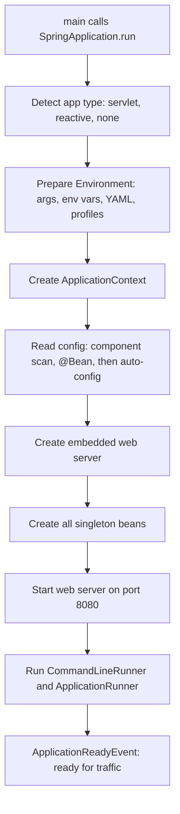

**Diagram:** The startup events, in order.

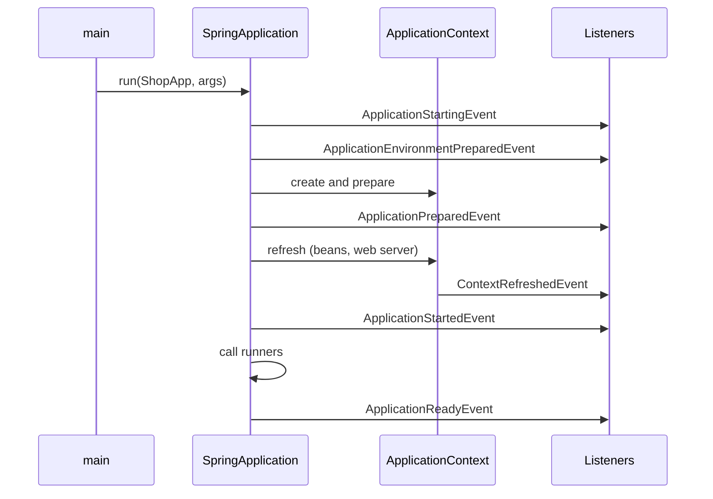

**Example:**

```java
@SpringBootApplication
public class ShopApp {
    public static void main(String[] args) {
        SpringApplication app = new SpringApplication(ShopApp.class);
        app.setBannerMode(Banner.Mode.OFF);
        app.setApplicationStartup(new BufferingApplicationStartup(2048));  // feeds /actuator/startup
        app.run(args);
    }
}

@Component
class LoadCountries implements ApplicationRunner {
    @Override
    public void run(ApplicationArguments args) {
        // runs after all beans exist, before ApplicationReadyEvent
    }
}
```

**Good and bad:**

| Good | Bad |
|---|---|
| Startup jobs in `ApplicationRunner` or on `ApplicationReadyEvent` | Long remote calls in constructors or `@PostConstruct` |
| Check slow startup with `/actuator/startup` | Guessing why startup takes 40 seconds |
| Fail fast on bad config | Catching startup errors and running half-broken |

**Say this in the interview:**
> "`SpringApplication.run` detects the app type, prepares the Environment from properties and profiles, and creates the ApplicationContext. In `refresh()` it processes my configuration and component scan, then auto-configuration, creates all singletons and starts the embedded server. Then it calls the runners and fires `ApplicationReadyEvent`, which is when the app is ready for traffic."

**They may ask next:**
- **Where do I put code that must run once at startup?** An `ApplicationRunner`, or a listener for `ApplicationReadyEvent`.
- **How do I find slow beans at startup?** Use `BufferingApplicationStartup` and `/actuator/startup`. See [Slow startup](spring-debugging.md#slow-startup-applicationstartup-and-actuatorstartup).
- **How do I make startup faster?** Lazy init, fewer starters, AOT, CDS or native images. See [Faster startup](spring-ecosystem.md#faster-startup-native-images-aot-cds-and-crac).

### Auto-configuration and @Conditional

**In one line:** Boot looks at your classpath, your properties and your beans, and adds sensible beans for you. Each auto-configuration has conditions, and your own bean always wins.

**Story:** A hotel room's welcome kit.
- If you brought your own toothbrush, the hotel does not give one. That is `@ConditionalOnMissingBean`.
- If the room has a kettle, they leave tea bags. That is `@ConditionalOnClass`.
- If you ticked "no newspaper" on the form, no newspaper comes. That is `@ConditionalOnProperty`.

**How it works:**
1. `@SpringBootApplication` = `@SpringBootConfiguration` (a `@Configuration`) + `@EnableAutoConfiguration` + `@ComponentScan`.
2. `@EnableAutoConfiguration` imports `AutoConfigurationImportSelector`.
3. It reads a file from every jar: `META-INF/spring/org.springframework.boot.autoconfigure.AutoConfiguration.imports`. The file is a list of auto-configuration class names. (Before Boot 2.7 this list was in `spring.factories`.)
4. Boot 4 split the old big `spring-boot-autoconfigure` jar into many small modules, like `spring-boot-webmvc` and `spring-boot-jdbc`. Each has its own imports file. Starters bring the right modules.
5. Auto-configurations are processed **after** your own configuration. So `@ConditionalOnMissingBean` can see your beans.
6. Each class has conditions. The common ones:
   - `@ConditionalOnClass(DataSource.class)`: a class is on the classpath.
   - `@ConditionalOnMissingBean`: you did not define this bean yourself.
   - `@ConditionalOnBean`: some other bean exists.
   - `@ConditionalOnProperty(prefix = "audit", name = "enabled", havingValue = "true")`, and `@ConditionalOnBooleanProperty` (Boot 3.5+).
   - `@ConditionalOnWebApplication`, `@ConditionalOnResource`, `@ConditionalOnExpression`.
7. **How to override:**
   - Define your own bean of the same type. The auto-config backs off.
   - Set properties, like `spring.datasource.url`.
   - Use a *customizer* bean (a hook to change Boot's bean), like `RestClientCustomizer`.
   - Exclude it: `@SpringBootApplication(exclude = DataSourceAutoConfiguration.class)` or `spring.autoconfigure.exclude`.
8. **See what happened:** start with `--debug` (or `debug=true`) to print the **conditions evaluation report**. `/actuator/conditions` shows the same. See [The conditions evaluation report](spring-debugging.md#the-conditions-evaluation-report).

**Diagram:**

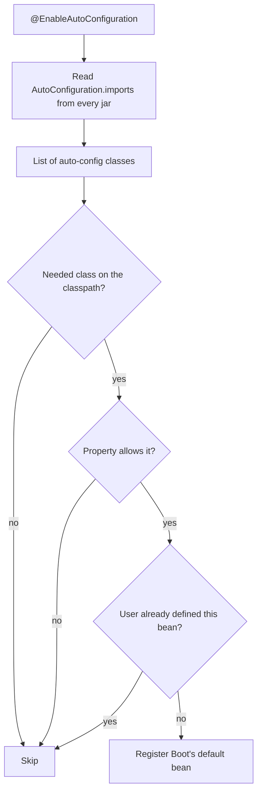

**Example:** your own auto-configuration, as a shared library (a "starter").

```java
@AutoConfiguration
@ConditionalOnClass(AuditClient.class)                 // only if our library is on the classpath
@EnableConfigurationProperties(AuditProperties.class)
public class AuditAutoConfiguration {

    @Bean
    @ConditionalOnMissingBean                          // the app's own AuditClient wins
    @ConditionalOnProperty(prefix = "audit", name = "enabled", havingValue = "true", matchIfMissing = true)
    AuditClient auditClient(AuditProperties props) {
        return new AuditClient(props.url());
    }
}
```

The file `src/main/resources/META-INF/spring/org.springframework.boot.autoconfigure.AutoConfiguration.imports`:

```text
com.acme.audit.AuditAutoConfiguration
```

Part of a conditions report (`--debug`):

```text
Positive matches:
   DataSourceAutoConfiguration matched:
      - @ConditionalOnClass found required classes 'javax.sql.DataSource', ...
Negative matches:
   MongoAutoConfiguration:
      Did not match:
         - @ConditionalOnClass did not find required class 'com.mongodb.client.MongoClient'
```

**Good and bad:**

| Good | Bad |
|---|---|
| Override by defining your own bean | Copy-paste Boot's auto-config class into your app |
| Use `--debug` to see why a bean is (not) there | Guess, then add random `exclude`s |
| `@ConditionalOnMissingBean` in your own starters | Library beans that apps can't replace |

**Say this in the interview:**
> "`@SpringBootApplication` includes `@EnableAutoConfiguration`. It loads a list of auto-configuration classes from `AutoConfiguration.imports` files on the classpath. Each class is a normal `@Configuration` guarded by conditions like `@ConditionalOnClass`, `@ConditionalOnProperty` and `@ConditionalOnMissingBean`. They run after my config, so if I define my own bean, Boot's default backs off. The conditions report shows what matched and why."

**They may ask next:**
- **How do I disable one auto-configuration?** `@SpringBootApplication(exclude = ...)` or `spring.autoconfigure.exclude=...`.
- **How do I order my auto-config after another?** `@AutoConfiguration(after = DataSourceAutoConfiguration.class)`.
- **How do I write my own condition?** Implement `Condition` and use `@Conditional(MyCondition.class)`. Most of the time the built-in ones are enough.

### Starters, embedded server and executable jar

**In one line:** A starter is one dependency that brings a tested set of libraries. The web server runs inside your app. The whole app ships as one jar that you start with `java -jar`.

**Story:**
- A **starter** is a meal combo. You order "combo 2" instead of a burger, fries and a drink one by one, hoping the sizes match.
- The **embedded server** is a food truck. It carries its own kitchen, so you don't need a building (an external Tomcat).
- The **executable jar** is a lunch box. Everything you need is inside one box.

**How it works:**
1. A starter is a small POM with dependencies and no code. `spring-boot-starter-webmvc` brings Spring MVC, Jackson, embedded Tomcat and their auto-configuration modules.
2. Boot 4 renamed some starters:
   - `spring-boot-starter-web` became `spring-boot-starter-webmvc`. The old name still works but is deprecated.
   - OAuth2 starters got a `security-` prefix, like `spring-boot-starter-security-oauth2-resource-server`. The old names are deprecated too.
   - `spring-boot-starter-aop` became `spring-boot-starter-aspectj`. There is no 4.x jar with the old name, so you must change it.
3. You don't write versions. Boot's BOM (bill of materials, a list of tested versions) manages them through the parent POM or the Gradle plugin.
4. **Embedded server:** Tomcat is the default. Jetty is the other choice. Boot 4 dropped Undertow. WebFlux uses Netty.
5. The server is created as a bean during `refresh()`. Settings: `server.port`, `server.tomcat.threads.max` (200 by default), `server.shutdown=graceful` (the default since Boot 3.4).
6. **Executable jar** (a "fat jar"), built by `spring-boot-maven-plugin` or the Gradle plugin:
   - `BOOT-INF/classes`: your code.
   - `BOOT-INF/lib`: all dependency jars, kept as jars inside the jar.
   - `META-INF/MANIFEST.MF`: `Main-Class` is Boot's `JarLauncher`. `Start-Class` is your main class.
   - `JarLauncher` builds a class loader that can read jars inside the jar, then calls your `main`.
7. For Docker, use layers (`java -Djarmode=tools -jar app.jar extract --layers`) or Buildpacks (`mvn spring-boot:build-image`). Dependencies change rarely, so their layer is cached.
8. A WAR file for an external Tomcat is still possible, but rare today.

**Diagram:**

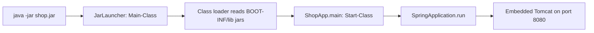

**Example:**

```xml
<parent>
    <groupId>org.springframework.boot</groupId>
    <artifactId>spring-boot-starter-parent</artifactId>
    <version>4.0.0</version>                         <!-- one version controls all -->
</parent>
<dependencies>
    <dependency>
        <groupId>org.springframework.boot</groupId>
        <artifactId>spring-boot-starter-webmvc</artifactId>   <!-- Boot 3: spring-boot-starter-web -->
    </dependency>
</dependencies>
```

```text
shop.jar
├── META-INF/MANIFEST.MF        Main-Class: org.springframework.boot.loader.launch.JarLauncher
│                               Start-Class: com.shop.ShopApp
├── BOOT-INF/classes/           your compiled code and application.yml
├── BOOT-INF/lib/               spring-webmvc.jar, tomcat-embed-core.jar, jackson...
└── org/springframework/boot/loader/   the launcher classes
```

**Good and bad:**

| Good | Bad |
|---|---|
| Starters and the Boot BOM | Hand-picked versions of every Spring jar |
| One jar, one process, one container image | A shared external Tomcat with many apps |
| Layered images, so code changes push small layers | Copying the fat jar into a Docker image as one big layer |

**Say this in the interview:**
> "Starters are dependency bundles, and the Boot BOM keeps versions compatible. Tomcat runs inside the app, created as a bean during startup, so I don't install a server. The build makes an executable jar: `JarLauncher` is the main class, it loads the nested jars from `BOOT-INF/lib` and then calls my main class."

**They may ask next:**
- **How do I switch Tomcat to Jetty?** Exclude `spring-boot-starter-tomcat` and add `spring-boot-starter-jetty`.
- **Why not deploy a WAR?** You can, but one jar per service fits containers and Kubernetes better.
- **What is graceful shutdown?** On stop, the server stops taking new requests and waits for running ones to finish (up to `spring.lifecycle.timeout-per-shutdown-phase`).

## Spring AOP

*AOP* means Aspect-Oriented Programming. It lets you add the same extra behaviour (transactions, security, logging) to many methods without writing it in each method.
In Spring, AOP is done with **proxies**. Understanding proxies explains why `@Transactional` sometimes "does nothing".

### How Spring AOP works (proxies)

**In one line:** Spring puts a proxy (a stand-in object) in front of your bean. The proxy runs extra code like "start transaction" before and after it calls your real method.

**Story:** A film star has a personal assistant. You can't call the star directly. The assistant picks up.
- The assistant checks if you have an appointment (security).
- Notes the time of the call (logging).
- Puts you through to the star (calls the real method).
- After the call, writes the minutes (commit).

The star only does the real talking. But if the star talks to himself in his room, the assistant does not hear it. That is the [self-invocation trap](#the-self-invocation-trap).

**Words you need:**
- **Aspect:** one extra job, like logging or transactions.
- **Advice:** the code that runs (before, after, around the method).
- **Pointcut:** a rule that says which methods get the advice.
- **Join point:** a point where advice can run. In Spring AOP, always a method call.
- **Target:** your real bean.
- **Proxy:** the object that stands in front of the target.
- **Weaving:** attaching aspects to code. Spring weaves at runtime, with proxies.

**How it works:**
1. At startup, a `BeanPostProcessor` (the *auto-proxy creator*) looks at every bean in `postProcessAfterInitialization`.
2. It asks: does any advice match any method of this bean? Examples: an `@Aspect`, `@Transactional`, `@Async`, `@Cacheable`.
3. If yes, it creates a proxy and returns the proxy instead of the bean. Every other bean gets the **proxy** injected.
4. There are two kinds of proxies:
   - **JDK dynamic proxy:** implements the same interfaces as your bean. Only interface methods are proxied. You must inject the interface type.
   - **CGLIB proxy:** a subclass of your class, made at runtime. It overrides your methods. It can't override `final` methods or subclass `final` classes. It can't see `private` methods.
5. Plain Spring Framework uses a JDK proxy when the bean has interfaces, else CGLIB. **Spring Boot uses CGLIB by default** (`spring.aop.proxy-target-class=true`). Spring Framework 7 adds `@Proxyable` to choose the proxy type for one bean.
6. A call goes: caller, then proxy, then a chain of interceptors (the advice) in order, then the target method, then back out through the chain.

**Spring features that are built on proxies:**

| Annotation | What the proxy does |
|---|---|
| `@Transactional` | Begin a transaction, commit or roll back |
| `@Async` | Hand the call to a thread pool and return at once |
| `@Cacheable` | Check the cache first, call the method only on a miss |
| `@PreAuthorize` | Check permissions before the call |
| `@Retryable`, `@ConcurrencyLimit` | Retry on failure, limit parallel calls (Spring Framework 7) |
| `@Validated` on a class | Validate method parameters and return values |
| Your `@Aspect` | Logging, timing, auditing |

**Diagram:** A call through the proxy.

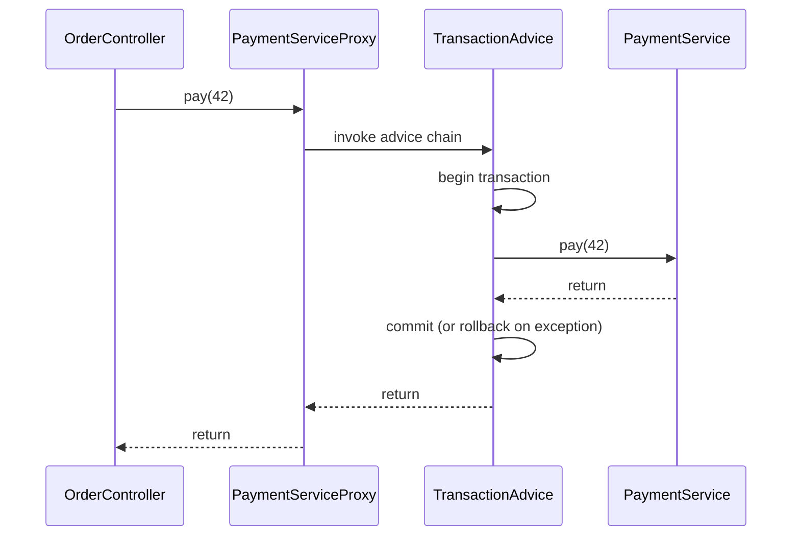

**Diagram:** JDK proxy vs CGLIB proxy.

```mermaid
flowchart LR
    I["Interface PaymentApi"] -->|"implemented by"| J["JDK proxy"]
    I -->|"implemented by"| T["PaymentService (target)"]
    J -->|"delegates to"| T
    T -->|"extended by"| C["CGLIB proxy subclass"]
    C -->|"delegates to"| T2["PaymentService (target)"]
```

**Example:** see the proxy with your own eyes.

```java
@Service
public class PaymentService {
    @Transactional
    public void pay(long orderId) { /* real work */ }
}

@Component
class ProxyCheck implements ApplicationRunner {
    private final PaymentService payments;
    ProxyCheck(PaymentService payments) { this.payments = payments; }

    @Override
    public void run(ApplicationArguments args) {
        System.out.println(payments.getClass());            // PaymentService$$SpringCGLIB$$0
        System.out.println(AopUtils.isAopProxy(payments));  // true
    }
}
```

What the proxy does for `@Transactional`, written by hand (simplified):

```java
class PaymentServiceProxy extends PaymentService {          // CGLIB makes a class like this
    private final PaymentService target;                    // the real bean
    private final PlatformTransactionManager txManager;

    @Override
    public void pay(long orderId) {
        TransactionStatus tx = txManager.getTransaction(TransactionDefinition.withDefaults());
        try {
            target.pay(orderId);                            // call the real method
            txManager.commit(tx);
        } catch (RuntimeException | Error e) {
            txManager.rollback(tx);                         // unchecked exceptions roll back by default
            throw e;
        }
    }
}
```

**Good and bad:**

| Good | Bad |
|---|---|
| Use AOP for cross-cutting jobs: transactions, security, metrics | Hide business rules in aspects. Nobody can find them |
| Check `AopUtils.isAopProxy(bean)` when an annotation "does nothing" | Put `@Transactional` on `private` or `final` methods |
| Keep advice small and fast | Slow advice that runs on every method of every bean |

**Say this in the interview:**
> "Spring AOP is proxy-based. After a bean is initialized, a BeanPostProcessor checks whether any advice applies. If yes, it wraps the bean in a proxy, and other beans get the proxy. The proxy runs the advice, like begin and commit a transaction, around the real method. Spring Boot uses CGLIB subclass proxies by default. `@Transactional`, `@Async`, `@Cacheable` and `@PreAuthorize` all work this way."

**They may ask next:**
- **JDK proxy or CGLIB?** JDK proxies need an interface. CGLIB subclasses the class. Boot uses CGLIB by default, so injecting the concrete class works.
- **Why can't CGLIB proxy a `final` class?** It must create a subclass, and `final` classes can't be extended.
- **Is there a cost?** One extra hop per call through the interceptor chain. Tiny compared to a database call.

### Advice types and pointcuts

**In one line:** An aspect says **what** extra code runs (the advice) and **where** it runs (the pointcut).

**Story:** A security guard's duty card.
"Where: every door on floor 3." That is the pointcut.
"What: check ID before entry, note the time on exit, call the police if the alarm rings." That is the advice.

**How it works:**

| Advice | When it runs | Can it... |
|---|---|---|
| `@Before` | Before the method | Stop the call only by throwing |
| `@AfterReturning` | After a normal return | Read the return value |
| `@AfterThrowing` | After an exception | Read the exception (it still goes up) |
| `@After` | Always, like `finally` | Clean up |
| `@Around` | Wraps the whole call | Decide to call `proceed()` or not, change arguments and the result, catch exceptions |

Use the weakest advice that works. `@Around` is the most powerful, so it is also the easiest to break (forget `proceed()` and the method never runs).

**Pointcut expressions you need:**
- `execution(* com.shop.service.*.*(..))`: any method of any class in `com.shop.service`. `*` = any one thing. `..` = any parameters, or any sub-packages.
- `execution(public * *(..))`: any public method.
- `within(com.shop..*)`: anything in `com.shop` and its sub-packages.
- `@annotation(com.shop.aop.Timed)`: methods that have `@Timed`.
- `@within(org.springframework.stereotype.Service)`: all methods of classes that have `@Service`.
- `bean(*Service)`: beans whose name ends in `Service`. Spring-only.
- Combine with `&&`, `||` and `!`.

**Order:**
- `@Order(1)` on the aspect class. A lower number runs first on the way in and last on the way out.
- Inside one aspect, the order is: `@Around` starts, `@Before`, the method, `@AfterReturning` or `@AfterThrowing`, `@After`, `@Around` ends.
- `@Transactional` has the lowest priority by default, so it is the innermost. A retry aspect with `@Order(1)` runs outside the transaction. Each retry then gets a fresh transaction. That is what you want.

**Diagram:** Advice around one call.

```mermaid
sequenceDiagram
    participant Caller
    participant Around as AroundAdvice
    participant Before as BeforeAdvice
    participant Target as OrderService
    participant After as AfterAdvices
    Caller->>Around: placeOrder()
    Around->>Around: start timer
    Around->>Before: run before advice
    Before->>Target: placeOrder()
    Target-->>After: return value or exception
    After-->>Around: AfterReturning or AfterThrowing, then After
    Around->>Around: stop timer, log time
    Around-->>Caller: result
```

**Example:** a timing aspect for methods marked `@Timed`. Needs `spring-boot-starter-aspectj` (Boot 3: `spring-boot-starter-aop`).

```java
@Target(ElementType.METHOD)
@Retention(RetentionPolicy.RUNTIME)
public @interface Timed {}

@Aspect
@Component
@Order(1)                                                // outer: runs around other advice
public class TimingAspect {
    private static final Logger log = LoggerFactory.getLogger(TimingAspect.class);

    @Around("@annotation(com.shop.aop.Timed)")           // only methods marked @Timed
    public Object time(ProceedingJoinPoint pjp) throws Throwable {
        long start = System.nanoTime();
        try {
            return pjp.proceed();                        // call the real method
        } finally {
            long ms = (System.nanoTime() - start) / 1_000_000;
            log.info("{} took {} ms", pjp.getSignature().toShortString(), ms);
        }
    }
}
```

A named pointcut, reused by two advice methods:

```java
@Aspect
@Component
public class ServiceErrorAspect {
    private static final Logger log = LoggerFactory.getLogger(ServiceErrorAspect.class);

    @Pointcut("within(com.shop.service..*)")             // every bean in the service package
    void serviceLayer() {}

    @AfterThrowing(pointcut = "serviceLayer()", throwing = "ex")
    public void logError(JoinPoint jp, Exception ex) {
        log.warn("{} failed: {}", jp.getSignature().toShortString(), ex.getMessage());
    }
}
```

**Good and bad:**

| Good | Bad |
|---|---|
| Custom annotation + `@annotation(...)` pointcut: clear and opt-in | `execution(* *(..))`: advises every method of every bean |
| `@Order` when aspects depend on each other | Guessing the order of retry and transaction |
| Always call `proceed()` in `@Around` (unless you mean to skip) | Swallowing exceptions in `@Around` |

**Say this in the interview:**
> "An aspect has advice and pointcuts. Advice is what runs: before, after returning, after throwing, after, or around. The pointcut says where, like `execution(...)` for method signatures or `@annotation(...)` for methods with an annotation. I prefer a custom annotation as the pointcut, so it is opt-in and easy to find. I use `@Order` to control the order, for example retry outside the transaction."

**They may ask next:**
- **Which advice for timing?** `@Around`, because it sees the start and the end of the call.
- **Can `@AfterThrowing` swallow the exception?** No. It can only react. Use `@Around` with try-catch to change the outcome.
- **How do I read method arguments?** `joinPoint.getArgs()`, or bind them in the pointcut with `args(...)`.

### The self-invocation trap

**In one line:** Calling another method of the same bean with `this.method()` skips the proxy, so `@Transactional`, `@Async` or `@Cacheable` on that method do nothing.

**Story:** Back to the film star. Calls from outside go through the assistant, who takes notes.
When the star talks to himself in his room, the assistant is not there. No notes, no appointment check.
`this.method()` is the star talking to himself.

**How it works:**
1. Other beans hold a reference to the **proxy**. The proxy runs the advice.
2. Inside your class, `this` is the **real object**, not the proxy.
3. So `this.inner()` is a plain Java call. No advice runs.
4. Other cases where the advice does not run:
   - `private` methods. A proxy can't override them.
   - `final` and `static` methods.
   - Objects you create with `new`. They are not Spring beans.
   - Calls from the constructor or `@PostConstruct`, before the proxy exists.
5. Since Spring 6.0, `@Transactional` also works on `protected` and package-private methods with CGLIB proxies. `private` still never works.
6. Fixes, best first:
   - **Move the method to another bean.** The call then goes through that bean's proxy. Cleanest.
   - **Programmatic transaction:** `TransactionTemplate` needs no proxy.
   - **Inject your own proxy:** `@Lazy` self-injection or `ObjectProvider<MyService>`. Works, but looks strange to readers.
   - `AopContext.currentProxy()` with `@EnableAspectJAutoProxy(exposeProxy = true)`. Ties code to Spring AOP. Avoid.
   - **AspectJ weaving:** changes the bytecode, so even `this` calls are advised. More build setup.

**Diagram:**

```mermaid
sequenceDiagram
    participant Ctrl as Controller
    participant Proxy as OrderServiceProxy
    participant Real as OrderService
    Ctrl->>Proxy: placeAll(orders)
    Proxy->>Real: placeAll(orders)
    Real->>Real: this.placeOne(order)
    Note over Real: Plain Java call. The proxy is skipped, so no new transaction starts
    Real-->>Proxy: return
    Proxy-->>Ctrl: return
```

**Example:**

```java
@Service
class OrderService {
    public void placeAll(List<Order> orders) {
        for (Order o : orders) {
            this.placeOne(o);                             // BUG: skips the proxy, no new transaction
        }
    }

    @Transactional(propagation = Propagation.REQUIRES_NEW)
    public void placeOne(Order o) { /* save */ }
}

// FIX: TransactionTemplate, no proxy needed
@Service
class BulkOrderService {
    private final TransactionTemplate tx;
    private final OrderRepository repo;
    BulkOrderService(PlatformTransactionManager tm, OrderRepository repo) {
        this.tx = new TransactionTemplate(tm);
        this.repo = repo;
    }

    public void placeAll(List<Order> orders) {
        orders.forEach(o -> tx.executeWithoutResult(status -> repo.save(o)));  // one transaction each
    }
}
```

The other common fix: move `placeOne` into a separate `OrderWriter` bean and call `orderWriter.placeOne(o)`.

**Good and bad:**

| Good | Bad |
|---|---|
| Split the method into another bean | Put `@Transactional` on a private helper |
| `TransactionTemplate` for fine control | `AopContext.currentProxy()` in business code |
| A test that checks the rollback really happens | Assume the annotation works because it compiles |

**Say this in the interview:**
> "Spring AOP works through a proxy, but inside the class `this` points to the real object. So a self-call skips the proxy and its advice: no transaction, no async, no cache. The same is true for private and final methods and for objects made with `new`. I fix it by moving the method into another bean, or by using `TransactionTemplate`."

**They may ask next:**
- **Does `@Transactional` on a private method work?** No. The proxy can't override it, and Spring ignores it without any warning.
- **Why does `@Async` run on the same thread?** Usually a self-call, or `@EnableAsync` is missing. See [Debugging @Transactional and JPA](spring-debugging.md#debugging-transactional-and-jpa).
- **Full transaction details:** see [@Transactional deep dive](spring-ecosystem.md#transactional-deep-dive).

### Spring AOP vs AspectJ

**In one line:** Spring AOP uses runtime proxies and only advises method calls on Spring beans. AspectJ changes the bytecode, so it can advise almost anything: private methods, self-calls, constructors and field access.

**Story:** Spring AOP is a receptionist at the door. She sees only people who come through the door.
AspectJ is a camera built into every room. It sees everything, but you must install it in the building (the build or the JVM).

**How it works:**

| | Spring AOP | AspectJ |
|---|---|---|
| Weaving | At runtime, with proxies | At compile time (`ajc` compiler), after compile, or at class load time (a Java agent) |
| What it can advise | Method calls on Spring beans, through the proxy | Method calls and executions, constructors, field reads and writes, static blocks |
| Self-calls (`this.x()`) | Not advised | Advised |
| Objects made with `new` | Not advised | Advised |
| Private methods | No | Yes |
| Setup | Just the starter | Special compiler plugin or `-javaagent` |
| Speed | One small proxy hop per call | No proxy hop. Advice is inside the class |

- Spring AOP **borrows** AspectJ's annotations (`@Aspect`, `@Around`) and its pointcut language. It does not use the AspectJ weaver. This confuses many people.
- Most teams use Spring AOP. It covers the usual needs: transactions, security, caching and logging.
- Use AspectJ for self-calls everywhere, advice on objects not managed by Spring, or very hot code paths.

**Diagram:**

```mermaid
flowchart LR
    C1["Caller"] --> P["Proxy runs advice"]
    P --> B["Bean: plain code"]
    C2["Caller"] --> W["Woven class: advice is inside the bytecode"]
```

**Example:** switch `@Transactional` to AspectJ mode (needs AspectJ weaving set up in the build or as a Java agent).

```java
@Configuration
@EnableTransactionManagement(mode = AdviceMode.ASPECTJ)   // default is PROXY
class TxConfig { }
```

**Good and bad:**

| Good | Bad |
|---|---|
| Spring AOP for normal apps | AspectJ weaving "just in case" |
| AspectJ when you truly need self-call or non-bean advice | Expecting Spring AOP to advise a field write |

**Say this in the interview:**
> "Spring AOP is proxy-based and only advises method calls on Spring beans that go through the proxy (public methods; with CGLIB also protected and package-private ones). AspectJ weaves advice into the bytecode at compile or load time, so it also covers self-calls, private methods, constructors and objects created with `new`. Spring AOP uses AspectJ's annotations and pointcut syntax, but not its weaver. I use Spring AOP unless I have a clear need for AspectJ."

**They may ask next:**
- **What is load-time weaving?** A Java agent changes classes while the JVM loads them. No special compiler needed.
- **Does Spring need the `aspectjweaver` jar for Spring AOP?** Yes, for the `@Aspect` annotations and the pointcut parser. The AOP starter brings it.

## Spring MVC request flow

This group follows one HTTP request from the network to your controller and back.
It explains where filters, Spring Security, interceptors, AOP and exception handlers fit.

### DispatcherServlet: life of a request

**In one line:** Every request goes through one front servlet, `DispatcherServlet`. It finds the controller method, turns the request into Java objects, calls the method, turns the result into JSON and handles errors.

**Story:** A big hotel's front desk.
- The guard at the gate checks everyone first (filters).
- The front desk looks up which department handles your request (handler mapping).
- A floor manager notes your visit (interceptor).
- A translator turns your words into the department's form (argument resolvers and message converters).
- The department does the work (your controller).
- The translator turns the answer back into your language (JSON).
- If something goes wrong, the complaints desk handles it (exception resolvers).

**How it works:**
1. **Tomcat** accepts the connection and gives the request a thread from its pool (or a virtual thread). It parses the HTTP text into an `HttpServletRequest`.
2. **Servlet filters** run in order: security, CORS, logging, encoding.
3. **`DispatcherServlet.doDispatch()`** starts.
4. **`HandlerMapping`** (`RequestMappingHandlerMapping`) finds the controller method. It matches the URL, the HTTP method, headers, `consumes`/`produces` and, in Spring 7, the API version. No match: 404 or 405.
5. It returns a *handler execution chain*: the method plus the matching **interceptors**. Each interceptor's `preHandle()` runs. If one returns `false`, the request stops there.
6. **`HandlerAdapter`** (`RequestMappingHandlerAdapter`) calls the method:
   - **Argument resolvers** build each parameter: `@PathVariable`, `@RequestParam`, `@RequestHeader`, `@AuthenticationPrincipal`, `Pageable`.
   - For `@RequestBody`, an **`HttpMessageConverter`** (Jackson) reads the JSON into a Java object.
   - `@Valid` runs validation. Errors give `MethodArgumentNotValidException`, which becomes a 400.
7. **Your controller method** runs.
8. **Return value handlers:** for `@ResponseBody` or `ResponseEntity`, an `HttpMessageConverter` writes JSON. It picks the format from the `Accept` header (*content negotiation*). For a view name, a `ViewResolver` renders a template.
9. Interceptors' **`postHandle()`** runs, in reverse order. For JSON responses the body is already written, so you can't change it here.
10. Interceptors' **`afterCompletion()`** runs, in reverse order. It always runs, even after an exception. Good for cleanup and timing.
11. Back out through the filters in reverse order. Tomcat sends the response and the thread goes back to the pool.

**The exception path:** if anything from step 4 to 9 throws, `DispatcherServlet` asks the `HandlerExceptionResolver`s. See [Exception handling flow](#exception-handling-flow).

**Diagram:** The happy path.

```mermaid
flowchart TD
    A["Client sends HTTP request"] --> B["Tomcat thread"]
    B --> C["Servlet filter chain, incl. Spring Security"]
    C --> D["DispatcherServlet"]
    D --> E["HandlerMapping finds controller method"]
    E --> F["Interceptors: preHandle"]
    F --> G["HandlerAdapter: argument resolvers, JSON to object, validation"]
    G --> H["Controller method"]
    H --> I["Return value: object to JSON with HttpMessageConverter"]
    I --> J["Interceptors: postHandle, afterCompletion"]
    J --> K["Back through filters, response sent"]
```

**Diagram:** The same request as a sequence.

```mermaid
sequenceDiagram
    participant Client
    participant Filters
    participant DS as DispatcherServlet
    participant HM as HandlerMapping
    participant IC as Interceptor
    participant HA as HandlerAdapter
    participant Ctrl as Controller
    Client->>Filters: POST /api/orders
    Filters->>DS: doFilter, then service
    DS->>HM: which method handles this?
    HM-->>DS: OrderController.create plus interceptors
    DS->>IC: preHandle
    DS->>HA: handle
    HA->>Ctrl: create(CreateOrder) after JSON read and validation
    Ctrl-->>HA: ResponseEntity with OrderDto
    HA-->>DS: JSON written by message converter
    DS->>IC: postHandle, afterCompletion
    DS-->>Client: 201 Created
```

**Example:** where each step touches your code.

```java
@RestController
@RequestMapping("/api/orders")
class OrderController {
    private final OrderService service;
    OrderController(OrderService service) { this.service = service; }

    @PostMapping                                                   // HandlerMapping: POST /api/orders
    ResponseEntity<OrderDto> create(
            @Valid @RequestBody CreateOrder req,                   // JSON -> object (Jackson), then validation
            @RequestHeader("X-Tenant") String tenant) {            // argument resolver
        OrderDto dto = service.create(tenant, req);
        return ResponseEntity.status(HttpStatus.CREATED).body(dto);   // object -> JSON
    }
}
```

Turn on `logging.level.org.springframework.web=DEBUG` to see the mapping and converters for each request. See [A request's path through Spring](spring-debugging.md#a-requests-path-through-spring).

**Good and bad:**

| Good | Bad |
|---|---|
| Thin controllers: map the request, call a service | Business logic and SQL inside the controller |
| `@Valid` on request bodies | Manual `if (req.getX() == null)` checks everywhere |
| `ResponseEntity` when the status code matters | Always returning 200 with an "error" field |

**Say this in the interview:**
> "The request passes Tomcat and the servlet filters, including Spring Security, then reaches `DispatcherServlet`. The handler mapping finds the controller method and its interceptors. Interceptors run `preHandle`. The handler adapter resolves arguments, uses Jackson to read the body and validates it. Then the controller runs, and a message converter writes the result as JSON. `postHandle` and `afterCompletion` run on the way out. Any exception goes to the exception resolvers, like `@RestControllerAdvice`."

**They may ask next:**
- **What is the front controller pattern?** One entry point handles all requests and sends each to the right handler. `DispatcherServlet` is Spring's front controller.
- **404 vs 405 vs 415?** No mapping for the URL (404). URL exists but not for this HTTP method (405). The body's `Content-Type` is not supported (415). See [404 vs 405 vs 415 vs 400](spring-debugging.md#404-vs-405-vs-415-vs-400).
- **How many threads?** Tomcat's default pool is 200. With virtual threads on (`spring.threads.virtual.enabled=true`), each request gets a cheap virtual thread.

### Filters vs interceptors vs AOP

**In one line:** Filters wrap the whole HTTP request at the servlet level. Interceptors wrap only controller calls inside Spring MVC. AOP wraps any Spring bean method.

**Story:** An airport.
- **Filter** = the entry gate security. Everyone passes it, even people just going to the shop or the toilet (static files, error pages).
- **Interceptor** = the boarding gate. Only people going to a flight (a controller) pass it. The gate knows which flight (which controller method).
- **AOP** = the cabin crew. They act on specific things inside the plane (service methods). They know nothing about the ticket counter (HTTP).

**How it works:**

| | Filter | Interceptor | AOP aspect |
|---|---|---|---|
| Level | Servlet container (Jakarta Servlet API) | Spring MVC, inside `DispatcherServlet` | Spring bean proxy |
| Runs for | Every request that matches its URL pattern, including static files and `/error` | Only requests mapped to a handler | Method calls on beans |
| Sees | Raw request and response. Can wrap or replace them | Request, response and the **handler** (which controller method) | Method arguments, return value, exceptions |
| Can stop the request? | Yes: don't call `chain.doFilter()` | Yes: `preHandle` returns `false` | Yes: throw, or don't call `proceed()` |
| Typical uses | Security, CORS, correlation ID, request logging, rate limits | Checks based on controller annotations, locale, per-endpoint timing | Transactions, caching, retries, method security, metrics on services |
| Order set by | `@Order` or `FilterRegistrationBean.setOrder` | Order of `registry.addInterceptor(...)` | `@Order` on the aspect |
| In WebFlux? | No. Use `WebFilter` | No. Use `WebFilter` | Yes |

**Diagram:** How they nest.

```mermaid
flowchart LR
    C["Client"] --> F["Filters"]
    F --> D["DispatcherServlet"]
    D --> I["Interceptor preHandle"]
    I --> CT["Controller"]
    CT --> P["Service proxy: AOP advice"]
    P --> S["Service method"]
```

**Example:** a filter that adds a correlation ID (an ID that follows one request through all logs).

```java
@Component
@Order(Ordered.HIGHEST_PRECEDENCE)                        // run before other filters, even security
class CorrelationIdFilter extends OncePerRequestFilter {  // runs once per request, not per forward
    @Override
    protected void doFilterInternal(HttpServletRequest req, HttpServletResponse res, FilterChain chain)
            throws ServletException, IOException {
        String id = Optional.ofNullable(req.getHeader("X-Correlation-Id"))
                            .orElse(UUID.randomUUID().toString());
        MDC.put("correlationId", id);                     // every log line in this request gets the id
        res.setHeader("X-Correlation-Id", id);
        try {
            chain.doFilter(req, res);                     // go on to the next filter
        } finally {
            MDC.remove("correlationId");                  // threads are reused: always clean up
        }
    }
}
```

Micrometer Tracing already puts `traceId` into the logs. A correlation ID like this is for a business ID that clients send.

**Example:** an interceptor that knows the controller method.

```java
@Component
class TimingInterceptor implements HandlerInterceptor {
    private static final Logger log = LoggerFactory.getLogger(TimingInterceptor.class);

    @Override
    public boolean preHandle(HttpServletRequest req, HttpServletResponse res, Object handler) {
        req.setAttribute("startNanos", System.nanoTime());
        return true;                                      // false = stop, the controller is not called
    }

    @Override
    public void afterCompletion(HttpServletRequest req, HttpServletResponse res,
                                Object handler, Exception ex) {
        long ms = (System.nanoTime() - (long) req.getAttribute("startNanos")) / 1_000_000;
        if (handler instanceof HandlerMethod hm) {        // interceptors see the controller method
            log.info("{} took {} ms", hm.getMethod().getName(), ms);
        }
    }
}

@Configuration
class WebConfig implements WebMvcConfigurer {
    private final TimingInterceptor timing;
    WebConfig(TimingInterceptor timing) { this.timing = timing; }

    @Override
    public void addInterceptors(InterceptorRegistry registry) {
        registry.addInterceptor(timing).addPathPatterns("/api/**");
    }
}
```

**Example:** register a filter with a URL pattern and an order. Don't also put `@Component` on the filter, or it is registered twice.

```java
@Configuration(proxyBeanMethods = false)
class FilterConfig {
    @Bean
    FilterRegistrationBean<CorrelationIdFilter> correlationFilter() {
        var reg = new FilterRegistrationBean<>(new CorrelationIdFilter());
        reg.addUrlPatterns("/api/*");                     // servlet URL pattern, not the Ant style
        reg.setOrder(Ordered.HIGHEST_PRECEDENCE);         // lower number = runs earlier
        return reg;
    }
}
```

Order tip: Spring Security's filter is registered at order `-100`. A filter bean with no order gets the lowest priority, so it runs **after** security. Give it a smaller number to run before security.

**Good and bad:**

| Good | Bad |
|---|---|
| Filter for things every request needs (IDs, CORS, security) | Business logic in a filter |
| Interceptor when you need to know the controller method | Interceptor `postHandle` to change a JSON body (it is already written; use `ResponseBodyAdvice`) |
| AOP for service-level concerns | AOP to read HTTP headers in a service |
| Clean up `MDC` and `ThreadLocal` in `finally` | Leaking data to the next request on a reused thread |

**Say this in the interview:**
> "Filters are a servlet feature. They wrap every request, before Spring MVC, so I use them for security, CORS and correlation IDs. Interceptors live inside `DispatcherServlet` and only run for mapped handlers, and they know which controller method is called. AOP works on bean methods, not HTTP, so I use it for transactions, caching and metrics on services. The nesting is: filter, then interceptor, then controller, then the service proxy."

**They may ask next:**
- **Why `OncePerRequestFilter`?** A request can be forwarded or dispatched again (errors, async). This base class makes sure your code runs only once per request.
- **Can a filter use Spring beans?** Yes. In Spring Boot, a filter bean is a normal bean, so it can have dependencies injected.
- **Filter for WebFlux?** Use `WebFilter`. Interceptors and servlet filters don't exist there.

### Spring Security in the filter chain

**In one line:** Spring Security is a set of servlet filters. One bridge filter hands each request to Spring Security's own chain, which logs the user in, checks access and turns failures into 401 or 403.

**Story:** A big office building. The building's main gate (Tomcat's filter chain) has one special door that leads to the company's own security desk (`DelegatingFilterProxy`).
The desk manager (`FilterChainProxy`) looks at where you are going and sends you to the right line of guards (a `SecurityFilterChain`): one line for the API floor, one for the admin floor.
Each guard checks one thing. The last guard decides "allowed or not".

**How it works:**
1. Spring Boot registers **`DelegatingFilterProxy`** in Tomcat's filter chain (bean name `springSecurityFilterChain`, order `-100`). It is a bridge from the servlet world to a Spring bean.
2. It calls **`FilterChainProxy`**, the entry point of Spring Security.
3. `FilterChainProxy` holds one or more **`SecurityFilterChain`** beans. It uses the **first** chain whose matcher fits the request, like `/api/**`.
4. The request runs through that chain's filters in order. The important ones:
   - `SecurityContextHolderFilter`: loads the security context (for example from the session).
   - `HeaderWriterFilter`: adds security headers.
   - `CorsFilter`, then `CsrfFilter`.
   - `LogoutFilter`.
   - Authentication filters: `UsernamePasswordAuthenticationFilter` (form login), `BearerTokenAuthenticationFilter` (JWT), `BasicAuthenticationFilter`.
   - `AnonymousAuthenticationFilter`: if nobody logged in, sets an "anonymous" user.
   - `ExceptionTranslationFilter`: catches security exceptions from later filters and turns them into 401 (not logged in) or 403 (not allowed).
   - `AuthorizationFilter`: the last one. It checks your `authorizeHttpRequests` rules.
5. After login, the user is stored in the **`SecurityContextHolder`**. It is a `ThreadLocal` (a value that belongs to one thread). Any code in the same request can read it. `FilterChainProxy` clears it at the end.
6. `@Async` code runs on another thread, so it does not see the user unless you pass the context on (for example with `DelegatingSecurityContextAsyncTaskExecutor`).

Deeper topics are in Spring ecosystem: [Spring Security](spring-ecosystem.md#spring-security), [How Spring Security works (filter chain)](spring-ecosystem.md#how-spring-security-works-filter-chain), [JWT and OAuth2 resource server](spring-ecosystem.md#jwt-and-oauth2-resource-server), [Method security (@PreAuthorize)](spring-ecosystem.md#method-security-preauthorize) and [CORS and CSRF](spring-ecosystem.md#cors-and-csrf).

**Diagram:**

```mermaid
flowchart TD
    T["Tomcat filter chain"] --> D["DelegatingFilterProxy"]
    D --> F["FilterChainProxy"]
    F -->|"path matches /api/**"| A["SecurityFilterChain for API"]
    F -->|"anything else"| W["SecurityFilterChain for web pages"]
    A --> X["CORS, CSRF, BearerToken, ExceptionTranslation, Authorization"]
    X -->|"allowed"| DS["DispatcherServlet"]
    X -->|"not logged in"| E1["401"]
    X -->|"logged in, no permission"| E2["403"]
```

**Diagram:** How the logged-in user travels inside one request.

```mermaid
sequenceDiagram
    participant Client
    participant Bearer as BearerTokenFilter
    participant Ctx as SecurityContextHolder
    participant Authz as AuthorizationFilter
    participant Ctrl as Controller
    Client->>Bearer: GET /api/orders with JWT
    Bearer->>Bearer: validate token
    Bearer->>Ctx: store Authentication for this thread
    Bearer->>Authz: next filter
    Authz->>Ctx: read user and roles
    Authz->>Ctrl: allowed
    Ctrl->>Ctx: read current user if needed
```

**Example:** add your own filter at a known place in the security chain.

```java
@Bean
SecurityFilterChain api(HttpSecurity http) throws Exception {
    http
        .securityMatcher("/api/**")
        .authorizeHttpRequests(auth -> auth.anyRequest().authenticated())
        .oauth2ResourceServer(o -> o.jwt(Customizer.withDefaults()))
        .addFilterAfter(new TenantFilter(), BearerTokenAuthenticationFilter.class);  // runs after JWT check
    return http.build();
}

@GetMapping("/me")
String me(@AuthenticationPrincipal Jwt jwt) {           // current user, read from the SecurityContext
    return jwt.getSubject();
}
```

If `TenantFilter` is also a `@Component`, Boot registers it in Tomcat's chain too, so it runs twice. Either don't make it a bean, or add a `FilterRegistrationBean` with `setEnabled(false)`.

**Good and bad:**

| Good | Bad |
|---|---|
| Separate `SecurityFilterChain`s for API and web pages | One huge chain with many `if`s |
| `addFilterAfter`/`addFilterBefore` with a known filter class | A security check in a controller method |
| Read the user with `@AuthenticationPrincipal` | Pass the user ID from the client and trust it |

**Say this in the interview:**
> "Spring Security plugs into the servlet filter chain with `DelegatingFilterProxy`, which calls `FilterChainProxy`. That picks the first `SecurityFilterChain` that matches the request. Its filters read the token or session, store the user in the `SecurityContextHolder` thread-local, and at the end `AuthorizationFilter` checks the rules. `ExceptionTranslationFilter` turns failures into 401 or 403. All of this happens before `DispatcherServlet`."

**They may ask next:**
- **Why does `@RestControllerAdvice` not catch a 401 from a JWT error?** It happens in a filter, before `DispatcherServlet`. Customize the `AuthenticationEntryPoint` instead.
- **401 vs 403?** 401: we don't know who you are. 403: we know you, but you are not allowed. See [401 vs 403: common causes](spring-debugging.md#401-vs-403-common-causes).
- **How to see the filters?** Turn on `logging.level.org.springframework.security=DEBUG`. It prints the filter list at startup and each step per request.

### Exception handling flow

**In one line:** When a controller throws, `DispatcherServlet` asks a list of exception resolvers. `@RestControllerAdvice` with `@ExceptionHandler` methods is the usual way to turn exceptions into clean JSON errors (`ProblemDetail`).

**Story:** A shopping mall.
- A shop can handle a small complaint itself. That is an `@ExceptionHandler` inside one controller.
- If not, the mall's central complaints desk handles it for every shop. That is `@RestControllerAdvice`.
- If even they don't know what to do, the mall shows a standard "Sorry, something went wrong" notice. That is Boot's `/error` page.

**How it works:**
1. An exception is thrown in the controller, in a service it calls, or while reading arguments.
2. `DispatcherServlet` tries its `HandlerExceptionResolver`s in order:
   - **`ExceptionHandlerExceptionResolver`**: `@ExceptionHandler` methods. First in the same controller, then in `@ControllerAdvice` beans. The closest exception type wins.
   - **`ResponseStatusExceptionResolver`**: exceptions with `@ResponseStatus`, or `ResponseStatusException`.
   - **`DefaultHandlerExceptionResolver`**: Spring MVC's own exceptions become status codes. Wrong method is 405, unsupported media type is 415, bad request body is 400.
3. If nobody handles it, the exception goes to Tomcat. Tomcat forwards to `/error`, and Boot's `BasicErrorController` writes a JSON error.
4. **`ProblemDetail`** is the standard error format (RFC 9457): `type`, `title`, `status`, `detail`, `instance`, plus your own fields. The content type is `application/problem+json`.
5. To get `ProblemDetail` for Spring MVC's built-in exceptions, set `spring.mvc.problemdetails.enabled=true`, or extend `ResponseEntityExceptionHandler`.
6. Exceptions thrown in **filters** never reach `@RestControllerAdvice`. Spring Security handles its own with `ExceptionTranslationFilter`.
7. Careful with a catch-all `@ExceptionHandler(Exception.class)`. It also catches `AccessDeniedException` from `@PreAuthorize` and turns a 403 into a 500. Handle `AccessDeniedException` separately, or rethrow it.

**Diagram:**

```mermaid
flowchart TD
    A["Controller throws exception"] --> B["DispatcherServlet"]
    B --> C{"@ExceptionHandler in controller or @RestControllerAdvice?"}
    C -->|"yes"| R["ProblemDetail JSON response"]
    C -->|"no"| D{"@ResponseStatus or ResponseStatusException?"}
    D -->|"yes"| S["Response with that status"]
    D -->|"no"| E{"Known Spring MVC exception?"}
    E -->|"yes"| S
    E -->|"no"| F["Tomcat forwards to /error"]
    F --> G["BasicErrorController writes JSON error"]
```

**Example:**

```java
@RestControllerAdvice
class ApiErrors {
    private static final Logger log = LoggerFactory.getLogger(ApiErrors.class);

    @ExceptionHandler(OrderNotFoundException.class)
    ProblemDetail notFound(OrderNotFoundException ex) {
        ProblemDetail pd = ProblemDetail.forStatusAndDetail(HttpStatus.NOT_FOUND, ex.getMessage());
        pd.setTitle("Order not found");
        pd.setProperty("orderId", ex.orderId());           // extra field in the JSON
        return pd;                                         // application/problem+json
    }

    @ExceptionHandler(Exception.class)                     // last safety net
    ProblemDetail unexpected(Exception ex) {
        log.error("Unexpected error", ex);                 // full stack trace in the log only
        return ProblemDetail.forStatusAndDetail(HttpStatus.INTERNAL_SERVER_ERROR, "Something went wrong");
    }
}
```

The response for a missing order:

```json
{
  "type": "about:blank",
  "title": "Order not found",
  "status": 404,
  "detail": "Order 42 does not exist",
  "instance": "/api/orders/42",
  "orderId": 42
}
```

More on error design: [Global error handling with @RestControllerAdvice and ProblemDetail](spring-ecosystem.md#global-error-handling-with-restcontrolleradvice-and-problemdetail).

**Good and bad:**

| Good | Bad |
|---|---|
| One `@RestControllerAdvice` with `ProblemDetail` | try-catch in every controller method |
| Clear message for the client, stack trace only in logs | Stack traces in the API response |
| Specific handlers for known business exceptions | One catch-all that turns 403 and 404 into 500 |

**Say this in the interview:**
> "When a controller throws, `DispatcherServlet` runs the exception resolvers: first `@ExceptionHandler` methods in the controller and in `@RestControllerAdvice`, then `@ResponseStatus`, then Spring's default mapping for its own exceptions. If none handles it, Boot's `/error` endpoint does. I use one `@RestControllerAdvice` that returns `ProblemDetail`, the standard error JSON. Filter errors, like security failures, don't reach it."

**They may ask next:**
- **`@ControllerAdvice` vs `@RestControllerAdvice`?** The second adds `@ResponseBody`, so return values are written as JSON.
- **Can I limit an advice to some controllers?** Yes: `@RestControllerAdvice(basePackages = "com.shop.api")` or `assignableTypes = ...`.
- **What does `ErrorResponseException` do?** It is an exception that already carries a `ProblemDetail`. Spring writes it out for you.

## Spring Core interview questions

Short answers. Each one links to the section with the full story.

**What are IoC and dependency injection?**
IoC means the framework creates objects and wires them, not your code. DI is how: Spring passes dependencies into your class through the constructor, a setter or a field. See [IoC and dependency injection](#ioc-and-dependency-injection).

**Why is constructor injection preferred over field injection?**
Fields can be `final`, required dependencies can't be missing, and unit tests can use plain `new`. Too many parameters also show a class that does too much. See [IoC and dependency injection](#ioc-and-dependency-injection).

**Is `@Autowired` required on a constructor?**
No, not if the class has only one constructor (since Spring 4.3). With many constructors, mark the one Spring should use. See [IoC and dependency injection](#ioc-and-dependency-injection).

**BeanFactory vs ApplicationContext?**
`BeanFactory` is the basic container: create and inject beans, lazily. `ApplicationContext` adds eager singletons, events, the Environment, i18n and resource loading. You always use `ApplicationContext`. See [ApplicationContext and BeanFactory](#applicationcontext-and-beanfactory).

**BeanFactoryPostProcessor vs BeanPostProcessor?**
The first changes bean **definitions** before any bean exists, like reading `@Configuration` classes. The second changes bean **objects** after creation, like wrapping them in AOP proxies. See [ApplicationContext and BeanFactory](#applicationcontext-and-beanfactory).

**Explain the bean lifecycle.**
Constructor, injection, Aware callbacks, BeanPostProcessor before init, `@PostConstruct`, `afterPropertiesSet`, init method, BeanPostProcessor after init (proxy created), ready. At shutdown: `@PreDestroy`, `destroy()`, destroy method. See [Bean lifecycle](#bean-lifecycle).

**In what order do init callbacks run?**
`@PostConstruct`, then `InitializingBean.afterPropertiesSet()`, then the custom `initMethod`. Destroy callbacks follow the same pattern: `@PreDestroy`, `destroy()`, then `destroyMethod`. See [Bean lifecycle](#bean-lifecycle).

**Why doesn't `@Transactional` work in `@PostConstruct`?**
The proxy is created after init callbacks, and the call is a self-call anyway. Run that code in an `ApplicationRunner` or on `ApplicationReadyEvent`. See [Bean lifecycle](#bean-lifecycle).

**What bean scopes exist?**
Singleton (default), prototype, and the web scopes request, session, application and websocket. See [Bean scopes](#bean-scopes-singleton-prototype-and-web-scopes).

**Is a singleton bean thread-safe?**
No. One object is shared by all request threads, and Spring adds no locking. Keep singletons stateless, or use thread-safe types like `AtomicLong` and `ConcurrentHashMap`. See [Bean scopes](#bean-scopes-singleton-prototype-and-web-scopes).

**What happens when you inject a prototype bean into a singleton?**
It is injected once, so the singleton keeps the same prototype object forever. Use `ObjectProvider.getObject()`, a `@Lookup` method or a scoped proxy to get a new one. See [Bean scopes](#bean-scopes-singleton-prototype-and-web-scopes).

**Does Spring call `@PreDestroy` on prototype beans?**
No. Spring creates prototypes and forgets them. The caller must clean them up. See [Bean lifecycle](#bean-lifecycle).

**Spring singleton vs GoF singleton?**
GoF: one object per class loader, forced by the class itself. Spring: one object per bean definition per container. Two `@Bean` methods can make two "singletons" of the same class. See [Bean scopes](#bean-scopes-singleton-prototype-and-web-scopes).

**`@Component` vs `@Service` vs `@Repository` vs `@Controller`?**
All are `@Component`s found by scanning. `@Service` is a marker for business logic. `@Repository` adds exception translation to `DataAccessException`. `@Controller` handles web requests. See [Stereotype annotations](#stereotype-annotations-component-service-repository-controller).

**`@Controller` vs `@RestController`?**
`@RestController` = `@Controller` + `@ResponseBody`. Return values are written to the response body as JSON, not treated as view names. See [Stereotype annotations](#stereotype-annotations-component-service-repository-controller).

**`@Component` vs `@Bean`?**
`@Component` goes on your own class and is found by scanning. `@Bean` goes on a method in a config class and is used for third-party classes or custom creation logic. See [@Configuration and @Bean](#configuration-and-bean).

**What does `proxyBeanMethods = false` change?**
No CGLIB subclass of the config class. A call from one `@Bean` method to another creates a new object instead of returning the singleton. Take dependencies as method parameters instead. See [@Configuration and @Bean](#configuration-and-bean).

**Two beans of the same type: what happens and how do you fix it?**
Startup fails with `NoUniqueBeanDefinitionException`. Fix with `@Primary`, `@Qualifier`, a matching parameter name, or inject a `List` or `Map` of all of them. See [Choosing a bean](#choosing-a-bean-autowired-qualifier-primary).

**`@Value` vs `@ConfigurationProperties`?**
`@Value` reads one value. `@ConfigurationProperties` binds a group of keys into a typed, validated object, often a record. See [Properties](#properties-value-configurationproperties-and-profiles).

**What wins: env var or `application.yml`?**
The env var. Command-line args beat system properties, which beat env vars, which beat YAML files. See [Properties](#properties-value-configurationproperties-and-profiles).

**How do you handle a circular dependency?**
Redesign: move shared logic into a third bean, or use events. `@Lazy` on one parameter is a last resort. Boot 2.6+ fails on cycles by default. See [Circular dependencies](#circular-dependencies).

**What is `@TransactionalEventListener`?**
A listener that runs at a phase of the publisher's transaction, `AFTER_COMMIT` by default. Use it for emails and messages that must only go out if the data was saved. See [Application events](#application-events).

**What happens when a Spring Boot app starts?**
Prepare the Environment, create the context, read your config and then auto-configuration, create singletons, start the embedded server, run the runners, fire `ApplicationReadyEvent`. See [What happens when a Spring Boot app starts](#what-happens-when-a-spring-boot-app-starts).

**How does auto-configuration work?**
`@EnableAutoConfiguration` loads classes listed in `AutoConfiguration.imports` files. Each is a `@Configuration` guarded by conditions like `@ConditionalOnClass` and `@ConditionalOnMissingBean`. Your own beans win. See [Auto-configuration and @Conditional](#auto-configuration-and-conditional).

**What is inside `@SpringBootApplication`?**
`@SpringBootConfiguration` (a `@Configuration`), `@EnableAutoConfiguration` and `@ComponentScan`. See [Auto-configuration and @Conditional](#auto-configuration-and-conditional).

**How does Spring AOP work?**
A BeanPostProcessor wraps matching beans in a proxy (CGLIB by default in Boot). The proxy runs the advice around the real method. See [How Spring AOP works (proxies)](#how-spring-aop-works-proxies).

**JDK dynamic proxy vs CGLIB?**
A JDK proxy implements the bean's interfaces and only proxies interface methods. CGLIB makes a subclass and can't handle `final` classes or methods. See [How Spring AOP works (proxies)](#how-spring-aop-works-proxies).

**Does `@Transactional` work on a private method or a self-call?**
No. The proxy can't override private methods, and `this.method()` skips the proxy. Move the method to another bean or use `TransactionTemplate`. See [The self-invocation trap](#the-self-invocation-trap).

**Filter vs interceptor?**
A filter is a servlet feature that wraps every request before Spring MVC. An interceptor runs inside `DispatcherServlet`, only for mapped handlers, and knows the controller method. See [Filters vs interceptors vs AOP](#filters-vs-interceptors-vs-aop).

**Where does Spring Security sit in a request?**
In the servlet filter chain, before `DispatcherServlet`: `DelegatingFilterProxy`, then `FilterChainProxy`, then the matching `SecurityFilterChain`. See [Spring Security in the filter chain](#spring-security-in-the-filter-chain).

**How do you handle exceptions globally?**
One `@RestControllerAdvice` with `@ExceptionHandler` methods that return `ProblemDetail`. Errors from filters don't reach it. See [Exception handling flow](#exception-handling-flow).

## Spring Boot 2 to 3 to 4: what changed

**In one line:** Boot 3 moved to Java 17 and `jakarta.*`. Boot 4 (Spring Framework 7) adds small modules, null-safety, API versioning and Jackson 3.

**Story:** Think of moving to a new house.
Boot 2 to 3 was a big move to a new city. Every address changed (`javax` became `jakarta`), and you needed a new car (Java 17).
Boot 3 to 4 is a move to a new flat in the same city. Your address mostly stays. But the rooms are re-arranged (modular jars), and some old furniture is thrown out (removed deprecated APIs, Undertow, Jackson 2 as default).
Both moves are easier if you pack well first: upgrade to the last minor version (2.7, then 3.5) before the big jump.

**Version table:**

| Version | Released | Main changes | Why it matters |
|---|---|---|---|
| Boot 2.x | 2018-2023 | Spring Framework 5, Java 8+, `javax.*`, Spring Cloud Sleuth for tracing | Open-source support ended. Upgrade now |
| Boot 3.0 | Nov 2022 | Java 17 baseline, Spring Framework 6, Jakarta EE 9/10 (`jakarta.*`), GraalVM native images, Micrometer Observation + Micrometer Tracing (replaces Sleuth), HTTP interfaces (`@HttpExchange`), `ProblemDetail` errors | The biggest migration |
| Boot 3.1 | May 2023 | Docker Compose support, Testcontainers `@ServiceConnection` | Easier local dev and tests |
| Boot 3.2 | Nov 2023 | Virtual threads (`spring.threads.virtual.enabled`), `RestClient`, `JdbcClient` | Simple blocking code that scales |
| Boot 3.5 | May 2025 | Last 3.x line | Upgrade to this before going to 4 |
| Boot 4.0 | Nov 2025 | Spring Framework 7, Jakarta EE 11 (Servlet 6.1), Java 17 baseline (Java 25 recommended), modular jars, JSpecify null-safety, API versioning, HTTP service clients, Jackson 3, `@Retryable` in core, OpenTelemetry starter | New generation for the next years |
| Boot 4.1 | June 2026 | gRPC auto-configuration, SSRF protection for HTTP clients (stops attackers making your server call internal URLs), Kotlin 2.3 | Current stable minor |
| Boot 4.2 | Planned Nov 2026 | Release candidate in Oct 2026 | Check spring.io before you say it is out |

**Boot 3 changes, one by one:**
1. **Java 17 baseline.** Java 8 and 11 are not supported.
2. **`javax` to `jakarta`.** `javax.persistence.Entity` becomes `jakarta.persistence.Entity`. Same for servlet and validation.
3. **Native images with GraalVM.** Spring prepares the app at build time (*AOT*, ahead-of-time processing). The app starts in less than a second and uses less memory. Build is slower, and reflection needs hints.
4. **Observability.** Micrometer *Observation* is one API for metrics and traces. *Micrometer Tracing* replaces Spring Cloud Sleuth.
5. **HTTP interfaces.** Write a Java interface with `@GetExchange`. Spring creates the client for you.
6. **Spring Security 6.** `WebSecurityConfigurerAdapter` is gone. You define a `SecurityFilterChain` bean.

**Boot 4 changes, one by one:**
1. **Spring Framework 7 and Jakarta EE 11.** Servlet 6.1, JPA 3.2, Hibernate 7, Tomcat 11, Jetty 12.1.
2. **Java 17 is still the minimum.** Java 25 is recommended. GraalVM native needs version 25 or newer.
3. **Modular jars.** Boot's big auto-configure jar is split into small modules, one per technology. Starters are renamed too: `spring-boot-starter-web` is now `spring-boot-starter-webmvc`. Old names still work but are deprecated.
4. **JSpecify null-safety.** Spring APIs use standard `@Nullable` / `@NonNull` annotations from JSpecify. Tools and Kotlin can catch null bugs at build time.
5. **API versioning built in.** Add `version = "2"` on `@GetMapping`. Spring picks the right method from a header, query parameter, path or media type.
6. **HTTP service clients.** HTTP interfaces now get auto-configuration and properties (base URL, timeouts) out of the box.
7. **Jackson 3.** New package `tools.jackson`. Use a `JsonMapper` bean. Jackson 2 still works through a deprecated module.
8. **Resilience in core.** `@Retryable` and `@ConcurrencyLimit` are in Spring Framework now (turn on with `@EnableResilientMethods`). Spring Retry is no longer managed by Boot.
9. **OpenTelemetry starter.** `spring-boot-starter-opentelemetry` sends metrics and traces over OTLP (the OpenTelemetry protocol).
10. **Removed:** Undertow (not ready for Servlet 6.1), `@MockBean` / `@SpyBean` (use `@MockitoBean` / `@MockitoSpyBean`), all APIs deprecated in 3.x.

**Diagram:**

```mermaid
flowchart LR
    B2["Boot 2.7 (Java 8+, javax)"] -->|"Java 17, javax to jakarta"| B3["Boot 3.5 (Spring 6)"]
    B3 -->|"fix deprecations, new starters, Jackson 3"| B4["Boot 4.x (Spring 7, Jakarta EE 11)"]
```

**Example:**

```java
// Boot 3+: HTTP interface. Boot 4 auto-configures it.
@HttpExchange("/orders")
interface OrderClient {
    @GetExchange("/{id}")
    Order get(@PathVariable long id);
}

// Boot 4 / Spring 7: API versioning on the controller
@RestController
@RequestMapping("/orders")
class OrderController {
    @GetMapping(path = "/{id}", version = "1")
    OrderV1 getV1(@PathVariable long id) { return service.v1(id); }

    @GetMapping(path = "/{id}", version = "2")       // same URL, different version
    OrderV2 getV2(@PathVariable long id) { return service.v2(id); }
}
```

```properties
# Boot 4: read the version from a request header
spring.mvc.apiversion.use.header=API-Version
```

```java
// Spring 7: retry without the Spring Retry library
@Retryable(maxRetries = 3, delay = 200)             // 3 retries after the first call; needs @EnableResilientMethods
public Payment charge(Order order) { return paymentClient.charge(order); }
```

**Migration checklist:**

Boot 2 to 3:
1. Upgrade to Boot 2.7 first. Fix all deprecation warnings.
2. Move to Java 17 (or 21).
3. Change `javax.*` to `jakarta.*`. OpenRewrite (a tool that changes code by recipes) does most of this for you.
4. Rewrite security config as a `SecurityFilterChain` bean. `antMatchers` becomes `requestMatchers`.
5. Replace Sleuth with Micrometer Tracing.
6. Add `spring-boot-properties-migrator` for one run. It tells you renamed properties (for example `spring.redis.*` to `spring.data.redis.*`). Remove it afterwards.
7. Check third-party libraries. Each one needs a Jakarta version.

Boot 3 to 4:
1. Upgrade to the latest Boot 3.5.x first. Fix all deprecation warnings (they are removed in 4).
2. Switch starters to new names (`spring-boot-starter-webmvc`). If too many errors, use `spring-boot-starter-classic` for a short time, then remove it.
3. Move Jackson code to Jackson 3 (`tools.jackson`), or use the `spring-boot-jackson2` module as a short-term bridge.
4. Replace `@MockBean` with `@MockitoBean`. Add `@AutoConfigureMockMvc` where tests need MockMvc.
5. Undertow users: move to Tomcat or Jetty.
6. Spring Retry users: move to core `@Retryable`, or add Spring Retry with your own version.
7. Upgrade Spring Cloud to the version that matches Boot 4. Check the compatibility table.
8. Run the full test suite, then a load test, then deploy one service first.

**Good and bad:**

| Good | Bad |
|---|---|
| Upgrade in steps: 2.7 → 3.5 → 4.x | Jump from 2.3 straight to 4.0 |
| Use OpenRewrite for `javax` → `jakarta` | Find-and-replace by hand in 500 files |
| Use `@MockitoBean` already in Boot 3.4+ | Wait for Boot 4 to break all tests at once |
| Read the official migration guide | Trust a blog post with no version numbers |

**When to use / when not to use:**
- New project today: start on Boot 4 with Java 21 or 25.
- Existing Boot 3.5 app with many old libraries: plan Boot 4 after your libraries support Jackson 3 and Jakarta EE 11.
- Native images: use for serverless or fast-scaling services. Skip for normal long-running services, where JVM mode is simpler.

**Say this in the interview:**
> "Boot 3 was the big change. It needs Java 17 and moved `javax` to `jakarta`. It brought Spring Framework 6, native images, and Micrometer Tracing instead of Sleuth. Boot 4 came in November 2025 on Spring Framework 7 and Jakarta EE 11. The baseline is still Java 17. It splits Boot into small modules. It adds JSpecify null-safety, built-in API versioning, HTTP service clients and Jackson 3. I always upgrade to the last minor first (2.7 or 3.5) and fix deprecations. Then I make the jump."

**They may ask next:**
- **Why did `javax` become `jakarta`?** Java EE moved to the Eclipse Foundation, and Oracle kept the `javax` name. So the packages were renamed.
- **What is AOT in Spring?** Spring does some startup work at build time, like finding beans and creating proxies. So a native image can start very fast.
- **What does JSpecify give me?** Standard null annotations. Your IDE, build tools (like NullAway) and Kotlin can warn you about nulls before runtime.
- **Is `RestTemplate` removed?** Not yet. The Spring team announced its end in 2025. It is marked deprecated in Spring Framework 7.1 and planned for removal in 8.0. Use `RestClient` for new code.

## Spring MVC vs WebFlux

**In one line:** Spring MVC gives each request its own thread that waits. WebFlux uses a few threads that never wait.

**Story:** A bank has two ways to serve customers.
**MVC bank:** 200 counters, one clerk each. A clerk serves one customer from start to end. If the clerk must wait 5 minutes for a manager signature, the clerk just waits. When all 200 clerks are busy, new customers stand in the queue.
**WebFlux bank:** only 4 smart clerks. A clerk takes your request, sends it to the back office, and gives you a token. The clerk serves the next person right away. When your paper is ready, any clerk calls your token.
The WebFlux bank serves many people with few clerks. But if one clerk falls asleep at the desk (a *blocking call*), a quarter of the bank stops.

**How it works:**
1. **Spring MVC:** *thread-per-request*. Tomcat gives each request a thread (200 by default). The code is normal, step by step. A database call blocks the thread until the result comes.
2. **WebFlux:** *event loop* (a few threads, usually one per CPU core, that never wait). It runs on Netty by default. Code returns a "promise" of data, not the data.
3. **Mono** = 0 or 1 item later (like one order). **Flux** = 0 to many items later (like a stream of orders).
4. **Backpressure:** the consumer says "send me only 10 items at a time". The producer does not flood a slow consumer. It is like a waiter who brings the next dish only when you finish the current one.
5. **With virtual threads (Java 21+):** MVC threads become cheap. A blocking call no longer wastes an OS thread. So MVC can handle thousands of waiting requests too, with simple code.

**Diagram:**

```mermaid
flowchart LR
    R1["MVC: 200 requests"] --> T1["200 threads, each waits on DB"]
    T1 --> DB1["Database"]
    R2["WebFlux: 200 requests"] --> EL["4 event loop threads, never wait"]
    EL --> DB2["Database (non-blocking driver)"]
    DB2 -->|"data ready: callback"| EL
```

**Example:**

```java
// Spring MVC: simple blocking code (use with virtual threads)
@GetMapping("/orders/{id}")
Order get(@PathVariable long id) {
    return orderRepository.findById(id).orElseThrow();        // JPA: blocks, fine in MVC
}

// WebFlux: returns a Mono, needs non-blocking drivers (R2DBC = reactive JDBC, WebClient)
@GetMapping("/orders/{id}")
Mono<Order> get(@PathVariable long id) {
    return orderRepository.findById(id)                       // R2DBC: non-blocking
        .switchIfEmpty(Mono.error(new OrderNotFound(id)));
}

// Streaming: WebFlux shines here (Server-Sent Events)
@GetMapping(value = "/prices", produces = MediaType.TEXT_EVENT_STREAM_VALUE)
Flux<Price> prices() { return priceService.liveStream(); }
```

**Don't block inside WebFlux:**

```java
// BAD: JPA or Thread.sleep on the event loop freezes other requests
Mono<Order> bad = Mono.just(jpaRepository.findById(id).get());

// If you really must call blocking code, move it to a separate thread pool
Mono<Order> ok = Mono.fromCallable(() -> jpaRepository.findById(id).get())
                     .subscribeOn(Schedulers.boundedElastic());   // runs off the event loop
```

**When to choose which:**

| Situation | Choose |
|---|---|
| Normal CRUD service with JPA / JDBC | MVC (+ virtual threads) |
| Team knows only imperative Java | MVC |
| Streaming data to clients (SSE, WebSocket, live prices) | WebFlux |
| API gateway or proxy with many long-open connections | WebFlux |
| Whole stack is already reactive (R2DBC, reactive Kafka, WebClient) | WebFlux |
| Many slow downstream calls, simple code wanted | MVC + virtual threads |

**Good and bad:**

| Good | Bad |
|---|---|
| MVC + virtual threads for most I/O-bound apps | Pick WebFlux "because it is faster" without measuring |
| WebFlux with R2DBC and WebClient end to end | WebFlux with JPA calls inside `map()` |
| Use `RestClient` for HTTP calls in MVC | Call `.block()` inside a WebFlux handler |
| Use `StepVerifier` to test reactive code | Debug reactive stack traces with no tools |

**When to use / when not to use:**
- Use MVC as the default. It is easier to write, read, debug and test.
- Use WebFlux when you stream data, or have very many long-lived connections, or the whole chain is reactive.
- Don't mix: one blocking call in a WebFlux app can stall many users.

**Say this in the interview:**
> "Spring MVC is thread-per-request: simple blocking code, and the thread waits on I/O. WebFlux uses a small event loop that never blocks, with `Mono` for one item and `Flux` for many, and it supports backpressure. Since Java 21, MVC with virtual threads handles thousands of waiting requests with simple code, so I choose MVC for most services. I pick WebFlux for streaming or gateway-style apps, and then I make sure nothing blocks the event loop."

**They may ask next:**
- **Can I use `WebClient` in an MVC app?** Yes. But for new MVC code, `RestClient` is simpler and blocking-friendly.
- **Is WebFlux faster?** Not per request. It uses fewer threads under high load. With virtual threads, the gap for typical apps is small.
- **What happens if I block the event loop?** All requests on that thread stop. With 4 event loop threads, one slow call can slow a quarter of all traffic.
- **What is backpressure?** The consumer controls the speed. It asks for N items, and the producer sends only N.

## Spring Reactive (WebFlux) in depth

This section goes deeper than [Spring MVC vs WebFlux](#spring-mvc-vs-webflux). Read that first for thread-per-request vs event loop.
Here we cover how Reactor works inside: streams, operators, errors, threads, testing and debugging.
Versions in this section: Spring Boot 4.x, Spring Framework 7, Reactor Core 3.8.x (the "2025.0" release train).

**The story we use in this whole section: Raju, the smart waiter.**
- A busy restaurant has only **one smart waiter, Raju**. The kitchen is slow (like a database or another service).
- Raju takes an order, gives it to the kitchen, and **never stands and waits** at the kitchen door. He takes the next table's order.
- When a dish is ready, the kitchen rings a bell. Raju brings the dish to the right table.
- A table can say "bring only 2 dishes at a time, our table is small". Raju listens.
- If Raju ever sits down and waits for one dish, the whole restaurant stops. That is a *blocking call*.

### What is reactive programming

**In one line:** Reactive programming means you describe what to do **when data arrives**, instead of waiting for the data.

**Story:** Raju does not stand at the kitchen for 10 minutes. He tells the kitchen: "When the biryani is ready, ring the bell. I will bring it to table 5." He writes the plan once. The kitchen calls him when the data (the dish) is ready.

**How it works:**
1. You build a **pipeline** (a chain of steps): get order → add tax → save → send email.
2. Data flows through the pipeline as **events**: "next item", "error", "finished".
3. Nothing waits. When a step needs I/O (input/output, like a DB or HTTP call), the thread goes to do other work.
4. When the I/O is done, a callback continues the pipeline, maybe on another thread.
5. The consumer can control speed. This is *backpressure* (see [Backpressure](#backpressure)).

The **Reactive Manifesto** (2014) lists 4 qualities of reactive systems:
- *Responsive*: they answer fast.
- *Resilient*: they survive failures.
- *Elastic*: they grow and shrink with load.
- *Message-driven*: parts talk by async messages.

**Example:** Imperative vs reactive for the same job.

```java
// Imperative: each line waits for the one before
Order order = orderRepo.findById(id);           // thread waits here
Payment p = paymentClient.pay(order);           // thread waits here again
return p.status();

// Reactive: describe the steps, the thread never waits
return orderRepo.findById(id)                   // Mono<Order>, returns at once
        .flatMap(paymentClient::pay)            // runs when the order arrives
        .map(Payment::status);                  // runs when the payment arrives
```

**Good and bad:**

| Good | Bad |
|---|---|
| Few threads serve many slow connections | Code is harder to read and debug |
| Built-in backpressure and streaming | One blocking call breaks the model |
| Good fit for gateways and live data | Big learning curve for the team |

**Say this in the interview:**
> "Reactive programming is non-blocking and event-driven. I build a pipeline and say what to do when data comes, instead of waiting for it. In Java I use Project Reactor with `Mono` and `Flux`, and Spring WebFlux on top. It saves threads when there are many slow I/O calls, and it supports backpressure."

**They may ask next:**
- **Is reactive the same as async?** Async means "don't wait". Reactive is async plus streams of data plus backpressure.
- **Is reactive the same as parallel?** No. Reactive is about not waiting. It often runs one request on one thread at a time.

### Reactive Streams: Publisher, Subscriber, Subscription

**In one line:** Reactive Streams is a small standard of 4 Java interfaces. It lets a producer send data to a consumer without blocking, and with backpressure.

**Story:** A newspaper subscription.
You (the *Subscriber*) call the newspaper company (the *Publisher*). They give you a *Subscription* card.
On the card you write "send me 10 pages". They send 10 pages, one by one. Then you ask for 10 more.
When the news is finished, they send a note "that is all" (complete). If the printing press breaks, they send "sorry, error".
If you never call the company, no newspaper comes. **Nothing happens until you subscribe.**

**How it works:** The 4 interfaces (package `org.reactivestreams`):

| Interface | Role | Main methods |
|---|---|---|
| `Publisher<T>` | Produces data | `subscribe(Subscriber)` |
| `Subscriber<T>` | Consumes data | `onSubscribe`, `onNext`, `onError`, `onComplete` |
| `Subscription` | The link between them | `request(n)`, `cancel()` |
| `Processor<T,R>` | Both a Subscriber and a Publisher | (a middle step) |

1. Subscriber calls `publisher.subscribe(subscriber)`.
2. Publisher calls `onSubscribe(subscription)`.
3. Subscriber calls `subscription.request(n)`: "I can take n items".
4. Publisher calls `onNext(item)` at most n times.
5. At the end, the publisher calls `onComplete()` **or** `onError(e)`. Only one of them, and only once. After that, no more signals.
6. The subscriber can call `cancel()` at any time to stop.

**Java 9 Flow API:** Java 9 copied the same 4 interfaces into `java.util.concurrent.Flow` (`Flow.Publisher`, `Flow.Subscriber`, `Flow.Subscription`, `Flow.Processor`). Reactor can convert between them with `JdkFlowAdapter`.

**Diagram:**

```mermaid
sequenceDiagram
    participant Subscriber
    participant Publisher
    Subscriber->>Publisher: subscribe()
    Publisher->>Subscriber: onSubscribe(subscription)
    Subscriber->>Publisher: request(2)
    Publisher->>Subscriber: onNext(item A)
    Publisher->>Subscriber: onNext(item B)
    Subscriber->>Publisher: request(2)
    Publisher->>Subscriber: onNext(item C)
    Publisher->>Subscriber: onComplete()
```

**Example:** Nothing happens until you subscribe.

```java
Flux<String> names = Flux.just("Asha", "Ravi")
        .map(n -> {
            System.out.println("map " + n);   // NOT printed yet
            return n.toUpperCase();
        });
// Here, nothing has run. We only built the pipeline.

names.subscribe(n -> System.out.println("got " + n));  // now it runs
```

In WebFlux, **Spring subscribes for you**. You return a `Mono` or `Flux` from the controller, and the framework subscribes when it writes the HTTP response.

**Good and bad:**

| Good | Bad |
|---|---|
| Return the `Mono` / `Flux` and let Spring subscribe | Build a `Mono` and forget to return it (it never runs) |
| Use a library (Reactor, RxJava) | Write your own `Publisher` (the rules are hard) |

**Say this in the interview:**
> "Reactive Streams has four interfaces: Publisher, Subscriber, Subscription and Processor. The subscriber asks for N items with `request(n)`, and the publisher sends at most N `onNext` calls. It ends with `onComplete` or `onError`. Nothing runs until someone subscribes. In WebFlux, Spring subscribes when it writes the response."

**They may ask next:**
- **What is the Flow API?** The same 4 interfaces, inside the JDK since Java 9, in `java.util.concurrent.Flow`.
- **Can `onNext` come after `onComplete`?** No. `onComplete` and `onError` are final signals.
- **Who implements these interfaces?** Project Reactor (Spring's choice), RxJava, Akka Streams, Mutiny, and others. They can work together because they share the standard.

### Mono and Flux

**In one line:** `Mono<T>` is a promise of 0 or 1 item. `Flux<T>` is a stream of 0 to many items. Both are `Publisher`s from Project Reactor.

**Story:** At Raju's restaurant, `Mono` is one plate of biryani that will come later (or the kitchen says "sorry, no biryani today" = empty). `Flux` is a thali, where small dishes come one by one, and then the waiter says "that is all".

**How it works:**

| Want | Use |
|---|---|
| One user by id | `Mono<User>` |
| Save that returns nothing | `Mono<Void>` (only "done" or "error") |
| All orders of a user | `Flux<Order>` |
| Live price updates | `Flux<Price>` (may never complete) |

**Ways to create them:**

| Method | What it does | Note |
|---|---|---|
| `Mono.just(x)` | Wraps a value you already have | `x` is computed **now** (eager) |
| `Mono.empty()` | No item, just complete | Like "not found" |
| `Mono.error(e)` | Only an error | |
| `Mono.fromCallable(() -> ...)` | Runs the code **when subscribed** | Good for wrapping blocking code (with `subscribeOn`) |
| `Mono.defer(() -> mono)` | Creates a new Mono **for each subscriber** | Lazy. Fresh value every time |
| `Flux.just(a, b, c)` | Fixed items | |
| `Flux.fromIterable(list)` | From a `List` | |
| `Flux.range(1, 5)` | 1, 2, 3, 4, 5 | |
| `Flux.interval(Duration.ofSeconds(1))` | 0, 1, 2... every second | Never completes |

**Example:** `just` vs `defer`.

```java
Mono<Instant> eager = Mono.just(Instant.now());              // time taken ONCE, now
Mono<Instant> lazy  = Mono.defer(() -> Mono.just(Instant.now())); // time taken at each subscribe

// Common bug: the DB call runs even if nobody subscribes
Mono<User> bad  = Mono.just(blockingRepo.findUser(id));      // runs NOW, on this thread
Mono<User> good = Mono.fromCallable(() -> blockingRepo.findUser(id)); // runs on subscribe
```

**`block()`, and why not to use it in production:**

```java
User u = userMono.block();   // waits until the Mono gives a value
```

- `block()` turns reactive back into blocking. The thread waits.
- Inside a WebFlux handler, the thread is a Netty event loop thread. Reactor throws `IllegalStateException: block()/blockFirst()/blockLast() are blocking, which is not supported in thread reactor-http-nio-2`.
- Where `block()` is OK: in a `main` method, in a test, or in a batch job that is not reactive.
- In Spring MVC code you *can* call `webClient...block()`. But for new MVC code, `RestClient` is simpler.

**Good and bad:**

| Good | Bad |
|---|---|
| `Mono.fromCallable` or `defer` for lazy work | `Mono.just(callDatabase())`: runs now, not lazy |
| Return `Mono<Void>` for "done" | Return `Mono<Void>` and lose the error |
| Use `block()` only in tests or `main` | `block()` inside a WebFlux controller |

**Say this in the interview:**
> "`Mono` is 0 or 1 item, `Flux` is 0 to N items. Both are lazy publishers from Reactor. `Mono.just` takes a value that is already computed. `fromCallable` and `defer` run the code only when someone subscribes. I never call `block()` inside WebFlux, because it blocks the event loop. Reactor even throws an error if you do it on a Netty thread."

**They may ask next:**
- **Why not `Flux` for everything?** `Mono` tells the reader "only one result". It also has simpler operators like `zip` of two results.
- **What does `Mono<Void>` mean?** "I will tell you when I am done, or if I failed". Like a delete call.
- **`Mono.empty()` vs `Mono.just(null)`?** `Mono.just(null)` throws a `NullPointerException`. Reactive Streams does not allow null items. Use `Mono.empty()` or `Mono.justOrEmpty(x)`.

### Common operators

**In one line:** Operators are the steps of the pipeline. Each operator takes a `Mono`/`Flux` and returns a new one.

**Story:** Raju's order passes many hands. One person adds spices (`map`). One person sends a request to the bakery for bread and waits for the bell (`flatMap`). One person removes cold dishes (`filter`). One person puts two plates on one tray (`zip`).

**`map` vs `flatMap` vs `concatMap` vs `flatMapSequential`:**

| Operator | Function returns | Inner calls run | Order of results | Use when |
|---|---|---|---|---|
| `map` | a plain value | no inner call | same as input | Change each item, no I/O (`price * 1.18`) |
| `flatMap` | a `Mono` / `Flux` | many at the same time | **not kept** | Call a service for each item, order does not matter |
| `concatMap` | a `Mono` / `Flux` | one after another | kept | Order matters (steps of a payment) |
| `flatMapSequential` | a `Mono` / `Flux` | many at the same time | kept (it buffers) | Fast **and** in order |

**Example:**

```java
Flux<Long> ids = Flux.just(1L, 2L, 3L);

ids.map(id -> "order-" + id);                     // plain value, no I/O

ids.flatMap(id -> orderClient.get(id));           // 3 calls in parallel, results in any order
ids.flatMap(id -> orderClient.get(id), 8);        // at most 8 calls at the same time (concurrency)
ids.concatMap(id -> orderClient.get(id));         // one call at a time, order kept
ids.flatMapSequential(id -> orderClient.get(id)); // parallel calls, output in input order

// Common bug: map with I/O gives Flux<Mono<Order>>, and the calls never run
Flux<Mono<Order>> wrong = ids.map(id -> orderClient.get(id));
```

**Other operators you should know:**

| Operator | What it does | Small example |
|---|---|---|
| `filter` | Keep items that match | `.filter(o -> o.amount() > 100)` |
| `zip` | Wait for both, combine | `Mono.zip(userMono, ordersMono)` → `Tuple2` |
| `merge` | Mix two streams, items as they come | `Flux.merge(fastFeed, slowFeed)` |
| `concat` | First stream fully, then the second | `Flux.concat(cache, db)` |
| `switchIfEmpty` | If empty, use another publisher | `.switchIfEmpty(Mono.error(new NotFound()))` |
| `defaultIfEmpty` | If empty, use a fixed value | `.defaultIfEmpty(Price.ZERO)` |
| `collectList` | `Flux<T>` → `Mono<List<T>>` | Careful with huge streams (memory) |
| `buffer(n)` | Group items into lists of n | Save to DB in batches of 100 |
| `take(n)` | Only first n items, then cancel | `.take(10)` |
| `timeout` | Error if no item in time | `.timeout(Duration.ofSeconds(2))` |
| `delayElements` | Wait between items | Demos and tests; rate-limit a stream |
| `doOnNext` | Side effect, item unchanged | **Logging and metrics only** |

**Example:** Combine two calls in parallel with `zip`.

```java
Mono<OrderPage> page(long userId) {
    Mono<User> user = userClient.get(userId);
    Mono<List<Order>> orders = orderClient.byUser(userId).collectList();
    return Mono.zip(user, orders)                          // both calls run at the same time
            .map(t -> new OrderPage(t.getT1(), t.getT2()))
            .doOnNext(p -> log.info("page built for {}", userId)); // logging only
}
```

**Good and bad:**

| Good | Bad |
|---|---|
| `map` for pure changes, `flatMap` for I/O | `map` that calls a blocking DB |
| `flatMap(fn, concurrency)` to limit parallel calls | `flatMap` on 10,000 items with no limit (floods the other service) |
| `doOnNext` for logs | Business logic in `doOnNext` |
| `switchIfEmpty(Mono.error(...))` for "not found" | Return `null` from `map` (throws `NullPointerException`) |

**Say this in the interview:**
> "`map` changes each item without I/O. `flatMap` is for calls that return a `Mono` or `Flux`. It runs them at the same time and does not keep order. `concatMap` keeps order but runs one by one. `flatMapSequential` runs at the same time and still keeps order. I limit `flatMap` concurrency so I don't flood the downstream service."

**They may ask next:**
- **`zip` vs `merge`?** `zip` waits for one item from each and combines them. `merge` just mixes items as they arrive.
- **`concat` vs `merge`?** `concat` subscribes to the second source only after the first completes. `merge` subscribes to both at once.
- **What is the default concurrency of `flatMap`?** 256 inner subscriptions (`Queues.SMALL_BUFFER_SIZE`). Set your own number for remote calls.

### Error handling in reactive code

**In one line:** An error is a signal (`onError`) that travels down the pipeline. It **ends the stream**, unless you catch it with an error operator.

**Story:** The kitchen tells Raju "sorry, biryani is finished". Raju has choices. He can offer a fixed dish (fallback value). He can ask another kitchen (fallback call). He can say it in a polite way ("item not available" instead of "kitchen error"). Or he can ask the same kitchen again after a minute (retry).

**How it works:**

| Operator | What it does | Story |
|---|---|---|
| `onErrorReturn(value)` | Replace error with a fixed value | "Have dal instead" |
| `onErrorResume(e -> publisher)` | Switch to another publisher | "Ask the other kitchen" |
| `onErrorMap(e -> newError)` | Change the error type | "Item not available" |
| `retry(n)` | Subscribe again, n times | "Ask again now" |
| `retryWhen(Retry.backoff(...))` | Retry with growing wait | "Ask again in 1, 2, 4 minutes" |
| `timeout(d)` | Error if too slow | "If no dish in 10 minutes, stop" |
| `doOnError` | Log the error, keep it | "Write it in the book" |

Remember: `try/catch` around reactive code does **not** catch errors. The error happens later, on another thread. Use the operators.

**Example:**

```java
Mono<Price> price(String sku) {
    return priceClient.get(sku)
        .timeout(Duration.ofSeconds(2))                       // slow call = error
        .retryWhen(Retry.backoff(3, Duration.ofMillis(200))   // 3 retries: ~200ms, ~400ms, ~800ms
                .jitter(0.5)                                  // random spread, so clients don't retry together
                .filter(e -> !(e instanceof NotFoundException))) // don't retry a 404
        .onErrorMap(TimeoutException.class, e -> new PriceDownException(sku, e))
        .onErrorResume(PriceDownException.class, e -> cache.lastPrice(sku)) // fallback
        .doOnError(e -> log.warn("price failed for {}", sku, e));
}
```

**Errors in a `Flux` without stopping it:**
An error ends the whole `Flux`. If one item fails, the next items are lost. Handle the error **inside** the `flatMap`, per item:

```java
Flux<Result> results = orderIds
    .flatMap(id -> process(id)
        .onErrorResume(e -> {                       // only this item fails
            log.warn("order {} failed", id, e);
            return Mono.empty();                    // skip it, the Flux continues
        }));
```

There is also `onErrorContinue`, but the Reactor docs say it is tricky. It only works with some operators. Prefer `onErrorResume` inside `flatMap`.

**Good and bad:**

| Good | Bad |
|---|---|
| Retry only safe calls (GET, or calls with an idempotency key) | Retry a payment POST with no idempotency key (double charge) |
| `Retry.backoff` with jitter and a max | `retry()` with no limit (retries forever) |
| Catch per item inside `flatMap` | Let one bad item kill a stream of 1 million |
| `timeout` on every remote call | No timeout: one slow service holds connections forever |

**Say this in the interview:**
> "In Reactor an error is a terminal signal. It ends the stream. I use `onErrorResume` for a fallback, `onErrorMap` to change the type, and `retryWhen(Retry.backoff(...))` for retries with backoff and jitter. I always add a `timeout`. To keep a `Flux` alive when one item fails, I handle the error inside the `flatMap` for that item."

**They may ask next:**
- **How does retry work?** It subscribes again to the source. For a `WebClient` call, this sends the HTTP request again.
- **Can I use Spring 7 `@Retryable` on reactive methods?** Yes. The Spring Framework 7 docs say `@Retryable` also works on methods that return a reactive type. It uses Reactor retry inside.
- **Why doesn't try/catch work?** The code inside the lambda runs later, often on another thread, after your method has already returned.

### Backpressure

**In one line:** Backpressure means the **consumer controls the speed**. It asks for N items, and the producer sends only N.

**Story:** A table of 4 people tells Raju: "Our table is small. Bring 2 dishes at a time." The kitchen may have 10 dishes ready. Raju brings 2. When the table finishes them, they say "2 more". If Raju brought all 10, plates would fall on the floor. In software, plates on the floor = `OutOfMemoryError`.

**How it works:**
1. The subscriber calls `request(n)`. This is the "2 dishes at a time" message.
2. The publisher sends at most n `onNext` signals.
3. If the publisher cannot slow down (like live stock prices or mouse clicks), you must choose a strategy:

| Strategy | What it does | Story |
|---|---|---|
| `onBackpressureBuffer(max)` | Keep extra items in a queue, up to max | Keep extra dishes on a side table |
| `onBackpressureDrop()` | Throw away items the consumer cannot take | Throw away dishes nobody asked for |
| `onBackpressureLatest()` | Keep only the newest item | Keep only the freshest hot roti |
| `limitRate(n)` | Ask the source for n at a time (refills at 75%) | Order from the kitchen in small batches |

**Example:**

```java
Flux<Price> prices = priceFeed.live()          // hot source, cannot slow down
    .onBackpressureLatest()                    // slow client gets only the newest price
    .limitRate(100);                           // ask upstream for 100 at a time

Flux<Order> fromDb = orderRepo.findAll()       // R2DBC: DB rows come as the client asks
    .buffer(500)                               // groups of 500
    .concatMap(batch -> kafkaSender.send(batch)); // next batch only after this one is sent
```

**Where backpressure does NOT work end-to-end:**
- `request(n)` is a Java method call inside one JVM. It is **not sent over the network**.
- Over plain HTTP, WebFlux uses **TCP flow control** instead. If the client reads slowly, its TCP buffer fills. Netty stops writing. Then WebFlux stops asking the `Flux` for more items. So it works, but at the network buffer level, not item by item.
- Over a message queue (Kafka, RabbitMQ), the consumer pulls at its own speed. The broker holds the extra messages.
- **RSocket** is a protocol that sends `request(n)` over the network. It is the only common one with true end-to-end reactive backpressure.
- If you call `collectList()`, you collect everything in memory. Backpressure is gone for that step.

**Good and bad:**

| Good | Bad |
|---|---|
| Stream big results with `Flux` and R2DBC | `collectList()` on 5 million rows |
| Choose drop or latest for live data | Unbounded `onBackpressureBuffer()` (memory grows until crash) |
| `flatMap(fn, 8)` to limit parallel calls | Assume backpressure crosses HTTP to the other service |

**Say this in the interview:**
> "Backpressure lets the consumer control the speed using `request(n)`. When the source cannot slow down, like live prices, I choose a strategy: buffer with a limit, drop, or keep the latest. Inside one JVM it is exact. Over HTTP it falls back to TCP flow control. RSocket is the protocol that carries `request(n)` across the network."

**They may ask next:**
- **What happens with no strategy and a fast hot source?** Reactor throws an *overflow* error (`OverflowException`), and the stream ends.
- **What does `subscribe()` request by default?** `Long.MAX_VALUE`, which means "send everything" (unbounded).

### Cold vs hot publishers

**In one line:** A **cold** publisher starts fresh for each subscriber. A **hot** publisher is already running, and late subscribers miss old items.

**Story:**
- **Cold = Netflix movie.** Each viewer presses play and sees the movie from the start. Two viewers = two separate streams.
- **Hot = live TV cricket match.** It runs whether you watch or not. If you join in the 10th over, you missed the first 9 overs.

**How it works:**

| | Cold | Hot |
|---|---|---|
| Starts when | Someone subscribes | Already running |
| Each subscriber gets | All items, from the start | Only items after they join |
| Examples | `Flux.just`, `Mono.fromCallable`, a `WebClient` call, an R2DBC query | Live prices, a `Sinks.many()`, mouse clicks, a Kafka topic tail |

**Very common surprise:** a `WebClient` call is cold. **Subscribing twice sends two HTTP requests.**

**Turn cold into hot or shared:**

| Operator | What it does |
|---|---|
| `share()` | Many subscribers share one running source. Late subscribers miss old items |
| `cache()` | Remembers the result and replays it to every new subscriber |
| `cache(Duration)` | Same, but forgets after the time (simple in-memory cache) |
| `Sinks.many().multicast()...` | Push items from your own code to many subscribers (hot) |
| `Sinks.many().replay().latest()` | Hot, but each new subscriber first gets the last item |

**Example:**

```java
Mono<Rates> rates = rateClient.fetch()           // cold: each subscribe = new HTTP call
        .cache(Duration.ofMinutes(5));           // now: one call, result reused for 5 minutes

// Hot stream fed by our own code (e.g. from a Kafka listener)
Sinks.Many<Score> sink = Sinks.many().multicast().onBackpressureBuffer();
Flux<Score> liveScores = sink.asFlux();          // controllers return this to clients

void onNewScore(Score s) {
    sink.tryEmitNext(s);                          // push to everyone who is listening now
}
```

**Good and bad:**

| Good | Bad |
|---|---|
| `cache()` a config or token call that many requests need | Subscribe twice to a `WebClient` Mono by mistake (two calls) |
| `Sinks` to bridge a listener into a `Flux` | Old `EmitterProcessor` / `DirectProcessor` (removed; use `Sinks`) |

**Say this in the interview:**
> "Cold publishers start fresh for each subscriber, like a Netflix movie. A `WebClient` call is cold, so two subscribes mean two HTTP calls. Hot publishers are like live TV; late subscribers miss earlier items. I use `share()` to share one source, `cache()` to replay a result, and `Sinks` to push events from my code into a hot `Flux`."

**They may ask next:**
- **Is `Flux.interval` hot?** No, it is cold. Each subscriber gets its own timer starting from 0. Add `share()` to make it shared.

### Schedulers and threading

**In one line:** Reactor runs code on the thread that sends the signal. *Schedulers* (thread pools) let you move work to other threads.

**Story:** Raju (the event loop thread) must always be free to take orders. If a customer wants a cake from a far bakery (a blocking call), Raju does not walk there. He gives the job to a **delivery boy** from a separate team (the `boundedElastic` pool). When the cake comes, the work continues.

**How it works:**
1. **Netty event loop:** WebFlux runs on Netty. Netty has a few *event loop* threads (by default one per CPU core, at least 4), named like `reactor-http-nio-1`. They handle all requests.
2. By default, your operators run on the thread that delivered the data, often the event loop.
3. **`Schedulers.parallel()`:** one thread per CPU core. For **CPU work** (math, JSON, encryption). Never block here.
4. **`Schedulers.boundedElastic()`:** grows up to 10 × CPU cores threads (and a queue of 100,000 tasks). For **blocking** calls you cannot avoid.
5. **`subscribeOn(scheduler)`:** chooses where the **source starts**. Position in the chain does not matter. If you write it many times, the one closest to the source wins.
6. **`publishOn(scheduler)`:** switches the thread **for all steps below it**. Position matters.

**Diagram:**

```mermaid
flowchart LR
    S["Source (runs on subscribeOn thread)"] --> M1["map A (same thread)"]
    M1 --> P["publishOn(parallel)"]
    P --> M2["map B (parallel thread)"]
    M2 --> SUB["subscriber (parallel thread)"]
```

**Example:**

```java
Flux.range(1, 3)
    .map(i -> i * 10)                          // runs on boundedElastic (from subscribeOn)
    .publishOn(Schedulers.parallel())          // switch: everything BELOW runs on parallel
    .map(i -> i + 1)                           // runs on parallel
    .subscribeOn(Schedulers.boundedElastic())  // source starts here; position does not matter
    .subscribe(i -> log.info("{} on {}", i, Thread.currentThread().getName()));
```

**How to call blocking code safely:**

```java
Mono<Report> report(long id) {
    return Mono.fromCallable(() -> legacyJdbcDao.loadReport(id)) // blocking JDBC, lazy
               .subscribeOn(Schedulers.boundedElastic());        // runs off the event loop
}
```

**Reactor and virtual threads:** On Java 21+, you can set the system property `reactor.schedulers.defaultBoundedElasticOnVirtualThreads=true`. Then `boundedElastic()` uses a new virtual thread for each task (Reactor 3.6+).

**BlockHound: catch blocking calls in tests.**
BlockHound is a small Java agent from the Reactor team. It throws an error when code blocks on a non-blocking thread (like the event loop).

```java
@BeforeAll
static void setUp() {
    BlockHound.install();     // now Thread.sleep or JDBC on the event loop throws BlockingOperationError
}
```

- On Java 13+ it needs the JVM flag `-XX:+AllowRedefinitionToAddDeleteMethods`.
- Use it in tests and in staging. Not in production.

**Good and bad:**

| Good | Bad |
|---|---|
| `fromCallable` + `subscribeOn(boundedElastic())` for blocking calls | Blocking JDBC call inside `map` on the event loop |
| `parallel()` for heavy CPU work | Blocking call on `parallel()` (only one thread per core) |
| BlockHound in tests | Find blocking calls in production at 2 a.m. |
| Many `publishOn` only when needed | `publishOn` after every step (thread switches cost time) |

**Say this in the interview:**
> "WebFlux runs on a few Netty event loop threads, about one per CPU core. `subscribeOn` decides where the source runs; `publishOn` switches the thread for the steps after it. `parallel` is for CPU work. `boundedElastic` is for blocking calls I cannot avoid. I wrap them with `Mono.fromCallable(...).subscribeOn(Schedulers.boundedElastic())`. I use BlockHound in tests to catch blocking calls on the event loop."

**They may ask next:**
- **Is `boundedElastic` a fix for using JPA everywhere?** No. It works for a few calls. If most calls are blocking, use Spring MVC with virtual threads instead.
- **Which thread runs my `map` by default?** The thread that sent the item. For an HTTP response, usually a Netty event loop thread.

### WebFlux controllers and functional endpoints

**In one line:** WebFlux has two ways to write endpoints: the usual `@RestController` returning `Mono`/`Flux`, or *functional endpoints* with `RouterFunction` and `HandlerFunction`.

**Story:** A restaurant can take orders in two ways. A printed menu card with fixed items (annotations: easy, everyone knows it). Or a waiter with a notebook who writes routes by hand (functional: more control, all in plain code).

**How it works:**
1. **Annotated controllers:** same `@GetMapping`, `@PostMapping` as Spring MVC. The method returns `Mono<T>` or `Flux<T>`.
2. **Functional endpoints:** a `RouterFunction` maps a URL to a handler. A handler is a function: `ServerRequest` → `Mono<ServerResponse>`.
3. Both run on the same WebFlux engine. Both can live in the same app.
4. Starter: `spring-boot-starter-webflux`. Netty is the default server.

**Example 1:** Annotated controller.

```java
@RestController
@RequestMapping("/orders")
class OrderController {
    private final OrderRepository repo;           // Spring Data R2DBC repository
    OrderController(OrderRepository repo) { this.repo = repo; }

    @GetMapping("/{id}")
    Mono<Order> get(@PathVariable long id) {
        return repo.findById(id)
                   .switchIfEmpty(Mono.error(new OrderNotFound(id))); // empty → 404 via advice
    }

    @PostMapping
    @ResponseStatus(HttpStatus.CREATED)
    Mono<Order> create(@Valid @RequestBody Mono<NewOrder> body) {      // body read without blocking
        return body.map(Order::from).flatMap(repo::save);
    }
}
```

**Example 2:** Functional endpoint.

```java
@Configuration
class OrderRoutes {
    @Bean
    RouterFunction<ServerResponse> routes(OrderHandler h) {
        return RouterFunctions.route()
                .GET("/v2/orders/{id}", h::get)
                .POST("/v2/orders", h::create)
                .build();
    }
}

@Component
class OrderHandler {
    private final OrderRepository repo;
    OrderHandler(OrderRepository repo) { this.repo = repo; }

    Mono<ServerResponse> get(ServerRequest req) {
        long id = Long.parseLong(req.pathVariable("id"));
        return repo.findById(id)
                .flatMap(o -> ServerResponse.ok().bodyValue(o))
                .switchIfEmpty(ServerResponse.notFound().build()); // 404 if empty
    }
    // create(...) is similar: req.bodyToMono(NewOrder.class) ...
}
```

**Global error handling:**
- For annotated controllers: `@RestControllerAdvice` with `@ExceptionHandler` works the same as in MVC. Return a `ProblemDetail` (standard error JSON, RFC 9457).
- For functional endpoints: add `.onError(...)` on the router, or rely on Spring Boot's global `ErrorWebExceptionHandler`.

```java
@RestControllerAdvice
class Errors {
    @ExceptionHandler(OrderNotFound.class)
    ProblemDetail notFound(OrderNotFound e) {
        return ProblemDetail.forStatusAndDetail(HttpStatus.NOT_FOUND, e.getMessage());
    }
}
```

**Filters:** In WebFlux you write a `WebFilter` (not a servlet `Filter`). It also returns `Mono<Void>`.

**Good and bad:**

| Good | Bad |
|---|---|
| Annotated controllers for normal teams | Mix both styles randomly in one service |
| Functional endpoints for small, code-only routing | Return `Order` (not `Mono<Order>`) after calling `block()` |
| `@RestControllerAdvice` + `ProblemDetail` | Catch errors in every controller method |

**Say this in the interview:**
> "WebFlux supports the normal `@RestController` style, where methods return `Mono` or `Flux`. It also supports functional endpoints with `RouterFunction` and handler functions. I use annotations for most services because the team knows them. For errors I use `@RestControllerAdvice` returning `ProblemDetail`. For functional routes I use `onError` or Boot's `ErrorWebExceptionHandler`."

**They may ask next:**
- **Can a WebFlux controller return a plain object?** Yes, but then it must be ready right away. Don't do blocking work to build it.
- **Does WebFlux run on Tomcat?** Yes, on Servlet containers that support non-blocking I/O. Netty is the default and the most common.

### WebClient, RestClient and RestTemplate

**In one line:** In 2026, use `RestClient` for blocking code (Spring MVC, virtual threads). Use `WebClient` for reactive code. Don't write new code with `RestTemplate`.

**Story:** Three ways to order from another restaurant:
- `RestTemplate` = an old landline phone. It still works, but the company has stopped making new ones.
- `RestClient` = a new mobile phone. You call and wait for the answer. Simple. With virtual threads, waiting is cheap.
- `WebClient` = WhatsApp. You send the message and continue your work. The reply comes later.

**How it works:**

| Client | Style | Use in 2026 | Status |
|---|---|---|---|
| `RestTemplate` | Blocking, old template API | Only old code | Works in Spring 7.0. Marked `@Deprecated(forRemoval)` in Spring Framework 7.1 (comes with Boot 4.2). Removal planned for 8.0 |
| `RestClient` | Blocking, fluent API (Spring 6.1+) | MVC apps, virtual threads, batch jobs | Recommended for blocking code |
| `WebClient` | Non-blocking, returns `Mono`/`Flux` | WebFlux apps, streaming, many parallel calls | Recommended for reactive code |
| HTTP interface (`@HttpExchange`) | Java interface, Spring writes the client | Clean typed clients, like Feign | Backed by `RestClient` or `WebClient` |

- **Spring Boot 4 HTTP service clients:** `@ImportHttpServices` registers your `@HttpExchange` interfaces as beans. You set the base URL and timeouts per *group* with properties `spring.http.serviceclient.<group>.*`.
- **Starters in Boot 4:** `spring-boot-starter-webflux` brings `WebClient` and Reactor Netty. Boot 4 also has a smaller `spring-boot-starter-webclient` if you only need the client.

**Example 1:** `WebClient` with timeouts and retries.

```java
@Bean
WebClient paymentWebClient(WebClient.Builder builder) {       // use Boot's builder (has metrics, codecs)
    HttpClient http = HttpClient.create()
        .option(ChannelOption.CONNECT_TIMEOUT_MILLIS, 2_000)  // connect timeout
        .responseTimeout(Duration.ofSeconds(3));              // wait max 3s for the response
    return builder.baseUrl("http://payment-service")
        .clientConnector(new ReactorClientHttpConnector(http))
        .build();
}

Mono<Payment> pay(PaymentRequest req) {
    return paymentWebClient.post().uri("/payments")
        .header("Idempotency-Key", req.id())                  // makes the retry safe
        .bodyValue(req)
        .retrieve()                                           // 4xx/5xx → WebClientResponseException
        .onStatus(HttpStatusCode::is4xxClientError, r -> Mono.error(new BadPayment()))
        .bodyToMono(Payment.class)
        .timeout(Duration.ofSeconds(5))                       // limit for EACH try (retry subscribes again above)
        .retryWhen(Retry.backoff(2, Duration.ofMillis(300)));
}
```

**`retrieve()` vs `exchangeToMono()`:**
- `retrieve()`: simple. Gives you the body. A 4xx/5xx becomes a `WebClientResponseException`. Use `onStatus` to change that. Use this 90% of the time.
- `exchangeToMono(response -> ...)`: full control. You see the status and headers and decide how to read the body. Spring releases the body if you don't read it, so there is no connection leak.
- The old `exchange()` method was deprecated in Spring 5.3. People forgot to read the body and leaked connections. Don't use it.

**Example 2:** `RestClient` in Spring MVC (simple and blocking).

```java
Payment pay(PaymentRequest req) {
    return restClient.post().uri("/payments")
        .body(req)
        .retrieve()
        .body(Payment.class);       // waits here; cheap on a virtual thread
}
```

**Example 3:** Boot 4 HTTP service client backed by `WebClient`.

```java
@HttpExchange("/payments")
interface PaymentApi {
    @PostExchange
    Mono<Payment> pay(@RequestBody PaymentRequest req);   // reactive return type
}

@SpringBootApplication
@ImportHttpServices(group = "payment", types = PaymentApi.class,
        clientType = HttpServiceGroup.ClientType.WEB_CLIENT)   // default is RestClient
class App { }
```

```properties
spring.http.serviceclient.payment.base-url=http://payment-service
spring.http.serviceclient.payment.read-timeout=3s
```

**Good and bad:**

| Good | Bad |
|---|---|
| Inject Boot's `WebClient.Builder` (metrics, tracing) | `WebClient.create()` everywhere (no tracing, no shared config) |
| Set connect and response timeouts | No timeout: one slow service holds all connections |
| One `WebClient` bean per remote service, reused | New `WebClient` per request |
| `RestClient` in MVC code | `webClient...block()` everywhere in a new MVC app |

**Say this in the interview:**
> "For blocking code, like Spring MVC with virtual threads, I use `RestClient`. For WebFlux I use `WebClient`, because it returns `Mono` and `Flux` and never blocks. `RestTemplate` still works but is legacy. Spring 7.1 deprecates it for removal in 8.0. In Boot 4 I like HTTP service clients: I write an `@HttpExchange` interface and set the base URL and timeouts by properties. I always set timeouts and retry only idempotent calls."

**They may ask next:**
- **Why is `WebClient` not deprecated with `RestTemplate`?** It is the reactive client. Nothing else does that job.
- **Can I use `WebClient` in MVC?** Yes, many teams did that before `RestClient`. But calling `block()` every time adds no benefit. Use `RestClient` for new code.

### Reactive database access (R2DBC)

**In one line:** JDBC and JPA block the thread. **R2DBC** (Reactive Relational Database Connectivity) is the non-blocking driver standard for SQL databases.

**Story:** JDBC is like a waiter who walks to the kitchen and stands there until the dish is ready. R2DBC is Raju: he gives the order slip and walks away. The kitchen rings when the dish is ready.

**How it works:**
1. JDBC API methods like `executeQuery()` return the data directly. So the thread must wait. JPA/Hibernate is built on JDBC, so it blocks too.
2. R2DBC is a different driver API. Queries return a `Publisher`. Drivers exist for PostgreSQL, MySQL, MariaDB, SQL Server, Oracle and H2.
3. **Spring Data R2DBC** gives you repositories, like Spring Data JPA, but returning `Mono`/`Flux`.
4. It is **not an ORM** (object-relational mapper, like Hibernate). No `@OneToMany`, no lazy loading, no dirty checking (auto-save of changed fields), no first-level cache. You write simple entities and join by hand.
5. Other reactive stores: `ReactiveMongoRepository` (MongoDB), `ReactiveRedisTemplate` (Redis), and reactive Cassandra.

**Example:** Spring Data R2DBC repository.

```java
@Table("orders")
record Order(@Id Long id, long customerId, BigDecimal amount, String status) { }

interface OrderRepository extends ReactiveCrudRepository<Order, Long> {
    Flux<Order> findByCustomerId(long customerId);          // derived query, returns a stream

    @Query("SELECT * FROM orders WHERE status = :status LIMIT :n")
    Flux<Order> findTop(String status, int n);
}
```

```properties
spring.r2dbc.url=r2dbc:postgresql://localhost:5432/shop
spring.r2dbc.username=shop
spring.r2dbc.password=secret
```

**Transactions:**
- `@Transactional` works on methods that return `Mono`/`Flux`. Spring uses a `ReactiveTransactionManager` (for R2DBC: `R2dbcTransactionManager`, auto-configured by Boot).
- The transaction is stored in the **Reactor Context**, not in a `ThreadLocal` (threads change in reactive code).
- For code-style transactions, use `TransactionalOperator`.
- If the subscriber cancels, the transaction rolls back.

```java
@Transactional                                              // works with Mono/Flux return types
Mono<Order> placeOrder(NewOrder n) {
    return orderRepo.save(Order.from(n))
            .flatMap(o -> stockRepo.reserve(o.id()).thenReturn(o)); // both in one transaction
}

// Same thing, written in code
Mono<Order> placeOrder2(NewOrder n) {
    return orderRepo.save(Order.from(n))
            .flatMap(o -> stockRepo.reserve(o.id()).thenReturn(o))
            .as(transactionalOperator::transactional);
}
```

**Good and bad:**

| Good | Bad |
|---|---|
| R2DBC + WebClient: the whole chain is non-blocking | JPA inside a WebFlux app on the event loop |
| Load child rows with a second query or a join | Expect `order.getItems()` lazy loading |
| Use Flyway or Liquibase (with a JDBC connection) for schema migrations | Mix JPA and R2DBC on the same tables with no plan |

**Say this in the interview:**
> "JDBC and JPA are blocking, so they don't fit WebFlux well. R2DBC is the reactive driver standard for SQL. Spring Data R2DBC gives repositories that return `Mono` and `Flux`. It is not an ORM, so no lazy loading and no relationships; I write joins myself. `@Transactional` works on reactive methods through a `ReactiveTransactionManager`, and the transaction lives in the Reactor Context."

**They may ask next:**
- **Can I use JPA with WebFlux?** Technically yes, by wrapping calls with `subscribeOn(boundedElastic())`. But you lose most of the benefit. If you need JPA, Spring MVC with virtual threads is the better choice.
- **What about Hibernate Reactive?** It is a reactive ORM from the Hibernate team, built on Vert.x (another reactive toolkit). Spring Data has no official integration. Most Spring teams use R2DBC.
- **Connection pool?** Use `r2dbc-pool`. Boot sets it up when it is on the classpath.

### Context propagation, logging and tracing

**In one line:** `ThreadLocal` does not work well in reactive code, because one request moves across many threads. Reactor has its own **Context** to carry data like user id and trace id.

**Story:** In a normal restaurant, the waiter remembers your table number in his head (a `ThreadLocal`). But at Raju's restaurant, different helpers carry your dish at different steps. Their heads don't share memory. So the table number must be **written on the order slip** that travels with the dish. That slip is the Reactor Context.

**How it works:**
1. `ThreadLocal` (and `MDC`, which uses it) is data stored on one thread.
2. In WebFlux, step 1 can run on `reactor-http-nio-1` and step 2 on `parallel-3`. Data from step 1's thread is not on step 2's thread.
3. **Reactor Context** is a small read-only map that travels with the subscription. You write it with `contextWrite(...)` and read it with `Mono.deferContextual(...)`.
4. Context flows **from the subscriber up to the source**. So `contextWrite` must be **below** (after) the code that reads it.
5. **Micrometer context-propagation** is a library that copies values between `ThreadLocal`s and the Reactor Context automatically. Reactor Core 3.5+ supports it.
6. In Spring Boot, set `spring.reactor.context-propagation=auto` (the default is `limited`). This turns on Reactor's automatic mode (`Hooks.enableAutomaticContextPropagation()`). Then Micrometer Tracing puts `traceId` and `spanId` into the MDC for your logs.

**Example:** Put a user id in the context and read it.

```java
Mono<String> greet() {
    return Mono.deferContextual(ctx ->                       // read from Reactor Context
                Mono.just("Hello " + ctx.get("userId")));
}

greet()
    .contextWrite(Context.of("userId", "u-42"))              // write: must be AFTER the reader
    .subscribe(System.out::println);                         // Hello u-42
```

```properties
# Boot: restore ThreadLocals (MDC, tracing) automatically on each operator
spring.reactor.context-propagation=auto
```

**Good and bad:**

| Good | Bad |
|---|---|
| Reactor Context for request data | Store user id in a `ThreadLocal` in a WebFlux app |
| `context-propagation=auto` + Micrometer Tracing for trace ids in logs | Copy MDC by hand in every `doOnNext` |
| Spring Security reactive uses `ReactiveSecurityContextHolder` (Context based) | Call `SecurityContextHolder.getContext()` in WebFlux (empty) |

**Say this in the interview:**
> "In WebFlux one request jumps between threads, so `ThreadLocal` and MDC lose their data. Reactor has a Context that travels with the subscription. I write it with `contextWrite` and read it with `deferContextual`. For logs and tracing, I use the Micrometer context-propagation library and set `spring.reactor.context-propagation=auto`, so trace ids appear in the MDC on every step."

**They may ask next:**
- **Why must `contextWrite` be at the bottom?** Context travels up from the subscriber at subscribe time. Only operators above `contextWrite` can see it.
- **How does Spring Security get the user in WebFlux?** `ReactiveSecurityContextHolder.getContext()`, which reads the Reactor Context.

### Testing reactive code

**In one line:** Use **`StepVerifier`** to test a `Mono`/`Flux` step by step, and **`WebTestClient`** to test WebFlux endpoints.

**Story:** A food inspector checks Raju's thali. "First dal, then rice, then sweet. Then the waiter says finished." If the sweet comes first, the test fails. `StepVerifier` is that inspector.

**How it works:**
1. `StepVerifier.create(flux)` subscribes for you.
2. You list what you expect: `expectNext(...)`, `expectError(...)`, `verifyComplete()`.
3. The test fails if the signals are different, or never come.
4. **Virtual time:** with `StepVerifier.withVirtualTime(...)`, a 1-hour delay finishes in milliseconds. The test moves a fake clock.
5. `WebTestClient` calls your endpoints (with or without a real server) and checks status and body. It works for WebFlux and also for MVC.

**Example 1:** `StepVerifier`.

```java
@Test
void doublesNumbers() {
    Flux<Integer> flux = Flux.just(1, 2, 3).map(i -> i * 2);

    StepVerifier.create(flux)
        .expectNext(2, 4, 6)
        .verifyComplete();                                 // also checks onComplete came
}

@Test
void slowFluxWithVirtualTime() {
    StepVerifier.withVirtualTime(() ->                     // create the Flux INSIDE the supplier
            Flux.interval(Duration.ofHours(1)).take(2))
        .expectSubscription()
        .thenAwait(Duration.ofHours(2))                    // fake clock: no real waiting
        .expectNext(0L, 1L)
        .verifyComplete();
}
```

**Example 2:** `WebTestClient` with `@WebFluxTest` (only the web layer).

```java
@WebFluxTest(OrderController.class)
class OrderControllerTest {
    @Autowired WebTestClient client;
    @MockitoBean OrderRepository repo;                     // Boot 3.4+ / 4: replaces @MockBean

    @Test
    void returnsOrder() {
        when(repo.findById(1L)).thenReturn(Mono.just(new Order(1L, 7, BigDecimal.TEN, "NEW")));

        client.get().uri("/orders/1").exchange()
              .expectStatus().isOk()
              .expectBody().jsonPath("$.status").isEqualTo("NEW");
    }
}
```

**Good and bad:**

| Good | Bad |
|---|---|
| `StepVerifier` checks every signal | `flux.blockLast()` in tests (misses errors and order) |
| Virtual time for delays and intervals | `Thread.sleep(60_000)` in a test |
| Testcontainers + R2DBC for repository tests | Mock the repository in the repository test |

**Say this in the interview:**
> "I test `Mono` and `Flux` with `StepVerifier`. I list the expected items and then `verifyComplete` or `expectError`. For delays I use virtual time, so a one-hour interval test runs in milliseconds. For endpoints I use `WebTestClient`, usually with `@WebFluxTest` and `@MockitoBean`, and Testcontainers for real database tests."

**They may ask next:**
- **Why create the Flux inside the supplier for virtual time?** The virtual clock must be installed before the operators are built. Otherwise they use the real clock.
- **What is `TestPublisher`?** A fake publisher from `reactor-test`. You push signals by hand to test your operators.

### Debugging reactive code

**In one line:** Reactive stack traces are long and show Reactor's code, not your code. Use `checkpoint()`, `log()` and the **ReactorDebugAgent** to find the real line.

**Story:** A dish comes back cold. In a normal kitchen, you ask the one cook who made it. In Raju's restaurant, 10 helpers touched the dish, on different shifts. You need a **note on the slip** at each step ("passed the tandoor at 8:05") to find who made the mistake.

**How it works:**

| Tool | What it does | Cost | Use in production? |
|---|---|---|---|
| `.log()` | Prints every signal (`onSubscribe`, `request`, `onNext`, `onError`) | High (lots of logs) | Only for a short time, on one pipeline |
| `.checkpoint("load-order")` | Adds your label to the stack trace when an error passes | Low (the `String` version is cheapest) | Yes |
| `ReactorDebugAgent.init()` (from `reactor-tools`) | Adds assembly info (where each operator was written) by changing bytecode at startup | Low at runtime | Yes. The Reactor docs call it "production-ready" |
| `Hooks.onOperatorDebug()` | Captures a stack trace for **every** operator | Very high | No. Only on a dev machine, as a last resort |

**Example:**

```java
public static void main(String[] args) {
    ReactorDebugAgent.init();                     // first line in main; needs reactor-tools dependency
    SpringApplication.run(App.class, args);
}

Mono<Order> load(long id) {
    return repo.findById(id)
        .checkpoint("order-by-id")                // label shows in the error stack trace
        .flatMap(this::enrich)
        .log("order.load");                       // prints all signals; remove after debugging
}
```

**Good and bad:**

| Good | Bad |
|---|---|
| `checkpoint("name")` at key steps | Read 200 lines of `FluxMapFuseable` stack trace |
| ReactorDebugAgent in production | `Hooks.onOperatorDebug()` in production |
| `.log()` for a short time | `.log()` left on in production (huge logs) |

**Say this in the interview:**
> "Reactive stack traces show Reactor internals, not where I built the pipeline. I add `checkpoint("label")` at important steps, and I use `log()` for a short time to see every signal. In production I use the ReactorDebugAgent from `reactor-tools`, because it is cheap. `Hooks.onOperatorDebug()` is too slow for production."

**They may ask next:**
- **What is "assembly time" vs "subscription time"?** Assembly is when you build the chain (write `.map(...)`). Subscription is when data really flows. Errors happen at subscription time, but you want to know the assembly line.

### Streaming and Server-Sent Events with WebFlux

**In one line:** WebFlux can keep an HTTP response open and push data as it happens, using **Server-Sent Events** (SSE).

**Story:** A cricket score app. The phone opens one connection. The server sends "4 runs", "wicket", "6 runs" as they happen. The phone never asks again. That is SSE: one-way, server to client, over normal HTTP.

**How it works:**
1. Return a `Flux` with `produces = MediaType.TEXT_EVENT_STREAM_VALUE` (`text/event-stream`).
2. Each item is written as an SSE event as soon as it is emitted.
3. Use `ServerSentEvent<T>` for an event id, a name and a retry time. The browser uses the id to continue after a reconnect.
4. When the client disconnects, WebFlux **cancels** the `Flux`. So the source stops too. No wasted work.
5. Send a small "heartbeat" every 15–30 seconds, so proxies and load balancers don't close an idle connection.
6. Need two-way messages (chat, games)? Use WebSocket. WebFlux supports it with a `WebSocketHandler`.

**Example:** Live prices.

```java
@GetMapping(value = "/prices/{sku}", produces = MediaType.TEXT_EVENT_STREAM_VALUE)
Flux<ServerSentEvent<Price>> prices(@PathVariable String sku) {
    Flux<ServerSentEvent<Price>> updates = priceStream.forSku(sku)   // hot Flux from Sinks or Kafka
        .map(p -> ServerSentEvent.builder(p)
                .id(String.valueOf(p.version()))                     // client can resume from here
                .event("price")
                .build());

    Flux<ServerSentEvent<Price>> heartbeat = Flux.interval(Duration.ofSeconds(20))
        .map(i -> ServerSentEvent.<Price>builder().comment("ping").build()); // keeps proxies happy

    return Flux.merge(updates, heartbeat);
}
```

Browser side: `new EventSource("/prices/ABC").addEventListener("price", e => show(e.data))`.

**Good and bad:**

| Good | Bad |
|---|---|
| SSE for one-way live updates (scores, prices, order status) | Client polling every 1 second |
| Heartbeat comments | Idle connections cut by the load balancer after 60 seconds |
| Limit the number of open streams per user | One stream per browser tab with no limit |

**Say this in the interview:**
> "WebFlux is very good at streaming. I return a `Flux` with `text/event-stream` and each item is pushed as a Server-Sent Event. When the client goes away, the `Flux` is cancelled. I add an event id so the browser can resume, and a heartbeat so proxies keep the connection. For two-way messages I use WebSocket."

**They may ask next:**
- **SSE vs WebSocket?** SSE is one-way, plain HTTP, and has auto-reconnect in the browser. WebSocket is two-way and needs its own protocol upgrade.
- **Can Spring MVC do SSE?** Yes, with `SseEmitter`. With virtual threads that is fine for a moderate number of clients. WebFlux is lighter for very many streams.

### When not to use reactive

**In one line:** Don't use reactive just because it is modern. Since Java 21, **Spring MVC + virtual threads** is enough for most apps.

**Story:** Raju is amazing on a Saturday night with 200 guests. But for a small café with 10 guests, a normal waiter is fine. Training Raju's style costs time, and if one helper "sits down and waits", the whole system breaks.

**Disadvantages of reactive:**
1. **Hard to read.** Business logic hides inside lambdas and `flatMap` chains.
2. **Hard to debug.** Stack traces show Reactor code. Breakpoints jump between threads.
3. **Everything must be non-blocking.** One JDBC call, one old SDK or one `Thread.sleep` on the event loop slows everyone.
4. **JDBC and JPA are blocking.** You need R2DBC and lose JPA features.
5. **ThreadLocal tools break.** MDC, old security code and some libraries need extra setup.
6. **Learning curve.** New team members need weeks to be productive and safe.
7. **Not faster per request.** It only saves threads and memory under high concurrency.

**When reactive still wins:**
- **Streaming:** SSE, WebSocket, live prices, chat, IoT data.
- **Huge number of slow, long-open connections:** tens of thousands of clients waiting on slow services.
- **API gateways and proxies:** like Spring Cloud Gateway (the WebFlux version). Little logic, lots of I/O.
- **Backpressure needs:** a fast producer and a slow consumer, and you must not run out of memory.
- **The whole stack is already reactive:** R2DBC, reactive Mongo or Redis, WebClient.

**Diagram:**

```mermaid
flowchart TD
    Q["New Spring service"] --> S{"Streaming, gateway, or 10k+ open connections?"}
    S -->|"No"| MVC["Spring MVC + virtual threads"]
    S -->|"Yes"| B{"Can every call be non-blocking?"}
    B -->|"Yes"| WF["WebFlux + R2DBC + WebClient"]
    B -->|"No"| MVC
```

**Example:** Turn on virtual threads in Spring MVC (Boot 3.2+).

```properties
# each request runs on a cheap virtual thread
spring.threads.virtual.enabled=true
```

**Say this in the interview:**
> "Reactive code is harder to read, debug and test. The whole chain must be non-blocking, and JPA does not fit. Since Java 21, Spring MVC with virtual threads gives most of the scaling with simple code, so that is my default. I still choose WebFlux for streaming, gateways, very many long-open connections, or when I need backpressure."

**They may ask next:**
- **Do virtual threads make WebFlux useless?** No. They remove the main reason for most CRUD apps. WebFlux still gives streaming, backpressure and a rich operator library.
- **What breaks virtual threads?** Long CPU work, and *pinning* (the virtual thread is stuck on its OS thread). Java 24 fixed pinning for `synchronized`. See [virtual threads](java.md#virtual-threads).

### Can we use Spring MVC and WebFlux in the same application?

**In one line:** You can have both on the classpath, but **one app runs one web stack**. If both starters are present, Spring Boot picks **Spring MVC**.

**Story:** One restaurant can have only one style of service at the counter: normal waiters or Raju's style. But a normal waiter can still use WhatsApp (WebClient) to order from another shop.

**How it works:**
1. Both `spring-boot-starter-webmvc` (Boot 4 name; `spring-boot-starter-web` in Boot 3) and `spring-boot-starter-webflux` on the classpath → Boot starts a **servlet** app (Tomcat, MVC).
2. To force WebFlux, set `spring.main.web-application-type=reactive`.
3. Common and fine: an MVC app that uses `WebClient` for outgoing calls, or returns a `Flux` for streaming. MVC can return reactive types and adapts them.
4. Not possible: some endpoints on MVC and others on WebFlux's Netty engine **in the same app**. Split into two services if you really need both.

**Example:**

```properties
# Both starters present, but I want the reactive stack
spring.main.web-application-type=reactive
```

**Say this in the interview:**
> "Yes, both can be on the classpath, but the app runs only one web stack. Spring Boot picks MVC when both are present, unless I set `spring.main.web-application-type=reactive`. It is common to use `WebClient` inside an MVC app. But I can't serve some endpoints with MVC and others with WebFlux in one app."

**They may ask next:**
- **Can an MVC controller return `Mono`?** Yes. Spring MVC adapts it with async request processing. But the stack is still servlet-based.

### Spring Reactive interview questions

Short answers. Each one links to the section with the full story.

**What Is Reactive Programming?**
Programming with non-blocking, event-driven streams. You describe what to do when data arrives, and the thread never waits for I/O. The consumer controls the speed with backpressure. See [What is reactive programming](#what-is-reactive-programming).

**What Is Spring Webflux?**
Spring's reactive web framework, added in Spring 5. It runs on Netty (default) or Servlet containers with non-blocking I/O. Controllers return `Mono` and `Flux` from Project Reactor. It is the reactive version of Spring MVC. See [Spring MVC vs WebFlux](#spring-mvc-vs-webflux) and [WebFlux controllers and functional endpoints](#webflux-controllers-and-functional-endpoints).

**What Are the Mono and Flux Types?**
Both are Reactor publishers. `Mono` gives 0 or 1 item, `Flux` gives 0 to N items. Both end with complete or error, and do nothing until subscribed. See [Mono and Flux](#mono-and-flux).

**What Is the Use of Webclient and Webtestclient?**
`WebClient` is the non-blocking HTTP client for calling other services. It returns `Mono`/`Flux`. `WebTestClient` is the test client for calling your own endpoints in tests and checking status, headers and body. See [WebClient, RestClient and RestTemplate](#webclient-restclient-and-resttemplate) and [Testing reactive code](#testing-reactive-code).

**What Are the Disadvantages of Using Reactive Streams?**
Harder to read, debug and test. The whole chain must be non-blocking, and JPA/JDBC don't fit. `ThreadLocal` tools need extra setup. The team needs time to learn it. See [When not to use reactive](#when-not-to-use-reactive).

**Can We Use Both Web Mvc and Webflux in the Same Application?**
Both can be on the classpath, but the app runs one web stack. Boot picks MVC if both starters are present. Using `WebClient` inside an MVC app is fine. See [Can we use Spring MVC and WebFlux in the same application?](#can-we-use-spring-mvc-and-webflux-in-the-same-application).

**What are Reactive Extensions in Microservices?**
*Reactive Extensions* (ReactiveX, or Rx) is a library family for async streams with operators like `map`, `filter` and `flatMap`. Microsoft created Rx.NET. Netflix ported it to Java as **RxJava** to call many microservices in parallel without blocking. Those ideas led to the Reactive Streams standard, then Project Reactor, which Spring uses. In microservices, they help you combine many remote calls, add timeouts and retries, and stream events. See [Reactive Streams: Publisher, Subscriber, Subscription](#reactive-streams-publisher-subscriber-subscription).

**What happens if you call block() inside a WebFlux handler?**
On a Netty event loop thread, Reactor throws `IllegalStateException` ("block() ... is not supported in thread reactor-http-nio-N"). On other threads it blocks, and the thread can do nothing else. Return the `Mono` instead. See [Mono and Flux](#mono-and-flux).

**map vs flatMap?**
`map` changes each item with a plain function, no I/O. `flatMap` is for a function that returns a `Mono`/`Flux` (like a remote call). It runs them at the same time and does not keep order. See [Common operators](#common-operators).

**flatMap vs concatMap?**
`concatMap` runs inner calls one by one and keeps order. `flatMap` runs them at the same time and does not. `flatMapSequential` runs them at the same time and keeps order. See [Common operators](#common-operators).

**publishOn vs subscribeOn?**
`subscribeOn` chooses the thread where the source starts; its position does not matter. `publishOn` switches the thread for all operators after it. See [Schedulers and threading](#schedulers-and-threading).

**How do you call a blocking library from WebFlux?**
Wrap it: `Mono.fromCallable(() -> blockingCall()).subscribeOn(Schedulers.boundedElastic())`. This moves it off the event loop. If most calls are blocking, use Spring MVC instead. See [Schedulers and threading](#schedulers-and-threading).

**How does backpressure work in WebFlux over HTTP?**
`request(n)` does not travel over the network. WebFlux uses TCP flow control: a slow client fills its buffer, Netty stops writing, and WebFlux stops requesting items. RSocket carries `request(n)` across the network. See [Backpressure](#backpressure).

**Virtual threads vs WebFlux — which would you choose?**
For normal CRUD services with JPA: Spring MVC + virtual threads. Simple code, good scaling. For streaming, gateways, backpressure or a fully reactive stack: WebFlux. See [When not to use reactive](#when-not-to-use-reactive).

**How do you handle errors in a Flux without stopping it?**
An error ends the `Flux`. So handle it per item, inside the `flatMap`: `flatMap(id -> call(id).onErrorResume(e -> Mono.empty()))`. Avoid `onErrorContinue`; it only works with some operators. See [Error handling in reactive code](#error-handling-in-reactive-code).

**How to do retries with backoff in Reactor?**
`.retryWhen(Retry.backoff(3, Duration.ofMillis(200)).jitter(0.5).filter(this::isRetryable))`. Add a `timeout` before it. Retry only idempotent calls. Spring 7's `@Retryable` also works on reactive methods. See [Error handling in reactive code](#error-handling-in-reactive-code).

**Hot vs cold?**
Cold starts fresh for every subscriber, like a Netflix movie (a `WebClient` call). Hot is already running, like live TV; late subscribers miss items (`Sinks`, live prices). `share()` and `cache()` change the behavior. See [Cold vs hot publishers](#cold-vs-hot-publishers).

**How do you test a Flux?**
With `StepVerifier`: `StepVerifier.create(flux).expectNext(...).verifyComplete()`. Use `withVirtualTime` for delays. Use `WebTestClient` for endpoints. See [Testing reactive code](#testing-reactive-code).

**Why doesn't ThreadLocal/MDC work?**
One request moves across many threads in reactive code. A `ThreadLocal` set on one thread is missing on the next. Use the Reactor Context, and `spring.reactor.context-propagation=auto` with Micrometer for MDC and tracing. See [Context propagation, logging and tracing](#context-propagation-logging-and-tracing).

**Can you use JPA with WebFlux?**
Only by wrapping each call in `boundedElastic`, which loses most of the benefit. Use R2DBC with WebFlux, or use JPA with Spring MVC. See [Reactive database access (R2DBC)](#reactive-database-access-r2dbc).

**Does @Transactional work in WebFlux?**
Yes, on methods that return `Mono`/`Flux`, with a `ReactiveTransactionManager` like `R2dbcTransactionManager`. The transaction is kept in the Reactor Context. `TransactionalOperator` is the code-style option. See [Reactive database access (R2DBC)](#reactive-database-access-r2dbc).

**What is Netty's event loop?**
A small group of threads (by default one per CPU core, at least 4). Each thread runs a loop: take a ready I/O event, run its short handler, move to the next. It must never block. See [Schedulers and threading](#schedulers-and-threading) and [Spring MVC vs WebFlux](#spring-mvc-vs-webflux).

**What does Mono.defer do?**
It delays creating the `Mono` until subscribe time, and creates a new one for each subscriber. `Mono.just(x)` uses a value computed right now. See [Mono and Flux](#mono-and-flux).

**What happens if nobody subscribes?**
Nothing. No DB call, no HTTP call. A common bug is building a `Mono` (like a save) and not returning or chaining it. See [Reactive Streams: Publisher, Subscriber, Subscription](#reactive-streams-publisher-subscriber-subscription).

**Why does my WebClient call happen twice?**
A `WebClient` `Mono` is cold. Two subscribers (for example, two `zip` inputs using the same `Mono`, or a retry) send two requests. Use `cache()` if you want one call shared. See [Cold vs hot publishers](#cold-vs-hot-publishers).

**How does Spring Cloud Gateway use WebFlux?**
The classic gateway (`spring-cloud-starter-gateway-server-webflux` in recent versions) is built on WebFlux and Netty. Each route is a reactive pipeline of filters, and backend calls use a non-blocking client. So a few threads can proxy many thousands of connections. There is now also a Spring MVC version (`...-server-webmvc`) for teams that prefer servlets. See [When not to use reactive](#when-not-to-use-reactive).

**What is the difference between RestTemplate, RestClient and WebClient?**
`RestTemplate` is the old blocking client; Spring 7.1 deprecates it for removal. `RestClient` is the new blocking client with a fluent API. `WebClient` is the non-blocking reactive client. See [WebClient, RestClient and RestTemplate](#webclient-restclient-and-resttemplate).

**retrieve() vs exchangeToMono()?**
`retrieve()` gives you the body and turns 4xx/5xx into exceptions. `exchangeToMono()` gives you the full response so you decide based on status and headers. See [WebClient, RestClient and RestTemplate](#webclient-restclient-and-resttemplate).

**How do you stream data to a browser with WebFlux?**
Return a `Flux<ServerSentEvent<T>>` with `text/event-stream`. Add an event id and a heartbeat. Use WebSocket for two-way messages. See [Streaming and Server-Sent Events with WebFlux](#streaming-and-server-sent-events-with-webflux).

**How do you debug a reactive error?**
Add `checkpoint("label")` at key steps, use `log()` for a short time, and run the ReactorDebugAgent in production. Don't use `Hooks.onOperatorDebug()` in production. See [Debugging reactive code](#debugging-reactive-code).

**How do you find blocking calls in a WebFlux app?**
Run tests with BlockHound installed. It throws an error when a blocking call runs on a non-blocking thread. See [Schedulers and threading](#schedulers-and-threading).
