# SQL and relational databases

[← Back to README](../README.md)

This page is for senior backend interviews: how a SQL database works inside, and how to write and fix real queries.
Examples use **PostgreSQL** first. MySQL differences are short notes.
It ends with 25 classic SQL problems (every query tested) and a list of interview questions.

Already answered elsewhere (this page only links to them):

- Joins and self join, transactions and isolation levels, optimistic vs pessimistic locking: [databases.md](databases.md).
- Replication, sharding, SQL vs NoSQL as system design building blocks: [system-design.md](system-design.md#building-blocks).
- HikariCP, `@Transactional` and the N+1 problem in Spring: [spring-ecosystem.md](spring-ecosystem.md#connection-pooling-with-hikaricp).
- JPA and Hibernate: [hibernate-jpa.md](hibernate-jpa.md). Document and key-value stores: [mongodb.md](mongodb.md), [redis.md](redis.md).

**Contents:**

- [The big picture](#the-big-picture)
- [How a query runs: parser, planner, executor](#how-a-query-runs-parser-planner-executor)
- [Indexes](#indexes)
- [Reading EXPLAIN and EXPLAIN ANALYZE](#reading-explain-and-explain-analyze)
- [Slow query checklist](#slow-query-checklist)
- [Normalization: 1NF, 2NF, 3NF and when to denormalize](#normalization-1nf-2nf-3nf-and-when-to-denormalize)
- [Keys and constraints](#keys-and-constraints)
- [ACID recap](#acid-recap)
- [MVCC and VACUUM in PostgreSQL](#mvcc-and-vacuum-in-postgresql)
- [Deadlocks in the database](#deadlocks-in-the-database)
- [Pagination: OFFSET vs keyset](#pagination-offset-vs-keyset)
- [Window functions](#window-functions)
- [CTEs and recursive CTEs](#ctes-and-recursive-ctes)
- [GROUP BY and HAVING](#group-by-and-having)
- [UNION vs UNION ALL](#union-vs-union-all)
- [DELETE vs TRUNCATE vs DROP](#delete-vs-truncate-vs-drop)
- [Views and materialized views](#views-and-materialized-views)
- [Stored procedures and functions](#stored-procedures-and-functions)
- [Partitioning](#partitioning)
- [Replication and read replicas](#replication-and-read-replicas)
- [Sharding recap](#sharding-recap)
- [Connection pooling recap](#connection-pooling-recap)
- [SQL vs NoSQL: how to decide](#sql-vs-nosql-how-to-decide)
- [SQL query problems (with answers)](#sql-query-problems-with-answers)
- [Interview questions](#interview-questions)

---

## The big picture

**In one line:** The app sends SQL over a pooled connection. The database plans it, runs it on pages cached in RAM, and logs every change before it says "done".

**Story:** Think of a big library.
- You (the app) give a request slip at the counter (a connection).
- A clerk reads the slip, checks the spelling and plans the fastest way to find the books.
- A helper walks to the shelves. Books already on the front desk (memory) are quick to get. Books in the basement (disk) are slow.
- Every change is first written in the library's register (the log). If the lights go out, the register tells them what was done.
- Other branches copy the register to stay up to date (replicas).

**Diagram:**

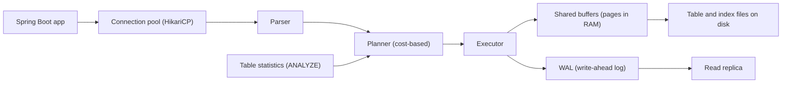

**How it works:**
1. Data lives in **pages** (blocks). A PostgreSQL page is 8 KB. A MySQL InnoDB page is 16 KB.
2. Pages are cached in RAM: **shared buffers** in PostgreSQL, the **buffer pool** in InnoDB.
3. Every change is first written to a log. PostgreSQL calls it the **WAL** (write-ahead log). MySQL InnoDB has the **redo log**.
4. After a crash, the database replays the log. This is how committed data survives (the "D" in ACID).
5. Replicas read the same log stream and apply it, so they stay close to the primary.

**Say this in the interview:**

> The app gets a connection from a pool and sends SQL. PostgreSQL parses it, the planner picks the cheapest plan using table statistics, and the executor runs it on pages cached in RAM.
> Writes go to the write-ahead log first, so a crash cannot lose committed data. Replicas follow the same log.

**They may ask next:**
- **Why write to a log first, and not straight to the table file?** Appending to one log file is fast and sequential. The table pages can be written later in batches (a *checkpoint*).
- **What is a checkpoint?** A moment when all changed pages in RAM are flushed to the data files. After it, older log is no longer needed for crash recovery.

---

## How a query runs: parser, planner, executor

**In one line:** The database checks your SQL, picks the cheapest way to run it, and then runs that plan step by step.

**Story:** You ask Google Maps to go from home to the airport.
- First it checks that both places exist (parser).
- Then it looks at roads and traffic and picks the fastest route (planner).
- Then it guides you turn by turn (executor).
If its traffic data is old, it may pick a bad route. A database with old **statistics** does the same.

**How it works (PostgreSQL):**
1. **Parser:** checks the grammar. A typo like `SELEC` fails here. It builds a *parse tree* (the query as a tree of parts).
2. **Analyzer:** checks that tables and columns exist and that you have access.
3. **Rewriter:** expands views into their real queries.
4. **Planner (optimizer):** builds many possible plans. Seq scan or index scan? Which join order? Hash join or nested loop? It gives each plan a **cost** and picks the cheapest.
5. The cost uses **statistics**: row counts, common values, value spread. `ANALYZE` collects them. Autovacuum runs it for you.
6. **Executor:** runs the plan as a tree. Each node pulls rows from the nodes below it.

**Diagram:**

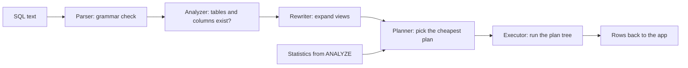

**Example:**

```sql
-- Update statistics after a big data load, so the planner has fresh numbers
ANALYZE orders;

-- See the plan the planner picked (does not run the query)
EXPLAIN SELECT * FROM orders WHERE customer_id = 42;
```

**Prepared statements and plan caching:**
- Your app (JDBC `PreparedStatement`) sends the SQL once and the values separately.
- PostgreSQL can reuse the plan. After a few runs (5 by default) it may switch to a *generic plan* that ignores the exact values.
- A generic plan is sometimes bad for skewed data. Example: `status = 'PENDING'` (1% of rows) vs `status = 'DONE'` (95%). The setting `plan_cache_mode` controls this.

**MySQL note:** MySQL has the same idea (parser, optimizer, executor). Its storage engine (InnoDB) is a separate layer under the optimizer.

**Say this in the interview:**

> A query goes through the parser, the analyzer, the rewriter, the planner and the executor. The planner is cost-based. It uses table statistics to guess how many rows each step returns, then picks the cheapest plan.
> Most bad plans come from bad guesses, so the first thing I check is whether the estimated rows match the actual rows.

**They may ask next:**
- **Why did the same query get slow suddenly?** Often the statistics went stale after a big load, or the data changed shape. Run `ANALYZE` and compare the plans.
- **Can I force an index in PostgreSQL?** Not with hints in core PostgreSQL. You fix the cause instead: statistics, index or query shape. MySQL has index hints like `FORCE INDEX`.

---

## Indexes

**In one line:** An index is a sorted copy of some columns with pointers to the rows, so the database jumps to the right rows instead of reading everything.

The B-tree basics are also in [system-design.md](system-design.md#database-indexes). This section goes deeper, because interviewers ask a lot here.

### B-tree: the phone book

**In one line:** A B-tree keeps keys sorted in a shallow tree, so finding one key in 100 million rows takes about 3–4 page reads.

**Story:** An old paper phone book is sorted by last name.
- To find "Sharma", you do not read from page 1. You open the middle, see "M", and jump right.
- The top of each page shows the first and last name on it. You narrow the range quickly.
- Once you reach "Sharma", all Sharmas are next to each other. Reading "all Sharmas" is easy.
- But finding "everyone whose first name is Rahul" is hard. The book is not sorted that way.
A B-tree index works the same way.

**How it works:**
1. The **root** page holds key ranges and pointers to child pages.
2. Each level narrows the range. One 8 KB page holds a few hundred keys.
3. The **leaf** pages hold the keys in sorted order, plus a pointer to the table row.
4. Leaves are linked to their neighbours. So `BETWEEN`, `>`, `<` and `ORDER BY` read leaves in order.
5. In PostgreSQL the pointer is a *TID* (page number + slot). In MySQL InnoDB, the table itself is a B-tree sorted by primary key (a *clustered index*). A secondary index stores the primary key value as its pointer.

**Diagram:**

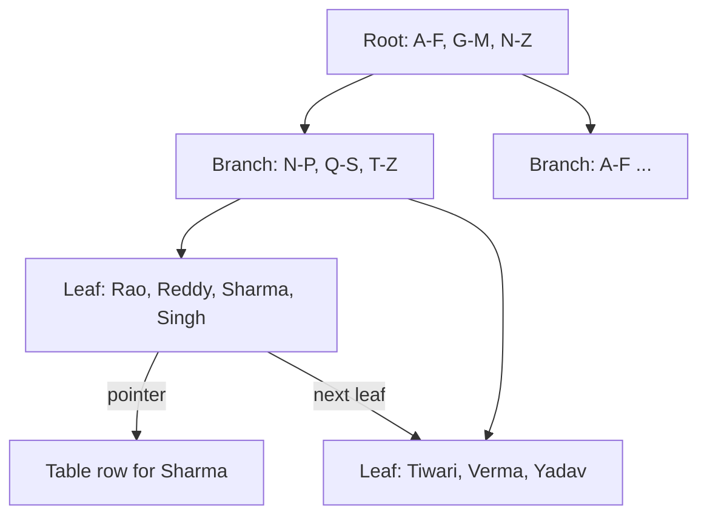

**Example:**

```sql
CREATE INDEX idx_orders_customer ON orders (customer_id);

-- Uses the index: equality and range on the indexed column
SELECT * FROM orders WHERE customer_id = 42;
SELECT * FROM orders WHERE customer_id BETWEEN 40 AND 50;
```

**Say this in the interview:**

> A B-tree is a sorted, shallow tree. Each page holds hundreds of keys, so even 100 million rows need only 3 or 4 levels. It supports equality, ranges and sorting, which is why it is the default index type.

### Composite index and the leftmost prefix rule

**In one line:** An index on `(a, b)` is sorted by `a`, then by `b`. It helps queries on `a`, or on `a` and `b`, but usually not on `b` alone.

**Story:** The phone book is sorted by (last name, first name). "Sharma, Rahul" is easy. "All Sharmas" is easy. "All Rahuls" means reading the whole book.

**How it works:**

| Index `(customer_id, status, created_at)` | Helps? |
|---|---|
| `WHERE customer_id = 42` | Yes |
| `WHERE customer_id = 42 AND status = 'PAID'` | Yes |
| `WHERE customer_id = 42 AND status = 'PAID' AND created_at > '2026-01-01'` | Yes, best |
| `WHERE customer_id = 42 AND created_at > '2026-01-01'` | Partly: finds customer 42, then filters dates |
| `WHERE status = 'PAID'` | Usually no |

- **Column order rule:** equality columns (`=`) first, then the range or sort column (`>`, `<`, `ORDER BY`).
- After the first range column, the next columns cannot narrow the search. They only filter.
- An index on `(a, b)` also serves queries on `a` alone. So you usually do not need a separate index on `a`.
- **Skip scan:** PostgreSQL 18 and MySQL 8.0.13+ can sometimes use `(a, b)` for a query on `b` only. It works when `a` has few distinct values. Do not design around it.

**Example:**

```sql
-- Query: "latest 20 paid orders of a customer"
CREATE INDEX idx_orders_cust_status_created
    ON orders (customer_id, status, created_at DESC);  -- equality, equality, then sort

SELECT id, total, created_at
FROM orders
WHERE customer_id = 42 AND status = 'PAID'
ORDER BY created_at DESC
LIMIT 20;   -- reads only 20 index entries, no sort step
```

**Say this in the interview:**

> A composite index is sorted by the first column, then the second, and so on. It helps only when the query uses the columns from the left. I put equality columns first and the range or sort column last.

### Covering index and index-only scan

**In one line:** If the index holds every column the query needs, the database answers from the index alone and does not read the table.

**Story:** The phone book lists name and phone number. If you only need the number, you never visit the person's house. If you also need their birthday, you must go to the house (the table).

**How it works:**
1. Normal index scan: find the key in the index, then jump to the table row (a *heap fetch*). Many jumps = many random reads.
2. **Covering index:** add the extra columns to the index. PostgreSQL 11+ has `INCLUDE` for columns you only return, not search.
3. PostgreSQL shows **Index Only Scan**. MySQL shows **Using index** in `EXPLAIN`.
4. PostgreSQL catch: it must still check that the row is visible (see [MVCC](#mvcc-and-vacuum-in-postgresql)). It uses the *visibility map*, which `VACUUM` keeps up to date. On a table that is not vacuumed, "Heap Fetches" stays high.

**Example:**

```sql
CREATE INDEX idx_orders_cust_cover
    ON orders (customer_id, created_at) INCLUDE (total);  -- total is only returned

-- Index Only Scan: every column is in the index
SELECT created_at, total FROM orders WHERE customer_id = 42;
```

**Say this in the interview:**

> A covering index holds every column a query needs, so PostgreSQL can do an index-only scan and skip the table. In PostgreSQL that works well only when vacuum keeps the visibility map fresh.

### Partial and expression indexes

**In one line:** A partial index covers only some rows. An expression index covers the result of a function, like `lower(email)`.

**Story:** A hospital keeps a short list of "patients waiting right now" at the front desk. It does not list every patient ever treated. That short list is a partial index: small, fast and focused.

**How it works:**
- **Partial index:** `WHERE` inside the index. Good when queries always look for a small slice, like "pending" jobs.
- **Expression index:** the index stores `lower(email)`. A query must use the same expression to use it.
- **Unique partial index:** "only one active subscription per user" while allowing many cancelled ones.
- **MySQL:** no partial indexes. Functional (expression) indexes exist from MySQL 8.0.13.

**Example:**

```sql
-- 1% of jobs are PENDING. The index stays tiny.
CREATE INDEX idx_jobs_pending ON jobs (created_at) WHERE status = 'PENDING';

-- Case-insensitive login lookup
CREATE UNIQUE INDEX idx_users_email_lower ON users (lower(email));
SELECT * FROM users WHERE lower(email) = lower('Ravi@X.com');  -- same expression: uses it

-- Only one ACTIVE subscription per user
CREATE UNIQUE INDEX one_active_sub ON subscriptions (user_id) WHERE status = 'ACTIVE';
```

**Say this in the interview:**

> When queries always hit a small slice of a big table, like pending jobs, I use a partial index. It is small and fast to update. For case-insensitive search I index `lower(email)` and make the query use the same expression.

### Other index types: hash, GIN, GiST, BRIN

**In one line:** B-tree is the default. Other index types exist for equality-only lookups, JSON and arrays, geometry, and huge time-ordered tables.

**Story:** A library has more than one catalogue. One sorted by title (B-tree). One "word to books" list for searching words (GIN). One map of shelf ranges, like "shelf 40–50 holds books from 2020" (BRIN).

| Type | Good for | Example |
|---|---|---|
| **B-tree** | `=`, ranges, sort, prefix `LIKE 'abc%'` | Almost everything |
| **Hash** | `=` only | Long keys looked up by exact value. Rarely better than B-tree |
| **GIN** | "Contains" searches: JSONB, arrays, full-text, `LIKE '%abc%'` with `pg_trgm` | `WHERE tags @> '{java}'` |
| **GiST** | Geometry, ranges, nearest neighbour, exclusion constraints | PostGIS, "no two bookings overlap" |
| **BRIN** | Very big tables where values follow the physical order | `created_at` on an append-only events table |

- A **BRIN** index stores only min and max per block range. It can be 1000x smaller than a B-tree. It only works if the data is stored roughly in that order.
- **GIN** is fast to read but slower to update.
- MySQL InnoDB has B-tree, full-text and spatial indexes. It has no GIN or BRIN.

**Example:**

```sql
CREATE INDEX idx_products_attrs ON products USING gin (attributes);  -- JSONB column
SELECT * FROM products WHERE attributes @> '{"color": "red"}';

CREATE INDEX idx_events_time ON events USING brin (created_at);      -- tiny index
```

**Say this in the interview:**

> B-tree covers most cases. I use GIN for JSONB, arrays and full-text search, GiST for geometry and ranges, and BRIN for huge append-only tables sorted by time. Hash indexes only help with equality, so I rarely need them.

### When an index is NOT used

**In one line:** The planner skips an index when the query hides the column, skips the leftmost column, or when a full read is simply cheaper.

**Story:** The phone book is sorted by last name. If you ask "who has a last name ending in -ma?", the sorted order does not help. You read every page.

**How it works (common reasons):**

| Reason | Bad | Fix |
|---|---|---|
| Function on the column | `WHERE date(created_at) = '2026-03-01'` | `WHERE created_at >= '2026-03-01' AND created_at < '2026-03-02'` |
| Leading wildcard | `WHERE name LIKE '%kumar'` | Full-text search or a `pg_trgm` GIN index |
| Type mismatch | `phone` is text, query uses `WHERE phone = 98765` | Pass the same type: `'98765'` |
| Skips leftmost column | Index `(a, b)`, query `WHERE b = 1` | Add index on `b`, or reorder |
| Too many rows match | `WHERE status = 'DONE'` (95% of rows) | Correct. A seq scan is cheaper |
| Small table | 200 rows | Correct. One page read is enough |
| Stale statistics | Planner thinks 10 rows, really 1 million | `ANALYZE table` |
| `OR` across columns | `WHERE a = 1 OR b = 2` | Index each column (bitmap OR), or `UNION` |
| Math on the column | `WHERE price * 1.18 > 1000` | `WHERE price > 1000 / 1.18` |

- **Rule:** keep the indexed column "naked" on one side of the comparison.
- Rough number: when a query returns more than about 5–10% of a table, a seq scan often wins. Sequential reads are cheaper than many random jumps.

**Diagram:**

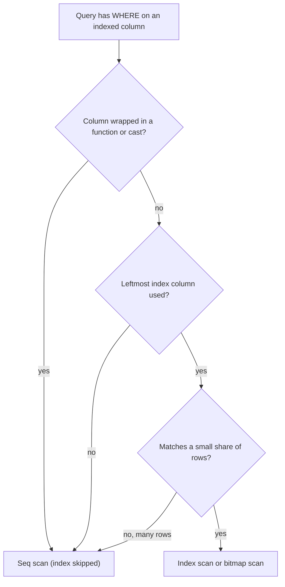

**Say this in the interview:**

> An index is skipped when the column is inside a function, when types do not match, when the query skips the leftmost column, or when too many rows match.
> Sometimes the seq scan is the right choice. I check with EXPLAIN ANALYZE and compare estimated rows with actual rows.

### The cost of indexes on writes

**In one line:** Every index makes reads faster but makes every insert, update and delete slower, and it uses disk and RAM.

**Story:** A book with 5 different indexes at the back. Every time the author adds a page, all 5 indexes must be updated.

**How it works:**
- 1 insert into a table with 6 indexes = 1 table write + 6 index writes.
- In PostgreSQL, an `UPDATE` writes a new row version. If any indexed column changes, every index gets a new entry.
- PostgreSQL has **HOT updates** (heap-only tuple). If no indexed column changes and the page has free space, it skips the index updates. Over-indexing breaks this.
- Indexes compete for RAM. A hot index that does not fit in memory means disk reads.
- Find unused indexes: `pg_stat_user_indexes` where `idx_scan = 0` for weeks.
- On a live table, build indexes with `CREATE INDEX CONCURRENTLY`. A normal `CREATE INDEX` blocks writes while it builds.

**Example:**

```sql
-- No write lock on the table while building (slower, cannot run inside a transaction)
CREATE INDEX CONCURRENTLY idx_orders_created ON orders (created_at);

-- Indexes never used since stats were reset
SELECT relname, indexrelname, idx_scan
FROM pg_stat_user_indexes
WHERE idx_scan = 0;
```

**Say this in the interview:**

> Every index slows writes and uses memory, so I add indexes for real queries, not "just in case". I check `pg_stat_user_indexes` for unused ones, and on live tables I always use `CREATE INDEX CONCURRENTLY`.

**They may ask next (indexes):**
- **Clustered vs non-clustered?** MySQL InnoDB stores the table inside the primary key B-tree (clustered). PostgreSQL stores rows in a heap and all indexes point to it. `CLUSTER` in PostgreSQL reorders once but is not kept up to date.
- **Why are random UUID primary keys slow in MySQL?** Inserts land at random places in the clustered B-tree and split pages. Use time-ordered IDs. PostgreSQL 18 has `uuidv7()` built in.
- **Do foreign keys get an index automatically?** In MySQL InnoDB, yes. In PostgreSQL, no. Add it yourself, or deletes on the parent table will scan the child table.
- **Is an index on a boolean column useful?** Usually not. A partial index on the rare value can be.

---

## Reading EXPLAIN and EXPLAIN ANALYZE

**In one line:** `EXPLAIN` shows the plan the database will use. `EXPLAIN ANALYZE` runs the query and shows the real time and row counts for each step.

**Story:** Before a road trip, the map app shows "45 minutes" (EXPLAIN: the guess). After the trip, your dashcam shows "1 hour 20 minutes, stuck at the toll gate" (EXPLAIN ANALYZE: what really happened). You fix the slow part, not the whole trip.

**How it works:**
1. A plan is a tree. Read it from the **most indented line up**. Inner nodes run first and feed their parent.
2. `cost=0.43..8.46`: the planner's guess in made-up units. First number = cost before the first row. Second = total cost.
3. `rows=`: estimated rows. With `ANALYZE` you also get `actual ... rows=`.
4. `loops=`: how many times this node ran. Real total = time x loops.
5. `Buffers: shared hit=... read=...`: pages from RAM (hit) vs from disk (read). PostgreSQL 18 shows this by default with `ANALYZE`.
6. **Warning:** `EXPLAIN ANALYZE` really runs the query. For `UPDATE` or `DELETE`, wrap it in `BEGIN; ... ROLLBACK;`.

**Scan types:**

| Node | What it does | When it is good |
|---|---|---|
| **Seq Scan** | Reads every page of the table | Small tables, or most rows needed |
| **Index Scan** | Walks the index, then fetches each row from the table | Few rows |
| **Index Only Scan** | Answers from the index alone | Covering index, table vacuumed |
| **Bitmap Index + Bitmap Heap Scan** | Collects matching row locations first, then reads pages in order | Medium number of rows, or `OR` of two indexes |

**Join types:**

| Join node | How it works | Good when |
|---|---|---|
| **Nested Loop** | For each outer row, look up matching inner rows | Outer side is small and inner side has an index |
| **Hash Join** | Build a hash table from the smaller side, then probe it with the bigger side | Large inputs, equality join (`=`) |
| **Merge Join** | Both sides sorted on the join key, then walk them together | Both inputs already sorted (for example by an index) |

- MySQL 8.0.18+ has hash join. MySQL does not have merge join.

**Example: a slow query and its plan (PostgreSQL 18 style):**

```sql
EXPLAIN ANALYZE
SELECT o.id, o.total, c.name
FROM orders o
JOIN customers c ON c.id = o.customer_id
WHERE o.status = 'PAID'
  AND o.created_at >= now() - interval '1 day';
```

```text
Hash Join  (cost=1250.40..48210.77 rows=2150 width=48) (actual time=12.41..186.90 rows=31874.00 loops=1)
  Hash Cond: (o.customer_id = c.id)
  Buffers: shared hit=1520 read=20410
  ->  Seq Scan on orders o  (cost=0.00..46870.00 rows=2150 width=24) (actual time=0.02..160.34 rows=31874.00 loops=1)
        Filter: ((status = 'PAID'::text) AND (created_at >= (now() - '1 day'::interval)))
        Rows Removed by Filter: 1968126
        Buffers: shared hit=480 read=20390
  ->  Hash  (cost=750.00..750.00 rows=40000 width=32) (actual time=12.10..12.10 rows=40000.00 loops=1)
        Buckets: 65536  Batches: 1  Memory Usage: 2810kB
        ->  Seq Scan on customers c  (cost=0.00..750.00 rows=40000 width=32) (actual time=0.01..5.22 rows=40000.00 loops=1)
Planning Time: 0.41 ms
Execution Time: 188.64 ms
```

**How to read it:**
1. The deepest lines are the two **Seq Scans**. Start there.
2. `Seq Scan on orders`: it read 2 million rows and threw away 1,968,126 (`Rows Removed by Filter`). That is the waste.
3. `read=20390`: about 20,000 pages (160 MB) came from disk.
4. Estimated `rows=2150`, actual `31874`. The guess is 15x off. Stale statistics, or the two filters are related and the planner multiplied their chances.
5. The **Hash Join** is fine. The scan under it is the problem.

**The fix and the new plan:**

```sql
CREATE INDEX CONCURRENTLY idx_orders_status_created ON orders (status, created_at);
ANALYZE orders;
```

```text
Hash Join  (cost=1385.90..9876.10 rows=30120 width=48) (actual time=14.02..31.77 rows=31874.00 loops=1)
  Hash Cond: (o.customer_id = c.id)
  ->  Index Scan using idx_orders_status_created on orders o  (cost=0.43..8090.50 rows=30120 width=24) (actual time=0.03..9.81 rows=31874.00 loops=1)
        Index Cond: ((status = 'PAID'::text) AND (created_at >= (now() - '1 day'::interval)))
        Index Searches: 1
  ->  Hash  (cost=750.00..750.00 rows=40000 width=32) (actual time=12.80..12.80 rows=40000.00 loops=1)
        ->  Seq Scan on customers c  (cost=0.00..750.00 rows=40000 width=32) (actual time=0.01..5.40 rows=40000.00 loops=1)
Execution Time: 33.10 ms
```

- `Filter` became `Index Cond`: the index does the filtering now.
- Estimate (30,120) is close to actual (31,874). Good statistics.
- 188 ms became 33 ms. Older PostgreSQL versions print `rows=31874` without `.00` and have no `Index Searches` line.
- Both plans are trimmed to fit. Real PostgreSQL 18 output also prints a `Buffers:` line under most nodes, plus `Planning Time`.

**Diagram (the plan as a tree):**

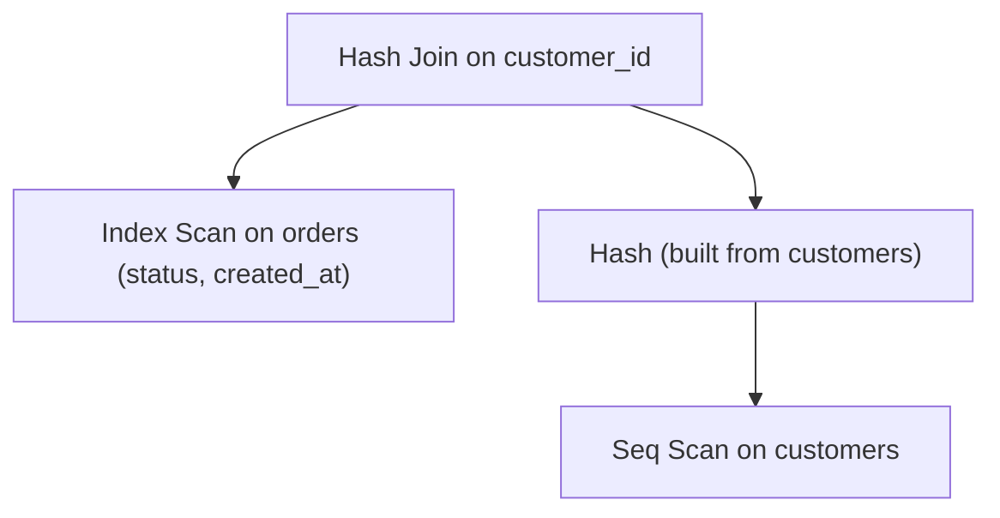

**MySQL note:** `EXPLAIN` shows a table with columns `type` (`ALL` = full scan, `ref`/`range` = index), `key` (index used), `rows` and `Extra` (`Using index`, `Using filesort`, `Using temporary`). MySQL 8.0.18+ has `EXPLAIN ANALYZE` too.

**Say this in the interview:**

> I run EXPLAIN (ANALYZE, BUFFERS) and read the plan from the deepest node up. I look for seq scans on big tables, a large "Rows Removed by Filter", and a big gap between estimated and actual rows.
> Then I fix the cause: an index, fresh statistics, or a rewrite. I run it again to prove the change helped.

**They may ask next:**
- **Why is a nested loop sometimes very slow?** The planner guessed the outer side has 10 rows but it had 100,000. Then the inner lookup runs 100,000 times. The fix is usually better statistics.
- **What does "Sort Method: external merge Disk" mean?** The sort did not fit in `work_mem` and spilled to disk. Add an index that gives sorted order, or raise `work_mem` for that query.
- **Where do I find slow queries in production?** The `pg_stat_statements` extension (total and mean time per query), and `log_min_duration_statement` for the slow query log. MySQL has the slow query log and `performance_schema`.

---

## Slow query checklist

**In one line:** Find the slow query, read its real plan, fix the biggest waste, and prove the fix with numbers.

**Story:** A doctor does not give medicine first. She checks the temperature, asks questions, runs a test, then treats. A slow query needs the same order: measure, find the cause, then fix.

**Diagram:**

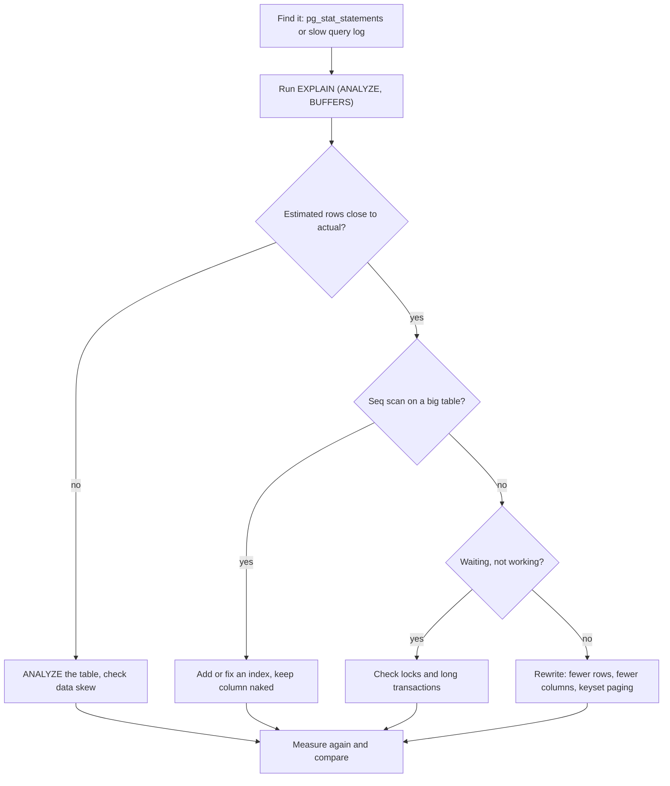

**The checklist:**
1. **Is it one query or many?** 1 query of 2 seconds, or 500 queries of 4 ms (an N+1 problem)? See [the N+1 problem](spring-ecosystem.md#the-n1-problem-and-how-to-fix-it).
2. **Find it:** `pg_stat_statements` sorted by `total_exec_time`. Fix the query with the most total time first, not the slowest single run.
3. **Read the plan:** `EXPLAIN (ANALYZE, BUFFERS)` with real parameter values.
4. **Estimates vs actual:** off by 10x or more? Run `ANALYZE`. For related columns, PostgreSQL has `CREATE STATISTICS`.
5. **Seq scan on a big table with a small result?** Add the right index. Check the column is not wrapped in a function.
6. **Is it waiting?** Check `pg_stat_activity` for `wait_event_type = 'Lock'`. A long open transaction may hold a lock.
7. **Too much data?** Select only needed columns (no `SELECT *`). Use `LIMIT` and keyset paging.
8. **Sort or hash spilling to disk?** Look for "external merge" or "Batches: 8". Use an index for order, or more `work_mem`.
9. **Table bloat?** Many dead rows make scans slow. Check autovacuum (see [MVCC and VACUUM](#mvcc-and-vacuum-in-postgresql)).
10. **Still slow?** Cache the result, precompute with a materialized view, or move reads to a replica.

**Example:**

```sql
-- Top 5 queries by total time (needs the pg_stat_statements extension)
SELECT query, calls, round(total_exec_time) AS total_ms,
       round(mean_exec_time::numeric, 1) AS mean_ms   -- round(x, 1) needs numeric, not double
FROM pg_stat_statements
ORDER BY total_exec_time DESC
LIMIT 5;

-- Who is blocked right now, and by whom
SELECT pid, wait_event_type, state, pg_blocking_pids(pid) AS blocked_by, left(query, 60)
FROM pg_stat_activity
WHERE wait_event_type = 'Lock';
```

**Say this in the interview:**

> First I find the query with the most total time in pg_stat_statements. Then I run EXPLAIN ANALYZE with real values, compare estimated and actual rows, and look for big seq scans, sorts on disk and lock waits.
> I fix one thing at a time and measure again. If the query is fine but called 500 times, it is an N+1 problem in the code, not a database problem.

**They may ask next:**
- **The query is fast in psql but slow from the app. Why?** Different parameter values, a generic prepared plan, a type mismatch from the driver, or the app waits for a pool connection. Check the pool metrics too.
- **How do you test an index on production without risk?** Build it with `CONCURRENTLY`, check the plan, and drop it if it does not help. Test on a copy with production-size data first.

---

## Normalization: 1NF, 2NF, 3NF and when to denormalize

**In one line:** Normalization means storing each fact in exactly one place, so updates cannot leave two copies that disagree.

**Story:** A school keeps the class teacher's phone number on every student's form. The teacher changes her number. Now 40 forms must be fixed. Someone misses 3 forms. Which number is right? If the number were written once, on a "teachers" sheet, there would be one place to fix.

**How it works (one bad table, fixed step by step):**

Bad table `order_lines`:

| order_id | customer | customer_city | product_id | product_name | qty | phones |
|---|---|---|---|---|---|---|
| 1 | Ravi | Pune | 10 | Pen | 2 | "111, 222" |
| 1 | Ravi | Pune | 11 | Book | 1 | "111, 222" |

1. **1NF (first normal form):** one value per cell, no lists. `phones = "111, 222"` breaks it. Move phones to a `customer_phones` table, one row per phone.
2. **2NF:** no column depends on only *part* of a composite key. The key here is `(order_id, product_id)`. But `product_name` depends only on `product_id`. Move it to a `products` table.
3. **3NF:** no column depends on another non-key column. `customer_city` depends on `customer`, not on the order. Move it to a `customers` table.
- Short way to remember 3NF: every column depends on "the key, the whole key, and nothing but the key".
- **BCNF** is a slightly stricter 3NF. Interviews rarely go deeper.

**Diagram:**

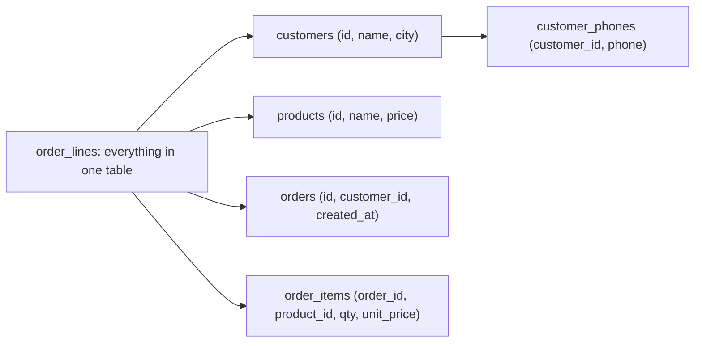

**When to denormalize (copy data on purpose):**
- **Read-heavy screens:** an order list showing the customer name on 1 million rows a day. A copy of `customer_name` saves a join. You must keep it in sync.
- **Counters:** `posts.comment_count` instead of `COUNT(*)` on every page view.
- **Reporting:** a wide, flat table or a [materialized view](#views-and-materialized-views) for dashboards.
- **Across services:** in microservices each service has its own database. Copying a few fields from events is normal.
- **Not denormalization:** `order_items.unit_price`. It is the price *at the time of the order*. It is a different fact from today's `products.price`. Interviewers like this point.

**Good and bad:**

| Normalized | Denormalized |
|---|---|
| One place to update, no conflicting copies | Fewer joins, faster reads |
| Smaller tables, less disk | Copies can drift apart |
| More joins on read | Every write must update the copies |

**Say this in the interview:**

> I normalize to 3NF by default, so each fact lives in one place. 1NF means one value per cell, 2NF means no column depends on part of a composite key, 3NF means no column depends on another non-key column.
> I denormalize only for a measured read problem, like a counter or a reporting table, and I decide who keeps the copy in sync.

**They may ask next:**
- **How do you keep a denormalized copy in sync?** Same transaction if it is the same database. A trigger. Or events (outbox pattern) across services. Accept a small delay when it is OK for the business.

---

## Keys and constraints

**In one line:** Keys identify rows and link tables. Constraints are rules the database enforces, so bad data cannot get in, even if the app has a bug.

**Story:** A passport office. Every passport has a unique number (primary key). A visa sticker must point to a real passport (foreign key). Date of birth cannot be empty (NOT NULL). Age cannot be negative (CHECK). The office checks these at the counter, whoever brings the form.

**How it works:**

| Constraint | Rule | Example |
|---|---|---|
| **PRIMARY KEY** | Unique + not null. One per table | `id bigint GENERATED ALWAYS AS IDENTITY PRIMARY KEY` |
| **FOREIGN KEY** | Value must exist in the parent table | `customer_id REFERENCES customers(id)` |
| **UNIQUE** | No two rows with the same value. NULLs allowed | `email text UNIQUE` |
| **NOT NULL** | A value is required | `name text NOT NULL` |
| **CHECK** | Any true/false rule on the row | `CHECK (qty > 0)` |
| **DEFAULT** | Value used when none is given | `created_at timestamptz DEFAULT now()` |
| **EXCLUDE** (PostgreSQL) | No two rows "overlap" | No two bookings of a room overlap in time |

- **Natural key** (email, PAN number) vs **surrogate key** (generated `id`). Use a surrogate key as the primary key. Put a `UNIQUE` constraint on the natural key. Natural keys change (people change email).
- **bigint identity vs UUID:** `bigint` is small and fast. UUIDs are safe to generate in the app and hide counts. Prefer time-ordered UUIDs (v7) over random v4 for index locality.
- **Foreign key actions:** `ON DELETE CASCADE` (delete children), `RESTRICT` (block the delete), `SET NULL`.
- **Unique and NULL:** by default PostgreSQL treats NULLs as different, so many NULLs are allowed. PostgreSQL 15+ has `UNIQUE NULLS NOT DISTINCT` to allow only one.
- **MySQL note:** `CHECK` constraints are enforced only from MySQL 8.0.16. Older versions parsed and ignored them.

**Diagram:**

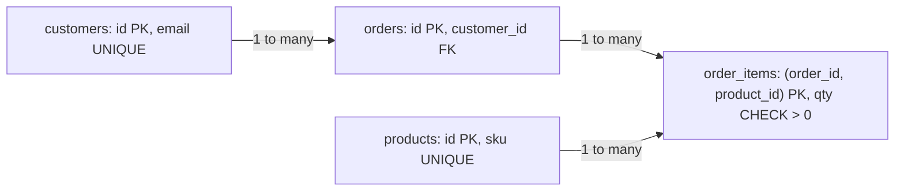

**Example:**

```sql
CREATE TABLE orders (
    id          bigint GENERATED ALWAYS AS IDENTITY PRIMARY KEY,
    customer_id bigint NOT NULL REFERENCES customers (id),       -- FK
    status      text   NOT NULL DEFAULT 'NEW'
                CHECK (status IN ('NEW', 'PAID', 'SHIPPED', 'CANCELLED')),
    total       numeric(12, 2) NOT NULL CHECK (total >= 0),       -- money: numeric, never float
    created_at  timestamptz NOT NULL DEFAULT now()
);
CREATE INDEX idx_orders_customer ON orders (customer_id);         -- PostgreSQL does not add it for you
```

**Say this in the interview:**

> I put rules in the database, not only in Java code: primary keys, foreign keys, unique, not null and check constraints. The app can have bugs, and scripts or other services can write too.
> I use a bigint or UUIDv7 surrogate key, a unique constraint on the natural key, and I index foreign key columns in PostgreSQL.

**They may ask next:**
- **Why not skip foreign keys for speed?** You save a tiny bit of write time and get orphan rows forever. Some very large sharded systems drop them because rows live on different machines. That is a trade-off, not a default.
- **Why `numeric` for money?** `float` and `double` cannot store 0.1 exactly. Rounding errors add up.

---

## ACID recap

**In one line:** ACID is the promise of a transaction: all or nothing, rules always hold, no interference, and committed data survives a crash.

The full answer with isolation levels and examples is in [Transactions and isolation levels](databases.md#transactions-and-isolation-levels). Locking is in [Optimistic vs pessimistic locking](databases.md#optimistic-vs-pessimistic-locking).

**Story:** A bank transfer of 1,000 rupees. Debit and credit both happen or neither does. Nobody sees half a transfer. After the SMS says "done", a power cut cannot undo it.

**How each letter is built inside:**

| Letter | How the database does it |
|---|---|
| Atomicity | Undo information (PostgreSQL row versions, InnoDB undo log). Rollback throws away the changes |
| Consistency | Constraints (PK, FK, CHECK) and your own business rules |
| Isolation | MVCC snapshots and locks |
| Durability | The WAL / redo log is flushed to disk at commit |

**Diagram:**

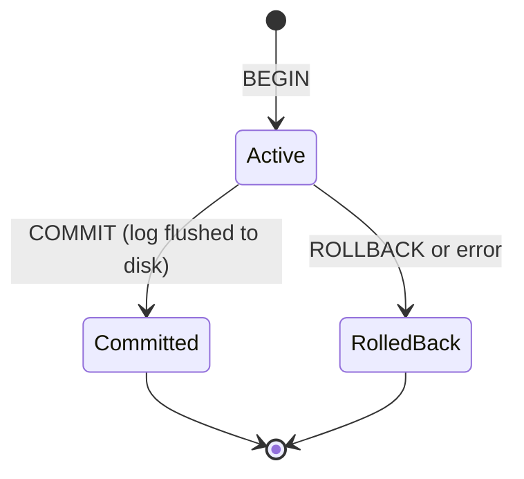

**Say this in the interview:**

> ACID means all-or-nothing, rules always hold, no interference between transactions, and committed data survives a crash. Inside the database, the log gives durability, MVCC and locks give isolation, and constraints give consistency.

---

## MVCC and VACUUM in PostgreSQL

**In one line:** MVCC (multi-version concurrency control) keeps old versions of rows, so readers see a stable snapshot and never block writers. VACUUM later cleans up the old versions nobody needs.

**Story:** A notice board in an office.
- To change a notice, you do not erase it. You pin a new copy and write "old" on the first one.
- People who started reading earlier still read the old copy. New readers see the new one.
- Nobody waits for anybody.
- At night, a cleaner removes old copies that nobody is reading any more. That cleaner is **VACUUM**.
- If someone stands at the board all week reading old copies (a long transaction), the cleaner cannot remove anything. The board fills up.

**How it works:**
1. Every row version has two hidden fields: `xmin` (the transaction that created it) and `xmax` (the transaction that deleted or replaced it).
2. Each transaction or statement gets a **snapshot**: "which transactions were committed when I started".
3. A row version is visible if its creator had committed in your snapshot, and its deleter had not.
4. `UPDATE` = write a new version + mark the old one dead. `DELETE` = mark the version dead.
5. Dead versions (*dead tuples*) stay in the table file until **VACUUM** marks their space as reusable.
6. **Autovacuum** runs VACUUM and ANALYZE for you when enough rows have changed.
7. Plain `VACUUM` does not shrink the file. It frees space for reuse. `VACUUM FULL` rewrites the table and shrinks it, but locks the table completely.

**Diagram:**

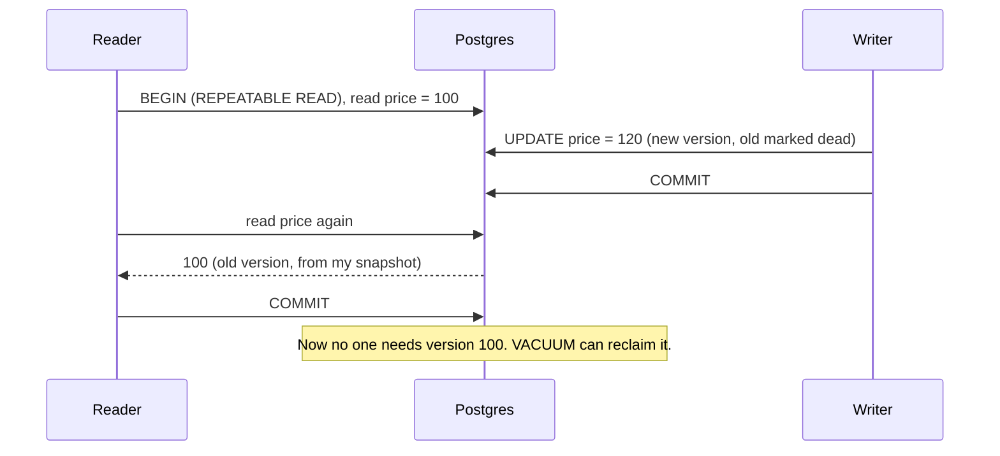

**What goes wrong:**
- **Bloat:** a table with many updates and a slow autovacuum grows with dead rows. Scans read empty space.
- **Long-running transactions:** a transaction open for 3 hours (or "idle in transaction") blocks cleanup of everything newer. Bloat grows on all tables.
- **Transaction ID wraparound:** IDs are 32-bit. VACUUM "freezes" old rows to avoid running out. If it cannot, PostgreSQL stops accepting writes to protect data. Rare, but a famous outage cause.
- **HOT updates** (heap-only tuples) reduce the cost. If no indexed column changed and the page has space, the new version needs no new index entries.

**Example:**

```sql
-- Tables with the most dead rows and when autovacuum last ran
SELECT relname, n_live_tup, n_dead_tup, last_autovacuum
FROM pg_stat_user_tables
ORDER BY n_dead_tup DESC
LIMIT 5;

-- Transactions open for a long time (they block cleanup)
SELECT pid, state, now() - xact_start AS open_for, left(query, 60)
FROM pg_stat_activity
WHERE xact_start < now() - interval '5 minutes';
```

**MySQL InnoDB note:** InnoDB also uses MVCC, but it updates the row in place and keeps the old version in the **undo log**. A background *purge* thread cleans the undo log. So there is no VACUUM. Long transactions still hurt: the undo log ("history list length") grows.

**Say this in the interview:**

> PostgreSQL MVCC never overwrites a row. An update writes a new version and marks the old one dead. Each transaction reads from a snapshot, so readers do not block writers.
> Dead versions are cleaned by autovacuum. The real-world problem is bloat, usually caused by long open transactions or autovacuum tuned too weak for a hot table.

**They may ask next:**
- **Do readers ever block in PostgreSQL?** Plain `SELECT` does not take row locks. Only `SELECT ... FOR UPDATE` locks rows. DDL like `ALTER TABLE` takes a strong table lock and can block everything.
- **How do you tune autovacuum for one hot table?** Lower its scale factor, for example `ALTER TABLE orders SET (autovacuum_vacuum_scale_factor = 0.02)`, so it runs after 2% of rows change instead of 20%.

---

## Deadlocks in the database

**In one line:** A deadlock is two transactions each waiting for a lock the other holds. The database detects it and kills one of them.

**Story:** Two cars meet on a narrow one-lane bridge from both sides. Neither can move forward. Neither will reverse. Someone has to back out. The database is the traffic police: it picks one car and makes it reverse (rolls back one transaction).

**How it works:**
1. T1 locks row A (`UPDATE accounts ... WHERE id = 1`).
2. T2 locks row B (`UPDATE accounts ... WHERE id = 2`).
3. T1 now wants row B. It waits for T2.
4. T2 now wants row A. It waits for T1. Cycle.
5. PostgreSQL checks for cycles after `deadlock_timeout` (1 second by default). It aborts one transaction with `ERROR: deadlock detected` (SQLSTATE `40P01`).
6. MySQL InnoDB detects it right away and rolls back the smaller transaction (error 1213).
7. Spring turns it into a `PessimisticLockingFailureException` (or a subclass). You can retry.

**Diagram:**

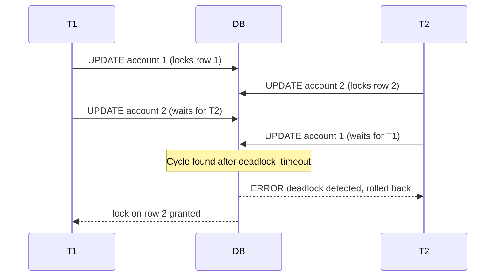

**How to prevent it:**
- **Same lock order everywhere.** Always lock the smaller account id first. This alone fixes most deadlocks.
- **Short transactions.** No HTTP calls or user waits inside a transaction.
- **Lock what you need up front:** `SELECT ... FOR UPDATE` on both rows in id order.
- **Index the columns in `WHERE` of updates.** Without an index, MySQL may lock many more rows (gap locks) than you expect.
- **Retry** the loser transaction a few times with a small random delay. Deadlocks under load are normal. Retries make them harmless.

**Example:**

```sql
BEGIN;
-- Lock both rows in a fixed order (lowest id first), whatever the transfer direction
SELECT id FROM accounts WHERE id IN (1, 2) ORDER BY id FOR UPDATE;
UPDATE accounts SET balance = balance - 1000 WHERE id = 1;
UPDATE accounts SET balance = balance + 1000 WHERE id = 2;
COMMIT;
```

**Good and bad:**

| Good | Bad |
|---|---|
| Fixed lock order in all code paths | Lock order depends on the request ("from" then "to") |
| Short transactions, retry on deadlock | Long transactions with remote calls inside |
| Log deadlocks and alert on a spike | Treating every deadlock as a bug to page someone for |

**Say this in the interview:**

> A deadlock is a cycle of lock waits. The database detects it, kills one transaction and the other continues. I prevent most of them by always locking rows in the same order, usually by id, and by keeping transactions short. I also retry the failed transaction, because a few deadlocks under heavy load are normal.

**They may ask next:**
- **Deadlock vs lock wait timeout?** A deadlock is a cycle, found and broken fast. A lock wait timeout is one transaction waiting too long behind a slow one. Set `lock_timeout` in PostgreSQL so it fails fast.
- **Java thread deadlocks?** Same idea in memory. See [java-concurrency.md](java-concurrency.md#deadlock).

---

## Pagination: OFFSET vs keyset

**In one line:** `OFFSET` pagination reads and throws away all earlier rows, so deep pages get slow. Keyset pagination remembers the last row seen and starts right after it.

**Story:** You are reading a 1,000-page book.
- **OFFSET:** to reach page 900, you count pages from page 1 every time. Slow.
- **Keyset:** you put a bookmark on page 899. Next time you open at the bookmark. Fast, every time.

**How it works:**
1. **OFFSET:** `LIMIT 20 OFFSET 100000` makes the database find 100,020 rows and drop 100,000. Time grows with the page number.
2. OFFSET also gives wrong results when rows are added. A new row on page 1 pushes a row from page 1 to page 2, so the user sees it twice.
3. **Keyset (seek method):** `WHERE (created_at, id) < (:lastCreatedAt, :lastId) ORDER BY created_at DESC, id DESC LIMIT 20`.
4. With an index on `(created_at, id)`, every page costs the same: about 20 index entries.
5. The `id` is a **tie-breaker**. Two rows can have the same `created_at`.
6. The API returns a **cursor**: the last row's values, often Base64-encoded, like `nextCursor=eyJ0Ijo...`.

**Diagram:**

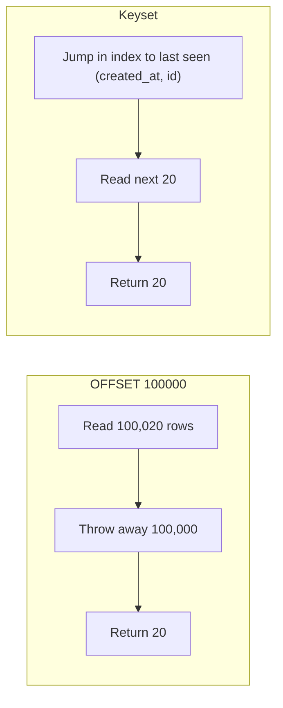

**Example:**

```sql
CREATE INDEX idx_orders_created_id ON orders (created_at DESC, id DESC);

-- First page
SELECT id, created_at, total FROM orders
ORDER BY created_at DESC, id DESC
LIMIT 20;

-- Next page: pass the last row of the previous page
SELECT id, created_at, total FROM orders
WHERE (created_at, id) < ('2026-03-02 10:15:00', 104)   -- row value comparison
ORDER BY created_at DESC, id DESC
LIMIT 20;
```

- Row value comparison `(a, b) < (x, y)` works in PostgreSQL and MySQL. In some MySQL versions the index is used better with the long form: `created_at < x OR (created_at = x AND id < y)`.
- Spring Data has `Window` and `ScrollPosition.keyset()` (since Spring Data 3.1) for keyset scrolling.

**Good and bad:**

| OFFSET | Keyset |
|---|---|
| Can jump to "page 37" | Only next and previous |
| Simple to build | Needs a stable, unique sort order |
| Slow on deep pages, duplicates when data changes | Same speed on every page, no duplicates |

**Say this in the interview:**

> OFFSET pagination reads and discards every earlier row, so page 5,000 is slow, and new rows cause duplicates. For feeds and APIs I use keyset pagination. The client sends the last created_at and id. The query uses WHERE (created_at, id) < (...) with a matching index, so every page costs the same.

**They may ask next:**
- **How do you show "total pages" with keyset?** Usually you do not. Show "Load more". If needed, show an estimate, because `COUNT(*)` on a big table is slow.

---

## Window functions

**In one line:** A window function calculates something over a group of rows (rank, running total, previous row) but, unlike `GROUP BY`, it keeps every row in the result.

**Story:** A class result sheet. Each student keeps their own row, but a new column shows "rank in class" and "class average". `GROUP BY` would squash the class into one line ("Class 10A: average 72"). A window function adds the class info next to each student.

**How it works:**
- Syntax: `function() OVER (PARTITION BY group_col ORDER BY sort_col)`.
- `PARTITION BY` = which rows form a group (like "per department"). Leave it out for "the whole table".
- `ORDER BY` inside `OVER` = the order inside the group (needed for ranks, running totals, LAG/LEAD).
- Window functions run after `WHERE`, `GROUP BY` and `HAVING`. So you cannot filter on them in `WHERE`. Wrap the query in a subquery or CTE.
- Supported in PostgreSQL, MySQL 8.0+, SQLite 3.25+.

**The ranking functions (salaries 9000, 8000, 7000, 7000, 6500):**

```sql
SELECT name, salary,
       ROW_NUMBER() OVER (ORDER BY salary DESC) AS row_num,
       RANK()       OVER (ORDER BY salary DESC) AS rnk,
       DENSE_RANK() OVER (ORDER BY salary DESC) AS dense_rnk
FROM employees
ORDER BY salary DESC
LIMIT 5;
```

| name | salary | row_num | rnk | dense_rnk |
|---|---|---|---|---|
| Asha | 9000 | 1 | 1 | 1 |
| John | 8000 | 2 | 2 | 2 |
| Ravi | 7000 | 3 | 3 | 3 |
| Sara | 7000 | 4 | 3 | 3 |
| Kiran | 6500 | 5 | **5** | **4** |

- `ROW_NUMBER`: always 1, 2, 3, 4. Ties get different numbers (in no fixed order unless you add a tie-breaker).
- `RANK`: ties share a number, then it **skips** (3, 3, 5). Like sports medals.
- `DENSE_RANK`: ties share a number, **no gaps** (3, 3, 4). Use it for "Nth highest salary".

**LAG, LEAD and running totals:**

```sql
SELECT day, amount,
       LAG(amount)  OVER (ORDER BY day) AS prev_day,      -- value from the row before
       LEAD(amount) OVER (ORDER BY day) AS next_day,      -- value from the row after
       SUM(amount)  OVER (ORDER BY day) AS running_total
FROM daily_sales;
```

| day | amount | prev_day | next_day | running_total |
|---|---|---|---|---|
| 2026-03-01 | 100 | NULL | 200 | 100 |
| 2026-03-02 | 200 | 100 | 150 | 300 |
| 2026-03-03 | 150 | 200 | 300 | 450 |
| 2026-03-04 | 300 | 150 | 50 | 750 |
| 2026-03-05 | 50 | 300 | NULL | 800 |

**The frame trap:**
- With `ORDER BY` inside `OVER`, the default frame is `RANGE BETWEEN UNBOUNDED PRECEDING AND CURRENT ROW`.
- `RANGE` treats rows with the same sort value as one. If two rows share a date, both get the total *including both*.
- For a strict row-by-row total, write `ROWS BETWEEN UNBOUNDED PRECEDING AND CURRENT ROW`, or add a unique tie-breaker to `ORDER BY`.
- Moving average of 3 rows: `AVG(amount) OVER (ORDER BY day ROWS BETWEEN 2 PRECEDING AND CURRENT ROW)`.

**Diagram:**

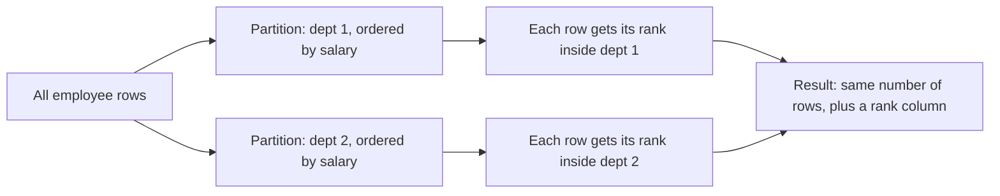

**Say this in the interview:**

> A window function computes over a group of related rows but keeps every row, unlike GROUP BY. PARTITION BY sets the group and ORDER BY sets the order inside it.
> ROW_NUMBER gives unique numbers, RANK leaves gaps after ties, DENSE_RANK does not. I use them for top-N per group, running totals, and comparing with the previous row using LAG.

**They may ask next:**
- **Other useful ones?** `NTILE(4)` (quartiles), `FIRST_VALUE`, `LAST_VALUE`, `PERCENT_RANK`, `COUNT(*) OVER ()` (total rows next to each row).
- **Are they slow?** They need a sort per partition. An index on `(partition_col, order_col)` can remove the sort.

---

## CTEs and recursive CTEs

**In one line:** A CTE (common table expression) is a named subquery written with `WITH`, and a recursive CTE calls itself to walk trees like an org chart.

**Story:** A recipe first says "Make the masala." Then "Add the masala to the dal." Naming the masala step makes the recipe easy to read. A CTE names a step in your query.
For the recursive part: in a family tree, you start with the grandfather, then find his children, then their children, until no one is left.

**How it works:**
1. `WITH name AS (SELECT ...)` then use `name` like a table in the main query.
2. You can chain many CTEs. Each one can use the ones before it.
3. **PostgreSQL 12+** inlines a simple CTE into the main query, so it is optimized like a subquery. Before 12, every CTE was computed separately (an "optimization fence"). You can force either with `MATERIALIZED` or `NOT MATERIALIZED`.
4. **Recursive CTE:** an anchor query (the start) `UNION ALL` a recursive query (the next level). It repeats until the recursive part returns no rows.
5. MySQL supports CTEs and recursive CTEs from 8.0.

**Example: simple CTE:**

```sql
WITH dept_totals AS (
  SELECT dept_id, SUM(salary) AS total
  FROM employees
  GROUP BY dept_id
)
SELECT d.name, t.total
FROM dept_totals t
JOIN departments d ON d.id = t.dept_id
WHERE t.total > 10000;
```

**Example: recursive CTE for an org chart:**

```sql
WITH RECURSIVE org AS (
  SELECT id, name, 0 AS level, CAST(name AS TEXT) AS path   -- anchor: the CEO
  FROM employees
  WHERE manager_id IS NULL
  UNION ALL
  SELECT e.id, e.name, o.level + 1, o.path || ' > ' || e.name -- next level down
  FROM employees e
  JOIN org o ON e.manager_id = o.id
)
SELECT level, name, path FROM org ORDER BY path;
```

| level | name | path |
|---|---|---|
| 0 | Asha | Asha |
| 1 | Meera | Asha > Meera |
| 2 | Dev | Asha > Meera > Dev |
| 2 | Kiran | Asha > Meera > Kiran |
| 1 | Nina | Asha > Nina |
| 1 | Ravi | Asha > Ravi |
| 2 | John | Asha > Ravi > John |
| 1 | Sara | Asha > Sara |

- `CAST(name AS TEXT)`: PostgreSQL needs the anchor and recursive column types to match. Without it, a `varchar` column fails with a type error.
- MySQL: use `CONCAT(o.path, ' > ', e.name)` instead of `||`.
- **Cycles:** if data has a loop (A manages B, B manages A), recursion never ends. Add a depth limit (`WHERE o.level < 20`) or PostgreSQL 14+ `CYCLE` clause.

**Diagram:**

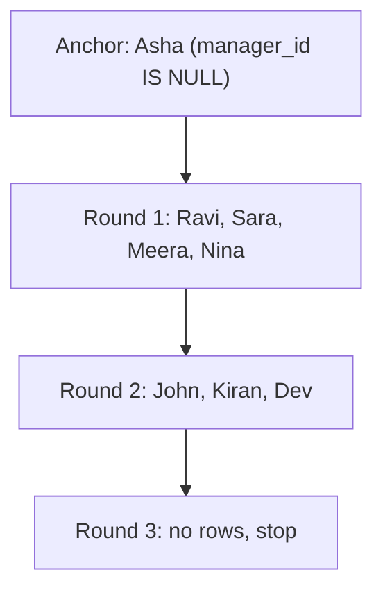

**Say this in the interview:**

> A CTE is a named subquery that makes long queries readable. In PostgreSQL 12 and later it is usually inlined, so it costs nothing extra. A recursive CTE has an anchor part and a recursive part joined with UNION ALL. I use it for trees like org charts, category trees and bill of materials, with a depth limit to stop cycles.

---

## GROUP BY and HAVING

**In one line:** `GROUP BY` squashes rows into groups, `WHERE` filters rows before grouping, and `HAVING` filters groups after grouping.

**Story:** A teacher collects exam papers. First she removes absent students' blank papers (WHERE). Then she makes a pile per class (GROUP BY). Then she keeps only classes with an average above 60 for the prize (HAVING).

**How it works: the logical order a query runs in:**


- This is why you cannot use a `SELECT` alias in `WHERE`: `WHERE` runs before `SELECT`.
- Every non-aggregated column in `SELECT` must be in `GROUP BY`. MySQL with `ONLY_FULL_GROUP_BY` off allowed breaking this and returned a random row's value. It is on by default since MySQL 5.7.5.
- `COUNT(*)` counts rows. `COUNT(col)` counts non-NULL values. `COUNT(DISTINCT col)` counts unique non-NULL values.

**Example:**

```sql
SELECT dept_id, COUNT(*) AS people, SUM(salary) AS total
FROM employees
WHERE salary > 4500                  -- rows: drop low salaries first
GROUP BY dept_id
HAVING SUM(salary) > 15000;          -- groups: keep only big departments
```

| dept_id | people | total |
|---|---|---|
| 1 | 4 | 31000 |
| 2 | 3 | 17500 |

- PostgreSQL extra: `COUNT(*) FILTER (WHERE status = 'PAID')` counts only some rows in a group.
- `GROUP BY ROLLUP (a, b)` adds subtotal rows. `GROUPING SETS` and `CUBE` exist too.

**Say this in the interview:**

> The logical order is FROM, WHERE, GROUP BY, HAVING, SELECT, ORDER BY, LIMIT. WHERE filters rows before grouping and can use indexes. HAVING filters groups after aggregation. I put every filter that does not need an aggregate in WHERE, because it removes rows earlier.

---

## UNION vs UNION ALL

**In one line:** Both stack the results of two queries. `UNION` removes duplicates (extra sort or hash work), `UNION ALL` keeps everything and is faster.

**Story:** Two teachers each give you a list of students for the trip. `UNION ALL` staples the two lists. `UNION` staples them and then crosses out names that appear twice. Crossing out takes time.

**How it works:**
- Both queries must return the same number of columns with compatible types.
- `UNION` = `UNION ALL` + a distinct step. On millions of rows that is a big sort or hash.
- Use `UNION ALL` when you know the sets do not overlap, or when duplicates are fine.
- Related: `INTERSECT` (rows in both) and `EXCEPT` (rows in the first, not in the second). Oracle calls `EXCEPT` `MINUS`. MySQL has `INTERSECT` and `EXCEPT` from 8.0.31.
- `JOIN` puts columns side by side. `UNION` puts rows one under the other.

**Example:**

```sql
SELECT customer_id FROM purchases WHERE product = 'A'
UNION                  -- 1, 2, 3, 4   (duplicates removed)
SELECT customer_id FROM purchases WHERE product = 'B';

SELECT customer_id FROM purchases WHERE product = 'A'
UNION ALL              -- 1, 2, 3, 1, 2, 4   (all rows kept)
SELECT customer_id FROM purchases WHERE product = 'B';
```

**Diagram:**

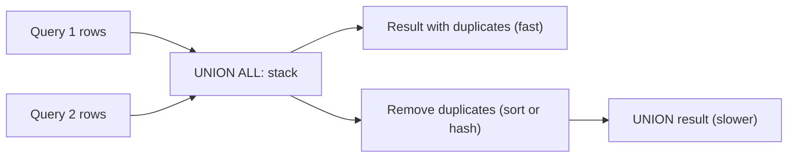

**Say this in the interview:**

> UNION removes duplicates, so it adds a sort or hash step. UNION ALL just appends the rows. I use UNION ALL by default and UNION only when I really need unique rows.

---

## DELETE vs TRUNCATE vs DROP

**In one line:** `DELETE` removes chosen rows one by one, `TRUNCATE` empties the whole table in one fast step, and `DROP` removes the table itself.

**Story:** A notebook.
- `DELETE`: erase some lines with an eraser. Slow, but you choose the lines.
- `TRUNCATE`: tear out all the written pages. The empty notebook stays.
- `DROP`: throw the notebook in the bin.

**How it works:**

| | DELETE | TRUNCATE | DROP |
|---|---|---|---|
| Removes | Rows matching `WHERE` | All rows | Table, data, indexes, grants |
| Speed on big tables | Slow (row by row, logs each row) | Very fast | Very fast |
| `WHERE` allowed | Yes | No | No |
| Row triggers | Fire | Do not fire | Do not fire |
| Rollback in PostgreSQL | Yes | Yes (it is transactional) | Yes (it is transactional) |
| Rollback in MySQL | Yes | No (implicit commit) | No (implicit commit) |
| Identity / auto-increment | Continues | MySQL resets it. PostgreSQL only with `RESTART IDENTITY` | Gone |
| Space | PostgreSQL: dead rows until VACUUM | Freed at once | Freed at once |

- `TRUNCATE` fails if another table has a foreign key to it. PostgreSQL has `TRUNCATE ... CASCADE` (careful: it empties those tables too).
- To delete millions of rows from a live table, delete in batches (for example 10,000 per transaction). One huge `DELETE` holds locks and creates a huge amount of WAL.
- Even better for time-based data: [partitioning](#partitioning). Dropping an old partition is instant.

**Diagram:**

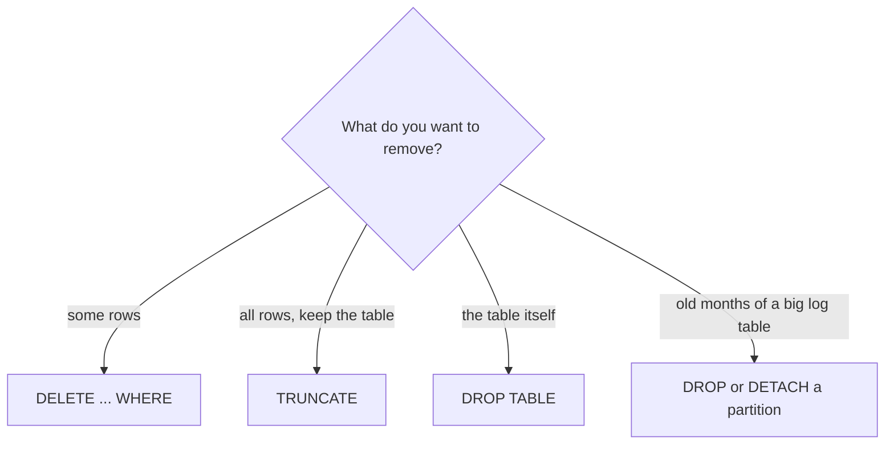

**Say this in the interview:**

> DELETE removes rows one by one, can have a WHERE, fires triggers and can be rolled back. TRUNCATE empties the whole table in one step and resets storage. DROP removes the table. In PostgreSQL even TRUNCATE and DROP are transactional, but in MySQL they commit straight away.

---

## Views and materialized views

**In one line:** A view is a saved query that runs every time you read it. A materialized view stores the result on disk and must be refreshed.

**Story:** A view is a **recipe card**: every time you want the dish, you cook it fresh. A materialized view is **food in the fridge**: you cooked it once, reheating is instant, but it is only as fresh as the last time you cooked.

**How it works:**
- **View:** `CREATE VIEW` stores the SQL only. Reading it runs the query (the rewriter expands it). Always fresh. Same speed as the query.
- Uses of views: hide complex joins, give a team only some columns (security), keep an old table name working during a migration.
- Simple views (one table, no aggregates) are **updatable** in PostgreSQL and MySQL.
- **Materialized view (PostgreSQL):** `CREATE MATERIALIZED VIEW` stores the rows. You can index it. `REFRESH MATERIALIZED VIEW` recomputes everything.
- `REFRESH ... CONCURRENTLY` lets people keep reading during the refresh. It needs a unique index on the materialized view.
- No automatic refresh in core PostgreSQL. Schedule it (cron, pg_cron, an app job).
- **MySQL** has no materialized views. Teams use a summary table filled by a job or events.

**Example:**

```sql
CREATE MATERIALIZED VIEW daily_revenue AS
SELECT date_trunc('day', created_at) AS day, SUM(total) AS revenue, COUNT(*) AS orders
FROM orders
WHERE status = 'PAID'
GROUP BY 1;

CREATE UNIQUE INDEX ON daily_revenue (day);                  -- needed for CONCURRENTLY
REFRESH MATERIALIZED VIEW CONCURRENTLY daily_revenue;         -- readers are not blocked
```

**Diagram:**

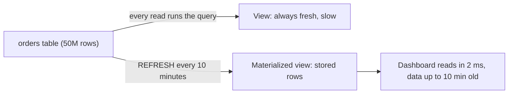

**Say this in the interview:**

> A view is just a saved query, so it is always fresh but no faster. A materialized view stores the result, can have indexes and is very fast to read, but it is stale until you refresh it. I use REFRESH CONCURRENTLY with a unique index so dashboards keep working during the refresh.

---

## Stored procedures and functions

**In one line:** A stored procedure or function is code saved and run inside the database. It saves network trips, but most teams keep business logic in the application.

**Story:** A restaurant can let the chef decide prices, discounts and loyalty points inside the kitchen. It works, but now only the chef knows the rules. Waiters, the app and the accountant cannot see or test them. Most restaurants keep the rules at the front desk (the app), and the kitchen just cooks (stores and fetches data).

**How it works:**
- PostgreSQL has **functions** (`CREATE FUNCTION`, return a value, called inside SQL) and **procedures** (`CREATE PROCEDURE`, PostgreSQL 11+, run with `CALL`, can `COMMIT` inside).
- They are usually written in PL/pgSQL. MySQL has stored procedures and functions in its own SQL dialect.
- **Triggers** are functions the database runs automatically on `INSERT`, `UPDATE` or `DELETE`.

**Why most teams avoid business logic in them:**
- Hard to unit test, debug and code-review compared to Java.
- Deployment and versioning are harder. You need migration tools (Flyway, Liquibase) for every change.
- The database CPU is the hardest thing to scale. App servers are easy to add.
- Logic is split between two places. New developers miss the hidden rules.
- Vendor lock-in: PL/pgSQL does not run on MySQL or Oracle.

**When they are a good fit:**
- Heavy data work close to the data: a nightly batch over millions of rows.
- Audit triggers (`updated_at`, history tables) that must run for every writer.
- One atomic operation where saving many round trips really matters.

**Example:**

```sql
CREATE FUNCTION set_updated_at() RETURNS trigger AS $$
BEGIN
  NEW.updated_at := now();   -- runs for every writer: the app, scripts, other services
  RETURN NEW;
END;
$$ LANGUAGE plpgsql;

CREATE TRIGGER orders_updated_at
BEFORE UPDATE ON orders
FOR EACH ROW EXECUTE FUNCTION set_updated_at();
```

**Diagram:**

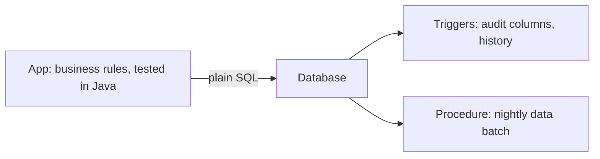

**Say this in the interview:**

> I keep business logic in the application, where it is easy to test, review, deploy and scale. I use database functions for small things that must happen for every writer, like audit triggers, and for heavy batch work close to the data. Big stored-procedure layers make the database the bottleneck and hide rules from the team.

---

## Partitioning

**In one line:** Partitioning splits one big table into smaller physical tables (partitions) inside the same database, while queries still see one table.

**Story:** An office keeps all bills in one huge cupboard. Finding March 2026 bills means searching everything. So they put each month in its own box, labelled. Now "March 2026" means opening one box. Throwing away 2019 bills means throwing away the 2019 boxes, not picking out each sheet.

**How it works (PostgreSQL declarative partitioning, version 10+):**
1. **RANGE:** by date or number range. Most common: one partition per month.
2. **LIST:** by fixed values, like `country IN ('IN', 'US')`.
3. **HASH:** spread rows evenly by a hash of a key, like `customer_id`.
4. **Partition pruning:** a query with `WHERE created_at >= '2026-03-01'` reads only the matching partitions.
5. **Instant clean-up:** `DROP TABLE orders_2024_01` or `DETACH PARTITION` instead of a slow `DELETE`.
6. Rules: a primary key or unique constraint must include the partition key. Queries without the partition key scan every partition.
7. Partitioning is **not sharding**. All partitions are on the same server. Sharding puts data on many servers.
- **MySQL:** has RANGE, LIST, HASH and KEY partitioning. InnoDB partitioned tables cannot have foreign keys.

**Diagram:**

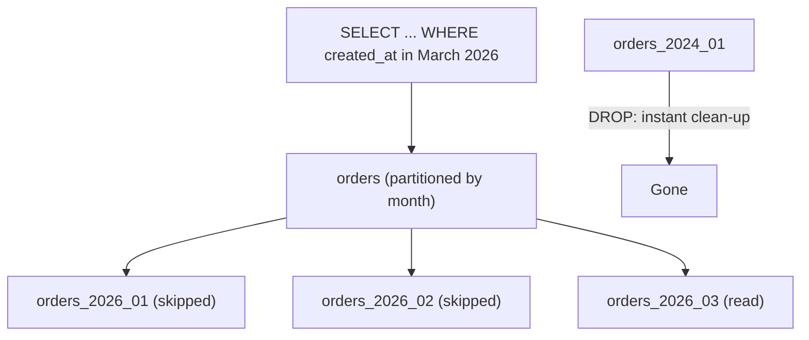

**Example:**

```sql
CREATE TABLE events (
    id         bigint GENERATED ALWAYS AS IDENTITY,   -- identity on a partitioned table: PostgreSQL 17+
    created_at timestamptz NOT NULL,
    payload    jsonb,
    PRIMARY KEY (id, created_at)              -- must include the partition key
) PARTITION BY RANGE (created_at);

CREATE TABLE events_2026_03 PARTITION OF events
    FOR VALUES FROM ('2026-03-01') TO ('2026-04-01');
```

- Create future partitions ahead of time (a job or the `pg_partman` extension). An insert with no matching partition fails, unless you add a `DEFAULT` partition.

**Say this in the interview:**

> Partitioning splits a big table into smaller tables on the same server, usually by month. Queries that filter on the partition key only read the needed partitions, and old data is removed by dropping a partition, which is instant. I use it for big time-series tables like events, logs and orders, when a table reaches hundreds of millions of rows.

**They may ask next:**
- **When is partitioning a bad idea?** Small tables, or queries that rarely filter on the partition key. Then every query touches every partition and planning gets slower.

---

## Replication and read replicas

**In one line:** Replication copies every change from the primary database to one or more replicas, so you can spread reads and survive a server failure.

The building block (leader/follower, sync vs async, failover) is explained in [system-design.md](system-design.md#database-replication-read-replicas). Here: how it works in PostgreSQL and MySQL, and the trap interviewers ask about.

**Story:** A head office prints a price list and sends copies to branch offices by courier. Branches answer customer questions from their copy. But the courier takes 2 hours. A customer who just changed a price at head office calls a branch and hears the old price. That delay is **replication lag**.

**How it works:**
- **PostgreSQL streaming replication:** replicas receive the WAL and replay it. The replica is a read-only copy of the whole server (*physical* replication).
- **PostgreSQL logical replication:** sends row changes for chosen tables. Good for upgrades and moving data between systems. Change data capture tools (like Debezium) read the same stream.
- **MySQL:** replicas read the **binlog** (binary log). GTIDs make failover easier.
- **Async** (default): primary does not wait. Fast. A failover can lose the last few transactions.
- **Sync** (`synchronous_commit` with `synchronous_standby_names` in PostgreSQL): primary waits for a replica. Safer, slower writes.

**The trap: read-your-writes**
1. A user updates their profile name. The write goes to the primary.
2. The page reloads and reads from a replica that is 300 ms behind.
3. The user sees their old name and thinks the save failed.

**Diagram:**

```mermaid
sequenceDiagram
    participant User
    participant App
    participant Primary
    participant Replica
    User->>App: save name = "Ravi K"
    App->>Primary: UPDATE users SET name = 'Ravi K'
    Primary-->>App: OK
    User->>App: reload profile
    App->>Replica: SELECT name FROM users
    Replica-->>App: "Ravi" (change not replayed yet)
    Primary->>Replica: WAL arrives 300 ms later
```

**Fixes:**
- Read from the primary for that user for a few seconds after they write.
- Read from the primary for "my own data" screens. Use replicas for other users' data, lists and reports.
- Remember the primary's log position after the write (PostgreSQL LSN). Only use a replica that has replayed past it.
- Monitor lag: `pg_stat_replication` on the primary, `now() - pg_last_xact_replay_timestamp()` on the replica.

**Example (Spring routing reads to a replica):**

```java
// A routing DataSource picks the replica for read-only transactions
public class ReadWriteRoutingDataSource extends AbstractRoutingDataSource {
    @Override
    protected Object determineCurrentLookupKey() {
        return TransactionSynchronizationManager.isCurrentTransactionReadOnly()
                ? "replica" : "primary";   // @Transactional(readOnly = true) goes to replica
    }
}
// Wrap it in LazyConnectionDataSourceProxy so the read-only flag is known before
// a connection is taken from the pool.
```

**Say this in the interview:**

> Replicas replay the primary's log, usually asynchronously, so they can be a little behind. I send reads that can be slightly stale to replicas and writes to the primary.
> The classic bug is read-your-writes: a user saves, reloads from a lagging replica and sees old data. I fix it by reading from the primary for that user for a short time after a write, and I monitor replication lag.

**They may ask next:**
- **Do replicas help with write load?** No. Every replica replays every write. For write scaling you need sharding.
- **A long query on a replica gets cancelled. Why?** The replica must apply WAL that removes rows the query still needs. PostgreSQL cancels the query after `max_standby_streaming_delay`. Options: `hot_standby_feedback` (can cause bloat on the primary) or a separate reporting replica with a longer delay.

---

## Sharding recap

**In one line:** Sharding splits the data across many database servers by a shard key, so writes and storage scale beyond one machine.

Full building block: [system-design.md](system-design.md#partitioning-and-sharding) and [consistent hashing](system-design.md#consistent-hashing).

**Story:** One exam hall cannot fit 50,000 students. Roll numbers 1–10,000 go to Hall A, the next 10,000 to Hall B. Each student knows the hall from the roll number. Asking "who scored the highest across all halls?" means asking every hall.

**Interview-level recap:**
- **Shard key** decides the server. Pick a key used in almost every query, with many values and even spread: `tenant_id`, `customer_id`.
- **Bad keys:** `created_at` (all new writes hit one shard), `country` (India shard is huge).
- **Cross-shard queries** (joins, totals) are slow and complex. Cross-shard transactions need sagas or two-phase commit.
- **Resharding** (moving data when you add servers) is the hardest part. Consistent hashing or many small virtual shards make it easier.
- **Before sharding, try:** better indexes, caching, read replicas, partitioning, a bigger machine. Many companies run large products on one well-tuned PostgreSQL primary.
- **Tools:** Citus (PostgreSQL extension), Vitess (MySQL), or app-level routing. Some teams move to distributed SQL databases (CockroachDB, YugabyteDB, TiDB, Spanner).

**Diagram:**

```mermaid
flowchart LR
    App["App"] --> Router["Shard router: hash of customer_id, mod 4"]
    Router --> S1["Shard 1"]
    Router --> S2["Shard 2"]
    Router --> S3["Shard 3"]
    Router --> S4["Shard 4"]
```

**Say this in the interview:**

> Sharding spreads data and writes across many servers using a shard key. I pick a key that is in almost every query and spreads evenly, like customer_id. It makes cross-shard joins and transactions hard, so I try indexes, caching, replicas and partitioning first.

---

## Connection pooling recap

**In one line:** A connection pool keeps a few database connections open and lends them to requests, because opening a new connection for every request is slow.

The Spring side (HikariCP settings, pool size, leak detection) is in [Connection pooling with HikariCP](spring-ecosystem.md#connection-pooling-with-hikaricp).

**Story:** A taxi stand keeps 10 taxis waiting. Passengers take one and return it. Calling a new taxi from home for every trip would take much longer. Too many taxis jam the road (the database).

**Database-side facts:**
- Each PostgreSQL connection is a separate **process** using several MB of RAM. Thousands of connections hurt the server.
- `max_connections` default is 100 in PostgreSQL. 20 app pods x 30 connections = 600. Too many.
- A small pool is usually faster. HikariCP's guide gives a starting formula: `connections = (cores x 2) + effective disk spindles`. Measure from there.
- **PgBouncer** sits between apps and PostgreSQL. In *transaction pooling* mode, thousands of client connections share a few dozen server connections. Session features (some prepared statement setups, `SET`, advisory locks) need care in this mode.
- MySQL uses a thread per connection, which is lighter, but the same "small pool" rule applies.

**Diagram:**

```mermaid
flowchart LR
    P1["Pod 1: Hikari pool 10"] --> B["PgBouncer (transaction mode)"]
    P2["Pod 2: Hikari pool 10"] --> B
    P3["Pod 20: Hikari pool 10"] --> B
    B -->|"about 40 real connections"| PG["PostgreSQL primary"]
```

**Say this in the interview:**

> Opening a database connection is slow, so the app keeps a small pool, HikariCP in Spring Boot. In PostgreSQL each connection is a process, so I keep total connections low across all pods and add PgBouncer when there are many pods. A bigger pool is often slower, because the database just switches between more work.

---

## SQL vs NoSQL: how to decide

**In one line:** Choose SQL when you need relations, transactions and flexible queries. Choose a NoSQL store when one access pattern needs massive scale, very low latency or a flexible document shape.

The building-block version is in [system-design.md](system-design.md#sql-vs-nosql). Document and key-value details: [mongodb.md](mongodb.md), [redis.md](redis.md).

**Story:** A bank ledger must add up to the paisa, so it uses a strict register (SQL). A shop's catalogue has different attributes per item: a shirt has a size, a phone has RAM. A flexible folder per product (documents) is easier there. The shop's "items in my cart" list must open in 1 ms for millions of users, so it lives in a quick key-value box.

**Decision table:**

| Need | Pick | Why |
|---|---|---|
| Money, orders, inventory, anything with strict rules | **PostgreSQL / MySQL** | ACID transactions, constraints, joins |
| Many ad-hoc queries and reports | **SQL** | Any filter, any join, mature tooling |
| Each item has a different shape, read as one unit | **Document DB (MongoDB)** or PostgreSQL `jsonb` | Flexible schema, one read per item |
| Cache, sessions, counters, rate limits | **Key-value (Redis)** | In-memory, sub-millisecond |
| Huge write volume, known queries, multi-region | **Wide-column (Cassandra, DynamoDB)** | Scales writes across many nodes |
| Relationships many levels deep (friends of friends) | **Graph DB (Neo4j)** | Walks links fast |
| Full-text search with ranking | **Search engine (Elasticsearch, OpenSearch)** | Inverted index |
| Similarity search on embeddings | **Vector index** (pgvector or a vector DB) | Nearest neighbour search |

**Diagram:**

```mermaid
flowchart TD
    S["New data to store"] --> T{"Need multi-row transactions or joins?"}
    T -->|"yes"| SQL["PostgreSQL or MySQL"]
    T -->|"no"| A{"Main access pattern?"}
    A -->|"get by key, very fast"| KV["Redis or DynamoDB"]
    A -->|"whole document by id, flexible shape"| DOC["MongoDB or Postgres jsonb"]
    A -->|"huge writes, known queries"| WC["Cassandra or DynamoDB"]
    A -->|"text search"| ES["Elasticsearch or OpenSearch"]
```

**Say this in the interview:**

> I start with PostgreSQL unless there is a clear reason not to. It gives transactions, constraints and flexible queries, and jsonb covers many "flexible shape" cases. I add a special store only for a specific access pattern. Redis for caching, a search engine for text search, Cassandra or DynamoDB for huge writes with known queries. Most real systems use more than one.

---

## SQL query problems (with answers)

**In one line:** Most SQL interview problems use one of five patterns: rank in a group, compare rows, find missing rows, aggregate with a condition, or walk a tree.

**Story:** A cricket scorer answers the same few question types all day. "Top scorer per team" (rank in a group). "Runs compared to last match" (previous row). "Who did not bat?" (missing rows). "Teams with more than 300 runs" (aggregate with a condition). Learn the patterns, not 100 separate answers.

**Diagram:**

```mermaid
flowchart LR
    Q["SQL problem"] --> R["Rank in a group: ROW_NUMBER, DENSE_RANK"]
    Q --> C["Compare rows: LAG, LEAD, self join"]
    Q --> M["Find missing: NOT EXISTS, LEFT JOIN IS NULL"]
    Q --> A["Aggregate: GROUP BY, HAVING, SUM CASE"]
    Q --> T["Trees: recursive CTE"]
```

**How these were tested:** every query below was run in SQLite 3.54 (`sqlite3 :memory:`) on the sample data, and the result tables are the real output. Queries use standard SQL that also runs in PostgreSQL and MySQL 8, unless a note says otherwise. Date functions differ between databases, so each date problem has a PostgreSQL line.

**Say this in the interview:**

> Before writing SQL, I say the pattern out loud: "this is top-N per group, so I will use DENSE_RANK with PARTITION BY". Then I ask about ties and NULLs, because those change the answer.

### Sample tables

`departments`

| id | name |
|---|---|
| 1 | Engineering |
| 2 | Sales |
| 3 | HR |
| 4 | Legal |

`employees` (Asha is the CEO. Legal has nobody.)

| id | name | dept_id | salary | manager_id |
|---|---|---|---|---|
| 1 | Asha | 1 | 9000 | NULL |
| 2 | Ravi | 1 | 7000 | 1 |
| 3 | Sara | 1 | 7000 | 1 |
| 4 | John | 1 | 8000 | 2 |
| 5 | Meera | 2 | 6000 | 1 |
| 6 | Kiran | 2 | 6500 | 5 |
| 7 | Dev | 2 | 5000 | 5 |
| 8 | Nina | 3 | 4000 | 1 |

`customers`

| id | name |
|---|---|
| 1 | Ravi |
| 2 | Sara |
| 3 | John |
| 4 | Priya |

`orders` (John has no orders.)

| id | customer_id | order_date | amount |
|---|---|---|---|
| 101 | 1 | 2026-01-05 | 500 |
| 102 | 1 | 2026-02-10 | 300 |
| 103 | 2 | 2026-01-20 | 200 |
| 104 | 2 | 2026-03-02 | 450 |
| 105 | 4 | 2026-03-15 | 700 |
| 106 | 1 | 2026-03-20 | 250 |

Smaller tables are shown inside the problem that uses them.

### 1. Second highest salary (3 ways)

**Way 1: MAX below the MAX.** Works everywhere, even very old databases.

```sql
SELECT MAX(salary) AS second_highest
FROM employees
WHERE salary < (SELECT MAX(salary) FROM employees);
```

**Way 2: sort, skip one.** `DISTINCT` matters: without it, two people on 9000 would make 9000 the "second".

```sql
SELECT DISTINCT salary
FROM employees
ORDER BY salary DESC
LIMIT 1 OFFSET 1;
```

**Way 3: DENSE_RANK.** Easiest to change to the Nth.

```sql
SELECT DISTINCT salary
FROM (
  SELECT salary, DENSE_RANK() OVER (ORDER BY salary DESC) AS rnk
  FROM employees
) t
WHERE rnk = 2;
```

Result (all three): `8000`.

**Trick:** ask "what if there is no second salary?". Way 1 returns `NULL`. Ways 2 and 3 return no row. Wrap in `SELECT (...) AS second_highest` to always get one row with `NULL`.

### 2. Nth highest salary

```sql
-- N = 3
SELECT DISTINCT salary
FROM (
  SELECT salary, DENSE_RANK() OVER (ORDER BY salary DESC) AS rnk
  FROM employees
) t
WHERE rnk = 3;
```

Result: `7000` (9000, 8000, then 7000 shared by Ravi and Sara).

Without window functions (correlated subquery: "exactly N-1 distinct salaries are higher than mine"):

```sql
SELECT DISTINCT e1.salary
FROM employees e1
WHERE 2 = (SELECT COUNT(DISTINCT e2.salary)      -- N - 1 = 2
           FROM employees e2
           WHERE e2.salary > e1.salary);
```

**Trick:** use `DENSE_RANK`, not `RANK`. With `RANK`, ties create gaps and "rank 4" may not exist.

### 3. Top 2 earners in each department

```sql
SELECT dept_id, name, salary
FROM (
  SELECT e.*,
         DENSE_RANK() OVER (PARTITION BY dept_id ORDER BY salary DESC) AS rnk
  FROM employees e
) t
WHERE rnk <= 2
ORDER BY dept_id, salary DESC;
```

| dept_id | name | salary |
|---|---|---|
| 1 | Asha | 9000 |
| 1 | John | 8000 |
| 2 | Kiran | 6500 |
| 2 | Meera | 6000 |
| 3 | Nina | 4000 |

**Trick:** `PARTITION BY` restarts the rank per group. Ask about ties: `ROW_NUMBER` gives exactly 2 rows per group, `DENSE_RANK` gives everyone in the top 2 salary levels. PostgreSQL also has `LATERAL` joins for top-N per group with an index.

### 4. Find duplicate emails

`users`

| id | email |
|---|---|
| 1 | ravi@x.com |
| 2 | sara@x.com |
| 3 | ravi@x.com |
| 4 | john@x.com |
| 5 | ravi@x.com |
| 6 | sara@x.com |

```sql
SELECT email, COUNT(*) AS cnt
FROM users
GROUP BY email
HAVING COUNT(*) > 1;
```

| email | cnt |
|---|---|
| ravi@x.com | 3 |
| sara@x.com | 2 |

**Trick:** `HAVING` filters groups. To see the full duplicate rows, use `WHERE email IN (that query)` or `COUNT(*) OVER (PARTITION BY email) > 1`.

### 5. Delete duplicates, keep the lowest id

```sql
DELETE FROM users
WHERE id IN (
  SELECT id FROM (
    SELECT id, ROW_NUMBER() OVER (PARTITION BY email ORDER BY id) AS rn
    FROM users
  ) t
  WHERE rn > 1                -- every copy after the first
);
```

Rows left: `1 ravi@x.com`, `2 sara@x.com`, `4 john@x.com`.

Shorter version: `DELETE FROM users WHERE id NOT IN (SELECT MIN(id) FROM users GROUP BY email);`

PostgreSQL only (self join delete):

```sql
DELETE FROM users a
USING users b
WHERE a.email = b.email AND a.id > b.id;
```

**Trick:** `ORDER BY` inside `ROW_NUMBER` decides which row survives (oldest, newest). Then add a `UNIQUE` constraint so it never happens again. MySQL refuses a `DELETE` whose subquery reads the same table directly (error 1093), so the shorter version fails there. The extra derived table `t` in the first version avoids it.

### 6. Employees who earn more than their manager

```sql
SELECT e.name AS employee, e.salary, m.name AS manager, m.salary AS manager_salary
FROM employees e
JOIN employees m ON e.manager_id = m.id     -- self join: the same table twice
WHERE e.salary > m.salary;
```

| employee | salary | manager | manager_salary |
|---|---|---|---|
| John | 8000 | Ravi | 7000 |
| Kiran | 6500 | Meera | 6000 |

**Trick:** a self join with two aliases, one "as employee" and one "as manager". More on self joins: [databases.md](databases.md#sql-joins-and-self-join).

### 7. Highest-paid employee in each department

```sql
SELECT d.name AS department, e.name, e.salary
FROM employees e
JOIN departments d ON d.id = e.dept_id
WHERE (e.dept_id, e.salary) IN (
  SELECT dept_id, MAX(salary) FROM employees GROUP BY dept_id
)
ORDER BY d.name;
```

| department | name | salary |
|---|---|---|
| Engineering | Asha | 9000 |
| HR | Nina | 4000 |
| Sales | Kiran | 6500 |

**Trick:** `SELECT dept_id, name, MAX(salary) ... GROUP BY dept_id` is wrong: `name` is not grouped. You need the max per group first, then join back (or use `RANK() ... = 1`). Both return all people tied on the max.

### 8. Employees who earn more than their department average

```sql
SELECT name, dept_id, salary, ROUND(dept_avg) AS dept_avg
FROM (
  SELECT e.*, AVG(salary) OVER (PARTITION BY dept_id) AS dept_avg
  FROM employees e
) t
WHERE salary > dept_avg;
```

| name | dept_id | salary | dept_avg |
|---|---|---|---|
| Asha | 1 | 9000 | 7750 |
| John | 1 | 8000 | 7750 |
| Meera | 2 | 6000 | 5833 |
| Kiran | 2 | 6500 | 5833 |

**Trick:** `AVG() OVER (PARTITION BY ...)` puts the group average next to each row, so no extra join is needed.

### 9. Employee count per department, including empty departments

```sql
SELECT d.name, COUNT(e.id) AS employees
FROM departments d
LEFT JOIN employees e ON e.dept_id = d.id
GROUP BY d.id, d.name
ORDER BY d.id;
```

| name | employees |
|---|---|
| Engineering | 4 |
| Sales | 3 |
| HR | 1 |
| Legal | 0 |

**Trick:** `COUNT(e.id)`, not `COUNT(*)`. `COUNT(*)` counts the NULL row from the left join and shows Legal = 1.

### 10. Customers who never ordered

```sql
SELECT c.name
FROM customers c
WHERE NOT EXISTS (
  SELECT 1 FROM orders o WHERE o.customer_id = c.id
);
```

Result: `John`. The `LEFT JOIN orders o ... WHERE o.id IS NULL` version gives the same answer.

**Trick:** avoid `WHERE c.id NOT IN (SELECT customer_id FROM orders)`. If any `customer_id` is `NULL`, `NOT IN` returns **no rows at all**. This was tested: one order with a NULL customer made the `NOT IN` query return nothing. `NOT EXISTS` is safe.

### 11. Latest order for each customer

```sql
SELECT customer_id, id AS order_id, order_date, amount
FROM (
  SELECT o.*,
         ROW_NUMBER() OVER (PARTITION BY customer_id ORDER BY order_date DESC) AS rn
  FROM orders o
) t
WHERE rn = 1;
```

| customer_id | order_id | order_date | amount |
|---|---|---|---|
| 1 | 106 | 2026-03-20 | 250 |
| 2 | 104 | 2026-03-02 | 450 |
| 4 | 105 | 2026-03-15 | 700 |

**Trick:** this is the "greatest-n-per-group" pattern. PostgreSQL has a shortcut: `SELECT DISTINCT ON (customer_id) * FROM orders ORDER BY customer_id, order_date DESC;` (PostgreSQL only).

### 12. Running total

`daily_sales`

| day | amount |
|---|---|
| 2026-03-01 | 100 |
| 2026-03-02 | 200 |
| 2026-03-03 | 150 |
| 2026-03-04 | 300 |
| 2026-03-05 | 50 |

```sql
SELECT day, amount,
       SUM(amount) OVER (ORDER BY day) AS running_total
FROM daily_sales;
```

| day | amount | running_total |
|---|---|---|
| 2026-03-01 | 100 | 100 |
| 2026-03-02 | 200 | 300 |
| 2026-03-03 | 150 | 450 |
| 2026-03-04 | 300 | 750 |
| 2026-03-05 | 50 | 800 |

**Trick:** `SUM() OVER (ORDER BY ...)`. Add `PARTITION BY user_id` for a running total per user. If the sort column has ties, use `ROWS BETWEEN UNBOUNDED PRECEDING AND CURRENT ROW` (see [the frame trap](#window-functions)).

### 13. Moving average of the last 3 days

```sql
SELECT day, amount,
       ROUND(AVG(amount) OVER (ORDER BY day
             ROWS BETWEEN 2 PRECEDING AND CURRENT ROW), 1) AS avg_3_days
FROM daily_sales;
```

| day | amount | avg_3_days |
|---|---|---|
| 2026-03-01 | 100 | 100.0 |
| 2026-03-02 | 200 | 150.0 |
| 2026-03-03 | 150 | 150.0 |
| 2026-03-04 | 300 | 216.7 |
| 2026-03-05 | 50 | 166.7 |

**Trick:** the frame `ROWS BETWEEN 2 PRECEDING AND CURRENT ROW` means "this row and the 2 before it". The first two rows average fewer days.

### 14. Each customer's share of total sales

```sql
SELECT customer_id,
       SUM(amount) AS total,
       ROUND(100.0 * SUM(amount) / SUM(SUM(amount)) OVER (), 1) AS pct
FROM orders
GROUP BY customer_id
ORDER BY total DESC;
```

| customer_id | total | pct |
|---|---|---|
| 1 | 1050 | 43.8 |
| 4 | 700 | 29.2 |
| 2 | 650 | 27.1 |

**Trick:** `SUM(SUM(amount)) OVER ()` = the window runs after `GROUP BY`, so it sums the group totals. `OVER ()` with nothing inside means "all rows". Use `100.0`, not `100`, to avoid integer division.

### 15. Month-over-month revenue growth

```sql
WITH monthly AS (
  SELECT strftime('%Y-%m', order_date) AS month, SUM(amount) AS revenue
  FROM orders
  GROUP BY month
)
SELECT month, revenue,
       LAG(revenue) OVER (ORDER BY month) AS prev_revenue,
       ROUND(100.0 * (revenue - LAG(revenue) OVER (ORDER BY month))
             / LAG(revenue) OVER (ORDER BY month), 1) AS growth_pct
FROM monthly;
```

| month | revenue | prev_revenue | growth_pct |
|---|---|---|---|
| 2026-01 | 700 | NULL | NULL |
| 2026-02 | 300 | 700 | -57.1 |
| 2026-03 | 1400 | 300 | 366.7 |

PostgreSQL: use `to_char(order_date, 'YYYY-MM')` or `date_trunc('month', order_date)`. MySQL: `DATE_FORMAT(order_date, '%Y-%m')`.

**Trick:** `LAG()` brings the previous row's value onto the current row. Ask about months with zero sales: they are missing, so `LAG` compares with an older month. Fix it with a calendar of months (`generate_series` in PostgreSQL) and a left join.

### 16. Users who logged in 3 or more days in a row

`logins`

| user_id | login_date |
|---|---|
| 1 | 2026-03-01, 03-02, 03-03, 03-05 |
| 2 | 2026-03-01, 03-03, 03-04 |
| 3 | 2026-03-02, 03-03, 03-04, 03-05 |

(One row per login. Shown grouped to save space.)

```sql
WITH numbered AS (
  SELECT user_id, login_date,
         julianday(login_date)
           - ROW_NUMBER() OVER (PARTITION BY user_id ORDER BY login_date) AS grp
  FROM (SELECT DISTINCT user_id, login_date FROM logins)
)
SELECT user_id, MIN(login_date) AS streak_start, MAX(login_date) AS streak_end,
       COUNT(*) AS days
FROM numbered
GROUP BY user_id, grp
HAVING COUNT(*) >= 3;
```

| user_id | streak_start | streak_end | days |
|---|---|---|---|
| 1 | 2026-03-01 | 2026-03-03 | 3 |
| 3 | 2026-03-02 | 2026-03-05 | 4 |

PostgreSQL (with a `date` column): `login_date - ROW_NUMBER() OVER (...)::int AS grp`. MySQL: `DATE_SUB(login_date, INTERVAL ROW_NUMBER() OVER (...) DAY)`.

**Trick:** the "gaps and islands" pattern. Date minus row number is the same value for every day in an unbroken streak. 03-01 minus 1, 03-02 minus 2, 03-03 minus 3 all give "02-28". Group by that value. `DISTINCT` first, so two logins on one day do not break the streak.

### 17. Find gaps in a sequence of ids

`tickets`: ids `1, 2, 3, 5, 6, 9`

```sql
SELECT id + 1 AS gap_start, next_id - 1 AS gap_end
FROM (
  SELECT id, LEAD(id) OVER (ORDER BY id) AS next_id
  FROM tickets
) t
WHERE next_id - id > 1;
```

| gap_start | gap_end |
|---|---|
| 4 | 4 |
| 7 | 8 |

**Trick:** `LEAD()` puts the next id on the same row. A gap is where the next id is more than 1 away. PostgreSQL alternative: `generate_series(1, 9)` with `EXCEPT` to list every missing number. Note: gaps in identity columns are normal (rollbacks, cached values). Do not use them as invoice numbers.

### 18. Median salary

```sql
SELECT AVG(salary) AS median
FROM (
  SELECT salary,
         ROW_NUMBER() OVER (ORDER BY salary) AS rn,
         COUNT(*) OVER () AS cnt
  FROM employees
) t
WHERE rn IN ((cnt + 1) / 2, (cnt + 2) / 2);
```

Result: `6750` (8 salaries, so the average of the 4th and 5th: 6500 and 7000).

PostgreSQL only (built in):

```sql
SELECT PERCENTILE_CONT(0.5) WITHIN GROUP (ORDER BY salary) AS median FROM employees;
```

**Trick:** with integer division, `(cnt + 1) / 2` and `(cnt + 2) / 2` are the same row for odd counts and the two middle rows for even counts. Averaging handles both.

### 19. Pivot: rows to columns

```sql
SELECT customer_id,
       SUM(CASE WHEN strftime('%m', order_date) = '01' THEN amount ELSE 0 END) AS jan,
       SUM(CASE WHEN strftime('%m', order_date) = '02' THEN amount ELSE 0 END) AS feb,
       SUM(CASE WHEN strftime('%m', order_date) = '03' THEN amount ELSE 0 END) AS mar
FROM orders
GROUP BY customer_id;
```

| customer_id | jan | feb | mar |
|---|---|---|---|
| 1 | 500 | 300 | 250 |
| 2 | 200 | 0 | 450 |
| 4 | 0 | 0 | 700 |

PostgreSQL: `EXTRACT(MONTH FROM order_date) = 1`, or the shorter `SUM(amount) FILTER (WHERE EXTRACT(MONTH FROM order_date) = 1)`. MySQL: `MONTH(order_date) = 1`.

**Trick:** "conditional aggregation": one `SUM(CASE ...)` per output column. It works in every database. SQL Server and Oracle also have a `PIVOT` keyword. To go the other way (columns to rows), use `UNION ALL` of one `SELECT` per column, or PostgreSQL `LATERAL (VALUES ...)`.

### 20. Running count of distinct users (new users per day)

```sql
WITH first_login AS (
  SELECT user_id, MIN(login_date) AS first_day
  FROM logins
  GROUP BY user_id
),
days AS (
  SELECT DISTINCT login_date AS day FROM logins
)
SELECT d.day,
       COUNT(f.user_id) AS new_users,
       SUM(COUNT(f.user_id)) OVER (ORDER BY d.day) AS total_users
FROM days d
LEFT JOIN first_login f ON f.first_day = d.day
GROUP BY d.day;
```

| day | new_users | total_users |
|---|---|---|
| 2026-03-01 | 2 | 2 |
| 2026-03-02 | 1 | 3 |
| 2026-03-03 | 0 | 3 |
| 2026-03-04 | 0 | 3 |
| 2026-03-05 | 0 | 3 |

**Trick:** `COUNT(DISTINCT ...) OVER (ORDER BY ...)` is not allowed in PostgreSQL or MySQL. Instead, find each user's **first** day, then do a running sum of "new users". The left join from a list of days keeps days with zero new users.

### 21. Customers who bought A and B, but not C

`purchases`: (1, A), (1, B), (2, A), (2, B), (2, C), (3, A), (4, B)

```sql
SELECT customer_id
FROM purchases
GROUP BY customer_id
HAVING SUM(CASE WHEN product = 'A' THEN 1 ELSE 0 END) > 0
   AND SUM(CASE WHEN product = 'B' THEN 1 ELSE 0 END) > 0
   AND SUM(CASE WHEN product = 'C' THEN 1 ELSE 0 END) = 0;
```

Result: `1`.

**Trick:** one pass with `GROUP BY` and conditional counts in `HAVING`. `WHERE product = 'A' AND product = 'B'` never matches, because one row has one product. `INTERSECT` and `EXCEPT` also work: `(A INTERSECT B) EXCEPT C`.

### 22. Managers with at least 2 direct reports

```sql
SELECT m.name AS manager, COUNT(*) AS reports
FROM employees e
JOIN employees m ON m.id = e.manager_id
GROUP BY m.id, m.name
HAVING COUNT(*) >= 2;
```

| manager | reports |
|---|---|
| Asha | 4 |
| Meera | 2 |

**Trick:** group by the manager's `id`, not only the name. Two managers can share a name.

### 23. Org chart: everyone under a manager, with level

```sql
WITH RECURSIVE org AS (
  SELECT id, name, 0 AS level
  FROM employees
  WHERE id = 5                                  -- start from Meera
  UNION ALL
  SELECT e.id, e.name, o.level + 1
  FROM employees e
  JOIN org o ON e.manager_id = o.id
)
SELECT level, name FROM org;
```

Result: `0 Meera`, `1 Dev`, `1 Kiran` (rows at the same level can come in any order). The full tree with paths is in [CTEs and recursive CTEs](#ctes-and-recursive-ctes).

**Trick:** anchor row `UNION ALL` the recursive join. To walk **up** (an employee's chain of managers), swap the join: `JOIN org o ON e.id = o.manager_id` and carry `manager_id` in the CTE.

### 24. Days hotter than the day before

`weather`

| day | temp |
|---|---|
| 2026-03-01 | 20 |
| 2026-03-02 | 25 |
| 2026-03-03 | 22 |
| 2026-03-04 | 28 |
| 2026-03-05 | 28 |

```sql
SELECT day, temp
FROM (
  SELECT day, temp,
         LAG(temp) OVER (ORDER BY day) AS prev_temp,
         LAG(day)  OVER (ORDER BY day) AS prev_day
  FROM weather
) t
WHERE temp > prev_temp
  AND julianday(day) - julianday(prev_day) = 1;   -- really the day before
```

Result: `2026-03-02 25`, `2026-03-04 28`.

PostgreSQL (with a `date` column): `AND day - prev_day = 1`.

**Trick:** check that the previous row is really yesterday. If a day is missing in the data, the "previous row" is two days back. The self join version `JOIN weather w2 ON w2.day = w1.day - 1` handles this naturally.

### 25. Best-selling product each month (with ties)

`order_items`: (2026-01, Pen, 10), (2026-01, Book, 4), (2026-01, Bag, 10), (2026-02, Pen, 3), (2026-02, Book, 9)

```sql
SELECT order_month, product, total_qty
FROM (
  SELECT order_month, product, SUM(qty) AS total_qty,
         RANK() OVER (PARTITION BY order_month ORDER BY SUM(qty) DESC) AS rnk
  FROM order_items
  GROUP BY order_month, product
) t
WHERE rnk = 1;
```

| order_month | product | total_qty |
|---|---|---|
| 2026-01 | Pen | 10 |
| 2026-01 | Bag | 10 |
| 2026-02 | Book | 9 |

**Trick:** a window function can wrap an aggregate (`ORDER BY SUM(qty)`), because windows run after `GROUP BY`. `RANK` keeps both January winners. `ROW_NUMBER` would silently drop one.

---

## Questions from the README list

Short answers to the older question list in the README. Each links to the deeper section above when there is one.
Some questions are about SQL Server. The answers say what the same idea is called in PostgreSQL and MySQL.

### Define a temp table

A temp table is a table that lives only for your session (connection) and is dropped automatically when the session ends.
Other sessions cannot see it. Use it to hold middle results in a long report or batch job.

```sql
CREATE TEMPORARY TABLE big_spenders AS
SELECT customer_id, SUM(amount) AS total FROM orders GROUP BY customer_id HAVING SUM(amount) > 600;
```

With a connection pool, connections live for hours, so drop the temp table yourself (or use PostgreSQL `ON COMMIT DROP`).

### What is a view?

A view is a saved `SELECT` with a name. Reading the view runs the query every time, so it is always fresh but not faster.
More: [Views and materialized views](#views-and-materialized-views)

### What is PRIMARY KEY?

A primary key is the column (or columns) that uniquely identifies each row. It must be unique and never `NULL`, and a table has only one.
The database creates a unique index for it. Use a surrogate key like `bigint` identity or UUIDv7.
More: [Keys and constraints](#keys-and-constraints)

### What is the difference between WHERE clause and HAVING clause?

`WHERE` filters rows before grouping. `HAVING` filters groups after `GROUP BY`, so it can use aggregates like `SUM(salary) > 15000`.
Put every filter that does not need an aggregate in `WHERE`: it removes rows earlier and can use indexes.
More: [GROUP BY and HAVING](#group-by-and-having)

### What’s the difference between a local temp table and a global temp table?

This is SQL Server. A local temp table (`#orders`) is visible only to your session. A global temp table (`##orders`) is visible to all sessions and is dropped when the last session using it ends.
PostgreSQL and MySQL only have session-local temp tables. PostgreSQL accepts the word `GLOBAL` but ignores it.
Today: if many sessions need shared scratch data, use a normal table (in PostgreSQL maybe an `UNLOGGED` table, which is faster but emptied after a crash).

### What is FOREIGN KEY?

A foreign key is a column whose value must exist in another table's primary key, like `orders.customer_id` pointing to `customers.id`.
It stops orphan rows. `ON DELETE CASCADE / RESTRICT / SET NULL` decides what happens when the parent row is deleted.
In PostgreSQL, add an index on the foreign key column yourself.
More: [Keys and constraints](#keys-and-constraints)

### What is Normalization?

Normalization is designing tables so each fact is stored in one place. Then an update cannot leave two copies that disagree.
1NF: one value per cell. 2NF: no column depends on part of a composite key. 3NF: no column depends on another non-key column.
More: [Normalization](#normalization-1nf-2nf-3nf-and-when-to-denormalize)

### What is DEFAULT?

`DEFAULT` gives a column a value when the `INSERT` does not provide one.
Examples: `status text NOT NULL DEFAULT 'NEW'`, `created_at timestamptz DEFAULT now()`.
It does not stop someone from inserting `NULL` on purpose. Add `NOT NULL` for that.

### What is blocking?

Blocking is when one transaction holds a lock and another transaction waits for it. It is normal for a short time. It is a problem when the holder is slow.
It is not a deadlock: the waiter will continue once the holder commits.
Common cause: a long transaction, or an "idle in transaction" session. Find the blocker in PostgreSQL with `pg_blocking_pids(pid)` in `pg_stat_activity`. Set `lock_timeout` so waiters fail fast.
More: [Slow query checklist](#slow-query-checklist)

### How can a column with a default value be added to an existing table?

Use `ALTER TABLE ... ADD COLUMN ... DEFAULT ...`.

```sql
ALTER TABLE customers ADD COLUMN total_spent int NOT NULL DEFAULT 0;
```

PostgreSQL 11+ does this instantly for a constant default (it only stores the default in metadata). MySQL 8.0 can also add columns instantly (`ALGORITHM=INSTANT`).
A volatile default like `random()` still rewrites the whole table. On a big table, test the migration first.

### What is the difference between inner and outer join?

An inner join returns only rows that match on both sides. An outer join (`LEFT`, `RIGHT`, `FULL`) also keeps rows with no match and fills the missing side with `NULL`.
More: [SQL joins and self join](databases.md#sql-joins-and-self-join)

### What is the difference between JOIN and UNION?

`JOIN` puts columns from two tables side by side, matched on a key. `UNION` puts the rows of two queries one under the other.
A join makes the result wider. A union makes it longer.
More: [UNION vs UNION ALL](#union-vs-union-all)

### What is the difference between UNION and UNION ALL?

`UNION` removes duplicate rows, which needs a sort or hash step. `UNION ALL` keeps all rows and is faster.
Use `UNION ALL` unless you really need unique rows.
More: [UNION vs UNION ALL](#union-vs-union-all)

### How to select first 5 records from a table?

There is no "first" without `ORDER BY`. Without it, the database can return any 5 rows.

```sql
SELECT * FROM orders ORDER BY created_at LIMIT 5;                  -- PostgreSQL, MySQL, SQLite
SELECT * FROM orders ORDER BY created_at FETCH FIRST 5 ROWS ONLY;  -- SQL standard, PostgreSQL, Oracle 12c+
SELECT TOP 5 * FROM orders ORDER BY created_at;                    -- SQL Server
```

### Describe the difference between truncate and delete

`DELETE` removes chosen rows one by one, can use `WHERE`, fires triggers and can be rolled back. `TRUNCATE` removes all rows in one fast step.
In PostgreSQL `TRUNCATE` can be rolled back. In MySQL it commits immediately.
More: [DELETE vs TRUNCATE vs DROP](#delete-vs-truncate-vs-drop)

### What are the difference between clustered and a non-clustered index?

A clustered index stores the table rows themselves in index order, so a table has only one. A non-clustered index is a separate structure that points to the rows.
MySQL InnoDB and SQL Server cluster the table by primary key. PostgreSQL has no clustered index: rows live in a heap and every index points to them.
In InnoDB, a secondary index stores the primary key, so a long primary key makes every index bigger.
More: [B-tree: the phone book](#b-tree-the-phone-book)

### What are the advantages of using Stored Procedures?

Fewer network round trips, logic runs next to the data, and you can grant "execute this procedure" instead of table access.
Old claim: "they are precompiled, so faster". Today, prepared statements give most of the same plan reuse.
Downsides: harder to test, version and scale. Most teams keep business logic in the app.
More: [Stored procedures and functions](#stored-procedures-and-functions)

### What is Denormalization?

Denormalization is copying data on purpose to make reads faster, for example storing `comment_count` on a post.
You pay with extra work on every write and the risk that copies drift apart. Do it only for a measured read problem.
More: [Normalization](#normalization-1nf-2nf-3nf-and-when-to-denormalize)

### Define ACID Properties

Atomicity: all steps or none. Consistency: rules and constraints always hold. Isolation: running transactions do not disturb each other. Durability: committed data survives a crash.
More: [ACID recap](#acid-recap) and [Transactions and isolation levels](databases.md#transactions-and-isolation-levels)

### What is a cursor how does it work?

A cursor is a pointer into a query result that lets you fetch rows a few at a time, instead of loading all rows at once.

```sql
BEGIN;
DECLARE big CURSOR FOR SELECT * FROM orders ORDER BY id;
FETCH 1000 FROM big;   -- repeat until no rows
CLOSE big;
COMMIT;
```

In Java you rarely write this. You set a JDBC fetch size, and the PostgreSQL driver uses a cursor for you (it needs auto-commit off).
Avoid looping over a cursor to update rows one by one. One set-based `UPDATE` is much faster.

### What is collation?

Collation is the set of rules for comparing and sorting text: is `a` equal to `A`? Does `é` sort next to `e`?
MySQL 8.0 defaults to `utf8mb4_0900_ai_ci` (accent-insensitive, case-insensitive). PostgreSQL usually uses the OS or ICU locale and is case-sensitive.
Collation affects `ORDER BY`, `=`, unique constraints and index use. In PostgreSQL, upgrading the OS can change collation rules, so indexes on text may need a rebuild.

### What are row constructors?

A row constructor groups several values into one row value: `ROW(1, 'a')` or just `(1, 'a')`.
You can compare row values, which is handy for keyset pagination and multi-column `IN`.

```sql
SELECT * FROM orders WHERE (created_at, id) < ('2026-03-02', 104);  -- keyset paging
SELECT * FROM employees WHERE (dept_id, salary) IN ((1, 9000), (2, 6500));
```

More: [Pagination: OFFSET vs keyset](#pagination-offset-vs-keyset)

### Is table size reduced, when you delete data from the table?

No, not right away. In PostgreSQL, deleted rows become dead rows. `VACUUM` makes the space reusable, but the file stays the same size. Only `VACUUM FULL` (locks the table) or the `pg_repack` tool shrinks it.
In MySQL InnoDB the file also stays big. `OPTIMIZE TABLE` rebuilds it.
`TRUNCATE` and `DROP` free the space at once.
More: [MVCC and VACUUM in PostgreSQL](#mvcc-and-vacuum-in-postgresql)

### What is the difference between “INNER JOIN” and “OUTER JOIN”?

Same as the inner vs outer join question above. `INNER JOIN` keeps only matches. `LEFT/RIGHT/FULL OUTER JOIN` also keeps non-matching rows, with `NULL` for the missing side.
More: [SQL joins and self join](databases.md#sql-joins-and-self-join)

### How do I UPDATE from a SELECT in SQL Server?

Use `UPDATE ... FROM` with a join. The syntax differs by database:

```sql
-- SQL Server
UPDATE c SET c.total_spent = t.total
FROM customers c JOIN (SELECT customer_id, SUM(amount) AS total FROM orders GROUP BY customer_id) t
  ON c.id = t.customer_id;

-- PostgreSQL (also SQLite 3.33+, tested)
UPDATE customers AS c SET total_spent = t.total
FROM (SELECT customer_id, SUM(amount) AS total FROM orders GROUP BY customer_id) AS t
WHERE c.id = t.customer_id;
```

MySQL uses `UPDATE customers c JOIN (...) t ON c.id = t.customer_id SET c.total_spent = t.total;`. `MERGE` (SQL Server, PostgreSQL 15+) is another option.

### How a database index can help performance?

An index lets the database jump to matching rows instead of reading the whole table. On 50 million rows that is 3–4 page reads instead of thousands.
It also gives rows in sorted order, so `ORDER BY ... LIMIT` can stop early with no sort step.
More: [Indexes](#indexes)

### How does a hash table index work?

The database runs a hash function on the key. The hash picks a bucket, and the bucket holds pointers to the rows with that key.
Finding `email = 'x'` is one hash plus one bucket read. But hash order is random, so it cannot do ranges or sorting.
PostgreSQL has `USING hash` indexes. InnoDB can build an internal "adaptive hash index" by itself, but since MySQL 8.4 it is off by default (`innodb_adaptive_hash_index`).
More: [Other index types](#other-index-types-hash-gin-gist-brin)

### Finding duplicate values in a SQL table

`GROUP BY` the columns that should be unique and keep groups with `HAVING COUNT(*) > 1`.
More: [Problem 4: Find duplicate emails](#4-find-duplicate-emails)

### How do I perform an IF…THEN in an SQL SELECT?

Use `CASE WHEN`. It works in every SQL database.

```sql
SELECT name, salary,
       CASE WHEN salary >= 8000 THEN 'High'
            WHEN salary >= 6000 THEN 'Medium'
            ELSE 'Low' END AS band
FROM employees;
```

MySQL also has `IF(cond, a, b)`. SQL Server has `IIF(cond, a, b)`. `COALESCE(a, b)` handles the common "if null then" case.

### Discuss INNER JOIN ON vs WHERE clause

For an `INNER JOIN`, putting a condition in `ON` or in `WHERE` gives the same result, and the planner treats them the same. Put join keys in `ON` and filters in `WHERE` for readability.
For a `LEFT JOIN` it matters a lot. A condition on the right table in `WHERE` removes the `NULL` rows, so it becomes an inner join.

```sql
-- Keeps John (no big orders) with NULL: filter is part of the match
SELECT c.name, o.id FROM customers c LEFT JOIN orders o ON o.customer_id = c.id AND o.amount > 400;
-- Drops John: WHERE runs after the join and NULL > 400 is not true
SELECT c.name, o.id FROM customers c LEFT JOIN orders o ON o.customer_id = c.id WHERE o.amount > 400;
```

### Explain Function vs. Stored Procedure in SQL Server

A function returns a value or a table and can be used inside `SELECT` and `WHERE`. In SQL Server it cannot change data.
A stored procedure is run on its own (`EXEC`), can change data, control transactions and return several result sets.
PostgreSQL is similar: functions are called inside SQL. Procedures (PostgreSQL 11+) are called with `CALL` and can `COMMIT` inside.
More: [Stored procedures and functions](#stored-procedures-and-functions)

### What is the difference among UNION, MINUS and INTERSECT?

`UNION`: rows in either query (duplicates removed). `INTERSECT`: rows in both. `MINUS`: rows in the first but not the second.
`MINUS` is Oracle's name. The SQL standard, PostgreSQL, SQL Server and MySQL 8.0.31+ call it `EXCEPT`.
More: [UNION vs UNION ALL](#union-vs-union-all)

### How can we transpose a table using SQL (changing rows to column or vice-versa) ?

Rows to columns: conditional aggregation, one `SUM(CASE WHEN ... THEN value END)` per new column. SQL Server and Oracle also have `PIVOT`.
Columns to rows: `UNION ALL` one `SELECT` per column, or PostgreSQL `CROSS JOIN LATERAL (VALUES ...)`.
More: [Problem 19: Pivot](#19-pivot-rows-to-columns)

### How to generate row number in SQL Without ROWNUM

Use the window function `ROW_NUMBER() OVER (ORDER BY ...)`. It works in PostgreSQL, MySQL 8+, SQL Server, Oracle and SQLite.

```sql
SELECT ROW_NUMBER() OVER (ORDER BY salary DESC) AS rn, name, salary FROM employees;
```

Before window functions (MySQL 5.7), people used a correlated `COUNT(*)` or session variables.
More: [Window functions](#window-functions)

### What's the difference between a primary key and a unique key?

Both reject duplicate values. A primary key also forbids `NULL`, and there is only one per table.
You can have many unique keys, and they allow `NULL`. Typical design: a surrogate primary key `id`, plus a unique key on the natural key like `email`.
In MySQL InnoDB the primary key is also the clustered index.

### Name types of Triggers

By timing: `BEFORE`, `AFTER`, and `INSTEAD OF` (on views).
By level: row-level (`FOR EACH ROW`, once per row) and statement-level (once per statement).
By event: `INSERT`, `UPDATE`, `DELETE`, and `TRUNCATE` in PostgreSQL.
Also: DDL triggers (PostgreSQL "event triggers", SQL Server DDL triggers) and SQL Server logon triggers.
More: [Stored procedures and functions](#stored-procedures-and-functions)

### What is a linked server?

A SQL Server feature that lets you query another database server as if it were local, using a four-part name (`server.db.schema.table`).
PostgreSQL does the same with foreign data wrappers, like `postgres_fdw`. MySQL has the rarely used `FEDERATED` engine.
Today: in microservices, services do not query each other's databases. They use APIs, events or change data capture.

### Explain a usage difference between user defined functions and stored procedures

Use a function when you need a value inside a query: `SELECT name, tax(salary) FROM employees`.
Use a procedure for a standalone job that changes data or controls transactions: `CALL close_month('2026-03')`.
More: [Function vs Stored Procedure](#explain-function-vs-stored-procedure-in-sql-server)

### How does truncate and delete operation effect Identity?

`DELETE` never resets the identity (auto-increment) counter. New rows continue from the last number.
`TRUNCATE` resets it in SQL Server and MySQL. In PostgreSQL it keeps counting unless you write `TRUNCATE ... RESTART IDENTITY`.
More: [DELETE vs TRUNCATE vs DROP](#delete-vs-truncate-vs-drop)

### Explain the difference between exclusive lock and update lock

This is SQL Server. An exclusive (X) lock is taken to change a row. Nobody else can lock it while it is held.
An update (U) lock is taken while reading a row you plan to change. Others can still read it, but only one session can hold the U lock. It becomes X when the change happens.
The U lock prevents a classic deadlock: two sessions both read with shared locks, then both try to upgrade.
In PostgreSQL and MySQL you get the same effect with `SELECT ... FOR UPDATE`.
More: [Deadlocks in the database](#deadlocks-in-the-database)

### What are DMV's and DMF's?

SQL Server Dynamic Management Views and Functions: system views that show the server's live state. Examples: running requests, waits, index usage, query stats.
PostgreSQL equivalents: `pg_stat_activity`, `pg_locks`, `pg_stat_user_indexes`, `pg_stat_statements`. MySQL: `performance_schema` and the `sys` schema.
More: [Slow query checklist](#slow-query-checklist)

### What are statistics?

Statistics are summaries the planner keeps about each table: row count, most common values, and value spread (histograms).
The planner uses them to guess how many rows each step returns and to pick a plan. Stale statistics cause bad plans. `ANALYZE` (or autovacuum) refreshes them.
More: [How a query runs](#how-a-query-runs-parser-planner-executor)

### How deadlock is resolved?

The database finds the cycle of waiting transactions, picks one as the victim and rolls it back with an error. The others continue.
The app should retry the victim. Prevent most deadlocks by locking rows in the same order everywhere and keeping transactions short.
More: [Deadlocks in the database](#deadlocks-in-the-database)

### What is a filegroup?

A SQL Server feature: a named group of data files. You can put a big table or its indexes on a different disk, and back up or restore one filegroup.
PostgreSQL's closest idea is a tablespace. In managed cloud databases you rarely touch this today. Storage is handled for you.

### What would happen without an index?

Every query that filters, joins or sorts would read the whole table (a full scan). Fine for 1,000 rows, very slow for 50 million.
Also, every insert would need a full scan to check primary key and unique rules. Deleting a parent row would scan the child table. In MySQL, updates may lock many more rows.
More: [Indexes](#indexes)

### How does B-trees index work?

A B-tree is a sorted, shallow tree. The root and branch pages hold key ranges. The leaf pages hold sorted keys with pointers to rows, linked to their neighbours.
Each page holds hundreds of keys, so 100 million rows need only 3–4 levels.
More: [B-tree: the phone book](#b-tree-the-phone-book)

### What is the cost of having a database index?

Slower writes (every insert and update must change each index), extra disk and RAM, and longer maintenance. Too many indexes can also block PostgreSQL HOT updates.
More: [The cost of indexes on writes](#the-cost-of-indexes-on-writes)

### Delete duplicate values in a SQL table

Number the copies with `ROW_NUMBER() OVER (PARTITION BY the_unique_cols ORDER BY id)` and delete every row with number above 1. Then add a unique constraint.
More: [Problem 5: Delete duplicates](#5-delete-duplicates-keep-the-lowest-id)

### How can I do an UPDATE statement with JOIN in SQL?

PostgreSQL: `UPDATE target SET ... FROM other WHERE target.id = other.id`. MySQL: `UPDATE target JOIN other ON ... SET ...`. SQL Server: `UPDATE t SET ... FROM target t JOIN other o ON ...`.
More: [How do I UPDATE from a SELECT in SQL Server?](#how-do-i-update-from-a-select-in-sql-server)

### How does primary key constraint and unique key constraint effect null?

A primary key never allows `NULL`.
A unique key allows `NULL`. In PostgreSQL and MySQL, many rows can have `NULL`, because `NULL` is not equal to `NULL`. SQL Server allows only one `NULL` in a unique constraint.
PostgreSQL 15+ can allow only one with `UNIQUE NULLS NOT DISTINCT`.

### What is Optimistic Locking and Pessimistic locking?

Optimistic: no lock while reading. At save time, check a `version` column and fail if someone else changed the row. Pessimistic: lock the row when you read it (`SELECT ... FOR UPDATE`), so others wait.
More: [Optimistic vs pessimistic locking](databases.md#optimistic-vs-pessimistic-locking)

### How does database indexing work?

The database keeps a sorted copy of the indexed columns (usually a B-tree) with pointers to the rows. A query walks the tree to the matching keys and follows the pointers.
The planner decides, query by query, whether using the index is cheaper than a full scan.
More: [Indexes](#indexes)

### Name some disadvantages of a hash index

Only equality (`=`). No ranges, no `ORDER BY`, no `LIKE 'abc%'`.
In PostgreSQL, hash indexes are single-column and cannot be unique. Before PostgreSQL 10 they were not crash-safe.
A B-tree does equality almost as fast and does much more, so hash indexes are rarely worth it.

### What are some other types of indexes?

GIN (JSONB, arrays, full-text), GiST (geometry, ranges), BRIN (huge time-ordered tables), partial indexes, expression indexes, covering indexes, and full-text indexes in MySQL.
More: [Other index types](#other-index-types-hash-gin-gist-brin) and [Partial and expression indexes](#partial-and-expression-indexes)

### Insert results of a stored procedure into a temporary table

SQL Server: `INSERT INTO #results EXEC my_procedure;`.
PostgreSQL: write it as a function that returns a table, then `CREATE TEMP TABLE results AS SELECT * FROM my_function();`.
MySQL: a procedure cannot be used in `SELECT`, so make the procedure insert into the temp table itself.

### Select first row in each GROUP BY group (greatest-n-per-group problem)?

Number the rows inside each group with `ROW_NUMBER() OVER (PARTITION BY group ORDER BY ...)` and keep `rn = 1`.
PostgreSQL also has `DISTINCT ON (group)`.
More: [Problem 11: Latest order for each customer](#11-latest-order-for-each-customer)

---

## Interview questions

**1. What happens when you run a SELECT in PostgreSQL?**
The parser checks the grammar, the analyzer checks tables and columns, and the rewriter expands views. The planner picks the cheapest plan using statistics, and the executor runs it on pages cached in shared buffers. See [How a query runs](#how-a-query-runs-parser-planner-executor).

**2. Why is a B-tree the default index?**
It handles `=`, ranges, sorting and prefix search. It stays only 3–4 levels deep for 100 million rows. See [B-tree](#b-tree-the-phone-book).

**3. You have an index on (customer_id, created_at). Which queries use it?**
Queries on `customer_id`, or `customer_id` plus `created_at`, including `ORDER BY created_at`. A query on `created_at` alone usually does not. See [Composite index](#composite-index-and-the-leftmost-prefix-rule).

**4. What is a covering index?**
An index that holds all columns a query needs, so PostgreSQL does an index-only scan and skips the table. Use `INCLUDE` for columns you only return. See [Covering index](#covering-index-and-index-only-scan).

**5. Give 4 reasons the database ignores your index.**
A function on the column, a type mismatch, a leading `%` in `LIKE`, or too many matching rows. Also stale statistics. See [When an index is NOT used](#when-an-index-is-not-used).

**6. When would you use a partial index?**
When queries always target a small slice, like `status = 'PENDING'`. The index is tiny and cheap to update. See [Partial and expression indexes](#partial-and-expression-indexes).

**7. What is BRIN and when is it useful?**
A tiny index that stores the min and max per block range. Great for huge append-only tables sorted by time. See [Other index types](#other-index-types-hash-gin-gist-brin).

**8. How do you read EXPLAIN ANALYZE?**
From the deepest node up. Look for big seq scans, "Rows Removed by Filter", disk sorts, and estimated vs actual rows. See [Reading EXPLAIN](#reading-explain-and-explain-analyze).

**9. Nested loop vs hash join vs merge join?**
Nested loop: small outer side with an index on the inner. Hash join: large equality joins. Merge join: both sides already sorted. See [Reading EXPLAIN](#reading-explain-and-explain-analyze).

**10. A query got slow overnight. What do you check?**
`pg_stat_statements`, then the plan. Compare estimated and actual rows, check for stale statistics, lock waits, bloat and data growth. See [Slow query checklist](#slow-query-checklist).

**11. Explain 1NF, 2NF and 3NF in one sentence each.**
1NF: one value per cell. 2NF: nothing depends on part of a composite key. 3NF: nothing depends on another non-key column. See [Normalization](#normalization-1nf-2nf-3nf-and-when-to-denormalize).

**12. Is storing `unit_price` on order items denormalization?**
No. It is the price at the time of the order, a different fact from today's product price. See [Normalization](#normalization-1nf-2nf-3nf-and-when-to-denormalize).

**13. Surrogate key or natural key?**
A surrogate key (`bigint` or UUIDv7) as the primary key, plus a unique constraint on the natural key. Natural keys change. See [Keys and constraints](#keys-and-constraints).

**14. What is MVCC in PostgreSQL?**
Updates write a new row version and mark the old one dead. Each transaction reads from a snapshot, so readers and writers do not block each other. See [MVCC and VACUUM](#mvcc-and-vacuum-in-postgresql).

**15. Why does VACUUM exist, and what breaks it?**
It reclaims dead row versions. Long-running or idle-in-transaction sessions stop it from cleaning, so tables bloat. See [MVCC and VACUUM](#mvcc-and-vacuum-in-postgresql).

**16. How do you prevent database deadlocks?**
Lock rows in the same order everywhere, keep transactions short, index the update filters, and retry the victim. See [Deadlocks](#deadlocks-in-the-database).

**17. Why is OFFSET pagination slow, and what do you use instead?**
OFFSET reads and throws away all earlier rows. Keyset pagination uses `WHERE (created_at, id) < (...)` with an index, so every page costs the same. See [Pagination](#pagination-offset-vs-keyset).

**18. ROW_NUMBER vs RANK vs DENSE_RANK?**
ROW_NUMBER is always unique. RANK shares numbers on ties and skips (1, 2, 2, 4). DENSE_RANK shares without gaps (1, 2, 2, 3). See [Window functions](#window-functions).

**19. Find the second highest salary.**
`SELECT MAX(salary) FROM employees WHERE salary < (SELECT MAX(salary) FROM employees)`, or `DENSE_RANK() = 2`. See [Problem 1](#1-second-highest-salary-3-ways).

**20. Top 3 per group?**
`DENSE_RANK() OVER (PARTITION BY group ORDER BY value DESC)` in a subquery, then `WHERE rnk <= 3`. See [Problem 3](#3-top-2-earners-in-each-department).

**21. Why is NOT IN dangerous?**
If the subquery returns any `NULL`, `NOT IN` returns no rows. Use `NOT EXISTS`. See [Problem 10](#10-customers-who-never-ordered).

**22. How do you find consecutive login streaks?**
Gaps and islands: date minus `ROW_NUMBER()` is constant inside a streak. Group by it. See [Problem 16](#16-users-who-logged-in-3-or-more-days-in-a-row).

**23. What is a recursive CTE used for?**
Walking trees: org charts, category trees, bill of materials. Anchor `UNION ALL` recursive part, with a depth limit. See [CTEs](#ctes-and-recursive-ctes).

**24. WHERE vs HAVING?**
WHERE filters rows before grouping. HAVING filters groups after aggregation. See [GROUP BY and HAVING](#group-by-and-having).

**25. View vs materialized view?**
A view runs its query every time. A materialized view stores the result and must be refreshed. See [Views](#views-and-materialized-views).

**26. Why do teams avoid business logic in stored procedures?**
Hard to test, review, version and scale, and it locks you into one database. Triggers for audit columns are fine. See [Stored procedures](#stored-procedures-and-functions).

**27. Partitioning vs sharding?**
Partitioning splits a table inside one server. Sharding splits data across servers. Partition first, shard only when one server is not enough. See [Partitioning](#partitioning) and [Sharding recap](#sharding-recap).

**28. A user saves a change and does not see it on reload. Why?**
The read went to a lagging replica. Read from the primary for that user right after a write. See [Replication](#replication-and-read-replicas).

**29. How many connections should the pool have?**
Fewer than you think. Start small (around cores x 2 per database), measure, and add PgBouncer when many pods connect. See [Connection pooling recap](#connection-pooling-recap).

**30. When would you not pick PostgreSQL?**
Cache or session data (Redis), text search with ranking (Elasticsearch), or huge write volume with known queries across regions (Cassandra or DynamoDB). See [SQL vs NoSQL](#sql-vs-nosql-how-to-decide).
