# System design: the basics

[← Back to README](../README.md)

How to answer a system design question, how to estimate numbers, and the building blocks every design uses.
Full designs (Amazon, WhatsApp, YouTube...) are in [case-studies.md](case-studies.md).

## How to answer a system design question

**In one line:** First understand the problem, then do simple math, then draw a simple design, then talk about what breaks.

**Story:** You ask an architect to build your house.
A good architect does not start drawing walls on day one.
First she asks: "How many people live here? Do your parents visit? What is your budget? Do you want a garden?"
Only then she draws the plan.
Then she checks the weak points: "What if it floods? What if the power goes?"
A system design interview is the same. The interviewer wants to see **how you think**, not a perfect drawing.

**The 9 steps:**

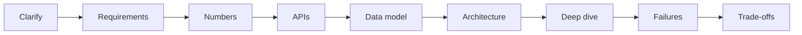

1. **Clarify.** Ask questions. What exactly are we building? Who uses it?
2. **Requirements.** Write two short lists:
   - *Functional* = what the system does. Example: "user can place an order".
   - *Non-functional* = how well it does it. Example: "99.9% uptime, page loads in under 200 ms".
3. **Numbers.** Users, requests per second, storage per year. Rough math is fine.
4. **APIs.** The 3–5 main calls. Example: `POST /orders`, `GET /orders/{id}`.
5. **Data model.** Main tables or documents. Which database, and why.
6. **Architecture.** A simple box diagram. Client → load balancer → services → database, cache, queue.
7. **Deep dive.** Pick the 2–3 hardest parts and go deep. Often the interviewer picks them.
8. **Failures.** What happens if the database dies? If a service is slow? If the same request comes twice?
9. **Trade-offs.** What you chose, and what you gave up. Example: "I chose eventual consistency for the feed. Users may see a post 2 seconds late. That is fine."

**60-minute time plan:**

| Time | What you do | Tip |
|---|---|---|
| 0–5 min | Clarify the question | Ask 4–6 questions. Write the answers on the board. |
| 5–10 min | Requirements + numbers | Keep the math rough. Say your assumptions out loud. |
| 10–15 min | APIs + data model | Only the main ones. Do not list 20 endpoints. |
| 15–25 min | High-level architecture | Draw boxes. Walk one request from start to finish. |
| 25–40 min | Deep dive on 2–3 hard parts | Ask: "Which part do you want me to go deeper on?" |
| 40–50 min | Failures and scaling | Database down, zone down, traffic spike, duplicate request. |
| 50–55 min | Trade-offs | "I chose X over Y because..." |
| 55–60 min | Summary + your questions | One-minute recap of the design. |

For a 45-minute interview, cut each part a little. Never skip the numbers or the failures.

**Good clarifying questions:**
- Who are the users? Mobile, web, or other services?
- What are the 3 most important features? What can we skip today?
- How many users per day? How many requests at peak?
- More reads or more writes? (Example: a news feed may have 100 reads for every write.)
- How fast must it be? Example: "under 200 ms for 99% of requests".
- How available? 99.9% (about 9 hours down per year) or 99.99% (about 53 minutes per year)?
- Which data must always be correct right away (money, stock)? Which can be a few seconds late (likes, views)?
- One country or global?
- How long do we keep data? 1 year? Forever?
- Any rules on security or privacy? (Payments, health data, GDPR.)

**Common mistakes:**

| Mistake | Do this instead |
|---|---|
| Start with "We'll use Kafka, Redis and Kubernetes." | Start with "Let me clarify the requirements first." |
| Jump into one detail for 20 minutes | Draw the full simple picture first, then go deep. |
| Skip the numbers | Do rough math. It decides if you need sharding, cache, and so on. |
| Design for Google scale when the problem is small | Match the design to the numbers. One database is often enough. |
| Never talk about failures | For every box, ask: "What if this box dies?" |
| Say "it depends" and stop | Say "it depends on X. If X, I pick A. If not, I pick B." |
| Talk without checking in | Every 10 minutes ask: "Does this make sense? Should I go deeper here?" |
| Use words you cannot explain | Only say "consistent hashing" if you can explain it in 2 lines. |

**Say this in the interview:**
> "Before I draw anything, let me ask a few questions about scale and features.
> Then I will do quick math, draw a simple design, and go deep on the hard parts.
> At the end I will cover what can fail and the trade-offs I made."

**They may ask next:**
- **What if the interviewer gives no numbers?** Make your own and say them out loud. "Let's assume 10 million users a day. Tell me if that is wrong."
- **What if you don't know a technology they mention?** Say so honestly. Then explain how you would solve the same problem with tools you know.
- **How deep should the deep dive go?** Deep enough to show trade-offs. Not just "use a cache". Say: "cache-aside, 5-minute TTL, delete on update". Then explain what happens when many misses come at once.

## Capacity estimation

**In one line:** Rough math to find how big the system must be: requests per second, storage, bandwidth, and number of servers.

**Story:** A sweet shop owner is getting ready for Diwali.
He thinks: "Normal day, 200 boxes. Diwali week, maybe 5 times more. So 1,000 boxes a day."
"Each box needs half a kg of sweets. So 500 kg a day. I need 2 more cooks and a bigger fridge."
He does not need exact numbers. He needs to know: "Is it 50 kg or 500 kg?"
Capacity estimation is the same. We want the right size, not the exact number.

**The 4 tricks to remember:**
1. **One day ≈ 100,000 seconds.** (Exact: 86,400. Rounding up makes math easy.)
2. **Peak = 2–3 times the average.** For sale days or big events, 10 times or more.
3. **Storage = items per day × size of one item × days.** Then add extra for indexes and copies.
4. **Bandwidth = requests per second × size of one response.**

**Quick conversions:**

| Per day | Per second (average) |
|---|---|
| 1 million | ~12 |
| 10 million | ~120 |
| 100 million | ~1,200 |
| 1 billion | ~12,000 |

**Cheat table: sizes and powers of 10**

| Number | Name | Size |
|---|---|---|
| 10^3 | Thousand | 1 KB |
| 10^6 | Million | 1 MB |
| 10^9 | Billion | 1 GB |
| 10^12 | Trillion | 1 TB |
| 10^15 | Quadrillion | 1 PB |

Useful sizes (rough):
- A number (long) or a timestamp: 8 bytes.
- A UUID (unique id): 16 bytes as binary, 36 bytes as text.
- A short text row, like an order or a tweet: 0.5–2 KB.
- A photo: 200 KB – 2 MB.
- 1 MB per second = 8 megabits per second (Mbps).

**Cheat table: time and availability**

| Thing | Value |
|---|---|
| Seconds in a day | 86,400 ≈ 10^5 |
| Seconds in a month | ~2.6 million |
| Seconds in a year | ~31.5 million ≈ 3 × 10^7 |
| 99.9% uptime | ~8.8 hours down per year (~44 min per month) |
| 99.99% uptime | ~53 minutes down per year |
| 99.999% uptime | ~5 minutes down per year |

**Cheat table: latency numbers (rough, to compare)**

| Action | Time |
|---|---|
| Read from RAM | ~100 nanoseconds |
| Read 4 KB at random from SSD | ~0.1 ms |
| Network round trip inside one data center | ~0.5 ms |
| Redis GET (same data center) | ~0.5–1 ms |
| Simple database query using an index | ~1–5 ms |
| Read from a hard disk (seek) | ~10 ms |
| Round trip Mumbai ↔ US East | ~200 ms |

The lesson: **memory is fast, disk is slower, network across the world is slowest.** This is why we use caches and CDNs.

**Rough limits of one machine (very rough, always load-test):**
- One Spring Boot instance (2 vCPU): a few hundred to a few thousand simple requests per second.
- One PostgreSQL or MySQL server: a few thousand simple writes per second, more for simple reads.
- One Redis node: around 100,000 simple operations per second.

**Worked example: 1 million orders per day**

Assumptions (say these out loud):
- 1 million orders per day.
- Each order is read about 10 times (order page, status check, tracking, admin, emails).
- One order with its items is about 2 KB.
- Normal peak is 3× average. A big sale day is 10× average.

**Step 1: Average writes per second**
- 1,000,000 ÷ 100,000 = **~10 orders per second.** (Exact: 1,000,000 ÷ 86,400 = 11.6.)
- Let's use 12.

**Step 2: Peak writes per second**
- Normal peak: 12 × 3 = **~36 orders per second.**
- Sale day: 12 × 10 = **~120 orders per second.**
- We design for the sale day: 120 writes per second.

**Step 3: Reads per second**
- 10 reads for each write.
- Sale-day peak: 120 × 10 = **~1,200 reads per second.**
- Total at peak: 120 + 1,200 = **~1,300 requests per second.**
- This is a read-heavy system. A cache will help a lot.

**Step 4: Storage**
- Per day: 1,000,000 × 2 KB = 2 GB.
- Per year: 2 GB × 365 = **~730 GB.**
- Add indexes (about 50% more): ~1.1 TB.
- Keep 3 copies (1 leader + 2 replicas): **~3.3 TB of disk per year.**
- After 2 years, move old orders to cheap storage (archive).

**Step 5: Bandwidth**
- One read response is about 5 KB.
- 1,200 reads × 5 KB = 6 MB per second ≈ **48 Mbps.**
- This is small. Bandwidth is not a problem here.

**Step 6: How many service instances?**

First, find how much **one instance** can handle. Look at two limits.

*Limit 1: threads.*
- Tomcat has 200 threads by default.
- One request takes about 50 ms (0.05 s), mostly waiting for the database.
- One thread does 1 ÷ 0.05 = 20 requests per second.
- 200 threads × 20 = 4,000 requests per second.
- (This is Little's law in simple words: requests in progress = requests per second × time per request.)

*Limit 2: CPU.*
- Each request uses about 5 ms of real CPU work.
- One CPU core does 1,000 ÷ 5 = 200 requests per second.
- 2 cores = 400 requests per second.

*The smaller limit wins:* 400 requests per second. CPU is the limit here, not threads.

*Keep headroom:* never run at 100% CPU. Target 70%.
- 400 × 0.7 = **~280 requests per second per instance.**
- Check this with a real load test. The math only gives a starting guess.

Now the count:
- Peak load ÷ one instance: 1,300 ÷ 280 = 4.6 → **5 instances.**
- **N+1:** add one spare, in case one instance crashes → 6.
- **N+2:** add two spares if you also want room for a deploy (one instance restarting) plus one crash → 7.

*Now think about zones.* A zone is one data center in a cloud region. We use 3 zones.
- If one zone dies, the other 2 zones must carry the full 1,300 requests per second.
- We need 5 instances in 2 zones → 3 per zone (round up 2.5).
- 3 per zone × 3 zones = **9 instances on sale day.**

*Normal day:*
- Normal peak is about 36 writes + 360 reads ≈ 400 requests per second.
- 400 ÷ 280 = 1.4 → 2 instances.
- Zone rule: if one zone dies, the other 2 zones need 2 instances. So 1 per zone is enough → **3 instances.**
- Use **autoscaling** (the cloud adds and removes instances based on CPU). Minimum 3, maximum 12.

**Step 7: What do the numbers tell us?**
- 120 writes per second is easy for one PostgreSQL leader. **No sharding needed.**
- 1,200 reads per second: add a Redis cache and 1–2 read replicas.
- 3.3 TB per year fits on normal database disks. Plan an archive after 1–2 years.
- This is the real value of the math: it stops you from over-building.

**Good and bad:**

| Good | Bad |
|---|---|
| Say assumptions out loud | Silent math the interviewer cannot follow |
| Round numbers (86,400 → 100,000) | Exact math with a calculator |
| Use the numbers to make choices ("no sharding needed") | Do math and then ignore it |
| Plan for peak and for one zone failure | Plan only for the average day |

**Say this in the interview:**
> "1 million orders a day is about 12 per second on average.
> With a 10× sale peak, that is 120 writes and about 1,200 reads per second.
> One instance safely handles about 280 requests per second, so we need 5.
> To survive one zone failure, we run 9 across 3 zones.
> One PostgreSQL leader can handle 120 writes per second, so we do not need sharding yet."

**They may ask next:**
- **Why is average traffic not enough?** Users don't come evenly. Lunch time, evenings and sales bring 3–10× more. If you design for average, you crash at peak.
- **How do you find what one instance can handle?** Load test it (with tools like JMeter, Gatling or k6). Increase traffic until latency goes up. Use about 70% of that number.
- **Would virtual threads (Java 21) change the math?** They remove the thread limit for waiting work. But CPU, database connections and memory are still limits. Here CPU was already the limit.
- **What about database connections?** 9 instances × 20 connections each = 180 connections. PostgreSQL handles this, but watch it. Use a pool like HikariCP, or a proxy like PgBouncer.

## Building blocks

These are the bricks. Every system design uses them.

### Vertical vs horizontal scaling

**In one line:** Vertical scaling means a bigger machine; horizontal scaling means more machines.

**Story:** A chai stall gets too busy.
Option 1: buy a bigger kettle and a faster stove. That is **vertical** scaling.
Option 2: open 3 more stalls on the same street. That is **horizontal** scaling.
The big kettle is easy, but it has a limit. And if that one stove breaks, nobody gets chai.
More stalls need more planning, but one broken stove does not stop the business.

**How it works:**
1. **Vertical (scale up):** Move from 4 CPUs and 16 GB RAM to 32 CPUs and 128 GB RAM. No code change.
2. **Horizontal (scale out):** Run 10 copies of the service. Put a load balancer in front to share the traffic.

**Diagram:**

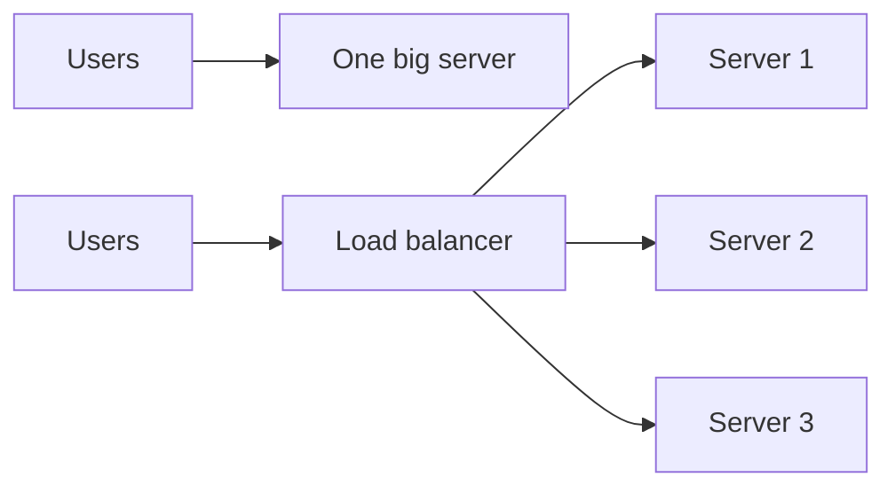

**Example:**
- Vertical: your PostgreSQL is at 90% CPU. Move it from 8 vCPU to 32 vCPU. Usually a few minutes of downtime.
- Horizontal: your order service gets 3× traffic during a sale. Autoscaling goes from 3 to 9 instances.

**Good and bad:**

| | Vertical | Horizontal |
|---|---|---|
| Easy to do | Yes, no code change | Needs stateless code and a load balancer |
| Limit | Hard limit (the biggest machine) | Almost no limit |
| Failure | One machine = one point of failure | One machine dies, others keep working |
| Cost | Big machines cost much more per CPU | Many small machines, cheaper per CPU |
| Downtime to grow | Often a restart | Add machines with no downtime |

**When to use / when not to use:**
- Use vertical first for **databases**. It is the simplest way to grow a database.
- Use horizontal for **stateless services** (web and API servers). It is the normal choice.
- Most real systems use both: horizontal app servers, plus a vertically sized database with replicas.

**Say this in the interview:**
> "For the API servers, I scale horizontally because they are stateless. I can add instances behind the load balancer.
> For the database, I first scale vertically and add read replicas.
> I shard only when one machine cannot hold the writes or the data."

**They may ask next:**
- **Why not always scale horizontally?** It brings new problems: shared state, data split across machines, network failures. For a database, this is much harder than for a stateless service.
- **What is the limit of vertical scaling?** The largest cloud machines have hundreds of CPUs and several TB of RAM. But they are very costly, and still one point of failure.

### Stateless services

**In one line:** A stateless service keeps no user data in its own memory. So any copy of it can serve any request.

**Story:** At a bank, you can go to any open counter.
The clerk does not remember you. She looks up your account in the bank's central system.
So if counter 3 closes for lunch, you just go to counter 5.
If every clerk kept your details in a personal notebook, you would have to wait for that one clerk. That is a *stateful* design.

**How it works:**
1. The service keeps **no session data** (like "who is logged in" or "what is in the cart") in its own memory.
2. That data lives in a shared place:
   - In the request itself, like a signed token (JWT, a signed JSON token).
   - Or in a shared store, like Redis or the database.
3. The load balancer can send each request to any instance.
4. You can add, remove or restart instances any time.

**Diagram:**

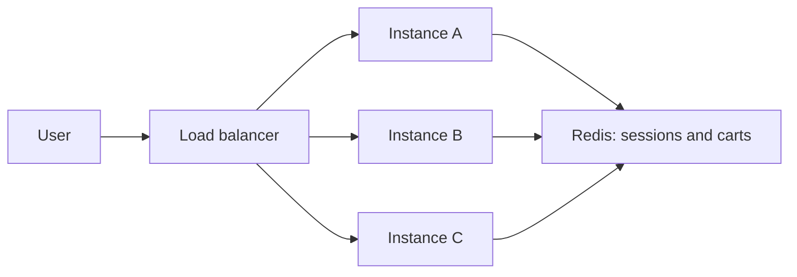

**Example:** Store HTTP sessions in Redis with Spring Session (Spring Boot 3).

```java
// build.gradle: spring-boot-starter-data-redis + spring-session-data-redis
@SpringBootApplication
@EnableRedisHttpSession // sessions go to Redis, not to this instance's memory
public class ShopApplication {
    public static void main(String[] args) {
        SpringApplication.run(ShopApplication.class, args);
    }
}
```

Or skip sessions fully: the client sends a JWT on each request, and the service only checks its signature.

**Good and bad:**

| Good | Bad |
|---|---|
| Any instance can serve any user | Session data must go to a shared store (one more system) |
| Easy autoscaling and easy deploys | Extra network call to Redis (~1 ms) |
| One instance crash loses no user data | JWTs are hard to cancel before they expire |

**When to use / when not to use:**
- Use for almost all web and API services.
- Some things are stateful by nature: databases, caches, WebSocket chat servers. Keep them few and manage them with care.

**Say this in the interview:**
> "I keep the services stateless. Session and cart data go to Redis, or the user sends a JWT.
> So the load balancer can send any request to any instance.
> If an instance dies, the user does not even notice."

**They may ask next:**
- **What are sticky sessions? Are they bad?** The load balancer sends one user always to the same instance. It works, but if that instance dies, the user's session is gone. Load is also uneven. Avoid it if you can.
- **How do you log out a user with JWT?** Keep tokens short-lived (5–15 minutes) with a refresh token. For instant logout, keep a small block list in Redis.
- **Is a WebSocket server stateless?** No. It holds open connections. You need a shared place (like Redis pub/sub) to find which server holds which user.

### Load balancing

**In one line:** A load balancer sits in front of many servers and shares incoming requests between the healthy ones.

**Story:** At a big toll plaza, a guard stands before the booths.
He waves each car to a booth with a short queue.
If one booth's machine breaks, he stops sending cars there.
That guard is the load balancer.

**How it works:**
1. All clients call one address (like `api.shop.com`). This goes to the load balancer.
2. The load balancer picks one healthy server using a rule (algorithm).
3. It checks each server every few seconds with a **health check** (for example `GET /actuator/health`). Failed servers are removed.
4. **Layer 4 (L4)** load balancers look only at IP and port. They are very fast. Example: AWS NLB.
5. **Layer 7 (L7)** load balancers read the HTTP request (URL, headers). They can route `/orders` to one service and `/users` to another. Example: AWS ALB, Nginx.

**Common algorithms:**

| Algorithm | How it picks | Good for |
|---|---|---|
| Round robin | 1, 2, 3, 1, 2, 3... | Servers of the same size, similar requests |
| Weighted round robin | Bigger servers get more | Mixed server sizes |
| Least connections | Server with the fewest open requests | Requests of very different lengths |
| IP hash / consistent hashing | Same user or key → same server | When a server keeps a local cache per key |

**Diagram:**

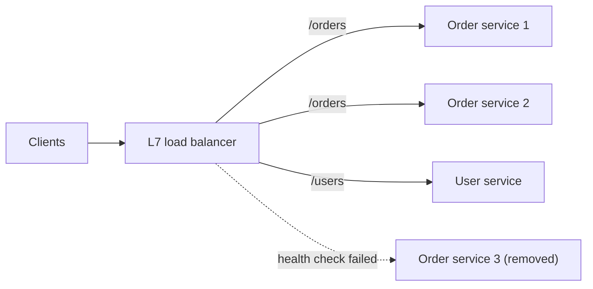

**Example:** In Spring Boot, expose a health endpoint with Actuator. The load balancer calls it.
- **Liveness** (`/actuator/health/liveness`): "Is the app running?" If no, restart it.
- **Readiness** (`/actuator/health/readiness`): "Can it take traffic now?" If no, stop sending requests, but do not restart.
- An app that is still warming up, or has lost its database, is alive but not ready.
- These probe endpoints turn on by themselves on Kubernetes. Elsewhere, set `management.endpoint.health.probes.enabled=true`.

**Good and bad:**

| Good | Bad |
|---|---|
| Spread load and survive server failures | The load balancer itself can fail (cloud LBs run on many machines to avoid this) |
| Deploy with no downtime (drain one server, update, add back) | Adds a small hop (~1 ms) |
| SSL/TLS can end at the LB, so services do less work | Bad health checks can remove all servers at once |

**Say this in the interview:**
> "I put an L7 load balancer in front of the services. It routes by path and uses least connections or round robin.
> It runs health checks on the readiness endpoint, so broken instances get no traffic.
> We run it across 3 zones so it is not a single point of failure."

**They may ask next:**
- **What if the load balancer dies?** Managed cloud LBs (ALB, NLB) run on many machines across zones. For your own Nginx, run two with a floating IP, or use DNS with several IPs.
- **What is client-side load balancing?** The client picks the server itself, using a list from service discovery. Spring Cloud LoadBalancer does this. It saves one network hop.
- **Health check passes but the server returns errors. Now what?** Use *outlier detection*: remove a server that returns many 5xx errors, even if its health check is green. Service meshes and some LBs support this.

### Caching

**In one line:** A cache keeps often-used data in fast memory. So we don't go to the slow database every time.

**Story:** A cook in a busy restaurant keeps salt, chilli and oil right next to the stove.
The big sacks stay in the storeroom.
Going to the storeroom every time would be slow. So she keeps a small amount close.
But if she forgets to refill, or the spice gets old, the food tastes wrong. That is the cache problem: **stale data**.

**How it works (the main patterns):**

1. **Cache-aside (most common).** The app manages the cache.
   - Read: check cache → if found ("hit"), return it → if not ("miss"), read DB, put in cache, return.
   - Write: update DB, then **delete** the cache key. The next read loads fresh data.
2. **Write-through.** Every write goes to cache and DB together. The cache is always fresh. Writes are a little slower.
3. **Write-behind (write-back).** Write to cache first. Save to DB later, in batches. Very fast writes. But if the cache dies before saving, you **lose data**.

**Other words you need:**
- **TTL (time to live):** the key deletes itself after some time, like 5 minutes. A safety net against stale data.
- **Eviction:** when the cache is full, it removes something. **LRU** (least recently used) removes the key nobody touched for the longest time. **LFU** removes the key used the fewest times.
- **Hit ratio:** hits ÷ total reads. Aim for 90%+ on a read-heavy system.

**Diagram (cache-aside read):**

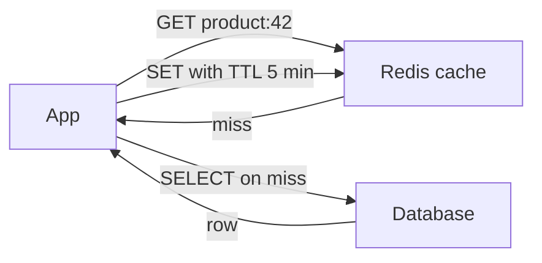

**Example:** Cache-aside with Spring Cache (works with Redis).

```java
@Service
public class ProductService {
    private final ProductRepository repo;
    public ProductService(ProductRepository repo) { this.repo = repo; }

    @Cacheable(value = "products", key = "#id") // miss → DB call, then stored in cache
    public Product getProduct(long id) {
        return repo.findById(id).orElseThrow();
    }

    @CacheEvict(value = "products", key = "#p.id()") // delete key after update
    public Product update(Product p) {
        return repo.save(p);
    }
}
```

Set TTL in config, for example `spring.cache.redis.time-to-live=5m`. Add `@EnableCaching` on a config class.

**Common cache problems:**

| Problem | What happens | Fix |
|---|---|---|
| **Cache stampede** | A popular key expires. 10,000 requests miss at the same time and all hit the DB. | Only one request reloads (a lock or "single flight"); others wait or get the old value. Refresh popular keys before they expire. |
| **Hot key** | One key (a celebrity's profile, the iPhone sale page) gets huge traffic. One Redis node melts. | Add a small local cache in each instance (Caffeine, 5–10 seconds). Or copy the key as `key#1`…`key#10` and read a random one. |
| **Stale data** | DB changed but cache still has the old value. | Delete the key on update. Keep a TTL as backup. For money or stock, read from DB. |
| **Avalanche** | Many keys expire at the same second, so the DB gets a flood. | Add random jitter to TTL: 5 min ± 30 s. |
| **Penetration** | Requests for IDs that don't exist always miss and hit the DB. | Cache "not found" for a short time, or use a Bloom filter (a small structure that says "surely not present"). |

**Good and bad:**

| Good | Bad |
|---|---|
| Reads in ~1 ms instead of ~5–50 ms | Stale data risk |
| DB load can drop by 90% | One more system to run and watch |
| Absorbs traffic spikes | If the cache dies, the DB may get all traffic at once |

**When to use / when not to use:**
- Use for data read much more than it changes: product pages, user profiles, config.
- Avoid for data that must be exact right now: bank balance, last item of stock.

**Say this in the interview:**
> "I use cache-aside with Redis. On a miss, the app reads the DB and stores the result with a 5-minute TTL.
> On update, I write the DB first and then delete the cache key.
> For hot keys, I add a short local cache. To stop a stampede, only one request reloads a missing key."

**They may ask next:**
- **Why delete the key on update, not update it?** Two parallel updates can write to the cache in the wrong order. Then the cache keeps the wrong value forever. Deleting is safer; the next read loads fresh data.
- **DB first or cache first on write?** DB first, then delete the cache. If you delete first, another reader can load the old value back before the DB is updated.
- **Local cache or Redis?** Local (Caffeine) is fastest (nanoseconds) but each instance has its own copy, so data can differ. Redis is shared. Many systems use both: small local cache plus Redis.
- **What is Redis's default eviction policy?** `noeviction`: it returns errors when memory is full. For a cache, set `allkeys-lru` or `allkeys-lfu`.

### CDN

**In one line:** A CDN (Content Delivery Network) keeps copies of your files on servers close to users, so they load fast.

**Story:** A biscuit company makes biscuits in one factory in Mumbai.
But you buy them from the shop next to your house in Delhi.
The company sent stock to warehouses and shops in every city.
You don't wait for a truck from Mumbai. A CDN does the same for images, videos and JavaScript files.

**How it works:**
1. The CDN has many servers around the world, called **edge locations** (hundreds of cities).
2. The user asks for `cdn.shop.com/logo.png`. DNS sends the user to the nearest edge.
3. If the edge has the file (hit), it returns it right away.
4. If not (miss), the edge gets it from your server (the **origin**), keeps a copy, and returns it.
5. Your `Cache-Control` header decides how long the edge keeps the file. Example: `Cache-Control: max-age=86400` = 1 day.

**Diagram:**

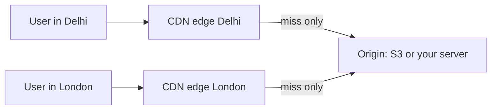

**Example:**
- Without CDN: user in London loads a 500 KB image from a server in Mumbai. Round trip ~120 ms, plus slow transfer.
- With CDN: the London edge is ~10 ms away. The image loads much faster.
- If 1 million users load a 500 KB image per day, that is 500 GB. With a 95% hit ratio, your origin sends only 25 GB.

**Changing a file:** CDN copies may be old.
- Best: put a version in the file name, like `app.3f9a2c.js`. A new build = a new name. No stale copies.
- Or: send an **invalidation** to the CDN (takes seconds to minutes, may cost money).

**Good and bad:**

| Good | Bad |
|---|---|
| Fast for users far away | Old files can stay on edges until TTL ends |
| Takes most traffic off your servers | Costs money per GB |
| Helps absorb DDoS attacks (floods of fake traffic) | Personal data must not be cached by mistake |

**When to use / when not to use:**
- Use for images, videos, CSS, JavaScript, downloads.
- Also for public API responses that are the same for everyone (like a product list), with a short TTL.
- Don't cache personal pages ("my orders") at the CDN. Use `Cache-Control: private` for them.

**Say this in the interview:**
> "Static files and images go to S3 behind a CDN like CloudFront.
> File names include a version hash, so new deploys never serve old files.
> This takes over 90% of the bandwidth off our servers."

**They may ask next:**
- **Push CDN vs pull CDN?** Pull: the edge fetches from origin on first miss (most common). Push: you upload files to the CDN yourself. Pull is easier.
- **Can a CDN cache API responses?** Yes, if the response is the same for many users. Use a short TTL like 30–60 seconds.
- **How do you protect the origin?** Allow only the CDN to call the origin (for example, CloudFront with a private S3 bucket).

### Database replication (read replicas)

**In one line:** Replication keeps copies of the database on other machines. One leader takes writes. Followers copy them and serve reads.

**Story:** A school principal writes a new notice on the main notice board.
A peon copies it to the notice boards on each floor.
Students on floor 3 read their floor's board. It saves them a walk.
But for a few minutes, the floor 3 board may still show the old notice. That delay is **replication lag**.

**How it works:**
1. **Leader** (also called primary or master): all writes go here.
2. **Followers** (also called replicas): they copy every change from the leader's log.
3. Reads can go to followers. This spreads read load.
4. If the leader dies, one follower is **promoted** to be the new leader (failover).
5. **Async replication** (default in PostgreSQL and MySQL): leader does not wait for followers. Fast, but a few writes can be lost on failover.
6. **Sync replication:** leader waits for at least one follower to confirm. Safer, but each write is slower.

**Diagram:**

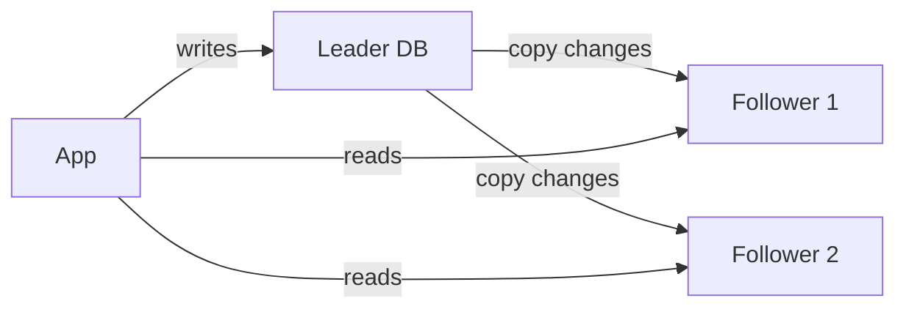

**Example:** 1,200 reads and 120 writes per second.
- One leader handles all 120 writes.
- 2 followers share the 1,200 reads (600 each).
- Lag is usually milliseconds, but can be seconds under heavy load.

**The read-your-own-writes problem:**
- A user changes their address. The write goes to the leader.
- 50 ms later, the page reloads. The read goes to a follower that has not copied the change yet.
- The user sees the **old** address and thinks the save failed.

Fixes:
- After a user writes, send **that user's** reads to the leader for a short time (for example, 10 seconds).
- Always read the user's own profile or orders from the leader. Other users' data can come from followers.
- Track the write's position in the log. Read from a follower only if it has caught up to that position.

**Good and bad:**

| Good | Bad |
|---|---|
| More read capacity | Does not help with write load |
| A ready copy if the leader dies | Replication lag gives stale reads |
| Run reports on a follower, not on the leader | Failover with async replication can lose the last few writes |

**When to use / when not to use:**
- Use when reads are much more than writes. Most apps are like this.
- Always use at least one follower in another zone, for safety.
- Not a fix for too many writes. For that, see sharding.

**Say this in the interview:**
> "Writes go to the leader, and reads go to 2 read replicas in other zones.
> Replication is async, so there is some lag.
> For read-your-own-writes, I send a user's reads to the leader for a few seconds after they write."

**They may ask next:**
- **What happens on failover?** A follower is promoted. Apps reconnect to the new leader (managed services like AWS RDS change the DNS name). With async replication, the last few writes may be lost.
- **What is multi-leader replication?** Writes can go to more than one leader, for example one per region. It is faster for global users, but two leaders can change the same row. You then need conflict rules.
- **How do you route reads in Spring?** Use two DataSources and an `AbstractRoutingDataSource`. Send `@Transactional(readOnly = true)` methods to the replica.

### Partitioning and sharding

**In one line:** Sharding splits one big table across many database machines. Each machine holds only part of the data and writes.

**Story:** A big university exam has 50,000 students.
One hall cannot fit everyone. So: roll numbers 1–10,000 in Hall A, 10,001–20,000 in Hall B, and so on.
Each student knows which hall to go to from the roll number.
The roll number is the **shard key**.

**Words first:**
- **Partitioning:** splitting a table into parts. Can be on one machine (like PostgreSQL table partitions by month).
- **Sharding:** the parts live on **different machines**. Each part is a **shard**.

**How it works:**
1. Pick a **shard key**, like `customer_id`.
2. A rule maps each key to a shard.
   - **Hash:** `hash(customer_id) % 4` → shard 0, 1, 2 or 3. Spreads data evenly.
   - **Range:** IDs 1–1M → shard 1, 1M–2M → shard 2. Good for range queries, but new data can pile on one shard.
   - **Directory / lookup table:** a small table says "customer 42 → shard 3". Flexible, but one more lookup.
3. The app (or a proxy like Vitess or Citus) sends each query to the right shard.

**Diagram:**

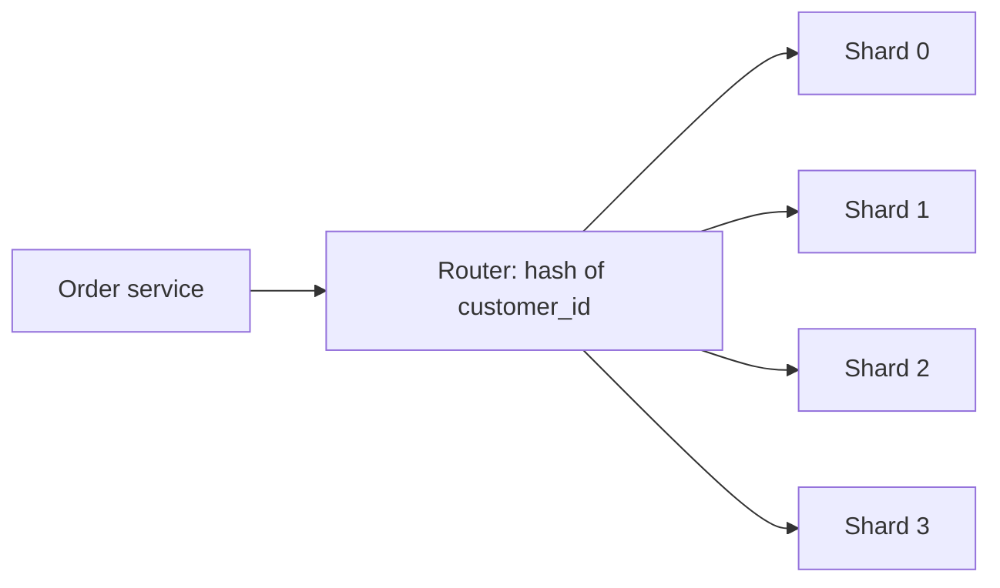

**How to pick a shard key:**
- **Many different values** (high cardinality). `customer_id` is good. `country` is bad (few values, India alone may be huge).
- **Spreads load evenly.** No single value gets most of the traffic.
- **Matches your main query.** If you mostly ask "orders of customer X", shard by `customer_id`. Then one query hits one shard.
- **Bad keys:** `created_date` (all of today's writes go to one shard), `status` (few values).

**Example:**

```java
int shardFor(long customerId, int shardCount) {
    // floorMod avoids negative results for negative hash codes
    return Math.floorMod(Long.hashCode(customerId), shardCount);
}
// customerId 1001 with 4 shards → shard 1. All of this customer's orders live there.
```

**Problems:**
- **Hot shard:** one shard gets far more traffic. Example: a big seller with 1 million orders a day on one shard. Fix: split that key further, like `seller_id + bucket(0..9)`, or give the big seller its own shard.
- **Cross-shard queries:** "top 10 products across all orders" must ask every shard and merge. Slow. Use a separate analytics store for this.
- **Cross-shard transactions:** a transfer between two customers on different shards needs a saga or 2-phase commit. Hard.
- **Resharding:** going from 4 to 8 shards. With `hash % N`, changing N moves most keys.

**How to reshard with less pain:**
- Start with many **logical shards** (like 1,024) placed on a few machines (like 4). To grow, move some logical shards to new machines. The key → logical shard rule never changes.
- Or use **consistent hashing** (next topic).
- Move data online: copy data to the new shard, write to both, check, then switch reads, then stop the old writes.

**Good and bad:**

| Good | Bad |
|---|---|
| Write capacity grows with each shard | Joins and transactions across shards are hard |
| Each shard is smaller, so queries and backups are faster | Resharding is a big project |
| A shard failure affects only part of the users | More machines to run and watch |

**When to use / when not to use:**
- Use when one leader cannot take the **writes**, or the data does not fit one machine (many TB).
- Don't shard early. First try: bigger machine, indexes, cache, read replicas, archiving old data.

**Say this in the interview:**
> "At this scale, one database is enough, so I would not shard yet.
> If writes grow beyond one machine, I shard by customer_id, because most queries are per customer.
> I start with 1,024 logical shards on a few machines, so I can move shards later without rehashing all the data."

**They may ask next:**
- **How do you get unique IDs across shards?** Use UUIDs, or a Snowflake-style ID (time + machine id + counter). Don't use auto-increment per shard.
- **How do you query by another field, like order_id?** Put the shard key inside the order ID. Or keep a small lookup table `order_id → customer_id`.
- **Sharding vs partitioning in PostgreSQL?** PostgreSQL partitioning splits a table on one server. For many servers, use Citus or do it in the app.

### Consistent hashing

**In one line:** Consistent hashing puts servers and keys on a circle. When you add or remove a server, only a few keys move.

**Story:** Picture a big round dining table with 12 seats.
Three waiters stand at different points around the table.
Each guest is served by the next waiter going clockwise.
A fourth waiter joins and stands between two others. He takes only the guests between himself and the waiter before him.
Nobody else changes waiter. That is consistent hashing.

**Why we need it:**
- Simple rule: `server = hash(key) % N`.
- Go from 4 servers to 5. About **80% of keys** now map to a different server.
- For a cache, that means 80% misses at once. The database gets flooded.
- With consistent hashing, only about **1/5 = 20%** of keys move.

**How it works:**
1. Picture a circle of numbers, for example 0 to 2^32.
2. Hash each **server** name to a point on the circle.
3. Hash each **key** to a point on the circle.
4. A key belongs to the **first server clockwise** from it.
5. Add a server: it takes keys only from its one neighbour.
6. Remove a server: its keys go to the next server clockwise.
7. **Virtual nodes:** each server is placed at many points (like 100–200). This spreads keys evenly. A bigger server can get more points.

**Diagram:**

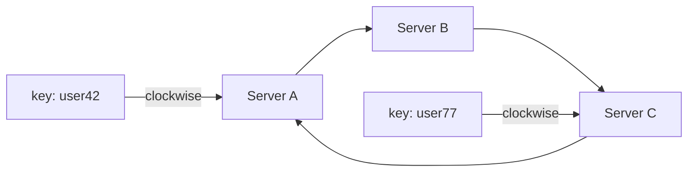

**Example:** A small ring in Java with virtual nodes.

```java
public class HashRing {
    private final TreeMap<Integer, String> ring = new TreeMap<>();
    private static final int VIRTUAL_NODES = 100;

    public void addServer(String server) {
        for (int i = 0; i < VIRTUAL_NODES; i++) {
            ring.put(hash(server + "#" + i), server); // many points per server
        }
    }

    public String serverFor(String key) {
        var entry = ring.ceilingEntry(hash(key));                   // first point clockwise
        return entry != null ? entry.getValue() : ring.firstEntry().getValue(); // wrap around
    }

    private int hash(String s) {
        return s.hashCode() & 0x7fffffff; // use MurmurHash in real code for better spread
    }
}
```

**Good and bad:**

| Good | Bad |
|---|---|
| Adding or removing a server moves only ~1/N keys | More complex than `hash % N` |
| No big cache-miss flood when scaling | Without virtual nodes, load is uneven |
| Works well when servers change often | Still does not fix one very hot key |

**Where it is used:** Cassandra, DynamoDB, client-side cache sharding (Memcached clients), some load balancers.
Note: Redis Cluster uses a similar idea with **16,384 fixed hash slots** instead of a ring.

**Say this in the interview:**
> "With hash mod N, adding one server moves most keys, so the cache gets a flood of misses.
> Consistent hashing puts servers and keys on a ring; a key goes to the next server clockwise.
> Adding a server moves only about 1/N of the keys. Virtual nodes keep the load even."

**They may ask next:**
- **Why virtual nodes?** With only 3 points on the ring, one server may get a big arc and 50% of keys. With 100+ points per server, each gets close to an equal share.
- **How do you store copies (replicas) with it?** Store the key on the next 2–3 different servers clockwise. Cassandra and DynamoDB do this.

### Database consistency (strong vs eventual)

**In one line:** Strong consistency: every read sees the latest write. Eventual consistency: reads may be a bit old for a short time, but all copies match in the end.

**Story:** India is batting in a cricket match.
In the stadium, the big scoreboard shows the score **right away**. That is strong consistency.
Your cricket app shows it 5 seconds late. The newspaper shows it the next morning.
All of them will show the same final score **in the end**. That is eventual consistency.
For a cricket score, 5 seconds late is fine. For your bank balance, it is not.

**How it works:**
1. **Strong consistency:**
   - Reads go to the leader, or the system waits until enough copies agree before answering.
   - You always see the latest value.
   - Cost: slower, and less available if some machines cannot talk.
2. **Eventual consistency:**
   - A write goes to one copy, and other copies update later (milliseconds to seconds).
   - A read may hit a copy that is not updated yet.
   - Gain: faster and stays up even when some machines fail.
3. **In between (useful ones):**
   - **Read-your-own-writes:** you always see your own changes. Others may see them late.
   - **Monotonic reads:** you never see time go backwards (new value, then old value again).

**Example:** In a shopping app:

| Data | Which one | Why |
|---|---|---|
| Payment, wallet balance | Strong | Showing wrong money is a big problem |
| Last item in stock | Strong | Two people must not buy the same last item |
| Product reviews, likes count | Eventual | A few seconds late is fine |
| Search results | Eventual | New products can show up after a minute |
| User's own order after placing it | Read-your-own-writes | The user must see their order right away |

**Quorum (a simple rule used by Cassandra and DynamoDB-style stores):**
- N = copies of the data (say 3). W = copies that must confirm a write. R = copies to read from.
- If **R + W > N**, the read always includes at least one copy with the latest write.
- Example: N=3, W=2, R=2 → 4 > 3 → you get the latest value.

**Good and bad:**

| | Strong | Eventual |
|---|---|---|
| Correct right away | Yes | Not always |
| Speed | Slower | Faster |
| Stays up during failures | Less | More |
| Easy for developers | Yes | Need to handle old data |

**Say this in the interview:**
> "I don't pick one for the whole system. I pick per feature.
> Payments and stock need strong consistency, so they go to the leader database with transactions.
> Likes, feeds and search can be eventually consistent, which lets us use caches, replicas and async events."

**They may ask next:**
- **How do you get strong consistency with replicas?** Read from the leader. Or use sync replication. Or use quorum reads and writes (R + W > N).
- **How do microservices stay consistent?** Usually eventual consistency with events (Kafka) and sagas. Each service owns its data and catches up from events.

### CAP theorem

**In one line:** When the network between database machines breaks, you must choose. Give correct answers (Consistency) or keep answering (Availability). Not both.

**Story:** A bank has two branches, in Delhi and Mumbai. They share your account.
One day, the phone line between them is cut.
You go to the Delhi branch to take out money.
Option 1: Delhi says, "Sorry, I cannot check with Mumbai. Come back later." → Correct, but **not available**.
Option 2: Delhi gives you the money. Mumbai may also give money to your wife at the same time. → **Available**, but the balance may be wrong.
The bank cannot have both while the line is cut.

**The three letters:**
- **C – Consistency:** every read gets the latest write (or an error).
- **A – Availability:** every request gets an answer (maybe not the latest).
- **P – Partition tolerance:** the system keeps working when the network between machines breaks.

**How it works:**
1. In a distributed system, network breaks **will** happen. So P is not a choice. You must handle it.
2. So the real choice is only during a break: **C or A**.
3. When the network is fine, you can have both C and A.

**Diagram:**

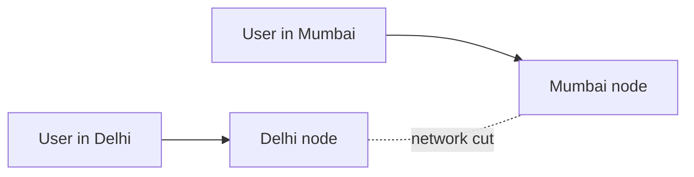

**Examples:**

| Type | During a network break | Examples |
|---|---|---|
| CP | Refuses some requests to stay correct | ZooKeeper, etcd, HBase, a single-leader SQL setup |
| AP | Keeps answering, may return old data, fixes later | Cassandra, DynamoDB (default reads), DNS |

Many databases let you tune this. Cassandra with `QUORUM` reads and writes acts more like CP.

**PACELC (CAP's bigger brother, in simple words):**
- **If Partition (P):** choose **A**vailability or **C**onsistency.
- **Else (E)**, when all is normal: choose **L**ow latency or **C**onsistency.
- Why it matters: even on a normal day, waiting for all copies to agree makes every request slower.
- Example: DynamoDB and Cassandra are PA/EL (fast, eventually consistent by default). A sync-replicated SQL setup is PC/EC.

**Good and bad:**

| | CP | AP |
|---|---|---|
| Good for | Money, stock, locks, leader election | Feeds, likes, shopping cart, sessions |
| Risk | Some users get errors during a break | Users may see old data or conflicts |

**Say this in the interview:**
> "Network breaks will happen, so partition tolerance is a must. The real choice is consistency or availability during the break.
> For payments, I pick consistency: better to fail than to charge twice.
> For the product catalog, I pick availability: old data for a minute is fine.
> PACELC adds that even without a break, we trade latency for consistency."

**They may ask next:**
- **Is a single PostgreSQL CP or AP?** One machine has no partition between copies, so CAP does not really apply. With async replicas and failover, it is closer to CP for writes (one leader), but reads from replicas can be stale.
- **Can you be CA?** Only if the network never breaks, which is not real for a distributed system. A single machine is "CA" only because it is not distributed.

### SQL vs NoSQL

**In one line:** SQL stores data in tables with a fixed structure and strong transactions. NoSQL uses other shapes (key-value, documents, wide columns, graphs) and often scales out more easily.

**Story:** A government office uses a printed form. Every person fills the same boxes: name, age, address. Easy to sort, check and join with other forms. That is **SQL**.
Your personal diary has no fixed format. One day a list, one day a drawing, one day a long note. Very flexible. But hard to answer "show all entries about money from March". That is closer to **NoSQL**.

**How it works:**
1. **SQL (relational):** PostgreSQL, MySQL, Oracle.
   - Tables, rows, columns. A fixed **schema** (structure).
   - **Joins** between tables.
   - **ACID transactions**: all-or-nothing, correct, isolated, saved safely.
2. **NoSQL types:**

| Type | Shape | Examples | Good for |
|---|---|---|---|
| Key-value | `key → value` | Redis, DynamoDB | Cache, sessions, carts |
| Document | JSON-like documents | MongoDB, Couchbase | Product catalog, flexible profiles |
| Wide-column | Rows with many columns, split by a partition key | Cassandra, HBase | Huge write volume, time-series, logs |
| Graph | Nodes and links | Neo4j | Friends of friends, fraud links |

**Example:** An e-commerce company may use:
- **PostgreSQL** for orders and payments (needs transactions).
- **MongoDB** or PostgreSQL `JSONB` for the product catalog (each product has different fields: shirts have size, phones have RAM).
- **Redis** for cache and sessions.
- **Cassandra** for click and view events (billions of writes, simple lookups).
- **Elasticsearch** for search.

Using the right store for each job is called **polyglot persistence**.

**Good and bad:**

| | SQL | NoSQL |
|---|---|---|
| Transactions | Strong, built-in | Often limited (MongoDB has multi-document transactions since 4.0, but they cost more) |
| Joins and ad-hoc queries | Very good | Weak; design data for the query you know |
| Schema | Fixed, changes need migrations | Flexible |
| Scale writes across machines | Hard (sharding is manual or needs Citus/Vitess) | Often built-in |
| Best for | Money, orders, anything with relations | Huge scale, simple access patterns, flexible data |

**When to use / when not to use:**
- **Default to SQL.** PostgreSQL handles most apps up to a large size.
- Pick NoSQL for a clear reason: very high write volume, very simple key lookups, or truly flexible data.
- Don't pick NoSQL "because it scales" if your data is 50 GB.

**Say this in the interview:**
> "For orders and payments I use PostgreSQL, because I need transactions and joins.
> For the high-volume event data, I use Cassandra, because writes are huge and queries are simple by key.
> I start with SQL by default and move a piece to NoSQL only when the numbers or access pattern need it."

**They may ask next:**
- **Can PostgreSQL store JSON?** Yes, with `JSONB`. You can index fields inside it. Often this is enough instead of a separate document database.
- **How do you model data in Cassandra?** Start from the queries. One table per query. Duplicate data on purpose. Pick a partition key that spreads data evenly.
- **What is BASE?** The NoSQL style: **B**asically **A**vailable, **S**oft state, **E**ventually consistent. The opposite style to ACID.

### Database indexes

**In one line:** An index is a sorted helper structure that lets the database find rows fast without reading the whole table.

**Story:** You want to find "Garbage collection" in a 900-page Java book.
Option 1: read every page. Very slow.
Option 2: go to the **index at the back**. It is sorted A to Z. Find "G", then "Garbage collection → page 412". Jump there.
A database index is the same. And like a book, more index pages make the book thicker and slower to update.

**How it works (B-tree, the default index):**
1. A **B-tree** is a sorted tree. The top (root) points to ranges. Each level narrows the range. The bottom (leaf) level points to the rows.
2. Each tree page holds hundreds of keys. So even 100 million rows need only **3–4 levels**.
3. Finding one row = 3–4 page reads, instead of reading millions of rows.
4. Leaves are sorted and linked. So range queries (`BETWEEN`, `>`, `ORDER BY`) are also fast.

**Diagram:**

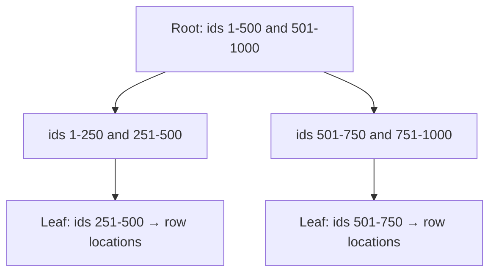

**Example:**

```sql
-- Without an index: full table scan of 50 million rows (seconds)
SELECT * FROM orders WHERE customer_id = 42;

-- With an index: 3-4 page reads (about 1 ms)
CREATE INDEX idx_orders_customer ON orders (customer_id);
```

Use `EXPLAIN` (or `EXPLAIN ANALYZE` in PostgreSQL) to check if the index is used.

**Composite index and the leftmost prefix rule:**
- A **composite index** covers more than one column: `(customer_id, created_at)`.
- It is sorted by `customer_id` first, then by `created_at` inside each customer. Like a phone book sorted by last name, then first name.
- **Leftmost prefix rule:** the index helps only if your query uses the columns **from the left**.

| Query | Uses index `(customer_id, created_at)`? |
|---|---|
| `WHERE customer_id = 42` | Yes |
| `WHERE customer_id = 42 AND created_at > '2026-01-01'` | Yes, best case |
| `WHERE customer_id = 42 ORDER BY created_at DESC` | Yes, no extra sort needed |
| `WHERE created_at > '2026-01-01'` | Usually no (like finding all people named "Rahul" in a phone book sorted by last name) |

- Rule of thumb: put **equality** columns (`=`) first, then **range** or sort columns (`>`, `ORDER BY`).
- Some databases have a "skip scan" for the last case, but don't count on it.

**Covering index:**
- If the index has **all the columns the query needs**, the database answers from the index alone. It does not touch the table at all.
- Example: `SELECT created_at, total FROM orders WHERE customer_id = 42`.
- Index: `CREATE INDEX idx_cust_cover ON orders (customer_id, created_at) INCLUDE (total);` (PostgreSQL 11+).
- PostgreSQL shows "Index Only Scan". MySQL shows "Using index".

**The cost of indexes (on writes):**
- Every `INSERT` must also update **every index** on the table. 5 indexes = about 6 writes for 1 row.
- `UPDATE` on an indexed column updates that index too.
- Indexes use disk and memory. On big tables, indexes can be as large as the data.
- So: index the columns you really search, sort or join on. Remove unused indexes.

**Good and bad:**

| Good | Bad |
|---|---|
| Reads go from seconds to milliseconds | Slower inserts and updates |
| Fast sort and range queries | More disk and RAM |
| Unique index stops duplicate data | Too many indexes confuse the planner and waste space |

**When to use / when not to use:**
- Index foreign keys (`customer_id`), columns in `WHERE`, `JOIN` and `ORDER BY`.
- Skip indexes on columns with very few values, like `status` with 3 values. The database often scans the table anyway. (A *partial index* like `WHERE status = 'PENDING'` can still help if few rows are pending.)
- Be careful on tables with very heavy writes, like logs or events.

**Say this in the interview:**
> "I add indexes based on the main queries. For 'orders of a customer, newest first', I add a composite index on customer_id and created_at, in that order.
> It is a B-tree, so even 100 million rows need only 3 or 4 page reads.
> Each index slows writes a bit, so I index only what the queries need, and I check with EXPLAIN."

**They may ask next:**
- **Clustered vs non-clustered index?** Clustered = the table rows are stored in index order (MySQL InnoDB does this by primary key). Non-clustered = a separate structure that points to rows. A table has only one clustered index.
- **Why might the database ignore my index?** Common reasons:
  - The query wraps the column in a function, like `WHERE LOWER(email) = ...`.
  - The types don't match (comparing a number column to a string).
  - The query skips the leftmost column of a composite index.
  - The query returns so many rows that a full scan is cheaper.
- **B-tree vs hash index?** Hash is good only for `=`. B-tree handles `=`, ranges and sorting, so it is the default.
- **Why is a random UUID a weak primary key in MySQL?** New rows land at random places in the clustered B-tree. This causes page splits and slower inserts. Time-ordered IDs (UUIDv7, Snowflake IDs) avoid this.

### Message queues and pub/sub

**In one line:** A message queue lets one service drop a message now, and another service picks it up later.

**Story:**
- In a restaurant, the waiter does not stand in the kitchen and wait for the cook.
- He writes an order slip and puts it on the rail. Any free cook picks it up.
- That is a **queue**: one slip, one cook.
- A newspaper is different. Every subscriber gets their own copy of the same paper.
- That is **pub/sub** (publish/subscribe): one message, many readers.

**How it works:**
1. A **producer** (the service that sends) writes a message to the queue or topic.
2. The queue stores the message safely on disk.
3. A **consumer** (the service that reads) picks it up when it is free.
4. The consumer sends an **ack** (acknowledgement, "I am done"). Only then is the message removed or marked done.
5. If the consumer crashes before the ack, the message is given to someone else.

**Queue vs pub/sub:**

| | Queue (point-to-point) | Pub/sub (topic) |
|---|---|---|
| Who gets the message? | Only **one** consumer | **Every** subscriber group gets a copy |
| Real example | "Send this one email" job | "Order placed" event: email, stock and analytics services all need it |
| Story | Order slip in a kitchen | Newspaper subscription |

**Why async (do it later, not now)?**
- **Faster response.** User clicks "Place order". We save the order and reply in 50 ms. Email and invoice happen later.
- **Handles spikes.** A sale sends 10,000 orders per second. The queue holds them. Workers process 2,000 per second and catch up.
- **Loose coupling.** If the email service is down, orders still work. Emails go out when it comes back.

**Diagram:**

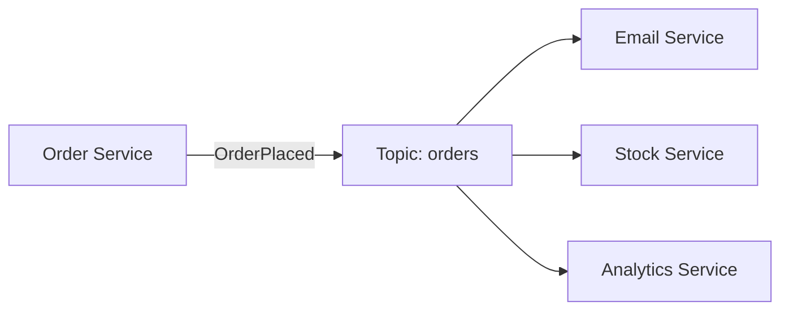

**Kafka vs RabbitMQ vs SQS (short version):**

| | Kafka | RabbitMQ | AWS SQS |
|---|---|---|---|
| Think of it as | A log book. Messages stay; readers keep their own page number. | A smart post office. It routes each message to the right queue. | A simple queue that AWS runs for you |
| Message after reading | Stays (default 7 days) | Deleted after ack | Deleted after you call delete |
| Replay old messages? | Yes | No (not by default) | No |
| Speed | Very high (millions per second per cluster) | High (tens of thousands per second per node) | Standard queue: almost no limit. FIFO: lower. |
| Best for | Event streams, many readers, replay | Task queues, complex routing | Simple jobs on AWS, zero servers to manage |

Kafka details are in the Kafka section.

**Good and bad:**

| Good | Bad |
|---|---|
| Fast user response | Harder to debug: the work happens "somewhere later" |
| Survives spikes and short outages | Messages can come **twice**, so consumers must be idempotent (safe to run twice) |
| Services do not depend on each other directly | One more system to run and watch |

**What can go wrong:**
- **Poison message:** one bad message fails again and again. Fix: after 3–5 tries, move it to a **dead letter queue** (a side queue for failed messages).
- **Duplicates:** most systems give "at least once" delivery. Store a processed message ID and skip repeats.
- **Order:** a normal queue does not keep strict order. Use Kafka partitions or SQS FIFO when order matters.

**Say this in the interview:**
> I use a queue when the user does not need to wait for the work. A queue gives each message to one worker. Pub/sub gives a copy to every subscriber. I make consumers idempotent and add a dead letter queue, because messages can come twice or fail.

**They may ask next:**
- **At-least-once vs exactly-once?** At-least-once means no loss but maybe duplicates. Exactly-once is hard and costly. Most teams use at-least-once plus idempotent consumers.
- **What is back pressure?** The queue grows faster than workers can read. Add more consumers, or slow down producers.
- **Queue vs direct REST call?** Use REST when the user needs the answer now. Use a queue when the work can happen later.

### Long polling vs WebSockets vs Server-Sent Events

**In one line:** These are four ways for the server to send new data to the browser: short polling, long polling, WebSocket and SSE.

**Story:** You are waiting for food at a restaurant.
- **Short polling:** You ask the waiter every 2 minutes, "Is my food ready?" Most answers are "No".
- **Long polling:** You ask once. The waiter stays quiet until the food is ready, then tells you. Then you ask again.
- **WebSocket:** You and the kitchen have a phone line that stays open. Both sides can talk any time.
- **SSE (Server-Sent Events):** A radio commentary of a cricket match. The radio talks to you. You cannot talk back on it.

**How each one works:**

| Method | How it works | Direction | Good for |
|---|---|---|---|
| Short polling | Client sends a request every N seconds | Client asks | Rare updates, simple admin pages |
| Long polling | Server holds the request open (for example 30 s) until there is news | Client asks, server waits | Old browsers, simple notifications |
| WebSocket | One TCP connection stays open after an HTTP "upgrade" | **Both ways** | Chat, multiplayer games, live editing |
| SSE | Normal HTTP response that never closes; server keeps writing events | **Server to client only** | Live cricket score, stock prices, order status |

**Simple numbers:**
- 1 million users with short polling every 5 seconds = **200,000 requests per second**. Most of them return "nothing new".
- With WebSocket or SSE, the same users need 1 million open connections, but almost no wasted requests.

**Example (SSE for a live score in Spring Boot):**

```java
@GetMapping(path = "/match/{id}/score", produces = MediaType.TEXT_EVENT_STREAM_VALUE)
public SseEmitter score(@PathVariable String id) {
    SseEmitter emitter = new SseEmitter(0L);   // 0 = no timeout
    scoreService.subscribe(id, emitter);       // service calls emitter.send(score) on each ball
    return emitter;
}
```

**How to scale WebSocket servers:**
- Problem: user A is connected to Server 1. User B is connected to Server 2. A sends B a chat message. Server 1 does not hold B's connection.
- Fix 1, **connection registry:** store `userId → serverId` in Redis. Server 1 looks up B, then sends the message to Server 2.
- Fix 2, **pub/sub:** every server subscribes to a Redis or Kafka channel. Server 1 publishes the message. Server 2 has B, so it delivers it.
- Send a **heartbeat** (small "ping") every 30 seconds. Load balancers often close idle connections after 60 seconds.
- One tuned server can hold tens of thousands of open connections. Most of them are idle.

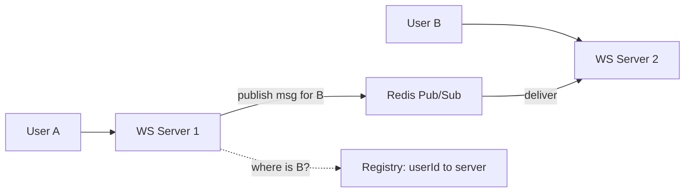

**Good and bad:**

| Good | Bad |
|---|---|
| Short polling: easiest to build | Wastes requests, slow updates |
| WebSocket: real two-way, very low delay | Stateful servers; harder to scale and to deploy |
| SSE: plain HTTP, auto-reconnect built into the browser | One way only; text data only |

**Say this in the interview:**
> For chat I use WebSocket because both sides send messages. For a live score I use SSE because only the server sends. To scale WebSockets, I keep a registry of which user is on which server. Redis pub/sub passes messages between servers.

**They may ask next:**
- **What happens when a WebSocket server dies?** The clients reconnect to another server. They ask for missed messages using the last message ID they saw.
- **Does the load balancer need sticky sessions?** For WebSocket, the connection itself stays on one server. Sticky sessions help only for the first handshake with some libraries.
- **Why not WebSocket for everything?** It costs more to run. If data only flows one way, SSE is simpler.

### Blob storage (files, images, videos)

**In one line:** Keep big files in a blob store like Amazon S3, and keep only the file's details (metadata) in the database.

**Story:**
- At a railway station cloakroom, you hand over your big suitcase.
- The clerk gives you a small token slip and writes in a register: "Token 42, blue bag, Shelf C".
- The register is small and fast to search. The heavy bags live on shelves.
- The **register is your database**. The **shelves are your blob store**.

**What is a blob?** "Binary large object". Any file: photo, PDF, video. The store gives each file a key (a path), like `users/42/profile.jpg`.

**How it works:**
1. Client asks our app: "I want to upload `cat.jpg`, 3 MB."
2. App creates a **pre-signed URL**: a temporary link that allows one upload to one key, valid for maybe 15 minutes.
3. Client uploads the file **directly to S3** using that link. The file never passes through our servers.
4. Client tells the app "upload done". App saves metadata in the database: owner, key, size, type, created time.
5. Users download through a **CDN** (servers near the user that cache files).

**Diagram:**

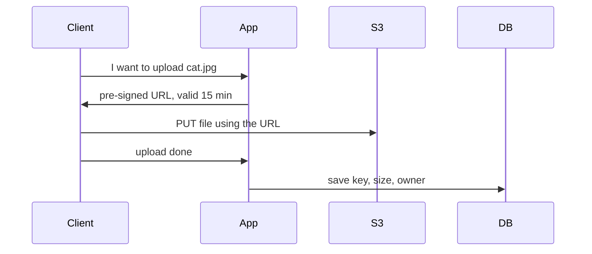

**Example (create a pre-signed upload URL, AWS SDK v2):**

```java
PutObjectRequest put = PutObjectRequest.builder()
        .bucket("my-photos").key("users/42/cat.jpg").contentType("image/jpeg").build();

PresignedPutObjectRequest signed = presigner.presignPutObject(r -> r
        .signatureDuration(Duration.ofMinutes(15))   // link stops working after 15 min
        .putObjectRequest(put));

return signed.url().toString();   // give this to the browser
```

**Big files: chunked (multipart) upload:**
- A 2 GB video on a mobile network will fail halfway. Do not restart from zero.
- Split it into parts, for example 10 MB each. Upload parts in parallel. Retry only the failed part.
- S3 rules: one simple PUT can be up to 5 GB. Multipart parts are 5 MB to 5 GB, up to 10,000 parts. AWS suggests multipart for files over 100 MB.
- At the finish, the client calls "complete", and S3 joins the parts into one file.

**Good and bad:**

| Good | Bad |
|---|---|
| Very cheap per GB, almost no size limit | Not a database: no queries like "all photos from June" (that is why metadata goes in the DB) |
| Very durable (S3 keeps copies in many places) | Changing a file means uploading the whole file again |
| CDN in front makes downloads fast all over the world | Leaked pre-signed URLs can be used until they expire, so keep them short |

**Why not store files in the database?**
- Images make the database huge. Backups get slow. Replication gets slow.
- Database storage costs much more than blob storage.

**Say this in the interview:**
> I store files in S3 and only metadata in the database. The client uploads straight to S3 with a short-lived pre-signed URL, so my servers don't carry the bytes. For big files I use multipart upload, and I put a CDN in front for downloads.

**They may ask next:**
- **How do you keep files private?** Keep the bucket private. Give users pre-signed download URLs, or signed CDN URLs, that expire.
- **What if the client uploads but never says "done"?** Run a cleanup job. Or use an S3 event: S3 tells our app when a new file lands.
- **How do you make thumbnails?** The S3 "file uploaded" event goes to a queue. A worker makes small sizes and saves them back to S3.

### Unique ID generation

**In one line:** In a distributed system we need IDs that never repeat, even when many servers create them at the same time.

**Story:**
- A bank has 500 branches. Each branch opens new accounts every day.
- If every branch counts 1, 2, 3..., two customers get account number 1.
- So each account number starts with the branch code: `0042-000001`. Now numbers never clash.
- Twitter's Snowflake uses the same idea: time + machine number + a counter.

**Why database auto-increment is a problem:**
- It works on one database. With 10 shards (database pieces), each shard counts 1, 2, 3. IDs clash.
- One central counter is a single point of failure and a bottleneck.
- Sequential IDs leak business numbers. A competitor sees order 1,000 today and 1,500 tomorrow, so 500 orders a day.

**The options:**

| Option | Size | Sorted by time? | Needs a central server? | Notes |
|---|---|---|---|---|
| UUID v4 | 128 bits | No (random) | No | Simple. Random values hurt database index speed. |
| UUID v7 | 128 bits | Yes | No | First 48 bits are the time in milliseconds. In RFC 9562 (2024). |
| Snowflake | 64 bits | Yes | No (each machine needs a unique number) | Fits in a Java `long`. Very fast. |
| Ticket server | 64 bits | Yes | Yes | A small database that only hands out numbers |

**UUID v4 vs v7:**
- v4 is fully random. New rows go to random places in the B-tree index (the sorted structure behind a database index). Pages split and the cache works badly.
- v7 starts with the time. New IDs are always "bigger", so they go to the right edge of the index, like auto-increment.
- Java 26 added `UUID.ofEpochMillis(...)` to make v7 IDs. On older Java, use a library such as `java-uuid-generator`. PostgreSQL 18 has a built-in `uuidv7()` function.

**Snowflake bits (64 bits in total):**

```text
| 1 bit  | 41 bits                  | 10 bits    | 12 bits  |
| unused | time in ms since epoch   | machine ID | sequence |
```

- **41 bits of time** = about 69 years of milliseconds from a start date you choose.
- **10 bits of machine ID** = 1,024 machines.
- **12 bits of sequence** = 4,096 IDs per millisecond per machine. That is about 4 million IDs per second per machine.

**Example (simple Snowflake in Java):**

```java
public final class Snowflake {
    private static final long EPOCH = 1_704_067_200_000L; // 1 Jan 2024, our own start date
    private final long machineId;                          // 0..1023, unique per machine
    private long lastMs = -1, seq = 0;

    public Snowflake(long machineId) { this.machineId = machineId; }

    public synchronized long nextId() {
        long now = System.currentTimeMillis();
        if (now < lastMs) throw new IllegalStateException("Clock moved back");
        if (now == lastMs) {
            seq = (seq + 1) & 4095;                        // 12-bit counter
            if (seq == 0) while ((now = System.currentTimeMillis()) <= lastMs) { } // wait next ms
        } else seq = 0;
        lastMs = now;
        return ((now - EPOCH) << 22) | (machineId << 12) | seq;
    }
}
```

**Ticket server:** Flickr used two MySQL servers just for IDs. One gave odd numbers, the other gave even numbers. If one died, the other kept working.

**What can go wrong:**
- **Clock goes back** (NTP time sync fixes the clock): Snowflake could repeat IDs. Refuse to create IDs, or wait until time catches up.
- **Two machines get the same machine ID:** duplicate IDs. Assign machine IDs from ZooKeeper, a database, or the Kubernetes pod number.

**Which to choose:**
- Need simple and unique, no sorting: **UUID v4**.
- Need unique and sorted, and 128 bits is fine: **UUID v7**. This is a good default today.
- Need small 64-bit sorted IDs at huge scale: **Snowflake**.

**Say this in the interview:**
> Auto-increment breaks when we have many shards, so I use IDs that each server can make alone. UUID v7 is my default because it is unique and sorted by time, which keeps the index fast. If I need 64-bit IDs, I use Snowflake: 41 bits time, 10 bits machine, 12 bits sequence.

**They may ask next:**
- **Are Snowflake IDs strictly in order across machines?** Only roughly. Two machines' clocks differ by a few milliseconds.
- **Can a user guess the next ID?** With Snowflake, partly. If guessing is a risk, check permissions on every request anyway.
- **UUID as a string or binary?** Store it as binary (16 bytes) or a native `uuid` column, not a 36-character string.

### Rate limiting algorithms

**In one line:** Rate limiting means "you can make only N requests in this much time". Extra requests get rejected.

**Story:**
- A cricket stadium has 50,000 seats but only a few gates.
- Each gate lets in about 100 people per minute. If 5,000 people rush at once, the guards hold them back.
- This protects the people inside. Rate limiting protects our servers the same way.

**Why we need it:**
- Stop abuse: bots, password guessing, scraping.
- Fair use: one big customer cannot eat all capacity.
- Cost control: for example, each SMS or paid API call costs money.

**The algorithms:**

| Algorithm | Simple idea | Good | Bad |
|---|---|---|---|
| **Token bucket** | A jar holds up to 10 tokens. 1 token is added each second. Each request takes 1 token. Empty jar = reject. | Allows short bursts. Very common (AWS, Stripe, Spring Cloud Gateway). | Two numbers to tune |
| **Leaky bucket** | Requests wait in a bucket. They leak out at a fixed speed, like water from a hole. | Smooth, steady output | Bursts wait or get dropped; new requests stuck behind old ones |
| **Fixed window** | Count requests per clock minute. Reset at 10:01:00. | Easiest: one counter | Edge problem (see below) |
| **Sliding window log** | Save the time of every request. Count those in the last 60 seconds. | Exact | Uses lots of memory |
| **Sliding window counter** | Mix this window's count with part of the last window's count | Close to exact, small memory | A small guess, not exact |

**Fixed window edge problem:**
- Limit: 100 per minute.
- A user sends 100 requests at 10:00:59 and 100 more at 10:01:00.
- That is 200 requests in 2 seconds, and both windows say "OK".

**Sliding window counter, small calculation:**
- Limit 100 per minute. Last minute had 80 requests. This minute has 30 so far.
- We are 15 seconds (25%) into this minute. So 75% of the last minute still counts.
- Estimate = 30 + 80 × 0.75 = **90**. Below 100, so allow.

**Where to put it:**
- At the **API gateway** or load balancer (for example Spring Cloud Gateway, Nginx, Kong). Bad traffic stops before it reaches services.
- Limit by user ID or API key. Use IP address for users who are not logged in.
- Add a second limit inside a service only for costly actions, like "send OTP".

**Distributed rate limit with Redis:**
- With 10 gateway servers, each one cannot keep its own counter. A user would get 10 × the limit.
- Keep the counter in Redis, which all servers share.
- Use `INCR` plus `EXPIRE`, or a Lua script (runs as one step in Redis, so no race).

**Example (fixed window in Redis, Spring Boot):**

```java
public boolean allow(String userId) {
    long minute = Instant.now().getEpochSecond() / 60;
    String key = "rl:" + userId + ":" + minute;            // one key per user per minute
    Long count = redis.opsForValue().increment(key);      // INCR is atomic
    if (count != null && count == 1) redis.expire(key, Duration.ofSeconds(60));
    return count != null && count <= 100;                  // limit: 100 per minute
}
```

**What to return:**
- HTTP **429 Too Many Requests**.
- A `Retry-After: 30` header, so the client knows to wait 30 seconds.
- Many APIs also send `X-RateLimit-Limit` and `X-RateLimit-Remaining`. These are common, not an official standard.

**What can go wrong:**
- **Redis is down.** Choose: "fail open" (allow all, keep the site up) or "fail closed" (block all, stay safe). Most teams fail open for normal APIs and fail closed for login.
- **Extra delay.** A Redis call adds about 1 ms. That is usually fine.

**Say this in the interview:**
> I put rate limiting at the API gateway, keyed by user or API key. I use a token bucket because it allows small bursts. The counters live in Redis so all gateway servers share them. Rejected calls get HTTP 429 with a Retry-After header.

**They may ask next:**
- **Token bucket vs leaky bucket?** Token bucket allows bursts up to the jar size. Leaky bucket sends out a steady flow.
- **How do you rate limit across data centers?** Keep a local limit per region, or sync counters every few seconds. A tiny bit of over-limit is usually OK.
- **Rate limiting vs throttling?** Rate limiting rejects extra requests. Throttling slows them down or puts them in a queue.

### Bloom filter

**In one line:** A Bloom filter is a tiny memory structure that answers "Have I seen this before?" with **"maybe yes"** or **"definitely no"**.

**Story:**
- A society watchman sees hundreds of visitors.
- He cannot remember every face exactly. But he remembers rough things: tall, red cap, moustache.
- A new person comes. If even one feature is "never seen", he is **sure** this person is new.
- If all features match, he says "maybe I have seen him". He could be wrong, because two people can look alike.

**How it works:**
1. Make a big array of bits, all set to 0. Example: 10 million bits.
2. Pick k hash functions (functions that turn a word into a number). Example: k = 7.
3. **Add** "ankit": run 7 hashes and get 7 positions. Set those 7 bits to 1.
4. **Check** "rahul": run the same 7 hashes.
   - Any bit is 0 → "rahul" was **definitely never added**.
   - All bits are 1 → "rahul" was **maybe added**. Other words may have set those bits.

```text
bits:   0 1 0 1 1 0 0 1 0 1
add "ankit"  -> sets positions 1, 4, 7
check "rahul" -> positions 1, 3, 5   (position 5 is 0 -> definitely NOT present)
```

**Real numbers:**
- About 10 bits per item gives about 1% wrong "maybe yes" answers (false positives).
- 1 billion usernames → about 10 billion bits ≈ **1.2 GB**. Storing the real names would need tens of GB.

**Where it is used:**
- **"Is this username taken?"** Check the Bloom filter first. "Definitely no" → tell the user it is free, no database call. "Maybe" → check the database to be sure.
- **Cache penetration:** attackers ask for IDs that do not exist. Every request misses the cache and hits the database. Fix: keep all real IDs in a Bloom filter, and reject unknown IDs early.
- **Web crawler:** "Have I already visited this URL?" Billions of URLs, small memory.
- **Databases:** Cassandra and HBase use Bloom filters to skip data files that cannot have the key.

**Example (Guava in Java):**

```java
BloomFilter<String> taken = BloomFilter.create(
        Funnels.stringFunnel(StandardCharsets.UTF_8),
        10_000_000,   // expected items
        0.01);        // 1% false positive rate

taken.put("ankit");
taken.mightContain("ankit");   // true  -> maybe taken, check DB
taken.mightContain("rahul");   // false -> definitely free
```

For a shared filter across servers, Redis has Bloom filter commands (`BF.ADD`, `BF.EXISTS`).

**Good and bad:**

| Good | Bad |
|---|---|
| Very small memory | Can say "maybe yes" wrongly (false positive) |
| Very fast: only k hash checks | **Never** says "no" wrongly, but you **cannot delete** items from a normal Bloom filter |
| Great to avoid useless database calls | If you add more items than planned, the error rate goes up fast |

**Say this in the interview:**
> A Bloom filter tells me "definitely not present" or "maybe present" using very little memory. I use it in front of the database. For example, to check if a username might be taken, or to block requests for IDs that don't exist. It can give false positives but never false negatives.

**They may ask next:**
- **How do you delete?** Use a **counting Bloom filter** (small counters instead of bits), or rebuild the filter from time to time.
- **How do you choose the size?** From two numbers: expected items and allowed error rate. Libraries calculate bits and k for you.
- **Bloom filter vs HashSet?** HashSet is exact but stores every item. Bloom filter is tiny but sometimes wrong on "yes".

### Geohash and quadtree (location search)

**In one line:** Geohash and quadtree split the map into small boxes. To find nearby drivers, we check only a few boxes, not the whole world.

**Story:**
- Indian PIN codes work like this. The first digit is the region. More digits mean a smaller area.
- Two addresses with PIN codes 110001 and 110002 are both in central Delhi.
- Same starting digits = close by. Geohash does the same thing for the whole map.

**The problem:**
- "Find restaurants within 2 km of me."
- A normal index on `latitude` and `longitude` works on one column at a time. Finding a 2D circle is slow.
- With 10 million restaurants, we cannot calculate distance to every one on each request.

**Geohash:**
1. Split the world into 32 boxes. Give each box a character.
2. Split each box again into 32 smaller boxes. Add one more character.
3. Repeat. A longer string means a smaller box.
4. Places in the same box share the same **prefix** (starting letters).

| Geohash length | Box size (about) | Good for |
|---|---|---|
| 5 | 4.9 km × 4.9 km | "Restaurants in this area" |
| 6 | 1.2 km × 0.6 km | "Drivers near me" |
| 7 | 153 m × 153 m | "Shops on this street" |

- Search = `WHERE geohash LIKE 'tdr1y%'`. That is a fast prefix search on a normal index.
- **Edge problem:** two places 50 m apart can sit on two sides of a box line. Their prefixes differ. Fix: search **your box and its 8 neighbor boxes**. Then filter by real distance.

**Quadtree:**
1. Start with the whole map as one box.
2. If a box has more than, say, 100 places, split it into 4 equal boxes.
3. Repeat until every box has 100 or fewer places.
4. Dense city areas get many tiny boxes. Empty deserts stay one big box.

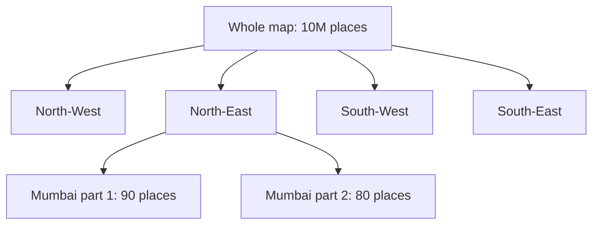

**Geohash vs quadtree:**

| | Geohash | Quadtree |
|---|---|---|
| Where it lives | A string column in any database or Redis | Usually a tree in memory on the server |
| Box size | Fixed per length | Changes with how crowded the area is |
| Updates | Easy: just change one string | Harder: may need to split or join boxes |
| Good for | Moving things (drivers), simple setup | Mostly fixed places (restaurants, hotels) |

**Ready-made tools:**
- **Redis GEO:** `GEOADD drivers 77.21 28.61 driver42`, then `GEOSEARCH drivers FROMLONLAT 77.21 28.61 BYRADIUS 2 km`. Redis uses geohash inside.
- **PostGIS** (PostgreSQL add-on): `ST_DWithin(location, my_point, 2000)` with a spatial index.
- Uber built **H3**, which uses hexagons instead of squares.

**Real numbers (ride app):**
- 1 million active drivers. Each sends its location every 4 seconds.
- That is **250,000 writes per second**. Keep this in memory (Redis), not in the main SQL database.

**Say this in the interview:**
> I turn each location into a geohash, so nearby places share a prefix. To find drivers near a user, I search the user's cell and its 8 neighbors, then filter by real distance. For fast-moving drivers I use Redis GEO. For fixed places with uneven density, a quadtree also works well.

**They may ask next:**
- **Why check 8 neighbors?** A nearby place can be just across a box line, with a different prefix.
- **Not enough results in the box?** Make the search wider: use a shorter geohash, which means a bigger box.
- **How do you shard location data?** By city or region. Most searches stay inside one city.

### Inverted index (how search works)

**In one line:** An inverted index maps each word to the list of documents that contain it, so search does not scan every document.

**Story:**
- At the back of a textbook there is an index: "Recursion ... pages 45, 112, 230".
- You do not read all 500 pages. You look up the word and jump to the pages.
- A search engine keeps the same kind of index for millions of documents.

**How it works:**
1. **Tokenize:** split the text into words. "Running shoes for men" → `running`, `shoes`, `for`, `men`.
2. **Normalize:** lowercase everything, remove very common words like "for" (stop words), and cut words to their root: "running" → "run" (stemming).
3. **Build posting lists:** for each word, keep the list of document IDs (and positions) where it appears.
4. **Search:** split the query the same way. Get each word's list. Combine them (AND / OR). Rank the results.

**Small example:**

```text
Doc 1: "Red running shoes"
Doc 2: "Blue running jacket"
Doc 3: "Red jacket"

Inverted index:
red     -> [1, 3]
run     -> [1, 2]
shoe    -> [1]
blue    -> [2]
jacket  -> [2, 3]

Query "red jacket" -> red [1,3] AND jacket [2,3] -> Doc 3
```

**Ranking in simple words:**
- **TF (term frequency):** the word appears many times in this document → more relevant.
- **IDF (inverse document frequency):** the word is rare across all documents → more important. "the" is everywhere, so it is worth little. "Bluetooth" is rare, so it is worth a lot.
- **TF-IDF** = TF × IDF.
- **BM25** is an improved TF-IDF. The 10th repeat of a word adds less than the 2nd. Short documents get a small boost. Elasticsearch uses BM25 by default.
- Real systems also add business signals: popularity, rating, freshness.

**Elasticsearch basics:**
- An **index** (like a table) is split into **shards** (pieces). Each shard is a small search engine (Lucene).
- Each shard has **replicas** (copies) on other machines. They help with more reads and with machine failure.
- A query goes to all shards. Each shard returns its top 10. A coordinator node merges them into the final top 10.
- New documents become searchable after about **1 second** (the default refresh). That is why it is called "near real-time".

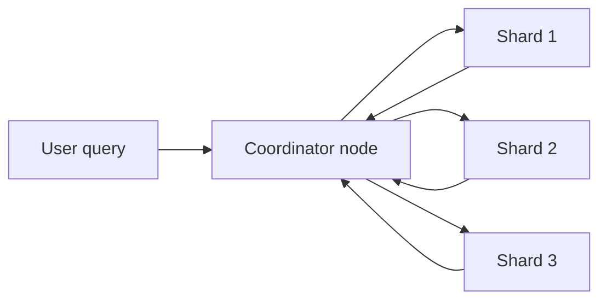

**How search stays fast at scale:**
- **Shard the index** so each machine searches a smaller part, in parallel.
- **Cache popular queries.** A small number of queries ("iphone", "cricket score") get a big share of traffic.
- **Typeahead** (suggestions while typing): keep a prefix trie (a tree of letters) or a simple map `prefix → top 10 suggestions`. Build it offline from search logs every hour. Serve it from memory or Redis.
- Wait about 200–300 ms after the user stops typing before sending a request (debounce). This cuts requests a lot.

**Good and bad:**

| Good | Bad |
|---|---|
| Very fast text search over millions of documents | Not the source of truth. Keep the real data in your main database. |
| Ranking, typo handling, filters | The index can lag behind the database by seconds |
| Easy to scale reads with replicas | Needs memory and care: shard count is hard to change later |

**Keeping it in sync:** write to the main database first. Send a change event (for example with Kafka or CDC, change data capture). A worker updates Elasticsearch.

**Say this in the interview:**
> Search uses an inverted index: each word points to the documents that contain it. Text is split into words, lowercased and stemmed, and results are ranked with BM25. I keep the real data in the database and sync it to Elasticsearch through events. For typeahead I keep the top suggestions per prefix in memory.

**They may ask next:**
- **Why not SQL `LIKE '%shoe%'`?** It cannot use a normal index, so it scans every row. It also has no ranking.
- **How do you handle typos?** Fuzzy search: allow 1–2 letter changes (edit distance).
- **How many shards?** A common guide is 10–50 GB per shard. Pick the count from expected data size.

### Video streaming basics (HLS and adaptive bitrate)

**In one line:** The video is cut into small chunks in many qualities. The player picks the best quality your internet can handle, chunk by chunk.

**Story:**
- You watch a cricket match on your phone on a train.
- In the city the picture is sharp. In a tunnel it becomes blurry but does not stop.
- After the tunnel it becomes sharp again.
- The player is switching quality every few seconds. That is **adaptive bitrate (ABR)** streaming.

**How it works:**
1. **Upload:** the creator uploads one big file, for example 4 GB, to blob storage.
2. **Transcode:** workers convert it into many qualities: 240p, 360p, 480p, 720p, 1080p. To go faster, cut the video into parts and transcode the parts in parallel.
3. **Segment:** each quality is cut into small chunks of about 2–6 seconds.
4. **Playlist:** an `.m3u8` text file (HLS playlist) lists the chunks. A master playlist lists all qualities and the speed each one needs.
5. **CDN:** chunks and playlists go to a CDN, close to viewers.
6. **Play:** the player downloads the playlist, then chunks one by one. It measures download speed and picks the next chunk's quality.

**Diagram:**

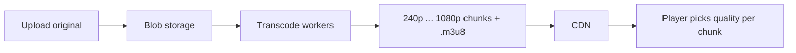

**What a master playlist looks like (simplified):**

```text
#EXTM3U
#EXT-X-STREAM-INF:BANDWIDTH=800000,RESOLUTION=640x360
360p/index.m3u8
#EXT-X-STREAM-INF:BANDWIDTH=5000000,RESOLUTION=1920x1080
1080p/index.m3u8
```

**Simple numbers:**
- 1080p at about 5 Mbps (megabits per second) for 1 hour = 5 × 3,600 = 18,000 megabits ≈ **2.25 GB**.
- The same hour at 360p (about 0.8 Mbps) ≈ **360 MB**.
- Storing 5 qualities means about 2–3 × the original storage. This is the price of smooth playback.

**HLS and DASH:**
- **HLS** (HTTP Live Streaming) came from Apple. It uses `.m3u8` playlists. It works almost everywhere.
- **DASH** is an open standard that does the same job with `.mpd` files.
- Both use plain HTTP. So normal CDNs and caches work. No special streaming server is needed.

**VOD vs live:**

| | VOD (video on demand, like a movie) | Live (like a match) |
|---|---|---|
| Transcoding | Once, before anyone watches | In real time, as it happens |
| Delay behind real life | Not important | Normal HLS: 10–30 seconds. Low-Latency HLS: about 2–5 seconds. |
| Hard part | Storage and CDN cost | Low delay and huge sudden traffic |

- Smaller chunks mean lower delay, but more requests and more overhead.
- For under 1 second (video calls), use **WebRTC**, not HLS.

**Good and bad:**

| Good | Bad |
|---|---|
| Playback rarely stops; quality changes instead | Transcoding needs a lot of CPU |
| Uses normal HTTP and CDNs | Many copies of every video use more storage |
| Player can start fast with a low quality | Live HLS has a few seconds of delay |

**Say this in the interview:**
> After upload, I transcode the video into several qualities. I cut each one into chunks of a few seconds, with an HLS playlist. Chunks are served from a CDN. The player checks its download speed and picks the quality for each next chunk. That is adaptive bitrate. For live, I use smaller chunks or Low-Latency HLS to cut the delay.

**They may ask next:**
- **Why chunks and not one file?** The player can switch quality between chunks, start fast, and seek without downloading everything.
- **How do you make transcoding faster?** Split the video into parts. Put each part on a queue, and many workers transcode them in parallel.
- **How do you save CDN cost?** Keep popular videos on the CDN. Serve old, rarely watched videos from origin storage.

### Proxy vs reverse proxy

**In one line:** A forward proxy sits in front of **clients** and hides them; a reverse proxy sits in front of **servers** and hides them.

**Story:**
- **Forward proxy:** a busy manager asks his assistant, "Call the hotel and book a room." The hotel talks only to the assistant. It does not know who the manager is.
- **Reverse proxy:** you call a big company's reception. The receptionist connects you to the right person inside. You never get the direct numbers of the employees.
- The assistant works **for the caller**. The receptionist works **for the company**.

**Diagram:**

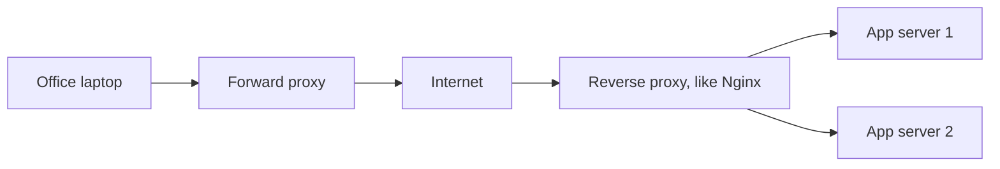

**Side by side:**

| | Forward proxy | Reverse proxy |
|---|---|---|
| Works for | The client (user) | The server (website) |
| Hides | The client's IP address | The real servers |
| Who sets it up | The company network or the user | The website owner |
| Common uses | Block sites at office, cache downloads, hide your IP | Load balancing, SSL termination, caching, compression, security |
| Examples | Squid, office proxy, VPN-like services | Nginx, HAProxy, Envoy, Cloudflare |

**What a reverse proxy does for us:**
- **Load balancing:** spread requests across app servers.
- **SSL termination:** handle HTTPS (decrypt) in one place, so app servers stay simple.
- **Caching and compression:** serve static files and gzip responses.
- **Security:** hide internal servers, block bad IPs, add a WAF (web application firewall).
- **One entry point:** route `/api` to the API service and `/images` to the image service.

**Small but useful detail:**
- Behind a reverse proxy, your app sees the proxy's IP, not the user's IP.
- The proxy adds the header `X-Forwarded-For: <user IP>`. Read the user IP from there.
- In Spring Boot, set `server.forward-headers-strategy=native` (or `framework`) so the app reads these headers.

**Related words:**
- **Load balancer** = a reverse proxy whose main job is spreading traffic.
- **API gateway** = a reverse proxy with more features: login checks, rate limiting, request routing for microservices.
- **CDN** = many reverse proxies placed around the world that cache content.

**Good and bad:**

| Good | Bad |
|---|---|
| One place for HTTPS, security and routing | One more hop: adds about 1 ms |
| Servers can change behind it; users never notice | If it fails, everything fails, so run at least 2 |
| Caching cuts load on app servers | Misconfigured caching can show one user's data to another |

**Say this in the interview:**
> A forward proxy works for the client and hides the client, like an office internet proxy. A reverse proxy works for the server and hides the servers, like Nginx in front of my app. I use a reverse proxy for load balancing, HTTPS, caching and security. Load balancers and API gateways are special kinds of reverse proxy.

**They may ask next:**
- **Is a VPN a proxy?** It works like a forward proxy: websites see the VPN's IP, not yours. It also encrypts all your traffic.
- **How does the app get the real user IP?** From the `X-Forwarded-For` header set by the reverse proxy. Trust it only from your own proxy.
- **Nginx vs API gateway?** Nginx is a fast general reverse proxy. An API gateway adds API features like auth, rate limiting and per-client keys.
