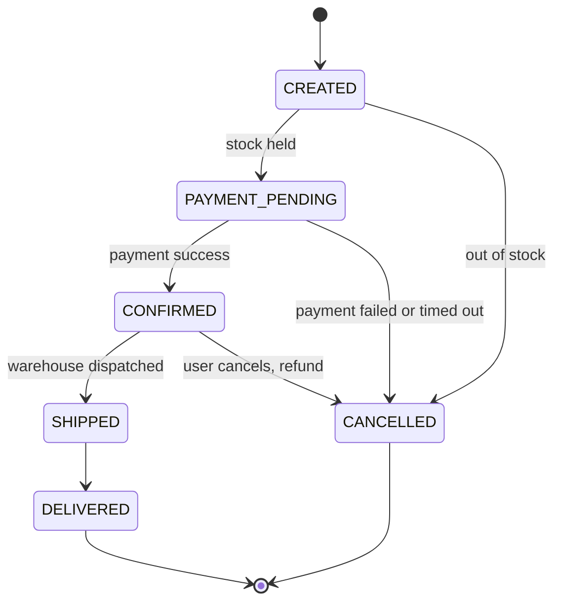
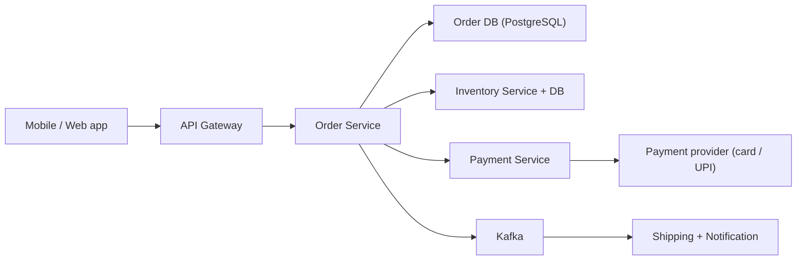
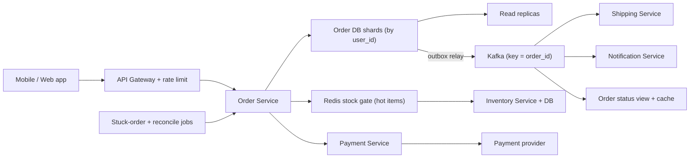
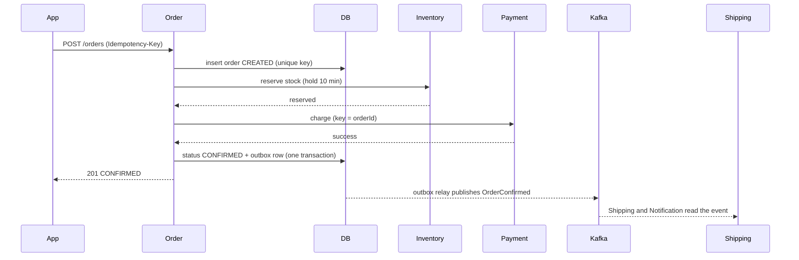
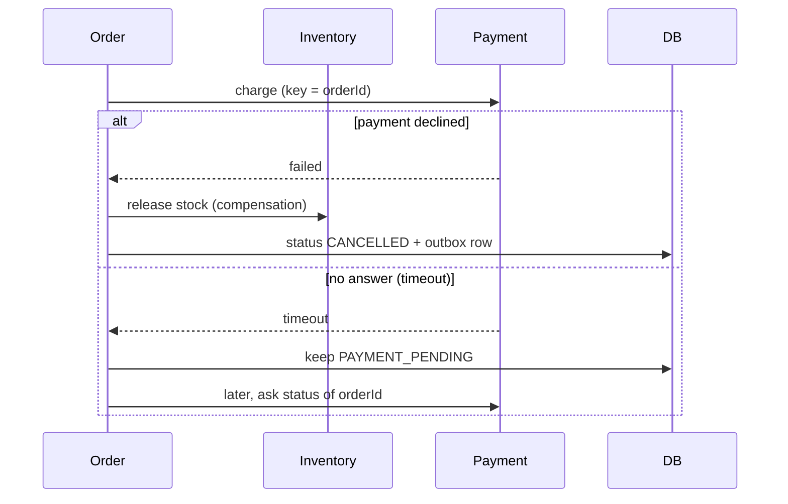

# Amazon order processing

[← System design basics](../system-design.md) · [← Main README](../../README.md)

**In one line:** Take the order, hold the stock, take the money once, then ship and tell the customer.

**Story:** A big kirana store takes orders on the phone. The owner writes each order in a register.
He keeps the items aside in a box with the customer's name. He takes money only once, even if the customer calls twice.
When the store grows to 100 phone lines, one owner is not enough.
He hires separate people for stock, money and delivery. They pass notes to each other.
That is an order system: Order, Inventory, Payment and Shipping services passing messages.

## 1. How the interviewer asks it

- "Design Amazon's order processing: from 'Place order' to delivery."
- "Design checkout for an e-commerce site."
- "Design an event-driven order system for Swiggy."

Reported at (candidate reports and prep sites, not official lists):

- **Amazon**: commerce-flavored prompts like order processing and inventory are reported often.
- **Swiggy**: an event-driven order flow (CTO round report).

**What they are really testing:**

- Can you keep many services correct without one big transaction (saga, outbox)?
- Do you stop double orders, double charges and overselling?
- Do you know what happens when payment or a service fails half-way?

## 2. Questions to ask (with assumed answers)

| Question | Why it matters | What we assume |
|---|---|---|
| Which part of the flow? | The full flow is too big for one hour. | Place order → reserve stock → pay → confirm → ship → notify. Plus status and history. |
| What is out of scope? | Say it out loud. | Search, recommendations, product catalog, cart. |
| How many orders a day? | Drives DB and sharding choices. | 1M orders a day. 10x on a sale day. |
| One warehouse or many? | Changes stock checks. | Many warehouses. Stock is checked per item (SKU). |
| Can the customer cancel? | Needs an undo path. | Yes, before shipping. |
| Payment method? | Payment can be slow or unclear. | Card or UPI through a provider (Razorpay, Stripe). |
| Does checkout wait for payment? | Sync vs async answer to the user. | Yes for card. UPI may return "pending". |
| Strong or eventual consistency? | Money needs strong. Emails do not. | Order, stock and payment: strong. Shipping, emails: a few seconds late is fine. |
| Partial orders (2 warehouses)? | Changes shipping model. | One order can have many shipments. |
| Flash sales? | Hot items break simple designs. | Yes, some items are hot. See [Flash sale](flash-sale.md). |

## 3. Assumptions

1. 1M orders a day, 10x on sale days.
2. Focus: place order to confirmation, then shipping and notifications by events.
3. Many warehouses. Stock per SKU.
4. Payment through an outside provider, with a webhook.
5. Never charge twice, never oversell, never lose a placed order.
6. Shipping and notifications can be a few seconds late.

## 4. Requirements

Functional (what it does):

- Customer places an order with one or more items.
- System holds the stock for a short time, then takes payment.
- Customer gets a confirmation, then shipping updates (email, SMS, app push).
- Customer can see one order and the list of past orders.
- Customer can cancel before shipping.

Non-functional (how well it does it):

- **Never charge twice. Never create a duplicate order.**
- **Never sell more items than we have** (no "overselling"), even in a flash sale.
- Never lose an order once we said "order placed".
- Checkout answers in under 2 seconds.
- 99.9%+ uptime. Shipping and emails can be a few seconds late. That is fine.

## 5. Numbers

See [Capacity estimation](../system-design.md#capacity-estimation) for the method. (That section uses slightly different guesses and gets 9 instances. That is fine: interviewers check your steps, not the exact number.)

| What | Calculation | Result | Decision it drives |
|---|---|---|---|
| Orders, average | 1,000,000 ÷ 86,400 seconds | ~12 orders/second | Small. One service cluster is enough. |
| Orders, sale-day peak | 12 × 10 | ~120 orders/second | Still small for one SQL primary. |
| Reads (status, history) | about 10 reads per order | ~120/s average, ~1,200/s peak | Read : write is 10 : 1. Use read replicas. |
| DB writes at peak | ~5 rows per order (order, items, outbox, status) | ~600 writes/second | One PostgreSQL primary is fine. |
| Storage | ~2 KB per order × 1M a day | ~2 GB/day, ~730 GB/year | Plan sharding for year 3+. |
| Storage with 2 replicas | 730 GB × 3 (primary + 2 copies) | ~2.2 TB/year | Archive old orders to cheaper storage. |

**Order Service instances:**

- Peak traffic is about 1,300 requests/second (120 writes + 1,200 reads).
- One Spring Boot instance (2 CPU) can handle about 200 such requests/second. This is a rough guess. Confirm it with a load test.
- 1,300 ÷ 200 ≈ 7 instances.
- Add room in case one zone (one data center) goes down. Run about 10 instances across 3 zones.
- Turn on autoscaling (add instances automatically when traffic goes up).

**Key point:** 600 writes/second is easy for one PostgreSQL primary. We do not need sharding on day one. We plan for it.

**Real world:** on Prime Day 2024, AWS reported that DynamoDB peaked at 146M requests/s across Amazon's systems. ([AWS blog](https://aws.amazon.com/blogs/aws/how-aws-powered-prime-day-2024-for-record-breaking-sales/)) That is all of Amazon's traffic, not only orders. Do not use it as your order count.

## 6. APIs

| API | What it does |
|---|---|
| `POST /orders` | Place an order. Needs an `Idempotency-Key` header. |
| `GET /orders/{orderId}` | Get one order and its status. |
| `GET /users/{userId}/orders?cursor=...&limit=20` | Order history, newest first, page by page. |
| `POST /orders/{orderId}/cancel` | Cancel before shipping. |
| `POST /payments/webhook` | The payment provider calls us when a payment finishes. |

Status changes from Shipping (packed, shipped, delivered) come as Kafka events, not public APIs.

Place an order:

```http
POST /orders
Idempotency-Key: 6f1c2a9e-0b4d-4c7a-9a51-2e8f0d3b7c11

{ "items": [ { "sku": "PHONE-128GB", "qty": 1 } ],
  "addressId": "addr_9", "paymentMethodId": "pm_77" }
```

```json
{ "orderId": "ord_3_918273", "status": "CONFIRMED", "total": "24999.00", "currency": "INR" }
```

- The `userId` comes from the login token, not the body. So nobody can order for someone else.
- The `Idempotency-Key` (a unique id the app makes once per checkout) stops duplicate orders. See part 11a.
- If payment is slow, we return `"status": "PAYMENT_PENDING"` and the app checks again.

## 7. Data model

Each service owns its own tables. No service reads another service's database.

| Table | Owner | Main columns |
|---|---|---|
| `orders` | Order | `order_id`, `user_id`, `idempotency_key`, `status`, `total_amount`, `currency`, `version`, `created_at` |
| `order_items` | Order | `order_id`, `sku`, `qty`, `unit_price` |
| `outbox` | Order | `event_id`, `order_id`, `event_type`, `payload`, `created_at`, `sent` |
| `payments` | Payment | `payment_id`, `order_id` (unique), `provider_ref`, `amount`, `status` |
| `inventory` | Inventory | `sku`, `warehouse_id`, `available`, `reserved`, `version` |
| `reservations` | Inventory | `order_id`, `sku`, `qty`, `expires_at`, `status` |
| `processed_events` | each consumer | `event_id` (primary key) |

**Which database and why:**

- **PostgreSQL or MySQL.** Orders and money need transactions (all-or-nothing writes) and unique constraints. A SQL database gives both. See [SQL vs NoSQL](../system-design.md#sql-vs-nosql).
- **Start with one primary + read replicas** (read-only copies). History and status reads go to replicas. See [Read replicas](../system-design.md#database-replication-read-replicas).
- **When we grow, shard by `user_id`.** Sharding means splitting data across many databases. See [Partitioning and sharding](../system-design.md#partitioning-and-sharding).
  - "Show my orders" then hits only one shard. This is the most common read.
  - We put the shard number inside the `order_id` (`ord_3_918273` lives in shard 3). So `GET /orders/{id}` also hits one shard.
- **Why not shard by `order_id`?** One user's orders would be spread across all shards. Order history would need to ask every shard.

**Order status (state machine):** An order can only move along these arrows. Any other change is rejected.



We update status with a check: `UPDATE orders SET status='CONFIRMED' WHERE order_id=? AND status='PAYMENT_PENDING'`. If 0 rows change, someone else already moved it.

## 8. Architecture, version 1 (simple)



- **API Gateway:** one front door. Checks login, rate limits, sends the call to the right service. See [API gateway and BFF](../microservices.md#api-gateway-and-bff).
- **Order Service:** the "boss" of the order. It calls Inventory and Payment in order (this is called *orchestration*).
- **Kafka:** a message queue. After confirm, Shipping and Notification read the event in their own time. See [Sync vs async communication](../microservices.md#sync-vs-async-communication).
- This handles ~120 orders/s with one PostgreSQL primary per service.

## 9. Architecture, version 2 (at scale)



**What changed and why:**

- **Shards by `user_id`:** when one primary runs out of room. "My orders" stays on one shard.
- **Read replicas + status view:** status and history reads leave the primary. The status view is built from events and cached. See [Caching](../system-design.md#caching).
- **Redis stock gate:** only for hot items in a sale. Losers are rejected in memory. See [Flash sale](flash-sale.md).
- **Outbox relay:** events are saved with the order and sent later. No lost events (part 11c).
- **Kafka key = `order_id`:** all events of one order stay in order.
- **Stuck-order and reconcile jobs:** fix orders left half-way by a crash or a lost webhook.

## 10. Step-by-step flows

**Happy path.**



**Payment fails: the saga undoes the stock hold.**



## 11. Deep dives

### 11a. No double charge, no duplicate order

Story: you press the lift button 5 times. Only one lift comes. That is *idempotency*: doing it again gives the same result. See [Idempotency](../microservices.md#idempotency).

1. When the checkout page opens, the app makes one `Idempotency-Key` (a UUID, a random unique id).
2. The app sends the same key on every retry (slow network, double tap).
3. The `orders` table has `UNIQUE (user_id, idempotency_key)`.
4. Second insert fails on the unique constraint. We load the first order and return it. No new order.
5. For money, Order Service sends `order_id` as the idempotency key to the payment provider. Most providers support this. Charging twice with the same key charges once.
6. The `payments` table has `UNIQUE (order_id)` as a second safety net.

Amazon's Builders' Library explains the same idea: [Making retries safe with idempotent APIs](https://aws.amazon.com/builders-library/making-retries-safe-with-idempotent-APIs/).

### 11b. No overselling

Problem: 1,000 phones, 1 lakh (100,000) people click "Buy" in the same minute.

- **Wrong way:** read `available`, check `> 0`, then write `available - 1`. Two requests read "1" at the same time. Both sell. Now we sold 2 phones but had 1.
- **Right way:** do the check and the minus in one SQL statement. The database locks the row for us.

```java
public interface InventoryRepository extends JpaRepository<Inventory, String> {

    @Modifying
    @Query("""
        UPDATE Inventory i
        SET i.available = i.available - :qty, i.reserved = i.reserved + :qty
        WHERE i.sku = :sku AND i.available >= :qty
        """) // check + minus in ONE atomic step, so no oversell
    int reserve(String sku, int qty); // 1 = reserved, 0 = out of stock
}
```

- **Reservation with TTL** (time to live, an expiry time): we hold stock for 10 minutes. A small job releases holds that expired and were never paid. So stock is not stuck forever.
- **Hot item problem:** every buyer updates the same DB row. They wait in line for the row lock. The DB slows down.
- **Fix for hot items: Redis gate.** Keep the stock count in Redis. Each buyer does `DECR stock:PHONE-128GB`.
  - Redis runs one command at a time, so `DECR` is safe.
  - If the result is below 0, do `INCR` back and say "sold out". The DB is never touched.
  - Only the 1,000 winners go to the DB reserve. The DB is still the source of truth.
- **Optional queue:** for very big sales, put "buy" requests in a queue. Workers process them in order. The app shows "You are in the line".
- The full design for big sales (waiting room, Lua script, stock buckets) is in [Flash sale](flash-sale.md).

More on locks: [Optimistic vs pessimistic locking](../databases.md#optimistic-vs-pessimistic-locking).

### 11c. Keep services in sync without 2PC (saga + outbox)

*2PC (two-phase commit)* means locking all databases until all agree. It is slow, and one stuck service blocks everyone. We do not use it.

- **Saga:** a chain of local steps. If a later step fails, we run an "undo" step (*compensation*). Payment failed → release stock → order CANCELLED. See [Saga pattern](../microservices.md#saga-pattern).
- **Transactional outbox:** we save the status change and the event in the same DB transaction. A relay (a small background job) sends outbox rows to Kafka later. So we never "save but forget to send". See [Transactional outbox pattern](../microservices.md#transactional-outbox-pattern).
- **Idempotent consumers:** Kafka can deliver the same event twice. Shipping keeps a `processed_events` table and skips seen `event_id`s. See [Handling duplicate events](../kafka.md#handling-duplicate-events) and [Kafka delivery guarantees](../kafka.md#kafka-delivery-guarantees).
- **Kafka key = `order_id`:** all events of one order go to one partition (one ordered lane inside a topic). So they stay in order. See [Kafka message ordering](../kafka.md#kafka-message-ordering).
- **Stuck-order job:** if Order Service crashes mid-way, a job finds orders stuck in CREATED or PAYMENT_PENDING for over 10 minutes. It continues them or cancels them.

Each saga step and its undo:

| Step | Undo (compensation) |
|---|---|
| Create order (CREATED) | Mark CANCELLED |
| Reserve stock | Release stock |
| Charge payment | Refund (same idempotency key) |
| Confirm + outbox event | No undo. After this, cancel is a new saga. |

## 12. Follow-up questions interviewers ask

- **Why not two-phase commit (2PC)?** It locks all services until everyone agrees. It is slow, and one slow service blocks all. Kafka and payment providers don't support it anyway.
- **Why not make the whole flow async with Kafka (choreography)?** We can. But the user wants a quick yes or no at checkout. Orchestration is easier to explain and debug. Choreography fits when many teams react to the same event.
- **Payment succeeds but stock reserve then fails?** Compensate: refund with the same idempotency key, or offer a back-order. Tell the user. Reserving stock before payment makes this rare.
- **How do you find an order by id if you shard by user_id?** The shard number is part of the order id. So we go straight to the right shard.
- **What if payment is UPI with a redirect?** Return `PAYMENT_PENDING`. The provider calls our webhook later. We check the webhook's signature, then confirm. The webhook handler is idempotent.
- **Events arrive out of order?** Same key = same partition, so usually they don't. As a guard, each event carries a version per order. Consumers ignore versions older than what they have.
- **Partial shipment (3 items, 2 warehouses)?** One order, many shipments. Each shipment has its own status. The order is DELIVERED when all shipments are.
- **How does the user see live status?** Simple: the app polls `GET /orders/{id}` every few seconds. Better: send a push notification on each status event.
- **How does cancel after payment work?** Another saga: mark CANCELLED, release stock, ask the provider for a refund with an idempotency key. Not allowed after SHIPPED; that becomes a return.
- **Sale day is 20x, or 100M orders a day?** 100M a day is about 1,200 orders per second. Shard the Order DB by user_id, add Kafka partitions, scale services sideways, and turn off extras like recommendations.
- **What do you monitor?** Orders per minute, payment failure rate, and checkout latency (p99: 99% of requests are faster). Also stuck orders and unsent outbox rows. Alert when any of them jumps.

## 13. What can go wrong

| Problem | What we do |
|---|---|
| **Payment times out.** We don't know if money was taken. | Never guess. Keep the order in `PAYMENT_PENDING`. Ask the provider "what happened to this order_id?" Retry with the same key is also safe. A nightly *reconciliation* job (matching our records with the provider's report) catches the rest. See [Timeouts](../microservices.md#timeouts). |
| **Money taken, but our service crashed before saving.** | The provider's webhook tells us. The stuck-order job also asks the provider. Then we confirm the order. If stock is gone, we refund. |
| **Kafka is down.** | Orders still get placed. Events wait in the outbox table. The relay sends them when Kafka is back. |
| **Inventory Service is down.** | [Circuit breaker](../microservices.md#circuit-breaker) fails fast with "please try again". No money is taken yet. Retries use [Retry with exponential backoff and jitter](../microservices.md#retry-with-exponential-backoff-and-jitter). |
| **Duplicate events.** | Consumers check `event_id` and skip repeats. Status updates only move forward in the state machine. |
| **Same item sold twice.** | Prevented by the conditional `UPDATE ... WHERE available >= qty`. |
| **A whole region goes down.** | Order DB has a standby copy in another region. We promote it to primary and switch DNS (point our domain to the new region). The last few seconds of data may be lost, so reconciliation with the payment provider fixes those orders. |

## 14. Trade-offs

| We chose | We get | We give up |
|---|---|---|
| SQL (PostgreSQL) | Transactions, unique constraints, easy money logic | Sharding is manual work later |
| Shard by `user_id` | "My orders" hits one shard | Seller or admin reports need a separate store (data warehouse) |
| Orchestration (Order Service drives steps) | Easy to read, one place to see the flow | Order Service has more logic |
| Sync inventory + payment, async shipping + emails | User knows quickly if the order worked | Checkout depends on 2 services being up |
| Saga + outbox, not 2PC | Fast, no global locks | Data is correct only after a few seconds (*eventual consistency*). See [Strong vs eventual](../system-design.md#database-consistency-strong-vs-eventual). |
| 10-minute stock hold | No oversell, stock not stuck forever | Some items look "sold out" for a few minutes, then come back |
| Redis gate for hot items | DB survives flash sales | One more system to run; Redis and DB counts must be synced |

## 15. Say this in the interview

> "I will focus on placing an order, reserving stock, payment, confirmation, shipping and notifications. Search and catalog are out of scope.
> 1 million orders a day is about 12 per second, and around 120 per second on a sale day. So one PostgreSQL primary with read replicas is enough to start, and I will shard by user_id later.
> Order Service orchestrates a saga: create order, reserve stock with a 10-minute hold, charge payment, then confirm. If payment fails, we release the stock.
> To avoid double orders, I use an idempotency key with a unique constraint in the database.
> To avoid double charges, I pass the order id as the idempotency key to the payment provider.
> To avoid overselling, I use a conditional update, and a Redis counter in front for flash-sale items.
> After confirm, I write an outbox row in the same transaction, and Kafka sends it to Shipping and Notification. Consumers skip duplicate events."

## 16. Mid vs senior vs staff

| Mid | Senior | Staff |
|---|---|---|
| Clear services, APIs, tables and a v1 diagram | Everything in mid, and drives the talk | Everything in senior, with little help from the interviewer |
| Knows payment must not run twice | Idempotency key + unique constraint + provider key, and why each is needed | Payment timeout handling: unknown state, status checks, reconciliation |
| Uses Kafka between services | Saga with compensations, outbox, idempotent consumers, key = order_id | Orchestration vs choreography choice, out-of-order events, stuck-order jobs |
| Conditional update for stock | Reservation with TTL, hot-item problem and a Redis gate | Sharding plan by user_id with shard id in order_id, region failover and data loss window |
