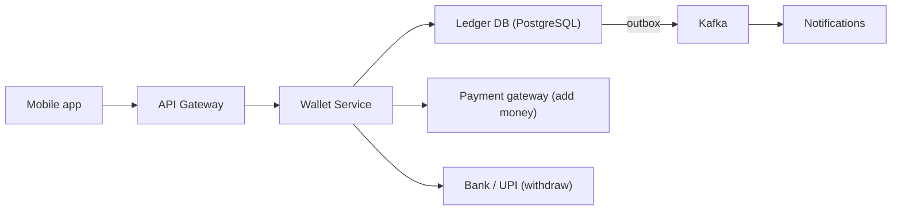
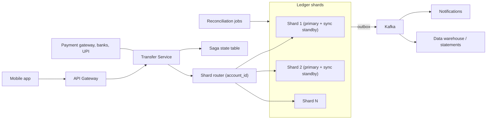
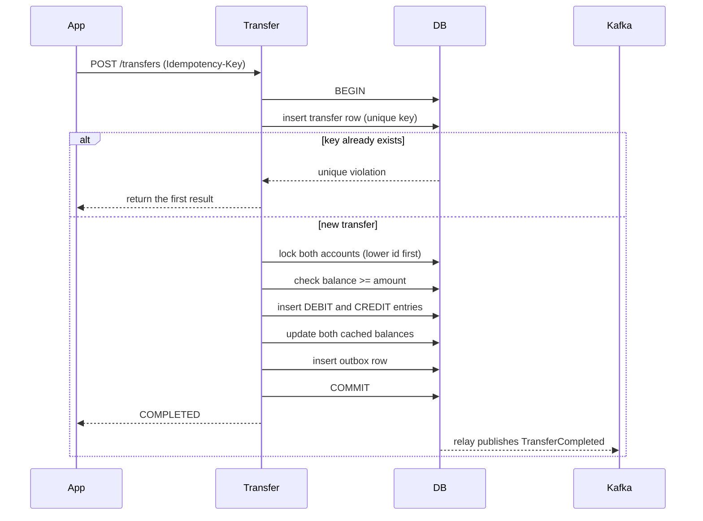
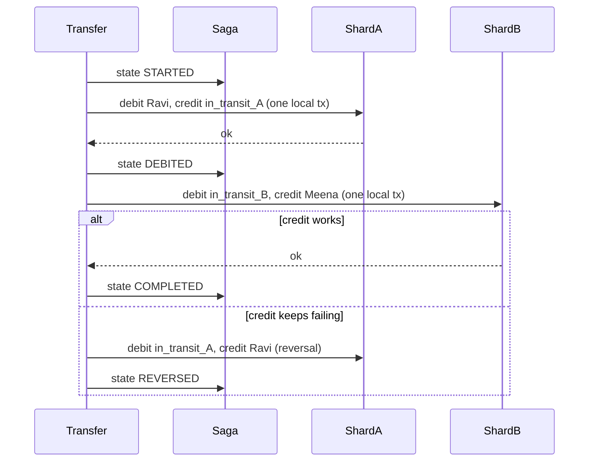
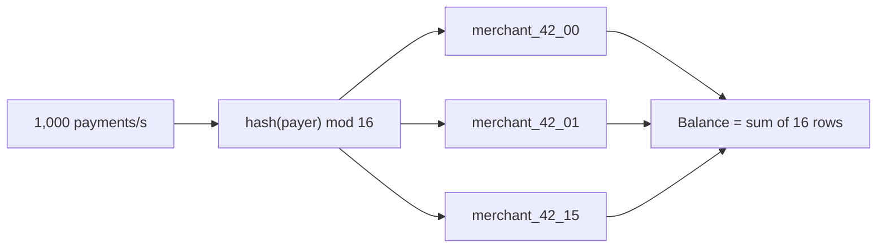

# Bank ledger and digital wallet (UPI / Paytm style)

[← System design basics](../system-design.md) · [← Main README](../../README.md)

**In one line:** Never change a balance directly. Write every money move as a debit and a matching credit, and work out the balance from those rows.

**Story:** An old bank passbook has one line for every deposit and every withdrawal.
The clerk never rubs out a line. If a mistake happens, he writes a new line to fix it.
The balance at the bottom is just the sum of all lines.
At day end, the bank checks that all money that left some accounts arrived in other accounts.
A digital wallet is the same passbook, but for 100 million people at once.

---

## 1. How the interviewer asks it

Common wordings:

- "Design a digital wallet like Paytm or PhonePe."
- "Design a ledger for a bank: transfers between accounts, balance and statement."
- "Design a UPI-like payment app."
- "Two transfers hit the same account at the same time. How do you keep the balance right?"

No company-specific source was found. The question fits fintech loops (PhonePe, Paytm, Razorpay, banks).

**What they are really testing:**

- Do you use a double-entry ledger, or do you just do `balance = balance - 100`?
- Can you keep one transfer correct under concurrency and failures (locks, transactions, idempotency)?
- Do you know what changes when accounts live on different shards, and how to handle a "hot" merchant account?

---

## 2. Questions to ask (with assumed answers)

| Question | Why it matters | What we assume |
|---|---|---|
| Closed wallet or real bank transfers? | Closed wallet means money stays inside our system. | A wallet. Users add money from a bank, pay others and merchants, withdraw to a bank. |
| Can a balance go below zero? | Decides the check before debit. | No, never for users. |
| P2P and merchant payments? | Merchants receive far more payments. Hot accounts. | Both. |
| How many transfers? | Decides sharding. | 50 million a day. Peak 5x (evenings, festivals). |
| Statement and history? | Needs fast "last 20 transactions". | Yes. Last 20 on the home screen. Full statement on request. |
| How long do we keep data? | Audit and regulator rules. | Years. Nothing is deleted. |
| Consistency? | Balance must never be wrong. | Strong consistency for balances and transfers. |
| Multi-currency? | Changes the money type. | INR only. Store paise as `long`. |
| Limits (KYC, daily caps)? | Adds checks before transfer. | Yes, simple per-user daily limits. |
| Reversals and refunds? | Needs a way to undo money. | Yes, as new reversal entries. Never delete. |

---

## 3. Assumptions

1. Wallet app with add money, P2P, pay merchant, withdraw.
2. 100M users, 50M transfers a day, peak 5x.
3. Balance never negative. Strong consistency.
4. Double-entry ledger. Entries are append only.
5. Money is `long` paise. 1 rupee = 100 paise.
6. Every transfer has an idempotency key from the client.
7. Add money and withdraw use outside rails (payment gateway, UPI). Those can be slow or unknown.

---

## 4. Requirements

**Functional:**

- Add money to wallet (from bank, card or UPI).
- Send money to another user or a merchant.
- Withdraw to a bank account.
- See balance and transaction history.
- Reverse or refund a transfer.

**Non-functional:**

- **Correct above all.** No money is created or lost. Sum of all entries is zero.
- **Never double-spend.** Two transfers at once cannot both use the same ₹100.
- **Idempotent.** A retried transfer happens once.
- **Durable.** A committed transfer is never lost.
- **Auditable.** Every rupee can be traced. Rows are never updated or deleted.
- Latency: transfer under 1 second inside our system.
- Availability: 99.99%. If we must choose, we choose correct over available. See [CAP theorem](../system-design.md#cap-theorem).

---

## 5. Numbers

| What | Calculation | Result | Decision it drives |
|---|---|---|---|
| Transfers, average | 50M ÷ 100,000 s | ~500/s | |
| Transfers, peak | 500 × 5 | ~2,500/s | |
| DB writes per transfer | 1 transfer row + 2 entries + 2 balance updates + outbox | ~6 | |
| DB writes at peak | 2,500 × 6 | ~15,000/s | Too much for one primary. Shard by `account_id`. |
| Entry size | ~200 bytes × 2 entries × 50M | ~20 GB/day, ~7 TB/year | Keep 1 year hot. Older years in cheap storage. |
| Balance reads | ~5 per transfer (app opens) | ~12,500/s peak | Read from the account row, not by summing entries. |
| Busy merchant | 1 big merchant gets 1,000 payments/s | 1,000 updates/s on one row | One row lock can't keep up. Needs sub-accounts. |

**Real-world scale:** UPI did a record 754 million transactions on 18 Oct 2025 ([report](https://stocktwits.com/news-articles/markets/equity/upi-hits-record-754-million-transactions-on-october-18-monthly-total-reaches-20-70-billion-19737386/cL20jcJR3yK)).
That is about 8,700 per second averaged over the day. Peak seconds are higher.
That is the whole country across all apps. One wallet app is a fraction of it.

---

## 6. APIs

| API | What it does |
|---|---|
| `POST /v1/transfers` | Move money between two wallets. Needs `Idempotency-Key`. |
| `POST /v1/topups` | Add money from bank. Goes through a payment gateway. |
| `POST /v1/withdrawals` | Send money to a bank account. |
| `GET /v1/accounts/{id}/balance` | Current balance. |
| `GET /v1/accounts/{id}/entries?cursor=...&limit=20` | History, newest first. |
| `POST /v1/transfers/{id}/reverse` | Reverse a transfer (support/admin). |

Transfer:

```http
POST /v1/transfers
Idempotency-Key: 3b6e1c9a-7d2f-4a10-8c55-0f9e2d1b4a77

{ "from": "acc_ravi", "to": "acc_chaiwala", "amount": 2500, "currency": "INR", "note": "chai" }
```

```json
{ "transfer_id": "txn_88412", "status": "COMPLETED", "amount": 2500 }
```

- `from` comes from the login token in real life. Shown here for clarity.
- `amount` 2500 = ₹25.00.
- A retry with the same key returns the same `txn_88412`. No second debit.

---

## 7. Data model

**Database:** PostgreSQL (or MySQL). We need ACID transactions (all-or-nothing writes), row locks and unique keys. See [Transactions and isolation levels](../databases.md#transactions-and-isolation-levels).

| Table | Main columns | Notes |
|---|---|---|
| `accounts` | `account_id`, `owner_id`, `type` (USER, MERCHANT, SYSTEM), `balance_paise`, `version`, `status` | `balance_paise` is a cached value, updated in the same transaction as entries. |
| `transfers` | `transfer_id`, `idempotency_key` (unique), `from_account`, `to_account`, `amount_paise`, `status`, `created_at` | One row per money move. |
| `ledger_entries` | `entry_id`, `transfer_id`, `account_id`, `direction` (DEBIT/CREDIT), `amount_paise`, `balance_after`, `created_at` | Append only. Never updated or deleted. |
| `balance_snapshots` | `account_id`, `as_of_date`, `balance_paise` | End of day. Makes old statements fast. |
| `outbox` | `event_id`, `transfer_id`, `type`, `payload` | For notifications and analytics. |

**System accounts:** money never appears from nothing. When a user adds ₹500 from a bank, we debit a system account like `bank_settlement_hdfc` and credit the user. Same for fees (`fee_income`) and money in flight (`transfer_in_transit`).

**Index:** `(account_id, created_at DESC)` on `ledger_entries`. This makes "last 20 transactions" one index lookup. See [Database indexes](../system-design.md#database-indexes).

### Why money is never a float

- `float` and `double` store numbers in binary. Many decimals can't be stored exactly.
- In Java, `0.1 + 0.2` gives `0.30000000000000004`. Over millions of transfers, paise go missing.
- **Store money as a whole number of the smallest unit** (*minor units*): paise for INR, cents for USD. ₹25.00 = `2500L`.
- Use `BigDecimal` only for math that creates fractions, like interest or a 1.75% fee. Round once, with a clear rule, then store paise.
- In the DB: `BIGINT` for paise, or `NUMERIC(19,2)`. Never `FLOAT` or `REAL`.

```java
long amount = 2500L;                                   // ₹25.00 in paise
BigDecimal fee = BigDecimal.valueOf(amount)
        .multiply(new BigDecimal("0.0175"))              // 1.75% fee
        .setScale(0, RoundingMode.HALF_EVEN);            // round once, to whole paise
long feePaise = fee.longValueExact();                    // 44 paise
```

---

## 8. Architecture, version 1 (simple)



- **Wallet Service:** checks limits, runs the transfer in one DB transaction.
- **Ledger DB:** one PostgreSQL primary with a synchronous standby (a copy that confirms every write). Accounts, transfers and entries in the same DB.
- **Payment gateway / Bank:** outside systems. Slow and sometimes unknown. See [Payment gateway](payment-gateway.md).
- **Kafka:** sends "you received ₹25" notifications after commit.

With everything in one DB, a transfer is **one local transaction**. That is the simplest correct design. Keep it as long as you can.

---

## 9. Architecture, version 2 (at scale)



**What changed and why:**

- **Shard by `account_id`:** 15,000 writes/s is too much for one primary. All entries of one account stay on one shard, so its balance is local. See [Partitioning and sharding](../system-design.md#partitioning-and-sharding).
- **Transfer Service:** same shard → one local transaction. Different shards → a saga (deep dive b).
- **Saga state table:** remembers which step each cross-shard transfer reached, so it can resume after a crash.
- **Synchronous standby per shard:** if a primary dies, the standby has every committed transfer.
- **Data warehouse:** long statements, reports and analytics read from here, not from the live shards.
- **Reconciliation jobs:** check sums every day (deep dive d).
- **Hot merchant accounts** are split into sub-accounts across shards (deep dive c).

---

## 10. Step-by-step flows

**P2P transfer, both accounts on the same shard:**



**Cross-shard transfer (saga with an in-transit account):**



---

## 11. Deep dives

### (a) Double-entry ledger

*Double entry* means every money move writes **two rows**: a debit on one account and a credit on another, of the same amount.

Ravi pays the chaiwala ₹25:

| entry | account | direction | amount (paise) |
|---|---|---|---|
| e1 | acc_ravi | DEBIT | 2500 |
| e2 | acc_chaiwala | CREDIT | 2500 |

Rules:

1. **Every transfer is balanced.** Sum of debits = sum of credits. So across the whole system, money never appears or vanishes.
2. **Entries are immutable.** No `UPDATE`, no `DELETE`. A mistake is fixed by a new *reversal* transfer (credit Ravi, debit chaiwala).
3. **Balance is derived.** Balance = sum of credits − sum of debits for that account.
4. **But we don't sum on every read.** We keep `accounts.balance_paise` as a cache. It is updated **in the same transaction** as the entries, so it is never out of sync.
5. **Snapshots** at day end make old statements fast. Balance on 1 March = snapshot of 28 Feb + entries on 1 March.

Why not just a balance column? With only `UPDATE balance`, you cannot answer "why is my balance ₹340?". With a ledger, you can replay every rupee. Auditors and regulators need that.

### (b) One transfer: transactions, locks and idempotency

**Same shard: one local transaction.**

```sql
BEGIN;
INSERT INTO transfers (transfer_id, idempotency_key, from_account, to_account, amount_paise, status)
VALUES ('txn_88412', :key, 'acc_ravi', 'acc_chaiwala', 2500, 'COMPLETED');  -- unique key stops repeats
SELECT balance_paise FROM accounts
WHERE account_id IN ('acc_chaiwala', 'acc_ravi') ORDER BY account_id FOR UPDATE;  -- fixed order: no deadlock
-- app checks: Ravi's balance >= 2500, else ROLLBACK
INSERT INTO ledger_entries VALUES (..., 'acc_ravi', 'DEBIT', 2500, ...), (..., 'acc_chaiwala', 'CREDIT', 2500, ...);
UPDATE accounts SET balance_paise = balance_paise - 2500 WHERE account_id = 'acc_ravi';
UPDATE accounts SET balance_paise = balance_paise + 2500 WHERE account_id = 'acc_chaiwala';
COMMIT;
```

- **`FOR UPDATE`** locks the two account rows. A second transfer from Ravi waits. So he can't spend the same ₹25 twice.
- **Lock in a fixed order** (by `account_id`). Two transfers A→B and B→A at once would otherwise deadlock (each waits for the other forever).
- Optimistic locking (a `version` column) also works. It is better when conflicts are rare. See [Optimistic vs pessimistic locking](../databases.md#optimistic-vs-pessimistic-locking).
- **Idempotency:** the unique `idempotency_key` makes a retry fail on insert. We then return the first result. See [Idempotency](../microservices.md#idempotency).

**Different shards: a saga, not 2PC.**

- *2PC* (two-phase commit) locks both shards until both agree. It is slow, and a stuck coordinator blocks both accounts.
- A **saga** is a chain of local transactions. See [Saga pattern](../microservices.md#saga-pattern).
- Use an **in-transit (suspense) account** on each shard. Step 1 moves money from Ravi to in-transit on shard A. Step 2 moves it from in-transit to Meena on shard B.
- **Each step is balanced on its own shard.** So the ledger rule holds at every moment.
- Money in flight is visible: the in-transit account shows it. It is never "lost".
- Each step is idempotent (keyed by `transfer_id` + step). Retrying step 2 is safe.
- If step 2 keeps failing (Meena's account frozen), run a reversal on shard A.

**Tip:** put a user's accounts and their frequent contacts on the same shard if you can. More transfers become local. In practice, most systems just accept that many P2P transfers cross shards.

### (c) Hot accounts

A big merchant (say, a food app) gets 1,000 payments per second. Every one must lock and update the same `accounts` row.
Each update holds the lock for a few milliseconds. The row becomes a queue. Latency jumps.

Fixes, simplest first:

1. **Split into sub-accounts.** `merchant_42` becomes `merchant_42_00` to `merchant_42_15`. Each payment picks one at random (or by hash of payer). 16 rows, 16x less waiting. The merchant's balance = sum of 16 rows.
2. **Spread sub-accounts across shards** if one shard is still too busy.
3. **Batch credits.** A merchant does not need its balance this second. Write incoming entries to a pending table. Every 1–5 seconds, one job adds them to the balance in one update.
4. **Debits stay strict.** Only credits are batched. A payout from the merchant still locks and checks the real balance.



The cost: reading the merchant balance means summing 16 rows. That is cheap. Payouts lock all 16 rows, or move money into one main row first.

### (d) Audit and reconciliation

**Inside our system (every night):**

- Sum of all debits = sum of all credits, per day and per shard. If not, stop and alert. Something wrote a one-sided entry.
- For each account: `balance_paise` = last snapshot + today's entries. If not, the cache is wrong. The ledger wins.
- In-transit accounts should be near zero. A big leftover means sagas are stuck.

**With the outside world:**

- Our `bank_settlement_hdfc` system account must match HDFC's statement for our pooled account.
- Top-ups and withdrawals that are PENDING with UPI or a bank are checked by a status poller. A late or repeated bank callback is handled idempotently by `bank_ref`.
- Mismatches go to an operations queue. People fix them with new correcting entries, never by editing old ones.

**Audit trail:**

- Entries are never changed. Add database rules (no `UPDATE`/`DELETE` permission for the app user) to enforce it.
- Each entry stores who or what caused it (`transfer_id`, user, service).
- Old entries move to cheap storage after a year, but are still queryable for statements.

---

## 12. Follow-up questions interviewers ask

- **Debit done, credit service down. What now?** The saga state says DEBITED. A worker retries the credit with the same key. After N failures, it reverses the debit. Money sits in the in-transit account, visible, the whole time.
- **How do you prove no money was created or lost?** Sum of all debits = sum of all credits. A nightly job checks it per shard and system-wide.
- **The user sees the wrong balance during a transfer?** Balance screens read from the primary, not a lagging replica. For bank top-ups, show "pending ₹500" separately until confirmed. See [Strong vs eventual consistency](../system-design.md#database-consistency-strong-vs-eventual).
- **Why not store the balance only and skip the ledger?** No history, no audit, no way to find or fix a bug. Regulators will ask for every movement.
- **Why not compute balance by summing entries every time?** Too slow for an account with 10,000 entries. We cache it in the same transaction, and snapshot daily.
- **The UPI callback comes twice, or late?** Handler keyed by `bank_ref`. The status update only moves PENDING to SUCCESS once. A poller checks transfers stuck in PENDING.
- **Statement for 5 years?** Monthly snapshots plus archived entries in cheap storage. Build the PDF from the data warehouse, not the live DB.
- **Why not NoSQL like Cassandra?** We need multi-row transactions and row locks for each transfer. SQL gives that. Some big systems use distributed SQL (Spanner, CockroachDB) to get both. See [SQL vs NoSQL](../system-design.md#sql-vs-nosql).
- **How do you stop one user spamming transfers?** Per-user rate limit and daily amount limit, checked before the transaction. See [Rate limiting](../system-design.md#rate-limiting-algorithms).

---

## 13. What can go wrong

| Problem | What we do |
|---|---|
| Two transfers spend the same money | Row lock (`FOR UPDATE`) and balance check inside one transaction. |
| Client retries a transfer | Unique `idempotency_key`. Return the first result. |
| Deadlock between A→B and B→A | Always lock accounts in `account_id` order. |
| Shard primary dies | Synchronous standby takes over. No committed transfer is lost. |
| Saga worker crashes mid-way | Saga state table. Another worker resumes from the last step. |
| Hot merchant row | Sub-accounts and batched credits. |
| Cached balance drifts from entries | Nightly check. Ledger wins. Fix with a correcting entry. |
| Bank top-up result unknown | Keep PENDING, don't credit yet. Poll the bank. Reconcile with statement. |
| Bug wrote a wrong entry | Never edit. Post a reversal entry with a reason. |

---

## 14. Trade-offs

| We chose | We get | We give up |
|---|---|---|
| Double-entry ledger | Full audit, easy to prove correctness | Twice the rows, more storage |
| Cached balance in the same transaction | Fast balance reads, always correct | Two extra updates per transfer, row locks |
| Pessimistic lock (`FOR UPDATE`) | Simple, no retries | Waiting on busy accounts |
| SQL, sharded by `account_id` | Local transactions for most work | Cross-shard transfers need a saga |
| Saga with in-transit account, not 2PC | No global locks, each step balanced | Money is "in flight" for a moment, more code |
| Sub-accounts for hot merchants | Spreads lock contention | Balance read sums many rows |
| Correct over available (CP) | No wrong balances | During a primary failover, some transfers fail fast |

---

## 15. Say this in the interview

> "I will build a wallet with top-up, P2P, merchant pay and withdraw. 50 million transfers a day is 500 per second, and about 2,500 at peak.
> The core is a double-entry ledger. Every transfer writes a debit and a credit of the same amount. Entries are never updated or deleted. Mistakes are fixed with reversal entries.
> Money is stored as paise in a long, never a float.
> I keep a cached balance on the account row, updated in the same transaction as the entries. I lock both accounts in a fixed order, check the balance, and commit. An idempotency key with a unique constraint stops double transfers.
> At scale I shard by account_id. Same-shard transfers are one local transaction. Cross-shard transfers use a saga through an in-transit account, so each step stays balanced.
> Hot merchant accounts are split into sub-accounts. Every night, a job checks that debits equal credits and that we match the bank's statement."

---

## 16. Mid vs senior vs staff

| Mid | Senior | Staff |
|---|---|---|
| Accounts table with a balance, transfer in a DB transaction | Double-entry ledger, append only, balance cached in the same transaction | System accounts for banks, fees, in-transit. Explains why the system always sums to zero |
| Mentions locking | Lock order to avoid deadlock. Optimistic vs pessimistic, and when | Hot accounts: sub-accounts, batched credits, strict debits |
| Uses `BigDecimal` or `long` | Idempotency key on transfers and on bank callbacks | Cross-shard saga with an in-transit account, and why not 2PC |
| Mentions sharding | Shards by `account_id` and explains what becomes cross-shard | Picks distributed SQL vs sharded Postgres with clear reasons |
| | Nightly reconciliation: debits = credits | Reconciliation with outside banks, regulator audit, data retention plan |
