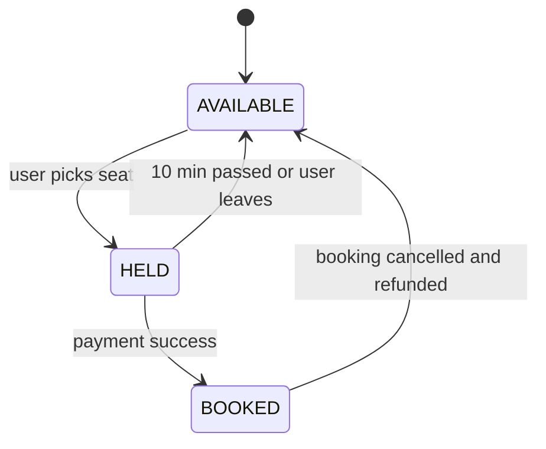
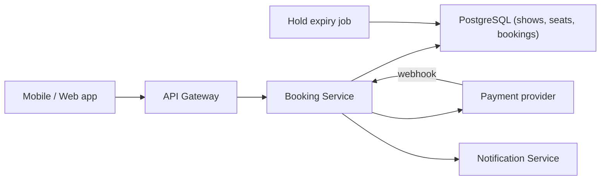
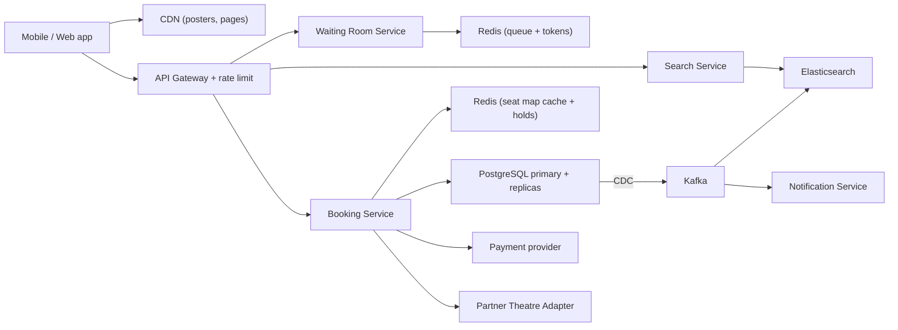
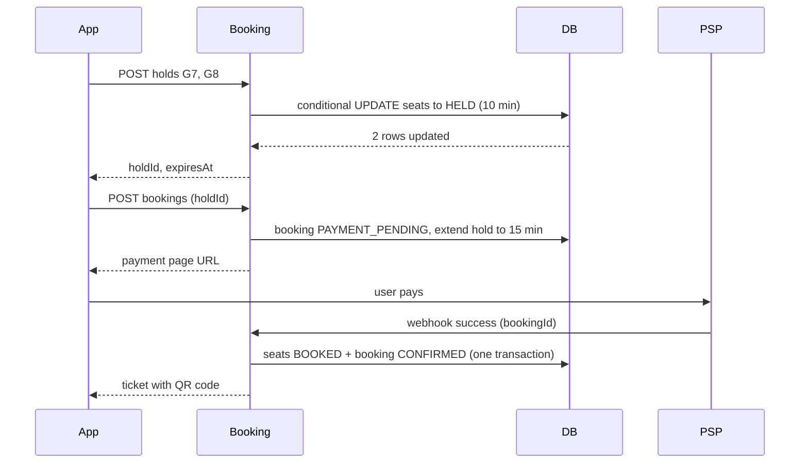
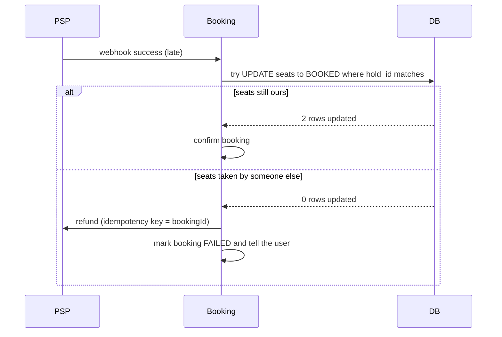
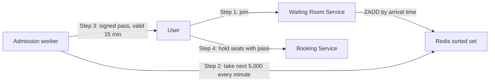

# BookMyShow (movie and event ticket booking)

[← System design basics](../system-design.md) · [← Main README](../../README.md)

**In one line:** Show the seats, hold the chosen seats for 10 minutes, take the money, and never sell one seat twice.

**Story:** A new Rajinikanth film opens on Friday. At the old cinema counter, the clerk has a paper seat chart.
You point at G7 and G8. He marks them with a pencil and says: "Pay in 10 minutes, or I erase it."
If you pay, he marks them in ink. If you walk away, the pencil mark goes and someone else can take the seats.
BookMyShow is the same counter, but with lakhs of people pointing at the same chart at the same second.

## 1. How the interviewer asks it

- "Design BookMyShow."
- "Design Ticketmaster."
- "Design a ticket booking system for a big concert where 1 million people come at 10 AM."
- "Design a train ticket booking system with concurrent seat booking and a waitlist."

Reported at (candidate reports and prep sites, not official lists):

- **Flipkart**: BookMyShow and airline booking, mixing class design and high-level design.
- **Meta**: Ticketmaster as a Product Architecture example; a "ticketing purchase system" report from 2025.
- **Swiggy**: train booking with a waitlist (SDE-2 report, 2025).

**What they are really testing:**

- Can you stop two people from booking the same seat (concurrency)?
- Do seats come back when a user does not pay (hold with expiry)?
- What happens when 1 million people arrive in the same minute for one show?

## 2. Questions to ask (with assumed answers)

| Question | Why it matters | What we assume |
|---|---|---|
| Movies only, or concerts and sports too? | Concerts bring huge spikes on one event. | Both. Movies are normal traffic, big concerts are spikes. |
| Which features are in scope? | Keeps the hour focused. | Search, seat map, hold seats, pay, get ticket. |
| What is out of scope? | Say it out loud. | Refunds policy, dynamic pricing, reviews, admin tools. |
| Does the user pick exact seats? | Changes the data model. | Yes, from a seat map. Some events are "general admission" (no seat numbers). |
| How long do we hold seats? | Drives the expiry design. | 10 minutes. |
| Max seats per booking? | Stops one person grabbing a whole row. | 10 seats per booking. |
| Do we own the seat data, or does the theatre? | Some theatres have their own systems. | We own it for most theatres. A few partners have their own system (part 11). |
| How many users and bookings? | Drives the numbers. | 50M monthly users, 1M bookings a day. |
| Biggest spike? | Drives the waiting room. | 1M people for a 50,000-seat concert at 10 AM. |
| Consistency for booking vs browsing? | Strong where money is, fast where it is not. | Booking: strong (no double booking). Browse: a few seconds stale is fine. |
| Payment method? | Payment can be slow. | Card or UPI through a payment provider (Razorpay, Stripe). |
| Bots? | Bots grab hot tickets. | Yes, we must limit them. |

## 3. Assumptions

1. 50M monthly users, 1M bookings a day, about 2 seats per booking.
2. Read heavy: about 100 browse requests for each booking.
3. Seats are held for 10 minutes, then released if not paid.
4. Booking must be strongly consistent. Browsing can be a few seconds stale.
5. A hot concert: 50,000 seats, 1M users, all at 10:00 AM.
6. Payment through an outside provider, confirmed by a webhook (the provider calls our URL).

## 4. Requirements

Functional (what it does):

- Search movies and events by city and date.
- See shows for a movie, and the seat map for a show.
- Choose seats and hold them for 10 minutes.
- Pay and get a booking with a ticket (QR code).
- See past bookings. Cancel if the show allows it.

Non-functional (how well it does it):

- **Never book one seat for two people.**
- Held seats come back if the user does not pay.
- Search and seat map load in under 500 ms.
- Booking stays up during a big on-sale (99.9%+). A fair queue is better than a crash.
- Browse data can be a few seconds old. Booking data cannot.

## 5. Numbers

Method: [Capacity estimation](../system-design.md#capacity-estimation). 1 day ≈ 100,000 seconds (rounded).

**Normal day:**

| What | Calculation | Result | Decision it drives |
|---|---|---|---|
| Bookings | 1M ÷ 100,000 s | ~10 bookings/s | One SQL primary is enough for writes. |
| Browse reads | 10/s × 100 | ~1,000 reads/s, ~5,000/s at evening peak | Cache the seat map and search results. Use read replicas. |
| Seat rows | 10,000 screens × 5 shows × 200 seats | ~10M seat rows a day | ~100 bytes each = ~1 GB a day. Partition by show date, archive old shows. |

**Hot concert at 10 AM:**

| What | Calculation | Result | Decision it drives |
|---|---|---|---|
| Arrivals | 1M users in ~1 minute | ~17,000 requests/s on one event | All on the same few rows. Sharding does not help one event. |
| Real buyers possible | 50,000 seats ÷ 2 per booking | ~25,000 bookings | Only 1 in 40 users can win. |
| Admit rate | let in ~5,000 users a minute | sold out in ~5–10 minutes | A waiting room protects the booking DB. |

**Key point:** Normal traffic is small. The hard part is one hot show. So the waiting room and the seat lock matter more than sharding.

## 6. APIs

| API | What it does |
|---|---|
| `GET /events?city=pune&date=2026-11-20` | Search and browse. Cached. |
| `GET /shows/{showId}/seats` | Seat map with status of each seat. |
| `POST /shows/{showId}/holds` | Hold chosen seats for 10 minutes. Needs `Idempotency-Key`. |
| `DELETE /holds/{holdId}` | User gives the seats back. |
| `POST /bookings` | Start payment for a hold. |
| `POST /payments/webhook` | The payment provider tells us the result. |
| `GET /bookings/{bookingId}` | Booking status and ticket. |

Hold seats:

```http
POST /shows/show_88/holds
Idempotency-Key: 2b7f3c1a-9d4e-4f6a-8c2b-1e5d7a9f0c33

{ "seatIds": ["G7", "G8"] }
```

```json
{ "holdId": "hold_5521", "seatIds": ["G7", "G8"], "expiresAt": "2026-11-20T10:12:00Z", "amount": "800.00" }
```

- If one seat is already taken, we return `409 Conflict` and hold nothing. All seats or none.
- The app shows a timer from `expiresAt`. The server time decides, not the phone's clock.
- `userId` comes from the login token, never from the body.

## 7. Data model

**Which database and why:**

- **PostgreSQL** for shows, seats and bookings. We need transactions (all-or-nothing writes) and unique constraints.
- **Redis** (an in-memory store) for the waiting room, seat map cache and fast seat holds.
- **Elasticsearch** (a search engine) for movie and event search, at scale. See [Inverted index](../system-design.md#inverted-index-how-search-works).

| Table | Main columns | Note |
|---|---|---|
| `events` | `event_id`, `title`, `type`, `language`, `duration` | Movie or concert. |
| `venues` / `screens` | `screen_id`, `venue_id`, `city`, `seat_layout` | Layout rarely changes. Cache it. |
| `shows` | `show_id`, `event_id`, `screen_id`, `starts_at`, `price_map` | One screening. |
| `show_seats` | `show_id`, `seat_id`, `status`, `hold_id`, `hold_expires_at`, `booking_id`, `version` | One row per seat per show. Primary key `(show_id, seat_id)`. |
| `bookings` | `booking_id`, `user_id`, `show_id`, `status`, `amount`, `idempotency_key` | `UNIQUE (user_id, idempotency_key)`. |
| `booking_seats` | `booking_id`, `show_id`, `seat_id`, `active` | Unique index on `(show_id, seat_id)` where `active = true`. Final guard. |

- The **unique index on active booking seats** is the last safety net. Even if all other checks have a bug, the DB refuses a second active booking for G7.
- "Where active = true" is a *partial index*. A cancelled booking does not block the seat forever.

**Seat status (state machine):**



## 8. Architecture, version 1 (simple)



- **API Gateway:** one front door. Checks login and rate limits. See [API gateway and BFF](../microservices.md#api-gateway-and-bff).
- **Booking Service:** search, seat map, hold, book. One service is fine at the start.
- **PostgreSQL:** the source of truth for every seat.
- **Hold expiry job:** every 30 seconds, it frees seats whose hold expired.
- This works for normal movie traffic: ~10 bookings/s and a few thousand reads/s.

## 9. Architecture, version 2 (at scale)



**What changed and why:**

- **CDN** (servers near the user) serves posters, trailers and static pages. See [CDN](../system-design.md#cdn).
- **Waiting room** for hot shows only. It lets in a fixed number of users per minute (part 11).
- **Search Service + Elasticsearch.** Search moves off the booking DB. CDC (change data capture: reading the DB's change log) feeds it through Kafka.
- **Redis seat map cache.** The seat map is read 100x more than it changes. A 1–2 second cache is fine.
- **Redis seat holds** in front of the DB for hot shows. The DB is still the final judge.
- **Read replicas** (read-only copies) for booking history. See [Read replicas](../system-design.md#database-replication-read-replicas).
- **Partner Theatre Adapter** talks to theatres that keep their own seat system.
- **Kafka** sends "booking confirmed" to tickets, email and SMS without slowing checkout. See [Message queues](../system-design.md#message-queues-and-pubsub).

## 10. Step-by-step flows

**Happy path: hold, pay, confirm.**



**Failure path: payment comes back after the hold expired.**



## 11. Deep dives

### 11a. No double booking

Two users tap G7 at the same millisecond. Only one can win.

**Wrong way:** read the seat, see AVAILABLE, then write HELD. Both users read AVAILABLE. Both write HELD. Double booking.

**Options:**

| Option | How | Good | Bad |
|---|---|---|---|
| Row lock | `SELECT ... FOR UPDATE`, then update | Simple | Holds a DB lock. Never keep it while the user pays. |
| Conditional update | `UPDATE ... WHERE status = 'AVAILABLE'` | One step, short lock | Hot rows still queue up |
| Optimistic lock | `version` column, retry on conflict | No waiting | Many retries when busy |
| Redis lock per seat | `SET seat:show_88:G7 hold_5521 NX EX 600` | Very fast, built-in timer | Redis can lose data. Needs the DB as the final guard. |

**Our choice:** a conditional update in one short transaction. Check and change happen in one atomic step.

```sql
UPDATE show_seats
SET status = 'HELD', hold_id = :holdId, hold_expires_at = now() + interval '10 minutes'
WHERE show_id = :showId
  AND seat_id IN (:seatIds)
  AND (status = 'AVAILABLE'
       OR (status = 'HELD' AND hold_expires_at < now()));  -- an expired hold counts as free
```

- If rows updated = seats asked (2 = 2), commit. The user holds the seats.
- If fewer (1 of 2), roll back. Say "Some seats were just taken" and refresh the map.
- The lock lasts a few milliseconds, not 10 minutes. The hold is a *status*, not a DB lock.
- At confirm, we insert into `booking_seats`. The partial unique index is the last guard.
- **Hot show:** we add the Redis `SET NX EX` lock in front. It rejects losers in memory. Only winners reach the DB.
  - `NX` means "set only if not already set". `EX 600` means "delete after 600 seconds".
  - For many seats, use a small Lua script so all seats are taken or none.

More: [Optimistic vs pessimistic locking](../databases.md#optimistic-vs-pessimistic-locking), [Transactions and isolation levels](../databases.md#transactions-and-isolation-levels).

### 11b. Hold timer and payment timeout

Seats must come back if the user does not pay.

- **Lazy expiry:** the SQL above treats an expired hold as free. So even if no job runs, the seat is not stuck.
- **Sweeper job:** every 30 seconds, it sets expired holds back to AVAILABLE. This keeps the seat map correct for other users.
- **Redis TTL** does the same for Redis locks. The key just disappears after 600 seconds.
- **Payment in progress:** when the user reaches the payment page, extend the hold to 15 minutes, once. UPI can take a few minutes.
- **Late payment:** the webhook may come after expiry. We try to book the same seats with the same `hold_id`. If someone else took them, we refund automatically (flow in part 10).
- **Webhook is idempotent:** the provider may call twice. We check booking status first. A second "success" does nothing. See [Idempotency](../microservices.md#idempotency).
- **Webhook never comes:** a job asks the provider "what happened to this booking?" after 15 minutes. See [Timeouts](../microservices.md#timeouts).

### 11c. Virtual waiting room for hot shows

Story: a temple on a festival day. Guards let 100 people in every few minutes. Everyone else waits in a line outside with a token number.

**Why:** 1M users for 50,000 seats. If all hit the booking service, the DB rows for one show get crushed. Sharding does not help: it is one show.



1. The user joins the queue. We store `userId` with arrival time in a Redis *sorted set* (a list kept in score order).
2. The user sees their position (`ZRANK`). The app polls every 10 seconds, or we push with SSE. See [Long polling vs WebSockets vs SSE](../system-design.md#long-polling-vs-websockets-vs-server-sent-events).
3. An admission worker lets in about 5,000 users a minute. It gives each a signed pass (a short JWT token) valid for 15 minutes.
4. The Booking Service accepts a hold only with a valid pass for that show.
5. When seats are sold out, we tell everyone still in line. They stop retrying.

- We turn the waiting room on only for shows marked "hot". Normal movies skip it.
- The admit rate is a knob. Raise it if the DB is calm. Lower it if errors rise.
- Bots: login required, one queue spot per account, CAPTCHA at join time, max 10 seats. Some sellers use pre-registration ("verified fan").

**Real world:** for the Taylor Swift Eras Tour presale in Nov 2022, Ticketmaster reported 3.5 billion total system requests. That was 4x its previous peak, with heavy bot traffic. 3.5M people registered for Verified Fan, and about 1.5M got codes. ([Ticketmaster](https://business.ticketmaster.com/press-release/taylor-swift-the-eras-tour-onsale-explained/))

### 11d. Seat map caching and partner theatres

**Seat map cache:**

- Layout (rows, seat numbers) never changes for a screen. Cache it for hours, even at the CDN.
- Seat status changes. Cache it in Redis for 1–2 seconds per show.
- A stale map is fine. The hold API is the real check. A user may see G7 free and get "just taken". That is OK.
- For a small show, we can push seat changes with SSE. For a huge show, the waiting room already limits who sees the map.
- See [Caching](../system-design.md#caching).

**Partner theatres** (they keep their own seat system):

- The Partner Theatre Adapter calls the theatre's API to block seats when we hold them.
- Set a short timeout (2–3 seconds) and a [circuit breaker](../microservices.md#circuit-breaker). One slow theatre must not slow everyone.
- If the call times out, we do not know if the seat is blocked. Keep our hold and ask the theatre again. A nightly *reconciliation* job (matching our records with theatre records) fixes mismatches.
- Use the same `holdId` on every retry, so the theatre does not block twice.

## 12. Follow-up questions interviewers ask

- **Payment succeeded but the hold expired and someone took the seat?** Refund automatically with an idempotency key. Better: extend the hold once when payment starts, so this is rare.
- **Redis lock node dies during the sale?** Some locks are lost. The DB conditional update and unique index still stop double booking. Redis only saves the DB from load.
- **Bots grab all the seats?** Login, one queue spot per account, CAPTCHA, per-user seat limits, [rate limiting](../system-design.md#rate-limiting-algorithms) per account and IP.
- **How does the seat map update live?** Poll every few seconds with a 1–2 second cache. SSE for small shows. Do not open millions of WebSockets for one concert.
- **General admission (no seat numbers)?** It becomes a counter: `UPDATE ... SET sold = sold + 2 WHERE sold + 2 <= capacity`. Same as [flash sale](flash-sale.md).
- **Train booking with a waitlist?** Keep an ordered list per train and class. On cancel, give the seat to the head of the list in the same transaction.
- **How do you shard?** By `show_id`. All seats of one show stay on one shard, so a hold is a single-shard transaction.
- **Why not hold seats with `SELECT ... FOR UPDATE` until payment?** That keeps a DB lock open for minutes. Connections run out. Use a status with expiry instead.
- **Search for events?** Elasticsearch fed by CDC. Cache popular queries like "movies in Pune today" for a minute.
- **What do you monitor?** Hold success rate, holds expired without payment, webhook delay, queue length and admit rate, DB lock wait time.

## 13. What can go wrong

| Problem | What we do |
|---|---|
| Two users pick the same seat | Conditional update lets one win. The other gets 409 and a fresh map. |
| User leaves without paying | Hold expires after 10 minutes. Lazy check + sweeper job free the seat. |
| Payment webhook lost | A job asks the provider after 15 minutes. Then confirm or cancel. |
| Late payment after expiry | Re-try the same seats. If gone, refund automatically. |
| Booking DB slow during on-sale | Waiting room lowers the admit rate. Users wait, nothing breaks. |
| Redis down | Hot shows fall back to the DB path with a lower admit rate. No double booking. |
| Partner theatre API slow | Timeout + circuit breaker. Show "this theatre is busy" for that theatre only. |
| Kafka down | Bookings still work. Emails and SMS are late. Tickets show in the app from the DB. |

## 14. Trade-offs

| We chose | We get | We give up |
|---|---|---|
| Hold as a status with expiry, not a DB lock | Short locks, seats come back by themselves | Need a sweeper job and late-payment handling |
| Conditional update in PostgreSQL | Simple, strongly consistent, easy to explain | Hot show rows still queue up without help |
| Redis lock in front for hot shows | Losers rejected in memory | One more system. DB must stay the final guard. |
| Waiting room for hot shows | Booking DB stays alive, fair order | Users wait. Extra service to run. |
| Stale seat map (1–2 s) | Cheap reads at scale | Some users see "seat just taken" |
| 10-minute hold | Enough time to pay | Seats look taken for a while, then come back |

## 15. Say this in the interview

> "I will cover search, seat map, holding seats, payment and confirmation. Pricing and refunds policy are out of scope.
> Normal traffic is small: about 10 bookings a second. The hard part is one hot show with a million users at 10 AM.
> I hold seats with one conditional UPDATE: set HELD only where the seat is AVAILABLE or its hold expired. If not all seats update, I roll back.
> The hold is a status with a 10-minute expiry, not a DB lock. A sweeper job frees expired holds.
> On payment success, the webhook confirms the booking. A partial unique index on active seats is the final guard.
> For hot shows, I add a waiting room with a Redis sorted set and signed passes. I also add a Redis seat lock in front of the DB.
> If payment arrives after the hold expired and the seat is gone, we refund automatically."

## 16. Mid vs senior vs staff

| Mid | Senior | Staff |
|---|---|---|
| Clear APIs, tables and a working v1 | Everything in mid, and drives the talk | Everything in senior, with little help |
| Knows two users can pick one seat; suggests a lock | Compares row lock, conditional update, optimistic lock and Redis lock; picks one and says why | Explains why sharding does not help one hot show, and designs the admit rate as a control knob |
| Seat hold with a timer | Hold as status + lazy expiry + sweeper; late-payment refund path | Partner theatre timeouts, reconciliation, and exactly what happens when Redis loses locks |
| Caches the movie list | Stale seat map is OK because the hold API is the real check | Waiting room fairness, bot defence, and per-show monitoring and alerts |
