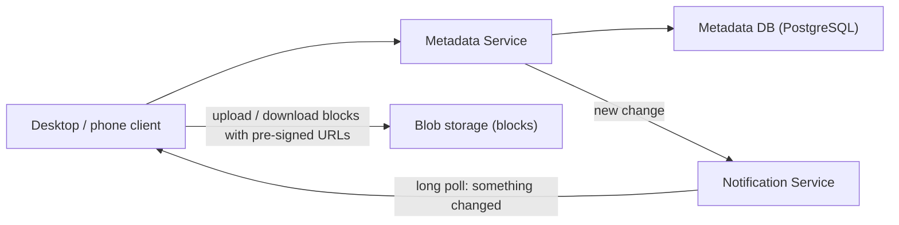
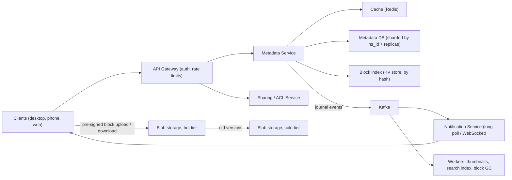
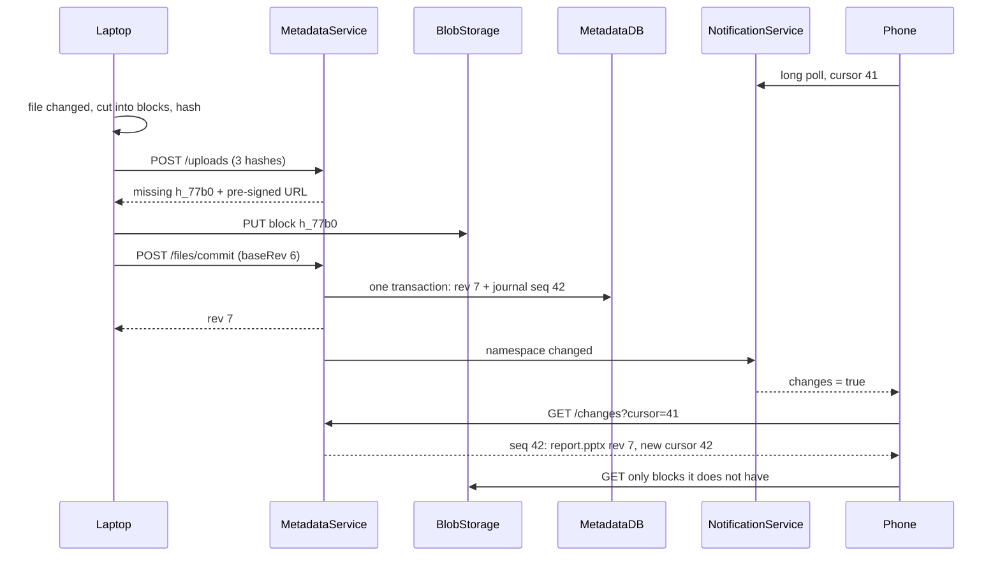
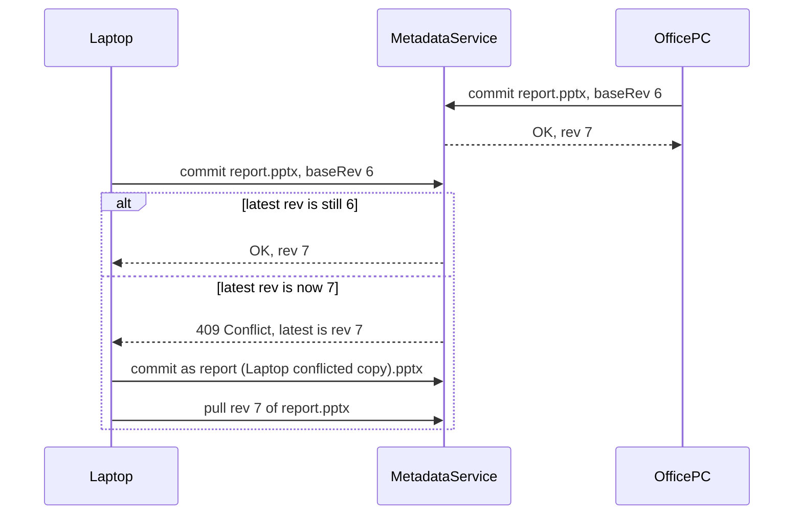
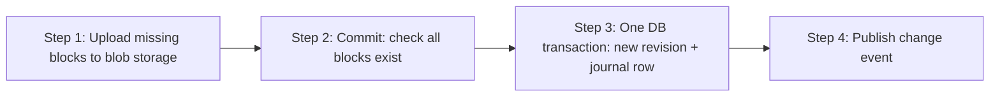
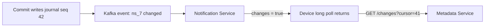

# Dropbox / Google Drive

[← System design basics](../system-design.md) · [← Main README](../../README.md)

**In one line:** Cut files into blocks stored once by hash, keep a consistent "file → blocks" list, and tell devices to pull changes.

**Story:** You keep a family recipe notebook in Bengaluru. Your sister in Pune keeps a copy.
When you change one page, you post only that page with its page number, not the whole notebook.
She keeps a small register: "last page update I got was number 41". She asks for everything after 41.
If you both changed the same page, she keeps both pages and asks you which one is right.
That is Dropbox: blocks, a change log, a cursor, and "conflicted copies".

---

## 1. How the interviewer asks it

- "Design Dropbox."
- "Design Google Drive: upload, download, share, and sync across devices."
- "Design a file sync service."

"Design Dropbox" is reported for Amazon SDE-2 (a 2025 Glassdoor report). Prep sites say Google and Amazon also ask cloud file storage. These are candidate reports, not official lists.

**What they are really testing:**

- Do you split files into blocks, so an edit uploads only what changed?
- Do you separate **metadata** (file names, versions, block lists) from **block bytes** (blob storage)?
- Can you explain sync between devices and what happens on a **conflict**?

---

## 2. Questions to ask (with assumed answers)

| Question | Why it matters | What we assume |
|---|---|---|
| Which features? | Sets the scope | Upload, download, sync across devices, share, version history |
| Real-time editing together (like Google Docs)? | Totally different design | No. That is Google Docs, a separate problem. |
| Max file size? | Big files need chunked, resumable upload | Up to 50 GB |
| How many users and changes? | Drives metadata DB and notification load | 500M users, 100M daily active, ~2 file changes per user per day |
| How many devices per user? | Each change must reach every device | ~3 (laptop, phone, office PC) |
| How fast must other devices see a change? | Push vs poll | Within a few seconds |
| Offline edits? | Offline edits cause conflicts | Yes, desktop works offline and syncs later |
| How long do we keep old versions? | Storage cost | 30 days |
| Share with other users? Public links? | Permissions model | Share folders with users (viewer/editor), plus links |
| Dedupe across users? | Saves storage but has privacy risk | Only within one user or team |

---

## 3. Assumptions

1. 500M users, 100M daily active, ~3 devices each.
2. ~200M file changes a day.
3. Files up to 50 GB; most are small (under 1 MB).
4. Block size 4 MB.
5. Other devices see a change within a few seconds.
6. Keep old versions for 30 days.
7. No real-time co-editing.

---

## 4. Requirements

**Functional (what it does):**

- Upload and download files of any size, with resume.
- Sync: a change on one device shows up on all the user's devices.
- Work offline; sync when back online.
- Share a folder with other users as viewer or editor.
- See and restore old versions.

**Non-functional (how well):**

- **Never lose a file** once we said "saved". Very high durability.
- **Consistency:** the user sees their own change at once. Other devices within seconds.
- **Small edit = small upload.** Do not re-upload a 1 GB file for a 1 KB change.
- **Availability** 99.9%+ for metadata. Downloads keep working from blob storage.
- **Security:** a user sees only files they own or that were shared with them.

---

## 5. Numbers

Method: [Capacity estimation](../system-design.md#capacity-estimation). We use 1 day ≈ 100,000 seconds.

| Step | Math | Result | Decision it drives |
|---|---|---|---|
| File changes per second | 200M ÷ 100,000 | ~2,000/s, peak ~6,000/s | Metadata writes are many. Plan to shard the metadata DB. |
| Change notifications | 2,000/s × ~3 devices | ~6,000 pushes/s, plus shared folders | Notify cheaply; devices pull details |
| New data per day | 200M changes × ~1 MB new blocks | ~200 TB/day | Blob storage, not a DB |
| Total stored | 500M users × ~5 GB used | ~2.5 EB (exabytes) | Dedupe, compression, cold tiers matter |
| Number of blocks | 2.5 EB ÷ 4 MB | ~600 billion blocks | The block index (hash → location) is a huge sharded key-value store |
| Open connections | ~50M devices online at a time | ~50M long polls / WebSockets | ~500 notification servers at ~100k connections each |

**Key point:** the bytes are big but simple (blob storage). The hard part is the **metadata**: many small writes that must be strongly consistent.

---

## 6. APIs

| API | What it does |
|---|---|
| `POST /uploads` | Send file path, size, and block hashes. Server answers which blocks are missing. |
| `PUT <pre-signed URL>` | Upload one missing block straight to blob storage. |
| `POST /files/commit` | Save a new version: path + ordered block list + base revision. |
| `GET /changes?cursor=c_41` | List changes after a cursor. Returns a new cursor. |
| `GET /changes/wait?cursor=c_41` | Long poll: waits up to 60 s, returns `{ "changes": true }` when something changed. |
| `GET /files/{id}?rev=7` | Get the block list and signed download URLs. |
| `POST /shares` | Share a folder with a user as viewer or editor. |
| `GET /files/{id}/revisions` | List old versions. |

Upload a changed file (2 of 3 blocks already exist):

```http
POST /uploads
{ "path": "/Work/report.pptx", "size": 10485760,
  "blocks": ["h_a1f3", "h_9c2e", "h_77b0"] }
```

```json
{ "uploadId": "up_55", "missing": ["h_77b0"],
  "urls": { "h_77b0": "https://blocks.example.com/h_77b0?sig=...&exp=..." } }
```

Commit the new version:

```http
POST /files/commit
{ "uploadId": "up_55", "path": "/Work/report.pptx",
  "blocks": ["h_a1f3", "h_9c2e", "h_77b0"], "baseRev": 6 }
```

```json
{ "fileId": "f_812", "rev": 7 }
```

- If someone else saved rev 7 first, the server returns `409 Conflict`. See deep dive 11.4.
- Dropbox's public API uses the same "cursor + long poll" idea (`list_folder/continue` and `list_folder/longpoll`) ([Dropbox API docs](https://www.dropbox.com/developers/documentation/http/documentation)).

---

## 7. Data model

A **namespace** is one root folder with its own change log: a user's home folder, or one shared folder.

| Table | Main columns | Notes |
|---|---|---|
| `namespaces` | `ns_id`, `type` (home/shared), `owner_id` | One per user home and per shared folder |
| `ns_members` | `ns_id`, `user_id`, `role` (owner/editor/viewer), `mount_path` | Sharing = adding a row here |
| `files` | `ns_id`, `path`, `file_id`, `latest_rev`, `deleted` | Unique `(ns_id, path)` |
| `file_revisions` | `file_id`, `rev`, `block_list`, `size`, `device_id`, `created_at` | `block_list` = ordered block hashes |
| `journal` | `ns_id`, `seq`, `file_id`, `rev`, `op` (add/edit/delete/move) | Append-only change log. `seq` grows by 1 per namespace. |
| `blocks` | `hash`, `location`, `size`, `ref_count` | Block index, in a key-value store |
| `devices` | `device_id`, `user_id`, `cursors` | Last `seq` the device has, per namespace |

**Which database and why:**

- **Metadata (`files`, `file_revisions`, `journal`, `ns_members`):** MySQL or PostgreSQL. A commit must write the new revision **and** the journal row in one transaction. See [Transactions and isolation levels](../databases.md#transactions-and-isolation-levels).
- **Shard metadata by `ns_id`.** All changes to one folder land on one shard, so `seq` is easy to keep in order. See [Partitioning and sharding](../system-design.md#partitioning-and-sharding).
- **Block index:** a key-value store (Cassandra, DynamoDB) sharded by `hash`. 600 billion keys, simple lookups.
- **Block bytes:** blob storage (S3, or Dropbox's own Magic Pocket). See [Blob storage](../system-design.md#blob-storage-files-images-videos).

---

## 8. Architecture, version 1 (simple)



- **Client:** watches the local folder, cuts files into 4 MB blocks, hashes them, uploads missing blocks.
- **Metadata Service:** checks which blocks are missing, commits versions, serves the change list.
- **Blob storage:** holds block bytes, named by hash.
- **Notification Service:** holds a long poll per device. It only says "something changed". The client then pulls the details.

---

## 9. Architecture, version 2 (at scale)



**What changed and why:**

- **Sharded metadata DB:** 6,000 writes/s at peak with transactions. Shard by `ns_id`, so one folder stays on one shard.
- **Block index as a KV store:** 600 billion hashes. Simple key lookups.
- **Hot and cold tiers:** old versions and unused files move to cheaper storage. Erasure coding (storing data plus math "parity" pieces) uses ~1.5× space instead of 3 full copies.
- **Kafka:** the journal feeds notifications and background workers. Use the [Transactional outbox pattern](../microservices.md#transactional-outbox-pattern) so no commit is "saved but not announced".
- **Notification Service on its own:** 50M open connections. It scales separately from the metadata API.
- **Sharing / ACL Service:** checks "can this user read or write this namespace?" on every call. Results are cached.

---

## 10. Step-by-step flows

### Edit on laptop, sync to phone



### Conflict: two devices edit the same file offline



---

## 11. Deep dives

### 11.1 Chunking, hashing and dedup (and resume for free)

**How it works:**

1. The client cuts each file into blocks of 4 MB. A 1 GB file = 256 blocks.
2. It computes a hash for each block, for example SHA-256. A *hash* is a short fingerprint. Same bytes always give the same hash.
3. It sends the list of hashes to the server: "Which of these do you not have?"
4. It uploads only the missing blocks, in parallel, each with a pre-signed URL.
5. It commits the file as an ordered list of hashes.

**What we get:**

- **Small edit, small upload:** change one slide in a 1 GB deck. Only the changed 4 MB block goes up.
- **Dedup:** the same block is stored once. 10 copies of the same PDF in one account = 1 set of blocks.
- **Resume for free:** if upload stops at 90%, the uploaded blocks are already saved. On retry, the server says only the last blocks are missing.
- **Integrity:** the server checks that the uploaded bytes really match the hash.

**Real world:** Dropbox's sync engine splits files into blocks of up to 4 MiB. It uploads blocks by hash and stores them in Magic Pocket, its own storage system ([Dropbox tech blog](https://dropbox.tech/infrastructure/-broccoli--syncing-faster-by-syncing-less)).

**Senior points:**

- **Insert at the start of a file shifts every fixed block.** Then every block hash changes. *Content-defined chunking* fixes this. It cuts blocks where a rolling hash of the content hits a pattern, so cuts move with the content. It is more complex; say it as an improvement.
- **Cross-user dedup leaks information.** If upload of a file is "instant", an attacker learns someone already has that file. Dedupe only inside one user or team, or always ask for the bytes.
- **Deleting blocks:** a block may be used by many files. Keep a `ref_count`, or run a garbage collector (GC) that removes blocks no live revision points to. Wait some days before real delete, to be safe.

### 11.2 Metadata service vs block storage

**Rule:** upload blocks first, commit metadata last.



- Metadata never points to a block that does not exist. So a file is never "half there".
- If the client dies after step 1, we have orphan blocks (blocks with no file). Block GC removes them later. No harm.
- Step 3 is one transaction. The revision and the journal row are saved together, or not at all.
- Step 4 uses the outbox pattern, so every commit is announced at least once.

**Why split them?**

| | Metadata | Blocks |
|---|---|---|
| Size | Small rows | 4 MB each, exabytes total |
| Access | Many small reads and writes | Big sequential reads and writes |
| Consistency | Strong (order of versions matters) | Write once, never change (key = hash) |
| Store | Sharded SQL | Blob storage |

Blocks never change once written, because the name is the hash. So blocks are easy to cache and copy. All the hard consistency work stays in the metadata DB.

### 11.3 Sync protocol and change notifications

**The journal and the cursor:**

- Every change in a namespace gets the next `seq`: 40, 41, 42...
- Each device remembers the last `seq` it applied. That is its **cursor**.
- To sync, a device asks: "Give me all changes after 41." It applies them in order.

**Notify, then pull:**



- The notification carries no data. It just says "ns_7 changed".
- **Why not push the full change?** A push can get lost (phone sleeps, network drops). The journal is the truth. A device that missed 100 pushes just pulls once with its old cursor.
- **Long poll or WebSocket?** Long poll is simple and works through most firewalls. WebSocket is better for phones and the web app. See [Long polling vs WebSockets vs Server-Sent Events](../system-design.md#long-polling-vs-websockets-vs-server-sent-events).
- Phones in the background use mobile push (APNs, FCM) instead of an open connection.

**Shared folders:**

- A shared folder is its own namespace with its own journal.
- Sharing with 10,000 people = 10,000 rows in `ns_members`. A change writes **one** journal row, not 10,000.
- Each member's devices keep a cursor for that namespace.
- Every call checks `ns_members` for the role: viewer can read, editor can write. Cache this check.
- Removing a member deletes the row. Their devices stop getting that namespace and remove the local copy.

### 11.4 Conflicts and versions

**When does a conflict happen?** Two devices change the same file from the same starting version. Usually one was offline.

**How we detect it (optimistic locking):**

```sql
-- Commit only if nobody saved a newer version since we started
UPDATE files SET latest_rev = 7
WHERE file_id = 'f_812' AND latest_rev = 6;
-- 1 row changed -> success. 0 rows -> someone else saved rev 7 first -> 409 Conflict
```

See [Optimistic vs pessimistic locking](../databases.md#optimistic-vs-pessimistic-locking).

**What we do on a conflict:**

| Choice | How it works | Good | Bad |
|---|---|---|---|
| **Conflicted copy** (Dropbox style) | The loser saves as `report (Priya's conflicted copy 2026-11-16).pptx` | No data is ever lost | User must merge by hand |
| Last writer wins | Newest commit wins; older one goes to version history | Simple, no extra files | User may not notice their edit was replaced |
| Merge | Merge changes line by line | Best for text | Impossible for most binary files (PPT, images) |

We choose **conflicted copy**. Losing someone's work silently is the worst outcome for a storage product.

**Other cases:**

- **Edit vs delete:** one device edits, another deletes. Keep the edited file. Deleting someone's newer work is worse.
- **Rename vs edit:** apply both. The rename changes the path; the edit changes the blocks.
- **Versions:** every commit is a new row in `file_revisions`. Restore = commit an old block list as a new revision. Blocks are shared, so old versions cost little.
- **After 30 days,** old revisions are removed. Their blocks go to GC if no other revision uses them.

---

## 12. Follow-up questions interviewers ask

- **Upload fails at 90%?** Blocks already uploaded are stored. The client asks again and uploads only the missing blocks.
- **Small edit to a 1 GB file?** Only the changed 4 MB blocks go up. With content-defined chunking, even an insert near the start changes only a few blocks.
- **Same file uploaded by 1M users?** Dedupe by block hash saves space. But cross-user dedupe leaks "someone has this file". We dedupe only inside a user or team.
- **Share a folder with 10,000 people?** The folder is one namespace with one journal. A change writes one row. Each member's device pulls with its own cursor.
- **How are devices told about changes?** Long poll or WebSocket that says only "something changed". The device pulls details from the journal.
- **How do you cut storage cost?** Dedupe, compression, erasure coding instead of 3 copies, and a cold tier for old versions.
- **How do you download a 50 GB file fast?** Get the block list. Download many blocks in parallel from signed URLs, through a CDN near the user.
- **How does the desktop client know a file changed?** The OS file-watcher tells it (for example, inotify on Linux). A periodic scan catches anything the watcher missed.
- **What if the metadata DB shard is down?** Writes for those namespaces fail and the client retries later. Reads go to a replica. Other namespaces are fine.
- **Encryption?** TLS in transit. Blocks encrypted at rest with keys held by a key service. Per-user keys block cross-user dedupe, which fits our choice.

---

## 13. What can go wrong

| Problem | What we do |
|---|---|
| Upload stops halfway | Blocks are saved one by one. Resume with missing blocks only. |
| Client commits with a block that never arrived | Commit checks the block index first. Reject with a list of missing blocks. |
| Client crashes after upload, before commit | Orphan blocks; block GC deletes them after some days |
| Notification lost | Device pulls on reconnect and every few minutes with its cursor. The journal is the truth. |
| Same file edited on two devices | Optimistic check on `latest_rev`; loser saved as a conflicted copy |
| Bug deletes blocks still in use | Soft delete first, real delete after days; ref counts checked by GC |
| Hot shared folder (one namespace, huge activity) | Its shard gets busy. Rate limit per namespace; move very hot namespaces to their own shard. |
| Notification server dies | Clients reconnect to another server with their cursor. Nothing is lost. |
| Device offline for months | Its cursor is too old (journal trimmed). Do a full re-scan: compare local hashes with the server. |

---

## 14. Trade-offs

| We chose | We get | We give up |
|---|---|---|
| 4 MB fixed blocks | Simple, small uploads for most edits | Inserts near the start shift blocks (fix: content-defined chunking) |
| Dedupe only inside a user or team | No "who has this file" leak | Less storage saving than global dedupe |
| Strongly consistent SQL metadata, sharded by namespace | Correct version order, safe commits | Manual sharding; cross-namespace moves are harder |
| Notify, then pull | Lost notifications do no harm | One extra round trip per change |
| Conflicted copies | No data is ever lost | User merges by hand |
| Erasure coding + cold tier | ~1.5× instead of 3× storage | Slower reads for cold data, more CPU |
| Blocks uploaded directly with pre-signed URLs | Our servers do not carry exabytes | More logic in the client |

---

## 15. Say this in the interview

> "I will cover upload, download, sync across devices, sharing and versions. Real-time co-editing is out of scope.
> The client cuts files into 4 MB blocks and hashes each one. It asks the server which hashes are missing and uploads only those, straight to blob storage with pre-signed URLs. That gives delta sync, dedup and resume.
> Metadata lives in SQL, sharded by namespace. A commit writes the new revision and a journal row in one transaction. Blocks are uploaded first, so metadata never points to missing data.
> Each device keeps a cursor into the journal. A notification service holds a long poll and says only 'something changed'. The device pulls changes after its cursor.
> Commits carry a base revision. If someone saved first, we get a conflict and keep both as a conflicted copy. Nothing is lost."

---

## 16. Mid vs senior vs staff

| Mid | Senior | Staff |
|---|---|---|
| Upload files to S3, store metadata in a DB | Blocks + hashes, upload only missing blocks, pre-signed URLs | Content-defined chunking, cross-user dedup risk, block GC safety |
| "Devices poll for changes" | Journal + cursor per device, notify then pull | Hot namespaces, journal trimming, full re-scan for old cursors |
| Mentions conflicts | Optimistic check on base revision, conflicted copies, version history | Edit vs delete, rename vs edit, move across namespaces |
| Shares with a user list | Shared folder = namespace with members and roles | Large shares, permission caching and revoke speed |
| S3 for storage | Hot and cold tiers | Erasure coding, cost per GB, own storage system at exabyte scale |
