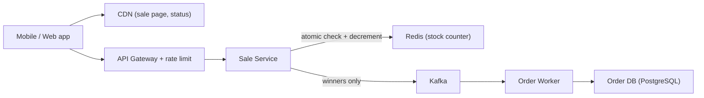
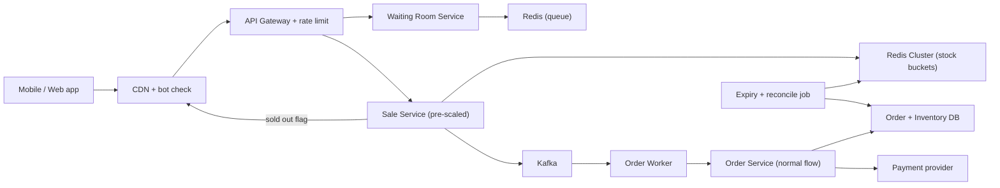
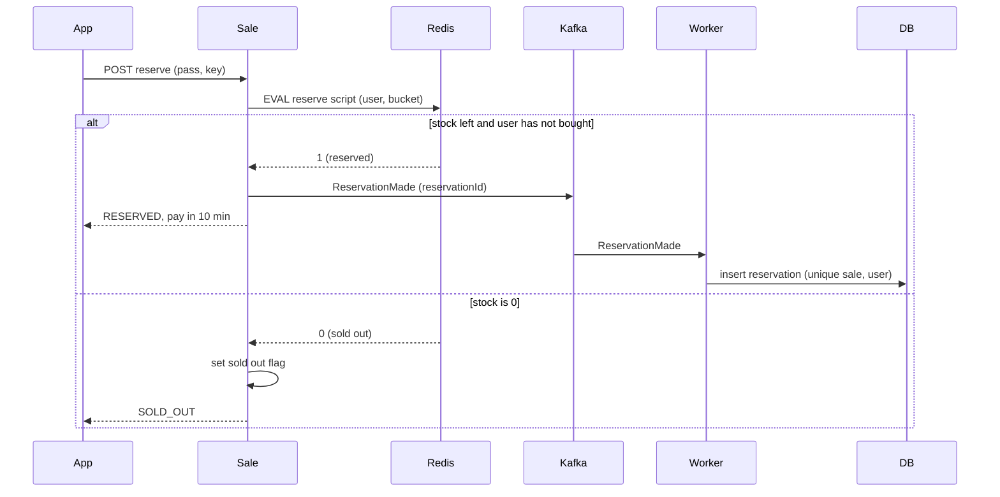
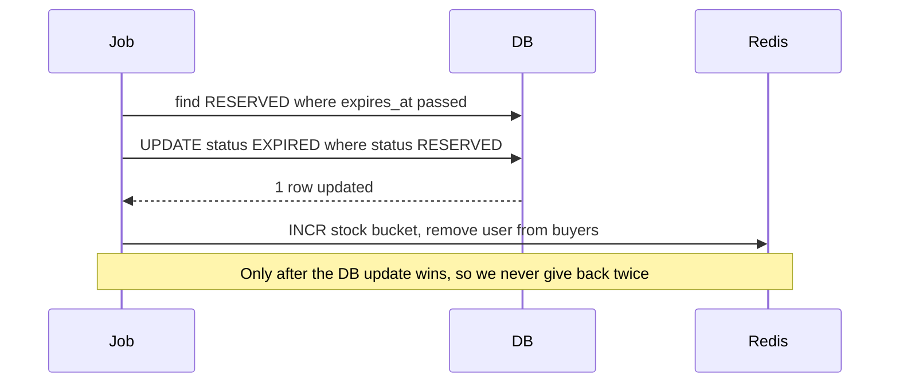

# Flash sale (Flipkart Big Billion Day / limited drops)

[← System design basics](../system-design.md) · [← Main README](../../README.md)

**In one line:** Let millions knock, let only the stock count of people buy, and keep the database away from the crowd.

**Story:** A temple gives free prasad (blessed sweets) on a festival day. There are 10,000 boxes and 10 lakh (1 million) people.
If everyone rushes inside, people get hurt and the counter breaks.
So guards stand at the gate with 10,000 tokens. Once the tokens are gone, they tell the crowd "finished" at the gate itself.
Inside, the counter staff work at a calm speed, one token at a time.
A flash sale is the same: the gate (CDN, queue, Redis counter) does the hard work. The counter (order DB) stays calm.

## 1. How the interviewer asks it

- "Design a flash sale: 10,000 iPhones at a low price, 10 million users at 12 PM."
- "Design Big Billion Days / Prime Day checkout so we never oversell."
- "Design inventory management for an e-commerce site."

Reported at (candidate reports and prep sites, not official lists):

- **Amazon**: "design an inventory management system" (Glassdoor, 2025).
- No direct report ties the flash-sale wording to Flipkart. It is still a natural fit for Big Billion Days.

**What they are really testing:**

- Can you sell exactly the stock, with no overselling, under a huge spike?
- Can you protect the database when demand is 1,000x the stock?
- Do you have a plan for after stock hits 0, when millions still keep clicking?

## 2. Questions to ask (with assumed answers)

| Question | Why it matters | What we assume |
|---|---|---|
| How much stock, and how many users? | Demand vs stock decides the design. | 10,000 units, 10M users. 1,000x more demand than stock. |
| One product or many? | One product = one hot key. | A few products per sale. One very hot one. |
| Is overselling ever OK? | Decides where the truth lives. | Never. Selling a few less (underselling) is OK. |
| Per-user limit? | Stops one buyer taking all. | 1 unit per user. |
| How long to hold a unit for payment? | Unpaid units must come back. | 10 minutes. |
| When does the spike come? | Planned spikes let us pre-warm. | Exactly 12:00 PM. We know the time weeks ahead. |
| Login required? | Needed for limits and bot checks. | Yes. Login before the sale starts. |
| Bots a concern? | Bots buy and resell. | Yes. |
| Do we have a normal order system already? | We reuse it after the gate. | Yes: [Amazon order processing](amazon-order-processing.md). |
| What must stay up if the sale breaks? | The rest of the site must not fall. | Normal shopping and payments must not be hurt. |

## 3. Assumptions

1. 10,000 units of one hot phone, 10M users, sale starts at 12:00 PM.
2. 1 unit per user. Hold for 10 minutes to pay.
3. Never oversell. A few unsold units are OK and can be sold later.
4. Users are logged in. Product pages are mostly static.
5. Peak about 1M requests/s for a few minutes, then it drops fast.
6. The normal order and payment system exists. We add a gate in front of it.

## 4. Requirements

Functional (what it does):

- Show the sale page with a countdown.
- At 12:00, let users click "Buy".
- Reserve one unit per winner, then let them pay within 10 minutes.
- Create the order for winners. Tell everyone else "sold out" quickly.
- Release unpaid units back to stock.

Non-functional (how well it does it):

- **No overselling. Ever.**
- Answer every click fast (yes, no or "you are in line") in under 1 second.
- The rest of the site stays up, even if the sale has trouble.
- Fair: earlier users get a better chance. Bots are blocked.

## 5. Numbers

Method: [Capacity estimation](../system-design.md#capacity-estimation).

| What | Calculation | Result | Decision it drives |
|---|---|---|---|
| Users at 12:00 | 10M in about 1 minute | ~170,000 users/s | More than any app tier we keep running normally. |
| Requests with refresh | each user clicks and refreshes ~5 times | ~1M requests/s for a few minutes | Most must stop at the CDN or the gate. |
| Real winners | 10,000 units | 10,000 orders | 99.9% of buy clicks must get "sold out" or "wait". |
| Order writes | 10,000 orders spread over ~2 minutes by a queue | ~100 orders/s | Easy for one SQL primary, if we pace it. |
| DB if not protected | 1M requests/s on one row | impossible | One SQL DB does a few thousand writes/s. So the DB must never see the crowd. |
| Redis counter | one Redis node does ~100,000 simple ops/s | one key is close to the limit | Split stock into buckets (part 11d). |

**Real world:** Flipkart has said its systems handle about 1.5M requests/s when Big Billion Days opens (2023). ([Flipkart Stories](https://stories.flipkart.com/innovation-customer-first-qna-jeyandran-venugopal))
Shopify reported a 2024 BFCM (Black Friday) peak of 284M requests a minute at its edge. ([Shopify Engineering](https://shopify.engineering/bfcm-readiness-2025))

**Key point:** The order DB only needs ~100 writes/s. The problem is the 1M requests/s in front of it. So the design is about the gate, not the DB.

## 6. APIs

| API | What it does |
|---|---|
| `GET /sales/{saleId}` | Sale page data. Static, served from the CDN. |
| `GET /sales/{saleId}/status` | `UPCOMING`, `LIVE` or `SOLD_OUT`. Cached for 1 second at the CDN. |
| `POST /sales/{saleId}/enter` | Join the queue. Returns a position or an entry pass. |
| `POST /sales/{saleId}/reserve` | Try to take one unit. Needs the pass and an `Idempotency-Key`. |
| `POST /orders` | Pay for a reserved unit. Same API as [order processing](amazon-order-processing.md). |

Reserve one unit:

```http
POST /sales/bbd-42/reserve
Authorization: Bearer <login token>
X-Sale-Pass: <signed pass from the queue>
Idempotency-Key: 8c1d0e7b-4a2f-4b9e-9f63-7d2a1c5e8b90
```

```json
{ "result": "RESERVED", "reservationId": "res_bbd42_77123", "payBefore": "2026-10-08T12:11:30Z" }
```

- Other answers: `"SOLD_OUT"`, `"ALREADY_BOUGHT"` or `"TRY_AGAIN"` with a `retryAfter` in seconds.
- `reserve` only touches Redis. It never waits for the order DB.

## 7. Data model

**Which store and why:**

| Store | What | Why |
|---|---|---|
| **Redis** | `stock:{bbd42:b0}` … `stock:{bbd42:b9}` (10 stock buckets), `buyers:{bbd42:b0}` … (user ids per bucket) | Atomic counters in memory, ~100,000 ops/s per node. |
| **Kafka** | topic `sale-reservations`, key = `reservationId` | Buffers winners so the DB gets a steady flow. |
| **PostgreSQL** | `sale_reservations`, `orders`, `inventory` | Source of truth, transactions, unique constraints. |

`sale_reservations` table:

| Column | Note |
|---|---|
| `reservation_id` | Primary key. Also the idempotency key downstream. |
| `sale_id`, `sku`, `user_id` | `UNIQUE (sale_id, user_id)`: one unit per user, enforced again in the DB. |
| `status` | `RESERVED`, `PAID`, `EXPIRED`. |
| `expires_at` | 10 minutes after reserve. |

- The `{bbd42:b0}` part in Redis keys is a *hash tag*. Redis Cluster puts keys with the same tag on the same node.
- So the stock key and buyers key of one bucket sit together, and one Lua script can touch both. Different buckets can sit on different nodes.
- Redis is the **gate**. PostgreSQL is the **record**. If they disagree, the DB wins and we fix Redis.

## 8. Architecture, version 1 (simple)



- **CDN** serves the sale page and a 1-second cached status. Most traffic ends here. See [CDN](../system-design.md#cdn).
- **API Gateway** rate limits per user and IP. See [Rate limiting algorithms](../system-design.md#rate-limiting-algorithms).
- **Sale Service** runs one Lua script in Redis. Yes = reserved, no = sold out.
- **Kafka + Order Worker** create orders at a steady speed. The DB never sees the spike.
- This works for a mid-size sale (say 100,000 users).

## 9. Architecture, version 2 (at scale)



**What changed and why:**

- **Bot check at the edge:** CAPTCHA and device checks before the request reaches us.
- **Waiting room:** only users with a pass can call `reserve`. Same idea as [BookMyShow's waiting room](bookmyshow-ticket-booking.md).
- **Stock buckets:** one hot key becomes 10 keys across Redis nodes (part 11d).
- **Sold-out flag at the CDN:** once stock is 0, the CDN answers "sold out" itself. Millions of late clicks never reach us.
- **Order Service (normal flow):** winners go through the usual saga. Reuse [Amazon order processing](amazon-order-processing.md).
- **Expiry + reconcile job:** gives back unpaid units and checks Redis against the DB.
- **Pre-scaled Sale Service:** we add instances before 12:00. Autoscaling is too slow for a spike that comes in seconds.

## 10. Step-by-step flows

**Buy click: winner and loser.**



**Unit not paid in 10 minutes.**



## 11. Deep dives

### 11a. The stock counter without overselling

**Wrong way:** `GET stock`, check `> 0`, then `SET stock = stock - 1`. Two servers read 1 at the same time. Both sell. Oversold.

**Simple right way:** `DECR stock`. Redis runs one command at a time, so `DECR` is atomic (it cannot be split).

- If the result is below 0, `INCR` it back and say sold out.
- Problem: it does not check the per-user limit in the same step.

**Better way: one Lua script.** Redis runs the whole script as one step. Nothing runs in between.

```lua
-- KEYS[1] = stock bucket, KEYS[2] = buyers set of that bucket, ARGV[1] = userId
if redis.call('SISMEMBER', KEYS[2], ARGV[1]) == 1 then
  return -1                                   -- already bought
end
local left = tonumber(redis.call('GET', KEYS[1]) or '0')
if left <= 0 then
  return 0                                    -- sold out
end
redis.call('DECR', KEYS[1])                   -- check and take in ONE atomic step
redis.call('SADD', KEYS[2], ARGV[1])
return 1                                      -- reserved
```

- **Without Redis:** the DB way is `UPDATE inventory SET qty = qty - 1 WHERE sku = ? AND qty > 0`. It is correct, but the row lock makes everyone queue. Fine for small sales. See [Optimistic vs pessimistic locking](../databases.md#optimistic-vs-pessimistic-locking).
- **Same idea in order processing:** [no overselling deep dive](amazon-order-processing.md#11b-no-overselling).

### 11b. Admission: queue, tokens, rate limits and bots

Most of the 1M requests/s must be stopped early and cheaply.

| Layer | What it stops |
|---|---|
| CDN | Page loads and status checks. Cached, never reach us. |
| Bot check at the edge | Scripts. CAPTCHA, device checks, known bad IPs. |
| Rate limit at the gateway | One user clicking 50 times a second. E.g. 1 reserve call per user per 2 seconds. |
| Waiting room | Fair order. Only users with a signed pass can call `reserve`. |
| Sold-out flag | Everyone after stock hits 0. Answered from the CDN. |

- **Queue or no queue?** With 10,000 units and 10M users, a queue makes it fair and calm. For small sales, the Lua gate alone is enough.
- **Token-based admission:** the waiting room gives a short signed pass (valid 2 minutes) to the next batch. `reserve` checks the pass signature. No DB lookup needed.
- **Bots:** login required before the sale, 1 unit per account, per-device limits, and pre-registration for very hot drops.
- **Back pressure** (slowing input when the system is full): if Kafka lag grows, the waiting room lets in fewer users.

### 11c. What happens to the DB: async order creation

The DB is the record, but it must not see the spike.

1. Redis says "reserved". The Sale Service sends `ReservationMade` to Kafka and answers the user at once.
2. Order Workers read Kafka at a steady speed, e.g. 100 per second.
3. Each worker inserts into `sale_reservations`. `UNIQUE (sale_id, user_id)` is a second guard against double buys.
4. The worker hands the reservation to the normal Order Service. Payment, saga and outbox work as in [order processing](amazon-order-processing.md).

**Safety rules:**

- Kafka can deliver twice. The worker uses `reservation_id` as the idempotency key. See [Handling duplicate events](../kafka.md#handling-duplicate-events).
- Redis said yes but the Kafka send failed? The Sale Service retries. If it still fails, it gives the unit back to Redis and says "try again".
- Redis said yes but the DB insert failed? Kafka keeps the message. The worker retries with [backoff](../microservices.md#retry-with-exponential-backoff-and-jitter).
- **Reconcile job:** every minute, compare `initial stock − Redis stock` with reservations in the DB. Alert on a mismatch. The DB wins.

### 11d. Hot key, pre-warming and the sold-out flag

**Hot key:** one Redis key for one product means one Redis node takes all clicks.

- Split 10,000 units into 10 buckets of 1,000. Keys `stock:{bbd42:b0}` to `stock:{bbd42:b9}`. Each bucket can live on a different node.
- Pick the bucket by `hash(userId) % 10`. The same user always lands on the same bucket. So the per-user limit still works.
- If a bucket is empty, try one other bucket. At the end, a few units may stay unsold. We sell them later. Underselling is OK, overselling is not.

**Pre-warming (getting ready before 12:00):**

- Load stock into Redis 30 minutes before. Check the numbers twice.
- Push the sale page and images to the CDN early.
- Scale up Sale Service and gateways 1 hour before. Autoscaling reacts in minutes. The spike comes in seconds.
- Run a load test at 2x expected traffic a few days before.
- Turn off heavy extras for the sale page (recommendations, "people also bought").

**Sold-out flag:**

- When the Lua script returns 0 for all buckets, set the key `sale:bbd42:soldout` to `true`.
- The status API reads it. The CDN caches it for 1 second.
- Now most late clicks are answered by the CDN. Without this, the gate gets hit for 30 more minutes for nothing.

## 12. Follow-up questions interviewers ask

- **Redis says sold, but the DB write fails?** Kafka keeps the event and the worker retries. The reconcile job catches the rest. Redis is the gate, the DB is the record.
- **Redis crashes mid-sale?** Fail over to the replica. The replica may miss the last few decrements, so pause the sale for a minute and rebuild counts from the DB. A pause is better than an oversell.
- **User pays after the 10-minute hold expired?** If the unit was not given to anyone else, accept. If it was, refund automatically.
- **Should the cart reserve stock?** No. Most carts are abandoned. Reserve only at "Buy" or checkout.
- **Stock in many warehouses?** Pre-allocate sale stock to warehouses before the sale. The gate sells the total. Pick the warehouse when the order is created.
- **Why not just use the DB with a conditional update?** It is correct. But 1M requests/s on one row is too much. It works for a small sale.
- **How do you stop one user using 10 accounts?** Per-device and per-payment-card limits, phone number check, and pre-registration.
- **How is this different from BookMyShow?** Here all units are the same, so it is a counter. In [BookMyShow](bookmyshow-ticket-booking.md) each seat is different, so it is a lock per seat.
- **What do you monitor?** Redis ops/s and latency, reserve success rate, Kafka lag, unpaid reservations, Redis vs DB stock difference.

## 13. What can go wrong

| Problem | What we do |
|---|---|
| Spike bigger than planned | Waiting room lets in fewer users. Rate limits reject extra calls fast. |
| Hot Redis key | Stock buckets spread load across nodes. |
| Redis node fails | Replica takes over. Pause the sale, rebuild counts from the DB, then resume. |
| Kafka slow or down | Reservations wait. Waiting room slows admission (back pressure). |
| Order DB slow | Workers slow down. Users already have a "reserved" answer, so they just wait to pay. |
| Users never pay | Expiry job gives units back after 10 minutes. |
| Bots | Edge bot check, login, per-account and per-device limits. |
| Sale breaks the rest of the site | Separate Sale Service and Redis, with their own limits (a [bulkhead](../microservices.md#bulkhead)). Normal shopping stays up. |

## 14. Trade-offs

| We chose | We get | We give up |
|---|---|---|
| Redis as the gate | Atomic, fast, in memory | Can lose the last writes in a crash. Need reconciliation. |
| Lua script | Stock and per-user check in one step | Script must be short. Keys must be on one node. |
| Async order creation via Kafka | DB gets a calm, steady flow | User sees "reserved" before the order row exists |
| Stock buckets | No single hot key | A few units may stay unsold at the end |
| Waiting room | Fair and safe | Users wait. One more service. |
| Sold-out flag at the CDN | Late clicks cost nothing | Up to 1 second of stale "live" status |
| Pre-scaling | Ready for the spike | Pay for idle servers for an hour |

## 15. Say this in the interview

> "We have 10,000 units and 10 million users at 12 PM, so demand is 1,000 times the stock.
> The order DB only needs about 100 writes a second. The real problem is 1 million requests a second in front of it.
> So I stop traffic in layers: CDN for pages, bot checks, rate limits, and a waiting room with signed passes.
> The stock lives in Redis. One Lua script checks stock and the per-user limit and decrements in one atomic step.
> Winners go to Kafka, and workers create orders at a steady speed using the normal order flow.
> When stock hits zero, a sold-out flag is cached at the CDN. Unpaid units come back after 10 minutes.
> Redis is the gate and the DB is the record. A reconcile job checks they match."

## 16. Mid vs senior vs staff

| Mid | Senior | Staff |
|---|---|---|
| Uses a conditional UPDATE or Redis `DECR` to avoid overselling | Lua script with per-user limit; explains why read-then-write fails | Stock buckets for hot keys, and how per-user limits still work with buckets |
| Adds a cache and a queue | Async order creation via Kafka with idempotent workers | Back pressure: Kafka lag controls the waiting room admit rate |
| Mentions rate limiting | Layered defence: CDN, bot check, rate limit, waiting room, sold-out flag | Pre-warming plan, load tests, and a bulkhead so the sale cannot take down the site |
| Releases unpaid stock | Expiry job that gives stock back once, guarded by the DB | Redis failover plan, reconciliation, and "pause rather than oversell" as a clear rule |
