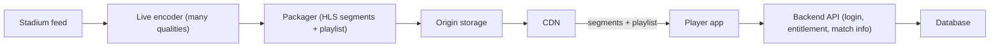
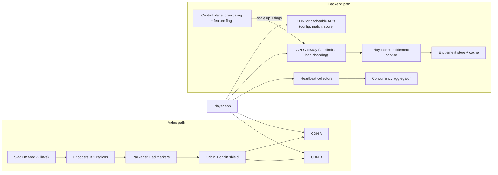
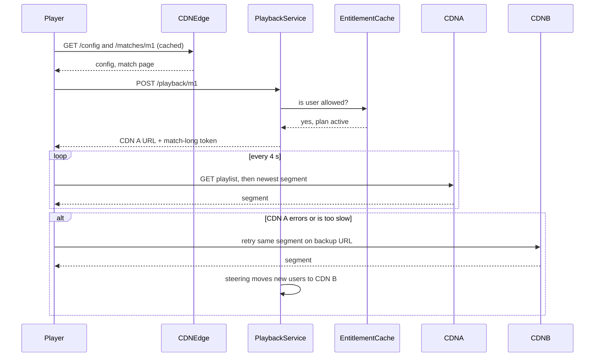
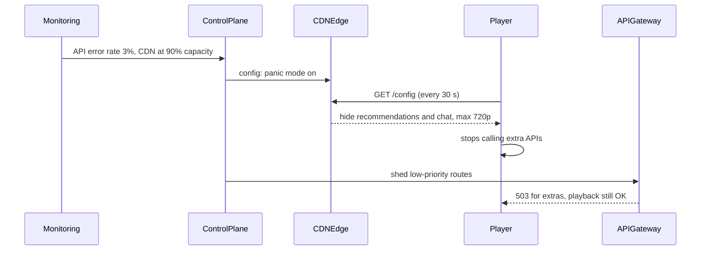
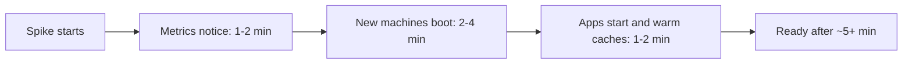
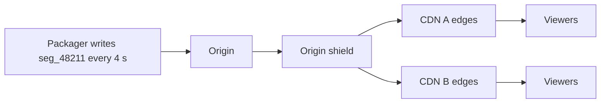
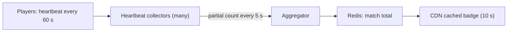

# Hotstar live streaming (IPL scale)

[← System design basics](../system-design.md) · [← Main README](../../README.md)

**In one line:** Serve small video chunks through many CDNs, and get the backend ready *before* crores of fans open the app.

**Story:** A sweet shop in Old Delhi knows the Diwali evening rush is coming.
The owner does not start cooking when the line forms. He makes extra sweets the night before.
He puts ready boxes at the front, so the counter is fast.
If the rush is still too big, he stops selling the fancy items and sells only the main boxes.
Live streaming at IPL scale works the same way: prepare early, serve from the front, and drop extras under stress.

---

## 1. How the interviewer asks it

- "Design live streaming for a cricket match with 50 million people watching at the same time."
- "Design Hotstar / JioHotstar for the IPL final."
- "Design Twitch / YouTube Live."
- "Our app falls over every time there is a wicket. How would you fix it?"

No source ties "design Hotstar" to one company. It is a natural prompt for Indian media and OTT (streaming app) companies.
The related "design FB Live Comments" prompt is reported for Meta (candidate reports, not official).

**What they are really testing:**

- Do you see that the hard part is the **sudden spike**, not the video itself?
- Do you know autoscaling is too slow for this, and plan capacity *before* the match?
- Do you protect the small backend APIs (login, entitlement, scorecard) that fall over first?

---

## 2. Questions to ask (with assumed answers)

| Question | Why it matters | What we assume |
|---|---|---|
| Live only, or also replay? | VOD is a different problem | Live first; replay later from the same segments |
| How many people watch **at the same time**? | Concurrent viewers drive everything, not total views | 50M concurrent at peak |
| How fast do people join? | The spike shape decides the plan | 20M join in 5 minutes (toss, last overs) |
| How much delay behind TV is OK? | Lower delay costs more requests and more stalls | 15–30 s normal; optional low-latency mode |
| Which devices and networks? | Most viewers are on mobile data | 80% mobile; bitrates from 200 kbps to 6 Mbps |
| Free or paid? | Paid needs an entitlement check (is this user allowed?) | Paid plans plus some free matches |
| Many languages? | Each commentary feed is a separate stream | 4–6 language feeds |
| Ads? | Ad breaks between overs are the revenue | Yes, server-side ads in breaks |
| Chat, emoji, live score? | Extra systems that also spike | Live score yes; chat and emoji are nice-to-have |
| Must we show "X watching"? | Needs a concurrency counter | Yes, roughly right, updated every few seconds |

---

## 3. Assumptions

1. Peak: 50M concurrent viewers (plan up to 60M).
2. Join storm: 20M new viewers in 5 minutes.
3. Average bitrate ~1.5 Mbps (mostly mobile).
4. Delay 15–30 s behind live is OK.
5. Segments of 4 s, HLS and DASH.
6. Paid users need an entitlement check before playback.
7. The match schedule is known weeks ahead.
8. Mostly India, so CDN capacity inside India matters.

---

## 4. Requirements

**Functional (what it does):**

- Ingest the stadium feed and stream it live in many qualities and languages.
- Users open the app, see the match, and start watching in a few seconds.
- Check that a user is allowed to watch (entitlement).
- Show live score and "X watching".
- Insert ads in the breaks.

**Non-functional (how well):**

- **Video must not stop**, even when some features are off.
- **Handle the join storm** with no "something went wrong" screens.
- **Start time** under ~3 s; stalls (rebuffering) under ~1% of watch time.
- **Delay:** 15–30 s behind real life.
- **Availability:** the match is one-time. There is no "try again tomorrow".

---

## 5. Numbers

Method: [Capacity estimation](../system-design.md#capacity-estimation). Careful: **views are not concurrent viewers.** "60 crore views" over a tournament is a different number from "6 crore watching at once".

| Step | Math | Result | Decision it drives |
|---|---|---|---|
| Video bandwidth | 50M × 1.5 Mbps | ~75 Tbps | Only CDNs can serve this. Use several CDNs. |
| Segment requests | 50M viewers ÷ one 4 s segment each | ~12.5M req/s | All from CDN cache. The origin must almost never be hit. |
| Playlist reloads | Each player reloads the live playlist every ~4 s | another ~12.5M req/s | Playlists also cached at the edge, with a short TTL |
| Join rate | 20M ÷ 300 s | ~70,000 joins/s | Login, entitlement, home page APIs see a spike |
| Backend calls on join | 70,000 × ~6 calls | ~400,000 req/s | Cache what we can at the CDN. Pre-scale the rest. |
| Heartbeats for "X watching" | 50M ÷ every 60 s | ~830,000/s | Never write each heartbeat to a DB. Count in memory. |
| Time to add servers | Detect 1–2 min + boot 2–4 min + warm up | ~5+ minutes | The spike peaks in 1–2 minutes. Autoscaling is too slow. |

**The key point:** the video bytes go to CDNs. Our own servers see the *API* spike, ~400,000 req/s in minutes. That is what falls over.

---

## 6. APIs

| API | What it does | Cached at CDN? |
|---|---|---|
| `GET /config` | App config and feature flags (panic mode) | Yes, 30 s |
| `GET /matches/{id}` | Match page: teams, score, streams | Yes, 5–10 s |
| `POST /playback/{matchId}` | Entitlement check. Returns CDN URL + playback token. | No (per user) |
| `GET <cdn>/live/{streamId}/master.m3u8` | Live playlist (from CDN, not our API) | Yes, ~2 s |
| `GET <cdn>/live/{streamId}/720p/seg_48211.ts` | Video segment | Yes, long |
| `POST /heartbeat` | "I am still watching", every 60 s | No |
| `GET /matches/{id}/watching` | "4.2 crore watching" badge | Yes, 10 s |

Start playback:

```http
POST /playback/m_ipl_final
Authorization: Bearer <user token>
{ "language": "hindi", "device": "android" }
```

```json
{ "manifestUrl": "https://cdn-b.example.com/live/s_hin/master.m3u8",
  "playbackToken": "eyJ...", "tokenExpiresAt": "2026-11-16T23:59:00Z",
  "maxBitrateKbps": 4000, "heartbeatSec": 60 }
```

- The playback token lives for the whole match. The player does not ask again on every segment.
- The server picks the CDN (`cdn-b`). It can move users between CDNs.
- `maxBitrateKbps` lets us cap quality when CDN capacity is tight.

---

## 7. Data model

| Data | Store | Main fields | Why this store |
|---|---|---|---|
| Matches and streams | PostgreSQL + Redis + CDN cache | `match_id`, `start_time`, `status`, `stream_id`, `language`, `qualities` | Small, read millions of times, rarely changes |
| Entitlements | Key-value store (DynamoDB / Cassandra) + cache | `user_id`, `plan`, `expires_at` | Simple lookups by user, huge read spike |
| Live score | Redis, pushed to the CDN | `match_id`, `score`, `over`, `updated_at` | Changes every ball; everyone reads the same thing |
| Feature flags | Config service, cached at the CDN | `flag`, `on/off`, `percent` | Must flip in seconds for all users |
| Capacity plan | PostgreSQL | `match_id`, `expected_peak`, `servers_per_service` | Used before the match |
| Concurrency counts | Redis / time-series DB | `match_id`, `window`, `count` | Written every few seconds, not per viewer |
| Video segments | Origin storage (S3-like) | files, not rows | Big bytes. See [Blob storage](../system-design.md#blob-storage-files-images-videos). |

---

## 8. Architecture, version 1 (simple)



- **Encoder:** turns the feed into 6 qualities in real time (240p to 1080p).
- **Packager:** cuts each quality into 4-second segments and updates the live playlist.
- **Origin + CDN:** the CDN pulls new segments and serves all viewers.
- **Player:** reloads the playlist every few seconds and fetches the newest segments.

This works for 1 lakh (100,000) viewers. At 5 crore (50M), one CDN may not have enough capacity. The backend API also dies in the first minute of the join storm.

---

## 9. Architecture, version 2 (at scale)



**What changed and why:**

- **Two of everything on the video path:** two feeds, two encoder regions. One failure does not stop the match.
- **Origin shield:** CDNs ask the shield, not the origin. The origin sees a handful of requests per segment.
- **Multi-CDN:** no single CDN has 75 Tbps in India. The playback service splits users across CDNs and moves them if one fails.
- **Cacheable APIs on a CDN domain:** config, match page and score are the same for everyone. The CDN answers most of the join storm.
- **API gateway with load shedding:** under overload, it drops low-priority calls first.
- **Control plane:** scales services up *before* the match and flips feature flags during it.
- **Heartbeat collectors + aggregator:** count viewers in memory. No DB write per viewer.

---

## 10. Step-by-step flows

### Viewer joins and watches (with CDN failure)



### Overload: graceful degradation



---

## 11. Deep dives

### 11.1 Join storm: pre-scaling vs autoscaling

**The problem:** at the toss, or when Dhoni walks in, millions open the app in one or two minutes.
This is a *thundering herd*: many clients hit the same thing at the same moment.

**Why autoscaling is too slow:**



The spike peaks in 1–2 minutes. By the time new servers are ready, users already saw errors.
Hotstar's engineers said the same in their 2019 talks: they did not trust AWS autoscaling for "tsunami" traffic. They pre-provisioned and load tested with their own tool ([Rootconf 2019 talk](https://hasgeek.com/rootconf/2019-pune/sub/scaling-hotstar-com-for-25-million-concurrent-view-MjkchhLMLRkf2E64gJgUGT), [re:Invent 2019 notes](https://dev.classmethod.jp/articles/reinvent-2019-cmy302/)).

**What we do instead:**

1. **Forecast the peak** from past matches: teams, stage (final or league), day and time. Example: "IPL final, CSK vs MI, Sunday: 55M".
2. **Write a scaling plan:** for each service, how many servers per million viewers. Example: Playback = 40 pods per 1M viewers.
3. **Scale up 60–90 minutes before the toss** to forecast + 30% buffer.
4. **Scale in steps** (for example, 100–300 nodes at a time). Asking the cloud for 1,000 machines at once can fail.
5. **Keep it up until the match ends.** Scale down slowly; fans come back after a rain break.
6. **Load test before the season** with fake traffic from many regions, at 1.5× the forecast.

**Help from the app side:**

- Retries use exponential backoff with **jitter** (random wait), so clients do not retry in sync. See [Retry with exponential backoff and jitter](../microservices.md#retry-with-exponential-backoff-and-jitter).
- The app fetches config and the match page from the CDN, not our servers.
- Push notifications ("Kohli is batting!") go out in batches over a few minutes, not to 10 crore phones in one second.

**What Hotstar changed later (2023):** to plan for 50–60M viewers, it moved to Kubernetes (EKS) with 6 clusters. It put cacheable APIs on a separate CDN domain and used one Envoy gateway instead of 200+ load balancers. It also fixed a NAT gateway bottleneck and added nodes in steps of 100–300 ([ByteByteGo summary](https://blog.bytebytego.com/p/how-disney-hotstar-now-jiohotstar)).

**Real peaks (concurrent, not views):** JioHotstar reported 6.12 crore (61.2M) peak concurrent viewers for the 2025 Champions Trophy final. The earlier record was 5.9 crore at the 2023 World Cup final ([Outlook Business](https://www.outlookbusiness.com/news/jiohotstar-sets-new-records-of-viewership-in-champions-trophy)). These are company-reported numbers.

### 11.2 Delivering ~75 Tbps: CDN, origin shield, multi-CDN

**The live video path:**



**Request collapsing (very important for live):**

- A new segment appears every 4 seconds. Millions of players ask for it in the same second.
- The edge must send **one** request upstream and make the others wait for that answer.
- Without it, the shield or origin gets a storm every 4 seconds.

**Cache times:**

| File | TTL | Why |
|---|---|---|
| Segment | Long (minutes to hours) | It never changes once written |
| Live playlist (`.m3u8`) | ~1–2 s (half a segment) | It changes every 4 s; must not be stale |
| Master playlist | Minutes | Lists qualities; rarely changes |

**Multi-CDN:**

- No single CDN has enough capacity in India for 50M viewers. We split users, for example 50/30/20 across 3 CDNs.
- A **steering** service chooses the CDN in the playback response. It uses CDN health, cost and capacity.
- The player gets a backup URL. If one CDN fails for a segment, it retries on another.

**Delay vs scale:** the player keeps about 3 segments in its buffer.

| Mode | Segment size | Delay behind live | Cost |
|---|---|---|---|
| Normal HLS | 4–6 s | ~15–30 s | Fewest requests, most buffer, fewest stalls |
| Short segments | 2 s | ~8–12 s | 2× more requests |
| Low-Latency HLS / CMAF chunks | parts of ~0.5–1 s | ~2–5 s | Many more requests, small buffer, more stalls on weak mobile networks |

For 50M mostly-mobile viewers, we pick normal HLS. Few stalls matter more than a few seconds of delay.
One catch: score push notifications can arrive *before* the video shows the wicket. Delay score pushes to match the video delay.
See [Video streaming basics](../system-design.md#video-streaming-basics-hls-and-adaptive-bitrate) and [CDN](../system-design.md#cdn).

### 11.3 Graceful degradation (panic mode)

When something is overloaded, we turn off extras so the video keeps playing.

**Priority list, decided before the match:**

| Priority | Feature | Under stress |
|---|---|---|
| P0 | Video playback, entitlement | Never turn off |
| P1 | Live score, ads | Keep; serve from cache |
| P2 | "X watching" badge, emoji reactions | Slow down updates, then hide |
| P3 | Recommendations, chat, watch history writes | Turn off first |

**Tools:**

- **Feature flags** in `/config`, cached at the CDN for 30 s. Flip one flag and every app turns off chat within a minute.
- **Lower the max bitrate:** remove 1080p from the playlist, or send `maxBitrateKbps`. If 10M viewers drop from 4 Mbps to 2.5 Mbps, we save ~15 Tbps.
- **Load shedding at the gateway:** reject P3 calls first with 503. Keep P0 calls. See [Bulkhead](../microservices.md#bulkhead) to keep a slow service from eating all threads.
- **Circuit breakers** around slow services, so we fail fast. See [Circuit breaker](../microservices.md#circuit-breaker).
- **Entitlement fails open, with limits:** if the entitlement store is down, allow users with a valid match-long token. Do not block lakhs of paid users because of our own bug.

### 11.4 Concurrency counter and ads (simple version)

**"4.2 crore watching" counter:**



1. Each player sends a heartbeat every 60 seconds.
2. Each collector keeps active sessions in memory (session id → last seen time).
3. Every 5 seconds, each collector sends one number: "I have 1,23,456 active".
4. The aggregator adds the numbers and writes the total to Redis.
5. Apps read the badge from the CDN, cached for 10 seconds.

- 830,000 heartbeats/s become a few hundred small writes per second.
- The count is approximate. A viewer can be counted twice for a moment. That is fine for a badge.
- Cross-check: CDN logs also show active sessions. Use them for official numbers.

**Ads (server-side ad insertion, SSAI):**

- The broadcast feed has a marker at the start of an ad break (SCTE-35, a standard cue signal).
- At the break, the packager or a manifest service replaces the match segments in the playlist with ad segments.
- Ad segments are normal files on the CDN. The player just plays them. Ad blockers cannot skip them easily.
- **Do not make one playlist per user.** That breaks CDN caching for 50M players.
- Instead, group users into a few hundred groups (city, language, device). Each group gets one cached playlist.
- The ad decision service must be pre-scaled too. Every viewer hits an ad break at the same moment.

---

## 12. Follow-up questions interviewers ask

- **30M users open the app in 1 minute after a big wicket. What happens?** Capacity was pre-scaled. Config, match page and score come from the CDN. Clients retry with jitter. Only playback and entitlement reach our servers.
- **One CDN goes down mid-match?** Players retry the segment on the backup CDN. The steering service sends new users to the healthy CDNs.
- **Entitlement service is overloaded?** The playback token lasts for the match, so players do not re-check. Entitlements are cached. If needed, fail open for users with a valid token.
- **How do you reduce the delay?** Shorter segments or Low-Latency HLS. The cost is more requests and more stalls on weak networks.
- **How do you test for 50M?** Load generators in many regions and game days before the season. Also chaos tests: kill a CDN, kill a zone.
- **How do you insert ads?** Server-side insertion into the playlist at break markers. Use groups of users, not one playlist per user.
- **Your Kubernetes cluster cannot grow fast enough?** Split into several clusters. Add nodes in steps of 100–300. Pre-warm before the toss.
- **What if the stadium feed drops?** A second feed and a second encoder region take over. The player shows a "we'll be right back" slate (a fixed image) from the CDN.
- **How do you handle live chat for 50M?** Do not send every message to everyone. Sample and aggregate (show 1 in 1,000, or emoji counts). Fan out per match room over pub/sub. See [WhatsApp](whatsapp.md) for chat basics.
- **What about the replay?** The same segments are already in storage. Turn the live playlist into a VOD playlist after the match. See [YouTube / Netflix](youtube-video-streaming.md).

---

## 13. What can go wrong

| Problem | What we do |
|---|---|
| Join storm overloads backend APIs | Pre-scale, cache APIs at the CDN, rate limit, shed P3 calls |
| Autoscaling too slow | Do not depend on it. Scale up 60–90 minutes before the toss. |
| One CDN fails or runs out of capacity | Multi-CDN with steering; player retries on backup URL |
| New segment causes a request storm to the origin | Origin shield + request collapsing at edges |
| Entitlement store is slow | Match-long tokens, cache, fail open for valid tokens |
| Encoder or feed fails | Two feeds, two encoder regions, automatic switch |
| Score push arrives before the video | Delay pushes by the stream delay |
| Ad decision service overloaded at the break | Pre-scale; fall back to a default ad or a slate |
| Cloud runs out of a machine type | Reserve capacity before big matches; allow 2–3 machine types |
| NAT or load balancer limits hit (hidden limits) | Find them in load tests. Hotstar reported a NAT gateway bottleneck before 2023. |

---

## 14. Trade-offs

| We chose | We get | We give up |
|---|---|---|
| Pre-scaling before matches | Ready when the spike hits | Paying for idle servers for an hour or two |
| Normal HLS, 15–30 s delay | Few stalls, fewer requests, cheaper | Users on TV or radio may hear the wicket first |
| Multi-CDN | Enough capacity, survives a CDN failure | More contracts, more monitoring, steering logic |
| Cacheable APIs on CDN | Join storm mostly absorbed by CDN | Score and config can be a few seconds old |
| Panic mode (turn off extras) | Video keeps playing | Fewer features at the busiest moment |
| Fail open on entitlement | Paid users are not blocked by our bug | A few non-paying users may watch for a while |
| Approximate viewer counter | Cheap at 830,000 heartbeats/s | Badge is a few seconds late and not exact |
| Ads by user groups, not per user | Playlists stay cacheable | Less targeted ads |

---

## 15. Say this in the interview

> "The video is the easy part: encoders make 6 qualities, the packager makes 4-second HLS segments, and CDNs serve them.
> 50M viewers at 1.5 Mbps is about 75 Tbps. So I use several CDNs, an origin shield, and request collapsing at the edges.
> The hard part is the join storm: 20M people in 5 minutes means ~400,000 API calls a second.
> Autoscaling takes 5+ minutes. So I pre-scale from a forecast an hour before the toss, in steps. I load test before the season.
> Config, match page and score are cached on the CDN. The playback token lasts the whole match.
> Under stress I turn on panic mode: turn off chat and recommendations, cap the bitrate, and shed low-priority calls. Video never stops.
> The 'X watching' badge comes from heartbeats counted in memory and summed every few seconds."

---

## 16. Mid vs senior vs staff

| Mid | Senior | Staff |
|---|---|---|
| Ingest → transcode → HLS → CDN | Origin shield, request collapsing, playlist vs segment TTLs | Multi-CDN steering by cost and capacity, CDN contracts and capacity booking |
| "Autoscale the servers" | Explains why autoscaling is too slow; pre-scaling plan with buffer | Forecasting model, scaling in steps, hidden limits (NAT, LB, cloud quotas), game days |
| Knows HLS has some delay | Delay vs stalls vs request count table; picks a mode and says why | Spoiler problem, low-latency mode for some users only |
| Caches video at CDN | Caches the APIs too; long-lived playback token | Priority list per feature, panic mode run-book, fail-open policy |
| Counter in a DB | Heartbeats aggregated in memory | Official numbers from CDN logs; views vs concurrent viewers |
| Mentions ads | Server-side ad insertion with markers | Ad playlists per user group to keep caching; ad service pre-scaled for the break |
