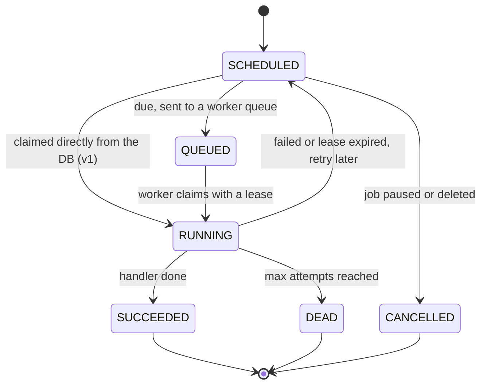
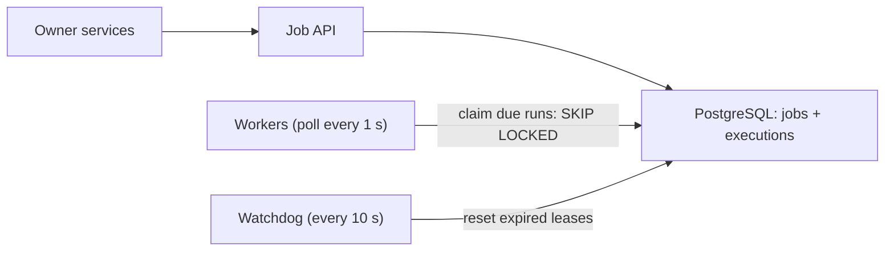
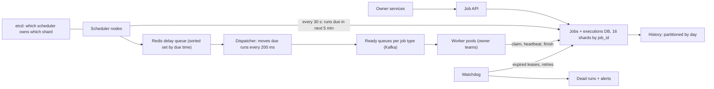
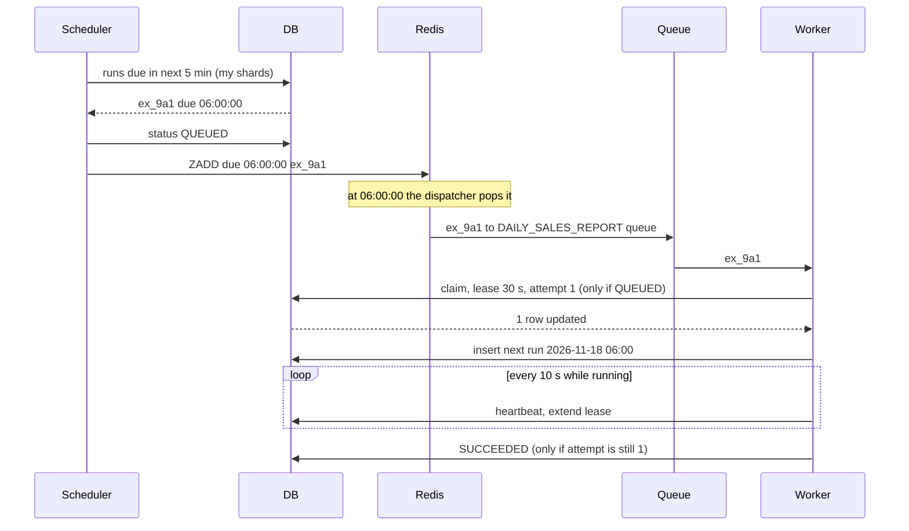
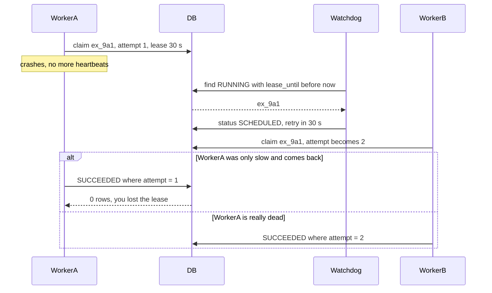

# Distributed job scheduler

[← System design basics](../system-design.md) · [← Main README](../../README.md)

**In one line:** Store jobs with a run time and find the ones that are due. Each run must happen at least once, never twice at the same time, even when machines die.

**Story:** A hospital ward has a board of medicine cards: "Bed 4, 8 AM, every 6 hours".
Many nurses work the shift. A nurse picks a card and writes her name and the time on it, so nobody else gives the same dose.
If she does not come back in 30 minutes, the head nurse gives the card to someone else.
After the dose, she writes the next time on a new card.
A job scheduler does the same. Due cards are jobs. The name on the card is a *lease*. The head nurse is a *watchdog*.

---

## 1. How the interviewer asks it

Common wordings:

- "Design a distributed job scheduler, like cron at scale."
- "Design a system that runs millions of delayed and recurring tasks."
- "Build a task scheduler that assigns jobs to worker threads and queues the rest." (low-level version)

Where it is asked: candidates report the machine coding (low-level) version at Flipkart in 2025. We found no company-specific source for the high-level version. It is a common "platform" question.

**What they are really testing:**

- How do you **find due jobs** fast, without scanning a huge table every second?
- How do you stop **double runs** and **lost runs** when workers crash? (leases, heartbeats, idempotency)
- Do you know that **exactly-once is not possible**, and what you do instead?

---

## 2. Questions to ask (with assumed answers)

| Question | Why it matters | What we assume |
|---|---|---|
| What kinds of jobs? | One-time and recurring need different logic | Run now, run at a time, and recurring (cron) |
| How many jobs run per second? | Decides DB and queue design | Up to 10,000/s at peak, ~1,000/s on average |
| How many jobs are stored? | Decides storage and indexes | ~100M scheduled jobs |
| How exact must the start time be? | Poll interval or delay queue | Start within 2 seconds of the due time |
| Run guarantee? | At-least-once vs at-most-once | At-least-once. Jobs must be idempotent (safe to run twice). |
| How long does a job run? | Leases and heartbeats | Mostly seconds. Some up to 1 hour. |
| Who runs the job code? | Our workers or the owner's service | Owner teams run workers with our client library |
| Retries? | Retry policy, dead jobs | Yes, with backoff, max 5 tries, then "dead" |
| Cancel, pause, reschedule? | Status checks before running | Yes |
| Can users see history? | Execution log | Yes, last 30 days |
| Time zones? | Cron and daylight saving | Each job has a time zone |

---

## 3. Assumptions

1. One-time and cron jobs. 100M stored. Up to 10k runs per second.
2. Start within 2 seconds of the due time.
3. At-least-once. Never two copies of the same run at the same time.
4. Jobs are idempotent. We give each run an idempotency key.
5. Max 5 attempts with backoff. Then the run is DEAD and we alert.
6. History is kept for 30 days.

---

## 4. Requirements

**Functional (what it does):**

- Create, read, pause, resume and delete jobs.
- Run a job once at a time, or on a cron schedule, in a time zone.
- Retry failed runs with backoff. Mark them dead after max tries.
- Show the history of runs (status, start, end, error).

**Non-functional (how well):**

- Start on time: within 2 s of the due time for 99% of runs (p99).
- No lost runs. No two workers running the same run at the same time.
- Scales to 10k runs per second and 100M stored jobs.
- Survives the loss of any one machine.

---

## 5. Numbers

| Step | Math | Result | Decision it drives |
|---|---|---|---|
| Stored jobs | 100M × ~1 KB | ~100 GB | Fits one PostgreSQL, but… |
| Peak runs | given | ~10,000/s | Each run = claim + finish = 2 writes → 20,000 writes/s. **Too much for one primary. Shard by `job_id`.** |
| Average runs | 1,000/s × 100,000 s | ~100M runs a day | |
| History | 100M × 500 bytes | ~50 GB/day, ~1.5 TB for 30 days | **Partition the history table by day and drop old days** |
| Start precision | 2 s | poll every ≤ 1 s | **Or pre-load due jobs into a delay queue** |
| Midnight spike | 1M daily jobs all at 00:00 | 100 s of work at 10k/s | **Pre-load early, scale workers before midnight** |
| Lease time | job heartbeat every 10 s | lease = 30 s | A dead worker's run restarts within ~30 s |

---

## 6. APIs

| API | What it does |
|---|---|
| `POST /v1/jobs` | Create a one-time or cron job |
| `GET /v1/jobs/{id}` | Job details and next run time |
| `POST /v1/jobs/{id}/pause`, `/resume` | Stop or restart future runs |
| `DELETE /v1/jobs/{id}` | Cancel all future runs |
| `GET /v1/jobs/{id}/executions?cursor=…` | Run history, newest first |
| `POST /v1/executions/{id}/replay` | Run a dead run again |

Create a recurring job:

```http
POST /v1/jobs
Idempotency-Key: billing-daily-report-v1

{ "type": "DAILY_SALES_REPORT", "payload": { "region": "south" },
  "schedule": { "cron": "0 0 6 * * *", "timezone": "Asia/Kolkata" },
  "retry": { "maxAttempts": 5, "backoffSeconds": 30 },
  "timeoutSeconds": 900, "misfire": "RUN_ONCE", "overlap": "SKIP" }
```

```json
{ "jobId": "job_51c2", "status": "ACTIVE", "nextRunAt": "2026-11-17T06:00:00+05:30" }
```

- For a one-time job, send `"runAt"` instead of `"cron"`.
- Spring's cron format has 6 fields (seconds first). `0 0 6 * * *` = every day at 6:00 AM.

**Worker side (our client library):** workers register a handler per job `type`. The library pulls runs, sends heartbeats, and reports success or failure.

---

## 7. Data model

**`jobs`** (what to run and when):

| Column | Example |
|---|---|
| `job_id` (PK) | `job_51c2` |
| `owner`, `type`, `payload` | `billing`, `DAILY_SALES_REPORT`, JSON |
| `cron_expr`, `timezone`, `run_at` | `0 0 6 * * *`, `Asia/Kolkata`, null |
| `status` | `ACTIVE`, `PAUSED`, `DELETED` |
| `retry_policy`, `timeout_seconds`, `misfire`, `overlap` | |

**`executions`** (one row per run):

| Column | Example |
|---|---|
| `execution_id` (PK) | `ex_9a1` |
| `job_id`, `scheduled_for` | `job_51c2`, `2026-11-17 06:00 IST` |
| `status` | see the state diagram |
| `attempt` | `1` |
| `worker_id`, `lease_until` | `worker-17`, `06:00:30` |
| `started_at`, `finished_at`, `error` | |

- `UNIQUE (job_id, scheduled_for)`: the same run can never be created twice.
- Partial index on `(scheduled_for) WHERE status = 'SCHEDULED'`: the "what is due" query reads only waiting rows. See [Database indexes](../system-design.md#database-indexes).
- Partial index on `(lease_until) WHERE status = 'RUNNING'`: the watchdog finds expired leases fast.

**Run states:**



**Which database:** PostgreSQL. We need conditional updates, row locks (`SKIP LOCKED`) and unique constraints. At scale, shard by `job_id` into 8 to 16 databases. See [Partitioning and sharding](../system-design.md#partitioning-and-sharding).

---

## 8. Architecture, version 1 (simple)



- There is **no separate scheduler**. Workers ask the DB directly: "give me up to 50 due runs that nobody holds".
- `FOR UPDATE SKIP LOCKED` makes each worker skip rows another worker has locked. So no two workers get the same run.
- The DB is the referee. No leader is needed (deep dive 11.4).
- Good up to about 1,000 runs per second. Many Spring teams start here (Quartz in clustered mode, or `db-scheduler`).

---

## 9. Architecture, version 2 (at scale)



**What changed and why:**

- **Sharded DB.** 20,000 writes/s is too much for one primary. 16 shards give ~1,250 writes/s each.
- **Scheduler nodes own shards.** Each shard has one owner at a time. Ownership is a lease in etcd (a small, strongly consistent key-value store). If a node dies, another takes its shards.
- **Two layers: DB + delay queue.** The DB holds all 100M jobs. Every 30 s, the scheduler loads only runs due in the next 5 minutes. They go into a Redis sorted set (score = due time). Precise timing comes from the small set, not the big table.
- **Dispatcher.** Every 200 ms it pops due items and sends them to a ready queue. This gives our 2-second precision.
- **Ready queues per job type.** A slow report job cannot block quick email jobs ([bulkhead](../microservices.md#bulkhead)).
- **Watchdog + dead runs.** Finds expired leases, schedules retries, and parks dead runs with an alert.
- **History by day.** Old days are dropped as whole partitions. Cheap cleanup.

---

## 10. Step-by-step flows

**A cron run, happy path:**



**Worker dies in the middle:**



---

## 11. Deep dives

### 11.1 Finding due jobs

The naive way: `SELECT * FROM jobs WHERE run_at <= now()` every second, on 100M rows, from every server. This is slow and every server gets the same rows.

| Option | How | Good | Bad |
|---|---|---|---|
| **Indexed poll + `SKIP LOCKED`** | Workers claim due rows from the DB | Simple, no extra system, DB is the referee | DB load grows with workers and runs |
| **Time buckets** | Rows grouped by minute: `bucket = 2026-11-17T06:00`. Read only the next bucket. | Works on NoSQL (Cassandra), no big scan | Precision is one bucket; hot bucket at midnight |
| **Delay queue** | Redis sorted set, score = due time. Pop items with score ≤ now. | Precise, very fast | Memory: only keep the next few minutes |
| **Queue with built-in delay** | SQS delivery delay (max 15 minutes) | No code to write | Only short delays. Kafka has no per-message delay. |

**Our choice: DB for long-term + delay queue for the next 5 minutes.**
v1 uses only the indexed poll. Here is that query in PostgreSQL:

```sql
WITH due AS (
  SELECT execution_id FROM executions
  WHERE status = 'SCHEDULED' AND scheduled_for <= now()
  ORDER BY scheduled_for
  LIMIT 50
  FOR UPDATE SKIP LOCKED          -- skip rows other workers already locked
)
UPDATE executions e
SET status = 'RUNNING', worker_id = :me, attempt = e.attempt + 1,
    lease_until = now() + interval '30 seconds'
FROM due WHERE e.execution_id = due.execution_id
RETURNING e.*;
```

- 50 workers can run this at once. Each gets a different set of rows.
- One statement, so the claim and the lease are one atomic step.

### 11.2 "Exactly once" is not possible, so: leases, heartbeats, fencing

**Why not exactly once:** a worker sends a report email, then crashes before writing "SUCCEEDED". We cannot know if the email went. We must run it again. So the real promise is:

- **At-least-once:** every run happens, maybe more than once.
- **Never two at the same time:** only the lease holder may run it.
- **Idempotent jobs:** running twice does no harm.

**Lease (the name on the medicine card):**

1. The claim sets `lease_until = now + 30 s`.
2. The worker sends a **heartbeat** every 10 s: `UPDATE ... SET lease_until = now() + interval '30 seconds' WHERE execution_id = ? AND attempt = ?`.
3. If heartbeats stop, the lease expires. The watchdog makes the run available again. The next claim sets `attempt + 1`.
4. A 1-hour job is fine. It just keeps sending heartbeats.

**Fencing (stop the zombie worker):**

- Worker A pauses for 40 s (a long garbage collection pause). Its lease expires. Worker B takes the run with `attempt = 2`.
- Worker A wakes up and tries to write "SUCCEEDED". Its update has `WHERE attempt = 1`, so 0 rows change. It knows it lost.
- The `attempt` number is a *fencing token*: a number that grows each time, so old holders are rejected.
- Before a big side effect, the worker checks its lease first.

**Idempotency key for the job's own work:** we pass `job_id + scheduled_for` to the handler. The handler uses it as the key for payments, emails or DB writes. See [Idempotency](../microservices.md#idempotency).

### 11.3 Retries and dead runs

- **Handler throws an error** → back to SCHEDULED. The next claim sets `attempt + 1`. Backoff: 30 s, 1 min, 2 min, 4 min, plus random jitter. See [Retry with backoff and jitter](../microservices.md#retry-with-exponential-backoff-and-jitter).
- **Worker dies (lease expires)** → also counts as an attempt. So a job that crashes the worker every time cannot loop forever.
- **Timeout** → if a run is RUNNING longer than `timeout_seconds`, the watchdog treats it as failed, even with heartbeats.
- **After max attempts** → status DEAD. Alert the owner team. Show it on a dashboard.
- **Replay** → after a fix, the owner calls `POST /executions/{id}/replay`. This makes a new attempt.
- **Do not retry** errors that will never pass (bad payload). The handler throws a "permanent" error, and we go straight to DEAD.

### 11.4 Cron at scale, and leader vs leaderless

**Next run of a cron job:**

- When a run is **claimed** (not when it finishes), insert the next run row. A long job then does not delay the next run.
- `UNIQUE (job_id, scheduled_for)` makes this safe. If two nodes try, one insert fails.
- Compute times in the job's time zone. Daylight saving can skip or repeat an hour (not in India, but in the US and Europe).

```java
CronExpression cron = CronExpression.parse(job.cronExpr());      // Spring 5.3+
ZonedDateTime last = job.scheduledFor().atZone(job.timezone());
ZonedDateTime next = cron.next(last);                            // handles DST in that zone
executionRepo.insertIfAbsent(job.id(), next.toInstant());        // unique (job_id, scheduled_for)
```

**Misfire (the scheduler was down for 2 hours):** a job that runs every minute missed 120 runs.

- `RUN_ONCE`: run one catch-up run, then continue. Good default.
- `SKIP`: forget the missed runs. Good for "refresh the cache".
- Never fire all 120 at once.

**Overlap:** the 06:00 run is still running at the next due time. Policy `SKIP` (do not start a second one) or `ALLOW`.

**Midnight spike:** 1M jobs at 00:00. Pre-load them into the delay queue minutes early. Scale up workers at 23:55. Ask owners if a few seconds of random spread (jitter) is OK.

**Who decides what is due?**

| Model | How | Good | Bad |
|---|---|---|---|
| **Single leader** | One scheduler node is active. Others wait. Leader chosen by a lease in etcd, ZooKeeper or a DB row. | Easy to reason about | One node's limit. A failover gap of a few seconds. |
| **Leader per shard** (our v2) | Each shard has one owner. Owners are spread over nodes. | Scales out. Each shard still has one decider. | Rebalancing when nodes join or leave |
| **Leaderless** (our v1) | All nodes poll the DB with `SKIP LOCKED` | No election code. DB row locks do the work. | DB load grows. Hard past one DB. |

- Quartz in clustered mode is leaderless: all nodes share one DB and use row locks.
- For a single `@Scheduled` method on many Spring Boot instances, ShedLock gives "run on one node only" with a DB lock.

---

## 12. Follow-up questions interviewers ask

- **Worker crashes in the middle?** Heartbeats stop and the lease expires in 30 s. The watchdog schedules a retry, and another worker runs it. The job must be idempotent.
- **A job keeps failing?** Backoff, max 5 attempts, then DEAD with an alert and a replay button.
- **The scheduler node dies?** Its etcd lease ends. Another node takes its shards within seconds. Runs start a few seconds late. None are lost, because they are in the DB.
- **Redis delay queue loses data?** The DB is the truth. Runs stuck in QUEUED for too long are put back by the watchdog. Redis is only a speed layer.
- **Can two schedulers queue the same run?** Each shard has one owner. And the worker's claim is "only if QUEUED", so a duplicate message does nothing.
- **How do users see job status?** The `executions` table, by `job_id`, newest first. Old days live in day partitions and are dropped after 30 days.
- **Cancel a job that is due in 1 second?** Set the job to PAUSED. Workers check the job status at claim time and skip it.
- **How big is this in real life?** Dropbox wrote in 2020 that its Async Task Framework scheduled about 9,000 tasks per second. It is at-least-once and never runs the same task twice at the same time ([Dropbox tech blog](https://dropbox.tech/infrastructure/asynchronous-task-scheduling-at-dropbox)).
- **Why not just Linux cron on one server?** One machine is a single point of failure. No retries, no history, no scaling.
- **Push or pull for workers?** Pull. Workers take work when they have free threads. A busy worker is never overloaded.

---

## 13. What can go wrong

| Problem | What we do |
|---|---|
| Worker crashes mid-run | Lease expires, watchdog retries, idempotency key stops harm |
| Worker freezes (GC pause), then wakes up | Fencing: its final update uses the old `attempt` and changes 0 rows |
| Scheduler node dies | etcd lease ends; another node owns the shard |
| Redis delay queue is lost | Rebuild from the DB; watchdog resets runs stuck in QUEUED |
| DB shard is down | Runs on that shard wait. A replica is promoted. Runs start late, not lost. |
| Huge spike at midnight | Pre-load early, pre-scale workers, jitter if allowed |
| Poison job crashes every worker | Each crash counts as an attempt. DEAD after 5. |
| Clock differences between machines | Use the DB clock (`now()`) for leases and due times, not each worker's clock |
| Job runs twice and charges twice | The handler must use `job_id + scheduled_for` as an idempotency key |

---

## 14. Trade-offs

| We chose | We get | We give up |
|---|---|---|
| At-least-once + idempotent jobs | No lost runs | Job owners must write idempotent handlers |
| DB as source of truth + Redis delay queue | 2 s precision on 100M jobs | Two systems to keep in sync (watchdog fixes drift) |
| Leases with heartbeats | Long jobs work; dead workers detected in 30 s | Heartbeat traffic; a 30 s gap after a crash |
| Leader per shard | Scales out, one decider per shard | Rebalancing logic, etcd to run |
| Next run created at claim time | Long jobs do not delay the next run | Need an overlap policy |
| Pull-based workers | Workers never overloaded | A little delay from polling |
| Partition history by day | Cheap cleanup | Queries over many days touch many partitions |

---

## 15. Say this in the interview

> "Jobs and runs live in PostgreSQL, with one row per run and a unique key on job ID plus scheduled time.
> For a small system, workers claim due runs with SELECT FOR UPDATE SKIP LOCKED, so no leader is needed.
> At 10,000 runs per second, I shard the DB by job ID. Each shard has one scheduler owner, chosen by a lease in etcd. It loads runs due in the next 5 minutes into a Redis sorted set. A dispatcher moves them to ready queues on time.
> Exactly-once is not possible, so I promise at-least-once and never two at the same time. A worker claims a run with a 30-second lease and sends heartbeats. If it dies, the watchdog retries with a higher attempt number, and the old worker's late update is rejected.
> Failed runs retry with backoff, and after 5 attempts they are dead and we alert.
> For cron, I insert the next run when the current one is claimed, in the job's time zone."

---

## 16. Mid vs senior vs staff

| Mid | Senior | Staff |
|---|---|---|
| Jobs table, a poller and workers | `SKIP LOCKED` or conditional updates to stop double claims | Fencing tokens for zombie workers, and why exactly-once is impossible |
| Retries | Leases, heartbeats, a watchdog, dead runs | Leader vs leaderless, shard ownership and rebalancing |
| Mentions cron | Two layers: DB + delay queue, with the precision math | Misfire and overlap policies, DST, the midnight spike |
| Says "jobs should be idempotent" | Gives the idempotency key (`job_id + scheduled_for`) | Multi-tenant fairness (one team's 1M jobs vs others), quotas per owner |
| | Indexes for due runs and expired leases | History retention, cost, and the platform API for other teams |
