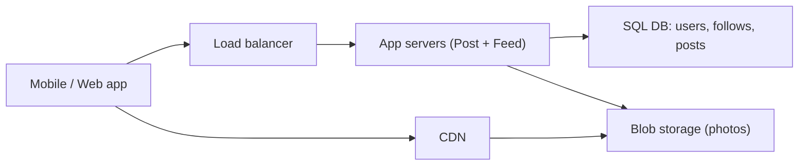
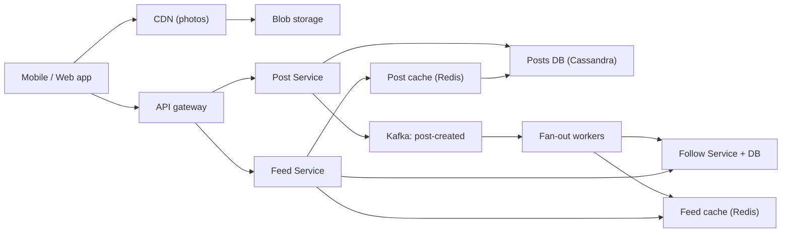
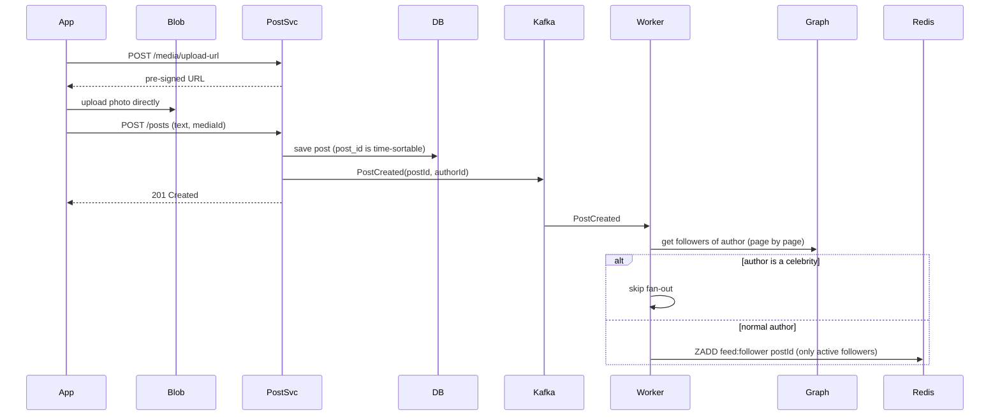
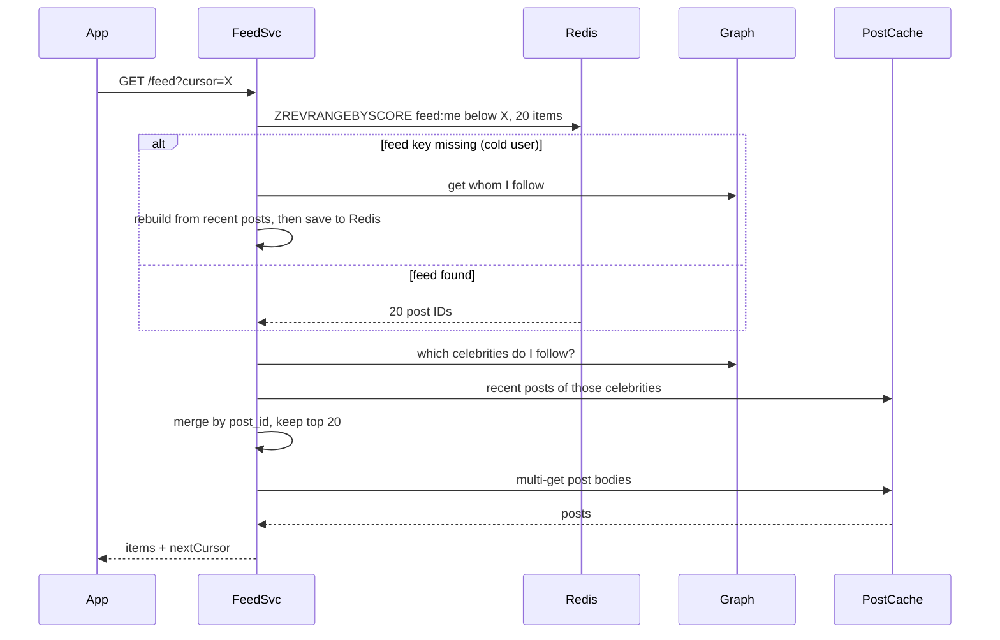

# News feed (Facebook / Instagram)

[← System design basics](../system-design.md) · [← Main README](../../README.md)

**In one line:** When someone posts, put the post ID into each follower's ready-made feed list. Celebrities are the exception: we fetch their posts when the reader opens the app.

**Story:** A newspaper vendor in your colony knows what each house reads.
Every morning he drops the right papers at each door before people wake up. That is *fan-out on write*: the work is done before you ask.
But one house wants 500 magazines. He cannot carry them all to every door.
So for those, he says "come to my stall and pick them up". That is *fan-out on read*.
A news feed mixes both ideas.

---

## 1. How the interviewer asks it

- "Design Facebook News Feed."
- "Design Instagram: users post photos, follow people and see a feed."
- "Design the Twitter home timeline."
- "Design the feed API with infinite scroll." (Meta product architecture rounds may ask only this part.)

Prep sites report the news feed (or Instagram) as one of the most common Meta design questions. Microsoft is also reported to ask "design a Twitter-like service". These are candidate reports, not official lists.

**What they are really testing:**

- Do you see that reads are far more than writes, and do the work at write time?
- Do you know the *celebrity problem* (one user with millions of followers) and the hybrid fix?
- Can you page through a feed that changes every second (cursor pagination)?

---

## 2. Questions to ask (with assumed answers)

| Question | Why it matters | What we assume |
|---|---|---|
| Which features are in scope? | Keeps the hour focused | Post (text + photo), follow, see home feed. No comments, likes, stories or DMs. |
| How many users? | Drives every number | 1 billion users, 500 million daily active users (DAU) |
| Follow model: one-way (Instagram) or two-way (Facebook friends)? | Two-way friends have a small cap; one-way has no cap | One-way follow, no limit on followers |
| Is there a limit on how many people one user follows? | Bounds the read-time merge | Up to 5,000 followed accounts |
| Feed order: newest first or ranked? | Ranking needs a separate service | Newest first in v1. Simple ranking as a follow-up. |
| How fresh must the feed be? | Lets us do fan-out in the background | A new post can take up to ~1 minute to appear. Eventual is fine. |
| Photos and videos? | Big files need a different path | Photos yes, stored in blob storage and served by a CDN |
| How far back can a user scroll? | Sets how much we keep per user | Fast for the latest ~500 items. Older is slower, and that is fine. |
| Do we care about inactive users? | Fan-out to them wastes work | Skip users who have not opened the app in 30 days |
| Read vs write latency targets? | Tells us what to optimize | Feed loads in under 200 ms (p99). Posting can be a bit slower. |

---

## 3. Assumptions

1. 500M DAU. Each user opens the feed about 10 times a day.
2. About 100M new posts a day.
3. A user has 200 followers on average. A few have 10M+.
4. Newest-first feed. A new post may take up to 1 minute to appear.
5. Feed page size is 20 posts. We keep the latest 500 post IDs per user in cache.
6. Photos go to blob storage and a CDN. Only the URL is in the post.

---

## 4. Requirements

**Functional (what it does):**

- A user creates a post with text and an optional photo.
- A user follows and unfollows other users.
- A user sees a home feed: posts from people they follow, newest first.
- The feed scrolls page by page (infinite scroll).

**Non-functional (how well):**

- **Fast reads:** feed in under 200 ms at p99 (99% of requests are faster).
- **High availability:** the feed should always load, even if it is a little stale. We pick availability over strict consistency. See [CAP theorem](../system-design.md#cap-theorem).
- **Eventual consistency:** a new post can show up a few seconds to 1 minute later.
- **Scale:** 500M DAU and celebrities with tens of millions of followers.

---

## 5. Numbers

Shortcut: 1 day ≈ 100,000 seconds. See [Capacity estimation](../system-design.md#capacity-estimation).

**Step 1: Feed reads**

- 500M DAU × 10 opens = 5B feed reads a day.
- 5B ÷ 100,000 = **50,000 reads/second**. Peak (3×) ≈ **150,000/s**.
- **Decision:** we cannot build each feed from the database on every read. We need a pre-built feed in cache.

**Step 2: Posts (writes)**

- 100M posts ÷ 100,000 = **1,000 posts/second**. Peak ≈ 3,000/s.
- Read : write ≈ 50 : 1. **Decision:** make reads cheap, even if writes cost more.

**Step 3: Fan-out writes**

- Each post goes to ~200 followers' feeds.
- 1,000 posts/s × 200 = **200,000 feed inserts/second**.
- **Decision:** do this in background workers through a queue, not in the "create post" request.

**Step 4: The celebrity post**

- One post from a user with 50M followers = 50M feed inserts.
- At 200,000 inserts/s, that is about 250 seconds of *all* our workers, for one post.
- **Decision:** do not fan out for celebrities. Merge their posts at read time.

**Step 5: Feed cache size**

- 500 post IDs × ~10 bytes ≈ 5 KB per user.
- 500M active users × 5 KB ≈ **2.5 TB**.
- **Decision:** fits in a Redis cluster (about 40 nodes with 64 GB each, plus replicas).

**Step 6: Photo storage**

- Say 30% of posts have a photo of ~300 KB.
- 30M × 300 KB ≈ **9 TB a day**, about 3 PB a year.
- **Decision:** blob storage (like S3) plus a CDN. Never in the database.

---

## 6. APIs

| API | What it does |
|---|---|
| `POST /v1/media/upload-url` | Get a pre-signed URL (a short-lived upload link) to send a photo straight to blob storage |
| `POST /v1/posts` | Create a post |
| `GET /v1/feed?cursor=...&limit=20` | Get one page of the home feed |
| `POST /v1/users/{userId}/follow` | Follow a user |
| `DELETE /v1/users/{userId}/follow` | Unfollow a user |

The logged-in `userId` comes from the auth token, not from the body.

**Create a post:**

```http
POST /v1/posts
Idempotency-Key: 9b2f6a10-1c3e-4d4a-8f0e-7a6c5b4d3e21

{ "text": "Sunday at Marine Drive", "mediaIds": ["m_88123"] }
```

```json
{ "postId": "7281945600123456", "createdAt": "2026-11-15T10:20:00Z" }
```

**Read the feed:**

```http
GET /v1/feed?limit=20&cursor=eyJsYXN0IjoiNzI4MTk0NTYwMDEyMzQ1NiJ9
```

```json
{
  "items": [
    { "postId": "7281945600123456", "author": { "id": "u_42", "name": "Priya" },
      "text": "Sunday at Marine Drive",
      "mediaUrls": ["https://cdn.example.com/p/m_88123_1080.jpg"],
      "createdAt": "2026-11-15T10:20:00Z" }
  ],
  "nextCursor": "eyJsYXN0IjoiNzI4MTk0NTU5OTk5ODg3NyJ9"
}
```

- The cursor is *opaque* (the app does not read it). Inside, it holds the time and ID of the last post the user saw.
- The `Idempotency-Key` stops a double tap from creating two posts. See [Idempotency](../microservices.md#idempotency).

---

## 7. Data model

| Store | Key | Main fields | Database and why |
|---|---|---|---|
| `users` | `user_id` | name, photo URL, `follower_count`, `last_active_at` | SQL (PostgreSQL / MySQL). Small, needs uniqueness. |
| `posts` | partition `author_id`, sort `post_id` desc | text, media IDs, `deleted` flag | Cassandra or DynamoDB. Huge, append-only, read by author. |
| `followers` | partition `followee_id` | `follower_id` | Cassandra. "Who follows X?" is used for fan-out. |
| `following` | partition `follower_id` | `followee_id`, `is_celebrity` | Cassandra. "Whom does X follow?" is used for the read-time merge. |
| `feed:{userId}` | Redis sorted set | member = `post_id`, score = post time in ms | Redis. The pre-built feed, capped at 500 IDs. |
| `post:{postId}` | Redis hash | author, text, media URLs | Redis. Hot post bodies for fast "hydration" (turning IDs into full posts). |

**Notes:**

- **`post_id` is time-sortable.** We use a Snowflake-style ID (time + machine + counter). So "newest first" is just "biggest ID first". See [Unique ID generation](../system-design.md#unique-id-generation).
- **We store the follow edge twice** (`followers` and `following`). Each read is then one partition. Writes cost a bit more, and that is fine.
- **The feed holds only post IDs, not post bodies.** 8 bytes instead of 1 KB. An edit or delete changes one place, not millions of feeds.
- **Why NoSQL for posts?** 100M new rows a day, simple lookups by key, no joins. See [SQL vs NoSQL](../system-design.md#sql-vs-nosql).

---

## 8. Architecture, version 1 (simple)

For a small app (say 1M users), build the feed at read time with one SQL query.



```sql
-- Fan-out on read: build the feed when the user asks
SELECT p.* FROM posts p
JOIN follows f ON f.followee_id = p.author_id
WHERE f.follower_id = :me AND p.post_id < :cursor
ORDER BY p.post_id DESC
LIMIT 20;
```

- Simple and always fresh.
- It works while users follow few people and traffic is small.
- **Why it breaks:** at 150,000 reads/s, each read joins up to 5,000 followed users. The database cannot keep up.

---

## 9. Architecture, version 2 (at scale)



**What changed and why:**

- **Feed cache (Redis):** each user has a pre-built list of 500 post IDs. A feed read is one Redis call, not a big join. See [Caching](../system-design.md#caching).
- **Kafka + fan-out workers:** posting returns fast. Workers push the post ID to followers in the background. See [Message queues](../system-design.md#message-queues-and-pubsub).
- **Hybrid fan-out:** workers skip celebrities. Feed Service merges celebrity posts at read time.
- **Post cache:** turns 20 post IDs into full posts with one multi-get.
- **Posts DB on Cassandra:** spreads 100M posts a day across many nodes by `author_id`.
- **CDN for photos:** photos never pass through our app servers. See [CDN](../system-design.md#cdn) and [Blob storage](../system-design.md#blob-storage-files-images-videos).

---

## 10. Step-by-step flows

### Flow 1: Create a post and fan out



### Flow 2: Read the home feed



---

## 11. Deep dives

### Deep dive 1: Fan-out on write vs on read vs hybrid

*Fan-out* means sending one post to many feeds.

| | Fan-out on write (push) | Fan-out on read (pull) |
|---|---|---|
| When work happens | When someone posts | When someone opens the feed |
| Read cost | One cache read. Very fast. | Read from up to 5,000 users and merge. Slow. |
| Write cost | One write per follower | One write |
| Celebrity with 50M followers | 50M writes. Workers fall behind. | No problem |
| User follows 5,000 people | No problem | Very slow read |
| Wasted work | Writes to feeds of users who never come back | None |

**Hybrid (what we use):**

1. Mark a user as a *celebrity* when followers pass a limit (say 10,000; we tune this number).
2. Normal users: fan-out on write.
3. Celebrities: no fan-out. Their posts stay in their own `posts` partition (and post cache).
4. On read: take my pre-built feed, then add the recent posts of the celebrities I follow. Merge by `post_id`.
5. Most people follow only a few celebrities, so this merge is small (say 10–50 lists).

Two more savings:

- **Skip inactive users.** No fan-out to users who have not opened the app in 30 days. Build their feed when they log in.
- **Page through followers.** A worker reads 1,000 followers at a time and uses Redis pipelining (sending many commands in one network trip).

### Deep dive 2: Feed storage in Redis

Each user's feed is a Redis *sorted set* (a set where each item has a score and stays sorted by it).

```text
feed:u_7   score=1763202000000  member=7281945600123456
           score=1763201950000  member=7281945599998877
           ... up to 500 items
```

- **Member** is the post ID. **Score** is the post time in milliseconds.
- Why not use the post ID as the score? Redis scores are *doubles* (decimal numbers). They are exact only up to 2^53. A 64-bit ID would lose its last digits.

A small fan-out worker in Spring Boot:

```java
@KafkaListener(topics = "post-created", groupId = "fanout")
public void onPostCreated(PostCreated e) {
    if (e.authorFollowerCount() > CELEBRITY_LIMIT) return; // celebrity: merge at read time
    for (List<Long> page : followService.activeFollowersInPages(e.authorId(), 1000)) {
        redis.executePipelined((RedisCallback<Object>) conn -> {
            for (Long f : page) {
                byte[] key = ("feed:" + f).getBytes();
                conn.zSetCommands().zAdd(key, e.createdAtMillis(), toBytes(e.postId()));
                conn.zSetCommands().zRemRange(key, 0, -501); // keep only the newest 500
            }
            return null;
        });
    }
}
```

- **Only IDs in the feed.** Bodies live in the post cache and posts DB.
- **ZADD is idempotent.** If Kafka gives the same event twice, the set does not change. See [Handling duplicate events](../kafka.md#handling-duplicate-events).
- **Cap at 500.** Older pages come from the slow path (read-time merge from the posts DB).
- **Shard Redis by `user_id`.** Redis Cluster spreads keys across nodes. Keep 1–2 replicas per shard. See [Consistent hashing](../system-design.md#consistent-hashing).
- **Redis is a cache, not the source of truth.** If we lose a shard, we rebuild feeds from the follow graph and posts DB. We rebuild slowly, as users come back.

**Hot post (viral post):** millions of people load the same `post:{id}` key. It sits on one Redis node.
Fix: keep a small in-memory cache on each Feed Service instance for the top posts (a few seconds of life). Or copy the hot key to several nodes.

### Deep dive 3: Pagination with cursors

**Why not `?page=3` (offset)?**

- You load page 1 (posts 1–20).
- 5 new posts arrive at the top.
- You ask for page 2 (offset 20). You now see posts 16–20 again. Duplicates.
- Offset also gets slower as it grows. The DB must skip the first N rows.

**Cursor pagination:**

- The response says "the last post you saw was at time `1763201950000`".
- The next request asks only for posts *older* than that.
- New posts at the top do not shift anything. No duplicates, no gaps.
- In Redis: `ZREVRANGEBYSCORE feed:u_7 (1763201950000 -inf LIMIT 0 20` (the `(` means "strictly less than").
- Two posts in the same millisecond are rare. To be safe, the cursor also holds the last post ID, and we skip it if seen again.
- New posts at the top: the app does a "pull to refresh", which asks for posts *newer* than the first item it has.

The cursor is base64 JSON, so we can add fields later (like a ranking session ID) without changing the API.

### Deep dive 4: Simple ranking

The interviewer often says "now rank it". Keep ranking as a separate step after we get the candidates.

1. **Get candidates:** take the latest ~500 IDs (pre-built feed + celebrity merge).
2. **Score each one** with a simple formula:

```text
score = w1 × affinity(me, author)    -- how often I like or comment on this person
      + w2 × engagement(post)        -- likes and comments in the first hour
      - w3 × age_in_hours            -- older posts drop down
```

3. **Sort by score**, return the top 20.
4. **Later:** replace the formula with a machine learning model in a separate Ranking Service. The flow stays the same.

**Paging a ranked feed:** the order is no longer "by time", so a time cursor does not work.
Save the ranked list of 500 IDs for this session (in Redis, for about 30 minutes). The cursor holds the session ID and position.

---

## 12. Follow-up questions interviewers ask

- **A user follows 5,000 people. Is the feed still fast?** Yes. With fan-out on write, the read is one Redis call. The feed is capped at 500 items. Older pages use the slower read-time merge.
- **A user unfollows someone. Do you remove those posts from the feed?** Filter them at read time against the follow list. A lazy cleanup job removes them later. We do not rewrite the feed right away.
- **A post is deleted.** Soft delete (set a `deleted` flag). Feed Service skips deleted posts during hydration. Feeds clean up slowly in the background.
- **Fan-out workers fall behind.** Add workers and Kafka partitions. Celebrities are already skipped. A short lag (under a minute) is allowed by our requirements.
- **The feed cache is lost.** Rebuild from the posts DB and follow graph. Warm it slowly so the DB is not flooded. Show a smaller feed until it is ready.
- **A user becomes a celebrity overnight.** A job flips the `is_celebrity` flag. Old fan-out entries stay. New posts use the read path. It is fine if both paths run for a short time, because we de-duplicate by `post_id`.
- **How do photos load fast?** The app uploads straight to blob storage with a pre-signed URL. We make a few sizes (thumbnail, 1080p). The CDN serves them from a server near the user.
- **Why Kafka between Post Service and fan-out?** Posting stays fast. Workers can retry. A spike of posts waits in Kafka instead of crashing Redis.
- **How would you add ranking?** As a separate step: get candidates, score them, sort. See deep dive 4.

---

## 13. What can go wrong

| Problem | What we do |
|---|---|
| Celebrity posts and fan-out workers lag for minutes | Hybrid fan-out. Celebrities never go through fan-out. |
| A Redis node dies | A replica takes over. If data is lost, rebuild feeds lazily on the next read. |
| Kafka is slow or down | Posts are already saved in the DB. Fan-out catches up later. Feeds are a bit stale. |
| Duplicate events | `ZADD` with the same member does nothing new. |
| One viral post overloads a cache node | Local in-memory cache in Feed Service for hot posts. Copy hot keys to more nodes. |
| Thundering herd: many cache misses at once hit the DB | Only one request rebuilds a key; others wait for it (Facebook calls these "leases"). |
| Feed shows posts of someone I blocked | Filter at read time against a block list. |
| Many users log in at once after an outage | Rate-limit feed rebuilds. Serve a short feed first. |

---

## 14. Trade-offs

| We chose | We get | We give up |
|---|---|---|
| Fan-out on write for most users | Feed read is one cache call | Many writes. Feeds of inactive users waste memory (we skip them). |
| Read-time merge for celebrities | No 50M-write storms | Feed read does a bit more work |
| Only post IDs in the feed | Small cache, edits in one place | One more lookup to get post bodies |
| Cap of 500 items | Bounded memory | Deep scrolling is slower |
| Eventual consistency (up to 1 minute) | High availability, async fan-out | A post does not appear for everyone at the same second |
| Cassandra for posts | Scales writes across many nodes | No joins, limited queries |
| Cursor pagination | No duplicates, stable pages | Cannot jump to "page 50" |

---

## 15. Say this in the interview

> "Reads are about 50 times more than writes: around 50,000 feed reads per second against 1,000 posts per second.
> So I do the work at write time. When a user posts, I save it and put an event in Kafka. Fan-out workers then add the post ID to each follower's feed in Redis.
> The feed is a sorted set of the latest 500 post IDs. A read is one Redis call plus a multi-get of post bodies.
> Celebrities are the exception. I skip fan-out for them and merge their recent posts when the reader opens the feed. That is the hybrid model.
> I page with a cursor, the time of the last post seen, so new posts do not cause duplicates.
> Photos go to blob storage through pre-signed URLs and are served by a CDN.
> Redis is a cache. If we lose it, we rebuild from the posts DB and the follow graph."

---

## 16. Mid vs senior vs staff

| Mid | Senior | Staff |
|---|---|---|
| Draws post service, feed service, DB, cache | Explains fan-out on write vs read with numbers | Picks the celebrity limit from data and plans to tune it |
| Uses a cache for the feed | Solves the celebrity problem with hybrid fan-out | Covers hot posts, thundering herd, and cache rebuild after a loss |
| Uses page numbers or needs a hint for cursors | Uses cursor pagination and explains why | Plans paging for ranked feeds (session snapshots) |
| Stores photos in blob storage | Pre-signed upload, CDN, several image sizes | Talks about cost: skip inactive users, cap feed size, memory per user |
| Mentions Kafka | Idempotent fan-out, skip inactive users | Separates candidate fetch from ranking, so an ML model can be added later |
| | | Talks about multi-region feeds and what we monitor (fan-out lag, feed p99) |

**Real-world notes:**

- Around 2012–2013, Twitter served about 300,000 timeline reads per second against about 6,000 tweet writes per second. Tweets were fanned out into a large Redis cluster. ([High Scalability](https://highscalability.com/the-architecture-twitter-uses-to-deal-with-150m-active-users/))
- Facebook's memcache paper explains "leases", which stop many servers from rebuilding the same missing cache key at once. ([USENIX NSDI 2013](https://www.usenix.org/conference/nsdi13/technical-sessions/presentation/nishtala))
- A good walkthrough of this problem: [Hello Interview: FB news feed](https://www.hellointerview.com/learn/system-design/problem-breakdowns/fb-news-feed).
