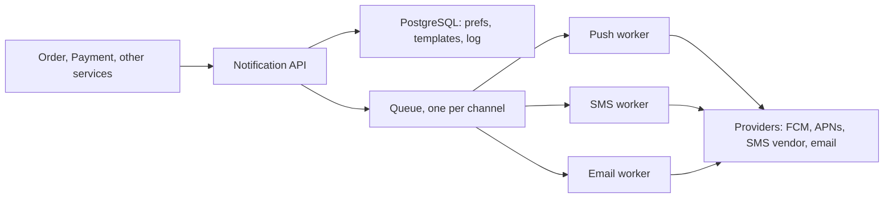
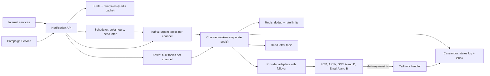
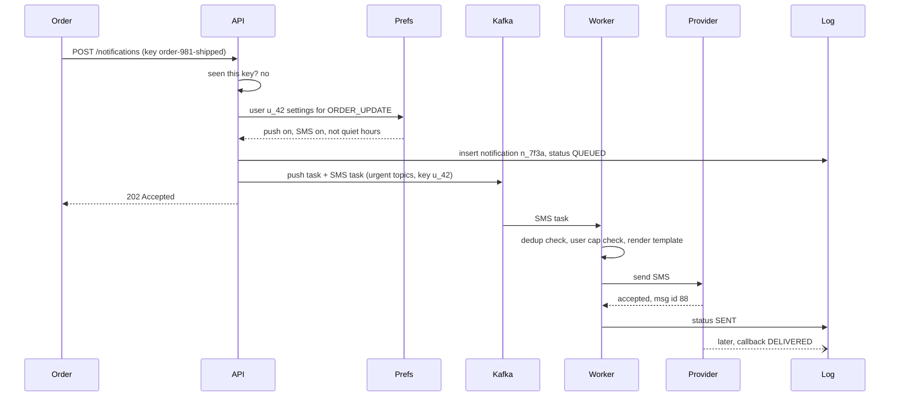
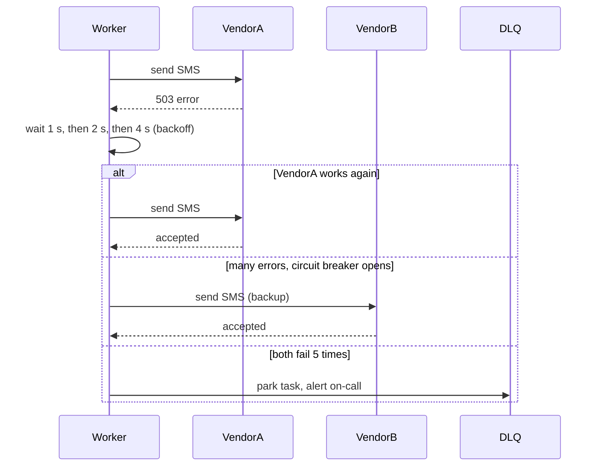

# Notification service (email, SMS, push)

[← System design basics](../system-design.md) · [← Main README](../../README.md)

**In one line:** Take a "tell this user X" request and check what the user allows. Then deliver it once, on the right channels, even when providers fail.

**Story:** A family is sending wedding invitations.
Close friends get a card by hand, others get a WhatsApp message, and grandparents get a phone call.
Nobody calls grandma after 9 PM. Nobody invites the same uncle twice.
If the courier is on strike, they switch to another courier.
A notification service does the same: right channel, right time, once, with a backup.

---

## 1. How the interviewer asks it

Common wordings:

- "Design a notification system that sends push, SMS and email."
- "We have 10 million users. Design the notification service."
- "Design the notification system for Flipkart or Swiggy order updates."

Where it is asked: candidates report it in Flipkart SDE-2 design rounds. A Stripe senior loop report mentions a notification low-level design. It is also a common "vague prompt" in 2026 trend reports.

**What they are really testing:**

- Do you **separate urgent from bulk** traffic, so a marketing blast never delays an OTP?
- Do you handle **unreliable third parties**: retries, failover, duplicates?
- Do you respect the **user**: preferences, quiet hours, not too many messages?

---

## 2. Questions to ask (with assumed answers)

| Question | Why it matters | What we assume |
|---|---|---|
| Which channels? | Each channel has its own provider and limits | Push (FCM for Android, APNs for iOS), SMS, email, in-app inbox |
| Transactional or marketing? | Different priority and rules | Both. OTP and order updates are urgent. Campaigns are bulk. |
| How many users and messages? | Queue and worker sizing | 10M daily users, ~10 notifications each a day |
| Big campaigns? | Spikes | Yes, up to 50M users at once |
| How fast for urgent ones? | Separate fast lane | OTP within 5 seconds, order updates within 30 seconds |
| User preferences and opt-out? | Must check before sending | Yes, per category and per channel |
| Quiet hours? | Delayed sending | Yes, 10 PM to 8 AM in the user's time zone, not for OTP |
| Delivery guarantee? | Duplicates vs losses | At-least-once. Duplicates must be rare. |
| Who calls us? | API shape | Other internal services, and a campaign tool for marketing |
| Templates and languages? | Template store | Yes, versioned templates, English and Hindi |
| Do we track delivery and opens? | Callbacks and analytics | Delivery yes. Opens and clicks as basic analytics. |

---

## 3. Assumptions

1. 10M daily users × 10 = 100M notifications a day.
2. Channels: push, SMS, email, in-app. Providers are third parties.
3. Two lanes: urgent (OTP, orders) and bulk (marketing).
4. At-least-once delivery. Dedup by notification ID.
5. Preferences, quiet hours and per-user caps apply. Security messages ignore quiet hours.
6. Two SMS providers and two email providers, for failover.

---

## 4. Requirements

**Functional (what it does):**

- Accept a notification request from any internal service.
- Check preferences, quiet hours and caps. Pick channels and devices.
- Render the message from a template, in the user's language.
- Send through providers. Retry on failure. Switch provider if one is down.
- Store status (queued, sent, delivered, failed) and show an in-app inbox.
- Run scheduled campaigns to big user groups.

**Non-functional (how well):**

- Urgent messages fast: OTP under 5 s end to end.
- Bulk traffic must never slow urgent traffic.
- Never lose an accepted notification. Duplicates should be rare.
- Stay within provider rate limits.
- Scale to campaign spikes without falling over.

---

## 5. Numbers

| Step | Math | Result | Decision it drives |
|---|---|---|---|
| Average rate | 100M ÷ 100,000 s | ~1,000/s | Easy for a few workers |
| Campaign spike | 50M users in 10 min | ~80,000/s | **Providers cannot take this. Queue it and throttle.** |
| Campaign, throttled | 50M over 30 min | ~28,000/s | Agree a send rate with each provider |
| SMS share | 10% of 100M | ~10M/day, ~100/s | SMS costs money. Caps and dedup matter. |
| Status log | 100M × ~1 KB | ~100 GB/day | Write-heavy log. **Use Cassandra with a 90-day TTL** (~9 TB). |
| Devices | 50M users × 2 devices × 200 bytes | ~20 GB | Fits a SQL DB, cache the hot part |
| Preferences | read on every notification | ~1,000–30,000 reads/s | **Cache in Redis** |

---

## 6. APIs

| API | Who calls it | What it does |
|---|---|---|
| `POST /v1/notifications` | Internal services | Send one notification |
| `POST /v1/campaigns` | Marketing tool | Send to a user segment at a time |
| `GET /v1/notifications/{id}` | Internal services, support | Status per channel |
| `GET, PUT /v1/users/{id}/preferences` | App settings screen | Read or change opt-outs and quiet hours |
| `POST /v1/users/{id}/devices` | Mobile app | Register a push token |
| `POST /v1/providers/{name}/callbacks` | Providers | Delivery receipts (delivered, bounced) |

Send one:

```http
POST /v1/notifications
Idempotency-Key: order-981-shipped

{ "userId": "u_42", "category": "ORDER_UPDATE", "priority": "HIGH",
  "templateId": "order_shipped", "data": { "orderId": "981", "eta": "Tue" },
  "channels": ["PUSH", "SMS"] }
```

```json
{ "notificationId": "n_7f3a", "status": "ACCEPTED" }
```

- We return `202 Accepted` at once. Sending happens in the background.
- The `Idempotency-Key` comes from the caller. The same order event sent twice gives one notification. See [Idempotency](../microservices.md#idempotency).

---

## 7. Data model

| Table | Store | Main columns |
|---|---|---|
| `notifications` | Cassandra | `notification_id`, `idempotency_key`, `user_id`, `category`, `priority`, `template_id`, `data`, `created_at` |
| `deliveries` | Cassandra | `notification_id`, `channel`, `target` (device or phone), `provider`, `status`, `attempts`, `provider_msg_id`, `updated_at` |
| `inbox` | Cassandra | partition `user_id`, sorted by `created_at` desc; `title`, `body`, `read` |
| `preferences` | PostgreSQL + Redis cache | `user_id`, `category`, `channel`, `enabled` |
| `user_settings` | PostgreSQL + Redis cache | `user_id`, `timezone`, `quiet_start`, `quiet_end`, `language` |
| `devices` | PostgreSQL | `user_id`, `device_id`, `platform`, `push_token`, `last_seen` |
| `templates` | PostgreSQL | `template_id`, `version`, `channel`, `locale`, `subject`, `body` |

**Why two databases:**

- **Cassandra** for the notification log and inbox. It is built for many writes, data spread by `user_id`, and auto-delete by TTL (time to live).
- **PostgreSQL** for preferences, devices and templates. Small data, read often, edited by users. Easy to query and update.
- Idempotency key lookup: a Redis key with a 24-hour TTL, plus a unique index in the log.

---

## 8. Architecture, version 1 (simple)



- **Notification API:** checks preferences, renders the template, writes a log row, and puts one task per channel on that channel's queue.
- **One queue per channel.** A slow SMS vendor does not block emails.
- **Workers** call the provider and update the status.
- This is enough for a few hundred notifications per second.

---

## 9. Architecture, version 2 (at scale)



**What changed and why:**

- **Urgent and bulk topics, per channel.** Six lanes: push, SMS and email, each urgent and bulk. A 50M campaign fills only the bulk lanes. See [Message queues](../system-design.md#message-queues-and-pubsub).
- **Separate worker pools** per lane. This is the [bulkhead](../microservices.md#bulkhead) idea: a flood in one pool cannot use another pool's threads.
- **Campaign Service.** Reads the user segment in pages and sends requests at a set speed.
- **Scheduler.** Holds messages for quiet hours or "send at 9 AM". It can be the [job scheduler](job-scheduler.md).
- **Redis for dedup and rate limits.** Stops double sends. Keeps us under provider and per-user limits.
- **Provider adapters.** One interface, many vendors. A [circuit breaker](../microservices.md#circuit-breaker) per vendor switches to the backup.
- **Callback handler.** Providers tell us "delivered" or "bounced" later. We update the log.
- **Dead letter topic (DLQ).** Messages that failed many times wait here for a person or a replay tool.

---

## 10. Step-by-step flows

**Order shipped → push + SMS (happy path):**



**SMS provider fails (retry, failover, dead letter):**



---

## 11. Deep dives

### 11.1 The pipeline: queues per channel and priority

**Why one queue is wrong:** marketing puts 50M messages in the queue at 9 AM. An OTP arrives at 9:01. It waits behind 50M messages. The user cannot log in.

**Our lanes:**

| Topic | What goes in | Workers |
|---|---|---|
| `notif.push.urgent` | Order updates, security alerts | Own pool, always some spare capacity |
| `notif.sms.urgent` | OTP | Own pool, reserved provider capacity |
| `notif.email.urgent` | Receipts, password reset | Own pool |
| `notif.*.bulk` | Campaigns, digests | Throttled pool, can be slow |

- **Kafka key = `user_id`.** One user's messages stay in order ("shipped" before "delivered"). See [Kafka message ordering](../kafka.md#kafka-message-ordering).
- **Fan-out happens in two steps.** A campaign becomes one request per user. Each request becomes one task per channel and device.
- **Campaign fan-out:** the Campaign Service reads the segment 1,000 users at a time. It sends at a set speed, for example 30,000 per second. It keeps a cursor, so a crash resumes where it stopped.
- **Check preferences at send time**, not when the campaign was created. A user who opted out at 8:59 must not get the 9:00 message.

### 11.2 Preferences, quiet hours and per-user caps

The worker (or API) asks these in order:

1. **Is this category mandatory?** OTP and security alerts cannot be turned off. They also skip quiet hours.
2. **Has the user opted out** of this category on this channel? Then skip that channel.
3. **Is it quiet hours** in the user's time zone? Then send it to the Scheduler for 8 AM. Do not drop it.
4. **Is the user over the cap?** For example, max 3 marketing pushes a day. A Redis counter per user per day: `INCR cap:u_42:2026-11-16`.
5. **Which devices and addresses?** All active push tokens, the verified phone, the verified email.

- **Digest instead of spam:** "Rahul and 4 others liked your post" is one notification, not five. Hold likes for a few minutes, then send one.
- Preferences are read on every message. Cache them in Redis. On change, delete the cache key.

### 11.3 Retries, failover and no double sends

We promise *at-least-once*: we may send twice in rare cases, but we never silently lose a message.

**Where duplicates come from, and the fix:**

| Source of duplicate | Fix |
|---|---|
| Caller sends the same request twice | `Idempotency-Key` check at the API |
| Kafka gives the same task twice | Dedup key per delivery in Redis (see code) |
| Provider timed out, but did send | Some providers accept our own message ID and dedupe it. Otherwise accept a rare duplicate. |

**Retry rules:**

- **Retry:** timeouts, 5xx errors, 429 from the provider. Use [backoff with jitter](../microservices.md#retry-with-exponential-backoff-and-jitter).
- **Do not retry:** invalid phone, unsubscribed email, invalid push token. For a bad push token, delete the device row.
- **Expiry on every task:** an OTP older than 5 minutes is useless. Drop it instead of retrying.
- After 5 tries, send to the dead letter topic and alert.

**Failover:** a circuit breaker per provider. When vendor A fails often, the breaker opens and the adapter uses vendor B. It tries A again after 30 s.

```java
@KafkaListener(topics = "notif.sms.urgent", groupId = "sms-workers")
public void onTask(SmsTask task) {
    if (task.expiresAt().isBefore(Instant.now())) { log.markExpired(task); return; } // stale OTP
    String key = "sms:" + task.deliveryId();
    Boolean first = redis.opsForValue()
        .setIfAbsent(key, "SENDING", Duration.ofMinutes(5)); // lock; expires if we crash
    if (!Boolean.TRUE.equals(first)) return;                  // sent or in progress
    try {
        String msgId = smsRouter.send(task);                  // vendor A, or B if A's breaker is open
        redis.opsForValue().set(key, "SENT", Duration.ofHours(24));
        log.markSent(task.deliveryId(), msgId);
    } catch (PermanentFailure e) {
        log.markFailed(task.deliveryId(), e.getMessage());    // bad number: no retry
    } catch (RetryableFailure e) {
        redis.delete(key);                                    // let the retry send it
        throw e;                                              // retried with backoff, then DLQ
    }
}
```

More: [Handling duplicate events](../kafka.md#handling-duplicate-events).

### 11.4 Provider rate limits and templates

**Provider limits:**

- Each provider account allows a fixed rate (for example, our SMS plan allows 500/s). Going over gives errors or a ban.
- Workers take a token from a shared token bucket per provider before each send. See [rate-limiter.md](rate-limiter.md).
- Urgent traffic gets its own reserved share. Bulk uses what is left.
- **Per user:** caps from 11.2. **Per provider:** token bucket. Both live in Redis.

**Templates:**

- A template has an ID, a version, a channel and a language: `order_shipped / v3 / SMS / hi-IN`.
- The worker renders it with the data: "Your order {{orderId}} is on the way."
- New versions do not change old messages. The log stores the version used.
- SMS is short: 160 characters in plain English, 70 with Hindi (Unicode). Keep SMS templates short.
- In India, business SMS templates must be pre-registered with telecom operators (TRAI's DLT system). So SMS text cannot be free text.

---

## 12. Follow-up questions interviewers ask

- **SMS provider is down?** Circuit breaker opens. Traffic goes to the backup provider. Urgent first, bulk can wait.
- **Campaign to 50M users at 9 AM?** Schedule it. Throttle to a rate providers accept. Use only bulk lanes. It finishes in about 30 minutes.
- **OTP must arrive in seconds?** Urgent SMS lane, own workers, reserved provider capacity. Drop it after 5 minutes.
- **User has 3 devices?** Send to all active push tokens. When the provider says "token invalid", delete it.
- **How do you track delivery and opens?** Provider callbacks for delivered or bounced. Tracking links and app events for opens and clicks. All go into an analytics stream.
- **Same event processed twice by a worker?** The dedup key per delivery stops the second send.
- **How does the in-app inbox work?** Every notification also writes an inbox row. The app reads it on open. For live updates, use WebSocket or SSE. See [WebSockets vs SSE](../system-design.md#long-polling-vs-websockets-vs-server-sent-events).
- **How do big companies do it?** Netflix describes RENO, its event notification system. It uses one event source, priorities per event type, and both push and pull delivery ([InfoQ summary](https://www.infoq.com/news/2022/03/netflix-reno)).
- **Messages arrive out of order?** Kafka key = `user_id` keeps order per user. Each status message also carries a version, so the app ignores an older one.
- **How do we not lose a request if Kafka is down?** The API writes the notification and an outbox row in one DB transaction. A relay sends it to Kafka later. See [Transactional outbox](../microservices.md#transactional-outbox-pattern).

---

## 13. What can go wrong

| Problem | What we do |
|---|---|
| Marketing blast delays OTPs | Separate urgent and bulk lanes and worker pools |
| One provider down | Circuit breaker + backup provider |
| Provider rate limit hit (429) | Token bucket per provider; retry later with backoff |
| Worker crashes after send, before saving status | Kafka redelivers; the Redis dedup key stops a second send |
| Redis down | Dedup is weaker for a while. Urgent: keep sending. Bulk: pause, to avoid mass duplicates. |
| Bad push tokens pile up | Delete on "invalid token" errors. Remove devices not seen in 90 days. |
| User gets 20 pushes in an hour | Per-user caps and digests |
| Wrong template sent to 10M people | Test sends, approval step for campaigns, a kill switch per campaign |
| Message stuck in retries forever | Max 5 tries, then DLQ. TTL on every task. |

---

## 14. Trade-offs

| We chose | We get | We give up |
|---|---|---|
| Async (202 Accepted) | Callers never wait for providers | Callers learn the result later |
| Lanes per channel and priority | OTP never waits behind marketing | More topics and worker pools to run |
| At-least-once + dedup | No lost messages | Rare duplicates when a provider times out |
| Two vendors per channel | Survives a vendor outage | Two contracts, two integrations |
| Check preferences at send time | Opt-outs respected right away | One more lookup per message (cached) |
| Cassandra for the log | Many writes, auto TTL | No joins; only queries by key |
| Throttled campaigns | Providers and users not flooded | A campaign takes 30 minutes, not 1 |

---

## 15. Say this in the interview

> "Services call one Notification API, which returns 202 at once. It checks the user's preferences and quiet hours, then writes one task per channel to Kafka.
> I keep urgent and bulk traffic in separate topics and worker pools, so a 50M campaign never delays an OTP.
> 100M a day is about 1,000 per second. But a campaign can spike to 80,000 per second, so I queue and throttle to what providers accept.
> Delivery is at-least-once. I dedupe at the API with an idempotency key, and at the worker with a Redis key per delivery.
> Retries use backoff. Permanent errors are not retried. Each provider has a circuit breaker and a backup vendor. After 5 failures, a message goes to a dead letter topic.
> Status and the in-app inbox go to Cassandra with a 90-day TTL."

---

## 16. Mid vs senior vs staff

| Mid | Senior | Staff |
|---|---|---|
| API → queue → workers → providers | Separate lanes for urgent and bulk, with reasons | Capacity reservation per provider, cost per channel (SMS is paid) |
| Mentions retries | Permanent vs retryable errors, TTL on tasks, DLQ | Unknown outcome on provider timeout, and what that means for duplicates |
| Stores device tokens | Preferences, quiet hours, caps in a clear order | Digests and frequency rules as product decisions, owned by a team |
| One provider per channel | Failover with circuit breakers | Multi-region sending, compliance (opt-out laws, DLT in India) |
| | Idempotency at API and worker | Campaign safety: approvals, test sends, kill switch |
